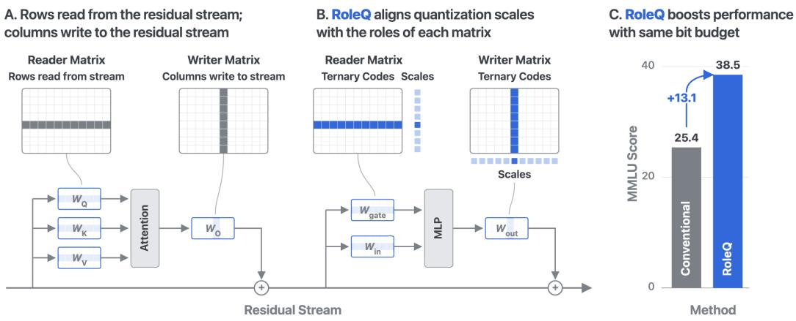
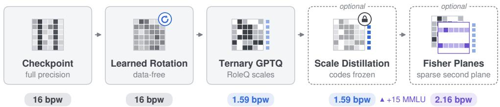
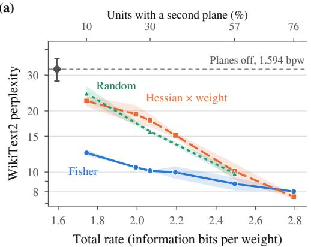
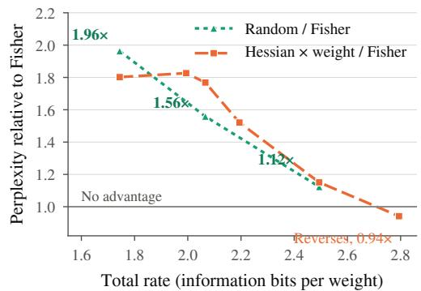

# ROLEQ: ROLE-ALIGNED SCALES FOR CONVERTINGLANGUAGE MODELS TO TERNARY

Johannes Knittel Harvard University

Alec Helbling Georgia Tech

Hanspeter Pfister Harvard University

## ABSTRACT

Weight quantization below four bits shrinks memory and bandwidth at a perplexity that looks acceptable, but often at the cost of factual knowledge and task accuracy. Ternary weights have mostly been obtained by training from scratch or long finetuning. We introduce RoleQ, a quantization framework that places scales by the functional roles of Transformer units rather than by the layout of the weight matrix, as conventional formats do. Vectors that read from the residual stream take one scale per output unit; those that write to it, one per input unit. The rule is structural, needs no search, calibration or stored state, and holds on integer and ternary grids. In a rotated basis it matches a per-layer axis search at half the solver work, and at ternary it cuts perplexity by up to half against layout-based placement in two families at every size from 0.6B to 14B, where per-row scales leave MMLU at chance. Our lightweight post-training pipeline converts an existing checkpoint to 1.59 bits per weight in a few GPU-hours, a fraction of the cost of learned ternarization, and leads every post-training ternary method at matched or lower memory-resident bits on perplexity, zero-shot accuracy and MMLU, most widely on knowledge. A sparse second ternary plane placed by a per-unit Fisher saliency keeps the matmul multiplication-free and recovers what ternary loses first: at 8B, a fraction of a bit returns about half the MMLU that conversion costs, well ahead of random or Hessian-based placement at equal bits.

## 1 INTRODUCTION

Weight memory and bandwidth constrain language-model deployment on phones and in browsers. At batch size one, decoding is typically bandwidth-bound, making bits per weight a key determinant of latency (Wang et al., 2025; Wei et al., 2025), motivating ultra-low-bit quantization. Below four bits, however, acceptable perplexity can conceal severe losses in factual knowledge and task accuracy. We therefore evaluate quantization with three complementary measures: WikiText2 perplexity, a seven-task zero-shot average and five-shot MMLU.

Ternary weights replace weight multiplications with additions and subtractions. Pretraining (Wang et al., 2023; Ma et al., 2024), quantization-aware training (Liu et al., 2025c), code fine-tuning (Malinovskii et al., 2024) and learned ternarization over many epochs (Wang et al., 2026c;b) preserve much of the model’s knowledge at substantial computational cost. Post-training conversion (Zhang et al., 2026; Yan et al., 2026a; Guo et al., 2026) is much cheaper but loses factual knowledge: on Qwen3-8B-Base, these methods score 26–35 on MMLU, versus 77 at full precision. The challenge is to approach training-based retention at post-training conversion cost.

Our central insight is that quantization should allocate bits by function. We introduce RoleQ, a format that assigns scales to functional units: vectors that read from the residual stream receive one scale per output unit; vectors that write to it receive one per input unit. This structural rule applies to integer and ternary grids and requires neither calibration data nor stored axis choices. RoleQ-T combines this format with a data-free learned rotation, ternary GPTQ (Frantar et al., 2023) with an exact per-vector step, and brief scale distillation with frozen codes (Figure 2). Qwen3- 8B-Base (Yang et al., 2025) reaches 1.59 bits per weight (bpw), 11.33 perplexity, 60.3 zero-shot accuracy and 47.6 MMLU in a few GPU-hours, a fraction of the tens of A100-hours for CAT-Q’s learned ternarization at this size (Section 4.1).

  
Figure 1: RoleQ aligns scales with the roles. (A) Readers read from the residual stream through rows, writers write to it through columns. (B) RoleQ places the scales on the unit axis, per row for readers and per column for writers, never on the stream axis. (C) Qwen3-14B, ternary at equal bits: the placement alone lifts MMLU from 25.4 (chance) with per-output-channel scales to 38.5.

Functional units also guide the allocation of extra bits. At a tight budget, selecting units by quantization-error magnitude can perform worse than random; per-unit Fisher saliency estimates how strongly each unit’s error affects the loss. RoleQ-T therefore optionally adds a sparse second ternary plane to Fisher-selected units, preserving multiplication-free matrix products. At 2.16 bpw, Qwen3-8B-Base reaches 9.30 perplexity, 65.9 zero-shot accuracy and 62.8 MMLU. On post-trained Qwen3-8B, 1.99 bpw surpasses CAT-Q on all three measures for 0.28 additional bits.

We make three contributions.

1. Role-aligned scale placement (Section 3.1). In a rotated basis, RoleQ matches AdaDim’s (Heo et al., 2024) reconstruction quality at half the solver work of a two-way search, without calibration data or stored axis choices. Per-vector INT4 matches MXFP4 at 8% fewer bits; ternary perplexity improves over the best uniform placement by up to 2×, with gains at every tested size from 0.6B to 14B across two families. At 14B, RoleQ raises MMLU from 25.4 (chance) with per-output-channel scales to 38.5.

2. Efficient ternary conversion (Sections 3.2–3.4). RoleQ-T outperforms Qronos, PT2-LLM and QTEA on all three measures at matched or lower memory-resident rates, with the largest gains on knowledge. At 14B, it surpasses QTEA’s released checkpoint after scale distillation using 0.67 fewer bpw. Applying the same distillation to PT2-LLM leaves it over four perplexity points behind at a higher rate.

3. Fisher-guided secondary planes (Section 3.5). At 8B, +0.57 bpw recovers about half the MMLU lost on Base. On the post-trained model at 1.99 bpw, Fisher selection beats random by 6.2 points and Hessian×weight by 9.0.

## 2 RELATED WORK

Ternary weights and conversion. Ternary weights {−1, 0, +1} date at least to Hwang & Sung (2014); ternary weight networks (Li et al., 2016) popularised the scaled ternary code with a threshold rule. Following binary BitNet (Wang et al., 2023), BitNet b1.58 (Ma et al., 2024) showed that language models pretrained with this alphabet can match full-precision counterparts at scale while enabling multiplication-free matrix products. Converting existing checkpoints avoids pretraining from scratch, but the computational cost varies. Quantization-aware training, distillation and code fine-tuning (Liu et al., 2025c; Wu et al., 2025; Malinovskii et al., 2024) still update weights or codes. Learned ternarization also involves sustained optimization: CAT-Q (Wang et al., 2026c) uses 512 calibration samples but optimises its codes for 60 epochs, while ScaleQ-1.58 (Wang et al., 2026b) uses the model’s own reasoning traces. Although CAT-Q is described as post-training quantization, we distinguish its extended code optimization from the lightweight conversion setting considered here. Direct post-training methods include Qronos (Zhang et al., 2026), PT2-LLM (Yan et al.,

  
Figure 2: The RoleQ-T pipeline. A data-free learned rotation precedes ternary GPTQ with an exact per-vector step, giving codes in {−1, 0, +1} (grey) and one scale per functional unit (blue). The dashed stages are optional: scale distillation refits scales with frozen codes, and Fisher planes add a sparse second plane to salient units (+0.57 bits here). Values below each stage are memory-resident bits per weight for Qwen3-8B-Base.

2026a), QTEA (Guo et al., 2026), PTQTP (Xiao et al., 2025b) and TWLA (Zhao et al., 2026). We compare these methods at memory-resident rates (Appendix Tables 4 and 5), since several report sub-2-bit code counts that exclude strictly necessary decoding metadata. TWLA’s released implementation requires 4.15–4.65 bpw, so it serves as a reference rather than a bit-matched baseline. PTQTP adds a second plane to every unit, while QTEA adds FP8 residuals to curvature-selected columns; neither allocates these extra bits using a per-unit loss-sensitivity score.

Two-bit formats. QuIP# (Tseng et al., 2024a) and QTIP (Tseng et al., 2024b) use lattice and trellis codebooks, respectively, achieving strong two-bit results on Llama. GuidedQuant’s loss-guided Hessian (Kim et al., 2025) and YAQA’s end-to-end adaptive rounding (Tseng et al., 2026) build on QTIP’s trellis codes. QTIP adopts QuIP#-style fine-tuning, reported at 50–100 GPU-hours for a 70B model. These methods provide strong quality references. Our format is scalar and codebook-free, and its ternary codes also support multiplication-free matrix products. For a comparison within this format class, our equal-bits controls reproduce the uniform grouped grids used by GPTQ (Frantar et al., 2023) and EfficientQAT (Chen et al., 2025).

Scale axis and rotation. Existing methods choose scale axes empirically or refine scales within a solver. AdaDim (Heo et al., 2024) selects per-input or per-output scales for each module through a reconstruction test without rotation, and reports lower quality when per-input scales are applied uniformly rather than selectively. ShiftAddLLM (You et al., 2024) refits column scales during the solver’s sweep; Z-FOLD (Jeon et al., 2023) adds a folded in-channel scale on a second axis, and D2Quant (Yan et al., 2026b) adds one for a single matrix type. We adopt Z-FOLD’s closed-form H-metric refit for readers. These methods use calibration data and do not derive scale placement from vector roles. RoleQ instead selects the axis structurally from each vector’s reader or writer role, without calibration or stored axis flags. Our rotations retain the slots and parametrization of QuaRot (Ashkboos et al., 2024) and SpinQuant (Liu et al., 2025b), using SpinQuant’s notation. OptRot (Gadhikar et al., 2025) and TWLA learn rotations without data, whereas HARP (Zagitov et al., 2026) learns a stored rotation from calibration data before codebook quantization. Our rotation contribution is the choice of objective, evaluated against those of OptRot and TWLA.

Saliency and mixed allocation. BiLLM (Huang et al., 2024) and ARB-LLM (Li et al., 2025) assign residual binary planes to columns selected by curvature scores. FGMP (Hooper et al., 2025) allocates precision using P g2δ2 with a single global percentile, an allocator we adopt at unit granularity. MixLLM (Zheng et al., 2026), SqueezeLLM (Kim et al., 2024) and TaCQ (Xiao et al., 2025a) use gradient, Fisher and task-conditioned scores. We condition our score on factual recall and find that, at tight budgets, curvature-based selection can perform worse than random placement.

## 3 METHOD

RoleQ places quantization scales by the functional roles of weight vectors on both integer and ternary grids (Section 3.1). RoleQ-T (Sections 3.2–3.4) converts an existing checkpoint to this ternary format in a few GPU-hours, combining a data-free learned rotation, GPTQ adapted to rolealigned scales and brief scale distillation with frozen codes. Optional Fisher-placed secondary planes (Section 3.5) allocate additional precision to units selected by loss sensitivity. Figure 2 summarises the pipeline. The placement rule is data-free, the solver and distillation use unlabeled data.

Preliminaries. A weight is reconstructed as $w \approx s \left( q - z \right)$ from an L-level code $q ,$ a scale s and an optional zero point z, shared by a group of weights. Standard placement uses one scale per output channel (per-OC), i.e. per row of an [out, in] matrix; per-input-channel (per-IC) scales index columns. Ternary codes represent $\{ - 1 , 0 , + \mathrm { { 1 } } \} \cdot s \mathrm { { a t } } \mathrm { { l o g } _ { 2 } 3 = \bar { 1 } . 5 8 5 }$ bpw before scale overhead; rates strictly between this and 2 bpw require non-power-of-two alphabets or mixed rates (Section 3.5). Round-to-nearest (RTN) fits grids from weights alone. Compensated solvers (Frantar & Alistarh, 2022; Frantar et al., 2023) estimate the input second moment $\mathbf { \bar { H } } = \mathbb { E } [ \pmb { x } \pmb { x } ^ { \top } ]$ from unlabelled documents and propagate rounding errors to unquantized coordinates. Rates count $\log _ { 2 }$ L bits per code plus all strictly necessary decoding metadata (resident bpw, Appendix A).

## 3.1 ROLEQ: ROLE-ALIGNED SCALES

RoleQ assigns one scale to each vector that reads from the residual stream (a row of $W _ { Q } , W _ { K }$ $W _ { V } , W _ { \mathrm { g a t e } } , W _ { \mathrm { i n } } )$ or writes to it (a column of $W _ { O } , W _ { \mathrm { o u t } } )$ . This rule follows a mechanistic view of the Transformer: the residual stream is a shared communication channel, and components access it through dense read and write vectors. An MLP neuron has read vectors in $W _ { \mathrm { i n } }$ and $W _ { \mathrm { g a t e } }$ and a write vector in $W _ { \mathrm { o u t } }$ , corresponding to the key and value of Geva et al. (2021). Attention reads through Q/K/V rows and writes through O columns, forming the QK and OV circuits of Elhage et al. (2021). These vectors interact through the stream (Knittel & Pfister, 2026); each has a magnitude, direction and functional role. Assigning each vector its own scale separates its magnitude from the direction approximated by its quantization codes. In contrast, a scale per residual coordinate (per-OC on writers, per-IC on readers) couples unrelated units through a shared coordinate. RoleQ therefore aligns the quantization grid with the network’s functional decomposition. In a rotated residual basis, this distinction remains intact: the rotation mixes stream coordinates while preserving the unit axis (Section 3.2).

Standard per-OC placement suits row-major storage and W8A8 accumulators. Weight-only decoding also permits input-axis scales, applied to activations once per token at $O ( d )$ cost for input width $d ,$ though per-IC placement has remained rare. Prior methods choose the axis by layout or search rather than function. RoleQ uses one rule on integer and ternary grids, readers scale per output unit, writers per input unit (Figure 1), with no search, calibration pass or stored per-layer flag. Writer scales lie on the solver’s sweep axis, requiring the adaptation in Section 3.3. At inference, they simply rescale the input activations.

## 3.2 ROTATIONS

RoleQ-T rotates weights before quantization using QuaRot’s rotation slots in SpinQuant’s notation (Ashkboos et al., 2024; Liu et al., 2025b): $r _ { 1 }$ on the residual basis, $r _ { 2 }$ mixing $\mathrm { V } {  } \mathrm { O }$ per key/value head, and $r _ { 4 }$ on the MLP intermediate dimension (Appendix F). Rotations reduce the impact of outliers on low-bit quantization (Chee et al., 2023; Ashkboos et al., 2024; Liu et al., 2025b): a random Hadamard alone lowers 1.7B ternary PTQ perplexity from 1245.9 to 119.8. We therefore use a rotated residual basis throughout our quantization runs, placement controls and rerun baselines; only the basis control includes unrotated models. Our contribution concerns the rotation objective. We learn $s _ { 1 }$ and $s _ { 2 }$ in the $r _ { 1 }$ and $r _ { 2 }$ slots from weights alone, without calibration, and compare three objectives: opt, the exact ternary reconstruction error $\begin{array} { r } { \sum _ { \pmb { w } } \operatorname* { m i n } _ { a , t } \| \pmb { w } - a \pmb { t } \| ^ { 2 } = } \end{array}$ $\textstyle \sum _ { \pmb { w } } \big ( \| \pmb { w } \| ^ { 2 } - \operatorname* { m a x } _ { S } ( \sum _ { i \in S } | w _ { i } | ) ^ { 2 } / | S | \big )$ over rotated reader and writer vectors $( \mathrm { E q . 1 } )$ , differentiable almost everywhere; l4, OptRot’s fourth-power $( \ell _ { 4 } )$ objective, a kurtosis proxy (Gadhikar et al., 2025); and trigmm, TWLA’s tri-modal shaping (Zhao et al., 2026). For $s _ { 1 } .$ , opt achieves the lowest weight-space error but worse perplexity than l4 (130.3 versus 89.99 at 1.7B; Appendix G). The recipe uses $s _ { 1 } ( \mathrm { l } 4 ) + s _ { 2 } ( \mathrm { o p t } ) + r _ { 4 }$ , reducing 8B perplexity by a further factor of 1.38 relative to random Hadamard rotation. These rotations add 0 bpw and fold into the weights, apart from $r _ { 4 } { ' } s$ runtime Hadamard. The placement rule is defined in this rotated basis: $r _ { 1 }$ mixes residual-stream coordinates and leaves RoleQ’s scale axis untouched.

## 3.3 TERNARY GPTQ: THE ROLEQ-T SOLVER

RoleQ-T adapts GPTQ (Frantar et al., 2023) to approximately minimise the reconstruction objective $\operatorname { t r } [ ( \mathbf { W } - \hat { \mathbf { W } } ) \mathbf { H } ( \mathbf { W } - \hat { \mathbf { W } } ) ^ { \top } ]$ , where Wˆ reconstructs W and H is its input second moment. GPTQ sweeps input coordinates, quantizes each column and propagates its error to the remaining columns.

We adapt the per-vector ternary fit and its position within this sweep (derivations and settings in Appendix D). Both reader and writer kernels use an exact vector fit, but at different stages.

For a nonzero vector w, scale a, ternary codes t and nonempty support S (the nonzero codes), the joint optimum of min $\mathbf { \Delta } _ { \mathbf { l } \alpha , t } \parallel \mathbf { w } - a t \parallel ^ { 2 }$ is

$$
t = \mathrm { s i g n } ( \pmb { w } ) \odot [ | \pmb { w } | > \tau ] , \qquad \pmb { a } ^ { \star } ( \pmb { S } ) = \frac { 1 } { | \pmb { S } | } \sum _ { i \in \pmb { S } } | \pmb { w } _ { i } | , \qquad \pmb { S } ^ { \star } = \arg \operatorname* { m a x } _ { \pmb { S } } \frac { \left( \sum _ { i \in \pmb { S } } | \pmb { w } _ { i } | \right) ^ { 2 } } { | \pmb { S } | } ,\tag{1}
$$

where ⊙ denotes elementwise multiplication, [·] the indicator, and S ranges over nonempty prefixes of |w| sorted in descending order. The threshold τ selects $S ^ { \star }$ (Yin et al., 2019; Hou & Kwok, 2018); TWN instead fixes $\tau = 0 . 7$ · mean|w| (Li et al., 2016). The corresponding exact grid search handles integer grids and the four-level INT2-g128 control, replacing the min/max placement that LeanQuant and NeUQI replace by a search over candidate grids (Zhang & Shrivastava, 2025; Lin et al., 2026). All placements in Table 2 thus share one code path.

With $\mathbf { W } \in \mathbb { R } ^ { m \times d }$ in [out, in] layout, codes T and scales a (rows for readers, columns for writers),

$$
\hat { \bf W } = \mathrm { d i a g } ( { \pmb a } ) { \bf T } \enspace \mathrm { ( r e a d e r s ) } , \qquad \hat { \bf W } = { \bf T } \mathrm { d i a g } ( { \pmb a } ) \enspace \mathrm { ( w r i t e r s ) } ,\tag{2}
$$

so writer scales lie on the sweep axis and reader scales on the orthogonal axis. At writer column $j , \mathrm { G P T Q }$ has compensated the entire vector for previous rounding errors. Equation 1 jointly fits its scale $a _ { j }$ and codes $t _ { j } ,$ , then GPTQ propagates the error to subsequent columns. For readers, each step touches one coordinate per row; re-searching a row’s support would revisit already quantized entries. We therefore initialise each row’s grid $\check { \{ - a _ { i } , 0 , a _ { i } \} }$ using Eq. 1 and hold it fixed during the sweep. Since the objective separates across rows, we then refit each scale at the final codes as $a _ { i } ^ { \star } = t _ { i } ^ { \top } \mathbf { H } w _ { i } / t _ { i } ^ { \top } \mathbf { H } t _ { i }$ . This refit cannot increase the reconstruction error and preserves per-unit ternary weights. Exactness applies to the vector fits and refits; the overall sweep remains greedy.

## 3.4 SCALE DISTILLATION

Scale distillation (+SD) refits only the scales, parametrised as log a, and norm gains, 0.02–0.08% of the parameters depending on model size and plane budget (0.024% for the 8B body). It minimises KL divergence from the full-precision teacher’s next-token distribution while keeping codes frozen, preserving the per-unit ternary format. Before quantization, rotation folds RMSNorm’s percoordinate gains into adjacent weights. SD reintroduces a trainable gain vector at each norm site (two per block and the final norm, +0.0007 bpw), initialised to one, allowing the student to rescale residual coordinates. We use only unlabelled data: 400 steps at batch size 8, or 3,200 windows of 512 tokens from RedPajama-1T-Sample. The teacher’s final residuals are cached once during quantization and mapped to logits by its frozen output head, avoiding teacher forward passes during SD. At 8B, the stage takes 2 h on one A100 (Appendix D), against 8–64 A100-hours for CAT-Q’s 60- epoch stage at this size and 160 for ScaleQ-1.58’s (Wang et al., 2026c;b); QuIP#-style fine-tuning, which QTIP adopts, is reported at about 100 A100-hours for a 70B model (Tseng et al., 2024a;b), and PV-Tuning reports days on eight GPUs at 70B (Malinovskii et al., 2024). Applying the same SD to a baseline in Section 4.1 tests whether distillation alone explains the recipe’s advantage.

## 3.5 FISHER-PLACED SPARSE SECONDARY PLANES

Sparse secondary planes target the task accuracy and factual knowledge lost in ternary conversion. Existing methods add precision more broadly or on a fixed axis. PTQTP (Xiao et al., 2025b) gives every weight a second ternary plane. TWLA’s released code (Zhao et al., 2026), which matches its reported perplexity and task numbers, adds a second plane to 26% of weights, unmentioned in the paper; and QTEA (Guo et al., 2026) adds FP8 residuals to salient columns, the latter two using layer-local saliency. We instead select whole functional units by loss sensitivity: the scaled vectors of Eq. 2, in every matrix the rows of a reader or the columns of a writer, i.e., neurons and attention dimensions that read from or write to the residual stream. Each selected unit receives a second ternary code and scale on the same axis, $\pmb { \hat { w } } = a _ { 1 } \pmb { t } _ { 1 } + a _ { 2 } \pmb { t } _ { 2 }$ , fitted by the same GPTQ to the residual ${ \pmb w } - a _ { 1 } { \pmb t } _ { 1 }$ . This represents up to nine levels with $2 \log _ { 2 } 3$ code bits per weight and evaluates as two ternary matmuls and an addition (Appendix E).

We rank units by a Fisher-weighted saliency, a second-order proxy for the loss increase from oneplane quantization (LeCun et al., 1990), with the diagonal empirical Fisher in place of the loss

Hessian as in Fisher pruning and SqueezeLLM (Theis et al., 2018; Kim et al., 2024). It weights errors by their effect on the target loss, whereas GPTQ’s H measures layer-local reconstruction error. Let ${ \mathcal { L } } _ { n }$ be the mean per-token negative log-likelihood of item n’s target tokens (a factual answer or the second half of a text window) given the preceding tokens. Define $\begin{array} { r } { F _ { i } = \frac { 1 } { N } \sum _ { n } ( \partial \mathcal { L } _ { n } / \partial w _ { i } ) ^ { 2 } } \end{array}$ for weight $w _ { i }$ in the rotated full-precision model. The saliency of unit u is

$$
S _ { u } = \sum _ { i \in u } F _ { i } \delta _ { i } ^ { 2 } , \qquad \delta = \pmb { w } - a ^ { \star } \pmb { t } ,\tag{3}
$$

where $\pmb { \delta }$ is the residual of the exact one-plane fit in Eq. 1, which the second plane targets. The score uses observed-target gradients as a sensitivity proxy, not an exact estimate of recoverable loss. We rank units of both roles across all layers and matrix kinds by $S _ { u }$ and give the top K a second plane, testing this common ranking in Section 4.3.

The number K of selected units sets the rate in unit-sized steps from 1.590 to 3.179 bpw (two planes everywhere) with the same kernel; we set it from a target of 1.994 bpw for post-trained models and 2.156 for Base (the INT2-g128 rate), or from a baseline’s rate.

The items used to accumulate the Fisher determine its sensitivity. C4 calibration windows yield a text Fisher; 720 factual-recall items (MMLU-style multiple choice, TriviaQA cloze and ARC; Hendrycks et al., 2021; Joshi et al., 2017; Clark et al., 2018), rendered through the chat template and drawn with a seed disjoint from our in-house probe, yield a knowledge Fisher. The ranking selects units, not weights, so these items decide where a plane goes but never what it stores. We independently vary the item set and the scoring checkpoint (the Base model or its post-trained sibling). Ranking agreement across two disjoint item halves measures stability: Spearman correlations range from 0.87 to 0.98 (Appendix E).

## 4 EXPERIMENTS

Models and data. We quantize Qwen3-0.6B, 1.7B, 8B and 14B Base and post-trained Qwen3- 1.7B and 8B (Yang et al., 2025), with Llama-3.1-8B-Base (Grattafiori et al., 2024) as a cross-family check and Llama-3.1-8B-Instruct as the matched-bits comparison with QTIP’s and GuidedQuant’s released checkpoints (Appendix Table 10). Base calibration uses 512 unlabelled C4 sequences of 512 tokens (Raffel et al., 2020). Post-trained models use 272 chat sequences of up to 1536 tokens, half UltraChat conversations (Ding et al., 2023) and half self-generated responses.

Evaluation. We report WikiText2 perplexity, the average of seven zero-shot tasks (PIQA, ARC-Easy, ARC-Challenge, HellaSwag, WinoGrande, BoolQ and OpenBookQA; Bisk et al., 2020; Clark et al., 2018; Zellers et al., 2019; Sakaguchi et al., 2020; Clark et al., 2019; Mihaylov et al., 2018) under lm-eval (Gao et al., 2026), and five-shot MMLU (Hendrycks et al., 2021). These measures capture complementary effects: modest perplexity changes can accompany substantial losses in factual knowledge (Jaiswal et al., 2024), which perplexity measures only coarsely and quantization degrades on its own axis (Namburi et al., 2023; Wang et al., 2026a), while matching aggregate scores can conceal disagreement on individual predictions (Dutta et al., 2024).

Comparison protocol. We report memory-resident information bits, including decoding metadata, name rate and stage differences, evaluate baseline reruns and released checkpoints in our harness against published results, and treat our seed spreads as descriptive. Further details are given in Appendix B.

## 4.1 TERNARY CONVERSION RECIPE

We first ask what quality a few GPU-hours of ternary conversion can retain. Table 1 compares RoleQ-T with ternary methods whose outputs we could evaluate and memory-resident rates establish (Qronos, PT2-LLM, QTEA, CAT-Q and TWLA; Zhang et al., 2026; Yan et al., 2026a; Guo et al., 2026; Wang et al., 2026c; Zhao et al., 2026), using each baseline’s best available stage. On Qwen3- 8B-Base, RoleQ-T reaches 1.590 bpw with scale distillation in three to four A100 hours, and 2.157 bpw with probing and planes in under ten. Four-level (INT2) grids provide a separate equal-bits comparison in Sections 4.2 and 4.3.

At 1.590 bpw, RoleQ-T after scale distillation leads Qronos, PT2-LLM and QTEA on all three measures while using matched or fewer bits: the baselines require 1.591, 1.835 and 2.281 bpw, respectively. Adding planes improves all three scores further, still below QTEA’s rate. Knowledge retention distinguishes these methods particularly clearly. Without our distillation, the baselines score 25.9–34.8 on MMLU, close to or modestly above 25% chance accuracy and far below 76.8 at full precision. RoleQ-T retains 47.6 at 1.590 bpw and 62.8 at 2.157 (56.0 before distillation). Perplexity alone therefore gives an incomplete account of the knowledge lost during conversion.

Two comparisons delimit this result. First, shared scale distillation does not close the gap: applying it to PT2-LLM’s codes yields 15.51 perplexity at 1.835 bpw, versus 11.33 for RoleQ-T at 1.590 (Table 1). The advantage thus survives the same distillation procedure, although the quantization recipes differ. Second, comparison with learned ternarization entails a budget trade-off. CAT-Q optimises its codes for 60 epochs on 512 C4 samples, 8–64 A100-hours at 8B by its own bracket (Appendix A), and its released checkpoint scores 52.9 MMLU at 1.71 bpw on post-trained Qwen3- 8B on our harness. Our planes reach 61.8 at 1.99 bpw in under ten GPU-hours: +8.9 points for 0.28 additional bits. At CAT-Q’s own 1.71 bpw, the corresponding RoleQ-T-g128 leads it on perplexity (17.00 vs 27.68) and narrowly on zero-shot (61.7 vs 61.0) and ties on MMLU (53.1 vs 52.9).

The gains extend to 14B. With planes and scale distillation, RoleQ-T reaches 8.05 perplexity (1.26× full precision), 69.2 zero-shot and 68.3 MMLU at 2.156 bpw, versus 11.78, 56.6 and 47.8 for QTEA’s released checkpoint at 2.26. At the matched PTQ stage, before distillation, the planes run still leads on all three measures (10.11, 65.7 and 62.0), with each gap at least 19× our seed range. This includes WikiText2, QTEA’s calibration corpus. The one-plane run at 1.589 bpw also leads after distillation (9.53 / 65.4 / 59.7), saving 0.67 bpw, but trails at PTQ. The lower-rate advantage therefore depends on distillation; the planes advantage holds at both stages. TWLA (Zhao et al., 2026) is a higher-rate reference: it releases no checkpoint, and its released code, which reproduces its reported Qwen3-8B perplexity, builds a masked two-plane model its paper does not describe, resident at 4.15–4.65 bpw, roughly twice our planes rate (Table 1, Appendix A). Section 5 discusses the stronger trellis-coded results at matched bits on Llama-3.1-8B-Instruct (Appendix Table 10).

## 4.2 THE PLACEMENT RULE

Table 2 isolates scale placement: within each grid and model, the placements share the solver, random Hadamard $r _ { 1 }$ , calibration draw and paired seeds, with no distillation. At ternary, RoleQ has the lowest mean perplexity at every tested size in both families, improving on the best uniform placement by up to 2×, with the same ordering on every seed from 1.7B upward. At 14B, the gain also appears on both task measures: 52.3 versus 45.6 zero-shot and 38.5 versus chance-level 25.4 MMLU for per-OC (Appendix Table 7). The 0.6B and Qwen-8B perplexity gaps remain within the largest seed range. Integer grids show the same mean perplexity ordering, but the margin depends on alphabet size and model. On the four-level grid, the best uniform placement has 1.19× RoleQ’s perplexity at 1.7B and 1.22× on Llama-8B, versus about 1.01× at Qwen-8B and 14B. At INT3 and INT4, the largest gains occur at 1.7B: ratios of 2.19× and 1.14×, respectively. Placement thus matters most at ternary, where the per-unit scale is a unit’s only continuous degree of freedom; here the benefit persists to the largest tested model in each family. Two practical comparisons follow. RoleQ-INT4 matches or improves on MXFP4 (Open Compute Project, 2023; Rouhani et al., 2023) perplexity at 0.6B, 1.7B and 8B while using 8% fewer bits (information bits, Appendix A). The rule also comes within 0.023% of AdaDim’s (Heo et al., 2024) searched H-metric reconstruction error at half the solver work of a two-way GPTQ search, without calibration data for axis selection or stored axis flags. This is a reconstruction comparison, not an end-to-end AdaDim evaluation. Appendix C controls for codes, scale count and fitting procedure, and shows that the rule’s advantage depends on rotation.

## 4.3 SPARSE SECONDARY PLANES

Secondary planes recover much of the knowledge lost in single-plane conversion for a fraction of a bit. At 8B, +0.57 bpw of text-Fisher planes recovers about half the MMLU loss: scores rise from 33.3 to 56.0 at PTQ and from 47.6 to 62.8 after scale distillation, against 76.8 at full precision. After distillation, perplexity improves from 11.33 to 9.30 (Appendix Table 9). At 14B, planes raise MMLU from 44.7 to 62.0 at PTQ and from 59.7 to 68.3 after distillation, with zeroshot gains of 10.2 and 3.8 points. All six 14B gains exceed four seed ranges, but five are smaller than their 8B counterparts (Table 1), suggesting greater benefit where single-plane conversion loses more quality. Placement determines how much this budget recovers (Table 3). At 1.99 bpw on posttrained Qwen3-8B, knowledge-Fisher selection beats random placement by 6.2 MMLU points and Hessian×weight by 9.0; the latter falls below random. On post-trained 1.7B, the full selector set separates by score family (Appendix Table 12): loss-sensitivity scores yield 9.7–10.3 PTQ perplexity, versus 13.7–17.9 for error-magnitude scores, with random placement in the latter range. The 1.7B budget sweep supports this distinction: random placement’s perplexity relative to Fisher falls from 1.96× at +0.15 bits to 1.12× at +0.9 (Appendix Figure 3).

Table 1: RoleQ-T leads the tested post-training ternary baselines below 2.3 bpw. WikiText2 perplexity, seven-task zero-shot average and five-shot MMLU; baselines at their best available stage, ours at PTQ and after scale distillation (+SD), mean of two seeds ± half-range. TWLA (higher rate) and CAT-Q (learned) are references. Planes use the text Fisher on Base models and the knowledge Fisher on the post-trained model.
<table><tr><td>Method</td><td>Stage</td><td>claimed bpw resident bpw</td><td></td><td>WT2 ppl↓</td><td>Zero-shot ↑</td><td>MMLU↑</td></tr><tr><td>Qwen3-8B-Base</td><td>fp16: 6.99 / 70.42 / 76.82</td><td></td><td></td><td></td><td></td><td></td></tr><tr><td>one ternary plane Qronos + HIP + MagR</td><td>PTQ</td><td>1.58</td><td>1.591</td><td>22.80</td><td>46.67</td><td>25.93</td></tr><tr><td>PT2-LLM</td><td>PTQ</td><td>1.58</td><td>1.835</td><td>67.95</td><td>44.88</td><td>26.52</td></tr><tr><td>PT2-LLM codes + our SD</td><td>+SD</td><td>1.58</td><td>1.835</td><td>15.51</td><td>56.37</td><td>36.74</td></tr><tr><td>RoleQ-T (ours)</td><td>PTQ</td><td>1.585</td><td>1.590</td><td> $2 2 . 4 2 \pm 0 . 2 2$ </td><td> $5 0 . 3 9 \pm 0 . 0 9$ </td><td> $3 3 . 3 2 \pm 1 . 4 8$ </td></tr><tr><td>RoleQ-T (ours)</td><td>+SD</td><td>1.585</td><td>1.590</td><td> ${ \bf 1 1 . 3 3 \pm 0 . 0 6 }$ </td><td> ${ \bf 6 0 . 3 3 \pm 0 . 2 7 }$ </td><td> ${ \pm 7 . 5 9 \pm 2 . 7 2 }$ </td></tr><tr><td>a second (sparse) plane</td><td></td><td></td><td></td><td></td><td></td><td></td></tr><tr><td>QTEA</td><td>PTQ</td><td>1.70</td><td>2.281</td><td>15.66</td><td>50.60</td><td>34.82</td></tr><tr><td>RoleQ-T + planes (ours)</td><td>PTQ</td><td>2.156</td><td>2.157</td><td> $1 1 . 3 2 \pm 0 . 0 1$ </td><td> $5 9 . 5 1 \pm 0 . 3 0$ </td><td> $5 6 . 0 4 \pm 0 . 0 3$ </td></tr><tr><td>RoleQ-T + planes (ours)</td><td>+SD</td><td>2.156</td><td>2.157</td><td> ${ \bf 9 . 3 0 \pm 0 . 0 2 }$ </td><td> ${ \bf 6 5 . 8 9 \pm 0 . 3 4 }$ </td><td>62.75 ± 0.41</td></tr><tr><td>TWLA, released code</td><td>PTQ</td><td>1.58</td><td>4.15-4.65</td><td>9.03</td><td>65.11</td><td>62.72</td></tr><tr><td colspan="5">Qwen3-8B post-trained fp16: 9.72 / 69.36 / 74.93</td><td></td><td></td></tr><tr><td>CAT-Q (learned, 60 epochs) learned</td><td></td><td>1.58</td><td>1.710</td><td>27.68</td><td>61.03</td><td>52.92</td></tr><tr><td>RoleQ-T, one plane (ours)</td><td>+SD</td><td>1.585</td><td>1.590</td><td> $1 9 . 5 9 \pm 1 . 5 8$ </td><td> $5 9 . 9 6 \pm 0 . 3 2$ </td><td> $4 8 . 4 1 \pm 1 . 4 6$ </td></tr><tr><td>RoleQ-T-g128 (ours)</td><td>+SD</td><td>1.710</td><td>1.711</td><td> $1 7 . 0 0 \pm 0 . 2 0$ </td><td>6  $1 . 6 7 \pm 0 . 0 3$ </td><td> $5 3 . 1 0 \pm 0 . 1 5$ </td></tr><tr><td>RoleQ-T + planes (ours)</td><td>+SD</td><td>1.994</td><td>1.990</td><td> ${ \bf 1 5 . 3 0 \pm 0 . 3 6 }$ </td><td> ${ \bf 6 4 . 5 7 \pm 0 . 2 8 }$ </td><td> ${ \bf 6 1 . 8 2 \pm 0 . 1 5 }$ </td></tr><tr><td>TWLA</td><td>PTQ</td><td>1.58</td><td>4.15–4.65</td><td>12.56</td><td>62.97</td><td>62.78</td></tr><tr><td colspan="5">Qwen3-14B-Base fp16: 6.38 / 73.39 / 80.66</td><td></td><td></td></tr><tr><td>RoleQ-T (ours)</td><td>PTQ</td><td>1.585</td><td>1.589</td><td> $1 8 . 1 0 \pm 0 . 4 2$ </td><td> $5 5 . 5 0 \pm 1 . 1 1$ </td><td> $4 4 . 7 2 \pm 0 . 4 1$ </td></tr><tr><td>RoleQ-T (ours)</td><td>+SD</td><td>1.585</td><td>1.589</td><td> ${ \bf 9 . 5 3 \pm 0 . 0 5 }$ </td><td> ${ \bf 6 5 . 3 7 \pm 0 . 0 3 }$ </td><td> ${ \bf 5 9 . 7 5 \pm 0 . 2 0 }$ </td></tr><tr><td>QTEA, released checkpoint</td><td>PTQ</td><td>1.70</td><td>2.257</td><td>11.78</td><td>56.62</td><td>47.75</td></tr><tr><td>RoleQ-T + planes (ours)</td><td>PTQ</td><td>2.156</td><td>2.156</td><td> $1 0 . 1 1 \pm 0 . 0 4$ </td><td> $6 5 . 6 9 \pm 0 . 2 0$ </td><td> $6 2 . 0 0 \pm 0 . 3 4$ </td></tr><tr><td>RoleQ-T + planes (ours)</td><td>+SD</td><td>2.156</td><td>2.156</td><td> ${ \bf 8 . 0 5 \pm 0 . 0 4 }$ </td><td> ${ \bf 6 9 . 2 1 \pm 0 . 0 1 }$ </td><td> ${ \bf 6 8 . 3 1 \pm 0 . 1 5 }$ </td></tr></table>

At matched bits, the comparison with four-level grids depends on size and basis (Table 2; Appendix Table 11). Under $r _ { 1 } .$ , standard per-OC INT2-g128 has 1.48× and 1.29× the planes run’s perplexity at 0.6B and 1.7B. In the recipe basis, the corresponding ratios are 1.039× at Qwen-8B and 1.27× at Llama-8B PTQ. Planes also outperform the stronger role-placed grid at 0.6B, at Qwen-8B PTQ and on Llama at both stages. At 14B, however, four-level grids lead under $r _ { 1 }$ (10.76 and 10.90 versus 12.19), so neither format dominates across sizes. On task accuracy, Llama’s PTQ gains over per-OC exceed the seed spread (+2.9 zero-shot, +10.7 MMLU). Qwen’s PTQ task differences have spli signs and lie within one seed range; after distillation, the MMLU gain is +2.4 points but remains below three ranges. Ternary planes thus offer competitive quality at equal bits while retaining a multiplication-free matmul with no codebook or group metadata.

## 5 CONCLUSION

We introduced RoleQ, which assigns quantization scales to functional units, and RoleQ-T, which converts existing checkpoints to ternary in a few GPU-hours. Two findings stand out. First, the Transformer’s division of labour into readers and writers provides a structural rule for scale placement. In a rotated basis, this rule requires no axis search, calibration data or stored axis choices, and its benefits persist to the largest models tested. Second, post-training conversion can retain useful task accuracy below two bits per weight. RoleQ-T outperforms the tested ternary conversion baselines at matched or lower memory-resident rates, with the largest gains in factual knowledge, which perplexity alone does not capture. Fisher-guided secondary planes further recover knowledge by directing a fraction of a bit to loss-sensitive units. Together, these results offer a practical route to lower memory use and multiplication-free ternary matrix products while preserving useful model capabilities.

Table 2: Role-aligned scale placement achieves the lowest perplexity over fixed per-channel placement. WikiText2 perplexity at four Qwen3-Base sizes and Llama-3.1-8B-Base, under matched PTQ settings (random Hadamard $r _ { 1 } )$ . Mean of two (4 four) seeds ± half-range; lower is better.
<table><tr><td colspan="2"></td><td colspan="4">Qwen3-Base</td><td rowspan="2">Llama-8B</td></tr><tr><td>Configuration</td><td>bpw</td><td>0.6B</td><td>1.7B</td><td>8B</td><td>14B</td></tr><tr><td>fp16</td><td>16.000</td><td>12.66</td><td>9.39</td><td>6.99</td><td>6.38</td><td>6.30</td></tr><tr><td>Ternary: per-OC</td><td>1.590</td><td> $3 8 7 . 2 \pm 3 4 . 0$ </td><td> $2 2 2 . 3 \pm 8 . 0$ </td><td> $3 5 . 4 7 \pm 0 . 5 2$ </td><td> $3 7 . 8 9 \pm 0 . 6 5$ </td><td> $1 1 4 . 4 \pm 8 . 6$ </td></tr><tr><td>Ternary: per-IC</td><td>1.590</td><td> $1 1 8 7 \pm 2 2 6$ </td><td> $3 0 5 . 0 \pm 1 9 . 8$ </td><td> $3 3 . 3 9 \pm 1 . 7 0 ^ { 4 }$ </td><td> $4 2 . 6 0 \pm 0 . 4 8$ </td><td> $6 6 9 . 9 \pm 2 8 . 1$ </td></tr><tr><td>Ternary: RoleQ (ours)</td><td>1.590</td><td> ${ \bf 3 5 1 . 9 \pm 2 1 . 8 }$ </td><td> ${ \bf 1 3 6 . 2 \pm 8 . 8 }$ </td><td> ${ \bf 3 1 . 2 8 \pm 0 . 7 7 ^ { 4 } }$ </td><td> ${ \bf 2 5 . 2 5 \pm 0 . 3 4 }$ </td><td> ${ \bf 5 8 . 1 3 \pm 2 . 2 9 }$ </td></tr><tr><td>INT2-g128: per-OC</td><td>2.156</td><td> $7 9 . 8 7 \pm 1 . 6 5$ </td><td> $3 7 . 8 7 \pm 0 . 4 5$ </td><td> $1 3 . 1 1 \pm 0 . 0 8 ^ { 4 }$ </td><td> $1 0 . 9 0 \pm 0 . 0 5$ </td><td> $4 9 . 7 \pm 1 4 . 0$ </td></tr><tr><td>INT2-g128: per-IC</td><td>2.156</td><td> $1 3 9 . 1 \pm 9 . 7$ </td><td> $4 1 . 4 3 \pm 1 . 3 0$ </td><td> $1 3 . 8 3 \pm 0 . 1 0$ </td><td> $1 1 . 6 4 \pm 0 . 0 5$ </td><td> $2 3 . 2 8 \pm 0 . 8 1$ </td></tr><tr><td>INT2-g128: RoleQ (ours)</td><td>2.156</td><td> $7 7 . 5 5 \pm 0 . 6 7$ </td><td> $3 1 . 7 9 \pm 0 . 5 8$ </td><td> $1 2 . 9 3 \pm 0 . 1 2$ </td><td> ${ \bf 1 0 . 7 6 \pm 0 . 0 1 }$ </td><td> $1 9 . 1 5 \pm 0 . 0 9$ </td></tr><tr><td>Ternary + planes (ours)</td><td>2.157</td><td> ${ \pm } 3 . 9 6 \pm 1 . 4 3$ </td><td> ${ \bf 2 9 . 4 1 \pm 0 . 9 2 }$ </td><td> ${ \bf 1 } 2 . { \bf 8 } 3 \pm { \bf 0 . 0 5 }$ </td><td> $1 2 . 1 9 \pm 0 . 1 4$ </td><td> ${ \bf 1 5 . 3 9 \pm 0 . 0 8 }$ </td></tr><tr><td>INT3: per-OC</td><td>2.810</td><td> $1 9 . 8 9 \pm 0 . 0 9$ </td><td> $3 3 . 7 6 \pm 0 . 2 1$ </td><td> $7 . 9 7 \pm 0 . 0 2$ </td><td> $7 . 1 7 \pm 0 . 0 1$ </td><td> $8 . 2 9 \pm 0 . 0 2$ </td></tr><tr><td>INT3: per-IC</td><td>2.810</td><td> $2 5 . 5 2 \pm 0 . 5 7$ </td><td> $2 5 . 9 8 \pm 0 . 3 8$ </td><td> $8 . 1 7 \pm 0 . 0 1$ </td><td> $8 . 0 8 \pm 0 . 0 1$ </td><td> $9 0 . 9 \pm 6 . 6$ </td></tr><tr><td>INT3: RoleQ (ours)</td><td>2.810</td><td> ${ \bf 1 9 . 2 4 \pm 0 . 0 4 }$ </td><td> ${ \bf 1 1 . 8 7 \pm 0 . 0 0 }$ </td><td> ${ \bf 7 . 9 5 \pm 0 . 0 2 }$ </td><td> ${ \bf 7 . 1 6 \pm 0 . 0 1 }$ </td><td> ${ \bf 8 . 1 2 \pm 0 . 0 3 }$ </td></tr><tr><td>INT4: per-OC</td><td>3.910</td><td> $1 3 . 9 9 \pm 0 . 0 3$ </td><td> $1 1 . 2 9 \pm 0 . 0 4$ </td><td> $7 . 2 4 \pm 0 . 0 3$ </td><td> $6 . 5 6 \pm 0 . 0 1$ </td><td> $6 . 7 2 \pm 0 . 0 0$ </td></tr><tr><td>INT4: per-IC</td><td>3.910</td><td> $1 5 . 1 6 \pm 0 . 0 4$ </td><td> $1 1 . 8 1 \pm 0 . 0 5$ </td><td> $7 . 2 5 \pm 0 . 0 1$ </td><td> $6 . 6 7 \pm 0 . 0 0$ </td><td> $7 . 5 5 \pm 0 . 0 1$ </td></tr><tr><td>INT4: RoleQ (ours)</td><td>3.910</td><td> ${ \bf 1 } 3 . 8 6 \pm { \bf 0 . 0 4 }$ </td><td> ${ \bf 9 . 9 0 \pm 0 . 0 2 }$ </td><td> $7 . 2 0 \pm 0 . 0 3$ </td><td> ${ \bf 6 . 5 3 \pm 0 . 0 1 }$ </td><td> ${ \bf 6 . 7 0 \pm 0 . 0 0 }$ </td></tr><tr><td>MXFP4: block of 32</td><td>4.250</td><td> $1 4 . 1 2 \pm 0 . 0 1$ </td><td> $1 0 . 1 0 \pm 0 . 0 0$ </td><td> ${ \bf 7 . 1 9 \pm 0 . 0 1 }$ </td><td> $6 . 5 4 \pm 0 . 0 1$ </td><td> $6 . 7 9 \pm 0 . 0 0$ </td></tr></table>

Table 3: Our Fisher selector outperforms random and Hessian-based selection at matched bit rates. Results on post-trained Qwen3-8B after scale distillation (two seeds, ± half-range).
<table><tr><td>Configuration / Score</td><td>Total bpw</td><td> $\mathrm { W i k i T e x t - } 2 \ : \mathrm { P P L } \downarrow$ </td><td> $7 . \mathrm { { T a s k } } Z \mathrm { { e r o - } } \mathrm { { S h o t } } \mathrm { { A v g . } } \uparrow$ </td><td>MMLU↑</td></tr><tr><td>One Plane</td><td>1.590</td><td> $1 9 . 5 9 \pm 1 . 5 8$ </td><td> $5 9 . 9 6 \pm 0 . 3 2$ </td><td> $4 8 . 4 1 \pm 1 . 4 6$ </td></tr><tr><td>Hessian × Weight</td><td>1.988</td><td> $1 7 . 6 8 \pm 0 . 1 4$ </td><td> $6 2 . 3 2 \pm 0 . 1 9$ </td><td> $5 2 . 8 0 \pm 0 . 1 7$ </td></tr><tr><td>Random Units</td><td>1.991</td><td> $1 5 . 7 4 \pm 0 . 1 8$ </td><td> $6 3 . 0 7 \pm 0 . 0 8$ </td><td> $5 5 . 5 8 \pm 0 . 0 3$ </td></tr><tr><td>Knowledge Fisher (Ours)</td><td>1.990</td><td> ${ \bf 1 5 . 3 0 \pm 0 . 3 6 }$ </td><td> ${ \bf 6 4 . 5 7 \pm 0 . 2 8 }$ </td><td> ${ \bf 6 1 . 8 2 \pm 0 . 1 5 }$ </td></tr><tr><td>Full Precision (FP16)</td><td>16.000</td><td>9.72</td><td>69.36</td><td>74.93</td></tr></table>

These findings have a defined scope. The placement rule is supported in a rotated basis; its advantage does not extend to native coordinates. Four Qwen3 sizes and one Llama model do not establish a general scaling trend, and the best uniform placement varies with size and family. Fisher selection’s advantage over random placement narrows with increasing budget in the 1.7B sweep. The gains from adding planes are also generally smaller at 14B than at 8B at the same total rate. At 2 bpw on Llama, QTIP’s trellis codes, alone and with GuidedQuant’s Hessian (Tseng et al., 2024b; Kim et al., 2025), remain ahead (Appendix Table 10), so we do not claim parity with this codebook class. Our evaluations do not cover generation or reasoning, including long chains of thought, where quantization introduces distinct failure modes (Liu et al., 2025a). Our results are weight-only (A16) and measure storage and quality, not inference speed. The ternary inner loop requires no multiplier, codebook or group metadata, making evaluation with lookup-table kernels (Wang et al., 2025; Wei et al., 2025) a natural next step (Appendix A).

The broader lesson concerns allocation. At very low precision, both scale sharing and the placement of additional bits shape knowledge retention. Under tight budgets, allocating precision to the right units can matter more than increasing the overall rate. A low-bit format should therefore be judged by both how many bits it spends and where it spends them.

## ACKNOWLEDGMENTS

This work was partially supported by the Harvard Data Science Initiative Postdoctoral Fellowship.

## REFERENCES

Saleh Ashkboos, Amirkeivan Mohtashami, Maximilian L. Croci, Bo Li, Pashmina Cameron, Martin Jaggi, Dan Alistarh, Torsten Hoefler, and James Hensman. QuaRot: Outlier-free 4- bit inference in rotated LLMs. In A. Globerson, L. Mackey, D. Belgrave, A. Fan, U. Paquet, J. Tomczak, and C. Zhang (eds.), Advances in neural information processing systems, volume 37, pp. 100213–100240. Curran Associates, Inc., 2024. doi: 10.52202/ 079017-3180. URL https://proceedings.neurips.cc/paper\_files/paper/ 2024/file/b5b939436789f76f08b9d0da5e81af7c-Paper-Conference.pdf.

Yonatan Bisk, Rowan Zellers, Ronan Le Bras, Jianfeng Gao, and Yejin Choi. PIQA: Reasoning about physical commonsense in natural language. Proceedings of the AAAI Conference on Artificial Intelligence, 34(05):7432–7439, 2020. doi: 10.1609/aaai.v34i05.6239. URL https://doi.org/10.1609/aaai.v34i05.6239.

Jerry Chee, Yaohui Cai, Volodymyr Kuleshov, and Christopher De Sa. QuIP: 2-bit quantization of large language models with guarantees. In A. Oh, T. Naumann, A. Globerson, K. Saenko, M. Hardt, and S. Levine (eds.), Advances in neural information processing systems, volume 36, pp. 4396–4429. Curran Associates, Inc., 2023. doi: 10.52202/ 075280-0196. URL https://proceedings.neurips.cc/paper\_files/paper/ 2023/file/0df38cd13520747e1e64e5b123a78ef8-Paper-Conference.pdf.

Mengzhao Chen, Wenqi Shao, Peng Xu, Jiahao Wang, Peng Gao, Kaipeng Zhang, and Ping Luo. EfficientQAT: Efficient quantization-aware training for large language models. In Wanxiang Che, Joyce Nabende, Ekaterina Shutova, and Mohammad Taher Pilehvar (eds.), Proceedings of the 63rd annual meeting of the association for computational linguistics (volume 1: Long papers), pp. 10081–10100, Vienna, Austria, July 2025. Association for Computational Linguistics. ISBN 979-8-89176-251-0. doi: 10.18653/v1/2025.acl-long.498. URL https://aclanthology. org/2025.acl-long.498/.

Christopher Clark, Kenton Lee, Ming-Wei Chang, Tom Kwiatkowski, Michael Collins, and Kristina Toutanova. BoolQ: Exploring the surprising difficulty of natural yes/no questions. In Jill Burstein, Christy Doran, and Thamar Solorio (eds.), Proceedings of the 2019 conference of the north American chapter of the association for computational linguistics: Human language technologies, volume 1 (long and short papers), pp. 2924–2936, Minneapolis, Minnesota, June 2019. Association for Computational Linguistics. doi: 10.18653/v1/N19-1300. URL https: //aclanthology.org/N19-1300/.

Peter Clark, Isaac Cowhey, Oren Etzioni, Tushar Khot, Ashish Sabharwal, Carissa Schoenick, and Oyvind Tafjord. Think you have solved question answering? Try ARC, the AI2 reasoning challenge, 2018. URL https://arxiv.org/abs/1803.05457. arXiv: 1803.05457.

Ning Ding, Yulin Chen, Bokai Xu, Yujia Qin, Shengding Hu, Zhiyuan Liu, Maosong Sun, and Bowen Zhou. Enhancing chat language models by scaling high-quality instructional conversations. In Proceedings ofthe 2023 conference on empirical methods in natural language process ing (EMNLP 2023), pp. 3029–3051, 2023. URL https://aclanthology.org/2023. emnlp-main.183.

Abhinav Dutta, Sanjeev Krishnan, Nipun Kwatra, and Ramachandran Ramjee. Accuracy is not all you need. In A. Globerson, L. Mackey, D. Belgrave, A. Fan, U. Paquet, J. Tomczak, and C. Zhang (eds.), Advances in neural information processing systems, volume 37, pp. 124347–124390. Curran Associates, Inc., 2024. doi: 10.52202/ 079017-3950. URL https://proceedings.neurips.cc/paper\_files/paper/ 2024/file/e0e956681b04ac126679e8c7dd706b2e-Paper-Conference.pdf.

Vage Egiazarian, Andrei Panferov, Denis Kuznedelev, Elias Frantar, Artem Babenko, and Dan Alistarh. Extreme compression of large language models via additive quantization. In Ruslan

Salakhutdinov, Zico Kolter, Katherine Heller, Adrian Weller, Nuria Oliver, Jonathan Scarlett, and Felix Berkenkamp (eds.), Proceedings of the 41st international conference on machine learning, volume 235 of Proceedings of machine learning research, pp. 12284–12303. PMLR, July 2024. URL https://proceedings.mlr.press/v235/egiazarian24a.html.

Nelson Elhage, Neel Nanda, Catherine Olsson, Tom Henighan, Nicholas Joseph, Ben Mann, Amanda Askell, Yuntao Bai, Anna Chen, Tom Conerly, Nova DasSarma, Dawn Drain, Deep Ganguli, Zac Hatfield-Dodds, Danny Hernandez, Andy Jones, Jackson Kernion, Liane Lovitt, Kamal Ndousse, Dario Amodei, Tom Brown, Jack Clark, Jared Kaplan, Sam McCandlish, and Chris Olah. A mathematical framework for transformer circuits. Transformer Circuits Thread, 2021. URL https://transformer-circuits.pub/2021/framework/index.html.

Elias Frantar and Dan Alistarh. Optimal brain compression: a framework for accurate post-training quantization and pruning. In S. Koyejo, S. Mohamed, A. Agarwal, D. Belgrave, K. Cho, and A. Oh (eds.), Advances in neural information processing systems, volume 35, pp. 4475–4488. Curran Associates, Inc., 2022. doi: 10.52202/ 068431-0323. URL https://proceedings.neurips.cc/paper\_files/paper/ 2022/file/1caf09c9f4e6b0150b06a07e77f2710c-Paper-Conference.pdf.

Elias Frantar, Saleh Ashkboos, Torsten Hoefler, and Dan Alistarh. GPTQ: Accurate post-training quantization for generative pre-trained transformers. In The eleventh international conference on learning representations (ICLR), 2023. URL https://arxiv.org/abs/2210.17323.

Advait Gadhikar, Riccardo Grazzi, and James Hensman. OptRot: Mitigating weight outliers via data-free rotations for post-training quantization. In NeurIPS 2025 workshop on machine learning for systems (MLForSys), 2025. URL https://openreview.net/forum?id= 4uwRaBhjHY. Extended version: arXiv 2512.24124.

Leo Gao, Jonathan Tow, Baber Abbasi, Stella Biderman, Sid Black, Anthony DiPofi, Charles Foster, Laurence Golding, Jeffrey Hsu, Alain Le Noac’h, Haonan Li, Kyle McDonell, Niklas Muennighoff, Chris Ociepa, Jason Phang, Laria Reynolds, Hailey Schoelkopf, Aviya Skowron, Lintang Sutawika, Eric Tang, Anish Thite, Ben Wang, Kevin Wang, and Andy Zou. The language model evaluation harness, August 2026. URL https://zenodo.org/records/22214970. Version number: v0.4.13.

Mor Geva, Roei Schuster, Jonathan Berant, and Omer Levy. Transformer feed-forward layers are key-value memories. In Marie-Francine Moens, Xuanjing Huang, Lucia Specia, and Scott Wen-tau Yih (eds.), Proceedings of the 2021 conference on empirical methods in natural language processing, pp. 5484–5495, Online and Punta Cana, Dominican Republic, November 2021. Association for Computational Linguistics. doi: 10.18653/v1/2021.emnlp-main.446. URL https://aclanthology.org/2021.emnlp-main.446/.

Aaron Grattafiori, Abhimanyu Dubey, Abhinav Jauhri, Abhinav Pandey, Abhishek Kadian, Ahmad Al-Dahle, Aiesha Letman, Akhil Mathur, Alan Schelten, Alex Vaughan, and others. The Llama 3 herd of models, 2024. URL https://arxiv.org/abs/2407.21783v3. arXiv: 2407.21783.

Yipin Guo, Arun M George, Jie Fu, Tareq Mahmoud, Sixue Xing, and Siddharth Joshi. QTEA: Ternary LLMs with sparse residual salient weight and by-column optimization. In Proceedings of the 2026 conference on empirical methods in natural language processing (EMNLP 2026), 2026. URL https://arxiv.org/abs/2609.00224.

Babak Hassibi and David G. Stork. Second order derivatives for network pruning: optimal brain surgeon. In Advances in neural information processing systems, volume 5, pp. 164–171. Morgan Kaufmann, 1993.

Dan Hendrycks, Collin Burns, Steven Basart, Andy Zou, Mantas Mazeika, Dawn Song, and Jacob Steinhardt. Measuring massive multitask language understanding. In The ninth international conference on learning representations (ICLR), 2021. URL https://arxiv.org/abs/2009. 03300.

Jung Hwan Heo, Jeonghoon Kim, Beomseok Kwon, Byeongwook Kim, Se Jung Kwon, and Dongsoo Lee. Rethinking channel dimensions to isolate outliers for low-bit weight quantization of large language models. In The twelfth international conference on learning representations (ICLR), 2024. URL https://arxiv.org/abs/2309.15531.

Coleman Hooper, Charbel Sakr, Ben Keller, Rangharajan Venkatesan, Kurt Keutzer, Sophia Shao, and Brucek Khailany. FGMP: Fine-grained mixed-precision weight and activation quantization for hardware-accelerated LLM inference, 2025. URL https://arxiv.org/abs/2504. 14152. arXiv: 2504.14152.

Lu Hou and James T. Kwok. Loss-aware weight quantization of deep networks. In The sixth international conference on learning representations (ICLR), 2018. URL https://arxiv. org/abs/1802.08635.

Wei Huang, Yangdong Liu, Haotong Qin, Ying Li, Shiming Zhang, Xianglong Liu, Michele Magno, and Xiaojuan Qi. BiLLM: Pushing the limit of post-training quantization for LLMs. In Ruslan Salakhutdinov, Zico Kolter, Katherine Heller, Adrian Weller, Nuria Oliver, Jonathan Scarlett, and Felix Berkenkamp (eds.), Proceedings of the 41st international conference on machine learning, volume 235 of Proceedings of machine learning research, pp. 20023–20042. PMLR, July 2024. URL https://proceedings.mlr.press/v235/huang24q.html.

Kyuyeon Hwang and Wonyong Sung. Fixed-point feedforward deep neural network design using weights +1, 0, and -1. In 2014 IEEE workshop on signal processing systems (SiPS), pp. 1–6. IEEE, 2014. doi: 10.1109/SiPS.2014.6986082.

Ajay Jaiswal, Zhe Gan, Xianzhi Du, Bowen Zhang, Zhangyang Wang, and Yinfei Yang. Compressing LLMs: The truth is rarely pure and never simple. In The twelfth international conference on learning representations (ICLR), 2024. URL https://arxiv.org/abs/2310.01382.

Yongkweon Jeon, Chungman Lee, Kyungphil Park, and Ho-young Kim. A frustratingly easy post-training quantization scheme for LLMs. In Houda Bouamor, Juan Pino, and Kalika Bali (eds.), Proceedings of the 2023 conference on empirical methods in natural language processing, pp. 14446–14461, Singapore, December 2023. Association for Computational Linguistics. doi: 10.18653/v1/2023.emnlp-main.892. URL https://aclanthology.org/2023. emnlp-main.892/.

Mandar Joshi, Eunsol Choi, Daniel Weld, and Luke Zettlemoyer. TriviaQA: A large scale distantly supervised challenge dataset for reading comprehension. In Regina Barzilay and Min-Yen Kan (eds.), Proceedings of the 55th annual meeting of the association for computational linguistics (volume 1: Long papers), pp. 1601–1611, Vancouver, Canada, July 2017. Association for Computational Linguistics. doi: 10.18653/v1/P17-1147. URL https://aclanthology.org/ P17-1147/.

Jinuk Kim, Marwa El Halabi, Wonpyo Park, Clemens Js Schaefer, Deokjae Lee, Yeonhong Park, Jae W. Lee, and Hyun Oh Song. GuidedQuant: Large language model quantization via exploiting end loss guidance. In Aarti Singh, Maryam Fazel, Daniel Hsu, Simon Lacoste-Julien, Felix Berkenkamp, Tegan Maharaj, Kiri Wagstaff, and Jerry Zhu (eds.), Proceedings of the 42nd in ternational conference on machine learning, volume 267 of Proceedings of machine learning research, pp. 30011–30037. PMLR, July 2025. URL https://proceedings.mlr.press/ v267/kim25d.html.

Sehoon Kim, Coleman Richard Charles Hooper, Amir Gholami, Zhen Dong, Xiuyu Li, Sheng Shen, Michael W. Mahoney, and Kurt Keutzer. SqueezeLLM: Dense-and-sparse quantization. In Ruslan Salakhutdinov, Zico Kolter, Katherine Heller, Adrian Weller, Nuria Oliver, Jonathan Scarlett, and Felix Berkenkamp (eds.), Proceedings of the 41st international conference on machine learning, volume 235 of Proceedings of machine learning research, pp. 23901–23923. PMLR, July 2024. URL https://proceedings.mlr.press/v235/kim24f.html.

Johannes Knittel and Hanspeter Pfister. Sparse inter-layer dependencies of transformer FFN neurons, 2026. URL https://arxiv.org/abs/2607.11990. arXiv: 2607.11990 [cs.LG].

Yann LeCun, John S. Denker, and Sara A. Solla. Optimal brain damage. In David S. Touretzky (ed.), Advances in neural information processing systems 2 (NIPS 1989), pp. 598–605. Morgan Kaufmann, 1990. URL https://proceedings.neurips.cc/paper/1989/hash/ 6c9882bbac1c7093bd25041881277658-Abstract.html.

Fengfu Li, Bo Zhang, and Bin Liu. Ternary weight networks, 2016. URL https://arxiv. org/abs/1605.04711v2. arXiv: 1605.04711v2.

Zhiteng Li, Xianglong Yan, Tianao Zhang, Haotong Qin, Dong Xie, Jiang Tian, Zhongchao Shi, Linghe Kong, Yulun Zhang, and Xiaokang Yang. ARB-LLM: Alternating refined binarizations for large language models. In The thirteenth international conference on learning representations (ICLR), 2025. URL https://arxiv.org/abs/2410.03129.

Li Lin, Xinyu Hu, and Xiaojun Wan. NeUQI: Near-optimal uniform quantization parameter initialization for low-bit LLMs. In Proceedings of the 43rd international conference on machine learning (ICML 2026), 2026. URL https://arxiv.org/abs/2505.17595.

Ruikang Liu, Yuxuan Sun, Manyi Zhang, Haoli Bai, Xianzhi Yu, Tiezheng Yu, Chun Yuan, and Lu Hou. Quantization hurts reasoning? An empirical study on quantized reasoning models. In Proceedings of the second conference on language modeling (COLM 2025), 2025a. URL https://arxiv.org/abs/2504.04823.

Zechun Liu, Changsheng Zhao, Igor Fedorov, Bilge Soran, Dhruv Choudhary, Raghuraman Krishnamoorthi, Vikas Chandra, Yuandong Tian, and Tijmen Blankevoort. SpinQuant: LLM quantization with learned rotations. In The thirteenth international conference on learning representations (ICLR), 2025b. URL https://arxiv.org/abs/2405.16406.

Zechun Liu, Changsheng Zhao, Hanxian Huang, Sijia Chen, Jing Zhang, Jiawei Zhao, Scott Roy, Lisa Jin, Yunyang Xiong, Yangyang Shi, Lin Xiao, Yuandong Tian, Bilge Soran, Raghuraman Krishnamoorthi, Tijmen Blankevoort, and Vikas Chandra. ParetoQ: Improving scaling laws in extremely low-bit LLM quantization. In Advances in neural information processing systems 38 (NeurIPS 2025), 2025c. URL https://arxiv.org/abs/2502.02631.

Shuming Ma, Hongyu Wang, Lingxiao Ma, Lei Wang, Wenhui Wang, Shaohan Huang, Li Dong, Ruiping Wang, Jilong Xue, and Furu Wei. The era of 1-bit LLMs: All large language models are in 1.58 bits, 2024. URL https://arxiv.org/abs/2402.17764. arXiv: 2402.17764.

Vladimir Malinovskii, Denis Mazur, Ivan Ilin, Denis Kuznedelev, Konstantin Burlachenko, Kai Yi, Dan Alistarh, and Peter Richtarik. PV-tuning: Beyond straight-through estimation for extreme LLM compression. In A. Globerson, L. Mackey, D. Belgrave, A. Fan, U. Paquet, J. Tomczak, and C. Zhang (eds.), Advances in neural information processing systems, volume 37, pp. 5074–5121. Curran Associates, Inc., 2024. doi: 10.52202/ 079017-0165. URL https://proceedings.neurips.cc/paper\_files/paper/ 2024/file/091166620a04a289c555f411d8899049-Paper-Conference.pdf.

Todor Mihaylov, Peter Clark, Tushar Khot, and Ashish Sabharwal. Can a suit of armor conduct electricity? A new dataset for open book question answering. In Ellen Riloff, David Chiang, Julia Hockenmaier, and Jun’ichi Tsujii (eds.), Proceedings of the 2018 conference on empirical methods in natural language processing, pp. 2381–2391, Brussels, Belgium, November 2018. Association for Computational Linguistics. doi: 10.18653/v1/D18-1260. URL https://aclanthology.org/D18-1260/.

Satya Sai Srinath Namburi, Makesh Sreedhar, Srinath Srinivasan, and Frederic Sala. The cost of compression: Investigating the impact of compression on parametric knowledge in language models. In Houda Bouamor, Juan Pino, and Kalika Bali (eds.), Findings of the association for computational linguistics: EMNLP 2023, pp. 5255–5273, Singapore, December 2023. Association for Computational Linguistics. doi: 10.18653/v1/2023.findings-emnlp.349. URL https://aclanthology.org/2023.findings-emnlp.349/.

Open Compute Project. OCP microscaling formats (MX) specification, version 1.0. Technical report, Open Compute Project Foundation, September 2023. URL https://www.opencompute.org/documents/ ocp-microscaling-formats-mx-v1-0-spec-final-pdf.

Colin Raffel, Noam Shazeer, Adam Roberts, Katherine Lee, Sharan Narang, Michael Matena, Yanqi Zhou, Wei Li, and Peter J. Liu. Exploring the limits of transfer learning with a unified text-totext transformer. Journal of Machine Learning Research, 21(140):1–67, 2020. URL http: //jmlr.org/papers/v21/20-074.html.

Bita Darvish Rouhani, Ritchie Zhao, Ankit More, Mathew Hall, Alireza Khodamoradi, Summer Deng, Dhruv Choudhary, Marius Cornea, Eric Dellinger, Kristof Denolf, Dusan Stosic, Venmugil Elango, Maximilian Golub, Alexander Heinecke, Phil James-Roxby, Dharmesh Jani, Gaurav Kolhe, Martin Langhammer, Ada Li, Levi Melnick, Maral Mesmakhosroshahi, Andres Rodriguez, Michael Schulte, Rasoul Shafipour, Lei Shao, Michael Siu, Pradeep Dubey, Paulius Micikevicius, Maxim Naumov, Colin Verrilli, Ralph Wittig, Doug Burger, and Eric Chung. Microscaling data formats for deep learning, 2023. URL https://arxiv.org/abs/2310. 10537. arXiv: 2310.10537.

Keisuke Sakaguchi, Ronan Le Bras, Chandra Bhagavatula, and Yejin Choi. WinoGrande: An adversarial Winograd schema challenge at scale. Proceedings of the AAAI Conference on Ar tificial Intelligence, 34(05):8732–8740, 2020. doi: 10.1609/aaai.v34i05.6399. URL https: //doi.org/10.1609/aaai.v34i05.6399.

Lucas Theis, Iryna Korshunova, Alykhan Tejani, and Ferenc Huszar. Faster gaze prediction with´ dense networks and Fisher pruning, 2018. URL https://arxiv.org/abs/1801.05787.

Albert Tseng, Jerry Chee, Qingyao Sun, Volodymyr Kuleshov, and Christopher De Sa. QuIP#: Even better LLM quantization with Hadamard incoherence and lattice codebooks. In Ruslan Salakhutdinov, Zico Kolter, Katherine Heller, Adrian Weller, Nuria Oliver, Jonathan Scarlett, and Felix Berkenkamp (eds.), Proceedings of the 41st international conference on machine learning, volume 235 of Proceedings ofmachine learning research, pp. 48630–48656. PMLR, July 2024a. URL https://proceedings.mlr.press/v235/tseng24a.html.

Albert Tseng, Qingyao Sun, David Hou, and Christopher De Sa. QTIP: Quantization with Trellises and incoherence processing. In A. Globerson, L. Mackey, D. Belgrave, A. Fan, U. Paquet, J. Tomczak, and C. Zhang (eds.), Advances in neural information processing systems, volume 37, pp. 59597–59620. Curran Associates, Inc., 2024b. doi: 10.52202/ 079017-1904. URL https://proceedings.neurips.cc/paper\_files/paper/ 2024/file/6de2e84b8da47bb2eb5e2ac96c63d2b0-Paper-Conference.pdf.

Albert Tseng, Zhaofeng Sun, and Christopher De Sa. Model-preserving adaptive rounding. In Proceedings of the 43rd international conference on machine learning (ICML 2026), 2026. URL https://arxiv.org/abs/2505.22988.

Hongyu Wang, Shuming Ma, Li Dong, Shaohan Huang, Huaijie Wang, Lingxiao Ma, Fan Yang, Ruiping Wang, Yi Wu, and Furu Wei. BitNet: Scaling 1-bit transformers for large language models, 2023. URL https://arxiv.org/abs/2310.11453. arXiv: 2310.11453.

Jinheng Wang, Hansong Zhou, Ting Song, Shaoguang Mao, Shuming Ma, Hongyu Wang, Yan Xia, and Furu Wei. 1-bit AI infra: Part 1.1, fast and lossless BitNet b1.58 inference on CPUs, 2024. URL https://arxiv.org/abs/2410.16144. arXiv: 2410.16144.

Jinheng Wang, Hansong Zhou, Ting Song, Shijie Cao, Yan Xia, Ting Cao, Jianyu Wei, Shuming Ma, Hongyu Wang, and Furu Wei. bitnet.cpp: Efficient edge inference for ternary LLMs. In Wanxiang Che, Joyce Nabende, Ekaterina Shutova, and Mohammad Taher Pilehvar (eds.), Proceedings of the 63rd annual meeting ofthe associationfor computational linguistics (volume 1: Long papers), pp. 9305–9322, Vienna, Austria, July 2025. Association for Computational Linguistics. ISBN 979-8-89176-251-0. doi: 10.18653/v1/2025.acl-long.457. URL https://aclanthology. org/2025.acl-long.457/.

Qianli Wang, Mingyang Wang, Nils Feldhus, Simon Ostermann, Yuan Cao, Hinrich Schuetze, Sebastian Moller, and Vera Schmitt. Through a compressed lens: Investigating the impact of¨ quantization on factual knowledge recall. In Kai-Wei Chang, Ninareh Mehrabi, Satyapriya Krishna, Anubrata Das, Jwala Dhamala, Yang Trista Cao, Tharindu Kumarage, Anil Ramakrishna, Christos Christodoulopoulos, Yixin Wan, Aram Galystan, Anoop Kumar, and Rahul Gupta (eds.), Proceedings of the 6th workshop on trustworthy NLP (TrustNLP 2026), pp. 21–39, San Diego,

California, July 2026a. Association for Computational Linguistics. ISBN 979-8-89176-418- 7. doi: 10.18653/v1/2026.trustnlp-main.2. URL https://aclanthology.org/2026. trustnlp-main.2/.

Shigeng Wang, Chao Li, Yangyuxuan Kang, Jiawei Fan, and Anbang Yao. Attend to your own thoughts: Breaking the barrier for post-training quantization of reasoning LLMs through the lens of 1.58-bit quantization, 2026b. URL https://arxiv.org/abs/2608.01078. arXiv: 2608.01078.

Shigeng Wang, Chao Li, Yangyuxuan Kang, Jiawei Fan, and Anbang Yao. CAT-Q: Cost-efficient and accurate ternary quantization for LLMs. In Proceedings ofthe 43rd international conference on machine learning (ICML 2026), 2026c. URL https://arxiv.org/abs/2606.26650.

Jianyu Wei, Shijie Cao, Ting Cao, Lingxiao Ma, Lei Wang, Yanyong Zhang, and Mao Yang. T-MAC: CPU renaissance via table lookup for low-bit LLM deployment on edge. In Proceedings of the twentieth european conference on computer systems (EuroSys 2025), pp. 278–292. ACM, 2025. doi: 10.1145/3689031.3696099. URL https://doi.org/10.1145/3689031. 3696099.

Xun Wu, Shaohan Huang, Wenhui Wang, Ting Song, Li Dong, Yan Xia, and Furu Wei. BitNet distillation, 2025. URL https://arxiv.org/abs/2510.13998. arXiv: 2510.13998.

Hanqi Xiao, Yi-Lin Sung, Elias Stengel-Eskin, and Mohit Bansal. Task-circuit quantization: Leveraging knowledge localization and interpretability for compression. In Proceedings of the second conference on language modeling (COLM 2025), 2025a. URL https://arxiv.org/abs/ 2504.07389.

He Xiao, Runming Yang, Qingyao Yang, Wendong Xu, Zhen Li, Yupeng Su, Zhengwu Liu, Hongxia Yang, and Ngai Wong. PTQTP: Post-training quantization to trit-planes for large language models, 2025b. URL https://arxiv.org/abs/2509.16989. arXiv: 2509.16989.

Xianglong Yan, Chengzhu Bao, Zhiteng Li, Tianao Zhang, Kaicheng Yang, Haotong Qin, Ruobing Xie, Xingwu Sun, and Yulun Zhang. PT²-LLM: Post-training ternarization for large language models. In The fourteenth international conference on learning representations (ICLR), 2026a. URL https://arxiv.org/abs/2510.03267.

Xianglong Yan, ChengZhu Bao, Zhiteng Li, Tianao Zhang, Shaoqiu Zhang, Ruobing Xie, Samm Sun, and Yulun Zhang. D²Quant: Accurate low-bit post-training weight quantization for LLMs, 2026b. URL https://arxiv.org/abs/2602.02546. arXiv: 2602.02546.

An Yang, Anfeng Li, Baosong Yang, Beichen Zhang, Binyuan Hui, Bo Zheng, Bowen Yu, Chang Gao, Chengen Huang, Chenxu Lv, Chujie Zheng, Dayiheng Liu, Fan Zhou, Fei Huang, Feng Hu, Hao Ge, Haoran Wei, Huan Lin, Jialong Tang, Jian Yang, Jianhong Tu, Jianwei Zhang, Jianxin Yang, Jiaxi Yang, Jing Zhou, Jingren Zhou, Junyang Lin, Kai Dang, Keqin Bao, Kexin Yang, Le Yu, Lianghao Deng, Mei Li, Mingfeng Xue, Mingze Li, Pei Zhang, Peng Wang, Qin Zhu, Rui Men, Ruize Gao, Shixuan Liu, Shuang Luo, Tianhao Li, Tianyi Tang, Wenbiao Yin, Xingzhang Ren, Xinyu Wang, Xinyu Zhang, Xuancheng Ren, Yang Fan, Yang Su, Yichang Zhang, Yinger Zhang, Yu Wan, Yuqiong Liu, Zekun Wang, Zeyu Cui, Zhenru Zhang, Zhipeng Zhou, and Zihan Qiu. Qwen3 technical report, 2025. URL https://arxiv.org/abs/2505.09388. arXiv: 2505.09388.

Penghang Yin, Shuai Zhang, Yingyong Qi, and Jack Xin. Quantization and training of low bit-width convolutional neural networks for object detection. Journal of Computational Mathematics, 37 (3):349–359, 2019. doi: 10.4208/jcm.1803-m2017-0301. URL https://arxiv.org/abs/ 1612.06052.

Haoran You, Yipin Guo, Yichao Fu, Wei Zhou, Huihong Shi, Xiaofan Zhang, Souvik Kundu, Amir Yazdanbakhsh, and Yingyan (Celine) Lin. ShiftAddLLM: Accelerating pretrained LLMs via post-training multiplication-less reparameterization. In A. Globerson, L. Mackey, D. Belgrave, A. Fan, U. Paquet, J. Tomczak, and C. Zhang (eds.), Advances in neural information processing systems, volume 37, pp. 24822–24848. Curran Associates, Inc., 2024. doi: 10.52202/ 079017-0782. URL https://proceedings.neurips.cc/paper\_files/paper/ 2024/file/2c30a37c75f062e0bf79297c73db8c6c-Paper-Conference.pdf.

Artur Zagitov, Gleb Molodtsov, and Aleksandr Beznosikov. HARP: Hadamard-preconditioned adaptive rotation processor for extreme LLM quantization, 2026. URL https://arxiv. org/abs/2605.29843. arXiv: 2605.29843.

Rowan Zellers, Ari Holtzman, Yonatan Bisk, Ali Farhadi, and Yejin Choi. HellaSwag: Can a machine really finish your sentence? In Anna Korhonen, David Traum, and Llu´ıs M{\‘a}rquez (eds.), Proceedings of the 57th annual meeting of the association for computational linguistics, pp. 4791–4800, Florence, Italy, July 2019. Association for Computational Linguistics. doi: 10. 18653/v1/P19-1472. URL https://aclanthology.org/P19-1472/.

Shihao Zhang, Haoyu Zhang, Ian Colbert, and Rayan Saab. Qronos: Correcting the past by shaping the future... in post-training quantization. In Thefourteenth international conference on learning representations (ICLR), 2026. URL https://arxiv.org/abs/2505.11695.

Tianyi Zhang and Anshumali Shrivastava. LeanQuant: Accurate and scalable large language model quantization with loss-error-aware grid. In The thirteenth international conference on learning representations (ICLR), 2025. URL https://arxiv.org/abs/2407.10032.

Zhixiong Zhao, Zukang Xu, Zhixuan Chen, Xing Hu, Zhe Jiang, and Dawei Yang. TWLA: Achieving ternary weights and low-bit activations for LLMs via post-training quantization. In Proceedings of the 43rd international conference on machine learning (ICML 2026), 2026. URL https://arxiv.org/abs/2606.13054.

Zhen Zheng, Xiaonan Song, and Chuanjie Liu. MixLLM: LLM quantization with global mixedprecision between output-features and highly-efficient system design. In Proceedings of machine learning and systems 8 (mlsys 2026), 2026. URL https://arxiv.org/abs/2412. 14590.

## A NOMENCLATURE AND BIT ACCOUNTING

Nomenclature. INTb denotes a grid with $2 ^ { b }$ levels; our symmetric per-vector grids INT3sym / INT4sym / INT8sym have 7 / 15 / 255 levels, so INT4sym costs log 15 bits plus one fp16 scale per vector, 3.91 bpw (4.00 in storage bits, so its 8% saving against MXFP4’s 4.25 in Section 4.2 is 6% in storage bits). We write ternary for the three-level code and reserve INT2 for four-level grids, namely our exact-grid control and the external 2-bit methods. Rates are stated in information bits (log L per code) so that a ternary total compares directly with an integer one. We quantize weights only (W·A16): activations, embeddings and the head stay in fp16, as in every method we compare against (Qwen3-8B: 13.9 GB bf16 body, 1.38 GB at 1.59 bpw, 2.49 GB of fp16 embeddings and head).

Scale granularity. Scales are shared per tensor, per output channel (one per row of [out, in]), per (row, group of g) or per input channel (one per column). Side information amortises over the group as $b + ( 1 6 + b _ { z } ) / g$ bpw: INT2-g128 with fp16 scale and zero point is 2.156, MXFP4 is $4 + 8 / 3 2 = 4 . 2 5$ (Open Compute Project, 2023; Rouhani et al., 2023), INT4-g128 is 4.125, and one fp16 scale per vector is $1 \bar { 6 { \big / } d } ,$ which vanishes (0.004 at d = 4096). Every dense matrix has a stream axis $( d _ { \mathrm { m o d e l } } )$ and a unit axis (heads $\times d _ { \mathrm { h e a d } }$ , or df): five kinds read from the residual stream through their rows $( W _ { Q } , W _ { K } , W _ { V } , W _ { \mathrm { g a t e } } , W _ { \mathrm { i n } } )$ and two write to it through their columns $( W _ { O } ,$ $W _ { \mathrm { o u t } } )$ , so per-OC is the unit axis on readers and the stream axis on writers, and per-IC the reverse.

Resident terms. The information rate counts log L per code plus every term a decoder needs to produce the weight: scales, zero points, act-order indices, group or plane membership, per-group affine terms, rotations that are neither folded into the weights nor regenerable from a seed, and reintroduced norm gains. Folded or seed-regenerable rotations cost 0 bpw. Packing (5 trits per byte = 1.6, 2 bits per trit = 2.0) can only add to the information rate and is not charged. We apply one test to every claimed rate, our own included: can a decoder produce the weight from the counted bits alone? By this test the per-vector scales and reintroduced norm gains move RoleQ-T from 1.585 to 1.590 bpw; TWLA’s per-(row, group) α and µ and its mask membership are consumed at inference, which places it at 4.15–4.65; and QTEA’s 1.7-bit payload is resident at 2.28. Table 5 gives the arithmetic term by term.

Stages. We distinguish five stages of increasing cost: calibration-free PTQ; calibrated PTQ (GPTQ); scale distillation, which re-fits the scales and norm gains to the fp model’s next-token distribution with the codes frozen (0.02–0.08% of the parameters, 400 steps); fine-tuning of codes or weights with the quantizer in the loop (Malinovskii et al., 2024; Wang et al., 2026c; Tseng et al., 2024b), from tens of A100-hours at 8B (CAT-Q) to about 160 (ScaleQ-1.58) and about 100 at 70B for QuIP#-style fine-tuning (Section 3.4); and training from scratch (Wang et al., 2023). Tables 1 and 4 record the stage of every run, and every comparison in the paper is either stage-aligned or names both stages.

The hardware case. Ternary weights offer two savings rather than one. (i) Memory traffic scales with bpw; it is identical for every format at equal bits and is the saving today’s GPUs realise. (ii) An integer weight at any width still multiplies (dequantize-and-FMA or an integer MAC, plus a scale and zero point every group), whereas a ternary weight adds the activation, subtracts it or skips it: no multiplier, no codebook and no group metadata in the inner loop. The per-vector scale costs one multiply per output or input coordinate, $O ( d )$ per token against ${ \bar { O } } ( d ^ { 2 } )$ additions, and a second plane costs two accumulations and an add. Binary weights share this property but have no zero; four-level and wider grids do not have it. The second saving is realised today on CPUs by lookup table kernels (Wang et al., 2024; 2025; Wei et al., 2025) and is the premise of add-only hardware, for which BitNet b1.58 estimates about 70× lower matmul arithmetic energy than fp16 at 7 nm (Ma et al., 2024). We report no latency or energy measurements of our own (Section 5).

## B SETUP DETAILS

Table 6 lists the models, corpora, seeds, solver settings and evaluation protocol shared by every experiment in the paper.

## C THE PLACEMENT RULE: PER-SEED CELLS AND CONTROLS

Controls. Four controls separate the placement effect from what it could be confounded with. The code and the scale count. On the four-level g128 grid, which changes both the code and the number of scales, the ordering RoleQ < per-OC < per-IC reproduces at every Qwen size, including 14B (10.76, 10.90, 11.64). At 1.7B both halves of the margin, the writer half (RoleQ against per-OC, which differ only on writers) and the reader half (RoleQ against per-IC, which differ only on readers), lie well outside the seed spread (19% and 30%); at 14B only the reader half does (8.2% at 2.9× the seed range, against 1.3% at 0.5× for the writer half). On Llama-8B the role and per-OC placements of the same grid tie in the recipe basis (Table 11), so on the four-level grid the ordering is established for Qwen only. The fit. Two different ternary fits give the same ordering within noise. The rotation. AdaDim’s per-layer search agrees with the placement rule on 96.4% of the cells in the rotated basis and on 14.3% unrotated (Table 8): the axis the rule fixes is the one a reconstruction-error search prefers only after rotation, which is why we state it as a rotated-basis rule (Section 3.2). The reference placement. The best uniform placement changes with size and family (per-IC at Qwen-8B, per-OC at 14B and on Llama), so every margin in the paper is reported against it. Llama-8B is the only cell in which both halves separate at once (writer 1.97×, reader 11.52×), between two runs at $9 . 2 \times$ and 18.2× full precision. As a consistency check, the 8B placement runs, PTQ-only under $r _ { 1 }$ and carried out separately from the recipe ladder, reproduce the corresponding bodies seed by seed (RoleQ 30.7 / 31.5 against 31.0 / 31.0, the $r _ { 1 }$ PTQ row of Table 9; per-OC 36.0 / 35.0 against 35.4 / 34.9).

## D THE CONVERSION RECIPE: DETAILS

Solver settings. The GPTQ sweep runs in activation order (the act-order option of the reference implementation; the paper itself uses the natural column order) through the Cholesky factor of ${ \bf H } ^ { - 1 }$ with damping of $0 . 0 1 \times$ the mean diagonal and lazy batching over blocks of 128 columns, which changes the speed but not the result. Each H is captured from the rotated model layer by layer, with the preceding layers already quantized. Attention readers are fitted in the LN-input metric and $W _ { O }$ in $\dot { \mathbb { E } } [ z z ^ { \top } ]$ , where z is the attention output it consumes.

Table 4: Compared methods. Each method’s claimed and memory-resident rate (derivations in Table 5), whether it trains codes or weights, whether it calibrates on data, where its scales sit, and how it enters our tables (rerun: its own code on our checkpoint; ckpt: its released checkpoint decoded and scored on our harness; paper: cited as reported). PTQTP has no public code or checkpoints; its rate and scale axis follow from its own decomposition and storage formula (Xiao et al., 2025b). QTIP, alone and under GuidedQuant’s loss-guided Hessian, is the trellis-coded 2-bit class we do not claim to match; those checkpoints are Llama-3.1-8B-Instruct and CAT-Q’s are post-trained Qwen3-1.7B / 8B; CAT-Q brackets its cost at 1–8 h on eight A100-80GB GPUs from 1.7B to 14B. TWLA releases no checkpoint: its row is the model its released code builds that matches its reported numbers, and its rotation objective is fitted to the weights (its text mentions the calibration set, its code does not use it).
<table><tr><td>Method</td><td></td><td>Claimed Resident</td><td>Trains?</td><td>Calibrates? Scale axis</td><td></td><td>Source</td></tr><tr><td>RoleQ-T (ours)</td><td>1.585</td><td>1.590</td><td>SD of scales and norm</td><td>yes, C4</td><td>role: readers per row, writers per column</td><td></td></tr><tr><td>Qronos + HIP + MagR</td><td>1.58</td><td>1.591</td><td>gains no</td><td>yes</td><td>per-OC, fp scale and zero point</td><td>rerun</td></tr><tr><td>PT2-LLM</td><td>1.58</td><td>1.835</td><td>no</td><td>yes</td><td>per-OC × g128, scale and shift</td><td>rerun</td></tr><tr><td>QTEA</td><td>1.70</td><td>2.26–2.28</td><td>no</td><td>yes, WT2</td><td>per-OC × g128 α, β + FP8 residual (1:4 sparse)</td><td>rerun 8B; ckpt 14B</td></tr><tr><td>CAT-Q</td><td>1.58</td><td>1.71</td><td>learned ternarization,</td><td>yes, C4 (512 ×</td><td>on salient columns per-row × g128</td><td>ckpt</td></tr><tr><td>TWLA</td><td>1.58</td><td>4.15-4.65</td><td>60 epochs rotation, fit to weights</td><td>2048) yes (GPTQ)</td><td>per-(row, g128) α, µ, saliency masks, second plane on 26% (code, not</td><td>rerun</td></tr><tr><td>PTQTP</td><td>2×1.583.42</td><td></td><td>no</td><td>no</td><td>paper) per-OC × g128, one fp16 scale per plane</td><td>paper</td></tr><tr><td>QTIP 2-bit</td><td>2</td><td>2.0065 (mea- sured)</td><td>QuIP#-style fine-tune (blockwise, then</td><td>yes</td><td>trellis codebook (HYB), ckpt BlockLDLQ</td><td></td></tr><tr><td>GuidedQuant on QTIP, 2-bit</td><td>2</td><td>~2.0</td><td>no</td><td>yes</td><td>trellis codebook (HYB), ckpt BlockLDLQ with GuidedQuant&#x27;s Hessian</td><td></td></tr><tr><td>MXFP4</td><td>4.25</td><td>4.25</td><td>no</td><td>yes (GPTQ)</td><td>block of 32, shared E8M0 exponent</td><td>ours</td></tr></table>

Derivations. The closed forms of Section 3.3 follow from the structure of the objective. The exact ternary step $( E q . \ I ) .$ . Fix a support S and codes t that vanish off S. Minimising $\| \boldsymbol { w } - a t \| ^ { 2 }$ over a gives $a = \pmb { t } ^ { \top } \pmb { w } / | S |$ and leaves the error $\| \pmb { w } \| ^ { 2 } - ( \pmb { t } ^ { \top } \pmb { w } ) ^ { 2 } / | S |$ , which is smallest when every code carries the sign of its weight; hence $a ^ { \star } ( S )$ is the mean magnitude on S and the error is $\| \dot { \boldsymbol { w } } \| ^ { 2 } -$ $( \sum _ { i \in S } | w _ { i } | ) ^ { 2 } / | S |$ . Among supports of a given size k the sum is largest on the k largest magnitudes, so the optimal support is a prefix of |w| sorted in descending order, and the joint optimum over $( a , t )$ is one sort and a scan over $k ,$ in O(n log n): Yin et al. (2019) give the sort-and-cumulative-sum formula for a power-of-two scale, and Hou & Kwok (2018) the exact solver for a real scale under a diagonal-Hessian weighting, which reduces to this objective when the weighting is uniform. TWN’s threshold (Li et al., 2016) is the approximation to $S ^ { \star }$ that a Gaussian or uniform assumption on the weights yields. The same scan over an L-level grid places the integer grids exactly, where LeanQuant and NeUQI search over candidate grids (Zhang & Shrivastava, 2025; Lin et al., 2026). The writer step. When the sweep reaches a writer vector, input coordinate $j ,$ it quantizes the compensated vector $\pmb { w } _ { j } ^ { \prime }$ and applies the optimal-brain-surgeon update to the coordinates not yet quantized (Hassibi $\&$ Stork, 1993; Frantar $\&$ Alistarh, 2022; Frantar et al., 2023). The increase in the objective is $\| \pmb { w } _ { j } ^ { \prime } - \hat { \pmb { w } } _ { j } \| ^ { 2 } / [ \mathbf { H } _ { F } ^ { - 1 } ] _ { j j } ,$ , with $\mathbf { H } _ { F }$ the Hessian restricted to the unquantized coordinates, because all m output rows share H and the denominator is a scalar. The quantization of $\pmb { w } _ { j } ^ { \prime }$ that minimises this increase is therefore the unweighted exact step of Eq. 1 applied to $\mathbf { \Delta } { \boldsymbol { w } } _ { j } ^ { \prime } .$ , jointly over its scale and its codes. The exactness is per step; the order of the steps remains GPTQ’s greedy activation order. The reader refit. For a reader the objective is $\begin{array} { r } { \sum _ { i } ( { \pmb w } _ { i } - { \bar { a } } _ { i } { \pmb t } _ { i } ) ^ { \top } { \mathbf H } ( { \pmb w } _ { i } - a _ { i } { \pmb t } _ { i } ) } \end{array}$ , a sum over rows with no coupling between them. The sweep rounds each row onto the grid $\{ - \dot { a } _ { i } , 0 , a _ { i } \}$ , with $a _ { i }$ from the data-free exact step, compensating along the row. At the realized codes the objective is a quadratic in the scalar $a _ { i } ,$ so its minimiser $\begin{array} { r } { a _ { i } ^ { \top } = t _ { i } ^ { \top } \mathbf H \pmb { w } _ { i } / t _ { i } ^ { \top } \mathbf H t _ { i } } \end{array}$ is closed-form, and since the scale the sweep used is a feasible point of the same problem, the refit can only lower the error; with H = I it reduces to the mean magnitude of Eq. 1. Two planes on a reader are the same argument with two scales, a $2 \times 2$ system per row, and a writer has no such decoupled refit because H acts on the axis its scales index (Appendix E).

Table 5: Bit-accounting derivations. Information bits per weight, counting every term a decoder needs to produce the weight (Qwen3-8B: d = 4096, $d _ { \mathrm { f f } } = 1 2 2 8 8 )$ ; folded or seed-regenerable rotations cost nothing, and packing is not charged (5 trits per byte would read 1.605). QTEA’s terms use its own bit width function. $\mathrm { P T ^ { 2 } { - } L L M ^ { \circ } s }$ α and $\mu$ are counted as fp16 per (row, 128), the layout of its released quantizer; it publishes no per-weight accounting. TWLA’s terms are measured on the model its released code builds, the code that reproduces its reported Qwen3-8B perplexity (TWLA releases no checkpoint; its paper describes one $( \alpha , \mu )$ pair per row and a single plane, while the code, of ARB-LLM lineage, adds per-block magnitude masks with separate pairs and a second plane on the salient partition) over all 10 368 blocks: 26.21% of the weights carry a second plane (26.48% on the post-trained model), and the absence of a single exact zero among 1.31 M sampled weights shows that the mask membership is consumed at inference, since $\mu$ is added to every element inside a mask regardless of its code. Even without the membership bit, TWLA sits at 3.15–3.65.
<table><tr><td>Method</td><td>Term</td><td></td><td>bpw Resident?</td><td>Total</td></tr><tr><td rowspan="5">RoleQ-T</td><td>ternary codes, log2 3</td><td>1.585 yes</td><td></td><td></td></tr><tr><td>one fp16 scale per unit,  $1 6 / d$ </td><td>0.0039 yes</td><td></td><td></td></tr><tr><td>reintroduced norm gains</td><td>0.0007 yes</td><td></td><td></td></tr><tr><td> $r _ { 4 }$  sign vector per layer</td><td>&lt; 0.0001 yes</td><td></td><td></td></tr><tr><td> $r _ { 1 } / s _ { 1 } / s _ { 2 }$  , folded into the weights</td><td></td><td>0 no</td><td>1.590</td></tr><tr><td>g128</td><td>RoleQ-T-g128 / per-OC + ternary group scales, g = 128</td><td>0.125 yes</td><td></td><td>1.710</td></tr><tr><td rowspan="4">per-OC g128 + shift RoleQ-T + planes</td><td>+ per-group shift (PT2-LLM&#x27;s count)</td><td>0.125 yes</td><td></td><td>1.835</td></tr><tr><td>+ second-plane codes (8B budget)</td><td>0.5658 yes</td><td></td><td></td></tr><tr><td>+ one fp16 scale per planed unit</td><td>0.0014 yes</td><td></td><td></td></tr><tr><td>+ unit membership, 1 bit per unit</td><td>0.0002 yes</td><td></td><td>2.157</td></tr><tr><td rowspan="3">INT2-g128 (four-level) INT3sym / INT4sym MXFP4</td><td> $2 + ( 1 6 + 4 ) / 1 2 \bar { 8 }$ </td><td></td><td>yes</td><td>2.156</td></tr><tr><td> $\log _ { 2 } 7 , \log _ { 2 } 1 5 , + 1 6 / d$ </td><td></td><td>yes</td><td>2.811 / 3.911</td></tr><tr><td> $4 + 8 / 3 2$ </td><td></td><td>yes</td><td>4.250</td></tr><tr><td>Qronos + HIP + MagR</td><td>three-level asymmetric codes + fp scale 1.585 + 0.006 yes and zero per channel</td><td></td><td></td><td>1.591</td></tr><tr><td>CAT-Q</td><td>ternary codes + fp16 scale per 128</td><td> $1 . 5 8 5 + 0 . 1 2 5$ </td><td>yes</td><td>1.710</td></tr><tr><td>PT2-LLM</td><td>ternary codes + fp16 α and µ per 128</td><td> $1 . 5 8 5 + 0 . 2 5 0$ </td><td>yes</td><td>1.835</td></tr><tr><td>PTQTP</td><td>two full ternary planes, 2 log, 3</td><td>3.170 yes</td><td></td><td></td></tr><tr><td rowspan="3">QTEA, 8B / 14B</td><td>fp16 α per plane per (row, 128),  $\bar { 2 } \cdot 1 6 / \bar { 1 } 2 8$ </td><td></td><td>0.250 yes</td><td>3.420</td></tr><tr><td>code payload</td><td></td><td></td><td></td></tr><tr><td> $\mathrm { f p } 3 2 \stackrel { \cdot } { \alpha } + \beta \mathrm { p e r } 1 2 8$ </td><td>1.781 / 1.756 yes 0.500 / 0.501 yes</td><td></td><td>2.281 / 2.257</td></tr><tr><td rowspan="6">TWLA</td><td>codes:  $0 . 2 6 \bar { 2 } \cdot 2 \log _ { 2 } 3 + 0 . 7 3 8 \log _ { 2 } 3$ </td><td>2.000 yes</td><td></td><td></td></tr><tr><td>per-(row, group) α and  $\mu , \mathrm { f p } 1 6 , 4 { \ - } - 6$ </td><td>1.000-1.500 yes</td><td></td><td></td></tr><tr><td>pairs mask membership, 1 bit per weight</td><td>1.000 yes</td><td></td><td></td></tr><tr><td>Kronecker  $L / R { \mathrm { , } }$  learned per layer, as stored by the released code (63.7 M</td><td></td><td>0.147 yes</td><td>4.15–4.65</td></tr><tr><td>parameters)</td><td></td><td></td><td></td></tr><tr><td>codes + rotation only, the often-quoted figure</td><td></td><td>2.147 no weight</td><td></td></tr></table>

Scale distillation protocol. The stage has two hyper-parameters, the number of steps $T$ and the batch size B; every window is seen once, so together they fix the number of documents at $T \cdot B .$

Table 6: Models, corpora, seeds and evaluation. Full-precision references are measured on our harness.
<table><tr><td>Models</td><td>Qwen3-0.6B / 1.7B / 8B / 14B-Base; Qwen3-1.7B / 8B post-trained; Llama-3.1-8B-Base; Llama-3.1-8B-Instruct (Table 10) 512 C4 sequences × 512 tokens; standard draw 128 × 2048 for rows that match a competitor&#x27;s protocol and for Llama-3.1-8B-Instruct; post-trained</td></tr><tr><td></td><td>models: 272 chat sequences × up to 1536 tokens, half UltraChat, half self-generated</td></tr><tr><td>Calibration seeds Solver</td><td>45 and 46 on every cell of ours; 47 and 48 added where a cell says four seeds GPTQ with act-order, damping 0.01 of the mean Hessian diagonal, lazy</td></tr><tr><td>Rotation</td><td>block 128; exact per-vector ternary step; reader refit in the Σ metric recipe:  $s _ { 1 } ( 1 4 ) + s _ { 2 } ( \mathrm { o p t } ) + r _ { 4 }$  (block 1024); ablations and placement controls:</td></tr><tr><td>Scale distillation (SD)</td><td>random Hadamard r1 400 steps, batch 8, learning rate  $3 \times 1 0 ^ { - 3 }$  , KL to the cached fp teacher, 3,200</td></tr><tr><td></td><td>RedPajama-1T-Sample windows of 512 tokens; scales and norm gains only, codes frozen; 2 h at 8B on one A100</td></tr><tr><td>Perplexity Zero-shot</td><td>WikiText2 test at 2048 tokens PIQA, ARC-Easy, ARC-Challenge, HellaSwag, OpenBookQA (acc_norm),</td></tr><tr><td>MMLU</td><td>WinoGrande, BoolQ (acc); lm-eval-harness 0.4.13 five-shot, lm-eval-harness 0.4.13</td></tr><tr><td>Chance levels</td><td>zero-shot average 35.7, MMLU 25.0</td></tr><tr><td>Seed statistics</td><td>mean of two seeds with the half-range as subscript</td></tr><tr><td colspan="2">fp16 references: WikiText2 ppl / zero-shot / MMLU</td></tr><tr><td>Qwen3-0.6B-Base</td><td>12.66 / 54.68 / 52.56</td></tr><tr><td>Qwen3-1.7B-Base</td><td>9.39 / 62.62 / 62.70</td></tr><tr><td>Qwen3-8B-Base</td><td>6.99 / 70.42 / 76.82</td></tr><tr><td>Qwen3-14B-Base</td><td>6.38 / 73.39 / 80.66</td></tr><tr><td>Qwen3-1.7B post-trained</td><td>16.67 / 60.17 / 60.30</td></tr><tr><td>Qwen3-8B post-trained</td><td>9.72 / 69.36 / 74.93</td></tr><tr><td>Llama-3.1-8B-Base</td><td>6.30 / 71.59 / 65.67</td></tr><tr><td>Llama-3.1-8B-Instruct</td><td>7.23 / 71.50 / 68.30</td></tr></table>

We use $T = 4 0 0$ and B = 8 at a learning rate of $3 \times 1 0 ^ { - 3 } .$ , drawing from RedPajama-1T-Sample, the corpus on which QuIP#, AQLM and EfficientQAT fine-tune (Tseng et al., 2024a; Egiazarian et al., 2024; Chen et al., 2025), while calibration stays on C4. We fix 400 steps because the returns flatten quickly: at 8B the 1.59-bpw body improves from 31.0 to 12.9 perplexity in the first 100 steps and from 12.4 to 12.0 in the last 200. The teacher is never run during training; its final residuals are cached once during quantization and unembedded with the frozen head, which lets the stage fit beside the student on a single GPU.

Protocol notes. Our one deviation from the standard protocol is the shape of the calibration draw (512×512 rather than 128×2048), which favours the baselines (Table 14); every competitor number was produced in our harness and validated against the method’s own evaluation code before being quoted, and against its paper where it reports the same model (QTEA’s 8B and 14B rows match its paper exactly; TWLA’s rerun is set beside its paper’s numbers in Table 1). The ordering against CAT-Q also holds on a chat corpus (UltraChat, the post-trained model’s own domain), where our run sits at 1.03× and CAT-Q at 1.27× of the respective full-precision perplexity.

Group scales. Ternary group scales $( g = 1 2 8 , + 0 . 1 2 \ : \mathrm { b p w } )$ improve the body at either placement (Table 9). With the groups per output row, the standard layout, the run scores 10.87 / 61.93 / 51.33 after scale distillation; with the same groups on the role axis (RoleQ-T-g128) it scores 10.82 / 61.81 / 50.89, within ±3% on every instrument and with the sign flipping between seeds on two of them. At PTQ the role-axis variant is ahead on all three instruments (18.49 against 19.16 perplexity, +1.2 zero-shot, +2.6 MMLU), by less than 3× the seed range. With group scales, then, the role axis is on par with the standard placement rather than ahead of it.

Table 7: The placement rule: the cells behind Table 2. (a) Ternary, calibrated, r1, PTQ-only: two-seed means with half-ranges (four seeds for RoleQ and per-IC at Qwen-8B), the writer half (per-OC over RoleQ), the reader half (per-IC over RoleQ), the best uniform placement, and RoleQ’s lead over it with the gap as a multiple of the largest seed range. Llama-8B is the one cell in which both halves separate at once, between runs at 9× and 18× full precision. (b) Two grids omitted from the main table: the per-vector four-level grid (2.01 bpw), whose lead closes and reverses by 8B as it does at the integer widths, and INT8sym, where the axis makes no measurable difference (seed 45). (c) Zero-shot and MMLU scores of the integer grids where they were run and of the 14B ternary triplet (two seeds; lead: RoleQ compared to best uniform placement, ∗marks notable difference; the 14B per-OC and per-IC MMLU are at chance, ◦).
<table><tr><td>(a) ternary</td><td></td><td>0.6B</td><td>1.7B</td><td>Qwen-8B</td><td>14B</td><td>Llama-8B</td></tr><tr><td>RoleQ per-OC</td><td></td><td> $3 5 1 . 9 { \scriptstyle \pm 2 1 . 8 }$  387.2±34.0</td><td>136.2±8.8 222.3±8.0</td><td> $3 1 . 2 8 { \scriptstyle \pm 0 . 7 7 } ^ { 4 }$   $3 5 . 4 7 _ { \pm 0 . 5 2 }$ </td><td>25.25±0.34 37.89±0.65</td><td>58.13±2.29 114.4±8.6</td></tr><tr><td>per-IC</td><td>1187±226</td><td>305.0±19.8</td><td> $3 3 . 3 9 _ { \pm 1 . 7 0 } ^ { } ^ { 4 }$ </td><td>42.60±0.48</td><td></td><td></td></tr><tr><td>writer half</td><td></td><td>1.10</td><td>1.63</td><td>1.14</td><td>1.50</td><td>669.9±28.1 1.97</td></tr><tr><td>reader half</td><td></td><td>3.37</td><td>2.24</td><td></td><td></td><td></td></tr><tr><td>best uniform</td><td></td><td></td><td></td><td>1.07</td><td>1.69</td><td>11.5</td></tr><tr><td></td><td></td><td>per-OC</td><td>per-OC</td><td>per-IC</td><td>per-OC</td><td>per-OC</td></tr><tr><td>RoleQ lead</td><td></td><td>1.10 0.6×</td><td>1.63* 4.9×</td><td>1.07</td><td>1.50*</td><td>1.97*</td></tr><tr><td>gap ÷ range</td><td></td><td></td><td></td><td>0.7×</td><td>15×</td><td>6.4×</td></tr><tr><td>(b)</td><td></td><td>0.6B</td><td>1.7B</td><td>8B</td><td></td><td></td></tr><tr><td>four-level per-vector, RoleQ per-OC</td><td></td><td>122.1±4.0</td><td>52.16±5.28</td><td> $1 7 . 6 1 _ { \pm 0 . 0 4 }$ </td><td></td><td></td></tr><tr><td>per-IC</td><td></td><td>129.4±6.1 176.0±10.9</td><td>97.38±2.04 86.72±3.28</td><td>16.61±0.25</td><td></td><td></td></tr><tr><td>RoleQ lead</td><td></td><td>1.06</td><td>1.66</td><td>17.21±0.30 0.94</td><td></td><td></td></tr><tr><td>INT8sym, RoleQ</td><td></td><td>12.669</td><td>9.389</td><td></td><td></td><td></td></tr><tr><td>per-OC</td><td></td><td>12.670</td><td>9.391</td><td></td><td></td><td></td></tr><tr><td>per-IC</td><td></td><td>12.679</td><td></td><td></td><td></td><td></td></tr><tr><td>RoleQ lead</td><td></td><td></td><td>9.394</td><td></td><td></td><td></td></tr><tr><td></td><td></td><td>1.0001</td><td>1.0002</td><td></td><td></td><td></td></tr><tr><td>0.6B INT3</td><td></td><td></td><td></td><td></td><td></td><td></td></tr><tr><td>zero-shot</td><td></td><td>1.7B INT3</td><td>1.7B INT4</td><td></td><td>8B INT3</td><td></td><td>14B ternary</td></tr><tr><td></td><td>MMLU</td><td>zero-shot</td><td>MMLU zero-shot</td><td>MMLU</td><td>zero-shot</td><td>MMLU</td><td>zero-shot</td></tr><tr><td>leQ</td><td></td><td></td><td></td><td></td><td>48.61±0.18 36.10±0.48 59.30±0.15 52.01±0.36 62.30±0.02 60.61±0.10 69.32±0.13 70.71±0.16 52.30±0.06</td><td></td><td>38.52±</td></tr><tr><td>r-OC</td><td></td><td></td><td></td><td></td><td></td><td></td><td></td></tr><tr><td></td><td></td><td></td><td></td><td>49.70±0.08 35.33±0.14 45.22±0.09 29.69±0.06 60.47±0.04 53.18±0.13 69.05±0.07 70.47±0.17 45.58±0.09 25.39±0</td><td></td><td></td><td></td></tr><tr><td></td><td></td><td></td><td></td><td></td><td></td><td></td><td></td></tr><tr><td>r-IC</td><td></td><td></td><td></td><td>47.57±0.34 29.96±0.33 48.68±0.4140.91±1.41 61.28±0.45 58.60±0.01 69.51±0.15 69.20±0.48 41.86±0.49 25.31±0</td><td></td><td></td><td></td></tr><tr><td></td><td></td><td></td><td></td><td></td><td></td><td></td><td></td></tr><tr><td></td><td></td><td></td><td></td><td></td><td></td><td></td><td></td></tr><tr><td></td><td></td><td></td><td></td><td></td><td></td><td></td><td></td></tr><tr><td></td><td></td><td></td><td></td><td></td><td></td><td></td><td></td></tr><tr><td></td><td></td><td>+0.77 +10.62*</td><td></td><td>+2.01*</td><td>-0.19</td><td></td><td></td></tr><tr><td>leQ lead</td><td></td><td></td><td>+1.02</td><td></td><td></td><td>+0.24</td><td>+6.71*</td></tr><tr><td></td><td>-1.08*</td><td>+11.10*</td><td></td><td></td><td></td><td></td><td>+13.</td></tr><tr><td></td><td></td><td></td><td></td><td></td><td></td><td></td><td></td></tr><tr><td></td><td></td><td></td><td></td><td></td><td></td><td></td><td></td></tr><tr><td></td><td></td><td></td><td></td><td></td><td></td><td></td><td></td></tr><tr><td></td><td></td><td></td><td></td><td></td><td></td><td></td><td></td></tr><tr><td></td><td></td><td></td><td></td><td></td><td></td><td></td><td></td></tr><tr><td></td><td></td><td></td><td></td><td></td><td></td><td></td><td></td></tr><tr><td></td><td></td><td></td><td></td><td></td><td></td><td></td><td></td></tr><tr><td></td><td></td><td></td><td></td><td></td><td></td><td></td><td></td></tr><tr><td></td><td></td><td></td><td></td><td></td><td></td><td></td><td></td></tr><tr><td></td><td></td><td></td><td></td><td></td><td></td><td></td><td></td></tr><tr><td></td><td></td><td></td><td></td><td></td><td></td><td></td><td></td></tr><tr><td></td><td></td><td></td><td></td><td></td><td></td><td></td><td></td></tr><tr><td></td><td></td><td></td><td></td><td></td><td></td><td></td><td></td></tr><tr><td></td><td></td><td></td><td></td><td></td><td></td><td></td><td></td></tr><tr><td></td><td></td><td></td><td></td><td></td><td></td><td></td><td></td></tr><tr><td></td><td></td><td></td><td></td><td></td><td></td><td></td><td></td></tr><tr><td></td><td></td><td></td><td></td><td></td><td></td><td></td><td></td></tr><tr><td></td><td></td><td></td><td></td><td></td><td></td><td></td><td></td></tr><tr><td></td><td></td><td></td><td></td><td></td><td></td></table>

## E SPARSE PLANES: DETAILS

Refit by role. For readers the two scales of a unit with a second plane are re-solved jointly by an exact $2 \times 2$ weighted least squares in the Σ metric, which decouples per unit because Σ acts on the input axis. For writers there is no joint refit: H acts on the axis the scales index, so the exact refit is one coupled 2n × 2n system and a per-unit shortcut would cancel H out; the coupling is handled inside the GPTQ recursion instead.

Probe protocol. The scored span is the chat-rendered answer tokens of a knowledge item (end marker included, as the evaluation scores it) or the second half of each 384-token C4 window; prompt tokens serve as context and are never scored. The Fisher is accumulated in fp32 over every quantized weight, one forward-backward pass per item over 720 items, and kept in two interleaved item halves for the split-half check (17 GB of host memory at 1.7B; probes at 8B and above need an H200). The budget over the one-plane body targets 2.156 bpw for the Base rows (+0.556 / 0.562 / 0.566 / 0.567 code bits at 0.6B / 1.7B / 8B / 14B and Llama-8B) and 1.994 for the post-trained rows (+0.40); (layer, kind) cells whose selected fraction falls below 2% are dropped as noise, which leaves about 180–200 cells with a second plane. The score is basis-specific for $\dot { W } _ { V }$ and $W _ { O }$ under s and for $W _ { \mathrm { o u t } }$ under r , so the recipe-basis planes run recomputes its saliency rather than reusing the r1-basis ranking.

Controls. The four-level control in every equal-bits comparison is the exact-grid INT2-g128 fit; a min/max grid would measure grid placement inside a vector, a 20× effect at 1.7B (888 against

Table 8: AdaDim’s per-layer search against the placement rule. Left: at the GPTQ stage on Qwen3-1.7B, in 16 sampled layers, how many matrices of each kind AdaDim’s reconstruction-error argmin sends to the input axis, rotated $( r _ { 1 } )$ and unrotated; RoleQ fixes readers to the output axis and writers to the input axis without a search. Right: the cost and the return of the search; AdaDim’s own search quantizes each matrix twice with RTN before one GPTQ pass, and the “half the solver work” of Section 4.2 is against a two-way GPTQ search. We did not run AdaDim end to end: it would differ from RoleQ in 4 of 112 cells at 1.7B and 6 of 112 at 8B, worth 0.003% and 0.023% of H-metric error, three orders of magnitude below the seed noise.
<table><tr><td>Kind</td><td>RoleQ</td><td>Picks IC, rotated</td><td>Picks IC, unrotated</td></tr><tr><td> $W _ { \mathrm { i n } }$ </td><td>OC</td><td>1/16</td><td>15 / 16</td></tr><tr><td> $W _ { \mathrm { g a t e } }$ </td><td>OC</td><td>0 /16</td><td>14 / 16</td></tr><tr><td> $\bar { W _ { Q } }$ </td><td>OC</td><td>0 / 16</td><td>11 / 16</td></tr><tr><td> $W _ { K }$ </td><td>OC</td><td>0/ 16</td><td>15 / 16</td></tr><tr><td> $W _ { V }$ </td><td>OC</td><td>3/16</td><td>16 / 16</td></tr><tr><td> $W _ { \mathrm { o u t } }$ </td><td>IC</td><td>16 / 16</td><td>6/ 16</td></tr><tr><td> $W _ { O }$ </td><td>IC</td><td>16 / 16</td><td>1/16</td></tr><tr><td colspan="2">agreement with the rule</td><td>108 / 112 (96.4%)</td><td>16 / 112 (14.3%)</td></tr><tr><td colspan="2"></td><td>RoleQ AdaDim</td><td></td></tr><tr><td colspan="2">solver work per matrix</td><td>1×</td><td>2×</td></tr><tr><td colspan="2">calibration data to decide</td><td>none</td><td>required</td></tr><tr><td colspan="2">stored state</td><td>none</td><td>an axis flag per layer</td></tr><tr><td colspan="2">H-metric error, 1.7B</td><td></td><td> $- 0 . 0 0 2 7 \%$ </td></tr><tr><td colspan="2">H-metric error, 8B</td><td></td><td>-0.0227%</td></tr><tr><td colspan="2">cells that differ, 1.7B / 8B</td><td></td><td>4 /112, 6 /112</td></tr></table>

Table 9: The 8B recipe ladder in both bases. Every run of ours behind Table 1: Qwen3-8B-Base, C4 $5 1 2 \times 5 1 2$ , two seeds, half-range as subscript. The $r _ { 1 }$ rows are the ablation that measures what the recipe’s rotation is worth; the recipe rows are the numbers presented in the main text.
<table><tr><td>Run</td><td></td><td></td><td></td><td>Basis bpw Stage WT2 ppl↓ Zero-shot ↑ MMLU ↑</td><td></td><td></td></tr><tr><td>ternary body on the role axis</td><td> $r _ { 1 }$ </td><td></td><td>1.590 PTQ</td><td> $3 0 . 9 9 _ { \pm 0 . 0 1 }$ </td><td> $4 9 . 1 3 { \scriptstyle \pm 0 . 3 1 }$ </td><td> $3 2 . 8 2 { \scriptstyle \pm 0 . 2 1 }$ </td></tr><tr><td></td><td> $r _ { 1 }$ </td><td>1.590 +SD</td><td></td><td> $1 2 . 0 7 _ { \pm 0 . 0 4 }$ </td><td> $5 9 . 4 0 _ { \pm 0 . 3 5 }$ </td><td> $4 5 . 8 8 _ { \pm 0 . 8 7 }$ </td></tr><tr><td>= RoleQ-T</td><td>recipe 1.590 PTQ</td><td></td><td></td><td> $2 2 . 4 2 _ { \pm 0 . 2 2 }$ </td><td> $5 0 . 3 9 _ { \pm 0 . 0 9 }$ </td><td> $3 3 . 3 2 _ { \pm 1 . 4 8 }$ </td></tr><tr><td></td><td>recipe 1.590 +SD</td><td></td><td></td><td> $1 1 . 3 3 { \scriptstyle \pm 0 . 0 6 }$ </td><td> $6 0 . 3 3 { \scriptstyle \pm 0 . 2 7 }$ </td><td> $4 7 . 5 9 { \scriptstyle \pm 2 . 7 2 }$ </td></tr><tr><td>+ ternary group scales g128, per-OC</td><td>recipe 1.710 PTQ</td><td></td><td></td><td> $1 9 . 1 6 _ { \pm 0 . 0 7 }$ </td><td> $5 2 . 3 7 _ { \pm 0 . 2 8 }$ </td><td> $3 7 . 2 5 _ { \pm 1 . 6 8 }$ </td></tr><tr><td></td><td>recipe 1.710 +SD</td><td></td><td></td><td> $1 0 . 8 7 { \scriptstyle \pm 0 . 0 6 }$ </td><td> $6 1 . 9 3 { \scriptstyle \pm 0 . 3 1 }$ </td><td> $5 1 . 3 3 { \scriptstyle \pm 0 . }$  38</td></tr><tr><td>+ group scales on the role axis recipe 1.710 PTQ  $= { \mathrm { \bar { R o l e Q } } } - \mathrm { T } - \mathrm { g } 1 2 8$ </td><td></td><td></td><td></td><td> $1 8 . 4 9 _ { \pm 0 . 2 2 }$ </td><td> $5 3 . 6 1 _ { \pm 0 . 2 8 }$ </td><td> $3 9 . 8 5 _ { \pm 0 . 6 6 }$ </td></tr><tr><td></td><td>recipe 1.710 +SD</td><td></td><td></td><td> $1 0 . 8 2 { \scriptstyle \pm 0 . 0 2 }$ </td><td> $6 1 . 8 1 { \scriptstyle \pm 0 . 1 9 }$ </td><td> $5 0 . 8 9 { \scriptstyle \pm 0 . 6 9 }$ </td></tr><tr><td>ternary body + text-Fisher planes</td><td> $r _ { 1 }$ </td><td></td><td>2.157 PTQ</td><td> $1 2 . 8 3 _ { \pm 0 . 0 5 }$ </td><td> $5 7 . 5 7 _ { \pm 0 . 1 6 }$ </td><td> $5 3 . 9 9 _ { \pm 0 . 1 3 }$ </td></tr><tr><td></td><td> $r _ { 1 }$ </td><td>2.157 +SD</td><td></td><td> $9 . 7 3 _ { \pm 0 . 0 2 }$ </td><td> $6 4 . 8 1 { \scriptstyle \pm 0 . 0 6 }$ </td><td> $6 3 . 1 9 _ { \pm 0 . 3 4 }$ </td></tr><tr><td>= RoleQ-T + planes</td><td></td><td>recipe 2.157 PTQ</td><td></td><td> $1 1 . 3 2 _ { \pm 0 . 0 1 }$ </td><td> $5 9 . 5 1 _ { \pm 0 . 3 0 }$ </td><td> $5 6 . 0 4 _ { \pm 0 . 0 3 }$ </td></tr><tr><td></td><td></td><td>recipe 2.157 +SD</td><td></td><td> $9 . 3 0 { \scriptstyle \pm 0 . 0 2 }$ </td><td> $6 5 . 8 9 _ { \pm 0 . 3 4 }$ </td><td> $6 2 . 7 5 _ { \pm 0 . 4 1 }$ </td></tr></table>

38), rather than the format. At 8B after scale distillation the planes lead both four-level controls on perplexity by 1.6% in the recipe basis, with the same sign on every seed pairing at $2 . 7 \times$ the per-OC run’s seed range, and lead MMLU by 2.4 points, within the seed variance (Table 11). The disattenuated correlation between the text-Fisher and knowledge-Fisher rankings is 0.93 (split-half $\rho 0 . 8 7 – 0 . 9 8 )$ , and the checkpoint on which the score is computed moves every instrument uniformly, by 4–10%.

Budget, selectors and items. The budget sweep (Figure 3) and the full selector set (Table 12) are measured on the post-trained 1.7B model. Spearman correlation with realized per-unit PTQ error does not predict useful placement: Hessian×weight correlates strongly $( \rho = + 0 . 9 6 )$ yet performs worst among selectors, while the knowledge Fisher anti-correlates $( \rho = - 0 . 4 7 )$ and performs much

Table 10: Llama-3.1-8B-Instruct at 2 bpw against the trellis-coded class. Scores and, in parentheses, the share of the above-chance headroom retained (fp16: 7.23 ppl, 71.50 zero-shot, 68.30 MMLU; chance 35.7 and 25.0). QTIP (whose stage includes its QuIP#-style fine-tune) and GuidedQuant are their released checkpoints re-scored on our harness (QTIP’s WikiText2 reproduces its published value to 0.001, in its own convention on the materialised model). Our plane budget is set so that the rate matches QTIP-2bit to three decimals $( 1 . 5 9 0 + 0 . 4 1 6 5 )$ . Calibration on the standard draw $1 2 8 \times 2 0 4 8$ The recipe rows are two-seed on every instrument; the $r _ { 1 }$ rows (seed 45) are the same method in the ablation basis. This is a negative result: at matched bits the trellis-coded methods lead on every instrument (−4.3 zero-shot and −8.9 MMLU against QTIP after distillation, −2.5 and −6.6 against GuidedQuant), and the change of basis narrows the gap (from −5.0 / −11.9 in r1) without closing it.
<table><tr><td>Method</td><td>Stage</td><td>bpw</td><td>WT2 ppl (× fp)</td><td>Zero-shot (%)</td><td>MMLU (%)</td></tr><tr><td>QTIP 2-bit</td><td></td><td>PTQ + FT 2.0065</td><td>8.83 (1.22)</td><td>68.13 (90.6)</td><td>59.93 (80.7)</td></tr><tr><td>GuidedQuant on QTIP, 2-bit PTQ</td><td></td><td>~2.0</td><td>10.11 (1.40)</td><td>66.29 (85.4)</td><td>57.58 (75.2)</td></tr><tr><td>RoleQ-T + planes, recipe</td><td>PTQ</td><td></td><td>2.0065 21.58±0.86 (2.98) 57.86±0.31 (61.9)</td><td></td><td> $4 0 . 5 0 { \scriptstyle \pm 0 } .$  26 (35.8)</td></tr><tr><td> $\mathrm { R o l e Q { - } T + p l a n e s , r e c i p e }$ </td><td>+SD</td><td></td><td></td><td></td><td>2.0065 11.06±0.06 (1.53) 63.81±0.02 (78.5) 51.02±0.63 (60.1)</td></tr><tr><td> $\mathrm { R o l e Q - T + p l a n e s } , r _ { 1 }$ </td><td>PTQ</td><td>2.0065</td><td>26.34 (3.64)</td><td>55.75 (56.0)</td><td>37.62 (29.1)</td></tr><tr><td> $\mathrm { R o l e Q - T + p l a n e s } , r _ { 1 }$ </td><td>+SD</td><td>2.0065</td><td>11.50 (1.59)</td><td>63.09 (76.5)</td><td>47.99 (53.1)</td></tr></table>

better. Error magnitude alone therefore appears insufficient to identify the units that benefit most from extra precision. The item set decides what is recovered, which is why the score is conditioned on it at all: on that model the text Fisher is best on perplexity and worst on factual recall, the knowledge Fisher the reverse, and the checkpoint on which the score is computed changes only the size of the effect.

Table 11: Matched bits in the recipe basis. Ternary + text-Fisher planes (2.157 bpw at Qwen-8B, 2.158 at Llama-8B) against the four-level INT2-g128 grid (2.156) with scales per output channel (the standard) and on the role axis (the best four-level control); all three are ours, with the same solver, kernel and calibration; two seeds, half-range as subscript. The lead is the better control’s perplexity over ours (or the point gap against the better control), with the gap as a multiple of the largest seed range among the runs compared; ∗ marks $\geq 3 \times$ . On Llama the role-axis grid ties per-OC, with the sign against it. The $r _ { 1 }$ -basis perplexities at 0.6B and 1.7B are in Table 2.
<table><tr><td colspan="6">(a) WikiText2 perplexity</td></tr><tr><td>Model</td><td>Stage</td><td></td><td>planes RoleQ-INT2-g128 per-OC INT2-g128</td><td></td><td>lead</td><td>gap ÷ range</td></tr><tr><td>Qwen-8B PTQ</td><td></td><td> $1 1 . 4 3 _ { \pm 0 . 0 2 }$ </td><td> $1 1 . 7 9 _ { \pm 0 . 0 1 }$ </td><td> $1 1 . 8 8 _ { \pm 0 . 0 3 }$ </td><td>1.032</td><td> $7 . 5 \times ^ { \ast }$ </td></tr><tr><td>Qwen-8B +SD</td><td></td><td> $9 . 3 0 _ { \pm 0 . 0 2 }$ </td><td> $9 . 4 4 _ { \pm 0 . 0 0 }$ </td><td> $9 . 4 4 _ { \pm 0 . 0 3 }$ </td><td>1.016</td><td> $2 . 7 \times$ </td></tr><tr><td>Llama-8B PTQ</td><td></td><td> $1 3 . 5 8 _ { \pm 0 . 0 5 }$ </td><td> $1 7 . 4 2 _ { \pm 0 . 1 5 }$ </td><td> $1 7 . 2 1 _ { \pm 0 . 4 0 }$ </td><td>1.27</td><td> $5 . 8 \times ^ { * }$ </td></tr><tr><td>Llama-8B +SD</td><td></td><td> $9 . 5 9 _ { \pm 0 . 0 4 }$ </td><td> $1 0 . 2 5 _ { \pm 0 . 0 4 }$ </td><td> $1 0 . 2 2 _ { \pm 0 . 0 5 }$ </td><td>1.065</td><td> $6 . 1 \times$ </td></tr><tr><td colspan="7">(b) zero-shot average</td></tr><tr><td>Qwen-8B PTQ</td><td></td><td> $5 9 . 5 1 { \scriptstyle \pm 0 . 3 0 }$ </td><td> $6 0 . 6 8 { \scriptstyle \pm 0 . 7 8 }$ </td><td> $6 0 . 1 8 { \scriptstyle \pm 1 . 0 0 }$ </td><td>-1.17 0.6×</td><td></td></tr><tr><td>Qwen-8B +SD</td><td></td><td> $6 5 . 8 9 _ { \pm 0 . 3 4 }$ </td><td> $6 5 . 7 0 { \scriptstyle \pm 0 . 4 8 }$ </td><td> $6 5 . 7 3 _ { \pm 0 . 3 8 }$ </td><td>+0.16</td><td> $0 . 2 \times$ </td></tr><tr><td>Llama-8B PTQ</td><td></td><td> $5 9 . 7 6 _ { \pm 0 . 2 3 }$ </td><td> $5 6 . 5 5 { \scriptstyle \pm 0 . 6 3 }$ </td><td> $5 6 . 8 6 _ { \pm 0 . 4 5 }$ </td><td> $+ 2 . 8 9$ </td><td> $3 . 2 \times ^ { * }$ </td></tr><tr><td>Llama-8B +SD</td><td></td><td> $6 4 . 1 2 { \scriptstyle \pm 0 . 1 8 }$ </td><td> $6 2 . 6 7 { \scriptstyle \pm 0 . 1 8 }$ </td><td> $6 2 . 9 2 _ { \pm 0 . 4 2 }$ </td><td>+1.20 1.4×</td><td></td></tr><tr><td colspan="7">(c) five-shot MMLU</td></tr><tr><td>Qwen-8B PTQ</td><td></td><td> $5 6 . 0 4 _ { \pm 0 . 0 3 }$ </td><td> $5 4 . 4 5 _ { \pm 0 . 1 4 }$ </td><td> $5 5 . 3 9 _ { \pm 0 . 4 3 }$ </td><td>+0.65 0.8×</td><td></td></tr><tr><td>Qwen-8B +SD</td><td></td><td> $6 2 . 7 5 _ { \pm 0 . 4 1 }$ </td><td> $6 0 . 3 6 { \scriptstyle \pm 0 . 5 3 }$ </td><td> $6 0 . 3 0 { \scriptstyle \pm 0 . 4 0 }$ </td><td>+2.40 2.3×</td><td></td></tr><tr><td>Llama-8B PTQ</td><td></td><td> $4 3 . 4 8 _ { \pm 1 . 0 3 }$ </td><td> $3 2 . 5 2 _ { \pm 1 . 1 3 }$ </td><td> $3 2 . 7 6 _ { \pm 1 . 3 9 }$ </td><td> $+ 1 0 . 7 2$ </td><td> $3 . 9 \times ^ { * }$ </td></tr><tr><td>Llama-8B +SD</td><td></td><td> $4 8 . 9 7 _ { \pm 0 . 4 7 }$ </td><td> $4 3 . 9 3 _ { \pm 0 . 3 8 }$ </td><td> $4 4 . 0 4 _ { \pm 1 . 0 0 }$ </td><td>+4.93 2.5×</td><td></td></tr></table>

## F ROTATION DETAILS

Slots. $r _ { 1 }$ rotates the residual basis and folds into every reader’s input and every writer’s output; $r _ { 2 }$ mixes V→O per kv-head, acting on $W _ { V } { ^ \bf { \prime } s }$ columns and $W _ { O }$ ’s rows; $r _ { 3 } ,$ , the per-head Q/K dimensions, is offline only without RoPE and unused here; $r _ { 4 }$ rotates the MLP intermediate dimension,

(a)  

(b)  
  
Figure 3: The plane budget sweep. Qwen3-1.7B (post-trained), PTQ stage, WikiText2 perplexity, two calibration seeds at every budget; bands are the seed range. (a) Perplexity against the total rate as the second plane is extended to more units (upper axis), for three placements: the per-unit Fisher saliency, Hessian×weight saliency, and random units; the planes-off run at 1.594 bits is the common origin. Random was run at three budgets. (b) The same cells as a ratio to the Fisher placement: its advantage over random decays from 1.96× at +0.15 bits to 1.12× at +0.90, and Hessian × weight overtakes it at +1.20 bits (0.94×). The decay is measured at 1.7B and is not claimed at 8B.

Table 12: Every selector at 1.7B, grouped by the family of the score. Qwen3-1.7B post-trained, +0.47 bits of planes (2.066 bpw), PTQ WikiText2 perplexity and the same runs after scale distillation (fp 5.64); two seeds with the half-range as subscript, a cell without a subscript is one seed; $\rho$ as in Table 3. The loss-sensitivity scores lie at 9.7–10.3 and the error-magnitude scores at 13.7–17.9, with random placement among the latter; three of the four error-magnitude scores, including the solver’s own measured error, fail to beat random, so a better estimate of the error would not help. The 3.3× spread across selectors at PTQ narrows to 1.22× after scale distillation.
<table><tr><td>Selector</td><td>ρ</td><td>PTQ</td><td>after SD</td></tr><tr><td>loss-sensitivity scores</td><td></td><td></td><td></td></tr><tr><td>text Fisher (C4 windows)</td><td>-0.27</td><td> $9 . 7 0 { \scriptstyle \pm 0 . 1 7 }$ </td><td>5.45</td></tr><tr><td>knowledge Fisher</td><td>-0.47</td><td> $1 0 . 1 5 { \scriptstyle \pm 0 . 0 5 }$ </td><td>5.58</td></tr><tr><td>TaCQ score on the knowledge items</td><td></td><td> $1 0 . 3 0 { \scriptstyle \pm 0 . 1 9 }$ </td><td>5.59</td></tr><tr><td>error-magnitude scores activation norm</td><td></td><td>13.71</td><td>5.73</td></tr><tr><td>one-plane residual magnitude</td><td></td><td>16.00</td><td>5.67</td></tr><tr><td>attributed PTQ error</td><td></td><td>16.07</td><td>5.61</td></tr><tr><td>Hessian×weight</td><td>+0.96</td><td> $1 7 . 9 5 _ { \pm 1 . 3 1 }$ </td><td>5.72</td></tr><tr><td>controls</td><td></td><td></td><td></td></tr><tr><td>random units planes off (1.594 bpw)</td><td>0.00</td><td> $1 5 . 8 { \scriptstyle \pm 0 . 2 }$   $3 2 . 1 _ { \pm 4 . 1 }$ </td><td>5.75 6.64</td></tr></table>

$W _ { \mathrm { o u t } } \mathbf { \dot { s } }$ input space, as a runtime Hadamard hook plus fold. The names $r _ { 1 } { - } r _ { 4 }$ are SpinQuant’s (Liu et al., 2025b); the positions are QuaRot’s (Ashkboos et al., 2024). The learned $s _ { 1 }$ and $s _ { 2 }$ refine the $r _ { 1 }$ and $r _ { 2 }$ slots at the same endpoints, fitted to the weights alone with no labels, so the recipe stays data-free up to this point.

Basis labelling. Because the basis has a significant impact on the quantization results, we treat it as part of a run’s identity: every run quantized in the recipe basis $s _ { 1 } ( \mathrm { l } 4 ) + s _ { 2 } ( \mathrm { o p t } ) + r _ { 4 }$ is labelled as such, runs from the two bases never share a table row, and no plane effect is computed across them. $r _ { 4 }$ uses a block size of 1024 at 1.7B and 8B; its runtime Hadamard is the one a W2A8 path would reuse.

Why the placement rule depends on the rotation. The structural reason given in Section 3.2, that $r _ { 1 }$ mixes the residual-stream axis and leaves the unit axis untouched, makes two predictions that the appendix tests. First, the one slot that does mix a unit axis, $r _ { 4 }$ on the columns of $W _ { \mathrm { o u t } } ,$ should compress the writer half of the margin specifically; it does, from 1.63× to 1.17× at 1.7B on both seeds (Table 13d). Second, the axis a reconstruction-error search prefers should coincide with the rule’s only after rotation; AdaDim’s argmin agrees with the rule on 96.4% of cells rotated and on 14.3% unrotated (Table 8).

## G ABLATION DETAILS

Rotation. Table 13 measures what each slot and objective is worth on 1.7B ternary. The random Hadamard $r _ { 1 }$ alone takes PTQ perplexity from 1245.9 to 119.8 and, after scale distillation, from 67.5 to 23.7. Among the $s _ { 1 }$ objectives, opt reaches the lowest weight-space error (0.65× that of $r _ { 1 } )$ but the highest perplexity (130.3), l4 reaches 0.91× and 89.99, and TWLA’s tri-modal objective 158.4: the objective that fits the weights best does not fit the model best. With $s _ { 1 } = 1 4$ fixed, $r _ { 4 }$ alone lowers PTQ perplexity by 7.6% (89.99 to 83.17), a learned $s _ { 2 }$ beats a random $r _ { 2 }$ in the same slot (73.66 against 78.27), and the two $s _ { 2 }$ objectives tie after scale distillation (20.26 / 20.27). The full recipe basis scores 73.66 at PTQ (7.85× full precision) and 20.26 after scale distillation at 1.7B, and 22.42 against 30.99 under $r _ { 1 }$ at 8B (Table 9). Paired with per-OC scales, s (opt) collapses to 585.6, against 130.3 with the placement rule.

Solver and draw. Table 13c isolates the writer step: the exact per-vector fit against TWN’s thresh old and nearest rounding, and the reader refit on and off. Placement runs share 82–86% of their trits with one another and 83.8% with a second-seed run of the same configuration, so the margin between placements is a distributional effect rather than a different set of rounding decisions. The shape of the calibration draw $( 5 1 2 \times 5 1 2$ against 128 × 2048) moves every method by more than most format effects (Table 14).

Table 13: Rotation bake-off and solver controls. (a) Qwen3-1.7B-Base, RoleQ format, C4 $5 1 2 \times$ 512 seed 45, WikiText2 perplexity at PTQ and after SD; the weight-space column is the ternary reconstruction error relative to the random Hadamard. The objective with the lowest weight-space error has the highest perplexity, and the learned rotation paired with per-OC scales collapses. (b) The $s _ { 2 }$ and $r _ { 4 }$ slots isolated, $s _ { 1 } = 1 4$ throughout. (c) Solver controls on the writer step: Qwen3-1.7B, minipile $2 5 6 \times 5 1 2 , r _ { 1 }$ , PTQ seed 42 and 100-step SD on two seeds. (d) The $r _ { 4 }$ intervention: the writer-half margin at 1.7B ternary with and without $r _ { 4 } ,$ two seeds; $r _ { 4 }$ is the one slot that mixes a unit axis, and it compresses the half that lives on the writers by two thirds in log terms.
<table><tr><td>(a) Rotation</td><td>s1 objective slot 2</td><td></td><td> $r _ { 4 }$ </td><td>weight-space</td><td>PTQ</td><td>+SD</td></tr><tr><td>none</td><td></td><td></td><td></td><td></td><td>1245.9</td><td>67.53</td></tr><tr><td>random Hadamard r1</td><td></td><td></td><td></td><td>1.00×</td><td>119.8</td><td>23.70</td></tr><tr><td> $s _ { 1 } ,$  sparsifying (opt)</td><td>opt</td><td></td><td></td><td>0.65×</td><td>130.3</td><td>23.23</td></tr><tr><td>s1, flattening (14)</td><td>14</td><td></td><td></td><td>0.91×</td><td>89.99</td><td>21.39</td></tr><tr><td> $s _ { 1 } ,$  TWLA&#x27;s tri-modal</td><td>trigmm</td><td></td><td></td><td>1.00×</td><td>158.4</td><td>24.81</td></tr><tr><td> $s _ { 1 } + s _ { 2 } + r _ { 4 }$ </td><td>opt</td><td>S2</td><td>yes</td><td>0.65×</td><td>92.81</td><td>21.00</td></tr><tr><td> $s _ { 1 } + s _ { 2 } + r _ { 4 } = \mathrm { t h e r e c i p e }$ </td><td>14</td><td> $s _ { 2 }$ </td><td>yes</td><td>0.91×</td><td>73.66</td><td>20.26</td></tr><tr><td>s1 (opt) with per-OC scales</td><td>opt</td><td></td><td></td><td></td><td>585.6</td><td>30.42</td></tr><tr><td>s1 + s2 + r4 with per-OC scales</td><td>opt</td><td>S2</td><td>yes</td><td></td><td>112.3</td><td>21.34</td></tr><tr><td>(b) Slot 2 and  $r _ { 4 }$ </td><td></td><td>slot 2</td><td> $r _ { 4 }$ </td><td>weight-space (slot 2)</td><td>PTQ</td><td>+SD</td></tr><tr><td></td><td>14</td><td></td><td></td><td></td><td>89.99</td><td>21.39</td></tr><tr><td></td><td>14</td><td> $s _ { 2 } \ ( \mathrm { o p t } )$ </td><td></td><td>0.74×</td><td>87.59</td><td>20.96</td></tr><tr><td></td><td>14</td><td></td><td>yes</td><td></td><td>83.17</td><td>20.82</td></tr><tr><td></td><td>14</td><td> $r _ { 2 }$ </td><td>random yes</td><td></td><td>78.27</td><td>21.41</td></tr><tr><td></td><td>14</td><td>s2 (opt)</td><td>yes</td><td>0.74×</td><td>73.66</td><td>20.26</td></tr><tr><td></td><td>14</td><td>S2 (14)</td><td>yes</td><td>0.88×</td><td>70.86</td><td>20.27</td></tr><tr><td>(c) Solver control, 1.7B</td><td></td><td></td><td></td><td></td><td>PTQ</td><td>SD100, two seeds</td></tr><tr><td>exact per-vector solve + reader refit</td><td></td><td></td><td></td><td></td><td>90.0</td><td>24.45 / 24.75</td></tr><tr><td>reader refit off</td><td></td><td></td><td></td><td></td><td>92.6</td><td>24.38 / 24.75</td></tr><tr><td>TWN threshold in the writer step</td><td></td><td></td><td></td><td></td><td>97.1</td><td>24.81 / 26.36</td></tr><tr><td>nearest rounding in the writer step</td><td></td><td></td><td></td><td></td><td>112.8</td><td>26.66 / 25.71</td></tr><tr><td>per-OC, nearest, no refit (vanilla)</td><td></td><td></td><td></td><td></td><td>138.6</td><td>27.46 / 28.25</td></tr><tr><td>writers per output row, refit kept</td><td></td><td></td><td></td><td></td><td>202.8</td><td></td></tr><tr><td>(d)  $r _ { 4 }$  intervention, 1.7B</td><td></td><td></td><td></td><td></td><td>r1</td><td> $r _ { 1 } + r _ { 4 }$ </td></tr><tr><td>ternary</td><td></td><td></td><td></td><td></td><td></td><td></td></tr><tr><td>RoleQ per-OC</td><td></td><td></td><td></td><td></td><td> $1 3 6 . 2 { \scriptstyle \pm 8 . 8 }$ </td><td> $1 2 2 . 5 { \scriptstyle \pm 2 . 8 }$ </td></tr><tr><td>per-OC / RoleQ</td><td></td><td></td><td></td><td></td><td>222.3±8.0 1.632</td><td>143.6±3.9 1.173</td></tr><tr><td></td><td></td><td></td><td></td><td></td><td></td><td></td></tr></table>

Table 14: Calibration draw-shape sensitivity. PTQ WikiText2 perplexity of the same configuration calibrated on the standard draw $( 1 2 8 \times 2 0 4 8$ tokens) and on the paper draw $( 5 1 2 \times 5 1 2 )$ , seed 45, multiple of fp16 in parentheses. The draw shape moves every method, including $\mathrm { P T ^ { 2 } - L L M }$ on its own corpus, by more than most format effects, and it favours the baselines as much as it favours us. The ternary rows are the RoleQ-T body under r1.
<table><tr><td>Model, method</td><td>standard 128 × 2048</td><td>paper 512 × 512</td><td>ratio</td></tr><tr><td>Qwen3-8B-Base, ternary body</td><td>33.90 (4.85)</td><td>30.32 (4.33)</td><td>1.12×</td></tr><tr><td>Llama-3.1-8B-Base, ternary body</td><td>127.9 (20.3)</td><td>56.95 (9.04)</td><td>2.25×</td></tr><tr><td>Qwen3-1.7B-Base, ternary body</td><td>282.6 (30.1)</td><td>119.8 (12.8)</td><td>2.36×</td></tr><tr><td> $\mathrm { P T } ^ { 2 } { \cdot } \mathrm { L L M }$  on Qwen3-8B-Base, WikiText2 draw</td><td>28.96 (4.14)</td><td>25.73 (3.68)</td><td>1.13×</td></tr><tr><td> $\mathrm { P T } ^ { 2 } { \mathrm { - } } \mathrm { L L M }$  on Qwen3-8B-Base, C4 draw</td><td>84.49 (12.1)</td><td>67.95 (9.72)</td><td>1.24×</td></tr></table>