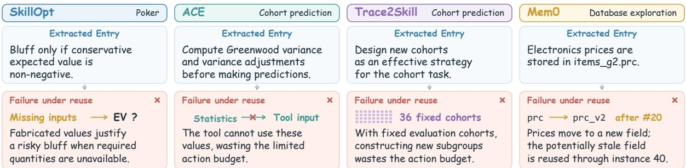
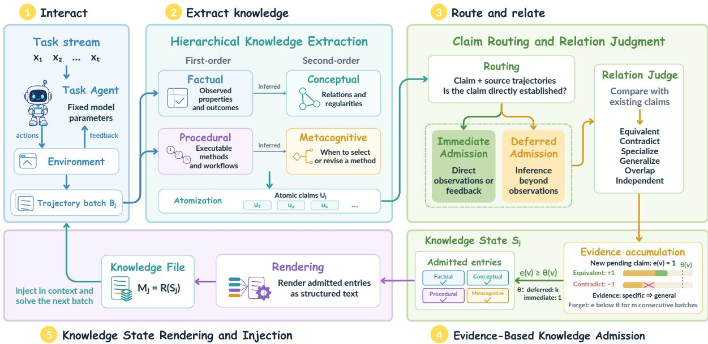
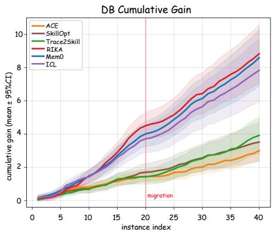
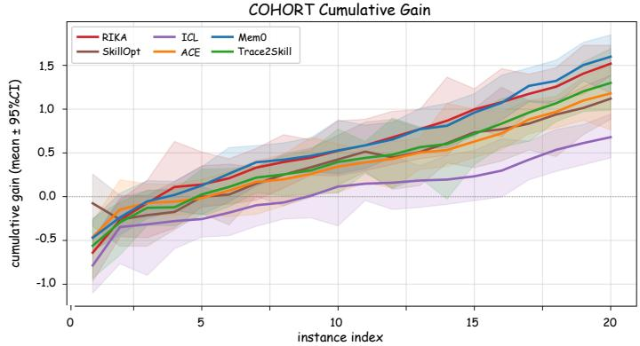

# Reliable Knowledge Acquisition for Continual Learning Agents

Yixu Huang University of California, Davis

Jiaqi W. Ma University of Illinois Urbana-Champaign

## Abstract

As agents powered by foundation models move into open-ended environments, continual learning from experience becomes essential. For agents built on models with fixed parameters, this learning requires reusing prior task experience in context to improve performance and efficiency on future tasks. Existing memory and experience-learning systems typically focus on either retained facts or procedures, and lack a mechanism for establishing the reliability of claims extracted from the ongoing task stream. Indeed, we find that approximately 12–33% of entries produced by representative systems harm future task performance when reused. To address these limitations, we propose RIKA (Reliable Knowledge Acquisition), which combines hierarchical extraction of factual, conceptual, procedural, and metacognitive knowledge with Evidence-based Knowledge Admission, which uses source evidence and subsequent experience to govern which claims enter the task agent’s context, without additional validation tasks. Across six task streams from Continual Learning Bench and four model backbones, RIKA achieves the highest aggregate score on every backbone.

## 1 Introduction

Foundation-model agents increasingly operate in open-ended environments, where they encounter ongoing streams of tasks whose demands cannot be fully anticipated during training (Zhang et al., 2025; Liu et al., 2024; Shu et al., 2026; Zheng et al., 2025). Their experience provides a continuing source of learning (e.g., lessons from failures). For agents built on black-box language models with fixed parameters, this learning takes place through context: knowledge acquired from prior trajectories is supplied to guide subsequent decisions (Shinn et al., 2023). Continual learning therefore requires organizing past experience into reusable knowledge that can inform future tasks.

A central challenge in reusing experience is whether extracted knowledge can be trusted to guide future decisions. Existing memory systems (Chhikara et al., 2025; Xu et al., 2026; Liu et al., 2026) often lack an explicit mechanism accounting for the reliability of extracted knowledge. Some experience-learning systems validate extracted knowledge by replaying tasks (Li et al., 2026) or evaluating on held-out tasks (Yang et al., 2026b), both of which require additional task execution that may be unavailable in continual settings, where environment states cannot be revisited or reset. Our quantitative evaluation of artifacts produced by representative systems shows that approximately 12–33% of evaluated atomic claims reduce subsequent task performance when reused. A complementary qualitative case study further reveals how such failures arise. Extracted knowledge may rely on information unavailable at reuse time, mismatch the requirements of subsequent tasks, or become outdated as the environment changes (Section 3.1).

Beyond reliability, continual learning also requires deciding what knowledge to acquire. Memory systems mostly retain facts and events, while experience-learning systems distill skills, workflows, reflections, and strategic guidance (Wang et al., 2024; Zhang et al., 2026b; Ni et al., 2026; Yang et al., 2026b; Shinn et al., 2023). Beyond observations and procedures, agents also need to learn underlying principles and when to apply or revise a method. This motivates a structured approach to learning complementary forms of knowledge and organizing the relationships among them.

To address these two challenges, we propose RIKA (Reliable Knowledge Acquisition), a continual learning framework that transforms agents’ task experience into structured knowledge for future decisions. To ensure reliable reuse, RIKA introduces Evidence-based Knowledge Admission (EKA), which draws on sequential hypothesis testing and truth maintenance (Wald, 1992; Doyle, 1979) to admit and revise atomic claims as evidence accumulates from the ongoing task stream. Claims directly established by their source trajectories can be admitted immediately, while those requiring broader support remain pending until sufficient evidence accumulates; subsequent experience can also challenge earlier admissions. This process requires no additional validation tasks. For knowledge extraction, RIKA draws on a knowledge taxonomy from educational psychology (Anderson and Krathwohl, 2001) to acquire four complementary types of knowledge: factual, conceptual, procedural, and metacognitive. Its hierarchical extractor grounds conceptual abstractions in factual knowledge and metacognitive abstractions in procedural knowledge, organizing both concrete experience and higher-level understanding for reuse.

Our contributions are threefold:

• We identify and quantify a reliability problem in experience reuse, finding that approximately 12–33% of evaluated entries from representative systems harm subsequent task performance.

• We propose RIKA, combining evidence-based knowledge admission with hierarchical extraction of factual, conceptual, procedural, and metacognitive knowledge.

• We demonstrate RIKA’s effectiveness across different task streams and model backbones, achieving the highest aggregate score on all backbones.

## 2 Related Work

## 2.1 Memory for Agents

Agent memory systems maintain information from prior interactions for later use. Much of this work is rooted in conversational personal assistants, where memory centers on past events, personal information, and user preferences (Maharana et al., 2024; Wu et al., 2024; Hu et al., 2026b). These systems develop memory storage, extraction, and organization mechanisms to retain and retrieve information across interactions (Sumers et al., 2023; Zhong et al., 2024; Packer et al., 2023; Chhikara et al., 2025; Xu et al., 2026; Liu et al., 2026). Together, these efforts help agents preserve relevant context across interactions.

## 2.2 Learning from Task Experience

Another line of work extracts reusable knowledge from task experience. Some approaches distill experience into executable skills (Wang et al., 2023; Ni et al., 2026), action workflows (Wang et al., 2024), reflections (Shinn et al., 2023), reasoning insights (Ouyang et al., 2026), and playbooks (Zhang et al., 2026b). While several methods validate acquired knowledge before reuse, they rely on replaying tasks or evaluating on held-out tasks (Alzubi et al., 2026; Li et al., 2026; Yang et al., 2026b), which requires additional task execution that is costly and often infeasible once the environment changes. In contrast, our method assesses knowledge using evidence from the ongoing task stream.

## 2.3 Reliability of Agentic Memory

The reliability of stored knowledge can deteriorate as agents accumulate experience. Recent studies identify errors introduced by repeated consolidation (Zhang et al., 2026a), stale knowledge under environmental change (Chao et al., 2026), and failures when agents consume conflicting memories (Chen et al., 2026). Complementary empirical work examines how memory management affects agents’ experience-following behavior (Xiong et al., 2026). Beyond characterizing these risks, TrustMem evaluates memory updates for coverage, preservation, and faithfulness, and uses preferenceguided reinforcement learning to improve consolidation (Yang et al., 2026a). Our work focuses on assessing the reliability of extracted knowledge using evidence from the ongoing task stream.

## 3 Reliability of Knowledge Extraction in Existing Systems

We first diagnose reliability failures in artifacts produced by four representative systems: Mem0 (Chhikara et al., 2025), ACE (Zhang et al., 2026b), Trace2Skill (Ni et al., 2026), and SkillOpt (Yang et al., 2026b). We then introduce EKA to govern knowledge reuse and evaluate it with the SkillOpt and Trace2Skill extractors. All analyses in this section useDeepSeek-V4- Flash (DeepSeek-AI, 2026) on three task streams (DB, COHORT, and CODEBASE) from Continual Learning Bench (Asawa et al., 2026) (Section 5.1).

## 3.1 How Reliable Is Extracted Knowledge?

Quantitative analysis. We examine the reliability of extracted knowledge through a leave-oneentry-out evaluation. Specifically, we remove one knowledge entry at a time and compare downstream task performance with and without that entry. This allows us to identify harmful entries, whose inclusion significantly degrades performance on subsequent tasks.

Figure 1: Extracted knowledge that fails under reuse.
<table><tr><td>Method</td><td>DB</td><td>COHORT</td><td>CODEBASE</td></tr><tr><td>Mem0</td><td>11.7%</td><td>13.4%</td><td>12.5%</td></tr><tr><td>ACE</td><td>20.2%</td><td>18.9%</td><td>23.1%</td></tr><tr><td>Trace2Skill</td><td>32.7%</td><td>28.8%</td><td>26.0%</td></tr><tr><td>SkillOpt</td><td>25.9%</td><td>26.1%</td><td>28.0%</td></tr></table>

Table 1: Harmful entry rates under leave-one-entryout evaluation. Rates are computed over entries within each artifact and averaged equally across artifacts.

Since systems package knowledge at different granularities, we decompose every artifact into atomic claims and treat each claim as one entry. Following influence analyses of contextual elements (Nguyen and Wong, 2023; Xie et al., 2025; Hu et al., 2026a), we define the contribution of an entry a in a frozen artifact A as

$$
\Delta ( a ) = \mathbb { E } _ { t \in { \mathbb { Z } } ( a ) } \left[ \operatorname { s c o r e } ( t \mid A ) - \operatorname { s c o r e } ( t \mid A \setminus \{ a \} ) \right]
$$

where I(a) contains the future tasks on which the original system would expose a. We classify a as harmful if the 95% confidence interval of $\Delta ( a )$ lies entirely below zero (Appendix A).

Table 1 shows that approximately 12–33% of evaluated entries reduce subsequent task performance across the four systems and three task streams. A substantial fraction of retained knowledge therefore hurts future decisions.

Case study. To understand how such failures arise, we compare claims extracted by these systems with their source trajectories and the requirements of subsequent tasks. Figure 1 presents four representative cases. Extracted knowledge may rely on information unavailable at reuse time, mismatch the requirements of subsequent tasks, or become outdated as the environment changes.

Together, these findings show that extraction and admission should be treated separately: a plausible claim is not necessarily reliable enough to guide future decisions. This motivates mechanisms for deciding which knowledge to admit and revising those decisions as new evidence accumulates.

## 3.2 Evidence-Based Knowledge Admission

We introduce Evidence-based Knowledge Admission (EKA) to govern reuse through evidence. EKA distinguishes claims by whether environment feedback in their source trajectories already establishes them. A claim directly verified by such feedback can be admitted immediately. For example, after an agent inspects a database schema, the claim “in schema version 1, order amounts are stored in orders.amount” is confirmed by the inspection output. In contrast, a claim that generalizes beyond what was observed remains pending until corroborated by subsequent experience. For example, the rule “for realized-revenue queries, pending orders do not contribute to revenue” is inferred from the records seen in a single task, so it is admitted or rejected only after further evidence emerges. The ongoing task stream thus serves as a source of both knowledge and evidence for its reuse. EKA encompasses atomization, claim routing, relation judgment, evidence accumulation, admission and forgetting, and rendering for reuse (Section 4.4).

## 3.3 Applying EKA to Other Extractors

We evaluate EKA using knowledge extracted by SkillOpt and Trace2Skill, coupling each extractor with EKA and comparing them with their original counterparts. See details in Appendix B.

Table 2 demonstrates that EKA improves both systems on DB and COHORT, supporting the effectiveness of the mechanism with different extractors.

## 4 Method

RIKA combines hierarchical knowledge extraction with EKA (Figure 2). The extractor acquires four complementary types of knowledge; EKA processes its outputs through atomization, routing, relation judgment, evidence accumulation, admission and forgetting, and rendering for reuse.

  
Figure 2: RIKA: hierarchical extraction with evidence-based knowledge admission.

<table><tr><td>Method</td><td>DB</td><td>COHORT</td><td>CODEBASE</td></tr><tr><td>SkillOpt</td><td>0.147</td><td>-0.062</td><td>0.567</td></tr><tr><td>SkillOpt + EKA</td><td>0.192</td><td>-0.045</td><td>0.573</td></tr><tr><td>Trace2Skill</td><td>0.158</td><td>-0.053</td><td>0.538</td></tr><tr><td>Trace2Skill + EKA</td><td>0.224</td><td>-0.043</td><td>0.570</td></tr></table>

Table 2: Task performance of SkillOpt and Trace2Skill with and without EKA. Scores are averaged over five runs. Each + EKA variant retains the system’s extractor and applies EKA thereafter.

## 4.1 Setup: Continual Learning from Task Streams

We consider a task agent that interacts with an environment over a stream of tasks

$$
\mathcal { T } = \{ x _ { 1 } , \ldots , x _ { T } \} .
$$

Solving task xt produces a trajectory τt consisting of the agent’s actions, environment observations, and feedback. We focus on agents built on black-box models whose parameters remain fixed; continual learning therefore occurs through reusable knowledge acquired from past trajectories and supplied in context for future tasks. The goal is to improve task performance and execution efficiency as experience accumulates.

We define the j-th batch as

$$
B _ { j } = \{ \tau _ { ( j - 1 ) n + 1 } , \ldots , \tau _ { j n } \} .
$$

After completing $B _ { j }$ , the system updates its persistent knowledge state from $S _ { j - 1 } \operatorname { t o } S _ { j }$ and produces a textual knowledge file $M _ { j }$ for solving the subsequent batch. The remaining question is how this knowledge state should be constructed and updated from task experience.

Throughout, a claim denotes a self-contained unit of reusable knowledge, whether newly extracted or stored in the persistent state. Equivalent extracted claims are consolidated into a canonical claim, stored with its metadata, provenance, evidence, relations, and admission route. We use u for a newly extracted claim and v for a stored claim. Admission is reassessed after each batch.

## 4.2 Knowledge Representation

Inspired by a knowledge taxonomy from educational psychology (Anderson and Krathwohl, 2001), we represent task experience using four complementary knowledge types, illustrated below with examples from the DB task. Factual knowledge captures task-relevant properties of entities, states, and outcomes (e.g., “fdbk\_g1.ts stores Unix timestamps in milliseconds”). Conceptual knowledge captures relations or regularities that organize multiple facts (e.g., “timestamp encodings differ across feedback tables: milliseconds, seconds, or ISO date strings”). Procedural knowledge specifies executable methods or workflows (e.g., “to filter by a top-level category, use cat\_lvl $\texttt { = } 1 \mathsf { A N D \ c a t \_ n m = \Sigma ^ { \prime } c a t e g o r y > ^ { \prime \prime \prime } } )$ . Metacognitive knowledge concerns when to apply, select, or revise a method (e.g., “when a category filter returns unexpected results, verify the hierarchy level before revising the query”).

## 4.3 Hierarchical Knowledge Extraction

The four knowledge types differ in their level of abstraction (Anderson and Krathwohl, 2001). Factual and procedural knowledge describe concrete observations and task-solving operations (Anderson, 1982), which can be directly grounded in environment feedback and agent trajectories. In contrast, conceptual and metacognitive knowledge capture higher-level regularities and strategic judgment (Nelson, 1990), which typically require further abstraction over factual and procedural knowledge, respectively. We therefore organize knowledge extraction into two stages: first extracting factual and procedural knowledge, and then deriving abstract conceptual and metacognitive knowledge from them, respectively.

For each batch $B _ { j }$ , since each type requires a distinct extraction objective, we instantiate four typespecific extraction subagents that operate without access to stored claims. We first extract first-order factual and procedural knowledge grounded in the environment feedback in the trajectories:

$$
F _ { j } = \mathcal { E } _ { F } ( B _ { j } ) , \qquad P _ { j } = \mathcal { E } _ { P } ( B _ { j } ) .
$$

Second-order knowledge is then extracted conditioned on both the trajectories and the corresponding first-order knowledge:

$$
C _ { j } = \mathcal { E } _ { C } ( B _ { j } , F _ { j } ) , \qquad G _ { j } = \mathcal { E } _ { M } ( B _ { j } , P _ { j } ) ,
$$

where $C _ { j }$ and $G _ { j }$ denote conceptual and metacognitive knowledge, respectively. Each extractor processes the trajectories in the batch jointly.

## 4.4 Evidence-Based Knowledge Admission (EKA)

EKA evaluates claims from the ongoing task stream. Inspired by sequential hypothesis testing (Wald, 1992) and truth maintenance (Doyle, 1979), we keep eligible but insufficiently corroborated claims pending and update their evidence as subsequent trajectories provide support or opposition. EKA proceeds through stages below.

## 4.4.1 Atomization

An extractor output may bundle multiple claims within a single item. Admitting or rejecting such an item as a whole using EKA might let the unsupported part into context or discard the supported part. Inspired by atomic decomposition (Min et al., 2023), we use an atomizer across all four knowledge types, splitting claims only when their components are self-contained and independent. Each resulting atom must be grounded in the environment feedback relevant to its own content, either directly or, for second-order knowledge, through its first-order claims. The atomic claims serve as the basic units for relation judgment and evidence accumulation. We denote those extracted from batch $B _ { j }$ by $U _ { j } = \{ u _ { 1 } , \dotsc , u _ { | U _ { j } | } \}$ . Appendix C reports technical details including prompts and output schemas.

## 4.4.2 Claim Routing and Relation Judgment

Admission routing. A routing agent examines each atomic claim $u ,$ its cited environmentfeedback spans, and the explanation linking them. A claim is directly grounded if the cited feedback itself states the claim under its stated scope, and indirectly grounded if it follows from such feedback through inference or abstraction, possibly via its first-order parent claims; claims with neither are excluded. The grounding type determines the admission route. Directly grounded claims follow the immediate admission path, since the feedback already establishes them. Indirectly grounded claims follow the deferred admission path, since their full scope still requires corroboration, for example because of causal attribution or conditions beyond those observed. We denote the route by

$$
z ( u ) \in \{ \mathrm { I M M E D I A T E } , \mathrm { D E F E R R E D } \} .
$$

The route depends on whether the evidence covers a claim’s scope, not on its knowledge type. A factual claim such as “schema versions use completed as the finalized label” is deferred, since an observation from version 1 does not cover its cross-version scope. Conversely, a conceptual claim can be admitted immediately when it only relates directly observed facts within their observed scope, such as “timestamp encodings differ across fdbk\_g1, fdbk\_g2, and fdbk\_g3”. Routing decisions are recorded when extracted claims are integrated into the persistent state.

Relation judgment. Inspired by natural-logic approaches to textual inference (MacCartney and Manning, 2007), we compare each new extracted claim with existing claims. For a new extracted claim u and an existing claim v, the relation judge predicts one or more material logical relations $r ( u , v ) \subseteq \mathcal { R }$ between u and v. We define R to contain EQUIVALENT, SPECIALIZE, GENER-ALIZE, CONTRADICT, OVERLAP, and INDEPEN-DENT. The relations are defined as follows:

• EQUIVALENT: u and v entail each other under the same scope.

• SPECIALIZE: The new claim u entails the broader stored claim v.

• GENERALIZE: The stored claim v entails the broader new claim u.

• CONTRADICT: The claims cover overlapping scope but cannot both hold.

• OVERLAP: Shared content without entailment or contradiction.

• INDEPENDENT: No logical relationship.

These judgments determine how subsequent experience supports or challenges stored claims.

## 4.4.3 Evidence Accumulation, Admission, and Forgetting

After each batch, we update the evidence for all active claims and reassess their admission, including claims admitted in earlier batches. Full update rules are provided in Appendix D.

Relation-guided evidence accumulation. Each stored claim v maintains a cumulative net evidence count $e _ { j } ( \boldsymbol { v } )$ . Let $c _ { j } ^ { + } ( v )$ and $c _ { j } ^ { - } \mathopen { } \mathclose \bgroup \left( v \aftergroup \egroup \right)$ denote the supporting and opposing evidence counts from batch $B _ { j }$ . We update

$$
e _ { j } ( v ) = e _ { j - 1 } ( v ) + c _ { j } ^ { + } ( v ) - c _ { j } ^ { - } ( v ) ,
$$

with the count initialized to zero for a new claim.

Fresh trajectories support a claim when they ground an equivalent or more specific claim, and oppose it when they ground a contradictory claim. Equivalent claims are merged into a entry. Entailment edges form a directed acyclic graph from specific claims to general claims: support propagates to reachable generalizations, but not in the reverse direction. OVERLAP and INDEPENDENT relations transfer no evidence.

Admission. We use the admission threshold $\theta ( v )$ set to 1 for immediate claims and k for deferred claims. Claims directly established by their source trajectories thus require no additional corroboration, whereas deferred claims require sufficient accumulated net evidence. After each batch, a claim is admitted if its updated evidence count satisfies $e ( v ) \geq \theta ( v )$ and remains pending otherwise, regardless of its previous admission status. A change in admission does not reset its evidence history.

Forgetting. To keep the state bounded, a claim is forgotten if its evidence stays below its admission threshold for m consecutive batches; reaching the threshold resets this window. The window tolerates temporary lack of support, during which the claim remains pending in the state.

## 4.5 Knowledge State Rendering and Injection

After all updates for batch $B _ { j }$ are complete, we render the admitted claims in the resulting state $S _ { j } ,$ i.e., those satisfying $e ( v ) \geq \theta ( v )$ , into a structured textual knowledge file

$$
M _ { j } = \mathcal { R } ( S _ { j } ) .
$$

Motivated by findings that repeated memory updates can degrade stored knowledge (Zhang et al., 2026a; Yang et al., 2026a), we reconstruct the file from the current state rather than incrementally rewriting $M _ { j - 1 }$

Finally, the complete rendered file $M _ { j }$ is supplied in context to the task agent while it solves the subsequent batch (Appendix D.5). The resulting trajectories provide the next source of experience, closing the continual learning loop.

## 5 Experiments

We evaluate whether RIKA enables a task agent to continually improve from its task-solving experience across task streams and model backbones.

## 5.1 Experimental Setup

Benchmark. We utilize Continual Learning Bench, evaluating on six heterogeneous task streams: DB, POKER, COHORT, BSM, SALES, and CODEBASE (Asawa et al., 2026). See task details and scoring in Appendix E.1 and Appendix E.2.

Baselines. We choose five representative baselines: ICL (Asawa et al., 2026), which directly reuses past trajectories in context; Mem0 (Chhikara et al., 2025), a general-purpose memory system; ACE (Zhang et al., 2026b), which maintains an evolving playbook; and Trace2Skill (Ni et al., 2026) and SkillOpt (Yang et al., 2026b), which distill trajectories into reusable skills.

Model backbones. We evaluate all methods on four backbones: GPT-5.4 (OpenAI, 2026), DeepSeek-V4-Flash (DeepSeek-AI, 2026), MiniMax-M3 (Lai et al., 2026), and Gemini-3- Flash (Google DeepMind, 2025). Appendix E.3 reports model versions and the shared configuration, context management, and adaptation settings.

<table><tr><td rowspan="2">Model</td><td rowspan="2">Method</td><td colspan="2">DB</td><td colspan="2">POKER</td><td colspan="2">COHORT</td><td colspan="2">BSM</td><td colspan="2">SALES</td><td colspan="2">CODEBASE</td><td colspan="2">Agg.</td></tr><tr><td>Score</td><td>Gain</td><td>Score</td><td>Gain</td><td>Score</td><td>Gain</td><td>Score</td><td>Gain</td><td>Score</td><td>Gain</td><td>Score</td><td>Gain</td><td>Score</td><td>Gain</td></tr><tr><td rowspan="6">GPT-5.4</td><td>RIKA</td><td>0.351</td><td>+0.213</td><td>1.247</td><td>+0.134</td><td>-0.020</td><td>-0.013</td><td>0.579</td><td>+0.360</td><td>0.808</td><td>+0.342</td><td>0.551</td><td>+0.053</td><td>0.232</td><td>+0.232</td></tr><tr><td>ICL</td><td>0.347</td><td>+0.209</td><td>0.798</td><td>-0.315</td><td>-0.028</td><td>-0.021</td><td>0.513</td><td>+0.294</td><td>0.769</td><td>+0.303</td><td>0.534</td><td>+0.036</td><td>0.183</td><td>+0.183</td></tr><tr><td>Mem0</td><td>0.431</td><td>+0.293</td><td>0.612</td><td>-0.501</td><td>-0.034</td><td>-0.027</td><td>0.375</td><td>+0.156</td><td>0.651</td><td>+0.185</td><td>0.584</td><td>+0.086</td><td>0.140</td><td>+0.140</td></tr><tr><td>ACE</td><td>0.196</td><td>+0.058</td><td>1.196</td><td>+0.083</td><td>-0.004</td><td>+0.003</td><td>0.220</td><td>+0.001</td><td>0.510</td><td>+0.044</td><td>0.609</td><td>+0.111</td><td>0.067</td><td>+0.067</td></tr><tr><td>Trace2Skill</td><td>0.138</td><td>+0.000</td><td>1.115</td><td>+0.002</td><td>-0.032</td><td>-0.025</td><td>0.318</td><td>+0.099</td><td>0.689</td><td>+0.223</td><td>0.513</td><td>+0.015</td><td>0.071</td><td>+0.071</td></tr><tr><td>SkillOpt</td><td>0.189</td><td>+0.051</td><td>0.971</td><td>-0.142</td><td>-0.024</td><td>-0.017</td><td>0.443</td><td>+0.224</td><td>0.566</td><td>+0.100</td><td>0.607</td><td>+0.109</td><td>0.105</td><td>+0.105</td></tr><tr><td rowspan="6">DeepSeek-V4-Flash</td><td>RIKA</td><td>0.281</td><td>+0.221</td><td>1.141</td><td>+0.489</td><td>-0.042</td><td>+0.076</td><td>0.234</td><td>+0.015</td><td>0.847</td><td>+0.333</td><td>0.575</td><td>+0.063</td><td>0.141</td><td>+0.233</td></tr><tr><td>ICL</td><td>0.256</td><td>+0.196</td><td>0.755</td><td>+0.103</td><td>-0.084</td><td>+0.034</td><td>0.518</td><td>+0.299</td><td>0.639</td><td>+0.125</td><td>0.548</td><td>+0.036</td><td>0.074</td><td>+0.176</td></tr><tr><td>Mem0</td><td>0.274</td><td>+0.214</td><td>0.732</td><td>+0.080</td><td>-0.038</td><td>+0.080</td><td>0.348</td><td>+0.129</td><td>0.522</td><td>+0.008</td><td>0.547</td><td>+0.035</td><td>0.049</td><td>+0.129</td></tr><tr><td>ACE</td><td>0.135</td><td>+0.075</td><td>0.637</td><td>-0.015</td><td>-0.059</td><td>+0.059</td><td>0.222</td><td>+0.003</td><td>0.563</td><td>+0.049</td><td>0.529</td><td>+0.017</td><td>-0.020</td><td>+0.071</td></tr><tr><td>Trace2Skill</td><td>0.158</td><td>+0.098</td><td>0.858</td><td>+0.206</td><td>-0.053</td><td>+0.065</td><td>0.293</td><td>+0.074</td><td>0.602</td><td>+0.088</td><td>0.538</td><td>+0.026</td><td>0.025</td><td>+0.115</td></tr><tr><td>SkillOpt</td><td>0.147</td><td>+0.087</td><td>0.435</td><td>-0.217</td><td>-0.062</td><td>+0.056</td><td>0.218</td><td>-0.001</td><td>0.658</td><td>+0.144</td><td>0.567</td><td>+0.055</td><td>0.017</td><td>+0.113</td></tr><tr><td rowspan="6">MiniMax-M3</td><td>RIKA</td><td>0.327</td><td>+0.191</td><td></td><td></td><td></td><td></td><td>0.257</td><td></td><td></td><td></td><td></td><td></td><td></td><td>+0.239</td></tr><tr><td>ICL</td><td>0.284</td><td>+0.148</td><td>0.623 0.407</td><td>+0.758</td><td>0.012 -0.020</td><td>+0.017</td><td>0.337</td><td>+0.037 +0.117</td><td>0.758 0.535</td><td>+0.561 +0.338</td><td>0.554 0.483</td><td>+0.181 +0.110</td><td>0.163 0.043</td><td>+0.147</td></tr><tr><td>Mem0</td><td>0.303</td><td>+0.167</td><td>0.235</td><td>+0.542 +0.370</td><td>0.003</td><td>-0.015 +0.008</td><td>0.289</td><td>+0.069</td><td>0.501</td><td>+0.304</td><td>0.402</td><td>+0.029</td><td>0.018</td><td>+0.132</td></tr><tr><td>ACE</td><td>0.189</td><td>+0.053</td><td>0.509</td><td>+0.644</td><td>-0.026</td><td>-0.021</td><td>0.230</td><td>+0.010</td><td>0.772</td><td>+0.575</td><td>0.513</td><td>+0.140</td><td>0.082</td><td>+0.159</td></tr><tr><td>Trace2Skill</td><td>0.175</td><td>+0.039</td><td>0.612</td><td>+0.747</td><td>-0.031</td><td>-0.026</td><td>0.219</td><td>-0.001</td><td>0.638</td><td>+0.441</td><td>0.533</td><td>+0.160</td><td>0.039</td><td>+0.128</td></tr><tr><td>SkillOpt</td><td>0.180</td><td>+0.044</td><td>0.559</td><td>+0.694</td><td>-0.028</td><td>-0.023</td><td>0.234</td><td>+0.014</td><td>0.672</td><td>+0.475</td><td>0.517</td><td>+0.144</td><td>0.050</td><td>+0.137</td></tr><tr><td rowspan="6">Gemini-3-Flash</td><td>RIKA</td><td>0.387</td><td>+0.298</td><td>0.952</td><td>-0.688</td><td>-0.058</td><td>+0.001</td><td>0.434</td><td>+0.215</td><td>0.628</td><td>+0.189</td><td>0.614</td><td>+0.207</td><td>0.130</td><td>+0.201</td></tr><tr><td>ICL</td><td>0.376</td><td>+0.287</td><td>0.790</td><td>-0.850</td><td>-0.034</td><td>+0.025</td><td>0.367</td><td>+0.148</td><td>0.707</td><td>+0.268</td><td>0.390</td><td>-0.017</td><td>0.084</td><td>+0.160</td></tr><tr><td>Mem0</td><td>0.355</td><td>+0.266</td><td>0.863</td><td>-0.777</td><td>-0.038</td><td>+0.021</td><td>0.334</td><td>+0.115</td><td>0.544</td><td>+0.105</td><td>0.583</td><td>+0.176</td><td>0.084</td><td>+0.153</td></tr><tr><td>ACE</td><td>0.239</td><td>+0.150</td><td>0.452</td><td>-1.188</td><td>-0.074</td><td>-0.015</td><td>0.378</td><td>+0.159</td><td>0.591</td><td>+0.152</td><td>0.517</td><td>+0.110</td><td>0.020</td><td>+0.101</td></tr><tr><td>Trace2Skill</td><td>0.098</td><td>+0.009</td><td>0.539</td><td>-1.101</td><td>-0.095</td><td>-0.036</td><td>0.395</td><td>+0.176</td><td>0.538</td><td>+0.099</td><td>0.622</td><td>+0.215</td><td>-0.005</td><td>+0.079</td></tr><tr><td>SkillOpt</td><td>0.103</td><td>+0.014</td><td>0.588</td><td>-1.052</td><td>-0.087</td><td>-0.028</td><td>0.385</td><td>+0.166</td><td>0.559</td><td>+0.120</td><td>0.605</td><td>+0.198</td><td>0.004</td><td>+0.086</td></tr></table>

Table 3: Continual-learning performance across streams and backbones. SCORE: stream-level score; GAIN: improvement over the shared stateless control for the same backbone and task; AGG.: averages of normalized scores and gains across six streams. See Appendices E and F for setup details and 95% confidence intervals.

Evaluation. By default, RIKA uses batch size n = 5 (n = 4 for SALES, which has only 12 instances), deferred admission threshold k = 3, and forgetting window m = 3. All results are averaged over five runs (Appendix E.4).

For each stream in Table 3, we report the mean task reward (SCORE) and its improvement over a no-learning reference (GAIN). The reference is the mean of five stateless runs for the same backbone and task, shared across all methods. Since reward scales differ across tasks, we also report normalized aggregates (AGG.). For learning dynamics, we plot cumulative gain over the stateless control (defined in Appendix E.5). Curves show the mean over five runs with 95% confidence intervals.

## 5.2 Main Results

Table 3 presents the results across all six task streams and four model backbones.

Consistent gains across backbones. RIKA achieves the highest aggregate score on all backbones, exceeding the strongest baseline on each by 0.046–0.081. For instance, it improves the aggregate score from 0.183 to 0.232 on GPT-5.4. Its aggregate gain over the stateless agent is positive on all backbones, ranging from +0.201 to +0.239.

Broad improvement across task streams. RIKA achieves the best result in 14 of 24 model– task combinations. The remaining wins are distributed among task-specific baselines, particularly on COHORT, BSM, and CODEBASE, showing that RIKA’s advantage is broad but not uniform.

Structured knowledge outperforms direct experience reuse. RIKA outperforms ICL in aggregate on every backbone by 0.046–0.120, suggesting that structured, selectively admitted claims enable more effective reuse than directly exposing the agent to past trajectories.

## 6 Analysis

We examine RIKA’s learning dynamics, the contributions of its main components, and its sensitivity to batch size and admission threshold. All ablations use DeepSeek-V4-Flash on three representative task streams: DB, COHORT, and CODEBASE. Additional ablations are provided in Appendix G.

## 6.1 Dynamics

Figure 3 shows cumulative gain relative to the stateless DeepSeek-V4-Flash agent on DB and CO-HORT. On DB, RIKA establishes an early lead over the baselines and maintains it after the migration event at instance 20, ending at a cumulative gain consistent with the stream-level gain in Table 3. On COHORT, its cumulative gain moves from negative to positive and finishes above most baselines but below Mem0, consistent with their respective streamlevel gains of 0.076 and 0.080. These trends illustrate RIKA’s gains over time, while showing that its relative advantage varies across task streams.

  
(a) DB

  
(b) COHORT

Figure 3: Cumulative gain on DB and COHORT with DeepSeek-V4-Flash. Curves show mean gain relative to the stateless control shared across methods within each task; shading indicates 95% confidence intervals. The vertical line marks the DB migration at instance 20.
<table><tr><td>METHOD</td><td>DB</td><td>COHORT</td><td>CODEBASE</td></tr><tr><td>RIKA</td><td>0.281</td><td>-0.042</td><td>0.575</td></tr><tr><td>Imm. Only</td><td>0.225</td><td>-0.089</td><td>0.540</td></tr><tr><td>Def. Only</td><td>0.265</td><td>-0.070</td><td>0.557</td></tr><tr><td>Random Router</td><td>0.249</td><td>-0.084</td><td>0.549</td></tr></table>

Table 4: Admission-routing ablations.

## 6.2 Ablations on Admission Routing

We compare RIKA’s admission mechanism with: Imm. Only, which admits every claim immediately; Def. Only, which defers every claim; and Random Router, which assigns claims randomly.

Table 4 reports stream-level scores only; Appendix Table 13 provides the complete results. Relative to RIKA, Imm. Only causes the largest score degradation (0.047–0.056 on DB and COHORT). Def. Only performs better but still trails the full method, suggesting that conservative admission limits premature reuse while delaying directly supported knowledge. Random Router also underperforms on every stream, indicating that the improvements depend on evidence-aware routing.

## 6.3 Ablations on Hierarchical Knowledge Extraction

We compare our hierarchical extractor with Generic 1-type, which uses one undifferentiated extractor;

<table><tr><td>Method</td><td>DB</td><td>COHORT</td><td>CODEBASE</td></tr><tr><td>RIKA</td><td>0.281</td><td>-0.042</td><td>0.575</td></tr><tr><td>Generic 1-type</td><td>0.213</td><td>-0.087</td><td>0.541</td></tr><tr><td>Flat 4-type</td><td>0.261</td><td>-0.057</td><td>0.563</td></tr><tr><td>—Factual</td><td>0.253</td><td>-0.060</td><td>0.547</td></tr><tr><td>—Conceptual</td><td>0.265</td><td>-0.065</td><td>0.553</td></tr><tr><td>—Procedural</td><td>0.270</td><td>-0.073</td><td>0.549</td></tr><tr><td>—Metacognitive</td><td>0.274</td><td>-0.068</td><td>0.556</td></tr></table>

Table 5: Ablations of knowledge types and hierarchical extraction.

Flat 4-type, which retains all knowledge types but removes first- to second-order conditioning; and variants that remove each type individually.

Table 5 reports stream-level scores only; Appendix Table 14 provides the complete results. Relative to RIKA, GENERIC 1-TYPE causes the largest score degradation (0.045–0.068 on DB and CO-HORT), while FLAT 4-TYPE also consistently underperforms, supporting the importance of hierarchical conditioning. Removing any individual type reduces performance, with the largest drops from removing factual knowledge on DB and procedural knowledge on COHORT.

## 7 Conclusion

We find that approximately 12–33% of entries retained by existing experience-reuse systems harm subsequent task performance. To address this, we propose RIKA, which combines hierarchical extraction of four knowledge types with EKA, admitting claims as evidence accumulates from the task stream without additional validation tasks. RIKA achieves the highest aggregate score on every backbone across six task streams, and EKA also improves SkillOpt and Trace2Skill.

## Limitations

Our empirical study focuses on six text-based, toolmediated task streams and four model backbones. Although the streams span heterogeneous domains and interaction patterns, the results may not directly transfer to more diverse settings, where experience also includes perceptual or physical feedback. In addition, we study continual learning through an external knowledge artifact while keeping the underlying model parameters fixed. How hierarchical extraction and evidence-based admission interact with parameter-updating approaches remains an open direction.

## Ethical Considerations

Agent trajectories may contain personal information that could persist in the knowledge file, so deployment on real user interactions would require filtering or anonymizing trajectories first; our experiments use benchmarks without real personal data. Finally, our evaluation covers six text-based, toolmediated task streams and four model backbones, and it does not show that RIKA is safe for highstakes domains such as medicine, law, or finance, where domain-specific validation and human oversight would be required.

## References

Salaheddin Alzubi, Noah Provenzano, Jaydon Bingham, Weiyuan Chen, and Tu Vu. 2026. Evoskill: Automated skill discovery for multi-agent systems. arXiv preprint arXiv:2603.02766.

John R Anderson. 1982. Acquisition of cognitive skill. Psychological review, 89(4):369.

Lorin W Anderson and David R Krathwohl. 2001. A taxonomy for learning, teaching, and assessing: A revision ofBloom’s taxonomy ofeducational objectives: complete edition. Addison Wesley Longman, Inc.

Parth Asawa, Christopher M Glaze, Gabriel Orlanski, Ramya Ramakrishnan, Benji Xu, Asim Biswal, Vincent Sunn Chen, Frederic Sala, Matei Zaharia, and Joseph E Gonzalez. 2026. Continual learning bench: Evaluating frontier ai systems in real-world stateful environments. arXiv preprint arXiv:2606.05661.

Hanxiang Chao, Yihan Bai, Rui Sheng, Tianle Li, and Yushi Sun. 2026. Stale: Can llm agents know when their memories are no longer valid? arXiv preprint arXiv:2605.06527.

Yixiong Chen, Xinyi Bai, and Alan Yuille. 2026. The compliance trap: Diagnosing how ai agents

consume conflicting memory. arXiv preprint arXiv:2607.10608.

Prateek Chhikara, Dev Khant, Saket Aryan, Taranjeet Singh, and Deshraj Yadav. 2025. Mem0: Building production-ready ai agents with scalable long-term memory. arXiv preprint arXiv:2504.19413.

DeepSeek-AI. 2026. DeepSeek-V4: Towards Highly Efficient Million-Token Context Intelligence. Technical Report.

Jon Doyle. 1979. A truth maintenance system. Artificial intelligence, 12(3):231–272.

Google DeepMind. 2025. Gemini 3 Flash Model Card. Model Card.

Wentao Hu, Zhendong Chu, Yiming Zhang, Junda Wu, Ming Jin, Xiangyu Zhao, Yilei Shao, Yanfeng Wang, and Qingsong Wen. 2026a. Skillbrew: Multiobjective curation of skill banks for llm agents. arXiv preprint arXiv:2605.29440.

Yuanzhe Hu, Yu Wang, and Julian McAuley. 2026b. Evaluating memory in llm agents via incremental multi-turn interactions. In International Conference on Learning Representations, volume 2026, pages 156259–156291.

Xunhao Lai, Weiqi Xu, Yufeng Yang, Qiaorui Chen, Yang Xu, Lunbin Zeng, Xiaolong Li, Haohai Sun, Haichao Zhu, Vito Zhang, Jinkai Hu, Jiayao Li, Rui Gao, Zekun Li, Songquan Zhu, Jingkai Zhou, and Pengyu Zhao. 2026. MiniMax Sparse Attention. arXiv preprint arXiv:2606.13392.

Jiaxi Li, Ke Deng, Yun Wang, Jingyuan Huang, Yucheng Shi, Qiaoyu Tan, Jin Lu, and Ninghao Liu. 2026. Online skill learning for web agents via state-grounded dynamic retrieval. arXiv preprint arXiv:2606.04391.

Jiaqi Liu, Yaofeng Su, Peng Xia, Siwei Han, Zeyu Zheng, Cihang Xie, Mingyu Ding, and Huaxiu Yao. 2026. Simplemem: Efficient lifelong memory for llm agents. arXiv preprint arXiv:2601.02553.

Xiao Liu, Hao Yu, Hanchen Zhang, Yifan Xu, Xuanyu Lei, Hanyu Lai, Yu Gu, Hangliang Ding, Kaiwen Men, Kejuan Yang, Shudan Zhang, Xiang Deng, Aohan Zeng, Zhengxiao Du, Chenhui Zhang, Sheng Shen, Tianjun Zhang, Yu Su, Huan Sun, and 3 others. 2024. AgentBench: Evaluating LLMs as agents. In International Conference on Learning Representations, volume 2024, pages 52989–53046.

Bill MacCartney and Christopher D Manning. 2007. Natural logic for textual inference. In Proceedings ofthe ACL-PASCAL workshop on textual entailment and paraphrasing, pages 193–200.

Adyasha Maharana, Dong-Ho Lee, Sergey Tulyakov, Mohit Bansal, Francesco Barbieri, and Yuwei Fang. 2024. Evaluating very long-term conversational memory of llm agents. In Proceedings ofthe 62nd

Annual Meeting ofthe Associationfor Computational Linguistics (Volume 1: Long Papers), pages 13851– 13870.

Sewon Min, Kalpesh Krishna, Xinxi Lyu, Mike Lewis, Wen-tau Yih, Pang Koh, Mohit Iyyer, Luke Zettlemoyer, and Hannaneh Hajishirzi. 2023. Factscore: Fine-grained atomic evaluation of factual precision in long form text generation. In Proceedings of the 2023 conference on empirical methods in natural language processing, pages 12076–12100.

Thomas O Nelson. 1990. Metamemory: A theoretical framework and new findings. In Psychology of learning and motivation, volume 26, pages 125–173. Elsevier.

Tai Nguyen and Eric Wong. 2023. In-context example selection with influences. arXiv preprint arXiv:2302.11042.

Jingwei Ni, Yihao Liu, Xinpeng Liu, Yutao Sun, Mengyu Zhou, Pengyu Cheng, Dexin Wang, Erchao Zhao, Xiaoxi Jiang, and Guanjun Jiang. 2026. Trace2skill: Distill trajectory-local lessons into transferable agent skills. arXiv preprint arXiv:2603.25158.

OpenAI. 2026. GPT-5.4 Thinking System Card. System Card.

Siru Ouyang, Jun Yan, I-Hung Hsu, Yanfei Chen, Ke Jiang, Zifeng Wang, Rujun Han, Long T. Le, Samira Daruki, Xiangru Tang, Vishy Tirumalashetty, George Lee, Mahsan Rofouei, Hangfei Lin, Jiawei Han, Chen-Yu Lee, and Tomas Pfister. 2026. Reasoningbank: Scaling agent self-evolving with reasoning memory. In International Conference on Learning Representations, volume 2026, pages 94327–94354.

Charles Packer, Sarah Wooders, Kevin Lin, Vivian Fang, Shishir G Patil, Ion Stoica, and Joseph E Gonzalez. 2023. Memgpt: Towards llms as operating systems. arXiv preprint arXiv:2310.08560.

Noah Shinn, Federico Cassano, Ashwin Gopinath, Karthik Narasimhan, and Shunyu Yao. 2023. Reflexion: Language agents with verbal reinforcement learning. Advances in neural information processing systems, 36:8634–8652.

Yiheng Shu, Bernal Jiménez Gutiérrez, Saisri Padmaja Jonnalagedda, Yuguang Yao, Huan Sun, and Yu Su. 2026. AgentCL: Toward rigorous evaluation of continual learning in language agents. arXiv preprint arXiv:2606.02461.

Theodore R Sumers, Shunyu Yao, Karthik Narasimhan, and Thomas L Griffiths. 2023. Cognitive architectures for language agents. arXiv preprint arXiv:2309.02427.

Abraham Wald. 1992. Sequential tests of statistical hypotheses. In Breakthroughs in statistics: Foundations and basic theory, pages 256–298. Springer.

Guanzhi Wang, Yuqi Xie, Yunfan Jiang, Ajay Mandlekar, Chaowei Xiao, Yuke Zhu, Linxi Fan, and Anima Anandkumar. 2023. Voyager: An open-ended embodied agent with large language models. arXiv preprint arXiv:2305.16291.

Zora Zhiruo Wang, Jiayuan Mao, Daniel Fried, and Graham Neubig. 2024. Agent workflow memory. arXiv preprint arXiv:2409.07429.

Di Wu, Hongwei Wang, Wenhao Yu, Yuwei Zhang, Kai-Wei Chang, and Dong Yu. 2024. Longmemeval: Benchmarking chat assistants on long-term interactive memory. arXiv preprint arXiv:2410.10813.

Shan Xie, Man Luo, Chadly Daniel Stern, Mengnan Du, and Cheng Lu. 2025. Demoshapley: Valuation of demonstrations for in-context learning. In 2025 IEEE International Conference on Big Data (Big-Data), pages 4081–4090. IEEE.

Zidi Xiong, Yuping Lin, Wenya Xie, Pengfei He, Zirui Liu, Jiliang Tang, Himabindu Lakkaraju, and Zhen Xiang. 2026. How memory management impacts llm agents: An empirical study of experience-following behavior. In Proceedings of the 64th Annual Meeting of the Association for Computational Linguistics (Volume 1: Long Papers), pages 623–645.

Wujiang Xu, Zujie Liang, Kai Mei, Hang Gao, Juntao Tan, and Yongfeng Zhang. 2026. A-mem: Agentic memory for llm agents. Advances in Neural Information Processing Systems, 38:17577–17604.

Tianyu Yang, Sudipta Paul, Vijay Srinivasan, Vivek Kulkarni, and Srinivas Chappidi. 2026a. Trustmem: Learning trustworthy memory consolidation for llm agents with long-term memory. arXiv preprint arXiv:2606.25161.

Yifan Yang, Ziyang Gong, Weiquan Huang, Qihao Yang, Ziwei Zhou, Zisu Huang, Yan Li, Xuemei Gao, Qi Dai, Bei Liu, Kai Qiu, Yuqing Yang, Dongdong Chen, Xue Yang, and Chong Luo. 2026b. Skillopt: Executive strategy for self-evolving agent skills. arXiv preprint arXiv:2605.23904.

Dylan Zhang, Yanshan Lin, Zhengkun Wu, Yihang Sun, Bingxuan Li, Dianqi Li, and Hao Peng. 2026a. Useful memories become faulty when continuously updated by llms. arXiv preprint arXiv:2605.12978.

Kai Zhang, Xiangchao Chen, Bo Liu, Tianci Xue, Zeyi Liao, Zhihan Liu, Xiyao Wang, Yuting Ning, Zhaorun Chen, Xiaohan Fu, Jian Xie, Yuxuan Sun, Boyu Gou, Qi Qi, Zihang Meng, Jianwei Yang, Ning Zhang, Xian Li, Ashish Shah, and 11 others. 2025. Agent learning via early experience. arXiv preprint arXiv:2510.08558.

Qizheng Zhang, Changran Hu, Shubhangi Upasani, Boyuan Ma, Fenglu Hong, Vamsidhar Kamanuru, Jay Rainton, Chen Wu, Mengmeng Ji, Hanchen Li, Urmish Thakker, James Zou, and Kunle Olukotun.

2026b. Agentic context engineering: Evolving contexts for self-improving language models. In International Conference on Learning Representations, volume 2026, pages 86069–86100.

Junhao Zheng, Xidi Cai, Qiuke Li, Duzhen Zhang, ZhongZhi Li, Yingying Zhang, Le Song, and Qianli Ma. 2025. LifelongAgentBench: Evaluating LLM agents as lifelong learners. arXiv preprint arXiv:2505.11942.

Wanjun Zhong, Lianghong Guo, Qiqi Gao, He Ye, and Yanlin Wang. 2024. Memorybank: Enhancing large language models with long-term memory. In $P r o \cdot$ ceedings ofthe AAAI conference on artificial intelligence, volume 38, pages 19724–19731.

## Appendix

## A Protocol for Harmful-Entry Evaluation

This section details the artifact-freezing schedule, entry-use conditions, and repeated paired evaluations used in Section 3.1. We use DeepSeek-V4- Flash throughout this diagnostic evaluation. Each comparison pairs the complete artifact with a version that removes only the target entry.

## A.1 Artifact Freezing and Evaluation Windows

For each method and task stream, we evaluate three frozen artifacts. We freeze each artifact at the prescribed point in its task stream and evaluate its entries on subsequent instances. All instance indices below are one-based and refer to positions in the ordered stream for the corresponding run.

• DB: we freeze the artifact immediately after instance 30 and evaluate its entries on the final 10 instances (31–40). The schema migration occurs between instances 20 and 21, before the artifact is frozen, so the evaluation window lies entirely within the post-migration stage.

• COHORT: we freeze the artifact after instance 10, halfway through the 20-instance stream, and evaluate its entries on instances 11–20.

• CODEBASE: we freeze the artifact after instance 9 (the Tablib stage) and evaluate its entries on instances 10–19 (the Tenacity stage).

Each evaluated artifact therefore contains only experience available at its freezing point, and every evaluation instance occurs strictly after that point. The artifact remains fixed throughout its evaluation window and across all five paired evaluation seeds for each entry.

## A.2 Entry-Level Reuse Conditions

To ensure consistent entry granularity across systems, we first decompose every frozen artifact from every evaluated system into atomic claims. Each evaluation entry a denotes one atomic claim, and A denotes the complete collection of claims for that artifact. This normalization gives all systems the same unit of comparison, irrespective of how their original artifacts group knowledge into entries. We evaluate each claim by removing only that claim while retaining all other claims in the artifact. For retrieval-based systems, we include an instance in $\textstyle { \mathcal { T } } ( a )$ only if the system’s retrieval mechanism would select a for that instance from the complete frozen artifact. The original system’s exposure pattern determines the eligible task set for each claim. Entries that are never retrieved during the evaluation window, and hence have $\mathcal { I } ( a ) = \mathcal { O }$ are excluded from both evaluation and the denominator of the harmful-entry rate. For systems that supply the entire artifact as a knowledge file, all entries are exposed at every instance, so all instances in the corresponding evaluation window are eligible.

For each eligible instance, we first obtain the knowledge context from the complete frozen artifact A. The paired entry-removed condition deletes only a from that context, keeping all other supplied entries unchanged. For retrieval-based systems, both conditions use the same retrieved context, with only the target atomic claim removed in the paired condition. For systems that supply the entire artifact, the paired condition supplies $\mathcal { A } _ { - a } = \mathcal { A } \backslash \{ a \}$ This measures the effect of retaining a while keeping the rest of the supplied context fixed.

## A.3 Repeated Paired Evaluations and Harmfulness Classification

For each fixed artifact A and each eligible entry $a \in { \mathcal { A } }$ with $\boldsymbol { \mathcal { T } } ( \boldsymbol { a } ) \neq \boldsymbol { \mathcal { O } }$ , we perform five paired evaluations on the subsequent eligible task instances, indexed by evaluation seed $s \in \{ 0 , 1 , 2 , 3 , 4 \}$ . The same normalized artifact ${ \mathcal { A } } ,$ target atomic claim $^ { a , }$ and claim-removed artifact $A _ { - a }$ are used in all five pairs. Within each seed, the two conditions are evaluated on the same eligible task instances with matched task settings and environment action budgets. Thus, each atomic claim is assessed within its own frozen artifact across all five evaluation seeds. For each seed, we first average per-instance scores over the eligible instances in the prescribed evaluation window, using the reward definitions in Appendix E.2. We then compute the paired score difference

$$
d _ { s } ( a ) = R _ { s } ( A ) - R _ { s } ( A _ { - a } ) ,\tag{1}
$$

where $R _ { s } ( \mathcal { A } )$ and $R _ { s } ( { \cal A } _ { - a } )$ are the mean scores on the same entry-specific task set $\textstyle { \mathcal { T } } ( a )$ using the complete artifact and the artifact with only a removed, respectively. For this fixed artifact and entry, the estimated effect is the mean of the five paired differences, $\bar { d } ( a )$

Following the uncertainty convention in $\mathsf { A p - }$ pendix E.4, we compute a 95% Student-t confidence interval from the variation in paired score differences across seeds:

$$
{ \bar { d } } ( a ) \pm { t _ { 0 . 9 7 5 , 4 } } { \frac { { \hat { \sigma } _ { d } } ( a ) } { \sqrt { 5 } } } ,\tag{2}
$$

where $\hat { \sigma } _ { d } ( a )$ is the sample standard deviation of the five differences. An entry is classified as harmful only when the entire interval lies below zero.

Harmful-entry rates and aggregation. For artifact $A _ { j }$ , let $E _ { j }$ be the number of eligible entries and $H _ { j }$ the number classified as harmful under the fiveseed paired evaluation above. Its harmful-entry rate is $h _ { j } = H _ { j } / E _ { j }$ . All eligible atomic claims contribute to $E _ { j } \colon H _ { j }$ counts the claims satisfying the harmfulness criterion. For each method and task stream, we report the unweighted arithmetic mean of the three artifact-level rates,

$$
\bar { h } = \frac { 1 } { 3 } \sum _ { j = 1 } ^ { 3 } h _ { j } .\tag{3}
$$

Table 1 expresses $\bar { h }$ as a percentage. We average the three rates rather than pooling entries across artifacts; each artifact receives equal weight regardless of its number of eligible entries. The three artifacts and the five evaluation seeds serve distinct roles: harmfulness is assessed for each entry using five paired evaluations within its fixed artifact, then the resulting rates are averaged across artifacts.

## A.4 Reliability of Admission Routing

To directly assess the reliability contribution of admission routing, we apply the harmful-entry protocol above to RIKA and the three routing variants in Section 6.2: Immediate-only admits every claim immediately, Deferred-only defers every claim, and Random Router assigns routes randomly while preserving RIKA’s routing ratio. All four use

DeepSeek-V4-Flash on DB, COHORT, and CODE-BASE. The evaluated artifact is the frozen knowledge file supplied to the task agent, decomposed into atomic claims using the same normalization as above. The evaluation covers the claims exposed to the task agent.

We use exactly the same atomic-claim normalization, freezing points, subsequent evaluation windows, claim-removal conditions, and harmfulness criterion as in Appendix A. For each variant and task, we evaluate three frozen artifacts, with five paired evaluation seeds for every eligible entry in each fixed artifact. An entry is harmful only if the 95% confidence interval of its paired performance difference lies entirely below zero. Table 6 reports the unweighted mean of the three artifactlevel harmful-entry percentages. This comparison measures the harmfulness of retained knowledge and complements the task-performance results in Table 4.

<table><tr><td>Method</td><td>DB</td><td>COHORT</td><td>CODEBASE</td></tr><tr><td>RIKA</td><td>3.7</td><td>6.2</td><td>5.7</td></tr><tr><td>Immediate-only</td><td>22.1</td><td>16.3</td><td>20.1</td></tr><tr><td>Deferred-only</td><td>5.9</td><td>5.3</td><td>6.9</td></tr><tr><td>Random Router</td><td>14.2</td><td>19.6</td><td>15.2</td></tr></table>

Table 6: Harmful-entry rates (%) under admissionrouting ablations. All variants follow the same harmful-entry evaluation protocol.

## B EKA with Alternative Extractors

Integration. The adapted variants use only the extraction component of SkillOpt or Trace2Skill in place of RIKA’s hierarchical extractor. All subsequent stages use EKA: atomization, immediate/deferred routing, semantic relation judgment, evidence accumulation, admission and forgetting, and knowledge-state rendering and context injection.

Evaluation protocol. We follow the setup in Section 5.1 and Appendix E.4, using DeepSeek-V4- Flash on DB, COHORT, and CODEBASE. Table 2 reports mean stream-level scores over five runs with the same fixed corpus and run-indexed task ordering as the main experiments. Both adapted variants use RIKA’s default downstream settings: batch size $n = 5$ , immediate threshold 1, deferred threshold $k = 3$ , and forgetting window m = 3. Context management and model settings follow Appendix E.3.

The comparison with each original system measures the combined effect of replacing its downstream processing with EKA, including atomization and evidence-based reuse. Section 6.2 examines admission routing within RIKA.

## C Prompts and Worked Example

This section specifies RIKA’s task-independent prompts, operational instructions, and output fields. Extraction prompts receive only the current trajectory batch and, for second-order extraction, the corresponding first-order outputs. All components are instructed to preserve evidential scope and to avoid filling missing details with model knowledge.

## C.1 Prompt Templates and Output Schemas

Feedback-grounding requirement. All extracted claims must be grounded, directly or indirectly, in environment feedback contained in the source trajectories. Here, environment feedback includes environment observations, tool outputs, errors, and task outcomes. Each candidate must identify the relevant feedback and its connection to the claim; actions and agent reasoning provide context but do not independently justify extraction. Indirect grounding may involve inference or abstraction through factual or procedural claims, but must remain traceable to the original feedback. Claims without such a connection are excluded before admission routing.

Shared extraction instruction. Each extractor receives the following common instruction, followed by a type-specific objective:

Extract only reusable claims that have a direct or indirect grounding in environment feedback in the supplied trajectories. Environment feedback includes environment observations, tool outputs, errors, and task outcomes. Start from this feedback and identify what it establishes or reasonably suggests. Actions, plans, and agent reasoning may provide context, but cannot independently ground a claim; do not extract generic knowledge merely because it appears in the trajectory. For every claim, cite the minimal feedback spans, mark the grounding as direct or indirect, and explain the connection. For indirect claims, state the inference or abstraction and what remains unverified; trace any first-order parent claims back to their original feedback. Write self-contained claims whose scope states the task, entities, conditions, and environment version needed for reuse. Preserve uncertainty and exceptions. Do not infer success from an attempted action or present a hypothesis as an observed fact. Exclude every claim without this feedback connection. Return an empty list if no eligible reusable claim exists.

The factual and procedural extractors receive a serialized trajectories field. The conceptual extractor additionally receives factual\_items, and the metacognitive extractor additionally receives procedural\_items. These first-order items include their IDs, scopes, feedback spans, grounding explanations, and provenance fields.

The four type-specific objectives are:

• Factual extractor: identify concrete properties of entities, schemas, states, tool behavior, feedback, and observed outcomes. Cite the environment feedback establishing or suggesting each property, and keep statements tied to the versions and conditions actually observed.

• Procedural extractor: identify executable operations or workflows whose behavior is grounded in environment feedback in the trajectories. Specify ordered actions, required inputs or tools, prerequisites, expected outputs, and observed failure-recovery steps. Link the relevant actions to observed tool outputs, errors, or outcomes. Action sequences alone do not qualify. Do not claim that a procedure is generally effective merely because it appeared in a successful trajectory.

• Conceptual extractor: given the trajectories and extracted factual claims, identify relations or regularities that organize multiple facts. Each conceptual claim must cite the factual claim IDs on which it depends, trace them to the original feedback, and explain the abstraction connecting that feedback to the claim. It must not merely restate one fact.

• Metacognitive extractor: given the trajectories and extracted procedural claims, identify evidence-grounded guidance about when to select, avoid, monitor, or revise a procedure. Each metacognitive claim must cite the procedural claim IDs on which it depends, trace them to the original feedback, and explain how the observed success, failure, or recovery motivates the guidance.

Each extracted item follows a shared field-level schema:

• id, type, and claim: a local identifier, one of the four knowledge types, and a self-contained claim.

• scope: the task family, entities, conditions, prerequisites, and environment or schema version under which the claim is stated.

• source\_trajectories and evidence\_spans: immutable trajectory IDs and the minimal environment-feedback spans grounding the claim; action or reasoning context may accompany but cannot replace those spans.

• grounding\_type and grounding\_explanation: direct or indirect grounding, and a short explanation linking the cited feedback to the exact claim, including any inference, abstraction, or unverified extension.

• parent\_ids: empty for first-order factual and procedural claims; factual IDs for conceptual claims; and procedural IDs for metacognitive claims.

Atomization. The atomizer is conditioned on the knowledge type and receives one extracted claim at a time:

Decompose the extracted claim into the smallest claims that can each stand alone and be reused independently. Split conjunctions only when each part remains meaningful with its own scope and evidence. Do not split inseparable steps, remove qualifiers, broaden scope, or introduce new content. For each atom, retain only the feedback spans that ground that atom, preserve the relevant parent lineage, and update the direct or indirect grounding explanation. Exclude an atom if no feedback span directly or indirectly grounds it. If the extracted claim is already atomic and feedback-grounded, return it unchanged.

For each output atomic claim, the schema contains atom\_id, parent\_id, type, claim, scope, source\_trajectories, evidence\_spans, grounding\_type, and grounding\_explanation.

Admission routing. For every eligible atomic claim, the router receives the claim, its cited environment-feedback spans, and its grounding explanation:

First verify that the claim has a direct or indirect connection to the cited environment feedback. Exclude a claim lacking this connection rather than routing it to DEFERRED. For an eligible claim, decide whether that feedback establishes the exact claim under its stated scope. Route it to IMME-DIATE only when environment observations, tool outputs, or explicit feedback are sufficient without extrapolation, assumed causality, or unavailable information. Route it to DEFERRED only when it is a feedback-grounded inference or generalization whose full scope needs corroboration, such as an extrapolation beyond the observed conditions or a causal interpretation not yet isolated. Knowledge type alone must not determine the route.

For eligible claims, the router returns atom\_id, route, witness\_trajectory\_ids, witness\_spans, and a short justification identifying either the direct warrant or both the feedback basis and the extension still requiring support.

Relation judgment. The relation judge receives a new atomic claim and relevant canonical claims from the persistent state:

Compare the claims under their explicit scopes. Return every material relation among EQUIV-ALENT, SPECIALIZE, GENERALIZE, CONTRA-DICT, OVERLAP, and INDEPENDENT. Treat two claims as equivalent only if they entail each other under the same scope. For directional entailment, identify which claim is more specific. Mark contradiction only when the scopes overlap and both claims cannot hold there. Shared vocabulary alone is not a relation. Cite the phrases and scope conditions that determine the judgment; do not alter either claim.

Each judgment contains new\_id, stored\_id, a set relations, entailment\_direction when applicable, overlap\_scope, and rationale. These judgments feed into the evidence-count and admission updates specified in Table 7.

Programmatic rendering and task-agent injection. Rendering programmatically concatenates the admitted claims. After each batch, admission is recomputed with thresholds of 1 for immediate claims and k for deferred claims. The program groups all currently admitted claims under the four knowledge-type headings and serializes each canonical claim once as a scoped bullet, as described in Appendix D.5. Stored claim text and its scope, prerequisites, exceptions, and environment version are preserved; internal IDs, evidence counts, provenance, routing decisions, and relation labels are omitted. Empty type headings are omitted. The resulting document replaces the previous knowledge block at each batch boundary.

## C.2 End-to-End Worked Example

The following stylized DB example illustrates the information flow across three successive batches, each containing one relevant trajectory, with k = 3.

In the first batch, $\tau _ { a }$ inspects schema version 1 and observes an orders(status, amount) table with completed and pending orders. For a realized-revenue query, summing all matching orders gives an incorrect answer, whereas filtering status = completed gives the correct answer. In the second batch, $\tau _ { b }$ observes the same contrast on different order records under another query condition in version 1. Neither trajectory involves a schema change. After migration, $\tau _ { c }$ attempts the old query, which fails because the old fields are unavailable. Inspection reveals version 2 fields state and value, with labels settled and pending. Summing all matching orders again gives an incorrect answer, whereas filtering state = settled gives the correct answer.

Hierarchical extraction and atomization. From $\tau _ { a } ,$ , the factual extractor records the schema fields, lifecycle values, and feedback on the aggregation results. A compound schema description is atomized into separate claims about the lifecycle field and amount field, preserving their version scope and evidence spans. The procedural extractor records the demonstrated operation: in version 1, sum amount over orders satisfying the query conditions and status = completed.

Conditioned on the factual outputs, the conceptual extractor proposes: For realized-revenue queries in this order-processing task stream, finalized orders contribute to revenue, whereas pending orders do not. This relates the observed lifecycle states to their revenue contribution. Its content and scope remain unchanged across all three batches and describe the relationship between lifecycle states and revenue contribution.

The metacognitive claim is first extracted from $\tau _ { c } ,$ conditioned on the procedural record of failed reuse, schema inspection, and successful query revision: When a previously successful queryfails after a schema change, re-inspect the current schema before reusing the earlier query procedure. The conceptual and metacognitive claims retain links to their factual and procedural parents, respectively. The metacognitive claim is supported by feedback from the schema-change recovery in $\tau _ { c } .$

Routing decisions. Version-specific schema facts are routed to IMMEDIATE because inspection directly establishes them. The demonstrated filtered-sum procedures are also immediate under the observed task conditions. The conceptual claim is deferred because its task-stream scope extends beyond the records and conditions observed in one trajectory. The metacognitive claim is deferred when it appears in the third batch because it generalizes one recovery into guidance for future schema changes. The schema-inspection output directly grounds the version-specific facts; the query-result feedback directly grounds the procedures under the observed conditions. The same feedback indirectly grounds the conceptual generalization through its factual parents, while the error and recovery feedback indirectly grounds the metacognitive guidance through its procedural parents. These decisions depend on evidence and scope, not knowledge type.

For comparison, suppose the extractor also proposes All database versions in this task stream use completed as the finalized label. Despite being factual in form, this overbroad claim is deferred because a version 1 observation does not establish its cross-version scope.

By contrast, a proposed claim that adding an index makes the query faster is excluded before routing: these trajectories contain no timing or queryplan feedback from which to derive it. An agent’s suggestion to add an index would not supply the missing environment feedback. This differs from the fixed-label claim, which has a feedback basis but overgeneralizes its scope.

Subsequent support and counterevidence. The conceptual claim is independently re-derived from each trajectory and consolidated into entry $v _ { C }$ Each trajectory supplies one fresh source ID, increasing its evidence count from 1 to 2 to 3. It reaches $k = 3$ and is admitted after the third batch. Each trajectory contributes one source-level evidence unit, with parent claims and duplicate derivations linked to that same source.

The metacognitive entry $v _ { M }$ is created only after $\tau _ { c } ,$ with $e ( v _ { M } ) = 1$ , and remains pending. The schema-change recovery in $\tau _ { c }$ supplies the supporting trajectory for this guidance.

In this illustration, the overbroad fixed-label claim is also re-derived from $\tau _ { b }$ , raising its count from 1 to 2. The observation of settled in $\tau _ { c }$ provides opposing evidence, reducing it to 1. It remains pending and is not rendered. The version 1 fact remains valid within its historical scope, which does not overlap the version 2 counterexample. New version 2 facts and the demonstrated query procedure are admitted through the immediate route.

Batch-wise reassessment. To illustrate the same rule for a previously admitted claim, consider a deferred claim with $e _ { j } ( v ) = 3$ and $k = 3$ . If the next batch supplies one opposing trajectory and no new support, then $e _ { j + 1 } ( v ) = 2$ . The claim remains in the state but is omitted from the next knowledge file. If a later supporting trajectory arrives before the claim is forgotten, it restores the cumulative count to 3, making the claim eligible again and resetting its below-threshold counter. An immediate claim uses the same rule with threshold 1: a decrease from 1 to 0 makes it pending and starts its below-threshold counter. For either route, the claim is forgotten only after m consecutive batches below its admission threshold. A batch whose updated evidence remains below threshold increments this counter.

Rendered knowledge. After the third batch, the admitted entries produce the following document:

Factual Knowledge

• In schema version 1, orders.status includes completed and pending.

• In schema version 1, order amounts are stored in orders.amount.

• In schema version 2, orders.state includes settled and pending.

• In schema version 2, order amounts are stored in orders.value.

Conceptual Knowledge

• For realized-revenue queries in this orderprocessing task stream, finalized orders contribute to revenue, whereas pending orders do not.

Procedural Knowledge

• In schema version 1, sum amount over orders satisfying the query conditions and status = completed for the observed realized-revenue task.

• In schema version 2, sum value over orders satisfying the query conditions and state = settled for the corresponding observed task.

The metacognitive and overbroad fixed-label claims remain pending and are omitted, along with internal provenance, evidence counts, and relation annotations. The rendered document includes headings for knowledge types represented in the admitted set. Each entry is assessed using evidence relevant to its own content and scope.

## D Algorithm and State-Update Details

Algorithm 1 and Table 7 specify the updates in Sections 4.4.2–4.5. Both admission routes use the same evidence-update procedure, with thresholds of 1 for immediate claims and k for deferred claims.

## D.1 Claim Schema and Persistent State

The state $S _ { j } = ( V _ { j } , E _ { j } , H _ { j } , \mathcal { L } _ { j } )$ contains canonical claims, entailment edges, other relation annotations, and an observation ledger. Each stored claim has:

• Content and scope: canonical ID, atomic content, aliases, knowledge type, task family, entities, prerequisites, and environment/schema version.

• Provenance and evidence: source trajectory IDs, batches, environment-feedback spans, direct or indirect grounding and its explanation, extraction lineage tracing parent claims to original feedback, batch-level support and opposition counts, and cumulative net evidence e(v).

• Routing and activity: admission route $z ( v )$ and its source justification; creation and last-evidence batches; and below-threshold counter. Admission is derived from the current evidence count and route after each batch.

• Relations: incident edges and judgments with their provenance.

The admitted set is recomputed from the claims in $V _ { j }$ . Claims below their admission threshold remain pending until they meet the forgetting condition. Forgetting removes the claim, its stored evidence, and its incident relations from the persistent state. If equivalent knowledge is extracted again later, it is processed as a new claim.

## D.2 Batch Evidence Counts and Graph Updates

After each batch, the model outputs evidence counts based on the batch trajectories and the semantic relations between extracted and stored claims. A trajectory contributes support when new environment observations or task feedback ground an equivalent claim or a claim that entails the stored claim. Extraction is conditioned on the current trajectory batch and the corresponding first-order outputs. Evidence increments require new environment observations or task feedback supporting the claim.

Same-scope equivalent claims are consolidated, with their provenance and graph relations retained. If their admission routes disagree, the merged claim falls back to DEFERRED. In particular, an existing deferred claim remains deferred when a newly extracted equivalent claim is immediate. Changed scopes remain separate. Entailment edges point from more specific to more general claims, and the graph remains acyclic.

Let $c _ { j } ^ { + } ( v )$ and $c _ { j } ^ { - } \left( v \right)$ denote the supporting and opposing evidence counts assigned from batch $j .$

The cumulative net evidence is updated as

$$
e _ { j } ( v ) = e _ { j - 1 } ( v ) + c _ { j } ^ { + } ( v ) - c _ { j } ^ { - } ( v ) ,\tag{4}
$$

with initial count zero for a new claim before its source evidence is incorporated. The main text’s ±1 rules describe a single supporting or opposing observation. Support follows entailment from specific claims to reachable generalizations; opposition requires a grounded contradiction within the target’s scope. All active claims, including previously admitted claims, receive evidence updates. Fresh evidence is grounded in the current batch trajectories.

## D.3 Batch-wise Admission and Forgetting

For a stored claim v, the route-specific threshold is

$$
\theta ( v ) = \left\{ \begin{array} { l l } { 1 , } & { z ( v ) = \mathrm { I M M E D I A T E } , } \\ { k , } & { z ( v ) = \mathrm { D E F E R R E D } . } \end{array} \right.\tag{5}
$$

After updating evidence and applying forgetting, recompute the admitted set

$$
A _ { j } = \{ v \in V _ { j } : e _ { j } ( v ) \geq \theta ( v ) \} .\tag{6}
$$

Here $e _ { j } ( v )$ is the current cumulative net evidence after batch $j .$ . Immediate claims therefore need one net unit of evidence, while deferred claims need at least $k .$ The route is retained with the claim, with disagreements during equivalent-claim merging resolved as deferred; admission is recalculated from the updated state after every batch. Previously admitted claims receive the same support and opposition updates as other active claims. Counterevidence reduces the cumulative net evidence used in the batch-wise admission decision. A surviving claim can be included again whenever its cumulative evidence meets its threshold.

A claim is forgotten if its evidence count remains below its admission threshold for m consecutive batches. Let $d _ { j } ( v )$ denote its number of consecutive below-threshold batches. After incorporating batch j:

$$
d _ { j } ( v ) = \left\{ \begin{array} { l l } { d _ { j - 1 } ( v ) + 1 , } & { e _ { j } ( v ) < \theta ( v ) , } \\ { 0 , } & { e _ { j } ( v ) \geq \theta ( v ) . } \end{array} \right.\tag{7}
$$

The counter is initialized to zero when a claim is created, before evaluating its first batch. A claim first below threshold in batch j is therefore forgotten after batch $j + m - 1$ if it remains below threshold throughout. Each batch whose updated evidence count remains below threshold increments the counter, as specified in Equation 7. Until the counter reaches $m .$ , the claim remains pending and is excluded from the rendered file. At $d _ { j } ( v ) \geq m$ delete the claim, its evidence, and its incident relations. Later extraction of equivalent knowledge initializes a new claim and its evidence and activity counters.

Configuration. The default batch size is $n = 5 ,$ the deferred admission threshold is $k = 3$ , the immediate threshold is 1, and the forgetting window is $m = 3$ completed batches. Thus, a claim is forgotten after three consecutive batches below its admission threshold; reaching the threshold resets the counter.

## D.4 End-to-End Pseudocode

Algorithm 1 combines model-based extraction, atomization, routing, and relation judgment with model-produced batch evidence counts, cumulative state updates, and batch-wise admission.

Atomic claims enter routing after their direct or indirect connection to environment feedback is established. Each surviving atom preserves the relevant feedback spans and grounding explanation; second-order claims remain traceable through their parents to the original feedback. Unresolved relations are re-judged or withheld. Extraction uses the current trajectories and corresponding first-order outputs. Each claim’s admission route is determined by its cited environment feedback, while entailment edges transfer support. Forgetting and serialization follow Appendices D.3 and D.5.

## D.5 Deterministic Rendering and Context Injection

The renderer programmatically concatenates all claims in the current admitted set $A _ { j }$ , grouped by knowledge type. Each canonical claim is included once with its scope and qualifications; internal evidence records and routing metadata are omitted. An empty admitted set yields an empty file.

Insert the complete $M _ { j }$ after system/tool instructions and before each task in $B _ { j + 1 }$ as scoped guidance, replacing the previous knowledge block. Keep it fixed within the batch and preserve it during history compaction. Completed trajectories update the next file, and the complete admitted knowledge document is supplied to every task in the following batch.

<table><tr><td>Relation or event</td><td>Claim and graph update</td><td>Evidence and admission update</td></tr><tr><td>EQUIVALENT</td><td>Merge claims and rewire edges</td><td>Incorporate batch support counts; conflicting routes fall back to deferred.</td></tr><tr><td>SPECIALIZE</td><td>Keep both; add  $u  v .$ </td><td>Transfer support along u → v and onward to reachable general- izations.</td></tr><tr><td>GENERALIZE</td><td>Keep both; add  $v  u .$ </td><td>Transfer support along  $v $  u and onward to reachable general- izations.</td></tr><tr><td>CONTRADICT</td><td>Keep both; annotate conflict in  $H _ { j } .$ </td><td>Apply the batch opposition count to the target; assess both claims by their own thresholds.</td></tr><tr><td>OVERLAP</td><td>Keep both; annotate overlap in  $H _ { j } .$ </td><td>Preserve each claim&#x27;s evidence count.</td></tr><tr><td>INDEPENDENT</td><td>their existing relations.</td><td>Keep claims separate and preserve Initialize unmatched claims from their batch evidence counts; leave existing evidence unchanged.</td></tr><tr><td>Admission</td><td>Recompute the admitted set after ev- A surviving claim is admitted iff ery batch.</td><td> $e ( v ) \geq \theta ( v )$  , where  $\theta ( v ) = 1$  for immediate and  $\theta ( v ) = k$  for deferred claims.</td></tr><tr><td>Pending</td><td>threshold.</td><td>Retain a surviving claim below its Preserve accumulated evidence and route across pending batches.</td></tr><tr><td>Forgetting</td><td>Delete the claim and its incident rela- Forget after m consecutive batches with tions.</td><td> $e _ { j } ( v ) < \theta ( v )$  . Reach- ing the threshold resets the counter; a below-threshold batch increments it.</td></tr></table>

Table 7: State updates for a new claim u and stored claim v. Evidence updates precede forgetting and batch-wise admission.

Algorithm 1 Batched RIKA updates   
Require: Ordered stream T; batch size n; deferred threshold k; forgetting window m   
1: S ← (∅, ∅, ∅, ∅); M ← empty file   
2: for each consecutive batch j, including a final partial batch do   
3: $B _ { j } \gets \mathsf { S o L v e T a s K s } ( \bar { T } , n , M _ { j - 1 } ) ;$ assign immutable trajectory IDs and observation batches   
4: $\tilde { F _ { j } } \gets \xi _ { F } ( B _ { j } ) ; P _ { j } \gets \xi _ { P } ( B _ { j } ) ; C _ { j } \gets \tilde { \xi _ { C } } ( B _ { j } , F _ { j } ) ; G _ { j } \gets \xi _ { M } \dot { ( } B _ { j } , P _ { j } )$   
5: U ← ATOMIZEWITHPROVENANC $: ( F _ { j } \cup \bar { P } _ { j } \cup \bar { C } _ { j } \cup \bar { G } _ { j } )$   
6: Retain in $U _ { j }$ only atoms with direct or indirect environment-feedback grounding   
7: $Z _ { j } \gets \mathrm { R o u T E } ( \dot { U } _ { j } , B _ { j } )$   
8: $J _ { j } ^ { ' } \gets \mathbf { J } _ { \mathrm { U D G E R E L A T I O N S } } ( U _ { j } , V _ { j - 1 } ) ,$ including new–new pairs   
9: $\mathcal { \bar { S } } ^ { ' } {  } \mathrm { M E R G E E Q U I V A L E N T S } ( S _ { j - 1 } , U _ { j } , J _ { j } )$   
10: S ← APPLYSIXRELATIONS $( \boldsymbol { \dot { S } } , \boldsymbol { J _ { j } } , \boldsymbol { Z _ { j } } )$ ; resolve route disagreements as deferred and check cycles   
11: $( c _ { j } ^ { + } , c _ { j } ^ { - } ) \gets$ MODELEVIDENCECOUNTS( $B _ { j } , U _ { j } , J _ { j } , S )$   
12: Update $e _ { j } ( v )  e _ { j - 1 } ( v ) + c _ { j } ^ { + } ( v ) - c _ { j } ^ { - } ( v )$ for all affected claims   
13: for each active claim v do   
14: $\theta ( v )  1$ if z(v) = IMMEDIATE; otherwise $\theta ( v )  k$   
15: if $\dot { e _ { j } } ( v ) < \theta ( \dot { v } )$ then   
16: $\dot { d } _ { j } ( v ) \gets \dot { d } _ { j - 1 } ( v ) + 1$ ▷ New claims start with counter zero   
17: else   
18: $d _ { j } ( v )  0$   
19: end if   
20: i ${ \textbf { f } } d _ { j } ( v ) \geq m$ then   
21: Delete v, its evidence, and its incident relations from S   
22: end if   
23: end for   
24: $S _ { j }  S$   
25: $\check { A _ { j } }  \{ v \in V _ { j } : e _ { j } ( v ) \geq \theta ( v ) \}$ ▷ Recompute from current state   
26: $\begin{array} { r } { \dot { M _ { j } }  \dot { \bf S } \mathrm { E R I A L I Z E B Y T Y P E } ( \dot { A _ { j } } ) } \end{array}$ ; replace the knowledge block for the next batch   
27: end for   
28: return final $S _ { j } , M _ { j }$

## E Experimental Setup and Reproducibility

All experiments on Continual Learning Bench strictly follow the benchmark protocols and settings provided in its official GitHub repository (Asawa et al., 2026), including task-stream construction, stage boundaries, within-stage permutations, environment action budgets, and reward computation. We apply these benchmark-defined protocols consistently across RIKA and all baselines. The following subsections summarize the benchmark settings and separately describe RIKA’s model configuration and adaptation procedure.

## E.1 Task Streams

We evaluate continual adaptation on six ordered task streams from Continual Learning Bench (Asawa et al., 2026):

• Blind Spectrum Monitoring (BSM) contains 90 scans divided into three fixed stages of 30 scans each. The stream progresses from five predominantly active wideband channels to a mixed wideband/narrowband grid, and finally to the full 13-channel grid.

• Cohort Studies (COHORT) contains 20 databases from five studies in the fixed order HERALD, MERIDIAN, MOSAIC, FORGE, and CADENCE, with four region/draw instances per study.

• Database Exploration (DB) contains 40 questions: 20 before and 20 after a schema migration.

• Exploitable Poker (POKER) contains 120 hands across five opponent stages of lengths 20, 30, 10, 35, and 25.

• Sales Prediction (SALES) contains 12 chronological forecasting instances covering 2027– 2038.

• Codebase Adaptation (CODEBASE) contains nine Tablib issues followed by ten Tenacity issues.

Stage order and boundaries remain fixed across runs. Repeated runs permute instances only within stages, except for SALES, whose chronological order is preserved in every run.

## E.2 Scoring

For each task stream, the run-level score is the arithmetic mean of its per-instance rewards. Rewards are defined as follows:

• BSM: interval-set intersection over union (IoU) over long-run available spectrum.

• COHORT: the reduction in mean binary survival Kullback–Leibler (KL) divergence, measured in bits, relative to a study-wide flat predictor.

• DB: 1− $\cdot q / 1 5$ for a correct answer submitted after q exploratory queries, and zero for an incorrect answer or an exhausted query budget.

• POKER: chip profit divided by the big blind.

• SALES: unclipped WAPE skill, computed as $\begin{array} { r } { 1 - \frac { \sum _ { i } \left| \hat { y } _ { i } - y _ { i } \right| } { \sum _ { i } \left| y _ { i } \right| } } \end{array}$ , where WAPE denotes weighted absolute percentage error and $\hat { y } _ { i }$ and $y _ { i }$ are the predicted and observed values, respectively.

• CODEBASE: $1 - ( t - 1 ) / 4 0$ for an issue solved at command $t ,$ and zero for an unsolved issue.

Because rewards have heterogeneous units and ranges, we normalize each task before averaging across streams, following Continual Learning Bench (Asawa et al., 2026). For a fixed backbone and method in Table 3, let $R _ { t , s }$ be the mean perinstance reward of learning run s on task $t ,$ and let $c _ { t }$ be the shared stateless score for that backbone and task, averaged over the five ICL stateless control runs (Table 8). The same $c _ { t }$ is used for all methods under that backbone. Let $U _ { t }$ be the benchmark-defined maximum reward and $b _ { t } ^ { \mathrm { e x t } }$ the fixed external reference score, taken from the GPT-5.4 stateless baseline in the benchmark’s ICL reference run. This external reference is shared across backbones for score normalization, whereas $c _ { t }$ is backbone-specific and is used to measure gain.

With $T = 6$ task streams and $S = 5$ runs per task, we report

$$
{ \mathrm { A g g S c o r e } } = { \frac { 1 } { T S } } \sum _ { t = 1 } ^ { T } \sum _ { s = 0 } ^ { S - 1 } { \frac { R _ { t , s } - b _ { t } ^ { \mathrm { e x t } } } { U _ { t } - b _ { t } ^ { \mathrm { e x t } } } } ,\tag{8}
$$

$$
\mathrm { A g g G a i n } = { \frac { 1 } { T S } } \sum _ { t = 1 } ^ { T } \sum _ { s = 0 } ^ { S - 1 } { \frac { R _ { t , s } - c _ { t } } { U _ { t } - c _ { t } } } .\tag{9}
$$

The shared control $c _ { t }$ and its remaining headroom $U _ { t } \mathrm { ~ - ~ } c _ { t }$ are fixed across methods and learning runs for each backbone and task. We average over the five learning runs and equally over the six tasks. Aggregate score measures performance relative to the fixed external reference, whereas aggregate gain measures improvement relative to the backbone-specific shared stateless control, normalized by its remaining headroom. The two aggregate metrics use their respective denominators in Equations 8 and 9. Task-level SCORE and GAIN retain their raw reward units.

## E.3 Model Configuration and Adaptation

We use gemini-3-flash-preview, the 0731 version of DeepSeek-V4-Flash, MiniMax-M3, and GPT-5.4. Within each experiment, the task agent and RIKA’s auxiliary components use the same backbone. All four backbones share the following settings: temperature zero, a maximum output length of 8,192 tokens per call, and a task-agent context limit of 128k tokens with a 500-token reserve.

The task-agent context is cleared between instances, and the current knowledge document is re-injected at the start of each instance. RIKA updates its knowledge state every five completed instances by default; for SALES, which contains only 12 instances, we use $n \ = \ 4$ Auxiliary calls are recorded separately from the task agent’s environment-action budget.

## E.4 Repeated Runs and Uncertainty Estimates

We conduct five runs indexed by $s \in \{ 0 , 1 , 2 , 3 , 4 \}$ These indices determine reproducible within-stage permutations of the same fixed instance corpus and environments. For SALES, all five runs use the same chronological stream.

We report the mean and sample standard deviation of the five run-level scores. We compute 95% Student-t confidence intervals with four degrees of freedom as

$$
{ \bar { R } } \pm t _ { 0 . 9 7 5 , 4 } { \frac { { \hat { \sigma } } _ { R } } { \sqrt { 5 } } } ,\tag{10}
$$

where $\bar { R }$ is the mean run-level score, ${ \hat { \sigma } } _ { R }$ is its sample standard deviation across runs, and $t _ { 0 . 9 7 5 , 4 }$ is the 97.5th percentile of the Student-t distribution with four degrees of freedom.

## E.5 Shared Stateless Controls

For the main comparison in Table 3 and the ablation and sensitivity analyses in Appendix G, we use one shared stateless reference for each backbone and task stream. The reference is the mean of the five stateless runs from the corresponding ICL evaluation, using the common no-memory configuration without retaining experience across instances. These control runs are executed independently of the learning methods; their mean is reused for all methods under the same backbone and task.

For a fixed backbone and task stream, let $R _ { s } ( m )$ denote the score of method m in run s, and let $R _ { s } ^ { 0 }$ denote the score of the shared stateless control in run s. Define $\begin{array} { r } { c = \frac { 1 } { 5 } \sum _ { s = 0 } ^ { 4 } R _ { s } ^ { 0 } } \end{array}$ . The reported quantities are

$$
\mathrm { S c o r e } ( m ) = { \frac { 1 } { 5 } } \sum _ { s = 0 } ^ { 4 } R _ { s } ( m ) ,\tag{11}
$$

$$
\mathrm { G a i n } ( m ) = \mathrm { S c o r e } ( m ) - c .\tag{12}
$$

Thus, every method is evaluated against the same stateless reference within each backbone–task combination. Table 8 reports these shared reference scores.

For learning dynamics, the cumulative gain over the stateless control is defined as

$$
G _ { i } ^ { ( s ) } = \sum _ { \ell = 1 } ^ { i } \left( r _ { s , \ell } - r _ { s , \ell } ^ { 0 } \right) ,
$$

where $r _ { s , \ell }$ and $r _ { s , \ell } ^ { 0 }$ are the rewards of a method and the stateless control at instance ℓ in run s.

<table><tr><td>Backbone</td><td>DB</td><td>Poker</td><td>Cohort</td><td>BSM</td><td>Sales</td><td>Codebase</td></tr><tr><td>GPT-5.4</td><td>0.138</td><td>1.113</td><td>-0.007</td><td>0.219</td><td>0.466</td><td>0.498</td></tr><tr><td>DeepSeek-V4-Flash</td><td>0.060</td><td>0.652</td><td>-0.118</td><td>0.219</td><td>0.514</td><td>0.512</td></tr><tr><td>MiniMax-M3</td><td>0.136</td><td>-0.135</td><td>-0.005</td><td>0.220</td><td>0.197</td><td>0.373</td></tr><tr><td>Gemini-3-Flash</td><td>0.089</td><td>1.640</td><td>-0.059</td><td>0.219</td><td>0.439</td><td>0.407</td></tr></table>

Table 8: Shared stateless performance averaged over five runs. For each backbone and task stream, the reference is the mean of the five stateless controls from the corresponding ICL evaluation. All methods in Table 3 use this same reference to compute Gain and normalized aggregate Gain; the ablation and sensitivity analyses use the corresponding DeepSeek-V4-Flash reference for Gain.

## F Main Results with 95% Confidence Intervals

Tables 9–12 report the Score and Gain means in Table 3. Entries with intervals use the format mean ± 95% confidence-interval half-width. Score intervals follow the five-run Student-t definition in Appendix E.4; aggregate Score intervals use runlevel aggregate scores. Bold means follow the main table and do not indicate statistical significance.

Conditional intervals for task-level Gain. We treat each shared stateless reference $c _ { t }$ in Table 8 as fixed. Subtracting this constant shifts the Score interval without changing its half-width: if the Score interval is $[ L , U ]$ , the corresponding Gain interval is $\left[ L - c _ { t } , U - c _ { t } \right]$ . These intervals quantify variation in learning performance conditional on the reported reference; they exclude uncertainty in estimating the stateless reference itself. Aggregate Gain intervals are reported for all four backbones.

## G Additional Ablations and Sensitivity Analyses

All experiments in this section use DeepSeek-V4- Flash on DB, COHORT, and CODEBASE, following the setup in Section 5.1. Where reported, Gain values in Tables 13–19 use the same shared stateless controls as the main comparison (Table 8): cDB = 0.060, cCOHORT = −0.118, and cCODEBASE = 0.512. For every variant, $\mathbf { G } \mathrm { A I N } = \mathbf { S } \mathbf { C O R E } - c _ { t }$

<table><tr><td>Method</td><td>Metric</td><td>DB</td><td>Poker</td><td>Cohort</td><td>BSM</td><td>Sales</td><td>Codebase</td><td>Agg.</td></tr><tr><td>RIKA</td><td>Score Gain</td><td> $0 . 3 5 1 \pm \ : 0 . 0 1 9$   $+ 0 . 2 1 3 \pm 0 . 0 1 9$ </td><td> $\mathbf { 1 . 2 4 7 \ : \pm { \ : 0 . 0 9 7 } }$   $\mathbf { + 0 . 1 3 4 } \pm 0 . 0 9 7$ </td><td> $- 0 . 0 2 0 \pm 0 . 0 0 7$  −0.013 ± 0.007</td><td> $\mathbf { 0 . 5 7 9 \ : \pm { \ : 0 . 0 3 5 } }$   $\mathbf { + 0 . 3 6 0 \ : \pm { \ : 0 . 0 3 5 } }$ </td><td> $\mathbf { 0 . 8 0 8 \ : \pm { \ : 0 . 0 2 3 } }$  +0.342 ± 0.023</td><td> $0 . 5 5 1 \pm 0 . 0 1 8$   $+ 0 . 0 5 3 \pm 0 . 0 1 8$ </td><td>0.232 ± 0.029  $\mathbf { + 0 . 2 3 2 \ : \pm { \ : 0 . 0 2 9 } }$ </td></tr><tr><td>ICL</td><td>Score Gain</td><td> $0 . 3 4 7 \pm \ : 0 . 0 1 8$   $+ 0 . 2 0 9 \pm 0 . 0 1 8$ </td><td> $0 . 7 9 8 \pm 0 . 1 5 2$   $- 0 . 3 1 5 \pm 0 . 1 5 2$ </td><td> $- 0 . 0 2 8 \pm 0 . 0 0 6$   $- 0 . 0 2 1 \pm 0 . 0 0 6$ </td><td> $0 . 5 1 3 \pm 0 . 0 2 3$  +0.294 ± 0.023</td><td> $0 . 7 6 9 \pm \ : 0 . 0 1 4$   $+ 0 . 3 0 3 \pm 0 . 0 1 4$ </td><td> $0 . 5 3 4 \pm \ : 0 . 0 0 9$   $+ 0 . 0 3 6 \pm 0 . 0 0 9$ </td><td>0.183 ± 0.021  $+ 0 . 1 8 3 \pm 0 . 0 2 1$ </td></tr><tr><td>Mem0</td><td>Score Gain</td><td> $\mathbf { 0 . 4 3 1 \pm 0 . 0 2 2 }$   $\mathbf { + 0 . 2 9 3 \ : \pm { \ : 0 . 0 2 2 } }$ </td><td> $0 . 6 1 2 \pm \ : 0 . 0 4 4$   $- 0 . 5 0 1 \pm \ : 0 . 0 4 4$ </td><td> $- 0 . 0 3 4 \pm 0 . 0 0 6$   $- 0 . 0 2 7 \pm 0 . 0 0 6$ </td><td>0.375 ± 0.034 +0.156 ± 0.034</td><td>0.651 ± 0.033  $+ 0 . 1 8 5 \pm 0 . 0 3 3$ </td><td> $0 . 5 8 4 \pm 0 . 0 2 5$   $+ 0 . 0 8 6 \pm 0 . 0 2 5$ </td><td>0.140 ± 0.027  $+ 0 . 1 4 0 \mathrm { ~ \pm ~ } 0 . 0 2 7$ </td></tr><tr><td>ACE</td><td>Score Gain</td><td>0.196 ± 0.011  $+ 0 . 0 5 8 \pm 0 . 0 1 1$ </td><td>1.196 ± 0.073  $+ 0 . 0 8 3 \pm 0 . 0 7 3$ </td><td>−0.004 ± 0.009  $\mathbf { + 0 . 0 0 3 \ : \pm { \ : 0 . 0 0 9 } }$ </td><td>0.220 ± 0.071  $+ 0 . 0 0 1 \pm 0 . 0 7 1$ </td><td>0.510 ± 0.043  $+ 0 . 0 4 4 \pm 0 . 0 4 3$ </td><td> $\mathbf { 0 . 6 0 9 \ : \pm { \ : 0 . 0 2 8 } }$   $\mathbf { + 0 . 1 1 1 \pm 0 . 0 2 8 }$ </td><td> $0 . 0 6 7 \pm 0 . 0 3 1$   $+ 0 . 0 6 7 \pm 0 . 0 3 1$ </td></tr><tr><td>Trace2Skill Score</td><td>Gain</td><td>0.138 ± 0.018  $+ 0 . 0 0 0 \pm 0 . 0 1 8$   $0 . 1 8 9 \pm \ : 0 . 0 1 3$ </td><td>1.115 ± 0.088 +0.002 ± 0.088  $0 . 9 7 1 \pm \ : 0 . 0 6 8$ </td><td>−0.032 ± 0.010 −0.025 ± 0.010  $- 0 . 0 2 4 \pm 0 . 0 1 5$ </td><td> $0 . 3 1 8 \pm \ : 0 . 0 4 1$  +0.099 ± 0.041  $0 . 4 4 3 \pm 0 . 0 5 5$ </td><td>0.689 ± 0.017  $+ 0 . 2 2 3 \pm 0 . 0 1 7$ </td><td>0.513 ± 0.015  $+ 0 . 0 1 5 \pm 0 . 0 1 5$   $0 . 6 0 7 \pm 0 . 0 2 2$ </td><td>0.071 ± 0.034  $+ 0 . 0 7 1 \pm 0 . 0 3 4$   $0 . 1 0 5 \pm 0 . 0 3 0$ </td></tr></table>

Table 9: GPT-5.4 results with 95% confidence intervals. Means match Table 3. Task-level Gain intervals condition on the fixed shared control.

<table><tr><td>Method</td><td>Metric</td><td>DB</td><td>Poker</td><td>Cohort</td><td>BSM</td><td>Sales</td><td>Codebase</td><td>Agg.</td></tr><tr><td>RIKA</td><td>Score</td><td> $\mathbf { 0 . 2 8 1 \ : \pm { \ : 0 . 0 1 6 } }$   $\mathbf { + 0 . 2 2 1 \ : \pm { \ : 0 . 0 1 6 } }$ </td><td> ${ \bf 1 . 1 4 1 } \pm 0 . 1 2 1$ </td><td> $- 0 . 0 4 2 \pm 0 . 0 1 6$ </td><td> $0 . 2 3 4 \pm \ : 0 . 0 3 9$ </td><td> $\mathbf { 0 . 8 4 7 \ : \pm { \ : 0 . 0 3 9 } }$ </td><td> $\mathbf { 0 . 5 7 5 \ : \pm { \ : 0 . 0 2 0 } }$ </td><td> ${ \bf 0 . 1 4 1 } \pm 0 . 0 3 1$ </td></tr><tr><td>ICL</td><td>Gain Score</td><td> $0 . 2 5 6 \pm 0 . 0 1 0$ </td><td>+0.489 ± 0.121  $0 . 7 5 5 \pm 0 . 0 9 8$ </td><td> $+ 0 . 0 7 6 \pm 0 . 0 1 6$   $- 0 . 0 8 4 \pm \ : 0 . 0 1 2$ </td><td> $+ 0 . 0 1 5 \pm 0 . 0 3 9$   $\mathbf { 0 . 5 1 8 \ : \pm { \ : 0 . 0 3 3 } }$ </td><td> $\mathbf { + 0 . 3 3 3 \ : \pm { \ : 0 . 0 3 9 } }$   $0 . 6 3 9 \pm \ : 0 . 0 4 2$ </td><td> $\mathbf { + 0 . 0 6 3 \ \pm { \ 0 . 0 2 0 } }$   $0 . 5 4 8 \pm 0 . 0 1 6$ </td><td> $\mathbf { + 0 . 2 3 3 \ : \pm { \ : 0 . 0 3 1 } }$   $0 . 0 7 4 \pm \ : 0 . 0 2 2$ </td></tr><tr><td>Mem0</td><td>Gain Score</td><td> $+ 0 . 1 9 6 \pm 0 . 0 1 0$   $0 . 2 7 4 \pm \ : 0 . 0 2 2$ </td><td>+0.103 ± 0.098  $0 . 7 3 2 \pm 0 . 1 3 3$ </td><td> $+ 0 . 0 3 4 \pm 0 . 0 1 2$   $\mathbf { - 0 . 0 3 8 \ : \pm { \ : 0 . 0 1 7 } }$ </td><td>+0.299 ± 0.033  $0 . 3 4 8 \pm \ : 0 . 0 5 7$ </td><td> $+ 0 . 1 2 5 \pm 0 . 0 4 2$   $0 . 5 2 2 \pm \ : 0 . 0 5 1$ </td><td>+0.036 ± 0.016 +0.176 ± 0.022  $0 . 5 4 7 \pm 0 . 0 1 4$ </td><td> $0 . 0 4 9 \pm \ : 0 . 0 3 3$ </td></tr><tr><td>ACE</td><td>Gain Score</td><td> $+ 0 . 2 1 4 \pm 0 . 0 2 2$   $0 . 1 3 5 \pm 0 . 0 2 3$ </td><td> $0 . 6 3 7 \pm 0 . 1 1 4$ </td><td> $- 0 . 0 5 9 \pm 0 . 0 1 6$ </td><td>+0.080 ± 0.133 +0.080 ± 0.017 +0.129 ± 0.057  $0 . 2 2 2 \pm 0 . 0 3 4$ </td><td> $+ 0 . 0 0 8 \pm 0 . 0 5 1$   $0 . 5 6 3 \pm \ : 0 . 0 8 0$ </td><td>+0.035 ± 0.014 +0.129 ± 0.033  $0 . 5 2 9 \pm 0 . 0 2 1$ </td><td> $- 0 . 0 2 0 \pm 0 . 0 3 4$ </td></tr><tr><td></td><td>Gain</td><td>+0.075 ± 0.023</td><td> $- 0 . 0 1 5 \pm 0 . 1 1 4$ </td><td></td><td></td><td></td><td></td><td></td></tr><tr><td>Trace2Skill Score</td><td></td><td></td><td></td><td></td><td></td><td></td><td></td><td></td></tr><tr><td></td><td></td><td></td><td></td><td></td><td></td><td></td><td></td><td>+0.059 ± 0.016 +0.003 ± 0.034 +0.049 ± 0.080 +0.017 ± 0.021 +0.071 ± 0.034</td></tr><tr><td></td><td></td><td></td><td></td><td></td><td></td><td></td><td></td><td></td></tr><tr><td></td><td></td><td> $0 . 1 5 8 \pm \ : 0 . 0 2 9$ </td><td>0.858 ± 0.122</td><td> $- 0 . 0 5 3 \pm 0 . 0 2 1$ </td><td> $0 . 2 9 3 \pm \ : 0 . 0 4 5$ </td><td> $0 . 6 0 2 \pm \ : 0 . 0 6 8$ </td><td> $0 . 5 3 8 \pm 0 . 0 1 5$ </td><td> $0 . 0 2 5 \pm 0 . 0 4 1$ </td></tr><tr><td></td><td>Gain</td><td> $+ 0 . 0 9 8 \pm 0 . 0 2 9$ </td><td> $+ 0 . 2 0 6 \pm 0 . 1 2 2$ </td><td></td><td>+0.065 ± 0.021 +0.074 ± 0.045</td><td> $+ 0 . 0 8 8 \pm 0 . 0 6 8$ </td><td> $+ 0 . 0 2 6 \pm 0 . 0 1 5$ </td><td> $+ 0 . 1 1 5 \pm 0 . 0 4 1$ </td></tr><tr><td>SkillOpt</td><td>Score</td><td>0.147 ± 0.038</td><td> $0 . 4 3 5 \pm 0 . 1 0 4$ </td><td> $- 0 . 0 6 2 \pm 0 . 0 1 9$ </td><td> $0 . 2 1 8 \pm 0 . 0 6 8$ </td><td> $0 . 6 5 8 \pm \ : 0 . 0 4 4$ </td><td></td><td></td></tr><tr><td></td><td>Gain</td><td></td><td></td><td></td><td></td><td></td><td>0.567 ± 0.018</td><td> $0 . 0 1 7 \pm 0 . 0 3 9$ </td></tr><tr><td></td><td></td><td> $+ 0 . 0 8 7 \pm 0 . 0 3 8$ </td><td>-0.217 ± 0.104</td><td> $+ 0 . 0 5 6 \pm 0 . 0 1 9$ </td><td> $- 0 . 0 0 1 \pm \ : 0 . 0 6 8$ </td><td> $+ 0 . 1 4 4 \pm 0 . 0 4 4$ </td><td> $+ 0 . 0 5 5 \pm 0 . 0 1 8$ </td><td> $+ 0 . 1 1 3 \pm 0 . 0 3 9$ </td></tr></table>

Table 10: DeepSeek-V4-Flash results with 95% confidence intervals. Means match Table 3. Task-level Gain intervals condition on the fixed shared control.

<table><tr><td>Method</td><td>Metric</td><td>DB</td><td>Poker</td><td>Cohort</td><td>BSM</td><td>Sales</td><td>Codebase</td><td>Agg.</td></tr><tr><td>RIKA</td><td>Score</td><td> $\mathbf { 0 . 3 2 7 \ : \pm { \ : 0 . 0 1 3 } }$ </td><td> $\mathbf { 0 . 6 2 3 \ : \pm { \ : 0 . 0 9 9 } }$ </td><td> $\mathbf { 0 . 0 1 2 } \pm \ : 0 . 0 0 9$ </td><td> $0 . 2 5 7 \pm 0 . 0 4 2$ </td><td> $0 . 7 5 8 \pm \ : 0 . 0 7 9$ </td><td> $\mathbf { 0 . 5 5 4 } \pm \mathbf { 0 . 0 1 2 }$ </td><td> $\mathbf { 0 . 1 6 3 \ : \pm { \ : 0 . 0 1 5 } }$ </td></tr><tr><td></td><td>Gain</td><td> $\mathbf { + 0 . 1 9 1 } \pm 0 . 0 1 3$   $0 . 2 8 4 \pm \ : 0 . 0 1 9$ </td><td> $\mathbf { + 0 . 7 5 8 \ : \pm { \ : 0 . 0 9 9 } }$ </td><td> $\mathbf { + 0 . 0 1 7 \ : \pm { \ : 0 . 0 0 9 } }$ </td><td> $+ 0 . 0 3 7 \pm 0 . 0 4 2$ </td><td> $+ 0 . 5 6 1 \pm 0 . 0 7 9$ </td><td> $\mathbf { + 0 . 1 8 1 \pm 0 . 0 1 2 }$ </td><td> $\mathbf { + 0 . 2 3 9 \ : \pm { \ : 0 . 0 1 5 } }$   $0 . 0 4 3 \pm 0 . 0 1 2$ </td></tr><tr><td>ICL</td><td>Score Gain</td><td> $+ 0 . 1 4 8 \pm 0 . 0 1 9$ </td><td> $0 . 4 0 7 \pm 0 . 1 0 3$   $+ 0 . 5 4 2 \pm 0 . 1 0 3$ </td><td>-0.020 ± 0.007  $- 0 . 0 1 5 \pm 0 . 0 0 7$ </td><td>0.337 ± 0.038  $\mathbf { + 0 . 1 1 7 \ : \pm { \ : 0 . 0 3 8 } }$ </td><td> $0 . 5 3 5 \pm 0 . 0 5 5$   $+ 0 . 3 3 8 \pm 0 . 0 5 5$ </td><td> $0 . 4 8 3 \pm 0 . 0 2 6$   $\ d + 0 . 1 1 0 \pm 0 . 0 2 6$ </td><td> $+ 0 . 1 4 7 \pm 0 . 0 1 2$ </td></tr><tr><td>Mem0</td><td>Score</td><td> $0 . 3 0 3 \pm \ : 0 . 0 1 0$ </td><td> $0 . 2 3 5 \pm 0 . 1 7 7$ </td><td> $0 . 0 0 3 \pm \ : 0 . 0 0 5$ </td><td>0.289 ± 0.058</td><td>0.501 ± 0.056</td><td> $0 . 4 0 2 \pm 0 . 0 2 7$ </td><td> $0 . 0 1 8 \pm \ : 0 . 0 1 4$ </td></tr><tr><td></td><td>Gain</td><td> $+ 0 . 1 6 7 \pm 0 . 0 1 0$ </td><td> $+ 0 . 3 7 0 \pm 0 . 1 7 7$ </td><td> $+ 0 . 0 0 8 \pm 0 . 0 0 5$ </td><td> $+ 0 . 0 6 9 \pm 0 . 0 5 8$ </td><td> $+ 0 . 3 0 4 \pm 0 . 0 5 6$ </td><td> $+ 0 . 0 2 9 \pm 0 . 0 2 7$ </td><td> $+ 0 . 1 3 2 \pm 0 . 0 1 4$ </td></tr><tr><td>ACE</td><td>Score</td><td>0.189 ± 0.020</td><td>0.509 ± 0.088</td><td>-0.026 ± 0.009</td><td>0.230 ± 0.051</td><td>0.772 ± 0.072</td><td>0.513 ± 0.016</td><td>0.082 ± 0.019</td></tr><tr><td></td><td>Gain</td><td> $+ 0 . 0 5 3 \pm 0 . 0 2 0$ </td><td> $+ 0 . 6 4 4 \pm 0 . 0 8 8$ </td><td> $- 0 . 0 2 1 \pm \ : 0 . 0 0 9$ </td><td></td><td></td><td></td><td></td></tr><tr><td></td><td></td><td></td><td></td><td></td><td> $+ 0 . 0 1 0 \pm 0 . 0 5 1$ </td><td> $\mathbf { + 0 . 5 7 5 \ : \pm { \ : 0 . 0 7 2 } }$ </td><td> $+ 0 . 1 4 0 \pm 0 . 0 1 6$ </td><td> $+ 0 . 1 5 9 \pm 0 . 0 1 9$ </td></tr><tr><td>Trace2Skill Score</td><td></td><td>0.175 ± 0.015</td><td> $0 . 6 1 2 \pm 0 . 1 4 2$ </td><td>-0.031 ± 0.007</td><td> $0 . 2 1 9 \pm 0 . 0 3 4$ </td><td> $0 . 6 3 8 \pm \ : 0 . 0 7 8$ </td><td>0.533 ± 0.027</td><td> $0 . 0 3 9 \pm 0 . 0 2 3$ </td></tr><tr><td></td><td>Gain</td><td> $+ 0 . 0 3 9 \pm 0 . 0 1 5$ </td><td> $+ 0 . 7 4 7 \pm 0 . 1 4 2$ </td><td> $- 0 . 0 2 6 \pm 0 . 0 0 7$ </td><td> $- 0 . 0 0 1 \pm 0 . 0 3 4$ </td><td> $+ 0 . 4 4 1 \mathrm { ~ \pm ~ } 0 . 0 7 8$ </td><td> $+ 0 . 1 6 0 \pm 0 . 0 2 7$ </td><td> $+ 0 . 1 2 8 \pm 0 . 0 2 3$ </td></tr><tr><td>SkillOpt</td><td>Score</td><td> $0 . 1 8 0 \pm \ : 0 . 0 2 4$ </td><td> $0 . 5 5 9 \pm 0 . 1 7 0$ </td><td>-0.028 ± 0.012</td><td> $0 . 2 3 4 \pm \ : 0 . 0 4 2$ </td><td> $0 . 6 7 2 \pm 0 . 0 8 0$ </td><td> $0 . 5 1 7 \pm 0 . 0 1 8$ </td><td> $0 . 0 5 0 \pm 0 . 0 2 7$ </td></tr><tr><td></td><td>Gain</td><td>+0.044 ± 0.024 +0.694 ± 0.170</td><td></td><td>−0.023 ± 0.012</td><td>+0.014 ± 0.042</td><td></td><td></td><td></td></tr><tr><td></td><td></td><td></td><td></td><td></td><td></td><td></td><td></td><td>+0.475 ± 0.080 +0.144 ± 0.018 +0.137 ± 0.027</td></tr></table>

Table 11: MiniMax-M3 results with 95% confidence intervals. Means match Table 3. Task-level Gain intervals condition on the fixed shared control.

<table><tr><td>Method</td><td>Metric</td><td>DB</td><td>Poker</td><td>Cohort</td><td>BSM</td><td>Sales</td><td>Codebase</td><td>Agg.</td></tr><tr><td>RIKA</td><td>Score Gain</td><td> $\mathbf { 0 . 3 8 7 \ : \pm { \ : 0 . 0 1 2 } }$   $\mathbf { + 0 . 2 9 8 \ : \pm { \ : 0 . 0 1 2 } }$ </td><td> $\mathbf { 0 . 9 5 2 } \pm \ : 0 . 0 7 6$   $\mathbf { - 0 . 6 8 8 \ : \pm { \ : 0 . 0 7 6 } }$ </td><td> $- 0 . 0 5 8 \pm 0 . 0 1 0$  +0.001 ± 0.010</td><td> $\mathbf { 0 . 4 3 4 } \pm \mathbf { 0 . 0 3 3 }$   $\mathbf { + 0 . 2 1 5 \ : \pm { \ : 0 . 0 3 3 } }$ </td><td> $0 . 6 2 8 \pm 0 . 0 4 0$   $+ 0 . 1 8 9 \pm 0 . 0 4 0$ </td><td> $0 . 6 1 4 \pm \ : 0 . 0 1 6$   $+ 0 . 2 0 7 \pm 0 . 0 1 6$ </td><td> $\mathbf { 0 . 1 3 0 \ : \pm { \ : 0 . 0 2 2 } }$   $\mathbf { + 0 . 2 0 1 \ : \pm { \ : 0 . 0 2 2 } }$ </td></tr><tr><td>ICL</td><td>Score Gain</td><td> $0 . 3 7 6 \pm \ : 0 . 0 0 8$   $+ 0 . 2 8 7 \pm 0 . 0 0 8$ </td><td> $0 . 7 9 0 \pm 0 . 0 6 9$  −0.850 ± 0.069</td><td> $\mathbf { - 0 . 0 3 4 } \pm 0 . 0 0 4$   $\mathbf { + 0 . 0 2 5 \ : \pm { \ : 0 . 0 0 4 } }$ </td><td> $0 . 3 6 7 \pm \ : 0 . 0 2 5$  +0.148 ± 0.025</td><td> $\mathbf { 0 . 7 0 7 \pm 0 . 0 3 5 }$   $\mathbf { + 0 . 2 6 8 \ : \pm { \ : 0 . 0 3 5 } }$ </td><td> $0 . 3 9 0 \pm 0 . 0 2 3$   $- 0 . 0 1 7 \pm 0 . 0 2 3$ </td><td> $0 . 0 8 4 \pm \ : 0 . 0 1 5$   $+ 0 . 1 6 0 \pm 0 . 0 1 5$ </td></tr><tr><td>Mem0</td><td>Score Gain</td><td> $0 . 3 5 5 \pm 0 . 0 1 5$  +0.266 ± 0.015</td><td> $0 . 8 6 3 \pm 0 . 1 2 3$  -0.777 ± 0.123</td><td> $- 0 . 0 3 8 \pm \ : 0 . 0 0 9$ </td><td> $0 . 3 3 4 \pm \ : 0 . 0 5 0$ </td><td> $0 . 5 4 4 \pm \ : 0 . 0 3 8$ </td><td> $0 . 5 8 3 \pm 0 . 0 1 0$ </td><td> $0 . 0 8 4 \pm 0 . 0 2 2$  +0.021 ± 0.009 +0.115 ± 0.050 +0.105 ± 0.038 +0.176 ± 0.010 +0.153 ± 0.022</td></tr><tr><td>ACE</td><td>Score</td><td> $0 . 2 3 9 \pm 0 . 0 2 6$ </td><td> $0 . 4 5 2 \pm 0 . 1 0 3$ </td><td> $- 0 . 0 7 4 \pm 0 . 0 1 2$ </td><td> $0 . 3 7 8 \pm \ : 0 . 0 4 1$ </td><td> $0 . 5 9 1 \pm 0 . 0 6 7$ </td><td></td><td> $0 . 0 2 0 \pm 0 . 0 2 5$ </td></tr><tr><td></td><td></td><td></td><td></td><td></td><td></td><td></td><td></td><td></td></tr><tr><td></td><td></td><td></td><td></td><td></td><td></td><td></td><td></td><td></td></tr><tr><td></td><td>Gain</td><td> $+ 0 . 1 5 0 \pm 0 . 0 2 6$ </td><td>-1.188 ± 0.103</td><td>-0.015 ± 0.012</td><td></td><td></td><td> $0 . 5 1 7 \pm 0 . 0 2 5$ </td><td></td></tr><tr><td></td><td></td><td></td><td></td><td></td><td> $+ 0 . 1 5 9 \pm 0 . 0 4 1$ </td><td>+0.152 ± 0.067</td><td> $+ 0 . 1 1 0 \pm 0 . 0 2 5$ </td><td>+0.101 ± 0.025</td></tr><tr><td>Trace2Skill Score</td><td></td><td> $0 . 0 9 8 \pm 0 . 0 2 7$ </td><td>0.539 ± 0.129</td><td>-0.095 ± 0.008</td><td> $0 . 3 9 5 \pm \ : 0 . 0 5 2$ </td><td> $0 . 5 3 8 \pm 0 . 0 5 2$ </td><td> $\mathbf { 0 . 6 2 2 \ : \pm { \ : 0 . 0 2 3 } }$ </td><td>-0.005 ± 0.026</td></tr><tr><td></td><td>Gain</td><td> $+ 0 . 0 0 9 \pm 0 . 0 2 7$ </td><td>−1.101 ± 0.129</td><td>−0.036 ± 0.008</td><td> $+ 0 . 1 7 6 \pm 0 . 0 5 2$ </td><td> $+ 0 . 0 9 9 \pm 0 . 0 5 2$ </td><td> $\mathbf { + 0 . 2 1 5 \ : \pm { \ : 0 . 0 2 3 } }$ </td><td> $+ 0 . 0 7 9 \pm 0 . 0 2 6$ </td></tr><tr><td>SkillOpt</td><td>Score</td><td> $0 . 1 0 3 \pm 0 . 0 2 5$ </td><td> $0 . 5 8 8 \pm 0 . 1 1 4$ </td><td>−0.087 ± 0.010</td><td>0.385 ± 0.065</td><td></td><td></td><td></td></tr><tr><td></td><td></td><td></td><td></td><td></td><td></td><td> $0 . 5 5 9 \pm 0 . 0 4 8$ </td><td> $0 . 6 0 5 \pm 0 . 0 2 2$ </td><td> $0 . 0 0 4 \pm \ : 0 . 0 2 9$ </td></tr><tr><td></td><td>Gain</td><td> $+ 0 . 0 1 4 \pm 0 . 0 2 5$ </td><td>−1.052 ± 0.114</td><td>−0.028 ± 0.010</td><td> $+ 0 . 1 6 6 \pm 0 . 0 6 5$ </td><td> $+ 0 . 1 2 0 \pm 0 . 0 4 8$ </td><td> $+ 0 . 1 9 8 \pm 0 . 0 2 2$ </td><td> $+ 0 . 0 8 6 \pm 0 . 0 2 9$ </td></tr><tr><td></td><td></td><td></td><td></td><td></td><td></td><td></td><td></td><td></td></tr><tr><td></td><td></td><td></td><td></td><td></td><td></td><td></td><td></td><td></td></tr></table>

Table 12: Gemini-3-Flash results with 95% confidence intervals. Means match Table 3. Task-level Gain intervals condition on the fixed shared control.

## G.1 Full Results for Main-Text Ablations

Tables 13 and 14 report the complete results corresponding to the score-only Tables 4 and 5 in the main text. SCORE is the raw stream-level task score, while GAIN is the improvement relative to the shared stateless control in the same raw reward units.

<table><tr><td rowspan="2">METHOD</td><td colspan="2">DB</td><td colspan="2">COHORT</td><td colspan="2">CODEBASE</td></tr><tr><td>Score</td><td>Gain</td><td>Score</td><td>Gain</td><td>Score</td><td>Gain</td></tr><tr><td>RIKA</td><td>0.281</td><td>+0.221</td><td>-0.042</td><td>+0.076</td><td>0.575</td><td>+0.063</td></tr><tr><td>Imm. Only</td><td>0.225</td><td>+0.165</td><td>-0.089</td><td>+0.029</td><td>0.540</td><td>+0.028</td></tr><tr><td>Def. Only</td><td>0.265</td><td>+0.205</td><td>-0.070</td><td>+0.048</td><td>0.557</td><td>+0.045</td></tr><tr><td>Random Router</td><td>0.249</td><td>+0.189</td><td></td><td>-0.084 +0.034</td><td>0.549</td><td>+0.037</td></tr></table>

Table 13: Full admission-routing ablation results. The score-only version appears in Table 4.

<table><tr><td rowspan="2">Method</td><td colspan="2">DB</td><td colspan="2">COHORT</td><td colspan="2">CODEBASE</td></tr><tr><td>Score</td><td>Gain</td><td>Score</td><td>Gain</td><td>Score</td><td>Gain</td></tr><tr><td>RIKA</td><td>0.281</td><td>+0.221</td><td>-0.042</td><td>+0.076</td><td>0.575</td><td>+0.063</td></tr><tr><td>Generic 1-type</td><td>0.213</td><td>+0.153</td><td>-0.087</td><td>+0.031</td><td>0.541</td><td>+0.029</td></tr><tr><td>Flat 4-type</td><td>0.261</td><td>+0.201</td><td>-0.057</td><td>+0.061</td><td>0.563</td><td>+0.051</td></tr><tr><td>—Factual</td><td>0.253</td><td>+0.193</td><td>-0.060</td><td>+0.058</td><td>0.547</td><td>+0.035</td></tr><tr><td>-Conceptual</td><td>0.265</td><td>+0.205</td><td>-0.065</td><td>+0.053</td><td>0.553</td><td>+0.041</td></tr><tr><td>-Procedural</td><td>0.270</td><td>+0.210</td><td>-0.073</td><td>+0.045</td><td>0.549</td><td>+0.037</td></tr><tr><td>—Metacognitive</td><td></td><td>0.274+0.214-0.068</td><td></td><td>+0.050</td><td>0.556</td><td>+0.044</td></tr></table>

Table 14: Full ablations of knowledge types and hierarchical extraction. The score-only version appears in Table 5.

Confidence intervals. Tables 15 and 16 supplement the corresponding main-text ablations with 95% confidence intervals. Intervals follow the fiverun Student-t definition in Appendix E.4.

<table><tr><td>Method</td><td>DB</td><td>COHORT</td><td>CODEBASE</td></tr><tr><td>RIKA</td><td> $\mathbf { 0 . 2 8 1 \pm 0 . 0 1 6 }$ </td><td> ${ \bf - 0 . 0 4 2 } \pm 0 . 0 1 6$  一</td><td> $\mathbf { 0 . 5 7 5 \ : \pm : 0 . 0 2 0 }$ </td></tr><tr><td>Imm. Only</td><td> $0 . 2 2 5 \pm 0 . 0 1 9$ </td><td> $- 0 . 0 8 9 \pm 0 . 0 1 4$ </td><td> $0 . 5 4 0 \pm 0 . 0 1 6$ </td></tr><tr><td>Def. Only</td><td> $0 . 2 6 5 \pm 0 . 0 1 1$ </td><td> $- 0 . 0 7 0 \pm 0 . 0 1 0$ </td><td> $0 . 5 5 7 \pm 0 . 0 2 1$ </td></tr><tr><td>Random Router</td><td> $0 . 2 4 9 \pm 0 . 0 2 4$ </td><td> $- 0 . 0 8 4 \pm 0 . 0 1 9$ </td><td> $0 . 5 4 9 \pm 0 . 0 2 7$ </td></tr></table>

Table 15: Admission-routing ablations with 95% confidence intervals. Entries report mean $\mathtt { S c o r e } \pm 9 5 \%$ confidence-interval half-width.

## G.2 Ablations on Structural Components

We ablate three supporting mechanisms in RIKA: atomization, claim forgetting, and state-based rendering.

As shown in Table 17, removing any of these components consistently reduces performance. Without atomization, scores drop by 0.014–0.017 on DB and COHORT, reflecting less precise relation matching over compound claims. Disabling forgetting also degrades performance, as stale unsupported pending claims accumulate in the state. Finally, replacing state-based rendering with incremental rewriting yields further drops, including 0.032 on DB, showing the benefit of regenerating the knowledge file from the current accumulation state rather than repeatedly editing previous text.

<table><tr><td>Method</td><td>DB</td><td>COHORT</td><td>CODEBASE</td></tr><tr><td>RIKA</td><td> $\mathbf { 0 . 2 8 1 \pm 0 . 0 1 6 }$ </td><td> $\mathbf { - 0 . 0 4 2 \ \pm { 0 . 0 1 6 } }$ </td><td> $\mathbf { 0 . 5 7 5 \ : \pm : 0 . 0 2 0 }$ </td></tr><tr><td>Generic 1-type</td><td> $0 . 2 1 3 \pm 0 . 0 2 1$ </td><td> $- 0 . 0 8 7 \pm 0 . 0 1 9$ </td><td> $0 . 5 4 1 \pm 0 . 0 2 3$ </td></tr><tr><td>Flat 4-type</td><td> $0 . 2 6 1 \pm 0 . 0 1 0$ </td><td> $- 0 . 0 5 7 \pm 0 . 0 1 3$ </td><td> $0 . 5 6 3 \pm 0 . 0 2 7$ </td></tr><tr><td>—Factual</td><td> $0 . 2 5 3 \pm 0 . 0 1 2$ </td><td> $- 0 . 0 6 0 \pm 0 . 0 0 8$ </td><td> $0 . 5 4 7 \pm 0 . 0 1 9$ </td></tr><tr><td>—Conceptual</td><td> $0 . 2 6 5 \pm 0 . 0 1 2$ </td><td> $- 0 . 0 6 5 \pm 0 . 0 0 7$ </td><td> $0 . 5 5 3 \pm 0 . 0 1 4$ </td></tr><tr><td>—Procedural</td><td> $0 . 2 7 0 \pm 0 . 0 1 7$ </td><td> $- 0 . 0 7 3 \pm 0 . 0 1 2$ </td><td> $0 . 5 4 9 \pm 0 . 0 1 2$ </td></tr><tr><td>—Metacognitive</td><td> $0 . 2 7 4 \pm 0 . 0 0 7$ </td><td> $- 0 . 0 6 8 \pm 0 . 0 0 6$ </td><td> $0 . 5 5 6 \pm 0 . 0 1 4$ </td></tr></table>

Table 16: Ablations of knowledge types and hierarchical extraction with 95% confidence intervals. Entries report mean Score ± 95% confidence-interval half-width.
<table><tr><td>Method</td><td>DB</td><td>COHORT</td><td>CODEBASE</td></tr><tr><td>RIKA</td><td> $\mathbf { 0 . 2 8 1 \pm 0 . 0 1 6 }$ </td><td> $- \mathbf { 0 . 0 4 2 } \pm 0 . 0 1 6$ </td><td> $\mathbf { 0 . 5 7 5 \ : \pm : 0 . 0 2 0 }$ </td></tr><tr><td>-Atomize</td><td> $0 . 2 6 7 \pm 0 . 0 1 3$ </td><td> $- 0 . 0 5 9 \pm 0 . 0 1 0$ </td><td> $0 . 5 6 4 \pm 0 . 0 1 2$ </td></tr><tr><td>—Forget</td><td> $0 . 2 6 3 \pm 0 . 0 1 6$ </td><td> $- 0 . 0 5 3 \pm 0 . 0 1 5$ </td><td> $0 . 5 6 8 \pm 0 . 0 2 0$ </td></tr><tr><td>Incremental write</td><td> $0 . 2 4 9 \pm 0 . 0 2 3$ </td><td> $- 0 . 0 6 0 \pm 0 . 0 2 0$ </td><td> $0 . 5 6 7 \pm 0 . 0 2 7$ </td></tr></table>

Table 17: Ablations of atomization, forgetting, and state-based rendering. Entries report mean Score ± 95% confidence-interval half-width.

## G.3 Sensitivity Analysis

We study RIKA’s sensitivity to the batch size n, which controls how many completed trajectories are jointly processed during each state update, and the deferred admission threshold k, which controls the net evidence required for a deferred claim to be admitted after each batch. The immediate threshold remains fixed at 1.

Batch size. Table 18 varies n from 1 to 10.
<table><tr><td>Batch Size</td><td>DB</td><td>COHORT</td><td>CODEBASE</td></tr><tr><td>n = 1</td><td> $0 . 2 5 7 \pm 0 . 0 1 8$ </td><td> $- 0 . 0 5 8 \pm 0 . 0 0 9$ </td><td> $0 . 5 6 7 \pm 0 . 0 1 7$ </td></tr><tr><td>n = 3</td><td> $\mathbf { 0 . 2 8 5 \ : \pm { \ : 0 . 0 2 1 } }$ </td><td> $\mathbf { - 0 . 0 3 9 } \pm 0 . 0 1 8$ </td><td> $0 . 5 7 4 \pm 0 . 0 1 4$ </td></tr><tr><td>n = 5</td><td> $0 . 2 8 1 \pm 0 . 0 1 6$ </td><td> $- 0 . 0 4 2 \pm 0 . 0 1 6$ </td><td> $\mathbf { 0 . 5 7 5 \ : \pm { \ : 0 . 0 2 0 } }$ </td></tr><tr><td> $n = 1 0$ </td><td> $0 . 2 7 7 \pm 0 . 0 1 6$ </td><td> $- 0 . 0 4 6 \pm 0 . 0 1 3$ </td><td> $0 . 5 7 3 \pm 0 . 0 1 6$ </td></tr></table>

Table 18: Sensitivity to batch size n. Entries report mean $\mathrm { S c o r e } \pm 9 5 \%$ confidence-interval half-width.

Processing one trajectory at a time consistently underperforms batched extraction, with drops of 0.024 and 0.016 relative to $n = 5$ on DB and CO-HORT, respectively. A single trajectory provides less context for distinguishing reusable regularities from task-specific observations or accidental correlations. Performance is otherwise stable for

n = 3–10, suggesting that cross-trajectory context is useful but large batches are unnecessary.  
Admission threshold. Table 19 varies k from 2 to 5.
<table><tr><td>Threshold</td><td>DB</td><td>COHORT</td><td>CODEBASE</td></tr><tr><td> $k = 2$ </td><td> $0 . 2 6 7 \pm 0 . 0 0 8$ </td><td> $- 0 . 0 4 6 \pm 0 . 0 1 5$ </td><td> $0 . 5 7 4 \pm 0 . 0 1 5$ </td></tr><tr><td> $k = 3$ </td><td> $\mathbf { 0 . 2 8 1 \pm 0 . 0 1 6 }$ </td><td> $- 0 . 0 4 2 \pm 0 . 0 1 6$ </td><td> $0 . 5 7 5 \pm 0 . 0 2 0$ </td></tr><tr><td> $k = 4$ </td><td> $0 . 2 7 9 \pm 0 . 0 1 3$ </td><td> ${ \bf - 0 . 0 3 8 } \pm 0 . 0 1 1$ </td><td> ${ \bf 0 . 5 7 6 \pm 0 . 0 2 9 }$ </td></tr><tr><td> $k = 5$ </td><td> $0 . 2 7 8 \pm 0 . 0 2 1$ </td><td> $- 0 . 0 4 0 \pm 0 . 0 0 7$ </td><td> $0 . 5 7 5 \pm 0 . 0 2 3$ </td></tr></table>

Table 19: Sensitivity to admission threshold k. Entries report mean Score ± 95% confidence-interval halfwidth.

Performance is generally stable across the evaluated thresholds. These results support the use of accumulated evidence from multiple trajectories for admission.

## H Computational Cost

Table 20 reports the costs in USD corresponding to the main results in Table 3.

<table><tr><td colspan="5">DeepSeek Gemini</td></tr><tr><td>System</td><td>GPT-5.4</td><td>V4 Flash</td><td></td><td>3 Flash MiniMax-M3</td></tr><tr><td>ICL</td><td>$16.32</td><td>$0.75</td><td>$3.22</td><td>$1.60</td></tr><tr><td>Mem0</td><td>$16.43</td><td>$0.64</td><td>$3.35</td><td>$1.57</td></tr><tr><td>ACE</td><td>$62.35</td><td>$2.33</td><td>$11.98</td><td>$6.44</td></tr><tr><td>Trace2Skill</td><td>$23.74</td><td>$1.03</td><td>$5.21</td><td>$2.35</td></tr><tr><td>SkillOpt</td><td>$46.33</td><td>$2.15</td><td>$8.33</td><td>$4.57</td></tr><tr><td>RIKA</td><td>$25.89</td><td>$1.21</td><td>$5.11</td><td>$2.53</td></tr></table>

Table 20: Costs corresponding to the main results. Costs are reported in USD for the systems and model backbones evaluated in Table 3.