# Representation Redistribution in Sparse Autoencoders

Ziye Mei Haotian Ma Department of Computer Sciences University of Wisconsin–Madison

## Abstract

Sparse autoencoders (SAEs) decompose language model activations into sparse features, but prompt transformations designed to preserve the underlying request can redistribute activity across them. A feature change observed on one transformed prompt need not recur, and even a recurring change need not affect a downstream computation. We introduce the redistribution sensitivity score (RSS), which identifies large feature responses that recur in a consistent direction, and evaluate the resulting supports on variants excluded from selection. Across 27 pretrained SAEs spanning eight language models, the tested prompt transformations produce a reproducible redistribution profile on these excluded variants. We then separate recurring representation change from signed readout contribution and decision failure. For a fixed linear readout, an exact decomposition shows how response magnitude, readout coefficients, directional alignment, and the clean margin determine downstream consequences. In two frozen safety readouts, combining RSS support erosion with the full clean margin yields recurrent failure AUROCs of 0.935 and 0.958 using median supports of 20 and 19 features, compared with 0.965 and 0.964 using full erosion. RSS therefore provides a way to identify recurring sparse representation changes and quantify their contribution to a downstream readout without equating representation change with failure. Code is available at https://github.com/OpenSAE/Redistribution-Sensitivity-Score.

## 1 Introduction

Sparse autoencoders (SAEs) decompose dense language model activations into sparse features intended to separate signals entangled by superposition (Elhage et al., 2022; Huben et al., 2024). Related inputs can change which features respond, including shifts toward more specific features and changes under prompt or surface form variation (Chanin et al., 2025; Cho & Hockenmaier, 2025; Verma et al., 2026). Such prompt variations can also affect model behavior (Sclar et al., 2024; Mizrahi et al., 2024). Using SAE features to characterize this variation requires distinguishing responses specific to individual inputs from patterns that recur across related inputs, and assessing their relevance to a downstream computation.

Tracking one feature can reveal its response while missing changes elsewhere, whereas aggregate activation distances summarize overall change without identifying the contributing features. We refer to changes in how activity is distributed across the sparse basis as representation redistribution. Observing redistribution on one set of inputs does not establish which feature changes recur beyond those observations, and recurrence alone does not show whether the same changes matter to a downstream computation.

We therefore study recurring redistribution as a distinct object, asking which sparse feature changes repeat across related prompt transformations and persist beyond the variants used to identify them. We introduce the redistribution sensitivity score (RSS), which combines response magnitude with recurrence and directional consistency to select a responsive support. Features and their directions are selected on one set of variants and then held fixed when evaluating disjoint variants. MeanRSS summarizes the response magnitude of the selected support (Figure 1).

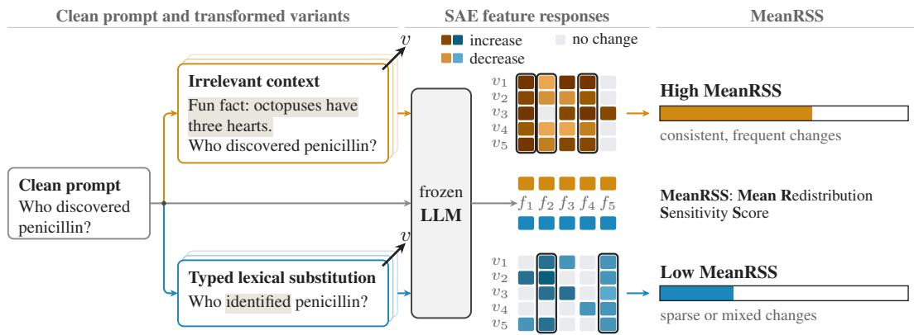  
Figure 1: RSS under prompt transformations. In the illustrated five-variant selection, boxed features change in the same direction in at least four variants. MeanRSS averages their absolute response magnitudes.

Recurring representation change is not the same as downstream effect. A selected feature can receive little readout weight, contributions from different features can cancel, and a change in readout score need not cross the decision threshold. We therefore decompose the contribution of recurrent changes to a fixed linear readout and assess the remaining margin relative to the clean input. We evaluate this connection through offline audits of two frozen safety readouts with known labels. Our main contributions are as follows.

• We introduce RSS to identify sparse feature changes that recur in a consistent direction across related prompt transformations, and evaluate fixed supports on variants excluded from selection. Across 27 pretrained SAEs, the tested transformations yield a reproducible redistribution profile beyond the variants used to select the supports.

• We separate recurring representation change from downstream contribution and decision failure. For a fixed linear readout, an exact decomposition shows how response magnitude, readout weight, directional alignment, and the clean margin connect recurrent changes to readout effects and threshold crossing.

• We show that recurrent changes selected without readout information nevertheless explain substantial held out readout variation. In two frozen safety readouts, RSS supports reconstruct held out logit changes and retain offline audit utility when combined with the clean margin. Median supports of 20 and 19 features yield recurrent failure AUROCs of 0.935 and 0.958, versus 0.965 and 0.964 using full erosion.

## 2 Related Work

Sparse autoencoder features have been evaluated through reconstruction, sparsity, and downstream use (Bricken et al., 2023; Huben et al., 2024; Gao et al., 2025; Makelov et al., 2025; Karvonen et al., 2025; Kantamneni et al., 2025). Related inputs can also alter which features respond, including absorption into more specific features and changes under prompt or surface form variation (Chanin et al., 2025; Cho & Hockenmaier, 2025; Verma et al., 2026). Feature sensitivity has also been measured as activation reliability across semantically related texts (Tian et al., 2025). RSS instead asks which transformation induced feature changes recur after the support is fixed and evaluates those changes on variants excluded from selection.

Prompt sensitivity studies show that format, ordering, and wording can alter model behavior (Zhao et al., 2021; Sclar et al., 2024; Mizrahi et al., 2024; Chatterjee et al., 2024), while other work studies stable representation directions and SAE responses to optimized perturbations (Dasgupta et al., 2026; Li et al., 2026). We use controlled prompt variation to study recurring redistribution within the sparse basis rather than behavioral sensitivity alone.

Linear probes on SAE activations test whether task relevant information can be recovered from internal representations (Kantamneni et al., 2025), while feature interventions can reveal context dependent downstream effects (Hoang et al., 2026). Our fixed readout analysis serves a different purpose. We hold the fitted readout fixed and measure how much of its prompt induced change is carried by features selected without readout information.

## 3 Method

We select recurrent feature responses without using the readout, then quantify their contributions to a fixed linear readout and the remaining margin.

## 3.1 Redistribution Sensitivity Score

A large change on one variant need not recur. RSS therefore forms a magnitude based candidate pool, requires recurrence and directional consistency within it, and retains the largest eligible responses.

All quantities are defined for one pretrained SAE, layer, base prompt, and transformation setting. Let $x _ { 0 }$ be the clean prompt and $x _ { v } , v \in V .$ , its transformed variants. At the aligned target position, $\boldsymbol { a } _ { f } ( \boldsymbol { x } )$ is the activation of feature $f$ . Define its change and average response magnitude by

$$
\delta _ { v , f } = a _ { f } ( x _ { v } ) - a _ { f } ( x _ { 0 } ) ,\tag{1}
$$

$$
h _ { f } = \frac { 1 } { | V | } \sum _ { v \in V } | \delta _ { v , f } | .\tag{2}
$$

Here $h _ { f }$ averages absolute changes, so opposing directions do not cancel, and the M largest values form the candidate pool $C _ { M }$ . Supplementary Section S3 specifies operator-level averaging for repeated realizations.

Recurrence and direction are measured from n selector observations. An observation is an individual variant change or an operator’s mean change, depending on the protocol. Let $n _ { f } ^ { + }$ count observations greater than $\tau ,$ and $n _ { f } ^ { - }$ count observations less than −τ. Define

$$
r _ { f } = \frac { n _ { f } ^ { + } + n _ { f } ^ { - } } { n } , \qquad c _ { f } = \frac { \operatorname* { m a x } ( n _ { f } ^ { + } , n _ { f } ^ { - } ) } { n _ { f } ^ { + } + n _ { f } ^ { - } } ,\tag{3}
$$

Here $r _ { f }$ measures recurrence, $c _ { f }$ directional consistency among responding observations, and $s _ { f }$ their dominant direction; $c _ { f } = 0$ when no observation responds.

Eligible features satisfy $r _ { f } ~ \geq ~ \rho$ and $c _ { f } \ \geq \ \kappa$ . Let $\mathcal { E } _ { M } = \left\{ f \in C _ { M } : r _ { f } \geq \rho , c _ { f } \geq \kappa \right\}$ and $k = \mathrm { m i n } ( K , | \mathcal { E } _ { M } | )$ . RSS retains the k eligible features with largest $h _ { f }$ as the responsive support S. Since $\kappa > 1 / 2$ , tied directions are ineligible. For nonempty ${ \check { S , } }$

$$
\mathrm { M e a n R S S } = \frac { 1 } { | S | } \sum _ { f \in S } h _ { f } .\tag{4}
$$

RSS selects the support, whereas MeanRSS summarizes its response magnitude. An empty support makes the summary unavailable rather than zero.

Proposition 1 (Constrained magnitude characterization of RSS)

$$
S \in \arg \operatorname* { m a x } _ { T \subseteq \mathcal { E } _ { M } } \sum _ { f \in T } h _ { f } .\tag{5}
$$

$I f \left| { \mathcal { E } } _ { M } \right| \geq K ,$ , the same objective is maximized over all dictionary features satisfying the recurrence and directional consistency constraints, up to ties.

The eligibility constraints imply a finite sample directional margin. Let $d _ { f } = \operatorname* { m a x } ( n _ { f } ^ { + } , n _ { f } ^ { - } )$ and $o _ { f } = \operatorname* { m i n } ( n _ { f } ^ { + } , n _ { f } ^ { - } )$ denote the dominant and opposing response counts.

Proposition 2 (Finite sample directional margin) Every selected feature satisfies

$$
\frac { d _ { f } } { n } = r _ { f } c _ { f } \geq \rho \kappa ,\tag{6}
$$

$$
\frac { d _ { f } - o _ { f } } { n } = r _ { f } ( 2 c _ { f } - 1 ) \geq \rho ( 2 \kappa - 1 ) .\tag{7}
$$

With $n = 5$ and $\rho = \kappa = 0 . 8$ , at least four observations share the dominant direction and at most one opposes it, so changing or removing one observation cannot reverse that direction.

These guarantees apply only to the selection observations, so $S$ and $s _ { f }$ are fixed on $V _ { \mathrm { s e l } }$ and evaluated without recomputation on disjoint $V _ { \mathrm { h o } }$

## 3.2 Readout Effects of Redistribution

A fixed linear readout lets us isolate the contribution of each feature change exactly. Let $\widetilde { \boldsymbol { a } } _ { f } ( \boldsymbol { x } )$ denote activation scaled using clean training data. RSS remains defined on raw feature changes, so probe scaling does not alter S. Supplementary Section S3 gives scaling, probe fitting, and threshold calibration. Define

$$
\widetilde { \delta } _ { v , f } = \widetilde { a } _ { f } ( x _ { v } ) - \widetilde { a } _ { f } ( x _ { 0 } ) ,\tag{8}
$$

$$
\boldsymbol { z } ( \boldsymbol { x } ) = \mathbf { w } ^ { \top } \widetilde { \mathbf { a } } ( \boldsymbol { x } ) + b ,
$$

$$
m ( x ) = y [ z ( x ) - t ] , \qquad m _ { 0 } = m ( x _ { 0 } ) ,\tag{9}
$$

where $\mathbf { w } , b$ define the fixed readout, $y \in \{ - 1 , + 1 \}$ is the class sign, and t the fixed threshold. Positive margin denotes a correct decision, with m0 its clean value.

Equal response magnitudes can have different downstream effects because of direction and cancellation. For a variant set U, define average response magnitude $A _ { f } ^ { U }$ , alignment $\eta _ { f } ^ { U }$ with the RSS selected direction, and signed margin erosion $e _ { f } ^ { U }$

$$
A _ { f } ^ { U } = \frac { 1 } { | U | } \sum _ { v \in U } | \widetilde { \delta } _ { v , f } | ,\tag{10}
$$

$$
\eta _ { f } ^ { U } = \frac { s _ { f } \sum _ { v \in U } \widetilde { \delta } _ { v , f } } { \sum _ { v \in U } | \widetilde { \delta } _ { v , f } | } , \qquad - 1 \leq \eta _ { f } ^ { U } \leq 1 ,\tag{11}
$$

$$
e _ { f } ^ { U } = - y w _ { f } \frac { 1 } { | U | } \sum _ { v \in U } \widetilde { \delta } _ { v , f } .\tag{12}
$$

$A _ { f } ^ { U }$ and $e _ { f } ^ { U }$ apply to every readout feature, while $\eta _ { f } ^ { U }$ is defined relative to $s _ { f }$ for $f \in S$ Positive $e _ { f } ^ { \ ' U }$ erodes the margin; the sign of $\eta _ { f } ^ { U }$ indicates whether the net response over U follows $s _ { f } ,$ while $| \eta _ { f } ^ { U } |$ decreases with cancellation. We set $\eta _ { f } ^ { U } = 0$ when its denominator is zero. These quantities aggregate over $U ;$ Section 3.4 treats individual held out variants separately.

Proposition 3 (RSS direction and readout contribution) For $f \in S ,$

$$
e _ { f } ^ { U } = - y w _ { f } s _ { f } A _ { f } ^ { U } \eta _ { f } ^ { U } , \qquad | e _ { f } ^ { U } | = | w _ { f } | A _ { f } ^ { U } | \eta _ { f } ^ { U } | \le | w _ { f } | A _ { f } ^ { U } .\tag{13}
$$

For nonzero contribution, $\mathsf { s i g n } ( - y w _ { f } s _ { f } )$ predicts sign(eUf ) exactly when $\eta _ { f } ^ { U } > 0$

On the selection variants, write $e _ { f } = e _ { f } ^ { V _ { \mathrm { s e l } } }$ . The full and selected contributions to average margin erosion are

$$
E = \sum _ { f } e _ { f } , \qquad E _ { S } = \sum _ { f \in S } e _ { f } ,\tag{14}
$$

where E is full average margin erosion and $E _ { S }$ the part carried by the RSS support.

## 3.3 Support Fidelity and Residual Margin

To assess how much margin remains, we combine average erosion with the clean margin:

$$
m _ { \mathrm { r e s } } = m _ { 0 } - E ,
$$

$$
m _ { \mathrm { r e s } } ^ { S } = m _ { 0 } - E _ { S } ,\tag{15}
$$

$$
m _ { \mathrm { r e s } } = \frac { 1 } { | V _ { \mathrm { s e l } } | } \sum _ { v \in V _ { \mathrm { s e l } } } m ( x _ { v } ) .\tag{16}
$$

Thus $m _ { \mathrm { r e s } }$ is exactly the average transformed margin on $V _ { \mathrm { s e l } }$ , while $m _ { \mathrm { r e s } } ^ { S }$ replaces full erosion by $E _ { S }$ but retains the full clean margin $m _ { 0 }$

On held out variants, let $e _ { f } ^ { \mathrm { h o } } = e _ { f } ^ { V _ { \mathrm { h o } } }$ . For nonzero total absolute contribution, Margin Contribution Retention (MCR) measures the fraction retained by $S { \mathrm { : } }$

$$
\mathsf { M C R } = \frac { \sum _ { f \in S } \left| e _ { f } ^ { \mathrm { h o } } \right| } { \sum _ { f } \left| e _ { f } ^ { \mathrm { h o } } \right| } .\tag{17}
$$

Because absolute values are taken after averaging each feature’s contribution over $V _ { \mathrm { h o } } ,$ MCR measures retained contribution magnitude rather than signed margin fidelity.

Signed fidelity also depends on transfer of the selected contributions and the net contribution of omitted features. Supplementary Section S1 gives the exact cancellation decomposition and conditions for preserving readout decisions and average margin rankings.

## 3.4 Localization, Readout Counterfactuals, and Selective Review

Average contributions do not resolve individual transformed decisions, so we evaluate the same support on each held out variant. Linearity gives the exact logit decomposition and the margin obtained by restoring selected readout inputs to their clean values:

$$
\boldsymbol { z } ( \boldsymbol { x } _ { v } ) - \boldsymbol { z } ( \boldsymbol { x } _ { 0 } ) = \sum _ { f } w _ { f } \widetilde { \delta } _ { v , f } ,\tag{18}
$$

$$
m _ { \mathrm { c f } } ( x _ { v } ) = m _ { 0 } + y \sum _ { f \not \in S } w _ { f } \widetilde { \delta } _ { v , f } .\tag{19}
$$

Restricting the first sum to S reconstructs the support’s logit shift. For an erroneous transformed decision, $m _ { \mathrm { c f } } ( x _ { v } ) > 0$ means that restoring the selected readout inputs reverses the error. This counterfactual changes only the readout computation, not the language model’s activations or generated behavior. For offline selective review, cases are ranked by increasing residual margin computed on selection variants and evaluated against errors on held out variants.

## 4 Experiments and Results

## 4.1 Systematic and Persistent Redistribution Across Pretrained SAEs

We first test whether the tested transformations produce a reproducible redistribution profile across pretrained SAEs. The study uses 1,000 English prompts across 12 content categories, generated once and fixed before SAE inference. The six settings contrast context and wrapper transformations, which alter surrounding material or presentation, with punctuation and lexical edits that modify the preserved request locally. We evaluate $2 { \dot { 7 } }$ pretrained SAEs spanning GPT-2 (Radford et al., 2019), Pythia (Biderman et al., 2023), Gemma 2 (Gemma Team, 2024), Gemma 3 (Gemma Team, 2025), Mistral (Jiang et al., 2023), and Llama 3.1 (Grattafiori et al., 2024) across multiple layers. We normalize the six MeanRSS setting means within each SAE to compare transformation profiles rather than absolute response scales. Each setting uses five operators with three realizations each; mean changes within each operator supply the selector observations, and the evaluated token remains aligned to the preserved target span. Supplementary Section S3 and Table S3 give the full protocol, selector parameters, and SAE specifications.

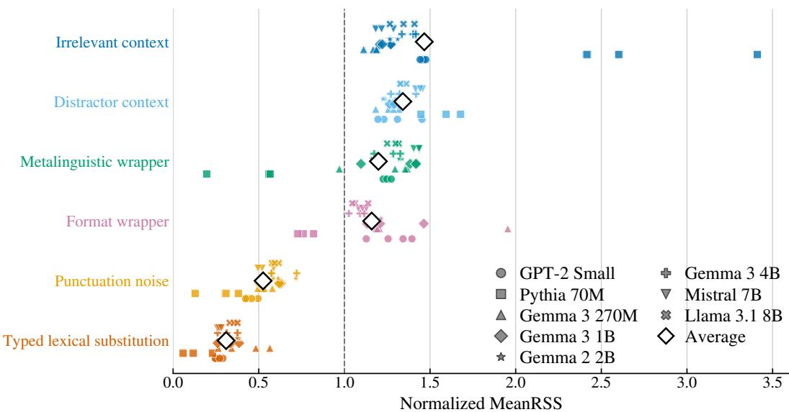  
Figure 2: Normalized MeanRSS across six prompt transformations and 27 pretrained SAEs. Each SAE’s six setting means are divided by their average, so the plot compares transformation profiles rather than absolute activation scales. Large outlined diamonds show averages across SAEs.

The normalized context and wrapper mean exceeds the local edit mean in all 27 SAEs, with an average difference of 0.874 and a 95% interval of [0.867, 0.881] from bootstrap resampling of base prompts with the SAE panel fixed. The pattern also holds across prompts: after aggregation across SAEs, the context and wrapper mean exceeds the local edit mean for all 1,000 prompts, and every context or wrapper setting exceeds both local edits for 997. Supplementary Section S4 reports support organization and robustness to feature scaling and unavailable cases. Across four intensity levels, the median prompt level Spearman correlations between intensity and MeanRSS are 0.95 for punctuation edits, 0.74 for irrelevant context, and 0.50 for the format wrapper. Supports are selected separately at each intensity, so this tests magnitude calibration rather than persistence of the same features. Supplementary Table S12 gives the intensity definitions.

We next test persistence beyond selection at two levels: whether a fixed support preserves the transformation profile on held out variants, and whether its features preserve their selected directions. Figure 3 evaluates the first question. RSS gives stronger context and wrapper versus local edit separation than each comparison method in 24–26 of 27 SAEs and gives the largest contrast in 22. The profile also remains stable under disjoint realization and operator holdouts (Supplementary Section S4). Directional consistency on the selection observations, including the finite sample guarantee in Proposition 2, does not guarantee the same direction on new variants. On held out variants, the response rate in the selected direction is 0.952 for RSS and 0.758 for random supports matched in size and candidate pool (Supplementary Tables S16–S17).

## 4.2 Feature Persistence and Functional Relevance in Frozen Readouts

To test whether recurring responses also affect a downstream computation, we audit two frozen linear safety readouts. The functional study uses 1,800 balanced WildGuardMix prompts (Han et al., 2024), split 1,200/300/300 into training, validation, and test sets. Probe fitting, regularization, threshold calibration, and layer selection use only clean training and validation data; the resulting readouts are frozen before transformed test evaluation. We use Gemma 3 4B layer 17 and Llama 3.1 8B layer 24, with selection and clean performance reported in Supplementary Table S18.

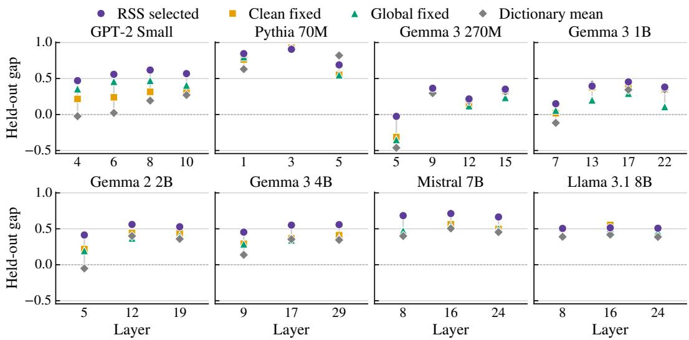  
Figure 3: Response contrast on variants excluded from feature selection. Each point is the normalized context and wrapper mean minus the local edit mean for the indicated feature set and SAE layer. Clean fixed: features selected from clean prompts. Global fixed: features selected by activity across the clean corpus. Dictionary mean: equal average over all SAE features.

For each test prompt and transformation setting, one realization per operator forms $V _ { \mathrm { s e l } }$ and the other two form disjoint $V _ { \mathrm { h o } }$ . The five selection variants determine the RSS support and ranking signals, while persistence, readout contributions, and failure are evaluated on the ten held out variants. This tests transfer to new realizations of the same operators without selecting on their outcomes. We define recurrent readout failure as at least two of the ten held out margins being negative. Requiring a correct clean prediction, available support, and complete outcomes leaves 1,524 Gemma and 1,445 Llama prompt and setting cases. Confidence intervals use bootstrap resampling clustered by base prompt. Large changes might already be stable without the RSS recurrence and consistency constraints. We therefore compare RSS with magnitude-only selection matched to the RSS support size, removing the recurrence and consistency constraints. For $f \in S .$ , held out response in the selected direction is

$$
r _ { f } ^ { \mathrm { h o } } = \frac { 1 } { \left| V _ { \mathrm { h o } } \right| } \sum _ { v \in V _ { \mathrm { h o } } } \mathbf { 1 } \left[ s _ { f } \delta _ { v , f } > \tau \right] .\tag{20}
$$

Mean held out response rates are 0.876 versus 0.816 for Gemma and 0.871 versus 0.794 for Llama (Figure 4A). Thus the RSS constraints improve persistence beyond magnitude selection.

Large contribution could instead reflect a large readout coefficient. After matching RSS features to unselected features by $| w _ { f } |$ , mean absolute held out contribution is 0.240 versus 0.022 for Gemma and 0.370 versus 0.022 for Llama, with RSS larger in 96.9% and 98.0% of matched pairs (Figure 4B). The sign rule in Proposition 3 agrees with the sign of the contribution averaged over held out variants in 97.4% and 97.1% of cases.

At K = 20, RSS retains 43.0% and 56.2% of absolute held out contribution, versus 32.6% and 43.5% for RSS supports selected for another transformation. RSS does not maximize retention: the readout aware $| e _ { f } |$ ranking, which uses selection variant contributions, retains more than 90% in both models (Figure 4C–D). RSS therefore retains useful contributions without selecting for the readout, although selection by readout contribution retains more.

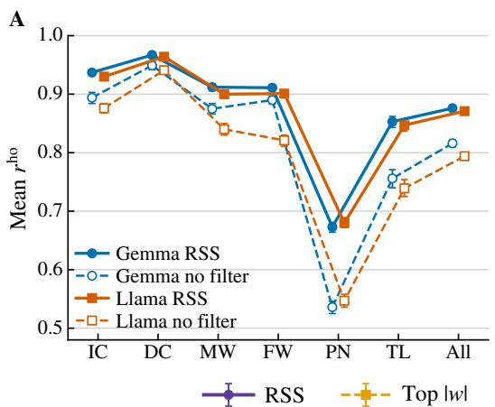

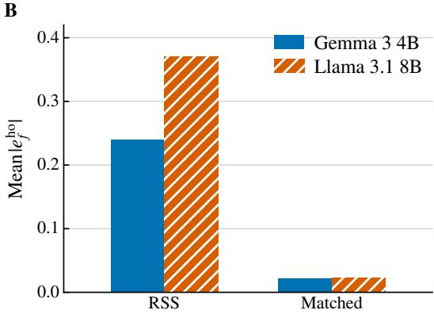

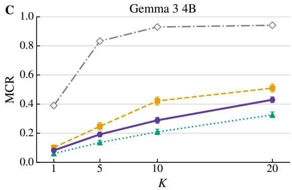

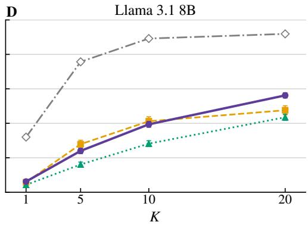  
Figure 4: Feature validation on held out variants. $\scriptstyle \mathbf { A } ,$ response rate in the direction chosen on selection variants, comparing RSS with magnitude alone. $\scriptstyle \mathrm { \mathrm { B } , }$ mean $| e _ { f } ^ { \mathrm { h o } } |$ for RSS features and unselected features matched by readout coefficient magnitude. ${ \mathrm { C - } } { \dot { \mathrm { D } } } ,$ , MCR as the support cap $K$ varies. The $| e _ { f } |$ ranking uses contributions from the selection variants.

## 4.3 Frozen Readout Failure Depends on Alignment and Remaining Margin

A feature response can be persistent and functionally relevant without pushing the readout toward an error. We therefore compare response magnitude, weighted magnitude, signed erosion, and residual margin against held out erosion and recurrent readout failure (Figure 5A).

Although probe AUROC remains above 0.90 under every transformation, 4.2–9.5% of decisions change. MeanRSS correlates weakly with held out margin erosion, and absolute probe weighting adds only modest information. Full erosion estimated on selection variants correlates with held out erosion at 0.923 for Gemma and 0.896 for Llama. The corre sponding RSS support correlations are 0.737 and 0.793 (Supplementary Table S25). Thus the selected responses retain substantial information about erosion, though less than the full readout.

Clean margin alone gives recurrent failure AUROCs of 0.863 for Gemma and 0.901 for Llama. Subtracting RSS support erosion from the full clean margin gives AUROCs of 0.935 and 0.958, using median supports of 20 and 19 features. The full residual margins give 0.965 and 0.964 (Figure 5; Supplementary Table S26). These are offline rankings using known class labels, with erosion computed on selection variants and recurrent failure measured on held out variants.

Failures concentrate at low full residual margin (Figure 5B), and every case with negative full residual margin has recurrent readout failure in this cohort. Because residual margin is computed on selection variants whereas recurrent failure is defined on held out decisions, this association reflects transfer rather than an identity.

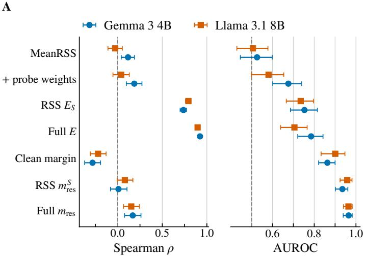

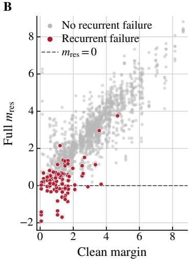  
Figure 5: Readout change and recurrent readout failure on held out variants. A, Spearman correlation with held out margin erosion and AUROC for recurrent failure. Correlation measures erosion transfer, while AUROC measures failure ranking; residual margin correlations are oriented toward increasing risk. B, clean margin versus full residual margin for Gemma 3 4B, colored by held out recurrent failure. The dashed line marks zero average selection margin.

## 4.4 Compact Supports Preserve Readout Change and Audit Utility

Because failure ranking also uses the full clean margin, we separately test how much readout change the selected support reconstructs on individual held out variants.

RSS reconstructs held out logit changes with $R ^ { 2 }$ of approximately 0.58 and 0.63. Restoring selected readout inputs to their clean values reverses 72.2% and 71.8% of transformed probe errors (Figure 6A–B). Mismatched supports perform worse, whereas globally unstable and random features yield $R ^ { 2 }$ of only about 0.01–0.02. These comparisons localize a substantial part of the readout change to the selected responses (Supplementary Table S29). The restoration test acts only inside the readout.

At a 20% offline review budget, the RSS residual margin captures 89.2% of Gemma errors and 92.8% of Llama errors, together with 87.3% and 94.4% of harmful false negatives (Figure 6C–D). The median supports contain 20 and 19 features, compared with 415 and 862 nonzero coefficients in the full readouts. Supplementary Tables S27 and S31 give the full comparison and uncertainty intervals. The compact object here is the set of changes used for each case, not a single reduced probe that replaces the full clean computation.

## 5 Discussion and Conclusion

The results establish recurring redistribution as a distinct property of sparse representations under prompt variation. Rather than asking only whether an individual feature responds or how far the representation moves in aggregate, RSS identifies sparse changes that recur across related transformations and remain observable on variants excluded from selection. The shared profile across pretrained SAEs further shows that these recurring changes can form structured patterns within a fixed sparse basis. A second implication is that recurring representation change and downstream effect are related but distinct quantities. A recurrent feature response affects a fixed readout through its response magnitude, readout weight, directional alignment, and the clean margin. This decomposition turns redistribution from a representational observation into a quantity that can be related directly to downstream computation, while explaining why large changes need not cause failure and smaller aligned changes can matter near a decision boundary.

B  
D  
A  
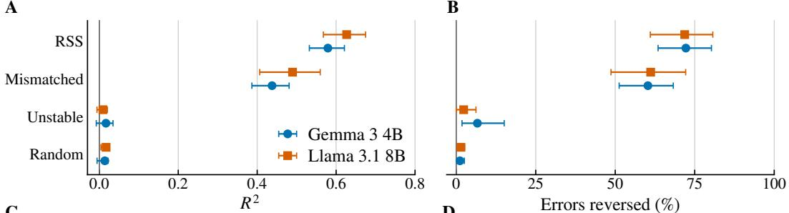  
C

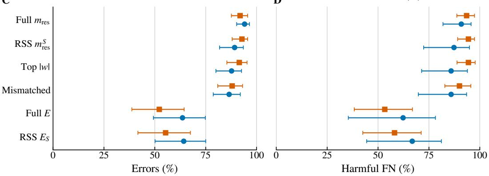  
Figure 6: Utility of RSS supports selected for each prompt and transformation within the frozen readout. $\textstyle \mathrm { A } , R ^ { 2 }$ for reconstructed held out logit changes. B, readout errors reversed by restoring selected feature values. C–D, errors and harmful false negatives captured at a 20% offline review budget using known labels. Error bars show 95% bootstrap confidence intervals.

Most importantly, the recurring changes are selected without readout information, yet they explain a substantial part of held out readout variation. Their value therefore extends beyond describing representation change: the same supports retain meaningful contribution, reconstruct logit changes, and localize changes that can alter readout decisions. This provides a direct bridge from recurrent sparse representation change to functional consequence within a fixed downstream computation. The results concern the tested transformations and frozen linear readouts, with the main functional holdout using new realizations of the same operators. Within this setting, RSS identifies recurring changes first and evaluates their downstream relevance separately.

## References

Stella Biderman, Hailey Schoelkopf, Quentin Anthony, Herbie Bradley, Kyle O’Brien, Eric Hallahan, Mohammad Aflah Khan, Shivanshu Purohit, USVSN Sai Prashanth, Edward Raff, Aviya Skowron, Lintang Sutawika, and Oskar van der Wal. Pythia: A suite for analyzing large language models across training and scaling. In Proceedings of the 40th International Conference on Machine Learning, volume 202 of Proceedings of Machine Learning Research, pp. 2397–2430, 2023. URL https://arxiv.org/abs/2304.01373.

Joseph Bloom. GPT2-Small-SAEs-Reformatted. Hugging Face model repository, 2024. URL https://huggingface.co/jbloom/GPT2-Small-SAEs-Reformatted.

Trenton Bricken, Adly Templeton, Joshua Batson, Brian Chen, Adam Jermyn, Tom Conerly, Nicholas L. Turner, Cem Anil, Carson Denison, Amanda Askell, Robert Lasenby, Yifan Wu, Shauna Kravec, Nicholas Schiefer, Tim Maxwell, Nicholas Joseph, Alex

Tamkin, Karina Nguyen, Brayden McLean, Josiah E. Burke, Tristan Hume, Shan Carter, Tom Henighan, and Christopher Olah. Towards monosemanticity: Decomposing language models with dictionary learning. Transformer Circuits Thread, 2023. URL https: //transformer-circuits.pub/2023/monosemantic-features.

David Chanin, James Wilken-Smith, Toma´s Dulka, Hardik Bhatnagar, Satvik Golechha,ˇ and Joseph Bloom. A is for absorption: Studying feature splitting and absorption in sparse autoencoders. In Advances in Neural Information Processing Systems, volume 38, pp. 82318–82355, 2025.

Anwoy Chatterjee, H S V N S Kowndinya Renduchintala, Sumit Bhatia, and Tanmoy Chakraborty. POSIX: A prompt sensitivity index for large language models. In Findings of the Association for Computational Linguistics: EMNLP 2024, pp. 14550–14565. Association for Computational Linguistics, 2024. doi: 10.18653/v1/2024.findings-emnlp.852.

Ikhyun Cho and Julia Hockenmaier. Toward efficient sparse autoencoder-guided steering for improved in-context learning in large language models. In Proceedings of the 2025 Conference on Empirical Methods in Natural Language Processing, pp. 28961–28973, Suzhou, China, 2025. Association for Computational Linguistics. doi: 10.18653/v1/2025.emnlp -main.1474. URL https://aclanthology.org/2025.emnlp-main.1474/.

Agnibh Dasgupta, Abdullah Tanvir, and Xin Zhong. Invariant features in language models: Geometric characterization and model attribution. arXiv preprint arXiv:2605.06458, 2026.

Nelson Elhage, Tristan Hume, Catherine Olsson, Nicholas Schiefer, Tom Henighan, Shauna Kravec, Zac Hatfield-Dodds, Robert Lasenby, Dawn Drain, Carol Chen, Roger Grosse, Sam McCandlish, Jared Kaplan, Dario Amodei, Martin Wattenberg, and Christopher Olah. Toy models of superposition. Transformer Circuits Thread, 2022. URL https://tran sformer-circuits.pub/2022/toy model/index.html.

Joshua Engels, Eric J. Michaud, Isaac Liao, Wes Gurnee, and Max Tegmark. Not all language model features are one-dimensionally linear. In The Thirteenth International Conference on Learning Representations, 2025. URL https://arxiv.org/abs/2405.14860.

Leo Gao, Tom Dupre la Tour, Henk Tillman, Gabriel Goh, Rajan Troll, Alec Radford, Ilya´ Sutskever, Jan Leike, and Jeffrey Wu. Scaling and evaluating sparse autoencoders. In International Conference on Learning Representations, 2025.

Gemma Team. Gemma 2: Improving open language models at a practical size. arXiv preprint arXiv:2408.00118, 2024. URL https://arxiv.org/abs/2408.00118.

Gemma Team. Gemma 3 technical report. arXiv preprint arXiv:2503.19786, 2025. URL https://arxiv.org/abs/2503.19786.

Aaron Grattafiori, Abhimanyu Dubey, Abhinav Jauhri, Abhinav Pandey, Abhishek Kadian, Ahmad Al-Dahle, et al. The Llama 3 herd of models. arXiv preprint arXiv:2407.21783, 2024. URL https://arxiv.org/abs/2407.21783.

Seungju Han, Kavel Rao, Allyson Ettinger, Liwei Jiang, Bill Yuchen Lin, Nathan Lambert, Yejin Choi, and Nouha Dziri. WildGuard: Open one-stop moderation tools for safety risks, jailbreaks, and refusals of LLMs. In Advances in Neural Information Processing Systems 37 (NeurIPS 2024) Datasets and Benchmarks Track, volume 37, pp. 8093–8131, 2024. URL https://arxiv.org/abs/2406.18495.

Zhengfu He, Wentao Shu, Xuyang Ge, Lingjie Chen, Junxuan Wang, Yunhua Zhou, Frances Liu, Qipeng Guo, Xuanjing Huang, Zuxuan Wu, Yu-Gang Jiang, and Xipeng Qiu. Llama Scope: Extracting millions of features from Llama-3.1-8B with sparse autoencoders. arXiv preprint arXiv:2410.20526, 2024. URL https://arxiv.org/abs/2410.20526.

Phu Gia Hoang, Anwoy Chatterjee, Tanmoy Chakraborty, Iryna Gurevych, and Subhabrata Dutta. Sparse autoencoders encode both concepts and functions: The downstream geometry of feature effects. arXiv preprint arXiv:2607.24645, 2026. URL https: //arxiv.org/abs/2607.24645.

Robert Huben, Hoagy Cunningham, Logan Smith, Aidan Ewart, and Lee Sharkey. Sparse autoencoders find highly interpretable features in language models. In International Conference on Learning Representations, pp. 7827–7845, 2024.

Albert Q. Jiang, Alexandre Sablayrolles, Arthur Mensch, Chris Bamford, Devendra Singh Chaplot, Diego de las Casas, Florian Bressand, Gianna Lengyel, Guillaume Lample, Lucile Saulnier, Lelio Renard Lavaud, Marie-Anne Lachaux, Pierre Stock, Teven Le Scao,´ Thibaut Lavril, Thomas Wang, Timothee Lacroix, and William El Sayed. Mistral 7B.´ arXiv preprint arXiv:2310.06825, 2023. URL https://arxiv.org/abs/2310.06825.

Subhash Kantamneni, Joshua Engels, Senthooran Rajamanoharan, Max Tegmark, and Neel Nanda. Are sparse autoencoders useful? A case study in sparse probing. In Proceedings of the 42nd International Conference on Machine Learning, volume 267 of Proceedings of Machine Learning Research, pp. 29018–29049. PMLR, 2025.

Adam Karvonen, Can Rager, Johnny Lin, Curt Tigges, Joseph Bloom, David Chanin, Yeu-Tong Lau, Eoin Farrell, Callum McDougall, Kola Ayonrinde, Demian Till, Matthew Wearden, Arthur Conmy, Samuel Marks, and Neel Nanda. SAEBench: A comprehensive benchmark for sparse autoencoders in language model interpretability. In Proceedings of the 42nd International Conference on Machine Learning, volume 267 of Proceedings of Machine Learning Research, pp. 29223–29264, 2025.

Aaron J. Li, Suraj Srinivas, Usha Bhalla, and Himabindu Lakkaraju. Evaluating adversarial robustness of concept representations in sparse autoencoders. In Proceedings of the 19th Conference of the European Chapter of the Association for Computational Linguistics (Volume 1: Long Papers), pp. 5940–5957. Association for Computational Linguistics, 2026. doi: 10.18653/v1/2026.eacl-long.279.

Tom Lieberum, Senthooran Rajamanoharan, Arthur Conmy, Lewis Smith, Nicolas Sonnerat, Vikrant Varma, Janos Kram´ ar, Anca Dragan, Rohin Shah, and Neel Nanda.´ Gemma Scope: Open sparse autoencoders everywhere all at once on Gemma 2. In Proceedings of the 7th BlackboxNLP Workshop: Analyzing and Interpreting Neural Networks for NLP, pp. 278–300. Association for Computational Linguistics, 2024. doi: 10.18653/v1/ 2024.blackboxnlp-1.19. URL https://aclanthology.org/2024.blackboxnlp-1.19/.

Aleksandar Makelov, Georg Lange, and Neel Nanda. Towards principled evaluations of sparse autoencoders for interpretability and control. In International Conference on Learning Representations, pp. 33588–33636, 2025.

Samuel Marks. Pythia-70M-deduped sparse autoencoders. Hugging Face model repository, 2024. URL https://huggingface.co/saprmarks/pythia-70m-deduped-saes.

Callum McDougall, Arthur Conmy, Janos Kram´ ar, Tom Lieberum, Senthooran Raja-´ manoharan, and Neel Nanda. Gemma Scope 2 - technical paper. Google DeepMind Technical Report, 2025. URL https://storage.googleapis.com/deepmind-media/DeepM ind.com/Blog/gemma-scope-2-helping-the-ai-safety-community-deepen-understan ding-of-complex-language-model-behavior/Gemma Scope 2 Technical Paper.pdf.

Moran Mizrahi, Guy Kaplan, Dan Malkin, Rotem Dror, Dafna Shahaf, and Gabriel Stanovsky. State of what art? A call for multi-prompt LLM evaluation. Transactions ofthe Association for Computational Linguistics, 12:933–949, 2024. doi: 10.1162/tacl a 00681.

Alec Radford, Jeff Wu, Rewon Child, David Luan, Dario Amodei, and Ilya Sutskever. Language models are unsupervised multitask learners. OpenAI technical report, 2019. URL https://cdn.openai.com/better-language-models/language models are unsupervise d multitask learners.pdf.

Senthooran Rajamanoharan, Tom Lieberum, Nicolas Sonnerat, Arthur Conmy, Vikrant Varma, Janos Kram ´ ar, and Neel Nanda. Jumping ahead: Improving reconstruction fi- ´ delity with JumpReLU sparse autoencoders. arXiv preprint arXiv:2407.14435, 2024. URL https://arxiv.org/abs/2407.14435.

Melanie Sclar, Yejin Choi, Yulia Tsvetkov, and Alane Suhr. Quantifying language models’ sensitivity to spurious features in prompt design or: How I learned to start worrying about prompt formatting. In International Conference on Learning Representations, 2024.

Claire Tian, Katherine Tian, and Nathan Hu. Measuring sparse autoencoder feature sensitivity. arXiv preprint arXiv:2509.23717, 2025. URL https://arxiv.org/abs/2509.23717.

Curt Tigges. pythia-70m-deduped res-sm processed. Hugging Face model repository, 2024. URL https://huggingface.co/ctigges/pythia-70m-deduped res-sm processed.

Aastha A K Verma, Anwoy Chatterjee, Mehak Gupta, and Tanmoy Chakraborty. Multilingual language models encode script over linguistic structure. In Proceedings of the 64th Annual Meeting of the Association for Computational Linguistics (Volume 1: Long Papers), pp. 33685–33719, San Diego, California, United States, July 2026. Association for Computational Linguistics. doi: 10.18653/v1/2026.acl-long.1554. URL https: //aclanthology.org/2026.acl-long.1554/.

Zihao Zhao, Eric Wallace, Shi Feng, Dan Klein, and Sameer Singh. Calibrate before use: Improving few-shot performance of language models. In Proceedings of the 38th International Conference on Machine Learning, volume 139 of Proceedings of Machine Learning Research, pp. 12697–12706. PMLR, 2021.

## Supplementary Material

The supplementary material provides the proofs, definitions of plotted quantities, complete protocols, and extended representation and readout results. Table S1 summarizes the notation used throughout these analyses.

Table S1: Core notation. Quantities are defined for one pretrained SAE, layer, base prompt, and transformation setting unless stated otherwise.
<table><tr><td>Symbol</td><td>Meaning</td></tr><tr><td> $x _ { 0 } , x _ { v }$ </td><td>clean prompt and its vth transformed variant</td></tr><tr><td> $\delta _ { v , f }$ </td><td>change in SAE feature f from  $x _ { 0 }$  to  $x _ { v }$ </td></tr><tr><td> $h _ { f }$ </td><td>mean absolute feature change used for RSS magnitude ranking</td></tr><tr><td> $\check { S }$ </td><td>responsive support selected by RSS</td></tr><tr><td>MeanRSS</td><td>average  $h _ { f }$  over the responsive support</td></tr><tr><td> $\widetilde { \delta } _ { v , f }$ </td><td>standardized feature change used by the frozen probe</td></tr><tr><td> $A _ { f } ^ { \mathcal { \tilde { U } } }$ </td><td>mean absolute standardized response of feature f on variant set U</td></tr><tr><td> $\eta _ { f } ^ { \dot { U } }$ </td><td>directional factor on U relative to the direction selected by RSS</td></tr><tr><td> ${ \dot { m } } ( x ) , m _ { 0 }$ </td><td>signed margin and clean signed margin</td></tr><tr><td> $e _ { f } ^ { U }$ </td><td>feature contribution to margin erosion on variant set U</td></tr><tr><td> $\check { E } , E _ { S }$ </td><td>full and RSS support margin erosion on  $V _ { \mathrm { s e l } }$ </td></tr><tr><td> $m _ { \mathrm { r e s } } , m _ { \mathrm { r e s } } ^ { S }$ </td><td>full and RSS support residual margin</td></tr><tr><td>MCR</td><td>fraction of absolute held out feature contribution retained by S</td></tr></table>

## S1 Mathematical Properties and Proofs

We first prove the selector properties and the readout contribution factorization. We then separate transfer error from omitted contributions and derive conditions for preserving readout decisions and average margin rankings. Selector thresholds and other protocol parameters are listed in Supplementary Table S2.

## ProofofProposition 1

By construction, ${ \mathcal { E } } _ { M }$ is the set of candidate features that satisfy the recurrence and directional consistency constraints, and RSS retains the k members with largest $h _ { f }$ . Suppose another k-feature subset $T \subseteq { \mathcal { E } } _ { M }$ had a larger value of $\textstyle \sum _ { f \in T } h _ { f }$ . Then at least one feature in $T \setminus S$ would have larger $h _ { f }$ than a feature in $S \setminus T ,$ contradicting the ranking rule. This proves Equation 5.

If $| \mathcal { E } _ { M } | \ge K ,$ every feature outside $C _ { M }$ has magnitude no larger than the candidate pool cutoff, while $C _ { M }$ already contains at least K eligible features. No eligible feature outside $C _ { M }$ can therefore increase the constrained top-K objective. Ties at the candidate pool cutoff can produce additional maximizers with the same objective value.

## Proof of Proposition 2

For a selected feature,

$$
d _ { f } + o _ { f } = n _ { f } ^ { + } + n _ { f } ^ { - } = n r _ { f }
$$

and

$$
\frac { d _ { f } } { d _ { f } + o _ { f } } = c _ { f } .
$$

Therefore

$$
{ \frac { d _ { f } } { n } } = r _ { f } c _ { f }
$$

and

$$
{ \frac { d _ { f } - o _ { f } } { n } } = { \frac { ( d _ { f } + o _ { f } ) ( 2 c _ { f } - 1 ) } { n } } = r _ { f } ( 2 c _ { f } - 1 ) .
$$

Using $r _ { f } \geq \rho$ and $c _ { f } \geq \kappa > 1 / 2$ gives Equation 7.

For $n = 5$ and $\rho = \kappa = 0 . 8$ , at least four observations respond and at least 80% of the responding observations must share the dominant direction. Hence $d _ { f } \geq 4$ and $o _ { f } \leq 1 _ { \cdot }$ , so $d _ { f } - o _ { f } \geq 3 .$ . Arbitrarily changing one observation can reduce this difference by at most two, leaving it positive; deleting one observation can reduce it by at most one. Neither operation can reverse the dominant direction.

## Population Response Statistics

The finite sample directional margin is a property of the selected observations. Population response statistics provide a separate view of why magnitude alone does not determine directional recurrence because variation around a mean response also matters. Under a distribution of changes, let $\mu _ { f } = \mathbb { E } [ \delta _ { f } ]$ and $v _ { f } = \mathrm { V a r } ( \delta _ { f } )$ . Jensen’s inequality, the triangle inequality, and Cauchy–Schwarz give

$$
| \mu _ { f } | \leq \mathbb { E } | \delta _ { f } | \leq | \mu _ { f } | + \sqrt { v _ { f } } .\tag{21}
$$

If $| \mu _ { f } | > \tau ,$ Cantelli’s inequality gives

$$
\operatorname* { P r } \Big [ \mathrm { s i g n } ( \mu _ { f } ) \delta _ { f } > \tau \Big ] \geq \frac { ( | \mu _ { f } | - \tau ) ^ { 2 } } { v _ { f } + ( | \mu _ { f } | - \tau ) ^ { 2 } } .\tag{22}
$$

These bounds relate absolute response magnitude, variation, and the probability of a response in the direction of the population mean. They do not supply a population guarantee for a direction selected from finite data and do not enter Proposition 2.

For completeness, let $a = \left| \mu _ { f } \right| - \tau > 0$ and $X = \mathrm { s i g n } ( \mu _ { f } ) ( \delta _ { f } - \mu _ { f } )$ . Then $\mathbb { E } X = 0 , \operatorname { V a r } ( X ) =$ $v _ { f } ,$ , and $\mathrm { s i g n } ( \mu _ { f } ) \delta _ { f } \leq \tau$ implies $X \leq - a$ . Cantelli’s inequality gives

$$
\operatorname* { P r } [ X \leq - a ] \leq { \frac { v _ { f } } { v _ { f } + a ^ { 2 } } } ,
$$

which yields Equation 22.

## Proof of Proposition 3

For $A _ { f } ^ { U } > 0$ , Equation 12 gives

$$
s _ { f } A _ { f } ^ { U } \eta _ { f } ^ { U } = s _ { f } \left( \frac { 1 } { | U | } \sum _ { v \in U } | \widetilde { \delta } _ { v , f } | \right) \frac { s _ { f } \sum _ { v \in U } \widetilde { \delta } _ { v , f } } { \sum _ { v \in U } | \widetilde { \delta } _ { v , f } | } = \frac { 1 } { | U | } \sum _ { v \in U } \widetilde { \delta } _ { v , f } ,
$$

because $s _ { f } ^ { 2 } = 1$ . Substitution into Equation 12 gives

$$
e _ { f } ^ { U } = - y w _ { f } s _ { f } A _ { f } ^ { U } \eta _ { f } ^ { U } .
$$

The triangle inequality gives

$$
| \eta _ { f } ^ { U } | = \frac { \left| \sum _ { v \in U } \widetilde { \delta } _ { v , f } \right| } { \sum _ { v \in U } | \widetilde { \delta } _ { v , f } | } \leq 1 ,
$$

so

$$
| e _ { f } ^ { U } | = | w _ { f } | A _ { f } ^ { U } | \eta _ { f } ^ { U } | \leq | w _ { f } | A _ { f } ^ { U } .
$$

When the contribution is nonzero, its sign differs from sign $\left( - y w _ { f } s _ { f } \right)$ only through the sign of $\eta _ { f } ^ { U }$ , proving the final statement. The zero-response case follows from the definitions $A _ { f } ^ { U } = \eta _ { f } ^ { U } = e _ { f } ^ { U } = 0$

## Held Out Support Fidelity and Preservation

The main text separates held out residual-margin error into transfer of the selected support and signed contribution omitted from it. We first make the role of cancellation explicit. Let

$$
E ^ { \mathrm { h o } } = \sum _ { f } e _ { f } ^ { \mathrm { h o } } , \qquad E _ { S } ^ { \mathrm { h o } } = \sum _ { f \in S } e _ { f } ^ { \mathrm { h o } } ,
$$

and define the omitted absolute mass and cancellation factor

$$
L _ { S } ^ { \mathrm { h o } } = \sum _ { f \notin { \cal S } } | e _ { f } ^ { \mathrm { h o } } | , \qquad \chi _ { S } ^ { \mathrm { h o } } = \frac { \left| \sum _ { f \notin { \cal S } } e _ { f } ^ { \mathrm { h o } } \right| } { L _ { S } ^ { \mathrm { h o } } } .\tag{23}
$$

We set $\chi _ { S } ^ { \mathrm { h o } } = 0$ when $L _ { S } ^ { \mathrm { h o } } = 0$ . By construction, $0 \leq \chi _ { S } ^ { \mathrm { h o } } \leq 1$ . Values near one indicate little cancellation among omitted contributions, while values near zero indicate strong cancellation. The following identities involving MCR apply when the total absolute held out contribution is nonzero, as required by its definition.

Proposition 4 (Held out support fidelity) The signed contribution omitted from S satisfies the exact identity

$$
\Big | E ^ { \mathrm { h o } } - E _ { S } ^ { \mathrm { h o } } \Big | = \chi _ { S } ^ { \mathrm { h o } } \big ( 1 - \mathrm { M C R } \big ) \sum _ { f } | e _ { f } ^ { \mathrm { h o } } | .\tag{24}
$$

Moreover,

$$
\Big | \bar { m } _ { \mathrm { h o } } - m _ { \mathrm { r e s } } ^ { S } \Big | \leq \Big | E _ { S } ^ { \mathrm { h o } } - E _ { S } \Big | + \chi _ { S } ^ { \mathrm { h o } } ( 1 - \mathrm { M C R } ) \sum _ { f } | e _ { f } ^ { \mathrm { h o } } | .\tag{25}
$$

The support transfer term can further be bounded as

$$
\left| E _ { S } ^ { \mathrm { h o } } - E _ { S } \right| \leq \sum _ { f \in S } \vert w _ { f } \vert \left( \left. A _ { f } ^ { \mathrm { h o } } - A _ { f } ^ { \mathrm { s e l } } \right. + A _ { f } ^ { \mathrm { s e l } } \left. \eta _ { f } ^ { \mathrm { h o } } - \eta _ { f } ^ { \mathrm { s e l } } \right. \right) ,\tag{26}
$$

where $A _ { f } ^ { \mathrm { s e l } } = A _ { f } ^ { V _ { \mathrm { s e l } } } , A _ { f } ^ { \mathrm { h o } } = A _ { f } ^ { V _ { \mathrm { h o } } }$ and likewise for $\eta _ { f }$

Proof. By definition,

$$
E ^ { \mathrm { h o } } - E _ { S } ^ { \mathrm { h o } } = \sum _ { f \notin S } e _ { f } ^ { \mathrm { h o } } ,
$$

so Equation 23 gives

$$
\left| { \cal E } ^ { \mathrm { h o } } - { \cal E } _ { S } ^ { \mathrm { h o } } \right| = \chi _ { S } ^ { \mathrm { h o } } { \cal L } _ { S } ^ { \mathrm { h o } } .
$$

Equation 17 implies

$$
L _ { S } ^ { \mathrm { h o } } = \left( 1 - \mathrm { M C R } \right) \sum _ { f } | e _ { f } ^ { \mathrm { h o } } | ,
$$

which proves Equation 24. Since $\bar { m } _ { \mathrm { h o } } = m _ { 0 } - E ^ { \mathrm { h o } }$ and $m _ { \mathrm { r e s } } ^ { S } = m _ { 0 } - E _ { S } ,$

$$
\bar { m } _ { \mathrm { h o } } - m _ { \mathrm { r e s } } ^ { S } = ( E _ { S } - E _ { S } ^ { \mathrm { h o } } ) + ( E _ { S } ^ { \mathrm { h o } } - E ^ { \mathrm { h o } } ) .
$$

The triangle inequality together with Equation 24 proves Equation 25.

For the transfer term, Proposition 3 gives

$$
E _ { S } ^ { \mathrm { h o } } - E _ { S } = - y \sum _ { f \in { \cal S } } w _ { f } s _ { f } \left( A _ { f } ^ { \mathrm { h o } } \eta _ { f } ^ { \mathrm { h o } } - A _ { f } ^ { \mathrm { s e l } } \eta _ { f } ^ { \mathrm { s e l } } \right) .
$$

For each selected feature,

$$
\left| A _ { f } ^ { \mathrm { h o } } \eta _ { f } ^ { \mathrm { h o } } - A _ { f } ^ { \mathrm { s e l } } \eta _ { f } ^ { \mathrm { s e l } } \right| \leq \left| A _ { f } ^ { \mathrm { h o } } - A _ { f } ^ { \mathrm { s e l } } \right| + A _ { f } ^ { \mathrm { s e l } } \left| \eta _ { f } ^ { \mathrm { h o } } - \eta _ { f } ^ { \mathrm { s e l } } \right| ,
$$

because $| \eta _ { f } ^ { \mathrm { h o } } | \leq 1$ . Summing after multiplication by $| \boldsymbol { w } _ { f } |$ proves Equation 26.

Corollary 1 (Worst case accounting bounds) Since $\chi _ { S } ^ { \mathrm { h o } } \leq 1 .$

$$
\Big | E ^ { \mathrm { h o } } - E _ { S } ^ { \mathrm { h o } } \Big | \leq \left( 1 - \mathrm { M C R } \right) \sum _ { f } | e _ { f } ^ { \mathrm { h o } } | .\tag{27}
$$

On the selection variants,

$$
\left| m _ { \mathrm { r e s } } - m _ { \mathrm { r e s } } ^ { S } \right| = \left| \sum _ { f \notin { S } } e _ { f } \right| \leq \sum _ { f \notin { S } } | e _ { f } | .\tag{28}
$$

MCR controls omitted absolute contribution, whereas signed fidelity also depends on cancellation. Setting the cancellation factor to one gives the worst case bound, which does not use any cancellation among omitted features.

Preserving an average margin does not by itself preserve every individual decision. For a held out variant v, compare the omitted signed contribution with the margin reconstructed from selected changes. Define

$$
\widehat { m } _ { v } ^ { S } = m _ { 0 } + y \sum _ { f \in S } w _ { f } \widetilde { \delta } _ { v , f } .\tag{29}
$$

Corollary 2 (Readout decision preservation) If

$$
\left| \sum _ { f \notin { \cal S } } y w _ { f } \widetilde \delta _ { v , f } \right| < | \widehat m _ { v } ^ { \cal S } | ,\tag{30}
$$

then

$$
\mathrm { s i g n } m ( x _ { v } ) = \mathrm { s i g n } \widehat { m } _ { v } ^ { S } .
$$

Proof. Linearity gives

$$
m ( x _ { v } ) = \widehat { m } _ { v } ^ { S } + y \sum _ { f \notin { S } } w _ { f } \widetilde { \delta } _ { v , f } .
$$

Under Equation 30, the omitted signed contribution is too small to cross zero, so the two margins have the same sign.

A sufficient condition for preserving an ordering between cases is that their estimated margins differ by more than their possible transfer and omission errors. For each case $i ,$ define the held out fidelity radius

$$
B _ { i } = \left| E _ { S _ { i } } ^ { \mathrm { h o } } - E _ { S _ { i } } \right| + \chi _ { S _ { i } } ^ { \mathrm { h o } } ( 1 - \mathbf { M C R } _ { i } ) \sum _ { f } | e _ { i , f } ^ { \mathrm { h o } } | .\tag{31}
$$

Proposition 4 gives $| \bar { m } _ { \mathrm { h o } , i } - m _ { \mathrm { r e s } , i } ^ { S _ { i } } | \leq B _ { i }$

Corollary 3 (Held out ranking preservation) For cases i and j,

$$
m _ { \mathrm { r e s } , j } ^ { S _ { j } } - m _ { \mathrm { r e s } , i } ^ { S _ { i } } > B _ { i } + B _ { j } \quad \Longrightarrow \quad \bar { m } _ { \mathrm { h o } , j } > \bar { m } _ { \mathrm { h o } , i } .\tag{32}
$$

Proof. The fidelity radii imply

$$
\bar { m } _ { \mathrm { h o } , i } \leq m _ { \mathrm { r e s } , i } ^ { S _ { i } } + B _ { i } , \qquad \bar { m } _ { \mathrm { h o } , j } \geq m _ { \mathrm { r e s } , j } ^ { S _ { j } } - B _ { j } .
$$

Under Equation 32, the second lower bound exceeds the first upper bound, proving the result. This condition preserves the ordering of average held out margins, not the number of individual variants with negative margin.

## Dilution Across the Full Dictionary

Suppose k of F dictionary features respond with average magnitude $^ { a , }$ while the remaining features have negligible change. The mean over the full dictionary is approximately $( k \check { / } F ) a$ . When $k \ll F ,$ averaging over the full dictionary reduces the response by the factor ${ \dot { k } } / F _ { \astrosun }$ , while averaging over the responsive support preserves the scale a.

Exact Readout Decomposition

For standardized activations,

$$
z ( x _ { v } ) - z ( x _ { 0 } ) = \mathbf { w } ^ { \top } [ \widetilde { \mathbf { a } } ( x _ { v } ) - \widetilde { \mathbf { a } } ( x _ { 0 } ) ] = \sum _ { f } w _ { f } \widetilde { \delta } _ { v , f } .\tag{33}
$$

Restricting the final sum to $f \in S$ gives the reconstruction used in the localization analysis. Replacing the selected transformed activations by their clean values subtracts $\textstyle \sum _ { f \in S } w _ { f } \widetilde { \delta } _ { v , f }$ from the transformed logit. Multiplying by the label sign and adding the clean margin yields Equation 19. Thus the readout counterfactual reverses a transformed probe error exactly when the contribution remaining outside S leaves positive signed margin. The language model itself is unchanged.

## S2 Definitions of Plotted Quantities

This section specifies the quantities plotted in the main figures, separating representation profiles, feature contributions, and readout outcomes. All averages use available cases only. For Figures 2 and 3, quantities are defined within one SAE before aggregation across SAEs.

To compare response profiles across ${ \mathrm { S A E s , } }$ normalize each setting mean by the average across the six settings. For transformation setting g, let

$$
R _ { g } = \mathrm { m e a n } _ { i } ~ \mathrm { M e a n R S S } _ { i , g } , \qquad \widetilde { R } _ { g } = \frac { R _ { g } } { \frac { 1 } { 6 } \sum _ { g ^ { \prime } } R _ { g ^ { \prime } } } ,\tag{34}
$$

where i indexes prompts. Figure 2 plots ${ \widetilde { R } } _ { g }$ for each SAE. Thus the six values for each SAE have mean one.

For the transfer comparison, evaluate each selected or comparison feature set on held out variants before computing the transformation contrast. For a feature set A, define its held out response under setting g as

$$
\begin{array} { r } { H _ { g } ( A ) = \operatorname* { m e a n } _ { i } \operatorname* { m e a n } _ { f \in A _ { i , g } } \operatorname* { m e a n } _ { v \in V _ { \mathrm { h o } } } | \delta _ { v , f } | . } \end{array}\tag{35}
$$

We normalize $H _ { g } ( A )$ across the six settings in the same way as Equation 34, giving $\widetilde { H } _ { g } ( A )$ Let C denote the four context and wrapper settings and L the two local edits. The ordinate in Figure 3 is

$$
\Delta ( A ) = \frac { 1 } { 4 } \sum _ { g \in \mathcal { C } } \widetilde { H } _ { g } ( A ) - \frac { 1 } { 2 } \sum _ { g \in \mathcal { L } } \widetilde { H } _ { g } ( A ) .\tag{36}
$$

Figure 4A reports the cohort mean of the held out response rate in the selected direction, $r _ { f } ^ { \mathrm { h o } }$ , from Equation 20. Panel B reports the cohort mean of $| e _ { f } ^ { \mathrm { h o } } |$ for RSS features and features matched by coefficient magnitude. Panels C–D use MCR from Equation 17.

To evaluate transfer of the selection variant erosion estimates, define full held out erosion as

$$
E ^ { \mathrm { h o } } = \sum _ { f } e _ { f } ^ { \mathrm { h o } } = m _ { 0 } - \frac { 1 } { | V _ { \mathrm { h o } } | } \sum _ { v \in V _ { \mathrm { h o } } } m ( x _ { v } ) .\tag{37}
$$

Figure 5A reports Spearman correlation with $E ^ { \mathrm { { h o } } }$ and AUROC for recurrent failure. For residual-margin signals, the correlation sign is reported in the direction of increasing risk.

Localization compares the full logit change with the sum over the evaluated support. For each held out variant, let

$$
d = z ( x _ { v } ) - z ( x _ { 0 } ) , \qquad \widehat { d } _ { A } = \sum _ { f \in A } w _ { f } \widetilde { \delta } _ { v , f } .
$$

Figure 6A reports the standard coefficient of determination $R ^ { 2 }$ of $\widehat { d } _ { A }$ against d over the evaluated held out rows. Panel B reports the fraction of transformed probe errors $( m ( x _ { v } ) <$ 0) for which the corresponding readout-counterfactual margin becomes positive. Panels C– D report the fractions of all held out probe errors and harmful false negatives, respectively, contained in the highest-risk 20% of cases under each ranking signal.

## S3 Frozen Protocols and Reproducibility

The protocols specify the input transformations and target alignment before SAE analysis, then separate clean probe fitting from transformed evaluation. Table S2 lists the selection and uncertainty parameters.

Table S2: Selection and uncertainty parameters. The main representation protocol has five operator observations derived from fifteen variants per setting. The readout audit selects from five variants and evaluates on ten excluded variants.
<table><tr><td>Parameter</td><td>Value</td></tr><tr><td>Selector observations, n</td><td>5</td></tr><tr><td>Response rate threshold, ρ</td><td>0.8</td></tr><tr><td>Directional consistency threshold, κ</td><td>0.8</td></tr><tr><td>Response threshold, τ</td><td> $1 0 ^ { - 5 }$ </td></tr><tr><td>Candidate features, M</td><td>400</td></tr><tr><td>Support cap, K</td><td>20</td></tr><tr><td>Target token policy</td><td>final non special in target span</td></tr><tr><td>Bootstrap resamples</td><td>5,000</td></tr></table>

## Representation Corpus Protocol

In the separate five-variant analysis, all 90,000 expected prompt, SAE, and setting cases across the smaller four models are evaluated. Eighteen cases (0.02%), all under the two local edit settings, have no eligible feature and remain unavailable rather than assigned zero. This case count is distinct from the number of transformed input texts in the main protocol with 15 variants.

Table S3 lists the checkpoint and architecture details for all 27 pretrained SAEs. The GPT-2 and Pythia SAEs use released checkpoints from Bloom (2024); Tigges (2024) (with the original Pythia SAEs released by Marks (2024)); the Gemma 2 and Gemma 3 checkpoints are from Gemma Scope (Lieberum et al., 2024) and Gemma Scope 2 (McDougall et al., 2025), respectively; the Mistral checkpoints use the residual SAEs from Engels et al. (2025), and the Llama checkpoints are from Llama Scope (He et al., 2024).

Table S3: Pretrained SAE specifications (JumpReLU as in Rajamanoharan et al. (2024)). $" \mathrm { n . r . } ^ { \prime \prime }$ means not reported.
<table><tr><td>Model</td><td></td><td>Layers SAE checkpoint</td><td>Width Hook</td><td>Architecture / sparsity</td></tr><tr><td>GPT-2 Small</td><td> $4 , 6 , 8 ,$  10</td><td>GPT2-Smal1-SAEs-Refor 24,576resid_pre matted</td><td></td><td>ReLU, 32×; L1 coef.  $8 \times 1 0 ^ { - 5 }$ </td></tr><tr><td>Pythia-70M</td><td> $1 , 3 , 5$ </td><td>pythia-70m-deduped__r 32,768 resid_post es-sm</td><td></td><td>ReLU, standard; sparsity n.r.</td></tr><tr><td>Gemma 3 270M</td><td> $5 , 9 , 1 2 ,$  15</td><td>gemma-scope-2-270m-pt 16,384 resid_post</td><td></td><td>JumpReLU;  $L _ { 0 } = 1 8$  at layer 5 and 20 elsewhere</td></tr><tr><td>Gemma 3 1B</td><td> $7 , 1 3 ,$  17,22</td><td>gemma-scope-2-1b-pt</td><td>16,384 resid_post</td><td>JumpReLU;  $L _ { 0 } = 1 8$  at layer 7 and 20 elsewhere</td></tr><tr><td>Gemma 3 4B</td><td> $9 , 1 7 ,$   $2 9$ </td><td>gemma-scope-2-4b-pt</td><td>65,536 resid_post</td><td>JumpReLU; nominal  $\dot { L } _ { 0 } = 5 3 , 6 0 , 6 0$ </td></tr><tr><td>Mistral 7B</td><td> $8 , 1 6 ,$   $2 4$ </td><td>mistral_7b_layer_L</td><td>65,536 resid_pre</td><td>ReLU, 16×; measured  $L _ { 0 } = 9 2 , 7 4 , 7 5$ </td></tr><tr><td>Llama 3.1 8B</td><td> $8 , 1 6 ,$   $2 4$ </td><td>Llama3.1-  $\mathsf { L } \{ 8 , 1 6 , 2 4 \} \mathsf { R } \mathrm { - } 8 \mathsf { x }$ </td><td>32,768 resid_post</td><td>JumpReLU, 8×; measured  $L _ { 0 } \stackrel { \_ } { = } 5 0$ </td></tr><tr><td>Gemma 2 2B</td><td> $5 , 1 2 ,$  19</td><td>gemma-scope-2b-pt-res 65,536resid_post width_65k</td><td></td><td>JumpReLU; measured  $L _ { 0 } \dot { = } 5 3 , 7 2 , 6 3$ </td></tr></table>

## SAE Specifications

The four larger base models, which contribute twelve of these SAEs, use bfloat16 precision without quantization, while their SAEs use float32. Checkpoint preprocessing is unchanged. Gemma 3 4B and Gemma 2 2B use none, Mistral uses per token constant norm rescaling, and Llama Scope uses checkpoint specific rescaling using dataset statistics. These settings follow the released checkpoints and are not used as a common normalization across models.

## Prompt Provenance and Transformations

The 1,000 clean prompts are generated once, before any SAE inference, using GPT-5.4 snapshot gpt-5.4-2026-03-05 at temperature 0.6 with fixed acceptance criteria for length (5–30 words), naturalness, plausibility, category match, and duplication against previously generated prompts.

Irrelevant context prepends topically unrelated benign material. Distractor context prepends a benign competing task while retaining the original request as operative. Metalinguistic wrappers alter response mode or presentation. Format wrappers place the request in structured envelopes. Punctuation noise inserts local punctuation without changing the lexical sequence. Typed lexical substitution replaces noncritical words from a fixed type compatible pool. The preserved target phrase appears exactly once in every valid variant.

## Target Token Alignment

Every prompt records the character span of the preserved target. For each clean prompt and variant, the evaluated position is the final non special token overlapping that span. Prefixes and wrappers can shift the token index, but the evaluated surface span remains fixed. No mapping failures are observed across all 90,000 cases in the five-variant analysis.

## Handling Repeated Realizations

Section 3.1 gives the generic formulation. In the analysis using 15 variants, each case contains five transformation operators with three realizations per operator. Exact duplicate texts are collapsed within each operator before selection. Let $U _ { o }$ be the set of unique texts for operator o and $\delta _ { t , f }$ the feature change for text t. The mean change for operator o is

$$
\bar { \delta } _ { o , f } = \frac { 1 } { \vert U _ { o } \vert } \sum _ { t \in U _ { o } } \delta _ { t , f } ,\tag{38}
$$

and the candidate magnitude is

$$
h _ { f } = \frac { 1 } { 5 } \sum _ { o } \left[ \frac { 1 } { \left| U _ { o } \right| } \sum _ { t \in U _ { o } } \left| \delta _ { t , f } \right| \right] .\tag{39}
$$

An operator responds when $| \bar { \delta } _ { o , f } | > 1 0 ^ { - 5 }$ . A feature is eligible when it responds in at least four of five operators, the dominant direction share is at least 0.8, and it lies in the top M = 400 by $\bar { h } _ { f }$ . MeanRSS averages the absolute changes over operators and the selected support,

$$
\mathrm { M e a n R S S } = \frac { 1 } { 5 | S | } \sum _ { o } \sum _ { f \in S } \left[ \frac { 1 } { | U _ { o } | } \sum _ { t \in U _ { o } } | \delta _ { t , f } | \right] ,\tag{40}
$$

so that repeated realizations of the same text are collapsed before averaging. This expression reduces to Equation 4 when every operator has the same number of unique realizations. If duplicate removal leaves different numbers of unique realizations, the expression keeps the five operators equally weighted rather than weighting them by the number of remaining texts. The table of selected supports is available for 161,996 of 162,000 cases; unavailable cases remain missing.

## Safety Corpus and Probe Training

The safety corpus contains 900 harmful and 900 benign WildGuardMix prompts. Exact and near duplicates are grouped before the balanced split, and every prompt’s transformed variants remain in the same split. For each feature, the scale estimated from clean training data is

$$
\sigma _ { f } = \sqrt { \frac { 1 } { N _ { \mathrm { t r } } } \sum _ { i = 1 } ^ { N _ { \mathrm { t r } } } a _ { f } ( x _ { i } ) ^ { 2 } + 1 0 ^ { - 1 2 } } ,\tag{41}
$$

and features with $\sigma _ { f } < 1 0 ^ { - 8 }$ are removed. The retained activations are standardized as $\widetilde { \boldsymbol { a } } _ { f } ( \boldsymbol { x } ) = \boldsymbol { a } _ { f } ( \boldsymbol { x } ) / \sigma _ { f }$ . These standardized clean training activations feed an elastic-net logistic probe with objective

$$
\frac { 1 } { N } \sum _ { i = 1 } ^ { N } \log \left( 1 + \exp [ - y _ { i } ( \mathbf { w } ^ { \top } \widetilde { \mathbf { a } } _ { i } + b ) ] \right) + \lambda \left[ 0 . 9 \| \mathbf { w } \| _ { 1 } + \frac { 0 . 1 } { 2 } \| \mathbf { w } \| _ { 2 } ^ { 2 } \right] .\tag{42}
$$

The intercept is unpenalized. Clean validation AUROC selects λ, with a sparsity tie break inside a tolerance of 0.002. A threshold calibrated on clean benign validation logits targets at most 5% empirical false-positive rate. No transformed or test outcome enters unit, regularization, or threshold selection.

## S4 Extended RSS Atlas and Calibration

## Profiles Across Models and Layers

Figure S1 resolves the aggregate transformation profile by model and layer. It tests whether the context and wrapper versus local edit separation is shared across the sampled SAEs rather than driven by a subset of layers.

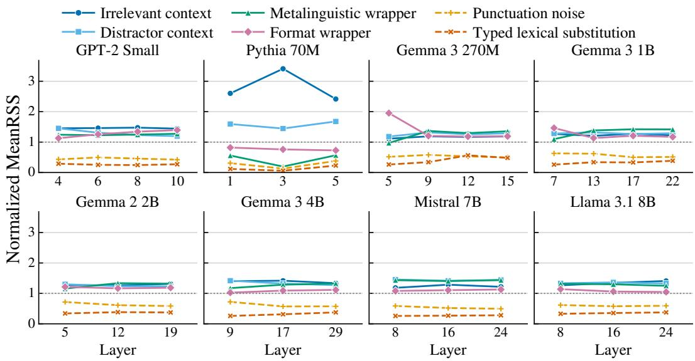  
Figure S1: Normalized MeanRSS profiles for the six transformations across all sampled layers of the eight models. Normalization follows Figure 2.

## Support Organization

Similar response magnitudes need not involve the same features. Figure S2 therefore compares selected feature identities across transformation settings using Jaccard overlap.

A  
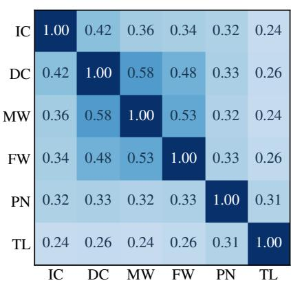

B  
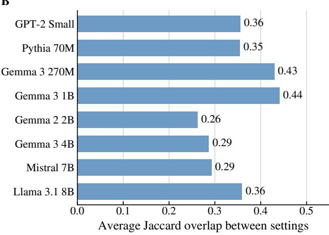  
Figure S2: Overlap between the feature supports selected under different transformations, averaged over all units and 1,000 prompts. A, pairwise Jaccard overlap between transformations; B, averages within each model. IC denotes irrelevant context, DC distractor context, MW metalinguistic wrapper, FW format wrapper, PN punctuation noise, and TL typed lexical substitution.

## Support Availability and Active Feature Changes

Tables S4 and S6 report support availability and the changes in active SAE coordinates between clean and transformed prompts. Availability is nearly complete across all settings. Context and wrapper transformations also change the active feature set more strongly than the two local edits.

Table S4: Support availability and size across transformation settings. Each setting contains 27,000 expected groups.
<table><tr><td>Setting</td><td>Available</td><td>Mean |S|</td><td>Median |S|</td><td>|S| = 20</td></tr><tr><td>Irrelevant context</td><td>27,000</td><td>19.36</td><td>20</td><td>90.3%</td></tr><tr><td>Distractor context</td><td>27,000</td><td>18.77</td><td>20</td><td>82.1%</td></tr><tr><td>Metalinguistic wrapper</td><td>27,000</td><td>19.06</td><td>20</td><td>86.6%</td></tr><tr><td>Format wrapper</td><td>27,000</td><td>18.56</td><td>20</td><td>82.1%</td></tr><tr><td>Punctuation noise</td><td>27,000</td><td>18.01</td><td>20</td><td>71.1%</td></tr><tr><td>Typed lexical substitution</td><td>26,996</td><td>16.18</td><td>20</td><td>54.6%</td></tr></table>

Table S5 shows that the treatment of the four unavailable groups does not change the aggregate comparison.

Table S5: Sensitivity to the treatment of unavailable groups. Gap is the context and wrapper mean minus the local-edit mean; brackets give 95% confidence intervals.
<table><tr><td>Treatment</td><td>Gap</td><td>95% CI</td><td>Order</td></tr><tr><td>Omitted</td><td>0.8740</td><td>[0.8671, 0.8810]</td><td>Reference</td></tr><tr><td>Assigned zero</td><td>0.8741</td><td>[0.8673, 0.8810]</td><td>Unchanged</td></tr></table>

For this analysis an active coordinate is a nonzero entry in the frozen sparse SAE encoding. For a clean prompt and one transformed prompt, let ${ \dot { A } } _ { 0 }$ and $A _ { v }$ denote their sets of active coordinates. We report $\vert A _ { 0 } \cap A _ { v } \vert / \vert A _ { 0 } \cup A _ { v } ^ { \bullet } \vert$ for overlap, $\vert A _ { v } \rangle A _ { 0 } \vert / \vert A _ { v } \vert$ for the newly active fraction, and $\vert A _ { 0 } \rangle \dot { \langle } A _ { v } \vert \dot { / } \vert A _ { 0 } \vert$ for the inactive fraction. When both sets are empty, overlap is undefined. When the transformed set is empty, the newly active fraction is undefined, and when the clean set is empty, the inactive fraction is undefined. Within each operator, exact repeated texts are collapsed before averaging; unique realizations are equally weighted and the five operators are then equally weighted. Table S6 reports these quantities together with the positive and negative shares of absolute activation change restricted to the RSS support. The two shares partition the support-level absolute change whenever that change is nonzero.

Table S6: Changes in active SAE coordinates between clean and transformed prompts. Overlap is Jaccard similarity, newly active is normalized by the transformed active set, and inactive is normalized by the clean active set. Positive and negative shares partition the absolute activation change within the RSS support.
<table><tr><td>Setting</td><td>Overlap</td><td>Newly active</td><td>Inactive</td><td>Positive</td><td>Negative</td></tr><tr><td>Irrelevant context</td><td>0.383</td><td>0.462</td><td>0.469</td><td>0.368</td><td>0.632</td></tr><tr><td>Distractor context</td><td>0.361</td><td>0.490</td><td>0.487</td><td>0.304</td><td>0.696</td></tr><tr><td>Metalinguistic wrapper</td><td>0.394</td><td>0.453</td><td>0.451</td><td>0.375</td><td>0.625</td></tr><tr><td>Format wrapper</td><td>0.381</td><td>0.496</td><td>0.478</td><td>0.230</td><td>0.770</td></tr><tr><td>Punctuation noise</td><td>0.692</td><td>0.198</td><td>0.187</td><td>0.406</td><td>0.594</td></tr><tr><td>Typed lexical substitution</td><td>0.776</td><td>0.133</td><td>0.133</td><td>0.381</td><td>0.619</td></tr></table>

An alternative selector applies the rule in Section 3.1 directly to all 15 variants without grouping them by operator. It produces mean off-diagonal Jaccard 0.316, compared with 0.354 for the main selector. Across the same SAE and transformation combinations, the two selectors have a Spearman correlation of 0.986 for normalized MeanRSS and a Jaccard overlap of 0.698 for supports selected under the same transformation. The transformation profiles are therefore nearly identical even though the exact selected features differ.

## Content Categories and Model Composition

To check whether prompt composition or a particular model drives the profile, Figure S3 separates the results by content category, and Figure S4 removes each model in turn. Table S7 gives the aggregate normalized profile, and Table S8 reports consistency across prompts after aggregation across SAEs.

Table S7: Aggregate normalized MeanRSS profile with equal weight for each SAE. Within each SAE, the six setting means are divided by their average. Brackets give 95% confidence intervals.
<table><tr><td>Setting</td><td>Normalized MeanRSS</td></tr><tr><td>Irrelevant context</td><td>1.466 [1.459, 1.474]</td></tr><tr><td>Distractor context</td><td>1.341 [1.337, 1.346]</td></tr><tr><td>Metalinguistic wrapper</td><td>1.199 [1.192, 1.205]</td></tr><tr><td>Format wrapper</td><td>1.159 [1.154, 1.164]</td></tr><tr><td>Punctuation noise</td><td>0.525 [0.519, 0.532]</td></tr><tr><td>Typed lexical substitution</td><td>0.309 [0.305, 0.314]</td></tr></table>

The prompt counts in Table S8 distinguish a positive mean group difference from the stronger condition that every context or wrapper setting exceeds both local edits.

Table S8: Prompt-level consistency over the 1,000 representation-corpus prompts.
<table><tr><td>Criterion</td><td>Prompts</td><td>Share</td></tr><tr><td>Context/wrapper mean &gt; local-edit mean</td><td>1,000 / 1,000</td><td>100.0%</td></tr><tr><td>Every context/wrapper setting &gt; both local edits</td><td>997 / 1,000</td><td>99.7%</td></tr></table>

A
<table><tr><td rowspan=1 colspan=7>A</td></tr><tr><td rowspan=1 colspan=1>arts culture</td><td rowspan=1 colspan=1>1.61</td><td rowspan=1 colspan=1>1.41</td><td rowspan=1 colspan=1>1.26</td><td rowspan=1 colspan=1>1.23</td><td rowspan=1 colspan=1>0.59</td><td rowspan=1 colspan=1>0.35</td></tr><tr><td rowspan=2 colspan=1>business admineducation research</td><td rowspan=1 colspan=1>1.46</td><td rowspan=1 colspan=1>1.30</td><td rowspan=1 colspan=1>1.14</td><td rowspan=1 colspan=1>1.14</td><td rowspan=1 colspan=1>0.52</td><td rowspan=1 colspan=1>0.32</td></tr><tr><td rowspan=1 colspan=1>1.51</td><td rowspan=1 colspan=1>1.27</td><td rowspan=1 colspan=1>1.09</td><td rowspan=1 colspan=1>1.08</td><td rowspan=1 colspan=1>0.59</td><td rowspan=1 colspan=1>0.34</td></tr><tr><td rowspan=1 colspan=1>everyday</td><td rowspan=1 colspan=1>1.42</td><td rowspan=1 colspan=1>1.34</td><td rowspan=1 colspan=1>1.24</td><td rowspan=1 colspan=1>1.15</td><td rowspan=1 colspan=1>0.50</td><td rowspan=1 colspan=1>0.33</td></tr><tr><td rowspan=1 colspan=1>food cooking</td><td rowspan=1 colspan=1>1.54</td><td rowspan=1 colspan=1>1.41</td><td rowspan=1 colspan=1>1.27</td><td rowspan=1 colspan=1>1.20</td><td rowspan=1 colspan=1>0.47</td><td rowspan=1 colspan=1>0.29</td></tr><tr><td rowspan=1 colspan=1>geography travel</td><td rowspan=1 colspan=1>1.45</td><td rowspan=1 colspan=1>1.42</td><td rowspan=1 colspan=1>1.31</td><td rowspan=1 colspan=1>1.21</td><td rowspan=1 colspan=1>0.51</td><td rowspan=1 colspan=1>0.33</td></tr><tr><td rowspan=1 colspan=1>nature animals</td><td rowspan=1 colspan=1>1.50</td><td rowspan=1 colspan=1>1.40</td><td rowspan=1 colspan=1>1.27</td><td rowspan=1 colspan=1>1.21</td><td rowspan=1 colspan=1>0.49</td><td rowspan=1 colspan=1>0.30</td></tr><tr><td rowspan=1 colspan=1>numbers dates</td><td rowspan=1 colspan=1>1.41</td><td rowspan=1 colspan=1>1.31</td><td rowspan=1 colspan=1>1.20</td><td rowspan=1 colspan=1>1.18</td><td rowspan=1 colspan=1>0.47</td><td rowspan=1 colspan=1>0.19</td></tr><tr><td rowspan=1 colspan=1>programming</td><td rowspan=1 colspan=1>1.47</td><td rowspan=1 colspan=1>1.23</td><td rowspan=1 colspan=1>1.02</td><td rowspan=1 colspan=1>1.03</td><td rowspan=1 colspan=1>0.57</td><td rowspan=1 colspan=1>0.32</td></tr><tr><td rowspan=1 colspan=1>science</td><td rowspan=1 colspan=1>1.40</td><td rowspan=1 colspan=1>1.24</td><td rowspan=1 colspan=1>1.08</td><td rowspan=1 colspan=1>1.13</td><td rowspan=1 colspan=1>0.51</td><td rowspan=1 colspan=1>0.31</td></tr><tr><td rowspan=1 colspan=1>social dialogue</td><td rowspan=1 colspan=1>1.33</td><td rowspan=1 colspan=1>1.32</td><td rowspan=1 colspan=1>1.19</td><td rowspan=1 colspan=1>1.11</td><td rowspan=1 colspan=1>0.53</td><td rowspan=1 colspan=1>0.31</td></tr><tr><td rowspan=1 colspan=1>sports</td><td rowspan=1 colspan=1>1.50</td><td rowspan=1 colspan=1>1.45</td><td rowspan=1 colspan=1>1.30</td><td rowspan=1 colspan=1>1.25</td><td rowspan=1 colspan=1>0.55</td><td rowspan=1 colspan=1>0.32</td></tr><tr><td rowspan=2 colspan=1></td><td rowspan=1 colspan=1>IC</td><td rowspan=2 colspan=5>MW  FW   PN   TLNormalized MeanRSS</td></tr><tr><td rowspan=1 colspan=1></td></tr></table>

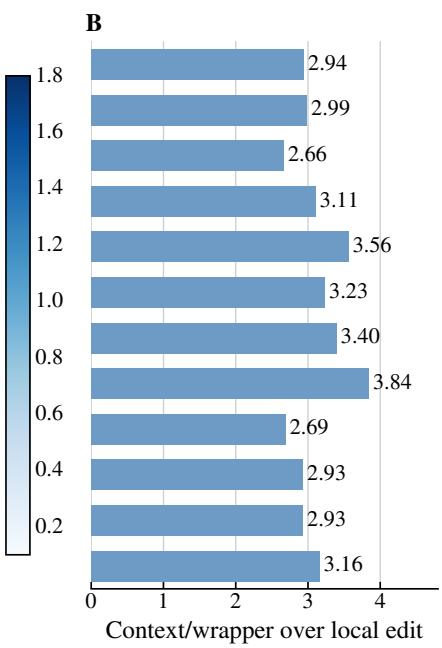  
Figure S3: Normalized MeanRSS by prompt topic. A, topic level means for each transformation; B, the ratio of the context and wrapper mean to the local edit mean for each topic. Transformation abbreviations as in Figure S2.

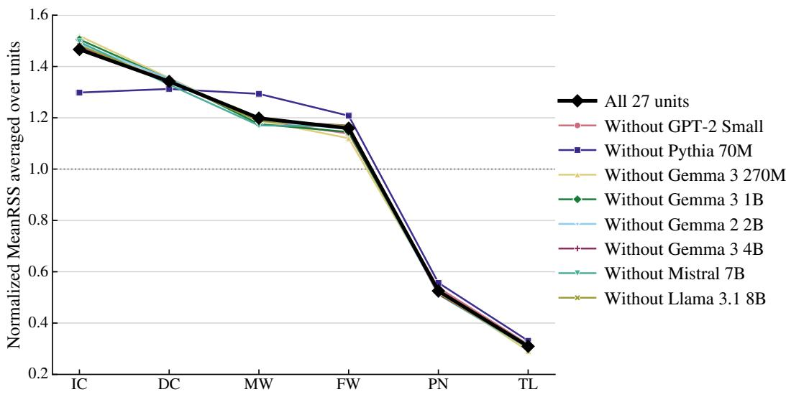  
Figure S4: Profile of the six transformations after removing one model at a time, compared with the profile over all units. Transformation abbreviations as in Figure S2.

## Selector Diagnostics

Figure S5 compares the main selector, which uses operator means for recurrence and direction, with selection from all fifteen variants individually. Support sizes and overlaps show how the selected features differ, while the normalized MeanRSS comparison tests whether those differences change the transformation profile.

A  
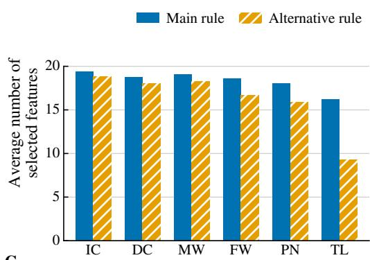

B  
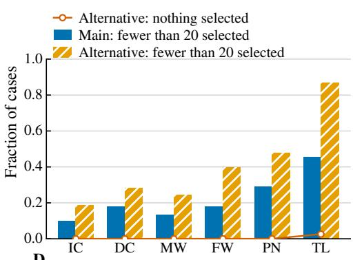

C  
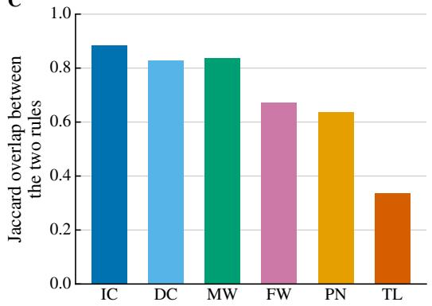

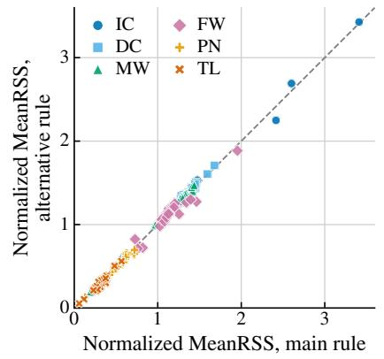  
Figure S5: Comparison of the main feature selection rule with an alternative rule that treats all fifteen variants individually. A, mean support size; B, rates of undersized and empty selections; C, Jaccard overlap between the supports chosen by the two rules; D, unit level normalized MeanRSS under the two rules. Transformation abbreviations as in Figure S2.

The main selector is available for 161,996 of 162,000 cases, with mean selected count 18.32 and directional consistency 0.959 weighted by the selected features. The alternative selector has mean selected count 16.18 and directional consistency 0.944.

## Selector and Summary Robustness

Table S9 varies selector parameters to test whether the profile depends on the default recurrence, consistency, or support cap. Table S10 tests a different dependency by comparing 25 combinations of magnitude summaries and normalization schemes.

Feature scales can also affect magnitude ranking. We therefore repeat RSS after scaling each feature change by its activation scale on the 1,000 clean representation prompts. The scale is the root mean square activation on these prompts; features below $1 0 ^ { - 8 }$ are excluded, and retained changes are divided by the same scale with $1 0 ^ { - 1 2 }$ added inside the square root. Table S11 reports the resulting profile for $\tau \in \{ 0 . 0 0 1 , 0 . 0 1 , 0 . 0 5 , 0 . 1 \}$

The robustness counts distinguish preservation of the complete six-setting order from preservation of only its top or bottom setting. They should not be read as identical evidence for all three comparisons.

Table S9: Selector parameter ablation on a stratified prompt pool. The reference uses $\rho =$ $\kappa = 0 . 8$ and $K = { \hat { 2 } } 0 ;$ other rows change one parameter. Gap is the context and wrapper mean minus the local-edit mean, with 95% confidence intervals in brackets.
<table><tr><td>Setting</td><td>Spearman</td><td>Minimum</td><td>Gap</td><td>Mean |S|</td><td>Jaccard</td></tr><tr><td>Reference</td><td>1.00</td><td>1.00</td><td>0.626 [0.604, 0.646]</td><td>13.2</td><td>1.00</td></tr><tr><td> $\rho = 0 . 6$ </td><td>1.00</td><td>0.94</td><td>0.632 [0.610, 0.652]</td><td>13.8</td><td>0.90</td></tr><tr><td> $\dot { \kappa } = 0 . 6$ </td><td>1.00</td><td>0.77</td><td>0.595 [0.571, 0.617]</td><td>17.4</td><td>0.61</td></tr><tr><td> $K = 1 0$ </td><td>1.00</td><td>0.89</td><td>0.702 [0.680, 0.723]</td><td>8.6</td><td>0.75</td></tr><tr><td> $K = 5 0$ </td><td>1.00</td><td>0.94</td><td>0.537 [0.514, 0.558]</td><td>17.5</td><td>0.89</td></tr></table>

Table S10: Transformation-ranking robustness across 25 combinations of magnitude summaries and normalization schemes.
<table><tr><td>Criterion</td><td>Specifications</td></tr><tr><td>Full six-setting order preserved</td><td>17 / 25</td></tr><tr><td>Top setting preserved</td><td>20 / 25</td></tr><tr><td>Bottom setting preserved</td><td>25 / 25</td></tr></table>

Table S11: RSS after scaling feature changes using clean-prompt activations. Profile Spearman is relative to the main result; Gap is the context and wrapper mean minus the local-edit mean.
<table><tr><td>T</td><td>Available</td><td>Profile Spearman</td><td>Gap</td><td>Positive units</td></tr><tr><td>0.001</td><td>99.99%</td><td>0.943</td><td>0.835</td><td>27/27</td></tr><tr><td>0.01</td><td>99.94%</td><td>0.943</td><td>0.817</td><td>27/27</td></tr><tr><td>0.05</td><td>99.65%</td><td>0.943</td><td>0.756</td><td>27/27</td></tr><tr><td>0.1</td><td>99.40%</td><td>0.943</td><td>0.706</td><td>27/27</td></tr></table>

## Intensity Protocol

Table S12 defines the four levels for each intensity series and reports the realized token and edit counts. The levels increase transformation strength within a setting, rather than place different transformation settings on a common numerical scale.

Support selection is performed independently at every level, so the support is selected separately for each prompt and intensity level. Rank correlations are computed within each prompt, SAE, and transformation before averaging equally across SAEs.

Table S12: Intensity-level definitions and realized values. Tokens and edits are mean counts.
<table><tr><td>Setting and level</td><td>Definition</td><td>Tokens</td><td>Edits</td></tr><tr><td>Irrelevant context 1</td><td>4–8 added tokens</td><td>4.00</td><td>0</td></tr><tr><td>Irrelevant context 2</td><td>12–16 added tokens</td><td>12.00</td><td>0</td></tr><tr><td>Irrelevant context 3</td><td>24–32 added tokens</td><td>24.00</td><td>0</td></tr><tr><td>Irrelevant context 4</td><td>48–64 added tokens</td><td>48.00</td><td>0</td></tr><tr><td>Format wrapper 1</td><td>single label or quote</td><td>3.24</td><td>10.4</td></tr><tr><td>Format wrapper 2</td><td>envelope with two fields</td><td>8.92</td><td>28.2</td></tr><tr><td>Format wrapper 3</td><td>nested wrapper</td><td>15.96</td><td>44.2</td></tr><tr><td>Format wrapper 4</td><td>nested multi-field wrapper</td><td>28.96</td><td>85.4</td></tr><tr><td>Punctuation edits 1</td><td>exactly 1 edit</td><td>1.00</td><td>1</td></tr><tr><td>Punctuation edits 2</td><td>exactly 2 edits</td><td>1.99</td><td>2</td></tr><tr><td>Punctuation edits 3</td><td>exactly 4 edits</td><td>3.99</td><td>4</td></tr><tr><td>Punctuation edits 4</td><td>exactly 8 edits</td><td>7.96</td><td>8</td></tr></table>

## Selection–Evaluation Split Sensitivity

We vary how the fixed total of 15 variants is divided between selection and evaluation. This tests sensitivity to the selection and evaluation allocation, rather than a monotone increase in total sample size. Table S13 reports reliability, profile stability, group sign stability, and support overlap. A larger selection set necessarily leaves fewer variants for evaluation.

Table S13: Split-half reliability by selection size. Brackets give 95% confidence intervals. Profile is stability against the 15-variant reference; Sign is transformation-group sign stability; Jac. is split-to-split support Jaccard.
<table><tr><td>Sel.</td><td>Eval.</td><td>Reliability</td><td>Profile</td><td>Sign</td><td>CV</td><td>Jac.</td></tr><tr><td>3</td><td>12</td><td>0.773 [0.763, 0.782]</td><td>0.805</td><td>0.960</td><td>0.221</td><td>0.393</td></tr><tr><td>5</td><td>10</td><td>0.802 [0.792, 0.810]</td><td>0.827</td><td>0.964</td><td>0.189</td><td>0.539</td></tr><tr><td>8</td><td>7</td><td>0.714 [0.703, 0.724]</td><td>0.773</td><td>0.946</td><td>0.268</td><td>0.527</td></tr><tr><td>10</td><td>5</td><td>0.681 [0.670, 0.691]</td><td>0.765</td><td>0.946</td><td>0.279</td><td>0.654</td></tr></table>

Table S14 compares selection methods at the same selection and evaluation sizes. RSS need not maximize every measure. For example, the dictionary mean has higher reported reliability with three selection variants, whereas RSS has higher group sign stability.

Table S14: Reliability by selection method and selection size. Column definitions follow Table S13.
<table><tr><td>Method</td><td>Sel.</td><td>Reliability</td><td>Profile</td><td>Sign</td></tr><tr><td>RSS support</td><td>3</td><td>0.773</td><td>0.805</td><td>0.959</td></tr><tr><td>RSS support</td><td>5</td><td>0.802</td><td>0.827</td><td>0.964</td></tr><tr><td>RSS support</td><td>8</td><td>0.714</td><td>0.773</td><td>0.946</td></tr><tr><td>RSS support</td><td>10</td><td>0.681</td><td>0.765</td><td>0.946</td></tr><tr><td>Clean support</td><td>3</td><td>0.772</td><td>0.809</td><td>0.921</td></tr><tr><td>Clean support</td><td>5</td><td>0.752</td><td>0.792</td><td>0.918</td></tr><tr><td>Clean support</td><td>8</td><td>0.619</td><td>0.709</td><td>0.889</td></tr><tr><td>Clean support</td><td>10</td><td>0.568</td><td>0.679</td><td>0.886</td></tr><tr><td>Global support</td><td>3</td><td>0.744</td><td>0.776</td><td>0.922</td></tr><tr><td>Global support</td><td>5</td><td>0.761</td><td>0.781</td><td>0.928</td></tr><tr><td>Global support</td><td>8</td><td>0.621</td><td>0.703</td><td>0.887</td></tr><tr><td>Global support</td><td>10</td><td>0.591</td><td>0.694</td><td>0.892</td></tr><tr><td>Dictionary mean</td><td>3</td><td>0.861</td><td>0.908</td><td>0.952</td></tr><tr><td>Dictionary mean</td><td>5</td><td>0.798</td><td>0.865</td><td>0.937</td></tr><tr><td>Dictionary mean</td><td>8</td><td>0.695</td><td>0.791</td><td>0.918</td></tr><tr><td>Dictionary mean</td><td>10</td><td>0.617</td><td>0.726</td><td>0.891</td></tr></table>

## Held Out Support Validation

The following tests separate persistence on new realizations from persistence on an operator omitted during selection. Table S15 uses different realizations for selection and evaluation while keeping the selected support fixed. Table S16 tests whether this support is more informative than random features from the same candidate pool and of the same size. Table S17 then excludes an entire operator from selection.

Table S16 reports both absolute response and agreement with the direction chosen during selection. The random comparison is matched in support size and candidate pool.

Across the 81 unit-fold comparisons, RSS has the larger context and wrapper versus local edit difference in 76.

In Table S17, the withheld operator contributes no selection observations. Comparing requirements of four versus three responding operators among the remaining four makes the availability and direction persistence tradeoff explicit.

Table S15: Fixed-support evaluation with one realization per operator used for selection. Profile is Spearman correlation with the 15-variant reference; Gap is the context and wrapper mean minus the local-edit mean; Pos. units is the number of SAEs with positive Gap; Group sign and Pairwise are prompt-level ordering rates.
<table><tr><td>Fold</td><td>Avail.</td><td>Profile</td><td>Gap</td><td>Pos. units</td><td>Same dir.</td><td>Group sign</td><td>Pairwise</td></tr><tr><td>0</td><td>99.985%</td><td>1.000</td><td>0.909</td><td>27/27</td><td>0.940</td><td>99.92%</td><td>93.49%</td></tr><tr><td>1</td><td>99.985%</td><td>1.000</td><td>0.896</td><td>27/27</td><td>0.957</td><td>99.86%</td><td>92.00%</td></tr><tr><td>2</td><td>99.989%</td><td>1.000</td><td>0.897</td><td>27/27</td><td>0.959</td><td>99.87%</td><td>92.15%</td></tr></table>

Table S16: Held out response for RSS and random supports matched in candidate pool and support size. Brackets give 95% confidence intervals.
<table><tr><td>Support</td><td>Absolute response</td><td>95% CI</td><td>Same direction</td><td>95% CI</td></tr><tr><td>RSS</td><td>107.670</td><td>[106.749, 108.597]</td><td>0.952</td><td>[0.951, 0.952]</td></tr><tr><td>Random, 100 draws</td><td>5.797</td><td>[5.748, 5.846]</td><td>0.758</td><td>[0.758, 0.759]</td></tr></table>

Table S17: Evaluation with one transformation operator excluded from support selection. Gap is the context and wrapper mean minus the local-edit mean.
<table><tr><td>Selection requirement</td><td>Available</td><td>Same direction</td><td>Gap</td></tr><tr><td>4 of 4 operators</td><td>99.42%</td><td>0.894</td><td>0.925</td></tr><tr><td>3 of 4 operators</td><td>100.00%</td><td>0.848</td><td>0.896</td></tr></table>

## S5 Extended Audit Results

Mismatched RSS uses a support selected for another transformation setting. For each case, comparison settings are traversed in the frozen cyclic order, repeated feature indices are removed by first occurrence, and the resulting support is truncated to the size of the current RSS support; the comparator is unavailable if there are too few unique features.

## Probe Performance

Table S18 reports the selected probes and their clean test performance. Figure S6 compares clean and transformed AUROC under each setting while keeping the fitted coefficients and calibrated threshold fixed.

Table S18: Safety probes and clean test performance. Brackets give 95% confidence intervals for AUROC; FNR and FPR are false-negative and false-positive rates.
<table><tr><td>Model</td><td>Unit</td><td>λ</td><td>Weights</td><td>Clean AUROC</td><td>Harmful FNR</td><td>Benign FPR</td></tr><tr><td>Gemma 3 4B</td><td>L17</td><td>0.01</td><td>415</td><td>0.941 [0.914, 0.963]</td><td>23.3%</td><td>7.3%</td></tr><tr><td>Llama 3.1 8B</td><td>L24</td><td>0.001</td><td>862</td><td>0.919 [0.884, 0.949]</td><td>33.3%</td><td>6.0%</td></tr></table>

## Results by Transformation

The transformation profile describes response magnitude, but it need not order readout effects in the same way. Figure S7 and Table S19 compare normalized MeanRSS with held out margin erosion, decision changes, and probe AUROC for each setting.

For Gemma, the difference in margin erosion between the context and wrapper transformations and the local edits is +0.338 [0.236, 0.443] for benign prompts and −0.374 [−0.498, −0.259] for harmful prompts. Thus the same transformation group is associated

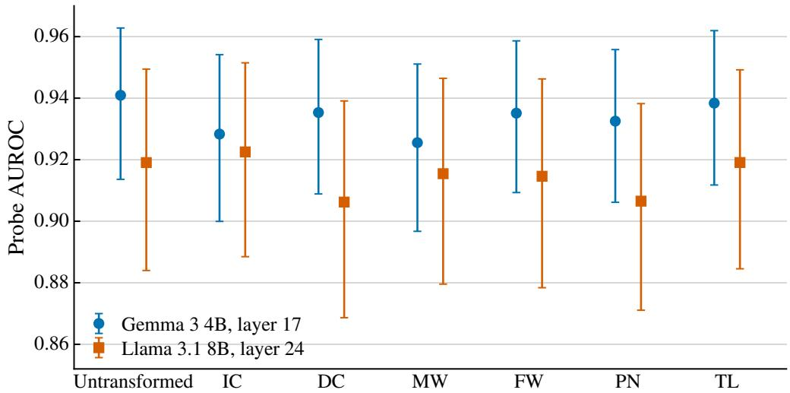

Figure S6: Probe AUROC for the two safety readouts on untransformed test prompts and under each transformation. Transformation abbreviations as in Figure S2. Error bars show 95% bootstrap confidence intervals.  
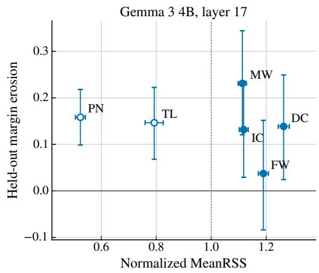

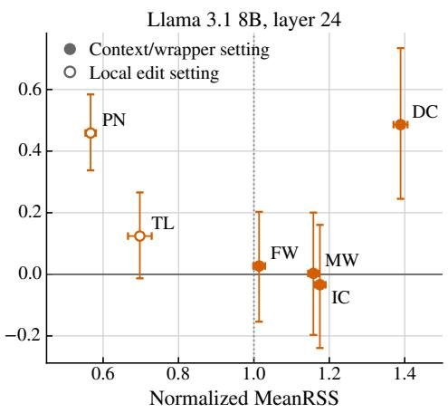  
Figure S7: Normalized MeanRSS and margin erosion on held out variants for each transformation, evaluated on the audited safety units. Transformation abbreviations as in Figure S2. Error bars show 95% bootstrap confidence intervals.

Table S19: MeanRSS and probe outcomes by transformation setting. Brackets give 95% confidence intervals for normalized MeanRSS and erosion. Erosion is mean held out margin loss; Flip is the fraction of predictions that differ from the clean prediction.
<table><tr><td>Model</td><td>Setting</td><td>Norm. MeanRSS</td><td>Erosion</td><td>Flip</td><td>AUROC</td></tr><tr><td rowspan="6">Gemma 3 4B</td><td>Irrelevant context</td><td>1.118 [1.102,1.134]</td><td>0.132 [0.029,0.235]</td><td>6.1%</td><td>0.928</td></tr><tr><td>Distractor context</td><td>1.263 [1.244,1.284]</td><td>0.138 [0.024,0.249]</td><td>5.6%</td><td>0.935</td></tr><tr><td>Metalinguistic wrapper</td><td>1.113 [1.098,1.128]</td><td>0.231 [0.121,0.344]</td><td>6.6%</td><td>0.926</td></tr><tr><td>Format wrapper</td><td>1.190 [1.172,1.208]</td><td>0.037 [-0.084,0.152]</td><td>8.0%</td><td>0.935</td></tr><tr><td>Punctuation noise</td><td>0.524 [0.506,0.541]</td><td>0.158 [0.098,0.218]</td><td>4.2%</td><td>0.933</td></tr><tr><td>Typed lexical substitution</td><td>0.792 [0.759,0.825]</td><td>0.146 [0.068,0.223]</td><td>4.6%</td><td>0.938</td></tr><tr><td rowspan="6">Llama 3.1 8B</td><td>Irrelevant context</td><td>1.175 [1.160,1.190]</td><td>-0.034 [-0.239,0.161]</td><td>7.5%</td><td>0.923</td></tr><tr><td>Distractor context</td><td>1.389 [1.370,1.408]</td><td>0.486 [0.245,0.734]</td><td>9.5%</td><td>0.906</td></tr><tr><td>Metalinguistic wrapper</td><td>1.158 [1.144,1.172]</td><td>0.003 [-0.197,0.200]</td><td>7.8%</td><td>0.915</td></tr><tr><td>Format wrapper</td><td>1.014 [0.998,1.030]</td><td>0.027 [-0.154,0.203]</td><td>6.9%</td><td>0.915</td></tr><tr><td>Punctuation noise</td><td>0.567 [0.553,0.581]</td><td>0.459 [0.338,0.584]</td><td>7.1%</td><td>0.907</td></tr><tr><td>Typed lexical substitution</td><td>0.697 [0.666,0.729]</td><td>0.124 [-0.013,0.266]</td><td>5.5%</td><td>0.919</td></tr></table>

with greater erosion for one class and less erosion for the other after projection through the probe. A shared representation profile does not imply a shared direction of readout effect.

## Intensity Analysis on the Safety Corpus

The safety intensity analysis tests whether increases in representation response are accompanied by increases in margin erosion. Figure S8 reports both quantities, and Table S20 separates rank correlation from monotonicity across all four levels.

The monotonicity denominators use only clean-correct prompts among those eligible for the intensity analysis. For Gemma, these subsets contain 254 prompts for irrelevant context and format wrappers and 222 for punctuation noise. For Llama, they contain 241 and 212 prompts, respectively. The numerators count prompts for which the evaluated mean response is nondecreasing across all four levels; they do not use the full eligible counts as denominators.

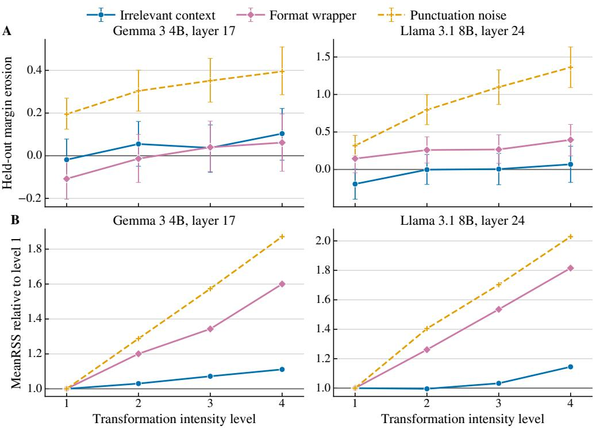  
Figure S8: Effect of transformation strength on the audited safety units. A, margin erosion under three transformations rebuilt at four increasing intensity levels, with 95% bootstrap confidence intervals. B, MeanRSS for the same series, relative to the weakest level.

Table S20: Prompt-level intensity calibration in the safety corpus. Monotonic counts use prompts whose mean response is nondecreasing across the four levels.
<table><tr><td>Model</td><td>Setting</td><td>Eligible</td><td>MeanRSS ρ</td><td>MeanRSS mono.</td><td>Erosion ρ</td><td>Erosion mono.</td></tr><tr><td rowspan="3">Gemma 3 4B</td><td>Irrelevant context</td><td>300</td><td>0.8</td><td>78/254</td><td>0.4</td><td>51/254</td></tr><tr><td>Format wrapper</td><td>300</td><td>1.0</td><td>203/254</td><td>0.4</td><td>63/254</td></tr><tr><td>Punctuation noise</td><td>265</td><td>1.0</td><td>137/222</td><td>0.4</td><td>37/222</td></tr><tr><td rowspan="3">Llama 3.1 8B</td><td>Irrelevant context</td><td>300</td><td>0.8</td><td>67/241</td><td>0.2</td><td>39/241</td></tr><tr><td>Format wrapper</td><td>300</td><td>1.0</td><td>192/241</td><td>0.4</td><td>51/241</td></tr><tr><td>Punctuation noise</td><td>265</td><td>1.0</td><td>138/212</td><td>0.6</td><td>62/212</td></tr></table>

## Full Risk Results

Table S21 compares risk signals on the common evaluation cohort. Correlation with held out erosion evaluates transfer of margin change, whereas AUROC and average precision (AP) evaluate ranking of recurrent failure. These are distinct targets, so a signal can track erosion well without giving the strongest failure ranking.

Table S21: Risk signals on the common held out cohort. Brackets give 95% confidence intervals. Erosion $\rho$ is Spearman correlation with held out margin erosion; AUROC and AP use recurrent failure. Residual-margin correlation is reported in the direction of increasing risk.
<table><tr><td>Model</td><td>Risk signal</td><td>Erosion ρ</td><td>Failure AUROC</td><td>AP</td></tr><tr><td rowspan="11"></td><td>Clean margin</td><td>-0.282 [-0.370,-0.192]</td><td>0.863 [0.821,0.900]</td><td>0.294</td></tr><tr><td>Full  $\ell _ { 1 }$ </td><td>0.101 [0.025,0.173]</td><td>0.520 [0.444,0.595]</td><td>0.072</td></tr><tr><td>Full cosine</td><td>0.083 [0.006,0.157]</td><td>0.486 [0.398,0.572] 0.063</td><td></td></tr><tr><td>MeanRSS</td><td>0.116 [0.040,0.188]</td><td>0.526 [0.446,0.599] 0.069</td><td></td></tr><tr><td>Gemma 3 4B Probe exposure</td><td>0.104 [0.029,0.178]</td><td>0.597 [0.510,0.683] 0.107</td><td></td></tr><tr><td>MeanRSŠ × exposure</td><td>0.130 [0.049,0.210]</td><td>0.606 [0.524,0.689] 0.091</td><td></td></tr><tr><td>+ probe weights</td><td>0.186 [0.097,0.272]</td><td>0.676 [0.601,0.740] 0.125</td><td></td></tr><tr><td>Margin erosion E</td><td>0.923 [0.909,0.935]</td><td>0.785 [0.720,0.841] 0.198</td><td></td></tr><tr><td>Residual margin  $m _ { \mathrm { r e s } }$ </td><td>0.169 [0.077,0.261]</td><td>0.965 [0.940,0.982] 0.805</td><td></td></tr><tr><td>Clean margin</td><td>-0.220 [-0.307,-0.130]</td><td>0.901 [0.833,0.947] 0.505</td><td></td></tr><tr><td rowspan="8">Full  $\ell _ { 1 }$ </td><td></td><td></td><td>0.466 [0.372,0.554] 0.079</td><td></td></tr><tr><td>Full cosine</td><td>0.039 [-0.046,0.123]</td><td></td><td></td></tr><tr><td>MeanRSS</td><td>-0.024 [-0.104,0.060]</td><td>0.528 [0.427,0.627]0.136</td><td></td></tr><tr><td>Llama 3.1 8B Probe exposure</td><td>-0.028 [-0.109,0.052] 0.041 [-0.029,0.110]</td><td>0.506 [0.429,0.578] 0.086 0.569 [0.482,0.652] 0.105</td><td></td></tr><tr><td>MeanRSŠ × exposure</td><td>0.011 [-0.067,0.091]</td><td>0.570 [0.483,0.648] 0.109</td><td></td></tr><tr><td>+ probe weights</td><td>0.039 [-0.053,0.130]</td><td>0.581 [0.499,0.654] 0.127</td><td></td></tr><tr><td>Margin erosion E</td><td>0.896 [0.877,0.912]</td><td>0.705 [0.639,0.767] 0.191</td><td></td></tr><tr><td>Residual margin  $m _ { \mathrm { r e s } }$ </td><td>0.152 [0.065,0.243]</td><td>0.964 [0.940,0.982] 0.850</td><td></td></tr></table>

## Relevance of the Selected Features on New Variants

Tables S22–S24 separately assess direction persistence, contribution after matching coefficient magnitude, and the fraction of absolute contribution retained. These comparisons distinguish stable response selection from selection optimized for a fixed readout.

Table S22: Held out response in the direction selected by RSS compared with magnitudeonly selection. Brackets give 95% confidence intervals.
<table><tr><td>Model</td><td>RSS</td><td>Magnitude only</td></tr><tr><td>Gemma 3 4B</td><td>0.876 [0.872, 0.879]</td><td>0.816 [0.810, 0.822]</td></tr><tr><td>Llama 3.1 8B</td><td>0.871 [0.867, 0.874]</td><td>0.794 [0.788, 0.800]</td></tr></table>

Table S23 compares absolute feature contributions after matching readout coefficient magnitude. Direction agreement compares the observed contribution sign with sign $\left( - y w _ { f } s _ { f } \right)$ including the class sign and readout coefficient as well as the RSS selected direction.

Table S24 compares MCR at K = 20. The $| e _ { f } |$ ranking uses contributions computed from selection variants, not the held out contributions used in the reported MCR.

Table S24 reports MCR on $V _ { \mathrm { h o } } .$ For a fixed case, all supports share the same denominator, so higher MCR means less omitted absolute contribution. Equation 24 shows that signed error additionally depends on cancellation through $\chi _ { S } ^ { \mathrm { h o } }$

Table S25 compares full and support erosion on the common evaluation cohort. Correlation measures agreement with held out erosion; AUROC uses erosion as a score for recurrent failure.

Table S23: Held out feature contribution after matching selected and unselected features by readout coefficient magnitude. Contribution columns report mean absolute contribution. Direction agreement compares observed contribution sign with $\mathrm { s i g n } ( - y w _ { f } s _ { f } )$ . Brackets give 95% confidence intervals for the paired difference.
<table><tr><td>Model</td><td></td><td>RSS contribution Matched contribution</td><td>Difference</td><td>Direction agreement</td></tr><tr><td>Gemma 3 4B</td><td>0.2397</td><td>0.0221</td><td>0.2177 [0.2005, 0.2356]</td><td>97.4%</td></tr><tr><td>Llama 3.1 8B</td><td>0.3702</td><td>0.0220</td><td>0.3483 [0.3235, 0.3739]</td><td>97.1%</td></tr></table>

Table S24: Margin Contribution Retention at $K = 2 0$ . Mismatched RSS uses a support selected for another transformation; $| e _ { f } |$ ranks features by contributions computed from $V _ { \mathrm { s e l } }$ . Brackets give 95% confidence intervals.
<table><tr><td>Model</td><td>RSS</td><td>Mismatched RSS</td><td> $| e _ { f } |$ </td></tr><tr><td>Gemma 3 4B</td><td>0.430 [0.411, 0.450]</td><td>0.326 [0.308, 0.346]</td><td>0.942 [0.936, 0.948]</td></tr><tr><td>Llama 3.1 8B</td><td>0.562 [0.547, 0.577]</td><td>0.435 [0.417, 0.453]</td><td>0.919 [0.912, 0.925]</td></tr></table>

Table S25: Margin erosion results for the full readout and RSS support. Erosion $\rho$ is correlation with held out erosion, and Failure AUROC ranks recurrent failure using the corresponding erosion score. Brackets give 95% confidence intervals.
<table><tr><td>Model</td><td>Feature set</td><td>Erosion  $\rho$ </td><td>Failure AUROC</td></tr><tr><td rowspan="2">Gemma 3 4B</td><td>Full readout</td><td>0.923 [0.909, 0.935]</td><td>0.785 [0.721, 0.842]</td></tr><tr><td>RSS support</td><td>0.737 [0.700, 0.771]</td><td>0.753 [0.686, 0.815]</td></tr><tr><td rowspan="2">Llama 3.1 8B</td><td>Full readout</td><td>0.896 [0.878, 0.911]</td><td>0.705 [0.639, 0.766]</td></tr><tr><td>RSS support</td><td>0.793 [0.761, 0.820]</td><td>0.735 [0.666, 0.797]</td></tr></table>

Table S26 adds the full clean margin to each erosion estimate. This evaluates the information retained when selected changes are used to estimate the remaining margin, rather than treating the support as a replacement for the clean readout.

Table S26: Residual margin results for the same cohort. Both feature sets use the full clean margin. Correlation with held out erosion is oriented toward increasing risk; AUROC evaluates recurrent failure. Brackets give 95% confidence intervals.
<table><tr><td>Model</td><td>Feature set</td><td>Residual  $\rho$ </td><td>Residual AUROC</td></tr><tr><td rowspan="2">Gemma 3 4B</td><td>Full readout</td><td>0.169 [0.077, 0.261]</td><td>0.965 [0.939, 0.982]</td></tr><tr><td>RSS support</td><td>0.009 [-0.081, 0.105]</td><td>0.935 [0.901, 0.961]</td></tr><tr><td rowspan="2">Llama 3.1 8B</td><td>Full readout</td><td>0.152 [0.065, 0.243]</td><td>0.964 [0.940, 0.982]</td></tr><tr><td>RSS support</td><td>0.080 [-0.006, 0.171]</td><td>0.958 [0.924, 0.981]</td></tr></table>

## Additional Llama Layers

We apply the same functional protocol to Llama 3.1 8B layers 8 and 16 to assess whether the compact support results extend beyond the selected layer. Table S28 reports direction persistence, contribution retention, residual margin AUROC, localization, and restoration. The metrics vary across layers, so persistence and retained audit utility should not be treated as interchangeable measures.

Table S27: Summary of the full frozen readout and RSS supports selected for each case on the common evaluation cohort. Size is the full nonzero coefficient count or median support size. Both residual margin signals use the full clean margin. Errors and Harmful FN are capture rates at 20% offline review with known labels.
<table><tr><td>Model</td><td>Feature set</td><td>Size</td><td>Erosion  $\rho$ </td><td>Residual AUROC</td><td>Errors</td><td>Harmful FN</td></tr><tr><td rowspan="2">Gemma 3 4B</td><td>Full readout</td><td>415</td><td>0.923</td><td>0.965</td><td>94.1%</td><td>90.9%</td></tr><tr><td>RSS support</td><td>20</td><td>0.737</td><td>0.935</td><td>89.2%</td><td>87.3%</td></tr><tr><td rowspan="2">Llama 3.1 8B</td><td>Full readout</td><td>862</td><td>0.896</td><td>0.964</td><td>91.9%</td><td>93.5%</td></tr><tr><td>RSS support</td><td>19</td><td>0.793</td><td>0.958</td><td>92.8%</td><td>94.4%</td></tr></table>

Table S28: Functional results for two additional Llama 3.1 8B layers under the main audit protocol.
<table><tr><td>Layer</td><td>|S|</td><td>Same direction</td><td>MCR</td><td>Residual AUROC</td><td> $R ^ { 2 }$ </td><td>Restoration</td></tr><tr><td>8</td><td>20</td><td>0.960</td><td>0.628</td><td>0.905</td><td>0.814</td><td>0.566</td></tr><tr><td>16</td><td>20</td><td>0.970</td><td>0.578</td><td>0.806</td><td>0.692</td><td>0.807</td></tr></table>

## S6 Localization, Selective Review, and Training Details

## Localization and Readout Counterfactuals

The localization comparison tests whether RSS selects changes relevant to the current transformation rather than merely unstable or arbitrary features. Table S29 evaluates all listed supports on the same rows from $V _ { \mathrm { h o } }$ . In both models, RSS gives higher reconstruction $R ^ { 2 }$ and reverses more probe errors than a support selected for another transformation. Features that are frequently unstable across the corpus and random features of the same size contribute little to either result.

Table S29: Reconstruction and readout-counterfactual results. Baseline supports are matched to RSS support size; brackets give 95% confidence intervals. $Q _ { \mathrm { r e s } }$ is the share of probe logit change recovered from the support.
<table><tr><td>Model</td><td>Support</td><td>Size</td><td> $R ^ { 2 }$ </td><td>Errors reversed</td><td> $Q _ { \mathrm { r e s } }$ </td></tr><tr><td rowspan="4">Gemma 3 4B</td><td>RSS support</td><td>20</td><td>0.579 [0.532, 0.621]</td><td>0.722 [0.635, 0.803]</td><td>0.618</td></tr><tr><td>Mismatched setting</td><td>20</td><td>0.438 [0.386, 0.481]</td><td>0.603 [0.512, 0.683]</td><td>0.368</td></tr><tr><td>Global instability</td><td>20</td><td>0.017 [-0.008, 0.035]</td><td>0.067 [0.018, 0.151]</td><td>0.000</td></tr><tr><td>Random matched</td><td>20</td><td>0.014 [-0.006, 0.022]</td><td>0.012 [0.002, 0.026]</td><td>0.002</td></tr><tr><td rowspan="4">Llama 3.1 8B</td><td>RSS support</td><td>19</td><td>0.627 [0.568, 0.675]</td><td>0.718 [0.610, 0.807] 0.800</td><td></td></tr><tr><td>Mismatched setting</td><td>19</td><td>0.490 [0.406, 0.560]</td><td>0.611 [0.487, 0.721] 0.590</td><td></td></tr><tr><td>Global instability</td><td>19</td><td>0.009 [-0.006, 0.020]</td><td>0.023 [0.000, 0.062] 0.000</td><td></td></tr><tr><td>Random matched</td><td>19</td><td>0.017 [0.004, 0.022]0.015 [0.007, 0.027] 0.002</td><td></td><td></td></tr></table>

## Selective Review

Table S30 summarizes offline selective review with the Gemma probe trained only on clean prompts, using the same cohort as the risk prediction analysis. Random is the average of 100 random rankings, with the replicate average computed inside each shared prompt cluster bootstrap draw. The residual margin ranks cases in ascending order. For a review budget c, residual error is the error rate among cases left unreviewed after the highestrisk ⌊cN⌋ cases are removed. The normalized partial area under the residual error curve (pAURC) is the trapezoidal area at budgets $c \overset { \cdot } { \in } \left\{ 0 , 0 . 0 5 , 0 . 1 0 , 0 . 2 0 , 0 . 3 0 , 0 . 4 0 \right\}$ divided by 0.40. We report ∆pAURC as the mean random ranking pAURC minus the pAURC of the listed ranking, so positive values indicate lower residual error than random.

Table S30: Selective-review summary for the Gemma probe. Capture columns give the fraction of errors reviewed at the stated budget. Residual error is reported at a 20% review budget. pAURC is the normalized partial area under the residual error curve from 0 to 40% review, and ∆ pAURC is the random ranking pAURC minus the listed value; brackets give 95% confidence intervals.
<table><tr><td colspan="5">Ranking signal Capture@10 Capture@20 Harmful FN@20 Residual error</td><td></td><td>∆pAURC</td></tr><tr><td>Residual</td><td>85.1%</td><td>94.1%</td><td>90.9%</td><td>0.25%</td><td>+0.0276 [0.0175,0.0385]</td><td rowspan="3"></td></tr><tr><td>margin  $m _ { \mathrm { r e s } }$  Low clean</td><td>41.3%</td><td>68.9%</td><td>60.9%</td><td>1.30%</td><td>+0.0186 [0.0117,0.0267]</td></tr><tr><td>margin + probe</td><td>32.1%</td><td>47.6%</td><td>49.5%</td><td>2.20%</td><td>+0.0109 [0.0046,0.0180]</td></tr><tr><td>weights MeanRSS</td><td>11.0%</td><td>18.8%</td><td>18.2%</td><td>3.40%</td><td>+0.0007 [-0.0026,0.0046]</td><td rowspan="2"></td></tr><tr><td></td><td></td><td></td><td></td><td></td><td></td></tr></table>

Table S31 gives the corresponding capture rates at the 20% review budget.

Table S31: Selective review at a 20% budget for the rankings in Figure 6C–D. Values are capture percentages; brackets give 95% confidence intervals.
<table><tr><td>Model</td><td>Ranking signal</td><td>Errors</td><td>Harmful FN</td></tr><tr><td rowspan="5">Gemma 3 4B</td><td>Residual margin  $m _ { \mathrm { r e s } }$ </td><td>94.1 [90.2, 96.5]</td><td>90.9 [81.9, 95.7]</td></tr><tr><td>RSS residual margin  $m _ { \mathrm { r e s } } ^ { S }$ </td><td>89.2 [81.8, 93.5]87.3 [72.4, 94.9]</td><td></td></tr><tr><td>Mismatched RSS residual</td><td></td><td>86.5 [78.7, 92.0]85.9 [69.8, 93.5]</td></tr><tr><td>Margin erosion E</td><td>63.6 [49.3, 74.8]</td><td>62.3 [35.4, 78.2]</td></tr><tr><td>RSS margin erosion  $E _ { S }$ </td><td>64.2 [50.1, 75.0]</td><td>66.8 [44.4, 81.1]</td></tr><tr><td rowspan="5">Llama 3.1 8B</td><td>Residual margin  $m _ { \mathrm { r e s } }$ </td><td></td><td>91.9 [87.6, 95.6]93.5 [88.7, 97.4]</td></tr><tr><td>RSS residual margin  $m _ { \mathrm { r e s } } ^ { S }$ </td><td>92.8 [88.0, 95.6]94.4 [89.1, 97.4]</td><td></td></tr><tr><td>Mismatched RSS residual</td><td></td><td>88.0 [80.9, 93.1]90.0 [82.8, 95.6]</td></tr><tr><td>Margin erosion E</td><td></td><td>52.2 [38.7, 64.4]53.3 [38.3, 66.9]</td></tr><tr><td>RSS margin erosion  $E _ { S }$ </td><td>55.3 [41.7, 67.5]58.1 [42.5, 71.2]</td><td></td></tr></table>

## Probe Training with MeanRSS Sampling

The frozen readout analysis shows that large redistribution alone is not a failure score. A separate question is whether exposing a probe to examples with large redistribution can help during training. We compare MeanRSS sampling with uniform sampling under the same augmentation budget, rather than infer a training benefit from the frozen audit.

Every augmented probe uses 1,200 clean examples and 6,000 transformed examples, corresponding to five transformed examples per training prompt. The MeanRSS method samples prompt and transformation pairs according to MeanRSS computed from the training prompts, with exponent $\gamma = 2$ . The uniform method samples from the same pool with equal probability. Scaling statistics and feature masks remain those of the clean probe. Figure S9 and Table S32 report the results.

For Gemma, the paired gains in the run shown in Figure S9A are +0.0124 [0.0024, 0.0233] in clean AUROC, +0.0094 [0.0007, 0.0195] in macro AUROC, +0.0127 [0.0007, 0.0243] in worst setting AUROC, and a reduction of 4.7 percentage points [1.6, 7.8] in harmful falsenegative rate under the worst setting. Across five runs, however, Gemma macro AUROC differences average +0.0011 with standard deviation 0.0051. The macro harmful falsenegative rate averages 17.65% for MeanRSS sampling and 20.45% for uniform sampling. The corresponding Llama rates are 23.55% and 24.36%.

These averages show fewer harmful prompts missed in the reported runs, but the AU-ROC evidence is mixed. Table S32 reports lower clean, mean, and worst setting AUROC for Llama under MeanRSS sampling, and Gemma’s average macro AUROC gain across runs is small relative to its variation. The training extension therefore does not establish a consistent AUROC advantage over uniform sampling.

Table S32: Retrained-probe results for Figure S9A. Clean, Mean, and Worst are AUROC; Gap is clean minus worst AUROC.
<table><tr><td>Model</td><td>Method</td><td>Clean</td><td>Mean</td><td>Worst</td><td>Worst FNR</td><td>Gap</td></tr><tr><td>Gemma 3 4B</td><td>MeanRSS sampling</td><td>0.945</td><td>0.943</td><td>0.938</td><td>0.191</td><td>0.0067</td></tr><tr><td>Gemma 3 4B</td><td>Uniform</td><td>0.933</td><td>0.934</td><td>0.926</td><td>0.238</td><td>0.0071</td></tr><tr><td>Llama 3.1 8B</td><td>MeanRSS sampling</td><td>0.911</td><td>0.910</td><td>0.901</td><td>0.256</td><td>0.0100</td></tr><tr><td>Llama 3.1 8B</td><td>Uniform</td><td>0.915</td><td>0.913</td><td>0.907</td><td>0.263</td><td>0.0082</td></tr></table>

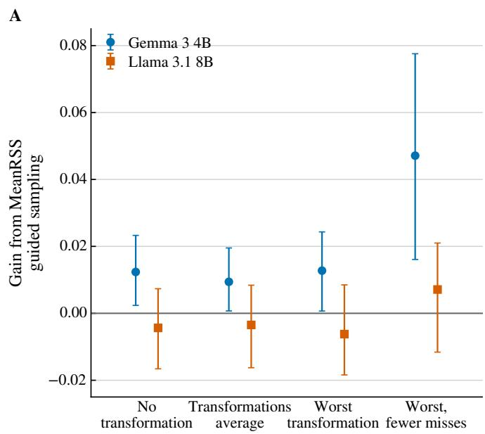

B  
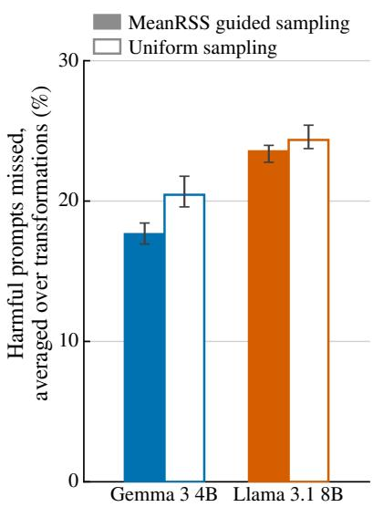  
Figure S9: Augmentation guided by MeanRSS compared with uniform sampling. A, differences between the two sampling methods in clean, mean, and worst transformation AUROC, together with the reduction in harmful false negative rate under the worst transformation. Error bars show 95% bootstrap confidence intervals. B, harmful false negative rate averaged over the six transformations across five runs. Bars show the run mean and whiskers the observed range.