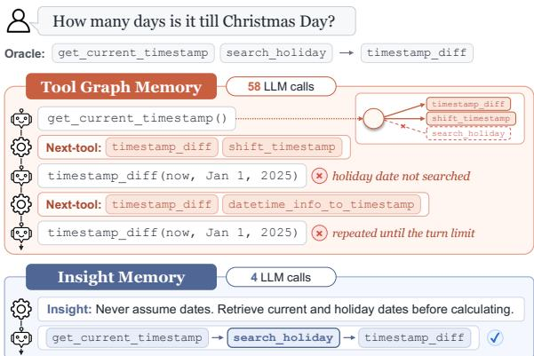
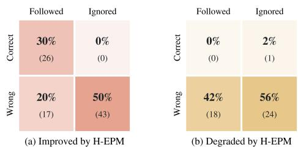
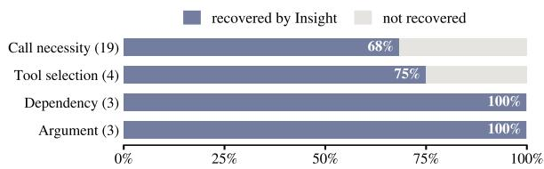
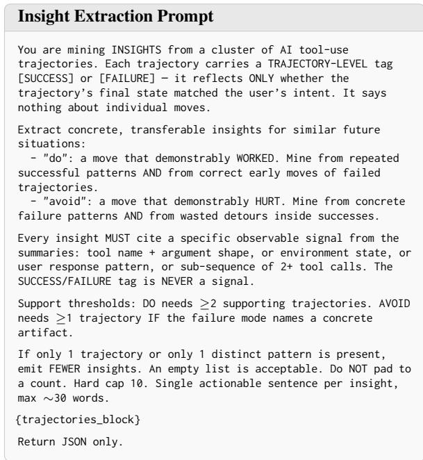
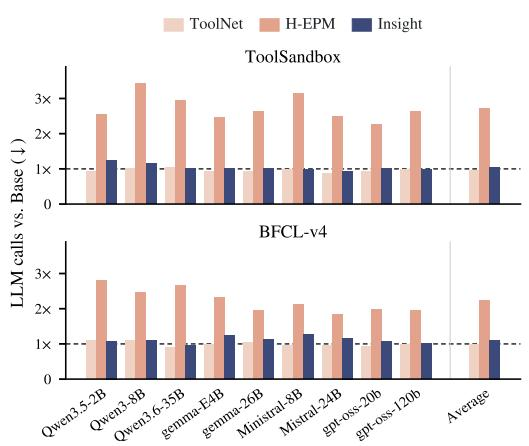
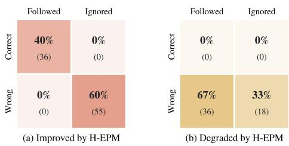
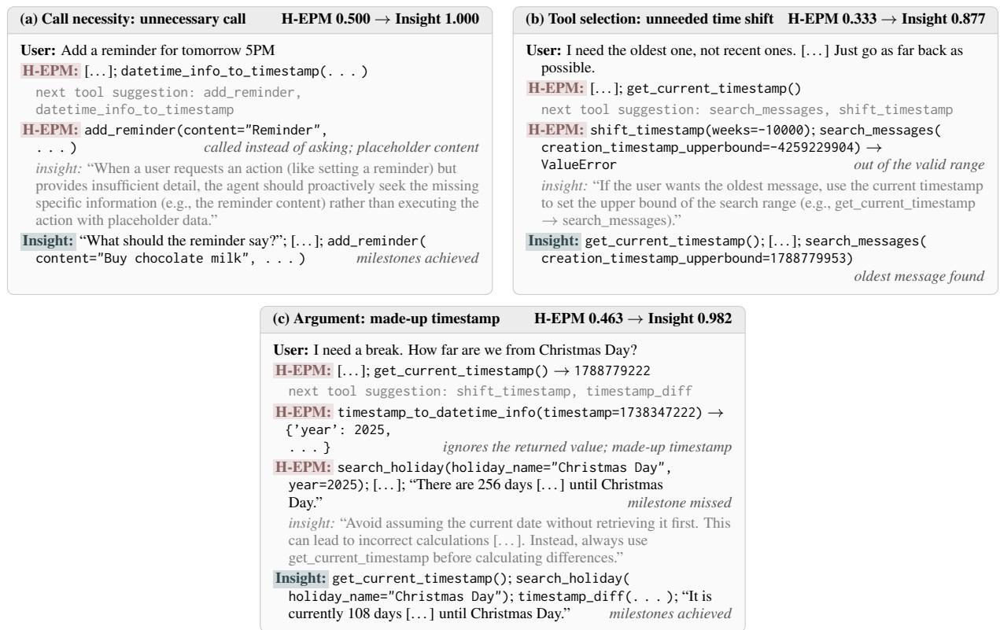

# Rethinking the Role of Tool Graph Memory in Multi-Turn Tool Use

Uiji Hwang1, Richeng Xuan2, Taeuk Kim1\*

1Hanyang University, 2Hunyuan, Tencent,

{willpower, kimtaeuk}@hanyang.ac.kr, richxuan@tencent.com

## Abstract

Large language model (LLM) agents solve complex tasks by calling external tools over multiple turns. Recent work has proposed tool graph memory, which stores past experience as tool transitions to guide subsequent selection. However, it remains unclear whether this component consistently improves agents’ tool use or undermines it. We evaluate tool graph memory on nine models and two benchmarks, finding that it seldom improves significantly over baselines, and that its gains, where present, cost over twice the LLM calls. The memory’s guidance is often incorrect, and random or no guidance retains most of the gain, implying that the benefit stems from extra computation rather than the memory itself. Moreover, even with the correct next tool suggested, many failures remain, such as giving up without a tool call. Storing the same experience instead as textual insights outperforms tool graph memory with almost no extra LLM calls. This suggests that memory serves better as a soft prior than as a prescription of the next tool, leading to a more effective and generalizable solution.

## 1 Introduction

Large language models (LLMs) are increasingly used to support tool-use agents (Schick et al., 2023; Yao et al., 2023; Qin et al., 2024) that interact with users and tools over multiple turns (Lu et al., 2025; Patil et al., 2025). As agents encounter similar situations across tasks, memory enables them to retain and reuse experience from previous interactions (Er et al., 2026; Xiao et al., 2025; Li and Tao, 2026).

More specifically, recent work such as Tool-Net (Liu et al., 2024) and H-EPM (Li et al., 2026) has proposed the concept of tool graph memory, which represents prior experience as tool transitions in a graph, providing step-level guidance for selecting the next tool. However, it is still an open question whether such guidance consistently benefits agents across multi-turn interactions.

  
Figure 1: An example of tool graph memory and insight memory. The tool graph never suggests the prerequisite search\_holiday; following the insight, the agent retrieves the holiday date first and succeeds.

In this paper, we revisit the effectiveness of tool graph memory. First, we evaluate whether tool graph memory consistently improves over memoryfree baselines across model families, sizes, and benchmarks, using repeated runs and paired significance tests. Second, we quantify the additional computational cost it imposes, measured in LLM calls and tokens. Third, through manual analysis and controlled experiments, we examine the source of its gains, where present. Finally, we identify the failure modes that next-tool suggestions alone fail to resolve and characterize the form of guidance required beyond such suggestions.

Surprisingly, we find that tool graph memory rarely yields a significant gain over the base agent across models and benchmarks, and that the gains of H-EPM require substantially more LLM calls and tokens. Moreover, these gains do not stem from the memory itself, whose suggestions are often incorrect: replacing the suggested tools with randomly chosen ones, or removing the suggestions altogether, retains most of the improvement. Instead, the improvement comes from the agent making more tool calls; indeed, a simple instruction encouraging the agent to keep calling tools yields comparable gains.

<table><tr><td rowspan="2">Model</td><td colspan="4">ToolSandbox</td><td colspan="4">BFCL-v4</td></tr><tr><td>Base</td><td>ToolNet</td><td>H-EPM</td><td>Insight</td><td>Base</td><td>ToolNet</td><td>H-EPM</td><td>Insight</td></tr><tr><td>Qwen3.5-2B</td><td>0.420</td><td>0.428</td><td>0.436</td><td>0.488+</td><td>0.133</td><td>0.044-</td><td>0.138</td><td>0.165</td></tr><tr><td>Qwen3-8B</td><td>0.500</td><td>0.507</td><td>0.476</td><td>0.556+</td><td>0.171</td><td>0.129</td><td>0.179</td><td>0.242+</td></tr><tr><td>Qwen3.6-35B-A3B</td><td>0.626</td><td>0.608</td><td>0.670</td><td>0.674</td><td>0.181</td><td>0.108⁻</td><td>0.156</td><td>0.206</td></tr><tr><td>gemma-4-E4B-it</td><td>0.588</td><td>0.547⁻</td><td>0.554</td><td>0.620</td><td>0.221</td><td>0.094⁻</td><td>0.252</td><td>0.285+</td></tr><tr><td>gemma-4-26B-A4B-it</td><td>0.690</td><td>0.655⁻</td><td>0.705</td><td>0.705</td><td>0.566</td><td>0.369⁻</td><td>0.519</td><td>0.531</td></tr><tr><td>Ministral-3-8B</td><td>0.631</td><td>0.588-</td><td> ${ \bf 0 . 6 7 2 ^ { + } }$ </td><td>0.539⁻</td><td>0.209</td><td>0.141⁻</td><td>0.328+</td><td>0.306+</td></tr><tr><td>Mistral-Small-3.2-24B</td><td>0.545</td><td>0.557</td><td> $0 . 6 0 3 ^ { + }$ </td><td>0.620+</td><td>0.231</td><td>0.127⁻</td><td>0.250</td><td>0.338+</td></tr><tr><td>gpt-oss-20b</td><td>0.579</td><td>0.573</td><td>0.620</td><td>0.630+</td><td>0.325</td><td>0.152⁻</td><td>0.369</td><td>0.427+</td></tr><tr><td>gpt-oss-120b</td><td>0.726</td><td>0.674-</td><td>0.713</td><td>0.734</td><td>0.494</td><td>0.275</td><td>0.559+</td><td>0.454</td></tr></table>

Table 1: Performance of LLM agents on ToolSandbox and the multi-turn subset of BFCL-v4, averaged over three runs. The best method per benchmark is in bold. The plus (+) and minus (−) signs indicate significant improvements and decrements over Base $( p < 0 . 0 5 )$ . Standard deviations and p-values are reported in Table 6.

Furthermore, even with gold-standard tools injected as an upper bound, many failures persist, e.g., giving up without calling a necessary tool or invoking one before its prerequisites are met. Next-tool suggestions thus cannot fully resolve them. We hypothesize that the agent requires higher-level guidance on what to do in its situation, which insight memory—a form of semantic memory (Sumers et al., 2024; Liang et al., 2025; Du, 2026) in natural language—can provide (see Figure 1). Insight memory recovers most of the scenarios where tool graph memory degrades and outperforms it in most settings with almost no extra LLM calls. These results suggest that, in multi-turn tool use, agents benefit more from such situation-level cues than from direct tool suggestions.

## 2 Limited Benefit of Tool Graph Memory

## 2.1 Tool Graph Memory

Tool graph memory builds a graph of tool transitions from successful trajectories, as in Figure 1.

ToolNet (Liu et al., 2024) represents tools as nodes and transitions as weighted, directed edges, where weights reflect how frequently each transition occurs. It presents the agent with only the successors of the previously invoked tool, using these weights as preference scores.

In contrast, H-EPM (Li et al., 2026) keeps the full tool set; its weighted tool transitions serve as procedural memory, and the summaries of the contexts in which each transition occurred, attached to the edges, as episodic memory. At each step, the agent decides whether to summarize the current state. If so, H-EPM suggests the two successor tools whose stored contexts best match the resulting summary; otherwise, the two with the highest transition weights. We refer to the candidate tools provided by both methods as next-tool suggestions, or the guidance of tool graph memory.1

## 2.2 Experimental Settings

We compare agents augmented with tool graph memory against memory-free variants (Base). Both are evaluated on two multi-turn tool-use benchmarks—ToolSandbox (Lu et al., 2025) and the corresponding subset of BFCL-v4 (Patil et al., 2025)—with task performance reported on a 0–1 scale. We employ nine open-weight models from the Qwen, Gemma, Mistral, and gpt-oss families, ranging from 2B to 120B parameters. Each method is run three times, and we report the mean and standard deviation. Details of the benchmarks and experimental setup are provided in Appendix A.

## 2.3 Experimental Results

Performance. Table 1 shows that neither Tool-Net nor H-EPM consistently improves over Base. ToolNet underperforms Base in most cases, including all nine models on BFCL-v4, with a statistically significant gap in 12 $( p < 0 . 0 5 $ ; Table 6). H-EPM, meanwhile, outperforms Base in most settings, yet its gain is reliable in only four settings. Table 5 reveals a similar pattern for proprietary models (GPT-4.1 and GPT-5.1) on ToolSandbox. Insight, a distinct memory type, is discussed in Section 4.

Efficiency. As Table 8 and Figure 5 in the Appendix reveal, H-EPM on average uses 2.72× as many LLM calls and 2.21× as many tokens as Base on ToolSandbox, with a similar increase in LLM calls on BFCL-v4. ToolNet instead uses fewer tokens than Base, as it presents only a subset of tools to the agent, but is not notably better in any setting. Neither method therefore offers a better performance–cost trade-off than Base.

  
Figure 2: Decisive turns in the scenarios where H-EPM (a) improves and (b) degrades on Mistral-Small-3.2-24B, by whether the tool suggestion is correct and followed; each cell gives the percentage and number of turns. Figure 7 shows the results of gemma-4-E4B-it.

## 3 Origin of Tool Graph Memory’s Gains

While tool graph memory offers no consistent improvement, H-EPM does achieve significant gains in a few settings, such as Mistral-Small-3.2-24B on ToolSandbox. We thus focus on these gains and examine where they truly come from.

## 3.1 Manual Analysis of Successful Scenarios

On Mistral-Small-3.2-24B, we manually inspect the full trajectories of scenarios that fail under Base but succeed with H-EPM. We annotate every decisive turn—one that accounts for the outcome difference between H-EPM and Base—on two criteria: (1) the correctness of the suggestion and (2) whether the agent adopted it.

Figure 2a shows that H-EPM provides a correct tool suggestion in only 30% of these turns, meaning its recommendations are often misleading. In another 50%, the agent calls the necessary tool on its own despite an incorrect suggestion. The remaining 20% occur in insufficient-information cases (see Appendix C.1). In sum, much of the improvement here does not result from simply following helpful next-tool suggestions.

## 3.2 Ablation Study

We further conduct experiments on three models to test whether H-EPM’s suggested tools themselves drive the gain. We replace them with random tools or remove them entirely (w/o suggestions), keeping the rest of H-EPM fixed. Table 2 shows that both variants perform comparably to H-EPM; the latter even outperforms it on two of the three models.

This raises the question of what actually accounts for H-EPM’s improvement. For each condition, we take the scenarios that fail under Base and split them into two groups: those the condition turns into successes and those that still fail. For each group, we count tool calls, i.e., invocations of the available tools, excluding H-EPM’s summary tool and responses to the user. Across all conditions, the flipped scenarios show a much larger increase in tool calls over Base than those that still fail; under H-EPM, they make about twice as many calls as Base (Appendix C.3). We thus hypothesize that the gain mainly arises from the agent simply attempting more tool calls.

<table><tr><td>Conditions / Models</td><td>Mistral-Small-3.2-24B</td><td>gpt-oss-20b</td><td>gemma-4-E4B-it</td><td></td></tr><tr><td>Base (only LLMs)</td><td>0.545</td><td>0.579</td><td>0.588</td><td></td></tr><tr><td>Tool graph memory (H-EPM)</td><td>0.603+(2.0×)</td><td>0.620 (1.8×)</td><td></td><td>0.554 (2.0×)</td></tr><tr><td colspan="5">Replacing the suggested tools of H-EPM</td></tr><tr><td>with random tools</td><td>0.571 (2.3×)</td><td>0.663+(2.7×)</td><td></td><td>0.553 (2.0×)</td></tr><tr><td>with the correct tool (oracle)</td><td>0.682+(1.6×)</td><td>0.643+(2.5×)</td><td></td><td>0.666+(2.0×)</td></tr><tr><td colspan="5">Removing a component of H-EPM</td></tr><tr><td>w/o suggestions</td><td>0.602+(1.7×)</td><td>0.633+(2.7×)</td><td></td><td>0.598 (1.9×)</td></tr><tr><td>w/o summarization</td><td>0.595+(1.8×)</td><td>0.633+(2.6×)</td><td></td><td>0.604 (1.8×)</td></tr><tr><td colspan="5">Without tool graph memory</td></tr><tr><td>Base + instruction</td><td>0.594 (1.9×)</td><td>0.645+(2.7×)</td><td></td><td>0.621+(2.0×)</td></tr><tr><td colspan="5">Adding to insight memory (§4.2)</td></tr><tr><td>Insight memory + H-EPM</td><td>0.600+(2.5×)</td><td>0.585 (2.7×)</td><td>0.617 (2.8×)</td><td></td></tr><tr><td>Insight memory + instruction</td><td>0.671+(2.2×)</td><td>0.675+(3.0×)</td><td></td><td>0.640 (2.7×)</td></tr></table>

Table 2: Ablations on ToolSandbox, with +/− as in Table 1. Parentheses give the # of tool calls relative to Base in cases each variant flips from failure to success.

We test this hypothesis by giving the base agent a single instruction without any tool graph: “Do not give a final answer or give up until you have tried the available tools” (Base + instruction). Base + instruction attempts more tool calls while adding almost no LLM calls (Table 9) and outperforms H-EPM on two of the three models (Table 2).

We conclude that the guidance of tool graph memory contributes little to the performance improvement: a comparable boost can be obtained by encouraging the agent to attempt more tool calls, without the graph and at a much lower inference cost. Experimental details are given in Appendix C.

## 4 Towards Better Memory Structure

## 4.1 Lessons from Tool Graph Memory

Although the tool suggestions contribute little to the gains of H-EPM (§3), Figure 2 shows that the agent follows every correct suggestion in the improved scenarios, while 98% of the suggestions at the decisive turns of the degraded scenarios are incorrect. We thus investigate whether tool graph memory would be more effective if its suggestions were always correct. To test this, we evaluate an oracle condition that replaces H-EPM’s prediction with the correct tool at each turn, as an upper bound on tool suggestions. The oracle improves over H-EPM, but many scenarios still fail (Table 2).

We classify each failure by the decision that caused it (see Appendix D): whether to call a tool at all (call necessity), which tool to call (tool selection), when to call it (dependency), and with what arguments (argument). These follow the order in which the agent makes decisions, and when a failure fits more than one, we assign the earliest.

Under the oracle, where the correct next tool is always suggested, tool selection errors almost disappear (4% of failures), while the other three modes account for the rest (Table 11). The remaining failures thus concern what to do in a situation rather than which tool to call next. A tool graph stores only transitions between tools; encoding such situations would require trajectories that cover them, which is costly in practice. This motivates memory that provides situation-level guidance rather than direct tool suggestions.

## 4.2 Insight Memory

Section 3.2 further shows that high-level guidance alone can benefit the agent (Base + instruction). Strategy-based experiential memory (Hu et al., 2026; Jiang et al., 2026) distills past trajectories into transferable knowledge, either as workflows (Wang et al., 2025), such as tool graphs, or as insights (Zhao et al., 2024); the latter captures guidance at the level of situations rather than tools. We therefore adopt insights as a direct counterpart to tool graph memory, expecting them to address the failure modes that persist even under the oracle.

Construction. Episodic experience can be consolidated into semantic knowledge in the form of insights (Sumers et al., 2024; Liang et al., 2025; Du, 2026). We construct insight memory (Insight) from H-EPM’s episodic summaries, including those of failed trajectories, without using its graph: we cluster the summaries, have the agent model distill what to do and what to avoid for each cluster, and add the insights of the most relevant clusters to the prompt at each turn (Appendix A.3). The two memories thus draw on the same episodic experience but provide guidance in different forms.

Results. Insight performs best in most settings of Table 1. Its gains over Base are significant in far more settings than those of either tool graph memory, and it attains the highest pass@3 in almost all settings, with competitive pass3 (Table 7). It keeps LLM calls close to Base and uses fewer tokens than H-EPM across models (Table 8). It also recovers most scenarios that H-EPM degrades on

  
Figure 3: Scenarios that H-EPM degrades on Mistral-Small-3.2-24B and gpt-oss-20b, by failure mode (§4.1), and the percentage recovered by insight memory.

Mistral-Small-3.2-24B and gpt-oss-20b, including every dependency and argument failure (Figure 3). This advantage is not implementation-specific: ExpeL (Zhao et al., 2024) also beats both tool graph memories (Table 15), and insights built only from successful trajectories, as tool graph memory is, achieve comparable performance (Table 14).

Insight + tool graph. Contrary to expectations, Insight memory + H-EPM performs worse than insight memory alone on seven of the nine models and requires 2.68× as many LLM calls (Table 13). In most scenarios that insight memory solves but the combination fails, the failure patterns of tool graph memory recur, and none is caused by insight alone. Insight memory + instruction performs best among all conditions without the correct next tool on all three models, even surpassing oracle on gptoss-20b (Table 2), as the instruction discourages giving up, the most common failure under oracle. In summary, these results support insight memory as a practical alternative to tool graph memory for multi-turn tool use. It distills situation-level guidance from the same experience and outperforms tool graph memory in most of our settings. Examples and further analyses are in Appendix D.

## 5 Conclusion

Our results raise the question of what guidance agents need from memory in multi-turn tool use. Tool graph memory suggests the next tool from past transitions, yet random or no suggestions retain most of its gains, and even correct suggestions leave many failures: tool transitions alone do not tell agents whether, when, or with what arguments to call tools. Insight memory instead distills the same experience into semantic knowledge about what to do in a situation, which transfers across scenarios, and outperforms tool graph memory at almost no additional LLM calls. These outcomes suggest that semantic memory offers a better performance–cost trade-off than procedural or episodic memory, by informing the agent’s decisions rather than prescribing its next tool.

## Limitations

Our analysis targets tool graph memory, in which nodes are tools and edges are transitions between them, as in ToolNet and H-EPM. Tool graph memory is one form of graph memory; graph memories whose nodes and edges also represent states, arguments, or other entities go beyond what we target here. What our analysis offers to such memories is a lesson: insights about what to do in a situation can help agents more than next-tool suggestions, and our failure-mode analysis suggests what richer graph memories may need to capture.

Insight memory is kept deliberately lightweight, since our aim is to test whether situation-level guidance helps relative to tool graph memory rather than to optimize the memory itself: we build it without training, using a pretrained sentence encoder and standard K-means, with K selected by the silhouette score rather than by task performance, and its construction adds clustering and LLM-based insight extraction on top of H-EPM’s episodic summaries, an offline cost incurred once. That insight memory outperforms tool graph memory in most settings even in this lightweight form supports the value of situation-level guidance, and leaves richer experience and other extraction strategies for future work.

Our evaluation spans two multi-turn tool-use benchmarks, nine open-weight models from 2B to 120B parameters, and two frontier models on ToolSandbox, with repeated runs and paired tests. The analyses that explain H-EPM’s gains are narrower: the ablations and manual analyses focus on the same three models on ToolSandbox, chosen to cover two of its larger gains and one decrease. The qualitative pattern is consistent across the three.

## References

Pengfei Du. 2026. Memory for autonomous llm agents:mechanisms, evaluation, and emerging frontiers. Preprint, arXiv:2603.07670.

Suleyman Armagan Er, Danilo Ribeiro, Yogesh Virkar, Surafel Lakew, Adi Kalyanpur, James Gung, Thomas Delteil, and Arshit Gupta. 2026. Memtoolagent: Leveraging memory for tool using agents based on environment and user feedback. Preprint, arXiv:2606.07909.

Gemma Team, Sherif El Abd, Vaibhav Aggarwal, Robin Algayres, Alek Andreev, Olivier Bachem, Ian Ballantyne, Cormac Brick, Victor Carbune, Michelle˘

Casbon, Mayank Chaturvedi, Aditya Chawla, Victor Cotruta, Alice Coucke, Phil Culliton, Robert Dadashi, Lucas Dixon, Mohamed Elhawaty, Utku Evci, and 304 others. 2026. Gemma 4 technical report. Preprint, arXiv:2607.02770.

Yuyang Hu, Shichun Liu, Yanwei Yue, Guibin Zhang, Boyang Liu, Fangyi Zhu, Jiahang Lin, Honglin Guo, Shihan Dou, Zhiheng Xi, Senjie Jin, Jiejun Tan, Yanbin Yin, Jiongnan Liu, Zeyu Zhang, Zhongxiang Sun, Yutao Zhu, Hao Sun, Boci Peng, and 28 others. 2026. Memory in the age of ai agents. Preprint, arXiv:2512.13564.

Pengcheng Jiang, Jiacheng Lin, Zhiyi Shi, Zifeng Wang, Luxi He, Yichen Wu, Ming Zhong, Peiyang Song, Qizheng Zhang, Heng Wang, Xueqiang Xu, Hanwen Xu, Pengrui Han, Dylan Zhang, Jiashuo Sun, Chaoqi Yang, Kun Qian, Tian Wang, Changran Hu, and 15 others. 2026. Adaptation of agentic ai: A survey of post-training, memory, and skills. Preprint, arXiv:2512.16301.

Woosuk Kwon, Zhuohan Li, Siyuan Zhuang, Ying Sheng, Lianmin Zheng, Cody Hao Yu, Joseph E. Gonzalez, Hao Zhang, and Ion Stoica. 2023. Efficient memory management for large language model serving with pagedattention. Preprint, arXiv:2309.06180.

Sijia Li, Yuchen Huang, Zifan LIU, Zijian Li, Jingjing Fu, Lei Song, Jiang Bian, Jun Zhang, and Rui Wang. 2026. Experience-evolving multi-turn tool-use agent with hybrid episodic–procedural memory. In Fortythird International Conference on Machine Learning.

Xinzhe Li and Yaguang Tao. 2026. When does memory help multi-trajectory inference for tool-use llm agents? Preprint, arXiv:2605.28224.

Jiafeng Liang, Hao Li, Chang Li, Jiaqi Zhou, Shixin Jiang, Zekun Wang, Changkai Ji, Zhihao Zhu, Runxuan Liu, Tao Ren, Jinlan Fu, See-Kiong Ng, Xia Liang, Ming Liu, and Bing Qin. 2025. Ai meets brain: Memory systems from cognitive neuroscience to autonomous agents. Preprint, arXiv:2512.23343.

Alexander H. Liu, Kartik Khandelwal, Sandeep Subramanian, Victor Jouault, Abhinav Rastogi, Adrien Sadé, Alan Jeffares, Albert Jiang, Alexandre Cahill, Alexandre Gavaudan, Alexandre Sablayrolles, Amélie Héliou, Amos You, Andy Ehrenberg, Andy Lo, Anton Eliseev, Antonia Calvi, Avinash Sooriyarachchi, Baptiste Bout, and 101 others. 2026. Ministral 3. Preprint, arXiv:2601.08584.

Xukun Liu, Zhiyuan Peng, Xiaoyuan Yi, Xing Xie, Lirong Xiang, Yuchen Liu, and Dongkuan Xu. 2024. Toolnet: Connecting large language models with massive tools via tool graph. Preprint, arXiv:2403.00839.

Jiarui Lu, Thomas Holleis, Yizhe Zhang, Bernhard Aumayer, Feng Nan, Haoping Bai, Shuang Ma, Shen

Ma, Mengyu Li, Guoli Yin, Zirui Wang, and Ruoming Pang. 2025. ToolSandbox: A stateful, conversational, interactive evaluation benchmark for LLM tool use capabilities. In Findings ofthe Association for Computational Linguistics: NAACL 2025, pages 1160–1183, Albuquerque, New Mexico. Association for Computational Linguistics.

Mistral AI. 2025. Mistral-small-3.2-24b-instruct-2506.

OpenAI. 2025a. Gpt-5.1 instant and gpt-5.1 thinking system card addendum.

OpenAI. 2025b. Introducing gpt-4.1 in the api.

OpenAI, Sandhini Agarwal, Lama Ahmad, Jason Ai, Sam Altman, Andy Applebaum, Edwin Arbus, Rahul K. Arora, Yu Bai, Bowen Baker, Haiming Bao, Boaz Barak, Ally Bennett, Tyler Bertao, Nivedita Brett, Eugene Brevdo, Greg Brockman, Sebastien Bubeck, Che Chang, and 107 others. 2025. gpt-oss-120b & gpt-oss-20b model card. Preprint, arXiv:2508.10925.

OpenAI, Aaron Hurst, Adam Lerer, Adam P. Goucher, Adam Perelman, Aditya Ramesh, Aidan Clark, AJ Ostrow, Akila Welihinda, Alan Hayes, Alec Radford, Aleksander M ˛adry, Alex Baker-Whitcomb, Alex Beutel, Alex Borzunov, Alex Carney, Alex Chow, Alex Kirillov, Alex Nichol, and 400 others. 2024. Gpt-4o system card. Preprint, arXiv:2410.21276.

Siru Ouyang, Jun Yan, I-Hung Hsu, Yanfei Chen, Ke Jiang, Zifeng Wang, Rujun Han, Long Le, Samira Daruki, Xiangru Tang, Vishy Tirumalashetty, George Lee, Mahsan Rofouei, Hangfei Lin, Jiawei Han, Chen-Yu Lee, and Tomas Pfister. 2026. Reasoningbank: Scaling agent self-evolving with reasoning memory. In The Fourteenth International Conference on Learning Representations.

Shishir G Patil, Huanzhi Mao, Fanjia Yan, Charlie Cheng-Jie Ji, Vishnu Suresh, Ion Stoica, and Joseph E. Gonzalez. 2025. The berkeley function calling leaderboard (BFCL): From tool use to agentic evaluation of large language models. In Forty-second International Conference on Machine Learning.

Yujia Qin, Shihao Liang, Yining Ye, Kunlun Zhu, Lan Yan, Yaxi Lu, Yankai Lin, Xin Cong, Xiangru Tang, Bill Qian, Sihan Zhao, Lauren Hong, Runchu Tian, Ruobing Xie, Jie Zhou, Mark Gerstein, dahai li, Zhiyuan Liu, and Maosong Sun. 2024. ToolLLM: Facilitating large language models to master 16000+ real-world APIs. In The Twelfth International Conference on Learning Representations.

Qwen Team. 2026a. Qwen3.5: Towards native multimodal agents.

Qwen Team. 2026b. Qwen3.6-35B-A3B: Agentic coding power, now open to all.

Timo Schick, Jane Dwivedi-Yu, Roberto Dessi, Roberta Raileanu, Maria Lomeli, Eric Hambro, Luke Zettlemoyer, Nicola Cancedda, and Thomas Scialom. 2023. Toolformer: Language models can teach themselves to use tools. In Thirty-seventh Conference on Neural Information Processing Systems.

Noah Shinn, Federico Cassano, Ashwin Gopinath, Karthik R Narasimhan, and Shunyu Yao. 2023. Reflexion: language agents with verbal reinforcement learning. In Thirty-seventh Conference on Neural Information Processing Systems.

Theodore Sumers, Shunyu Yao, Karthik R Narasimhan, and Thomas L. Griffiths. 2024. Cognitive architectures for language agents. Transactions on Machine Learning Research. Survey Certification, Featured Certification.

Wenhui Wang, Furu Wei, Li Dong, Hangbo Bao, Nan Yang, and Ming Zhou. 2020. Minilm: Deep self-attention distillation for task-agnostic compression of pre-trained transformers. Preprint, arXiv:2002.10957.

Zora Zhiruo Wang, Jiayuan Mao, Daniel Fried, and Graham Neubig. 2025. Agent workflow memory. In Forty-second International Conference on Machine Learning.

Yunzhong Xiao, Yangmin Li, Hewei Wang, Yunlong Tang, and Zora Zhiruo Wang. 2025. Toolmem: Enhancing multimodal agents with learnable tool capability memory. Preprint, arXiv:2510.06664.

An Yang, Anfeng Li, Baosong Yang, Beichen Zhang, Binyuan Hui, Bo Zheng, Bowen Yu, Chang Gao, Chengen Huang, Chenxu Lv, Chujie Zheng, Dayiheng Liu, Fan Zhou, Fei Huang, Feng Hu, Hao Ge, Haoran Wei, Huan Lin, Jialong Tang, and 41 others. 2025. Qwen3 technical report. Preprint, arXiv:2505.09388.

Shunyu Yao, Jeffrey Zhao, Dian Yu, Nan Du, Izhak Shafran, Karthik R Narasimhan, and Yuan Cao. 2023. React: Synergizing reasoning and acting in language models. In The Eleventh International Conference on Learning Representations.

Andrew Zhao, Daniel Huang, Quentin Xu, Matthieu Lin, Yong-Jin Liu, and Gao Huang. 2024. Expel: Llm agents are experiential learners. In Proceedings of the AAAI Conference on Artificial Intelligence, volume 38, pages 19632–19642.

## A Detailed Experimental Setup

## A.1 Benchmarks and Evaluation

ToolSandbox (Lu et al., 2025) is a stateful, conversational benchmark with 34 tools over 11 domains. Its 1,032 scenarios include distraction tools and test state dependencies, canonicalization, and insufficient information, in which a needed tool is withheld and the agent should recognize that it cannot complete the task. We use the training/test split of H-EPM (825 training and 207 test scenarios). A trajectory is scored by its similarity to the milestones, events that must occur, and scores zero if it matches a minefield, an event that must not occur; following H-EPM, a scenario counts as a success when this score exceeds 0.55. The multi-turn subset of BFCL-v4 (Patil et al., 2025) has 800 tasks over eight APIs in four categories: base, missing function, missing parameter, and long context. We hold out all four variants of 40 tasks as the test set (160 tasks) and use the other 640 for training, so that no underlying task is shared. A task is correct only if the backend state and the response checks pass at every turn.

Following ToolSandbox, we use GPT-4o (OpenAI et al., 2024) as the user simulator. With GPT-4.1 instead, as in the H-EPM protocol, for both memory construction and evaluation on Qwen3-8B and gemma-4-E4B-it, neither ToolNet nor H-EPM is significantly above Base, and Insight scores highest on both (Table 3).

<table><tr><td rowspan="2">Method</td><td colspan="3">Qwen3-8B</td><td colspan="3">gemma-4-E4B-it</td></tr><tr><td>Score</td><td>∆</td><td>p</td><td>Score</td><td>∆</td><td>p</td></tr><tr><td>Base</td><td>0.462</td><td></td><td></td><td>0.575</td><td></td><td></td></tr><tr><td>ToolNet</td><td>0.483</td><td>+0.021</td><td>0.364</td><td>0.573</td><td>-0.002</td><td>0.920</td></tr><tr><td>H-EPM Insight</td><td>0.496 0.527</td><td>+0.034 +0.065</td><td>0.277 0.023</td><td>0.559 0.583</td><td>-0.016 +0.009</td><td>0.573 0.740</td></tr></table>

Table 3: ToolSandbox with GPT-4.1 as the user simulator for both memory construction and evaluation (n=207 scenarios). ∆ is the difference from Base, computed before rounding; significance is tested as in Table 6.

## A.2 Implementation Details

H-EPM also gives the agent a summarization tool, summarize\_the\_task, with a system-prompt line asking it to call the tool; each use of the tool adds an LLM call, and its summary accumulates in the context. All of H-EPM’s additional calls and the insight extraction use the agent model itself. To build the memories, we roll out each training scenario three times and keep the highest-scoring rollout, or the shortest one on ties.

The agent models are Qwen3.5-2B (Qwen Team, 2026a), Qwen3-8B (Yang et al., 2025), Qwen3.6- 35B-A3B (Qwen Team, 2026b), gemma-4-E4B-it and gemma-4-26B-A4B-it (Gemma Team et al., 2026), Ministral-3-8B (Liu et al., 2026), Mistral-Small-3.2-24B (Mistral AI, 2025), and gpt-oss-20b and gpt-oss-120b (OpenAI et al., 2025); the frontier models in Table 5 are GPT-4.1 (OpenAI, 2025b) and GPT-5.1 (OpenAI, 2025a). We use greedy decoding (temperature 0) for both the agent and the user simulator and serve all open-weight models with vLLM (Kwon et al., 2023) on a single NVIDIA H200 GPU.

## A.3 Insight Memory Details

Insight memory is built from the episodic summaries of H-EPM, including those of failed trajectories; H-EPM writes a summary only when an LLM call judges it necessary, so summaries exist for 7% to 26% of the 825 ToolSandbox training scenarios, depending on the model. Using failed trajectories is common in insight memory: ExpeL (Zhao et al., 2024) and ReasoningBank (Ouyang et al., 2026) learn from both failed and successful trajectories, and Reflexion (Shinn et al., 2023) from failed attempts, whereas tool graph memory uses successful trajectories only.

We embed the summaries with all-MiniLM-L6- v2 (Wang et al., 2020) and cluster them with Kmeans, choosing K among 15 candidates from 5 to 150 by the silhouette score, subject to clusters holding more than three summaries on average (Table 4). The agent model then extracts insights from each cluster with the prompt in Figure 4.

At every model call, the five most recent messages are embedded with the same encoder and compared with all summaries, and the insights of the clusters of the two most similar summaries are added to the system prompt.

<table><tr><td>Model</td><td>n</td><td>K</td><td>n/K</td></tr><tr><td>ToolSandbox</td><td></td><td></td><td></td></tr><tr><td>Qwen3.5-2B</td><td>77</td><td>25</td><td>3.1</td></tr><tr><td>Qwen3-8B</td><td>360</td><td>100</td><td>3.6</td></tr><tr><td>Qwen3.6-35B-A3B</td><td>146</td><td>5</td><td>29.2</td></tr><tr><td>gemma-4-E4B-it</td><td>261</td><td>15</td><td>17.4</td></tr><tr><td>gemma-4-26B-A4B-it</td><td>181</td><td>5</td><td>36.2</td></tr><tr><td>Ministral-3-8B</td><td>300</td><td>5</td><td>60.0</td></tr><tr><td>Mistral-Small-3.2-24B</td><td>109</td><td>8</td><td>13.6</td></tr><tr><td>gpt-oss-20b</td><td>170</td><td>5</td><td>34.0</td></tr><tr><td>gpt-oss-120b</td><td>185</td><td>15</td><td>12.3</td></tr><tr><td>BFCL-v4</td><td></td><td></td><td></td></tr><tr><td>Qwen3.5-2B</td><td>26,877</td><td>30</td><td>895.9</td></tr><tr><td>Qwen3-8B</td><td>2,235</td><td>150</td><td>14.9</td></tr><tr><td>Qwen3.6-35B-A3B</td><td>46,738</td><td>40</td><td>1168.5</td></tr><tr><td>gemma-4-E4B-it</td><td>489</td><td>80</td><td>6.1</td></tr><tr><td>gemma-4-26B-A4B-it</td><td>924</td><td>50</td><td>18.5</td></tr><tr><td>Ministral-3-8B</td><td>5,247</td><td>100</td><td>52.5</td></tr><tr><td>Mistral-Small-3.2-24B</td><td></td><td></td><td>15.0</td></tr><tr><td></td><td>2,253</td><td>150</td><td></td></tr><tr><td>gpt-oss-20b</td><td>122</td><td>40</td><td>3.1</td></tr><tr><td>gpt-oss-120b</td><td>787</td><td>5</td><td>157.4</td></tr></table>

Table 4: Number of clusters selected per model. n is the number of episodic summaries clustered, K the selected number of clusters, and n/K the mean number of summaries per cluster.  
  
Figure 4: The prompt used to extract insights from each cluster.

## B Full Results

Tables 5–8 and Figure 5 report the full results: frontier models, per-model scores with significance tests, pass rates, and inference cost.

<table><tr><td>Model</td><td>Base</td><td>ToolNet</td><td>H-EPM</td><td>Insight</td></tr><tr><td>GPT-4.1</td><td>0.724</td><td>0.709</td><td>0.725</td><td>0.729</td></tr><tr><td>GPT-5.1</td><td>0.701</td><td>0.694</td><td>0.702</td><td>0.702</td></tr></table>

Table 5: Task performance of frontier models on Tool-Sandbox (n = 207).

  
Figure 5: LLM calls per scenario relative to Base of the same model. The Average bars give the ratios of the nine-model averages.

Retrieval latency. Insight retrieval requires no additional LLM call and uses the same all-MiniLM-L6-v2 encoder as H-EPM’s episodic matching. We measure retrieval latency in-process, excluding model loading, over all agent turns in the 207 test scenarios for gpt-oss-20b, Mistral-Small-3.2- 24B, and gemma-4-E4B-it (1,295–1,494 turns per model). On an AMD EPYC 9655 host, with four CPU threads per shard and 12 concurrent shards sharing the host, the full retrieval path—query embedding followed by similarity scoring and top-2 selection—has a median latency of 15–17 ms per turn (p95 29–39 ms). Embedding accounts for nearly all of this latency, with a median of 15–17 ms (p95 28–37 ms), compared with median LLMcall latencies of 0.4–1.1 s in the same runs. These measurements isolate retrieval overhead rather than end-to-end latency, which also includes prompt prefill and generation.

## C Analysis of the Gains of Tool Graph Memory

## C.1 Manual Analysis

We analyze the scenarios whose outcome flips between Base and H-EPM, with success determined by the three-run mean score (Appendix A); requiring all three runs to flip leaves the conclusion unchanged (24% follow a correct suggestion, 66% ignore an incorrect one; 10 scenarios). For each of the three run pairs of a scenario, we inspect the full trajectories and identify the turns responsible for the difference in outcome; at each, we record whether the suggestion is correct (the suggested tool is the one required at that point) and whether the agent follows it (its next call is the suggested tool). All annotations were performed by the authors. On Mistral-Small-3.2-24B this yields 30 improved scenarios with 86 such turns and 15 degraded scenarios with 43. Figure 6 shows one improved scenario in which the agent ignores an incorrect suggestion. The turns in Figure 2a at which the agent follows an incorrect suggestion yet the scenario improves are an exception: all of them come from insufficient-information scenarios, where the agent should recognize that it cannot complete the task instead of calling a tool. The suggested tool it calls is irrelevant but not a minefield, so the metric does not penalize the call and the run is still scored as a success.

<table><tr><td>Model</td><td>Base</td><td>ToolNet</td><td>∆ (p-value)</td><td>H-EPM</td><td>∆ (p-value)</td><td>Insight</td><td>∆ (p-value)</td></tr><tr><td colspan="8">ToolSandbox</td></tr><tr><td>Qwen3.5-2B</td><td> $0 . 4 2 0 { \scriptstyle \pm 0 . 0 0 3 }$ </td><td> $0 . 4 2 8 { \scriptstyle \pm 0 . 0 0 8 }$ </td><td>+0.008 (0.399)</td><td> $0 . 4 3 6 { \scriptstyle \pm 0 . 0 1 5 }$ </td><td>+0.016 (0.469)</td><td> $\mathbf { 0 . 4 8 8 _ { \pm 0 . 0 0 9 } }$ </td><td>+0.068 (0.015)</td></tr><tr><td>Qwen3-8B</td><td> $0 . 5 0 0 { \scriptstyle \pm 0 . 0 0 8 }$ </td><td>0.507±0.009</td><td>+0.006 (0.660)</td><td> $0 . 4 7 6 _ { \pm 0 . 0 1 0 }$ </td><td>-0.024 (0.405)</td><td> $\mathbf { 0 . 5 5 6 _ { \pm 0 . 0 0 4 } }$ </td><td>+0.056 (0.037)</td></tr><tr><td>Qwen3.6-35B-A3B</td><td> $0 . 6 2 6 { \scriptstyle \pm 0 . 0 0 1 }$ </td><td> $0 . 6 0 8 { \scriptstyle \pm 0 . 0 0 2 }$ </td><td>-0.018 (0.256)</td><td> $0 . 6 7 0 { \scriptstyle \pm 0 . 0 0 5 }$ </td><td>+0.044 (0.055)</td><td> $\mathbf { 0 . 6 7 4 } _ { \pm 0 . 0 0 6 }$ </td><td>+0.048 (0.056)</td></tr><tr><td>gemma-4-E4B-it</td><td> $0 . 5 8 8 _ { \pm 0 . 0 1 2 }$ </td><td> $0 . 5 4 7 _ { \pm 0 . 0 0 8 }$ </td><td>-0.041 (0.004)</td><td> $0 . 5 5 4 _ { \pm 0 . 0 1 2 }$ </td><td>-0.034 (0.209)</td><td> $\mathbf { 0 . 6 2 0 _ { \pm 0 . 0 0 3 } }$ </td><td>+0.032 (0.267)</td></tr><tr><td>gemma-4-26B-A4B-it</td><td> $0 . 6 9 0 { \scriptstyle \pm 0 . 0 0 0 }$ </td><td> $0 . 6 5 5 { \scriptstyle \pm 0 . 0 0 3 }$ </td><td>-0.035 (0.026)</td><td> $\mathbf { 0 . 7 0 5 _ { \pm 0 . 0 0 0 } }$ </td><td>+0.016 (0.394)</td><td> $\mathbf { 0 . 7 0 5 _ { \pm 0 . 0 0 9 } }$ </td><td>+0.015 (0.423)</td></tr><tr><td>Ministral-3-8B</td><td> $0 . 6 3 1 { \scriptstyle \pm 0 . 0 0 8 }$ </td><td>0.588±0.005</td><td>-0.044 (0.004)</td><td></td><td> ${ \bf 0 . 6 7 2 _ { \pm 0 . 0 1 1 } } + 0 . 0 4 1 \ ( 0 . 0 2 4 )$ </td><td> $0 . 5 3 9 _ { \pm 0 . 0 0 9 }$ </td><td>−0.092 (&lt;0.001)</td></tr><tr><td>Mistral-Small-3.2-24B</td><td> $0 . 5 4 5 _ { \pm 0 . 0 0 3 }$ </td><td> $0 . 5 5 7 _ { \pm 0 . 0 1 9 }$ </td><td>+0.012 (0.479)</td><td></td><td> $0 . 6 0 3 _ { \pm 0 . 0 0 9 } + 0 . 0 5 8 ~ ( 0 . 0 1 4 )$ </td><td> $\mathbf { 0 . 6 2 0 _ { \pm 0 . 0 2 1 } }$ </td><td>+0.075 (0.004)</td></tr><tr><td>gpt-oss-20b</td><td> $0 . 5 7 9 { \scriptstyle \pm 0 . 0 0 7 }$ </td><td>0.573±0.010</td><td>-0.007 (0.721)</td><td>0.620±0.035 +0.041 (0.087)</td><td></td><td> $\mathbf { 0 . 6 3 0 { \scriptstyle \pm 0 . 0 0 8 } }$ </td><td>+0.050 (0.046)</td></tr><tr><td>gpt-oss-120b</td><td> $0 . 7 2 6 _ { \pm 0 . 0 1 2 }$ </td><td>0.674±0.016</td><td>-0.052 (0.006)</td><td> $0 . 7 1 3 _ { \pm 0 . 0 0 6 } - 0 . 0 1 3 _ { \ ( 0 . 4 8 3 ) }$ </td><td></td><td> $\mathbf { 0 . 7 3 4 _ { \pm 0 . 0 0 8 } }$ </td><td>+0.009 (0.655)</td></tr><tr><td>Average</td><td></td><td>一</td><td>-0.019</td><td>一</td><td>+0.016</td><td></td><td>+0.029</td></tr><tr><td colspan="8"></td></tr><tr><td>BFCL-v4 Qwen3.5-2B</td><td> $0 . 1 3 3 { \scriptstyle \pm 0 . 0 1 6 }$ </td><td>0.044±0.000</td><td>−0.090 (&lt;0.001)</td><td> $0 . 1 3 8 { \scriptstyle \pm 0 . 0 0 6 }$ </td><td>+0.004 (0.803)</td><td> $\mathbf { 0 . 1 6 5 _ { \pm 0 . 0 1 0 } }$ </td><td></td></tr><tr><td>Qwen3-8B</td><td> $0 . 1 7 1 { \scriptstyle \pm 0 . 0 1 3 }$ </td><td> $0 . 1 2 9 _ { \pm 0 . 0 0 7 }$ </td><td>-0.042 (0.156)</td><td> $0 . 1 7 9 _ { \pm 0 . 0 1 0 }$ </td><td>+0.008 (0.573)</td><td> $\mathbf { 0 . 2 4 2 _ { \pm 0 . 0 0 7 } }$ </td><td>+0.031 (0.166) +0.071 (0.007)</td></tr><tr><td>Qwen3.6-35B-A3B</td><td> $0 . 1 8 1 { \scriptstyle \pm 0 . 0 0 6 }$ </td><td> $0 . 1 0 8 { \scriptstyle \pm 0 . 0 0 7 }$ </td><td>−0.073 (0.006)</td><td> $0 . 1 5 6 { \scriptstyle \pm 0 . 0 0 6 }$ </td><td>-0.025 (0.140)</td><td> $\mathbf { 0 . 2 0 6 } _ { \pm 0 . 0 0 0 }$ </td><td>+0.025 (0.241)</td></tr><tr><td>gemma-4-E4B-it</td><td> $0 . 2 2 1 { \scriptstyle \pm 0 . 0 1 3 }$ </td><td> $0 . 0 9 4 _ { \pm 0 . 0 0 0 }$ </td><td>−0.127 (&lt;0.001)</td><td> $0 . 2 5 2 _ { \pm 0 . 0 1 6 } + 0 . 0 3 1 \ ( 0 . 1 4 4 )$ </td><td></td><td> $\mathbf { 0 . 2 8 5 _ { \pm 0 . 0 0 4 } }$ </td><td>+0.065 (0.006)</td></tr><tr><td>gemma-4-26B-A4B-it</td><td> $\mathbf { 0 . 5 6 6 _ { \pm 0 . 0 0 4 } }$ </td><td> $0 . 3 6 9 _ { \pm 0 . 0 0 0 }$ </td><td>−0.197 (&lt;0.001)</td><td> $0 . 5 1 9 _ { \pm 0 . 0 0 0 } - 0 . 0 4 7 ~ ( 0 . 0 5 9 )$ </td><td></td><td> $0 . 5 3 1 { \scriptstyle \pm 0 . 0 1 8 }$ </td><td>-0.034 (0.265)</td></tr><tr><td>Ministral-3-8B</td><td> $0 . 2 0 9 _ { \pm 0 . 0 0 4 }$ </td><td> $0 . 1 4 1 { \scriptstyle \pm 0 . 0 0 4 }$ </td><td>–0.069 (0.026)</td><td></td><td> $\mathbf { 0 . 3 2 8 _ { \pm 0 . 0 1 3 } ~ + 0 . 1 1 9 ~ ( < 0 . 0 0 1 ) }$ </td><td> $0 . 3 0 6 { \scriptstyle \pm 0 . 0 0 6 }$ </td><td>+0.097 (0.003)</td></tr><tr><td>Mistral-Small-3.2-24B</td><td> $0 . 2 3 1 { \scriptstyle \pm 0 . 0 0 6 }$ </td><td>0.127±0.013</td><td>−0.104 (&lt;0.001)</td><td> $0 . 2 5 0 _ { \pm 0 . 0 1 1 } + 0 . 0 1 9 _ { \ ( 0 . 3 5 2 ) }$ </td><td></td><td></td><td> $\mathbf { 0 . 3 3 8 _ { \pm 0 . 0 1 9 } } + 0 . 1 0 6 \ ( < 0 . 0 0 1 )$ </td></tr><tr><td>gpt-oss-20b</td><td> $0 . 3 2 5 _ { \pm 0 . 0 1 3 }$ </td><td> $0 . 1 5 2 _ { \pm 0 . 0 1 9 }$ </td><td>-0.173 (&lt;0.001)</td><td> $0 . 3 6 9 _ { \pm 0 . 0 1 9 } + 0 . 0 4 4 \ ( 0 . 1 0 0 )$ </td><td></td><td> $\mathbf { 0 . 4 2 7 _ { \pm 0 . 0 1 9 } }$ </td><td>+0.102 (&lt;0.001)</td></tr><tr><td>gpt-oss-120b</td><td> $0 . 4 9 4 _ { \pm 0 . 0 1 8 }$ </td><td> $0 . 2 7 5 _ { \pm 0 . 0 0 9 }$ </td><td>−0.219 (&lt;0.001)</td><td> $\mathbf { 0 . 5 5 9 } _ { \pm 0 . 0 2 2 }$ </td><td>+0.066 (0.016)</td><td> $0 . 4 5 4 _ { \pm 0 . 0 2 4 }$ </td><td>–0.040 (0.263)</td></tr><tr><td>Average</td><td></td><td>一</td><td>-0.121</td><td></td><td>+0.024</td><td></td><td>+0.047</td></tr><tr><td colspan="8"></td></tr></table>

Table 6: Full version of Table 1 $( n = 2 0 7$ scenarios and 160 tasks), with the standard deviation over the three runs in subscript. $\Delta$ is the difference from Base, computed before rounding, with the $p \textmd { - }$ value of a two-sided paired t-test over scenarios (ToolSandbox) or tasks (BFCL-v4) in parentheses. The Average row gives the mean $\Delta$ over the nine models. The best method per benchmark is in bold.

<table><tr><td rowspan="2">Model</td><td colspan="2">Base</td><td colspan="2">ToolNet</td><td colspan="2">H-EPM</td><td colspan="2">Insight</td></tr><tr><td>pass@3</td><td>pass3</td><td>pass@3</td><td>pass3</td><td>pass@3</td><td>pass3</td><td>pass@3</td><td>pass3</td></tr><tr><td colspan="7">ToolSandbox</td><td></td><td></td></tr><tr><td>Qwen3.5-2B</td><td>0.401</td><td>0.362</td><td>0.406</td><td>0.372</td><td>0.411</td><td>0.348</td><td>0.488</td><td>0.415</td></tr><tr><td>Qwen3-8B</td><td>0.546</td><td>0.425</td><td>0.527</td><td>0.435</td><td>0.527</td><td>0.449</td><td>0.594</td><td>0.493</td></tr><tr><td>Qwen3.6-35B-A3B</td><td>0.667</td><td>0.589</td><td>0.618</td><td>0.556</td><td>0.715</td><td>0.618</td><td>0.729</td><td>0.628</td></tr><tr><td>gemma-4-E4B-it</td><td>0.628</td><td>0.488</td><td>0.546</td><td>0.469</td><td>0.580</td><td>0.527</td><td>0.676</td><td>0.556</td></tr><tr><td>gemma-4-26B-A4B-it</td><td>0.758</td><td>0.705</td><td>0.667</td><td>0.647</td><td>0.783</td><td>0.725</td><td>0.783</td><td>0.710</td></tr><tr><td>Ministral-3-8B</td><td>0.720</td><td>0.502</td><td>0.618</td><td>0.444</td><td>0.783</td><td>0.647</td><td>0.638</td><td>0.406</td></tr><tr><td>Mistral-Small-3.2-24B</td><td>0.638</td><td>0.382</td><td>0.604</td><td>0.459</td><td>0.715</td><td>0.502</td><td>0.739</td><td>0.507</td></tr><tr><td>gpt-oss-20b</td><td>0.667</td><td>0.473</td><td>0.633</td><td>0.454</td><td>0.739</td><td>0.541</td><td>0.758</td><td>0.556</td></tr><tr><td>gpt-oss-120b</td><td>0.807</td><td>0.705</td><td>0.725</td><td>0.618</td><td>0.836</td><td>0.686</td><td>0.836</td><td>0.705</td></tr><tr><td colspan="7">BFCL-v4</td><td></td><td></td></tr><tr><td>Qwen3.5-2B</td><td>0.175</td><td>0.094</td><td>0.050</td><td>0.038</td><td>0.194</td><td>0.094</td><td>0.281</td><td>0.069</td></tr><tr><td>Qwen3-8B</td><td>0.238</td><td>0.113</td><td>0.150</td><td>0.113</td><td>0.256</td><td>0.113</td><td>0.338</td><td>0.150</td></tr><tr><td>Qwen3.6-35B-A3B</td><td>0.225</td><td>0.150</td><td>0.138</td><td>0.075</td><td>0.200</td><td>0.125</td><td>0.288</td><td>0.125</td></tr><tr><td>gemma-4-E4B-it</td><td>0.244</td><td>0.200</td><td>0.094</td><td>0.094</td><td>0.294</td><td>0.219</td><td>0.381</td><td>0.181</td></tr><tr><td>gemma-4-26B-A4B-it</td><td>0.581</td><td>0.550</td><td>0.369</td><td>0.369</td><td>0.544</td><td>0.494</td><td>0.594</td><td>0.469</td></tr><tr><td>Ministral-3-8B</td><td>0.269</td><td>0.150</td><td>0.169</td><td>0.113</td><td>0.381</td><td>0.275</td><td>0.413</td><td>0.200</td></tr><tr><td>Mistral-Small-3.2-24B</td><td>0.288</td><td>0.175</td><td>0.169</td><td>0.088</td><td>0.300</td><td>0.194</td><td>0.456</td><td>0.244</td></tr><tr><td>gpt-oss-20b</td><td>0.475</td><td>0.169</td><td>0.219</td><td>0.100</td><td>0.519</td><td>0.206</td><td>0.563</td><td>0.288</td></tr><tr><td>gpt-oss-120b</td><td>0.556</td><td>0.431</td><td>0.356</td><td>0.194</td><td>0.619</td><td>0.500</td><td>0.694</td><td>0.231</td></tr></table>

Table 7: pass@3 (solved in at least one of three runs) and $\mathrm { p a s s ^ { 3 } }$ (solved in all three runs) on ToolSandbox (n = 207) and BFCL-v4 (n = 160). Best per model and per metric in bold.

<table><tr><td>Model</td><td>Base</td><td>ToolNet</td><td>H-EPM</td><td>Insight</td></tr><tr><td colspan="5">ToolSandbox LLM calls</td></tr><tr><td>Qwen3.5-2B</td><td>5.42</td><td>5.04 (0.93)</td><td>13.80 (2.55)</td><td>6.66 (1.23)</td></tr><tr><td>Qwen3-8B</td><td>4.78</td><td>4.79 (1.00)</td><td>16.36 (3.42)</td><td>5.56 (1.16)</td></tr><tr><td>Qwen3.6-35B-A3B</td><td>5.75</td><td>6.03 (1.05)</td><td>16.92 (2.94)</td><td>5.74 (1.00)</td></tr><tr><td>gemma-4-E4B-it</td><td>5.27</td><td>4.97 (0.94)</td><td>13.00 (2.47)</td><td>5.26 (1.00)</td></tr><tr><td>gemma-4-26B-A4B-it</td><td>5.90</td><td>5.52 (0.93)</td><td>15.47 (2.62)</td><td>6.04 (1.02)</td></tr><tr><td>Ministral-3-8B</td><td>5.71</td><td>5.51 (0.97)</td><td>17.85 (3.13)</td><td>5.64 (0.99)</td></tr><tr><td>Mistral-Small-3.2-24B</td><td>5.32</td><td>4.70 (0.88)</td><td>13.24 (2.49)</td><td>4.88 (0.92)</td></tr><tr><td>gpt-oss-20b</td><td>4.91</td><td>4.64 (0.94)</td><td>11.16 (2.27)</td><td>4.99 (1.02)</td></tr><tr><td>gpt-oss-120b</td><td>5.26</td><td>5.15 (0.98)</td><td>13.82 (2.63)</td><td>5.10 (0.97)</td></tr><tr><td>Average</td><td>5.37</td><td>5.15 (0.96)</td><td>14.62 (2.72)</td><td>5.54 (1.03)</td></tr><tr><td colspan="5">ToolSandbox tokens</td></tr><tr><td>Qwen3.5-2B</td><td>10,057</td><td>7,009 (0.70)</td><td>16,965 (1.69)</td><td>16,298 (1.62)</td></tr><tr><td>Qwen3-8B</td><td>7,556</td><td>5,425 (0.72)</td><td>25,853 (3.42)</td><td>11,324 (1.50)</td></tr><tr><td>Qwen3.6-35B-A3B</td><td>11,289</td><td>9,010 (0.80)</td><td>25,517 (2.26)</td><td>15,094 (1.34)</td></tr><tr><td>gemma-4-E4B-it</td><td>7,821</td><td>5,291 (0.68)</td><td>16,523 (2.11)</td><td>10,634 (1.36)</td></tr><tr><td>gemma-4-26B-A4B-it</td><td>9,526</td><td>5,421 (0.57)</td><td>18,697 (1.96)</td><td>12,838 (1.35)</td></tr><tr><td>Ministral-3-8B</td><td>9,932</td><td>6,490 (0.65)</td><td>25,435 (2.56)</td><td>16,805 (1.69)</td></tr><tr><td>Mistral-Small-3.2-24B</td><td>8,427</td><td>4,757 (0.56)</td><td>15,975 (1.90)</td><td>10,431 (1.24)</td></tr><tr><td>gpt-oss-20b</td><td>6,799</td><td>4,934 (0.73)</td><td>13,128 (1.93)</td><td>9,450 (1.39)</td></tr><tr><td>gpt-oss-120b</td><td>6,722</td><td>5,095 (0.76)</td><td>14,930 (2.22)</td><td>8,761 (1.30)</td></tr><tr><td>Average</td><td>8,681</td><td>5,937 (0.68)</td><td>19,225 (2.21)</td><td>12,404 (1.43)</td></tr><tr><td colspan="5">BFCL-v4 LLM calls</td></tr><tr><td>Qwen3.5-2B</td><td>14.91</td><td>16.44 (1.10)</td><td>41.87 (2.81)</td><td>16.11 (1.08)</td></tr><tr><td>Qwen3-8B</td><td>9.61</td><td>10.47 (1.09)</td><td>23.78 (2.47)</td><td>10.61 (1.10)</td></tr><tr><td>Qwen3.6-35B-A3B</td><td>13.71</td><td>12.45 (0.91)</td><td>36.27 (2.65)</td><td>13.14 (0.96)</td></tr><tr><td>gemma-4-E4B-it</td><td>8.50</td><td>8.40 (0.99)</td><td>19.68 (2.31)</td><td>10.50 (1.23)</td></tr><tr><td>gemma-4-26B-A4B-it</td><td>13.43</td><td>13.77 (1.03)</td><td>26.31 (1.96)</td><td>15.24 (1.13)</td></tr><tr><td>Ministral-3-8B</td><td>12.55</td><td>11.94 (0.95)</td><td>26.44 (2.11)</td><td>15.86 (1.26)</td></tr><tr><td>Mistral-Small-3.2-24B</td><td>9.22</td><td>8.82 (0.96)</td><td>16.89 (1.83)</td><td>10.78 (1.17)</td></tr><tr><td>gpt-oss-20b</td><td>11.24</td><td>10.49 (0.93)</td><td>22.41 (1.99)</td><td>11.99 (1.07)</td></tr><tr><td>gpt-oss-120b</td><td>12.35</td><td>12.17 (0.99)</td><td>24.08 (1.95)</td><td>12.48 (1.01)</td></tr><tr><td>Average</td><td>11.72</td><td>11.66 (0.99)</td><td>26.41 (2.25)</td><td>12.97 (1.11)</td></tr></table>

Table 8: Cost per ToolSandbox scenario $( n = 2 0 7 )$ and per BFCL-v4 task $( n = 1 6 0 )$ , with the ratio to Base of the same model in parentheses, computed before rounding. The Average row gives the nine-model averages, with the ratios of these averages in parentheses. All calls made by the agent model are counted, including the summary calls of H-EPM and, on BFCL-v4, the scoring call of ToolNet; the user simulator is excluded. Token counts of these additional calls are not recorded on BFCL-v4, so only LLM calls are reported there.

## C.2 Control Conditions

Table 10 lists the components of each condition in Table 2; their presence was verified against the logged requests of every run.

## C.3 Tool Calls in Flipped Scenarios

For each scenario, we compute the change in tool calls, ∆ = calls under a condition − calls under Base, excluding calls to H-EPM’s summary tool, which is not one of the scenario’s tools. We exclude insufficient-information scenarios, in which the agent should recognize that it cannot complete the task, so additional calls are not expected to help. Among the scenarios that fail under Base, we compare those that a condition flips to success (helped) with those that fail under both (both-fail). This restriction aligns the two groups on the Base outcome but does not make them comparable in other respects, such as task difficulty. Table 9 reports the difference D between the mean ∆ of the two groups with a 95% percentile bootstrap confidence interval. We test $D > 0$ with a one-sided permutation test, applying the Holm correction over the 27 comparisons. D is positive in all 27 comparisons, and all remain significant after the correction $( p _ { \mathrm { a d j } } < 0 . 0 5 )$

(a) Components   
Summarization H-EPM’s summarize\_the\_task tool and a system-prompt   
line asking the agent to call it   
Suggestion line Appended to the last message of the conversation (the latest   
user turn or tool result), listing successors of the last   
invoked tool, e.g., next tool suggestion:   
set\_location\_service\_status, set\_wifi\_status   
Instruction “IMPORTANT: Do not give a final answer or give up until   
you have tried the available tools. If a tool call fails or   
returns nothing useful, try another available tool or first   
resolve what it depends on, then call it again. Keep calling   
tools until the task is fully resolved.” (system prompt)

<table><tr><td></td><td colspan="5">Mistral-Small-3.2-24B</td><td colspan="5">gpt-oss-20b</td><td colspan="5">gemma-4-E4B-it</td></tr><tr><td>Condition</td><td>n</td><td>helped</td><td>both-fail</td><td>D [95% CI]</td><td>LLM</td><td>n</td><td>helped</td><td>both-fail</td><td>D [95% CI]</td><td>LLM</td><td>n</td><td>helped</td><td>both-fail</td><td>D [95% CI]</td><td>LLM</td></tr><tr><td>H-EPM</td><td>17/52</td><td>2.0×</td><td>1.4×</td><td>1.34 [0.57, 2.20]</td><td>2.8×</td><td>20/54</td><td>1.8×</td><td>1.0×</td><td>1.41 [0.89, 1.96]</td><td>2.4×</td><td>24/56</td><td>2.0×</td><td>1.3×</td><td>1.95 [0.82, 3.12]</td><td>2.7×</td></tr><tr><td>with random tools</td><td>19/50</td><td>2.3×</td><td>1.4×</td><td>1.84 [0.79, 2.97]</td><td>1.3×</td><td>27/47</td><td>2.7×</td><td>0.9×</td><td>2.66 [2.00, 3.34]</td><td>1.3×</td><td>26/54</td><td>2.0×</td><td>1.6×</td><td>1.09 [0.09, 2.08]</td><td>1.3×</td></tr><tr><td>with the correct tool (oracle)</td><td>43/30</td><td>1.6×</td><td>1.2×</td><td>1.30 [0.45, 2.20]</td><td>1.2×</td><td>29/41</td><td>2.5×</td><td>0.7×</td><td>2.69 [1.95, 3.45]</td><td>1.5×</td><td>40/39</td><td>2.0×</td><td>1.8×</td><td>0.77 [0.01, 1.51]</td><td>1.2×</td></tr><tr><td>w/o suggestions</td><td>27/45</td><td>1.7×</td><td>1.1×</td><td>1.63 [0.84, 2.48]</td><td>1.2×</td><td>23/52</td><td>2.7×</td><td>0.9×</td><td>2.55 [1.68, 3.51]</td><td>1.2×</td><td>25/55</td><td>1.9×</td><td>1.3×</td><td>1.25 [0.26, 2.27]</td><td>1.2×</td></tr><tr><td>w/o summarization</td><td>22/50</td><td>1.8×</td><td>1.3×</td><td>1.92 [0.93, 3.08]</td><td>2.7×</td><td>22/52</td><td>2.6×</td><td>1.0×</td><td>2.58 [1.82, 3.37]</td><td>2.2×</td><td>9/80</td><td>1.8×</td><td>1.1×</td><td>1.97 [1.34, 2.67]</td><td>2.1×</td></tr><tr><td>Base + instruction</td><td>26/44</td><td>1.9×</td><td>1.2×</td><td>1.57 [0.86, 2.34]</td><td>1.0×</td><td>30/40</td><td>2.7×</td><td>1.2×</td><td>2.05 [1.35, 2.80]</td><td>1.0×</td><td>19/70</td><td>2.0×</td><td>1.0×</td><td>2.04 [1.10, 2.94]</td><td>0.9×</td></tr><tr><td>Insight memory</td><td>30/39</td><td>2.5×</td><td>1.2×</td><td>2.06 [1.43, 2.72]</td><td>1.0×</td><td>27/46</td><td>2.2×</td><td>0.9×</td><td>1.90 [1.26, 2.55]</td><td>1.0×</td><td>33/51</td><td>3.2×</td><td>1.4×</td><td>1.60 [0.83, 2.37]</td><td>1.0×</td></tr><tr><td>Insight memory + H-EPM</td><td>23/48</td><td>2.5×</td><td>1.1×</td><td>2.67 [1.45, 3.91]</td><td>2.6×</td><td>31/40</td><td>2.7×</td><td>0.5×</td><td>3.04 [2.37, 3.73]</td><td>3.1×</td><td>44/40</td><td>2.8×</td><td>1.5×</td><td>2.01 [1.21, 2.80]</td><td>2.9×</td></tr><tr><td>Insight memory + instruction</td><td>37/35</td><td>2.2×</td><td>1.3×</td><td>2.19 [1.53, 2.83]</td><td>1.1×</td><td>37/38</td><td>3.0×</td><td>1.0×</td><td>2.49 [1.65, 3.30]</td><td>1.0×</td><td>38/50</td><td>2.7×</td><td>1.6×</td><td>1.98 [1.20, 2.76]</td><td>1.0×</td></tr></table>

Table 9: Tool calls in the scenarios that fail under Base, excluding runs aborted by an execution error, which leave no trajectory. n: number of helped / both-fail scenarios. helped / both-fail: tool calls per scenario relative to Base in the scenarios that the condition flips to success / that fail under both. D: difference in the per-scenario increase in tool calls between the two groups, with its 95% confidence interval. LLM: LLM calls per scenario relative to Base. All differences are significant $( p _ { \mathrm { a d j } } < 0 . 0 5 )$ ).

<table><tr><td>(b) Conditions</td><td></td><td></td><td></td></tr><tr><td>Condition</td><td>Summ.</td><td>Sugg.</td><td>Instr.</td></tr><tr><td>H-EPM</td><td>√</td><td>√</td><td></td></tr><tr><td>with random tools</td><td>√</td><td>√</td><td></td></tr><tr><td>with the correct tool (oracle)</td><td>√</td><td>√</td><td></td></tr><tr><td>w/o suggestions</td><td>√</td><td>一</td><td></td></tr><tr><td>w/o summarization</td><td>一</td><td>√</td><td></td></tr><tr><td>Base + instruction</td><td></td><td></td><td>L</td></tr><tr><td>Insight memory + H-EPM</td><td>√</td><td>√</td><td></td></tr><tr><td>Insight memory + instruction</td><td></td><td></td><td>√</td></tr></table>

Table 10: Details of the control conditions in Table 2.

Incorrect suggestion ignored Base 0.530 → H-EPM 0.853   
User: I don’t have cellphone signal. Can you get it on?   
H-EPM: set\_cellular\_service\_status(on=True) →   
PermissionError: Cellular service cannot be turned on in   
low battery mode; [. . . ]; set\_low\_battery\_mode\_status(   
on=False)   
next tool suggestion: set\_location\_service\_status,   
set\_wifi\_status   
H-EPM: set\_cellular\_service\_status(   
on=True) not suggested; milestone achieved   
Base: set\_cellular\_service\_status(on=True) →   
PermissionError; [. . . ]; set\_low\_battery\_mode\_status(   
on=False); “Your cellular service should now be   
working.” milestone missed  
Figure 6: An improved scenario on Mistral-Small-3.2- 24B in which H-EPM ignores an incorrect suggestion and calls the required tool on its own, with the Base run on the same scenario. [. . . ] marks omitted calls or turns; gray lines are the suggestions shown to the agent; italic notes are ours.

  
Figure 7: Manual analysis of H-EPM on gemma-4-E4Bit, as in Figure 2 (n = 91 and 54).

## D Failure Analysis and Insight Memory

Because the scenarios span multiple turns, a run can lose points at several decisions, and the runs of a scenario can fail in different ways. We therefore label each run pair whose outcomes differ at the decisions where the failing run loses points, by missing a milestone or triggering a minefield, and assign each scenario at most two dominant modes, those found in a majority of its diverging pairs. A single decision can also fit more than one mode; we then take the first in the order in which the agent decides whether to call a tool (call necessity), which tool to call (tool selection), when to call it (dependency), and with what arguments (argument), so calling a tool with made-up arguments in an insufficient-information scenario, where the agent should instead recognize that it cannot complete the task, counts as call necessity. We exclude scenarios whose runs differ only in the final reply.

## D.1 Oracle Failure Classification

For the oracle condition of Table 2, we classify the failed scenarios into the four failure modes of §4.1 (Table 11), excluding the 10 failures in which only the final reply loses points. In all dependency cases and in most call necessity and argument cases, the agent fails even though the correct tool is suggested at that point. As in Appendix C.1, the authors annotated all failures.

<table><tr><td>Failure mode</td><td>Mistral-Small-3.2-24B</td><td>gpt-oss-20b</td><td>gemma-4-E4B-it All</td><td></td></tr><tr><td>Call necessity</td><td>24</td><td>38</td><td>19</td><td>81</td></tr><tr><td>unnecessary call</td><td>14</td><td>3</td><td>5</td><td>22</td></tr><tr><td>missing call</td><td>10</td><td>35</td><td>14</td><td>59</td></tr><tr><td>Tool selection</td><td>3</td><td>0</td><td>3</td><td>6</td></tr><tr><td>Dependency</td><td>3</td><td>1</td><td>3</td><td>7</td></tr><tr><td>Argument</td><td>19</td><td>9</td><td>16</td><td>44</td></tr></table>

Table 11: Failures of the oracle condition by failure mode (n = 49, 48, and 41 failed scenarios).

## D.2 Examples of Failure Modes

Figure 8 shows verbatim excerpts of three degraded scenarios. For ToolNet on Mistral-Small-3.2-24B, 7 of the degraded scenarios fail by call necessity and 2 by argument. In five of the call necessity cases, the required tool is missing from the candidate list and the agent responds or gives up without calling it (missing call).

## D.3 Insight Examples

Insight memory recovers 22 of the 29 scenarios that H-EPM degrades on Mistral-Small-3.2-24B and gpt-oss-20b, across all four failure modes (Figure 3).

Figure 9 shows three examples. In (a), H-EPM follows a suggestion to add the reminder with placeholder content instead of asking for it, whereas an insight tells the agent to ask for the missing content first. In (b), H-EPM follows a suggestion to shift the timestamp and searches outside the valid range, whereas an insight tells the agent to use the current timestamp as the upper bound. In (c), H-EPM retrieves the current timestamp but then converts a made-up one, whereas an insight tells the agent not to assume the current date.

## D.4 Additional Analyses

We classify the scenarios that insight memory solves but Insight memory + H-EPM fails on

Mistral-Small-3.2-24B and Qwen3-8B into the four modes of §4.1. The same modes recur, most often tool selection and call necessity: the agent follows a suggestion to an unrelated tool, typically the summary tool, or gives up after such suggestions. None is attributed to an insight alone. Figure 10 shows two cases.

Position of the insight block. In Insight memory + H-EPM, the insight block precedes the conversation in the system prompt, while the suggestion line follows it at the end of the last message. To test whether this order matters, we move the block to the end of the last message, after the suggestion line, keeping everything else unchanged. The combination still falls below insight memory alone (Table 12), so the degradation does not depend on where the block is injected.

<table><tr><td rowspan="2">Model</td><td rowspan="2">Insight</td><td colspan="2">+ H-EPM</td></tr><tr><td>block in system</td><td>block in last message</td></tr><tr><td rowspan="2">Mistral-Small-3.2-24B gemma-4-E4B-it</td><td>0.620</td><td>0.600</td><td>0.587</td></tr><tr><td>0.620</td><td>0.617</td><td>0.596</td></tr></table>

Table 12: Insight memory + H-EPM on ToolSandbox with the insight block in the system prompt (default) or in the last message.

<table><tr><td>Model</td><td>Insight</td><td>Insight + H-EPM</td></tr><tr><td>Qwen3.5-2B</td><td>0.488 (6.66)</td><td>0.528 (14.60)</td></tr><tr><td>Qwen3-8B</td><td>0.556 (5.56)</td><td>0.451 (16.29)</td></tr><tr><td>Qwen3.6-35B-A3B</td><td>0.674 (5.74)</td><td>0.670 (18.11)</td></tr><tr><td>gemma-4-E4B-it</td><td>0.620 (5.26)</td><td>0.617 (14.70)</td></tr><tr><td>gemma-4-26B-A4B-it</td><td>0.705 (6.04)</td><td>0.630 (12.95)</td></tr><tr><td>Ministral-3-8B</td><td>0.539 (5.64)</td><td>0.621 (18.37)</td></tr><tr><td>Mistral-Small-3.2-24B</td><td>0.620 (4.88)</td><td>0.600 (11.76)</td></tr><tr><td>gpt-oss-20b</td><td>0.630 (4.99)</td><td>0.585 (13.40)</td></tr><tr><td>gpt-oss-120b</td><td>0.734 (5.10)</td><td>0.710 (13.65)</td></tr></table>

Table 13: Insight memory and Insight memory + H-EPM on ToolSandbox. LLM calls per scenario in parentheses; the higher score is in bold.

Failed trajectories. Table 14 compares insights distilled from successful trajectories only with insights from the full pool that also includes failed trajectories.

ExpeL. We port ExpeL (Zhao et al., 2024) and evaluate it in the same setting (Table 15). It performs similarly to Insight and above both tool graph memories. Unlike Insight, which retrieves only the insights of the matching clusters, ExpeL injects its full rule set and two few-shot trajectories per task.

(a) Call necessity: unnecessary call Base 1.000 → H-EPM 0.000   
User: What’s my todo yesterday? no reminder tool should be called   
H-EPM: [. . . ]   
next tool suggestion: unit\_conversion, summarize\_the\_task   
H-EPM: datetime\_info\_to\_timestamp(year=2024, month=10,   
day=16, . . . ); datetime\_info\_to\_timestamp(. . . day=17   
. . . ) made-up dates   
next tool suggestion: datetime\_info\_to\_timestamp,   
search\_reminder   
H-EPM: search\_reminder(   
creation\_timestamp\_lowerbound=1729036800, . . . ) →   
[] minefield   
Base: “I’m sorry, but I currently don’t have the ability to access or retrieve   
your personal to-do lists or past tasks.” no tool called

(b) Dependency: current time skipped Base 0.667 → H-EPM 0.333   
User: What’s on my reminder yesterday?   
H-EPM: search\_reminder(   
creation\_timestamp\_lowerbound=1716393600,   
creation\_timestamp\_upperbound=1716480000) →   
[] no get\_current\_timestamp; milestone missed   
H-EPM: “It looks like you don’t have any reminders from yesterday.”;   
User: I think there should be one. Can you check again?   
next tool suggestion: search\_reminder,   
datetime\_info\_to\_timestamp   
H-EPM: datetime\_info\_to\_timestamp(year=2024, month=5,   
day=20, . . . ); [. . . ]; search\_reminder(. . . ) →   
[] made-up dates   
Base: get\_current\_timestamp() → 1788758978; search\_reminder(   
creation\_timestamp\_lowerbound=1788669378, . . . ) →   
[{’content’: ’Buy tickets for Merrily next week’,   
. . . }] milestones achieved

(c) Argument: made-up year Base 0.978 → H-EPM 0.500   
User: How many days is it till Christmas Day   
H-EPM: [. . . ]; get\_current\_timestamp() →   
1788771888 September 2026   
next tool suggestion: shift\_timestamp, timestamp\_diff   
H-EPM: search\_holiday(holiday\_name="Christmas", year=2024)   
→ 1735084800 made-up year; milestone missed   
H-EPM: timestamp\_diff(. . . ); “There are 622 days left until   
Christmas Day.”   
Base: search\_holiday(holiday\_name="Christmas Day");   
get\_current\_timestamp(); timestamp\_diff(. . . ); “It is 108 days   
[. . . ] until Christmas Day.” milestones achieved  
Figure 8: Scenarios degraded by H-EPM on Mistral-Small-3.2-24B, labeled by failure mode (§4.1), with the Base run on the same scenario.  
Figure 9: Scenarios degraded by H-EPM on Mistral-Small-3.2-24B that Insight recovers, with the insight displayed before the decisive call.

(a) Dependency: battery mode Insight 0.892 → Insight + H-EPM 0.150   
User: I can’t access my current location. Can you help me fix that in   
settings?   
insight: “Disable low battery mode (e.g., via   
set\_low\_battery\_mode\_status) before enabling location services, as low   
battery mode can block location access.”   
Insight: get\_location\_service\_status(),   
get\_low\_battery\_mode\_status(); set\_low\_battery\_mode\_status(   
on=False); set\_location\_service\_status(on=True); “Your   
location service should now be enabled.” milestones achieved   
Insight + H-EPM: [. . . ]; get\_location\_service\_status() → False   
next tool suggestion: set\_location\_service\_status,   
get\_wifi\_status   
Insight + H-EPM: set\_location\_service\_status(on=True) →   
PermissionError: cannot be turned on in low battery   
mode prerequisite skipped   
next tool suggestion: set\_low\_battery\_mode\_status,   
set\_wifi\_status   
Insight + H-EPM: [. . . ]; “I’m sorry, but I’m unable to directly access or   
modify your phone’s settings.” gives up

(b) Dependency: date guessed Insight 0.770 → Insight + H-EPM 0.365   
User: I need a break. How far are we from Christmas Day?   
insight: “When calculating the time difference to a future date (e.g.,   
Christmas Day), first retrieve the current timestamp using   
get\_current\_timestamp to ensure accurate calculations.”   
Insight: get\_current\_timestamp(); search\_holiday(   
holiday\_name="Christmas Day", . . . ); [. . . ]; set\_wifi\_status(   
on=True); search\_holiday(. . . ) → 1798156800;   
timestamp\_diff(. . . ); “Christmas Day is in 108 days   
[. . . ].” milestones achieved   
Insight + H-EPM: [. . . ]; get\_current\_timestamp() → 1788783085   
next tool suggestion: timestamp\_diff,   
get\_current\_timestamp   
Insight + H-EPM: timestamp\_diff(timestamp\_0=1788783085,   
timestamp\_1=1741532400)   
made-up holiday timestamp; search\_holiday never called   
Insight + H-EPM: [. . . ]; “Christmas Day is in 546 days [. . . ] from   
now.” milestones missed

Figure 10: Scenarios on Mistral-Small-3.2-24B that Insight solves and Insight + H-EPM fails. The insight shown is the one displayed before the decisive call; the suggestion line is the one shown in the combined run.
<table><tr><td>Model</td><td>H-EPM</td><td>Insight (succ.)</td><td>Insight</td></tr><tr><td>Qwen3.5-2B</td><td>0.436</td><td>0.466</td><td>0.488</td></tr><tr><td>Qwen3-8B</td><td>0.476</td><td>0.499</td><td>0.556</td></tr><tr><td>Qwen3.6-35B-A3B</td><td>0.670</td><td>0.618</td><td>0.674</td></tr><tr><td>gemma-4-E4B-it</td><td>0.554</td><td>0.557</td><td>0.620</td></tr><tr><td>gemma-4-26B-A4B-it</td><td>0.705</td><td>0.691</td><td>0.705</td></tr><tr><td>Ministral-3-8B</td><td>0.672</td><td>0.622</td><td>0.539</td></tr><tr><td>Mistral-Small-3.2-24B</td><td>0.603</td><td>0.641</td><td>0.620</td></tr><tr><td>gpt-oss-20b</td><td>0.620</td><td>0.556</td><td>0.630</td></tr><tr><td>gpt-oss-120b</td><td>0.713</td><td>0.744</td><td>0.734</td></tr></table>

Table 14: Insights from successful trajectories only (succ.) against H-EPM and Insight, which uses all trajectories, on ToolSandbox; H-EPM and Insight are from Table 1. The highest score is in bold.
<table><tr><td>Model</td><td>ToolNet</td><td>H-EPM</td><td>ExpeL</td><td>Insight</td></tr><tr><td>Qwen3-8B</td><td>0.507</td><td>0.476</td><td>0.552</td><td>0.556</td></tr><tr><td>gemma-4-E4B-it</td><td>0.547</td><td>0.554</td><td>0.599</td><td>0.620</td></tr></table>

Table 15: ExpeL against tool graph memory and Insight on ToolSandbox. The highest score is in bold.

## E Use of AI Assistants

AI assistants were used to check the authors’ code, write plotting scripts, and polish the writing. All experiments, analyses, and annotations were conducted by the authors, who reviewed all AI-assisted output and take full responsibility for the paper.