# SCRIBE: SCALABLE CONTEXTUAL REPRESENTA-TIONS OF INTERPRETABLE BRAIN-GROUNDED SE-MANTICS

Camila Kolling Omer Moussa Emin C¸ elik Mariya Toneva Max Planck Institute for Software Systems (MPI-SWS) {ckolling, omoussa, emcelik, mtoneva}@mpi-sws.org

## ABSTRACT

Understanding how the human brain constructs meaning from real-world language remains a fundamental challenge, as semantics depend on context that varies in natural settings. To enable the study of real-world linguistic meaning in the brain, we introduce SCRIBE, a framework grounded in a neuroscience-informed semantic space that leverages an ensemble of open-source large language models to generate interpretable, word-level semantic representations of arbitrary text. In a behavioral study with 921 participants, we show that human semantic feature judgments vary systematically with context, and that SCRIBE captures these shifts, reaching 75–81% of the estimated human noise ceiling. Using brain activity recorded while participants listen to naturalistic stories, we further demonstrate that SCRIBE predicts neural responses in language-selective brain regions, significantly outperforming non-contextual semantic representations. Variance partitioning reveals that SCRIBE explains unique brain-predictive information beyond syntactic features, suggesting that its representations capture aspects of linguistic meaning not accounted for by the measured syntactic features. Together, these findings establish SCRIBE as a scalable and interpretable foundation for studying natural language semantics in the brain.

## 1 INTRODUCTION

Understanding how the human brain constructs meaning from language is a central goal in cognitive neuroscience and artificial intelligence. Semantic representations, which capture the meanings of words and concepts, are inherently dynamic and context-dependent. For example, the word “knife” may evoke harm and negative affect in a sentence such as “he cut himself with a knife”, but a more neutral, functional meaning in “he chopped vegetables with a knife”. This context dependence makes semantics difficult to study in the brain, as the effectively unbounded range of contexts complicates experimental design and the collection of human annotations that capture meaning as it occurs in real-world language.

Prior work has primarily proposed semantic representations along two distinct directions. One line of research studies isolated concepts using feature-based representations grounded in cognitive and neuroscience theories (Binder et al., 2016; McRae et al., 2005; Devereux et al., 2014; Lynott et al., 2020). These representations are interpretable and have been successfully used to model semantic structure and predict brain activity (Mitchell et al., 2008; Anderson et al., 2017). However, even when extended to sentence-level modeling (Anderson et al., 2017), these approaches assume that word meanings remain fixed across contexts and combine them using simplified compositional schemes. In addition, these representations often rely on manual feature annotation and fixed vocabularies, making them difficult to scale to arbitrary natural language inputs.

A second line of work aims to study semantics using distributed representations derived from large language models (LLMs) (Devlin et al., 2019; Touvron et al., 2023; Jiang et al., 2023; Grattafiori et al., 2024). These representations are contextual, scalable, and have been shown to predict neural responses during natural language comprehension (Toneva & Wehbe, 2019; Pereira et al., 2018). However, because internal LLM representations entangle semantic, syntactic, and other lexical properties of language, their alignment with the brain is difficult to attribute to semantic processing, limiting their interpretability for studying meaning in the brain.

In this work, we bridge these two approaches by introducing Scalable Contextual Representations of Interpretable Brain-grounded sEmantics (SCRIBE), an approach for generating scalable, interpretable, context-dependent semantic representations. Grounded in a neuroscience-informed semantic space (Binder et al., 2016), SCRIBE leverages an ensemble of open-source LLMs to extend traditional feature-based representations to arbitrary natural language contexts.

We validate SCRIBE along four complementary dimensions. First, we validate SCRIBE scores against existing human semantic feature norms for isolated out-of-context concepts (Binder et al., 2016), establishing its semantic validity. Second, we extend this evaluation to contextual semantics by collecting a new dataset of human ratings of concept–property pairs, both in and out of context, from 921 participants. To our knowledge, this constitutes the first human-annotated resource of context-dependent semantic feature norms, which we will publicly release. We then show that these judgments are reliable and systematically vary with linguistic context, and that SCRIBE captures these shifts, reaching 75–81% of the human noise ceiling across conditions. Third, we demonstrate that contextual SCRIBE representations significantly outperform their out-of-context counterparts at predicting neural responses during naturalistic story comprehension. We show that SCRIBE captures unique brain-predictive information beyond the closest interpretable representation, QAEmb (Singh et al., 2025). Finally, variance partitioning with independently defined syntactic features reveals that SCRIBE retains more unique brain-predictive variance than QAEmb while exhibiting less overlap with syntactic features in language-related regions, supporting greater semantic specificity of its neural predictivity. Together, results establish SCRIBE as a scalable, interpretable, context-aware foundation for studying how the brain represents meaning in natural language.

## 2 RELATED WORK

Feature-based interpretable semantic representations. A central question in cognitive science is how to represent meaning, with a long line of work modeling concepts through explicit semantic features derived from human judgments and experiential attributes (McRae et al., 2005; Devereux et al., 2014; Lynott et al., 2020; Hoffman et al., 2013). Binder et al. (2016) consolidated this line of work into a comprehensive, neurobiologically grounded semantic space spanning sensory, motor, affective, social, and cognitive dimensions. Such interpretable representations have been used to model brain activity at both the word and sentence level (Mitchell et al., 2008; Fernandino et al., 2015; Anderson et al., 2017). However, these approaches rely on out-of-context representations and manually annotated datasets with limited vocabularies, limiting their scalability to settings where meaning varies across contexts. Our work leverages LLMs to generate context-aware semantic representations, enabling a scalable and semantically grounded feature space.

LLM-based contextual semantic representations. A second line of work models brain activity using contextualized LLM embeddings (Toneva & Wehbe, 2019; Schrimpf et al., 2021; Goldstein et al., 2022), which capture a wide range of linguistic and semantic phenomena (Jawahar et al., 2019; Brown et al., 2020). Despite their impressive brain alignment, LLMs’ distributed and high dimensional representations are difficult to interpret and to relate explicitly to semantic processing in the brain. In fact, prior work has shown that the brain alignment of pretrained LLMs depends in part on syntax (Oota et al., 2023; Fresen et al., 2024). In contrast, we leverage LLMs as semantic annotators to map concepts to an interpretable and cognitively grounded feature space, which can then be used to predict brain activity.

Bridging interpretability and contextual semantic representations. Previous work has shown that semantic properties can be recovered from LLM representations using probes (Chersoni et al., 2021; Turton et al., 2021; 2020). However, these approaches do not assess whether modern LLMs can directly annotate such properties through prompting, analogous to the human semantic annotation procedure used to construct semantic feature spaces. Moreover, although LLM representations are inherently context sensitive, these approaches average them across contexts rather than modeling how semantic properties vary with context (Turton et al., 2021). More recently, structured prompting has enabled LLMs to directly produce explicit, interpretable features, for example question-answering-based embedding methods such as QAEmb (Singh et al., 2025). QAEmb represents stimuli using binary features obtained from LLM responses to yes/no questions derived from plausible neurolinguistic theories. This makes QAEmb the closest methodological comparison to SCRIBE: both approaches use LLMs as annotators to transform natural-language stimuli into explicit, cognitively motivated, interpretable word-level features for brain encoding. They differ, however, in what these features are designed to represent. QAEmb provides a general framework spanning neuroscience-motivated linguistic properties, whereas SCRIBE is specifically designed to represent conceptual semantics within the independently defined neurocognitive semantic space of Binder et al. (2016), using LLMs to estimate how semantic properties vary with context.

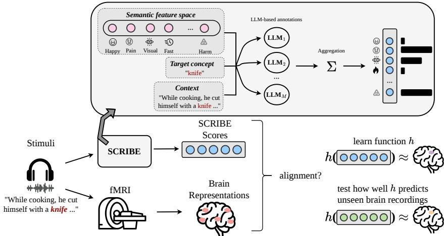  
Figure 1: SCRIBE constructs interpretable, context-aware semantic features that are used to predict brain activity, enabling the modeling of the dynamic nature of meaning in the brain. It combines three information sources: a cognitively grounded semantic feature space (Binder et al., 2016), a target concept, and the linguistic context in which the concept appears. For each semantic property in the feature space, LLMs are prompted independently to assign a score reflecting how strongly the property applies to the concept in context. These property-wise scores are then aggregated across models to produce the final representations, which are used as input to a brain encoding model that predicts fMRI responses.

Our approach bridges these directions by using LLMs as context-aware semantic annotators within a cognitively grounded feature space, yielding representations that are simultaneously interpretable, context-aware, and explicitly semantic.

## 3 METHODS

We first describe SCRIBE (Section 3.1), then how we evaluate its alignment with human semantic judgments (Section 3.2), and with brain activity (Section 3.3).

## 3.1 SCRIBE: INTERPRETABLE AND CONTEXT-AWARE SEMANTIC REPRESENTATIONS

SCRIBE maps a target concept, optionally embedded in a linguistic context, to a vector of interpretable semantic feature scores (Figure 1).

Semantic feature space. We build on the feature space of Binder et al. (2016), which defines 65 semantic properties spanning sensory (e.g., color, brightness), motor (e.g., body parts, movement), affective (e.g., pleasantness), and higher-level cognitive dimensions, derived from a synthesis of findings in cognitive neuroscience and psychology (Appendix A.1). Because each dimension is interpretable and neurocognitively grounded, we treat this space as a fixed set of semantic dimensions along which meaning can be expressed and modulated by context. Binder et al. (2016) also provide human ratings (0–6), averaged across participants, of how strongly each property applies to 535 English words, which we use as a reference for out-of-context meaning.

LLM-based annotation. Instead of manual annotation, SCRIBE prompts an LLM independently for each property to rate how strongly it applies to the target concept on the same 0–6 scale used by Binder et al. (2016), mirroring their protocol (Appendix A.2.1); the model outputs a single number, obtained with greedy decoding for deterministic annotations. Prompt ablations show that results are robust to variations in prompt wording and format (Appendix A.2.2). We use four open-source instruction-tuned LLMs, llama3.1-8b, mistral-7b, qwen2.5-7b and llama3.1-70b (Grattafiori et al., 2024; Jiang et al., 2023; Yang et al., 2024), and average their scores to obtain the final representation, mitigating model-specific biases and yielding higher correlations with human judgments than any individual model (Sections 4.1 and 4.2).

Context-aware annotation. Because meaning is shaped by context, SCRIBE conditions each estimate on the surrounding text: given a concept and the sentence in which it appears, the LLM rates how strongly each property applies to the concept in that context (Appendix A.2.3). The same concept can thus receive different semantic profiles depending on its usage, while remaining in the same interpretable space; because annotation is automated, it scales to naturalistic stimuli.

## 3.2 EVALUATING ALIGNMENT WITH HUMAN SEMANTIC JUDGMENTS

We compare SCRIBE against two sets of human ratings: the out-of-context norms of Binder et al. (2016), and our newly collected ratings of concept–property pairs in and out of context (Section 4.2; Appendix B.2.1). For our newly collected dataset, we estimate the reliability of averaged human ratings using the one-way random-effects intraclass correlation ICC(1, n) (Shrout & Fleiss, 1979), computed on n = 8 ratings per item (a concept–property pair in a given context condition) from distinct participants and averaged over 20 balanced subsamples; we also report ICC(1, 1) for single rater agreement (Appendix B.2.2). The estimated human noise ceiling, pICC(1, n), represents the expected correlation between a noise-free model and the n-rater mean. We report the Pearson correlation r between SCRIBE scores and the mean human ratings, normalized by this ceiling (with 1 indicating human-level agreement), with bootstrap confidence intervals over items. We also report the mean squared error (MSE), with significance assessed by permutation tests that shuffle SCRIBE scores across items. For Binder et al. (2016), which provide only participant-averaged ratings, we report raw correlations without noise-ceiling normalization.

## 3.3 MODELING SEMANTIC REPRESENTATIONS IN THE BRAIN

Brain encoding. We use a subset of the Moth Radio Hour dataset (LeBel et al., 2023): fMRI recordings from 7 participants listening to autobiographical stories (10–15 minutes each, TR= 2s). This dataset is widely used in prior work (Moussa et al., 2024; Antonello et al., 2023; Oota et al., 2024) and enables direct comparison with QAEmb (Singh et al., 2025). The encoding models are trained on 9 stories and evaluated on 1 held-out story (Appendix A.4.1). Following standard voxelwise encoding (Oota et al., 2024; Antonello et al., 2023), word-level SCRIBE features are aligned to the fMRI signal using Lanczos interpolation, augmented with time-lagged copies spanning the preceding 4s, and used to fit ridge regression models with cross-validation.

Evaluation. Prediction accuracy is the Pearson correlation between predicted and held-out responses, normalized by voxel-wise noise ceilings (LeBel et al., 2023; Moussa et al., 2024). We restrict analyses to voxels with a noise ceiling above 0.4 and report results across all retained voxels and within language-related regions previously defined using the Glasser atlas (Glasser et al., 2016; Moussa et al., 2024); differences are tested with Wilcoxon signed-rank tests (Appendix A.4).

Baseline. We compare SCRIBE with QAEmb (Singh et al., 2025), the closest existing interpretable stimulus representation (see Section 2 for a discussion), which represents each word using LLM responses to 35 neuroscience-motivated yes/no questions automatically selected from an initial pool of 606. We use the publicly released annotations.

## 3.3.1 ANNOTATION DESIGN: WORD TYPES AND CONTEXT SIZE

Since function words (e.g., articles, prepositions, auxiliaries) carry limited lexical meaning and may add noise, we annotate only content words (nouns, proper nouns, verbs, adjectives, adverbs, numerals, and pronouns), assigning zero-valued features to all other tokens. For context, we compare windows of w preceding tokens with the full preceding context, and use $w = 1 0$ . Both choices were selected through ablation studies across individual models and the ensemble (Appendix B.3.1): broader word sets outperform more restrictive ones (e.g., the nouns, verbs, and adjectives of Binder et al. (2016)), likely due to reduced sparsity, while gains from additional context saturate, consistent with prior work (Jain & Huth, 2018; Toneva & Wehbe, 2019).

Table 1: Alignment between SCRIBE scores and human ratings for isolated concepts (i.e., without additional context) (Binder et al., 2016). We report Pearson correlation (r) and mean squared error (MSE), with corresponding permutation-based p-values. Overall, SCRIBE aligns significantly with human semantic ratings, with the ensemble achieving the best performance.
<table><tr><td>Model</td><td>Pearson ↑</td><td> $p _ { r }$ </td><td>MSE↓</td><td>pMSE</td></tr><tr><td>Mistral 7B Instruct</td><td>0.61</td><td>&lt; 0.001</td><td>2.16</td><td>&lt; 0.001</td></tr><tr><td>Qwen 2.5 7B Instruct</td><td>0.69</td><td>&lt; 0.001</td><td>1.32</td><td>&lt; 0.001</td></tr><tr><td>LLaMA 3.1 8B Instruct</td><td>0.67</td><td>&lt; 0.001</td><td>1.70</td><td>&lt; 0.001</td></tr><tr><td>LLaMA 3.1 70B Instruct</td><td>0.74</td><td>&lt; 0.001</td><td>1.53</td><td>&lt; 0.001</td></tr><tr><td>Ensemble</td><td>0.77</td><td>&lt; 0.001</td><td>1.07</td><td>&lt; 0.001</td></tr></table>

## 4 RESULTS

We evaluate SCRIBE along four directions: semantic validity, whether its scores align with human ratings of isolated concepts (Section 4.1); context awareness, whether human judgments shift with context and SCRIBE captures these shifts (Section 4.2); neural predictivity, how well it predicts brain activity during natural language comprehension (Section 4.3); and semantic specificity, whether its brain-predictive information is distinct from syntactic features (Section 4.4).

Implementation details. All experiments were performed on internal compute clusters, using two NVIDIA H100 PCIe GPUs with ∼ 80GB GPU memory per device. The computation of the experiments took a total of ∼ 10 days.

## 4.1 SCRIBE GENERATES SEMANTIC FEATURES THAT ALIGN WITH HUMAN JUDGMENTS

We first evaluate whether SCRIBE can produce semantically meaningful representations in the absence of context, treating SCRIBE as a scalable proxy for human semantic ratings over isolated concepts. To this end, we compare SCRIBE scores for isolated concepts (i.e., without context) to human semantic feature ratings (Binder et al., 2016), using the original dataset of 535 words introduced in that work and described in Section 3.1, as a reference benchmark. For each concept, we quantify the similarity between the SCRIBE scores and human ratings using Pearson correlation and mean squared error (MSE). We assess statistical significance using permutation tests, obtained by randomly shuffling concept–property assignments 1000 times.

Table 1 summarizes the results. SCRIBE aligns significantly with human ratings across all evaluated models, with correlations above 0.6 and MSEs significantly below permutation baselines (see $\mathsf { A p - }$ pendix B.1.1 for further results). The ensemble shows the strongest alignment, reaching $r = 0 . 7 7$ and an MSE of 1.07, indicating that aggregation improves correspondence with human semantic judgments. The Binder et al. (2016) norms themselves also agree closely with the out-of-context ratings we collect (Appendix B.2.3). Together, these results support SCRIBE as a scalable approximation of human semantic ratings for isolated concepts. We therefore use the ensemble throughout the remainder of the paper, with individual-model results reported in Appendix B.

## 4.2 SCRIBE CAPTURES CONTEXTUAL SHIFTS IN HUMAN SEMANTIC JUDGMENTS

Existing semantic property norms (Binder et al., 2016; Mitchell et al., 2008) characterize concepts in isolation, leaving unexplored how humans judgments of these properties vary with linguistic context. To study this systematically, we construct a controlled dataset in which context is manipulated to increase or decrease specific concept–property associations. For each concept–property pair, we generate two contextualized sentences using an instruction-tuned LLM (llama3.1-8b): a lowtarget context $( L _ { \mathrm { T } } )$ designed to decrease the association and a high-target context $( H _ { \mathrm { T } } )$ designed to increase it (see Appendix A.3 for details).

To examine how these contextual manipulations affect human semantic judgments, we conducted a large-scale human behavioral study, in which 921 participants (after quality control) rated 323 concept–property pairs under the original out-of-context condition (O) and the corresponding $L _ { \mathrm { T } }$ and $H _ { \mathrm { T } }$ contexts, yielding nearly 12,000 ratings and on average 12 ratings per item (range 8–20; see Appendix B.2.1).

Table 2: Human contextual judgments and their alignment with the SCRIBE ensemble. (a) Mean semantic feature scores for human judgments (computed from all ratings) and SCRIBE across the low-target $( L _ { \mathrm { T } } )$ , original (O), and high-target $( H _ { \mathrm { T } } )$ conditions, with one-sided Wilcoxon signedrank tests over concept–property pairs for the predicted directional contrasts. (b) Human reliability and human–SCRIBE alignment in each condition. $\mathrm { { I C C } ( 1 , 8 ) }$ : reliability of the mean of 8 participants; ceiling $= \sqrt { \mathrm { I C C } ( 1 , 8 ) }$ , the maximum correlation attainable given human noise. r: Pearson correlation between SCRIBE and the mean human rating; r/ceiling: correlation normalized by the noise ceiling, with 95% bootstrap confidence intervals over concept–property pairs. MSE: mean squared error between SCRIBE and the mean human rating, with the chance level obtained by shuffling SCRIBE scores across pairs (1000 permutations) in parentheses. Values are averaged over 20 balanced subsamples of 8 ratings per item, as required for comparable reliability estimates across items. All ICCs, correlations and MSEs are significant $( p \leq . 0 0 1$ , permutation tests).  
(a) Contextual modulation
<table><tr><td>Annotator</td><td>LT</td><td>0</td><td> $\mathbf { H } _ { \mathbf { T } }$  一</td><td> $\mathbf { L } _ { \mathbf { T } } < \mathbf { O }$ </td><td> $\mathbf { H } _ { \mathbf { T } } > \mathbf { O }$ </td><td> $\mathbf { H } _ { \mathbf { T } } > \mathbf { L } _ { \mathbf { T } }$ </td></tr><tr><td>Human</td><td>2.67</td><td>3.23</td><td>4.23</td><td> $< . 0 0 1$ </td><td> $< . 0 0 1$ </td><td> $< . 0 0 1$ </td></tr><tr><td>Ensemble</td><td>1.58</td><td>2.18</td><td>3.54</td><td> $< . 0 0 1$ </td><td> $< . 0 0 1$ </td><td> $< . 0 0 1$ </td></tr></table>

(b) Human reliability and human–SCRIBE alignment
<table><tr><td rowspan="2">Condition</td><td colspan="2">Human reliability</td><td colspan="3">SCRIBE alignment</td></tr><tr><td>ICC(1,8)</td><td>Ceiling</td><td> $r \uparrow$ </td><td>r/ceiling [95% CI] ↑</td><td>MSE (chance)↓</td></tr><tr><td>LT</td><td>0.74</td><td>0.86</td><td>0.69</td><td>0.81 [0.74, 0.86]</td><td>2.64 (5.71)</td></tr><tr><td>0</td><td>0.84</td><td>0.92</td><td>0.73</td><td>0.80 [0.75, 0.85]</td><td>2.59 (6.53)</td></tr><tr><td> $\mathbf { H } _ { \mathbf { T } }$ </td><td>0.72</td><td>0.85</td><td>0.64</td><td>0.75 [0.67, 0.82]</td><td>2.31 (4.80)</td></tr></table>

As shown in Table $2 ( \mathrm { a } ) .$ , human judgments change systematically with context, following the expected ordering $H _ { \mathrm { T } } > O > L _ { \mathrm { T } }$ , with all directional comparisons significant $( p < . 0 0 1 )$ . These findings demonstrate that human semantic feature judgments are systematically modulated by linguistic context. To our knowledge, these data constitute the first human-annotated context-dependent semantic feature norms, which we will publicly release.

Human judgments of semantics in context are reliable. Agreement between individual participants is low to moderate $( \mathrm { I C C } ( 1 , 1 ) ~ = ~ 0 . 4 0 , ~ 0 . 2 7$ and 0.24 for $O , L _ { \mathrm { T } }$ and $H _ { \mathrm { T } } )$ , as expected for single ratings of graded semantic properties, but the average of $n = 8$ participants is reliable $( \mathrm { I C C } ( \bar { 1 } , 8 ) = \bar { 0 } . 8 4 , \bar { 0 } . 7 4$ and 0.72), far above chance (permutation test, $p \ \leq \ . 0 0 1 ;$ ; Table 2(b)). Out-of-context judgments are the most consistent, suggesting greater variability in how participants interpret concepts within linguistic contexts than in isolation. The resulting human noise ceilings are 0.92 (O), 0.86 $( L _ { \mathrm { T } } )$ and $0 . 8 5 \ : ( H _ { \mathrm { T } } )$ .

SCRIBE captures contextual shifts and approaches human-level agreement. As shown in Table 2(a), SCRIBE reproduces the human ordering $H _ { \mathrm { T } } > O > L _ { \mathrm { T } }$ , with all directional comparisons significant $( p \ < . 0 0 1 )$ . Beyond capturing the direction of these shifts, SCRIBE also aligns with human ratings at the level of individual concept–property pairs. SCRIBE scores correlate with the mean human rating in all three conditions $( r \ : = \ : 0 . 7 3 , 0 . 6 9$ and 0.64 for $O , L _ { \mathrm { T } }$ and $H _ { \mathrm { T } } )$ , reaching 80%, 81% and 75% of the human noise ceiling, respectively (Table 2(b)). In other words, SCRIBE is as consistent with the human consensus as the average of 2.6–5.1 human annotators (Appendix B.2.3). For reference, the out-of-context norms of Binder et al. (2016) reach 84% of the ceiling on the same items, so SCRIBE is close to the agreement between two independently collected sets of human ratings. SCRIBE also achieves significantly lower MSE than chance in all conditions (Table 2(b); permutation test, $p \leq . 0 0 1 ,$ ). Part of this error comes from SCRIBE rating properties about one point lower than humans on average (Table 2(a); Appendix B.2.3). The ensemble achieves the highest correlation with human ratings among all models in every condition (Appendix B.2.3).

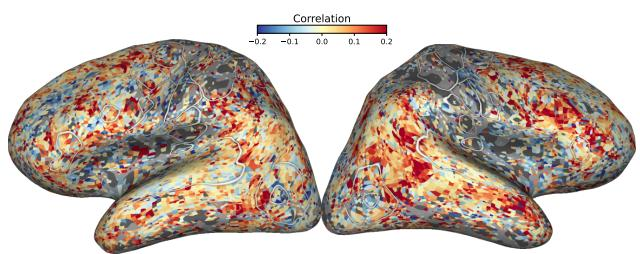  
(a) Difference between contextual and out-of-context alignment

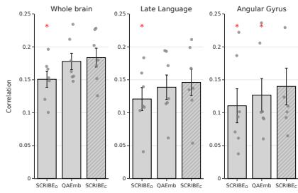  
(b) Brain alignment scores  
Figure 2: (a) Voxel-wise differences in brain alignment between contextual and out-of-context variants of SCRIBE $( \mathrm { S C R I B E _ { C } } - \mathrm { S C R I B E _ { O } } )$ for a representative subject (subject 3). Red regions show higher predictive accuracy for the contextual model. Improvements due to contextualization are predominantly observed in language-related cortical regions. (b) Brain alignment for $\mathrm { S C R I B E _ { O } }$ $\mathrm { Q A E m b } ,$ and $\mathrm { S C R I B E _ { C } }$ across the whole brain and language-related ROIs. Bars represent mean performance across subjects, with individual subject values overlaid and error bars indicating the standard error. Red asterisks (∗) denote statistically significant differences (Wilcoxon signed-rank test). Contextual SCRIBE $\mathrm { ( S C R I B E _ { C } ) }$ consistently outperforms its out-of-context $\mathrm { ( S C R I B E _ { O } ) }$ variant, while achieving performance comparable to QAEmb.

Together, these results establish that human semantic feature judgments vary systematically with context and that SCRIBE captures these shifts while approaching the agreement observed among human annotators.

## 4.3 CONTEXT-AWARE SCRIBE SCORES ARE GOOD PREDICTORS OF BRAIN ACTIVITY

We next assess whether the contextual semantic scores produced by SCRIBE capture aspects of meaning reflected in brain activity.

Contextualization improves brain alignment of SCRIBE scores. We isolate the contribution of context to the neural predictivity of SCRIBE by comparing $\mathrm { S C R I B E _ { O } }$ (out-of-context), which estimates semantic scores from the target concept alone, with $\mathrm { S C R I B E _ { C } }$ (contextual), which additionally conditions scores on the surrounding text. Because both variants use the same semantic feature space and annotation procedure, this comparison isolates the effect of conditioning semantic representations on linguistic context. All results use content words and a context window of $w = 1 0$ tokens (see Section 3.3.1).

Figure 2a shows the spatial distribution of voxel-wise differences in brain alignment for a representative subject, with higher alignment for $\mathrm { S C R I B E _ { C } }$ concentrated in language-related regions and more pronounced in the right hemisphere, consistent with the patterns observed in other subjects (Appendix B.3.2). We further quantify these observations in Figure 2b. Across participants, $\mathrm { S C R I B E _ { C } }$ significantly outperforms $\mathrm { \bar { S } C R I \bar { B } E _ { O } }$ both across the whole brain and within the examined language-related ROIs, demonstrating that incorporating linguistic context improves the neural predictivity of SCRIBE. This improvement suggests that context-dependent changes in semantic feature values capture additional information about neural responses that cannot be explained by static representations of the same concepts.

SCRIBE predicts unique variance in semantic brain regions. We further compare the neural representations captured by $\mathrm { S C R I B E _ { C } }$ and QAEmb (Figure 2b). Unlike SCRIBE, which represents conceptual meaning within a neuroscience-informed semantic space, QAEmb uses a broader set of neuroscience-motivated linguistic features. While the two methods achieve comparable whole-brain alignment, $\mathrm { S C R I B E _ { C } }$ significantly outperforms QAEmb in the AG, a region strongly implicated in semantic processing (Price et al., 2015). To investigate whether the two representations capture complementary brain-predictive information, we perform variance partitioning to separate their shared and uniquely explained variance.

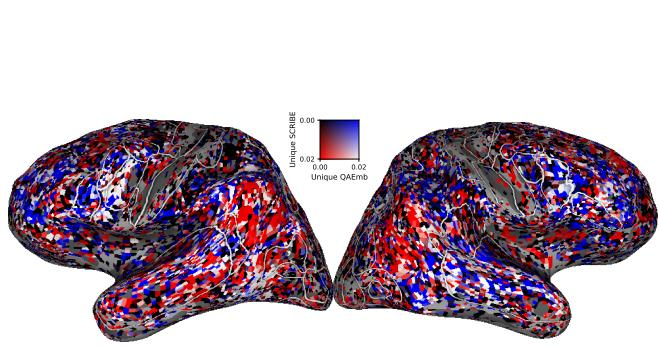  
(a) Whole-brain spatial distribution.

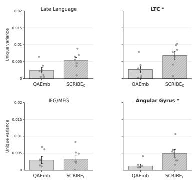  
(b) ROI-level aggregation.  
Figure 3: Unique neural variance explained by $\mathrm { S C R I B E _ { C } }$ and QAEmb. (a) Spatial distribution of voxel-wise unique variance for a representative subject (subject 2). Red indicates greater unique variance explained by $\mathrm { S C R I B E _ { C } }$ , whereas blue indicates greater unique variance explained by QAEmb. (b) Region-wise comparison of uniquely explained variance across semantically relevant ROIs. Bars show mean performance across subjects, with individual values overlaid and error bars indicating the standard error. $\mathrm { S C R I B E _ { C } }$ explains more unique variance than QAEmb on average in all four ROIs, with significant differences in LTC $( p = 0 . 0 3 9 )$ and AG $( p = 0 . 0 2 3 )$

Figure 3b shows that $\mathrm { S C R I B E _ { C } }$ explains more unique variance on average than QAEmb across the examined ROIs, with significant differences in the lateral temporal cortex (LTC) and the AG. The spatial distribution for a representative subject is shown in Figure 3a (see Appendix B.3.3 for all subjects). Notably, both regions have been implicated in semantic processing and integration, with the AG associated with combinatorial semantics (Price et al., 2015) and the LTC semantic representation and integration (Visser et al., 2010; Pallier et al., 2011; Pylkkanen, 2020).¨

Together, these results suggest that SCRIBEC captures neural variance that is not explained by QAEmb, particularly in regions associated with semantic processing, despite their comparable overall brain alignment. Additional analyses show that the representations are complementary and that SCRIBE’s performance is robust after dimensionality reduction (Appendix B.3.3 and B.3.4).

## 4.4 SCRIBE CAPTURES BRAIN-PREDICTIVE INFORMATION BEYOND SYNTACTIC FEATURES

Although these results demonstrate that SCRIBE captures unique brain-predictive information in re gions associated with semantic processing, they do not establish whether this information is specifically semantic. Because semantic information is difficult to isolate from other linguistic information in natural language, we assess the relative semantic specificity of SCRIBE indirectly by asking how much of its brain-predictive variance remains after accounting for independently defined syntac tic features. We focus on syntax because prior work has attributed part of the brain alignment of language-model representations to syntactic rather than semantic information, and its contribution to model–brain alignment remains debated (Oota et al., 2023; Fresen et al., 2024; Kauf et al., 2024). It is also a plausible confound for SCRIBE itself, since annotation is restricted to content-word part of-speech categories and several semantic dimensions covary with grammatical class (e.g., Motion with verbs). We thus construct a syntactic control space comprising part-of-speech tags, dependency length, and tree depth, and use variance partitioning to quantify its unique and shared contributions with SCRIBE and QAEmb (more details in Appendix B.3.5).

SCRIBE captures more unique and less syntax-related neural variance than QAEmb. After accounting for the measured syntactic features, SCRIBE predicts more unique variance than QAEmb across language-related ROIs, reaching significance in late language regions overall, and specifically the LTC and AG (Figure 12b). At the same time, $\mathrm { S C R I B E _ { C } }$ shares significantly less variance with syntax for predicting the LTC and AG (Figure 12a). Together, these findings provide complementary evidence for greater semantic specificity: SCRIBE retains more predictive information after accounting for syntax, while exhibiting less overlap with the syntactic control space. We extend the analysis to Llama2-7b representations (Appendix B.3.6). $\mathrm { S C R I B E _ { C } }$ outperforms noncontextual Llama2-7b embeddings, while contextual Llama2-7b embeddings achieve higher brain predictivity (Figure 14). However, contextual LLM embeddings encode a broader mixture of linguistic information. Notably, SCRIBE shares significantly less variance with syntactic features than Llama2-7b in IFG/MFG (Figure 15), a region often associated with syntactic processing (Dapretto & Bookheimer, 1999; Heim et al., 2003; Fiebach et al., 2005; Friederici, 2011).

## 5 DISCUSSION

Understanding how semantic representations are constructed and modulated in the brain requires models that are both context-aware and interpretable. In this work, we introduced SCRIBE, an approach that combines a cognitively grounded semantic feature space with LLM-based annotation to produce contextualized, interpretable semantic representations for natural language. By using LLMs as scalable semantic annotators, SCRIBE preserves the interpretability of theory-driven feature spaces while extending them beyond isolated concepts to arbitrary words in context.

Our human study first establishes that semantic feature judgments are context-dependent: across 921 participants, controlled linguistic contexts systematically shifted ratings along the targeted semantic dimensions, and these judgments were reliable when averaged across participants. To our knowledge, these data constitute the first human-annotated context-dependent semantic feature norms and will be publicly released. SCRIBE aligns with human semantic judgments both for isolated concepts and across contextual conditions, reaching 75–81% of the human noise ceiling, comparable to the agreement between two independently collected sets of human ratings.

At the neural level, incorporating context significantly improves SCRIBE’s prediction of fMRI responses relative to its out-of-context representation, particularly in language-related cortical regions. Contextual SCRIBE explains more unique neural variance than the closest existing method, with significant differences in semantic regions, such as the LTC and AG. After accounting for independently defined syntactic features, SCRIBE retains more unique brain-predictive variance than QAEmb while sharing less variance with syntax in these regions, showing that its additional brainpredictive information persists after accounting for the measured syntactic features.

More broadly, our results show that interpretability and contextuality need not be treated as opposing goals. Prior feature-based models offer interpretable dimensions but rely on static out-of-context annotations, while LLM representations are contextual and scalable but difficult to attribute to specific semantic content. SCRIBE bridges this gap by representing meaning along explicit, humaninterpretable dimensions that dynamically vary with context, providing a scalable framework for studying contextual semantics in the brain.

Limitations and future work. SCRIBE scores depend on the underlying LLMs and the prompting strategy. To assess sensitivity to prompt formulation, we performed ablations, which show that performance is largely robust across the tested variations (Appendix A.2.2). To reduce model-specific variability and biases, SCRIBE aggregates scores across multiple LLMs, analogous to aggregating human judgments; the ensemble correlates more strongly with human ratings than any individual model (Section 4.2). While SCRIBE captures the relative ordering of human judgments, its scores are systematically lower than human ratings on average, so applications relying on absolute scores may require calibration. Moreover, individual human judgments of context-dependent properties are noisy, and our conclusions hold at the level of averaged ratings rather than individual annotators. In addition, our contextual stimuli are controlled, LLM-generated sentences designed to shift specific properties; validating SCRIBE against human judgments of naturalistic text remains an important next step. Finally, the use of a fixed semantic space (Binder et al., 2016) constrains representations to a predefined set of dimensions, potentially missing aspects of meaning. However, this design choice provides a principled and interpretable basis grounded in cognitive neuroscience, enabling direct comparison with human semantic judgments and prior work.

These limitations suggest several directions for future work, including extending SCRIBE to more diverse datasets and domains, integrating it with mechanistic interpretability methods to link semantic features to model internals, and potentially expanding the semantic space to capture a broader range of semantic dimensions. Lastly, our syntactic control space is intentionally minimal; richer structural representations (Reddy & Wehbe, 2021; Caucheteux et al., 2021) and low-level or lexicalstatistical features (Deniz et al., 2019) remain to be tested.

## ACKNOWLEDGMENTS

This work was partially funded by the German Research Foundation (DFG) - DFG Research Unit FOR 5368 and by the Max Planck Institute for Software Systems graduate center. We thank Gabriele Merlin for providing valuable feedback on earlier versions of this work.

## ETHICS STATEMENT

This work includes a human behavioral study conducted through Prolific. Participants provided informed consent and were compensated at a rate of USD 12 per hour (USD 2 for a study of approximately 10 minutes). The study was approved by the Ethical Review Board at the authors’ institution. No personally identifiable information was collected or released. The resulting contextual semantic ratings will be released in anonymized form at the level of individual ratings, with participant identifiers replaced by random codes.

## REPRODUCIBILITY STATEMENT

We provide detailed descriptions of SCRIBE, the semantic annotation procedure, model and prompt specifications, contextual stimulus construction, human behavioral study, brain-encoding analyses, and statistical procedures in the main text and Appendix. We will release the contextual human annotations and code necessary to reproduce the analyses and experiments presented in this work.

## AI USE STATEMENT

Generative AI tools were used in this work to generate controlled linguistic contexts for the synthetic dataset, as described in the paper, and to assist with the editing and refinement of the manuscript. All AI-assisted outputs used in the research were reviewed and verified by the authors. The authors take full responsibility for the methods, analyses, claims, and final content of the paper.

## REFERENCES

Andrew James Anderson, Jeffrey R Binder, Leonardo Fernandino, Colin J Humphries, Lisa L Conant, Mario Aguilar, Xixi Wang, Donias Doko, and Rajeev DS Raizada. Predicting neural activity patterns associated with sentences using a neurobiologically motivated model of semantic representation. Cerebral Cortex, 27(9):4379–4395, 2017.

Richard Antonello, Aditya Vaidya, and Alexander Huth. Scaling laws for language encoding models in fmri. Advances in Neural Information Processing Systems, 36:21895–21907, 2023.

Jeffrey R Binder, Lisa L Conant, Colin J Humphries, Leonardo Fernandino, Stephen B Simons, Mario Aguilar, and Rutvik H Desai. Toward a brain-based componential semantic representation. Cognitive neuropsychology, 33(3-4):130–174, 2016.

Tom Brown, Benjamin Mann, Nick Ryder, Melanie Subbiah, Jared D Kaplan, Prafulla Dhariwal, Arvind Neelakantan, Pranav Shyam, Girish Sastry, Amanda Askell, et al. Language models are few-shot learners. Advances in neural information processing systems, 33:1877–1901, 2020.

Charlotte Caucheteux, Alexandre Gramfort, and Jean-Remi King. Disentangling syntax and semantics in the brain with deep networks. In International conference on machine learning, pp. 1336–1348. PMLR, 2021.

Emmanuele Chersoni, Enrico Santus, Chu-Ren Huang, and Alessandro Lenci. Decoding word embeddings with brain-based semantic features. Computational Linguistics, 47(3):663–698, 2021.

Mirella Dapretto and Susan Y Bookheimer. Form and content: dissociating syntax and semantics in sentence comprehension. Neuron, 24(2):427–432, 1999.

Fatma Deniz, Anwar O Nunez-Elizalde, Alexander G Huth, and Jack L Gallant. The representation of semantic information across human cerebral cortex during listening versus reading is invariant to stimulus modality. Journal ofNeuroscience, 39(39):7722–7736, 2019.

Barry J Devereux, Lorraine K Tyler, Jeroen Geertzen, and Billi Randall. The centre for speech, language and the brain (cslb) concept property norms. Behavior research methods, 46(4):1119– 1127, 2014.

Jacob Devlin, Ming-Wei Chang, Kenton Lee, and Kristina Toutanova. Bert: Pre-training of deep bidirectional transformers for language understanding. In Proceedings of the 2019 conference of the North American chapter of the association for computational linguistics: human language technologies, volume 1 (long and short papers), pp. 4171–4186, 2019.

Leonardo Fernandino, Colin J Humphries, Mark S Seidenberg, William L Gross, Lisa L Conant, and Jeffrey R Binder. Predicting brain activation patterns associated with individual lexical concepts based on five sensory-motor attributes. Neuropsychologia, 76:17–26, 2015.

Christian J Fiebach, Matthias Schlesewsky, Gabriele Lohmann, D Yves Von Cramon, and Angela D Friederici. Revisiting the role of broca’s area in sentence processing: syntactic integration versus syntactic working memory. Human brain mapping, 24(2):79–91, 2005.

Abraham Jacob Fresen, Rochelle Choenni, Micha Heilbron, Willem Zuidema, and Marianne de Heer Kloots. Language models that accurately represent syntactic structure exhibit higher representational similarity to brain activity. In Proceedings of the Annual Meeting of the Cognitive Science Society, volume 46, 2024.

Angela D Friederici. The brain basis of language processing: from structure to function. Physiological reviews, 2011.

Matthew F Glasser, Timothy S Coalson, Emma C Robinson, Carl D Hacker, John Harwell, Essa Yacoub, Kamil Ugurbil, Jesper Andersson, Christian F Beckmann, Mark Jenkinson, Stephen M Smith, and David C Van Essen. A multi-modal parcellation of human cerebral cortex. Nature, 536(7615):171–178, 2016.

Ariel Goldstein, Zaid Zada, Eliav Buchnik, Mariano Schain, Amy Price, Bobbi Aubrey, Samuel A Nastase, Amir Feder, Dotan Emanuel, Alon Cohen, et al. Shared computational principles for language processing in humans and deep language models. Nature Neuroscience, 25(3):369–380, 2022.

Aaron Grattafiori, Abhimanyu Dubey, Abhinav Jauhri, Abhinav Pandey, Abhishek Kadian, Ahmad Al-Dahle, Aiesha Letman, Akhil Mathur, Alan Schelten, Alex Vaughan, et al. The llama 3 herd of models. arXiv preprint arXiv:2407.21783, 2024.

St Heim, Bertram Opitz, and Angela D Friederici. Distributed cortical networks for syntax processing: Broca’s area as the common denominator. Brain and language, 85(3):402–408, 2003.

Paul Hoffman, Matthew A Lambon Ralph, and Timothy T Rogers. Semantic diversity: A measure of semantic ambiguity based on variability in the contextual usage of words. Behavior research methods, 45(3):718–730, 2013.

Matthew Honnibal, Ines Montani, Sofie Van Landeghem, and Adriane Boyd. spaCy: Industrialstrength natural language processing in Python. Zenodo, 2020.

Shailee Jain and Alexander Huth. Incorporating context into language encoding models for fmri. Advances in neural information processing systems, 31, 2018.

Ganesh Jawahar, Benoˆıt Sagot, and Djame Seddah. What does bert learn about the structure of´ language? In Proceedings of the 57th annual meeting of the association for computational linguistics, pp. 3651–3657, 2019.

Albert Q. Jiang, Alexandre Sablayrolles, Arthur Mensch, Chris Bamford, Devendra Singh Chaplot, Diego de Las Casas, Florian Bressand, Gianna Lengyel, Guillaume Lample, Lucile Saulnier, Lelio Renard Lavaud, Marie-Anne Lachaux, Pierre Stock, Teven Le Scao, Thibaut Lavril, Thomas´ Wang, Timothee Lacroix, and William El Sayed. Mistral 7b.´ CoRR, abs/2310.06825, 2023. doi: 10.48550/ARXIV.2310.06825. URL https://doi.org/10.48550/arXiv.2310. 06825.

Carina Kauf, Greta Tuckute, Roger Levy, Jacob Andreas, and Evelina Fedorenko. Lexical-semantic content, not syntactic structure, is the main contributor to ann-brain similarity of fmri responses in the language network. Neurobiology of Language, 5(1):7–42, 2024.

Nikita Kitaev and Dan Klein. Constituency parsing with a self-attentive encoder. In Proceedings of the 56th Annual Meeting of the Association for Computational Linguistics (Volume 1: Long Papers), pp. 2676–2686, 2018.

Amanda LeBel, Lauren Wagner, Shailee Jain, Aneesh Adhikari-Desai, Bhavin Gupta, Allyson Morgenthal, Jerry Tang, Lixiang Xu, and Alexander G Huth. A natural language fmri dataset for voxelwise encoding models. Scientific Data, 10(1):555, 2023.

Dermot Lynott, Louise Connell, Marc Brysbaert, James Brand, and James Carney. The lancaster sensorimotor norms: multidimensional measures of perceptual and action strength for 40,000 english words. Behavior research methods, 52(3):1271–1291, 2020.

Ken McRae, George S Cree, Mark S Seidenberg, and Chris McNorgan. Semantic feature production norms for a large set of living and nonliving things. Behavior research methods, 37(4):547–559, 2005.

Tom M Mitchell, Svetlana V Shinkareva, Andrew Carlson, Kai-Min Chang, Vicente L Malave, Robert A Mason, and Marcel Adam Just. Predicting human brain activity associated with the meanings of nouns. science, 320(5880):1191–1195, 2008.

Omer Moussa, Dietrich Klakow, and Mariya Toneva. Improving semantic understanding in speech language models via brain-tuning. arXiv preprint arXiv:2410.09230, 2024.

Subba Reddy Oota, Emin C¸ elik, Fatma Deniz, and Mariya Toneva. Speech language models lack important brain-relevant semantics. In Proceedings ofthe 62nd Annual Meeting ofthe Association for Computational Linguistics (Volume 1: Long Papers), pp. 8503–8528, 2024.

SubbaReddy Oota, Manish Gupta, and Mariya Toneva. Joint processing of linguistic properties in brains and language models. Advances in Neural Information Processing Systems, 36:18001– 18014, 2023.

Christophe Pallier, Anne-Dominique Devauchelle, and Stanislas Dehaene. Cortical representation of the constituent structure of sentences. Proceedings of the National Academy of Sciences, 108 (6):2522–2527, 2011.

Francisco Pereira, Bin Lou, Brianna Pritchett, Samuel Ritter, Samuel J Gershman, Nancy Kanwisher, Matthew Botvinick, and Evelina Fedorenko. Toward a universal decoder of linguistic meaning from brain activation. Nature communications, 9(1):963, 2018.

Amy R Price, Michael F Bonner, Jonathan E Peelle, and Murray Grossman. Converging evidence for the neuroanatomic basis of combinatorial semantics in the angular gyrus. The Journal of Neuroscience, 35(7):3276–3284, 2015.

Liina Pylkkanen. Neural basis of basic composition: what we have learned from the red–boat studies¨ and their extensions. Philosophical Transactions ofthe Royal Society B: Biological Sciences, 375 (1791), 2020.

Aniketh Janardhan Reddy and Leila Wehbe. Can fmri reveal the representation of syntactic structure in the brain? Advances in neural information processing systems, 34:9843–9856, 2021.

Martin Schrimpf, Idan Asher Blank, Greta Tuckute, Carina Kauf, Eghbal A Hosseini, Nancy Kanwisher, Joshua B Tenenbaum, and Evelina Fedorenko. The neural architecture of language: Integrative modeling converges on predictive processing. Proceedings of the National Academy of Sciences, 2021.

Patrick E Shrout and Joseph L Fleiss. Intraclass correlations: uses in assessing rater reliability. Psychological bulletin, 86(2):420, 1979.

Chandan Singh, Richard J Antonello, Sihang Guo, Gavin Mischler, Jianfeng Gao, Nima Mesgarani, and Alexander G Huth. Evaluating scientific theories as predictive models in language neuroscience. bioRxiv, 2025.

Mariya Toneva and Leila Wehbe. Interpreting and improving natural-language processing (in machines) with natural language-processing (in the brain). Advances in neural information processing systems, 32, 2019.

Hugo Touvron, Louis Martin, Kevin Stone, Peter Albert, Amjad Almahairi, Yasmine Babaei, Nikolay Bashlykov, Soumya Batra, Prajjwal Bhargava, Shruti Bhosale, et al. Llama 2: Open foundation and fine-tuned chat models. arXiv preprint arXiv:2307.09288, 2023.

Jacob Turton, David Vinson, and Robert Smith. Extrapolating binder style word embeddings to new words. In Proceedings of the second workshop on linguistic and neurocognitive resources, pp. 1–8, 2020.

Jacob Turton, Robert Elliott Smith, and David Vinson. Deriving contextualised semantic features from bert (and other transformer model) embeddings. In Proceedings of the 6th Workshop on Representation Learningfor NLP (RepL4NLP-2021), pp. 248–262, 2021.

Maya Visser, Elizabeth Jefferies, and MA Lambon Ralph. Semantic processing in the anterior temporal lobes: a meta-analysis of the functional neuroimaging literature. Journal of cognitive neuroscience, 22(6):1083–1094, 2010.

An Yang, Baosong Yang, Beichen Zhang, Binyuan Hui, Bo Zheng, Bowen Yu, Chengyuan Li, Dayiheng Liu, Fei Huang, Haoran Wei, et al. Qwen2.5 technical report. arXiv preprint arXiv:2412.15115, 2024.

## A METHODS

## A.1 COGNITIVELY-GROUNDED, INTERPRETABLE SEMANTIC FEATURE SPACE

## Semantic feature space.

To ground our approach in interpretable and cognitively motivated representations, we build on the semantic feature space introduced by Binder et al. (2016), which provides a cognitively and neurobiologically informed characterization of conceptual meaning. In this framework, concepts are represented as vectors over a fixed set of 65 semantic properties spanning multiple domains, in cluding perceptual (e.g., vision, audition, somatosensation), action-related (e.g., motor effectors and interaction), spatial, temporal, and abstract properties (e.g., social, cognitive, and affective features), as summarized in Table 3. These features are grounded in converging evidence from cognitive neuroscience, which suggests that conceptual knowledge is distributed across modality-specific and heteromodal brain systems. Accordingly, the semantic dimensions were shown by Binder et al. (2016) to exhibit a structured organization, clustering into groups that align with known functional divisions of the cortex, such as sensory, motor, and affective systems. This representation offers a principled and interpretable characterization of semantic content: each dimension corresponds to a well-defined aspect of meaning, enabling direct analysis of how specific properties contribute to downstream predictions.

In this work, we build on this semantic feature space, preserving its interpretability while extending it to contextual settings using LLM-based annotation.

Human semantic ratings for out-of-context concepts. The Binder et al. (2016) dataset consists of 535 out-of-context concepts (434 nouns, 62 verbs, and 39 adjectives). Each concept is annotated along the 65 semantic dimensions using human ratings, where participants evaluate the degree to which a concept is associated with specific properties (e.g., something that you can easily see, something large in size, something that makes one feel happy, etc.). Aggregating these ratings across participants yields continuous-valued feature vectors, forming interpretable semantic representations in the shared feature space. Figure 4 shows the distribution of semantic scores obtained from the aggregated human ratings for each property.

Table 3: Overview of the semantic properties from the feature space of Binder et al. (2016), grouped by modality and cognitive domain. Each concept is represented as a vector over these interpretable semantic features. The table lists the 68 properties that are queried individually: the three bipolar properties Temperature, Texture, and Weight of the original 65-dimensional space are each split into their two poles (Hot/Cold, Smooth/Rough, Light/Heavy), and the two resulting scores are recombined by taking their maximum, yielding the final 65 properties (Appendix B.2.1).
<table><tr><td>Name</td><td>Type</td><td>Modality</td><td>Submodality</td><td>Description</td></tr><tr><td>Vision</td><td>Sensory</td><td>Vision</td><td>General</td><td>Something that you can easily see</td></tr><tr><td>Bright</td><td>Sensory</td><td>Vision</td><td>Intensity</td><td>Visually light or bright</td></tr><tr><td>Dark</td><td>Sensory</td><td>Vision</td><td>Intensity</td><td>Visually dark Has a characteristic or defining color</td></tr><tr><td>Color</td><td>Sensory</td><td>Vision</td><td>Surface</td><td>Has a characteristic visual texture or surface pattern</td></tr><tr><td>Pattern</td><td>Sensory</td><td>Vision</td><td>Surface</td><td></td></tr><tr><td>Large</td><td>Sensory</td><td>Vision</td><td>Size</td><td>Large in size</td></tr><tr><td>Small</td><td>Sensory</td><td>Vision</td><td>Size</td><td>Small in size</td></tr><tr><td>Motion</td><td>Sensory</td><td>Vision</td><td>Motion</td><td>Shows visually observable movement</td></tr><tr><td>Biomotion</td><td>Sensory</td><td>Vision</td><td>Motion</td><td>Shows movement like that of a living thing</td></tr><tr><td>Fast</td><td>Sensory</td><td>Vision</td><td>Motion</td><td>Shows fast visible movement</td></tr><tr><td>Slow</td><td>Sensory</td><td>Vision</td><td>Motion</td><td>Shows slow visible movement</td></tr><tr><td>Shape</td><td>Sensory</td><td>Vision</td><td>Shape</td><td>Has a characteristic visual shape or form</td></tr><tr><td>Complexity</td><td>Sensory</td><td>Vision</td><td>Shape</td><td>Visually complex</td></tr><tr><td>Face</td><td>Sensory</td><td>Vision</td><td>Shape</td><td>Has a human or human-like face</td></tr><tr><td>Body</td><td>Sensory</td><td>Vision</td><td>Shape</td><td>Has human or human-like body parts</td></tr><tr><td>Touch</td><td>Sensory</td><td>Somatic</td><td>General</td><td>Can be easily recognized by touch</td></tr><tr><td>Hot</td><td>Sensory</td><td>Somatic</td><td>Surface</td><td>Hot to the touch</td></tr><tr><td>Cold</td><td>Sensory</td><td>Somatic</td><td>Surface</td><td>Cold to the touch</td></tr><tr><td>Smooth</td><td>Sensory</td><td>Somatic</td><td>Surface</td><td>Has a smooth texture to the touch</td></tr><tr><td>Rough</td><td>Sensory</td><td>Somatic</td><td>Surface</td><td>Has a rough texture to the touch</td></tr><tr><td>Light</td><td>Sensory</td><td>Somatic</td><td>Proprioception</td><td>Light in weight</td></tr><tr><td>Heavy</td><td>Sensory</td><td>Somatic</td><td>Proprioception</td><td>Heavy in weight</td></tr><tr><td>Pain</td><td>Sensory</td><td>Somatic</td><td>Nociception</td><td>Associated with pain or physical discomfort</td></tr><tr><td>Audition</td><td>Sensory</td><td>Audition</td><td>General</td><td>Something that you can easily hear</td></tr><tr><td>Loud</td><td>Sensory</td><td>Audition</td><td>Intensity</td><td>Makes a loud sound</td></tr><tr><td>Low</td><td>Sensory</td><td>Audition</td><td>Frequency</td><td>Has a low-pitched sound</td></tr><tr><td>High</td><td>Sensory</td><td>Audition</td><td>Frequency</td><td>Has a high-pitched sound</td></tr><tr><td>Sound</td><td>Sensory</td><td>Audition</td><td>Shape</td><td>Has a characteristic or recognizable sound</td></tr><tr><td>Music</td><td>Sensory</td><td>Audition</td><td>Shape</td><td>Makes a musical sound</td></tr><tr><td>Speech</td><td>Sensory</td><td>Audition</td><td>Phoneme</td><td>Someone or something that talks Has a characteristic or defining taste</td></tr><tr><td>Taste</td><td>Sensory</td><td>Gustation</td><td>Quality</td><td>Has a characteristic or defining smell</td></tr><tr><td>Smell</td><td>Sensory Motor</td><td>Olfaction</td><td>Quality Motor</td><td>Associated with actions using the face, mouth, or tongue</td></tr><tr><td>Head</td><td>Motor</td><td>Motor</td><td>Motor</td><td>Associated with actions using the arm, hand, or fingers</td></tr><tr><td>UpperLimb</td><td>Motor</td><td>Motor</td><td>Motor</td><td>Associated with actions using the leg or foot</td></tr><tr><td>LowerLimb</td><td>Motor</td><td>Motor</td><td>Motor</td><td></td></tr><tr><td>Practice</td><td></td><td>Motor</td><td></td><td>A physical object one has personal experience using</td></tr><tr><td>Landmark</td><td>Spatial</td><td>Navigation</td><td>Navigation</td><td>Has a fixed location, as on a map</td></tr><tr><td>Path</td><td>Spatial</td><td>Navigation</td><td>Navigation</td><td>Shows changes in location along a direction or path</td></tr><tr><td>Scene</td><td>Spatial</td><td>Scene</td><td>Scene</td><td>Brings to mind a particular setting or physical location</td></tr><tr><td>Near</td><td>Spatial</td><td>Self Space</td><td>Proximity</td><td>Often physically near in everyday life</td></tr><tr><td>Toward</td><td>Spatial</td><td>Self Space</td><td>Toward</td><td>Associated with movement toward or into oneself</td></tr><tr><td>Away</td><td>Spatial</td><td>Self Space</td><td>Away</td><td>Associated with movement away from or out of oneself</td></tr><tr><td>Number</td><td>Number</td><td>Number</td><td>Number</td><td>Associated with a specific number or amount</td></tr><tr><td>Time</td><td>Event</td><td>Temporal</td><td>Time</td><td>Occurs at a typical or predictable time</td></tr><tr><td>Duration</td><td>Event</td><td>Temporal</td><td>Duration</td><td>Has a predictable duration, whether short or long</td></tr><tr><td>Long</td><td>Event</td><td>Temporal</td><td>Long</td><td>Lasts for a long period of time</td></tr><tr><td>Short</td><td>Event</td><td>Temporal</td><td>Short</td><td>Lasts for a short period of time</td></tr><tr><td>Caused</td><td>Event</td><td>Causal</td><td>Causal</td><td>Caused by a clear preceding event, action, or situation</td></tr><tr><td>Consequential</td><td>Event</td><td>Causal</td><td>Causal</td><td>Likely to have consequences</td></tr><tr><td>Social</td><td>Event</td><td>Social</td><td>Social</td><td>Involves an interaction between people</td></tr><tr><td>Human</td><td>Cognition</td><td>Social</td><td>Theory of Mind</td><td>Has human or human-like intentions, plans, or goals</td></tr><tr><td>Communication</td><td>Cognition</td><td>Social</td><td>Communication</td><td>Used by people to communicate</td></tr><tr><td>Self</td><td>Cognition</td><td>Self</td><td>Self</td><td>Related to one&#x27;s own view of oneself</td></tr><tr><td>Cognition</td><td>Cognition</td><td>Cognition</td><td>Cognition</td><td>A form of mental activity or function of the mind</td></tr><tr><td>Benefit</td><td>Evaluation</td><td>Cognitive</td><td>Positive</td><td>Could help or benefit oneself or others</td></tr><tr><td>Harm</td><td>Evaluation</td><td>Cognitive</td><td>Negative</td><td>Could cause harm to oneself or others</td></tr><tr><td>Pleasant</td><td>Evaluation</td><td>Affective</td><td>Positive</td><td>Something one finds pleasant</td></tr><tr><td>Unpleasant</td><td>Evaluation</td><td>Affective</td><td>Negative</td><td>Something one finds unpleasant</td></tr><tr><td>Happy</td><td>Emotion</td><td>Positive</td><td>High</td><td>Makes one feel happy</td></tr><tr><td>Sad</td><td>Emotion</td><td>Negative</td><td>Low</td><td>Makes one feel sad</td></tr><tr><td>Angry</td><td>Emotion</td><td>Negative</td><td>High</td><td>Makes one feel angry</td></tr><tr><td>Disgusted</td><td>Emotion</td><td>Negative</td><td>High</td><td>Makes one feel disgusted</td></tr><tr><td>Fearful</td><td>Emotion</td><td>Negative</td><td>High</td><td>Makes one feel afraid</td></tr><tr><td>Surprised</td><td>Emotion</td><td>Neutral</td><td>High</td><td>Makes one feel surprised</td></tr><tr><td>Drive</td><td>Drive</td><td>General</td><td>General</td><td>Motivates one to do something</td></tr><tr><td>Needs</td><td>Drive</td><td>Basic</td><td>Basic</td><td>Would be hard to live without</td></tr><tr><td></td><td></td><td>General</td><td></td><td></td></tr><tr><td>Attention Arousal</td><td>Attention Attention</td><td>General</td><td>General Arousal</td><td>Grabs one&#x27;s attention Makes one feel alert, activated, excited, or keyed up</td></tr></table>

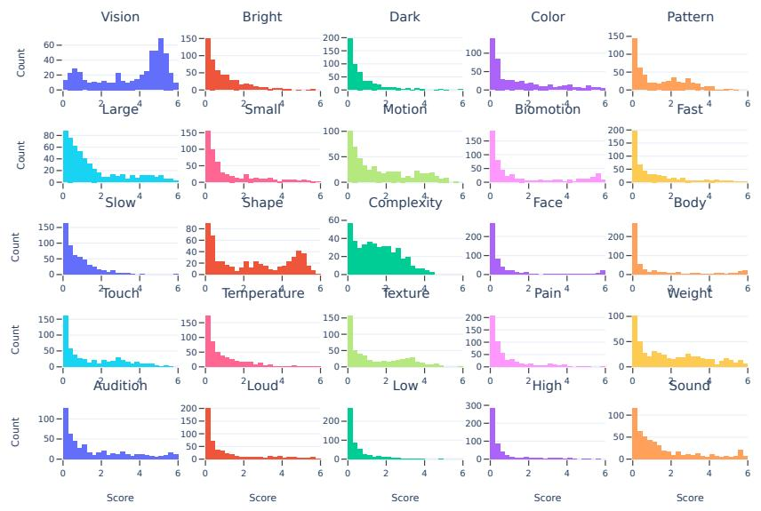

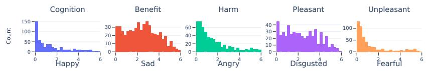

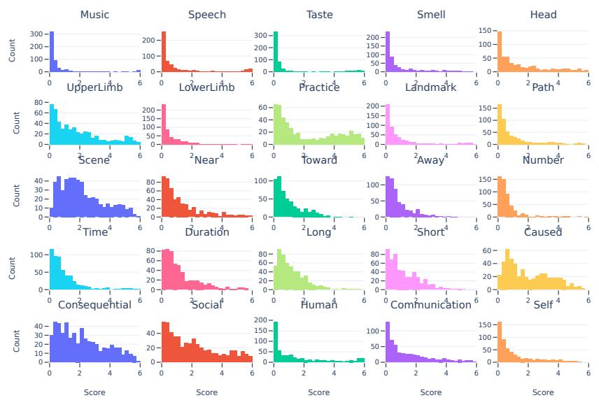

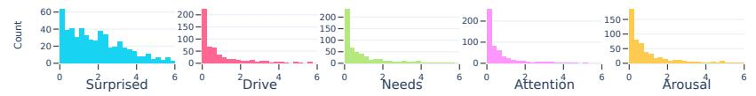

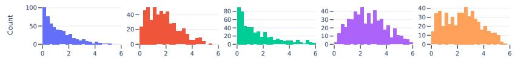  
Figure 4: Distribution of semantic feature scores derived from human ratings in the Binder et al. (2016) dataset (composed of 535 words), shown for each of the 65 semantic properties.

## A.2 LLM-BASED SEMANTIC ANNOTATIONS

SCRIBE uses LLMs to estimate semantic feature scores by prompting them to assess how strongly a target concept is associated with each semantic property. This procedure is applied both in an out-ofcontext setting, where the word is evaluated in isolation without providing any contextual sentence, and in a contextual setting, where the word is evaluated within a specific contextual sentence. In both settings, scores are generated with greedy decoding (temperature 0), making annotations deterministic, and the first number in the model output is parsed as the score.

## A.2.1 OUT-OF-CONTEXT SEMANTIC ANNOTATION

In the out-of-context setting, SCRIBE obtains semantic representations using LLM-generated annotations computed independently for each concept-property pair. For a given target concept, the model is prompted for each semantic property in the semantic feature space (described in Appendix A.1), resulting in 65 queries. Each query asks the model to rate how strongly the word is associated with the corresponding property, returning a scalar score in the range [0, 6]. These scores are then aggregated to form a semantic feature vector for the concept, which is directly comparable to the human ratings of Binder et al. (2016) when evaluated on the same set of concepts.

The prompt takes the following form:

You are an expert in rating to what degree words are   
associated with semantic properties.   
To what degree is the word ‘‘{word}’’ associated with   
{property relation} {property explanation}?   
Provide only a single number for the rating of   
the word ‘‘{word}’’ on a scale from 0 (not at all   
associated or not applicable) to 6 (very strongly   
associated).   
Do not include any explanation or text, just the   
number.   
Output:

An example prompt for the concept word “bus” and property “motion” is shown below:

You are an expert in rating to what degree words are associated with semantic properties.   
To what degree is the word “bus” associated with showing a lot of visually observable   
movement?   
Provide only a single numberfor the rating ofthe word “bus” on a scalefrom 0 (not at all   
associated or not applicable) to 6 (very strongly associated).   
Do not include any explanation or text, just the number.   
Output:

## A.2.2 ABLATION OF PROMPT COMPONENTS

LLMs are known to be sensitive to prompt wording, yet our main experiments use a single prompt formulation. To assess the robustness of SCRIBE to prompt design choices, we performed a prompt ablation study in which we systematically modified individual components of the prompt while keeping all other instructions unchanged.

The base condition is the prompt used throughout the main experiments (Appendix A.2.1). All variants were annotated in a separate run from the one reported in Table 1, together with the base prompt; owing to the non-determinism of GPU inference, the base results differ slightly from Table 1 (by at most 0.002 in Pearson correlation and 0.007 in MSE).

We split the prompt into four conceptual components: (i) a role instruction assigning the model as an expert, (ii) the task description specifying the semantic property and relation to be rated, (iii) the rating scale, and (iv) output instructions constraining the response format.

[Role] You are an expert in rating to what degree words are associated with semantic properties. [Task] To what degree is the word “{word}” associated with {property relation}

{property explanation}? [Rating scale] Provide only a single number for the rating of the word “{word}” on a scale from 0 (not at all associated or not applicable) to 6 (very strongly associated). [Output format] Do not include any explanation or text, just the number. Output:

We evaluated a series of prompt variants by modifying one component at a time relative to the base prompt. The tested variants are summarized in Table 4.

Table 4: Prompt variants evaluated in the prompt ablation study. Each variant modifies a single component of the base prompt while leaving all other components unchanged.
<table><tr><td>Component</td><td>Variant</td><td>Modification</td></tr><tr><td>Baseline</td><td>Base prompt</td><td>Prompt used throughout the main experiments (Appendix A.2.1).</td></tr><tr><td>Role</td><td>Remove expert role</td><td>Remove the instruction: “You are an expert in rating to what degree words are associated with semantic properties.&quot;</td></tr><tr><td>Task</td><td>Property name only</td><td>Provide only the property name instead of its relation and definition, e.g., &quot;associated with Motion?&quot;</td></tr><tr><td>Task</td><td>Property name + definition</td><td>Provide the property name followed by its relation and definition, e.g., “associated with Motion (showing a lot of visually observable move-</td></tr><tr><td>Task</td><td>Relation: as</td><td>ment)?&quot; Replace “associated with&quot; by “as&quot;, e.g., “To what degree is the word {word} as {property relation} {property explanation}?&quot;</td></tr><tr><td>Task</td><td>Relation: characterized by</td><td>Replace “associated with&quot; by “characterized by&quot;, e.g., &quot;To what degree is the word {word} characterized by {property relation} {property ex- planation}?&quot;</td></tr><tr><td>Scale</td><td>Binary (0–1)</td><td>Replace the 0–6 rating scale with a scale ranging from 0 (not at all associated or not applicable) to 1 (very strongly associated); ratings are</td></tr><tr><td>Scale</td><td>Full scale descriptions</td><td>multiplied by 6 for evaluation. Keep the 0–6 scale but provide a textual description for every rating (e.g., 1 = very weakly associated, 2 = weakly associated, etc.).</td></tr><tr><td>Output</td><td>Semantic reasoning</td><td>Add the instruction: “Consider the meaning of the word itself when assigning the rating.&quot;</td></tr></table>

Table 5 summarizes the prompt ablation results across the individual models and their ensemble. Performance was largely robust to how the prompt is phrased and formatted: rewording the relation, changing the rating scale, or adding a reasoning instruction changed the correlation of the ensemble with human ratings by at most 0.015, and the original prompt achieved the best ensemble performance. The largest drops occurred when information was removed from the prompt, namely when the property definition was replaced by the property name alone and, to a lesser extent, when the expert role was removed. This is expected, as the property definitions specify what each semantic dimension means; as in the human rating protocol of Binder et al. (2016), providing them is part of the annotation procedure rather than a free design choice.

<table><tr><td>Model</td><td>Ablation</td><td>MSE</td><td>Pearson Corr.</td></tr><tr><td rowspan="9">1lama3.1-8b-instruct</td><td>Base</td><td>1.693</td><td>0.674</td></tr><tr><td>No role</td><td>2.615</td><td>0.580</td></tr><tr><td>Property name only</td><td>2.684</td><td>0.498</td></tr><tr><td>Property name + definition</td><td>1.867</td><td>0.639</td></tr><tr><td>Relation “as&quot;</td><td>1.717</td><td>0.663</td></tr><tr><td>Relation“characterized by’</td><td>1.700</td><td>0.659</td></tr><tr><td>Scale 0-1</td><td>1.980</td><td>0.662</td></tr><tr><td>Long scale (0–6)</td><td>1.942</td><td>0.662</td></tr><tr><td>Semantic reasoning</td><td>1.610</td><td>0.660</td></tr><tr><td rowspan="9">mistral-7b-instruct</td><td>Base</td><td>2.163</td><td>0.616</td></tr><tr><td>No role</td><td>2.405</td><td>0.576</td></tr><tr><td>Property name only</td><td>2.801</td><td>0.445</td></tr><tr><td>Property name + definition</td><td>2.142</td><td>0.599</td></tr><tr><td>Relation “as&quot;</td><td>2.349</td><td>0.557</td></tr><tr><td>Relation “characterized by”</td><td>2.386</td><td>0.581</td></tr><tr><td>Scale 0-1</td><td>2.380</td><td>0.599</td></tr><tr><td>Long scale (0–6)</td><td>2.206</td><td>0.607</td></tr><tr><td>Semantic reasoning</td><td>2.378</td><td>0.589</td></tr><tr><td rowspan="9">qwen2.5-7b-instruct</td><td>Base</td><td>1.324</td><td>0.693</td></tr><tr><td>No role</td><td>2.565</td><td>0.615</td></tr><tr><td>Property name only</td><td>2.046</td><td>0.507</td></tr><tr><td>Property name + definition</td><td>1.403</td><td>0.673</td></tr><tr><td>Relation “as&quot;</td><td>1.551</td><td>0.643</td></tr><tr><td>Relation “characterized by&quot;</td><td>1.417</td><td>0.664</td></tr><tr><td>Scale 0–1</td><td>1.327</td><td>0.682</td></tr><tr><td>Long scale (0–6)</td><td>1.421</td><td>0.685</td></tr><tr><td>Semantic reasoning</td><td>1.325</td><td>0.692</td></tr><tr><td rowspan="10">llama3.1-70b-instruct</td><td>Base No role</td><td>1.530</td><td>0.742</td></tr><tr><td></td><td>2.033</td><td>0.656</td></tr><tr><td>Property name only</td><td>2.628</td><td>0.587</td></tr><tr><td>Property name + definition</td><td>1.517</td><td>0.751</td></tr><tr><td>Relation “as&quot;</td><td>1.508</td><td>0.747</td></tr><tr><td>Relation “characterized by&quot;</td><td>1.539</td><td>0.741</td></tr><tr><td>Scale 0-1</td><td>1.489</td><td>0.735</td></tr><tr><td>Long scale (0–6)</td><td>1.722</td><td>0.734</td></tr><tr><td>Semantic reasoning</td><td>1.578</td><td>0.737</td></tr><tr><td>Base</td><td>1.076</td><td>0.767</td></tr><tr><td rowspan="8">Ensemble</td><td>No role</td><td>1.496</td><td></td></tr><tr><td>Property name only</td><td>1.785</td><td>0.698 0.599</td></tr><tr><td>Property name + definition</td><td>1.147</td><td>0.756</td></tr><tr><td>Relation “as&quot;</td><td>1.084</td><td>0.752</td></tr><tr><td>Relation “characterized by’</td><td>1.150</td><td>0.757</td></tr><tr><td></td><td></td><td></td></tr><tr><td>Scale 0–1</td><td>1.115</td><td>0.756</td></tr><tr><td>Long scale (0–6) Semantic reasoning</td><td>1.140 1.086</td><td>0.765 0.765</td></tr></table>

Table 5: Prompt ablation results across individual models and their ensemble on the 535 words of Binder et al. (2016). Pearson correlation and MSE are computed per word across the 65 properties and averaged over words. The base prompt is the main prompt; its values differ slightly from Table 1 because of non-deterministic GPU inference across runs.

## A.2.3 CONTEXTUAL SEMANTIC ANNOTATION

In the contextual setting, SCRIBE follows the same procedure as in the out-of-context case, using LLM-generated annotations independently for each concept-property pair. The key difference is that semantic scores are now conditioned on the sentence in which the concept appears, enabling context-dependent representations.

The prompt is modified as follows:

You are an expert in rating to what degree words are   
associated with semantic properties.   
Given the context “{contextual sentence}”, to what degree is the   
word ‘‘{word}’’ associated with {property relation}   
{property explanation}?   
Provide only a single number for the rating of   
the word ‘‘{word}’’ on a scale from 0 (not at all   
associated or not applicable) to 6 (very strongly   
associated).   
Do not include any explanation or text, just the   
number.   
Output:

This formulation allows the model to adjust semantic feature values based on how the meaning of the target word is modulated by context.

An example prompt for the concept word “bus”, the property “motion”, and the contextual sentence of “The bus was parked at the station” is shown below:

You are an expert in rating to what degree words are associated with semantic properties.   
Given the context “The bus was parked at the station”, to what degree is the word “bus”   
associated with showing a lot ofvisually observable movement?   
Provide only a single numberfor the rating ofthe word “bus” on a scalefrom 0 (not at all   
associated or not applicable) to 6 (very strongly associated).   
Do not include any explanation or text, just the number.   
Output:

Examples of context window sizes. Table 6 illustrates the different context window sizes used for contextual semantic annotation. For each target word, the context consists of the k tokens preceding and including the target, with larger values of k providing progressively broader linguistic context.

Table 6: Examples of the context provided to SCRIBE for different context window sizes. The target word is shown in bold.
<table><tr><td></td><td>Example Context size</td><td>Context</td></tr><tr><td rowspan="5">1</td><td> $k = 3$ </td><td>of those people</td></tr><tr><td> $k = 5$ </td><td>I&#x27;m one of those people</td></tr><tr><td> $k = 1 0$ </td><td>raised with a religion and I&#x27;m one of those people</td></tr><tr><td> $k = 5 0$ </td><td>so a lot of people are raised with a religion and I&#x27;m one of those people</td></tr><tr><td> $k = 3$ </td><td>the word pretty</td></tr><tr><td rowspan="4">2</td><td> $k = 5$ </td><td>extension of the word pretty</td></tr><tr><td> $k = 1 0$ </td><td>word beautiful was just an extension of the word pretty</td></tr><tr><td> $k = 5 0$ </td><td>when I was younger the word beautiful was just an extension of the word</td></tr><tr><td></td><td>pretty</td></tr><tr><td rowspan="4"> $^ 3$ </td><td> $k = 3$ </td><td>date and i</td></tr><tr><td> $k = 5$   $k = 1 0$ </td><td>a christian date and i time i was going on a christian date and i</td></tr><tr><td> $k = 5 0$ </td><td></td></tr><tr><td></td><td>it was the first time i was going on a christian date and i</td></tr><tr><td rowspan="4">4</td><td> $k = 3$ </td><td>learn a lesson</td></tr><tr><td> $k = 5$   $k = 1 0$ </td><td>romance not learn a lesson go to morocco to escape romance not learn a lesson</td></tr><tr><td> $k = 5 0$ </td><td></td></tr><tr><td></td><td>my plan was to go to morocco to escape romance not learn a lesson</td></tr></table>

## A.3 SYNTHETIC DATASET FOR CONTROLLED CONTEXTUAL EVALUATION

To evaluate whether contextual information induces systematic changes in semantic representations, we construct a synthetic dataset designed to isolate the effect of context on individual con cept–property associations. A key requirement for this evaluation is to control for the baseline strength of each association, as it constrains how much it can change under contextual manipulation. We therefore first select a subset of concept–property pairs that span the full range of baseline association strengths (Section A.3.1), and only then generate contexts that induce opposite semantic effects: one that aims to decrease the association (“low” condition) and one that aims to increase it (“high” condition) (Section A.3.2). This design enables controlled testing of whether semantic features respond predictably to targeted contextual manipulations.

## A.3.1 CONCEPT AND PROPERTY SELECTION

A key challenge in evaluating contextual effects is that the baseline out-of-context strength of a concept–property association may constrain how much it can change. For example, pairs with very high initial ratings have limited room for further increase, while pairs with very low ratings may be difficult to decrease. To control for this effect, we leverage the 535 concepts from the Binder et al. (2016) dataset, which provides human ratings for each concept–property pair and allows us to explicitly characterize baseline out-of-context association strength.

We discretize these ratings into three levels (low, mid, and high) using thresholds aligned with the original rating scale:

$$
{ \mathrm { l o w : ~ } } [ 0 , 2 ) , \quad { \mathrm { m i d : ~ } } [ 2 , 4 ) , \quad { \mathrm { h i g h : ~ } } [ 4 , 6 ] .
$$

This yields a categorical matrix that assigns each concept–property pair to a baseline association bin (see Figure 5 for bin coverage).

To ensure controlled comparisons across these levels, we construct a balanced subset of concepts. Not all properties exhibit sufficient variability across concepts (Section A.1). We therefore retain only properties for which each bin contains at least 8 concepts, resulting in 57 properties after filtering, and excluding Low, Slow, Toward, Away, Disgusted, Complexity, Taste, Dark. For each retained property, we then select a subset of concepts that spans the full range of baseline associations using a greedy selection procedure:

1. Initialize coverage counts for each (property, bin) cell.

2. At each step, consider all remaining candidate concepts.

3. For each candidate, compute how many under-covered (property, bin) cells it would help fill.

4. Select the concept that maximizes this coverage gain.

5. Update coverage counts and repeat until all cells reach the target.

At convergence, we then select 8 concepts per property bin (low, mid, high), yielding 24 concepts per property. This balanced design ensures that contextual effects are evaluated under comparable baseline conditions, rather than being driven by saturation or floor effects. Consistent with this concern, human ratings for low-baseline pairs were not further decreased by low-target contexts (Appendix B.2.1).

The final set of 144 concepts is: deceit, snub, gasp, infinity, truth, reality, advice, era, grew, evening, number, fed, terrorist, quantity, handshake, angry, jaw, street, dinner, hospital, baseball, bonfire, foot, accordion, animosity, crossed, gunshot, dropped, cough, ricochet, raspberry, egg, morning, dime, tulip, festival, apricot, sun, cloud, summer, shiny, explosion, dandelion, lightning, election, empty, ate, chime, banjo, carnival, fireworks, bus, beach, bagpipe, avalanche, toe, drew, cash, coffee, dolphin, belief, lived, protest, fiddle, leg, volcano, elm, snake, alligator, clang, girl, mouth, bicycle, sick, loud, built, apartment, ambulance, battle, college, audience, school, riot, jury, couple, thunder, pineapple, drank, finger, banana,

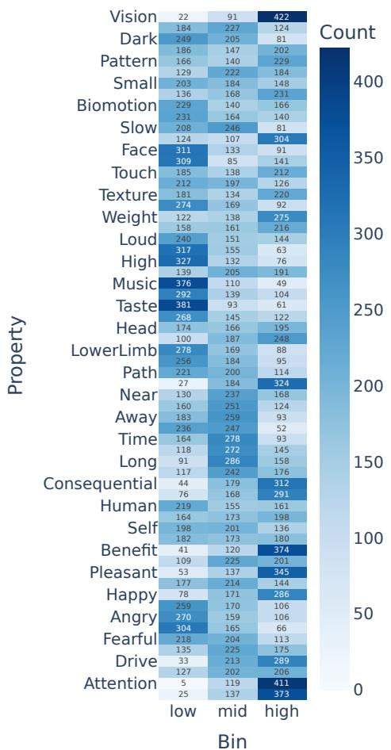  
(a) Quantiles thresholds.

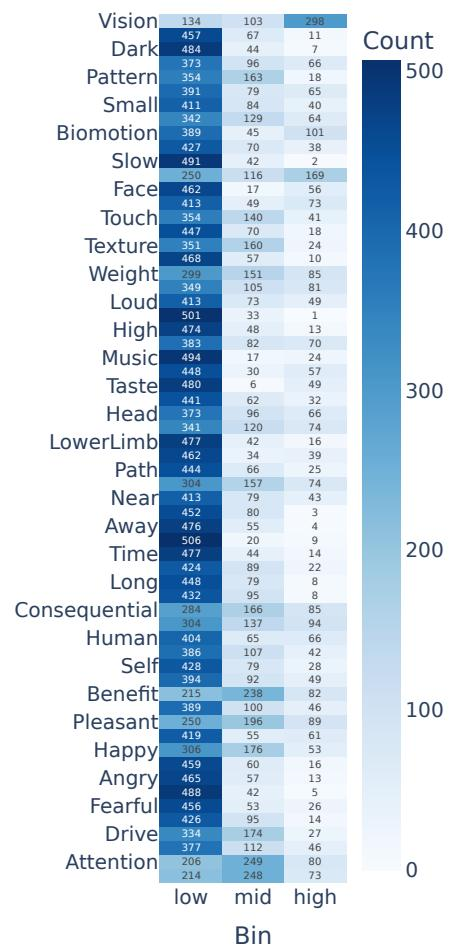  
(b) Manual thresholds.  
Figure 5: Distribution of (concept, property) pairs across discretized baseline bins under two binning strategies. (a) Quantile-based thresholds (0.34, 1.5) yield more uniform distributions across bins; however, the threshold for the high bin is low relative to the full rating scale (0–6), leading to less interpretable groupings. (b) Manual thresholds aligned with the original rating scale ([0, 2), [2, 4), [4, 6]) produce more interpretable assignments of low, mid, and high association levels across properties. These observations motivate the use of fixed thresholds in our synthetic dataset construction.

bell, bee, cellphone, harmonica, beer, long, belch, delivered, activist, victim, man, matinee, parade, army, sum, council, lip, arm, walked, marched, approached, ran, hailstorm, expensive, airport, bugle, celebrated, old, tired, shouted, doctor, dead, left, hiked, friendly, insult, car, treaty, wonder, problem, funeral, injured, torment, semester, year, listened (to), screech, scream, excuse, aggressive, restaurant, worked, day, intellect.

## A.3.2 CONTEXTUAL SENTENCE GENERATION

For each selected concept-property pair in the synthetic dataset, we then use llama3.1-8b-instruct to generate two sentences: one intended to decrease the target property score (low condition) and one intended to increase it (high condition). These sentences are designed to manipulate the semantic interpretation of the target concept in a controlled manner.

Prompt template to generate the contextual sentences. The prompt template used to construct   
the synthetic dataset is shown below:   
You are a sentence generation assistant. Your task   
is to write ONE simple and short sentence using   
the target word ‘‘{concept}’’. The sentence should   
evoke a \*\*{level}\*\* value for the semantic property   
‘‘{property name}’’, defined as {property relation}   
{property explanation}.   
Constraints:   
- Use the word ‘‘{concept}’’ exactly as given in the   
sentence.   
- Do not use the property name ‘‘{property name}’’   
directly in the sentence.   
- Do not include explanations or extra formatting,   
only the sentence.   
Output format:   
Return the sentence in the following format: <ONE   
sentence with ‘‘{concept}’’ >.   
No additional text, keys or punctuation.   
Context:   
The word ‘‘{concept}’’ belongs to the super category   
‘‘{super category concept}’’ and category ‘‘{category   
concept}’’   
Output:   
An example to generate a contextual sentence for the concept word “bus”, the property “motion”,   
and the target level “low” is shown below:   
You are a sentence generation assistant.   
Your task is to write ONE simple and short sentence using the target word “bus”.   
The sentence should evoke a “low” value for the semantic property “Motion”, defined as   
showing a lot ofvisually observable movement.   
Constraints:   
- Use the word “bus” exactly as given in the sentence.   
- Do not use the property name “Motion” as given directly in the sentence.   
- Do not include explanations or extra formatting, just the sentence.   
Output format:   
Return the sentence in thefollowingformat: <ONE sentence with “bus” >.   
No additional text, keys or punctuation.   
Context:   
The word “bus” belongs to the super category “artifact” and category “vehicle”.   
Output:

Example of contextual sentences generated. We manually inspect a subset of generated examples to ensure quality and coherence. Some examples are presented in Table 7.

Table 7: Examples of controlled contextual manipulations for selected property-concept pairs. For each pair, the low-context sentence is designed to reduce the target semantic property, while the high-context sentence increases it, demonstrating how context systematically modulates semantic feature annotations.
<table><tr><td>Property</td><td>Concept</td><td>Low-context sentence</td><td>High-context sentence</td></tr><tr><td>Angry</td><td>thunder</td><td>The thunderstorm was a beautiful display of nature.</td><td>The loud thunder made me furious.</td></tr><tr><td>Motion</td><td>bus</td><td>The bus was parked at the station.</td><td>The bus sped down the highway.</td></tr><tr><td>Social</td><td>dinner</td><td>I ate dinner alone at home.</td><td>We had dinner together with friends at the restaurant.</td></tr><tr><td>Pleasant</td><td>fireworks</td><td>The loud fireworks startled the baby.</td><td>Watching fireworks on the 4th of July was a joyful experience.</td></tr><tr><td>Fast</td><td>bus</td><td>The bus moved slowly through traffic.</td><td>The bus sped down the highway.</td></tr><tr><td>Motion Number</td><td>activist</td><td>The activist sat quietly in the corner.</td><td>The activist marched through the streets.</td></tr><tr><td>Small</td><td>leg</td><td>She has a broken leg.</td><td>The dog has four legs.</td></tr><tr><td></td><td>egg</td><td>The ostrich egg is enormous.</td><td>The tiny egg was barely visible to the naked eye.</td></tr></table>

## A.4 BRAIN ENCODING SETUP

## A.4.1 FMRI DATASET

We use a subset of the fMRI dataset originally described and made publicly available in previous work (LeBel et al., 2023). The subset used consists of 11 stories and 8 participants, all of whom listened to all the stories. The speech stimuli consisted of 10 to 15 minute stories taken from The Moth Radio Hour podcast and used previously (Moussa et al., 2024; Antonello et al., 2023; Oota et al., 2024). The selected stories cover a wide range of topics and are highly engaging (Oota et al., 2024). The model validation dataset consisted of one 10 min story. In this work, we include 7 of the 8 subjects, excluding subject 4 due to incomplete data (a missing story). To enable comparison with QAEmb (Singh et al., 2025), an interpretability representation used as baseline, we further exclude one story (“myfirstdaywiththeyankees”) that is not available in its feature set, resulting in a total of 9 stories used for training the encoding models.

## A.4.2 ROIS DETAILS

The human cerebral cortex multi-modal parcellation (Glasser atlas) defines 180 regions of interest (ROIs) per hemisphere (Glasser et al., 2016). Following prior work (Moussa et al., 2024; Oota et al., 2024), we define language regions based on a subset of these ROIs, as listed in Table 8.

Table 8: Brain regions and corresponding ROI labels.
<table><tr><td>Region</td><td>Labels</td></tr><tr><td>Angular gyrus (AG)</td><td>PFm, PGs, PGi, TPOJ2, TPOJ3</td></tr><tr><td>(LTC)</td><td>Lateral temporal cortex STSda, STSva, STGa, TE1a, TE2a, TGv, TGd, A5,</td></tr><tr><td></td><td>STSdp, STSvp, PSL, STV, TPOJ1</td></tr><tr><td>Inferior frontal gyrus (IFG)44, 45, IFJa, IFSp</td><td></td></tr><tr><td>Middle frontal gyrus (MFG) 55b</td><td></td></tr><tr><td>Primary auditory cortex A1 (A1)</td><td></td></tr><tr><td>Early auditory regions</td><td>A1, PBelt, MBelt, LBelt, RI, A4</td></tr></table>

## A.4.3 ESTIMATED NOISE CEILING

Noise in fMRI data can impair evaluations, so it is important to estimate the “noise ceiling” of each voxel in the fMRI recordings. The voxel-wise noise ceiling is estimated for all participants based on the preferred method by the fMRI dataset paper (LeBel et al., 2023), which leverages within participant repetitions of the same story to compute the maximum explainable variance for each voxel. This noise ceiling value estimates the amount of explainable variance in the brain signal, ranging from 0 to 1. We use this estimated noise ceiling to filter noisy voxels during brain alignment evaluation. We use a filtration threshold of 0.4, in line with the findings of Antonello et al. (2023). After filtering voxels with low noise ceiling, there remain 30, 000 to 50, 000 voxels per participant.

## B RESULTS

## B.1 SCRIBE GENERATES SEMANTIC FEATURES THAT ALIGN WITH HUMAN JUDGMENTS

## B.1.1 PERMUTATION TEST

To assess whether the observed alignment between LLM-generated annotations and human semantic ratings reflects meaningful structure, we run a permutation test. Specifically, for each model, we randomly shuffle concept–property assignments and recompute evaluation metrics (MSE and Pearson correlation), thereby destroying the true semantic correspondence while preserving the marginal distributions of annotations. We repeat this procedure 1,000 times to obtain empirical null distri butions for each metric. Figures 6 and 7 show the distributions of scores obtained from the true annotations against those from the permutation baseline. Across all models, the real distributions are clearly separated from the permuted ones, with lower MSE and higher correlation values, showing that the annotations obtained from the LLM models capture systematic relationships between concepts and semantic properties.

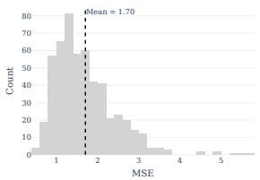  
(a) MSE real (llama3.1-8b).

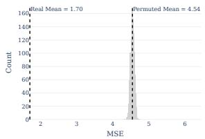  
(b) MSE perm. (llama3.1-8b).

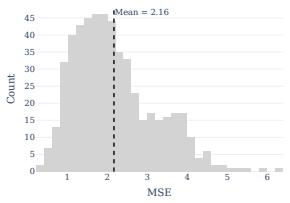  
(c) MSE real (mistral-7b).

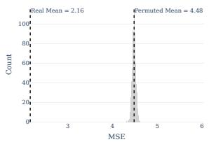  
(d) MSE perm. (mistral-7b).

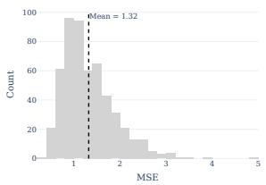  
(e) MSE real (qwen2.5-7b).

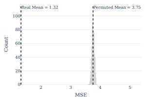  
(f) MSE perm. (qwen2.5-7b).

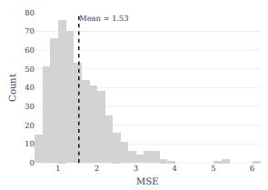  
(g) MSE real (llama3.1-70b).

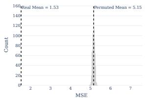  
(h) MSE perm. (llama3.1-70b).

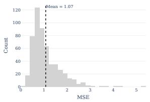  
(i) MSE real (ensemble).

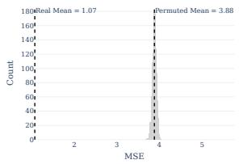  
(j) MSE perm. (ensemble).

Figure 6: Distribution of mean squared error (MSE) for out-of-context semantic annotation across models. For each model, we show the distribution of the MSE values computed on the true concept–property assignments (left) and under a permutation baseline obtained by randomly shuffling concept–property pairs (right). Across all models, the true MSE distribution is substantially lower than the permutation baseline, indicating that LLM-based annotations capture meaningful semantic structure beyond chance. Results are shown for individual models and the ensemble.

(e) Pearson real (qwen2.5-7b). (f) Pearson perm. (qwen2.5-7b).  
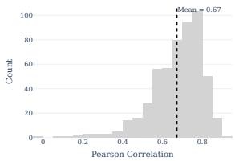

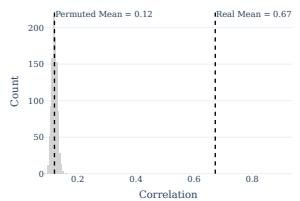  
(a) Pearson real (llama3.1-8b). (b) Pearson perm. (llama3.1-8b).

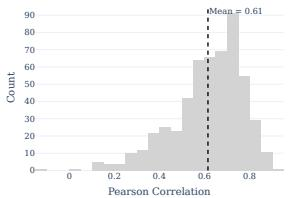  
(c) Pearson real (mistral-7b).

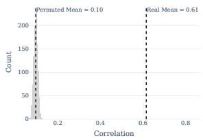  
(d) Pearson perm. (mistral-7b).

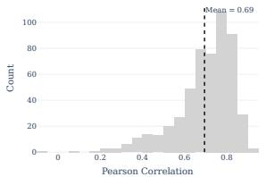

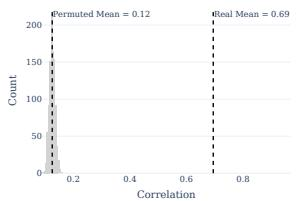

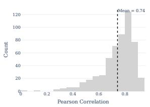

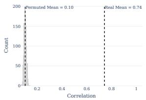  
(h) Pearson perm. (llama3.1-

(g) Pearson real (llama3.1-70b). 70b).  
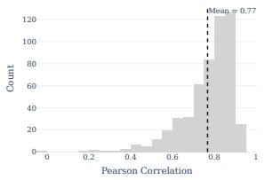  
(i) Pearson real (ensemble).

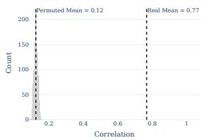  
(j) Pearson perm. (ensemble).

Figure 7: Distribution of Pearson correlation between LLM-generated semantic annotations and human ratings across models. For each model, we show the distribution of correlation values computed on the true concept–property assignments (left) and under a permutation baseline obtained by randomly shuffling concept–property pairs (right). Across all models, the true correlation distribution is substantially higher than the permutation baseline, indicating that LLM-based annotations capture meaningful semantic structure beyond chance. Results are shown for individual models and the ensemble.

## B.2 SCRIBE CAPTURES CONTEXTUAL SHIFTS IN HUMAN SEMANTIC JUDGMENTS

## B.2.1 LARGE-SCALE HUMAN BEHAVIORAL STUDY

Semantic feature norms provide interpretable representations of conceptual meaning along dimensions such as sensory, motor, affective, social, and cognitive properties. However, existing humanannotated semantic spaces typically characterize concepts in isolation, assigning each concept a fixed set of property values regardless of the linguistic context in which it occurs. SCRIBE extends the neurocognitively grounded semantic feature space of Binder et al. (2016) to contextual settings by using LLMs to estimate semantic properties of concepts conditioned on their linguistic context. In its controlled evaluation, SCRIBE used LLM-generated contexts designed to systematically increase or decrease individual concept–property associations and showed corresponding changes in its semantic annotations (see Appendix A.3 for more information). To determine whether these contextual manipulations produce analogous changes in human semantic judgments, we conducted a human annotation study using the same controlled stimuli.

We selected 54 of the 57 properties included in the original synthetic dataset, excluding Temperature, Weight, and Texture. These three properties are derived by taking the maximum rating across pairs of opposing dimensions (Hot/Cold, Heavy/Light, and Rough/Smooth, respectively). Extending this procedure to contextual annotations would require both constituent dimensions to be evaluated within the same sentence, which is difficult to guarantee when generating contexts that independently target each property. For each of the 54 retained properties, we selected six concepts based on their original out-of-context ratings: two with low, two with mid-range, and two with high concept–property association strengths according to the original out-of-context human ratings from Binder et al. (2016). This stratification ensured coverage across the range of baseline concept–property association strengths. This resulted in a total of 324 concept–property pairs $( 5 4 \times 6 )$

Each concept–property pair was evaluated under three conditions: a high-target context $\left( \operatorname { H } _ { \mathrm { T } } \right)$ designed to increase the association with the target property, a low-target context $\left( \mathrm { L } _ { \mathrm { T } } \right)$ designed to decrease it, and an out-of-context condition (O) in which the concept was presented without a sentence. This resulted in $3 2 4 \times 3 = 9 7 2$ unique annotation items. Participants rated the strength of each concept–property association on a 0–6 scale, with contextual judgments made specifically with respect to the meaning of the concept in the provided sentence.

Participants and data collection. We recruited participants through Prolific, requiring English fluency, a 98–100% approval rate, and at least 100 previous submissions. The study took approximately 10 minutes, and participants were paid USD 2 (USD 12/hour). The 324 concept–property pairs were split into two questionnaire versions, each covering half of the pairs, and data were collected in two rounds using the same stimuli. In the first round, each participant rated 14 semantic annotation items plus one attention check; in the second round, each participant rated 12 items plus two attention checks. Each participant saw only one condition for any given concept–property pair, and condition assignment was balanced across participants. Each participant took part only once, in a single round and a single questionnaire version. We applied the same quality-control criteria to all data: participants were excluded if they failed an attention check, had a mean response time below 7 seconds per item, or gave the same score to all items (Table 9). In the first round, participants failing the attention check were already rejected during recruitment. We further excluded one pair (Large/mouth) for which an incorrect high-target sentence was shown in the first round, leaving 323 pairs (969 items). The final sample comprises 921 participants and 11,983 ratings, with on average 12.4 ratings per item $( S D = 1 . 4 ,$ , median = 12, range = 8–20). The two rounds rank items consistently: the correlation between the item means of the two rounds is 0.81 $( O ) , 0 . 7 1 \ : ( L _ { \mathrm { T } } )$ and $0 . 6 6 ~ ( H _ { \mathrm { T } } )$ , which, after correcting for the noise of each round’s means (Spearman–Brown at the harmonic-mean number of ratings per round), corresponds to 1.02, 1.03 and 1.02, i.e., as high as their reliability allows (values slightly above 1 reflect estimation noise). Second-round ratings were on average 0.14–0.20 points lower in all conditions; since this offset is shared across items, it does not affect correlation-based analyses and, if anything, makes the pooled reliability estimates conservative.

Contextual modulation. Human judgments showed a clear and systematic effect of linguistic context. After averaging all ratings for each item, ratings were highest in the high-target condition $( M = 4 . 2 3 , S D = \bar { 1 } . 0 7 )$ , intermediate in the out-of-context condition $( M = \bar { 3 } . 2 3 , \bar { S } D = 1 . 4 7 )$ and lowest in the low-target condition $( M = 2 . 6 7 , S D = 1 . 2 8 )$ . One-sided Wilcoxon signed-rank tests over concept–property pairs were significant for all three directional comparisons $( H _ { \mathrm { T } } > O ,$ $O > L _ { \mathrm { T } }$ , and $H _ { \mathrm { T } } > L _ { \mathrm { T } } ;$ all $p < . 0 0 1 $ ; Table 10). Stratifying by the original Binder association strength shows that high-target contexts increased ratings in all bins, whereas low-target contexts decreased ratings only for pairs with mid or high baseline association: for pairs already rated low out of context $( L _ { \mathrm { O } } ; O = 1 . 7 8 )$ , low-target contexts had no further effect $( L _ { \mathrm { T } } = 1 . 7 3 , p = . 3 3 )$ consistent with a floor effect. The SCRIBE ensemble shows the expected ordering in all bins. The effect is broadly distributed across the semantic feature space: averaging over the concepts of each property, $H _ { \mathrm { T } }$ ratings exceeded O ratings for all 54 properties and $L _ { \mathrm { T } }$ ratings for 53 of 54 properties, and the complete ordering $H _ { \mathrm { T } } > O > L _ { \mathrm { T } }$ held for 46 of 54 properties (ensemble: 53, 53 and 43). All individual models also reproduce the human ordering (Table 11), including an ensemble that excludes llama3.1-8b, the model used to generate the sentences, showing that the effect does not depend on the generator scoring its own sentences.

Table 9: Participant flow per data-collection round and questionnaire version. Each version covers half of the concept–property pairs.
<table><tr><td colspan="3">Round 1</td><td colspan="2">Round 2</td></tr><tr><td></td><td>Version 1</td><td>Version 2</td><td>Version 1</td><td>Version 2</td></tr><tr><td>Survey responses</td><td>270</td><td>276</td><td>256</td><td>258</td></tr><tr><td>Completed and matched to Prolific</td><td>249</td><td>255</td><td>250</td><td>250</td></tr><tr><td>After removing duplicates</td><td>245</td><td>255</td><td>250</td><td>250</td></tr><tr><td>Failed attention check(s)</td><td>_†</td><td>_†</td><td>25</td><td>29</td></tr><tr><td>Mean response time  $< 7 \ : \mathrm { s }$ </td><td>2</td><td>13</td><td>4</td><td>5</td></tr><tr><td>Same score on all items</td><td>1</td><td>0</td><td>0</td><td>0</td></tr><tr><td>Final participants</td><td>242</td><td>242</td><td>221</td><td>216</td></tr></table>

†Rejected during recruitment.

Together, these data provide direct human validation that interpretable semantic property judgments can be systematically modulated by linguistic context and support the central assumption underlying SCRIBE’s context-sensitive semantic annotations. They also provide a human-annotated resource for evaluating scalable approaches to contextual semantic annotation. Importantly, obtaining about twelve independent judgments for only 972 controlled annotation items already required more than 900 participants, illustrating the practical difficulty of extending human annotation to arbitrary concepts and naturalistic contexts at scale.

Table 10: Contextual modulation of semantic feature scores for the human-evaluated subset. We report mean scores for human judgments and the SCRIBE ensemble across the original (O), lowtarget $( L _ { \mathrm { T } } )$ , and high-target $( H _ { \mathrm { T } } )$ conditions, together with two- and one-sided Wilcoxon signedrank tests. Results are shown across all concept–property pairs $\mathrm { ( A l l _ { O } ) }$ and stratified by original out-of-context association strength $( L _ { \mathrm { O } } , M _ { \mathrm { O } } , \dot { H _ { \mathrm { O } } } )$ . Human means are computed from all ratings of each item. For pairs with low baseline association $\left( L _ { \mathrm { O } } \right)$ , low-target contexts do not further decrease human ratings, consistent with a floor effect.
<table><tr><td rowspan="2">Annotator</td><td rowspan="2">Concept Bin</td><td colspan="3">Average scores</td><td colspan="3">Wilcoxon p-value (two-sided)</td><td colspan="3">Wilcoxon p-value (one-sided)</td></tr><tr><td> $\mathbf { L } _ { \mathbf { T } }$ </td><td>0</td><td> $\mathbf { H } _ { \mathbf { T } }$ </td><td> $\mathbf { L } _ { \mathbf { T } } \mathbf { v s } \mathbf { O }$ </td><td> ${ \bf { H } } _ { \bf { T } } \ \mathbf { v s } \ \mathbf { O }$ </td><td> $\mathbf { H } _ { \mathbf { T } } \ \mathbf { v s } \ \mathbf { L } _ { \mathbf { T } }$ </td><td> $\mathbf { L } _ { \mathbf { T } } < \mathbf { O }$ </td><td> $\mathbf { H } _ { \mathbf { T } } > \mathbf { O }$ </td><td> $\mathbf { H } _ { \mathbf { T } } > \mathbf { L } _ { \mathbf { T } }$ </td></tr><tr><td rowspan="4">Human</td><td> $\mathrm { A l l } _ { O }$ </td><td>2.67</td><td>3.23</td><td>4.23</td><td>&lt; .001</td><td>&lt; .001</td><td>&lt; .001</td><td> $< . 0 0 1$ </td><td>&lt; .001</td><td>&lt; .001</td></tr><tr><td> $\mathrm { L } _ { O }$ </td><td>1.73</td><td>1.78</td><td>3.36</td><td>0.666</td><td>&lt; .001</td><td>&lt; .001</td><td>0.333</td><td>&lt; .001</td><td>&lt; .001</td></tr><tr><td> $\mathbf { M } _ { O }$ </td><td>2.75</td><td>3.43</td><td>4.33</td><td>&lt; .001</td><td>&lt; .001</td><td>&lt; .001</td><td>&lt; .001</td><td>&lt; .001</td><td>&lt; .001</td></tr><tr><td> $\mathrm { H } _ { O }$ </td><td>3.52</td><td>4.47</td><td>4.98</td><td>&lt; .001</td><td>&lt; .001</td><td>&lt; .001</td><td>&lt; .001</td><td>&lt; .001</td><td>&lt; .001</td></tr><tr><td rowspan="4">Ensemble</td><td> $\mathrm { A l l } _ { O }$ </td><td>1.58</td><td>2.18</td><td>3.54</td><td>&lt; .001</td><td>&lt; .001</td><td>&lt; .001</td><td>&lt; .001</td><td>&lt; .001</td><td>&lt; .001</td></tr><tr><td> $_ { \mathrm { L } _ { O } }$ </td><td>0.57</td><td>0.69</td><td>2.21</td><td>&lt; .001</td><td>&lt; .001</td><td>&lt; .001</td><td>&lt; .001</td><td>&lt; .001</td><td>&lt; .001</td></tr><tr><td> $\mathbf { M } _ { O }$ </td><td>1.41</td><td>2.08</td><td>3.60</td><td>&lt; .001</td><td>&lt; .001</td><td>&lt; .001</td><td>&lt; .001</td><td>&lt; .001</td><td>&lt; .001</td></tr><tr><td> $\mathrm { H } _ { O }$ </td><td>2.74</td><td>3.76</td><td>4.80</td><td>&lt; .001</td><td>&lt; .001</td><td>&lt; .001</td><td>&lt; .001</td><td>&lt; .001</td><td>&lt; .001</td></tr></table>

Table 11: Comparison of low-target $( L _ { T } )$ , original/no-context (O), and high-target $( H _ { T } )$ scores assigned by human annotators, individual LLMs, and LLM ensembles to the evaluated subset of the synthetic dataset. O denotes each annotator’s own out-of-context score. All annotators exhibit the intended ordering $L _ { T } ~ < ~ O ~ < ~ H _ { T }$ , with significant differences in all three expected directions $( L _ { T } ~ < ~ O$ $H _ { T } \ > \ O ,$ and $H _ { T } \ > \ L _ { T } ;$ all $p \ < \ . 0 5 ,$ , one-sided Wilcoxon signed-rank tests over concept–property pairs). Two-sided tests are also reported for completeness. The ensemble excluding Llama3.1-8B provides a control excluding the model used to generate the synthetic sentences.
<table><tr><td>Model</td><td colspan="3">Average scores</td><td colspan="3">Wilcoxon p-value (two-sided)</td><td colspan="3">Wilcoxon p-value (one-sided)</td></tr><tr><td></td><td> $\mathbf { L } _ { \mathbf { T } }$ </td><td>0</td><td> $\mathbf { H } _ { \mathbf { T } }$ </td><td>LT vs O</td><td> $\mathbf { H } _ { \mathbf { T } } { \mathrm {  ~ v s ~ O ~ } }$ </td><td> $\mathbf { H } _ { \mathbf { T } } { \mathrm { \ v s } } \mathbf { L } _ { \mathbf { T } }$ </td><td> $\mathbf { L } _ { \mathbf { T } } < \mathbf { O }$ </td><td> $\mathbf { H } _ { \mathbf { T } } > \mathbf { O }$ </td><td> $\mathbf { H } _ { \mathbf { T } } > \mathbf { L } _ { \mathbf { T } }$ </td></tr><tr><td>Human</td><td>2.67</td><td>3.23</td><td>4.23</td><td> $< . 0 0 1$ </td><td>&lt; .001</td><td>&lt; .001</td><td>&lt; .001</td><td>&lt; .001</td><td>&lt; .001</td></tr><tr><td>Llama3.1-70B</td><td>1.71</td><td>2.53</td><td>4.09</td><td>&lt; .001</td><td>&lt; .001</td><td>&lt; .001</td><td>&lt; .001</td><td>&lt; .001</td><td>&lt; .001</td></tr><tr><td>Llama3.1-8B</td><td>1.77</td><td>2.27</td><td>3.22</td><td>&lt; .001</td><td>&lt; .001</td><td>&lt; .001</td><td>&lt; .001</td><td>&lt; .001</td><td>&lt; .001</td></tr><tr><td>Mistral-7B</td><td>1.39</td><td>1.60</td><td>3.50</td><td>0.026</td><td>&lt; .001</td><td>&lt; .001</td><td>0.013</td><td>&lt; .001</td><td>&lt; .001</td></tr><tr><td>Qwen2.5-7B</td><td>1.43</td><td>2.32</td><td>3.36</td><td>&lt; .001</td><td>&lt; .001</td><td>&lt; .001</td><td>&lt; .001</td><td>&lt; .001</td><td>&lt; .001</td></tr><tr><td>Ensemble</td><td>1.58</td><td>2.18</td><td>3.54</td><td>&lt; .001</td><td>&lt; .001</td><td>&lt; .001</td><td>&lt; .001</td><td>&lt; .001</td><td>&lt; .001</td></tr><tr><td>Ensemble w/o Llama3.1-8B</td><td>1.51</td><td>2.15</td><td>3.65</td><td>&lt; .001</td><td>&lt; .001</td><td>&lt; .001</td><td>&lt; .001</td><td>&lt; .001</td><td>&lt; .001</td></tr></table>

Table 12: Reliability of human judgments per condition (mean over 20 balanced subsamples of $n = 8$ ratings per item; 95% bootstrap CI over items). The last column reports the number of raters needed for a reliability of 0.90 (Spearman–Brown).
<table><tr><td>Condition</td><td>ICC(1, 1)</td><td>ICC(1, 8) [95% CI]</td><td>Ceiling</td><td>F</td><td>Raters for 0.90</td></tr><tr><td>0</td><td>0.40</td><td>0.84 [0.82, 0.87]</td><td>0.92</td><td>6.39</td><td>14</td></tr><tr><td> $L _ { \mathrm { T } }$ </td><td>0.27</td><td>0.74 [0.70, 0.78]</td><td>0.86</td><td>3.91</td><td>25</td></tr><tr><td> $H _ { \mathrm { T } }$ </td><td>0.24</td><td>0.72 [0.66, 0.76]</td><td>0.85</td><td>3.55</td><td>29</td></tr></table>

## B.2.2 RELIABILITY OF HUMAN JUDGMENTS AND NOISE CEILING

Balanced subsampling. Items received between 8 and 20 ratings, but the intraclass correlation assumes the same number of ratings per item. We therefore draw $n = 8$ ratings per item, from 8 distinct participants, such that each participant contributes at most once to each of the 8 rating columns, and repeat this for 20 random draws. All quantities are computed within each draw and then averaged across draws; ratings themselves are never averaged across draws.

Intraclass correlation. For each condition, let ${ \mathrm { M S } } _ { B }$ and ${ \mathrm { M S } } _ { W }$ be the between-item and within-item mean squares of a one-way ANOVA over the $3 2 3 \times n$ rating matrix. The one-way random-effects intraclass correlations are

$$
\mathrm { I C C } ( 1 , 1 ) = \frac { \mathrm { M S } _ { B } - \mathrm { M S } _ { W } } { \mathrm { M S } _ { B } + ( n - 1 ) \mathrm { M S } _ { W } } , \qquad \mathrm { I C C } ( 1 , n ) = \frac { \mathrm { M S } _ { B } - \mathrm { M S } _ { W } } { \mathrm { M S } _ { B } } .\tag{1}
$$

ICC(1, 1) is the expected correlation between two single raters, and ICC(1, n) the reliability of the mean of n raters, i.e., the expected correlation between the means of two independent groups of n raters. The two are related by the Spearman–Brown formula, $\mathrm { I C C } ( 1 , n ) = \bar { n } \mathrm { I C C } ( \bar { 1 , } 1 ) \bar  / ( 1 +$ $\left( n - 1 \right) \operatorname { I C C } ( 1 , 1 ) )$ ), which we use to extrapolate reliability to other numbers of raters. The one-way model treats raters as interchangeable, which matches our design: each item is rated by a different random subset of participants.

Noise ceiling. A model whose scores equal the true item values correlates with the n-rater mean at $\sqrt { \mathrm { I C C } ( 1 , n ) }$ , which we use as the human noise ceiling. An independent split-half estimate (correlating two halves of 4 raters and applying Spearman–Brown) gives the same ceilings to within 0.005.

Results. Table 12 summarizes human reliability. Reliability is far above chance in all conditions: shuffling ratings across items yields null ICC(1, 8) values below 0.13 (95th percentile; 1000 permutations), compared to observed values of 0.72–0.84 (all $p \leq . 0 0 1$ ; F-tests $\bar { p } < 1 0 ^ { - 5 9 } )$ . Out-ofcontext judgments are more reliable than contextual ones (bootstrap over items: $O - L _ { \mathrm { T } } = 0 . 1 0$ $[ 0 . 0 6 , 0 . 1 5 ] , O - H _ { \mathrm { T } } = 0 . 1 3 [ 0 . 0 8 , 0 . 1 8 ]$ ), while the two contextual conditions do not differ (0.03 [−0.03, 0.09]). Computing ICC(1,1) on all ratings without subsampling (ANOVA estimator for unequal group sizes) gives the same values (0.400, 0.271, 0.245). Figure 8 shows how reliability grows with the number of raters: reaching 0.90 would require about 14 raters per item out of context and 25–29 in context.

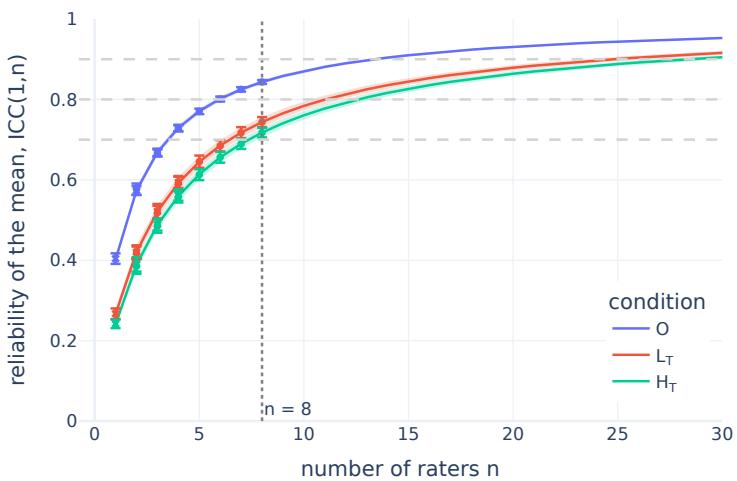  
Figure 8: Reliability of the mean human rating as a function of the number of raters per item. Lines show the Spearman–Brown prediction from ICC(1, 1) (shaded: ± SD over 20 subsamples). Markers show empirical estimates from random subsets of raters: circles, $\operatorname { I C C } ( 1 , n )$ computed on n rater columns; crosses, the correlation between the means of two disjoint groups of n raters (error bars: SD over subsamples). The dotted line marks $n = 8 ,$ the number of raters used in the main analyses; dashed grey lines mark reliabilities of 0.7, 0.8 and 0.9.

Table 13: Alignment of individual models and the ensemble with human ratings (mean over 20 balanced subsamples of 8 ratings per item). Ceilings: 0.92 (O), 0.86 $( L _ { \mathrm { T } } ) _ { \ l }$ , 0.85 $( H _ { \mathrm { T } } )$
<table><tr><td colspan="4">r/ceiling ↑</td><td colspan="3">MSE↓</td></tr><tr><td>Model</td><td>0</td><td> $L _ { \mathrm { T } }$ </td><td> $H _ { \mathrm { T } }$ </td><td>0</td><td> $L _ { \mathrm { T } }$ </td><td> $H _ { \mathrm { T } }$ </td></tr><tr><td>Llama3.1-70B</td><td>0.79</td><td>0.76</td><td>0.64</td><td>2.98</td><td>3.97</td><td>3.30</td></tr><tr><td>Llama3.1-8B</td><td>0.70</td><td>0.68</td><td>0.66</td><td>3.49</td><td>2.77</td><td>4.27</td></tr><tr><td>Mistral-7B</td><td>0.57</td><td>0.65</td><td>0.67</td><td>5.82</td><td>4.41</td><td>3.69</td></tr><tr><td>Qwen2.5-7B</td><td>0.76</td><td>0.70</td><td>0.63</td><td>2.35</td><td>3.41</td><td>2.59</td></tr><tr><td>Ensemble</td><td>0.80</td><td>0.81</td><td>0.75</td><td>2.59</td><td>2.64</td><td>2.31</td></tr></table>

Table 14: Correlation with the mean of 4 held-out raters, for the mean of m other raters and for the SCRIBE ensemble (50 random splits × 20 subsamples).
<table><tr><td></td><td>0</td><td> $L _ { \mathrm { T } }$ </td><td> $H _ { \mathrm { T } }$ </td></tr><tr><td>m = 1 rater</td><td>0.54</td><td>0.39</td><td>0.37</td></tr><tr><td>m = 2 raters</td><td>0.65</td><td>0.50</td><td>0.47</td></tr><tr><td>m = 3 raters</td><td>0.70</td><td>0.56</td><td>0.52</td></tr><tr><td> $m = 4$  raters</td><td>0.73</td><td>0.59</td><td>0.56</td></tr><tr><td>SCRIBE ensemble</td><td>0.68</td><td>0.62</td><td>0.56</td></tr></table>

## B.2.3 ALIGNMENT OF SCRIBE WITH HUMAN JUDGMENTS RELATIVE TO THE NOISE CEILING

Per-model comparison. Table 13 reports the alignment of each model and the ensemble with the mean of 8 human ratings. The ensemble achieves the highest correlation in all three conditions; in terms of MSE, it is best in both contextual conditions, while qwen2.5-7b has a slightly lower MSE out of context, reflecting a scale closer to that of human ratings.

Equivalent number of annotators. To express alignment in human units, we ask how many human raters m would be needed for their mean to correlate with the n-rater mean as strongly as SCRIBE does. For two independent groups of m and n raters, this correlation is ${ \sqrt { \operatorname { I C C } ( 1 , m ) \operatorname { I C C } ( 1 , n ) } } ;$ solving $\sqrt { \mathrm { I C C } ( 1 , m ) \mathrm { I C C } ( 1 , n ) } = r$ with Spearman–Brown gives $m = 2 . 6 ( O ) , 5 . 1 ( L _ { \mathrm { T } } ) \mathrm { a n d } 4 . 1$ $( H _ { \mathrm { T } } )$ . We confirm this empirically by splitting the 8 raters into a reference group of 4 and correlating the reference mean with (i) SCRIBE and (ii) the mean of $m = 1 , \ldots , 4$ raters from the other half (Table 14). SCRIBE lies between 2 and 3 raters out of context, matches 4 raters in the high-target condition, and exceeds 4 raters in the low-target condition.

MSE and systematic offset. Because the mean of n raters is itself noisy, even a perfect model would not reach an MSE of zero: its expected MSE is the noise variance of the mean, $\mathrm { \bar { M } S } _ { W } / n$ (MSE floor). We further decompose the MSE as $\mathrm { M S E } = ( \bar { y } - \bar { h } ) ^ { 2 } + ( s _ { y } - s _ { h } ) ^ { 2 } + 2 s _ { y } s _ { h } ( 1 - \dot { r } )$ , where ${ \bar { y } } , s _ { y }$ and $h , s _ { h }$ are the mean and standard deviation of SCRIBE and human scores: the three terms capture a systematic offset, a difference in scale, and imperfect correlation (Table 15). SCRIBE rates properties about one point lower than humans in $O$ and $L _ { \mathrm { T } }$ , and this offset accounts for 42–45% of the MSE in these conditions (20% in $H _ { \mathrm { T } } )$ . For reference, the Binder norms also rate slightly lower than our participants on the same items (offset −0.38).

Human reference and robustness. The Binder norms correlate with our out-of-context ratings at $r = 0 . 7 7$ (84% of the ceiling), close to SCRIBE’s 80%. Using all ratings instead of balanced subsamples gives higher correlations, since the human means are less noisy (r = 0.75, 0.73, 0.67 for $O , L _ { \mathrm { T } } , H _ { \mathrm { T } } )$ , but the same ceiling-normalized alignment (0.80, 0.80, 0.75, using approximate ceilings from Spearman–Brown at the harmonic-mean number of ratings).

Table 15: MSE between SCRIBE (or the Binder norms) and the mean of 8 human ratings, with 95% bootstrap CIs, the permutation baseline, the MSE floor, and the decomposition into offset, scale and correlation terms.
<table><tr><td>Compared</td><td>Cond.</td><td>MSE [95% CI]</td><td>Chance</td><td>Floor</td><td>Offset y − h</td><td>Offset term</td><td>Scale term</td><td>Corr. term</td></tr><tr><td>SCRIBE</td><td> $O$ </td><td>2.59 [2.22, 2.98]</td><td>6.53</td><td>0.36</td><td>-1.04</td><td>1.09</td><td>0.07</td><td>1.43</td></tr><tr><td>SCRIBE</td><td> $L _ { \mathrm { T } }$ </td><td>2.64 [2.31, 3.00]</td><td>5.71</td><td>0.45</td><td>-1.09</td><td>1.19</td><td>0.11</td><td>1.35</td></tr><tr><td>SCRIBE</td><td> $H _ { \mathrm { T } }$ </td><td>2.31 [1.91, 2.74]</td><td>4.80</td><td>0.35</td><td>-0.68</td><td>0.47</td><td>0.41</td><td>1.43</td></tr><tr><td>Binder norms</td><td> $O$ </td><td>1.45 [1.22, 1.69]</td><td>5.54</td><td>0.36</td><td>-0.38</td><td>0.15</td><td>0.07</td><td>1.24</td></tr></table>

## B.2.4 RESULTS ON THE FULL SYNTHETIC DATASET

Table 16: Per-model results for the controlled contextual manipulation experiment (see Section 4.2 and Appendix $\mathbf { A . } 3 )$ using all the contextual generated sentences. We report average semantic scores and Wilcoxon signed-rank tests for each individual model and their ensemble. O denotes each model’s own out-of-context score. For all models and the ensemble, semantic feature values shift in the intended direction $( H _ { \mathrm { T } } > O > L _ { \mathrm { T } } )$ across all pairs and within the mid and high bins. For pairs with low baseline association $\left( L _ { \mathrm { O } } \right)$ , llama3.1-8b and mistral-7b do not lower scores further in the low-target condition, mirroring the floor effect observed in human judgments (Table 10); the ensemble shows significant effects in all bins.
<table><tr><td rowspan="2">Model</td><td>Concept</td><td colspan="3">Average scores</td><td colspan="3">Wilcoxon p-value (two-sided)</td><td colspan="3">Wilcoxon p-value (one-sided)</td></tr><tr><td>Bin</td><td>LT</td><td>0</td><td> $\mathbf { H } _ { \mathrm { T } }$ </td><td> $\mathbf { L } _ { \mathrm { T } } { \ \mathbf { v s } } \ \mathbf { O }$ </td><td> ${ \bf { H } } _ { \mathrm { { T } } } { \bf { v s } } \mathrm { { \bf { O } } }$ </td><td> $\mathbf { H } _ { \mathrm { T } } { \ \mathbf { v s } } { \mathbf { L } } _ { \mathrm { T } }$ </td><td> $\mathbf { L } _ { \mathrm { T } } < \mathbf { O }$ </td><td> $\mathbf { H } _ { \mathrm { T } } > \mathbf { 0 }$ </td><td> $\mathbf { H } _ { \mathrm { T } } > \mathbf { L } _ { \mathrm { T } }$ </td></tr><tr><td rowspan="4">Llama3.1-8B</td><td>Allo</td><td>1.86</td><td>2.16</td><td>3.04</td><td>&lt; .001</td><td>&lt; .001</td><td>&lt; .001</td><td>&lt; .001</td><td>&lt; .001</td><td>&lt; .001</td></tr><tr><td> $_ \mathrm { L _ { O } }$ </td><td>0.67</td><td>0.62</td><td>1.39</td><td>0.168</td><td>&lt; .001</td><td>&lt; .001</td><td>0.916</td><td>&lt; .001</td><td>&lt; .001</td></tr><tr><td> $\mathrm { { \bf { M } } _ { O } }$ </td><td>1.86</td><td>2.06</td><td>3.08</td><td>0.009</td><td>&lt; .001</td><td>&lt; .001</td><td>0.005</td><td>&lt; .001</td><td>&lt; .001</td></tr><tr><td> $_ \mathrm { H o }$ </td><td>3.06</td><td>3.81</td><td>4.64</td><td>&lt; .001</td><td>&lt; .001</td><td>&lt; .001</td><td>&lt; .001</td><td>&lt; .001</td><td>&lt; .001</td></tr><tr><td rowspan="4">Mistral-7B</td><td> $\mathrm { A l l o }$ </td><td>1.37</td><td>1.55</td><td>3.11</td><td>&lt; .001</td><td>&lt; .001</td><td>&lt; .001</td><td>&lt; .001</td><td>&lt; .001</td><td>&lt; .001</td></tr><tr><td> $_ \mathrm { L _ { O } }$ </td><td>0.35</td><td>0.28</td><td>1.59</td><td>0.048</td><td>&lt; .001</td><td>&lt; .001</td><td>0.976</td><td>&lt; .001</td><td>&lt; .001</td></tr><tr><td> $\mathrm { { \bf { M } } _ { O } }$ </td><td>1.23</td><td>1.40</td><td>3.30</td><td>0.042</td><td>&lt; .001</td><td>&lt; .001</td><td>0.021</td><td>&lt; .001</td><td>&lt; .001</td></tr><tr><td> $_ \mathrm { H o }$ </td><td>2.52</td><td>2.97</td><td>4.43</td><td>&lt; .001</td><td>&lt; .001</td><td>&lt; .001</td><td>&lt; .001</td><td>&lt; .001</td><td>&lt; .001</td></tr><tr><td rowspan="4">Qwen2.5-7B</td><td> $\mathrm { { A l l } _ { O } }$ </td><td>1.57</td><td>2.25</td><td>3.04</td><td>&lt; .001</td><td>&lt; .001</td><td>&lt; .001</td><td>&lt; .001</td><td>&lt; .001</td><td>&lt; .001</td></tr><tr><td> $_ \mathrm { L _ { O } }$ </td><td>0.60</td><td>0.95</td><td>1.85</td><td>&lt; .001</td><td>&lt; .001</td><td>&lt; .001</td><td>&lt; .001</td><td>&lt; .001</td><td>&lt; .001</td></tr><tr><td> $\mathrm { { \bf { M } } _ { O } }$ </td><td>1.47</td><td>2.21</td><td>3.16</td><td>&lt; .001</td><td>&lt; .001</td><td>&lt; .001</td><td>&lt; .001</td><td>&lt; .001</td><td>&lt; .001</td></tr><tr><td> $_ \mathrm { H o }$ </td><td>2.63</td><td>3.59</td><td>4.12</td><td>&lt; .001</td><td>&lt; .001</td><td>&lt; .001</td><td>&lt; .001</td><td>&lt; .001</td><td>&lt; .001</td></tr><tr><td rowspan="4">Llama3.1-70B</td><td> $\mathrm { { A l l } _ { O } }$ </td><td>1.81</td><td>2.45</td><td>3.68</td><td>&lt; .001</td><td>&lt; .001</td><td>&lt; .001</td><td>&lt; .001</td><td>&lt; .001</td><td>&lt; .001</td></tr><tr><td> $_ \mathrm { L _ { O } }$ </td><td>0.33</td><td>0.47</td><td>2.04</td><td>0.043</td><td>&lt; .001</td><td>&lt; .001</td><td>0.021</td><td>&lt; .001</td><td>&lt; .001</td></tr><tr><td> $\mathrm { { \bf { M } } _ { O } }$ </td><td>1.81</td><td>2.51</td><td>3.95</td><td>&lt; .001</td><td>&lt; .001</td><td>&lt; .001</td><td>&lt; .001</td><td>&lt; .001</td><td>&lt; .001</td></tr><tr><td> $\mathrm { H _ { O } }$ </td><td>3.29</td><td>4.38</td><td>5.05</td><td>&lt; .001</td><td>&lt; .001</td><td>&lt; .001</td><td>&lt; .001</td><td>&lt; .001</td><td>&lt; .001</td></tr><tr><td rowspan="4">Ensemble</td><td> $\mathrm { { A l l } _ { O } }$ </td><td>1.65</td><td>2.10</td><td>3.22</td><td>&lt; .001</td><td>&lt; .001</td><td>&lt; .001</td><td>&lt; .001</td><td>&lt; .001</td><td>&lt; .001</td></tr><tr><td> $_ \mathrm { L _ { O } }$ </td><td>0.49</td><td>0.58</td><td>1.72</td><td>&lt; .001</td><td>&lt; .001</td><td>&lt; .001</td><td>&lt; .001</td><td>&lt; .001</td><td>&lt; .001</td></tr><tr><td> $\mathrm { { \bf { M } } _ { O } }$ </td><td>1.59</td><td>2.05</td><td>3.37</td><td>&lt; .001</td><td>&lt; .001</td><td>&lt; .001</td><td>&lt; .001</td><td>&lt; .001</td><td>&lt; .001</td></tr><tr><td> $\mathrm { H _ { O } }$ </td><td>2.87</td><td>3.69</td><td>4.56</td><td>&lt; .001</td><td>&lt; .001</td><td>&lt; .001</td><td>&lt; .001</td><td>&lt; .001</td><td>&lt; .001</td></tr></table>

## B.3 SCRIBE PREDICTS BRAIN ACTIVITY

## B.3.1 ANNOTATION DESIGN: WORD TYPES AND CONTEXT SIZE

In this section, we report correlation values for different word type annotations and context sizes, evaluated separately for each model on voxels with a noise ceiling greater than 0.4 (see Appendix A.4.3 for details on noise ceiling estimation). Tables 17, 18, 19, and 20 present the results for the instruct-based llama3.1-8B, mistral-7b, qwen2.5-7b, and llama3.1-70b models, respectively.

Across most models, we observe a consistent pattern: performance significantly improves with contextual information, with a context window of k = 10 yielding the best results. This context size aligns with prior work Jain & Huth (2018); Toneva & Wehbe (2019), which shows that increasing context improves encoding performance up to a point, after which the gains saturate. Moreover, using the full set of semantic POS tags (All Semantic POS) leads to the highest overall correlations.

Table 17: Brain encoding correlations across context sizes using $1 1 \mathrm { { a m a } 3 . 1 - 8 b - i }$ nstruct. We compare out-of-context annotations, fixed-size context windows $( k \in \{ 3 , 5 , 1 0 , 5 0 \}$ ), and an up to concept condition including all preceding stimulus context. Results are reported for three POS subsets: Nouns, Nouns, Verbs, Adjectives, and All Semantic POS. Values correspond to noise-ceilingnormalized correlations. Bold indicates the best context within each POS group, and underlining indicates the overall best configuration. ∗ denotes significant improvements over the out-of-context baseline (one-sided Wilcoxon signed-rank test, $p < 0 . 0 5 )$
<table><tr><td>Word type</td><td>Context Size</td><td>S1</td><td>S2</td><td>S3</td><td>S5</td><td>S6</td><td>S7</td><td>S8</td><td>Avg ± STE</td></tr><tr><td rowspan="6">Nouns</td><td>out-of-context</td><td>0.1372</td><td>0.1122</td><td>0.1190</td><td>0.1066</td><td>0.0933</td><td>0.0896</td><td>0.0931</td><td> $0 . 1 0 7 3 \pm 0 . 0 0 6 5$ </td></tr><tr><td>window/k3</td><td>0.1420</td><td>0.1237</td><td>0.1301</td><td>0.1217</td><td>0.0789</td><td>0.0881</td><td>0.0807</td><td> $0 . 1 0 9 3 \pm 0 . 0 0 9 8$ </td></tr><tr><td>window/k5</td><td>0.1442</td><td>0.1202</td><td>0.1330</td><td>0.1129</td><td>0.1051</td><td>0.0873</td><td>0.0884</td><td> $0 . 1 1 3 0 \pm 0 . 0 0 8 1 ^ { \ast }$ </td></tr><tr><td>window/k10</td><td>0.1621</td><td>0.1362</td><td>0.1384</td><td>0.1200</td><td>0.1101</td><td>0.0869</td><td>0.0858</td><td> $0 . 1 1 9 9 \pm 0 . 0 1 0 6 ^ { \ast }$ </td></tr><tr><td>window/k50</td><td>0.1760</td><td>0.1485</td><td>0.1207</td><td>0.1381</td><td>0.1116</td><td>0.0831</td><td>0.0928</td><td> $\mathbf { 0 . 1 2 4 4 \pm 0 . 0 1 2 3 }$ </td></tr><tr><td>up to concept</td><td>0.1566</td><td>0.1191</td><td>0.1001</td><td>0.1048</td><td>0.0732</td><td>0.0777</td><td>0.0681</td><td> $0 . 1 0 0 0 \pm 0 . 0 1 1 8$ </td></tr><tr><td rowspan="6">Nouns, Verbs, Adj</td><td>out-of-context</td><td>0.1854</td><td>0.1479</td><td>0.1379</td><td>0.1534</td><td>0.1392</td><td>0.1222</td><td>0.1129</td><td> $0 . 1 4 2 7 \pm 0 . 0 0 8 9$ </td></tr><tr><td>window/k3</td><td>0.1841</td><td>0.1713</td><td>0.1446</td><td>0.1574</td><td>0.1500</td><td>0.1258</td><td>0.1062</td><td> $0 . 1 4 8 5 \pm 0 . 0 1 0 0$ </td></tr><tr><td>window/k5</td><td>0.1985</td><td>0.1741</td><td>0.1483</td><td>0.1666</td><td>0.1704</td><td>0.1293</td><td>0.1124</td><td> $0 . 1 5 7 1 \pm 0 . 0 1 1 0 ^ { * }$ </td></tr><tr><td>window/k10</td><td>0.2030</td><td>0.1795</td><td>0.1463</td><td>0.1654</td><td>0.1710</td><td>0.1189</td><td>0.1032</td><td> $0 . 1 5 5 3 \pm 0 . 0 1 3 2$ </td></tr><tr><td>window/k50</td><td>0.2228</td><td>0.1822</td><td>0.1330</td><td>0.1669</td><td>0.1854</td><td>0.1236</td><td>0.1051</td><td> $\mathbf { 0 . 1 5 9 9 \pm 0 . 0 1 5 6 }$ </td></tr><tr><td>up to concept</td><td>0.2137</td><td>0.1749</td><td>0.1105</td><td>0.1465</td><td>0.1516</td><td>0.1186</td><td>0.1020</td><td> $0 . 1 4 5 4 \pm 0 . 0 1 5 0$ </td></tr><tr><td rowspan="6">All Semantic POS</td><td>out-of-context</td><td>0.1869</td><td>0.1516</td><td>0.1515</td><td>0.1665</td><td>0.1142</td><td>0.1251</td><td>0.1099</td><td> $0 . 1 4 3 7 \pm 0 . 0 1 0 8$ </td></tr><tr><td>window/k3</td><td>0.1972</td><td>0.1800</td><td>0.1561</td><td>0.1723</td><td>0.1292</td><td>0.1359</td><td>0.1085</td><td> $0 . 1 5 4 2 \pm 0 . 0 1 1 8 ^ { \ast }$ </td></tr><tr><td>window/k5</td><td>0.2042</td><td>0.1909</td><td>0.1519</td><td>0.1723</td><td>0.1458</td><td>0.1346</td><td>0.1154</td><td> $0 . 1 5 9 3 \pm 0 . 0 1 1 9 ^ { \ast }$ </td></tr><tr><td>window/k10</td><td>0.2107</td><td>0.1996</td><td>0.1546</td><td>0.1849</td><td>0.1543</td><td>0.1300</td><td>0.1036</td><td> $\mathbf { 0 . 1 6 2 5 \pm 0 . 0 1 4 7 ^ { \ast } }$ </td></tr><tr><td>window/k50</td><td>0.2215</td><td>0.1881</td><td>0.1483</td><td>0.1634</td><td>0.1666</td><td>0.1181</td><td>0.0912</td><td> $0 . 1 5 6 7 \pm 0 . 0 1 6 3$ </td></tr><tr><td>up to concept</td><td>0.2153</td><td>0.1633</td><td>0.1259</td><td>0.1546</td><td>0.1072</td><td>0.1146</td><td>0.0957</td><td> $0 . 1 3 9 5 \pm 0 . 0 1 5 7$ </td></tr></table>

Table 18: Brain encoding correlations across context sizes using mistral-7b-instruct. We compare out-of-context annotations, fixed-size context windows $( k \in \{ 3 , 5 , 1 0 , 5 0 \} )$ , and an up to concept condition including all preceding stimulus context. Results are reported for three POS subsets: Nouns, Nouns, Verbs, Adjectives, and All Semantic POS. Values correspond to noise-ceilingnormalized correlations. Bold indicates the best context within each POS group, and underlining indicates the overall best configuration. ∗ denotes significant improvements over the out-of-context baseline (one-sided Wilcoxon signed-rank test, $p < 0 . 0 5 )$ ).
<table><tr><td>Word type</td><td>Context Size</td><td>S1</td><td>S2</td><td>S3</td><td>S5</td><td>S6</td><td>S7</td><td>S8</td><td> $\mathbf { A v g } \pm \mathbf { S T E }$ </td></tr><tr><td rowspan="6">Nouns</td><td>out-of-context</td><td>0.1368</td><td>0.0917</td><td>0.1012</td><td>0.0848</td><td>0.0821</td><td>0.0871</td><td>0.0693</td><td> $0 . 0 9 3 3 \pm 0 . 0 0 8 1$ </td></tr><tr><td>window/k3</td><td>0.1449</td><td>0.1248</td><td>0.1000</td><td>0.0938</td><td>0.0445</td><td>0.0939</td><td>0.0721</td><td> $0 . 0 9 6 3 \pm 0 . 0 1 2 4$ </td></tr><tr><td>window/k5</td><td>0.1506</td><td>0.1337</td><td>0.1156</td><td>0.0975</td><td>0.0794</td><td>0.1048</td><td>0.0898</td><td> $0 . 1 1 0 2 \pm 0 . 0 0 9 5 ^ { \ast }$ </td></tr><tr><td>window/k10</td><td>0.1729</td><td>0.1521</td><td>0.1340</td><td>0.1300</td><td>0.0897</td><td>0.1103</td><td>0.0944</td><td> $\mathbf { 0 . 1 2 6 2 \pm 0 . 0 1 1 5 ^ { \ast } }$ </td></tr><tr><td>window/k50</td><td>0.1622</td><td>0.1441</td><td>0.1248</td><td>0.1206</td><td>0.0871</td><td>0.0975</td><td>0.0880</td><td> $0 . 1 1 7 7 \pm 0 . 0 1 0 9 ^ { \ast }$ </td></tr><tr><td>up to concept</td><td>0.1318</td><td>0.1171</td><td>0.1016</td><td>0.1051</td><td>0.0790</td><td>0.0832</td><td>0.0720</td><td> $0 . 0 9 8 5 \pm 0 . 0 0 8 2$ </td></tr><tr><td rowspan="6">Nouns, Verbs, Adj</td><td>out-of-context</td><td>0.1828</td><td>0.1414</td><td>0.1138</td><td>0.1405</td><td>0.1124</td><td>0.1306</td><td>0.0918</td><td> $0 . 1 3 0 5 \pm 0 . 0 1 1 0$ </td></tr><tr><td>window/k3</td><td>0.2036</td><td>0.1859</td><td>0.1055</td><td>0.1539</td><td>0.1180</td><td>0.1350</td><td>0.0984</td><td> $0 . 1 4 2 9 \pm 0 . 0 1 5 2$ </td></tr><tr><td>window/k5</td><td>0.2041</td><td>0.1829</td><td>0.1279</td><td>0.1650</td><td>0.1195</td><td>0.1476</td><td>0.1154</td><td> $0 . 1 5 1 8 \pm 0 . 0 1 2 8 ^ { \ast }$ </td></tr><tr><td>window/k10</td><td>0.2184</td><td>0.2023</td><td>0.1299</td><td>0.1836</td><td>0.1452</td><td>0.1511</td><td>0.1309</td><td> $\mathbf { 0 . 1 6 5 9 \mathop { \pm } 0 . 0 1 3 4 } ^ { \ast }$ </td></tr><tr><td>window/k50</td><td>0.2136</td><td>0.1757</td><td>0.1294</td><td>0.1661</td><td>0.1409</td><td>0.1532</td><td>0.1032</td><td> $0 . 1 5 4 6 \pm 0 . 0 1 3 4 ^ { \ast }$ </td></tr><tr><td>up to concept</td><td>0.1809</td><td>0.1781</td><td>0.0948</td><td>0.1475</td><td>0.1312</td><td>0.1417</td><td>0.0982</td><td> $0 . 1 3 8 9 \pm 0 . 0 1 3 0$ </td></tr><tr><td rowspan="6">All Semantic POS</td><td>out-of-context</td><td>0.1892</td><td>0.1623</td><td>0.1463</td><td>0.1600</td><td>0.0923</td><td>0.1382</td><td>0.0958</td><td> $0 . 1 4 0 6 \pm 0 . 0 1 3 4$ </td></tr><tr><td>window/k3</td><td>0.2104</td><td>0.1972</td><td>0.1322</td><td>0.1787</td><td>0.1184</td><td>0.1289</td><td>0.1034</td><td> $0 . 1 5 2 7 \pm 0 . 0 1 5 9$ </td></tr><tr><td>window/k5</td><td>0.2141</td><td>0.2016</td><td>0.1506</td><td>0.1766</td><td>0.1117</td><td>0.1438</td><td>0.1171</td><td> $0 . 1 5 9 4 \pm 0 . 0 1 5 0 ^ { \ast }$ </td></tr><tr><td>window/k10</td><td>0.2240</td><td>0.2159</td><td>0.1638</td><td>0.1897</td><td>0.1463</td><td>0.1493</td><td>0.1321</td><td> $\underline { { \mathbf { 0 . 1 7 4 4 } \pm \mathbf { 0 . 0 1 3 6 } } } ^ { * }$ </td></tr><tr><td>window/k50</td><td>0.2175</td><td>0.1879</td><td>0.1636</td><td>0.1685</td><td>0.1421</td><td>0.1562</td><td>0.1102</td><td> $0 . 1 6 3 7 \pm 0 . 0 1 2 8 ^ { \ast }$ </td></tr><tr><td>up to concept</td><td>0.1792</td><td>0.1810</td><td>0.1141</td><td>0.1565</td><td>0.0933</td><td>0.1314</td><td>0.0865</td><td> $0 . 1 3 4 6 \pm 0 . 0 1 4 7$ </td></tr></table>

Table 19: Brain encoding correlations across context sizes using qwen2.5-7b-instruct. We compare out-of-context annotations, fixed-size context windows $( k \in \{ 3 , 5 , 1 0 , 5 0 \} )$ , and an up to concept condition including all preceding stimulus context. Results are reported for three POS subsets: Nouns, Nouns, Verbs, Adjectives, and All Semantic POS. Values correspond to noise-ceilingnormalized correlations. Bold indicates the best context within each POS group, and underlining indicates the overall best configuration. ∗ denotes significant improvements over the out-of-context baseline (one-sided Wilcoxon signed-rank test, $p < 0 . 0 5 ,$ ).
<table><tr><td>Word type</td><td>Context Size</td><td>S1</td><td>S2</td><td>S3</td><td>S5</td><td>S6</td><td>S7</td><td>S8</td><td>Avg ± STE</td></tr><tr><td rowspan="6">Nouns</td><td>out-of-context</td><td>0.1420</td><td>0.1083</td><td>0.1209</td><td>0.1181</td><td>0.0919</td><td>0.0883</td><td>0.0811</td><td> $0 . 1 0 7 2 \pm 0 . 0 0 8 2$ </td></tr><tr><td>window/k3</td><td>0.1537</td><td>0.1455</td><td>0.1360</td><td>0.1236</td><td>0.0880</td><td>0.0857</td><td>0.0906</td><td> $0 . 1 1 7 6 \pm 0 . 0 1 1 0 ^ { \ast }$ </td></tr><tr><td>window/k5</td><td>0.1618</td><td>0.1482</td><td>0.1321</td><td>0.1304</td><td>0.1061</td><td>0.0927</td><td>0.0917</td><td> $0 . 1 2 3 3 \pm 0 . 0 1 0 3 ^ { \ast }$ </td></tr><tr><td>window/k10</td><td>0.1809</td><td>0.1581</td><td>0.1449</td><td>0.1396</td><td>0.1097</td><td>0.0958</td><td>0.1036</td><td> $\mathbf { 0 . 1 3 3 2 \pm 0 . 0 1 1 9 ^ { \ast } }$ </td></tr><tr><td>window/k50</td><td>0.1823</td><td>0.1363</td><td>0.1358</td><td>0.1358</td><td>0.0987</td><td>0.0878</td><td>0.0883</td><td> $0 . 1 2 3 6 \pm 0 . 0 1 3 0 ^ { * }$ </td></tr><tr><td>up to concept</td><td>0.1606</td><td>0.1162</td><td>0.1415</td><td>0.1211</td><td>0.0917</td><td>0.0856</td><td>0.0876</td><td> $0 . 1 1 4 9 \pm 0 . 0 1 0 9 ^ { \ast }$ </td></tr><tr><td rowspan="6">Nouns, Verbs, Adj</td><td>out-of-context</td><td>0.1842</td><td>0.1583</td><td>0.1170</td><td>0.1543</td><td>0.1338</td><td>0.1363</td><td>0.0960</td><td> $0 . 1 4 0 0 \pm 0 . 0 1 0 9$ </td></tr><tr><td>window/k3</td><td>0.2016</td><td>0.1888</td><td>0.1362</td><td>0.1716</td><td>0.1535</td><td>0.1292</td><td>0.1142</td><td> $0 . 1 5 6 4 \pm 0 . 0 1 2 2 ^ { \ast }$ </td></tr><tr><td>window/k5</td><td>0.2084</td><td>0.1880</td><td>0.1335</td><td>0.1839</td><td>0.1647</td><td>0.1357</td><td>0.1166</td><td> $0 . 1 6 1 6 \pm 0 . 0 1 2 8 ^ { \ast }$ </td></tr><tr><td>window/k10</td><td>0.2180</td><td>0.2032</td><td>0.1433</td><td>0.1922</td><td>0.1806</td><td>0.1404</td><td>0.1324</td><td> $\mathbf { 0 . 1 7 2 9 \pm 0 . 0 1 2 9 ^ { \ast } }$ </td></tr><tr><td>window/k50</td><td>0.2256</td><td>0.1821</td><td>0.1362</td><td>0.1891</td><td>0.1696</td><td>0.1284</td><td>0.1158</td><td> $0 . 1 6 3 8 \pm 0 . 0 1 4 8 ^ { \ast }$ </td></tr><tr><td>up to concept</td><td>0.2045</td><td>0.1595</td><td>0.1434</td><td>0.1582</td><td>0.1318</td><td>0.1412</td><td>0.1117</td><td> $0 . 1 5 0 0 \pm 0 . 0 1 1 0 ^ { \ast }$ </td></tr><tr><td rowspan="6">All Semantic POS</td><td>out-of-context</td><td>0.1934</td><td>0.1655</td><td>0.1324</td><td>0.1619</td><td>0.1199</td><td>0.1583</td><td>0.0963</td><td> $0 . 1 4 6 8 \pm 0 . 0 1 2 3$ </td></tr><tr><td>window/k3</td><td>0.2073</td><td>0.2022</td><td>0.1585</td><td>0.1821</td><td>0.1585</td><td>0.1420</td><td>0.1078</td><td> $0 . 1 6 5 5 \pm 0 . 0 1 3 2 ^ { \ast }$ </td></tr><tr><td>window/k5</td><td>0.2164</td><td>0.2025</td><td>0.1593</td><td>0.1995</td><td>0.1660</td><td>0.1432</td><td>0.1196</td><td> $0 . 1 7 2 4 \pm 0 . 0 1 3 3 ^ { \ast }$ </td></tr><tr><td>window/k10</td><td>0.2242</td><td>0.2227</td><td>0.1701</td><td>0.1967</td><td>0.1740</td><td>0.1516</td><td>0.1318</td><td> $\underline { { \mathbf { 0 . 1 8 1 6 \pm 0 . 0 1 3 2 } } } ^ { * }$ </td></tr><tr><td>window/k50</td><td>0.2342</td><td>0.1888</td><td>0.1423</td><td>0.1930</td><td>0.1759</td><td>0.1383</td><td>0.1249</td><td> $0 . 1 7 1 1 \pm 0 . 0 1 4 5 ^ { \ast }$ </td></tr><tr><td>up to concept</td><td>0.1964</td><td>0.1721</td><td>0.1416</td><td>0.1634</td><td>0.1028</td><td>0.1363</td><td>0.1015</td><td> $0 . 1 4 4 9 \pm 0 . 0 1 3 3$ </td></tr></table>

Table 20: Brain encoding correlations across context sizes using llama3.1-70b-instruct. We compare out-of-context annotations, fixed-size context windows $( k \in \{ 3 , 5 , 1 0 , 5 0 \} ) .$ , and an up to concept condition including all preceding stimulus context. Results are reported for three POS subsets: Nouns, Nouns, Verbs, Adjectives, and All Semantic POS. Values correspond to noiseceiling-normalized correlations. Bold indicates the best context within each POS group, and underlining indicates the overall best configuration. ∗ denotes significant improvements over the out-of context baseline (one-sided Wilcoxon signed-rank test, $p < 0 . 0 5 )$ .
<table><tr><td>Word type</td><td>Context Size</td><td>S1</td><td>S2</td><td>S3</td><td>S5</td><td>S6</td><td>S7</td><td>S8</td><td>Avg ± STE</td></tr><tr><td rowspan="6">Nouns</td><td>out-of-context</td><td>0.1347</td><td>0.1239</td><td>0.1135</td><td>0.1104</td><td>0.0942</td><td>0.0943</td><td>0.0872</td><td> $0 . 1 0 8 3 \pm 0 . 0 0 6 6$ </td></tr><tr><td>window/k3</td><td>0.1454</td><td>0.1430</td><td>0.1136</td><td>0.1143</td><td>0.0832</td><td>0.0971</td><td>0.0838</td><td> $0 . 1 1 1 5 \pm 0 . 0 0 9 7$ </td></tr><tr><td>window/k5</td><td>0.1502</td><td>0.1382</td><td>0.1241</td><td>0.1247</td><td>0.0791</td><td>0.1026</td><td>0.0926</td><td> $0 . 1 1 6 0 \pm 0 . 0 0 9 6$ </td></tr><tr><td>window/k10</td><td>0.1711</td><td>0.1519</td><td>0.1295</td><td>0.1300</td><td>0.0927</td><td>0.1094</td><td>0.0961</td><td> $\mathbf { 0 . 1 2 5 8 \pm 0 . 0 1 0 9 ^ { \ast } }$ </td></tr><tr><td>window/k50</td><td>0.1789</td><td>0.1372</td><td>0.1069</td><td>0.1370</td><td>0.0686</td><td>0.0948</td><td>0.0947</td><td> $0 . 1 1 6 9 \pm 0 . 0 1 3 9$ </td></tr><tr><td>up to concept</td><td>0.1509</td><td>0.1383</td><td>0.1080</td><td>0.1200</td><td>0.0524</td><td>0.0905</td><td>0.1028</td><td> $0 . 1 0 9 0 \pm 0 . 0 1 2 3$ </td></tr><tr><td rowspan="6">Nouns, Verbs, Adj</td><td>out-of-context</td><td>0.1710</td><td>0.1649</td><td>0.1275</td><td>0.1379</td><td>0.1420</td><td>0.1194</td><td>0.1020</td><td> $0 . 1 3 7 8 \pm 0 . 0 0 9 2$ </td></tr><tr><td>window/k3</td><td>0.1952</td><td>0.2025</td><td>0.1409</td><td>0.1590</td><td>0.1495</td><td>0.1286</td><td>0.1015</td><td> $0 . 1 5 3 9 \pm 0 . 0 1 3 5 ^ { \ast }$ </td></tr><tr><td>window/k5</td><td>0.2048</td><td>0.2045</td><td>0.1474</td><td>0.1772</td><td>0.1600</td><td>0.1381</td><td>0.1202</td><td> $0 . 1 6 4 6 \pm 0 . 0 1 2 3 ^ { \ast }$ </td></tr><tr><td>window/k10</td><td>0.2174</td><td>0.2152</td><td>0.1570</td><td>0.1885</td><td>0.1821</td><td>0.1418</td><td> $0 . 1 3 5 7$ </td><td> $\mathbf { 0 . 1 7 6 8 \pm 0 . 0 1 2 5 ^ { \ast } }$ </td></tr><tr><td>window/k50</td><td>0.2196</td><td>0.1881</td><td>0.1415</td><td>0.1802</td><td>0.1455</td><td>0.1329</td><td> $0 . 1 1 8 4$ </td><td> $0 . 1 6 0 9 \pm 0 . 0 1 3 6 ^ { \ast }$ </td></tr><tr><td>up to concept</td><td>0.2083</td><td>0.1806</td><td>0.1177</td><td>0.1542</td><td>0.1434</td><td>0.1364</td><td> $0 . 1 4 4 9$ </td><td> $0 . 1 5 5 1 \pm 0 . 0 1 1 4 ^ { \ast }$ </td></tr><tr><td rowspan="6">All Semantic POS</td><td>out-of-context</td><td>0.1783</td><td>0.1628</td><td>0.1482</td><td>0.1525</td><td>0.1179</td><td>0.1306</td><td>0.0874</td><td> $0 . 1 3 9 7 \pm 0 . 0 1 1 5$ </td></tr><tr><td>window/k3</td><td>0.1992</td><td>0.1972</td><td>0.1569</td><td>0.1686</td><td>0.1422</td><td>0.1413</td><td>0.0950</td><td> $0 . 1 5 7 2 \pm 0 . 0 1 3 7 ^ { \ast }$ </td></tr><tr><td>window/k5</td><td>0.2005</td><td>0.2197</td><td>0.1693</td><td>0.1880</td><td>0.1642</td><td>0.1432</td><td>0.1171</td><td> $0 . 1 6 9 3 \pm 0 . 0 1 4 3 ^ { \ast }$ </td></tr><tr><td>window/k10</td><td>0.2182</td><td>0.2181</td><td>0.1731</td><td>0.1993</td><td>0.1758</td><td>0.1522</td><td>0.1235</td><td> $\underline { { \mathbf { 0 . 1 8 0 0 \pm 0 . 0 1 3 2 } } } ^ { * }$ </td></tr><tr><td>window/k50</td><td>0.2282</td><td>0.2017</td><td>0.1696</td><td>0.1747</td><td>0.1459</td><td>0.1381</td><td>0.1237</td><td> $0 . 1 6 8 8 \pm 0 . 0 1 3 9 ^ { \ast }$ </td></tr><tr><td>up to concept</td><td>0.2141</td><td>0.1887</td><td>0.1324</td><td>0.1669</td><td>0.1197</td><td>0.1386</td><td>0.1402</td><td> $0 . 1 5 7 2 \pm 0 . 0 1 2 9$ </td></tr></table>

## B.3.2 VOXEL-WISE DIFFERENCE BRAIN MAPS OF OUT-OF-CONTEXT AND CONTEXTUAL SCRIBE

To visualize the spatial effect of contextualization, we computed voxel-wise differences in brainprediction accuracy between $\mathrm { S C R I B E } _ { C }$ and $\mathrm { S C R I B E } _ { O }$ . Figure 9 shows these difference maps for each subject, with positive values indicating greater prediction accuracy for the contextual representation.

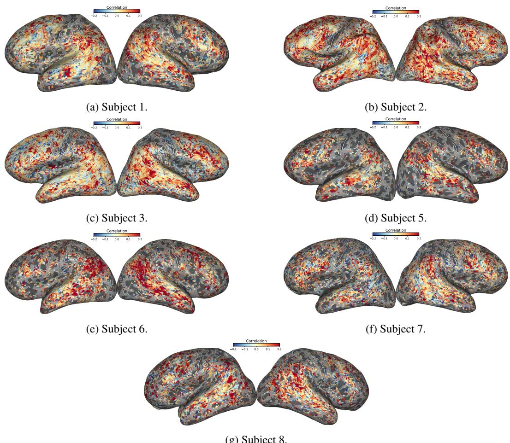  
(g) Subject 8.  
Figure 9: Voxel-wise differences in brain-prediction accuracy between contextual and out-of-context SCRIBE representations $( \mathrm { S C R I B E } _ { C } - \bar { \mathrm { S C R I B E } } _ { O } )$ across subjects. Red regions indicate greater prediction accuracy for $\mathrm { S C R I B E } _ { C } .$ whereas blue regions indicate greater accuracy for $\mathrm { S C R I B E } _ { O }$ Contextualization-related improvements are predominantly observed in language-related cortical regions, with stronger effects in the right hemisphere.

## B.3.3 COMPLEMENTARITY BETWEEN QAEMB AND SCRIBE

Although $\mathrm { S C R I B E _ { C } }$ and QAEmb achieve comparable brain-encoding performance individually, an important question is whether the two representations capture redundant semantic information or provide complementary information about neural responses. We investigated this in two ways: first, by quantifying the unique variance explained by each representation through variance partitioning; and second, by testing whether combining their feature spaces improves held-out brain prediction.

Variance partitioning showed that both $\mathrm { S C R I B E _ { C } }$ and QAEmb explain unique variance in neural responses beyond their shared contribution (Figure 10). Despite their similar overall encoding performance, $\mathrm { S C R I B E _ { C } }$ explained more unique variance than QAEmb across several higherlevel language and semantic ROIs, with significant differences in the lateral temporal cortex (LTC; $p = 0 . 0 3 9 )$ and angular gyrus $( \mathrm { A G } ; p = 0 . 0 2 3 )$ , and a numerical difference in the late-language network. These results indicate that the two representations are not fully redundant and that $\mathrm { \bar { S } C R I B E _ { C } }$ captures brain-predictive information not accounted for by QAEmb. To examine the spatial distribution of these unique contributions, Figure 11 shows the voxel-wise unique-variance contrast between SCRIBE and QAEmb for each subject.

To further test whether this complementary information translates into improved brain prediction, we trained an additional encoding model using the concatenation of the $\mathrm { S C R I B E _ { C } }$ and QAEmb feature spaces and compared its prediction performance with models using either representation alone (Table 21). At the whole-brain level, combining QAEmb with $\mathrm { S C R I \bar { B } E _ { C } }$ significantly improved prediction performance over both $\mathrm { S C R I B E _ { C } }$ and QAEmb individually. The combined representation achieved a mean noise-ceiling-normalized correlation of $0 . 2 0 2 2 \pm 0 . 0 1 4 6$ , compared with $0 . 1 8 3 7 \pm 0 . 0 1$ 44 for $\mathrm { S C R I B E _ { C } }$ and $0 . 1 7 7 8 \pm 0 . 0 1 2 5$ for QAEmb (one-sided Wilcoxon signedrank tests, $p = 0 . 0 0 7 8$ for both comparisons). This corresponds to a 13.7% improvement in mean correlation over QAEmb alone.

The same pattern was observed within cortical regions associated with higher-level language and semantic processing. The combined representation yielded higher mean prediction performance than either individual representation in the late-language network $( 0 . 1 5 7 7 \pm \bar { 0 } . 0 2 1 3 )$ , LTC $( 0 . 1 6 4 4 \pm$ 0.0236), IFG/MFG $( 0 . 1 4 5 8 \pm 0 . 0 1 9 6 )$ , and $\mathrm { A G \ ( \bar { 0 } . 1 \bar { 4 } 9 7 \pm 0 . 0 2 9 0 ) }$ . The combined representation significantly outperformed both individual representations in all four ROIs (one-sided Wilcoxon signed-rank tests, $p < 0 . 0 5 ;$ Table 21).

Together, the variance-partitioning and joint-model analyses provide converging evidence that $\mathrm { S C R I B E _ { C } }$ and QAEmb capture complementary brain-relevant information. Both representations account for unique variance in neural responses, while $\mathrm { S C R I B E _ { C } }$ shows greater unique contributions in several higher-level language and semantic regions. Moreover, combining the two representations consistently improves held-out prediction performance over either representation alone, indicating that the information captured by SCRIBE is not subsumed by QAEmb.

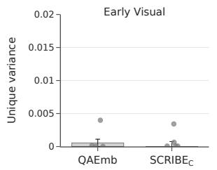

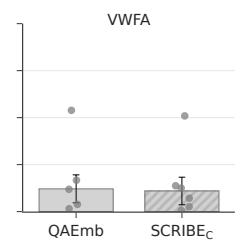

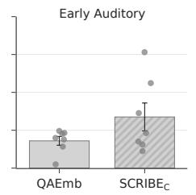

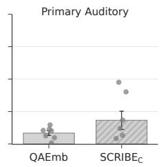

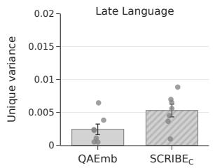

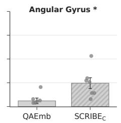

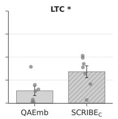

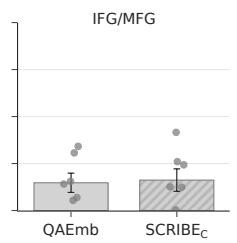  
Figure 10: Unique variance explained by $\mathrm { S C R I B E } _ { C }$ and QAEmb across cortical regions. Bars show the mean unique explained variance across subjects, with error bars indicating the standard error of the mean; individual dots represent subjects. $p \mathrm { - }$ -values correspond to one-sided paired Wilcoxon signed-rank tests testing whether the unique variance explained by $\mathrm { S C R I B E } _ { C }$ is greater than that explained by QAEmb. Asterisks indicate significant differences $( p < 0 . 0 5 )$ .

Table 21: Noise-ceiling-normalized brain encoding correlations for SCRIBE $( \mathrm { S C R I B E } _ { C } )$ , QAEmb, and their combined representation, evaluated across the whole brain and semantic language ROIs. Values are reported for individual subjects and as mean ± standard error across subjects. ∗ denotes that QAEmb + SCRIBEC significantly outperforms both individual representations (one-sided Wilcoxon signed-rank tests, $p < 0 . 0 5 )$ ).
<table><tr><td>Region</td><td>Method</td><td>S1</td><td>S2</td><td>S3</td><td>S5</td><td>S6</td><td>S7</td><td>S8</td><td> $\mathbf { A v g } \pm \mathbf { S T E }$ </td></tr><tr><td rowspan="3">Whole Brain</td><td> $\mathrm { S C R I B E _ { C } }$ </td><td>0.2284</td><td>0.2263</td><td>0.1714</td><td>0.2023</td><td>0.1800</td><td>0.1519</td><td>0.1258</td><td> $0 . 1 8 3 7 \pm 0 . 0 1 4 4$ </td></tr><tr><td>QAEmb</td><td>0.2343</td><td>0.2115</td><td>0.1626</td><td>0.1788</td><td>0.1554</td><td>0.1544</td><td>0.1477</td><td> $0 . 1 7 7 8 \pm 0 . 0 1 2 5$ </td></tr><tr><td> $\mathbf { Q A E m b + S C R I B E _ { C } }$ </td><td>0.2579</td><td>0.2426</td><td>0.1895</td><td>0.2140</td><td>0.1926</td><td>0.1684</td><td>0.1504</td><td> $\mathbf { 0 . 2 0 2 2 \pm 0 . 0 1 4 6 } ^ { \ Z }$ </td></tr><tr><td rowspan="3">Late Language</td><td>SCRIBEC</td><td>0.1673</td><td>0.1990</td><td>0.2112</td><td>0.1348</td><td>0.1371</td><td>0.1191</td><td>0.0536</td><td> $0 . 1 4 6 0 \pm 0 . 0 2 0 1$ </td></tr><tr><td>QAEmb</td><td>0.1715</td><td>0.1943</td><td>0.1932</td><td>0.1136</td><td>0.1214</td><td>0.1153</td><td>0.0615</td><td> $0 . 1 3 8 7 \pm 0 . 0 1 8 6$ </td></tr><tr><td> $\mathbf { Q A E m b + S C R I B E _ { C } }$ </td><td>0.1880</td><td>0.2145</td><td>0.2253</td><td>0.1395</td><td>0.1450</td><td>0.1285</td><td>0.0632</td><td> $\mathbf { 0 . 1 5 7 7 \pm 0 . 0 2 1 3 ^ { \ast } }$ </td></tr><tr><td rowspan="3">LTC</td><td>SCRIBEC</td><td>0.1991</td><td>0.2046</td><td>0.1770</td><td>0.1609</td><td>0.1819</td><td>0.1155</td><td>0.0377</td><td> $0 . 1 5 3 8 \pm 0 . 0 2 2 3$ </td></tr><tr><td>QAEmb</td><td>0.2026</td><td>0.1963</td><td>0.1569</td><td>0.1405</td><td>0.1571</td><td>0.1147</td><td>0.0415</td><td> $0 . 1 4 4 2 \pm 0 . 0 2 0 6$ </td></tr><tr><td> $\mathbf { Q A E m b + S C R I B E _ { C } }$ </td><td>0.2218</td><td>0.2174</td><td>0.1870</td><td>0.1665</td><td>0.1884</td><td>0.1258</td><td>0.0435</td><td> $\mathbf { 0 . 1 6 4 4 \ : \pm 0 . 0 2 3 6 } ^ { \ast }$ </td></tr><tr><td rowspan="3">IFG/MFG</td><td> $\mathrm { S C R I B E _ { C } }$ </td><td>0.1819</td><td>0.1424</td><td>0.1948</td><td>0.1200</td><td>0.0769</td><td>0.1350</td><td>0.0673</td><td> $0 . 1 3 1 2 \pm 0 . 0 1 8 2$ </td></tr><tr><td>QAEmb</td><td>0.1901</td><td>0.1651</td><td>0.1853</td><td>0.0989</td><td>0.0726</td><td>0.1251</td><td>0.0948</td><td> $0 . 1 3 3 1 \pm 0 . 0 1 7 8$ </td></tr><tr><td> $\mathbf { Q A E m b + S C R I B E _ { C } }$ </td><td>0.2060</td><td>0.1690</td><td>0.2104</td><td>0.1227</td><td>0.0837</td><td>0.1422</td><td>0.0870</td><td> $\mathbf { 0 . 1 4 5 8 \pm 0 . 0 1 9 6 } ^ { \ Z }$ </td></tr><tr><td rowspan="3">Angular Gyrus</td><td>SCRIBEC</td><td>0.0926</td><td>0.2294</td><td>0.2583</td><td>0.1236</td><td>0.1099</td><td>0.1011</td><td>0.0648</td><td> $0 . 1 3 9 9 \pm 0 . 0 2 7 9$ </td></tr><tr><td>QAEmb</td><td>0.0922</td><td>0.2058</td><td>0.2365</td><td>0.1006</td><td>0.0905</td><td>0.1016</td><td>0.0602</td><td> $0 . 1 2 6 8 \pm 0 . 0 2 5 1$ </td></tr><tr><td> $\mathbf { Q A E m b + S C R I B E _ { C } }$ </td><td>0.1063</td><td>0.2378</td><td>0.2771</td><td>0.1296</td><td>0.1156</td><td>0.1118</td><td>0.0698</td><td> $\mathbf { 0 . 1 4 9 7 \mathop { \pm } { 0 . 0 2 9 0 } ^ { * } }$ </td></tr></table>

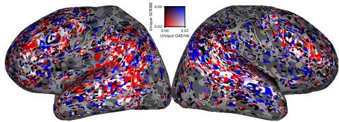  
(a) Subject 1.

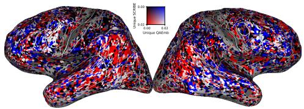  
(b) Subject 2.

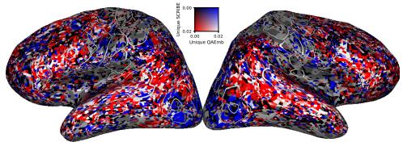  
(c) Subject 3.

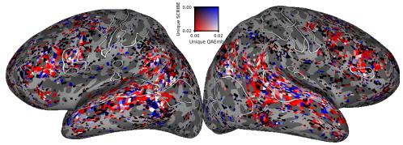  
(d) Subject 5.

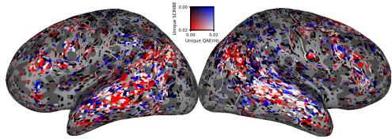  
(e) Subject 6.

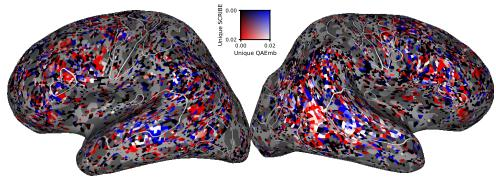

(f) Subject 7.  
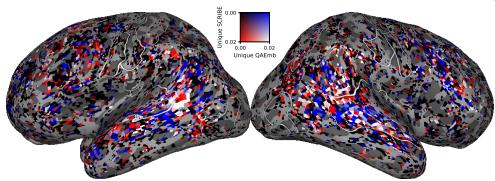  
(g) Subject 8.  
Figure 11: Voxel-wise unique variance explained by SCRIBE and QAEmb across subjects. Variance partitioning was performed directly between the two representations, without including the syntactic control features. Red regions indicate greater unique variance explained by SCRIBE, whereas blue regions indicate greater unique variance explained by QAEmb. Only voxels with a noise ceiling above 0.4 are shown. Across subjects, the maps predominantly show greater unique variance for SCRIBE, particularly in language-related cortical areas, although this pattern is less pronounced in Subject 8.

## B.3.4 CONTROLLING FOR FEATURE-SPACE DIMENSIONALITY

SCRIBE and QAEmb differ in the dimensionality of their final feature spaces: SCRIBE contains 65 semantic properties, whereas QAEmb uses 35 features selected from an initial set of 606 questions. We therefore investigated whether differences in brain-encoding performance could be explained simply by the larger dimensionality of SCRIBEC.

To control for this possibility, we applied sparse feature selection to our contextual variant of ${ \mathrm { S C R I B E } } _ { \mathrm { C } } ,$ following the feature-selection approach used by QAEmb. Feature selection retained 33 of the original 65 semantic dimensions, resulting in a representation with approximately half the dimensionality of the original SCRIBE space and a dimensionality comparable to QAEmb. The selected dimensions were: Bright, Dark, Large, Small, Fast, Slow, Face, Temperature, Pain, Weight, Audition, High, Music, Taste, Smell, Head, UpperLimb, LowerLimb, Landmark, Toward, Number, Time, Long, Self, Cognition, Happy, Sad, Angry, Disgusted, Fearful, Surprised, Needs, and Arousal.

Despite reducing the representation from 65 to 33 dimensions, whole-brain encoding performance was preserved (Table 22). The full SCRIBE representation achieved a mean noise-ceilingnormalized correlation of $0 . 1 8 3 7 \pm 0 . 0 1 4 4$ , compared with $0 . 1 8 5 9 \pm 0 . 0 1 2 6$ after feature selection. The difference was not statistically significant (two-sided Wilcoxon signed-rank test, $p = 0 . 5 7 8 1 )$ .

This preservation of performance was also observed across the examined language and semantic ROIs. The full and feature-selected representations achieved highly similar correlations in the latelanguage network $( 0 . 1 4 6 0 \pm 0 . 0 2 0 1$ vs. $0 . 1 4 5 2 \pm 0 . 0 1 9 7 )$ , lateral temporal cortex $\operatorname { ( L T C ; 0 . 1 5 3 8 \pm }$ 0.0223 vs. 0.1522±0.0216), inferior/middle frontal gyrus (IFG/MFG; 0.1312±0.0182 vs. 0.1344± 0.0181), and angular gyrus (AG; 0.1399 ± 0.0279 vs. $0 . 1 3 8 0 \pm 0 . 0 2 6 8$ ; Table 22).

Together, these results indicate that $\mathrm { S C R I B E _ { C } }$ does not depend on its larger number of semantic dimensions to achieve its brain-encoding performance. Reducing the representation from 65 to 33 dimensions preserves both whole-brain prediction accuracy and performance across the examined semantic-language ROIs, suggesting that the observed results are not simply attributable to differences in feature-space dimensionality between $\mathrm { S C R I B E _ { C } }$ and QAEmb.

Table 22: Noise-ceiling-normalized brain encoding correlations for $\mathrm { S C R I B E _ { C } }$ before and after feature selection, evaluated across the whole brain and semantic language ROIs. Feature selection reduces the representation from 65 to 33 semantic dimensions. Values are reported for individual subjects and as mean ± standard error across subjects. At the whole-brain level, performance does not significantly differ after feature selection (two-sided Wilcoxon signed-rank test).
<table><tr><td>Region</td><td>Method</td><td>S1</td><td>S2</td><td>S3</td><td>S5</td><td>S6</td><td>S7</td><td>S8</td><td> $\mathbf { A v g } \pm \mathbf { S T E }$ </td></tr><tr><td rowspan="2">Whole Brain</td><td> $\mathrm { S C R I B E _ { C } } \left( 6 5 \right)$ </td><td>0.2284</td><td>0.2263</td><td>0.1714</td><td>0.2023</td><td>0.1800</td><td>0.1519</td><td>0.1258</td><td> $0 . 1 8 3 7 \pm 0 . 0 1 4 4$ </td></tr><tr><td> $\mathrm { S C R I B E _ { C } } \left( 3 3 \right)$ </td><td>0.2275</td><td>0.2101</td><td>0.1848</td><td>0.2046</td><td>0.1897</td><td>0.1504</td><td>0.1340</td><td> $0 . 1 8 5 9 \pm 0 . 0 1 2 6$ </td></tr><tr><td rowspan="2">Late Language</td><td> $\mathrm { S C R I B E _ { C } }$  (65)</td><td>0.1673</td><td>0.1990</td><td>0.2112</td><td>0.1348</td><td>0.1371</td><td>0.1191</td><td>0.0536</td><td> $0 . 1 4 6 0 \pm 0 . 0 2 0 1$ </td></tr><tr><td> $\mathrm { S C R I B E _ { C } } \left( 3 3 \right)$ </td><td>0.1660</td><td>0.1897</td><td>0.2124</td><td>0.1351</td><td>0.1396</td><td>0.1178</td><td>0.0561</td><td> $0 . 1 4 5 2 \pm 0 . 0 1 9 7$ </td></tr><tr><td rowspan="2">LTC</td><td> $\mathrm { S C R I B E _ { C } }$  (65)</td><td>0.1991</td><td>0.2046</td><td>0.1770</td><td>0.1609</td><td>0.1819</td><td>0.1155</td><td>0.0377</td><td> $0 . 1 5 3 8 \pm 0 . 0 2 2 3$ </td></tr><tr><td> $\mathrm { S C R I B E _ { C } } \ ( 3 3 )$ </td><td>0.1938</td><td>0.1974</td><td>0.1762</td><td>0.1615</td><td>0.1814</td><td>0.1146</td><td>0.0402</td><td> $0 . 1 5 2 2 \pm 0 . 0 2 1 6$ </td></tr><tr><td rowspan="2">IFG/MFG</td><td> $\mathrm { S C R I B E _ { C } }$  (65)</td><td>0.1819</td><td>0.1424</td><td>0.1948</td><td>0.1200</td><td>0.0769</td><td>0.1350</td><td>0.0673</td><td> $0 . 1 3 1 2 \pm 0 . 0 1 8 2$ </td></tr><tr><td> $\mathrm { S C R I B E _ { C } }$  (33)</td><td>0.1835</td><td>0.1396</td><td>0.2056</td><td>0.1215</td><td>0.0876</td><td>0.1356</td><td>0.0673</td><td> $0 . 1 3 4 4 \pm 0 . 0 1 8 1$ </td></tr><tr><td rowspan="2">Angular Gyrus</td><td> $\mathrm { S C R I B E _ { C } }$  (65)</td><td>0.0926</td><td>0.2294</td><td>0.2583</td><td>0.1236</td><td>0.1099</td><td>0.1011</td><td>0.0648</td><td> $0 . 1 3 9 9 \pm 0 . 0 2 7 9$ </td></tr><tr><td> $\mathrm { S C R I B E _ { C } } \left( 3 3 \right)$ </td><td>0.0954</td><td>0.2148</td><td>0.2567</td><td>0.1224</td><td>0.1095</td><td>0.0981</td><td>0.0690</td><td> $0 . 1 3 8 0 \pm 0 . 0 2 6 8$ </td></tr></table>

## B.3.5 VARIANCE PARTITIONING WITH SYNTACTIC FEATURES

To further characterize the information underlying the brain-encoding performance of SCRIBE, we performed variance partitioning with an explicit syntactic feature space. Syntactic features comprised one-hot encoded part-of-speech tags and dependency length obtained with spaCy (Honnibal et al., 2020), together with constituency tree depth obtained using the Benepar parser (Kitaev & Klein, 2018). We compared $\mathrm { S C R I B E _ { C } }$ with QAEmb to assess both how much of their brainpredictive variance overlaps with these syntactic features and how much remains uniquely explained after accounting for them.

Figure 12a shows the variance that SCRIBEC and QAEmb share with the syntactic feature space. $\mathrm { S C R I B E _ { C } }$ shares significantly less variance with syntactic features than QAEmb in LTC and AG, with the same numerical direction in Late Language and IFG/MFG. Thus, the greater brainprediction accuracy of $\mathrm { S C R I B E _ { C } }$ relative to QAEmb is not accompanied by greater overlap with the measured syntactic information.

Complementing this result, Figure 12b shows the variance uniquely explained by each representation after accounting for the syntactic feature space. SCRIBEC retains significantly more unique brainpredictive variance than QAEmb in Late Language, LTC, and AG, with no significant difference in IFG/MFG.

Together, these analyses show that, relative to QAEmb, $\mathrm { S C R I B E _ { C } }$ retains more unique brainpredictive information while exhibiting less overlap with the measured syntactic features, supporting a more semantically selective interpretation of its neural predictivity.

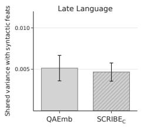

  
(a) Shared variance with syntactic features.

  
(b) Unique variance beyond syntactic features.

Figure 12: Variance partitioning of $\mathrm { S C R I B E } _ { C }$ and QAEmb with syntactic features across languagerelated ROIs. (a) Brain-predictive variance shared with the syntactic feature space. (b) Unique brain-predictive variance retained by each representation after accounting for the syntactic feature space. Bars show means across subjects and error bars indicate the standard error of the mean. Bold ROI labels and asterisks indicate significant paired differences between $\mathrm { S C R I B E } _ { C }$ and QAEmb (one-sided paired Wilcoxon signed-rank test, $p < 0 . 0 5 )$

  
Figure 13: Permutation-based significance testing of the unique neural variance explained by SCRIBEC after accounting for syntactic features. Histograms show permutation-based null distributions, and dashed lines indicate the observed unique variance.

## B.3.6 COMPARISON WITH LLM EMBEDDINGS

To compare SCRIBE with representations extracted directly from an LLM, we evaluated brainencoding performance using Llama2-7B embeddings. We consider both non-contextual embeddings extracted from layer 0 and contextual embeddings extracted from layer 15.

Figure 14 shows the whole-brain and region-wise comparison between the non-contextual (layer 0) and contextual (layer 15) Llama2-7B embeddings, QAEmb, and $\mathrm { S C R I B E } _ { C }$ . Compared with non-contextual Llama2-7B embeddings, SCRIBE achieved substantially higher whole-brain prediction accuracy $( 0 . 1 8 3 7 \pm 0 . 0 1 4 4$ vs. $0 . 1 1 8 5 \pm 0 . 0 1 0 6 )$ , corresponding to a 55% relative improvement. SCRIBEC also significantly outperformed the non-contextual embeddings in the Late Language ROIs, AG, LTC, and IFG/MFG. In contrast, contextual Llama2-7B embeddings achieved higher overall brain-encoding performance than $\mathrm { S C R I B E } _ { C }$ $( 0 . 2 3 8 7 \pm 0 . 0 2 1 5$ vs. $0 . 1 8 3 7 \pm 0 . 0 1 4 4 )$

The higher predictive performance of contextual Llama2-7B embeddings does not, however, es tablish which linguistic information drives this advantage. Because contextual LLM embeddings may encode multiple sources of linguistic information, we used variance partitioning with explicit syntactic features to further characterize the information underlying their brain predictivity. Figure 15 compares the variance that contextual Llama2-7B and SCRIBE share with the syntactic feature space. SCRIBE exhibits significantly less shared variance than Llama2-7B in IFG/MFG, with the same numerical direction in Late Language and LTC. This difference is particularly notable given the established involvement of left inferior frontal regions in syntactic processing (Dapretto & Bookheimer, 1999; Heim et al., 2003; Friederici, 2011).

Finally, we tested whether the variance uniquely explained by SCRIBE exceeds chance. Permutation tests confirmed significant unique variance across all four language-related ROIs (Late Language, LTC, IFG/MFG, and AG; all $p \leq . 0 0 2$ ; Figure 16). Thus, despite the higher overall brainprediction accuracy of contextual Llama2-7B embeddings, SCRIBE captures significant unique brain-predictive information and shows reduced overlap with syntactic features in IFG/MFG.

  
(a) Whole-brain encoding performance.

  
(b) Encoding performance across language-related ROIs.

Figure 14: Brain-encoding performance of Llama2-7b, $\mathrm { Q A E m b } ,$ and $\mathrm { S C R I B E } _ { C } .$ . (a) Whole-brain encoding performance. (b) Encoding performance across the Late Language, lateral temporal cortex (LTC), IFG/MFG, and Angular Gyrus ROIs. Bars show mean noise-ceiling-normalized correlation across subjects, individual points represent subjects, and error bars indicate the standard error of the mean. Asterisks indicate significant differences between $\mathrm { S C R I B E } _ { C }$ and the corresponding baseline $( p < 0 . 0 5 ;$ one-sided Wilcoxon signed-rank test).

  
(a) Shared variance with syntax.  
Figure 15: Shared brain-predictive variance with syntactic features for contextual Llama2-7B and SCRIBE $( \mathrm { S C R I B E _ { C } } )$ . Bars show the mean shared variance across subjects and error bars indicate the standard error of the mean. SCRIBE shares significantly less variance with the syntactic feature space than Llama2-7B in IFG/MFG (one-sided paired Wilcoxon signed-rank test, $p < 0 . 0 5 )$ , indicated by the bold ROI label and asterisk.

  
Figure 16: Permutation-based significance testing of the unique neural variance explained by SCRIBEC in variance partitioning with Llama2-7b. Histograms show permutation-based null distributions, and dashed lines indicate the observed unique variance.