# SELECTION IS NOT LEARNING: CHOOSING MODEL FUTURES

Haoyi Yang<sup>∗</sup> Kshitij Mishra<sup>∗</sup> Nils Lukas Salem Lahlou

Mohamed bin Zayed University of Artificial Intelligence, Abu Dhabi, UAE {haoyi.yang,kshitij.mishra,nils.lukas,salem.lahlou}@mbzuai.ac.ae

## ABSTRACT

Self-evolving language models train on tasks they generate, so every round must decide which updated model the next round inherits. Current loops such as R-Zero, Agent0, and Skill Self-Play make this decision through the task, admitting tasks that look learnable and inheriting every resulting update. We identify a selectionto-update gap in these loops, where a task that looks learnable need not produce a useful update. Most updates on verified tasks fail to make correct answers more likely, yet these loops inherit them all. HEIRCOMMIT freezes the updated model and uses fresh evaluation questions to decide whether to inherit it or retain the current model. EVOHEIR separates parameter inheritance from experience inheritance, using current and archived experience to repair failures and preserve successes before final confirmation. Our analysis characterizes selection-induced optimism and decomposes regret into selection, absorption, and confirmation errors. HEIRCOMMIT cuts the harmful share of accepted updates by 68–83% relative to random inheritance at the same acceptance rate. Across four backbones, EVOHEIR achieves the best mathematics and general-reasoning averages, raising the math average by 5.3% relative to the strongest baseline, Agent0. The framework lets useful experience persist even when the model that produced it is not inherited.

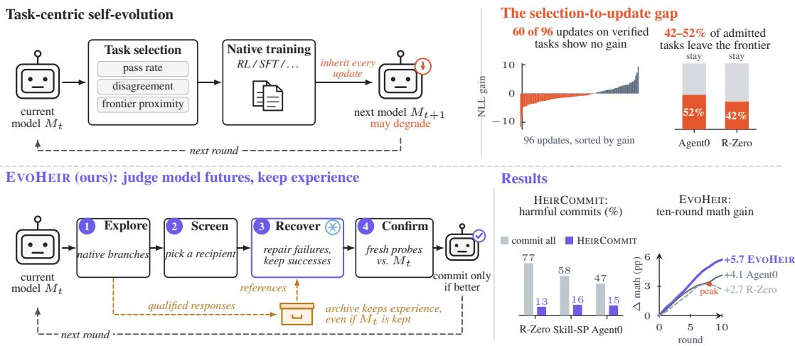  
Figure 1: Selecting a learnable task does not guarantee learning, so EVOHEIR judges model futures and keeps experience. Top: task-centric loops inherit every update, yet 60 of 96 updates on verified tasks show no gain, and 42–52% of admitted tasks leave the frontier under fresh responses. Bottom: EVOHEIR explores, screens a recipient, repairs its failures with current and archived references while keeping its successes, and commits the result only if it beats the current model on fresh probes. The archive keeps experience either way. HEIRCOMMIT cuts the harmful share of commits on every host, and over ten rounds EVOHEIR keeps climbing to +5.7 math points while R-Zero peaks at round 8 and slips (means over four backbones). All plots show measured data.

## 1 INTRODUCTION

Self-evolving language models generate tasks and train on their own outputs (Huang et al., 2026a; Xia et al., 2026; Huang et al., 2026b). Each inherited update changes both the learner and the curriculum of later rounds, allowing progress or regressions to accumulate (Shao et al., 2026). Self-training can even raise a model’s target metric and then collapse it within the same training campaign (Lin, 2026). The central decision is therefore which learning outcomes to carryforward.

Task-side selection leaves a selection-to-update gap: pass rate, disagreement, and frontier proximity describe pre-training behavior, not the transfer produced by an optimizer update. In our audits, 42–52% of native Agent0/R-Zero admissions leave the frontier under independent responses. Even with exact-valid tasks, 60 of 96 Skill Self-Play (Skill-SP) updates have nonpositive correct-target NLL gain. Learning opportunities must ultimately be judged by the states they produce.

HEIRCOMMIT judges realized transitions: it freezes a successor, compares it with the current model (the root) on fresh probes, and inherits that state or retains root. Fresh evidence separates confirmation from the noise that favored the proposal during selection.

The deeper question is the granularity of inheritance. SOAR uses actual student improvement to reward a teacher (Sundaram et al., 2026), and APE evaluates candidate fine-tunings before accepting updates (Mar´ın, 2025). Pre-commit skill verification (Shang et al., 2026) and anytime-valid certificates (Sengupta, 2026) gate agent updates while the base model stays frozen. Whole-state acceptance nevertheless couples a branch’s gains and losses. Must a useful experience donor also supply the next learner’s parameters? Separating these choices opens a learning path beyond whole-state acceptance (Figure 1).

EVOHEIR separates parameter inheritance from experience inheritance. Screening picks the recipient that supplies the next learner’s parameters, either a branch endpoint or the current model. EXPERIENCE RECOVERY then repairs this recipient’s failures with current and archived reference solutions while preserving its successes.

HEIRCOMMIT confirms the completed post-absorption state against root. Qualified experience enters the archive regardless of this decision: parameter inheritance can stop without discarding material that helps a later recipient.

We evaluate HEIRCOMMIT on the native updates of three self-evolution hosts, and EVOHEIR on four backbones over ten rounds. HEIRCOMMIT cuts the harmful share of accepted updates by 68–83% relative to random inheritance at the same acceptance rate, on every host. EVOHEIR achieves the highest mathematics and general-reasoning averages on all four backbones and beats Agent0 on 45 of 48 benchmark–backbone pairs. References from eight of ten donors weaker than the current model still improve the recipient.

## Our contributions are:

1. We identify the selection-to-update gap and prove that pre-update behavior alone cannot identify an update’s value. Reusing screening evidence to accept a branch pays a union bound over branches, which fresh confirmation removes.

2. We introduce HEIRCOMMIT, a source-independent rule that commits a frozen successor only when it beats the current model on fresh probes. On the native updates of R-Zero, Agent0, and Skill-SP, it turns negative pool gain positive on two of the three hosts.

3. We develop EVOHEIR, which decides separately which parameters the next learner inherits and which experience it absorbs. Across four backbones it raises the base model’s math average by 7.9–30.1%, the most of any compared method.

4. We show that experience outlives the model that produced it. Recovery beats direct fine-tuning on the same 64 references by 1.93 pp on average, and experience from rounds whose model was rejected adds 0.66 pp beyond committed-round history.

## 2 RELATED WORK

Self-evolution and update acceptance. STaR, Self-Instruct, and SPIN learn from self-generated supervision (Zelikman et al., 2022; Wang et al., 2023; Chen et al., 2024); Alami et al. (2024) regularize

SPIN with a KL term and fictitious play across iterations. Task generation uses self-play in Absolute Zero and SPELL (Zhao et al., 2025; Yang et al., 2026) and student feedback in DataEnvGym (Khan et al., 2025). R-Zero, Agent0, and Skill-SP adapt curricula (Huang et al., 2026a; Xia et al., 2026; Huang et al., 2026b); SOAR and Actor-Curator use realized improvement (Sundaram et al., 2026; Gu et al., 2026). Earlier automatic curricula select tasks by measured learning progress (Graves et al., 2017; Matiisen et al., 2020), a signal that Willems et al. (2020) argue is flawed, proposing mastering rates instead. At the agent level, harness updates need not bring benefit either (Lin et al., 2026). Update acceptance appears in AlphaGo Zero, but not AlphaZero (Silver et al., 2017b;a), candidate fine-tuning in APE (Mar´ın, 2025), and nonparametric agent evolution in PACE (Shawn, 2026). Agent-side gates verify distilled skills before commit or certify adapter and harness updates while the base model stays frozen (Shang et al., 2026; Sengupta, 2026). EVOHEIR separately chooses the recipient and experience donors, then confirms the post-absorption successor.

Privileged-context distillation. GKD trains on student-generated prefixes (Agarwal et al., 2024). SDFT, SDPO, and OPSD condition a self-teacher on demonstrations, feedback, or privileged context (Shenfeld et al., 2026; Hubotter et al. ¨ , 2026; Zhao et al., 2026), while OPCD internalizes contextual knowledge (Ye et al., 2026b). Recovery combines recipient-specific repair and preservation with cross-branch references, fixed recipient trajectories, and post-absorption confirmation.

Experience persistence. Replay retains past experience (Rolnick et al., 2019); genetic distillation combines policies (Gangwani & Peng, 2018). Online experiential learning and SPEE internalize accumulated experience (Ye et al., 2026a; Ren et al., 2026). EVOHEIR reassesses experience through the current recipient and retains it independently of parameter acceptance: a rejected state can remain a useful donor.

## 3 SELF-EVOLUTION ENVIRONMENT

Self-evolution runs in rounds, and each round ends with an inheritance decision. The Curriculum Scout proposes problems, the Evolution Controller admits those at the Evolving Learner’s frontier, and native training updates both agents in an R-Zero-style loop (Huang et al., 2026a), as Figure 2 shows. A round starts from the learner’s root state $S _ { t } = ( \theta _ { t } , \omega _ { t } )$ , its parameters and resumable training state, and trains two native branches from it. Admission uses pre-update behavioral observations $O _ { t }$ , such as the pass rate over ten learner responses, and the branch endpoints form $\mathcal { C } _ { t } ^ { \mathrm { n a t } }$ . Qualified responses from every branch enter a bounded archive $M _ { t }$ . Training and Recovery, screening, confirmation and final evaluation use disjoint question pools, and online scores use frozen consensus labels, as Appendix A details.

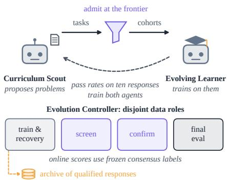  
Figure 2: Self-evolution environment. Two agents co-evolve through the Evolution Controller.

Value and inheritance. For a declared task distribution $P _ { t }$ and utility $q ,$ the value of a state is its expected gain over the root,

$$
V _ { t } ( S ) = \mathbb { E } _ { z \sim P _ { t } } [ q ( S ; z ) - q ( S _ { t } ; z ) ] , \qquad V _ { t } ( S _ { t } ) = 0 .\tag{1}
$$

Capability uses exact correctness or sampled pass@1, and the update audits use the reduction in correct-target negative log-likelihood (NLL), which is not an accuracy difference. For binary correctness, value splits into acquired and lost successes,

$$
V _ { t } ( S ) = \operatorname* { P r } ( q ( S ) = 1 , q ( S _ { t } ) = 0 ) - \operatorname* { P r } ( q ( S ) = 0 , q ( S _ { t } ) = 1 ) .\tag{2}
$$

The selection-to-update gap is the failure of task-side admission to identify positive value. Screening picks a recipient $\bar { S } _ { t } ^ { \mathrm { s e l } }$ from $\mathcal { C } _ { t } ^ { \mathrm { n a t } } \cup \{ S _ { t } \}$ , Recovery turns it into a proposal $S _ { t } ^ { + }$ , and confirmation keeps $S _ { t }$ or adopts $S _ { t } ^ { + }$ as $S _ { t + 1 }$ . Transition regret compares the inherited state with the best state constructed,

$$
R _ { t } = \operatorname* { m a x } _ { S \in \mathcal { C } _ { t } ^ { \mathrm { n a t } } \cup \{ S _ { t } , S _ { t } ^ { + } \} } V _ { t } ( S ) - V _ { t } ( S _ { t + 1 } ) ,\tag{3}
$$

and absorption gain $G _ { t } ^ { \mathrm { a b s } } = V _ { t } ( S _ { t } ^ { + } ) - V _ { t } ( S _ { t } ^ { \mathrm { s e l } } )$ measures the change from recipient to proposal.

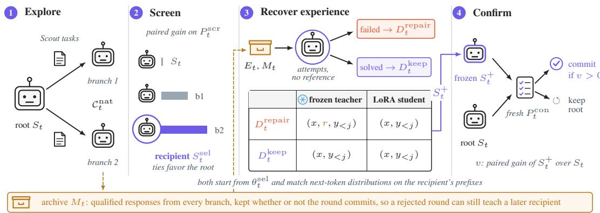  
Figure 3: One EVOHEIR round. Steps follow Algorithm 1, and the archive keeps qualified experience whether or not the round commits.

Hosts, backbones, and benchmarks. HEIRCOMMIT is audited on the native updates of R-Zero, Agent0 and Skill-SP, which propose tasks through a challenger, a tool-using curriculum agent and a skill controller, respectively (Huang et al., 2026a; Xia et al., 2026; Huang et al., 2026b). The selfevolution study runs every method for ten rounds with three training seeds from Qwen3-4B-Base and Qwen3-8B-Base (Yang et al., 2025), OLMo-3-7B (Olmo et al., 2026), and the instructiontuned Gemma-4-E4B-it (Team et al., 2026). It evaluates seven mathematics and five generalreasoning benchmarks (Hendrycks et al., 2021; Lewkowycz et al., 2022; He et al., 2024; Ballon et al., 2026; Mayilvahanan et al., 2025; Team et al., 2025; Wang et al., 2024; Kazemi et al., 2025; White et al., 2025; Ma et al., 2025), listed with their metrics in Appendix E.

## 4 EVOHEIR: EXPLORATION, EXPERIENCE RECOVERY, AND HEIRCOMMIT

EVOHEIR gives exploration two routes into the next learner, selected parameters and absorbed experience. Each round runs the four steps of Figure 3. It (1) explores native branches from the root, (2) screens them with the root for a parameter recipient, (3) recovers current and archived experience into that recipient, and (4) confirms the result against the root on fresh probes.

## 4.1 EXPLORE AND SCREEN A RECIPIENT

On the base loop of Section 3, EVOHEIR builds multi-branch exploration, screening of realized updates, experience absorption, and independent confirmation. Native endpoints and any predeclared training-prefix checkpoints form $\mathcal { C } _ { t } ^ { \mathrm { n a t } }$ . Each branch supplies a resumable state and responses that qualify as experience. An Experience Donor contributes the latter without having to supply inherited parameters or remain available as a teacher model.

The controller freezes native candidates before shared screening on $P _ { t } ^ { \mathrm { s c r } }$ . Paired root-relative scores select the recipient $S _ { t } ^ { \mathrm { s e l } }$ from the candidates and root, with ties going to the root and then to a fixed branch order. Screening chooses the parameter starting point for absorption.

## 4.2 RECOVER EXPERIENCE WITHOUT INHERITING THE DONOR

Experience across branches and rounds. Current exploration records $E _ { t }$ and a bounded archive $M _ { t }$ supply candidate problems and references with their generating checkpoint and verification trace. Qualification checks completeness, answer validity, and problem-level de-duplication. Recovery material is disjoint from screening, confirmation, and final evaluation. Appendix B.3 specifies archive admission and retention.

Let the recipient identify repair and preservation. Recovery obtains reference-free recipient attempts by exact-checkpoint cache reuse or one rollout batch. Under the same answer-equivalence rule, a failed attempt with a qualified reference enters $D _ { t } ^ { \mathrm { r e p a i r } }$ , and a successful attempt enters $D _ { t } ^ { \mathrm { k e e p } }$ The groups are disjoint and specific to the recipient, so an archived success becomes repair material when the current recipient cannot reproduce it. A predeclared budget bounds selection from both groups.

A frozen recipient teaches a recipient-initialized student. The frozen teacher and student in Figure 3 are two copies of the selected Evolving Learner, both initialized from $\theta _ { t } ^ { \mathrm { s e l } }$ . For a recipientgenerated trajectory y on problem x, all three distributions below predict the next token at the same prefix $y _ { < j }$ . The repair teacher also sees a donor’s reference $r , T _ { j } ^ { \mathrm { r e p a i r } } = \mathrm { s g } [ p _ { \theta _ { t } ^ { \mathrm { s e l } } } ( \cdot \ : | \ : x , r , y _ { < j } ) ]$ while the keep teacher and the student see only the problem, $T _ { j } ^ { \mathrm { k e e p } } = \mathrm { s g } [ p _ { \theta _ { t } ^ { \mathrm { s e l } } } ( \cdot \ | \ x , y _ { < j } ) ]$ and $P _ { \theta , j } = p _ { \theta } ( \cdot \mid x , y _ { < j } )$ . The student matches the repair teacher on failed attempts and the keep teacher on successful ones,

$$
\begin{array} { r } { \mathcal { L } _ { \mathrm { r e c } } ( \theta ) = \left. d ( T _ { j } ^ { \mathrm { r e p a i r } } , P _ { \theta , j } ) \right. _ { D _ { t } ^ { \mathrm { r e p a i r } } } + \lambda _ { \mathrm { k e p } } \left. d ( T _ { j } ^ { \mathrm { k e e p } } , P _ { \theta , j } ) \right. _ { D _ { t } ^ { \mathrm { k e e p } } } , } \end{array}\tag{4}
$$

where d is the forward KL divergence over the full vocabulary and $\langle \cdot \rangle _ { D }$ averages response-token terms per question over group $D$ , normalized by the repair-plus-keep batch size. We use $\lambda _ { \mathrm { k e e p } } = 1$ LoRA rank 8 and at most 16 updates, as Appendix B.4 lists. The recipient trajectories and groups stay fixed during absorption, which produces $S _ { t } ^ { + }$ , and an empty experience pool leaves the recipient unchanged. Only the resulting learner is deployed, since teacher conditioning is a training operation.

## 4.3 HEIRCOMMIT: CONFIRM THE FINAL PROPOSAL

HEIRCOMMIT evaluates the state that would actually persist, including the changes produced by absorption. The controller freezes the final proposal before scoring the held-out confirmation pool $P _ { t } ^ { \mathrm { c o n } }$ . Its paired root-relative value determines inheritance:

$$
S _ { t + 1 } = \left\{ \begin{array} { l l } { S _ { t } ^ { + } , } & { \widehat { V } _ { t } ^ { \mathrm { c o n } } ( S _ { t } ^ { + } ) > \tau _ { t } , } \\ { S _ { t } , } & { \mathrm { o t h e r w i s e } . } \end{array} \right.\tag{5}
$$

The reported runs use $\tau _ { t } = 0 .$ , and a positive confidence margin gives the certified mode of Theorem 1. Rejection retains root without falling back to the recipient or testing another proposal. A proposal identical to root is a zero-valued no-op. Later rounds receive fresh evidence.

HEIRCOMMIT does not depend on how candidates are built, so an external host can apply it to a single native update, and EVOHEIR supplies construction and search. Accepted absorbed weights are merged into the next native root, with a fresh native optimizer and scheduler. Rejection restores the complete root state, including the scheduler and random generators. Qualified experience is archived independently of this decision. Algorithm 1 and the state-management details appear in Appendix B.

## 5 WHAT CAN BE IDENTIFIED ABOUT A MODEL FUTURE?

Within a round, write $V _ { k }$ for the value of native candidate k, with $K \geq 1$ , and $V _ { 0 } = 0$ for root. Screening selects $k ^ { * } = \arg \operatorname* { m a x } _ { 0 \leq k \leq K } \widehat { V } _ { k } ^ { \mathrm { s c r } }$ , with $\widehat { V } _ { 0 } ^ { \mathrm { s c r } } = 0$ . Write $V ^ { + } = V _ { t } ( S _ { t } ^ { + } )$ for the final proposal’s value. Proofs and the adaptive-round extension appear in Appendix C.

Proposition 1 (Task-side non-identifiability). For loss-reduction utility $q = - \ell$ and any $\Delta > 0$ every persistence rule based only on pre-update behavioral observations $O _ { t }$ faces two differentiable learning worlds with identical $O _ { t } ,$ , equally valid targets, and the same native step size, but values +∆ and −∆. Against the better of that update and root, its worst-case expected regret is at least $\Delta / 2$

The observation interface excludes update gradients. Identical root behavior can therefore lead to opposite update effects, motivating evaluation of the realized successor rather than task quality alone.

Screening also inflates the winner’s score, $\mathbb { E } [ \widehat { V } _ { k ^ { * } } ^ { \mathrm { s c r } } - V _ { k ^ { * } } ] \geq 0$ , even when each candidate’s score is unbiased (Cawley & Talbot, 2010; Russo & Zou, 2016), as Proposition 2 in Appendix C.2 states.

Theorem 1 explains why EVOHEIR screens and confirms on disjoint pools, because reusing the screen to accept a branch pays a union bound over the K branches, while a fresh pool does not, even when absorption follows recipient selection.

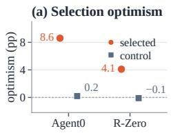

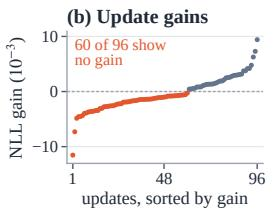

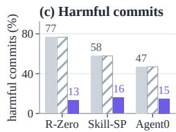

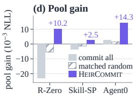  
Figure 4: Selection does not predict learning, and HEIRCOMMIT repairs inheritance. (a) Selected-target optimism, the support a target shows on the responses that selected it minus its support on fresh responses, against fixed-target controls. (b) Correct-target NLL gain of 96 real Skill-SP updates on exact-valid tasks, sorted by gain. (c,d) Harmful share of commits and pool-mean NLL gain over 64 native updates per host. Matched random commits HEIRCOMMIT’s fraction of updates at random. Appendix D gives the full audit.

Theorem 1 (Search–inheritance separation). Conditional on the pre-screening history and frozen native candidates, suppose each screening mean has zero-mean sub-Gaussian error with proxy $\sigma _ { \mathrm { s c r } } ^ { 2 } / m _ { \mathrm { s c r } }$ . For $\beta > 0 ,$ , reusing screeningfor inheritance obeys

$$
\operatorname* { P r } ( \exists k : V _ { k } \leq 0 , \widehat { V } _ { k } ^ { \mathrm { s c r } } > \beta ) \leq K \exp \left( - \frac { m _ { \mathrm { s c r } } \beta ^ { 2 } } { 2 \sigma _ { \mathrm { s c r } } ^ { 2 } } \right) .\tag{6}
$$

Let $\mathcal { F } _ { t } ^ { \mathrm { p r e } }$ contain the archive, exploration, screening, material selection, recipient attempts, verification groups,fixed training trajectories, and completed absorption. Ifconfirmation ofthefixedfinal proposal uses fresh probes with conditionally zero-mean sub-Gaussian error ofproxy $\dot { \sigma _ { \mathrm { c o n } } ^ { 2 } } / \dot { m } _ { \mathrm { c o n } } ,$ then

$$
\operatorname* { P r } ( \widehat { V } ^ { \mathrm { c o n } } ( S _ { t } ^ { + } ) > \beta , V ^ { + } \leq 0 \mid \mathcal { F } _ { t } ^ { \mathrm { p r e } } ) \leq \exp \left( - \frac { m _ { \mathrm { c o n } } \beta ^ { 2 } } { 2 \sigma _ { \mathrm { c o n } } ^ { 2 } } \right) .\tag{7}
$$

Across adaptive rounds, per-round budgets $\delta _ { t }$ with $\textstyle \sum _ { t } \delta _ { t } \leq \delta$ give a simultaneous bound by choosing the corresponding positive margins. The reported zero-threshold gate trades this positive-margin guarantee for greater acceptance sensitivity.

Regret within the realized candidate set is then at most twice the screening error plus the absorption loss, the confirmation error and the margin, and No Recovery has zero absorption loss, as Corollary 1 in Appendix C.3 states.

## 6 EXPERIMENTS

We first test whether task selection predicts learning and whether HEIRCOMMIT repairs inheritance, then evaluate the complete loop on four backbones, and finally measure the value of experience, each component, and the cost of construction.

## 6.1 TASK SELECTION DOES NOT PREDICT LEARNING

Reusing responses both to select a target and to score it inflates the target’s support. Selected-target optimism, the drop from a candidate’s score on its selection responses to its score on fresh responses, is 8.60 pp in Agent0 and 4.10 pp in R-Zero, as Figure 4a shows, while fixed-target controls stay near zero at 0.20 and −0.10 pp. Under fresh responses, 52.2% of Agent0’s and 42.0% of R-Zero’s admitted tasks also leave the native frontier. Even exact-valid tasks need not teach. In Figure 4b, 60 of 96 real Skill-SP updates (62.5%) do not reduce correct-target NLL.

## 6.2 HEIRCOMMIT CUTS HARMFUL COMMITS ON EVERY HOST

A second, coverage-matched audit takes 64 native updates per host and scores them on a pool disjoint from the decision probes. HEIRCOMMIT commits 23–52% of the updates and lowers the harmful share of commits from 47–77% to 13–16% on all three hosts, as Figure 4c shows. Matched random commits the same fraction at random and keeps the native harmful share, so HEIRCOMMIT’s cut is

Table 1: Ten-round self-evolution across four backbones (%). Each average weights its benchmarks equally, and ± is the sample SD of Math Avg. over three seeds. “vs. Agent0” is the relative Math Avg. gain of EVOHEIR (Full) over Agent0. Figure 5 and Appendix E give per-benchmark results.
<table><tr><td></td><td colspan="6">Math Avg. (7 benchmarks) ↑</td><td colspan="5">General Avg. (5 benchmarks) ↑</td></tr><tr><td>Backbone</td><td>Base</td><td>R-Zero</td><td>Agent0</td><td>No Rec.</td><td>EVoHEIR</td><td>vs. Agent0</td><td>Base</td><td>R-Zero</td><td>Agent0</td><td>No Rec.</td><td>EVoHEIR</td></tr><tr><td>Qwen3-4B-Base</td><td>25.81</td><td>28.79 ±0.65</td><td>30.01 ±0.57</td><td>30.29 ±0.40</td><td>31.82 ±0.55</td><td>+6.0%</td><td>27.00</td><td>28.82</td><td>29.51</td><td>29.82</td><td>30.52</td></tr><tr><td>Qwen3-8B-Base</td><td>28.06</td><td>32.65 ±0.65</td><td>34.11 ±0.63</td><td>34.35 ±0.38</td><td>36.51 ±0.67</td><td>+7.0%</td><td>32.34</td><td>33.84</td><td>35.24</td><td>35.75</td><td>36.48</td></tr><tr><td>OLMo-3-7B</td><td>19.92</td><td>21.73 ±0.61</td><td>23.35 ±0.44</td><td>23.50 ±0.56</td><td>24.94±0.48</td><td>+6.8%</td><td>18.05</td><td>18.66</td><td>20.05</td><td>20.34</td><td>21.40</td></tr><tr><td>Gemma-4-E4B-it</td><td>43.77</td><td>45.11 ±0.50</td><td>46.66 ±0.59</td><td>46.53 ±0.42</td><td>47.21 ±0.44</td><td>+1.2%</td><td>38.88</td><td>39.01</td><td>40.37</td><td>40.73</td><td>40.93</td></tr></table>

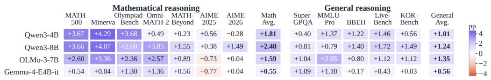  
Figure 5: Per-benchmark gain of EVOHEIR (Full) over Agent0 at round 10 (pp, three-seed means). 45 of 48 cells are positive, and the three negative cells are 30-problem AIME sets.

68–83% relative to it. HEIRCOMMIT also turns negative pool gain positive on R-Zero and Skill-SP and raises Agent0’s gain fivefold in Figure 4d. It retains 78–87% of the useful updates, as Appendix D reports.

## 6.3 EVOHEIR LEADS ON EVERY BACKBONE

After ten rounds, EVOHEIR (Full) has the highest Math Avg. and General Avg. on every backbone of Section 3, as Table 1 shows. It raises the base model’s Math Avg. by 7.9–30.1% and exceeds Agent0, the strongest baseline, by 1.59–2.40 pp (6.0–7.0%) on the three base models. Gemma-4-E4B-it, the only instruction-tuned start, leaves the least headroom, and Full still leads by 0.55 pp.

Across all twelve benchmarks, Full beats Agent0 on 45 of 48 benchmark–backbone pairs in Figure 5, and the three exceptions are 30-problem AIME sets. No Recovery keeps exploration, screening, and confirmation but removes absorption. Full exceeds it on every backbone, which isolates Recovery as a module, and Figure 6 shows Full ending the ten rounds highest on all four backbones.

These are fixed-round comparisons. A Full round takes 8–9 wall-clock hours on two 96-GB GPUs, as Appendix G details, and Section 6.6 compares allocations at equal accounting budget.

## 6.4 EXPERIENCE OUTLIVES ITS MODEL

The study runs 16 donor interventions on four fixed recipients, from rounds 3, 5, 7, and 10, with two current and two archived donors each. Every intervention restarts its recipient and is evaluated on the same 1,024 items before confirmation, and gains are relative to that recipient.

Donor state and experience value diverge. Eight of the ten donors weaker than the current root still improve the recipient, as Figure 7a shows. Their mean donor gain is −1.09 pp, but their mean absorption gain is +0.71 pp.

Recovery learns and retains. From the same 64 references, Cache SFT gains 2.08 pp of new successes but loses 2.61 pp, while Recovery gains 2.54 pp and loses 1.15 pp, for net gains of −0.54 and +1.39 pp in Figure 7b. Recovery beats Cache SFT at all four checkpoints, by 1.93 pp on average, although its own net gain is negative at round 7 (−0.20 pp).

Experience outlives the model that produced it. At a fixed budget of 64 references, current-only material yields +0.39 pp, adding committed-round history +0.73 pp, and admitting all qualified history, including rounds whose model was rejected, +1.39 pp, as Figure 7c shows. A matched replacement then fixes the record count. Three seed groups with four late-round recipients each swap 32 qualified records from non-inherited sources for same-age records from inherited sources. The non-inherited records still add 0.34–0.73 pp at ages one to four, with pointwise 95% bootstrap intervals above zero, as Figure 7d shows. The gain therefore comes from the sources, not from more references.

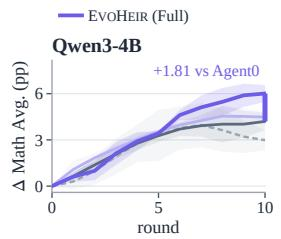

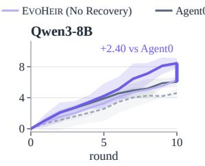

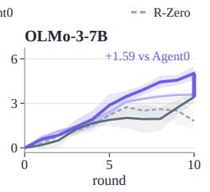

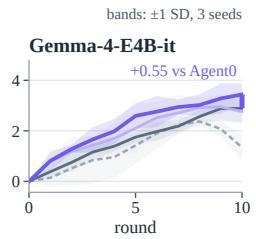

Figure 6: Ten-round Math Avg. trajectories, as change from round 0 (pp). Lines and bands show the mean and ±1 SD over three seeds. The bar at round 10 marks EVOHEIR’s lead over Agent0, and each panel has its own y scale.  
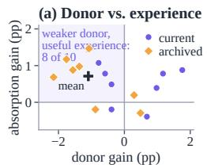

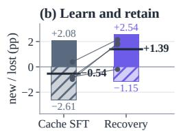

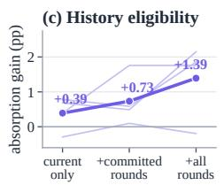

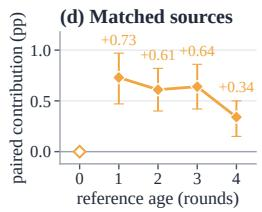  
Figure 7: Experience value under fixed-recipient interventions (pp, 1,024 items each, before confirmation). (a) Donor gain against absorption gain for 16 donors. The shaded quadrant holds weaker donors whose experience helps, and + marks their mean. (b) Mean new (up) and lost (down) successes from the same 64 references, with black bars at the mean net gain and thin lines pairing the two methods at each recipient. (c) Absorption gain as history eligibility widens at a fixed 64-reference budget, with thin lines for the four recipients. (d) Paired contribution of non-inherited over same-age inherited history at 64 records, with pointwise 95% hierarchical bootstrap intervals over three seed groups. Age zero is an identical-material control.

Qualitative analysis. On Qwen3-4B-Base at round 5, the recipient drops the cross term in ${ \sqrt { x + 9 } } = { \sqrt { x } } + 1$ and returns x = 0. A round-4 archived reference from a proposal that was not inherited recovers x = 16, and Recovery reproduces it without the reference. With the same 64 references, Cache SFT changes the correct remainder of 2<sup>100</sup> mod 7 from 2 to 4, while Recovery keeps 2. The fresh-probe confirmation gain is −0.31 pp, so HEIRCOMMIT retains the root (Figure 8).

## 6.5 TARGETED REUSE AND CONFIRMATION BOTH MATTER

Removing any one mechanism from Full lowers both averages, as Table 2 shows. Each ablation keeps the native budget, round count, objective, and absorption cap. Same-Lineage removes cross-lineage sources, Random Experience replaces recipient-conditioned selection with uniform sampling, and Current-Round Only removes history. These three lower Math Avg. by 0.97–1.28 pp and General Avg. by 0.48–0.65 pp. NoConfirm removes independent confirmation and has the largest drops, 2.02 and 1.19 pp. Targeted experience reuse and a final inheritance decision therefore both contribute. All ablations use the Qwen3-4B-Base backbone.

Table 2: Component ablations (%, mean ± SD over three seeds).
<table><tr><td>Variant</td><td>Math Avg. ↑</td><td>General Avg. ↑</td></tr><tr><td>EVoHEIR (Full)</td><td>31.82±0.55</td><td>30.52 ±0.35</td></tr><tr><td>Same-Lineage</td><td>30.77 ±0.57</td><td> $2 9 . 9 9 \pm 0 . 3 5$ </td></tr><tr><td>Random Experience</td><td>30.54±0.44</td><td> $2 9 . 8 7 \pm 0 . 4 3$ </td></tr><tr><td>Current-Round Only</td><td>30.85 ±0.69</td><td> $3 0 . 0 4 \pm 0 . 3 5$ </td></tr><tr><td>NoConfirm</td><td>29.80±1.13</td><td>29.33 ±0.65</td></tr></table>

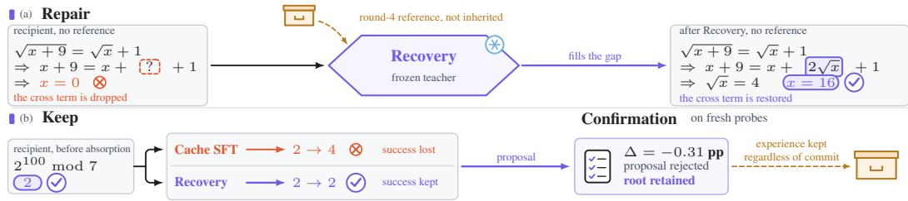

Figure 8: Qualitative analysis on Qwen3-4B-Base at round 5. (a) A round-4 archived reference from a proposal that was not inherited recovers x = 16 after the recipient drops the cross term; Recovery reproduces it without the reference. (b) Under the same 64-reference budget, Recovery keeps the remainder that Cache SFT loses. The fresh-probe gain is −0.31 pp, so HEIRCOMMIT retains the root.  
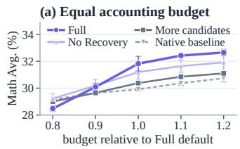

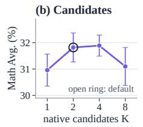

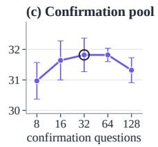

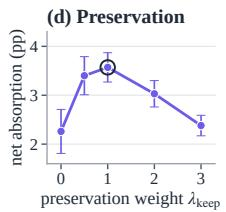  
Figure 9: Equal-budget comparison and sensitivity on Qwen3-4B-Base. (a–c) Math Avg. after ten rounds, mean ± SD over three training seeds. (a) Four methods at equal accounting budgets, relative to Full’s default of 123.7 units. (b,c) Candidate count and confirmation-pool size at budget 1.0, where native training absorbs the remaining budget. Open rings mark the defaults, which reuse the main runs. (d) Net absorption gain of a fixed recipient on 2,400 problems as the preservation weight changes, over three absorption-order seeds. Accounting units are not measured GPU-hours or FLOPs.

## 6.6 EQUAL-BUDGET COMPARISON AND SENSITIVITY

A separate study on Qwen3-4B-Base compares methods at equal cost. A normalized accounting budget charges a single-stream native baseline 100.0 units and Full’s default configuration 123.7 units, a 23.7% overhead spent on screening, recipient attempts, verification, teacher passes, absorption, confirmation, and state export. Every variant is trained separately for ten rounds with three seeds, and native training absorbs the budget that construction leaves.

Full has the lowest mean at 0.8 of its default budget but the highest from 1.0 onward, as Figure 9a shows, so its advantage depends on leaving enough native training after construction and confirmation are paid for. At budget 1.0, four candidates give the largest mean, close to the default of two, and confirmation pools of 32 and 64 questions are also close. The default preservation weight $\lambda _ { \mathrm { k e e p } } = 1$ gives the largest net absorption gain in Figure 9d. Larger settings consume native-training budget and need not improve the final learner.

## 7 CONCLUSION

We identify the selection-to-update gap: admitting a task that looks learnable does not ensure a useful update, and 60 of 96 updates on verified tasks show no gain. HEIRCOMMIT inherits a successor only when it beats the current model on fresh probes and cuts the harmful share of commits by 68–83% on three self-evolution hosts. EVOHEIR separates the parameters a round inherits from the experience it keeps and raises the math average by up to 7.0% over Agent0, the strongest baseline. Self-evolving systems should judge the updates they produce, not only the tasks they choose, and keep experience beyond the models that produced it.

## REFERENCES

Rishabh Agarwal, Nino Vieillard, Yongchao Zhou, Piotr Stanczyk, Sabela Ramos Garea, Matthieu Geist, and Olivier Bachem. On-policy distillation of language models: Learning from selfgenerated mistakes. In B. Kim, Y. Yue, S. Chaudhuri, K. Fragkiadaki, M. Khan, and Y. Sun (eds.), International Conference on Learning Representations, volume 2024, pp. 21246–21263, 2024. URL https://proceedings.iclr.cc/paper\_files/paper/2024/file/ 5be69a584901a26c521c2b51e40a4c20-Paper-Conference.pdf.

Reda Alami, Abdalgader Abubaker, Mastane Achab, Mohamed El Amine Seddik, and Salem Lahlou. Investigating regularization of self-play language models. arXiv preprint arXiv:2404.04291, 2024.

Marthe Ballon, Andres Algaba, Brecht Verbeken, and Vincent Ginis. Benchmarks saturate when the model gets smarter than the judge, 2026. URL https://arxiv.org/abs/2601.19532.

Gavin C Cawley and Nicola LC Talbot. On over-fitting in model selection and subsequent selection bias in performance evaluation. The Journal ofMachine Learning Research, 11:2079–2107, 2010.

Zixiang Chen, Yihe Deng, Huizhuo Yuan, Kaixuan Ji, and Quanquan Gu. Self-play fine-tuning converts weak language models to strong language models. arXiv preprint arXiv:2401.01335, 2024.

Tanmay Gangwani and Jian Peng. Policy optimization by genetic distillation, 2018. URL https: //arxiv.org/abs/1711.01012.

Alex Graves, Marc G. Bellemare, Jacob Menick, Remi Munos, and Koray Kavukcuoglu. Automated´ curriculum learning for neural networks. In International Conference on Machine Learning, 2017.

Zhengyao Gu, Jonathan Light, Raul Astudillo, Ziyu Ye, Langzhou He, Henry Peng Zou, Wei Cheng, Santiago Paternain, Philip S. Yu, and Yisong Yue. Actor-curator: Co-adaptive curriculum learning via policy-improvement bandits for rl post-training, 2026. URL https://arxiv.org/abs 2602.20532.

Chaoqun He, Renjie Luo, Yuzhuo Bai, Shengding Hu, Zhen Leng Thai, Junhao Shen, Jinyi Hu, Xu Han, Yujie Huang, Yuxiang Zhang, Jie Liu, Lei Qi, Zhiyuan Liu, and Maosong Sun. Olympiadbench: A challenging benchmark for promoting agi with olympiad-level bilingual multimodal scientific problems, 2024. URL https://arxiv.org/abs/2402.14008.

Dan Hendrycks, Collin Burns, Saurav Kadavath, Akul Arora, Steven Basart, Eric Tang, Dawn Song, and Jacob Steinhardt. Measuring mathematical problem solving with the math dataset, 2021. URL https://arxiv.org/abs/2103.03874.

Geoffrey Hinton, Oriol Vinyals, and Jeff Dean. Distilling the knowledge in a neural network, 2015. URL https://arxiv.org/abs/1503.02531.

Edward J. Hu, Yelong Shen, Phillip Wallis, Zeyuan Allen-Zhu, Yuanzhi Li, Shean Wang, Lu Wang, and Weizhu Chen. Lora: Low-rank adaptation of large language models, 2021. URL https: //arxiv.org/abs/2106.09685.

Chengsong Huang, Wenhao Yu, Xiaoyang Wang, Hongming Zhang, Zongxia Li, Ruosen Li, Jiaxin Huang, Haitao Mi, and Dong Yu. R-zero: Self-evolving reasoning llm from zero data, 2026a. URL https://arxiv.org/abs/2508.05004.

Siyuan Huang, Pengyu Cheng, Haotian Liu, Tao Chen, Yihao Liu, Jingwei Ni, Shijie Zhou, Ziyi Yang, Gangwei Jiang, Mengyu Zhou, Yu Cheng, Xiaoxi Jiang, and Guanjun Jiang. Skill self-play: Pushing the frontier of llm capability with co-evolving skills, 2026b. URL https://arxiv. org/abs/2607.22529.

Jonas Hubotter, Frederike L¨ ubeck, Lejs Behric, Anton Baumann, Marco Bagatella, Daniel Marta,¨ Ido Hakimi, Idan Shenfeld, Thomas Kleine Buening, Carlos Guestrin, and Andreas Krause. Reinforcement learning via self-distillation, 2026. URL https://arxiv.org/abs/2601. 20802.

Mehran Kazemi, Bahare Fatemi, Hritik Bansal, John Palowitch, Chrysovalantis Anastasiou, Sanket Vaibhav Mehta, Lalit K. Jain, Virginia Aglietti, Disha Jindal, Peter Chen, Nishanth Dikkala, Gladys Tyen, Xin Liu, Uri Shalit, Silvia Chiappa, Kate Olszewska, Yi Tay, Vinh Q. Tran, Quoc V. Le, and Orhan Firat. Big-bench extra hard, 2025. URL https://arxiv.org/abs/2502. 19187.

Zaid Khan, Elias Stengel-Eskin, Jaemin Cho, and Mohit Bansal. Dataenvgym: Data generation agents in teacher environments with student feedback, 2025. URL https://arxiv.org/ abs/2410.06215.

Aitor Lewkowycz, Anders Andreassen, David Dohan, Ethan Dyer, Henryk Michalewski, Vinay Ramasesh, Ambrose Slone, Cem Anil, Imanol Schlag, Theo Gutman-Solo, Yuhuai Wu, Behnam Neyshabur, Guy Gur-Ari, and Vedant Misra. Solving quantitative reasoning problems with language models, 2022. URL https://arxiv.org/abs/2206.14858.

Zhizhong Li and Derek Hoiem. Learning without forgetting, 2017. URL https://arxiv.org/ abs/1606.09282.

Jianzhe Lin. Self-improvement can self-regress: The rise-and-collapse failure mode of LLM selftraining, 2026. URL https://arxiv.org/abs/2606.21090.

Minhua Lin, Juncheng Wu, Zijun Wang, Zhan Shi, Yisi Sang, Bing He, Zewen Liu, Tianxin Wei, Zongyu Wu, Zhiwei Zhang, Dakuo Wang, Xiang Zhang, Benoit Dumoulin, Cihang Xie, Yuyin Zhou, Suhang Wang, and Hanqing Lu. Harness updating is not harness benefit: Disentangling evolution capabilities in self-evolving LLM agents, 2026. URL https://arxiv.org/abs/ 2605.30621.

Ilya Loshchilov and Frank Hutter. Decoupled weight decay regularization, 2019. URL https: //arxiv.org/abs/1711.05101.

Kaijing Ma, Xinrun Du, Yunran Wang, Haoran Zhang, Zhoufutu Wen, Xingwei Qu, Jian Yang, Jiaheng Liu, Minghao Liu, Xiang Yue, Wenhao Huang, and Ge Zhang. Kor-bench: Benchmarking language models on knowledge-orthogonal reasoning tasks, 2025. URL https://arxiv. org/abs/2410.06526.

Javier Mar´ın. Ape: Selective fine-tuning with acceptance criteria for language model adaptation, 2025. URL https://arxiv.org/abs/2505.19912.

Tambet Matiisen, Avital Oliver, Taco Cohen, and John Schulman. Teacher-student curriculum learning. IEEE Transactions on Neural Networks and Learning Systems, 31(9):3732–3740, 2020.

Prasanna Mayilvahanan, Ricardo Dominguez-Olmedo, Thaddaus Wiedemer, and Wieland Brendel.¨ Math-beyond: A benchmark for rl to expand beyond the base model, 2025. URL https: //arxiv.org/abs/2510.11653.

Team Olmo, :, Allyson Ettinger, Amanda Bertsch, Bailey Kuehl, David Graham, David Heineman, Dirk Groeneveld, Faeze Brahman, Finbarr Timbers, Hamish Ivison, Jacob Morrison, Jake Poznan ski, Kyle Lo, Luca Soldaini, Matt Jordan, Mayee Chen, Michael Noukhovitch, Nathan Lambert, Pete Walsh, Pradeep Dasigi, Robert Berry, Saumya Malik, Saurabh Shah, Scott Geng, Shane Arora, Shashank Gupta, Taira Anderson, Teng Xiao, Tyler Murray, Tyler Romero, Victoria Graf, Akari Asai, Akshita Bhagia, Alexander Wettig, Alisa Liu, Aman Rangapur, Chloe Anastasiades, Costa Huang, Dustin Schwenk, Harsh Trivedi, Ian Magnusson, Jaron Lochner, Jiacheng Liu, Lester James V. Miranda, Maarten Sap, Malia Morgan, Michael Schmitz, Michal Guerquin, Michael Wilson, Regan Huff, Ronan Le Bras, Rui Xin, Rulin Shao, Sam Skjonsberg, Shannon Zejiang Shen, Shuyue Stella Li, Tucker Wilde, Valentina Pyatkin, Will Merrill, Yapei Chang, Yuling Gu, Zhiyuan Zeng, Ashish Sabharwal, Luke Zettlemoyer, Pang Wei Koh, Ali Farhadi, Noah A. Smith, and Hannaneh Hajishirzi. Olmo 3, 2026. URL https://arxiv.org/abs/2512.13961.

Shijie Ren, Xiting Wang, Meng Li, Yujie Guo, Yunhang Yao, Ziheng Peng, Xunlong Wang, Yuetan Chen, Haoyang Zhou, Yunlong Liang, and Fandong Meng. Self-improving large language models via progressive experience evolution, 2026. URL https://arxiv.org/abs/2608.02139.

David Rolnick, Arun Ahuja, Jonathan Schwarz, Timothy Lillicrap, and Gregory Wayne. Experience replay for continual learning. Advances in neural information processing systems, 32, 2019.

Daniel Russo and James Zou. Controlling bias in adaptive data analysis using information theory. In Artificial Intelligence and Statistics, pp. 1232–1240. PMLR, 2016.

Biswa Sengupta. Self-evolving agents with anytime-valid certificates, 2026. URL https:// arxiv.org/abs/2607.00871.

Linfang Shang, Ming Xu, Yiding Sun, Tianle Xia, Lingxiang Hu, Lan Xu, and Ning Zheng. When self-evolution backfires: Pre-commit gating against skill contamination in llm agents, 2026. URL https://arxiv.org/abs/2608.05810.

Shuai Shao, Qihan Ren, Chen Qian, Boyi Wei, Dadi Guo, Jingyi Yang, Xinhao Song, Linfeng Zhang, Weinan Zhang, Dongrui Liu, and Jing Shao. Your agent may misevolve: Emergent risks in self-evolving llm agents, 2026. URL https://arxiv.org/abs/2509.26354.

Zayx Shawn. Pace: Anytime-valid acceptance tests for self-evolving agents, 2026. URL https: //arxiv.org/abs/2606.08106.

Idan Shenfeld, Mehul Damani, Jonas Hubotter, and Pulkit Agrawal. Self-distillation enables continual¨ learning, 2026. URL https://arxiv.org/abs/2601.19897.

David Silver, Thomas Hubert, Julian Schrittwieser, Ioannis Antonoglou, Matthew Lai, Arthur Guez, Marc Lanctot, Laurent Sifre, Dharshan Kumaran, Thore Graepel, et al. Mastering chess and shogi by self-play with a general reinforcement learning algorithm. arXiv preprint arXiv:1712.01815, 2017a.

David Silver, Julian Schrittwieser, Karen Simonyan, Ioannis Antonoglou, Aja Huang, Arthur Guez, Thomas Hubert, Lucas Baker, Matthew Lai, Adrian Bolton, et al. Mastering the game of go without human knowledge. nature, 550(7676):354–359, 2017b.

Shobhita Sundaram, John Quan, Ariel Kwiatkowski, Kartik Ahuja, Yann Ollivier, and Julia Kempe. Teaching models to teach themselves: Reasoning at the edge of learnability, 2026. URL https: //arxiv.org/abs/2601.18778.

Gemma Team, Sherif El Abd, Vaibhav Aggarwal, Robin Algayres, Alek Andreev, Olivier Bachem, Ian Ballantyne, Cormac Brick, Victor Carbune, Michelle Casbon, Mayank Chaturvedi, Aditya Chawla,˘ Victor Cotruta, Alice Coucke, Phil Culliton, Robert Dadashi, Lucas Dixon, Mohamed Elhawaty, Utku Evci, Clement Farabet, Johan Ferret, Filippo Galgani, Sertan Girgin, Jean-Bastien Grill,´ Maarten Grootendorst, Jiaxian Guo, Cassidy Hardin, Yanzhang He, Steven M. Hernandez, Omri Homburger, Leonard Hussenot, Juyeong Ji, Armand Joulin, Aishwarya Kamath, Parnian Kassraie,´ Olivier Lacombe, Preethi Lahoti, Gael Liu, Gus Martins, Luciano Martins, Tatiana Matejovicova,¨ Ramona Merhej, Nikola Momchev, Sneha Mondal, Ryan Mullins, Sindhu Raghuram Panyam, Shreya Pathak, Sarah Perrin, Andre Susano Pinto, Etienne Pot, Ang´ eline Pouget, Alexandre Ram´ e,´ Sabela Ramos, Douglas Reid, David Rim, Morgane Riviere, Karsten Roth, Louis Rouillard, Omar\` Sanseviero, Pier Giuseppe Sessa, Shane Settle, Danila Sinopalnikov, Sara Smoot, Piotr Stanczyk, Andreas Steiner, Lawrence Stewart, Ilya Tolstikhin, Michael Tschannen, Anton Tsitsulin, Nino Vieillard, Renjie Wu, Pingmei Xu, Haichuan Yang, Edouard Yvinec, Biao Zhang, Li Zhang, Joe Zou, Nicolas Aagnes, Abdelrahman Abdelhamed, Jakub Adamek, Shivani Agrawal, Shubham Agrawal, Ibrahim Alabdulmohsin, Jean Baptiste Alayrac, Uri Alon, Chandramouli Amarnath, Ankesh Anand, Chrysovalantis Anastasiou, Setareh Ariafar, Franc¸ois-Xavier Aubet, Kyriakos Axiotis, Federico Barbero, Joelle Barral, Alexei Bendebury, Urs Bergmann, Stanley Bileschi, Kat Black, Mathieu Blondel, Sebastian Borgeaud, Arthur Brazinskas, Ryan Burnell, Robert Busa-ˇ Fekete, Mu Cai, Daniele Calandriello, Glenn Cameron, Charlotte Caucheteux, Rahma Chaabouni, Garima Chadha, Jetha Chan, Blake Jianhang Chen, Jesse Chen, Lin Chen, Xu Chen, Derek Cheng, Tzu hsiang Chien, Nikolai Chinaev, Yi Chou, Zhaohui Chu, Benjamin Coleman, Pooja Consul, Sam Conway-Rahman, Scott Crowell, Dylan Cutler, Vivek Dani, Samira Daruki, Anil Das, Daniel Deutsch, Nishanth Dikkala, Li Ding, Qiuhan Ding, Shenil Dodhia, Konstantin Donhauser, Tulsee Doshi, Anca Dragan, Alex Druinsky, Sahil Dua, Zoltan Egyed, Danielle Eisenbud, Daniel Eppens, Cindy Fan, Bahare Fatemi, Yassir Fathullah, Vlad Feinberg, Milen Ferev, Sebastian Flennerhag, Takumi Fujimoto, Joao Gabriel Oliveira, Isaac Galatzer-Levy, Jo˜ ao Gante, Simon˜

Geisler, Soham Ghosal, Antonious M. Girgis, Tamara von Glehn, Alec Go, Alhaad Gokhale, Alex Grills, Yiming Gu, Mayank Gupta, Pramod Gupta, Guru Guruganesh, Raia Hadsell, Hamza Harkous, Jitendra Harlalka, Demis Hassabis, Anja Hauth, Joe Heyward, Arian Hosseini, Chih-Yang Hsia, I-Hung Hsu, Xiaopeng Huang, Yangsibo Huang, Kevin Hui, Adrian Hutter, Te I, Fotis Iliopoulos, Advait Jain, Ganesh Jawahar, Ziwei Ji, Qilin Jin, Melvin Johnson, Kandarp Joshi, Arun Kandoor, Wang-Cheng Kang, Koray Kavukcuoglu, Mehran Kazemi, Kathleen Kenealy, Amr Khalifa, Phoebe Kirk, Ivan Korotkov, Suraj Kothawade, Vitaly Kovalev, Neel Kovelamudi, Adam Kraft, Ravin Kumar, Vivek Kumar, Harish Kuppam, Justin Lannin, Chen-Yu Lee, Seungji Lee, Dmitry Lepikhin, Alon Levkovitch, Dongdong Li, Qiujia Li, Valentin Lievin, Ethan Lin,´ Ziqian Lin, Casper Liu, Tianlin Liu, Tianqi Liu, Xin Liu, Ivan Lobov, Mayank Lunayach, Min Ma, Gagan Madan, Andrii Maksai, Eric Malmi, Michal Matuszak, Daniel McDuff, Gaurav Menghani, Maciej Mikuła, Daniil Mirylenka, Karolis Misiunas, Vedant Misra, Andreea Mitran, Kareem Mohamed, Maksim Mukha, Eric Noland, James O’Donnell, Brendan O’Donoghue, Kate Olszewska, Bernett Orlando, Wanqiong Pan, Rina Panigrahy, Unnati Parekh, Nicolas Perez-Nieves, Chunjong Park, Eric Paskie, Liqian Peng, Bryce Petrini, Slav Petrov, Jonas Pfeiffer, Bilal Piot, Martyna Plomecka, Siim Poder, Octavio Ponce, Arijit Pramanik, David Racz, Anish Rajan, Michelle Ramanovich, Anand Rao, Marvin Ritter, Vitor Rodrigues, Evan Rosen, Mikołaj Rybinski,´ Noveen Sachdeva, Michael E. Sander, Rohit Sathyanarayana, Sagar Savla, Samuel Schmidgall,¨ Tal Schuster, George Scrivener, Benoit Seguin, Andrew Sellergren, Aliaksei Severyn, Izhak Shafran, Dhruv Shah, Bobak Shahriari, Yuan Shangguan, Ashish Shenoy, Pradeep Shenoy, Rakesh Shivanna, Pauline Sho, Lucas Spangher, Wojciech Stokowiec, Tim Strother, Yao Su, Yinghao Sun, Mukund Sundararajan, Andrea Tacchetti, Mor Hazan Taege, Pouya Tafti, Jean Tarbouriech, Chetan Tekur, Shantanu Thakoor, Rahul Thapa, Madeleine Traverse, Lenart Treven, Tao Tu, Chien Te Tung, C¸ aglar˘ Unl<sup>¨</sup> u, Petar Veli¨ ckoviˇ c, Malini Pooni Venkat, Sagar Gubbi Venkatesh,´ Vidya Venkiteswaran, Francesco Visin, Alex Vitvitskyi, Kiran Vodrahalli, Weiyi Wang, Xin Wang, Tris Warkentin, Jan Wassenberg, John Wieting, Cindy Wu, Lechao Xiao, Hao Xu, Yuhui Xu, Fuzhao Xue, Arun Yadav, Jun Yan, Antoine Yang, Lin Yang, Ming-Hsuan Yang, Ziyu Ying, Jae Hyeon Yoo, Morteza Zadimoghaddam, Sajjad Zafar, Fred Zhang, Jiageng Zhang, Jianyi Zhang, Xiaofan Zhang, Chao Zhao, David Zhou, and Chen Zou. Gemma 4 technical report, 2026. URL https://arxiv.org/abs/2607.02770.

P Team, Xinrun Du, Yifan Yao, Kaijing Ma, Bingli Wang, Tianyu Zheng, King Zhu, Minghao Liu, Yiming Liang, Xiaolong Jin, Zhenlin Wei, Chujie Zheng, Kaixin Deng, Shawn Gavin, Shian Jia, Sichao Jiang, Yiyan Liao, Rui Li, Qinrui Li, Sirun Li, Yizhi Li, Yunwen Li, David Ma, Yuansheng Ni, Haoran Que, Qiyao Wang, Zhoufutu Wen, Siwei Wu, Tyshawn Hsing, Ming Xu, Zhenzhu Yang, Zekun Moore Wang, Junting Zhou, Yuelin Bai, Xingyuan Bu, Chenglin Cai, Liang Chen, Yifan Chen, Chengtuo Cheng, Tianhao Cheng, Keyi Ding, Siming Huang, Yun Huang, Yaoru Li, Yizhe Li, Zhaoqun Li, Tianhao Liang, Chengdong Lin, Hongquan Lin, Yinghao Ma, Tianyang Pang, Zhongyuan Peng, Zifan Peng, Qige Qi, Shi Qiu, Xingwei Qu, Shanghaoran Quan, Yizhou Tan, Zili Wang, Chenqing Wang, Hao Wang, Yiya Wang, Yubo Wang, Jiajun Xu, Kexin Yang, Ruibin Yuan, Yuanhao Yue, Tianyang Zhan, Chun Zhang, Jinyang Zhang, Xiyue Zhang, Xingjian Zhang, Yue Zhang, Yongchi Zhao, Xiangyu Zheng, Chenghua Zhong, Yang Gao, Zhoujun Li, Dayiheng Liu, Qian Liu, Tianyu Liu, Shiwen Ni, Junran Peng, Yujia Qin, Wenbo Su, Guoyin Wang, Shi Wang, Jian Yang, Min Yang, Meng Cao, Xiang Yue, Zhaoxiang Zhang, Wangchunshu Zhou, Jiaheng Liu, Qunshu Lin, Wenhao Huang, and Ge Zhang. Supergpqa: Scaling llm evaluation across 285 graduate disciplines, 2025. URL https://arxiv.org/abs/2502.14739.

Yizhong Wang, Yeganeh Kordi, Swaroop Mishra, Alisa Liu, Noah A Smith, Daniel Khashabi, and Hannaneh Hajishirzi. Self-instruct: Aligning language models with self-generated instructions. In Proceedings ofthe 61st annual meeting ofthe associationfor computational linguistics (volume 1: long papers), pp. 13484–13508, 2023.

Yubo Wang, Xueguang Ma, Ge Zhang, Yuansheng Ni, Abhranil Chandra, Shiguang Guo, Weiming Ren, Aaran Arulraj, Xuan He, Ziyan Jiang, Tianle Li, Max Ku, Kai Wang, Alex Zhuang, Rongqi Fan, Xiang Yue, and Wenhu Chen. Mmlu-pro: A more robust and challenging multi-task language understanding benchmark, 2024. URL https://arxiv.org/abs/2406.01574.

Colin White, Samuel Dooley, Manley Roberts, Arka Pal, Ben Feuer, Siddhartha Jain, Ravid Shwartz-Ziv, Neel Jain, Khalid Saifullah, Sreemanti Dey, Shubh-Agrawal, Sandeep Singh Sandha, Siddartha Naidu, Chinmay Hegde, Yann LeCun, Tom Goldstein, Willie Neiswanger, and Micah Goldblum.

Livebench: A challenging, contamination-limited llm benchmark, 2025. URL https://arxiv. org/abs/2406.19314.

Lucas Willems, Salem Lahlou, and Yoshua Bengio. Mastering rate based curriculum learning. arXiv preprint arXiv:2008.06456, 2020.

Peng Xia, Kaide Zeng, Jiaqi Liu, Can Qin, Fang Wu, Yiyang Zhou, Caiming Xiong, and Huaxiu Yao. Agent0: Unleashing self-evolving agents from zero data via tool-integrated reasoning, 2026. URL https://arxiv.org/abs/2511.16043.

An Yang, Anfeng Li, Baosong Yang, Beichen Zhang, Binyuan Hui, Bo Zheng, Bowen Yu, Chang Gao, Chengen Huang, Chenxu Lv, Chujie Zheng, Dayiheng Liu, Fan Zhou, Fei Huang, Feng Hu, Hao Ge, Haoran Wei, Huan Lin, Jialong Tang, Jian Yang, Jianhong Tu, Jianwei Zhang, Jianxin Yang, Jiaxi Yang, Jing Zhou, Jingren Zhou, Junyang Lin, Kai Dang, Keqin Bao, Kexin Yang, Le Yu, Lianghao Deng, Mei Li, Mingfeng Xue, Mingze Li, Pei Zhang, Peng Wang, Qin Zhu, Rui Men, Ruize Gao, Shixuan Liu, Shuang Luo, Tianhao Li, Tianyi Tang, Wenbiao Yin, Xingzhang Ren, Xinyu Wang, Xinyu Zhang, Xuancheng Ren, Yang Fan, Yang Su, Yichang Zhang, Yinger Zhang, Yu Wan, Yuqiong Liu, Zekun Wang, Zeyu Cui, Zhenru Zhang, Zhipeng Zhou, and Zihan Qiu. Qwen3 technical report, 2025. URL https://arxiv.org/abs/2505.09388.

Ziyi Yang, Weizhou Shen, Chenliang Li, Ruijun Chen, Fanqi Wan, Ming Yan, Xiaojun Quan, and Fei Huang. Spell: Self-play reinforcement learning for evolving long-context language models, 2026. URL https://arxiv.org/abs/2509.23863.

Tianzhu Ye, Li Dong, Qingxiu Dong, Xun Wu, Shaohan Huang, and Furu Wei. Online experiential learning for language models, 2026a. URL https://arxiv.org/abs/2603.16856.

Tianzhu Ye, Li Dong, Xun Wu, Shaohan Huang, and Furu Wei. On-policy context distillation for language models, 2026b. URL https://arxiv.org/abs/2602.12275.

Eric Zelikman, Yuhuai Wu, Jesse Mu, and Noah Goodman. Star: Bootstrapping reasoning with reasoning. Advances in Neural Information Processing Systems, 35:15476–15488, 2022.

Andrew Zhao, Yiran Wu, Yang Yue, Tong Wu, Quentin Xu, Yang Yue, Matthieu Lin, Shenzhi Wang, Qingyun Wu, Zilong Zheng, and Gao Huang. Absolute zero: Reinforced self-play reasoning with zero data, 2025. URL https://arxiv.org/abs/2505.03335.

Siyan Zhao, Zhihui Xie, Mengchen Liu, Jing Huang, Guan Pang, Feiyu Chen, and Aditya Grover. Self-distilled reasoner: On-policy self-distillation for large language models. arXiv preprint arXiv:2601.18734, 2026.

## APPENDIX

## A EXPERIMENTAL SETUP AND HYPERPARAMETERS

Backbones and protocol. The checkpoints are Qwen/Qwen3-4B-Base, Qwen/Qwen3-8B-Base, allenai/Olmo-3-1025-7B, and google/gemma-4-E4B-it. The two Qwen checkpoints and OLMo are pretrained base models; Gemma is instruction-tuned. Every backbone and method runs ten evolution rounds with three training seeds, with evaluation after every round. The evaluated checkpoint is the learner actually inherited at that round, $S _ { t + 1 }$ , including rounds that retain $S _ { t } .$ . In the host-system HEIRCOMMIT studies, Skill-SP, R-Zero, and Agent0 supply native updates and an integration adapter governs inheritance.

Native exploration and screening. Each round makes 1,024 task-generation attempts in one batch and uses ten learner responses per question for native admission. Two isolated native branches are then trained from the same root, each on a cohort of 64 questions, with the recipe in Table 3. Native training updates all parameters of the Curriculum Scout and Evolving Learner with AdamW (Loshchilov & Hutter, 2019), and Recovery updates LoRA parameters (Hu et al., 2021). Screening scores the root and the two branch endpoints on 16 questions from $P _ { t } ^ { \mathrm { s c r } }$ , and confirmation scores the final proposal on 32 fresh questions from $P _ { t } ^ { \mathrm { c o n } }$ , with four responses per question and state. Screening ties favor the root, then the branches in a fixed order.

Table 3: Optimization settings for EVOHEIR (Full). Native learner settings are per branch. Batch sizes distinguish prompt groups from individual responses.
<table><tr><td>Setting</td><td>Curriculum Scout</td><td>Evolving Learner (native training)</td><td>Evolving Learner (Recovery)</td></tr><tr><td>Trainable parameters</td><td>Full model</td><td>Full model</td><td>LoRA</td></tr><tr><td>Optimizer</td><td>AdamW</td><td>AdamW</td><td>AdamW</td></tr><tr><td>Learning rate</td><td>10−6</td><td>10⁻⁶</td><td> $5 \times { 1 0 } ^ { - 5 }$ </td></tr><tr><td>Weight decay</td><td>0.01</td><td>0.01</td><td>0</td></tr><tr><td>Per-round optimization budget</td><td>5 calls</td><td>15 calls</td><td>≤ 16 updates</td></tr><tr><td>Questions per batch</td><td>16</td><td>8</td><td> $\leq 4$ </td></tr><tr><td>Responses per question</td><td>5</td><td>5</td><td>1 fixed response</td></tr><tr><td>Effective batch (responses)</td><td>80</td><td>40</td><td> $\leq 4$ </td></tr><tr><td>Per-device microbatch (responses)</td><td>1</td><td>1</td><td>1</td></tr><tr><td>GPUs per stage</td><td>1</td><td>1</td><td>1</td></tr><tr><td>LoRA rank / scaling α</td><td>N/A</td><td>N/A</td><td>8 / 16</td></tr><tr><td>LoRA target projections</td><td>N/A</td><td>N/A</td><td>q-proj, v-proj</td></tr></table>

The native scheduler uses zero learning rate on its first optimizer call and $1 0 ^ { - 6 }$ thereafter. Native budgets count optimizer calls, including this initial call, rather than nonzero parameter updates.

Consensus labels and probe qualification. The round-start Evolving Learner $S _ { t }$ generates ten admission responses per question using the settings in Appendix A. In the first round, $\bar { S _ { t } }$ is the initial checkpoint; subsequent rounds use the actually inherited learner. The answer comparator clusters successfully extracted, nonempty answers. If $m _ { \mathrm { v a l i d } }$ responses yield such answers and the largest cluster contains $c _ { \mathrm { m a x } }$ responses, consensus support is $c _ { \operatorname* { m a x } } / m _ { \mathrm { v a l i d } }$ . Questions with $m _ { \mathrm { v a l i d } } = 0$ are excluded. The representative answer of the largest cluster becomes the pseudo-label; probes require support at least 0.7. Ties select the first encountered largest cluster, but tied maxima have support at most 0.5 and cannot qualify as probes. Each role’s question–label file is frozen and shared across all states evaluated on that role’s pool. Confirmation questions and labels are fixed before candidate construction and excluded from native training, screening, and Recovery. Screening and confirmation use fresh scoring responses, seeds, and caches, separate from the admission responses that form the labels. HEIRCOMMIT adopts $S _ { t } ^ { + }$ only when its confirmation gain is strictly positive, that is, $\tau _ { t } = 0$ in Eq. 5.

Generation settings. The Curriculum Scout’s native rollouts use temperature 1.0, top- ${ \cdot } p = 0 . 9 9$ and five responses per question, and offline candidate generation uses temperature 1.0 and top-$p = 0 . 9 5$ . Learner generation is capped at 4,096 response tokens with top-k filtering disabled unless stated otherwise. Native learner training samples five responses at temperature 1.0 and top- $- p = 0 . 9 9$

Algorithm 1 EVOHEIR at round t   
Require: root $S _ { t } ,$ controller $A _ { t }$ , archive $\overline { { { M } _ { t } } } ,$ budget, fresh probe pools   
1: $b _ { 1 : J }  \mathrm { S C O U T } ( S _ { t } , A _ { t } )$   
2: $\mathcal { C } _ { t } ^ { \mathrm { n a t } } , E _ { t } \gets \mathrm { N A T I V E E X P L O R E } ( S _ { t } , b _ { 1 : J } )$ ▷ isolated states and train-role responses   
3: Freeze $\dot { \mathcal { C } } _ { t } ^ { \mathrm { n a t } } \cup \{ S _ { t } \}$   
4: $S _ { t . } ^ { \mathrm { s e l } } \gets \bar { \mathrm { S C R E E N } } ( \bar { S } _ { t } , \mathcal { C } _ { t } ^ { \mathrm { n a t } } , P _ { t } ^ { \mathrm { s c r } } )$   
5: ${ \dot { S _ { t } ^ { + } } } \gets S _ { t } ^ { \mathrm { s e l } }$   
6: if Recovery is enabled then   
7: $D _ { t } \gets \mathsf { \bar { Q } U A L I F Y M A T E R I A L } ( E _ { t } , \boldsymbol { \ M _ { t } } )$   
8: $Y _ { t } \gets \mathrm { R E C I P I E N T A T T E M P T S } ( S _ { t } ^ { \mathrm { s e l } } , D _ { t } )$ ▷ exact-checkpoint reuse or one rollout batch   
9: $D _ { t } ^ { \mathrm { r e p a i r } } , D _ { t } ^ { \mathrm { k e e p } } \gets \mathsf { V E R I F Y A N D G R O U P } ( D _ { t } , Y _ { t } )$   
10: Select from both groups within the predeclared absorption budget   
11: Freeze recipient teacher, trajectories, and verification groups   
12: $S _ { t } ^ { + } \gets \mathrm { A B S O R B } \big ( S _ { t } ^ { \mathrm { s e l } } , D _ { t } ^ { \mathrm { r e p a i r } } , D _ { t } ^ { \mathrm { k e e p } } \big )$ ▷ identity if no eligible experience   
13: end if   
14: Freeze $S _ { t } ^ { + }$   
15: $v \gets \mathrm { P A I R E D G A I N } ( S _ { t } , S _ { t } ^ { + } , P _ { t } ^ { \mathrm { c o n } } )$ ▷ zero for an identical state   
16: $S _ { t + 1 } \gets S _ { t } ^ { + } \operatorname { i f } v > \tau _ { t } ,$ , otherwise $S _ { t }$   
17: $M _ { t + 1 } \gets \Psi \mathrm { P D A T E A R C H I V E } ( M _ { t } , E _ { t } )$ ▷ qualified train-role records, regardless of commit   
18: $\boldsymbol { A } _ { t + 1 }  \operatorname { O B S E R V E } ( \boldsymbol { A } _ { t } , \operatorname { s o u r c e } ( S _ { t } ^ { \mathrm { s e l } } ) , \boldsymbol { v } )$   
19: Freeze $S _ { t + 1 }$ before sealed-final evaluation; return $S _ { t + 1 }$

Native admission uses ten responses at temperature 1.0, top-p = 1, and $\mathrm { t o p } { - } k = 4 0$ . Screening and confirmation use four responses at temperature 0.7 and t $\mathrm { o p } { - } p = 0 . 9 5$ , and recipient attempts use one greedy response. Appendix E gives the benchmark decoding and metrics.

## B DETAILED METHOD AND IMPLEMENTATION

## B.1 STATE CONSTRUCTION AND RECIPIENT SELECTION

The resumable learner $S _ { t } ~ = ~ ( \theta _ { t } , \omega _ { t } )$ holds the model parameters and the mutable training state, including optimizer moments, the learning-rate scheduler, and random generators. The Evolution Controller runs each admitted cohort in an isolated copy of the same root, and each branch follows the host’s training objective. The controller freezes the candidate set $\mathcal { C } _ { t } ^ { \mathrm { n a t } } \cup \{ S _ { t } \}$ before screening, selects the recipient by paired root-relative gain on $P _ { t } ^ { \mathrm { s c r } }$ , and breaks ties in favor of the root, followed by a fixed branch order. Algorithm 1 lists one round.

## B.2 RECIPIENT-CONDITIONED RECOVERY

Recovery adapts distillation (Hinton et al., 2015) and Learning without Forgetting (Li & Hoiem, 2017) to recipient-specific failures and successes. Current records $E _ { t }$ and archived records $M _ { t }$ supply problems and qualified references, each with its generating checkpoint, round, and verification trace. A cached recipient attempt is reused only at the exact selected checkpoint. The same answerequivalence rule verifies the attempt and its reference, and membership in $D _ { t } ^ { \mathrm { r e p a i r } }$ or $D _ { t } ^ { \mathrm { k e e p } }$ is decided for the current recipient, even when the reference comes from an earlier round. The frozen teacher and the student both start from $\theta _ { t } ^ { \mathrm { s e l } }$ and predict at the same fixed recipient prefixes throughout absorption, as in Eq. 4, so the procedure does not resample from the changing student.

## B.3 ARCHIVE, FEEDBACK, AND STATE INHERITANCE

HEIRCOMMIT freezes $S _ { t } ^ { + }$ before scoring it against the original root on the fixed confirmation pool with the same probes and frozen labels (Appendix A). It commits the complete proposal when the paired gain exceeds $\tau _ { t }$ , with $\tau _ { t } = 0$ in the empirical mode, and otherwise restores the complete root state. Each round confirms one final proposal, and later rounds receive fresh evidence. Archive updates follow a separate path in Algorithm 1: qualified current records are considered for admission regardless of the commit outcome, so a round that retains the root still contributes references to later rounds. The controller records the signed confirmation value with recipient and experience provenance, and subsequent curricula follow the host’s feedback rule, shared by Full and No Recovery.

Failure modes and safeguards. An incomplete or conflicting reference is excluded before training, a duplicate normalized problem occupies one archive slot, and a cached attempt is reused only from the exact selected checkpoint. A flawed reference that passes the verifier can still steer the repair teacher, so repair depends on verification quality. Absorption can also lose successes, as the round-7 net gain of −0.20 pp in Figure 7 shows. With the empirical zero threshold, sampling noise can admit a harmful proposal; the positive-margin mode of Theorem 1 bounds that risk.

## B.4 IMPLEMENTATION CONFIGURATION

Appendix A and Table 3 give the EVOHEIR (Full) recipe. The remaining implementation details are as follows.

## Response-token aggregation.

Response loss is computed only on recorded response tokens; prompt tokens are masked out. If an EOS token is present in the recorded response, it is included in the loss. Truncated responses contribute their available response prefix without synthesizing a missing EOS token. Token-level forward KL over the full vocabulary is averaged within each response, then over questions, so repair and keep examples have equal per-question weight.

## Absorption and optimizer state.

Recovery uses AdamW with learning rate $5 \times 1 0 ^ { - 5 } , ( \beta _ { 1 } , \beta _ { 2 } ) = ( 0 . 9 , 0 . 9 9 9 )$ , epsilon $1 0 ^ { - 8 }$ , zero weight decay, gradient clipping at 1.0, and LoRA dropout 0. The adapter has rank 8, scaling $\alpha = 1 6$ and targets $\mathtt { q \mathrm { - } p r o \dot { ] } }$ and $\mathtt { v \_ p r o j } ;$ absorption uses at most 16 updates. After absorption, the adapter is merged into the recipient and the merged weights are reloaded and checked for exact consistency. If the absorbed model is accepted, it becomes the next native root and the native optimizer and scheduler are reinitialized; Recovery optimizer state is not carried into native training. If the proposal is rejected, the original root is retained with its parameters, optimizer moments, scheduler, and random state unchanged. At the next round’s native-stage boundary, the native optimizer and scheduler are reinitialized for whichever model was inherited. Rollback restores the root snapshot; it does not carry Recovery moments into a later stage.

## Archive policy.

The archive stores at most 256 qualified training records, deduplicated by normalized problem identity. Conflicting labels, verification conflicts, known reasoning errors, incomplete responses, and non-training records are excluded. When capacity is exceeded, records are selected deterministically using round/source-stratified round-robin admission, with stable hash ordering within each group.

## Recovery budget.

Each round nominates up to 32 exploration records and 32 learner-success records, and recipient attempts reuse exact-checkpoint cached responses or use one additional response within a 64- generation budget. Recovery makes a single pass with at most 16 optimizer updates, capped at 131,072 response loss tokens and 262,144 combined teacher and student forward tokens. An empty usable pool leaves $S _ { t } ^ { \mathrm { s e l } }$ unchanged.

## C THEORETICAL ANALYSIS AND PROOFS

## C.1 SETUP AND TASK-SIDE NON-IDENTIFIABILITY

Fix a round and index the frozen native candidates by $1 , \ldots , K$ , with index 0 denoting root. Write $V _ { 0 } = 0 , \widehat { V } _ { k } ^ { \mathrm { s c r } } = V _ { k } + \varepsilon _ { k } , \varepsilon _ { 0 } = 0$ , and $k ^ { * } = \arg$ ma ${ \bf { x } } _ { 0 \leq k \leq K } \widehat { V } _ { k } ^ { \mathrm { { s c 1 } } }$ <sup>r</sup>, using the tie rule in Appendix B.1. The completed proposal has value $V ^ { + } = V _ { t } ( S _ { t } ^ { + } )$ .

For screening, $\mathcal { G } _ { t }$ denotes the history before screening, including root, the declared distribution $P _ { t }$ , and the frozen native candidates. For confirmation, $\mathcal { F } _ { t } ^ { \mathrm { p r e } }$ contains the full construction history, including the archive, screening, recipient attempts, material selection, verification groups, and completed absorption. Thus $S _ { t } ^ { + }$ and $V ^ { \bar { + } }$ are fixed conditional on $\mathcal { F } _ { t } ^ { \mathrm { p r } \epsilon }$ . The task-side observation $O _ { t }$ in Proposition 1 is the pre-update behavioral interface defined in Section 3.

ProofofProposition 1. Fix a native step size $\eta > 0$ and a value gap $\Delta > 0$ . At root $\theta = 0$ , consider two learning worlds with local training losses and a common probe loss

$$
\ell _ { + } ( \theta ) = c + \theta , \qquad \ell _ { - } ( \theta ) = c - \theta , \qquad \ell _ { p } ( \theta ) = c _ { p } + \frac { \Delta } { \eta } \theta .\tag{C.1}
$$

The worlds share the stipulated root behavior, target validity, and root loss values. Their training gradients are +1 and −1, respectively, and are outside $O _ { t }$ . One gradient step reaches $- \eta \mathrm { o r } + \eta$ . For $q = - \ell _ { p }$ , the root-relative values are therefore $+ \Delta$ and $- \Delta$ . Positive smooth losses on the whole real line can be obtained by multiplying each linear term by a smooth cutoff in [0, 1], equal to one on $[ - \eta , \eta ]$ and zero outside $[ - 2 \eta , 2 \eta ]$ , choosing c > 2η and $c _ { p } > 2 \Delta$ . This preserves the root gradients and both post-update probe values.

An observation-based rule uses the same commit probability $p$ in both worlds. Against the better of root and the native update, its expected regrets are $( 1 - p ) \Delta$ and $p \Delta$ . Their maximum is at least their average, $\Delta / 2$ □

## C.2 SELECTED-FUTURE OPTIMISM AND INDEPENDENT CONFIRMATION

Proposition 2 (Selected-future optimism). Condition on the frozen native candidates and root. If $\widehat { V } _ { k } ^ { \mathrm { s c r } } = V _ { k } + \varepsilon _ { k }$ with $\mathbb { E } [ \varepsilon _ { k } ] = 0 .$ for each $k ,$ then the screen winner satisfies $\mathbb { E } [ \widehat { V } _ { k ^ { * } } ^ { \mathrm { s c r } } - V _ { k ^ { * } } ] \geq 0 .$

ProofofProposition 2. Condition on $\mathcal { G } _ { t }$ and assume $\mathbb { E } [ \varepsilon _ { k } \mid { \mathcal { G } } _ { t } ] = 0$ for each fixed candidate. The maximum is convex, so

$$
\begin{array} { r } { \mathbb { E } [ \widehat { V } _ { k ^ { * } } ^ { \mathrm { s c r } } \mid \mathcal { G } _ { t } ] = \mathbb { E } \Big [ \underset { 0 \leq k \leq K } { \operatorname* { m a x } } ( V _ { k } + \varepsilon _ { k } ) \mid \mathcal { G } _ { t } \Big ] } \\ { \geq \underset { 0 \leq k \leq K } { \operatorname* { m a x } } V _ { k } \geq \mathbb { E } [ V _ { k ^ { * } } \mid \mathcal { G } _ { t } ] . } \end{array}\tag{C.2}
$$

Subtracting the last expectation gives nonnegative expected optimism. The argument uses conditional centering of each error and allows correlations induced by shared probes. □

Proof of Theorem 1. A conditionally centered sub-Gaussian error X with proxy $s ^ { 2 } > 0$ satisfies $\mathbb { E } [ e ^ { \hat { u } \hat { X } } \mid \mathcal { H } ] \le e ^ { u ^ { 2 } s ^ { 2 } / 2 }$ . For $a > 0$ , exponential Markov inequality and optimization over u $> 0$ give

$$
\operatorname* { P r } ( X > a \mid \mathcal { H } ) \leq \operatorname* { i n f } _ { u > 0 } \exp \left( - u a + \frac { u ^ { 2 } s ^ { 2 } } { 2 } \right) = \exp \left( - \frac { a ^ { 2 } } { 2 s ^ { 2 } } \right) .\tag{C.3}
$$

For a candidate with $V _ { k } ~ \leq ~ 0$ , the event $\widehat V _ { k } ^ { \mathrm { s c r } } > \beta$ implies $\varepsilon _ { k } \ > \ \beta$ . Applying Eq. C.3 with $s ^ { 2 } = \sigma _ { \mathrm { s c r } } ^ { 2 } / m _ { \mathrm { s c r } }$ and taking a union bound over the K non-root candidates yields

$$
\operatorname* { P r } \left( \exists k \in \{ 1 , \dots , K \} : V _ { k } \leq 0 , \widehat { V } _ { k } ^ { \mathrm { s c r } } > \beta | \mathcal { G } _ { t } \right) \leq K \exp \left( - \frac { m _ { \mathrm { s c r } } \beta ^ { 2 } } { 2 \sigma _ { \mathrm { s c r } } ^ { 2 } } \right) .\tag{C.4}
$$

Root contributes no event because its screening score is exactly zero. The union bound also applies when candidate errors are correlated.

For confirmation, condition instead on $\mathcal { F } _ { t } ^ { \mathrm { p r e } }$ , after the proposal has been completed. Define $\xi _ { t } =$ $\widehat { V } _ { t } ^ { \mathrm { c o n } } ( S _ { t } ^ { + } ) - V ^ { + }$ and assume its conditional sub-Gaussian proxy is $\sigma _ { \mathrm { c o n } } ^ { 2 } / m _ { \mathrm { c o n } }$ , as in the theorem. On $\{ V ^ { + } \leq 0 \}$ , acceptance above $\beta$ implies $\xi _ { t } > \beta$ . Thus

$$
\operatorname* { P r } \left( \widehat { V } _ { t } ^ { \mathrm { c o n } } ( S _ { t } ^ { + } ) > \beta , V ^ { + } \leq 0 \mid \mathcal { F } _ { t } ^ { \mathrm { p r e } } \right) \leq \exp \left( - \frac { m _ { \mathrm { c o n } } \beta ^ { 2 } } { 2 \sigma _ { \mathrm { c o n } } ^ { 2 } } \right) .\tag{C.5}
$$

This tail bound concerns the single proposal fixed before confirmation. All selection and absorption decisions are included in the conditioning history. □

For a prescribed round-level error budget $\delta _ { t } \in ( 0 , 1 )$ , a sufficient certified threshold is

$$
\tau _ { t } = \sigma _ { \mathrm { c o n } } \sqrt { \frac { 2 \log ( 1 / \delta _ { t } ) } { m _ { \mathrm { c o n } } } } .\tag{C.6}
$$

The threshold and its calibration are fixed before confirmation scoring. The empirical mode uses $\tau _ { t } = 0$ , for which the exponential bound is one, while Eq. C.6 gives the $\delta _ { t }$ -level bound.

For conditionally independent paired observations $X _ { i } ~ = ~ q ( S _ { t } ^ { + } ; z _ { i } ) - q ( S _ { t } ; z _ { i } ) ~ \in ~ [ - 1 , 1 ]$ with conditional mean $V ^ { + }$ , Hoeffding’s lemma gives proxy $1 / m _ { \mathrm { c o n } }$ for their mean, so $\sigma _ { \mathrm { c o n } } ^ { 2 } = 1$ is valid for exact correctness and consensus matching. Raw negative-NLL utility needs a separate tail assumption.

## C.3 REGRET DECOMPOSITION AND ADAPTIVE ROUNDS

Corollary 1 (Regret within the realized candidate set). Ifall native screening errors are at most $\epsilon _ { \mathrm { s c r } }$ in absolute value and the final proposal’s confirmation error is at most $\epsilon _ { \mathrm { c o n } } ,$ , define the absorption loss $d _ { \mathrm { r e c } } = [ V _ { k ^ { * } } - V ^ { + } ] _ { + }$ . HEIRCOMMIT with $\tau \geq 0$ satisfies

$$
R _ { t } \leq 2 \epsilon _ { \mathrm { s c r } } + d _ { \mathrm { r e c } } + \epsilon _ { \mathrm { c o n } } + \tau .\tag{C.7}
$$

Proof of Corollary $I .$ Assume the screening errors satisfy $| \varepsilon _ { k } | \le \epsilon _ { \mathrm { s c r } }$ and the final confirmation error satisfies $| \xi _ { t } | \le \epsilon _ { \mathrm { c o n } }$ . Let $\bar { k } \in$ arg max<sub>0≤k≤K</sub> $V _ { k }$ , and define $d _ { \mathrm { r e c } } = [ V _ { k ^ { * } } - V ^ { + } ] _ { + }$ . Screening optimality gives

$$
\begin{array} { r l } & { V _ { \bar { k } } \leq \widehat { V } _ { \bar { k } } ^ { \mathrm { s c r } } + \epsilon _ { \mathrm { s c r } } \leq \widehat { V } _ { k ^ { * } } ^ { \mathrm { s c r } } + \epsilon _ { \mathrm { s c r } } } \\ & { \quad \leq V _ { k ^ { * } } + 2 \epsilon _ { \mathrm { s c r } } \leq V ^ { + } + d _ { \mathrm { r e c } } + 2 \epsilon _ { \mathrm { s c r } } . } \end{array}\tag{C.8}
$$

The last expression also bounds $V ^ { + }$ because $d _ { \mathrm { r e c } } , \epsilon _ { \mathrm { s c r } } \geq 0$ . Hence it bounds the best value $V _ { \mathrm { m a x } } =$ max $\{ V _ { 0 } , \ldots , V _ { K } , V ^ { + } \}$ among all constructed states.

If the proposal is accepted, inheritance has value $V ^ { + }$ and regret is at most $d _ { \mathrm { r e c } } + 2 \epsilon _ { \mathrm { s c r } }$ . If it is rejected, inheritance has value zero and $\widehat { V } _ { t } ^ { \mathrm { c o n } } ( S _ { t } ^ { + } ) \leq \tau$ , implying $V ^ { + } \leq \tau + \epsilon _ { \mathrm { c o n } }$ . For $\tau \geq 0$ , both cases give

$$
R _ { t } \leq 2 \epsilon _ { \mathrm { s c r } } + d _ { \mathrm { r e c } } + \epsilon _ { \mathrm { c o n } } + \tau .\tag{C.9}
$$

The absorption term measures decreases from recipient to proposal. It is zero for No Recovery and whenever absorption has nonnegative recipient-relative gain.

Across rounds, let $E _ { t } ^ { \mathrm { b a d } }$ denote accepting a proposal with $V _ { t } ( S _ { t } ^ { + } ) \leq 0$ . For $\delta \in ( 0 , 1 )$ , choose prescribed positive budgets satisfying $\sum _ { t } \bar { \delta } _ { t } \overset { - } { \leq } \delta$ . Applying the conditional confirmation bound in each round, then taking expectations and a union bound, gives

$$
\operatorname* { P r } \left( \bigcup _ { t } E _ { t } ^ { \mathrm { b a d } } \right) \leq \sum _ { t } \mathbb { E } \left[ \operatorname* { P r } ( E _ { t } ^ { \mathrm { b a d } } \mid \mathcal { F } _ { t } ^ { \mathrm { p r e } } ) \right] \leq \sum _ { t } \delta _ { t } \leq \delta .\tag{C.10}
$$

For confirmation rounds indexed by $t \geq 1$ , the allocation $\delta _ { t } = \delta / [ t ( t + 1 ) ]$ supports an unbounded horizon because the series sums to $\delta .$ Conditioning permits each round’s construction to depend on earlier outcomes, while its confirmation evidence satisfies the fresh conditional error assumption.

## D AUDITS OF TASK SELECTION AND UPDATE INHERITANCE

Fresh-response and realized-update audits. The task-selection audit freezes the checkpoint, decoder, selected target, and admission decision before drawing an independent response batch. Selected-target optimism is $1 0 0 ( \widehat { p } _ { \mathrm { s e l } } - \widehat { p } _ { \mathrm { f r e s h } } )$ , with fresh responses scored against the original target, and the fixed-target control chooses its target independently of the responses that measure support. The admission audit counts originally admitted tasks that leave the native frontier under fresh responses: 52.2% for Agent0 and 42.0% for R-Zero. The exact-valid audit measures 96 realized Skill-SP optimizer transitions with paired held-out correct-target losses, holding the root, training batch, optimizer state, step budget, and loss mask fixed for each comparison. It is separate from the 64-update pools below.

<table><tr><td rowspan=3 colspan=19>Mathematical reasoning                        General reasoningMATH-    Olympiad-Omni- MATH-AIMEAIME  Math  Super- MMLU-     Live-KOR- General500Minerva Bench MATH-2 Beyond2025 2026  Avg.  GPQA Pro BBEHBenchBench  Avg.Qwen3-4B70.40 28.31 39.71 25.28 2.82 7.60 6.56  25.81  25.89 48.99 7.32 18.71 34.08  27.00vs. Base</td></tr><tr><td rowspan=1 colspan=1>500</td><td rowspan=1 colspan=1>Minerva</td><td rowspan=1 colspan=1>Bench</td><td rowspan=1 colspan=1>MATH-</td><td rowspan=1 colspan=1>Beyond</td><td rowspan=1 colspan=1>2025</td><td rowspan=1 colspan=1>2026</td><td rowspan=1 colspan=1>Avg.</td><td rowspan=1 colspan=1></td><td rowspan=1 colspan=1>GPQA</td><td rowspan=1 colspan=1>Pro</td><td rowspan=1 colspan=1>BBEH</td><td rowspan=1 colspan=1>Bench</td><td rowspan=1 colspan=1>Bench</td><td rowspan=1 colspan=1>Avg.</td><td rowspan=1 colspan=1></td></tr><tr><td rowspan=1 colspan=1>70.40</td><td rowspan=1 colspan=1>28.31</td><td rowspan=1 colspan=1>39.71</td><td rowspan=1 colspan=1>25.28</td><td rowspan=1 colspan=1>2.82</td><td rowspan=1 colspan=1></td><td rowspan=1 colspan=1>6.56</td><td rowspan=1 colspan=1>25.81</td><td rowspan=1 colspan=1></td><td rowspan=1 colspan=1>25.89</td><td rowspan=1 colspan=1>48.99</td><td rowspan=1 colspan=1></td><td rowspan=1 colspan=1>18.71</td><td rowspan=1 colspan=1>34.08</td><td rowspan=1 colspan=1>27.00</td><td rowspan=1 colspan=1>vs. Base</td></tr><tr><td rowspan=2 colspan=1>R-ZeroAgent0</td><td rowspan=1 colspan=1>78.20</td><td rowspan=1 colspan=1>34.19</td><td rowspan=1 colspan=1>43.15</td><td rowspan=1 colspan=1>25.96</td><td rowspan=1 colspan=1>3.51</td><td rowspan=1 colspan=1>8.92</td><td rowspan=1 colspan=1>7.60</td><td></td><td rowspan=1 colspan=1>28.79</td><td rowspan=1 colspan=1></td><td rowspan=1 colspan=1>27.65</td><td rowspan=1 colspan=1>53.71</td><td rowspan=1 colspan=1>8.54</td><td rowspan=1 colspan=1>18.44</td><td rowspan=1 colspan=1>35.76</td><td></td><td rowspan=1 colspan=1>28.82</td><td rowspan=1 colspan=1>(PP)6</td></tr><tr><td rowspan=1 colspan=1>77.60</td><td rowspan=1 colspan=1>34.68</td><td rowspan=1 colspan=1>45.26</td><td rowspan=1 colspan=1>26.94</td><td rowspan=1 colspan=1>4.79</td><td rowspan=1 colspan=1>10.10</td><td rowspan=1 colspan=1>10.73</td><td></td><td rowspan=1 colspan=1>30.01</td><td rowspan=1 colspan=1></td><td rowspan=1 colspan=1>28.99</td><td rowspan=1 colspan=1>53.00</td><td rowspan=1 colspan=1>8.25</td><td rowspan=1 colspan=1>20.13</td><td rowspan=1 colspan=1>37.20</td><td></td><td rowspan=1 colspan=1>29.51</td><td rowspan=17 colspan=1>-3-0-3</td></tr><tr><td rowspan=3 colspan=1>No RecoveryFullQwen3-8B</td><td rowspan=1 colspan=1>79.80</td><td rowspan=1 colspan=1>34.31</td><td rowspan=1 colspan=1>44.98</td><td rowspan=1 colspan=1>27.17</td><td rowspan=1 colspan=1>4.78</td><td rowspan=1 colspan=1>10.66</td><td rowspan=1 colspan=1>10.35</td><td></td><td rowspan=1 colspan=1>30.29</td><td rowspan=1 colspan=1></td><td rowspan=1 colspan=1>28.44</td><td rowspan=1 colspan=1>53.55</td><td rowspan=1 colspan=1>8.69</td><td rowspan=1 colspan=1>20.77</td><td rowspan=1 colspan=1>37.65</td><td></td><td rowspan=1 colspan=1>29.82</td></tr><tr><td rowspan=1 colspan=1>81.27</td><td rowspan=1 colspan=1>38.97</td><td rowspan=1 colspan=1>48.94</td><td rowspan=1 colspan=1>27.43</td><td rowspan=1 colspan=1>5.02</td><td rowspan=1 colspan=1>10.66</td><td rowspan=1 colspan=1>10.45</td><td></td><td rowspan=1 colspan=1>31.82</td><td rowspan=1 colspan=1></td><td rowspan=1 colspan=1>29.39</td><td rowspan=1 colspan=1>54.37</td><td rowspan=1 colspan=1>9.47</td><td rowspan=1 colspan=1>21.59</td><td rowspan=1 colspan=1>37.76</td><td></td><td rowspan=1 colspan=1>30.52</td></tr><tr><td rowspan=1 colspan=1>72.00</td><td rowspan=1 colspan=1>33.82</td><td rowspan=1 colspan=1>42.58</td><td rowspan=1 colspan=1>25.53</td><td rowspan=1 colspan=1>5.48</td><td rowspan=1 colspan=1>10.00</td><td rowspan=1 colspan=1>6.98</td><td></td><td rowspan=1 colspan=1>28.06</td><td rowspan=1 colspan=1></td><td rowspan=1 colspan=1>29.77</td><td rowspan=1 colspan=1>57.21</td><td rowspan=1 colspan=1>8.87</td><td rowspan=1 colspan=1>26.96</td><td rowspan=1 colspan=1>38.88</td><td></td><td rowspan=1 colspan=1>32.34</td></tr><tr><td rowspan=1 colspan=1>R-Zero</td><td rowspan=1 colspan=1>82.07</td><td rowspan=1 colspan=1>39.71</td><td rowspan=1 colspan=1>47.95</td><td rowspan=1 colspan=1>29.06</td><td rowspan=1 colspan=1>6.75</td><td rowspan=1 colspan=1>12.64</td><td rowspan=1 colspan=1>10.35</td><td></td><td rowspan=1 colspan=1>32.65</td><td rowspan=1 colspan=1></td><td rowspan=1 colspan=1>32.47</td><td rowspan=1 colspan=1>59.14</td><td rowspan=1 colspan=1>8.94</td><td rowspan=1 colspan=1>27.26</td><td rowspan=1 colspan=1>41.41</td><td></td><td rowspan=1 colspan=1>33.84</td></tr><tr><td rowspan=1 colspan=1>Agent0</td><td rowspan=1 colspan=1>80.67</td><td rowspan=1 colspan=1>41.15</td><td rowspan=1 colspan=1>51.08</td><td rowspan=1 colspan=1>30.26</td><td rowspan=1 colspan=1>7.81</td><td rowspan=1 colspan=1>15.73</td><td rowspan=1 colspan=1>12.05</td><td></td><td rowspan=1 colspan=1>34.11</td><td rowspan=1 colspan=1></td><td rowspan=1 colspan=1>33.20</td><td rowspan=1 colspan=1>61.34</td><td rowspan=1 colspan=1>10.17</td><td rowspan=1 colspan=1>28.46</td><td rowspan=1 colspan=1>43.04</td><td></td><td rowspan=1 colspan=1>35.24</td></tr><tr><td rowspan=1 colspan=1>No Recovery</td><td rowspan=1 colspan=1>82.33</td><td rowspan=1 colspan=1>41.94</td><td rowspan=1 colspan=1>49.94</td><td rowspan=1 colspan=1>31.57</td><td rowspan=1 colspan=1>8.24</td><td rowspan=1 colspan=1>15.87</td><td rowspan=1 colspan=1>10.59</td><td></td><td rowspan=1 colspan=1>34.35</td><td rowspan=1 colspan=1></td><td rowspan=1 colspan=1>33.85</td><td rowspan=1 colspan=1>61.69</td><td rowspan=1 colspan=1>10.82</td><td rowspan=1 colspan=1>29.34</td><td rowspan=1 colspan=1>43.07</td><td></td><td rowspan=1 colspan=1>35.75</td></tr><tr><td rowspan=1 colspan=1>Full</td><td rowspan=1 colspan=1>84.33</td><td rowspan=1 colspan=1>45.22</td><td rowspan=1 colspan=1>53.68</td><td rowspan=1 colspan=1>33.31</td><td rowspan=1 colspan=1>9.36</td><td rowspan=1 colspan=1>16.11</td><td rowspan=1 colspan=1>13.54</td><td></td><td rowspan=1 colspan=1>36.51</td><td rowspan=1 colspan=1></td><td rowspan=1 colspan=1>34.01</td><td rowspan=1 colspan=1>62.13</td><td rowspan=1 colspan=1>11.57</td><td rowspan=1 colspan=1>30.18</td><td rowspan=1 colspan=1>44.53</td><td rowspan=1 colspan=1></td><td rowspan=1 colspan=1>36.48</td></tr><tr><td rowspan=2 colspan=1>OLMo-3-7B</td><td></td><td></td><td></td><td></td><td></td><td></td><td></td><td></td><td></td><td></td><td></td><td></td><td></td><td></td><td></td><td></td><td></td></tr><tr><td rowspan=1 colspan=1>58.80</td><td rowspan=1 colspan=1>19.85</td><td rowspan=1 colspan=1>29.53</td><td rowspan=1 colspan=1>18.59</td><td rowspan=1 colspan=1>2.05</td><td rowspan=1 colspan=1>6.15</td><td rowspan=1 colspan=1>4.48</td><td></td><td rowspan=1 colspan=1>19.92</td><td rowspan=1 colspan=1></td><td rowspan=1 colspan=1>11.92</td><td rowspan=1 colspan=1>26.06</td><td rowspan=1 colspan=1>5.88</td><td rowspan=1 colspan=1>14.71</td><td rowspan=1 colspan=1>31.68</td><td rowspan=1 colspan=1></td><td rowspan=1 colspan=1>18.05</td></tr><tr><td rowspan=1 colspan=1>R-Zero</td><td rowspan=1 colspan=1>62.33</td><td rowspan=1 colspan=1>21.83</td><td rowspan=1 colspan=1>31.72</td><td rowspan=1 colspan=1>19.29</td><td rowspan=1 colspan=1>2.58</td><td rowspan=1 colspan=1>7.99</td><td rowspan=1 colspan=1>6.35</td><td></td><td rowspan=1 colspan=1>21.73</td><td rowspan=1 colspan=1></td><td rowspan=1 colspan=1>12.91</td><td rowspan=1 colspan=1>27.70</td><td rowspan=1 colspan=1>5.44</td><td rowspan=1 colspan=1>13.89</td><td rowspan=1 colspan=1>33.36</td><td rowspan=1 colspan=1></td><td rowspan=1 colspan=1>18.66</td></tr><tr><td rowspan=1 colspan=1>Agent0</td><td rowspan=1 colspan=1>65.20</td><td rowspan=1 colspan=1>23.75</td><td rowspan=1 colspan=1>33.68</td><td rowspan=1 colspan=1>21.53</td><td rowspan=1 colspan=1>3.23</td><td rowspan=1 colspan=1>8.65</td><td rowspan=1 colspan=1>7.43</td><td></td><td rowspan=1 colspan=1>23.35</td><td rowspan=1 colspan=1></td><td rowspan=1 colspan=1>14.17</td><td rowspan=1 colspan=1>29.38</td><td rowspan=1 colspan=1>6.71</td><td rowspan=1 colspan=1>15.67</td><td rowspan=1 colspan=1>34.33</td><td rowspan=1 colspan=1></td><td rowspan=1 colspan=1>20.05</td></tr><tr><td rowspan=1 colspan=1>No Recovery</td><td rowspan=1 colspan=1>65.73</td><td rowspan=1 colspan=1>23.74</td><td rowspan=1 colspan=1>34.96</td><td rowspan=1 colspan=1>21.93</td><td rowspan=1 colspan=1>3.35</td><td rowspan=1 colspan=1>8.78</td><td rowspan=1 colspan=1>6.04</td><td></td><td rowspan=1 colspan=1>23.50</td><td rowspan=1 colspan=1></td><td rowspan=1 colspan=1>14.27</td><td rowspan=1 colspan=1>30.37</td><td rowspan=1 colspan=1>6.69</td><td rowspan=1 colspan=1>16.18</td><td rowspan=1 colspan=1>34.20</td><td rowspan=1 colspan=1></td><td rowspan=1 colspan=1>20.34</td></tr><tr><td rowspan=2 colspan=1>FullGemma-4-E4B-it</td><td rowspan=1 colspan=1>67.80</td><td rowspan=1 colspan=1>27.11</td><td rowspan=1 colspan=1>36.04</td><td rowspan=1 colspan=1>24.10</td><td rowspan=1 colspan=1>4.12</td><td rowspan=1 colspan=1>7.92</td><td rowspan=1 colspan=1>7.47</td><td></td><td rowspan=1 colspan=1>24.94</td><td rowspan=1 colspan=1></td><td rowspan=1 colspan=1>15.21</td><td rowspan=1 colspan=1>32.03</td><td rowspan=1 colspan=1>7.51</td><td rowspan=1 colspan=1>16.79</td><td rowspan=1 colspan=1>35.45</td><td rowspan=1 colspan=1></td><td rowspan=1 colspan=1>21.40</td></tr><tr><td rowspan=1 colspan=1>83.80</td><td rowspan=1 colspan=1>37.50</td><td rowspan=1 colspan=1>59.94</td><td rowspan=1 colspan=1>42.27</td><td rowspan=1 colspan=1>8.90</td><td rowspan=1 colspan=1>34.27</td><td rowspan=1 colspan=1>39.69</td><td></td><td rowspan=1 colspan=1>43.77</td><td rowspan=1 colspan=1></td><td rowspan=1 colspan=1>34.17</td><td rowspan=1 colspan=1>60.39</td><td rowspan=1 colspan=1>17.90</td><td rowspan=1 colspan=1>47.00</td><td rowspan=1 colspan=1>34.96</td><td rowspan=1 colspan=1></td><td rowspan=1 colspan=1>38.88</td></tr><tr><td rowspan=1 colspan=1>R-Zero</td><td rowspan=1 colspan=1>85.67</td><td rowspan=1 colspan=1>40.99</td><td rowspan=1 colspan=1>61.09</td><td rowspan=1 colspan=1>43.22</td><td rowspan=1 colspan=1>9.89</td><td rowspan=1 colspan=1>36.70</td><td rowspan=1 colspan=1>38.19</td><td></td><td rowspan=1 colspan=1>45.11</td><td rowspan=1 colspan=1></td><td rowspan=1 colspan=1>34.40</td><td rowspan=1 colspan=1>61.45</td><td rowspan=1 colspan=1>17.24</td><td rowspan=1 colspan=1>46.63</td><td rowspan=1 colspan=1>35.31</td><td rowspan=1 colspan=1></td><td rowspan=1 colspan=1>39.01</td></tr><tr><td rowspan=1 colspan=1>Agent0</td><td rowspan=1 colspan=1>86.33</td><td rowspan=1 colspan=1>41.93</td><td rowspan=1 colspan=1>62.84</td><td rowspan=1 colspan=1>44.97</td><td rowspan=1 colspan=1>10.77</td><td rowspan=1 colspan=1>37.92</td><td rowspan=1 colspan=1>41.84</td><td></td><td rowspan=1 colspan=1>46.66</td><td rowspan=1 colspan=1></td><td rowspan=1 colspan=1>34.98</td><td rowspan=1 colspan=1>62.82</td><td rowspan=1 colspan=1>18.78</td><td rowspan=1 colspan=1>47.74</td><td rowspan=1 colspan=1>37.52</td><td rowspan=1 colspan=1></td><td rowspan=1 colspan=1>40.37</td></tr><tr><td rowspan=1 colspan=1>No Recovery</td><td rowspan=1 colspan=1>86.13</td><td rowspan=1 colspan=1>41.46</td><td rowspan=1 colspan=1>63.06</td><td rowspan=1 colspan=1>45.12</td><td rowspan=1 colspan=1>10.56</td><td rowspan=1 colspan=1>36.94</td><td rowspan=1 colspan=1>42.43</td><td></td><td rowspan=1 colspan=1>46.53</td><td rowspan=1 colspan=1></td><td rowspan=1 colspan=1>35.52</td><td rowspan=1 colspan=1>63.09</td><td rowspan=1 colspan=1>19.10</td><td rowspan=1 colspan=1>48.26</td><td rowspan=1 colspan=1>37.68</td><td rowspan=1 colspan=1></td><td rowspan=1 colspan=1>40.73</td><td rowspan=2 colspan=1>-6</td></tr><tr><td rowspan=1 colspan=1>Full</td><td rowspan=1 colspan=1>86.87</td><td rowspan=1 colspan=1>42.77</td><td rowspan=1 colspan=1>64.14</td><td rowspan=1 colspan=1>46.33</td><td rowspan=1 colspan=1>11.33</td><td rowspan=1 colspan=1>37.15</td><td rowspan=1 colspan=1>41.88</td><td></td><td rowspan=1 colspan=1>47.21</td><td rowspan=1 colspan=1></td><td rowspan=1 colspan=1>36.07</td><td rowspan=1 colspan=1>63.92</td><td rowspan=1 colspan=1>18.95</td><td rowspan=1 colspan=1>48.17</td><td rowspan=1 colspan=1>37.55</td><td rowspan=1 colspan=1></td><td rowspan=1 colspan=1>40.93</td></tr></table>

Figure 10: Complete self-evolution results (%). Every benchmark, backbone, and method after ten rounds. Numbers are three-seed means, and color shows the change from each backbone’s starting checkpoint (Base, gray rows).

Update inheritance across native sources. Table 4 gives the complete audit behind Figure 4c,d. Commit-all inherits every update, and matched random commits a random subset at HEIRCOMMIT’s coverage and reports expected values. Coverage is the committed fraction of updates, useful retention the fraction of useful updates kept, harmful commits the fraction of accepted updates with negative gain, and pool gain the mean NLL reduction over the full pool with a rejection counted as zero.

Table 4: Complete HEIRCOMMIT audit across native update sources. Matched random uses HEIRCOMMIT’s coverage within each host. Gain and ∆ Native are in $1 0 ^ { - 3 }$ NLL units; higher is better.
<table><tr><td>Host</td><td>Persistence rule</td><td>Coverage</td><td>Useful retained</td><td>Harmful commits</td><td>Mean gain  $( 1 0 ^ { - 3 } \mathrm { N L L } )$ </td><td>∆ Native  $( 1 0 ^ { - 3 } \mathrm { N L L } )$ </td></tr><tr><td rowspan="3">Skill-SP</td><td>Native commit-all</td><td>100.00%</td><td>100.00%</td><td>57.81%</td><td>-3.47</td><td>0.00</td></tr><tr><td>Matched random</td><td>39.06%</td><td>39.06%</td><td>57.81%</td><td>-1.36</td><td>+2.11</td></tr><tr><td>HEIRCOMMIT</td><td>39.06%</td><td>77.78%</td><td>16.00%</td><td>+2.49</td><td>+5.96</td></tr><tr><td rowspan="3">R-Zero</td><td>Native commit-all</td><td>100.00%</td><td>100.00%</td><td>76.56%</td><td>-23.17</td><td>0.00</td></tr><tr><td>Matched random</td><td>23.44%</td><td>23.44%</td><td>76.56%</td><td>-5.43</td><td>+17.74</td></tr><tr><td>HEIRCOMMIT</td><td>23.44%</td><td>86.67%</td><td>13.33%</td><td>+10.19</td><td>+33.36</td></tr><tr><td rowspan="3">Agent0</td><td>Native commit-all</td><td>100.00%</td><td>100.00%</td><td>46.88%</td><td>+2.80</td><td>0.00</td></tr><tr><td>Matched random</td><td>51.56%</td><td>51.56%</td><td>46.88%</td><td>+1.44</td><td>-1.36</td></tr><tr><td>HEIRCOMMIT</td><td>51.56%</td><td>82.35%</td><td>15.15%</td><td>+14.35</td><td>+11.55</td></tr></table>

## E EXTENDED SELF-EVOLUTION RESULTS

Benchmarks and scoring. The mathematical suite contains MATH-500 (Hendrycks et al., 2021), Minerva (Lewkowycz et al., 2022), OlympiadBench (He et al., 2024), Omni-MATH-2 (Ballon et al., 2026), MATH-Beyond (Mayilvahanan et al., 2025), and AIME 2025/2026, with 500, 272, 674, 4,159, 146, 30, and 30 evaluated items after normalized de-duplication. The first five use one greedy response and exact-answer accuracy. Each AIME year uses 32 responses per problem at temperature 0.6, top-p = 0.95, and top-k = 20, and mean response correctness estimates pass@1. The general suite contains SuperGPQA (Team et al., 2025), MMLU-Pro (Wang et al., 2024), BBEH (Kazemi et al., 2025), LiveBench Reasoning (White et al., 2025), and KOR-Bench (Ma et al., 2025), with

26,529, 12,032, 4,520, 200, and 1,250 items, one greedy response each, and per-question accuracy, except that LiveBench averages its three Reasoning tasks and KOR-Bench its five categories. Math Avg. and General Avg. weight their benchmarks equally, and every evolved score is a three-seed mean after ten rounds.

## F DISENTANGLING PARAMETER AND EXPERIENCE INHERITANCE

Donor–recipient interventions. Each intervention fixes the root $S _ { t }$ , the recipient $S _ { t } ^ { \mathrm { s e l } }$ , a donor $S ^ { \mathrm { d o n } }$ the qualification rule, and the absorption budget, and absorbs only that donor’s qualified experience, $S ^ { \mathrm { a b s } } = \mathcal { R } ( S _ { t } ^ { \mathrm { s e l } } ; D _ { \mathrm { d o n } } )$ . Figure 7a plots the donor gain $x _ { \mathrm { d o n } } = 1 \dot { 0 } 0 \mathbb { E } [ q ( S ^ { \mathrm { d o n } } ; z ) ^ { \cdot } - q ( S _ { t } ; z ) ]$ against the absorption gain $\ y _ { \mathrm { a b s } } ~ = ~ 1 0 0 \mathbb { E } [ q ( S ^ { \mathrm { a b s } } ; z ) - q ( S _ { t } ^ { \mathrm { s e l } } ; z ) ]$ ], with exact-answer correctness q on independently evaluated items. The donor axis is measured against the current root, including for archived donors, and each reference is attributed to its generating checkpoint.

Objective controls. A separate fixed-recipient diagnostic uses 2,400 problems, of which the recipient initially solves 1,224 (51%), with three absorption-order seeds that share the recipient, problems, and references. Repair only sets $\lambda _ { \mathrm { k e e p } } = 0$ with the same trajectories and normalization. Recovery has a net gain of $3 . 5 7 \pm 0 . 3 0$ pp, against 1.11 ± 0.86 for Cache SFT and $2 . 2 6 \pm 0 . 4 5$ for Repair only, because it loses far fewer existing successes, as Figure 11a shows. A larger preservation weight lowers both acquisition and forgetting in Figure 11b, and $\lambda _ { \mathrm { k e e p } } = 1$ gives the largest net gain.

Matched source replacement. Three seed groups with four late-round recipients each compare 32 current records plus 32 qualified records from non-inherited sources with the same current records plus same-age records from inherited sources, matching the record count and the repair and keep group sizes. Age zero uses identical material. Pointwise 95% intervals in Figure 7d use 2,000 hierarchical paired bootstrap draws that resample seed groups and then recipients. Figure 11c shows the two conditions’ absorption gains, and Figure 11d shows that Recovery beats Cache SFT at every recipient checkpoint of Figure 7.

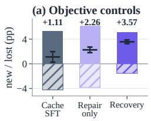

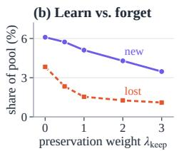

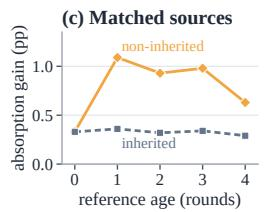

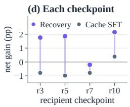  
Figure 11: Supplementary interventions. (a) Objective controls on a fixed recipient and 2,400 problems, with mean ± SD net gain over three absorption-order seeds. (b) New and lost successes as the preservation weight changes. (c) Absorption gain with non-inherited or same-age inherited history at 64 records. (d) Net gain of Recovery and Cache SFT at each recipient checkpoint.

## G COMPUTE AND BUDGET ACCOUNTING

Hardware and elapsed time. Training used two NVIDIA RTX PRO 6000 Blackwell Server Edition GPUs with about 96 GB of memory each. A Full run took about 8–9 wall-clock hours per round, or 80–90 hours for ten rounds, and benchmark evaluation took about 4–5 hours in total. The training-side cost includes task generation, native branch training, recipient attempts, verification, teacher and student passes, screening, and confirmation, also in rounds that retain the root. The fixed-round results in Table 1 use the same horizon and three-seed aggregation across methods.

Accounting budget. Figure 9 allocates native training under a normalized accounting budget. A single-stream native baseline uses 100.0 units, and No Recovery and Full use 111.9 and 123.7 units in their default ten-round configurations. Generation, Scout optimization, and native learner optimization account for 38.0, 6.0, and 51.0 units in each configuration. Full adds screening (4.8), recipient attempts (3.2), verification (2.8), teacher passes (2.4), absorption (5.2), confirmation (6.4), and state export (3.9). Budget 1.0 equals Full’s 123.7 units. Every variant keeps ten rounds and the same generation and Scout schedule, with fixed costs and branch counts of (49.0, 1) for the native baseline, (64.1, 4) for the more-candidates control, (60.9, 2) for No Recovery, and $( 7 2 . 7 , 2 )$ for Full. With cap C and K native branches, each branch receives $n _ { \mathrm { n a t i v e } } = \lfloor ( C - \dot { C } _ { \mathrm { f i x e d } } ) / ( 1 0 K \cdot 0 . 1 7 ) .$ ⌋ calls per round, set before observing results. The sensitivity sweeps keep $m _ { \mathrm { s c r } } = 1 6$ and the Recovery caps fixed, use $m _ { \mathrm { { c o n } } } = 3 2$ for the candidate sweep and $K = 2$ for the confirmation sweep, and charge a fixed cost of $6 3 . 1 + 1 . 6 K + 0 . 2 m _ { \mathrm { c o n } }$ units. Accounting units are not measured GPU-hours or FLOPs.

## H PROMPT TEMPLATES AND INPUT FORMATS

The Curriculum Scout proposes tasks, and the Evolving Learner trains, attempts problems, and receives Recovery updates, as in Appendix A.

## H.1 NATIVE PROBLEM GENERATION

The Curriculum Scout uses the same two messages in every round, for native training and for candidate-pool generation. Its proposed boxed answer is not a training label: native admission assigns the consensus label of the Evolving Learner’s responses.

```latex
Curriculum Scout: system message
Construct an original, challenging competition-mathematics problem.
Work out the problem and its answer privately before writing your response. You may draw
on algebra, geometry, number theory, combinatorics, prealgebra, probability, statistics,
calculus, or another mathematical area. Choose a challenge that fewer than 30% of
advanced high-school students would solve. Familiar textbook exercises and recognizable
contest questions should not be reused.
Your response must contain two parts in this order: the problem statement enclosed by
<question> and </question>, then its final answer enclosed by \boxed{}. Do not include
your planning, a worked solution, or any other commentary. Follow this layout:
<question>
{problem statement}
</question>
\boxed{final_answer}
```

Curriculum Scout: user message   
Write one problem now. Use the required statement-and-answer layout, with no additional   
text.

## H.2 EVOLVING LEARNER PROBLEM-SOLVING INPUT

Native rollouts, admission responses, recipient attempts, and the screening and confirmation pools use the same instruction, with the problem as the user message.

Evolving Learner: problem-solving system message   
Develop a solution with explicit intermediate reasoning. Conclude with the resulting   
answer in \boxed{}.   
Evolving Learner: problem-solving user message   
{problem text}

## H.3 REFERENCE-CONDITIONED REPAIR INPUT

The student and the keep teacher see only the input above. The repair teacher also receives one qualified reference, which may come from an unselected branch or an earlier round, and runs forward passes on the recipient’s fixed recorded response, aligned token by token with the student.

Repair-teacher context   
system: Develop a solution with explicit intermediate reasoning. Conclude with the   
resulting answer in \boxed{}.   
user: A successful training example is provided below.   
{qualified reference response}   
Use this example as guidance when solving the following problem:   
{problem text}   
assistant:

## H.4 ANSWER VERIFICATION AND CONFIRMATION

Recovery eligibility uses training-role records, response completion, answer verification, and reference provenance, and excludes known contradictory problems, wrong labels, and erroneous references. Screening and confirmation are numerical decisions on fresh responses: the runs contain no naturallanguage judge prompt and no model-generated accept or reject decision. External benchmarks use their frozen standard instructions, and their prompts, responses, and results never enter training, memory, screening, or confirmation.