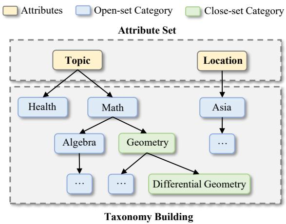
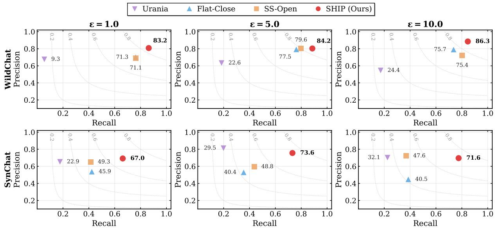
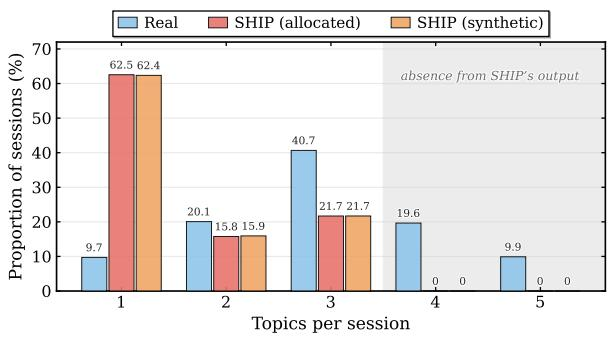
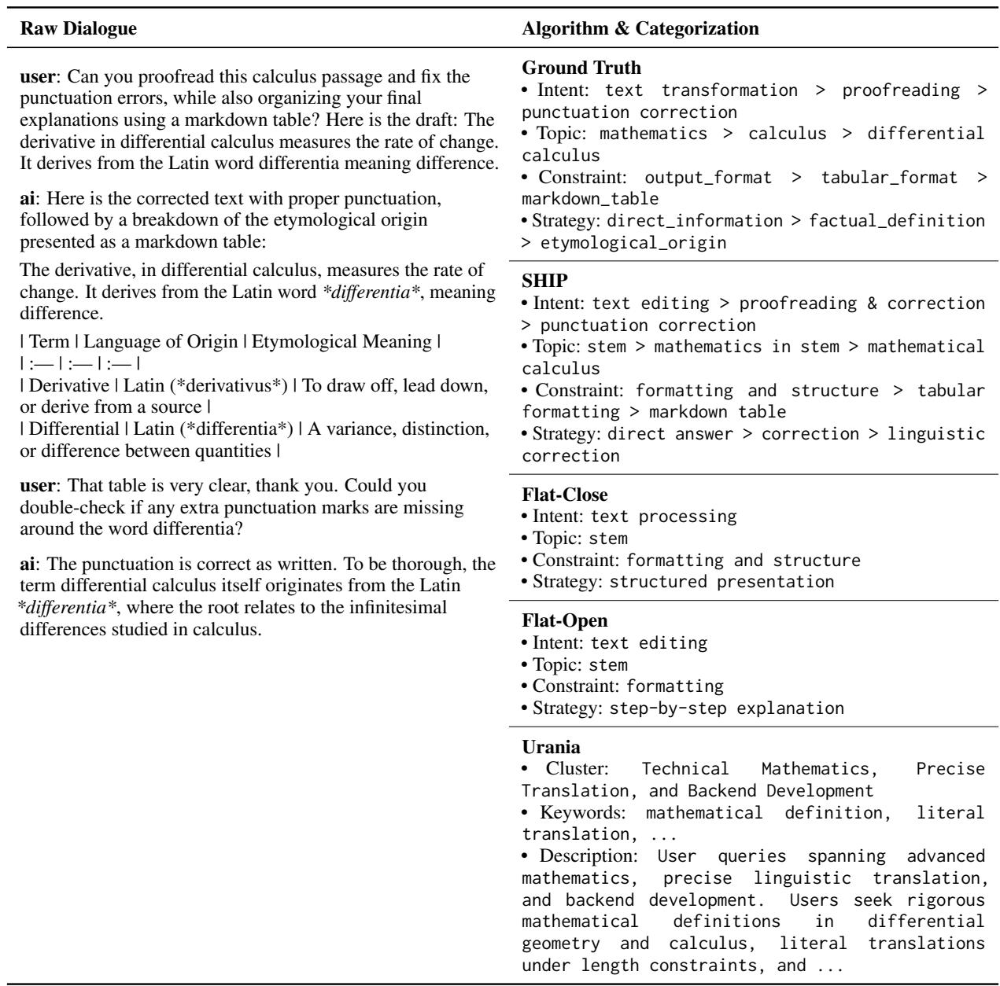
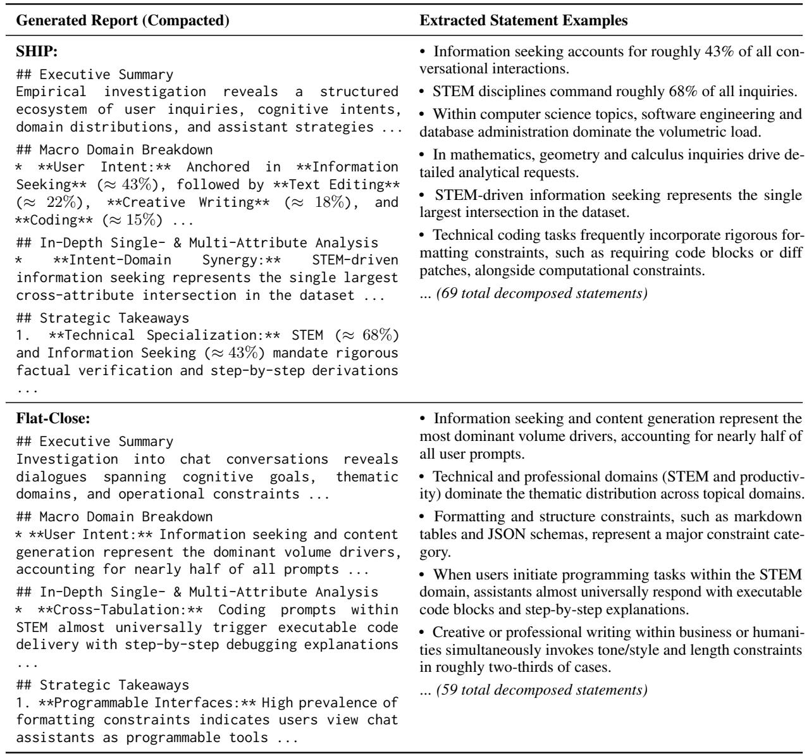
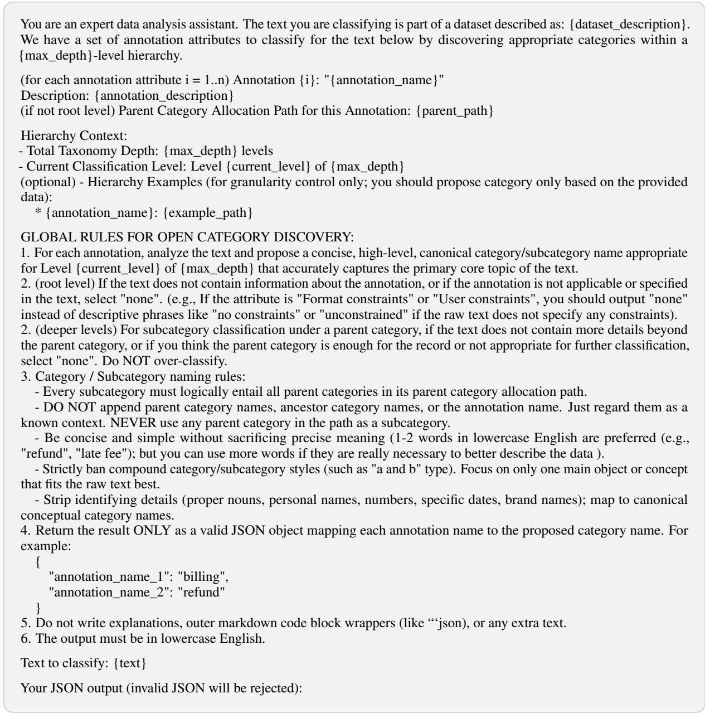
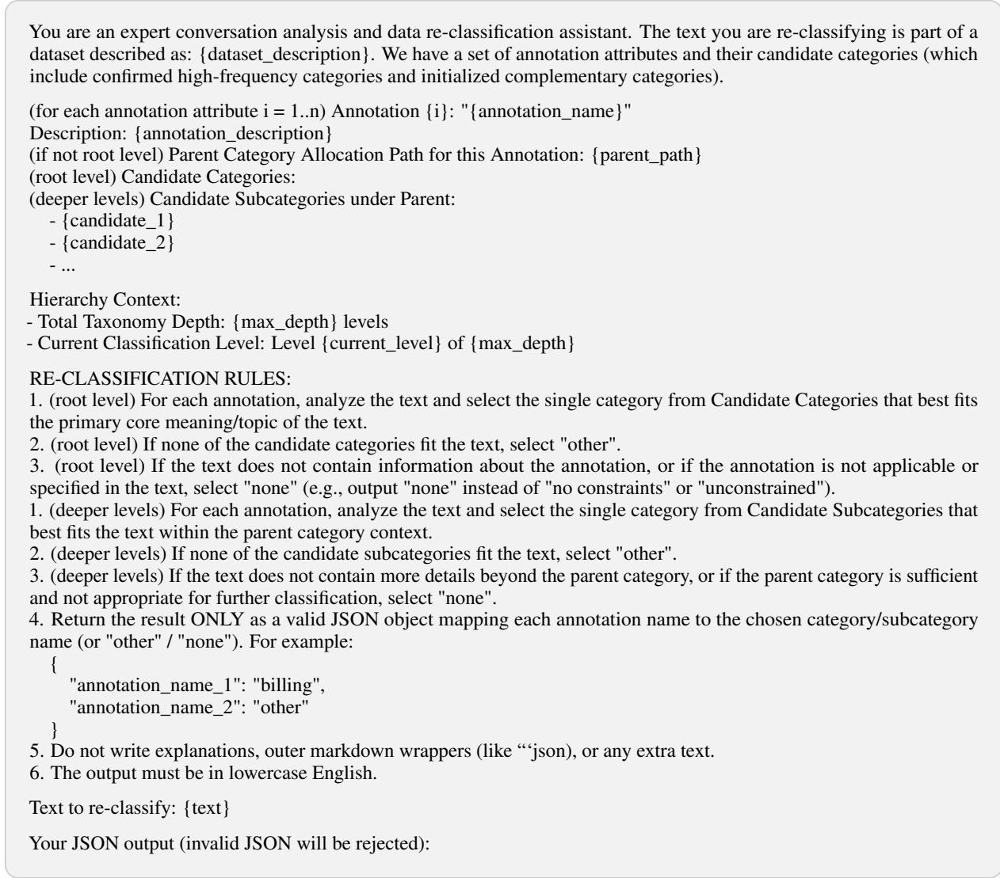
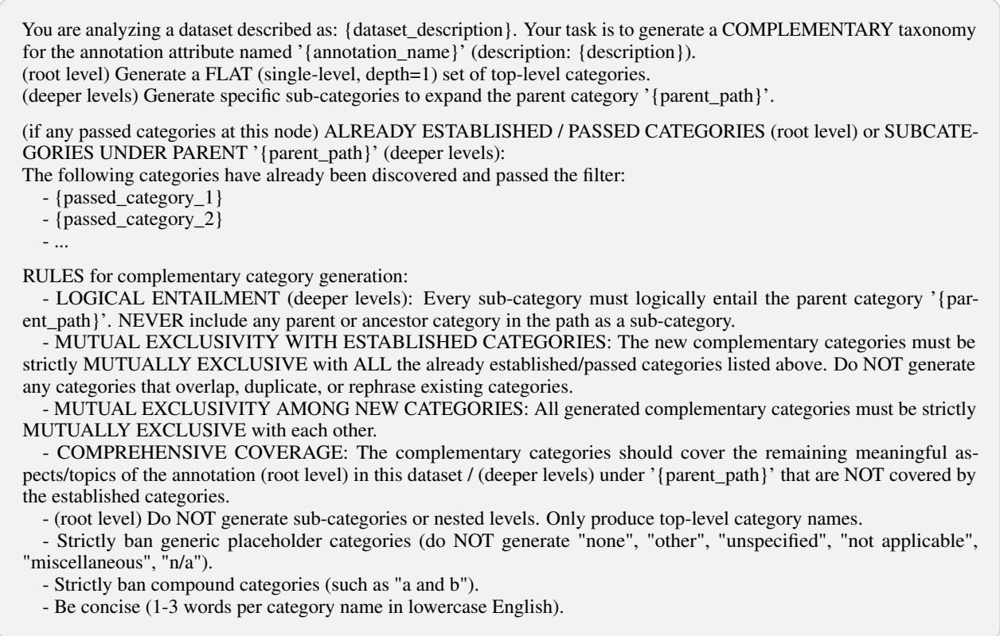
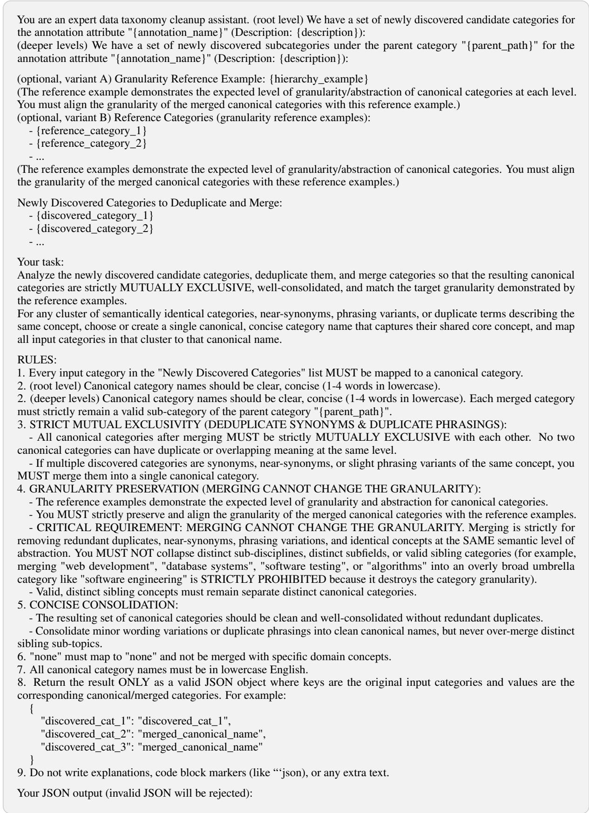
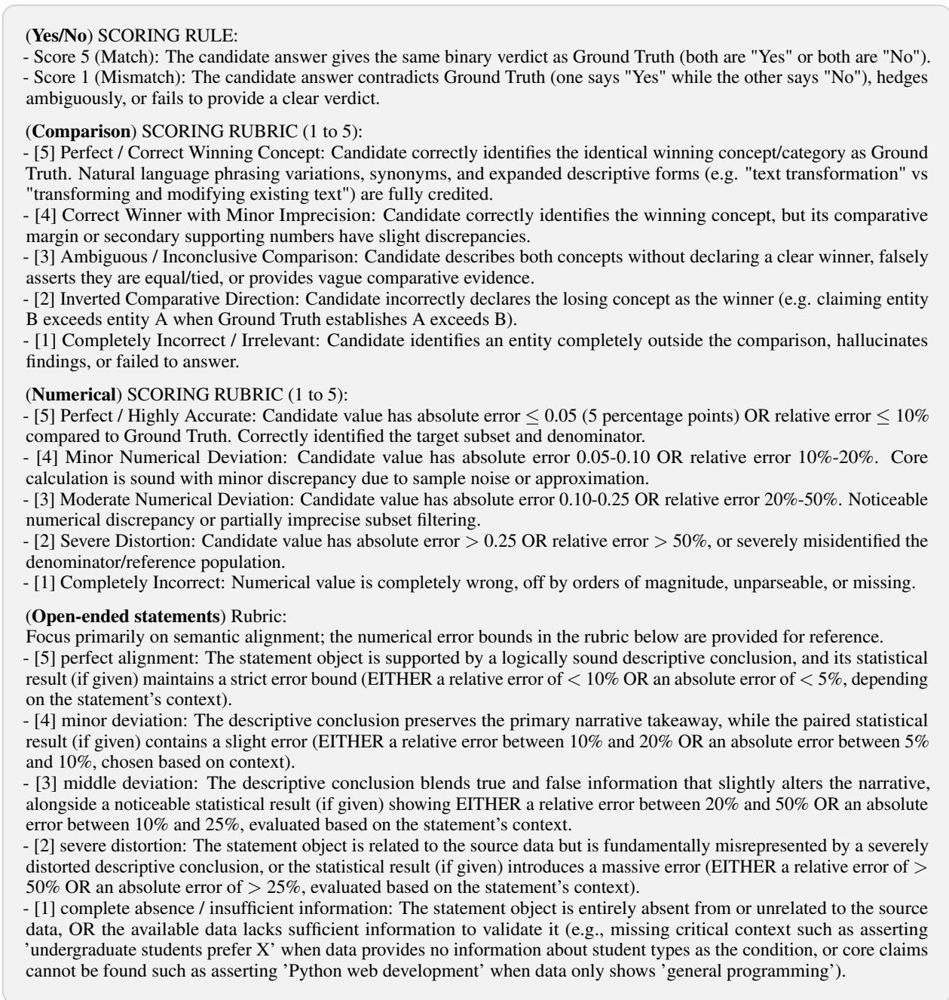

# SHIP: Structured and Hierarchical Insight with Privacy

Kai Chen<sup>1</sup>\*, Guisi Ni<sup>2</sup>, Albert Cheu<sup>2</sup>, Kassem Fawaz<sup>2</sup>,

Yuzheng Hu<sup>2</sup>, Ryan McKenna<sup>2</sup>, Peter Kairouz<sup>2</sup>

<sup>1</sup>University of Virginia <sup>2</sup>Google Research

kaichen@virginia.edu

{guisin,cheu,kfawaz,yuzhenghu,mckennar,kairouz}@google.com

## Abstract

Extracting insights from textual data while protecting user privacy is increasingly important. Existing methods produce private insights in diverse forms for different analytical purposes, making their utility difficult to assess and compare. In this work, we formulate differentially private (DP) insights as reusable representations for answering analytical queries, providing a common basis for utility assessment. Answering these queries, however, requires finegrained details and cross-attribute statistics that existing representations may omit. To capture this information, we introduce Structured and Hierarchical Insight with Privacy (SHIP), which automatically maps queries to attributes, builds a hierarchical hybrid taxonomy, and releases a DP synthetic table for further analysis. We also develop an evaluation protocol based primarily on QA performance and structured fidelity. Our experiments demonstrate SHIP’s strong performance on both measures relative to existing private insight baselines, while identifying queries that remain challenging for structured representations.

## 1 Introduction

Modern organizations collect vast amounts of textual data from their users. In particular, the rapid development of generative AI has introduced new user-facing tools, such as chatbots and AI agents, that continuously generate large volumes of data. Analyzing these data is crucial for organizations to understand user needs, improve their products and models, and guide decision-making. However, these data often contain personal information, making privacy protection essential for such analysis.

Various insight extraction systems have been developed to analyze such textual data. For example, Anthropic proposes Clio (Tamkin et al.,

2024), which transforms large collections of AIassistant conversations into extracted facets, hierarchical semantic clusters, and cluster-level summaries. Google’s Urania (Liu et al., 2025) extends this paradigm with formal end-to-end DP guarantees, offering stronger privacy protection against adversarial attacks (Annamalai et al., 2026). Moreover, OpenAI (Chatterji et al., 2025) and Google (Cheu et al., 2025) have explored structured approaches to extracting insights. Google’s approach additionally provides formal DP guarantees through DP aggregation, with LLM-based structured summarization in trusted execution environments. Several other works further investigate applications of insights across various domains such as healthcare, science, and generative AI usage analysis (Codreanu et al., 2026; McCain et al., 2025; Anthropic, 2026; Costa-Gomes et al., 2026).

These systems produce insights in different forms, reflecting different analytical purposes. Clio and Urania support exploratory analysis with limited prior specification, while structured approaches organize information along targeted attributes. Existing evaluations are often tailored to individual methods’ purposes and output formats, leaving no common basis for comparing analytical utility across methods (Tamkin et al., 2024; Liu et al., 2025). We therefore need a shared description of information needs that accommodates diverse analytical purposes and provides concrete objectives for DP insight design and evaluation.

In this work, we focus on a setting in which analysts have a workload of dataset-level analytical queries to guide insight extraction. The workload makes information needs explicit and provides a concrete criterion for utility. For example<sup>1</sup>, access to a medical dataset could inspire the question “What are the users’ primary symptoms and chief complaints, and for those symptoms, what diagnostic tests do the doctors suggest?” Answering such queries requires both insight depth (resolving fine-grained categories within each attribute, such as specific symptoms and tests) and insight breadth (preserving cross-attribute joint distributions, such as which tests are suggested for which symptoms). In this setting, cluster-level summaries and keyword statistics are often too coarse for detailed attribute statistics and do not directly expose crossattribute joint distributions. Flat structured baselines map records directly to explicit categorical attributes, but rely on flat, single-level taxonomies that either miss fine-grained subcategories or require static schemas. These limitations motivate a workload-driven DP framework that simultaneously captures insight depth and insight breadth.

To address these challenges, we formalize the DP insight extraction, develop a workload-driven extraction method, and propose a shared evaluation protocol. Our main contributions are as follows:

• Workload-based Formulation and Evaluation. We formulate DP insight extraction from a queryanswering perspective, viewing an insight as a reusable representation of a textual corpus that supports a workload of analytical queries. To evaluate analytical utility independently of the output format, we use a shared offline agent to answer the same queries solely from each method’s released insights, and introduce a complementary metric to evaluate semantic and distributional fidelity for structured insights.

• The SHIP Framework. We introduce SHIP, an end-to-end framework for extracting structured insights under rigorous DP guarantees. It automatically maps the workload to attributes, builds a hierarchical and hybrid taxonomy that combines private open-set discovery with adaptive supplementation by a taxonomy model (Davidson et al., 2026) to retain fine-grained details (depth), and applies DP tabular synthesis (McKenna et al., 2024) to release a reusable private table that preserves cross-attribute correlations (breadth).

• Empirical Analysis of Utility and Limitations. With its workload-aware tabular structure and hierarchical taxonomy, SHIP achieves average gains of 12.7% points in deterministic QA accuracy and 9.0 points in open-ended QA $F _ { 1 }$ on WildChat, compared with the strongest baseline across privacy budgets. We also identify query structures, such as long topic-switching sequences, that remain challenging for $\mathrm { S H I P } ^ { \prime } \mathrm { s }$ current representation.

## 2 Preliminaries

## 2.1 Differential Privacy

To provide formal privacy guarantees over sensitive user interaction data, we ground our framework in Differential Privacy (DP). Two datasets $\mathcal { D } , \mathcal { D } ^ { \prime }$ are defined as neighboring (denoted $\mathcal { D } \sim \mathcal { D } ^ { \prime } )$ if they differ by at most one individual record.

Definition 1 (Differential Privacy (Dwork et al., 2006)). A randomized mechanism M satisfies $( \varepsilon , \delta )$ -differential privacy if, for all neighboring datasets $\mathcal { D } \sim \mathcal { D } ^ { \prime }$ and every measurable subset of possible outputs $S \subseteq R a n g e ( { \mathcal { M } } )$

$$
\mathbb { P } [ \mathcal { M } ( \mathcal { D } ) \in \mathcal { S } ] \leq e ^ { \varepsilon } \mathbb { P } [ \mathcal { M } ( \mathcal { D } ^ { \prime } ) \in \mathcal { S } ] + \delta .\tag{1}
$$

To simplify privacy accounting across iterative operations, we track the privacy loss using zero-Concentrated Differential Privacy (zCDP).

Definition 2 $( ( \delta , \rho ) \mathrm { \mathrm { - } z C D P }$ (Bun and Steinke, 2016)). A randomized mechanism M satisfies δ- approximate $\rho { \mathrm { - } } z C D P$ if,for every pair ofneighboring datasets $\mathcal { D } \sim \mathcal { D } ^ { \prime } ,$ there exist events E and $E ^ { \prime }$ with probabilities at least $1 - \delta$ such that, letting P and Q denote the output distributions of $\mathcal { M } ( \mathcal { D } )$ and $\mathcal { M } ( \mathcal { D ^ { \prime } } )$ conditioned on E and $E ^ { \prime } ,$ , respectively, for every $\alpha > 1$

$$
\operatorname* { m a x } \{ D _ { \alpha } ( P \| Q ) , D _ { \alpha } ( Q \| P ) \} \le \rho \alpha ,\tag{2}
$$

where $D _ { \alpha } ( P \| Q )$ denotes the Rényi divergence of order α. When $\delta = 0 _ { i }$ , this reduces to $\rho { \mathrm { - } } z C D P . $

## 2.2 Terminology

In this section, we introduce the terminology used throughout the paper. Let $\textit { \textbf { D } } = \ \{ x _ { 1 } , \ldots , x _ { N } \}$ denote a corpus of N textual records, such as user prompts or multi-turn dialogues. We begin by describing analysts’ information needs through queries and workloads, and then define insights as reusable resources that support these needs.

Definition 3 (Query and Workload). A query q is a natural-language specification of a datasetlevel analytical information need, asking about properties, patterns, or relationships in a dataset D. A workload W = $\{ q _ { 1 } , \ldots , q _ { k } \}$ is a collection of queries representing the analytical needs.

Throughout this work, we focus on dataset-level analytical queries rather than retrieving information from individual records, as the latter are inherently less compatible with privacy.

Definition 4 (Workload-Aware Insight). Given a dataset D and a workload W, an insight S is a data structure derived from D that can provide answers to the queries in W.

In this work, we primarily study structured insights, which organize information in a tabular form. We therefore introduce the basic components of this representation.

Definition 5 (Attribute & Taxonomy). An attribute $A _ { i }$ is an observable semantic dimension, and a taxonomy $\mathcal { T } = \{ A _ { 1 } : \Omega _ { 1 } , \ldots , A _ { m } : \Omega _ { m } \}$ associates each attribute $A _ { i }$ with its value domain $\Omega _ { i }$

## 2.3 Problem Statement

With the necessary definitions provided in the previous sections, we define the workload-driven DP insight extraction problem as follows.

Definition 6 (Workload-Driven DP Insight Extraction). Let D be a private textual dataset and W a workload of analytical queries. The task of workload-driven DP insight extraction is to design a mechanism F that releases an insight representation $\mathcal { S } = \mathcal { F } ( \mathcal { D } , \mathcal { W } )$ under $( \varepsilon , \delta ) – D P ,$ such that S serves as an interpretable and reusable resource from which queries in W can be answered without further access to D.

## 3 Related Work

Existing approaches to private insight follow a common two-stage structure: a language model inference step that extracts annotations or summaries from each record, followed by an aggregation and privatization step (via clustering, aggregation, and/or differential privacy) that produces a dataset-level release. Within this shared framework, existing techniques can be organized along five capabilities (Table 1): whether they satisfy formal differential privacy, capture insight depth (multi-level hierarchical granularity within a semantic dimension), capture insight breadth (joint distributions across multiple semantic dimensions), discover categories from data (open-set), and adapt to an explicit query workload.

Clustering-based approaches include Clio (Tamkin et al., 2024) and its differentially private counterpart Urania (Liu et al., 2025). These methods prompt a language model to extract a list of keywords from each record $x _ { i } ~ \in ~ { \mathcal { D } }$ embed the keywords into a high-dimensional vector space, and partition the records into K clusters. Clio relies on empirical privacy filters rather than formal DP guarantees, making it vulnerable to reconstruction attacks (Annamalai et al., 2026). Urania instead selects keywords through DP partition selection and clusters data via DP k-means. While effective for unconstrained exploratory analysis, assigning different records to a single cluster entangles multiple semantic dimensions and does not expose pairwise or higher-order distributions across attributes.

Table 1: Taxonomy of insight extraction paradigms across five core capabilities: Clio (Tamkin et al., 2024), Urania (Liu et al., 2025), Chatterji et al. (2025), Flat-Open (Cheu et al., 2025), Flat-Close (Hu et al., 2025), and SHIP.
<table><tr><td>Method</td><td></td><td></td><td>DP Depth Breadth Open-Set Workload</td><td></td><td></td></tr><tr><td>Clio</td><td>X</td><td>√</td><td>x</td><td>√</td><td>x</td></tr><tr><td>Urania</td><td>√</td><td>√</td><td>X</td><td>√</td><td>X</td></tr><tr><td>Chatterji et al.</td><td>x</td><td>X</td><td>√</td><td>x</td><td>X</td></tr><tr><td>Flat-Open</td><td>V</td><td>X</td><td>X</td><td>√</td><td>X</td></tr><tr><td>Flat-Close</td><td>√</td><td>x</td><td>√</td><td>x</td><td>x</td></tr><tr><td>SHIP (Ours)</td><td> $\checkmark$ </td><td> $\checkmark$ </td><td> $\checkmark$ </td><td> $\checkmark$ </td><td> $\checkmark$ </td></tr></table>

Taxonomy-based approaches map each record directly to discrete categories along explicit semantic attributes (Chatterji et al., 2025; Cheu et al., 2025; Hu et al., 2025). Given a collection of m attributes, structured approaches use a language model to classify each record $x _ { i } \in \mathcal { D }$ into a tuple of categories $( y _ { i } ^ { ( 1 ) } , \dots , y _ { i } ^ { ( m ) } ) \in \Omega _ { 1 } \times \dots \times \bar { \Omega _ { m } }$ , reducing the unstructured corpus to a simple table. However, existing mechanisms have limitations in insight depth and insight breadth. On the one hand, open-set structured summarization (Flat-Open; Cheu et al., 2025) discovers categories through DP partition selection (Desfontaines et al., 2021), which can miss low-frequency categories. The single-attribute formulation considered in their work does not explicitly address multi-attribute analysis. Extending it through independent 1-way histograms would divide the privacy budget across attributes, raising selection thresholds and further reducing category coverage. These independent releases would still not preserve cross-attribute joint distributions.

On the other hand, closed-set structured synthesis (Flat-Close; Chatterji et al., 2025; Hu et al., 2025) specifies each candidate domain $\Omega _ { j }$ a priori using domain experts or a zero-shot language model without accessing the private dataset $\mathcal { D }$ . After classifying each record into the pre-specified taxonomy, the differentially private variant (Hu et al., 2025) applies a marginal-based synthetic data mechanism such as AIM (McKenna et al., 2024), which privately measures low-order marginals and synthesizes a tabular dataset $\tilde { \mathcal { D } }$ . While this approach captures insight breadth, its utility depends on the quality of the taxonomy. Finally, none of these existing paradigms formalize the downstream analytical queries that the insight is intended to support, leaving attribute selection manual and crossformat evaluation ad hoc.

## 4 Method

In this section, we introduce our method, Structured Hierarchical Insights with Privacy (SHIP), which works in three steps: it identifies the information dimensions required by the workload, constructs a hierarchical structured representation over these dimensions, and privately synthesizes their joint distribution.

## 4.1 DP Taxonomy Building

As discussed in Section 3, open-set discovery may miss low-frequency categories that fall below the DP threshold, whereas closed-set taxonomies rely on static priors that may be inaccurate (see Section 5.1 and Appendix C.4). To capture finegrained insight depth while maintaining coverage, we introduce a hierarchical hybrid category proposal mechanism (Algorithm 1, Figure 1; full pseudocode in Algorithm 3) that combines open-set discovery with closed-set supplementation across multiple levels of granularity (Bagdasaryan et al., 2022; Zhu et al., 2020; Tamkin et al., 2024).

Taxonomy construction proceeds top-down for up to d levels. At each parent category $c _ { p } .$ , we first use the classification model $\mathcal { M } _ { \mathrm { c l s } }$ to freely propose subcategories from its assigned records, which we call “Discovery”. To ensure differential privacy, these proposals are filtered using the Gaussian Thresholding Mechanism (Desfontaines et al., 2021) with threshold $\tau _ { \mathrm { o p e n } } ( \sigma , \delta ) = 1 + \sigma \Phi ^ { - 1 } ( 1 -$ δ), where $\sigma$ is the noise level and Φ is the standard Gaussian cumulative distribution function. Datadriven discovery can nonetheless miss concepts whose counts fall below the privacy threshold, particularly when the budget is divided across multiple attributes and hierarchical levels. Conditioned on the surviving categories $\mathcal { C } _ { \mathrm { o p e n } }$ , we therefore prompt the taxonomy model $\mathcal { M } _ { \mathrm { t a x } }$ to propose mutually exclusive complementary categories $\mathcal { C } _ { \mathrm { c o m p } }$ using its world knowledge about the attribute, dataset description, and parent category $c _ { p } .$ , which we call “Complementary Proposal”. Records whose initial categories did not survive are reclassified over the combined candidates. The surviving categories $\mathcal { C } _ { \mathrm { s u r v } }$ are attached to $c _ { p } .$ , and records are allocated for refinement at the next level, while other and none remain terminal. The resulting root-to-leaf paths define the hierarchical domain $\Omega _ { A }$ and the corresponding record path assignments.

Algorithm 1: Hierarchical Hybrid DP Tax  
onomy Building   
Input: Records $\mathcal { D } = \{ x _ { 1 } , \ldots , x _ { N } \}$   
Dataset description $S _ { D }$ , Max depth   
$d ,$ Attribute A, Privacy parameters   
$( \rho _ { \mathrm { s t e p } } , \delta _ { \mathrm { s t e p } } )$ , Taxonomy model $\mathcal { M } _ { \mathrm { t a x } } .$   
Classification model $\mathcal { M } _ { \mathrm { c l s } }$   
Output: Taxonomy $\tau _ { A }$ , Internal record   
paths $\{ y _ { i } \} _ { i = 1 } ^ { N } .$   
1 $\rho _ { \mathrm { o p e n } } = 0 . 9 \rho _ { \mathrm { s t e p } } , \quad \rho _ { \mathrm { c l o s e } } = 0 . 1 \rho _ { \mathrm { s t e p } } ;$   
2 $\sigma _ { \mathrm { o p e n } } = 1 / \sqrt { 2 \rho _ { \mathrm { o p e n } } } , \quad \sigma _ { \mathrm { c l o s e } } = 1 / \sqrt { 2 \rho _ { \mathrm { c l o s e } } } ;$   
3 Compute $\tau _ { \mathrm { o p e n } }$ and $\tau _ { \mathrm { c l o s e } } ;$   
4 Initialize tree-like domain $\Omega _ { A }$ with root $\perp ;$   
5 for $l \gets 1$ to $d ,$ each level $l - 1$ category $c _ { p }$   
in $\Omega _ { A }$ do   
6 $\mathcal { D } _ { p } $ records assigned to $c _ { p } ;$   
7 Classify D via $\mathcal { M } _ { \mathrm { c l s } }$ to obtain domain   
$\mathcal { C } _ { \mathrm { o p e n } }$ and allocation results $\{ y _ { i } \}$ and   
conduct partition selection;   
8 Obtain supplementary domain $\mathcal { C } _ { \mathrm { c o m p } }$   
through $\mathcal { M } _ { \mathrm { t a x } }$ and re-allocation results   
$\{ y _ { i } \}$ through ${ \mathcal { M } } _ { \mathrm { c l s } } ;$   
9 $\mathcal { C } _ { \mathrm { s u r v } } = \mathcal { C } _ { \mathrm { o p e n } } \cup \mathcal { C } _ { \mathrm { c o m p } }$   
10 Add $\mathcal { C } _ { \mathrm { s u r v } }$ as children of $c _ { p }$ in $\Omega _ { A }$ and   
allocate $\mathcal { D } _ { p }$ using $\{ y _ { i } \}$   
11 return $\{ A : \Omega _ { A } \} , \{ y _ { i } \} _ { i = 1 } ^ { N } \{$

  
Figure 1: An illustration of $\mathrm { S H I P } ^ { \prime } \mathrm { s }$ taxonomy building step. The hierarchical taxonomy originates from the toplevel attribute set, integrating with open-set categories (blue) with complementary close-set categories (green) for multi-level categorization.

Algorithm 2: SHIP   
Input: Records $\mathcal { D } = \{ x _ { 1 } , \ldots , x _ { N } \}$ , Depth   
$d ,$ Workload W, Dataset description   
$S _ { D }$ , Privacy budget $( \rho _ { \mathrm { a i m } } , \rho _ { \mathrm { t a x } } , \delta _ { \mathrm { t a x } } )$   
Attribute model ${ \mathcal { M } } _ { \mathrm { a t t r } } .$ Taxonomy   
model $\mathcal { M } _ { \mathrm { t a x } }$ , Classification model   
$M _ { \mathrm { c l s } } .$   
Output: Taxonomy $\tau ,$ Insight $\widetilde { \cal D } .$   
1 Obtain attribute set $\mathcal { A }  \mathcal { M } _ { \mathrm { a t t r } } ( \mathcal { W } )$   
2 Obtain $\rho _ { \mathrm { s t e p } }$ and $\delta _ { \mathrm { s t e p } }$ via Equation (3);   
3 for $A \in { \mathcal { A } }$ do   
4 $\perp \mathcal { T } _ { A } , \{ y _ { i } ^ { ( A ) } \} _ { i = 1 } ^ { N }  \mathrm { A }$ lgorithm 1;   
5 $\mathcal T  \bigcup _ { A \in \mathcal A } \mathcal T _ { A } ;$   
6 $\widetilde { \mathcal { D } }  \mathrm { A I M } ( \{ ( y _ { i } ^ { ( A ) } ) _ { A \in \mathcal { A } } \} _ { i = 1 } ^ { N } , \mathcal { T } , \rho _ { \mathrm { a i m } } ) ;$   
7 return $\tau , \widetilde { \mathcal { D } } ;$

## 4.2 SHIP

Based on the taxonomy discovery mechanism introduced above, we introduce SHIP in Algorithm 2, consisting of three main components:

Workload Analysis. For a workload W, SHIP first analyzes it through a highly capable model $\mathcal { M } _ { \mathrm { a t t r } }$ and finds atomic features needed to answer queries in it. This step returns an attribute set A for further structured insight extraction.

Taxonomy Building and Category Allocation. Given a set of target attributes A and a maximum depth $d ,$ SHIP builds the hierarchical taxonomy $\tau$ by repeatedly applying Algorithm 1 for all attributes $A \in A$ . The privacy budget is uniformly allocated across all attributes and hierarchy levels:

$$
\rho _ { \mathrm { s t e p } } = \frac { \rho _ { \mathrm { t a x } } } { | \boldsymbol { \mathcal { A } } | \cdot d } , \qquad \delta _ { \mathrm { s t e p } } = \frac { \delta _ { \mathrm { t a x } } } { | \boldsymbol { \mathcal { A } } | \cdot d } .\tag{3}
$$

For each attribute $A \in A ,$ , Algorithm 1 returns the attribute taxonomy $\mathcal { T } _ { A } = \{ A : \Omega _ { A } \}$ and rootto-leaf record assignments $\{ y _ { i } ^ { ( A ) } \} _ { i = 1 } ^ { N }$ for each attribute A. We merge them and obtain a multiattribute taxonomy $\tau$ and a multi-dimensional allocation table $\tilde { D }$

Private Tabular Synthesis and Release. After taxonomy construction, we can release the DP taxonomy and separately privatized per-attribute histograms. However, the record-level category assignments $\{ ( y _ { i } ^ { ( A ) } ) _ { A \in \mathcal { A } } \} _ { i = 1 } ^ { N }$ that capture crossattribute correlations remain private. We then use the taxonomy $\tau$ to define discrete attribute domains and apply a DP synthetic data mechanism, AIM (McKenna et al., 2024), with the privacy budget $\rho _ { \mathrm { a i m } }$ . AIM privately measures low-order marginals over the category assignments and estimates a dataset $\widetilde { \mathcal { D } }$ that preserves those marginals well. The resulting structured insights, consisting of the taxonomy $\tau$ and the synthetic dataset $\widetilde { \mathcal { D } } _ { \bullet }$ can be released to answer queries and conduct downstream analyses. Since these operations rely solely on the released DP outputs, the post-processing property of DP ensures that they do not incur any additional privacy cost.

## 4.3 Privacy Guarantee

In this section, we formally evaluate the privacy guarantee of SHIP through Theorem 1. The detailed proof is provided in Appendix E.

Theorem 1 (Privacy Guarantee of SHIP). Let D be a private dataset under unbounded DP. We define $\rho = \rho _ { t a x } + \rho _ { a i m }$ and $\begin{array} { r } { \bar { \delta } \ = \ \frac { \delta - \delta _ { t a x } } { 1 - \delta _ { t a x } } } \end{array}$ . Then, for any $\delta _ { t a x } < \delta < 1$ , SHIP (Algorithm 2) satisfies $( \varepsilon , \delta )$ DP, where

$$
\varepsilon = \operatorname* { i n f } _ { \alpha > 1 } \left\{ \alpha \rho + \log \left( 1 - { \frac { 1 } { \alpha } } \right) - { \frac { \log { \bar { \delta } } + \log \alpha } { \alpha - 1 } } \right\}
$$

## 5 Experiments

In this section, we briefly introduce our experimental setup, including evaluation metrics, baselines, and datasets, following by our experimental results and findings. Additional implementation and experimental details are provided in Appendix B.

Evaluation Metrics. We evaluate the datasetlevel statistical and analytical utility of insights through query answering, using two complementary protocols. Deterministic QA Accuracy (Zhang et al., 2025) evaluates targeted questions with welldefined ground-truth answers, including numerical, comparison, and yes/no questions. We further distinguish between single-feature and multi-feature questions based on the information required to answer them (see Appendix C for examples.) An offline agent built on Gemini-3.5-Flash-Lite answers each question using only the generated insight, and the response is evaluated against the ground truth on a discrete 1-5 scale using LLM-asa-judge. Open-Ended QA Quality evaluates broader analytical questions that require a comprehensive answer (see Table 9). Following factuality-based evaluation (Min et al., 2023), we decompose the offline agent’s reports into atomic statements and compute precision (the fraction of insight-derived statements supported by the ground truth), recall (the fraction of ground-truth statements supported by the insight), and F<sub>1</sub>.

Table 2: Deterministic query-answering evaluation across single- and multi-attribute questions on WildChat and SynChat under varying privacy budgets ε. We report average score (1-5 scale ↑) and accuracy (Score ≥ 4, % ↑).
<table><tr><td rowspan="3">ε</td><td rowspan="3">Algorithm</td><td colspan="6">WildChat</td><td colspan="6">SynChat</td></tr><tr><td colspan="2">Single-Attr</td><td colspan="2">Multi-Attr</td><td colspan="2">Overall</td><td colspan="2">Single-Attr</td><td colspan="2">Multi-Attr</td><td colspan="2">Overall</td></tr><tr><td>Avg Score Acc Avg Score Acc Avg Score Acc</td><td></td><td></td><td></td><td></td><td></td><td>Avg Score Acc</td><td></td><td>Avg Score Acc</td><td></td><td>Avg Score Acc</td><td></td></tr><tr><td rowspan="4">1.0</td><td>Urania</td><td>1.27</td><td>6.0</td><td>1.24</td><td>6.0</td><td>1.26</td><td>6.0</td><td>1.27</td><td>6.7</td><td>1.10</td><td>0.0</td><td>1.18</td><td>3.3</td></tr><tr><td>Flat-Close</td><td>2.43</td><td>32.7</td><td>2.59</td><td>37.3</td><td>2.51</td><td>35.0</td><td>1.81</td><td>20.0</td><td>1.70</td><td>17.3</td><td>1.76</td><td>18.7</td></tr><tr><td>Flat-Open</td><td>3.01</td><td>46.0</td><td>3.13</td><td>44.7</td><td>3.07</td><td>45.3</td><td>2.27</td><td>30.7</td><td>1.88</td><td>21.3</td><td>2.07</td><td>26.0</td></tr><tr><td>SHIP (Ours)</td><td>4.05</td><td>72.7</td><td>3.56</td><td>53.3</td><td>3.80</td><td>63.0</td><td>3.54</td><td>59.3</td><td>4.41</td><td>83.3</td><td>3.97</td><td>71.3</td></tr><tr><td rowspan="4">5.0</td><td>Urania</td><td>1.43</td><td>10.7</td><td>1.16</td><td>4.0</td><td>1.30</td><td>7.3</td><td>2.29</td><td>28.0</td><td>1.53</td><td>12.7</td><td>1.91</td><td>20.3</td></tr><tr><td>Flat-Close</td><td>2.26</td><td>29.3</td><td>3.03</td><td>48.0</td><td>2.65</td><td>38.7</td><td>1.60</td><td>14.7</td><td>1.57</td><td>13.3</td><td>1.59</td><td>14.0</td></tr><tr><td>Flat-Open</td><td>2.92</td><td>43.3</td><td>3.33</td><td>49.3</td><td>3.13</td><td>46.3</td><td>2.13</td><td>28.0</td><td>2.53</td><td>36.0</td><td>2.33</td><td>32.0</td></tr><tr><td>SHIP (Ours)</td><td>3.60</td><td>60.0</td><td>3.31</td><td>46.7</td><td>3.46</td><td>53.3</td><td>3.80</td><td>64.7</td><td>4.27</td><td>79.3</td><td>4.04</td><td>72.0</td></tr><tr><td rowspan="4">10.0</td><td>Urania</td><td>1.59</td><td>14.0</td><td>1.03</td><td>0.0</td><td>1.31</td><td>7.0</td><td>2.47</td><td>32.7</td><td>1.70</td><td>14.0</td><td>2.08</td><td>23.3</td></tr><tr><td>Flat-Close</td><td>2.33</td><td>30.0</td><td>3.01</td><td>47.3</td><td>2.67</td><td>38.7</td><td>1.72</td><td>17.3</td><td>1.63</td><td>15.3</td><td>1.68</td><td>16.3</td></tr><tr><td>Flat-Open</td><td>2.89</td><td>42.7</td><td>3.18</td><td>48.0</td><td>3.03</td><td>45.3</td><td>2.17</td><td>29.3</td><td>2.52</td><td>35.3</td><td>2.34</td><td>32.3</td></tr><tr><td>SHIP (Ours)</td><td>3.85</td><td>66.0</td><td>3.46</td><td>51.3</td><td>3.66</td><td>58.7</td><td>3.65</td><td>62.0</td><td>3.98</td><td>72.0</td><td>3.82</td><td>67.0</td></tr></table>

These two protocols provide a common basis for evaluating insights across different output formats, measuring both their ability to recover specific facts and to support higher-level analysis. For structured insights, we additionally introduce Semantic Sinkhorn Divergence to assess the fidelity of the extracted tabular representation (details provided in Appendix B.5). We report 1-way divergence over individual attributes and 2-way divergence over attribute pairs, capturing both marginal information and cross-attribute relationships.

Baselines. We compare SHIP with representative well-established differentially private insight generation approaches described in Section 3 and enumerated in Table 1 (see also Appendix B.) The main QA evaluation compares the workload-driven utility of representative private insight pipelines across output formats. The structured fidelity evaluation complements this comparison by examining how taxonomy construction affects information preservation within tabular representations. We therefore include the hierarchical closed- and open-set variants of SHIP, denoted Hie-Close and Hie-Open, in the structured fidelity evaluation, where they serve as controlled ablations of taxonomy construction. For all methods, we use Gemini-3.5-Flash as the taxonomy and attribute models and Gemini-3.5- Flash-Lite as the classification model.

Datasets. For query-answering evaluation, we use GenAI conversation datasets, including WildChat (Zhao et al., 2024) and SynChat, which is a synthetic human-AI conversation dataset constructed on predefined metadata and thus has deterministic ground truth. Structured insight quality is evaluated on WildChat, CFPB (CFPB, 2026), and ChatDoctor (Li et al., 2023), covering conversational, financial, and medical domains. We additionally construct SynChat\_topic to study challenging queries involving variable-length structures such as withinsession topic transitions.

## 5.1 Main Experiments

Deterministic Query-Answering Evaluation. Table 2 reports the aggregate results of deterministic query answering averaged across the workload for WildChat and SynChat. To supplement these aggregate results, we provide examples illustrating different queries and the answers obtained by different insights mechanisms in Appendix C. SHIP achieves the strongest overall performance across most tested settings, which is expected because it is specifically designed for this query answering task. Because SHIP delivers fine-grained semantic information and cross-attribute relationships, it’s able to effectively answer a wider variety of queries than alternative approaches.

  
Figure 2: Precision, Recall, and $F _ { 1 }$ in open-ended query-answering evaluation across WildChat (top row) and SynChat (bottom row) under privacy budgets $\varepsilon \in \{ 1 , 5 , 1 0 \}$ . Dotted background curves denote iso- $F _ { 1 }$ contours.

The baseline results illustrate how different representations support the evaluated workload. Urania’s cluster-level summaries and keyword statistics emphasize thematic patterns for exploratory analysis, offering less direct support for our analytical queries about fine-grained attributes and crossattribute joint distributions. This helps explain its lower accuracy, particularly on multi-attribute queries. Flat-Close and Flat-Open expose explicit attributes for statistical analysis, but their flat taxonomies provide less coverage of the semantic distinctions required by detailed queries in this workload.

Open-ended Query-Answering Evaluation. Figure 2 presents the results of open-ended analytical query answering across WildChat and Syn-Chat. The reports generated from several baseline resources achieve relatively high precision but substantially lower recall, indicating that they capture only a subset of the reference findings. For example, on SynChat at ε = 1.0, Urania achieves 65.3% precision and 17.7% recall; similarly, at ε = 10.0, Flat-Open achieves 72.2% precision and 37.0% recall. The low recalls indicates that some important conclusions for queries that we can obtain from ground truth are not captured by these insights.

SHIP achieves broader coverage: on WildChat, its recall consistently ranges from 84.0% to 89.0%, while on SynChat it also achieves substantially higher recall than the competing methods. This pattern is consistent with the complementary information made available by its integrated design, which combines hierarchical hybrid taxonomy construction with private tabular synthesis to expose fine-grained semantic categories and crossattribute relationships. Together with its precision scores, this broader coverage yields the highest $F _ { 1 }$ scores across all evaluation settings, indicating the strongest combined performance on factual correctness and finding coverage.

Structured Insight Fidelity Evaluation. Finally, we compare the synthetic structured insight with structured insights generated by other structured insight paradigms, shown in Table 3. First, the empirical results demonstrate that hierarchical approaches are more effective than flat structures at preserving the original data distribution. Comparing the flat algorithms (Flat-Close and Flat-Open) with the hierarchical algorithms (Hie-Close, Hie-Open, and our proposed SHIP), we observe that the flat baselines consistently yield higher divergences across all datasets and privacy budgets.

Second, among hierarchical approaches, no single open- or closed-set strategy dominates across all datasets and privacy budgets. Hie-Close relies on model priors for taxonomy construction, yielding stable categories but limiting data-adaptive discovery. For instance, on CFPB, its 1-way divergence remains around 0.14 as the privacy budget increases, but SHIP’s decreases from 0.13 to 0.11. In contrast, Hie-Open adapts its categories directly to the private data, but becomes more sensitive to small privacy budgets because low-frequency categories are harder to recover through private discovery. This effect is more pronounced on diverse datasets such as WildChat and ChatDoctor. By combining data-driven discovery with priorbased supplementation, SHIP provides a more robust compromise.

Table 3: Distribution fidelity (Sinkhorn divergence ↓) across datasets under varying privacy budgets ε.
<table><tr><td rowspan="2">ε</td><td rowspan="2">Algorithm</td><td colspan="2">CFPB</td><td colspan="2">ChatDoctor</td><td colspan="2">WildChat</td></tr><tr><td>1-way Div ↓</td><td>2-way Div ↓</td><td>1-way Div ↓</td><td>2-way Div ↓</td><td>1-way Div ↓</td><td>2-way Div ↓</td></tr><tr><td rowspan="5">1.0</td><td>Flat-Close</td><td>0.2215</td><td>0.3469</td><td>0.1142</td><td>0.1917</td><td>0.1696</td><td>0.2966</td></tr><tr><td>Flat-Open</td><td>0.1581</td><td>0.2529</td><td>0.1178</td><td>0.1831</td><td>0.1581</td><td>0.2585</td></tr><tr><td>Hie-Close</td><td>0.1465</td><td>0.2182</td><td>0.0745</td><td>0.1139</td><td>0.1564</td><td>0.2353</td></tr><tr><td>Hie-Open</td><td>0.1314</td><td>0.1980</td><td>0.0900</td><td>0.1396</td><td>0.1324</td><td>0.2155</td></tr><tr><td>SHIP (Ours)</td><td>0.1313</td><td>0.1896</td><td>0.0762</td><td>0.1129</td><td>0.1201</td><td>0.1942</td></tr><tr><td rowspan="5">5.0</td><td>Flat-Close</td><td>0.2219</td><td>0.3473</td><td>0.1142</td><td>0.1915</td><td>0.1697</td><td>0.2966</td></tr><tr><td>Flat-Open</td><td>0.1563</td><td>0.2483</td><td>0.1167</td><td>0.1815</td><td>0.1570</td><td>0.2564</td></tr><tr><td>Hie-Close</td><td>0.1472</td><td>0.2198</td><td>0.0746</td><td>0.1141</td><td>0.1565</td><td>0.2355</td></tr><tr><td>Hie-Open</td><td>0.1132</td><td>0.1675</td><td>0.0833</td><td>0.1286</td><td>0.1246</td><td>0.2023</td></tr><tr><td>SHIP (Ours)</td><td>0.1143</td><td>0.1652</td><td>0.0744</td><td>0.1104</td><td>0.1192</td><td>0.1915</td></tr><tr><td rowspan="5">10.0</td><td>Flat-Close</td><td>0.2219</td><td>0.3472</td><td>0.1143</td><td>0.1916</td><td>0.1697</td><td>0.2967</td></tr><tr><td>Flat-Open</td><td>0.1553</td><td>0.2460</td><td>0.1165</td><td>0.1809</td><td>0.1574</td><td>0.2569</td></tr><tr><td>Hie-Close</td><td>0.1474</td><td>0.2200</td><td>0.0746</td><td>0.1141</td><td>0.1564</td><td>0.2354</td></tr><tr><td>Hie-Open</td><td>0.1037</td><td>0.1534</td><td>0.0810</td><td>0.1247</td><td>0.1217</td><td>0.1973</td></tr><tr><td>SHIP (Ours)</td><td>0.1114</td><td>0.1630</td><td>0.0755</td><td>0.1133</td><td>0.1175</td><td>0.1876</td></tr></table>

## 5.2 Challenging Queries for SHIP

We further examine queries that are difficult for SHIP to answer correctly. On SynChat\_topic, where conversations may traverse multiple topics, we ask SHIP to capture each session’s topicswitching path at $\varepsilon = 1 0$ . As shown in Figure 3, the released distribution is biased toward shorter paths and fails to recover longer sequences. This discrepancy arises before tabular synthesis: variablelength paths yield a large, sparse categorical domain, making long sequences difficult to recover via private domain discovery, while prior-based completion is also ill-suited to such highly datadependent combinations.

This example highlights the importance of matching the insight representation to the structure required by the analytical workload. Encoding complete sequences as atomic categories can make private discovery difficult, even when their constituent topics are common. More broadly, workloads involving ordering, relationships between entities, or open-ended compositional patterns motivate representations that preserve these structures without requiring every complete configuration to be discovered as a separate category. Exploring such representations is a promising direction for extending private insight generation to a broader range of analytical workloads.

  
Figure 3: Distribution of the number of topics per session in SynChat\_topic, obtained from real dataset and SHIP $( \varepsilon = 1 0 )$ . “Allocated” is SHIP’s per-record category assignment, “synthetic” refers to the output of its DP tabular synthesizer.

## 6 Conclusion

In this work, we study DP insight extraction from textual corpora through a query-answering perspective. We introduce SHIP, a framework for extracting structured insights under DP, and develop a unified evaluation protocol that measures how well different insight representations support common analytical needs. Our experiments show that structured insights can provide strong query-answering utility and also identify queries that remain challenging for current insight-generation paradigms, highlighting opportunities for richer representations and extraction mechanisms. We hope this work provides a common basis for developing and evaluating future private insight systems.

## Limitations

Our work has two main limitations. First, our query evaluation focuses primarily on dataset-level statistical and analytical queries, including counting, comparison, aggregation, and multi-attribute analysis, and does not establish effectiveness for arbitrary queries. Even within this scope, our experiments identify queries that SHIP’s current DP structured representation does not support well, such as those involving long topic-switching sequences. These findings highlight the need for alternative representations or extraction mechanisms when the required information is difficult to capture through categorical attributes.

Second, we evaluate insights primarily through their ability to answer a specified analytical workload. This captures one dimension of utility and does not establish SHIP’s superiority across all aspects of data analysis; other representations may offer complementary benefits beyond this evaluation. Moreover, both our ground-truth annotations and SHIP also use three-level taxonomies, which may favor SHIP in reference-based comparisons. We have not quantified this potential bias. Future work should assess robustness to alternative taxonomy depths and reference schemas, alongside broader analytical benefits such as discovering unanticipated patterns and supporting evolving information needs.

## Ethical Considerations

Our experiments use publicly available datasets and synthetically generated data, without collecting additional private user data. SHIP is intended to support aggregate analysis rather than identify individual users. We do not release identifiable user records or information, and the insights released by SHIP are generated under DP.

## References

Eric Anderson, Jonathan Fritz, Austin Lee, Bohou Li, Mark Lindblad, Henry Lindeman, Alex Meyer, Parth Parmar, Tanvi Ranade, Mehul A. Shah, Benjamin Sowell, Dan Tecuci, Vinayak Thapliyal, and Matt Welsh. 2024. The design of an llm-powered unstructured analytics system. Preprint, arXiv:2409.00847.

Meenatchi Sundaram Muthu Selva Annamalai, Emiliano De Cristofaro, and Peter Kairouz. 2026. Cliopatra: Extracting private information from llm insights. arXiv preprint arXiv:2603.09781.

Anthropic. 2026. Advancing Claude in healthcare and the life sciences. https://www.anthropic.com/ news/healthcare-life-sciences. Published January 11, 2026.

Eugene Bagdasaryan, Peter Kairouz, Stefan Mellem, Adrià Gascón, Kallista Bonawitz, Deborah Estrin, and Marco Gruteser. 2022. Towards sparse federated analytics: Location heatmaps under distributed differential privacy with secure aggregation. Preprint, arXiv:2111.02356.

Borja Balle, Gilles Barthe, and Marco Gaboardi. 2018. Privacy amplification by subsampling: Tight analyses via couplings and divergences. Preprint, arXiv:1807.01647.

Mark Bun and Thomas Steinke. 2016. Concentrated differential privacy: Simplifications, extensions, and lower bounds. Preprint, arXiv:1605.02065.

CFPB. 2026. Cfpb complaints dataset. https: //huggingface.co/datasets/23daVinci/CFPB\_ Complaints. Accessed: 2026-08-27.

Aaron Chatterji, Tom Cunningham, David Deming, Zoë Hitzig, Christopher Ong, Carl Shan, and Kevin Wadman. 2025. How people use chatgpt. Technical report, OpenAI.

Albert Cheu, Artem Lagzdin, Brett McLarnon, Daniel Ramage, Katharine Daly, Marco Gruteser, Peter Kairouz, Rakshita Tandon, Stanislav Chiknavaryan, Timon Van Overveldt, and Zoe Gong. 2025. Toward provably private analytics and insights into genai use. Preprint, arXiv:2510.21684.

Eli Chien, Yuzheng Hu, Ryan McKenna, Shanshan Wu, Zheng Xu, and Peter Kairouz. 2026. Maple: Metadata augmented private language evolution. arXiv preprint arXiv:2603.19258.

Mihai Codreanu, Alex Imas, Juan Mateos-Garcia, Joseph Emmens, Evalyne Muiruri, Arthur Turrell, Julian Jacobs, Atoosa Kasirzadeh, Ana Trišovic,´ Yiyuan Chen, Tanya Rodchenko, Catherine Pollard, Scott Strand, Daniel Rock, Zanna Iscenko, Fabien Curto Millet, Neil Thompson, and James Manyika. 2026. Ai in science: Early insights. Working Paper / Research Report, Google, Google DeepMind, and MIT FutureTech.

Beatriz Costa-Gomes, Pavel Tolmachev, Eloise Taysom, Viknesh Sounderajah, Hannah Richardson, Philipp Schoenegger, Xiaoxuan Liu, Matthew M. Nour, Seth Spielman, Samuel F. Way, Yash Shah, Michael Bhaskar, Harsha Nori, Christopher Kelly, Peter Hames, Bay Gross, Mustafa Suleyman, and Dominic King. 2026. How people use copilot for health. Technical report, Microsoft.

Tim R. Davidson, Benoit Seguin, Enrico Bacis, Cesar Ilharco, and Hamza Harkous. 2026. Reasoning-driven synthetic data generation and evaluation. Preprint, arXiv:2603.29791.

Damien Desfontaines, James Voss, Bryant Gipson, and Chinmoy Mandayam. 2021. Differentially private partition selection. Preprint, arXiv:2006.03684.

Cynthia Dwork, Frank McSherry, Kobbi Nissim, and Adam Smith. 2006. Calibrating noise to sensitivity in private data analysis. In Theory of cryptography conference, pages 265–284. Springer.

Google DeepMind. 2026. Google Antigravity SDK: A python framework for building autonomous ai agents. https://antigravity.google. Software available on PyPI: google-antigravity.

Yuzheng Hu, Ryan McKenna, Da Yu, Shanshan Wu, Han Zhao, Zheng Xu, and Peter Kairouz. 2025. Actg-arl: Differentially private conditional text generation with rl-boosted control. arXiv preprint arXiv:2510.18232.

Tatsuki Koga, Ruihan Wu, Zhiyuan Zhang, and Kamalika Chaudhuri. 2025. Privacy-preserving retrieval-augmented generation with differential privacy. Preprint, arXiv:2412.04697.

Michelle S. Lam, Janice Teoh, James A. Landay, Jeffrey Heer, and Michael S. Bernstein. 2024. Concept induction: Analyzing unstructured text with highlevel concepts using lloom. In Proceedings of the CHI Conference on Human Factors in Computing Systems, CHI ’24, page 1–28. ACM.

Yunxiang Li, Zihan Li, Kai Zhang, Ruilong Dan, Steve Jiang, and You Zhang. 2023. Chatdoctor: A medical chat model fine-tuned on a large language model meta-ai (llama) using medical domain knowledge. Preprint, arXiv:2303.14070.

Daogao Liu, Edith Cohen, Badih Ghazi, Peter Kairouz, Pritish Kamath, Alexander Knop, Ravi Kumar, Pasin Manurangsi, Adam Sealfon, Da Yu, and Chiyuan Zhang. 2025. Urania: Differentially private insights into ai use. Preprint, arXiv:2506.04681.

Miles McCain, Ryn Linthicum, Chloe Lubinski, Alex Tamkin, Saffron Huang, Michael Stern, Kunal Handa, Esin Durmus, Tyler Neylon, Stuart Ritchie, Kamya Jagadish, Paruul Maheshwary, Sarah Heck, Alexandra Sanderford, and Deep Ganguli. 2025. How people use claude for support, advice, and companionship.

Ryan McKenna, Brett Mullins, Daniel Sheldon, and Gerome Miklau. 2024. Aim: An adaptive and iterative mechanism for differentially private synthetic data. Preprint, arXiv:2201.12677.

Sewon Min, Kalpesh Krishna, Xinxi Lyu, Mike Lewis, Wen-tau Yih, Pang Koh, Mohit Iyyer, Luke Zettlemoyer, and Hannaneh Hajishirzi. 2023. Factscore: Fine-grained atomic evaluation of factual precision in long form text generation. In Proceedings of the 2023 conference on empirical methods in natural language processing, pages 12076–12100.

Junki Mori, Kazuya Kakizaki, Taiki Miyagawa, and Jun Sakuma. 2026. Differentially private synthetic text generation for retrieval-augmented generation (RAG). In Findings of the Association for Computational Linguistics: ACL 2026, pages 1216–1235, San Diego, California, United States. Association for Computational Linguistics.

Liana Patel, Siddharth Jha, Melissa Pan, Harshit Gupta, Parth Asawa, Carlos Guestrin, and Matei Zaharia. 2025. Semantic operators: A declarative model for rich, ai-based data processing. Preprint, arXiv:2407.11418.

Mushtari Sadia, Zhenning Yang, Yunming Xiao, Ang Chen, and Amrita Roy Chowdhury. 2026. Squid: Synthesizing relational databases from unstructured text. Preprint, arXiv:2505.19025.

Shreya Shankar, Tristan Chambers, Tarak Shah, Aditya G. Parameswaran, and Eugene Wu. 2025. Docetl: Agentic query rewriting and evaluation for complex document processing. Preprint, arXiv:2410.12189.

Marika Swanberg, Damien Desfontaines, and Samuel Haney. 2023. Dp-sips: A simpler, more scalable mechanism for differentially private partition selection. Preprint, arXiv:2301.01998.

Alex Tamkin, Miles McCain, Kunal Handa, Esin Durmus, Liane Lovitt, Ankur Rathi, Saffron Huang, Alfred Mountfield, Jerry Hong, Stuart Ritchie, Michael Stern, Brian Clarke, Landon Goldberg, Theodore R. Sumers, Jared Mueller, William McEachen, Wes Mitchell, Shan Carter, Jack Clark, and 2 others. 2024. Clio: Privacy-preserving insights into real-world ai use. Preprint, arXiv:2412.13678.

Ruihan Wu, Erchi Wang, Zhiyuan Zhang, and Yu-Xiang Wang. 2025. Private-rag: Answering multiple queries with llms while keeping your data private. Preprint, arXiv:2511.07637.

Tao Yu, Rui Zhang, Kai Yang, Michihiro Yasunaga, Dongxu Wang, Zifan Li, James Ma, Irene Li, Qingning Yao, Shanelle Roman, Zilin Zhang, and Dragomir Radev. 2019. Spider: A large-scale human-labeled dataset for complex and cross-domain semantic parsing and text-to-sql task. Preprint, arXiv:1809.08887.

Wentao Zhang, Woojeong Kim, and Yuntian Deng. 2025. From chat logs to collective insights: Aggregative question answering. Preprint, arXiv:2505.23765.

Wenting Zhao, Xiang Ren, Jack Hessel, Claire Cardie, Yejin Choi, and Yuntian Deng. 2024. Wildchat: 1m chatgpt interaction logs in the wild. Preprint, arXiv:2405.01470.

Wennan Zhu, Peter Kairouz, Brendan McMahan, Haicheng Sun, and Wei Li. 2020. Federated heavy hitters discovery with differential privacy. Preprint, arXiv:1902.08534.

Table 4: The summary of four investigated datasets. Mid-tokens refer to the median number of tokens, and 95%- tokens mean the 95% percentile of token numbers. The token size statistics are calculated using Sentence-T5-base.
<table><tr><td>Dataset</td><td>Records</td><td>Mid-Tokens</td><td>95%-Tokens</td><td>Open-ended Workload</td></tr><tr><td>WildChat</td><td>838k</td><td>1,061</td><td>4,463</td><td>{What are the users&#x27; primary task intents and topic do- mains, what specific constraints or output formatting requirements are requested, and what types of solutions or response strategies do the assistants provide to re- solve the requests?}</td></tr><tr><td>ChatDoctor</td><td>112k</td><td>252</td><td>531</td><td>{What are the users&#x27; primary symptoms and chief com- plaints, and for those symptoms, what diagnostic tests or examinations do the doctors suggest, and what are the doctors&#x27; diagnosis conclusions?}</td></tr><tr><td>CFPB</td><td>10k</td><td>192</td><td>885</td><td>{What are the primary problems or grievances encoun- tered by the users, and what specific inquiries, requests, or corrective actions do the users seek to resolve the issues?}</td></tr><tr><td>SynChat</td><td>10k</td><td>217</td><td>636</td><td>[Same as WildChat]</td></tr><tr><td>SynChat_topic</td><td>10k</td><td>532</td><td>879</td><td>{Which topics come up in each conversation session? For sessions covering several topics, what are the most common complete paths from the first topic to the last, and how often does each occur?}</td></tr></table>

## A Supplementary Related Work

In this section, we discuss more about the relationship between SHIP and other related works, mainly including DP text analysis and DP synthetic data generation.

Related Text Analytics Paradigms. RAG-based methods answer queries by retrieving relevant passages from the underlying corpus, with recent work extending this paradigm to private retrieval (Koga et al., 2025; Wu et al., 2025; Mori et al., 2026) and large-scale conversational analysis (Zhang et al., 2025). Structured analytics systems instead use Text-to-SQL, semantic operators, or taxonomy induction to execute analytical workloads over unstructured data (Yu et al., 2019; Lam et al., 2024; Patel et al., 2025; Anderson et al., 2024; Shankar et al., 2025; Sadia et al., 2026). Unlike these querytime analysis paradigms, we focus on releasing a reusable insight representation under DP, which can support various downstream anaysis.

DP Synthetic Text Generation. Recent DP synthetic text frameworks achieve state-of-the-art utility by extracting structured insights as an intermediate representation rather than replacing direct insight extraction. Specifically, ACTG-ARL (Hu et al., 2025) and MAPLE (Chien et al., 2026) leverage the structured insights to steer DP fine-tuning or private evolution to generate synthetic text. DP synthetic text generation targets a broader release that can support downstream tasks beyond a predefined analytical workload, whereas we focus on compact representations for data insight. The two directions are therefore complementary.

## B Detailed Experimental Settings

## B.1 Detailed Implementation of SHIP

Detailed Taxonomy Building. We provide a complete version of Algorithm 1 here in Algorithm 3. It introduces how we conduct the private partition selection to discover categories and allocate supplementary categories after that. There are several main differences between it and Algorithm 1.

First, we will skip those parent categories that are “none” or “other”, which refer to the case that the attribute is not mentioned or the real category is too rare, respectively. After allocation, all filtered categories will be renamed to “other” as a default category. Second, we have a filter threshold for supplementary categories in order to reduce domain complexity. In our experiment, we set $\tau _ { \mathrm { c l o s e } } = 1 0$ for simplicity. Finally, we also utilize an LLM to de-duplicate categories across levels before we output the taxonomy.

Detailed Privacy Budget Split. Given a target (ε, δ)-DP guarantee, we set the privacy parameters $( \rho _ { \mathrm { a i m } } , \rho _ { \mathrm { t a x } } , \delta _ { \mathrm { t a x } } )$ in Algorithm 2 as follows:

$$
\begin{array} { r l r } {  { \delta _ { \mathrm { t a x } } = \delta / 3 , } } \\ & { \rho _ { \mathrm { a i m } } = \rho _ { \mathrm { t a x } } = \frac { 1 } { 2 } f _ { \rho } ( \varepsilon , 2 \delta / 3 ) , } \end{array}
$$

Algorithm 3: Complete Hierarchical Hy- their pipelines so we omit them in our experiments.   
brid DP Taxonomy Building Here is a detailed introduction of them, including   
Input: Records $\mathcal { D } = \{ x _ { 1 } , \ldots , x _ { N } \}$ introduction and implementation details   
Dataset description $S _ { D } ,$ , Max depth   
• Urania. Urania is a cluster-based DP insight ex-  
$d ,$ Attribute A, Privacy parameters   
traction framework (Liu et al., 2025), which can   
$( \rho _ { \mathrm { s t e p } } , \delta _ { \mathrm { s t e p } } )$ , Taxonomy model $\mathcal { M } _ { \mathrm { t a x } } ,$   
also be regarded as a $\mathrm { D P }$ version of Clio (Tamkin   
Classification model $\mathcal { M } _ { \mathrm { c l s } }$   
et al., 2024). First, an LLM extracts semantic   
Output: Taxonomy $\tau _ { A }$ , Internal record   
facets (intent summaries and keywords) for each   
paths $\{ y _ { i } \} _ { i = 1 } ^ { N }$   
record. Next, dense sentence embeddings of the   
$\rho _ { \mathrm { o p e n } } = 0 . 9 \rho _ { \mathrm { s t e p } } , \quad \rho _ { \mathrm { c l o s e } } = 0 . 1 \rho _ { \mathrm { s t e p } } ;$   
summaries are computed and clustered via k-  
2 $\sigma _ { \mathrm { o p e n } } = 1 / \sqrt { 2 \rho _ { \mathrm { o p e n } } } , \quad \sigma _ { \mathrm { c l o s e } } = 1 / \sqrt { 2 \rho _ { \mathrm { c l o s e } } } ;$   
means to partition the dataset. For each cluster, a   
3 Compute $\tau _ { \mathrm { o p e n } }$ and $\tau _ { \mathrm { c l o s e } } ;$ differentially private keyword histogram is con-  
4 Initialize tree-like domain $\Omega _ { A }$ with root ⊥;   
structed via the Gaussian/Laplacian mechanism   
5 for $l \gets 1$ to $d ,$ each level $l - 1$ category $c _ { p }$ to privately select top keywords and noisy cluster   
in $\Omega _ { A }$ do   
counts. Finally, an LLM synthesizes cluster titles   
6 Skip if $c _ { p }$ is other or none;   
and high-level descriptions conditioned strictly   
7 $\mathcal { D } _ { p } \gets$ records assigned to $c _ { p } ;$   
on the DP keyword histograms and subsampled   
8 foreach $x _ { i } \in \mathcal { D } _ { p }$ do   
record summaries. In our work, we further opti   
9 $\_ y _ { i }  { \mathcal { M } } _ { \mathrm { c l s } } ( x _ { i } , A , c _ { p } ) ;$   
mize this pipeline by involving workload into the   
10 $\mathcal { C } _ { \mathrm { o p e n } }  \emptyset ;$ prompt and incorporating hierarchical clustering.   
11 foreach $c \in \{ y _ { i } \} _ { x _ { i } \in { \mathcal { D } } _ { p } }$ do   
12 $\begin{array} { r } { \tilde { n } _ { c } \gets \sum _ { i } \mathbf { 1 } \{ y _ { i } = c \} + \mathcal { N } ( 0 , \sigma _ { \mathrm { o p e n } } ^ { 2 } ) ; } \end{array}$ • Flat-Close. This approach represents a set of   
13 $\mathbf { i f } \ \tilde { n } _ { c } \geq \tau _ { o p e n } ( \sigma _ { o p e n } , \delta _ { s t e p } )$ then methods, including non-DP structured insight ex-  
14 $\begin{array} { r } { \mathsf { \ L } \operatorname { \mathcal { C } } _ { \mathrm { o p e n } } \gets \mathcal { C } _ { \mathrm { o p e n } } \cup \{ c \} ; } \end{array}$ traction used by OpenAI (Chatterji et al., 2025)   
and DP structured metadata synthesis used in Hu   
15 $\mathcal { C } _ { \mathrm { c o m p } } \gets \mathcal { M } _ { \mathrm { t a x } } ( A , S _ { D } , c _ { p } , \mathcal { C } _ { \mathrm { o p e n } } ) ;$ et al.’s work (Hu et al., 2025). In this method, we   
16 foreach $x _ { i } \in \mathcal { D } _ { p }$ do first define a taxonomy by an LLM without any   
17 if $y _ { i } \notin \mathcal { C } _ { o p e n }$ then access to the raw data, and annotate each data. Fi-  
18 $\lfloor \ y _ { i } \gets \mathcal { M } _ { \mathrm { c l s } } ( x _ { i } , \mathcal { C } _ { \mathrm { o p e n } } \cup \mathcal { C } _ { \mathrm { c o m p } } ) ;$ nally, a tabular synthesis mechanism is employed   
to output a privatized structured insight.   
19 $\mathcal { C } _ { \mathrm { s u r v } } \gets \{ \mathsf { o t h e r } \} ;$   
20 foreach $c \in \mathcal { C } _ { o p e n } \cup \mathcal { C } _ { c o m p }$ do • Flat-Open. This baseline serves as a direct ex-  
21 $\begin{array} { r } { \tilde { n } _ { c } \gets \sum _ { i } \dot { \bf 1 } \{ y _ { i } = c \} ^ { } + \mathcal { N } ( 0 , \sigma _ { \mathrm { c l o s e } } ^ { 2 } ) ; } \end{array}$ tension of existing open-set structured summa-  
22 if $\tilde { n } _ { c } \geq \tau _ { c l o s e }$ then rization methods (Cheu et al., 2025). Existing   
23 $\begin{array} { r } { \mathsf { L } \subset _ { \mathrm { s u r v } }  \mathcal { C } _ { \mathrm { s u r v } } \cup \{ c \} ; } \end{array}$ literature predominantly formulates open-set dis   
covery along isolated attribute dimensions, re-  
24 Map excluded assignments to other;   
leasing categories that survive differential pri-  
25 Add $\mathcal { C } _ { \mathrm { s u r v } }$ as children of $c _ { p }$ in $\Omega _ { A }$ and   
vate partition selection alongside independent 1-   
allocate $\mathcal { D } _ { p }$ using $\{ y _ { i } \}$   
dimensional noisy histograms. To preserve base-  
26 De-duplicate and refine categories in $\Omega _ { A } ;$ line fidelity without introducing ad-hoc synthetic   
27 return $\{ A : \Omega _ { A } \} , \{ y _ { i } \} _ { i = 1 } ^ { N } ;$ modeling unstudied in prior work, our imple   
mentation evaluates each attribute independently   
and constructs multi-attribute insights via sepa-  
Here, $f _ { \rho }$ numerically inverts the zCDP-to-DP con rate marginal releases. This faithful setting di  
version to obtain a zCDP budget compatible with rectly captures the structural limitations of cur  
the target DP parameters. rent open-set approaches when applied to joint,

## B.2 Detailed Baseline Introduction

In our work, we mainly consider 5 insight algorithms that can provide strict DP guarantees. We acknowledge that there are other algorithms, but most of them cannot provide DP protection during • Hie-Close & Hie-Open. These two baselines are variants of SHIP. Hie-Close relies completely on a pre-defined taxonomy by removing the open discovery step in SHIP, and Hie-Open discovers categories only by partition selection by removing the closed supplementary category generation step in SHIP.

## B.3 Datasets Information

There are five datasets investigated in our experiments, including three real-world datasets and two artificial datasets. For workload, we generate most content-related queries and form the workload descriptions. A summarization is provided in Table 4. Following established text-insight systems that rely on subsampling to reconcile large-scale corpora with LLM API token limits (e.g., Clio (Tamkin et al., 2024) and Urania (Liu et al., 2025)), we apply uniform Poisson subsampling on corpora exceeding 100k records (sampling ratios $r = 2 \%$ for WildChat and $r = 1 0 \%$ for ChatDoctor). Beyond computational feasibility, Poisson subsampling is theoretically grounded in differential privacy via privacy amplification by subsampling (Balle et al., 2018): executing an $( \epsilon _ { \mathrm { s u b } } , \delta _ { \mathrm { s u b } } ) { \cdot } \mathrm { D P }$ mechanism on a Poisson subsample with sampling ratio r satisfies global $( \epsilon , \delta ) \ / – \mathrm { D P }$ on the full corpus, where $\epsilon = \ln ( 1 + r ( e ^ { \epsilon _ { \mathrm { s u b } } } - 1 ) )$ and $\delta = r \cdot \delta _ { \mathrm { s u b } }$ The reported privacy parameter ϵ denotes the unified global end-to-end privacy budget.

The two artificial datasets are generated labelfirst: we sample the ground truth and then synthesize text conditioned on it, so the true annotation of every record is known by construction rather than estimated after the fact. The pipeline has three stages. First, for each annotation attribute, an LLM builds a hierarchical taxonomy from the attribute description and a description of the target corpus, which we optionally prune. Second, we sample each record’s ground-truth labels from that taxonomy under a controlled distribution; this is the only stage at which the two corpora differ. Syn-Chat draws one hierarchical category path per attribute, autoregressively conditioned on an anchor attribute, so that correlations between attributes are planted rather than incidental. SynChat\_topic instead draws a sequence of leaves per record, a walk whose length is drawn from an explicit distribution and whose steps follow a transition matrix we control, so that a conversation changes topic a known number of times and in a known direction. Finally, an LLM renders the sampled labels into a conversation.

## B.4 QA Metric Introduction

Workload Access. We assume that all methods have the same access to the workload files during insight generation, which are shown in Table 4.

Auxiliary Agent. To perform closed-loop evaluation, we deploy an auxiliary agent implemented on the Antigravity SDK (Google DeepMind, 2026) with the Gemini-3.5-Flash-Lite model. The agent is explicitly constrained to operate in a controlled offline setting: default capabilities and external retrieval tools are completely masked, leaving only an isolated Python execution environment with bounded file access to prevent data leakage and ensure fair benchmarking.

Deterministic QA. Deterministic evaluation queries are generated by our auxiliary agent from structured summaries of the raw text. Following prior work (Zhang et al., 2025), we first apply a non-DP summarization algorithm to distill the raw corpus. Conditioned on an open-ended user intent, the agent generates deterministic queries paired with canonical ground-truth answers. Specifically, we generate 100 queries across each of three distinct question types: Yes/No, Comparative, Numerical, with each type evenly partitioned between singlefeature and multi-feature queries. This yields 300 deterministic queries per dataset. Several examples are shown in Table 5.

For WildChat, since we do not have groundtruth metadata, we generate it using an LLMsummarization algorithm. Each record is independently categorized using a powerful LLM, and all categories are aggregated and de-duplicated. We also conduct this process in a hierarchical structure. We acknowledge that this process may introduce bias due to pipeline design, model capacity, and randomness, which is also a limitation of prior work (Zhang et al., 2025).

The queries are answered using an offline agent. The agent is provided with the full set of generated insight artifacts and tasked with answering each benchmark query through closed-loop data inspection. To evaluate correctness, an LLM judge compares the agent’s predicted response against the predefined ground-truth answer, assigning a discrete score on a 1-to-5 scale. Because these queries have standard and deterministic answers, we only evaluate once for each algorithm.

Open-Ended QA. The pipeline of open-ended QA evaluation is a symmetric, two-pass verification process designed to assess both the completeness and factual fidelity of dataset summarizations. In the first pass (Recall), an autonomous code agent synthesizes a comprehensive analytical report from the ground-truth summarization conditioned on a workload query, which is subsequently decomposed into independent atomic factual statements. These ground-truth statements are then validated against the target summarization by executing closed-loop verification code on the target data files, calculating the proportion of ground-truth findings accurately captured (Recall). Symmetrically, in the second pass (Precision), the agent generates an analytical report directly from the target summarization, decomposes it into candidate statements, and validates them against the ground truth to quantify the factual accuracy of the target’s conclusions (Precision). Finally, the F1 score is computed to provide a unified benchmark score balancing insight coverage and factual grounding. We set the LLM temperature to 0 to reduce generation variability. To account for residual variability observed in long-form analytical reports, we run the open-ended QA evaluation five times on the released insights and report the average scores.

Table 5: Several examples of deterministic queries on SynChat with standard answers. We present one example for each query category (single- or multi-attributes × query type).
<table><tr><td>Category</td><td>Query Content</td></tr><tr><td>Single-Attribute Yes/No</td><td>Query: Across all user interactions, do direct information retrieval and text transformation tasks collectively constitute more than 65% of all primary user intents? Answer: Yes.</td></tr><tr><td>Single-Attribute Compar- ison</td><td>Query: Across user conversation intents, do users more frequently ask the assistant to modify, summarize, or transform existing text, or to generate original creative writing pieces? Answer: Transforming and modifying existing text.</td></tr><tr><td>Single-Attribute Ask for Number</td><td>Query: Within user requests aimed at modifying and transforming existing text, what proportion specifically request content summarization into condensed formats such as bullet point extrac- tions, executive summaries, or single-sentence abstracts? Answer: 0.3994 (39.94%).</td></tr><tr><td>Multi-Attribute Yes/No</td><td>Query: Among user requests focused on software coding tasks (such as code generation, bug fixing, performance optimization, and unit testing), does the computer programming topic domain account for more than 35% of all conversations? Answer: Yes.</td></tr><tr><td>Multi-Attribute Compari- son</td><td>Query: When users engage with topics in computer programming, do their requests more frequently involve text transformation tasks (such as summarization, translation, paraphrasing, and proofreading) or creative writing tasks (such as narrative fiction, poetry, scriptwriting, and roleplay)? Answer: Text transformation tasks.</td></tr><tr><td>Multi-Attribute Ask for Number</td><td>Query: In discussions focused on the mathematics domain (covering geometry, calculus, number theory, and probability and statistics), what proportion of assistant responses adopt a clarification-seeking strategy (such as disambiguation, slot filling, preference elicitation, or intent confirmation)? Answer: 0.2003 (20.03%).</td></tr></table>

## B.5 Textual Table Sinkhorn Divergence.

To evaluate how faithfully the synthetic table $\mathcal { D } _ { \mathrm { s y n } }$ preserves the categorical distributions and attribute correlations of the ground-truth table $\mathcal { D } _ { \mathrm { r e a l } } .$ , we measure the semantic distance between empirical distributions via entropic optimal transport. Note that here, to make our ground-truth $\mathcal { D } _ { \mathrm { r e a l } }$ more accurate, we use phrases or sentences summarized by an LLM as its categories.

For a given attribute (or attribute pair in 2-way divergence evaluation), let p and q denote the empirical category frequency distributions over unique vocabularies. We map categories into dense semantic representations and construct a ground cost matrix $\mathbf { C } \in [ 0 , 1 ] ^ { m \times n }$ via normalized cosine distance,

$$
C _ { i j } = 1 - \frac { 1 } { 2 } ( \cos ( e _ { i } , e _ { j } ) + 1 ) .
$$

For two-way divergence, we define

$$
C _ { i j } = 1 - \frac { 1 } { 4 } ( \cos ( e _ { i } ^ { ( 1 ) } , e _ { j } ^ { ( 1 ) } ) + 1 ) ( \cos ( e _ { i } ^ { ( 2 ) } , e _ { j } ^ { ( 2 ) } ) + 1 ) .
$$

We then compute the entropic optimal transport cost:

$$
{ \mathcal { W } } _ { \varepsilon } ( \mathbf { p } , \mathbf { q } ) = \operatorname* { m i n } _ { \mathbf { T } \in \Pi ( \mathbf { p } , \mathbf { q } ) } \langle \mathbf { T } , \mathbf { C } \rangle - \varepsilon H ( \mathbf { T } ) ,
$$

Table 6: Case study from SynChat (ε = 10) illustrating categorization across algorithms. SHIP discovers hierarchical paths across all four orthogonal dimensions, whereas Flat-Close and Flat-Open use 1-level labels, and Urania outputs an unstructured text cluster descriptor.  


where $\Pi ( \mathbf { p } , \mathbf { q } )$ is the transport polytope and $H ( \mathbf { T } )$ is the entropy regularizer $( \varepsilon = 0 . 1 )$ . To eliminate entropic self-bias, we report the debiased Sinkhorn divergence:

$$
\mathscr { S } _ { \varepsilon } ( \mathbf { p } , \mathbf { q } ) = \mathscr { W } _ { \varepsilon } ( \mathbf { p } , \mathbf { q } ) - \frac { 1 } { 2 } \mathscr { W } _ { \varepsilon } ( \mathbf { p } , \mathbf { p } ) - \frac { 1 } { 2 } \mathscr { W } _ { \varepsilon } ( \mathbf { q } , \mathbf { q } ) .
$$

We evaluate $S _ { \varepsilon }$ across both 1-column marginal distributions and 2-column joint attribute distributions, reporting the average score across columns (lower indicates superior distributional alignment).

## B.6 Implementation Details

We implement SHIP with depth $d = 3$ by default. We set $\tau _ { \mathrm { c l o s e } } = 1 0$ for simplicity. All algorithms are implemented on the Gemini API. We use Gemini-3.5-Flash-Lite for all classification and keyword extraction tasks, and use Gemini-3.5-Flash as taxonomy generators. The supplementary categories are generated via Simula (Davidson et al., 2026). For all algorithm, we set global εin{1, 5, 10} and $\delta = 1 / ( n \ln ( n ) )$

Table 7: Case studies of deterministic query evaluation on SynChat $( \varepsilon = 1 0 )$ across different structural paradigms. We provide representative examples: (1) Macro Shallow Query: Top-level distributions are accurately captured by all methods. (2) Hierarchical Query: Fine-grained subcategories are correctly resolved by SHIP via hierarchical taxonomy, whereas flat baselines collapse and fail. (3) Cross-Attribute Joint Query: Tabular representations with orthogonal attribute axes (SHIP and Flat-Close) accurately evaluate bivariate cross-tabulations, whereas 1D semantic clustering (Urania) entangles dimensions and fails. (4) Highly Detailed Query: Excessively fine-grained joint conditions lead to failure across all methods.
<table><tr><td>Query &amp; Ground Truth</td><td>SHIP (Ours)</td><td>Flat-Close</td><td>Flat-Open</td><td>Urania</td></tr><tr><td>Query: Across the entire dataset, when users spec- Formatting ify constraints on their requests, do they more rules frequently demand specific output formatting re- Score: 5/5 √ quirements or enforce explicit length limits? Answer: Output formatting</td><td></td><td>Formatting rules Score: 5/5√</td><td>Formatting rules Score: 5/5√</td><td>Formatting rules Score: 5/5√</td></tr><tr><td>Query: Within web development conversations in 15.91% computer programming, what proportion of user Score: 5/5 √ requests specify tabular presentation formats in their output constraints? Answer: 16.07%</td><td></td><td>&quot;I don&#x27;t know&quot; Score: 1/5 ×</td><td>“I don&#x27;t know” Score: 1/5 ×</td><td>&quot;I don&#x27;t know&quot; Score: 1/5 ×</td></tr><tr><td>Query: Across user requests with a primary in- 43.15% tent of software coding, what proportion specify Score: 5/5 √ output format constraints? Answer: 41.77%</td><td></td><td>39.80% Score: 5/5√</td><td>21.40% Score:  $2 / 5 \times$ </td><td>62.80% Score: 2/5 ×</td></tr><tr><td>Query: Within web development topic discus- “I don&#x27;t know&quot; sions under computer programming, what propor- Score: tion of queries concentrate on frontend component development and UI construction? Answer: 6.73%</td><td> $1 / 5 \times$ </td><td>&quot;I don&#x27;t know&quot; Score:  $1 / 5 \times$ </td><td>“I don&#x27;t know&quot; Score:  $1 / 5 \times$ </td><td>&quot;I don&#x27;t know&quot; Score: 1/5 ×</td></tr></table>

Table 8: Open-ended query-answering evaluation across analytical conclusion statements on WildChat and SynChat under varying privacy budgets ε. We report Recall $( \mathrm { S c o r e } \geq 4 , \% \uparrow )$ , Precision $( \mathrm { S c o r e } \geq 4 , \% \uparrow )$ , and primary $F _ { 1 }$ score (Score ≥ 4, % ↑), together with their standard deviations.
<table><tr><td rowspan="2">ε</td><td rowspan="2">Algorithm</td><td colspan="3">WildChat</td><td colspan="3">SynChat</td></tr><tr><td>Recall</td><td>Precision</td><td> $F _ { 1 }$ </td><td>Recall</td><td>Precision</td><td> $F _ { 1 }$ </td></tr><tr><td rowspan="4">1.0</td><td>Urania</td><td> $5 . 6 { \scriptstyle \pm 4 . 3 }$ </td><td> $6 7 . 6 { \scriptstyle \pm 2 0 . 7 }$ </td><td> $9 . 3 { \scriptstyle \pm 6 . 4 }$ </td><td> $1 7 . 7 _ { \pm 2 1 . 7 }$ </td><td> $6 5 . 3 { \scriptstyle \pm 1 9 . 1 }$ </td><td> $2 2 . 9 _ { \pm 2 2 . 4 }$ </td></tr><tr><td>Flat-Close</td><td> $7 6 . 2 { \scriptstyle \pm 1 0 . 4 }$ </td><td> $7 0 . 0 { \scriptstyle \pm 1 7 . 3 }$ </td><td> $7 1 . 3 { \scriptstyle \pm 1 0 . 0 }$ </td><td> $4 2 . 3 { \scriptstyle \pm 1 4 . 6 }$ </td><td> $5 3 . 7 _ { \pm 5 . 3 }$ </td><td> $4 5 . 9 { \scriptstyle \pm 8 . 7 }$ </td></tr><tr><td>Flat-Open</td><td> $7 6 . 4 { \scriptstyle \pm 9 . 0 }$ </td><td> $6 8 . 9 { \scriptstyle \pm 1 7 . 7 }$ </td><td> $7 1 . 1 { \scriptstyle \pm 1 2 . 7 }$ </td><td> $4 1 . 6 { \scriptstyle \pm 1 3 . 8 }$ </td><td> $6 5 . 1 { \scriptstyle \pm 1 6 . 8 }$ </td><td> $4 9 . 3 { \scriptstyle \pm 1 3 . 1 }$ </td></tr><tr><td>SHIP (Óurs)</td><td> ${ \bf 8 6 . 3 _ { \pm 5 . 1 } }$ </td><td> ${ \bf 8 0 . 8 _ { \pm 8 . 5 } }$ </td><td> ${ \pm 3 . 2 } _ { \pm 4 . 5 }$ </td><td> ${ \bf 6 6 . 2 _ { \pm 1 2 . 9 } }$ </td><td> ${ \bf 6 9 . 2 } _ { \pm 1 4 . 3 }$ </td><td> ${ \bf 6 7 . 0 _ { \pm 1 1 . 7 } }$ </td></tr><tr><td rowspan="4">5.0</td><td>Urania</td><td> $1 8 . 4 { \scriptstyle \pm 2 1 . 0 }$ </td><td> $6 3 . 3 { \scriptstyle \pm 1 7 . 2 }$ </td><td> $2 2 . 6 _ { \pm 2 3 . 3 }$ </td><td> $1 9 . 9 { \scriptstyle \pm 1 2 . 8 }$ </td><td> ${ \bf 8 1 . 3 _ { \pm 6 . 6 } }$ </td><td> $2 9 . 5 { \scriptstyle \pm 1 6 . 9 }$ </td></tr><tr><td>Flat-Close</td><td> $7 6 . 2 { \scriptstyle \pm 9 . 5 }$ </td><td> $7 9 . 2 { \scriptstyle \pm 7 . 8 }$ </td><td> $7 7 . 5 { \scriptstyle \pm 7 . 8 }$ </td><td> $3 5 . 5 { \scriptstyle \pm 2 0 . 0 }$ </td><td> $5 2 . 9 { \scriptstyle \pm 8 . 0 }$ </td><td> $4 0 . 4 { \scriptstyle \pm 1 6 . 4 }$ </td></tr><tr><td>Flat-Open</td><td> $7 9 . 9 2 6 . 0$ </td><td> ${ \bf 8 0 . 6 _ { \pm 1 6 . 1 } }$ </td><td> $7 9 . 6 { \scriptstyle \pm 9 . 8 }$ </td><td> $4 3 . 8 { \scriptstyle \pm 7 . 5 }$ </td><td> $5 9 . 5 { \scriptstyle \pm 1 5 . 9 }$ </td><td> $4 8 . 8 { \scriptstyle \pm 5 . 9 }$ </td></tr><tr><td>SHIP (Ours)</td><td> ${ \bf 8 8 . 6 _ { \pm 7 . 3 } }$ </td><td> $8 0 . 3 { \scriptstyle \pm 5 . 3 }$ </td><td> $\mathbf { 8 4 . 2 } _ { \pm 5 . 9 }$ </td><td> $7 3 . 2 _ { \pm 8 . 3 }$ </td><td> $7 5 . 6 { \scriptstyle \pm 7 . 2 }$ </td><td> $7 3 . 6 _ { \pm 2 . 1 }$ </td></tr><tr><td rowspan="4">10.0</td><td>Urania</td><td> $1 7 . 2 { \scriptstyle \pm 1 0 . 9 }$ </td><td> $5 4 . 6 _ { \pm 1 8 . 3 }$ </td><td> $2 4 . 4 { \scriptstyle \pm 1 3 . 5 }$ </td><td> $2 2 . 5 { \scriptstyle \pm 1 4 . 4 }$ </td><td> $7 0 . 2 { \scriptstyle \pm 1 1 . 6 }$ </td><td> $3 2 . 1 _ { \pm 1 8 . 7 }$ </td></tr><tr><td>Flat-Close</td><td> $7 3 . 6 _ { \pm 1 3 . 3 }$ </td><td> $7 9 . 0 { \scriptstyle \pm 7 . 6 }$ </td><td> $7 5 . 7 { \scriptstyle \pm 9 . 1 }$ </td><td> $3 8 . 6 _ { \pm 1 1 . 9 }$ </td><td> $4 4 . 7 _ { \pm 6 . 8 }$ </td><td> $4 0 . 5 { \scriptstyle \pm 8 . 7 }$ </td></tr><tr><td> $\mathsf { F l a t } { - } 0 \mathsf { p e n }$ </td><td> $8 0 . 3 { \scriptstyle \pm 6 . 0 }$ </td><td> $7 2 . 0 { \scriptstyle \pm 9 . 4 }$ </td><td> $7 5 . 4 { \scriptstyle \pm 5 . 9 }$ </td><td> $3 7 . 0 _ { \pm 1 4 . 7 }$ </td><td> $7 2 . 2 _ { \pm 9 . 0 }$ </td><td> $4 7 . 6 _ { \pm 1 4 . 1 }$ </td></tr><tr><td>SHIP (Ours)</td><td> ${ \bf 8 4 . 6 _ { \pm 1 . 5 } }$ </td><td> ${ \bf 8 8 . 5 _ { \pm 9 . 5 } }$ </td><td> ${ \mathbf 8 6 . 3 _ { \pm 5 . 3 } }$ </td><td> $7 7 . 5 _ { \pm 1 2 . 5 }$ </td><td> $6 9 . 6 _ { \pm 1 0 . 2 }$ </td><td> ${ 7 1 . 6 } _ { \pm 3 . 1 }$ </td></tr></table>

## C Supplementary Experiment Results

## C.1 Examples of Categorization

In Table 6, we present a raw data record with its ground-truth meta data and the categorization results obtained from different algorithms (ε = 1). From this table, the first observation is that SHIP provides a more granular classification than Flat-

Open and Flat-Close. For instance, SHIP propose “mathematical calculus” as the topic, while Flat-Open and Flat-Close only categorize the data into “STEM”.

In terms of Urania, we can observe that the cluster information has its own strengths and weaknesses. It can identify “differential geometry and calculus”, which is a key information that all other algorithms do not include. However, the cluster also contain some necessary information, such as translation and backend development. We believe this is a core limitation of cluster-based approaches, which cannot distinguish semantically similar records.

Table 9: Compacted analytical reports generated by SHIP and Flat-Close (ε = 10.0) on SynChat and representative extracted atomic statements (Round 1 of evaluation). We showcase representative statements demonstrating macro distributions, fine-grained leaf details, and cross-attribute interactions.  


## C.2 Deterministic QA Results

We provide several representative examples in Table 7 to help illustrate the capacity of different approaches. The first query is asking about macro information, which can be easily answered by all methods. The second query is asking for detailed information, and thus only SHIP provides a relatively accuracte answer. The third query is a crossattribute query. Therefore, only methods that have strict tabular modeling can answer it. The final example is a highly detailed query. This query is asking a tailor distribution information under a sub-category, which is overly detailed than the capacity of any methods. Therefore, all methods fail to return an accurate answer.

## C.3 Open-Ended QA Results

The full numerical results of Figure 2 is provided in Table 8. To better illustrate how we conduct the open-ended QA evaluation, we present several open-ended query answer report examples and the statements extracted from them in Table 9 and Table 10.

Table 10: Compacted analytical reports generated by Flat-Open and Urania (ε = 10.0) on SynChat and representative extracted atomic statements (Round 1 of evaluation). We showcase representative statements illustrating open extracted distributions, entangled macro clusters, and keyword-level granular topics.  
Generated Report (Compacted) Extracted Statement Examples   
Flat-Open: • Information seeking represents the single largest intent cate-  
## Executive Summary gory, accounting for approximately 30.3% of all interactions.   
Dialogues are anchored in information seeking • STEM topics dominate the entire conversation corpus, ac  
and creative writing, with STEM serving as the counting for approximately 68.8% of all topic assignments.   
thematic backbone capturing over two-thirds of • Formatting constraints govern approximately 43.1% of all   
allocations   
interactions where user constraints are specified.   
## Single-Attribute Distribution Breakdown • Within code generation and debugging, the STEM domain   
\* \*\*User Intent:\*\* Information Seeking accounts   
captures over 85% of instances.   
for ≈ 30.3%, followed by Creative Writing (≈   
• Humanities topics capture roughly 20% to 22% of creative   
17.1%), Reasoning (≈ 11.0%), and Code Generation   
(≈ 10.6%) .. and editing workflows.   
... (67 total decomposed statements)   
## Multi-Attribute Relationships &   
Cross-Tabulations   
\* \*\*Intent-Domain Dynamics:\*\* Within Code   
Generation and Debugging, the STEM domain captures   
over 85% of instances ...   
## Strategic Takeaways   
1. \*\*Ecosystem Specialization:\*\* Rigorous   
technical problem-solving (STEM + Code Generation)   
coexists with extensive creative workflows ..   
Urania: • Software engineering, mathematics, linguistics, and creative   
## Executive Summary writing represent the largest single macro-domain at approxi  
mately 29.4% of total volume.   
The dataset demonstrates an orientation toward   
complex problem-solving where technical computing, • Advanced mathematics, technical computing, and structured   
formal sciences, and creative tasks intersect ... formatting account for approximately 26.5% of all interac-  
## Macro Domain Breakdown tions.   
\* \*\*Root Cluster 94 (≈ 29.4%):\*\* Software • Mathematical inquiries in Root Cluster 1 focus on Euclidean   
Engineering, Mathematics, Linguistics, and and analytic geometry, differential calculus, and the Riemann   
Creative Writing (merges poetry, Python scripts, zeta function.   
and transliteration) ... • Enterprise data architecture topics in Root Cluster 63 include   
## Granular Topic & Keyword Analysis PostgreSQL database migration, schema design, and query   
\* \*\*Mathematical Reasoning:\*\* Prominence of optimization.   
‘euclidean geometry‘ (≈ 243.5) and ‘differential • Key thematic drivers in technical workflow clusters include   
calculus‘ (≈ 176.5), coupled with ‘markdown table   
version control, git reset, backend API development, and web   
(≈ 151.5) ...   
state management.   
## Strategic Takeaways ... (47 total decomposed statements)   
1. \*\*Multi-Constraint Integration:\*\* Users rarely   
separate technical computation from presentation   
formatting; math queries demand code and markdown   
tables ...

As reflected in the reports and extracted statements, each method captures different structural characteristics of the conversational dataset. SHIP provides high-level macro distributions across orthogonal axes (e.g., Information Seeking at ≈ 43%, STEM disciplines at ≈ 68%), resolves fine-grained subcategories within hierarchical leaves (e.g., software engineering and database administration under computer science; geometry and calculus under mathematics), and delineates bivariate crossattribute intersections (e.g., STEM-driven information seeking, coding workflows governed by structural formatting constraints).

Flat-Close and Flat-Open capture 1-level macro distributions and bivariate cross-tabulations (e.g., technical STEM queries triggering code delivery), but remain restricted to top-level categories without resolving hierarchical sub-branches. Note that Flat-Open does not model the joint distribution. Therefore, its performance in multivariate QA is highly dependent on whether the attributes are not strongly related. Finally, Urania represents the workload via 1D semantic clustering, yielding composite macroclusters that jointly entangle topics, intents, and formatting rules (e.g., Root Cluster 94 combining creative writing, Python scripting, and length constraints at ≈ 29.4%) alongside keyword-level frequency statistics for specific technical operations.

Table 11: Case study from SynChat\_topic (ε = 10). The conversation moves through several unrelated domains. The second column includes the real categorizations and those by SHIP; “→” denotes a topic switch.
<table><tr><td>Raw Dialogue (Compressed)</td><td>Algorithm &amp; Categorization</td></tr><tr><td>user: I am looking at an H-NMR spectrum for an unknown or- Ground Truth is a triplet at 1.2 ppm, a quartet at 4.1 ppm, a singlet at 2.0 litigation → history ppm ... Can you help me piece this together?</td><td>ganic compound with the molecular formula C4H8O2. There • Topic path (level-1 categories only): chemistry →</td></tr><tr><td>user: On a completely different matter, we are heading into trial preparations for a breach of contract case, and opposing counsel just served a massive batch of unorganized emails. What is the best way to handle this electronic discovery dump? user: This legal wrangling is tedious ... Let&#x27;s talk about</td><td>SHIP • Topic path (level-1 categories only): chemistry → law → history</td></tr><tr><td>something entirely different. What are the key turning points in the early political career of Alexander Hamilton? user: I have a monolithic function in my Python backend . .. How should I break this down to follow the single respon- • Topic path (level-1 categories only): programming →</td><td>Ground Truth</td></tr><tr><td>sibility principle? user: While sorting out those backend services, I also need to record our petty cash expenditures and reconcile the February</td><td>finance → chemistry → litigation → history SHIP</td></tr><tr><td>bank statement. user: Speaking of discrepancies, my Diels-Alder reaction keeps yielding the wrong stereoisomer. How can I control</td><td>• Topic path (level-1 categories only): programming</td></tr><tr><td>endo and exo selectivity? user: That chemistry problem is getting too complicated. Instead, I need to draft a request to the judge to throw out the</td><td></td></tr><tr><td>plaintiff&#x27;s complaint. user: This legal drafting is overwhelming . .. drop this entire line of questioning. How do modern historians analyze the</td><td></td></tr></table>

Table 12: Average category counts and allocated records across attributes on WildChat.
<table><tr><td>ε</td><td>Level</td><td>Open-Set</td><td>Close-Set</td><td>Other &amp;None</td></tr><tr><td>1.0</td><td>L0 L1 L2</td><td>13.5 (83.9%) 35.8 (80.2%) 29.8 (46.7%)</td><td>4.5 (2.5%) 43.0 (8.3%) 152.0 (37.6%)</td><td>1.8 (13.7%) 23.0 (11.5%) 74.0 (15.7%)</td></tr><tr><td>5.0</td><td>L0 L1 L2</td><td>16.3 (86.5%) 52.8 (89.3%) 55.0 (55.5%)</td><td>4.3 (1.0%) 37.3 (5.8%) 137.5 (32.1%)</td><td>1.8 (12.5%) 24.8 (5.0%) 93.0 (12.3%)</td></tr><tr><td>10.0</td><td>L0 L1 L2</td><td>20.8 (86.3%) 86.3 (86.1%) 70.8 (51.7%)</td><td>2.8 (0.6%) 30.3 (4.6%) 147.3 (33.0%)</td><td>2.3 (13.1%) 29.5 (9.4%) 119.8 (15.4%)</td></tr></table>

## C.4 Contributions of Open-Set and Closed-Set Categories

Table 12 reports the average number of categories and their corresponding record proportions across attributes, with percentages shown in parentheses. At shallower levels (L0 and L1), open-set categories account for over 80% of records, while closed-set categories account for less than 10%. At the deepest level (L2), however, the contribution of closed-set categories increases substantially to 32.1–37.6%, while that of open-set categories drops to 46.7–55.5%. These results suggest that open-set partition selection effectively captures prevalent categories at coarse granularities, whereas closed-set supplementation becomes increasingly important for maintaining record coverage at finer granularities.

Table 13: Record-level pairwise preference evaluation of SHIP against each baseline across four datasets under varying privacy budgets ε. Each cell is the average judge preference score on a 1-5 scale oriented toward SHIP: 5 strongly prefers SHIP, 3 is neutral, and 1 strongly prefers the baseline, so values above 3 favour SHIP (↑). Score denotes the workload-unaware judgement and $\mathrm { S c o r e } _ { w }$ the workload-aware judgement.
<table><tr><td rowspan="2">ε</td><td rowspan="2">Comparison</td><td colspan="2">WildChat</td><td colspan="2">SynChat</td><td colspan="2">CFPB</td><td colspan="2">ChatDoctor</td></tr><tr><td>Score</td><td> $\mathrm { S c o r e } _ { w }$ </td><td>Score</td><td> $\mathrm { S c o r e } _ { w }$ </td><td>Score</td><td> $\scriptstyle \mathrm { S c o r e } _ { w }$ </td><td>Score</td><td> $\mathrm { S c o r e } _ { w }$ </td></tr><tr><td rowspan="3">1.0</td><td>SHIP vs. Urania</td><td>4.570</td><td>4.714</td><td>4.786</td><td>4.781</td><td>4.208</td><td>4.236</td><td>4.541</td><td>4.689</td></tr><tr><td>SHIP vs. Flat-Close</td><td>3.912</td><td>3.754</td><td>4.158</td><td>4.155</td><td>4.122</td><td>4.182</td><td>3.435</td><td>3.757</td></tr><tr><td>SHIP vs. Flat-Open</td><td>3.793</td><td>3.768</td><td>4.136</td><td>4.159</td><td>3.893</td><td>4.083</td><td>3.645</td><td>3.851</td></tr><tr><td rowspan="3">5.0</td><td>SHIP vs. Urania</td><td>4.478</td><td>4.687</td><td>4.819</td><td>4.772</td><td>4.481</td><td>4.427</td><td>4.463</td><td>4.603</td></tr><tr><td>SHIP vs. Flat-Close</td><td>4.004</td><td>3.944</td><td>4.418</td><td>4.413</td><td>4.315</td><td>4.378</td><td>3.499</td><td>3.839</td></tr><tr><td>SHIP vs. Flat-Open</td><td>3.887</td><td>3.908</td><td>4.267</td><td>4.293</td><td>4.149</td><td>4.290</td><td>3.716</td><td>3.964</td></tr><tr><td rowspan="3">10.0</td><td>SHIP vs. Urania</td><td>4.474</td><td>4.639</td><td>4.787</td><td>4.745</td><td>4.548</td><td>4.428</td><td>4.390</td><td>4.564</td></tr><tr><td>SHIP vs. Flat-Close</td><td>3.882</td><td>3.754</td><td>4.281</td><td>4.233</td><td>4.375</td><td>4.437</td><td>3.443</td><td>3.803</td></tr><tr><td>SHIP vs. Flat-Open</td><td>3.898</td><td>3.887</td><td>4.218</td><td>4.230</td><td>4.195</td><td>4.355</td><td>3.740</td><td>3.962</td></tr></table>

## C.5 Challenging Query Examples

Table 11 contrasts two conversations from Syn-Chat\_topic, both annotated by SHIP in the same run at $\varepsilon ~ = ~ 1 0$ . The pair is matched: both are cross-domain topic switches drawn from the same taxonomy and released under the same schema, so the only variable is the number of topics the user visits. Ground truth is defined over level-1 categories, so we compare SHIP’s release at level 1 as well, discarding the subcategory suffix it appends below that level.

In the first conversation, the user moves from NMR spectroscopy to electronic discovery to Alexander Hamilton’s early political career, and SHIP recovers all three topics in the correct order. The one apparent mismatch, “law” where the ground truth reads “litigation”, is a difference of granularity rather than of referent: “law” is exactly the parent domain of “litigation” in the generating taxonomy, so both names denote the same segment. The second conversation visits five domains under the same switching mechanics, and SHIP only releases the single topic “programming”: four of the five leave no trace in the output.

## C.6 Preference Evaluation Results

We additionally adopt the summary preference metric used in Urania’s evaluation (Liu et al., 2025). Instead of scoring each output in isolation, this metric presents an LLM judge with the outputs of two algorithms for the same record and elicits a relative preference. We compare SHIP against each baseline in turn on a 1-5 scale oriented toward SHIP, where 5 strongly prefers SHIP, 3 is neutral, and 1 strongly prefers the baseline, so values above 3 favour SHIP. We elicit two judgements per record: the workload-aware judgement asks which output is more valuable for answering the workload query, and the workload-unaware judgement asks which output better describes the raw text.

Structured insight methods release tabular metadata whose correspondence with the raw records is altered by privatization. To compare all methods in a common format, we first use an LLM to verbalize each tabular record as a natural-language summary. We acknowledge that this conversion may affect the fairness of the evaluation. Urania already releases natural-language cluster summaries and is used as is. We randomise the presentation order on every call to control for position bias and evaluate every record of each dataset. Results are reported in Table 13.

All results lie above the neutral value of 3, so SHIP is preferred over every baseline, on every dataset, at every privacy budget, and under both criteria. The baseline ordering is stable: Flat-Close and Flat-Open are the strongest competitors and differ little from one another, while Urania is the weakest everywhere. The gap to Urania is largely one of granularity rather than annotation quality, since it assigns each record the summary of its enclosing cluster while the structured methods emit record-specific descriptions. This also explains why the gap varies with the corpus: it is large on the diverse WildChat and ChatDoctor texts but nearly vanishes on the narrow, homogeneous complaints of CFPB, where a shared cluster summary is almost as informative as a record-level one. The two flat baselines are therefore the stricter points of comparison.

Table 14: Deterministic QA results with different QA agent models on SynChat.
<table><tr><td rowspan="2">ε</td><td colspan="2">Gemini</td><td colspan="2">Sonnet</td></tr><tr><td>Avg Score</td><td>Acc (%)</td><td>Avg Score</td><td>Acc (%)</td></tr><tr><td>1.0</td><td>3.97</td><td>71.3</td><td>4.00</td><td>71.0</td></tr><tr><td>5.0</td><td>4.04</td><td>72.0</td><td>3.99</td><td>71.7</td></tr><tr><td>10.0</td><td>3.82</td><td>67.0</td><td>3.81</td><td>68.0</td></tr></table>

## C.7 Robustness to the QA Agent Model

For experimental convenience, our main experiments use models from the Gemini family for both insight extraction and QA evaluation. To examine whether using the same model family in both stages substantially affects our evaluation, we replace the QA agent model with Claude Sonnet and repeat the deterministic QA evaluation on SynChat. We use the same released insight resources and retain all other evaluation settings, so that this comparison isolates the effect of the QA agent model. As shown in Table 14, replacing Gemini with Claude Sonnet changes the overall deterministic QA score by at most 0.05 and accuracy by at most 1.0% across the three privacy budgets. These results suggest that SHIP ’s deterministic QA performance on SynChat is not substantially affected by this change in the QA agent model.

## D Human Verification of Evaluation Agent

We present an example execution trace of our offline QA agent in Table 15. Using only SHIP’s released synthetic table, the agent identifies the relevant reference population, inspects the available categories, and aggregates list-format requests across taxonomy levels without double counting. It then computes their proportion and compares it with the query’s threshold. The displayed code and intermediate outputs allow human verification of the category mapping, denominator selection, numerical calculation, and final answer.

## E Privacy Proof of SHIP

In this section, we present the complete mathematical proof for the privacy guarantee of SHIP (Algorithm 2). We consider the standard add-or-remove one DP in our work. We first provide a theorem about the relationship between DP and zCDP (Bun and Steinke, 2016).

Theorem 2 (Approximate zCDP to DP). Ifa randomized mechanism M satisfies δ<sup>′</sup>-approximate $\rho { \mathrm { - } } z C D P ,$ then for any $\delta > \delta ^ { \prime } ,$ M satisfies $( \varepsilon , \delta ) – D P ,$ where

$$
\begin{array} { c } { { \varepsilon = \displaystyle \operatorname* { i n f } _ { \alpha > 1 } \left\{ \alpha \rho + \log \left( 1 - \frac 1 { \alpha } \right) \right. } } \\ { { \left. - \frac { \log \left( \frac { \delta - \delta ^ { \prime } } { 1 - \delta ^ { \prime } } \right) + \log \alpha } { \alpha - 1 } \right\} . } } \end{array}\tag{4}
$$

Throughout the proof, the workload W, dataset description $S _ { D } ,$ , maximum depth $d ,$ and models are fixed independently of the private corpus. We condition on data-independent model randomness, coupled consistently for records shared by neighboring datasets; all bounds hold uniformly over this randomness. Given the preceding DP outputs, category proposal, reclassification, and allocation are performed record-wise. Record-level proposals and assignments remain internal and are not released.

Lemma 1 (Sensitivity of Partition Histograms). For any attribute A and depth level l, fix the preceding DP outputs. Index histogram bins by parent– category pairs $( c _ { p } , c )$ over a common category universe. Under add-or-remove-one-record adjacency, the joint count histogram n $_ { 4 , l } = \left( n _ { c _ { p } , c } \right)$ across all active parent categories has global sensitivities

$$
\Delta _ { 1 } \leq 1 , \qquad \Delta _ { 2 } \leq 1 .
$$

The same bounds holdfor the histogram under any individual parent category $c _ { p } .$

Proof. With the preceding DP outputs fixed, each record is routed to at most one active parent category $c _ { p }$ and contributes to at most one category count under that parent. Adding or removing one record leaves the routing and classification of all shared records unchanged. Consequently, the histogram difference is either zero or a vector with one nonzero entry equal to +1 or −1, giving

$$
\begin{array} { r } { \| \mathbf { n } _ { A , l } ( \mathcal { D } ) - \mathbf { n } _ { A , l } ( \mathcal { D } ^ { \prime } ) \| _ { 1 } \leq 1 , } \\ { \| \mathbf { n } _ { A , l } ( \mathcal { D } ) - \mathbf { n } _ { A , l } ( \mathcal { D } ^ { \prime } ) \| _ { 2 } \leq 1 . } \end{array}
$$

Records whose paths terminate at other or none contribute no further counts. The argument applies to both open category proposals and closed reclassification once their respective classification contexts are fixed. □

Lemma 2 (Privacy of Single-Level Hybrid Taxonomy Building). For any attribute $A \in { \mathcal { A } }$ and

Table 15: Example QA agent execution trace involving scope resolution and category aggregation across taxonomy levels. Resource loading and unrelated code and outputs are omitted.

Query: Among user conversation constraints specifying output formatting, do list format requests (such as bulleted lists, numbered lists, checklists, and description lists) exceed 45% of all output formatting constraints?

Code STDOUT   
Step 1: Identify the reference population and inspect its categories.   
formatting\_rows = df[ Total formatting constraint rows: 4677   
df[’user\_constraints (level 1)’] == ’formatting   
] user\_constraints (level 2)   
print(f"Total formatting constraint rows: bullet points: 241   
{len(formatting\_rows)}") numbered list formatting: 107   
print( checklist formatting: 100   
formatting\_rows[’user\_constraints (level 2)’] [other categories omitted]   
.value\_counts(dropna=False)   
user\_constraints (level 3)   
)   
bulleted list: 349   
print( numbered list structured output: 247   
formatting\_rows[’user\_constraints (level 3)’]   
general bullet points: 178   
.value\_counts(dropna=False)   
checklist structured output: 100   
)   
markdown checklist: 91   
numbering style constraint: 73   
[other categories omitted]

```python
df_formatting = formatting_rows List formatting constraints count: 1144 / 4677 = 24.46%
list_formatting_count = len(df_formatting[
df_formatting[’user_constraints (level 2)’].isin([
’bullet points’,
’numbered list formatting’,
’checklist formatting
]) |
df_formatting[’user_constraints (level 3)’]
.str.contains(
’bullet|list|checklist|numbered’,
case=False, na=False
)
])
print(
f"List formatting constraints count: "
f"{list_formatting_count} / "
f"{len(formatting_rows)} = "
f"{list_formatting_count/len(formatting_rows)*100:.2f}%"
)
```

Final answer: No. List format requests account for 1,144 out of 4,677 output formatting constraint rows in the released DP synthetic table (24.46%), which does not exceed 45%.

depth level $l \in \{ 1 , \ldots , d \}$ , condition on the preceding DP outputs. With $\rho _ { o p e n } ~ = ~ 0 . 9 \rho _ { s t e p }$ and $\rho _ { c l o s e } ~ = ~ 0 . 1 \rho _ { s t e p } ,$ the thresholded open outputs and closed noisy histograms generated by Algorithm 1 across all active parent categories at this level jointly satisfy $\delta _ { s t e p } { - } a p p r o x i m a t e$ $\rho _ { s t e p } { - } z C D P .$ Internal record assignments are excluded from this guarantee.

Proof. We analyze the open and closed stages jointly across all active parent categories.

In the open stage, histogram bins are indexed by parent–category pairs. For neighboring datasets ${ \mathcal { D } } ^ { \prime } = { \mathcal { D } } \cup \{ x \}$ , the added record can introduce at most one previously unobserved pair, whose count is one. Let $E ^ { \prime }$ be the event that no such pair is released on $\mathcal { D } ^ { \prime }$ , and let E be the certain event on D. With $\sigma _ { \mathrm { o p e n } } = 1 / \sqrt { 2 \rho _ { \mathrm { o p e n } } }$ and $\tau _ { \mathrm { o p e n } } =$

$1 + \sigma _ { \mathrm { o p e n } } \Phi ^ { - 1 } ( 1 - \delta _ { \mathrm { s t e p } } )$ , an introduced pair survives with probability

$$
\mathrm { P r } [ 1 + Z \ge \tau _ { \mathrm { o p e n } } ] = \delta _ { \mathrm { s t e p } } , \quad Z \sim { \cal N } ( 0 , \sigma _ { \mathrm { o p e n } } ^ { 2 } ) .
$$

Thus $\operatorname* { P r } [ E ^ { \prime } ] \geq 1 - \delta _ { \mathrm { s t e p } }$ . Conditioning on $E ^ { \prime }$ leaves the independent Gaussian noises on the common support unchanged. By Lemma 1, the conditioned output distributions $P$ and $Q$ are post-processing of Gaussian measurements with sensitivity at most one, so, for every $\alpha > 1$ -2

$$
\operatorname* { m a x } \{ D _ { \alpha } ( P \| Q ) , D _ { \alpha } ( Q \| P ) \} \leq \frac { \alpha } { 2 \sigma _ { \mathrm { o p e n } } ^ { 2 } } = \alpha \rho _ { \mathrm { o p e n } } .
$$

Therefore, open discovery satisfies $\delta _ { \mathrm { s t e p } ^ { - } }$ approximate $\rho _ { \mathrm { o p e n } ^ { - } \mathrm { Z } } \mathrm { C D P } .$ This is the Gaussian partition-selection guarantee of Swanberg et al. (2023, Theorem 13), specialized to one category per record.

  
Figure 4: The prompts used for proposing categories for multiple attributes.

Complementary proposal and semantic deduplication depend only on the surviving DP categories and public information, and therefore incur no additional privacy cost. Conditioned on these outputs, each parent has a fixed candidate domain $\mathcal { C } _ { \mathrm { o p e n } } \cup \mathcal { C } _ { \mathrm { c o m p } } .$ Reclassification remains record-wise, so the joint closed histogram has $L _ { 2 }$ sensitivity at most one by Lemma 1. Measuring every candidate count, including zero counts, with independent Gaussian noise of scale $\sigma _ { \mathrm { c l o s e } } = 1 / \sqrt { 2 \rho _ { \mathrm { c l o s e } } }$ satisfies $\rho _ { \mathrm { c l o s e } ^ { - } \mathrm { Z } } \mathrm { C D P } .$ Thresholding at $\tau _ { \mathrm { c l o s e } }$ and updating $\Omega _ { A }$ are post-processing of the DP outputs.

By adaptive composition of approximate zCDP (Bun and Steinke, 2016, Lemma 8.2), the joint outputs satisfy δ<sub>step</sub>-approximate $( \rho _ { \mathrm { o p e n } } + \rho _ { \mathrm { c l o s e } } ) \ -$ zCDP, where

$$
\rho _ { \mathrm { o p e n } } + \rho _ { \mathrm { c l o s e } } = \rho _ { \mathrm { s t e p } } .
$$

This bound covers all active parents together: adding or removing one record affects at most one parent–category pair, so neither privacy parameter scales with the number of parents. □

ProofofTheorem 1. For the analysis, let H denote the transcript containing all thresholded opendiscovery outputs, closed Gaussian measurements, and their post-processing during taxonomy construction. Unfiltered record-level proposals and internal assignments are excluded from H.

  
Figure 5: The prompts used for re-classifying text based on complementary categories.

By Lemma 2 and adaptive composition across all attributes and hierarchy levels, H satisfies $\delta _ { \mathrm { t a x } } .$ approximate $\rho _ { \mathrm { t a x } ^ { - } \mathrm { Z C D P } }$ using the additive composition bounds

$$
\sum _ { A \in \mathcal { A } } \sum _ { l = 1 } ^ { d } \rho _ { \mathrm { s t e p } } = \rho _ { \mathrm { t a x } } , \quad \sum _ { A \in \mathcal { A } } \sum _ { l = 1 } ^ { d } \delta _ { \mathrm { s t e p } } = \delta _ { \mathrm { t a x } } .
$$

Early termination of record paths does not increase these bounds. The released taxonomy ${ \mathcal { T } } = \{ A :$ $\Omega _ { A } \} _ { A \in { \cal A } }$ is post-processing of H.

For any fixed transcript H, each record’s joint annotation $( y _ { i } ^ { ( A ) } ) _ { A \in \mathcal { A } }$ depends only on that record, H, and the fixed public inputs and model randomness. Adding or removing one textual record therefore adds or removes one row of the internal annotated table $\{ ( y _ { i } ^ { ( A ) } ) _ { A \in \mathcal { A } } \} _ { i = 1 } ^ { N }$ , leaving all shared rows unchanged. The privacy guarantee of AIM (McKenna et al., 2024) consequently applies under the same adjacency relation, giving $\rho _ { \mathrm { a i m } ^ { - } \mathrm { Z C D P } }$ for its synthesis output conditional on H.

Adaptive composition with taxonomy construction yields δ<sub>tax</sub>-approximate $\rho _ { \mathrm { t o t a l } ^ { - } \mathrm { Z C D P } } ,$ where

$$
\rho _ { \mathrm { t o t a l } } = \rho _ { \mathrm { t a x } } + \rho _ { \mathrm { a i m } } .
$$

The released pair $( \mathcal { T } , \widetilde { \mathcal { D } } )$ is post-processing of the analyzed transcript and AIM output. For any target $\delta _ { \mathrm { t a x } } < \delta < 1$ , define $\bar { \delta } = ( \delta - \delta _ { \mathrm { t a x } } ) / ( 1 - \delta _ { \mathrm { t a x } } )$ Applying Theorem 2 gives (ε, δ)-DP with

$$
\begin{array} { r } { \varepsilon = \underset { \alpha > 1 } { \operatorname* { i n f } } \left. \alpha \rho _ { \mathrm { t o t a l } } + \log \left( 1 - \frac { 1 } { \alpha } \right) \right. \qquad } \\ { \left. - \frac { \log \bar { \delta } + \log \alpha } { \alpha - 1 } \right. . } \end{array}
$$

This establishes the guarantee in Theorem 1.



Figure 6: The prompts used for generating complementary categories.

## F Computational Cost Analysis

In this section, we provide an analysis of the computational cost of different insight extraction methods, focusing primarily on LLM API token consumption. Let N denote the number of records, L the average number of tokens per record, $L _ { p }$ the average prompt overhead for a record-level LLM call, and d the hierarchy depth. Since multiple attributes are processed jointly in our implementation, we do not introduce an additional multiplicative factor for the number of attributes. We use $T _ { \mathrm { t a x } }$ to denote the token cost of taxonomy-level LLM operations. These estimates characterize the dominant scaling behavior rather than exact API billing, since prompt and output lengths vary across datasets and intermediate taxonomies.

SHIP. At each hierarchy level, SHIP first performs open-set category discovery over the records assigned to all active nodes. Since these nodes partition the dataset, this requires one complete pass over the N records. Records whose discovered categories do not survive partition selection are subsequently re-classified over the supplemented candidate domain, requiring at most one additional pass. Therefore, under the fixed-depth implementation used in our experiments,

$$
\begin{array} { r l } & { T _ { S H I P } \geq d N ( L + L _ { p } ) + T _ { \mathrm { t a x } } , } \\ & { T _ { S H I P } \leq 2 d N ( L + L _ { p } ) + T _ { \mathrm { t a x } } . } \end{array}
$$

The lower bound corresponds to the case where no re-classification is needed, while the upper bound assumes that all records require a second pass at every level. In practice, the cost lies between these two extremes.

Flat-Open / Flat-Close. Both flat structured baselines require only a single record-level classification pass. Although multiple attributes are extracted, they are processed jointly within the same LLM call in our implementation. Their dominant token cost is therefore

$$
\begin{array} { r l } & { T _ { \mathrm { F l a t - C l o s e } } \approx N ( L + L _ { p } ) + T _ { \mathrm { t a x } } ^ { * } } \\ & { T _ { \mathrm { F l a t - O p n e } } \approx N ( L + L _ { p } ) . } \end{array}
$$

For Flat-Close, $T _ { \mathrm { t a x } } ^ { * }$ mainly corresponds to constructing the predefined taxonomy, whereas for Flat-Open it includes category consolidation after open-set discovery. Subsequent DP aggregation or tabular synthesis does not incur additional LLM token cost.

Urania. Urania performs a single LLM-based facet and keyword extraction pass over the corpus, followed by embedding computation and hierarchical clustering. Its record-level LLM token cost is therefore approximately

$$
T _ { \mathrm { U r a n i a } } \approx N ( L + L _ { p } ) + T _ { \mathrm { s u m } } ,
$$

where $T _ { \mathrm { s u m } }$ denotes the cost of generating cluster summaries across the hierarchy. Unlike SHIP, Urania does not repeatedly process the raw records at each hierarchy level: embeddings are computed once, the records are hierarchically clustered for d levels, and summaries are generated bottom-up from the resulting clusters. If $K _ { \ell }$ denotes the number of clusters at level ℓ and $L _ { \mathrm { s u m } } ^ { ( \ell ) }$ the average token cost of summarizing one cluster, then

$$
T _ { \mathrm { s u m } } \approx \sum _ { \ell = 1 } ^ { d } K _ { \ell } L _ { \mathrm { s u m } } ^ { ( \ell ) } .
$$

In addition to its LLM token cost, Urania incurs non-LLM computation for embedding inference and hierarchical clustering. We report this cost separately rather than converting it into API-token equivalents, since it depends on the embedding model, hardware, and clustering implementation.

Discussion. Overall, SHIP incurs higher LLM token cost than the flat structured baselines and more record-level API processing than Urania, with its cost scaling linearly with the hierarchy depth d. This additional computation reflects a trade-off between extraction cost and analytical utility: SHIP repeatedly processes the corpus to construct finergrained hierarchical domains and recover information not captured by a single flat pass. As shown in our query-answering evaluation, this richer representation is associated with substantially stronger utility on both targeted and open-ended analytical queries. We therefore view the increased computational cost as an important limitation and a practical trade-off of SHIP, rather than a cost shared by all insight extraction approaches.

## G Prompts

This paper involves many LLM API calls during execution, which requires proper prompts. Here, we provide four prompts that are used in SHIP:

• The prompt used to propose categories for each record is provided in Figure 4. These categories will go through partition selection after proposal.

• Figure 5 provides the prompt used to re-classify the text given generated complementary categories and proposed categories that pass the partition selection.

• The prompt used to generate complementary categories is provided in Figure 6.

• The prompt used to merge duplicate categories is provided in Figure 7. This step is conducted on those categories passing partition selection.

Moreover, we provide the prompts used in QA scoring in Figure 8.

## H Generative AI Usage

We mainly use the Gemini family for coding and polishing writing, including main sections and appendix. The authors reviewed and verified the AIassisted material and take full responsibility for the work.

  
Figure 7: The prompts used for de-duplicating proposed and survived categories.

  
Figure 8: The prompts used for scoring the query answers or the statements.