# TimeCap: A Scalable Open-Source Pipeline for Captioning Wearable Health Time-Series Data

Max Rosenblattl 1, Milana Gurbanova1, Karl Aurel Deck 1, Narayan Schuetz 1, Thomas Kaar 1,2,3, Manuel Milling 4, Nicolas Zumarraga3, Ning Wang3, Kelly W. Zhang 5, Anders Johnson 1, Robert Jakob 2,3, Björn W. Schuller 4,6, Elgar Fleisch 3,7, Daniel Seung Kim 8, Allan Lawrie 9, Patrick Langer 1,2,3, Maxwell A. Xu 10, Euan Ashley 1, and Paul Schmiedmayer 1

1Stanford University, USA; 2Aionic Labs, Switzerland; 3Agentic Systems Lab, ETH Zurich, Switzerland; 4CHI, Technical University of Munich University Hospital, Germany; 5Imperial College London, UK; 6GLAM, Imperial College London, UK; 7Centre for Digital Health Interventions (CDHI), University of St. Gallen, Switzerland; 8University of Washington, USA; 9National Heart and Lung Institute, Imperial College London, UK; 10Google Research, USA

Correspondence mrosenbl@stanford.edu · Code github.com/SchmiedmayerLab/TimeCAP · Code license MIT

## Abstract

Time-series data generated continuously across industrial, environmental, and especially health domains produce multimodal signals whose scale and heterogeneity make their processing and interpretation particularly challenging. Time-Series Language Models (TSLMs) promise scalable interpretation of these signals, yet remain bottlenecked by a fundamental lack of text-annotated time series pairs that are signal-grounded, reproducible, and extensible across modalities and schemas. Existing paired corpora are either closed or limited in scale and modality coverage. Annotation with large language models could scale them up, but its outputs cannot be regenerated exactly, which prevents others from re-deriving, extending, or auditing the resulting corpus. To address this, we release TimeCap, an open deterministic captioning pipeline with three reusable extractor tiers and a cross-channel synthesis layer that operates directly on the signal with no language model in the loop, extensible to new schemas by writing channel definitions alone. This positions TimeCap as a reproducible mechanism for future dataset generation rather than a one-of release. Applying TimeCap to OpenMHC, the MyHeart Counts wearable dataset, yields MHCap, the largest open caption layer for multimodal wearable time-series data. MHCap spans 19 Apple HealthKit channels and 7,005,763 captions over 908,944 persondays. To showcase the impact of the corpus, we train OpenTSLM, a time-series language model, on MHCap and benchmark on health-outcome prediction. Caption-augmented training (OpenTSLM-Cap) outperforms a label-only baseline on 29 of 32 per-user binary evaluations across 8 tasks.

## 1 Introduction

From factory machines and power grids to the human body, multivariate time series arise wherever systems are monitored over time. The volume and heterogeneity of these data make their processing and interpretation particularly challenging. Consumer health is one important example, where large volumes of wearable data can shape how people perceive and manage their health. Cardiovascular disease, diabetes, and dementia are major contributors to global disease burden, particularly in older adults [1]. Consumer wearables already capture signals that show early promise for tracking a wide range of conditions [2–4]. Given the volume of these data, realizing this promise at population scale requires robust, automated interpretation of these signals. Time-Series Language Models (TSLMs) promise to enable exactly this: models that can describe temporal patterns, support downstream prediction, and uncover structure in complex multivariate data [5]. Yet, realizing this potential requires models that can reason over these signals, and such models face three compounding gaps that jointly obstruct progress.

First, the data gap. The largest paired caption and time-series corpus for multimodal consumer wearables to date comprises 59.7M hours from 103,731 participants but remains closed [6, Table 1]. The largest open alternative is roughly four orders of magnitude smaller in recorded hours and limited to smartphone- and smartwatch-derived modalities, totaling 5,648 question–answer pairs over 60 subjects of ExtraSensory recordings [7, §3.1, §4].

Second, the methods gap. Existing pipelines either bring language models into the annotation loop, as in TimeOmni-1’s hybrid pipeline, in which only 2,339 of 23,605 samples are human-curated [8, §3.2], or replace real paired data altogether with synthetic generation, as in ChatTS [9, §3]. Recent benchmarks further show that state-of-the-art LLMs still fall short on health time-series reasoning [10, 11].

Third, the extensibility gap. Existing pipelines, such as the closed pipelines discussed above and Zhang et al. [6]’s hierarchical captioning, are tied to specific sensor sets and modality schemas; adapting them to a new wearable dataset typically requires redesigning the annotation pipeline rather than reconfiguring it, which limits the field’s ability to grow open paired data alongside new devices.

We address all three gaps by introducing TimeCap, an open and deterministic captioning pipeline built from four composable extractor tiers (statistical, structural, semantic, and cross-channel) that operate directly on the signal and extend to any new wearable dataset. We also introduce MHCap, an open paired-caption layer of the OpenMHC data. OpenMHC comprises wearable data [2] from the MyHeart Counts Cardiovascular Health Study, a smartphone-based study of physical activity, sleep, and cardiovascular health [12, 13]. MHCap is created by applying TimeCap to its 19 HealthKit channels spanning iPhone activity, Apple Watch physiology, sleep stages, and ten workout categories. With TimeCap, anyone with access to the signals can regenerate the captions. As a result, the corpus (i) can grow without silent distribution shift, (ii) stays independent of the models evaluated on it, whereas LLM-written captions partly turn evaluation into distillation of the captioning model, and (iii) can be audited, since every caption traces back to a rule and threshold that can be changed and regenerated consistently.

The pipeline code is released under the MIT license, positioning TimeCap as a reusable resource for future dataset generation rather than a one-of release. To accelerate research and spare others from regenerating the corpus, we will also release the generated captions on Harvard Dataverse.

• Open, deterministic captioning pipeline. We release a fully reproducible MIT-licensed captioning pipeline that produces captions deterministically from the signal, thereby enabling anyone with access to the signals to regenerate the corpus exactly. The pipeline introduces four modular extractor tiers (statistical, structural, semantic, and cross-channel) and is extendable to new wearable datasets via a channel-schema abstraction rather than requiring redesign. The first three tiers parallel Zhang et al. [6, §3.2]’s closed pipeline; the cross-channel tier composes per-channel evidence such as steps, distance, heart rate, and energy into multi-channel activity and sleep narratives that no open pipeline we are aware of provides.

• Open caption layer for multimodal wearable time-series data. The corpus contains 7,005,763 captions over 908,944 retained person-days from 2,081 sharable OpenMHC participants. Building on OpenMHC [2] (11,894 participants, >60 million hours, 19 Apple HealthKit channels), MHCap complements its signal data with the paired-text layer needed to train TSLMs on large-scale consumer-wearable data, spanning all 19 HealthKit channels. This breadth of channel and modality coverage aligns with the needs of multi-modal health AI systems and is unavailable in any open paired corpus to date. To show that the underlying pipeline generalizes beyond consumer wearables, we additionally apply TimeCap to the Wearable Stress and Afect Detections (WESADs) lab-physiology dataset [14], producing WESADCap with only dataset-specific channel definitions changed.

• Evaluation using SoTA TSLMs. We train OpenTSLM [5] on TimeCap generated captions and benchmark on health-outcome prediction over the OpenMHC evaluation suite [2]. The captionaugmented TSLM outperforms an architecturally identical label-only baseline on the majority of health-outcome tasks, providing direct evidence that the captions confer training signal beyond label supervision alone.

## 2 Related Work

## 2.1 Captioning Pipelines for Sensor Time-Series

Approaches to aligning sensor time-series with natural language span a spectrum from deterministic, signal-grounded generation to large-scale language model pipelines. At the deterministic end, templatebased natural language generation converts structured sensor features into reproducible text through predefined rules [15, 16]. As dataset scale demands have grown, the field has moved progressively toward the generative end, with recent work ingesting sensor readings as tabular inputs or prederived summaries into language models [17–19], generating paired data through question-answering frameworks tailored to activity recognition [7]. Each step toward the generative end trades signal grounding and reproducibility for coverage, with surveys documenting systematic hallucination as a key challenge for annotation quality [20].

SensorLM [6] is the closest prior work and the direct inspiration for our pipeline, demonstrating that template-based captioning at population scale is feasible through a three-tier hierarchy in which statistical captions embed per-channel summary statistics, structural captions detect trends and anomalies via sliding-window analysis, and semantic captions associate activity and sleep events with timestamps [6, §3.2]. The extensibility gap shared by SensorLM and comparable prior work arises as each pipeline is designed around a fixed sensor schema, so that applying it to a new wearable dataset requires redesigning rather than reconfiguring the annotation pipeline. Concurrent work, SleepLM [21], validates that hierarchical captioning generalizes to clinical domains, yet its pipeline remains confined to polysomnography and its training corpus is closed due to data access restrictions imposed by the underlying cohorts.

Table 1. Paired sensor and language corpora at a glance. MHCap combines an open caption corpus with deterministic generation, schema extensibility, and an open-source pipeline. Open: corpus and pipeline code released. Det.: caption generation is deterministic. Ext.: captioning pipeline extends to new sensor schemas via configuration rather than redesign. Numbers are reported as in the cited papers.
<table><tr><td>Corpus</td><td>Scale</td><td>Modalities</td><td>Annotation</td><td>Open</td><td>Det.</td><td>Ext.</td></tr><tr><td>SensorLMa</td><td>59.7M h, 103,731 ppl</td><td>PPG, ACC, EDA, TEMP, ALT</td><td>3-tier</td><td>x</td><td>√</td><td>x</td></tr><tr><td>Sensor-QAb</td><td>5,648 QA, 60 ppl</td><td>IMU, audio, phone state</td><td>human-written</td><td>√</td><td>x</td><td>x</td></tr><tr><td>TSR-Suitec</td><td>23,605 (2,339 h.)</td><td>multi-domain TS</td><td>LLM + human-in-loop</td><td>x</td><td>x</td><td>x</td></tr><tr><td>ChatTSd</td><td>134K samples (synthetic only)</td><td>univariate/multivariate TS</td><td>LLM + synthetic</td><td>√</td><td>x</td><td>x</td></tr><tr><td>SleepLMe</td><td>&gt;100K h, &gt;10K ppl</td><td>PSG, (EEG/EOG, ECG, resp., EMG)</td><td>multi-level captioning</td><td>x</td><td>√</td><td>x</td></tr><tr><td>MHCAP</td><td>7.0M cap, 909k days, 2,081 ppl</td><td>19 HealthKit channels</td><td>3-tier + cross-channel</td><td>√f</td><td>√</td><td>√</td></tr></table>

aZhang et al. [6]. bReichman et al. [7]. cGuan et al. [8]. dXie et al. [9]. eXu et al. [21]. fPipeline code is public; corpus access is described in Appendix C.2.

TimeCap addresses both gaps by adopting the template tradition’s grounding and reproducibility, extending SensorLM’s three-tier hierarchy with a cross-channel tier that composes per-channel evidence into unified multi-channel narratives, and introducing a channel-schema abstraction so that the same pipeline applies to any wearable dataset by writing channel definitions alone. MHCap is its first application at pretraining scale.

## 2.2 Open paired Sensor-Language wearable time-series data

While large-scale wearable datasets spanning more than 100,000 participants already exist [22–24], the landscape of paired textual annotations for wearable sensor data remains scarce. The handful of datasets that move toward language grounding each expose a diferent limitation. CAPTURE-24 provides structured activity labels alongside 3,883 hours of wrist accelerometry from 151 participants [25], but its annotations are taxonomic codes rather than natural-language captions suitable for language model training. Sensor-QA [7] takes a further step by providing human-authored questionand-answer pairs over 60 subjects of ExtraSensory recordings, making it the closest open benchmark for language grounding, but its narrow scope in both subject count and modality coverage limits its utility as a large-scale pretraining corpus. TSR-Suite [8] pairs an LLM analyzer, human reviewers, and an LLM rewriter to curate only 2,339 of its 23,605 reasoning samples [8, §3.2], while ChatTS [9] replaces real paired data altogether with attribute-based synthetic time series and LLM-generated question-and-answer pairs [9, §3]. Both achieve scale at the cost of grounding and reproducibility, and neither can be re-run bit-for-bit, as their LLM-driven steps are non-deterministic across runs. The closest prior work, SensorLM [6], demonstrates that automatic captioning at population scale is feasible, yet, its corpus and pipeline remain proprietary and closed to the research community. SleepLM [21], demonstrates that template-based captioning is achievable in a clinical setting, its training corpus, however, cannot be released due to data access restrictions imposed by the underlying NSRR cohorts, and its pipeline is designed exclusively around sleep-specific signals and does not generalize to new sensor schemas.

Table 1 summarizes these resources and makes clear that no existing corpus simultaneously achieves openness, deterministic generation, and extensibility to new sensor schemas. Against this backdrop, MHCap addresses this gap by providing 7,005,763 deterministically generated captions over 908,944 person-days, spanning all 19 Apple HealthKit channels including activity, physiology, sleep stages, and ten workout categories. MHCap provides an open, reproducible, pretraining-scale paired caption layer for multimodal consumer wearable time series.

## 3 TimeCap and Corpora

We introduce TimeCap, a deterministic, dataset-agnostic captioning pipeline for converting multivariate time-series recordings into grounded natural-language captions. Existing captioning approaches are typically dataset-specific and built on closed methodologies, limiting both reproducibility and extensibility. TimeCap addresses both by replacing language-model generation with deterministic extractors operating directly on the signal, and by exposing a channel-schema abstraction so that the pipeline applies to any multivariate time-series data through channel definitions alone, rather than pipeline redesign. Figure 1 provides a visual overview.

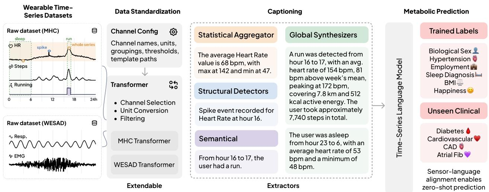  
Figure 1. TimeCap pipeline overview. Raw multivariate sensor streams are mapped into a unified Recording representation, then captioned by four composable extractor tiers (statistical, structural, semantic, crosschannel) that emit a shared annotation schema. Cross-channel synthesis composes per-channel evidence into multi-channel narratives.

Schema. Raw heterogeneous sensor streams are mapped into a unified representation by datasetspecific transformations, including choices such as channel selection, temporal resolution (e.g., minuteor hour-level aggregation), missing-value handling, alignment to a common time axis, and signalspecific preprocessing. This step standardizes inputs into a shared Recording format, which stores the data as a channel-by-time matrix together with channel metadata such as names, display names, units, and data-availability summaries. Missing values are encoded directly in the signal matrix, allowing downstream components to operate on a consistent interface independent of the original dataset schema. This unified representation also supports textual annotations through a shared Annotation schema. Each annotation records natural-language text, channel references, time intervals, and label as well as optional numerical values.

## 3.1 Captioning

We employ a modular per-channel set of extractors that transform standardized multivariate time series into a structured set of grounded signal-level captions. Following prior work on hierarchical sensor-language alignment [6], we decompose descriptions into four complementary levels, which capture increasing levels of abstraction from raw signals:

Statistical Extractor. Computes one summary annotation per continuous channel and recording, reporting four descriptive statistics: mean, maximum, minimum, and standard deviation. Each annotation is rendered through one of several deterministic natural-language templates. Channel-specific aggregation handles sensor-specific edge cases, for example excluding zero-valued heart-rate entries to avoid bias from inactive periods. The tier therefore yields at most one statistical caption per continuous channel, i.e., at most seven per OpenMHC week and exactly 16 per WESAD session (Table 2).

Structural Extractor. Localizes events within each channel, including spikes via scipy.signal. find\_peaks [26] with channel-specific constraints on height, prominence, threshold, and separation. Detects trends corresponding to sustained upward or downward changes over contiguous intervals by scanning the signal with multiple window sizes and strides, fitting a linear model within each candidate window, and retaining only those segments that satisfy predefined criteria on minimum span, coverage, efect magnitude, and goodness-of-fit. Candidate segments are labeled as increasing or decreasing according to the fitted slope; nearby segments with the same direction can be merged into longer intervals, and overlapping or contained segments are resolved to form coherent trend annotations.

Semantic Extractor. Extracts interval-based annotations directly from designated semantic channels such as sleep or workout activity channels that encode high-level event labels, typically in binary form. The extractor identifies contiguous active intervals, filters out segments shorter than a configured minimum duration, and converts each retained interval into an explicit time-bounded annotation describing the activity state (e.g., "running", "sleeping").

Cross-Channel Extractor. Combines information across multiple signals to produce coherent naturallanguage annotations. Rather than describing each channel in isolation, this stage reasons over temporal co-occurrence patterns and cross-channel relationships, allowing it to link high-level activity or sleep events with concurrent quantitative evidence from other modalities. Where a semantic activity label is available, the cross-channel tier augments it with synchronized quantitative evidence from other modalities and aggregates statistics over the activity’s full duration. A labeled walking interval, for example, is enriched with concurrent heart rate, step count, distance covered, and active energy (see Figure 10). Similarly, sleep-related synthesizers can distinguish periods spent in bed from periods spent asleep by combining the corresponding HealthKit sleep channels, including intervals where the user is in bed but not asleep. Conceptually, these annotations are defined by relationships between signals rather than by properties of any single channel alone. Cross-channel captions provide a holistic multi-modal description of behavior that no per-channel tier produces in isolation, addressing the cross-modal narrative gap left open by prior closed pipelines.

All extractor hyperparameters are fixed before annotation generation, and the entire pipeline is deterministic with no language model in the generation loop. Examples of generated annotations are provided in Appendix E.

## 3.2 MHCap

Beyond introducing the TimeCap pipeline, we introduce MHCap, an open captioned dataset for multimodal consumer wearable time-series data. Applied to the 19 Apple HealthKit channels of Open-MHC [2], MHCap converts the underlying wearable traces into joinable daily and weekly caption layers for sensor-language pretraining. These channels combine continuous HealthKit-derived measurements, including iPhone and Apple Watch mobility signals, heart rate, and active energy, with binary activity-state channels that mark semantically meaningful intervals such as sleep, walking, running, cycling, yoga, and strength-oriented activity. The corpus contains 7,005,763 captions over 908,944 retained person-days from 2,081 sharable OpenMHC participants. Each caption record retains the original user\_id and date, allowing captions to be matched back to the corresponding OpenMHC signal records. Table 2 summarizes the resulting corpus scale and the distribution of captions across extractor tiers.

Table 2. TimeCap corpus scale on OpenMHC-weekly and WESAD. For OpenMHC-weekly, 7,005,763 captions are generated with a mean of 48.5 captions per user-week for a total of 2,081 participants. For WESAD, 1,461 captions are generated with a mean of 97.4 captions per session for a total of 15 participants.
<table><tr><td colspan="3">Corpus</td><td colspan="4">Captions by tier (count, share)</td></tr><tr><td>Dataset</td><td>Unitsª</td><td>Sequencesb</td><td>Statistical</td><td>Structural</td><td>Semantic</td><td>Cross-channel</td></tr><tr><td>OPENMHC-weekly</td><td>908,944</td><td>144,412</td><td>1,002,819(14.3%)</td><td>3,191,600(45.6%)</td><td>867,948(12.4%)</td><td>1,943,396(27.7%)</td></tr><tr><td>WESAD</td><td>15</td><td>15</td><td>240 (16.4%)</td><td>1,071 (73.3%)</td><td>75 (5.1%)</td><td>75 (5.1%)</td></tr></table>

a Person-days (OpenMHC-weekly) or sessions (WESAD). b Weekly recordings (168×19 tensors) or sessions (WESAD).

Dataset-specific channel mappings, detector thresholds, cross-channel synthesizer definitions, and template banks are provided in Appendix D.1. A selection of generated captions for OpenMHC can be seen in Appendix E.1

## 3.3 WESADCap

To show that TimeCap generalizes beyond consumer wearable recordings, we additionally apply it to the controlled WESAD stress and afect dataset [14], producing WESADCap. WESADCap captions 20 chest- and wrist-worn physiological channels, including accelerometry, electrodermal activity, temperature, respiration, blood-volume pulse, electromyography, and heart rate, together with binary labels for the baseline, stress, and amusement conditions and the meditation phases. The same statistical, structural, semantic, and cross-channel tiers are instantiated at the session level, yielding captions that pair afective-state intervals with concurrent physiological and movement evidence. WESADCap therefore complements MHCap with densely sampled multimodal physiology recordings grounded in afective-state context. Table 2 summarizes the resulting corpus scale and caption-tier distribution.

Dataset-specific channel mappings, detector thresholds, cross-channel synthesizer definitions, and template banks are provided in Appendix D.2. The captions generated by TimeCap for WESAD can be seen in Appendix E.2

## 4 Experiments and Evaluation

We evaluate TSLMs on a downstream metabolic prediction task, predicting 10 participant-level health outcomes (8 binary, 2 ordinal) from a week of hourly-aggregated multi-channel sensor data. The targets are selected from the OpenMHC label set [2] with the highest positive-class prevalence in the test split. They are self-reported through in-app surveys [2], so models trained on them are not intended for diagnosis or for decisions about individuals. Each input is a 19 × 168 tensor over the 19 HealthKit channels at hourly resolution (24 hours × 7 days). Six in-distribution targets (BiologicalSex, Hypertension, Employment, Sleep Diagnosis, BMI, Happiness) are seen during fine-tuning by both models, testing whether captions improve labels the model was supervised on. Four held-out clinical conditions (Diabetes, Cardiovascular Disease, Coronary Artery Disease, Atrial Fibrillation) are excluded from fine-tuning and evaluated zero-shot, testing whether sensor-language alignment transfers to labels neither model has seen.

Baselines. We compare two models that share the OpenTSLM-SP (soft prompting) architecture [5], instantiated on the 1B and 3B variants of Llama-3.2 [27], but difer in training mix. OpenTSLM is trained only on the metabolic outcome labels, while OpenTSLM-Cap additionally trains on structural, semantic and cross-channel captions from MHCap to encode text-time-series alignment. We deliberately omit statistical captions as the time-series prompt already includes per-channel summary statistics. Any performance gap between the two therefore reflects the caption supervision, not architectural diferences. We evaluate both models at the 1B and 3B parameter scales. Training details and prompt templates are reported in Appendix A.

Metrics. We report binary outcomes with macro-F1 and accuracy at the per-week level (Table 4) and area under the ROC curve (AUROC) and area under the precision recall curve (AUPRC) at the per-user level (Table 3). Ordinal outcomes are reported with Spearman rank correlation (�) and quadratic weighted kappa (QWK) at both granularities. Per-user AUROC, AUPRC, and Spearman � serve as the primary metrics, since the targets are static participant-level attributes. Per-week metrics ofer a finer-grained view of where caption training shifts predictions. All metrics are computed on the held-out test split, with participant-level partitioning to prevent subject-level leakage.

## 4.1 Results

User-level performance. On per-user AUROC and AUPRC (Table 3), our caption-and-label finetuned OpenTSLM-Cap outperforms OpenTSLM on 29 of 32 binary metric-scale tasks across both 1B and 3B models. At the user level, captions add a signal that persists through fine-tuning and helps on every binary task, whether or not the model saw it during training.

Table 3. User-level results. OpenTSLM-Cap vs. OpenTSLM at the 1B and 3B parameter scales on the test split. Binary tasks report AUROC and AUPRC computed over per-user mean predictions. Ordinal tasks report Spearman � over the per-user mean predicted class, and QWK against the rounded per-user mean. The Majority column reports a class-prior baseline (always predict the majority class) as a no-skill floor and is excluded from best-of-row bolding. Best per task within each parameter scale in bold. †Held-out clinical task, not seen during fine-tuning.
<table><tr><td rowspan="2">Task</td><td colspan="2">Majority</td><td colspan="4">1B</td><td colspan="4">3B</td></tr><tr><td></td><td></td><td>OPENTSLM-CAP</td><td></td><td></td><td>OPENTSLM</td><td>OPENTSLM-CAP</td><td></td><td>OPENTSLM</td><td></td></tr><tr><td>Binary (AUROC / AUPRC)</td><td>AUROC AUPRC</td><td></td><td>AUROC</td><td>AUPRC</td><td>AUROC</td><td>AUPRC</td><td>AUROC</td><td>AUPRC</td><td></td><td>AUROC AUPRC</td></tr><tr><td>Biological Sex</td><td>50.00</td><td>25.38</td><td>79.24</td><td>51.72</td><td>78.90</td><td>49.99</td><td>77.86</td><td>51.24</td><td>75.47</td><td>49.80</td></tr><tr><td>Cardiovascular Disease†</td><td>50.00</td><td>15.30</td><td>65.15</td><td>29.99</td><td>62.09</td><td>26.79</td><td>67.19</td><td>28.94</td><td>65.28</td><td>26.25</td></tr><tr><td>Coronary Artery Disease†</td><td>50.00</td><td>6.90</td><td>65.88</td><td>15.76</td><td>63.38</td><td>16.62</td><td>62.46</td><td>12.57</td><td>59.94</td><td>9.69</td></tr><tr><td>Atrial Fibrillation†</td><td>50.00</td><td>3.23</td><td>68.36</td><td>7.24</td><td>59.82</td><td>4.91</td><td>64.08</td><td>7.33</td><td>61.72</td><td>5.40</td></tr><tr><td>Diabetes†</td><td>50.00</td><td>8.24</td><td>64.56</td><td>12.60</td><td>57.19</td><td>10.56</td><td>59.44</td><td>12.06</td><td>59.56</td><td>11.39</td></tr><tr><td>Employment</td><td>50.00</td><td>23.92</td><td>66.30</td><td>41.52</td><td>64.74</td><td>38.49</td><td>67.99</td><td>42.36</td><td>64.28</td><td>36.84</td></tr><tr><td>Hypertension</td><td>50.00</td><td>32.26</td><td>69.89</td><td>48.76</td><td>67.96</td><td>48.01</td><td>70.48</td><td>54.89</td><td>69.09</td><td>54.86</td></tr><tr><td>Sleep Diagnosis</td><td>50.00</td><td>19.06</td><td>59.52</td><td>25.35</td><td>58.86</td><td>26.13</td><td>60.43</td><td>26.53</td><td>57.95</td><td>24.99</td></tr><tr><td>Ordinal (Spearman ρ/ QWK)</td><td>ρ</td><td>QWK</td><td>ρ</td><td>QWK</td><td>ρ</td><td>QWK</td><td>ρ</td><td>QWK</td><td>ρ</td><td>QWK</td></tr><tr><td>BMI (5 levels)</td><td>0.00</td><td>0.00</td><td>61.12</td><td>60.56</td><td>62.30</td><td>61.50</td><td>63.94</td><td>62.30</td><td>59.19</td><td>58.59</td></tr><tr><td>Happiness (4 levels)</td><td>0.00</td><td>0.00</td><td>8.71</td><td>4.00</td><td>13.30</td><td>6.57</td><td>12.65</td><td>8.34</td><td>5.42</td><td>0.80</td></tr></table>

Generalization. Per-week macro-F1 (Table 4) reveals where this advantage is concentrated. Held-out clinical conditions show clear caption gains at the 3B scale: Cardiovascular Disease (+3.4), Diabetes (+6.1), Coronary Artery Disease (+2.6), and Atrial Fibrillation (+2.6). At the 3B scale, in-distribution ordinal tasks also show clear caption gains: OpenTSLM-Cap improves QWK by +4.8 on BMI and +5.0 on Happiness over OpenTSLM.

Table 4. Per-week results. Same model lineup at the (user, week) granularity, computed across all weekly predictions in the test split. Binary tasks (top) report macro-F1 (mean of class-0 and class-1 F1, labelsymmetric; reported as F1) and accuracy; ordinal tasks (bottom) report Spearman � and QWK. The Majority column reports a class-prior baseline (always predict the majority class) as a no-skill floor and is excluded from best-of-row bolding. Best per task within each parameter scale in bold. †Held-out clinical task, not seen during fine-tuning. User-level metrics are given in Table 3.
<table><tr><td></td><td colspan="2">Majority</td><td colspan="4">1B</td><td colspan="4">3B</td></tr><tr><td>Task</td><td colspan="2"></td><td colspan="2">OPENTSLM-CAP</td><td colspan="2">OPENTSLM</td><td colspan="2">OPENTSLM-CAP</td><td colspan="2">OPENTSLM</td></tr><tr><td>Binary (F1 / Acc)</td><td>F1</td><td>Acc</td><td>F1</td><td>Acc</td><td>F1</td><td>Acc</td><td>F1</td><td>Acc</td><td>F1</td><td>Acc</td></tr><tr><td>Biological Sex</td><td>43.47</td><td>76.91</td><td>64.59</td><td>78.71</td><td>65.20</td><td>78.12</td><td>64.87</td><td>78.29</td><td>61.24</td><td>78.40</td></tr><tr><td>Cardiovascular Disease†</td><td>43.49</td><td>76.94</td><td>61.65</td><td>72.62</td><td>61.13</td><td>76.37</td><td>62.00</td><td>70.22</td><td>58.62</td><td>67.13</td></tr><tr><td>Coronary Artery Disease</td><td>47.10</td><td>89.02</td><td>58.83</td><td>76.02</td><td>61.11</td><td>81.91</td><td>55.60</td><td>70.78</td><td>52.96</td><td>66.82</td></tr><tr><td>Atrial Fibrillation†</td><td>49.24</td><td>97.02</td><td>43.68</td><td>67.76</td><td>44.99</td><td>71.41</td><td>44.39</td><td>67.97</td><td>41.79</td><td>62.20</td></tr><tr><td>Diabetes†</td><td>46.99</td><td>88.63</td><td>53.14</td><td>67.60</td><td>51.35</td><td>65.91</td><td>59.12</td><td>74.07</td><td>53.02</td><td>67.89</td></tr><tr><td>Employment</td><td>41.71</td><td>71.57</td><td>66.50</td><td>75.79</td><td>64.17</td><td>74.55</td><td>64.97</td><td>74.40</td><td>66.84</td><td>75.44</td></tr><tr><td>Hypertension</td><td>36.86</td><td>58.37</td><td>64.56</td><td>66.54</td><td>64.01</td><td>65.67</td><td>65.52</td><td>68.38</td><td>64.34</td><td>66.46</td></tr><tr><td>Sleep Diagnosis</td><td>44.21</td><td>79.25</td><td>55.68</td><td>75.11</td><td>56.81</td><td>74.57</td><td>57.01</td><td>75.24</td><td>56.98</td><td>74.68</td></tr><tr><td>Ordinal (Spearman ρ/ QWK)</td><td>ρ</td><td>QWK</td><td>ρ</td><td>QWK</td><td>ρ</td><td>QWK</td><td>ρ</td><td>QWK</td><td>ρ</td><td>QWK</td></tr><tr><td>BMI (5 levels)</td><td>0.00</td><td>0.00</td><td>59.21</td><td>60.18</td><td>59.47</td><td>60.70</td><td>61.59</td><td>62.40</td><td>56.31</td><td>57.62</td></tr><tr><td>Happiness (4 levels)</td><td>0.00</td><td>0.00</td><td>7.79</td><td>7.54</td><td>6.80</td><td>5.04</td><td>9.02</td><td>8.02</td><td>4.70</td><td>3.00</td></tr></table>

Caption-family ablation. We also train the 1B OpenTSLM-Cap on each caption family alone, with the same splits, filtering and schedule (Table 5). Any single family raises mean per-user AUROC over OpenTSLM by 1.9 to 3.2 points, more than the 1.3 points separating the families. No family wins everywhere, but only the full mix beats OpenTSLM on all eight binary tasks, and cross-channel captions, which TimeCap adds, match structural ones on average. Labels alone stay ahead on the ordinal targets, and per-week diferences are small and mixed.

Table 5. Caption-family ablation (1B, user level). Per-user AUROC (binary) and Spearman � (ordinal) as in Table 3, whose 1B OpenTSLM-Cap is re-evaluated here as All. One seed per arm; best per row in bold. †Held-out task.
<table><tr><td></td><td colspan="5">OPENTSLM-CAP, caption family</td></tr><tr><td>Task</td><td>OPENTSLM</td><td>Structural</td><td>Semantic</td><td>Cross-channel</td><td>All</td></tr><tr><td>Binary (AUROC)</td><td></td><td></td><td></td><td></td><td></td></tr><tr><td>Biological Sex</td><td>78.90</td><td>78.87</td><td>78.42</td><td>78.56</td><td>79.10</td></tr><tr><td>Employment</td><td>64.74</td><td>69.09</td><td>66.61</td><td>66.30</td><td>66.33</td></tr><tr><td>Hypertension</td><td>67.96</td><td>68.77</td><td>71.70</td><td>70.38</td><td>69.74</td></tr><tr><td>Sleep Diagnosis</td><td>58.86</td><td>60.44</td><td>59.25</td><td>61.26</td><td>59.20</td></tr><tr><td>Cardiovascular Disease†</td><td>62.09</td><td>66.53</td><td>60.16</td><td>64.22</td><td>64.84</td></tr><tr><td>Coronary Artery Disease†</td><td>63.38</td><td>62.80</td><td>59.87</td><td>62.06</td><td>65.75</td></tr><tr><td>Atrial Fibrillation†</td><td>59.82</td><td>63.72</td><td>64.35</td><td>68.83</td><td>68.43</td></tr><tr><td>Diabetes†</td><td>57.19</td><td>68.02</td><td>67.70</td><td>66.41</td><td>64.16</td></tr><tr><td>Mean, all binary</td><td>64.12</td><td>67.28</td><td>66.01</td><td>67.25</td><td>67.19</td></tr><tr><td>Mean, held-out†</td><td>60.62</td><td>65.27</td><td>63.02</td><td>65.38</td><td>65.79</td></tr><tr><td>Ordinal (Spearman ρ)</td><td></td><td></td><td></td><td></td><td></td></tr><tr><td>BMI (5 levels)</td><td>62.30</td><td>59.47</td><td>60.89</td><td>61.85</td><td>60.56</td></tr><tr><td>Happiness (4 levels)</td><td>13.30</td><td>8.08</td><td>10.41</td><td>10.44</td><td>9.13</td></tr></table>

## 5 Discussion

With TimeCap, we contribute the first open and deterministic captioning pipeline that extends existing template hierarchies with a cross-channel synthesis tier and a channel-schema abstraction. It ofers a grounded, schema-driven alternative to LLM-driven pipelines, whose outputs cannot be reproduced, and thereby addresses both the introduced methods gap and the extensibility gap. The practical value of TimeCap is evident in MHCap, an open paired-caption layer for multimodal consumer wearables comprising over seven million captions across 908,944 person-days from 2,081 participants and covering 19 HealthKit channels. Building on this corpus, caption-augmented training of OpenTSLM [5] outperforms an architecturally identical label-only baseline on 29 of 32 user-level binary evaluations (§4.1), with the largest gains on zero-shot clinical tasks. In other words, the captions help the model understand sensor data, which also benefits tasks it was never trained on.

Ultimately, our work makes research on sensor-language models more accessible as well as transparent. First, MHCap supports training and evaluating TSLMs on real consumer wearable data in a research area that has so far depended on closed corpora. Second, since TimeCap is deterministic, every caption can be regenerated and traced back to the signal, which makes training data for health models auditable. Third, a corpus whose captions improve generalization to unseen clinical conditions lowers the barrier for studying new health outcomes at the population level in both research and downstream applications.

Limitations. Our quantitative comparison leaves two adjacent baselines untested, namely LLMgenerated captions of the same signals and frontier Vision-Language Models (VLMs) prompted on rendered signal-plot images, which would quantify the determinism-versus-lexical-diversity trade-of we deliberately make. Captions also come from fixed template banks with 20 variants per caption type, which limits their linguistic diversity. In additional zero-shot experiments not reported in Section 4, ordinal transfer to held-out blood-pressure and sleep-duration categories furthermore failed across all configurations, with parse rates collapsing and predictions defaulting to the majority class, indicating that caption supervision alone is not yet suficient for clinical labels with strong class imbalance.

Furthermore, the OpenMHC cohort is skewed toward white, male participants from the US with a median age of 39 years (Appendix C.1), and models pretrained on the corpus may not generalize uniformly to underrepresented populations. In addition, a per-user AUROC between 59.4 and 70.5 on the clinical tasks (Hypertension, Sleep Diagnosis, and the four held-out conditions) indicates population-level patterns rather than reliable individual predictions. Any individual-level use would therefore require independent prospective validation and safeguards against misuse, for example by insurers or employers (Appendix C).

Future work could add a per-channel data-availability gate before structural detection, which would prevent missing or zero-filled periods from being captioned as events, and constrained language-model post-processing, which could make captions more readable while keeping them grounded in the signal. Applying TimeCap to other cohorts and devices only requires new channel definitions, while high-frequency signals such as ECG would additionally need dedicated feature extraction. Finally, the same pipeline could caption time series beyond health, such as the industrial and energy data mentioned in the introduction.

## 6 Conclusion

We close the data, methods, and extensibility gaps for paired wearable-sensor captions with TimeCap, a deterministic captioning pipeline with no language model in the generation loop, and MHCap, an open paired-caption layer for multimodal consumer wearables, further demonstrated on WESAD as a concrete instantiation of the pipeline’s schema-agnostic extensibility. Caption-augmented OpenTSLM outperforms its label-only baseline on 29 of 32 user-level binary evaluations, with held-out clinical gains suggesting that the captions help the model understand sensor data beyond the tasks it was trained on. The pipeline provides a reproducible mechanism by which the community can regenerate, audit, and extend paired-caption resources alongside the next generation of wearable hardware.

## Acknowledgments

These data were contributed by users of the My Heart Counts Mobile Health Application study developed by Stanford University. The manuscript was prepared using the A Reproducible Workflow for Evidence-Centered Scientific Papers [28] template.

## References

[1] GBD 2019 Diseases and Injuries Collaborators. Global burden of 369 diseases and injuries in 204 countries and territories, 1990–2019: A systematic analysis for the Global Burden of Disease Study 2019. The Lancet, 396(10258):1204–1222, 2020. doi:10.1016/S0140-6736(20)30925-9.

[2] Narayan Schuetz, Yuze Bai, Lianggang Pan, Edgar Eggert, Favour Nerrise, Juan Delgado-SanMartin, Max Rosenblattl, Milana Gurbanova, Mohammad Asadi, Anders Johnson, Paul Schmiedmayer, Dennis Wang, Allan Lawrie, Daniel Seung Kim, Xin Liu, Akshay Paruchuri, Ehsan Adeli, Euan Ashley, and Kelly W. Zhang. Openmhc: Accelerating the science of wearable foundation models, 2026. URL https://arxiv.org/abs/2607.16235.

[3] Eray Erturk, Fahad Kamran, Salar Abbaspourazad, Sean Jewell, Harsh Sharma, Yujie Li, Sinead Williamson, Nicholas J. Foti, and Joseph Futoma. Beyond sensor data: Foundation models of behavioral data from wearables improve health predictions. In Proceedings of the 42nd International Conference on Machine Learning, volume 267 of Proceedings of Machine Learning Research, pages 15516–15541. PMLR, 2025. URL https://proceedings.mlr.press/v267/erturk2 5a.html.

[4] Jamie L. Adams, Tairmae Kangarloo, Yishu Gong, Vahe Khachadourian, Brian Tracey, Dmitri Volfson, Robert D. Latzman, Joshua Cosman, Jeremy Edgerton, David Anderson, Allen Best, Melissa A. Kostrzebski, Peggy Auinger, Peter Wilmot, Yvonne Pohlson, Stella Jensen-Roberts, Martijn L. T. M. Müller, Diane Stephenson, E. Ray Dorsey, and the Parkinson Study Group Watch-PD Study Investigators and Collaborators. Using a smartwatch and smartphone to assess early Parkinson’s disease in the WATCH-PD study over 12 months. npj Parkinson’s Disease, 10(112), 2024. doi:10.1038/s41531-024-00721-2. URL https://doi.org/10.1038/s41531-024-00721-2.

[5] Patrick Langer, Thomas Kaar, Max Rosenblattl, Maxwell A. Xu, Winnie Chow, Martin Maritsch, Robert Jakob, Ning Wang, Juncheng Liu, Aradhana Verma, Brian Han, Daniel Seung Kim, Henry Chubb, Scott R. Ceresnak, Aydin Zahedivash, Alexander T. Sandhu, Fatima Rodriguez, Daniel McDuf, Elgar Fleisch, Oliver Oppers Aalami, Filipe Barata, and Paul Schmiedmayer. OpenTSLM: Time-series language models for reasoning over multivariate medical text- and time-series data. In Proceedings of the 43rd International Conference on Machine Learning, volume 306 of Proceedings ofMachine Learning Research, pages 62642–62676. PMLR, 2026. URL https://proceedings.mlr.press/v306/langer26a.html.

[6] Yuwei Zhang, Kumar Ayush, Siyuan Qiao, A. Ali Heydari, Girish Narayanswamy, Max Xu, Ahmed Metwally, Jinhua Xu, Jake Garrison, Xuhai Xu, Tim Althof, Yun Liu, Pushmeet Kohli, Jiening Zhan, Mark Malhotra, Shwetak Patel, Cecilia Mascolo, Xin Liu, Daniel McDuf, and Yuzhe Yang. SensorLM: Learning the language of wearable sensors. In Advances in Neural Information Processing Systems 38 (NeurIPS), pages 52274–52310, 2025. doi:10.52202/085713-1559.

[7] Benjamin Reichman, Xiaofan Yu, Lanxiang Hu, Jack Truxal, Atishay Jain, Rushil Chandrupatla, Tajana S. Rosing, and Larry Heck. SensorQA: A question answering benchmark for daily-life monitoring. In Proceedings of the 23rd ACM Conference on Embedded Networked Sensor Systems (SenSys), pages 282–289. ACM, May 2025. doi:10.1145/3715014.3722074.

[8] Tong Guan, Zijie Meng, Dianqi Li, Shiyu Wang, Chao-Han Huck Yang, Qingsong Wen, Zuozhu Liu, Sabato Marco Siniscalchi, Ming Jin, and Shirui Pan. TimeOmni-1: Incentivizing complex reasoning with time series in large language models. In International Conference on Learning Representations, 2026. URL https://openreview.net/forum?id=kOIclg7muL.

[9] Zhe Xie, Zeyan Li, Xiao He, Longlong Xu, Xidao Wen, Tieying Zhang, Jianjun Chen, Rui Shi, and Dan Pei. ChatTS: Aligning time series with LLMs via synthetic data for enhanced understanding and reasoning. In Proceedings of the VLDB Endowment, 2025. doi:10.14778/3742728.3742735.

[10] Sirui Li, Shuhan Xiao, Mihir Joshi, Ahmed Metwally, Daniel McDuf, Wei Wang, and Yuzhe Yang. HEARTS: Benchmarking LLM reasoning on health time series. In Proceedings of the 43rd International Conference on Machine Learning, volume 306 of Proceedings of Machine Learning Research, pages 71383–71433. PMLR, 2026. URL https://proceedings.mlr.press/v306/li26hr.ht ml.

[11] Maxwell A. Xu, Harish Haresamudram, Catherine W. Liu, Patrick Langer, Jathurshan Pradeepkumar, Wanting Mao, Sunita J. Ferns, Aradhana Verma, Jimeng Sun, Paul Schmiedmayer, Xin Liu, Daniel McDuf, Emily B. Fox, and James M. Rehg. How well do multimodal models reason on ECG signals?, 2026. URL https://arxiv.org/abs/2603.00312.

[12] Michael V. McConnell, Anna Shcherbina, Aleksandra Pavlovic, Julian R. Homburger, Rachel L. Goldfeder, Daryl Waggot, Mildred K. Cho, Mary E. Rosenberger, William L. Haskell, Jonathan Myers, Mary Ann Champagne, Emmanuel Mignot, Martin Landray, Lionel Tarassenko, Robert A. Harrington, Alan C. Yeung, and Euan A. Ashley. Feasibility of obtaining measures of lifestyle from a smartphone app: The MyHeart Counts cardiovascular health study. JAMA Cardiology, 2 (1):67–76, 2017. doi:10.1001/jamacardio.2016.4395. URL https://doi.org/10.1001/jamacard io.2016.4395.

[13] Steven G. Hershman, Brian M. Bot, Anna Shcherbina, Megan Doerr, Yasbanoo Moayedi, Aleksandra Pavlovic, Daryl Waggott, Mildred K. Cho, Mary E. Rosenberger, William L. Haskell, Jonathan Myers, Mary Ann Champagne, Emmanuel Mignot, Dario Salvi, Martin Landray, Lionel Tarassenko, Robert A. Harrington, Alan C. Yeung, Michael V. McConnell, and Euan A. Ashley. Physical activity, sleep and cardiovascular health data for 50,000 individuals from the MyHeart Counts Study. Scientific Data, 6(1):24, 2019. ISSN 2052-4463. doi:10.1038/s41597-019-0016-7. URL https://doi.org/10.1038/s41597-019-0016-7.

[14] Philip Schmidt, Attila Reiss, Robert Duerichen, Claus Marberger, and Kristof Van Laerhoven. Introducing wesad, a multimodal dataset for wearable stress and afect detection. In Proceedings of the 20th ACM International Conference on Multimodal Interaction, ICMI ’18, page 400–408, New York, NY, USA, 2018. Association for Computing Machinery. ISBN 9781450356923. doi:10.1145/3242969.3242985. URL https://doi.org/10.1145/3242969.3242985.

[15] Ehud Reiter and Robert Dale. Building Natural Language Generation Systems. Cambridge University Press, 2000. URL https://www.cambridge.org/9780521620369.

[16] Albert Gatt and Emiel Krahmer. Survey of the state of the art in natural language generation: Core tasks, applications and evaluation. Journal of Artificial Intelligence Research, 61:65–170, 2018. doi:10.1613/jair.5477. URL https://arxiv.org/abs/1703.09902.

[17] Yubin Kim, Xuhai Xu, Daniel McDuf, Cynthia Breazeal, and Hae Won Park. Health-LLM: Large language models for health prediction via wearable sensor data. In Proceedings of the Fifth Conference on Health, Inference, and Learning, volume 248 of Proceedings of Machine Learning Research, pages 522–539. PMLR, 2024. URL https://proceedings.mlr.press/v248/kim24b.html.

[18] Justin Khasentino et al. A personal health large language model for sleep and fitness coaching. Nature Medicine, 31(10):3394–3403, 2025. doi:10.1038/s41591-025-03888-0.

[19] Xin Liu, Daniel McDuf, Geza Kovacs, Isaac Galatzer-Levy, Jacob Sunshine, Jiening Zhan, Ming-Zher Poh, Shun Liao, Paolo Di Achille, and Shwetak Patel. Large language models are few-shot health learners, 2023. URL https://arxiv.org/abs/2305.15525.

[20] Zhen Tan, Dawei Li, Song Wang, Alimohammad Beigi, Bohan Jiang, Amrita Bhattacharjee, Mansooreh Karami, Jundong Li, Lu Cheng, and Huan Liu. Large language models for data annotation and synthesis: A survey. In Proceedings of the 2024 Conference on Empirical Methods in Natural Language Processing, pages 930–957. Association for Computational Linguistics, 2024. doi:10.18653/v1/2024.emnlp-main.54.

[21] Zongzhe Xu, Zitao Shuai, Eideen Mozafari, Ravi Shankar Aysola, Rajesh Kumar, and Yuzhe Yang. SleepLM: Natural-language intelligence for human sleep. In Proceedings of the 43rd International Conference on Machine Learning, volume 306 of Proceedings of Machine Learning Research, pages 141707–141738. PMLR, 2026. URL https://proceedings.mlr.press/v306/xu26at.html.

[22] Aiden Doherty, Dan Jackson, Nils Hammerla, Thomas Plötz, Patrick Olivier, Malcolm H. Granat, Tom White, Vincent T. van Hees, Michael I. Trenell, Christopher G. Owen, Stephen J. Preece, Rob Gillions, Simon Sheard, Tim Peakman, Soren Brage, and Nicholas J. Wareham. Large scale population assessment of physical activity using wrist worn accelerometers: The UK Biobank study. PLOS ONE, 12(2):e0169649, 2017. doi:10.1371/journal.pone.0169649. URL https: //doi.org/10.1371/journal.pone.0169649.

[23] Andrea Weber, Vincent T. van Hees, Michael J. Stein, Sylvia Gastell, Karen Steindorf, Florian Herbolsheimer, Stefan Ostrzinski, Tobias Pischon, Mirko Brandes, Lilian Krist, Michael Marschollek, Karin Halina Greiser, Katharina Nimptsch, Berit Brandes, Carmen Jochem, Anja M. Sedlmeier, Klaus Berger, Hermann Brenner, Christoph Buck, Stefanie Castell, Marcus Dörr, Carina Emmel, Beate Fischer, Claudia Flexeder, Volker Harth, Antje Hebestreit, Jana-Kristin Heise, Bernd Holleczek, Thomas Keil, Lena Koch-Gallenkamp, Wolfgang Lieb, Claudia Meinke-Franze, Karin B. Michels, Rafael Mikolajczyk, Alexander Kluttig, Nadia Obi, Annette Peters, Börge Schmidt, Sabine Schipf, Matthias B. Schulze, Henning Teismann, Sabina Waniek, Stefan N. Willich, Michael F. Leitzmann, and Hansjörg Baurecht. Large-scale assessment of physical activity in a population using high-resolution hip-worn accelerometry: the German National Cohort (NAKO). Scientific Reports, 14:7927, 2024. doi:10.1038/s41598-024-58461-5. URL https://doi.org/10.1038/s41598-024-58461-5.

[24] Theresa Patten, Edward A. Preble, Hiral Master, Jennifer Adjemian, Andrea Ramirez, James McClain, and Amy Rose Price. The All of Us research program’s wearables dataset. Nature Medicine, 2026. doi:10.1038/s41591-026-04352-3. URL https://doi.org/10.1038/s41591-026 -04352-3.

[25] Shing Chan, Hang Yuan, Catherine Tong, Aidan Acquah, Abram Schonfeldt, Jonathan Gershuny, and Aiden Doherty. CAPTURE-24: A large dataset of wrist-worn activity tracker data collected in the wild for human activity recognition. Scientific Data, 11, 2024. doi:10.1038/s41597-024- 03960-3. URL https://doi.org/10.1038/s41597-024-03960-3.

[26] Pauli Virtanen, Ralf Gommers, Travis E. Oliphant, Matt Haberland, Tyler Reddy, David Cournapeau, Evgeni Burovski, Pearu Peterson, Warren Weckesser, Jonathan Bright, Stéfan J. van der Walt, Matthew Brett, Joshua Wilson, K. Jarrod Millman, Nikolay Mayorov, Andrew R. J. Nelson, Eric Jones, Robert Kern, Eric Larson, C J Carey, İlhan Polat, Yu Feng, Eric W. Moore, Jake VanderPlas, Denis Laxalde, Josef Perktold, Robert Cimrman, Ian Henriksen, E. A. Quintero, Charles R. Harris, Anne M. Archibald, Antônio H. Ribeiro, Fabian Pedregosa, Paul van Mulbregt, and SciPy 1.0 Contributors. SciPy 1.0: Fundamental algorithms for scientific computing in python. Nature Methods, 17:261–272, 2020. doi:10.1038/s41592-019-0686-2.

[27] Meta. Llama 3.2: Revolutionizing edge AI and vision with open, customizable models. https: //ai.meta.com/blog/llama-3-2-connect-2024-vision-edge-mobile-devices/, September 2024. Accessed 2026.

[28] Paul Schmiedmayer. A Reproducible Workflow for Evidence-Centered Scientific Papers, 2026. URL https://doi.org/10.5281/zenodo.23361126.

[29] Edward J. Hu, Yelong Shen, Phillip Wallis, Zeyuan Allen-Zhu, Yuanzhi Li, Shean Wang, Lu Wang, and Weizhu Chen. Lora: Low-rank adaptation of large language models. In International Conference on Learning Representations, 2022. URL https://arxiv.org/abs/2106.09685.

[30] Catrine Tudor-Locke, Scott W. Ducharme, Elroy J. Aguiar, John M. Schuna, Jr, Tiago V. Barreira, Christopher C. Moore, Colleen J. Chase, Zachary R. Gould, Marcos A. Amalbert-Birriel, Jose Mora-Gonzalez, Stuart R. Chipkin, and John Staudenmayer. Walking cadence (steps/min) and intensity in 41 to 60-year-old adults: the CADENCE-adults study. International Journal of Behavioral Nutrition and Physical Activity, 17(1):137, nov 2020. doi:10.1186/s12966-020- 01045-z.

[31] Jakob Ziegler, Hubert Gattringer, and Andreas Müller. On the relation between gait speed and gait cycle duration for walking on even ground. Journal of Biomechanics, 164:111976, 2024. ISSN 0021-9290. doi:10.1016/j.jbiomech.2024.111976. URL https://www.sciencedirect.com/ science/article/pii/S0021929024000538.

[32] Richard L. Page, José A. Joglar, Mary A. Caldwell, Hugh Calkins, Jamie B. Conti, Barbara J. Deal, N.A. Mark Estes, Michael E. Field, Zachary D. Goldberger, Stephen C. Hammill, Julia H. Indik, Bruce D. Lindsay, Brian Olshansky, Andrea M. Russo, Win-Kuang Shen, Cynthia M. Tracy, and Sana M. Al-Khatib. 2015 acc/aha/hrs guideline for the management of adult patients with supraventricular tachycardia. JACC, 67(13):e27–e115, 2016. doi:10.1016/j.jacc.2015.08.856. URL https://www.jacc.org/doi/abs/10.1016/j.jacc.2015.08.856.

[33] Stephen D Herrmann, Erik A Willis, Barbara E Ainsworth, Tiago V Barreira, Mary Hastert, Chelsea L Kracht, John M Schuna, Jr, Zhenghui Cai, Minghui Quan, Catrine Tudor-Locke, Melicia C Whitt-Glover, and David R Jacobs, Jr. 2024 adult compendium of physical activities: A third update of the energy costs of human activities. J. Sport Health Sci., 13(1):6–12, January 2024. doi:10.1016/j.jshs.2023.10.010.

[34] Kishan Bakrania, Thomas Yates, Alex V Rowlands, Dale W Esliger, Sarah Bunnewell, James Sanders, Melanie Davies, Kamlesh Khunti, and Charlotte L Edwardson. Intensity thresholds on raw acceleration data: Euclidean norm minus one (ENMO) and mean amplitude deviation (MAD) approaches. PLoS One, 11(10):e0164045, October 2016. doi:10.1371/journal.pone.0164045.

[35] Juan Corral-Pérez, Borja Martinez-Tellez, Daniel Velázquez-Díaz, Jesus Gustavo Ponce-Gonzalez, Ana Carbonell-Baeza, and David Jiménez-Pavón. Thermal resting pattern and acute skin temperature response to exercise in older adults: Role of cardiorespiratory fitness. Journal of Thermal Biology, 117:103678, 2023. ISSN 0306-4565. doi:10.1016/j.jtherbio.2023.103678. URL https://www.sciencedirect.com/science/article/pii/S030645652300219X.

## A Training

Both OpenTSLM and OpenTSLM-Cap are fine-tuned for one epoch on their respective training mixes (label-only vs. caption + label), with all updates routed through LoRA adapters [29] $( r = 1 6 , \alpha = 3 2 )$ Optimization uses AdamW with a linear warmup-linear decay schedule (warmup over the first 3% of total steps), gradient-clip norm 1.0, weight decay $1 0 ^ { - 2 }$ , batch size 8, and per-group learning rates of $2 \times 1 0 ^ { - 4 }$ for the time-series encoder and $1 \times 1 0 ^ { - 4 }$ for the projector and LoRA parameters. Each configuration was trained on a single NVIDIA H100 80 GB for approximately 35 hours, totaling roughly 140 GPU-hours across the four reported (model, scale) configurations. The two runs at each scale are identical in every other respect, isolating the efect of the caption supervision. Each task is posed to the model as a natural-language question with a fixed set of admissible answer strings (e.g., “Is this person biologically male or female?” with answers Male / Female); the per-task question templates and admissible-answer mappings are shown in Figure 2.

## B Evaluation Protocol

## B.1 Splits

We use participant-level train/validation/test splits at a 60/10/30 ratio with seed 42, restricted to participants who consented to data sharing with all qualified researchers [2]. After applying OpenMHCbenchmark’s data-quality filter (7-day windows containing at least 5 days that pass daily wear-time and per-channel variance thresholds; see Appendix B.3 and the benchmark protocol Schuetz et al. [2]), 2,081 of the 11,894 sharable participants remain captionable, with 604 falling in the test partition; no participant appears in more than one split, eliminating subject-level leakage. Per-task evaluation N varies further (279–587 users) due to label availability, see Table 6.

Table 6. Per-task test-set composition: binary tasks. Captioned test partition: 604 unique users; per-task counts vary due to per-label NaN filtering. “n\_pos” is the minority-class user count (the convention used for AUPRC reporting); the minority label is given in parentheses where it difers from the codebase default. †Held-out clinical task, not seen during fine-tuning.
<table><tr><td>Task</td><td>n_users</td><td>n_pos</td><td>prev. (%)</td></tr><tr><td>Biological Sex (Female=pos)</td><td>587</td><td>149</td><td>25.4</td></tr><tr><td>Hypertension</td><td>279</td><td>90</td><td>32.3</td></tr><tr><td>Employment (False=pos)</td><td>531</td><td>127</td><td>23.9</td></tr><tr><td>Sleep Diagnosis</td><td>530</td><td>101</td><td>19.1</td></tr><tr><td>Diabetes†</td><td>279</td><td>23</td><td>8.2</td></tr><tr><td>Cardiovascular Disease†</td><td>464</td><td>71</td><td>15.3</td></tr><tr><td>Coronary Artery Disease†</td><td>464</td><td>32</td><td>6.9</td></tr><tr><td>Atrial Fibrillation†</td><td>464</td><td>15</td><td>3.2</td></tr></table>

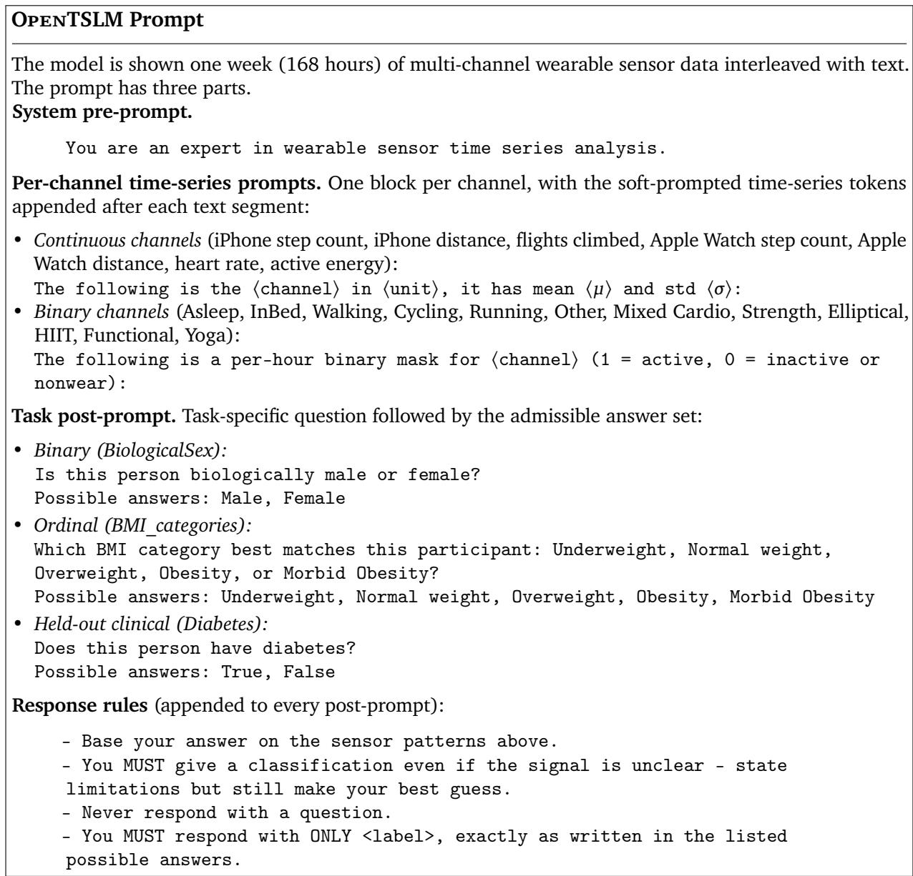  
Figure 2. Prompt template used for OpenTSLM and OpenTSLM-Cap evaluation.

Table 7. Per-task test-set composition: ordinal tasks. User counts per ordinal level. Spearman � and QWK reliability scales with the spread of both predicted and ground-truth scores, so heavily concentrated tasks (e.g., Happiness, with 75% of users in High/Very High) have lower efective signal than tasks where the distribution is more even (e.g., BMI).
<table><tr><td>Task</td><td>n_users</td><td>Level distribution (n, %)</td></tr><tr><td>BMI (5 levels)</td><td>557</td><td>Underweight 25 (4.5%); Normal weight 175 (31.4%); Overweight 206 (37.0%); Obesity 121 (21.7%); Morbid Obesity 30 (5.4%)</td></tr><tr><td>Happiness (4 levels)</td><td>328</td><td>Low 28 (8.5%); Medium 53 (16.2%); High 133 (40.5%); Very High</td></tr><tr><td></td><td></td><td>114 (34.8%)</td></tr></table>

## B.2 Aggregation Conventions

TSLM predictions are emitted at the (user, week) level. Table 4 reports per-week metrics (F1, accuracy, Spearman �, QWK) computed across all weekly predictions in the test split. Table 3 reports userlevel metrics: per-user AUROC and AUPRC are computed by aggregating each user’s weekly binary predictions to a mean and ranking across users; per-user Spearman � uses the user’s mean predicted class against the user’s static label; per-user QWK is computed against the rounded user-mean.

## B.3 Data Curation

MHCap inherits the data-quality filters of the OpenMHC benchmark [2]. A period counts as non-wear when all seven continuous channels are zero or missing for more than 30 consecutive minutes, and a day is retained only if it has at least 12 hours of estimated wear time and passes per-channel variance thresholds that remove near-constant sensor artifacts. A week is captioned only if at least five of its seven days are retained, which leaves 2,081 of the 11,894 sharable participants. On retained days, zero heart-rate values are set to missing. Step, distance, and active-energy channels are set to missing for a whole day only if they are zero throughout that day, and zero sleep minutes are set to missing on days with less than three hours of detected sleep. No values are imputed, so missing values remain explicit in the signal matrix (Section 3). Per-channel data availability can be recovered from the missingness mask of the corresponding OpenMHC week. Zero-filled periods within a retained day can still be captioned as events, which motivates the per-channel data-availability gate discussed in Section 5.

## C Responsible Use and Release

MHCap is intended for research on aligning wearable time series with natural language, such as pretraining and evaluating TSLMs. All health outcomes in our evaluation come from the OpenMHC label set and are self-reported through in-app surveys and not derived by clinical examination or diagnostic testing [2]. The tasks characterize self-reported participant attributes and do not forecast future clinical events. Neither MHCap nor models trained on it are intended for diagnosis or for decisions about individuals.

## C.1 Cohort Composition

The OpenMHC cohort reflects the population that chooses to use a digital health app and is not representative of the general public [2]. The median participant is 39 years old. Of the participants who reported their biological sex, 77.1% are male, and of the 31.7% who reported their ethnicity, 82.4% are white. About 90% of participants are from the US, about 10% from the UK, and less than 1% from Hong Kong. Half of the participants contributed less than one week of data, and 13.1% contributed at least one year. These figures describe all 11,894 OpenMHC participants. The 2,081 participants in MHCap passed an additional data-quality filter (Appendix B.3), so their composition may difer. In our test split, 25.4% of users with a biological-sex label are female (Table 6), close to the 22.9% in the full cohort.

## C.2 Data Availability and Access

The underlying OpenMHC data are planned for release to qualified researchers under a research use agreement with the Stanford University School of Medicine [2]. The TimeCap pipeline is publicly available under the MIT license.1 Precomputed MHCap captions will be released alongside OpenMHC under the same research-use terms. Researchers with authorized access to the underlying data can regenerate the captions using the public pipeline. These terms restrict use to personal, non-commercial research and prohibit re-identification as well as redistribution without prior written permission from the Stanford University School of Medicine. They allow training generative models only if no data can be obtained or recreated from them, and they exclude use in diagnosis or patient care. These safeguards rely on agreements and cannot technically prevent misuse.

## C.3 Privacy

MHCap involves no new data collection. Captions describe only the 19 sensor channels and contain no survey responses or demographic information. Each caption record retains the participant identifier and date of the corresponding OpenMHC record (Section 3). In OpenMHC, dates are shifted by a random whole-week ofset per participant, which prevents linking records to absolute calendar dates [2]. Caption records follow the same date shift, and the caption text itself contains no calendar dates.

## D Dataset-Specific Configurations

## D.1 MHCap Configuration

The OpenMHC instantiation of TimeCap uses dataset-specific channel mappings, aggregation rules (Table 8), structural-detector thresholds, and cross-channel synthesizers while preserving the same statistical, structural, semantic, and cross-channel pipeline described in Section 3. For readability, the configuration tables use compact channel aliases: IP denotes iPhone-derived channels and W denotes

Apple Watch-derived channels. The released implementation maps these aliases to the corresponding HealthKit identifiers.

Statistical aggregation is configured per channel family. In the current implementation, continuous movement and energy channels use the default metric aggregator (mean, max, min, std), while heart rate uses non-zero aggregation to avoid bias from zero-valued entries. Sleep/workout label channels are handled through semantic interval extraction and cross-channel synthesis (not via statistical aggregation). Template banks contain multiple deterministic variants per annotation family, introducing controlled linguistic diversity while preserving the same underlying signal content.

Table 8. OpenMHC statistical aggregation configuration (current implementation).
<table><tr><td>Channels</td><td>Aggregator</td><td>Extractor output</td></tr><tr><td>IPSteps, IPDist, IPFlights, WSteps, WDist, MetricAggregator (default) WEnergy</td><td></td><td>Mean, max, min, std</td></tr><tr><td>WHR</td><td>NonZeroAggregator</td><td>Non-zero mean, max, min, std</td></tr></table>

Structural spike detection is configured only for continuous channels. Table 9 reports detector parameters, while the rationale for each threshold is given below.

Table 9. OpenMHC spike-detector configuration. All spike detectors use min\_width=1, top\_k=4.
<table><tr><td>Channels</td><td>filter_zeros</td><td>min_height</td><td>min_prominence</td><td>min_distance</td><td>Unit</td></tr><tr><td>IPSteps, WSteps</td><td>False</td><td>100.0</td><td>0.0</td><td>10</td><td>steps/min</td></tr><tr><td>IPDist, WDist</td><td>False</td><td>72.0</td><td>0.0</td><td>10</td><td>m/min</td></tr><tr><td>IPFlights</td><td>False</td><td>1.0</td><td>0.0</td><td>10</td><td>count/min</td></tr><tr><td>WHR</td><td>True</td><td>100.0</td><td>5.0</td><td>20</td><td>bpm</td></tr><tr><td>WEnergy</td><td>False</td><td>3000.0</td><td>0.0</td><td>15</td><td>cal/min</td></tr></table>

The spike thresholds are intended as conservative descriptive heuristics rather than clinical or diagnostic cutofs. For step count, min\_height=100 steps/min follows the common cadence heuristic that approximately 100 steps/min corresponds to moderate-intensity walking in adults [30]. For distance, min\_height=72 m/min corresponds to 1.2 m/s, which lies within typical preferred walking-speed ranges and provides a simple distance-based analog to the cadence threshold [31]. For flights climbed, min\_height=1 flight/min marks discrete stair-climbing events. For heart rate, min\_height=100 bpm is used as an elevated-heart-rate heuristic, with min\_prominence=5 bpm to suppress minor fluctuations around the threshold [32]. For active energy, min\_height=3000 cal/min corresponds to 180 kcal/hour above rest. Since active energy excludes resting expenditure, this is a conservative threshold relative to a gross MET-based moderate-intensity benchmark: for a 60–70 kg individual, 3 METs corresponds to approximately 180–210 kcal/hour in gross expenditure, but only about 120–140 kcal/hour above rest. The threshold therefore prioritizes periods with clearly elevated active energy expenditure [33].

Trend detection uses the same scanning defaults across movement and physiology channels, with heart rate zero-filtered. To keep the table compact, Table 10 reports only channel groups and efective parameter settings.

Table 10. OpenMHC trend-detector configuration. Unless overridden, trend detectors use window\_fracs=(0.1, 0.25, 1.0), min\_window=12, and stride\_frac=0.25.
<table><tr><td>Channels</td><td>filter_zeros</td><td>min_coverage</td><td> $\mathtt { m i n \_ e f f e c t }$ </td><td> $\mathtt { m i n \_ r 2 }$ </td><td>Notes</td></tr><tr><td>IPSteps, IPDist, IPFlights, WSteps, WDist, WEnergy</td><td>False</td><td>0.75</td><td>1.25</td><td>0.50</td><td>Default</td></tr><tr><td>WHR</td><td>True</td><td>0.75</td><td>1.25</td><td>0.50</td><td>Zero-filtered</td></tr></table>

All listed trend detectors use min\_span=10 and merge\_gap=5.

Semantic extractors operate on binary sleep and workout channels by identifying contiguous active intervals and filtering out intervals shorter than the configured minimum duration. Cross-channel synthesizers then enrich these semantic intervals with temporally aligned evidence from supporting continuous channels. Table 11 summarizes the OpenMHC synthesizer definitions.

Table 11. OpenMHC cross-channel synthesizer definitions. All listed synthesizers are instantiated with min\_duration=5 at minute resolution.
<table><tr><td>Synthesizer</td><td>Source channels</td><td>Supporting channels</td><td>Output labels</td></tr><tr><td>Sleep</td><td>SleepAsleep, Sleep- WHR, WDist, WSteps InBed</td><td></td><td>sleep_asleep, sleep_inbed, in_bed_not_sleeping</td></tr><tr><td>Walking</td><td>Walk</td><td>WHR, WDist, WSteps, WEnergy</td><td>walking</td></tr><tr><td>Cardio</td><td>Run, Cycle</td><td>WHR, WDist, WEnergy; cardio_running, WSteps for Run</td><td>cardio_cycling</td></tr><tr><td>EnduranceActivity</td><td>dio</td><td>Elliptical, MixedCar- WHR, WDist, WEnergy</td><td>endurance_elliptical, endurance_mixed_cardio</td></tr><tr><td>StationaryActivity</td><td>tional</td><td>HIIT, Strength, Func- WHR, WEnergy, WDist, WSteps</td><td>stationary_hiit, stationary_strength, stationary_functional</td></tr><tr><td>MindBodyActivity</td><td>Yoga</td><td>WHR, WEnergy, WDist, r WSteps</td><td>mind_body_yoga</td></tr><tr><td>OtherActivity</td><td>Other</td><td>WHR, WDist, WEnergy</td><td>other_activity</td></tr></table>

Cross-channel synthesizers are grouped by the type of semantic interval they enrich. Sleep synthesizers distinguish asleep, in-bed, and in-bed-not-asleep intervals, while activity synthesizers attach concurrent physiological and movement evidence to walking, cardio, endurance, stationary, mind-body, and other workout intervals. This keeps the semantic event label grounded in the binary HealthKit channel while adding synchronized quantitative context from heart rate, distance, step count, and active energy where available.

## D.2 WESADCap Configuration

The WESAD instantiation of TimeCap uses dataset-specific channel mappings, per-channel aggregation rules, structural-detector thresholds, and state-conditioned cross-channel synthesizers while preserving the same statistical, structural, semantic, and cross-channel pipeline described in Section 3. In the released implementation, channels are represented by explicit WESAD identifiers and processed on a per-second timeline (time\_unit=seconds).

Preprocessing and channel construction. Raw WESAD streams are transformed into second-level channels before caption extraction. Continuous channels are binned to 1-second resolution using within-second mean aggregation, while state labels are mapped to one-hot binary channels by majority vote within each second. Specifically:

• Chest streams (ACC, EMG, EDA, Temp, Resp) are resampled from the chest sampling grid (700 Hz) to per-second bins.

• Wrist streams are resampled from their native rates to per-second bins: ACC (32 Hz), BVP (64 Hz), EDA (4 Hz), TEMP (4 Hz), and HR (1 Hz from E4 files).

• Derived channels are constructed before binning: acceleration magnitudes (acc\_mag) are Euclidean norms over xyz axes; respiration and BVP magnitudes are rectified (absolute value).

• Wrist acceleration is converted to g units via the implementation constant 1/64.

• Label channels (baseline, stress, amusement, meditation) are generated as binary per-second state indicators via majority vote over the original label samples in each second.

• HR alignment uses the inferred session start ofset from E4 alignment; non-finite values are retained as missing (NaN) and ignored by downstream extractors.

Statistical aggregation is configured separately from structural detection. Continuous channels use the default metric aggregation (mean, max, min, std), while wrist heart rate uses non-zero aggregation to avoid bias from zero-valued entries. Label channels are primarily consumed by semantic and cross-channel extractors rather than statistical summaries.

Table 12. WESAD statistical aggregation configuration (current implementation).
<table><tr><td>Channels</td><td>Aggregator</td><td>Extractor output</td></tr><tr><td>wesad:e4:hr</td><td>NonZeroAggregator</td><td>Non-zero mean, max, min, std</td></tr><tr><td>All other channels</td><td>MetricAggregator (default) </td><td>Mean, max, min, std</td></tr></table>

Structural detectors are configured only for continuous channels. To keep the layout compact, trend and spike parameters are grouped by channel family.

Table 13. WESAD trend-detector configuration by channel group.
<table><tr><td>Channels</td><td>filter_zeros</td><td>min/max_window</td><td>min_effect</td><td>min_r2</td><td>Notes</td></tr><tr><td>Chest/Wrist ACC axes and ACC magnitude</td><td>False</td><td>40 / 150</td><td>1.8</td><td>0.40</td><td>min_span=30, merge_gap=15</td></tr><tr><td>Chest EMG</td><td>False</td><td>20 / 240</td><td>0.6</td><td>0.15</td><td>min_span=14, merge_gap=15</td></tr><tr><td>Wrist HR (wesad:e4:hr)</td><td>True</td><td>defaults</td><td>1.25</td><td>0.50</td><td>defaults: min_span=10, merge_gap=5</td></tr><tr><td>Chest/Wrist EDA</td><td>False</td><td>30 / 240</td><td>0.10</td><td>0.60</td><td>min_span=40, merge_gap=15</td></tr><tr><td>Chest/Wrist temperature</td><td>False</td><td>90 / 600</td><td>0.18</td><td>0.70</td><td>min_span=60, merge_gap=30</td></tr><tr><td>Chest respiration</td><td>False</td><td>24 / 180</td><td>0.75</td><td>0.20</td><td>min_span=16, merge_gap=15</td></tr><tr><td>Wrist BVP</td><td>False</td><td>20/300</td><td>0.7</td><td>0.15</td><td>min_span=14, merge_gap=15</td></tr></table>

Trend defaults (when not overridden): window\_fracs=(0.1,0.25,1.0), min\_window=12, stride\_frac=0.25, min\_coverage=0.75, min\_effect=1.25, min\_r2=0.5, min\_span=10, merge\_gap=5.

The spike thresholds are intended as conservative descriptive heuristics rather than clinical or diagnostic cutofs. For acceleration magnitude, the chest and wrist spike prominences (0.05/0.10 g) are set above the raw-accelerometry thresholds reported by [34], who found wrist ENMO cut-points of approximately 26–53 mg for separating sedentary behavior from motion-based light-intensity activities;

Table 14. WESAD spike-detector configuration. All spike detectors use min\_width=1, top\_k=4, and min\_distance=60.
<table><tr><td>Channels</td><td>filter_zeros</td><td>min_height</td><td>min_prominence</td><td>Unit</td></tr><tr><td>Chest ACC magnitude</td><td>False</td><td>一</td><td>0.05</td><td>g</td></tr><tr><td>Wrist ACC magnitude</td><td>False</td><td>一</td><td>0.10</td><td>g</td></tr><tr><td>Wrist HR</td><td>True</td><td>100.0</td><td>5.0</td><td>bpm</td></tr><tr><td>Chest EDA</td><td>False</td><td>一</td><td>0.25</td><td>μS</td></tr><tr><td>Wrist EDA</td><td>False</td><td>一</td><td>0.50</td><td>μS</td></tr><tr><td>Chest/Wrist temperature</td><td>False</td><td>一</td><td>0.25</td><td>℃</td></tr><tr><td>Chest respiration</td><td>False</td><td>一</td><td>10.0</td><td>a.u.</td></tr><tr><td>Wrist BVP</td><td>False</td><td>一</td><td>200.0</td><td>a.u.</td></tr></table>

our thresholds therefore prioritize more salient movement excursions rather than all light movement events. For HR, we reuse the same detector as in the MHCap configuration, with min\_height=100 bpm and min\_prominence=5 bpm, thereby preserving the same elevated-rate heuristic and citation rationale [32]. For EDA, the chest and wrist channels appear to difer substantially in scale, so we use sensor-specific prominence thresholds (chest 0.25, wrist 0.50) to avoid narrating small scale-dependent fluctuations as salient events. For temperature, min\_prominence=0.25 °C is used to suppress small local fluctuations while still capturing salient thermal excursions, motivated by reported acute exerciserelated skin-temperature changes that occur on the order of several tenths of a degree to about one degree Celsius depending on body site [35]. For respiration and BVP, the signal values are expressed in arbitrary units; thresholds were therefore selected heuristically. Higher prominence thresholds (10.0 and 200.0) help reduce false positives arising from oscillatory baselines and artifact-heavy waveform amplitudes.

Trend detection in WESAD follows a shared scanning framework, but channel-specific thresholds are used for both movement and physiology signals; heart rate is additionally zero-filtered. To keep the table compact, Table 13 reports channel groups and their efective parameter settings.

Semantic extractors operate on binary state-label channels by identifying contiguous active intervals and filtering out intervals shorter than the configured minimum duration. Cross-channel synthesizers then enrich these state intervals with temporally aligned evidence from physiology and movement channels.

Table 15. WESAD cross-channel synthesizer definitions. All listed synthesizers are instantiated with min\_duration=30 at second resolution.
<table><tr><td>Synthesizer</td><td>Source channel</td><td>Supporting channels</td><td>Output label</td></tr><tr><td>StressResponseSynthesizer</td><td>wesad:label:stress</td><td>HR, chest/wrist EDA, chest respiration, stress_response chest/wrist ACC magnitude</td><td></td></tr><tr><td>RecoveryCalmSynthesizer (baseline)</td><td>wesad:label:baseline</td><td>HR, chest/wrist EDA, chest respiration, calm_baseline chest/wrist ACC magnitude</td><td></td></tr><tr><td>RecoveryCalmSynthesizer (meditation) wesad:label:meditation</td><td></td><td>HR, chest/wrist EDA, chest respiration, calm_meditation chest/wrist ACC magnitude</td><td></td></tr><tr><td>AmusementActivationSynthesizer</td><td>wesad:label:amusement</td><td>HR, chest/wrist EDA, chest/wrist ACC amusement_activation magnitude</td><td></td></tr></table>

Cross-channel synthesizers are grouped by afective-state semantics: stress activation, calm recovery (baseline/meditation), and amusement activation. Each synthesized interval remains grounded in the active binary state channel, while metric sufixes add synchronized context from HR, EDA, respiration, and movement, with chest-vs-wrist channel choice resolved adaptively from the strongest available evidence in each interval.

## E Generated Caption

Time-aligned examples of captions generated by TimeCap for each dataset are presented below.

## E.1 MHCap Captions

The captioned examples for MHCap can be seen in Figures 3-12.

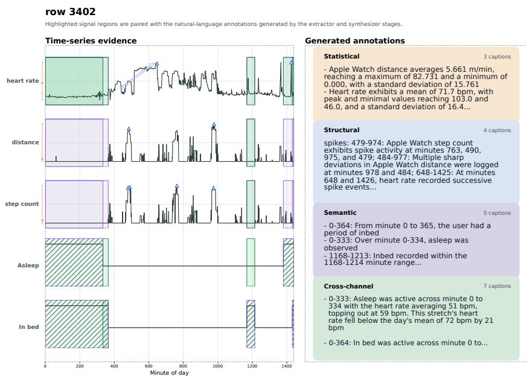  
Figure 3. Example with sleep caption 1

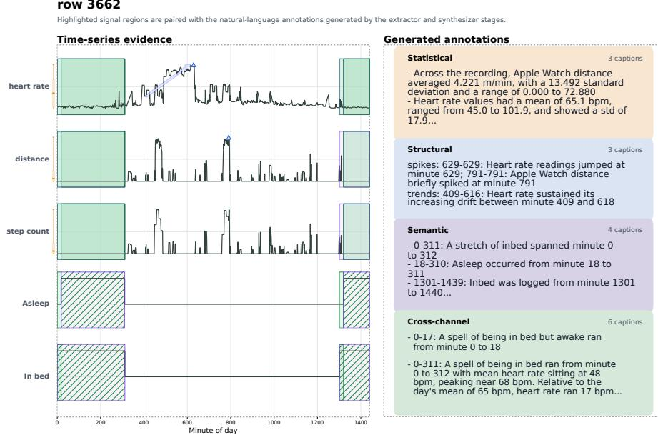  
Figure 4. Example with sleep caption 2

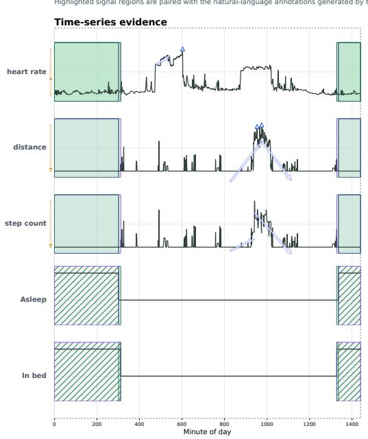  
Figure 5. Example with sleep caption 3

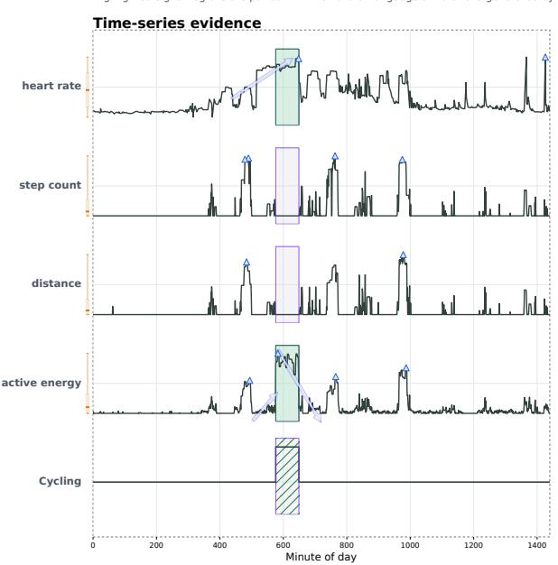  
Figure 6. Example with cycling

Aggregated Apple Watch step count: mean 4.8 steps/min, std 14.5, min 0.0, max 94.2 - The average Apple Watch distance value is 4.333 m/min, with extremes at 82.841 (max) and 0.000 (min), and a std of 13.782 - The heart rate data exhibits a mean of 68.7...

spikes: 603-603: A brief surge in heart rate was seen at minute 603; 953-974: At minutes 975 and 953, Apple Watch distance recorded successive spike events trends: 480-542: Over minute 480 to 544, heart rate was increasing; 828-974: Apple Watch distance continued increasing from minute 828...

\- 0-301: The interval minute 0 to 302 was asleep with the heart rate averaging 52 bpm, with heart rate climbing to 65 bpm at its highest. This stretch's heart rate fell below the day's mean of 69 bpm by 17 bpm. During the sleep period the person stayed put

\- Apple Watch distance averages 5.661 m/min, reaching a maximum of 82.731 and a minimum of 0.000, with a standard deviation of 15.761 - For the active energy measurements, the mean is 844.9 cal/min, the standard deviation is 1801.7, and the data lies between 0.0 and...

spikes: 479-974: Apple Watch step count exhibits spike activity at minutes 763, 490, 975, and 479; 484-977: Multiple sharp deviations in Apple Watch distance were logged at minutes 978 and 484; 494-986: Active energy briefly spiked across minutes 583, 987, 765, and 494; 648-1425: At minutes 648 and 1426,...

\- 576-648: Cycling interval ran from minute 576 to 649

\- 576-648: Cycling was active across minute 576 to 649 and an average heart rate of 95 bpm, with a peak heart rate of 102 bpm. Over this interval the heart rate was 23 bpm above the day's mean of 72 bpm. Watch active energy averaged 7130 cal/min over this period. Across this period the watch logged 520459 cal of...

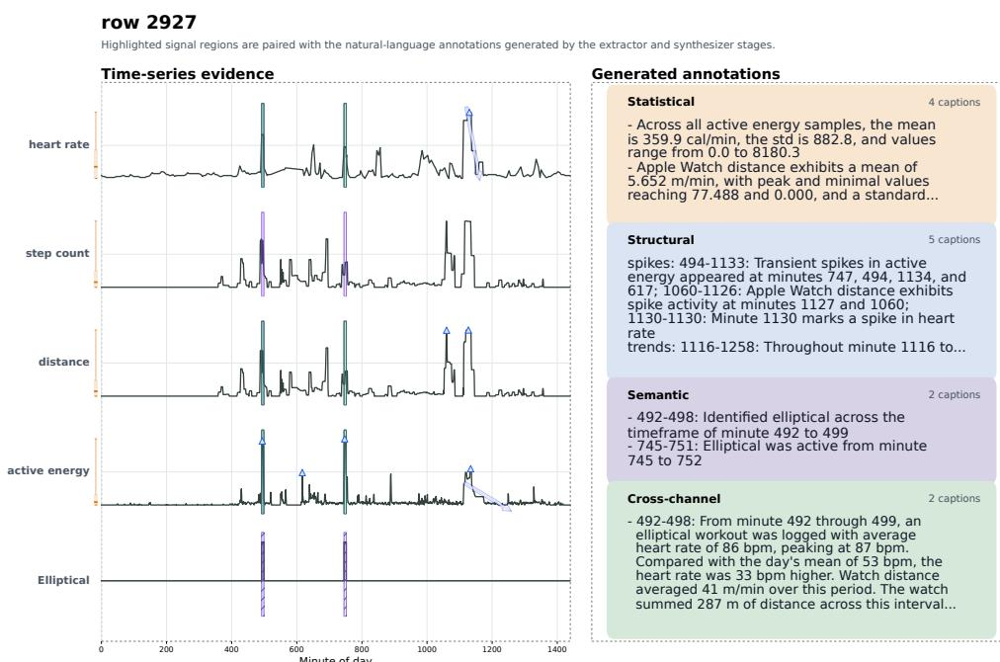

Figure 7. Example with elliptical  
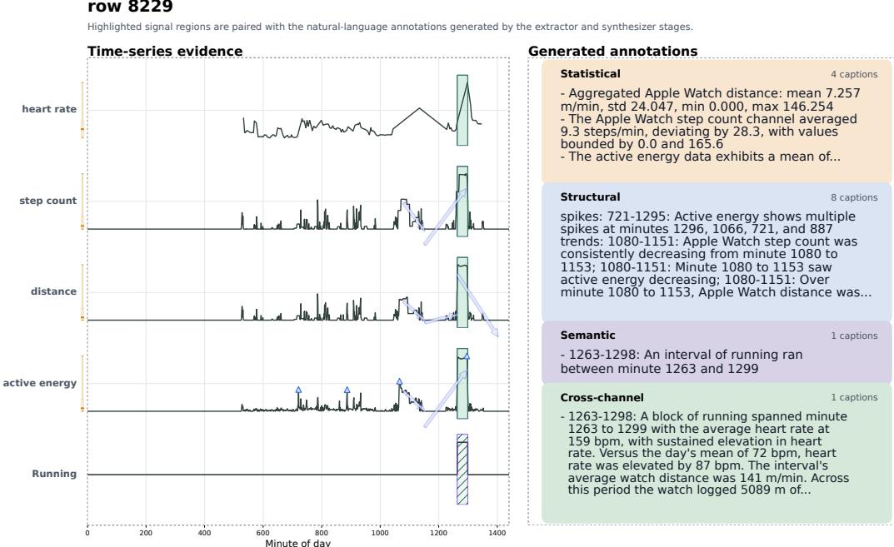  
Figure 8. Example with running

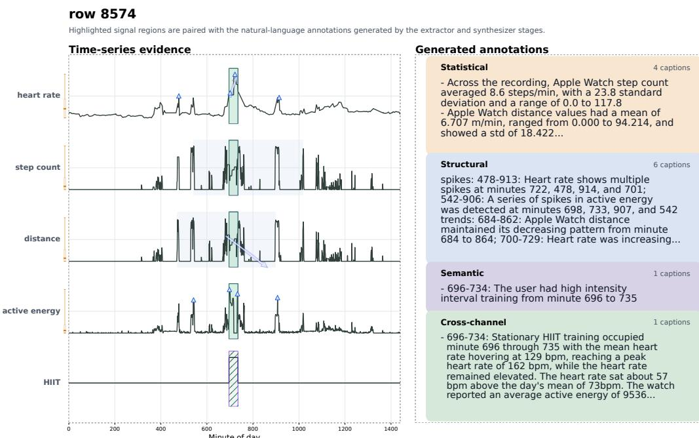

Figure 9. Example with HIIT  
Figure 10. Example with walking 1  
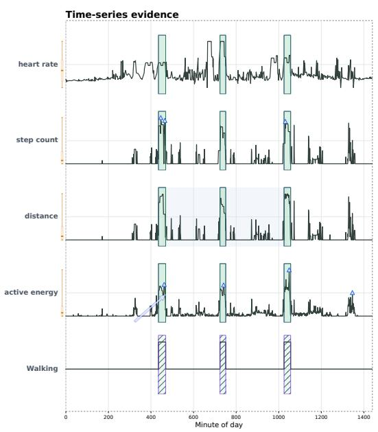

Statistical 4 captions - Across the recording, heart rate averaged   
63.9 bpm, with a 13.0 standard deviation and a range of 43.0 to 99.3   
- Active energy values had a mean of 431.2   
cal/min, ranged from 0.0 to 6111.8, and showed a std of 893.5...

spikes: 446-1030: Apple Watch step count briefly spiked across minutes 446, 1031, and 465; 462-1345: Active energy peaked abruptly across minutes 1049, 462, 741, and 1346 trends: 324-466: Minute 324 to 468 saw active energy increasing other: 455-1041: Localized Apple Watch.

- 435-468: Walking was detected from minute   
435 to 469   
- 724-750: An interval of walking ran between   
minute 724 and 751   
- 1025-1055: Walking extended from minute 1025   
to 1056

\- 435-468: The user spent minute 435 to 469 on walking averaging a heart rate value around 72 bpm, with heart rate reaching 74 bpm at its highest. Compared with the day's mean of 64 bpm, the heart rate was 8 bpm higher. The watch averaged a distance reading of 57 m/min over the interval. The watch totaled 1948 m of...

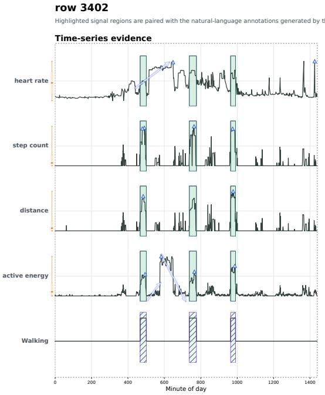  
Figure 11. Example with walking 2

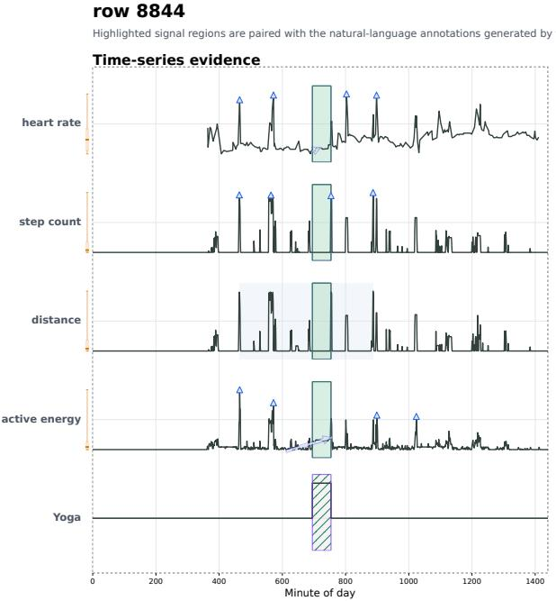  
Figure 12. Example with yoga

Statistical 4 caption - Apple Watch distance averages 5.661 m/min, reaching a maximum of 82.731 and a minimum of 0.000, with a standard deviation of 15.761 - For the active energy measurements, the mean is 844.9 cal/min, the standard deviation is 1801.7, and the data lies between 0.0 and...

spikes: 479-974: Apple Watch step count exhibits spike activity at minutes 763, 490, 975, and 479; 484-977: Multiple sharp deviations in Apple Watch distance were logged at minutes 978 and 484; 494-986: Active energy briefly spiked across minutes 583, 987, 765, and 494; 648-1425: At minutes 648 and 1426,...

\- 467-500: Walking was active across minute 467 to 501 with mean heart rate sitting at 72 bpm, at a maximum of 75 bpm. heart rate was about the day's mean of 72 bpm. Throughout this stretch the watch's mean distance was 54 m/min. The watch's cumulative distance for the interval was 1767 m. The watch averaged a...

- Apple Watch step count values had a mean of 4.7 steps/min, ranged from 0.0 to 122.8, and showed a std of 17.5   
On average heart rate measured 68.3 bpm, with the extremes at 56.0 and 108.0 and a 9.3 std...

spikes: 464-886: Apple Watch step count readings jumped at minutes 887, 564, 464, and 754; 465-1023: Active energy exhibits spike activity at minutes 465, 572, 899, and 1024; 465-897: Heart rate shows multiple spikes at minutes 572, 803, 465, and 898 trends: 612-754: From minute 612 to 756,...

\- 695-753: A stretch of yoga spanned minute 695 to 754

\- 695-753: The minutes 695 to 754 contained yoga averaging a heart rate value around 61 bpm, with a peak heart rate of 71 bpm. heart rate ran 8 bpm below the day's mean of 68 bpm. Average watch active energy during this interval was 1823 cal/min. Total watch active energy for the period reached 107569 cal. Over...

## E.2 WESADCap Captions

The captioned examples for WESADCap can be seen in Figures 13-27.

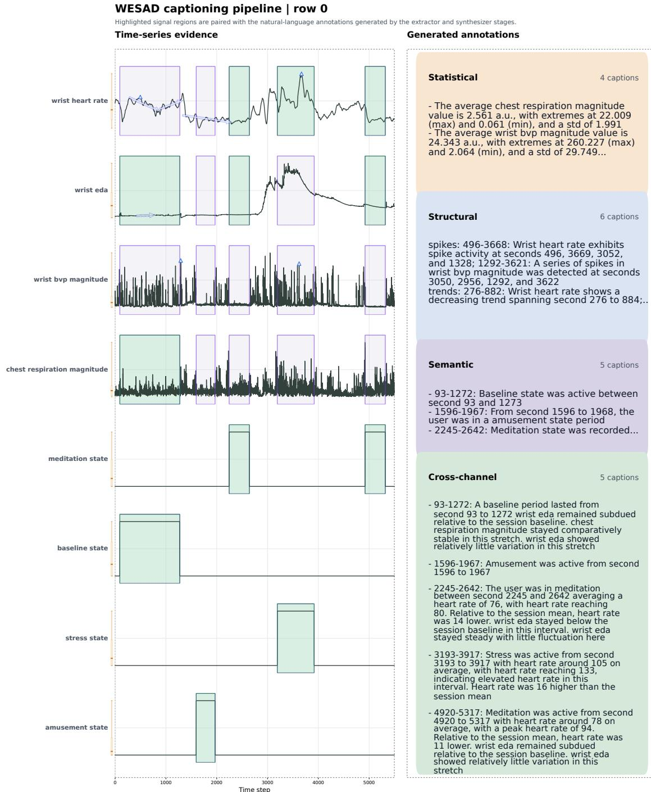  
Figure 13. WESADCap subject 1.

WESAD captioning pipeline | row 1 Highlighted signal regions are paired with the natural-language annotations generated by the extractor and synthesizer stages. Time-series evidence Generated annotations  
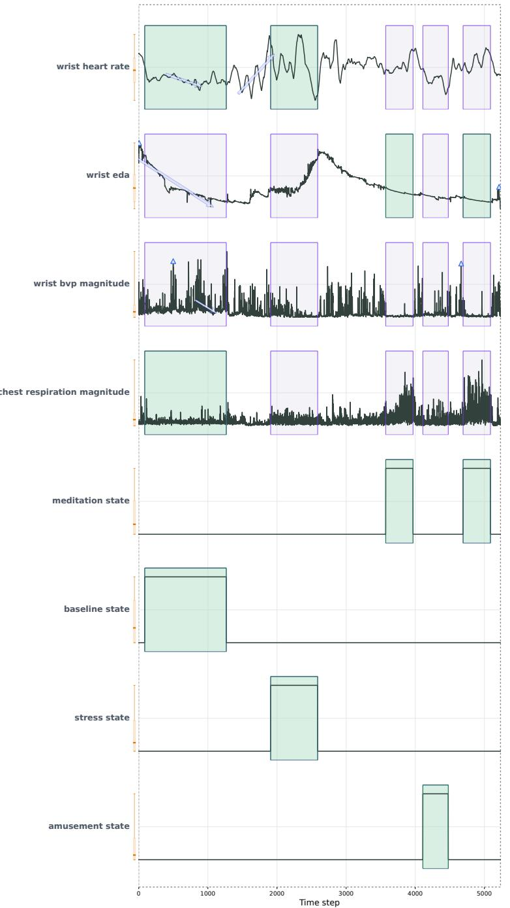  
Figure 14. WESADCap subject 2.

## Statistical

\- The average chest respiration magnitude value is 3.193 a.u., with extremes at 33.544 (max) and 0.074 (min), and a std of 3.364 - The average wrist bvp magnitude value is 22.590 a.u., with extremes at 264.652 (max) and 0.547 (min), and a std of 26.841 - The wrist eda data exhibits a mean of...

## Structural

spikes: 5-5212: A series of spikes in wrist eda was detected at seconds 2592, 5, 2131, and 5213; 498-4663: Notable peaks in wrist bvp magnitude occurred at seconds 1273, 856, 4664, and 498 trends: 0-1078: Between second 0 and 1080, wrist eda exhibited a decreasing trend;...

## Semantic

5 captions

- 86-1265: Baseline state was active between   
second 86 and 1266 1908-2587: Stress state was identified   
from second 1908 to 2588   
- 3573-3967: Meditation state was recorded...

## Cross-channel

86-1265: Baseline was active from second 86 to 1265 with a mean heart rate of 73, peaking at 85. Heart rate was 8 lower than the session mean. chest respiration magnitude stayed comparatively stable in this stretch. chest eda showed relatively little variation in this stretch

\- 1908-2587: Stress was active from second 1908 to 2587 with heart rate around 85 on average, with heart rate reaching 111. This interval's heart rate was 4 above the session mean

\- 3573-3967: From second 3573 to 3967, the user remained in meditation wrist eda was lower than usual in this stretch. chest eda remained comparatively flat in this interval

\- 4110-4477: An amusement interval was present from second 4110 to 4477

4692-5087: A meditation stretch ran from second 4692 to 5087 wrist eda remained subdued relative to the session baseline. chest eda stayed steady with little fluctuation here

WESAD captioning pipeline | row 2 Highlighted signal regions are paired with the natural-language annotations generated by the extractor and synthesizer stages. Time-series evidence Generated annotations  
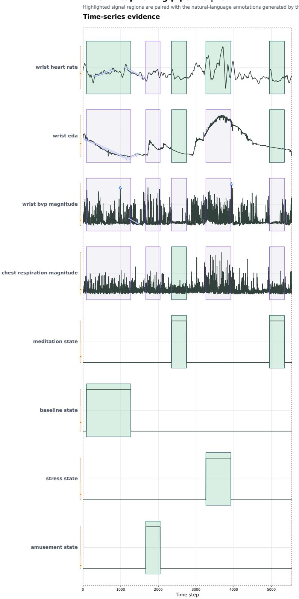  
Figure 15. WESADCap subject 3.

## Statistical

\- For the chest respiration magnitude measurements, the mean is 3.420 a.u., the standard deviation is 3.158, and the data lies between 0.046 and 31.659 - For the wrist bvp magnitude measurements, the mean is 52.496 a.u., the standard deviation is 52.769, and the data lies...

## Structural

spikes: 987-3934: Notable peaks in wrist bvp magnitude occurred at seconds 3935, 987, 1724, and 2029 trends: 0-1258: Between second 0 and 1260, wrist eda exhibited a decreasing trend; 276-828: A increasing trend in wrist heart rate data recorded between second 276 and...

## Semantic

5 captions

\- 88-1267: Baseline state episode occurred between second 88 and 1268 1664-2045: Amusement state was identified from second 1664 to 2046 - 2347-2744: From second 2347 to 2745, the...

## Cross-channel

\- 88-1267: The user was at baseline between second 88 and 1267 with heart rate around 84 on average, with heart rate reaching 97. This interval's heart rate remained near the session mean. chest eda was lower than usual in this stretch. chest eda showed relatively little variation in this stretch

\- 1664-2045: The user was in amusement between second 1664 and 2045

\- 2347-2744: Meditation was active from second 2347 to 2744 with a mean heart rate of 78, with heart rate reaching 89. This interval's heart rate was 5 below the session mean. wrist eda remained subdued relative to the session baseline. chest respiration magnitude showed a steadier pattern than usual here. chest eda showed relatively little variation in this stretch

\- 3261-3924: The user was in a stress phase between second 3261 and 3924 with a mean heart rate of 93, with heart rate reaching 122. This interval's heart rate was 10 above the session mean

4948-5344: From second 4948 to 5344, the user remained in meditation averaging a heart rate of 76, with a peak heart rate of 90. Relative to the session mean, heart rate was 7 lower. wrist eda stayed below the session baseline in this interval. chest eda remained comparatively flat in this interva

WESAD captioning pipeline | row 3  
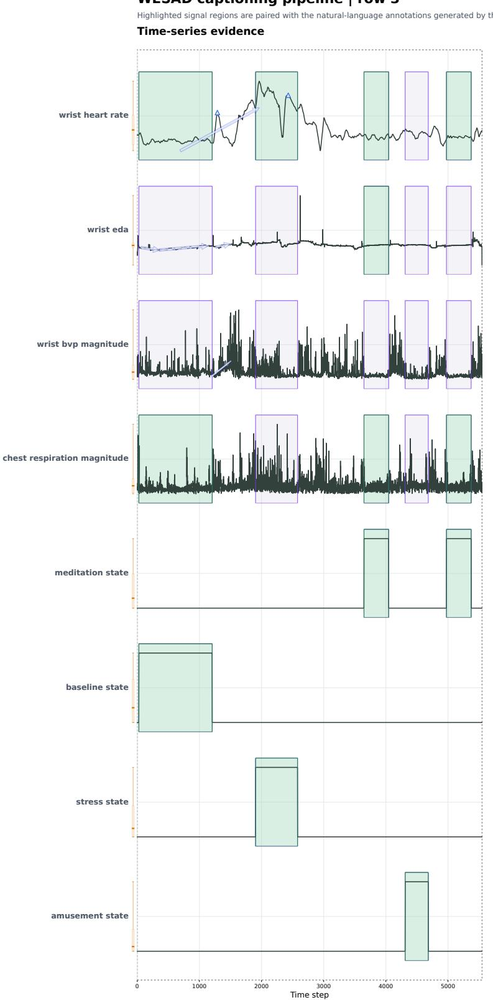  
Figure 16. WESADCap subject 4.

## Statistical

\- The average chest respiration magnitude value is 3.789 a.u., with extremes at 32.614 (max) and 0.046 (min), and a std of 3.321 - The average wrist bvp magnitude value is 27.006 a.u., with extremes at 238.735 (max) and 2.137 (min), and a std of 23.372...

## Structural

spikes: 1289-2428: Spike events in wrist heart rate recorded at seconds 1963, 2429, 1289, and 2099 trends: 60-357: Wrist eda followed a sustained decreasing trend from second 60 to 359; 358-1138: A increasing trend in wrist eda data recorded between second 358 and...

## Semantic

- 26-1205: Baseline state was active between second 26 and 1206   
- 1904-2578: Stress state was identified   
from second 1904 to 2579   
- 3648-4044: Meditation state was recorded...

## Cross-channel

\- 26-1205: A baseline interval was present from second 26 to 1205 averaging a heart rate of 73, peaking at 82. Heart rate was 13 lower than the session mean. chest eda stayed below the session baseline in this interval. chest respiration magnitude stayed comparatively stable in this stretch. chest eda showed relatively little variation in this stretch

\- 1904-2578: The user was in a stress phase between second 1904 and 2578 with heart rate around 120 on average, with heart rate reaching 143, with elevated heart rate during this phase. Heart rate was 35 higher than the session mean

\- 3648-4044: From second 3648 to 4044, the user remained in meditation with a mean heart rate of 77, peaking at 81. This interval's heart rate was 9 below the session mean. chest respiration magnitude showed a steadier pattern than usual here. wrist eda showed relatively little variation in this stretch

\- 4310-4681: From second 4310 to 4681, the user was in an amusement interva

\- 4975-5371: A meditation stretch ran from second 4975 to 5371 with heart rate around 77 on average, peaking at 79. This interval's heart rate was 8 below the session mean. chest respiration magnitude was steady during this interval. chest eda stayed steady with little fluctuation here

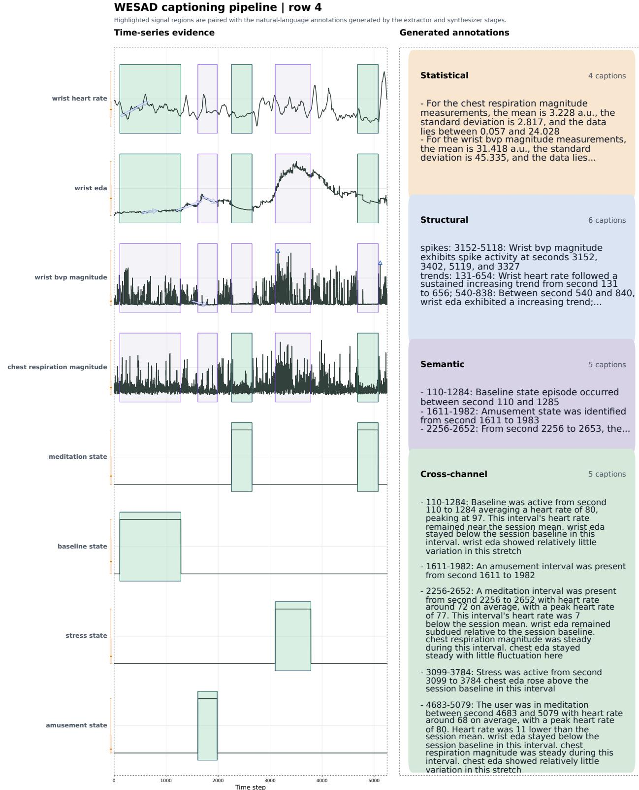

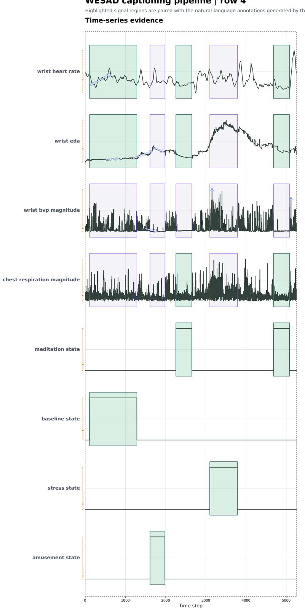  
Figure 17. WESADCap subject 5.

WESAD captioning pipeline | row 5 Highlighted signal regions are paired with the natural-language annotations generated by the extractor and synthesizer stages. Time-series evidence Generated annotations

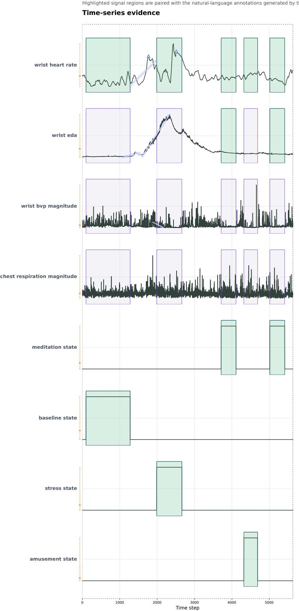  
Figure 18. WESADCap subject 6.

## Statistical

\- For the chest respiration magnitude measurements, the mean is 2.640 a.u., the standard deviation is 1.813, and the data lies between 0.054 and 22.059 - For the wrist bvp magnitude measurements, the mean is 16.702 a.u., the standard...

## Structural

6 captions

spikes: 1768-2512: Wrist heart rate shows multiple spikes at seconds 2435, 1768, 2513, and 1972 trends: 1080-1411: Wrist eda followed a sustained increasing trend from second 1080 to 1413; 1269-1971: Wrist heart rate...

## Semantic

5 captions

\- 98-1277: Baseline state episode occurred between second 98 and 1278 - 1988-2660: Stress state was active between second 1988 and 2661 - 3713-4107: From second 3713 to 4108, the...

## Cross-channel

5 captions

\- 98-1277: A baseline period lasted from second 98 to 1277 averaging a heart rate of 68, with heart rate reaching 91. Relative to the session mean, heart rate was 13 lower. chest eda was lower than usual in this stretch. chest eda showed relatively little variation in this stretch

\- 1988-2660: A stress interval was present from second 1988 to 2660 with a mean heart rate of 102, with heart rate reaching 149, showing heightened heart rate across this stretch. Relative to the session mean, heart rate was 21 higher

3713-4107: Meditation was active from second 3713 to 4107 with heart rate around 77 on average, with heart rate reaching 83. Relative to the session mean, heart rate was 4 lower. chest eda stayed below the session baseline in this interval. wrist eda remained comparatively flat in this interval

4320-4687: An amusement interval was present from second 4320 to 4687 with heart rate around 84 on average, peaking at 89. Relative to the session mean, heart rate stayed close

5014-5410: From second 5014 to 5410, the user remained in meditation with a mean heart rate of 72, with heart rate reaching 76. This interval's heart rate was 9 below the session mean. wrist eda was lower than usual in this stretch. wrist eda stayed steady with little fluctuation here

WESAD captioning pipeline | row 6 Highlighted signal regions are paired with the natural-language annotations generated by the extractor and synthesizer stages. Time-series evidence Generated annotations  
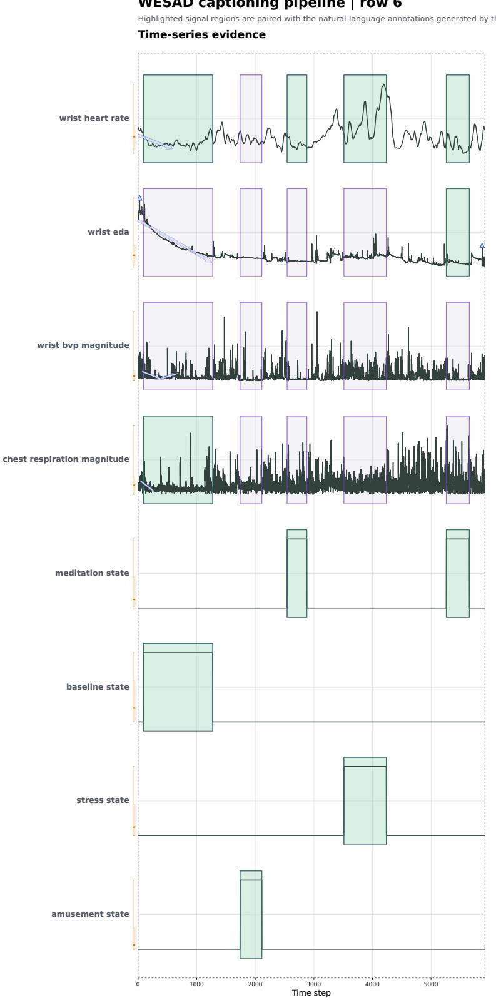  
Figure 19. WESADCap subject 7.

## Statistical

\- Chest respiration magnitude exhibits a mean of 3.442 a.u., with peak and minimal values reaching 25.626 and 0.058, and a standard deviation of 3.007 - For the wrist eda measurements, the mean is 1.080 uS, the standard deviation is 0.247, and the data lies between 0.786 and...

## Structural

6 captions

spikes: 27-5870: Wrist eda exhibits spike activity at seconds 27, 4054, 3046, and 5871 trends: 0-590: Between second 0 and 592, wrist heart rate exhibited a decreasing trend; 0-1258: Wrist eda followed a sustained decreasing trend from second 0 to...

## Semantic

5 captions

\- 92-1272: Baseline state was recorded within the 92-1273 second range - 1740-2111: Amusement state was active between second 1740 and 2112 - 2543-2879: Meditation state was identified...

## Cross-channel

\- 92-1272: A baseline period lasted from second 92 to 1272 with heart rate around 67 on average, with heart rate reaching 83. Heart rate was 7 lower than the session mean. chest eda remained subdued relative to the session baseline. chest respiration magnitude showed a steadier pattern than usual here. chest eda showed relatively little variation in this stretch

\- 1740-2111: An amusement period lasted from second 1740 to 2111

2543-2879: The user was in meditation between second 2543 and 2879 averaging a heart rate of 66, with heart rate reaching 75. Heart rate was 9 lower than the session mean. chest eda was lower than usual in this stretch. chest eda remained comparatively flat in this interval

\- 3512-4234: A stress interval was present from second 3512 to 4234 with a mean heart rate of 92, peaking at 134. Relative to the session mean, heart rate was 18 higher. chest eda showed stronger activity than usual in this stretch

5259-5652: Meditation was active from second 5259 to 5652 with a mean heart rate of 64, peaking at 78. Relative to the session mean, heart rate was 10 lower. wrist eda was lower than usual in this stretch. chest eda stayed steady with little fluctuation here

WESAD captioning pipeline | row 7 Highlighted signal regions are paired with the natural-language annotations generated by the extractor and synthesizer stages. Time-series evidence Generated annotations  
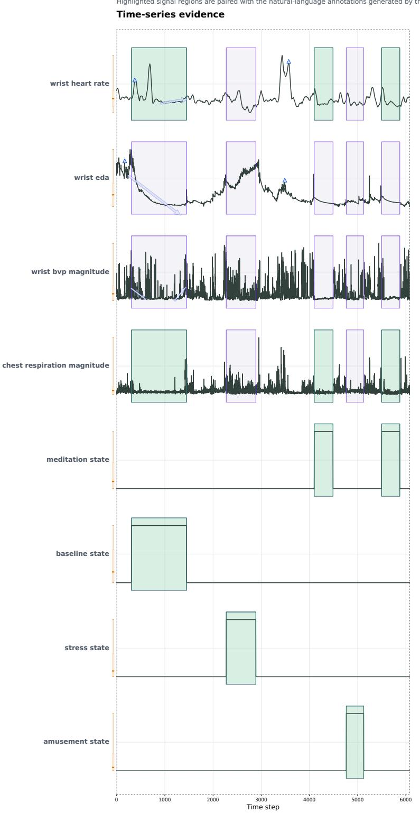  
Figure 20. WESADCap subject 8.

## Statistical

\- For the wrist heart rate measurements, the mean is 74.22 bpm, the standard deviation is 11.46, and the data lies between 54.57 and 134.77

\- The chest respiration magnitude data exhibits a mean of 2.025 a.u., a standard deviation of 1.814, and its extreme values...

## Structural

spikes: 168-3488: A series of spikes in wrist eda was detected at seconds 2945, 3489, 280, and 168; 376-3570: Notable peaks in wrist heart rate occurred at seconds 3435, 689, 376, and 3571 trends: 240-1318: Between second 240 and 1320, wrist eda exhibited a decreasing...

## Semantic

\- 307-1450: Baseline state was identified from second 307 to 1451 - 2274-2888: From second 2274 to 2889, the user was in a stress state period - 4098-4488: Meditation state episode...

## Cross-channel

\- 307-1450: A baseline period lasted from second 307 to 1450 averaging a heart rate of 77, with heart rate reaching 123. This interval's heart rate remained near the session mean. chest respiration magnitude was steady during this interval

\- 2274-2888: From second 2274 to 2888, the user was in a stress interval

\- 4098-4488: Meditation was active from second 4098 to 4488 averaging a heart rate of 70, with a peak heart rate of 88. Heart rate was 4 lower than the session mean. chest eda was lower than usual in this stretch. chest respiration magnitude showed a steadier pattern than usual here. chest eda stayed steady with little fluctuation here

\- 4764-5125: From second 4764 to 5125, the user was in an amusement interva

5497-5873: From second 5497 to 5873, the user remained in meditation with heart rate around 70 on average, with heart rate reaching 90. This interval's heart rate was 5 below the session mean. chest eda remained subdued relative to the session baseline. chest respiration magnitude showed a steadier pattern than usual here. chest eda remained comparatively flat in this interva

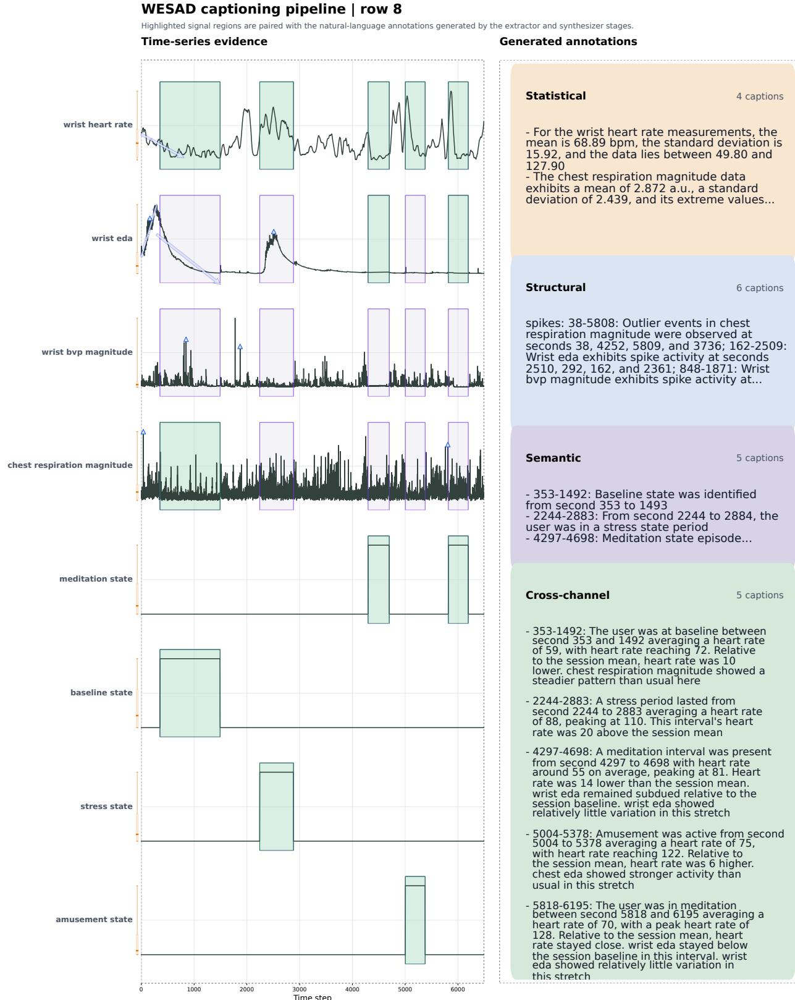  
Figure 21. WESADCap subject 9.

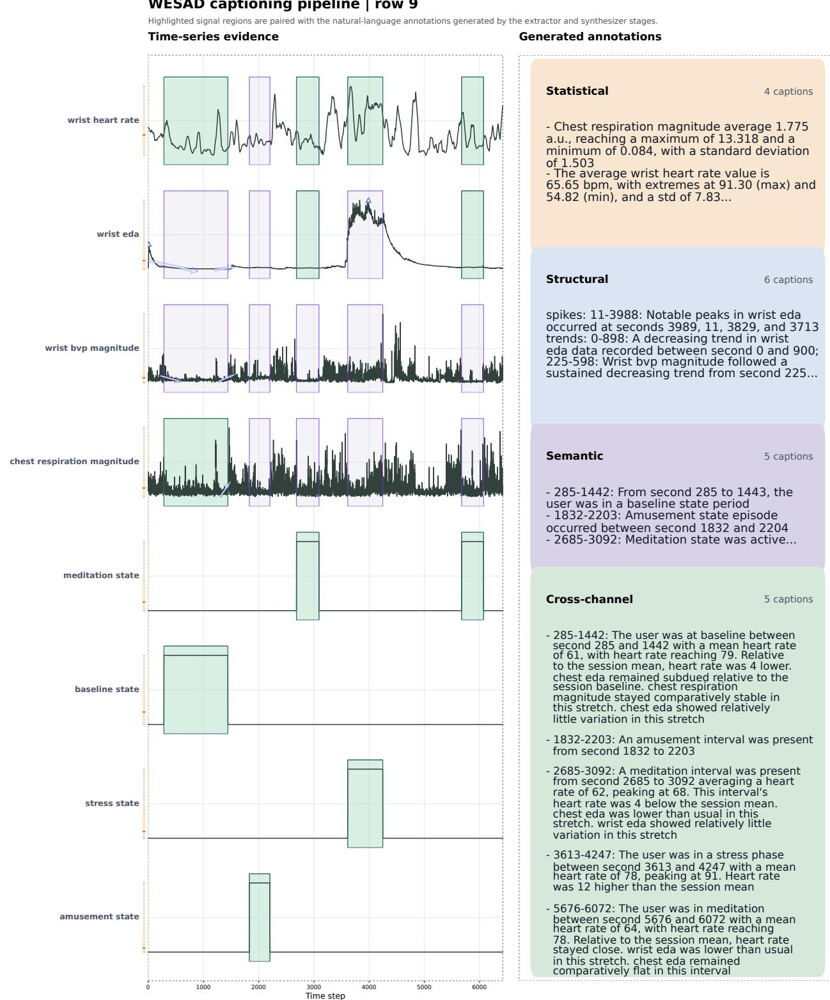  
Figure 22. WESADCap subject 10.

WESAD captioning pipeline | row 10 Highlighted signal regions are paired with the natural-language annotations generated by the extractor and synthesizer stages. Time-series evidence Generated annotations  
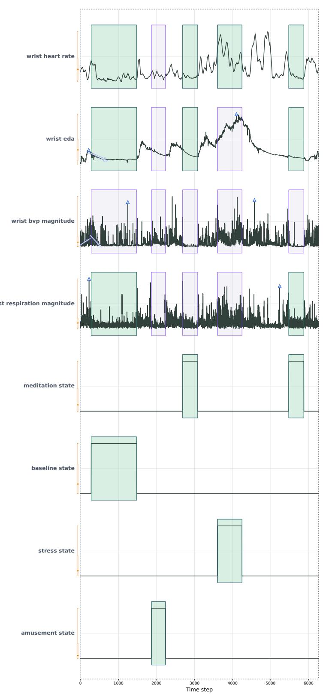  
Figure 23. WESADCap subject 11.

## Statistical

\- For the chest respiration magnitude measurements, the mean is 3.113 a.u., the standard deviation is 2.588, and the data lies between 0.085 and 26.084 - For the wrist bvp magnitude measurements, the mean is 66.797 a.u., the standard...

## Structural

6 captions

spikes: 216-4099: Wrist eda shows multiple spikes at seconds 4100, 2525, 1631, and 216; 223-5238: Outlier events in chest respiration magnitude were observed at seconds 223, 2690, 1844, and 5239; 1243-4574: Notable peaks in wrist bvp magnitude occurred at seconds 2411, 4122,...

## Semantic

5 captions

\- 279-1476: Baseline state episode occurred between second 279 and 1477 - 1862-2235: Amusement state was identified from second 1862 to 2236...

## Cross-channel

5 captions

279-1476: Baseline was active from second 279 to 1476 with a mean heart rate of 65, peaking at 88. This interval's heart rate was 11 below the session mean. wrist eda remained subdued relative to the session baseline. chest respiration magnitude stayed comparatively stable in this stretch. wrist eda showed relatively little variation in this stretch

\- 1862-2235: An amusement interval was present from second 1862 to 2235

\- 2685-3081: From second 2685 to 3081, the user remained in meditation with heart rate around 65 on average, with heart rate reaching 70. Relative to the session mean, heart rate was 11 lower. wrist eda remained subdued relative to the session baseline. wrist eda showed relatively little variation in this stretch

\- 3602-4246: The user was in a stress phase between second 3602 and 4246 with heart rate around 96 on average, with a peak heart rate of 124. Relative to the session mean, heart rate was 20 higher. chest eda was elevated relative to the session baseline

5477-5873: A meditation stretch ran from second 5477 to 5873 with a mean heart rate of 66, with a peak heart rate of 78. This interval's heart rate was 10 below the session mean. wrist eda stayed below the session baseline in this interval. chest respiration magnitude stayed comparatively stable in this stretch. wrist eda remained comparatively flat in this interval

WESAD captioning pipeline | row 11 Highlighted signal regions are paired with the natural-language annotations generated by the extractor and synthesizer stages. Time-series evidence Generated annotations  
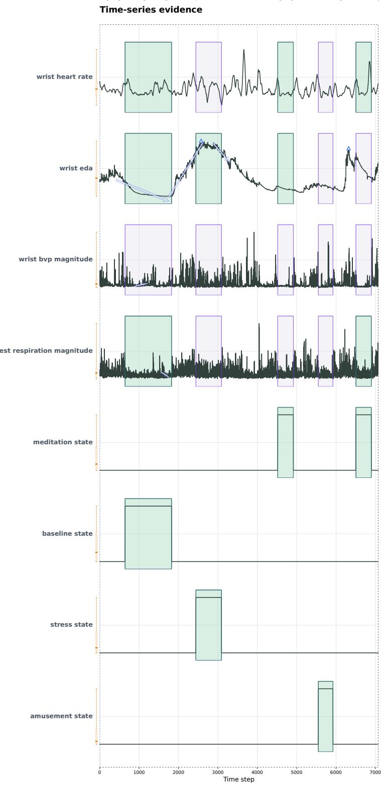  
Figure 24. WESADCap subject 12.

## Statistical

\- For the chest respiration magnitude measurements, the mean is 3.041 a.u., the standard deviation is 2.392, and the data lies between 0.055 and 27.718 - For the wrist bvp magnitude measurements, the mean is 26.246 a.u., the standard deviation is 31.087, and the data lies...

## Structural

spikes: 2574-6320: Wrist eda exhibits spike activity at seconds 2574, 5563, 4518, and 6321 trends: 420-1753: Between second 420 and 1755, wrist eda exhibited a decreasing trend; 900-1198: A increasing trend in wrist bvp magnitude data recorded between second.

## Semantic

5 captions

\- 643-1822: Baseline state episode occurred between second 643 and 1823 2441-3090: Stress state was active between nd 2441 and 3091 - 4520-4916: From second 4520 to 4917, the...

## Cross-channel

\- 643-1822: From second 643 to 1822, the user remained at baseline averaging a heart rate of 71, peaking at 83. Relative to the session mean, heart rate stayed close. wrist eda was lower than usual in this stretch. chest respiration magnitude showed a steadier pattern than usual here. wrist eda showed relatively little variation in this stretch

\- 2441-3090: A stress period lasted from second 2441 to 3090 wrist eda was elevated relative to the session baseline

4520-4916: A meditation interval was present from second 4520 to 4916 with heart rate around 67 on average, peaking at 82. Relative to the session mean, heart rate was 4 lower. wrist eda was lower than usual in this stretch. wrist eda showed relatively little variation in this stretch

\- 5551-5922: The user was in amusement between second 5551 and 5922 chest eda was elevated relative to the session baseline

6506-6895: The user was in meditation between second 6506 and 6895 with heart rate around 74 on average, with heart rate reaching 102. Heart rate stayed close to the session mean. chest respiration magnitude stayed comparatively stable in this stretch. chest eda stayed steady with little fluctuation here

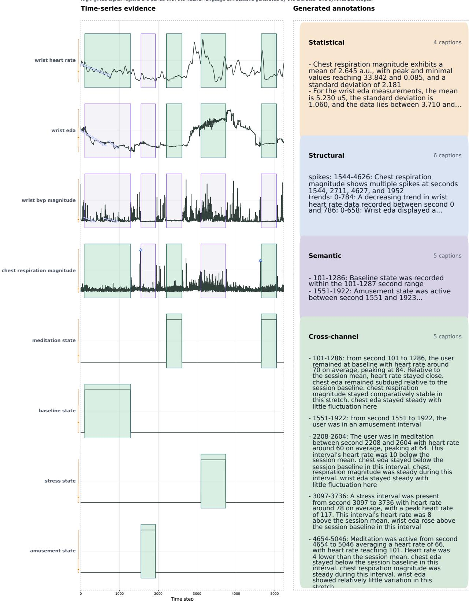

WESAD captioning pipeline | row 12 Highlighted signal regions are paired with the natural-language annotations generated by the extractor and synthesizer stages. Time-series evidence Generated annotations  
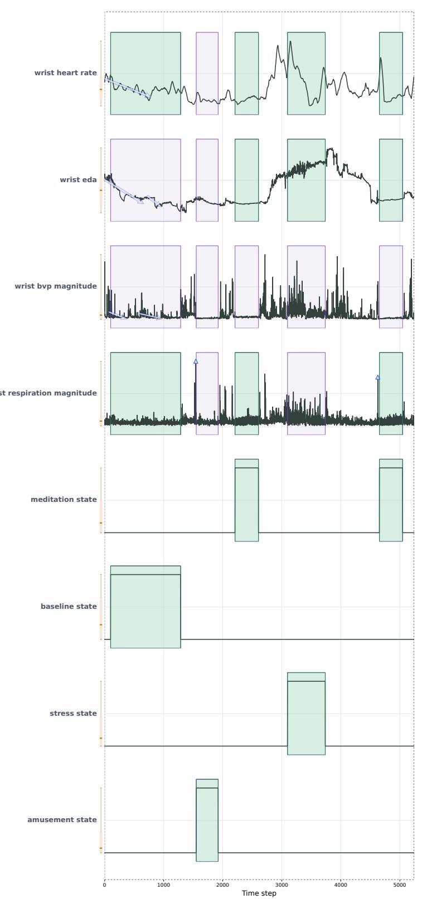  
Figure 25. WESADCap subject 13.

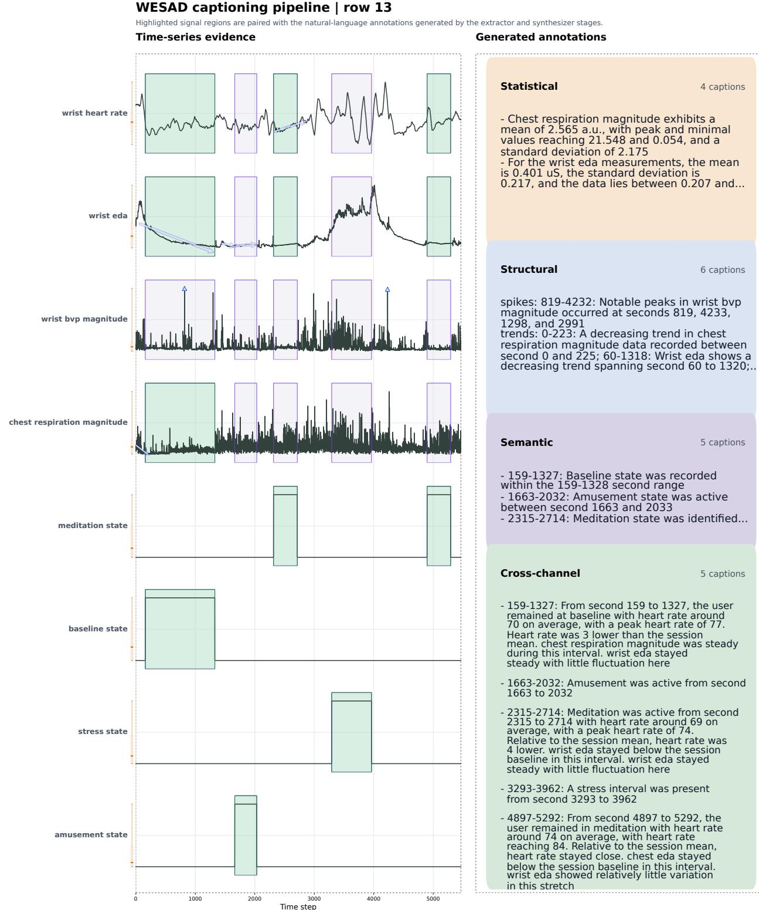  
Figure 26. WESADCap subject 14.

WESAD captioning pipeline | row 14 Highlighted signal regions are paired with the natural-language annotations generated by the extractor and synthesizer stages. Time-series evidence Generated annotations  
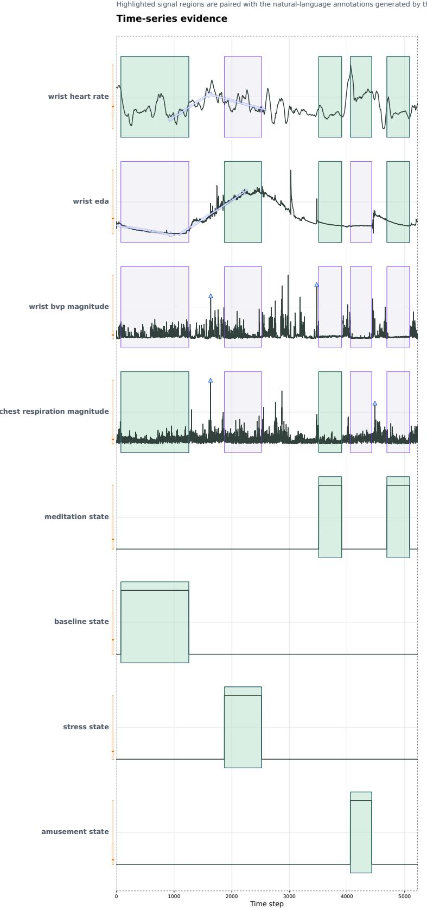  
Figure 27. WESADCap subject 15.

\- For the wrist heart rate measurements, the mean is 77.80 bpm, the standard deviation is 7.32, and the data lies between 61.73 and 107.70

\- The chest respiration magnitude data exhibits a mean of 3.146 a.u., a standard deviation of 2.733, and its extreme values...

## Structural

spikes: 1632-4483: A series of spikes in chest respiration magnitude was detected at seconds 1632, 2870, 2758, and 4484; 1635-3473: Notable peaks in wrist bvp magnitude occurred at seconds 2979, 3474, 2875, and 1635

trends: 0-1018: Between second 0 and 1020,...

## Semantic

\- 75-1254: Baseline state was identified from second 75 to 1255 - 1872-2516: From second 1872 to 2517, the user was in a stress state period...

## Cross-channel

\- 75-1254: The user was at baseline between second 75 and 1254 with heart rate around 75 on average, with a peak heart rate of 90. This interval's heart rate was 3 below the session mean. chest eda stayed below the session baseline in this interval. chest respiration magnitude showed a steadier pattern than usual here. chest eda stayed steady with little fluctuation here

\- 1872-2516: From second 1872 to 2516, the user was in a stress interval wrist eda rose above the session baseline in this interval

3509-3906: A meditation stretch ran from second 3509 to 3906 with a mean heart rate of 73, with heart rate reaching 79. Relative to the session mean, heart rate was 5 lower. wrist eda was lower than usual in this stretch. chest respiration magnitude was steady during this interval. wrist eda showed relatively little variation in this stretch

\- 4058-4429: From second 4058 to 4429, the user was in an amusement interval with a mean heart rate of 88, peaking at 108. This interval's heart rate was 10 above the session mean. chest eda rose above the session baseline in this interva

4692-5086: A meditation interval was present from second 4692 to 5086 with a mean heart rate of 74, with a peak heart rate of 85. Relative to the session mean, heart rate was 4 lower. wrist eda stayed below the session baseline in this interval. wrist eda showed relatively little variation in this stretch