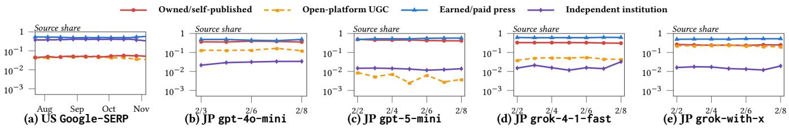
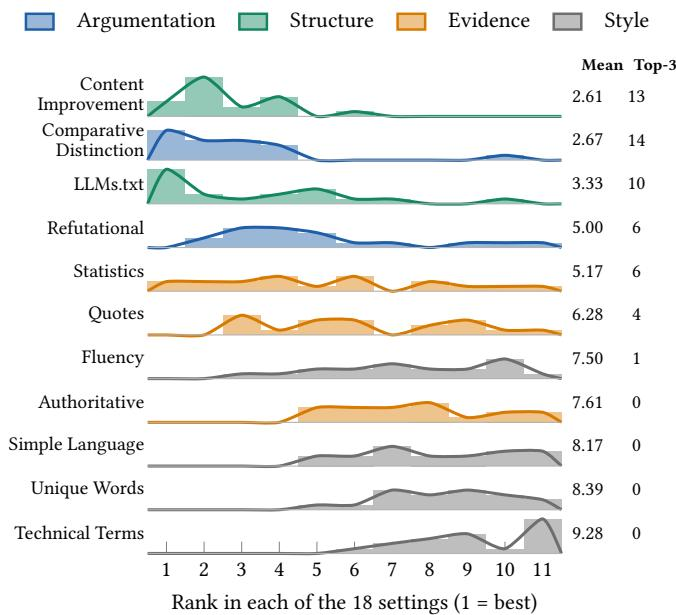

# VoteGEO-Bench: Measuring the Impact of Generative Engine Optimization on Electoral Visibility

Shiqi Zhang National University of Singapore Singapore sqzhang@nus.edu.sg

## Abstract

Large language models (LLMs) are increasingly used to obtain election information, and the web sources they use can shape the responses presented to voters. Existing work on LLMs in political settings mainly studies political bias in model outputs and AI-driven political persuasion, while much less is known about how external web content afects the political information presented by LLMs. Generative engine optimization (GEO) focuses on rewriting web content to improve its visibility in generated responses. Existing GEO research typically takes a fixed webpage pool as input and stud ies how rewriting changes page visibility in generated responses, providing a natural framework for studying this question. To investigate the potential risks of GEO in voting scenarios (VoteGEO), we introduce VoteGEO-Bench, a benchmark built on the 2024 U.S. presidential election and the 2026 Japanese House of Representatives election, combining election-related queries, historical webpages, and voter personas.

We first analyze the sources cited by generative engines, finding that many citations come from lower-cost owned and openplatform sources and that some webpages often remain visible across days. We then benchmark 11 rewriting strategies across 4 categories and study whether specifying a target candidate or party in the rewrite matters, which strategies work across generative engines and elections, and how voter personas afect exposure. Target-unspecified rewriting rarely increases target exposure, whereas target-specified rewriting more often does so. Notably, strategies that improve page organization or strengthen a position through argumentation show stronger gains than those that add supporting evidence or mainly change wording. For the two strongest strategies, rewriting gains remain broadly positive across the evaluated U.S. personas, while persona conditioning shows no consistent tendency to increase or decrease these gains. In contrast, explicit partisan identities can create baseline exposure gaps larger than the gain from rewriting a single webpage. When partisan information is only implicit in the voter profile, baseline exposure shifts vary with how strongly the engine responds to the implicit partisan signal.

Xiaokui Xiao National University of Singapore Singapore xkxiao@nus.edu.sg

ACM Reference Format: Shiqi Zhang and Xiaokui Xiao. 2026. VoteGEO-Bench: Measuring the Impact of Generative Engine Optimization on Electoral Visibility. In . ACM, New York, NY, USA, 13 pages. https://doi.org/10.1145/nnnnnnn.nnnnnnn

## 1 Introduction

Large language models (LLMs) are increasingly used to obtain election-related information, including candidate comparisons and voting advice [2, 18]. Unlike traditional search engines that rank and present webpages, generative engines such as ChatGPT and Gemini retrieve web sources and use their content to generate responses. Existing work on LLMs in political settings mainly follows two lines. One studies political bias and alignment in LLM responses across models and political contexts [5–7, 9, 15]. The other studies whether LLM-generated political messages can influence voters and which factors drive political persuasion [11, 16]. These studies focus on LLM outputs and their efects on users. Much less is known about how external web content shapes political information in generative engine responses.

Generative engine optimization (GEO) rewrites web content to improve its visibility in generative engine responses [1, 25]. Existing GEO research typically takes a fixed webpage pool as input and studies how rewriting changes page visibility in generated responses [1, 8, 24, 25, 29, 30], providing a natural framework for studying this question. To investigate the potential risks of GEO in voting scenarios, which we call VoteGEO, it remains two sets of questions. First, which source channels do generative engines use, how accessible are they to content publishers, and how long do the same webpages remain visible? Second, how does webpage rewriting afect candidate or party exposure in generated responses? Specifically, does specifying a target candidate or party in the rewrite matter, which strategies work across generative engines and elections, and how do voter personas afect baseline exposure and rewriting gains? To answer these questions, we introduce VoteGEO-Bench, a benchmark built on the 2024 U.S. presidential election [7] and the 2026 Japanese House of Representatives election [19]. After preprocessing, VoteGEO-Bench contains 28,200 election-related query cells across days and engines and 17,251 webpages. We further incorporate 3 categories of voter personas, including demographic identities, partisan identities, and questionnaire-derived profiles constructed from pre-treatment responses of 2,306 U.S. participants [16].

We first analyze which sources generative engines use and how long the same webpages remain visible. We find that many cited sources come from lower-cost channels, including candidate or party websites and open platforms such as Reddit. For queries about relatively stable topics, some webpages repeatedly appear across days, whereas those for current events turn over much faster. Together, these findings highlight potential risks through lowercost source channels, with longer exposure windows for stable queries and faster source turnover for current events. We then benchmark 11 rewriting strategies across 4 categories. Structure strategies improve page organization or reformat webpages into more LLM-friendly layouts. Evidence strategies add quotations, statistics, or source attributions to support existing claims. Style strategies modify wording without adding substantive content. These three categories follow existing GEO work [1, 25]. Motivated by political persuasion research [11, 16], we further introduce 2 Argumentation strategies, which strengthen a position by emphasizing its distinctions from plausible alternatives or explicitly addressing opposing arguments.

Our results reveal three main patterns. First, target-unspecified rewriting rarely increases target exposure, whereas target-specified rewriting more often does so. This distinction is important because election webpages often discuss multiple parties. In the U.S. setting, 92% of retrieved webpages mention both major parties, so rewriting without an explicit target does not indicate which party’s exposure should increase. Second, Structure and Argumentation strategies show stronger gains than Evidence and Style strategies across generative engines and elections. Consistent with this pattern, one strategy from each of these two categories shows the strongest overall gains across settings and exposure metrics. Third, for these two strongest strategies, rewriting gains remain broadly positive across the 15 evaluated U.S. personas, while persona conditioning shows no consistent tendency to increase or decrease these gains. In contrast, explicit partisan identities can create baseline exposure gaps of up to 11.6 percentage points, larger than the gain from rewriting a single webpage. We further consider whether similar shifts appear when partisanship is only implicit in the voter profile. In this case, baseline exposure shifts vary with how strongly each engine responds to the implicit partisan signal.

To summarize, we make the following contributions:

• We introduce VoteGEO-Bench, built on two elections with election queries, historical webpages, and voter personas (Section 3).

• We provide motivating insights into the potential risks of Vote-GEO by analyzing source types and webpage visibility over time (Section 4).

• We organize 11 rewriting strategies into 4 categories, including 2 new Argumentation strategies (Section 5).

• We evaluate how target specification, rewriting strategies, and voter personas afect target exposure across engines and elec tions (Section 6).

## 2 Preliminaries

## 2.1 VoteGEO

Generative engines first retrieve a set of webpages relevant to the query, often through web search, and then use these webpages as context to generate a response. Generative engine optimization (GEO) aims to improve the visibility of web content in such re sponses through content rewriting [1, 25]. Existing GEO research typically separates retrieval from generation and focuses on the generation stage by fixing the retrieved webpage pool and studying how rewriting one webpage changes its visibility in the generated response [1, 8, 24, 25, 29, 30]. We follow this problem setting and define a query cell as an election-related query issued to a particular engine on a particular day. Each query cell � has a query $q _ { i }$ and a corresponding webpage pool $\mathcal { D } _ { i }$ . Let $d _ { i } \in \mathcal { D } _ { i }$ denote the webpage to be rewritten. The other webpages in $\mathcal { D } _ { i }$ remain fixed, and GEO studies whether rewriting $d _ { i }$ improves its visibility in the generated response.

Existing GEO settings typically consider webpages centered on a single target entity, such as a product description page or a brand landing page [1, 25]. In voting scenarios, however, a webpage may discuss multiple candidates or parties, so selecting a webpage does not uniquely determine whose exposure the rewrite should increase. VoteGEO therefore introduces a target $t _ { i } ,$ defined as a candidate or party mentioned in $d _ { i } ,$ and studies whether rewriting $d _ { i }$ can increase the exposure of ${ { \dot { t } } _ { i } }$ in the generated response.

Given an engine �, let $y _ { i } = G ( q _ { i } , \mathcal { D } _ { i } )$ denote the response before rewriting. Under target-specified rewriting, the rewriting model is given both �� and $t _ { i } ,$ whereas under target-unspecified rewriting, it is given only $d _ { i } .$ Let $\bar { d } _ { i }$ denote the rewritten webpage, and let $\mathcal { \bar { D } } _ { i } = ( \mathcal { D } _ { i } \setminus \{ d _ { i } \} ) \cup \{ \bar { d } _ { i } \}$ denote the webpage pool after replacement. The engine then produces ${ \bar { y } } _ { i } = G ( q _ { i } , { \bar { \mathcal { D } } } _ { i } )$ . Let $\phi ( t , y )$ denote an exposure measure for target � in response �. The exposure gain for query cell � is

$$
\Delta _ { i } = \phi \big ( t _ { i } , \bar { y } _ { i } \big ) - \phi \big ( t _ { i } , y _ { i } \big ) .\tag{1}
$$

Prior work on the mere exposure and illusory truth efects shows that repeated exposure can increase the perceived accuracy of information, even when the information is false [22]. This motivates our focus on target exposure, which we measure textually without distinguishing favorable from unfavorable mentions.

## 2.2 Related Work

Political bias in LLMs. Existing work studies political bias in LLM outputs across models and political contexts. Studies report a leftprogressive lean in U.S. political content but more mixed patterns in South Korea [15], stronger alignment of GPT-4o with left-leaning German parties [6], and overrepresentation of radical-right actors in European election queries [9]. Other work finds that such patterns do not always persist for concrete voting decisions, such as Swiss referenda [5]. These studies examine political bias in model outputs, whereas we study how modifying external web content changes candidate or party exposure in generated responses.

Voter persuasion with LLMs. Prior work identifies several factors relevant to political persuasion with LLMs, including factual and evidence-rich information, personalization, and refutational counterargumentation. Factual and evidence-rich information repeatedly emerges as an important driver of persuasion [3, 11, 16], while the additional benefit of personalization is mixed across studies [11, 16, 17, 27]. Refutational messages can also improve persuasion or reduce issue polarization [13, 21]. These studies focus on how LLM responses influence voters. In contrast, we study how external content influences the information produced by LLMs.

Generative engine optimization. Existing GEO studies develop strategies for improving source visibility or item ranking in generative engine responses. Adversarial approaches use model-directed instructions or optimized content to manipulate preferences and rankings [14, 20, 24, 26, 29]. Content optimization approaches instead rewrite wording or structure, learn generative engine preferences, or account for retrieval while preserving semantic fidelity [1, 4, 8, 12, 25, 30]. Unlike prior GEO work that mainly optimizes source visibility or item ranking, we study target exposure within webpages that may discuss multiple candidates or parties.

## 3 Data Collection and Preprocessing

We construct three datasets, us-election-24, ai-persuasion, and jpelection-26, from two electoral settings, the 2024 U.S. presidential election between the Democratic and Republican parties and the proportional-representation component of the 2026 Japanese House of Representatives election involving 11 parties. us-election-24 and jp-election-26 contain election-related query cells and their corresponding webpage pools, while ai-persuasion provides questionnaire information for constructing richer voter personas in the U.S. setting. Table 1 summarizes the resulting query cells and webpage datasets. Additional details on query composition, persona specifi cations, and webpage preprocessing are provided in Appendix A.

## 3.1 Data Sources

us-election-24 is derived from the longitudinal corpus for the 2024 U.S. presidential election [7]. The original dataset contains 573 election-related queries collected on a near-daily basis from July 23 to November 12, 2024, together with historical Google Search results. ai-persuasion is based on the voter-persuasion dataset [16]. We use the pre-treatment questionnaire responses of 2,306 U.S. participants in the 2024 presidential election, covering demographics, political engagement, voting criteria, and other voter characteristics. jp-election-26 is derived from the longitudinal factorial dataset of Miyazaki and Hall [19] for the 2026 Japanese House of Representatives election. The dataset contains 25 voting-advice queries, 44 demographic personas, and responses from five web-enabled LLMs collected daily from February 2 to February 8, 2026.

## 3.2 Query Cells and Voter Personas

Query cells. For us-election-24, we retain 260 of the 573 queries that are relevant to voter decision making, covering candidate evaluation and comparison, policy positions, election predictions, and related news. One example is “Which US presidential candidate do voters believe will handle the economy the best?” We use the 106 days from July 23 through election day on November 5, 2024, with Google Search as the engine. The first collection day contains SERP results for only 250 queries, resulting in 27,550 query cells. For jp-election-26, we retain all 25 voting-advice queries, consisting of 12 policy issues with two opposing stances for each issue and one control query without a policy stance. Each asks which political party the voter should vote for, optionally accompanied by a policy stance. For example, one query asks “I think Japan should raise defense spending to at least 2% of GDP. Which polit ical party should I vote $\mathrm { f o r ? } ^ { \mathrm { \infty } }$ We retain four web-enabled LLMs as engines, gpt-4o-mini, gpt-5-mini, grok-4-1-fast, and gro k-with-x. We exclude gemini-2.5-flash because only 10 of its 7,700 responses contain parseable citation URLs. Two gpt-4o-mi ni collection days are unavailable in the source data, leaving 26 engine and day combinations and 650 query cells.

Table 1: Summary of the two election datasets.
<table><tr><td rowspan="2">Dataset</td><td colspan="4">Query cells</td><td colspan="2">Webpages</td></tr><tr><td>Query</td><td>Day</td><td>Engine</td><td>Total</td><td>Avg./cell</td><td>Distinct</td></tr><tr><td>us-election-24 [7]</td><td>260</td><td>106</td><td>1</td><td>27,550</td><td>9.15</td><td>11,501</td></tr><tr><td>jp-election-26 [19]</td><td>25</td><td>7</td><td>4</td><td>650</td><td>63.1</td><td>5,750</td></tr></table>

Voter personas. Personas form an independent conditioning dimension and can be combined with the same query cells. We consider three categories of voter personas: demographic identities, partisan identities, and questionnaire-derived profiles. us-election-24 provides 11 identity personas [7], which we group into 9 demographic identities, covering 6 racial or ethnic identities and 3 gender identities, and 2 partisan identities, Democrat and Republican. We additionally include an Independent persona representing voters who identify with neither major party as a study-specific partisan identity. ai-persuasion provides pre-treatment questionnaire responses from 2,306 U.S. participants, from which we use demographics, political engagement, and voting criteria to identify three interpretable subgroups and construct questionnaire-derived profiles [16]. jp-election-26 provides 44 demographic identities formed by crossing 2 genders, 11 regions, and 2 area types [19].

## 3.3 Webpage Pools

Following the fixed-pool GEO setting in Section 2.1, we construct a webpage pool $\mathcal { D } _ { i }$ for each query cell. Voting-related web content can change over time during an election, so our goal is to reconstruct a query-relevant snapshot of the web content available around the collection day. To this end, we use the historical search results and citations available in the source datasets to collect relevant URLs for each query cell.

For us-election-24, each pool consists of the persona-free historical Google-SERP result URLs for the corresponding query and day. For jp-election-26, each user prompt combines a query with a persona and, where applicable, a policy stance. To construct a comprehensive query-relevant webpage pool while mitigating dependence on any single persona or stance, we aggregate citation URLs for the same engine, query, and day across all 44 personas and the two opposing stances of each policy issue. For each URL associated with a query cell, we collect the webpage content from as close as possible to its collection day. We first use the closest available Wayback Machine snapshot, followed by live-page and headless-browser fallbacks when no archived snapshot is available. We then extract the main textual content from each webpage.

The resulting pools contain 9.15 usable webpages per query cell on average for us-election-24 and 63.1 for jp-election-26. Across all query cells, the final datasets contain 11,501 and 5,750 distinct webpages related to the U.S. and Japanese elections, respectively.

## 4 Motivating Insights

Before evaluating rewriting strategies, we first motivate the study of potential risks of VoteGEO by analyzing what types of sources generative engines use and how long the same webpages remain

  
Figure 1: Source share by source-channel label over time.

visible across days. We focus on generative engine citations in jpelection-26, with Google-SERP results in us-election-24 serving as a reference.

## 4.1 What Sources Do Generative Engines Use?

We group each observed domain into four source channels ordered by how costly it is for a candidate or party to publish or modify content: owned/self-published, e.g., candidate or party websites; open-platform UGC, e.g., Reddit; earned/paid press, e.g., news outlets; and independent institution, e.g., government agencies. Specifically, we first use claude-opus-5 with web access to verify the organization behind each domain and assign an initial label, followed by manual review of low-confidence and ambiguous cases. The labeling rules and representative examples are provided in Appendix A. For each engine on each day, we pool source occurrences across its query cells and compute the source share of each channel as its fraction of all source occurrences. For the 106-day U.S. Google-SERP reference, we use a 7-day centered moving average to summarize the longer-term pattern. The Japan generative engine series covers only 7 days and is therefore reported as raw daily values.

Generative engines often cite sources from lower-cost channels. Figure 1 shows that earned/paid press remains the largest source channel, accounting for 46.4–60.9% of citations across the four generative engines. At the same time, owned/self-published sources account for 24.8–44.3%, while open-platform UGC reaches as high as 22.2%. For reference, their shares in U.S. Google-SERP results are 5.1% and 4.5%, respectively, with these cross-setting diferences treated descriptively. Independent institution sources account for only 1.4–3.0% of generative-engine citations, compared with 39.3% in the U.S. Google-SERP reference. These source patterns are consistent with prior studies showing that generative engines answering election-related queries cite candidate or party websites, UGC platforms, and news media [9, 10, 19, 28]. Sourcechannel shares also change little across the seven Japan collection days within each generative engine. The longer U.S. Google-SERP reference similarly shows a relatively stable source composition over the 106-day window, with earned/paid press and independent institution remaining dominant. These patterns indicate that gener ative engines frequently use sources that candidates or parties can publish or modify at relatively low cost, raising concerns about the influence of externally controlled content on electoral information.

## 4.2 How Long Do the Same Sources Stay Visible?

To examine how long the same sources remain visible, we measure their overlap across days. For each query and engine, we define cross-day source overlap as the fraction of distinct URLs or domains observed across the sampled days that appear on every sampled day. For jp-election-26, we use all available collection days and group queries by policy issue. For the U.S. Google-SERP reference, we use 7 evenly spaced days spanning the 106-day collection window and aggregate results by query subcategory.

Table 2: Cross-day source overlap at URL and domain levels.
<table><tr><td colspan="3">U.S.</td><td colspan="3">Japan</td></tr><tr><td>Subcategory</td><td></td><td></td><td>URL Domain Policy issue</td><td>URL Domain</td><td></td></tr><tr><td>Nominees</td><td>25.0</td><td></td><td>25.0 Social insurance</td><td>8.8</td><td>21.8</td></tr><tr><td>Background</td><td>12.5</td><td></td><td>14.7 Nuclear power</td><td>8.7</td><td>17.9</td></tr><tr><td>Presidential candidates</td><td>12.1</td><td></td><td>16.4 Consumption tax</td><td>7.8</td><td>19.0</td></tr><tr><td>Election outcomes</td><td>10.9</td><td></td><td>16.7 Diet seat reduction</td><td>7.0</td><td>17.9</td></tr><tr><td>Issue importance</td><td>8.4</td><td></td><td>12.2 Espionage law</td><td>6.8</td><td>17.7</td></tr><tr><td>Platform</td><td>8.3</td><td></td><td>9.5 Foreign workers</td><td>6.6</td><td>19.4</td></tr><tr><td>Evaluation</td><td>7.1</td><td></td><td>11.1 Permanent residency</td><td>6.5</td><td>21.9</td></tr><tr><td>Vice president</td><td>6.0</td><td></td><td>10.1 Defense spending</td><td>6.4</td><td>17.0</td></tr><tr><td>Candidate positions</td><td>4.0</td><td></td><td>7.5 Corporate donations</td><td>6.3</td><td>15.9</td></tr><tr><td>Public opinion</td><td>3.1</td><td></td><td>7.3 Separate surnames</td><td>5.8</td><td>16.0</td></tr><tr><td>Comparison</td><td>0.8</td><td></td><td>2.5 China relations</td><td>4.1</td><td>14.6</td></tr><tr><td>Recent stories</td><td>0.0</td><td></td><td>1.9 Constitutional amendment</td><td>2.7</td><td>14.1</td></tr></table>

The same sources remain visible longer for more stable topics. Table 2 shows that long-standing policy issues tend to retain more of the same sources across days in generative-engine citations. Social insurance, Nuclear power, and Consumption tax show URL overlap of 7.8–8.8%, whereas more event-driven issues such as China relations and Constitutional amendment show lower overlap of 4.1% and 2.7%, respectively. Domain overlap is consistently higher than URL overlap, indicating that the same publishers can remain visible even when specific webpages change. The U.S. Google-SERP reference shows a similar within-setting pattern. More stable electionreference queries tend to retain more of the same webpages across days. For example, Background queries, such as “What controversies is Donald Trump the subject of?”, reach 12.5% URL overlap. In contrast, Comparison queries reach 0.8%, while Recent stories, such as “Are there any recent stories about Kamala Harris that may afect the 2024 US presidential election?”, have no URL shared across all sampled days. These patterns suggest that rewriting may remain useful longer for stable-topic queries, while current-event queries require fresher content.

## 5 GEO Rewriting Strategies

We study 11 rewriting strategies organized into 4 categories. Structure, Evidence, and Style contain 9 strategies adapted from prior GEO research [1, 25]. We further propose an Argumentation category with two strategies for voting scenarios [11, 16].

## 5.1 Existing GEO Strategies

Structure. Structure strategies modify page organization and presentation without changing the underlying factual content. Both strategies follow C-SEO [25]. Content Improvement improves the organization and presentation of the page through clearer sections, more logical ordering, stronger emphasis on key information, and reduced redundancy, while preserving factual information, existing citations, and overall length. LLMs.txt reformats the page into an LLM-oriented layout. It adds an LLM Guidance block with the topic, key facts, and citation priority, reorganizes the body using Markdown headings, key points, summaries, lists, and bold text, and adds a final citation section explaining why the page should be cited and what information it uniquely provides.

Evidence. Evidence strategies strengthen support for existing claims by adding quotations, quantitative evidence, or source attributions. All three follow GEO [1]. Quotes inserts direct quotations attributed to credible figures while preserving the remaining content and formatting. Statistics inserts persuasive numerical evidence, such as percentages, growth rates, and counts, at relevant positions while modifying only the sentences receiving the numbers. Authoritative adds five to six relevant attributions to credible sources while preserving the core content, length, and local structure.

Style. Style strategies rewrite the same information at the lexical and sentence levels without adding new substantive content. All four follow GEO [1]. Fluency improves sentence flow, clarity, and readability. Simple Language paraphrases sentences using simpler and clearer language while keeping the information and length unchanged. Technical Terms rephrases individual sentences using more technical terminology without adding or removing content. Unique Words introduces more distinctive vocabulary while preserving the original meaning and core information.

## 5.2 Argumentation Strategies

Existing GEO strategies primarily modify page structure, supporting evidence, or linguistic style. Voting webpages may additionally contain competing political claims or recommendations. Motivated by political persuasion research on argument framing and counterargument [11, 16], we introduce two argumentation strategies.

Comparative Distinction. This strategy strengthens a comparative case by emphasizing what makes one option distinctively strong relative to plausible alternatives. It foregrounds concrete distinctions in policy positions, commitments, timelines, mecha nisms, or other actionable details that can make the option stand out rather than appear merely acceptable. The rewriting prompt instructs the model to preserve the original factual information and maintain a similar overall length. This design is motivated by prior work on contrast advertising in political campaigns, which compares candidates or positions to diferentiate the favored option from alternatives [23].

Refutational. This strategy strengthens a position through refutational two-sided argumentation [11, 21]. It introduces plausible opposing arguments and explicitly rebuts them with reasoning or supporting information. Each opposing argument must be substantive and directly addressed rather than weakened into a straw man. The original core content and overall position are preserved.

## 6 VoteGEO-Bench

This section evaluates VoteGEO through three research questions:

• RQ1: Does Target Specification Matter? We compare rewrit ing with and without an explicitly specified target party.

• RQ2: Which Rewriting Strategies Work? We compare the 11 rewriting strategies across engines and elections.

• RQ3: How Do Voter Personas Afect GEO? We examine how voter personas afect baseline exposure and rewriting gains.

We report the main results below and provide full results across the evaluated settings in Appendix A.

## 6.1 Benchmark Setup

Datasets. We retain 109 U.S. queries from 5 subcategories that directly evaluate or compare candidates: Candidate positions (51), Comparison (29), Public opinion (17), Evaluation (9), and Vice president (3). For each query, we independently sample 7 collection days uniformly at random from its available days using a fixed seed. Together, the selected query cells cover the full 106-day collection window. For Japan, we use all 25 queries and all available collection days. We use gpt-4o-mini, gpt-5-mini, and gemini-2.5-flas h as generative engines from OpenAI and Google. Following the fixed-pool GEO setting in Section 2.1, web search is disabled and responses are generated from the provided webpage pools. For the U.S., all three engines use the same pools constructed from historical Google-SERP results. For Japan, gpt-4o-mini and gpt-5-mi ni use their corresponding GPT pools. Because the original Grok models are no longer available, gemini-2.5-flash is evaluated separately on both Grok webpage pools, and the two sets of results are combined for reporting. All engines use temperature 0. This yields 2,289 U.S. and 650 Japan query cells, for 2,939 in total.

Benchmark Procedure. We define targets at the party level to keep the U.S. and Japan settings comparable, with candidate mentions attributed to their corresponding parties. For the U.S., we use the Democratic Party as the primary target. Results using the Republican Party as the target show the same overall pattern. For Japan, we divide the 11 parties into Top, Mid, and Low tiers of sizes 4, 4, and 3 based on final proportional-representation vote share. For each webpage pool, we randomly sample one mentioned party from each tier as the target and then randomly sample one webpage mentioning that target as $d _ { i }$ . The target and $d _ { i }$ remain fixed across replications. For each target and rewriting strategy, we use gpt-4o -mini to rewrite $d _ { i }$ and generate a treatment response by replacing only $d _ { i }$ with its rewritten version in the corresponding webpage pool. The same baseline and placebo responses are shared across targets within each query cell. We repeat the procedure three times, keeping the target and $d _ { i }$ fixed while independently regenerating rewrites and responses and shufling the input order.

Exposure Metrics. We instantiate the exposure function �(�, �) in Equation 1 using three metrics. For each sentence, its word count is divided equally among all parties mentioned in that sentence, while sentences mentioning no party contribute to none. Mention Coverage is the fraction of responses that mention the target party. Share $o f$ Voice (SOV) is the average fraction of party-attributed words assigned to the target. Win Rate is the fraction of responses in which the target receives the largest attributed word count, with ties receiving equal fractional credit. All three metrics are set to zero when no party is mentioned. For each benchmark instance, we compute treatment-minus-baseline within each replication and then average over the three replications. We report the absolute improvement in percentage points. Placebo-minus-baseline is computed in the same way to quantify run-to-run variation. Statistical significance is assessed using two-sided paired �-tests over benchmark instances.

Table 3: Efect of target specification across strategy categories and engines. Values are mean improvements in percentage points. Black values are statistically significant (� < 0.05). U = target unspecified, S = target specified.
<table><tr><td></td><td colspan="6">gpt-4o-mini</td><td colspan="6">gpt-5-mini</td><td colspan="6">gemini-2.5-flash</td></tr><tr><td>Category</td><td colspan="2">Mention</td><td colspan="2">SOV</td><td colspan="2">Win Rate</td><td colspan="2">Mention</td><td colspan="2">SOV</td><td colspan="2">Win Rate</td><td colspan="2">Mention</td><td colspan="2">SOV</td><td colspan="2">Win Rate</td></tr><tr><td></td><td>U</td><td>S</td><td>U</td><td>S</td><td>U</td><td>S</td><td>U</td><td>S</td><td>U</td><td>S</td><td>U</td><td>S</td><td>U</td><td>S</td><td>U</td><td>S</td><td>U</td><td>S</td></tr><tr><td>Placebo</td><td>-0.18</td><td>-0.09</td><td>+0.16</td><td>-0.26</td><td>+0.87</td><td>-1.13</td><td>-1.40</td><td>-0.44</td><td>-0.56</td><td>-0.24</td><td>-1.32</td><td>-0.87</td><td>+0.50</td><td>+0.29</td><td>+0.04</td><td>+0.16</td><td>-0.56</td><td>+0.18</td></tr><tr><td>Argumentation</td><td>-0.31</td><td>+1.94</td><td>+0.07</td><td>+1.48</td><td>+0.86</td><td>+2.57</td><td>一 -0.08</td><td>+0.74</td><td>-0.48</td><td>+0.53</td><td>-0.93</td><td>+0.52</td><td>+0.28</td><td>+1.23</td><td>+0.17</td><td>+1.11</td><td>+0.84</td><td>+1.58</td></tr><tr><td>Structure</td><td>-0.49</td><td>+2.81</td><td>+0.19</td><td>+1.30</td><td>+1.03</td><td>+2.14</td><td>-1.28</td><td>+1.76</td><td>-0.87</td><td>+0.89</td><td>-0.73</td><td>+0.73</td><td>+0.61</td><td>+1.89</td><td>+0.25</td><td>+1.47</td><td>+0.36</td><td>+1.84</td></tr><tr><td>Evidence</td><td>+0.32</td><td>+1.72</td><td>+0.27</td><td>+0.76</td><td>+0.94</td><td>+0.91</td><td>-0.54</td><td>+0.52</td><td>-0.65</td><td>+0.44</td><td>-0.92</td><td>+0.14</td><td>-0.04</td><td>+0.28</td><td>+0.04</td><td>+0.88</td><td>+0.31</td><td>+0.90</td></tr><tr><td>Style</td><td>-0.11</td><td>+0.38</td><td>+0.15</td><td>+0.03</td><td>+1.46</td><td>-0.21</td><td>+0.00</td><td>+0.18</td><td>-0.39</td><td>+0.18</td><td>-1.08</td><td>-0.17</td><td>+0.37</td><td>+0.17</td><td>+0.21</td><td>+0.94</td><td>+0.59</td><td>+0.52</td></tr></table>

Table 4: Target-specified rewriting across elections and target tiers, pooled across the three engines. Baseline is mean exposure (%), and other values are mean improvements (Δ, percentage points). Black values are statistically significant (� < 0.05).
<table><tr><td></td><td colspan="4">Mention Coverage</td><td colspan="4">Share of Voice</td><td colspan="4">Win Rate</td></tr><tr><td>Category</td><td>U.S.</td><td>Top</td><td>Mid</td><td>Low</td><td>U.S.</td><td>Top</td><td>Mid</td><td>Low</td><td>U.S.</td><td>Top</td><td>Mid</td><td>Low</td></tr><tr><td>Baseline</td><td>85.86</td><td>72.41</td><td>72.43</td><td>28.55</td><td>54.41</td><td>12.03</td><td>10.10</td><td>3.73</td><td>58.88</td><td>13.72</td><td>9.25</td><td>2.34</td></tr><tr><td>Argumentation</td><td>+0.52</td><td>+2.74</td><td>+1.75</td><td>+1.96</td><td>+1.29</td><td>+1.04</td><td>+0.69</td><td>+0.46</td><td>+1.97</td><td>+1.72</td><td>+0.74</td><td>+0.52</td></tr><tr><td>Structure</td><td>+0.78</td><td>+4.28</td><td>+2.55</td><td>+4.12</td><td>+1.54</td><td>+1.15</td><td>+0.74</td><td>+0.83</td><td>+1.94</td><td>+1.48</td><td>+0.79</td><td>+1.20</td></tr><tr><td>Evidence</td><td>+0.36</td><td>+1.76</td><td>+0.74</td><td>+1.03</td><td>+1.09</td><td>+0.35</td><td>+0.28</td><td>+0.20</td><td>+1.21</td><td>+0.20</td><td>-0.25</td><td>+0.15</td></tr><tr><td>Style</td><td>+0.08</td><td>+1.27</td><td>-0.26</td><td>+0.21</td><td>+0.83</td><td>+0.09</td><td>+0.01</td><td>-0.00</td><td>+0.45</td><td>-0.46</td><td>-0.48</td><td>+0.09</td></tr></table>

## 6.2 RQ1: Does Target Specification Matter?

We first examine whether explicitly specifying the target afects rewriting efectiveness. Compared with the target-unspecified setting, the target-specified setting explicitly names the target party in the rewriting prompt, while the remaining setup is unchanged. Table 3 reports the mean exposure improvement across strategy categories and generative engines, together with the placebo as the no-rewriting reference.

Target specification is important for efective rewriting. Targetunspecified rewriting rarely increases target exposure, whereas target-specified rewriting does so in most evaluated settings. Among the 36 category, engine, and metric settings, target-unspecified rewriting produces only one significant positive gain, while four show significant negative changes and the remaining 31 are not significant. In contrast, target-specified rewriting produces signifi cant positive gains in 24 of 36 settings, including 10 of 12 for SOV. Positive gains appear across all three engines and the Structure, Evidence, and Argumentation categories, while Style is less consistent. The diference arises because election webpages often discuss multiple competing parties, whereas existing GEO settings typi cally involve webpages centered on a single entity. In the U.S., 92% of webpages in the pools mention both major parties, making the intended target ambiguous without explicit specification. A failure analysis of target-unspecified Comparative Distinction rewrites in Japan shows the same issue. About one quarter strengthen an opposing party, while 25% remove the target name. We therefore use target-specified rewriting in all subsequent experiments.

  
Figure 2: Ranking of target-specified strategies in 18 settings.

Table 5: Efect of voter personas on baseline SOV and target-specified rewriting in the U.S. Base is baseline SOV, Δ is the rewriting gain, and Mod is its diference from the persona-free gain. Black values are significant (� < 0.05). CI = Content Improvement; CD = Comparative Distinction.
<table><tr><td></td><td></td><td colspan="5">gpt-4o-mini</td><td colspan="5">gpt-5-mini</td><td colspan="5">gemini-2.5-flash</td></tr><tr><td></td><td></td><td></td><td>Δ</td><td></td><td>Mod</td><td></td><td></td><td>Δ</td><td></td><td>Mod</td><td></td><td></td><td></td><td>Δ</td><td></td><td>Mod</td></tr><tr><td>Category</td><td>Persona</td><td>Base</td><td>CI</td><td>CD</td><td>CI</td><td>CD</td><td>Base</td><td>CI</td><td>CD</td><td>CI</td><td>CD</td><td>Base</td><td>CI</td><td>CD</td><td>CI</td><td>CD</td></tr><tr><td></td><td>Persona-free</td><td>56.5</td><td>+0.70 +1.42</td><td></td><td></td><td></td><td>50.1</td><td>+1.14</td><td>+1.81</td><td></td><td></td><td>56.0</td><td>+0.30</td><td>+1.53</td><td></td><td></td></tr><tr><td rowspan="9">Demographic</td><td>White</td><td>55.7</td><td>+1.54 +2.45</td><td></td><td>+0.84</td><td>+1.03</td><td>51.5</td><td>+0.89</td><td>+0.76</td><td>-0.25</td><td>-1.06</td><td>56.3</td><td>+0.57</td><td>+1.41</td><td>+0.27</td><td>-0.13</td></tr><tr><td>Black</td><td>58.0</td><td>+0.56+2.04</td><td></td><td>-0.14</td><td>+0.63</td><td>52.2</td><td>+1.38</td><td>+0.59</td><td>+0.24</td><td>-1.23</td><td>57.2</td><td>+0.59</td><td>+1.78</td><td>+0.29</td><td>+0.25</td></tr><tr><td>Hispanic</td><td>57.6</td><td>+0.65</td><td>+1.77</td><td>-0.05</td><td>+0.36</td><td>51.8</td><td>+1.41</td><td>+1.50</td><td>+0.27</td><td>-0.32</td><td></td><td>56.3 +1.02</td><td>+2.25</td><td>+0.72</td><td>+0.72</td></tr><tr><td>Asian</td><td>57.2</td><td>+0.91</td><td>+2.09</td><td>+0.20</td><td>+0.67</td><td>51.9</td><td>+1.19</td><td>+0.53</td><td>+0.05</td><td>-1.29</td><td></td><td>56.5 +1.30</td><td>+1.89</td><td>+1.00</td><td>+0.36</td></tr><tr><td>American Indian</td><td>56.9</td><td>+1.09</td><td>+1.90</td><td>+0.39</td><td>+0.49</td><td>52.6</td><td>+0.46</td><td>+0.16</td><td>-0.68</td><td>-1.65</td><td>56.5</td><td>+0.64 +1.58</td><td></td><td>+0.34</td><td>+0.04</td></tr><tr><td>Pacific Islander</td><td>57.1</td><td>+0.71 +1.74</td><td></td><td>+0.01</td><td>+0.33</td><td>52.3</td><td>+1.30</td><td>+1.14</td><td>+0.16</td><td>-0.68</td><td></td><td>56.4 +1.26</td><td>+2.10</td><td>+0.96</td><td>+0.57</td></tr><tr><td>Man</td><td>56.1</td><td>+0.95</td><td>+1.44</td><td>+0.24</td><td>+0.02</td><td>51.4</td><td>+1.01 +1.64</td><td></td><td>-0.13</td><td>-0.18</td><td></td><td>56.2 +0.79</td><td>+1.61</td><td>+0.49</td><td>+0.08</td></tr><tr><td>Woman</td><td>57.4</td><td>+1.02</td><td>+2.10</td><td>+0.32</td><td>+0.68</td><td>52.0</td><td>+1.15</td><td>+1.14</td><td>+0.01</td><td>-0.67</td><td>56.5</td><td>+0.68</td><td>+1.72</td><td>+0.38</td><td>+0.19</td></tr><tr><td>Non-binary</td><td>56.8</td><td>+0.89</td><td>+1.74</td><td>+0.18</td><td>+0.32</td><td>51.7</td><td>-0.22</td><td>+0.58</td><td>-1.36</td><td>-1.23</td><td>56.5</td><td>+0.90</td><td>+1.33</td><td>+0.60</td><td>-0.20</td></tr><tr><td rowspan="3">Partisan identity [7]</td><td>Democrat</td><td>61.1</td><td>+0.41</td><td>+2.20</td><td>-0.30</td><td>+0.78</td><td>54.3</td><td>+1.08</td><td>+1.76</td><td>-0.06</td><td>-0.06</td><td>57.8 +0.76</td><td></td><td>+2.16</td><td>+0.46</td><td>+0.63</td></tr><tr><td>Independent</td><td>56.8</td><td>+0.49</td><td>+1.57</td><td>-0.22</td><td>+0.15</td><td>53.3</td><td>+0.80</td><td>+0.69</td><td>-0.34</td><td>-1.12</td><td>56.9</td><td>+0.30+1.64</td><td></td><td>+0.00</td><td>+0.11</td></tr><tr><td>Republican</td><td>49.5</td><td>+0.27 +1.36</td><td>-0.43</td><td>-0.05</td><td></td><td>50.9</td><td>+0.95 +0.78</td><td>-0.19</td><td></td><td>-1.04</td><td>54.8 +0.84</td><td></td><td>+1.21</td><td>+0.54</td><td>-0.32</td></tr><tr><td rowspan="3">Questionnaire-derived profile [16]</td><td>Lean left</td><td>56.9</td><td>+0.45+1.45</td><td></td><td>-0.25</td><td>+0.04</td><td>54.2</td><td>+0.95</td><td>+1.11</td><td>-0.19</td><td>-0.71</td><td>57.1</td><td>+0.22</td><td>+1.15</td><td>-0.08</td><td>-0.38</td></tr><tr><td>Swing</td><td>57.1</td><td>-0.05</td><td>+0.86</td><td>-0.75</td><td>-0.56</td><td>54.1</td><td>+0.91</td><td>+0.72</td><td>-0.23</td><td>-1.10</td><td>56.8</td><td>+0.77</td><td>+1.25</td><td>+0.47</td><td>-0.28</td></tr><tr><td>Lean right</td><td>56.9</td><td>+0.80 +1.50</td><td></td><td>+0.09 +0.09</td><td></td><td>53.4</td><td>+0.97 +1.36</td><td>-0.17</td><td></td><td>-0.46</td><td></td><td>56.1 +0.92 +1.82</td><td></td><td>+0.62</td><td>+0.29</td></tr></table>

## 6.3 RQ2: Which Rewriting Strategies Work?

We next compare rewriting efectiveness across generative engines and elections, and then examine individual strategies.

Structure and Argumentation show stronger gains than Evidence and Style across engines. Table 3 shows that Structure produces significant gains in all 9 engine and metric settings and Argumentation in 7, compared with 6 for Evidence and only 2 for Style. Notably, Structure consistently improves all three exposure metrics across engines, while Argumentation also shows positive gains in most settings. The magnitude of improvement varies across engines, with smaller gains on gpt-5-mini. This coincides with its higher refusal rate on evaluative queries such as “which candidate is most X”, leaving fewer responses for rewriting to afect.

Structure and Argumentation remain strongest across elections, with larger relative gains for lower-exposure parties. Table 4 shows that Structure and Argumentation show stronger gains than Evidence and Style in both the U.S. and Japan. Across elections and target tiers, rewriting produces similar absolute gains, but these gains correspond to larger relative improvements for par ties with lower baseline exposure. For example, under Structure in Japan, the Top and Low tiers gain 4.28 and 4.12 percentage points in Mention Coverage, corresponding to relative improvements of 5.9% and 14.4%. For Win Rate, gains of 1.48 and 1.20 points correspond to relative improvements of 10.8% and 51.1%. Thus, although the ab solute exposure gains are modest, comparable gains can represent much larger relative improvements for parties with low baseline.

Content Improvement and Comparative Distinction perform best overall across settings. Figure 2 compares the 11 strategies across 18 combinations of engine, election, and exposure metric.

Within each setting, strategies are ranked by improvement over the baseline. The bars show how often each strategy receives each rank, while Mean and Top-3 report its average rank and number of Top-3 finishes. Content Improvement and Comparative Distinction perform best overall, with mean ranks of 2.61 and 2.67 and Top-3 finishes in 13 and 14 of 18 settings, respectively. Their strong performance aligns with the category-level finding that Structure and Argumentation show the strongest gains.

## 6.4 RQ3: How Do Voter Personas Afect GEO?

We finally examine how voter personas afect baseline exposure and rewriting gains. Within each query cell, we keep the target and rewritten webpage fixed and vary only the persona description prepended to the generation prompt. We evaluate Content Improvement and Comparative Distinction under 15 U.S. personas: 9 demographic identities, 3 partisan identities, and 3 questionnairederived profiles. We focus on Share of Voice (SOV). For persona �, $\Delta _ { p }$ denotes the rewriting gain and $\mathrm { M o d } _ { p } = \Delta _ { p } - \Delta _ { 0 }$ its diference from the persona-free gain. Mention Coverage and Win Rate show the same overall patterns.

Rewriting remains efective across personas, with no con- sistent increase or decrease in gains. Table 5 shows that demographic identities shift baseline SOV by −0.8 to +2.5 percentage points, whereas partisan identities shift it by −7.0 to +4.6 points. This is consistent with prior findings that explicit political information has a larger efect on election-related responses than demographic information [7, 19]. Rewriting nevertheless remains efective across personas. Comparative Distinction yields significant positive SOV gains under all 15 personas on both gpt-4o-mini and gemini-2.5-flash, while 29 of the 30 persona–strategy gains are positive on gpt-5-mini. We also evaluate gender personas in Japan, the only demographic dimension shared with the U.S. dataset, and observe consistent results. In addition, 7 of the 90 Mod estimates are nominally significant, but none remain significant after clustering by base query and Benjamini–Hochberg correction (See Appendix A). These efects have mixed directions across engines. Thus, rewriting gains remain broadly positive across personas, while persona conditioning shows no consistent tendency to increase or decrease these gains.

Partisan identity shifts baseline exposure more than rewriting a single webpage. Across all engines, baseline Democratic SOV follows the same Democrat > Independent > Republican ordering, showing that explicit voter partisanship systematically shifts Democratic exposure. The Democrat–Republican baseline gap reaches 11.6, 3.4, and 3.0 percentage points on gpt-4o-mini, gpt-5-mini, and gemini-2.5-flash, respectively. For comparison, Comparative Distinction increases Democratic SOV by only 2.20, 1.76, and 2.16 points under the Democrat persona. Thus, explicit partisan identity can shift baseline exposure more than rewriting a single webpage. The Independent persona produces higher Democratic SOV than persona-free generation across all three engines, consistent with prior evidence of left-leaning tendencies in default LLM outputs in U.S. political contexts [15]. Despite these baseline shifts, rewriting remains efective across all three partisan identities.

Baseline shifts from richer voter profiles vary across en- gines. We use a shallow decision tree to identify three interpretable, preference-enriched subgroups from ai-persuasion and construct questionnaire-derived profiles from their defining attributes. These selected profiles are not intended to represent all voters in their respective preference groups. We exclude explicit ideology and candidate-evaluation variables and use voting-lean labels only for profile construction, not in the generation prompts. For reporting, we refer to the profiles as Lean left, Swing, and Lean right. Their prompts describe, respectively, a voter with high political interest, low religiosity, and strong emphasis on candidate personality, a voter with low political interest, lower emphasis on policy positions, and moderate emphasis on candidate personality, and a voter with high political interest, high religiosity, and low emphasis on candidate personality. Further construction details are provided in Appendix A. Table 5 shows clear diferences across engines. On gpt-4o-mini, profile-conditioned baselines remain close to persona-free generation and difer from their corresponding parti san baselines by up to 7.4 percentage points. The maximum gaps shrink to 2.5 points on gpt-5-mini and 1.3 points on gemini-2. 5-flash. Thus, baseline exposure shifts vary with how strongly each engine responds to the partisan information implicit in these profiles. gpt-5-mini and gemini-2.5-flash show stronger shifts in this direction than gpt-4o-mini. Rewriting remains efective across these profiles, with positive gains in 17 of the 18 engine– profile–strategy combinations and significant positive gains from Comparative Distinction in 8 of 9 combinations.

## 7 Conclusion

In this work, we introduce VoteGEO-Bench to investigate the potential risks of GEO in voting scenarios. We find that generative engines frequently cite lower-cost source channels and that some webpages remain visible across days, motivating our subsequent evaluation of how webpage rewriting afects electoral exposure. Our experiments show that explicitly specifying the target is important for efective rewriting, while Structure and Argumentation strategies show stronger gains across engines and elections. We further find that rewriting gains remain broadly positive across voter personas, while partisan information can strongly shift baseline exposure. Future work may explore ethically controlled end-to-end evaluation and further investigate contextual sentiment, factual quality, semantic fidelity, and human persuasion.

## 8 Limitations and Ethics Statement

Ofline evaluation. Our rewriting experiments use fixed historical webpage pools with web retrieval disabled, leaving the efects of rewriting on live retrieval and citation selection unexamined. A live end-to-end evaluation would typically require publishing rewritten political content for crawling and indexing by search and generative engines. Even after removal, such content could persist in caches or archived snapshots and potentially reach real voters. To avoid these risks, we conduct all rewriting experiments ofline without publishing rewritten political content to live websites.

Exposure and factuality. Our evaluation measures changes in candidate or party exposure without distinguishing favorable from unfavorable mentions or assessing factual accuracy and voter persuasion. Moreover, we do not systematically verify the factual correctness or semantic fidelity of rewritten webpages. Some established GEO Evidence strategies may introduce supporting material not present in the original webpage, while our Structure and Argumentation prompts instruct the rewriter to preserve the original factual information or core position. We therefore interpret observed gains only as changes in exposure, rather than improvements in information quality or evidence of voter persuasion.

Privacy and dual-use risks. The persona analysis uses previously collected datasets and reports aggregate results without targeting individual voters. Nevertheless, releasing rewriting strategies and their efectiveness comparisons carries dual-use risks, as these findings could be used to influence political exposure in deployed systems. We hope these findings help researchers understand the efectiveness and risks of GEO and inform safeguards against manipulation through retrieved web content.

## Acknowledgments

We thank Ying Kiat Tan and Tsuhan Chen for their valuable discussions and constructive feedback on this work.

## References

[1] Pranjal Aggarwal, Vishvak Murahari, Tanmay Rajpurohit, Ashwin Kalyan, Karthik Narasimhan, and Ameet Deshpande. 2024. GEO: Generative Engine Optimization. In Proceedings ofthe 30th ACM SIGKDD Conference on Knowledge Discovery and Data Mining, KDD 2024, Barcelona, Spain, August 25-29, 2024, Ri cardo Baeza-Yates and Francesco Bonchi (Eds.). ACM, 5–16. doi:10.1145/3637528. 3671900

[2] Autoriteit Persoonsgegevens. 2025. RAN Special: AI Chatbots as Voting Aid. Technical Report. Autoriteit Persoonsgegevens (Dutch Data Protec tion Authority), Department for the Coordination of Algorithmic Oversight (DCA). https://www.autoriteitpersoonsgegevens.nl/en/documents/ran-specialai-chatbots-as-voting-aid

[3] Hui Bai, Jan G. Voelkel, Shane Muldowney, Johannes C. Eichstaedt, and Robb Willer. 2025. LLM-generated messages can persuade humans on policy issues.

Nature Communications 16, 1 (2025), 6037. doi:10.1038/s41467-025-61345-5

[4] Niv Bardas, Tommy Mordo, Oren Kurland, Moshe Tennenholtz, and Gal Zur. 2025. White Hat Search Engine Optimization using Large Language Models. CoRR abs/2502.07315 (2025). arXiv:2502.07315 doi:10.48550/ARXIV.2502.07315

[5] Joel Barmettler. 2026. The Invisible Coalition Partner: How LLMs Vote When Democracy Gets Concrete. arXiv preprint arXiv:2606.00048 (2026).

[6] Jan Batzner, Volker Stocker, Stefan Schmid, and Gjergji Kasneci. 2025. German PartiesQA: Benchmarking Commercial Large Language Models and AI Companions for Political Alignment and Sycophancy. In Proceedings ofthe Eighth AAAI/ACM Conference on AI, Ethics, and Society (AIES-25), Vol. 8. 330–342. doi:10.1609/aies.v8i1.36552

[7] Sarah H Cen, Andrew Ilyas, Hedi Driss, Charlotte Park, Aspen Hopkins, Chara Podimata, et al. 2025. Large-Scale, Longitudinal Study of Large Language Models During the 2024 US Election Season. arXiv preprint arXiv:2509.18446 (2025).

[8] Xiaolu Chen, Haojie Wu, Jie Bao, Zhen Chen, Yong Liao, and Hu Huang. 2025. Role-Augmented Intent-Driven Generative Search Engine Optimization. CoRR abs/2508.11158 (2025). arXiv:2508.11158 doi:10.48550/ARXIV.2508.11158

[9] Íris Damião, Paulo Almeida, João Franco, Nuno Santos, Pedro C Magalhães, and Joana Gonçalves-Sá. 2026. Evidence of political bias in search engines and language models before major elections. arXiv preprint arXiv:2603.23474 (2026).

[10] Riley Grossman, Songjiang Liu, Michael K. Chen, Mike Smith, Cristian Borcea, and Yi Chen. 2026. How Generative AI Disrupts Search: An Empirical Study of Google Search, Gemini, and AI Overviews. In Proceedings ofthe 49th International ACM SIGIR Conference on Research and Development in Information Retrieval.

[11] Kobi Hackenburg, Ben M. Tappin, Luke Hewitt, Ed Saunders, Sid Black, Hause Lin, Catherine Fist, Helen Margetts, David G. Rand, and Christopher Summerfield. 2025. The levers of political persuasion with conversational artificial intelligence. Science 390, 6777 (2025), eaea3884. doi:10.1126/science.aea3884

[12] Chloe Ho, Ishneet Sukhvinder Singh, Diya Sharma, Tanvi Reddy Anumandla, Michael Lu, Vasu Sharma, and Kevin Zhu. 2025. Rewrite-to-Rank: Optimizing Ad Visibility via Retrieval-Aware Text Rewriting. CoRR abs/2507.21099 (2025). arXiv:2507.21099 doi:10.48550/ARXIV.2507.21099

[13] Timon MJ Hruschka and Markus Appel. 2026. Reducing political polarization through conversations with artificial intelligence. Journal of Computer-Mediated Communication 31, 2 (2026), zmag003.

[14] Haibo Jin, Ruoxi Chen, Peiyan Zhang, Yifeng Luo, Huimin Zeng, Man Luo, and Haohan Wang. 2026. Controlling Output Rankings in Generative Engines for LLM-based Search. CoRR abs/2602.03608 (2026). arXiv:2602.03608 doi:10.48550/ ARXIV.2602.03608

[15] Sangho Kim, Heejin Kim, Yoonhee Park, Hyunggeun Jeon, and Jaejin Lee. 2026. Polar: A Benchmark for Evaluating Political Bias in LLMs. arXiv preprint arXiv:2606.12922 (2026).

[16] Hause Lin, Gabriela Czarnek, Benjamin Lewis, Joshua P. White, Adam J. Berinsky, Thomas Costello, Gordon Pennycook, and David G. Rand. 2025. Persuading voters using human–artificial intelligence dialogues. Nature 648, 8093 (2025), 394–401. doi:10.1038/s41586-025-09771-9

[17] S. C. Matz, J. D. Teeny, S. S. Vaid, H. Peters, G. M. Harari, and M. Cerf. 2024. The potential of generative AI for personalized persuasion at scale. Scientific Reports 14 (2024), 4692.

[18] Jennifer Medina. 2026. ‘Who Should I Vote for?’ Voters Turn to A.I. Before Casting Their Ballots. The New York Times. https://www.nytimes.com/2026/07/ 04/us/politics/voters-ai-chatbots-elections.htm

[19] Sho Miyazaki and Andrew B Hall. 2026. Why Do AI Models Tell Left-Wing Voters to Support the Communist Party? AI Voting Advice in Japan’s 2026 General Election. (2026).

[20] Fredrik Nestaas, Edoardo Debenedetti, and Florian Tramèr. 2025. Adversarial Search Engine Optimization for Large Language Models. In The Thirteenth International Conference on Learning Representations, ICLR 2025, Singapore, April 24-28, 2025. OpenReview.net. https://openreview.net/forum?id=hkdqxN3c7t

[21] Daniel J. O’Keefe. 1999. How to Handle Opposing Arguments in Persuasive Messages: A Meta-Analytic Review of the Efects of One-Sided and Two-Sided Messages. Annals ofthe International Communication Association 22, 1 (1999), 209–249. doi:10.1080/23808985.1999.11678963

[22] Gordon Pennycook, Tyrone D. Cannon, and David G. Rand. 2018. Prior exposure increases perceived accuracy of fake news. Journal ofExperimental Psychology: General 147, 12 (2018), 1865–1880.

[23] Michael Pfau, R. Lance Holbert, Erin Alison Szabo, and Kelly Kaminski. 2002. Issue-Advocacy Versus Candidate Advertising: Efects on Candidate Preferences and Democratic Process. Journal ofCommunication 52, 2 (2002), 301–315. doi:10. 1111/j.1460-2466.2002.tb02546.x

[24] Samuel Pfrommer, Yatong Bai, Tanmay Gautam, and Somayeh Sojoudi. 2024. Ranking Manipulation for Conversational Search Engines. In Proceedings ofthe 2024 Conference on Empirical Methods in Natural Language Processing, EMNLP 2024, Miami, FL, USA, November 12-16, 2024, Yaser Al-Onaizan, Mohit Bansal, and Yun-Nung Chen (Eds.). Association for Computational Linguistics, 9523–9552. doi:10.18653/V1/2024.EMNLP-MAIN.534

[25] Haritz Puerto, Martin Gubri, Tommaso Green, Seong Joon Oh, and Sangdoo Yun. 2025. C-SEO Bench: Does Conversational SEO Work?. In The Thirty-ninth Annual Conference on Neural Information Processing Systems Datasets and Benchmarks Track. https://openreview.net/forum?id=oTeixD3oZO

[26] Yaoyao Qian, Yifan Zeng, Yuchao Jiang, Chelsi Jain, and Huazheng Wang. 2025. The Ranking Blind Spot: Decision Hijacking in LLM-based Text Ranking. In Proceedings ofthe 2025 Conference on Empirical Methods in Natural Language Processing, EMNLP2025, Suzhou, China, November4-9, 2025, Christos Christodoulopoulos, Tanmoy Chakraborty, Carolyn Rose, and Violet Peng (Eds.). Association for Com putational Linguistics, 21958–21968. doi:10.18653/V1/2025.EMNLP-MAIN.1116

[27] Francesco Salvi, Manoel Horta Ribeiro, Riccardo Gallotti, and Robert West. 2025. On the conversational persuasiveness of GPT-4. Nature Human Behaviour 9 (2025), 1645–1653.

[28] Tim Schatto-Eckrodt, Laura Liebig, Michael V Reiss, Robert Geislinger, Nadja Schaetz, Lisa Merten, Justin T Schröder, Katharina Kleinen-von Königslöw, Laura Laugwitz, Eva Luise Knor, et al. 2025. ChatGPT as a news recommender system: Measuring source types and diversity across diferent interfaces. SocArXiv (2025).

[29] Yiming Tang, Yi Fan, Chenxiao Yu, Tiankai Yang, Yue Zhao, and Xiyang Hu. 2025. StealthRank: LLM Ranking Manipulation via Stealthy Prompt Optimization. CoRR abs/2504.05804 (2025). arXiv:2504.05804 doi:10.48550/ARXIV.2504.05804

[30] Yujiang Wu, Shanshan Zhong, Yubin Kim, and Chenyan Xiong. 2025. What Generative Search Engines Like and How to Optimize Web Content Cooperatively. arXiv preprint arXiv:2510.11438 (2025).

## A Appendix

## A.1 Data Preprocessing

Query cell sampling. We retain 260 U.S. base queries from Cen et al. [7] that are relevant to voter decision making and the presidential election. The rewriting benchmark uses 109 queries from five subcategories: Candidate positions (51), Comparison (29), Public opinion (17), Evaluation (9), and Vice president (3). To sample the election period without tying all queries to the same calendar dates, we independently select seven available collection days for each query using a fixed seed, jointly covering the full 106-day window. The Japanese set contains 12 policy issues with two opposing stance conditions plus one query without a policy stance, and we use all available collection days. The cross-day source-overlap analysis instead requires a common time span across queries, so all U.S. queries use the same seven evenly spaced dates: July 23, August 10, August 27, September 13, October 1, October 19, and November 5, 2024. The Japan overlap analysis uses all available days for each source engine.

Content retrieval details. We attempt retrieval for 11,895 U.S. and 6,202 Japanese URLs. When a URL appears on multiple dates, we use its earliest observed date, and URLs are normalized by resolving archive wrappers and removing tracking parameters and fragments before deduplication. Main text is extracted using trafilatura, with readability-lxml as a fallback. The resulting success rates are 96.7% for the U.S. and 92.7% for Japan.

Source-Channel Labeling. We label sources at the domain level using the four channels defined in Section 4.1. Representative examples are kamalaharris.com and jimin.jp for owned/self-published, reddit.com and note.com for open-platform UGC, nytimes.com and asahi.com for earned/paid press, and fec.gov and soumu.go.jp for independent institution. Labels follow the organization controlling the domain rather than the type of an individual page. We use claude-opus-5 with web access for initial labeling and manually review low-confidence and ambiguous cases. Source shares count repeated occurrences separately. We report daily shares for jp-election-26 and a centered seven-day moving average for the longer us-election-24 series, with the main-text percentages averaged over each observation window. The complete domain labels are released with the artifact.

Table 6: Composition of the 260 U.S. base queries retained from Cen et al. [7]. ∗ marks the five subcategories used in Section 6.1.
<table><tr><td>Category</td><td>Subcategory</td><td>Example query</td><td>#</td></tr><tr><td>Predictions</td><td>Election outcomes</td><td>How will South Carolina vote in the 2024 US presidential election?</td><td>105</td></tr><tr><td>Election issues</td><td>Candidate positions*</td><td>What is Kamala Harris&#x27;s position on immigration?</td><td>51</td></tr><tr><td>Candidates</td><td>Comparison*</td><td>Which 2024 US presidential candidate has the best chance of winning?</td><td>29</td></tr><tr><td>Election issues</td><td>Public opinion</td><td>Which candidate do voters believe will handle immigration best?</td><td>17</td></tr><tr><td>Issues</td><td>Issue importance</td><td>What is the importance of and debate around the economy?</td><td>17</td></tr><tr><td>Candidates</td><td>Background</td><td>What controversies is Donald Trump the subject of?</td><td>12</td></tr><tr><td>Candidates</td><td>Evaluation*</td><td>What are Donald Trump&#x27;s greatest strengths and weaknesses?</td><td>9</td></tr><tr><td>Candidates</td><td>Presidential candidates</td><td>Can you describe Joe Biden&#x27;s voting record before 2024?</td><td>9</td></tr><tr><td>Candidates</td><td>Platform</td><td>What is Kamala Harris&#x27;s 2024 political platform?</td><td>3</td></tr><tr><td>Candidates</td><td>Vice president*</td><td>How will the 2024 VP picks affect the election?</td><td>3</td></tr><tr><td>Events</td><td>Recent stories</td><td>Are there recent stories about Donald Trump that may affect the election?</td><td>3</td></tr><tr><td>Candidates</td><td>Nominees</td><td>Who are the 2024 US presidential nominees?</td><td>2</td></tr></table>

## A.2 Party attribution

The response prompt asks engines to wrap candidate and party men tions in <ENT> tags without revealing the closed entity set or target. Tagged spans are normalized and mapped to party entities using a curated longest-match alias dictionary. U.S. aliases for Kamala Harris, Joe Biden, and the Democratic Party map to Democratic, while aliases for Donald Trump and the Republican Party map to Republican. Running mates and third-party candidates are not mapped. In Japan, the dictionary contains the 11 party names and unambiguous abbreviations, with ambiguous short forms excluded and predecessor aliases mapped to their corresponding successor party. Japanese candidate names are not mapped. This leaves 0.8% of tagged spans in baseline Japanese responses and 7.5% in U.S. responses unmapped, with the latter mostly consisting of thirdparty candidates. A sentence-level alias scan additionally recovers untagged party mentions using word-boundary matching for ASCII aliases and substring matching for CJK aliases. The same mapping procedure is used for target selection and exposure measurement. Complete alias dictionaries are released with the artifact.

## A.3 Questionnaire-Derived Profile Construction

ai-persuasion contains pre-treatment questionnaire responses from 2,306 participants [16]. We use demographic, political-engagement, and voting-criteria attributes for subgroup discovery, while excluding ideology and candidate-evaluation variables because they directly encode or are strongly associated with political prefer ence. We use lean\_bidentrump\_1 only as a subgroup-discovery label. Scores below 40, from 40 to 60, and above 60 define lean-left, swing, and lean-right groups containing 1,172, 203, and 931 respondents, respectively. We use decision trees for interpretable subgroup discovery rather than voter classification. Our goal is to identify attribute-defined subgroups enriched for each preference group, rather than to represent all voters in that group. We train balanced multiclass decision trees over Gini and entropy criteria, maximum depths 2–6, and minimum leaf sizes 10–100. For each setting, we select the highest-purity leaf for each preference group subject to at least 20 respondents, then choose the setting maximizing the minimum purity across the three leaves, preferring shallower trees when tied. The selected tree uses entropy, depth 4, and minimum leaf size 20, with five-fold balanced accuracy $0 . 5 2 9 \pm 0 . 0 2 3$ and macro-F1 0.442 ± 0.042. These classification scores are not the primary selection objectives. For each preference group, GPT-5.5 converts the selected decision rule into a concise voter profile using only the selected attributes and conditions, without the group label, candidate-preference score, or subgroup statistics. The lean-left subgroup contains 113 respondents with composition $1 0 2 / 0 / 1 1$ and follows political interest $> 6 6 . 5 ,$ religiosity ≤ 1.5, and candidate personality importance > 77.5. The swing subgroup contains 31 respondents with composition 4 / 21 / 6 and follows political interest ≤ 66.5, policy importance $\leq 5 9 . 5 ,$ and candidate personality importance between 47.5 and 62.5. The lean-right subgroup contains 66 respondents with composition $5 / 0 /$ 61 and follows political interest > 66.5, religiosity > 6.5, and candidate personality importance $\leq 3 6 . 5$ . These rules are represented in the generation prompts as a voter with high political interest, low religiosity, and strong emphasis on candidate personality, a voter with lower political interest, lower emphasis on policy positions, and moderate emphasis on candidate personality, and a voter with high political interest, high religiosity, and low emphasis on candidate personality, respectively. The labels Lean left, Swing, and Lean right are used only for reporting. These selected profiles describe high-purity subgroups within the sample and are not intended to represent their entire preference groups.

Table 7: Efect of gender personas on SOV and rewriting gains across three party tiers in Japan (gpt-4o-mini).
<table><tr><td colspan="5"></td><td colspan="2">Mod</td></tr><tr><td></td><td>Tier Persona</td><td>Base</td><td>Δ CI</td><td>CD</td><td>CI</td><td>CD</td></tr><tr><td rowspan="3">Top</td><td>Persona-free</td><td>16.7</td><td>+2.64</td><td>+3.67</td><td>一</td><td>一</td></tr><tr><td>Man</td><td>15.7</td><td>+4.88</td><td>+5.76</td><td>+2.25</td><td>+2.10</td></tr><tr><td>Woman</td><td>15.9</td><td>+4.58</td><td>+5.23</td><td>+1.95</td><td>+1.57</td></tr><tr><td rowspan="3">Mid</td><td>Persona-free</td><td>7.5</td><td>+1.17</td><td>+3.26</td><td>一</td><td>一</td></tr><tr><td>Man</td><td>7.4</td><td>+1.90</td><td>+2.76</td><td>+0.72</td><td>-0.50</td></tr><tr><td>Woman</td><td>6.7</td><td>+1.77</td><td>+3.02</td><td>+0.60</td><td>-0.24</td></tr><tr><td rowspan="3">Low</td><td>Persona-free</td><td>1.9</td><td>+1.13</td><td>+0.99</td><td>一</td><td>一</td></tr><tr><td>Man</td><td>1.3</td><td>+1.25</td><td>+2.32</td><td> $+ 0 . 1 2 + 1 . 3 2$ </td><td></td></tr><tr><td>Woman</td><td></td><td></td><td> $1 . 6 + 1 . 2 8 + 1 . 9 7$ </td><td>+0.15</td><td>+0.98</td></tr></table>

## A.4 Inference Robustness

Because multiple daily cells share the same base query, we repeat the main tests using standard errors clustered by base query, with 109 clusters for the U.S. and 25 for Japan, and apply Benjamini– Hochberg correction at a 5% false discovery rate within each table. For RQ1, 18 of 36 target-specified comparisons remain significant after clustering and correction, compared with 24 originally, while none of the 36 target-unspecified comparisons remain significant, compared with 5 originally. For RQ2, 22 of 48 category–electiongroup–metric comparisons remain significant, compared with 31 originally. The nine lost comparisons have absolute efects below

1.5 percentage points, while the SOV ordering Structure ≥ Argumentation > Evidence > Style remains unchanged in the U.S. and all three Japanese tiers. For RQ3, none of the 90 persona Mod contrasts remain significant after clustering and correction, compared with 7 originally and 5 with clustering alone. The originally significant contrasts also have mixed directions across engines. Thus, persona conditioning shows no consistent tendency to increase or decrease rewriting gains. These checks leave the qualitative conclusions unchanged.

## A.5 Full Results

Tables 8 and 9 report the full efect sizes underlying Section 6, including baseline and placebo references. Table 7 further reports gender-persona results across three Japanese party tiers using gpt-4o-mini. Clustered and multiple-comparison robustness is reported in Section A.4.

Table 8: Full target-specified rewriting results across strategies, elections, and response engines. Baseline reports mean exposure (%), and all other entries report mean paired changes from baseline in percentage points. Black values are statistically significant (� < 0.05), while gray values are not. Placebo compares two generations without rewriting. For Japan, Top, Mid, and Low denote target-party tiers, and Gemini pools results over the grok-4-1-fast and grok-with-x webpage pools. 4o-mini, 5-mini, and Gemini denote gpt-4o-mini, gpt-5-mini, and gemini-2.5-flash, respectively.
<table><tr><td rowspan=1 colspan=14>U.S.                JP - Top              JP - Mid              JP - LowCategory    Strategy            40-mini5-miniGemini4o-mini5-miniGemini4o-mini5-miniGemini40-mini5-miniGemini</td></tr><tr><td rowspan=1 colspan=14>Mention Coverage (∆, pp)</td></tr><tr><td rowspan=2 colspan=6>Baseline (%)             90.3  74.4  92.8   51.5Placebo                +0.00 -0.39 -0.13  -0.27</td><td rowspan=1 colspan=2>65.7  83.2</td><td rowspan=1 colspan=3>25.5  75.0   87.6</td><td rowspan=1 colspan=3>4.3  24.6  39.0</td></tr><tr><td rowspan=1 colspan=3></td><td rowspan=1 colspan=2>-0.19  +0.76</td><td rowspan=1 colspan=3>-1.35 -3.24  +0.86</td><td rowspan=1 colspan=3>+0.81 +1.91  +0.19</td></tr><tr><td rowspan=2 colspan=3>Comparative Distinction  +0.83ArgumentationRefutational            -0.04</td><td rowspan=1 colspan=3>+1.00  +0.74  +9.60</td><td rowspan=1 colspan=1>+1.52</td><td rowspan=1 colspan=1>+1.81</td><td rowspan=1 colspan=1>+7.86</td><td rowspan=1 colspan=2>+1.33  +0.57</td><td rowspan=1 colspan=1>+6.78</td><td rowspan=1 colspan=2>+0.38  +1.14</td></tr><tr><td rowspan=1 colspan=3>-0.09  +0.70  +4.00</td><td rowspan=1 colspan=1>+1.33</td><td rowspan=1 colspan=1>+2.10</td><td rowspan=1 colspan=1>+0.27</td><td rowspan=1 colspan=2>+0.57  +2.10</td><td rowspan=1 colspan=1>+2.17</td><td rowspan=1 colspan=2>+1.71  +1.91</td></tr><tr><td rowspan=2 colspan=3>Content Improvement    +1.09StructureLLMs.txt</td><td rowspan=1 colspan=1>+1.92</td><td rowspan=1 colspan=1>-0.04</td><td rowspan=1 colspan=1>+6.93</td><td rowspan=1 colspan=1>+2.10</td><td rowspan=1 colspan=1>+2.57</td><td rowspan=1 colspan=1>+5.42</td><td rowspan=1 colspan=1>+0.76</td><td rowspan=1 colspan=1>+0.67</td><td rowspan=1 colspan=1>+3.79</td><td rowspan=1 colspan=2>+2.86  +1.91</td></tr><tr><td rowspan=2 colspan=3>Quotes                +0.79</td><td rowspan=1 colspan=1>+0.04</td><td rowspan=1 colspan=1>+1.27</td><td rowspan=1 colspan=1>+9.87</td><td rowspan=1 colspan=1>+3.81</td><td rowspan=1 colspan=1>+4.38</td><td rowspan=1 colspan=1>+9.21</td><td rowspan=1 colspan=1>+3.62</td><td rowspan=1 colspan=1>+1.43</td><td rowspan=1 colspan=1>+7.05</td><td rowspan=1 colspan=2>+4.19  +6.00</td></tr><tr><td rowspan=1 colspan=1>+0.17</td><td rowspan=1 colspan=1>+0.35</td><td rowspan=1 colspan=1>+7.47</td><td rowspan=1 colspan=1>+0.95</td><td rowspan=1 colspan=1>+1.43</td><td rowspan=1 colspan=1>+7.05</td><td rowspan=1 colspan=1>-0.57</td><td rowspan=1 colspan=1>-0.19</td><td rowspan=1 colspan=1>+3.25</td><td rowspan=1 colspan=1>+2.67</td><td rowspan=1 colspan=1>+0.67</td></tr><tr><td rowspan=1 colspan=3>Evidence     Statistics               +0.79</td><td rowspan=1 colspan=1>+1.22</td><td rowspan=1 colspan=1>-0.26</td><td rowspan=1 colspan=1>+2.93</td><td rowspan=1 colspan=1>-1.14</td><td rowspan=1 colspan=1>+1.24</td><td rowspan=1 colspan=1>+3.79</td><td rowspan=1 colspan=1>-0.95</td><td rowspan=1 colspan=1>-0.86</td><td rowspan=1 colspan=1>+1.63</td><td rowspan=1 colspan=1>+1.33</td><td rowspan=1 colspan=1>+0.29</td></tr><tr><td rowspan=1 colspan=3>Authoritative           +0.35</td><td rowspan=1 colspan=1>+0.39</td><td rowspan=1 colspan=1>-0.52</td><td rowspan=1 colspan=1>+5.33</td><td rowspan=1 colspan=1>+0.38</td><td rowspan=1 colspan=1>+1.43</td><td rowspan=1 colspan=1>+4.07</td><td rowspan=1 colspan=1>+0.38</td><td rowspan=1 colspan=1>+0.48</td><td rowspan=1 colspan=1>+0.00</td><td rowspan=1 colspan=1>+0.57</td><td rowspan=1 colspan=1>+0.76</td></tr><tr><td rowspan=1 colspan=3>Fluency                +0.26</td><td rowspan=1 colspan=1>+0.87</td><td rowspan=1 colspan=1>-0.35</td><td rowspan=1 colspan=1>+1.07</td><td rowspan=1 colspan=1>-0.19</td><td rowspan=1 colspan=1>+2.57</td><td rowspan=1 colspan=1>+1.90</td><td rowspan=1 colspan=1>-1.71</td><td rowspan=1 colspan=1>+0.29</td><td rowspan=1 colspan=1>-0.81</td><td rowspan=1 colspan=1>+0.57</td><td rowspan=1 colspan=1>+0.19</td></tr><tr><td rowspan=2 colspan=3>Simple Language        +0.13StyleTechnical Terms         -0.13</td><td rowspan=1 colspan=1>+0.79</td><td rowspan=1 colspan=2>-0.09  +2.93</td><td rowspan=1 colspan=1>-0.95</td><td rowspan=1 colspan=1>+1.14</td><td rowspan=1 colspan=1>+1.35</td><td rowspan=1 colspan=1>-3.62</td><td rowspan=1 colspan=1>-0.86</td><td rowspan=1 colspan=1>+1.08</td><td rowspan=1 colspan=1>+0.95</td><td rowspan=1 colspan=1>+0.95</td></tr><tr><td rowspan=1 colspan=1>+0.26</td><td rowspan=1 colspan=2>-1.66  +1.07</td><td rowspan=1 colspan=1>+0.19</td><td rowspan=1 colspan=1>+2.38</td><td rowspan=1 colspan=1>-0.27</td><td rowspan=1 colspan=1>-2.10</td><td rowspan=1 colspan=1>-0.38</td><td rowspan=1 colspan=1>+0.00</td><td rowspan=1 colspan=1>+0.76</td><td rowspan=1 colspan=1>-0.57</td></tr><tr><td rowspan=1 colspan=3>Unique Words           +0.22</td><td></td><td></td><td></td><td></td><td></td><td></td><td></td><td></td><td></td><td></td><td rowspan=1 colspan=1>-0.57</td></tr><tr><td rowspan=3 colspan=3>Share of Voice (SOV) (∆, pp)</td><td rowspan=3 colspan=1></td><td rowspan=3 colspan=2></td><td rowspan=1 colspan=1></td><td rowspan=1 colspan=1></td><td rowspan=1 colspan=1></td><td rowspan=1 colspan=1></td><td></td><td></td><td></td><td></td></tr><tr><td rowspan=2 colspan=1></td><td rowspan=2 colspan=1></td><td rowspan=2 colspan=1></td><td rowspan=2 colspan=1></td><td></td><td></td><td></td><td></td></tr><tr><td rowspan=1 colspan=1></td><td rowspan=1 colspan=1></td><td rowspan=1 colspan=1></td><td rowspan=1 colspan=1></td></tr><tr><td rowspan=1 colspan=3>Baseline (%)              56.7</td><td rowspan=1 colspan=1>53.1</td><td rowspan=1 colspan=1>53.5</td><td rowspan=1 colspan=1>16.1</td><td rowspan=1 colspan=1>10.9</td><td rowspan=1 colspan=1>11.2</td><td rowspan=1 colspan=1>7.2</td><td rowspan=1 colspan=1>12.0</td><td rowspan=1 colspan=1>10.2</td><td rowspan=1 colspan=1>1.6</td><td rowspan=1 colspan=1>3.4</td><td rowspan=1 colspan=1>4.6</td></tr><tr><td rowspan=1 colspan=3>Placebo                -0.33</td><td rowspan=1 colspan=1>-0.36</td><td rowspan=1 colspan=1>+0.34</td><td rowspan=1 colspan=1>-0.06</td><td rowspan=1 colspan=1>+0.31</td><td rowspan=1 colspan=1>-0.17</td><td rowspan=1 colspan=1>-0.34</td><td rowspan=1 colspan=1>-0.63</td><td rowspan=1 colspan=1>+0.15</td><td rowspan=1 colspan=1>-0.01</td><td rowspan=1 colspan=1>+0.16</td><td rowspan=1 colspan=1>+0.09</td></tr><tr><td rowspan=2 colspan=3>Comparative Distinction  +1.34ArgumentationRefutational            +1.02</td><td rowspan=1 colspan=1>+1.07</td><td rowspan=1 colspan=1>+1.18</td><td rowspan=1 colspan=1>+5.15</td><td rowspan=1 colspan=1>+0.06</td><td rowspan=1 colspan=1>+0.69</td><td rowspan=1 colspan=1>+2.94</td><td rowspan=1 colspan=1>+0.60</td><td rowspan=1 colspan=1>+0.57</td><td rowspan=1 colspan=1>+1.69</td><td rowspan=1 colspan=1>-0.03</td><td rowspan=1 colspan=1>+0.41</td></tr><tr><td rowspan=1 colspan=1>+0.39</td><td rowspan=1 colspan=1>+2.77</td><td rowspan=1 colspan=1>+2.08</td><td rowspan=1 colspan=1>+0.58</td><td rowspan=1 colspan=1>+0.27</td><td rowspan=1 colspan=1>+0.27</td><td rowspan=1 colspan=1>-0.19</td><td rowspan=1 colspan=1>+0.65</td><td rowspan=1 colspan=1>+0.46</td><td rowspan=1 colspan=1>+0.44</td><td rowspan=1 colspan=1>+0.33</td></tr><tr><td rowspan=2 colspan=3>Content Improvement    +0.81StructureLLMs.txt               +0.80</td><td rowspan=1 colspan=1>+1.33</td><td rowspan=1 colspan=1>+3.23</td><td rowspan=1 colspan=1>+3.08</td><td rowspan=1 colspan=1>+0.67</td><td rowspan=1 colspan=1>+0.33</td><td rowspan=1 colspan=1>+1.96</td><td rowspan=1 colspan=1>+0.14</td><td rowspan=1 colspan=1>+0.37</td><td rowspan=1 colspan=1>+0.78</td><td rowspan=1 colspan=1>+0.52</td><td rowspan=1 colspan=1>+0.53</td></tr><tr><td rowspan=1 colspan=1>+0.78</td><td rowspan=1 colspan=1>+2.32</td><td rowspan=1 colspan=1>+3.53</td><td rowspan=1 colspan=1>+1.51</td><td rowspan=1 colspan=1>+0.47</td><td rowspan=1 colspan=1>+2.75</td><td rowspan=1 colspan=1>+0.40</td><td rowspan=1 colspan=1>+0.47</td><td rowspan=1 colspan=1>+1.81</td><td rowspan=1 colspan=1>+0.76</td><td rowspan=1 colspan=1>+1.00</td></tr><tr><td rowspan=1 colspan=2>Quotes</td><td rowspan=1 colspan=1>+0.78</td><td rowspan=1 colspan=1>+0.45</td><td rowspan=1 colspan=1>+0.46</td><td rowspan=1 colspan=1>+3.12</td><td rowspan=1 colspan=1>-0.25</td><td rowspan=1 colspan=1>+0.52</td><td rowspan=1 colspan=1>+2.28</td><td rowspan=1 colspan=1>-0.10</td><td rowspan=1 colspan=1>+0.11</td><td rowspan=1 colspan=1>+0.55</td><td rowspan=1 colspan=1>+0.45</td><td rowspan=1 colspan=1>+0.25</td></tr><tr><td rowspan=1 colspan=2>Evidence     Statistics</td><td rowspan=1 colspan=1>+1.00</td><td rowspan=1 colspan=1>+1.17</td><td rowspan=1 colspan=1>+3.71</td><td rowspan=1 colspan=1>+1.48</td><td rowspan=1 colspan=1>-0.15</td><td rowspan=1 colspan=1>-0.16</td><td rowspan=1 colspan=1>+0.64</td><td rowspan=1 colspan=1>+0.31</td><td rowspan=1 colspan=1>-0.12</td><td rowspan=1 colspan=1>+0.18</td><td rowspan=1 colspan=1>+0.16</td><td rowspan=1 colspan=1>+0.28</td></tr><tr><td rowspan=1 colspan=2>Authoritative</td><td rowspan=1 colspan=1>+0.03</td><td rowspan=1 colspan=1>+0.53</td><td rowspan=1 colspan=1>+1.68</td><td rowspan=1 colspan=1>+0.49</td><td rowspan=1 colspan=1>-0.09</td><td rowspan=1 colspan=1>+0.02</td><td rowspan=1 colspan=1>+1.06</td><td rowspan=1 colspan=1>-0.13</td><td rowspan=1 colspan=1>+0.14</td><td rowspan=1 colspan=1>-0.09</td><td rowspan=1 colspan=1>+0.19</td><td rowspan=1 colspan=1>-0.07</td></tr><tr><td rowspan=1 colspan=2>Fluency</td><td rowspan=1 colspan=1>-0.13</td><td rowspan=1 colspan=1>+0.74</td><td rowspan=1 colspan=1>+2.80</td><td rowspan=1 colspan=1>+0.46</td><td rowspan=1 colspan=1>+0.03</td><td rowspan=1 colspan=1>-0.03</td><td rowspan=1 colspan=1>+0.69</td><td rowspan=1 colspan=1>-0.82</td><td rowspan=1 colspan=1>+0.03</td><td rowspan=1 colspan=1>-0.56</td><td rowspan=1 colspan=1>+0.02</td><td rowspan=1 colspan=1>+0.16</td></tr><tr><td rowspan=2 colspan=2>Simple LanguageStyleTechnical Terms</td><td rowspan=1 colspan=1>-0.01</td><td rowspan=1 colspan=1>+0.07</td><td rowspan=1 colspan=1>+2.40</td><td rowspan=1 colspan=1>+1.69</td><td rowspan=1 colspan=1>+0.17</td><td rowspan=1 colspan=1>-0.16</td><td rowspan=1 colspan=1>+0.23</td><td rowspan=1 colspan=1>-0.34</td><td rowspan=1 colspan=1>+0.19</td><td rowspan=1 colspan=1>+0.11</td><td rowspan=1 colspan=1>-0.16</td><td rowspan=1 colspan=1>+0.21</td></tr><tr><td rowspan=1 colspan=1>-0.27</td><td rowspan=1 colspan=1>+0.58</td><td rowspan=1 colspan=1>+2.10</td><td rowspan=1 colspan=1>-0.64</td><td rowspan=1 colspan=1>+0.02</td><td rowspan=1 colspan=1>+0.04</td><td rowspan=1 colspan=1>+0.10</td><td rowspan=1 colspan=1>-0.17</td><td rowspan=1 colspan=1>+0.18</td><td rowspan=1 colspan=1>-0.16</td><td rowspan=1 colspan=1>+0.03</td><td rowspan=1 colspan=1>-0.08</td></tr><tr><td rowspan=1 colspan=3>Unique Words           +0.16</td><td rowspan=1 colspan=1>+0.11</td><td rowspan=1 colspan=2>+1.41  +0.66</td><td rowspan=1 colspan=1>+0.14</td><td rowspan=1 colspan=1>-0.14</td><td rowspan=1 colspan=1>+0.14</td><td rowspan=1 colspan=1>-0.34</td><td rowspan=1 colspan=1>+0.09</td><td rowspan=1 colspan=1>-0.20</td><td rowspan=1 colspan=1>+0.03</td><td rowspan=1 colspan=1>+0.02</td></tr><tr><td rowspan=1 colspan=3>Win Rate (∆, pp)</td><td rowspan=1 colspan=3></td><td rowspan=1 colspan=1></td><td rowspan=1 colspan=2></td><td rowspan=1 colspan=1></td><td rowspan=1 colspan=2></td><td rowspan=1 colspan=2></td></tr><tr><td rowspan=1 colspan=3>Baseline (%)             63.6</td><td rowspan=1 colspan=1>54.4</td><td rowspan=1 colspan=2>58.6   16.3</td><td rowspan=1 colspan=1>12.9</td><td rowspan=1 colspan=1>13.2</td><td rowspan=1 colspan=1>7.1</td><td rowspan=1 colspan=1>11.5</td><td rowspan=1 colspan=1>8.9</td><td rowspan=1 colspan=1>0.9</td><td rowspan=1 colspan=1>3.0</td><td rowspan=1 colspan=1>2.5</td></tr><tr><td rowspan=1 colspan=3>Placebo                -1.38</td><td rowspan=1 colspan=1>-0.68</td><td rowspan=1 colspan=2>+0.33  +0.07</td><td rowspan=1 colspan=1>-0.92</td><td rowspan=1 colspan=1>-0.18</td><td rowspan=1 colspan=1>-1.58</td><td rowspan=1 colspan=1>-2.11</td><td rowspan=1 colspan=1>+0.02</td><td rowspan=1 colspan=1>-0.41</td><td rowspan=1 colspan=1>-0.41</td><td rowspan=1 colspan=1>+0.38</td></tr><tr><td rowspan=2 colspan=3>Comparative Distinction   +3.08ArgumentationRefutational            +1.66</td><td rowspan=1 colspan=1>+1.46</td><td rowspan=1 colspan=2>+2.53  +9.80</td><td rowspan=1 colspan=1>-0.55</td><td rowspan=1 colspan=1>+1.81</td><td rowspan=1 colspan=1>+2.78</td><td rowspan=1 colspan=1>+0.49</td><td rowspan=1 colspan=1>+1.16</td><td rowspan=1 colspan=1>+1.13</td><td rowspan=1 colspan=1>-0.41</td><td rowspan=1 colspan=1>+1.46</td></tr><tr><td rowspan=1 colspan=1>+0.87</td><td rowspan=1 colspan=1>+2.21</td><td rowspan=1 colspan=1>+4.27</td><td rowspan=1 colspan=1>-1.24</td><td rowspan=1 colspan=1>+0.45</td><td rowspan=1 colspan=1>-0.32</td><td rowspan=1 colspan=1>-0.90</td><td rowspan=1 colspan=1>+0.92</td><td rowspan=1 colspan=1>+0.14</td><td rowspan=1 colspan=1>+0.02</td><td rowspan=1 colspan=1>+0.20</td></tr><tr><td rowspan=2 colspan=3>Content Improvement    +1.90StructureLLMs.txt               +2.18</td><td rowspan=1 colspan=1>+1.07</td><td rowspan=1 colspan=1>+3.71</td><td rowspan=1 colspan=1>+4.48</td><td rowspan=1 colspan=1>+1.28</td><td rowspan=1 colspan=1>+0.46</td><td rowspan=1 colspan=1>+2.08</td><td rowspan=1 colspan=1>-0.15</td><td rowspan=1 colspan=1>+1.39</td><td rowspan=1 colspan=1>+1.15</td><td rowspan=1 colspan=1>-0.49</td><td rowspan=1 colspan=1>+1.58</td></tr><tr><td rowspan=1 colspan=1>+0.74</td><td rowspan=1 colspan=1>+2.05</td><td rowspan=1 colspan=1>+5.07</td><td rowspan=1 colspan=1>+1.81</td><td rowspan=1 colspan=1>+0.10</td><td rowspan=1 colspan=1>+1.26</td><td rowspan=1 colspan=1>-0.32</td><td rowspan=1 colspan=1>+0.60</td><td rowspan=1 colspan=1>-0.07</td><td rowspan=1 colspan=1>+0.69</td><td rowspan=1 colspan=1>+2.38</td></tr><tr><td rowspan=1 colspan=2>Quotes</td><td rowspan=1 colspan=1>+1.11</td><td rowspan=1 colspan=1>+0.15</td><td rowspan=1 colspan=1>+1.09</td><td rowspan=1 colspan=1>+5.92</td><td rowspan=1 colspan=1>-2.13</td><td rowspan=1 colspan=1>+0.79</td><td rowspan=1 colspan=1>+1.26</td><td rowspan=1 colspan=1>-0.42</td><td rowspan=1 colspan=1>-0.35</td><td rowspan=1 colspan=1>-0.27</td><td rowspan=1 colspan=1>-0.52</td><td rowspan=1 colspan=1>+0.94</td></tr><tr><td rowspan=1 colspan=2>Evidence     Statistics</td><td rowspan=1 colspan=1>+1.90</td><td rowspan=1 colspan=1>+0.98</td><td rowspan=1 colspan=1>+4.46</td><td rowspan=1 colspan=1>+2.02</td><td rowspan=1 colspan=1>-0.37</td><td rowspan=1 colspan=1>-0.15</td><td rowspan=1 colspan=1>-0.90</td><td rowspan=1 colspan=1>+0.29</td><td rowspan=1 colspan=1>-0.24</td><td rowspan=1 colspan=1>-0.02</td><td rowspan=1 colspan=1>-0.86</td><td rowspan=1 colspan=1>+1.06</td></tr><tr><td rowspan=1 colspan=1></td><td rowspan=1 colspan=1>Authoritative</td><td rowspan=1 colspan=1>-0.24</td><td rowspan=1 colspan=1>+0.83</td><td rowspan=1 colspan=1>+0.63</td><td rowspan=1 colspan=1>+0.73</td><td rowspan=1 colspan=1>-0.69</td><td rowspan=1 colspan=1>-1.04</td><td rowspan=1 colspan=1>-0.93</td><td rowspan=1 colspan=1>-0.11</td><td rowspan=1 colspan=1>-0.49</td><td rowspan=1 colspan=1>-0.14</td><td rowspan=1 colspan=1>-0.73</td><td rowspan=1 colspan=1>+0.02</td></tr><tr><td rowspan=1 colspan=1></td><td rowspan=1 colspan=2>Fluency               -0.35</td><td rowspan=1 colspan=1>+0.79</td><td rowspan=1 colspan=1>+1.55</td><td rowspan=1 colspan=1>+2.22</td><td rowspan=1 colspan=1>-0.83</td><td rowspan=1 colspan=1>-0.35</td><td rowspan=1 colspan=1>-0.27</td><td rowspan=1 colspan=1>-1.12</td><td rowspan=1 colspan=1>-0.01</td><td rowspan=1 colspan=1>-0.81</td><td rowspan=1 colspan=1>-0.71</td><td rowspan=1 colspan=1>+0.70</td></tr><tr><td rowspan=2 colspan=1>Style</td><td rowspan=1 colspan=2>Simple Language        +0.20</td><td rowspan=1 colspan=1>-0.07</td><td rowspan=1 colspan=1>+1.25</td><td rowspan=1 colspan=1>+4.27</td><td rowspan=1 colspan=1>-1.05</td><td rowspan=1 colspan=1>-1.03</td><td rowspan=1 colspan=1>-1.17</td><td rowspan=1 colspan=1>-0.32</td><td rowspan=1 colspan=1>-0.65</td><td rowspan=1 colspan=1>-0.54</td><td rowspan=1 colspan=1>-0.87</td><td rowspan=1 colspan=1>+0.93</td></tr><tr><td rowspan=1 colspan=2>Technical Terms         -0.72</td><td rowspan=1 colspan=1>+0.37</td><td rowspan=1 colspan=2>+1.51  -1.82</td><td rowspan=1 colspan=1>-2.00</td><td rowspan=1 colspan=2>-0.87  -0.59</td><td rowspan=1 colspan=1>-0.47</td><td rowspan=1 colspan=1>-0.29</td><td rowspan=1 colspan=1>-0.41</td><td rowspan=1 colspan=1>-0.86</td><td rowspan=1 colspan=1>+0.66</td></tr><tr><td rowspan=1 colspan=3>Unique Words          -0.72</td><td rowspan=1 colspan=11>+0.55  +1.07   +2.42 -0.62  -1.44  -1.13 -2.03  +0.47  -0.14 -1.21  +0.85</td></tr></table>

Table 9: Full persona results in the U.S. across response engines and the two strongest rewriting strategies. Base reports exposure before rewriting under each persona, and all other entries report paired changes from that baseline in percentage points. Black values are statistically significant (� < 0.05), while gray values are not. Placebo compares two generations without rewriting. CI = Content Improvement; CD = Comparative Distinction. Persona-free denotes generation without a persona.
<table><tr><td rowspan=1 colspan=14>gpt-4o-mini             gpt-5-mini           gemini-2.5-flashCategory               Persona      BasePlacebo  CI CDBasePlacebo  CI CDBasePlacebo  CI CD</td></tr><tr><td rowspan=1 colspan=14>Mention Coverage (Base in %, others ∆ in pp)</td></tr><tr><td rowspan=2 colspan=4>Persona-free    90.7  -0.26White         89.9  +0.09</td><td rowspan=1 colspan=2>+0.57+0.31</td><td rowspan=1 colspan=2>67.9  +0.74</td><td rowspan=1 colspan=2>+2.14+2.62</td><td rowspan=1 colspan=4>89.2  +0.00-0.31+0.44</td></tr><tr><td rowspan=1 colspan=2>+0.70+1.40</td><td rowspan=1 colspan=2>70.9  -0.39</td><td rowspan=1 colspan=2>+2.05+1.44</td><td rowspan=1 colspan=4>89.6  +0.04+0.79+0.96</td></tr><tr><td rowspan=3 colspan=8>Black         90.3  +0.52+1.27+1.2772.8  -0.79Hispanic       90.2  +0.04+0.87+1.4972.1  +0.09Asian         90.0  +0.04+1.18      72.1</td><td rowspan=1 colspan=2>+2.14+0.17</td><td rowspan=1 colspan=4>91.2  -0.61-0.31+0.09</td></tr><tr><td rowspan=1 colspan=2>+0.87+1.49</td><td rowspan=1 colspan=2></td><td rowspan=1 colspan=2>+0.96+1.18</td><td rowspan=1 colspan=4>90.3  -0.22-0.61+0.39</td></tr><tr><td rowspan=1 colspan=2>+1.18+1.05</td><td rowspan=1 colspan=1>72.1</td><td rowspan=1 colspan=1></td><td rowspan=1 colspan=1>+1.22</td><td rowspan=1 colspan=1>+0.83</td><td rowspan=1 colspan=3>90.1  -0.04+1.27</td><td rowspan=1 colspan=1>+1.62</td></tr><tr><td rowspan=3 colspan=3>Demographic identity       American Indian89.9Pacific Islander  90.2Man          90.5</td><td rowspan=1 colspan=1>+0.17</td><td rowspan=1 colspan=1>+0.61</td><td rowspan=1 colspan=1>+0.74</td><td rowspan=1 colspan=1>73.0</td><td rowspan=1 colspan=1>-0.92</td><td rowspan=1 colspan=1>+1.00</td><td rowspan=1 colspan=1>-0.57</td><td rowspan=1 colspan=1>90.3</td><td rowspan=1 colspan=2>+0.35-0.04</td><td rowspan=1 colspan=1>+0.22</td></tr><tr><td rowspan=1 colspan=1>+0.35</td><td rowspan=1 colspan=1>+0.48</td><td rowspan=1 colspan=1>+0.70</td><td rowspan=1 colspan=1>72.2</td><td rowspan=1 colspan=1>+0.87</td><td rowspan=1 colspan=1>+1.75</td><td rowspan=1 colspan=1>+1.97</td><td rowspan=1 colspan=1>89.7</td><td rowspan=1 colspan=1>-0.66</td><td rowspan=1 colspan=1>+0.74</td><td rowspan=1 colspan=1>+0.92</td></tr><tr><td rowspan=1 colspan=1></td><td rowspan=1 colspan=1>90.5</td><td rowspan=1 colspan=1>+0.39</td><td rowspan=1 colspan=1>+0.44</td><td rowspan=1 colspan=1>+0.35</td><td rowspan=1 colspan=1>71.1</td><td rowspan=1 colspan=1>-0.83</td><td rowspan=1 colspan=1>+1.62</td><td rowspan=1 colspan=1>+2.49</td><td rowspan=1 colspan=1>88.9</td><td rowspan=1 colspan=1>-0.44</td><td rowspan=1 colspan=1>+0.79</td><td rowspan=1 colspan=1>+0.96</td></tr><tr><td rowspan=1 colspan=1></td><td rowspan=1 colspan=1>Woman</td><td rowspan=1 colspan=1>90.6</td><td rowspan=1 colspan=1>+0.04</td><td rowspan=1 colspan=2>+1.05+0.83</td><td rowspan=1 colspan=1>72.9</td><td rowspan=1 colspan=1>-2.05</td><td rowspan=1 colspan=1>+0.74-</td><td rowspan=1 colspan=1>0.04</td><td rowspan=1 colspan=1>90.6</td><td rowspan=1 colspan=1>-0.52</td><td rowspan=1 colspan=1>-0.13</td><td rowspan=1 colspan=1>+0.35</td></tr><tr><td rowspan=1 colspan=1></td><td rowspan=1 colspan=1>Non-binary</td><td rowspan=1 colspan=1>90.1</td><td rowspan=1 colspan=1>+0.48</td><td rowspan=1 colspan=2>+1.31 +1.09</td><td rowspan=1 colspan=1>72.0</td><td rowspan=1 colspan=1>-1.83</td><td rowspan=1 colspan=1>-0.61</td><td rowspan=1 colspan=1>-0.22</td><td rowspan=1 colspan=1>90.0</td><td rowspan=1 colspan=2>+0.22+1.00</td><td rowspan=1 colspan=1>+0.26</td></tr><tr><td rowspan=1 colspan=1></td><td rowspan=1 colspan=1>Democrat</td><td rowspan=1 colspan=1>91.7</td><td rowspan=1 colspan=1>+0.61</td><td rowspan=1 colspan=2>+0.83+1.27</td><td rowspan=1 colspan=1>75.5</td><td rowspan=1 colspan=1>-0.26</td><td rowspan=1 colspan=1>+0.31</td><td rowspan=1 colspan=1>+1.27</td><td rowspan=1 colspan=1>90.6</td><td rowspan=1 colspan=2>+0.00+0.87</td><td rowspan=1 colspan=1>+1.57</td></tr><tr><td rowspan=1 colspan=1>Partisan identity</td><td rowspan=1 colspan=1>Independent</td><td rowspan=1 colspan=1>90.4</td><td rowspan=1 colspan=1>-0.66</td><td rowspan=1 colspan=2>+0.48 +0.79</td><td rowspan=1 colspan=2>74.5  -0.87</td><td rowspan=1 colspan=1>+1.00</td><td rowspan=1 colspan=1>+0.44</td><td rowspan=1 colspan=1>90.7</td><td rowspan=1 colspan=2>+0.13-0.04</td><td rowspan=1 colspan=1>+0.57</td></tr><tr><td rowspan=1 colspan=1></td><td rowspan=1 colspan=1>Republican</td><td rowspan=1 colspan=1>88.4</td><td rowspan=1 colspan=1>-0.22</td><td rowspan=1 colspan=2>+0.52+0.74</td><td rowspan=1 colspan=2>71.8  -1.31</td><td rowspan=1 colspan=1>+1.35</td><td rowspan=1 colspan=1>+0.79</td><td rowspan=1 colspan=1>90.3</td><td rowspan=1 colspan=2>-0.04-0.31</td><td rowspan=1 colspan=1>-0.26</td></tr><tr><td rowspan=1 colspan=1></td><td rowspan=1 colspan=1>Lean left</td><td rowspan=1 colspan=1>89.6</td><td rowspan=1 colspan=1>+0.04</td><td rowspan=1 colspan=2>+1.31+0.57</td><td rowspan=1 colspan=2>74.7  +0.31</td><td rowspan=1 colspan=1>+1.75</td><td rowspan=1 colspan=1>+1.44</td><td rowspan=1 colspan=1>92.4</td><td rowspan=1 colspan=1>-0.39</td><td rowspan=1 colspan=1>-0.92</td><td rowspan=1 colspan=1>-0.74</td></tr><tr><td rowspan=1 colspan=1>Questionnaire-derived profil</td><td rowspan=1 colspan=3>e Swing         89.3  -0.48</td><td rowspan=1 colspan=2>+0.09+0.26</td><td rowspan=1 colspan=2>74.5  -1.22</td><td rowspan=1 colspan=1>+0.87</td><td rowspan=1 colspan=1>+0.26</td><td rowspan=1 colspan=1>90.2</td><td rowspan=1 colspan=1>-0.17</td><td rowspan=1 colspan=1>+0.96</td><td rowspan=1 colspan=1>+0.70</td></tr><tr><td rowspan=1 colspan=4>Lean right      89.3  -0.04</td><td rowspan=1 colspan=2>+1.05+1.27</td><td rowspan=1 colspan=2>73.5  -0.13</td><td rowspan=1 colspan=1>+1.49</td><td rowspan=1 colspan=1>+1.22</td><td rowspan=1 colspan=3>89.5  -0.44+0.96</td><td rowspan=1 colspan=1>+0.96</td></tr><tr><td rowspan=3 colspan=4>Share of Voice (SOV) (Base in %, others ∆ in pp)</td><td rowspan=3 colspan=2></td><td></td><td></td><td></td><td></td><td></td><td></td><td></td><td></td></tr><tr><td rowspan=2 colspan=2></td><td></td><td></td><td></td><td></td><td></td><td></td></tr><tr><td rowspan=1 colspan=5></td><td rowspan=1 colspan=1></td></tr><tr><td rowspan=1 colspan=3>Persona-free    56.5</td><td rowspan=1 colspan=1>-0.07</td><td rowspan=1 colspan=2>+0.70 +1.42</td><td rowspan=1 colspan=2>50.1   +0.44</td><td rowspan=1 colspan=1>+1.14</td><td rowspan=1 colspan=1>+1.81</td><td rowspan=1 colspan=1>56.0</td><td rowspan=1 colspan=2>-0.02+0.30</td><td rowspan=1 colspan=1>+1.53</td></tr><tr><td rowspan=1 colspan=3>White         55.7</td><td rowspan=1 colspan=1>+0.56</td><td rowspan=1 colspan=2>+1.54 +2.45</td><td rowspan=1 colspan=2>51.5  -0.37</td><td rowspan=1 colspan=1>+0.89</td><td rowspan=1 colspan=1>+0.76</td><td rowspan=1 colspan=1>56.3</td><td rowspan=1 colspan=2>+0.30+0.57</td><td rowspan=1 colspan=1>+1.41</td></tr><tr><td rowspan=1 colspan=1></td><td rowspan=1 colspan=2>Black         58.0</td><td rowspan=1 colspan=1>+0.30</td><td rowspan=1 colspan=2>+0.56+2.04</td><td rowspan=1 colspan=1>52.2</td><td rowspan=1 colspan=1>-0.54</td><td rowspan=1 colspan=1>+1.38</td><td rowspan=1 colspan=1>+0.59</td><td rowspan=1 colspan=1>57.2</td><td rowspan=1 colspan=1>-0.29</td><td rowspan=1 colspan=1>+0.59</td><td rowspan=1 colspan=1>+1.78</td></tr><tr><td rowspan=1 colspan=1></td><td rowspan=1 colspan=2>Hispanic       57.6</td><td rowspan=1 colspan=1>-0.21</td><td rowspan=1 colspan=1>+0.65</td><td rowspan=1 colspan=1>+1.77</td><td rowspan=1 colspan=1>51.8</td><td rowspan=1 colspan=1>+0.27</td><td rowspan=1 colspan=1>+1.41</td><td rowspan=1 colspan=1>+1.50</td><td rowspan=1 colspan=1>56.3</td><td rowspan=1 colspan=1>-0.06</td><td rowspan=1 colspan=1>+1.02</td><td rowspan=1 colspan=1>+2.25</td></tr><tr><td rowspan=1 colspan=1></td><td rowspan=1 colspan=2>Asian         57.2</td><td rowspan=1 colspan=1>-0.23</td><td rowspan=1 colspan=1>+0.91</td><td rowspan=1 colspan=1>+2.09</td><td rowspan=1 colspan=1>51.9</td><td rowspan=1 colspan=1>+0.24</td><td rowspan=1 colspan=1>+1.19</td><td rowspan=1 colspan=1>+0.53</td><td rowspan=1 colspan=1>56.5</td><td rowspan=1 colspan=1>+0.12</td><td rowspan=1 colspan=1>+1.30</td><td rowspan=1 colspan=1>+1.89</td></tr><tr><td rowspan=1 colspan=1>Demographic identity</td><td rowspan=1 colspan=2>American Indian 56.9</td><td rowspan=1 colspan=1>+0.24</td><td rowspan=1 colspan=1>+1.09</td><td rowspan=1 colspan=1>+1.90</td><td rowspan=1 colspan=1>52.6</td><td rowspan=1 colspan=1>-0.49</td><td rowspan=1 colspan=1>+0.46</td><td rowspan=1 colspan=1>+0.16</td><td rowspan=1 colspan=1>56.5</td><td rowspan=1 colspan=1>+0.27</td><td rowspan=1 colspan=1>+0.64</td><td rowspan=1 colspan=1>+1.58</td></tr><tr><td rowspan=2 colspan=1></td><td rowspan=1 colspan=1>Pacific Islander</td><td rowspan=1 colspan=1>57.1</td><td rowspan=1 colspan=1>+0.20</td><td rowspan=1 colspan=1>+0.71</td><td rowspan=1 colspan=1>+1.74</td><td rowspan=1 colspan=1>52.3</td><td rowspan=1 colspan=1>+0.50</td><td rowspan=1 colspan=1>+1.30</td><td rowspan=1 colspan=1>+1.14</td><td rowspan=1 colspan=1>56.4</td><td rowspan=1 colspan=1>-0.20</td><td rowspan=1 colspan=1>+1.26</td><td rowspan=1 colspan=1>+2.10</td></tr><tr><td rowspan=1 colspan=1>Man</td><td rowspan=1 colspan=1>56.1</td><td rowspan=1 colspan=1>+0.36</td><td rowspan=1 colspan=1>+0.95</td><td rowspan=1 colspan=1>+1.44</td><td rowspan=1 colspan=1>51.4</td><td rowspan=1 colspan=1>-0.23</td><td rowspan=1 colspan=1>+1.01</td><td rowspan=1 colspan=1>+1.64</td><td rowspan=1 colspan=1>56.2</td><td rowspan=1 colspan=1>-0.40</td><td rowspan=1 colspan=1>+0.79</td><td rowspan=1 colspan=1>+1.61</td></tr><tr><td rowspan=1 colspan=1></td><td rowspan=1 colspan=1>Woman</td><td rowspan=1 colspan=1>57.4</td><td rowspan=1 colspan=1>+0.34</td><td rowspan=1 colspan=1>+1.02</td><td rowspan=1 colspan=1>+2.10</td><td rowspan=1 colspan=1>52.0</td><td rowspan=1 colspan=1>-0.61</td><td rowspan=1 colspan=1>+1.15</td><td rowspan=1 colspan=1>+1.14</td><td rowspan=1 colspan=1>56.5</td><td rowspan=1 colspan=1>-0.10</td><td rowspan=1 colspan=1>+0.68</td><td rowspan=1 colspan=1>+1.72</td></tr><tr><td rowspan=1 colspan=1></td><td rowspan=1 colspan=1>Non-binary</td><td rowspan=1 colspan=1>56.8</td><td rowspan=1 colspan=1>+0.08</td><td rowspan=1 colspan=1>+0.89</td><td rowspan=1 colspan=1>+1.74</td><td rowspan=1 colspan=1>51.7</td><td rowspan=1 colspan=1>-0.55</td><td rowspan=1 colspan=1>-0.22</td><td rowspan=1 colspan=1>+0.58</td><td rowspan=1 colspan=1>56.5</td><td rowspan=1 colspan=1>-0.09</td><td rowspan=1 colspan=1>+0.90</td><td rowspan=1 colspan=1>+1.33</td></tr><tr><td rowspan=1 colspan=1></td><td rowspan=1 colspan=1>Democrat</td><td rowspan=1 colspan=1>61.1</td><td rowspan=1 colspan=1>+0.22</td><td rowspan=1 colspan=1>+0.41</td><td rowspan=1 colspan=1>+2.20</td><td rowspan=1 colspan=1>54.3</td><td rowspan=1 colspan=1>+0.38</td><td rowspan=1 colspan=1>+1.08</td><td rowspan=1 colspan=1>+1.76</td><td rowspan=1 colspan=1>57.8</td><td rowspan=1 colspan=1>+0.07</td><td rowspan=1 colspan=1>+0.76</td><td rowspan=1 colspan=1>+2.16</td></tr><tr><td rowspan=1 colspan=1>Partisan identity</td><td rowspan=1 colspan=1>Independent</td><td rowspan=1 colspan=1>56.8</td><td rowspan=1 colspan=1>-0.32</td><td rowspan=1 colspan=2>+0.49+1.57</td><td rowspan=1 colspan=1>53.3</td><td rowspan=1 colspan=1>-0.40</td><td rowspan=1 colspan=1>+0.80</td><td rowspan=1 colspan=1>+0.69</td><td rowspan=1 colspan=1>56.9</td><td rowspan=1 colspan=1>-0.26</td><td rowspan=1 colspan=1>+0.30</td><td rowspan=1 colspan=1>+1.64</td></tr><tr><td rowspan=1 colspan=1></td><td rowspan=1 colspan=1>Republican</td><td rowspan=1 colspan=1>49.5</td><td rowspan=1 colspan=1>+0.28</td><td rowspan=1 colspan=1>+0.27</td><td rowspan=1 colspan=1>+1.36</td><td rowspan=1 colspan=1>50.9</td><td rowspan=1 colspan=1>-0.38</td><td rowspan=1 colspan=1>+0.95</td><td rowspan=1 colspan=1>+0.78</td><td rowspan=1 colspan=1>54.8</td><td rowspan=1 colspan=1>-0.14</td><td rowspan=1 colspan=1>+0.84</td><td rowspan=1 colspan=1>+1.21</td></tr><tr><td rowspan=1 colspan=1></td><td rowspan=1 colspan=1>Lean left</td><td rowspan=1 colspan=1>56.9</td><td rowspan=1 colspan=1>+0.03</td><td rowspan=1 colspan=1>+0.45</td><td rowspan=1 colspan=1>+1.45</td><td rowspan=1 colspan=1>54.2</td><td rowspan=1 colspan=1>-0.04</td><td rowspan=1 colspan=1>+0.95</td><td rowspan=1 colspan=1>+1.11</td><td rowspan=1 colspan=1>57.1</td><td rowspan=1 colspan=1>-0.21</td><td rowspan=1 colspan=1>+0.22</td><td rowspan=1 colspan=1>+1.15</td></tr><tr><td rowspan=1 colspan=1>Questionnaire-derived profile</td><td rowspan=1 colspan=1>Swing</td><td rowspan=1 colspan=1>57.1</td><td rowspan=1 colspan=1>-0.09</td><td rowspan=1 colspan=2>-0.05 +0.86</td><td rowspan=1 colspan=1>54.1</td><td rowspan=1 colspan=1>-0.37</td><td rowspan=1 colspan=1>+0.91</td><td rowspan=1 colspan=1>+0.72</td><td rowspan=1 colspan=1>56.8</td><td rowspan=1 colspan=1>+0.11</td><td rowspan=1 colspan=1>+0.77</td><td rowspan=1 colspan=1>+1.25</td></tr><tr><td rowspan=1 colspan=3>Lean right      56.9</td><td rowspan=1 colspan=1>-0.05</td><td rowspan=1 colspan=2>+0.80 +1.50</td><td rowspan=1 colspan=1>53.4</td><td rowspan=1 colspan=1>+0.20</td><td rowspan=1 colspan=1>+0.97</td><td rowspan=1 colspan=1>+1.36</td><td rowspan=1 colspan=1>56.1</td><td rowspan=1 colspan=1>-0.14</td><td rowspan=1 colspan=1>+0.92</td><td rowspan=1 colspan=1>+1.82</td></tr><tr><td rowspan=1 colspan=4>Win Rate (Base in %, others ∆ in pp)</td><td rowspan=1 colspan=2></td><td rowspan=1 colspan=2></td><td rowspan=1 colspan=1></td><td rowspan=1 colspan=4></td><td rowspan=1 colspan=1></td></tr><tr><td rowspan=1 colspan=1></td><td rowspan=1 colspan=2>Persona-free    63.1</td><td rowspan=1 colspan=1>-0.13</td><td rowspan=1 colspan=2>+1.97 +2.71</td><td rowspan=1 colspan=2>51.1  +0.52</td><td rowspan=1 colspan=1>+1.38</td><td rowspan=1 colspan=1>+2.34</td><td rowspan=1 colspan=1>59.5</td><td rowspan=1 colspan=1>+0.02</td><td rowspan=1 colspan=1>+0.50</td><td rowspan=1 colspan=1>+3.30</td></tr><tr><td rowspan=1 colspan=1></td><td rowspan=1 colspan=2>White         63.1</td><td rowspan=1 colspan=1>-0.48</td><td rowspan=1 colspan=1>+2.62</td><td rowspan=1 colspan=1>+3.23</td><td rowspan=1 colspan=1>52.3</td><td rowspan=1 colspan=1>-0.63</td><td rowspan=1 colspan=1>+1.18</td><td rowspan=1 colspan=1>+0.92</td><td rowspan=1 colspan=1>60.4</td><td rowspan=1 colspan=1>-0.63</td><td rowspan=1 colspan=1>-0.04</td><td rowspan=1 colspan=1>+1.83</td></tr><tr><td rowspan=1 colspan=1></td><td rowspan=1 colspan=2>Black         66.7</td><td rowspan=1 colspan=1>+0.59</td><td rowspan=1 colspan=1>+0.94</td><td rowspan=1 colspan=1>+3.82</td><td rowspan=1 colspan=1>53.0</td><td rowspan=1 colspan=1>-0.35</td><td rowspan=1 colspan=1>+1.94</td><td rowspan=1 colspan=1>+1.18</td><td rowspan=1 colspan=1>61.1</td><td rowspan=1 colspan=1>-0.37</td><td rowspan=1 colspan=1>+1.11</td><td rowspan=1 colspan=1>+3.74</td></tr><tr><td rowspan=1 colspan=1></td><td rowspan=1 colspan=2>Hispanic       66.0</td><td rowspan=1 colspan=1>-0.70</td><td rowspan=1 colspan=1>+0.76</td><td rowspan=1 colspan=1>+3.58</td><td rowspan=1 colspan=1>52.8</td><td rowspan=1 colspan=1>+0.20</td><td rowspan=1 colspan=1>+1.51</td><td rowspan=1 colspan=1>+1.77</td><td rowspan=1 colspan=1>59.9</td><td rowspan=1 colspan=1>-0.26</td><td rowspan=1 colspan=1>+1.33</td><td rowspan=1 colspan=1>+3.54</td></tr><tr><td rowspan=1 colspan=1></td><td rowspan=1 colspan=2>Asian         65.2</td><td rowspan=1 colspan=1>-0.96</td><td rowspan=1 colspan=1>+1.07</td><td rowspan=1 colspan=1>+3.89</td><td rowspan=1 colspan=2>52.6  +0.28</td><td rowspan=1 colspan=1>+2.18</td><td rowspan=1 colspan=1>+1.03</td><td rowspan=1 colspan=1>59.5</td><td rowspan=1 colspan=1>-0.11</td><td rowspan=1 colspan=1>+1.40</td><td rowspan=1 colspan=1>+3.78</td></tr><tr><td rowspan=1 colspan=1>Demographic identity</td><td rowspan=1 colspan=2>American Indian 63.7</td><td rowspan=1 colspan=1>+0.42</td><td rowspan=1 colspan=2>+2.10 +4.83</td><td rowspan=1 colspan=1>53.8</td><td rowspan=1 colspan=1>-0.28</td><td rowspan=1 colspan=1>+0.55</td><td rowspan=1 colspan=1>+0.63</td><td rowspan=1 colspan=1>60.0</td><td rowspan=1 colspan=1>+0.28</td><td rowspan=1 colspan=1>+1.09</td><td rowspan=1 colspan=1>+3.52</td></tr><tr><td rowspan=2 colspan=1></td><td rowspan=1 colspan=2></td><td rowspan=1 colspan=3>Pacific Islander  63.4</td><td rowspan=1 colspan=1>+1.16</td><td rowspan=1 colspan=2>+2.71 +4.48</td><td rowspan=1 colspan=1>53.5</td><td rowspan=1 colspan=1>+0.26</td><td rowspan=1 colspan=1>+1.33</td><td rowspan=1 colspan=1>+1.55</td><td rowspan=1 colspan=1>60.5</td></tr><tr><td rowspan=1 colspan=2>Man          61.3</td><td rowspan=1 colspan=1>+1.92</td><td rowspan=1 colspan=2>+2.88 +5.09</td><td rowspan=1 colspan=1>52.1</td><td rowspan=1 colspan=1>-0.15</td><td rowspan=1 colspan=1>+0.94</td><td rowspan=1 colspan=1>+1.53</td><td rowspan=1 colspan=1>58.7</td><td rowspan=1 colspan=1>-0.33</td><td rowspan=1 colspan=1>+2.80</td><td rowspan=1 colspan=1>+4.43</td></tr><tr><td rowspan=1 colspan=1></td><td rowspan=1 colspan=2>Woman        64.3</td><td rowspan=1 colspan=1>+1.62</td><td rowspan=1 colspan=1>+2.93</td><td rowspan=1 colspan=1>+4.02</td><td rowspan=1 colspan=1>52.5</td><td rowspan=1 colspan=1>-0.98</td><td rowspan=1 colspan=1>+1.57</td><td rowspan=1 colspan=1>+1.57</td><td rowspan=1 colspan=1>59.1</td><td rowspan=1 colspan=1>-0.24</td><td rowspan=1 colspan=1>+2.84</td><td rowspan=1 colspan=1>+4.91</td></tr><tr><td rowspan=1 colspan=1></td><td rowspan=1 colspan=2>Non-binary     63.5</td><td rowspan=1 colspan=1>-0.57</td><td rowspan=1 colspan=1>+1.97</td><td rowspan=1 colspan=1>+4.30</td><td rowspan=1 colspan=1>52.0</td><td rowspan=1 colspan=1>-0.52</td><td rowspan=1 colspan=1>+0.61</td><td rowspan=1 colspan=1>+2.01</td><td rowspan=1 colspan=1>60.0</td><td rowspan=1 colspan=1>-0.57</td><td rowspan=1 colspan=1>+2.18</td><td rowspan=1 colspan=1>+3.32</td></tr><tr><td rowspan=1 colspan=1></td><td rowspan=1 colspan=2>Democrat      71.4</td><td rowspan=1 colspan=1>+0.02</td><td rowspan=1 colspan=1>+0.50</td><td rowspan=1 colspan=1>+2.97</td><td rowspan=1 colspan=1>56.0</td><td rowspan=1 colspan=1>-0.02</td><td rowspan=1 colspan=1>+0.90</td><td rowspan=1 colspan=1>+1.92</td><td rowspan=1 colspan=1>62.2</td><td rowspan=1 colspan=1>-0.22</td><td rowspan=1 colspan=1>+1.97</td><td rowspan=1 colspan=1>+4.22</td></tr><tr><td rowspan=1 colspan=1>Partisan identity</td><td rowspan=1 colspan=2>Independent    63.0</td><td rowspan=1 colspan=1>-0.09</td><td rowspan=1 colspan=1>+0.81</td><td rowspan=1 colspan=1>+2.97</td><td rowspan=1 colspan=1>54.3</td><td rowspan=1 colspan=1>-0.37</td><td rowspan=1 colspan=1>+0.39</td><td rowspan=1 colspan=1>+1.22</td><td rowspan=1 colspan=1>60.9</td><td rowspan=1 colspan=1>-0.96</td><td rowspan=1 colspan=1>+0.37</td><td rowspan=1 colspan=1>+2.21</td></tr><tr><td rowspan=1 colspan=1></td><td rowspan=1 colspan=2>Republican     50.8</td><td rowspan=1 colspan=1>+0.31</td><td rowspan=1 colspan=2>-0.83+1.11</td><td rowspan=1 colspan=1>51.7</td><td rowspan=1 colspan=1>-0.83</td><td rowspan=1 colspan=1>+0.72</td><td rowspan=1 colspan=1>+0.79</td><td rowspan=1 colspan=1>56.0</td><td rowspan=1 colspan=1>+0.26</td><td rowspan=1 colspan=1>+1.86</td><td rowspan=1 colspan=1>+3.39</td></tr><tr><td rowspan=1 colspan=1></td><td rowspan=1 colspan=3>Lean left       64.5  -0.72</td><td rowspan=1 colspan=2>+0.76+1.57</td><td rowspan=1 colspan=2>54.7  +0.52</td><td rowspan=1 colspan=1>+1.86</td><td rowspan=1 colspan=1>+1.81</td><td rowspan=1 colspan=2>61.0  -0.35</td><td rowspan=1 colspan=1>+0.50</td><td rowspan=1 colspan=1>+2.23</td></tr><tr><td rowspan=1 colspan=1>Questionnaire-derived profil</td><td rowspan=1 colspan=3>e Swing         64.5  +0.13</td><td rowspan=1 colspan=2>+0.28 +2.77</td><td rowspan=1 colspan=2>55.0  -0.83</td><td rowspan=1 colspan=1>+0.92</td><td rowspan=1 colspan=1>+0.35</td><td rowspan=1 colspan=2>60.6  +0.46</td><td rowspan=1 colspan=1>+0.37</td><td rowspan=1 colspan=1>+1.62</td></tr><tr><td rowspan=1 colspan=6>Lean right     63.9  -1.27+1.62 +3.17</td><td rowspan=1 colspan=2>54.4  -0.31</td><td rowspan=1 colspan=1>+0.83</td><td rowspan=1 colspan=1>+1.83</td><td rowspan=1 colspan=4>58.0  -0.13+2.47+4.70</td></tr></table>