# WAYPOINT-OPD: TRANSFERRING RL-INDUCED POL-ICY SHIFTS VIA GATED ON-POLICY DISTILLATION

Bingxi Hou, Guochao Jiang, Guofeng Quan, Weiqing Li, Wenfeng Feng, Guohua Liu, Yuewei Zhang∗

Alibaba Cloud Computing

{anyue.jgc, liyou.zyw}@alibaba-inc.com

## ABSTRACT

Policy-shift distillation reuses the difference between a teacher’s log probabilities before and after reinforcement learning (RL) as supervision on student-generated trajectories. However, this endpoint policy shift cannot reveal whether local action preferences evolved consistently during teacher training. The same endpoint shift can result from early and late shifts that reinforce or partially cancel each other. We investigate whether agreement between early and late teacher policy shifts can guide selective transfer. We introduce Waypoint-guided On-Policy Distillation(Waypoint-OPD), which uses an intermediate teacher checkpoint from the same RL run to compare early and late shifts in relative action preferences at student-visited prefixes. We gate the endpoint shift according to the directional agreement between the early and late shifts, suppressing it when they point in opposing directions. Compared with endpoint-only transfer, our method requires only one additional frozen-teacher scoring pass. Using RL-trained Qwen3-4B teachers, we evaluate our method with Qwen3-8B, Qwen3-14B, and Qwen3-30B-A3B as student models in mathematical and code reasoning. In all six domain– student settings, Waypoint-OPD achieves the highest domain-average score among the compared distillation methods. Ablations with the Qwen3-8B student show that removing or shuffling gates reduces mathematical reasoning performance. These results support the use of directional agreement between early and late teacher policy shifts to weight the endpoint shift during student training. Our code is available at https://github.com/hhhbxloveai/WaypointOPD.

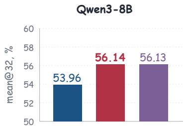

Direct-OPD Waypoint-OPD Final teacher (Qwen3-4B)  
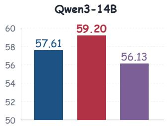

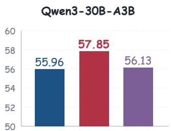  
Figure 1: Mathematical reasoning across three student models. mean@32 accuracy (%), averaged over seven benchmarks. Waypoint-OPD improves over Direct-OPD by 2.18, 1.59, and 1.89 percentage points, respectively. Teacher scores are from the Final Qwen3-4B checkpoint.

## 1 INTRODUCTION

Reinforcement learning can improve language-model instruction following using rewards learned from human preferences (Ouyang et al., 2022), and mathematical and code reasoning using verifiable rewards (Shao et al., 2024; Guo et al., 2025; Yu et al., 2025). The latter requires repeated generation, verification, and optimization of on-policy responses. Reusing a teacher’s RL improvements offers a way to share this training effort across target models. This raises the question: which local changes in the teacher’s policy should guide a student on its own generated trajectories?

Standard on-policy distillation (OPD) trains the student to match the teacher’s token distributions on student-generated prefixes (Agarwal et al., 2024). Its supervision remains tied to the teacher’s absolute policy and capability limitations. On-Policy Delta Distillation $( \mathrm { O P D ^ { 2 } } )$ uses the change between a reasoning-tuned teacher and its base model, retaining token-level signals when the centered change agrees in sign with the centered standard distillation signal (Heo et al., 2026). Direct On-Policy Distillation (Direct-OPD) focuses on RL-induced improvements. It uses the log-probability ratio between pre-RL and post-RL teacher checkpoints as a dense implicit reward on student-generated states, transferring the teacher’s policy change without matching its absolute distribution (Feng et al., 2026). Both methods extract changes from a pair of teacher models, but neither directly measures whether consecutive changes during teacher RL point in compatible directions.

The Initial-to-Final log-probability ratio captures only the change between the teacher’s policies before and after RL training. The same endpoint signal can arise from early and late policy changes that point in similar or opposing directions. Endpoint-only transfer cannot distinguish these cases. We hypothesize that agreement between the early and late changes provides evidence for deciding how much weight to assign an endpoint shift at a student-generated prefix.

Building on this hypothesis, we propose Waypoint-OPD, which uses agreement between consecutive teacher shifts to gate the endpoint transfer signal. We retain three checkpoints from the same teacher RL run: Initial before RL, Waypoint at an intermediate RL step, and Final at the end of RL. At each student-generated prefix, we select its top-k most probable next-token candidates. Over these candidates, we compare how the teacher’s relative preferences change from Initial to Waypoint and from Waypoint to Final. Their agreement gates the centered Initial-to-Final signal, retaining aligned changes and suppressing reversals. Waypoint thus supplies evidence for weighting the endpoint shift, which remains the transferred signal. Relative to endpoint-only transfer, this requires one additional frozen teacher scoring pass, with no new teacher training or verifier calls during student transfer.

Our contributions are:

• Temporal agreement as a criterion for selective transfer. We use the Waypoint checkpoint to assess temporal agreement at student-generated prefixes, revealing directional information unavailable from the endpoint pair alone.

• Waypoint-guided gating of endpoint signals. We develop Waypoint-OPD, a dense onpolicy objective that uses this agreement to weight the endpoint signal at each studentgenerated prefix, with one additional frozen teacher scoring pass.

• Higher average performance across domains and model sizes. We evaluate Qwen3-8B, Qwen3-14B, and Qwen3-30B-A3B(Yang et al., 2025) on mathematics and code. Waypoint-OPD achieves the highest recorded domain average among the evaluated baselines in all six settings (Figure 1 and Tables 1 and 2). Ablations on Qwen3-8B mathematical reasoning support the value of temporal gating (Table 3).

## 2 PRELIMINARIES

## 2.1 PROBLEM SETUP AND NOTATION

Let $x \sim \mathcal { D }$ be a prompt, $y = ( y _ { 1 } , \dotsc , y _ { T } )$ a response, and $s _ { t } = ( x , y _ { < t } )$ the prefix at which a candidate token a is scored. The student $\pi _ { \theta }$ generates on-policy responses $y \sim \pi _ { \boldsymbol { \theta } } ( \cdot \mid x )$ . Its initialization $\pi _ { S }$ remains fixed as a reference during transfer.

We denote the policies of the Initial, Waypoint, and Final teachers by $\pi _ { 0 } , \pi _ { m }$ , and $\pi _ { 1 }$ , respectively. All three checkpoints come from the same teacher RL run: Initial before RL, Waypoint at an intermediate step, and Final after RL. They remain frozen during transfer. We measure the teacher’s RL-induced change relative to $\pi _ { 0 }$ and regularize student updates relative to student initialization $\pi _ { S }$ . Teachers and student share a tokenizer, allowing direct comparison of probabilities for the same token.

## 2.2 ON-POLICY DISTILLATION

On-policy distillation (OPD) samples responses from the student and aligns its next-token distribution with the teacher’s at the prefixes the student visits (Agarwal et al., 2024). Using the Final teacher $\pi _ { 1 }$ OPD minimizes the reverse-KL objective

$$
\mathcal { L } _ { \mathrm { O P D } } ( \theta ) = \mathbb { E } _ { x \sim \mathcal { D } , y \sim \pi _ { \theta } ( \cdot | x ) } \left[ \sum _ { t = 1 } ^ { T } D _ { \mathrm { K L } } ( \pi _ { \theta } ( \cdot \mid s _ { t } ) \parallel \pi _ { 1 } ( \cdot \mid s _ { t } ) ) \right] .\tag{1}
$$

## 2.3 DIRECT ON-POLICY DISTILLATION

Direct-OPD uses the teacher’s RL-induced policy shift as an implicit reward on student-generated responses (Feng et al., 2026). The Initial-to-Final shift decomposes into token-level log-probability ratios:

$$
\Delta ^ { ( 0 , 1 ) } ( y \mid x ) = \log \frac { \pi _ { 1 } ( y \mid x ) } { \pi _ { 0 } ( y \mid x ) } = \sum _ { t = 1 } ^ { T } \delta _ { t } ( y _ { t } ) ,\tag{2}
$$

where

$$
\delta _ { t } ( a ) = \log \pi _ { 1 } ( a \mid s _ { t } ) - \log \pi _ { 0 } ( a \mid s _ { t } ) .\tag{3}
$$

A positive shift indicates that teacher RL increased a token’s probability at $s _ { t } ;$ a negative shift indicates a decrease. At an idealized teacher optimum with KL regularization toward $\pi _ { 0 }$ , the sequence log-ratio recovers the reward up to positive scale and a prompt-dependent constant (Rafailov et al., 2023) as used by Feng et al. (2026). This motivates the endpoint signal; we do not assume that finite-step teacher RL attains this optimum.

The idealized sequence-level objective maximizes this shift while regularizing the student toward its own initialization:

$$
\mathcal { I } _ { \mathrm { D i r e c t - O P D } } ( \theta ) = \mathbb { E } _ { x \sim \mathcal { D } } \left[ \mathbb { E } _ { y \sim \pi _ { \theta } ( \cdot \vert x ) } [ \Delta ^ { ( 0 , 1 ) } ( y \mid x ) ] - \beta D _ { \mathrm { K L } } ( \pi _ { \theta } ( \cdot \vert x ) \Vert \pi _ { S } ( \cdot \vert x ) ) \right] ,\tag{4}
$$

where $\beta > 0$ controls the student KL penalty. In practice, Direct-OPD uses $\delta _ { t } ( a )$ as an immediate token-level reward at student-generated prefixes, without verifier queries.

## 3 METHOD

Waypoint-OPD augments the endpoint signal in Section 2.3 with the Waypoint checkpoint $\pi _ { m }$ from the same teacher RL run. Agreement between the early and late shifts weights the endpoint signal on student-visited prefixes. Waypoint supplies consistency evidence rather than an imitation target. Figure 2 shows the pipeline.

## 3.1 STUDENT-LOCAL TRAJECTORY CONSISTENCY

At a student-visited prefix $s _ { t } , \mathcal { K } _ { t } = \mathrm { T o p K } ( \pi _ { \theta } ( \cdot \ | \ s _ { t } ) , k )$ selects the k token candidates with the highest student probabilities. The normalized student distribution on this support is

$$
q _ { t } ( a ) = \frac { \pi _ { \theta } ( a \mid s _ { t } ) } { \sum _ { b \in { \mathcal { K } } _ { t } } \pi _ { \theta } ( b \mid s _ { t } ) } , \qquad a \in { \mathcal { K } } _ { t } .\tag{5}
$$

These weights focus the comparison on likely student actions. Consistency is evaluated on the local support that receives the student update, with more probable candidates receiving greater weight. We score these candidates with all three frozen teachers. The two consecutive teacher shifts are

$$
\begin{array} { r } { \delta _ { t } ^ { ( 1 ) } ( a ) = \log \pi _ { m } ( a \mid s _ { t } ) - \log \pi _ { 0 } ( a \mid s _ { t } ) , } \end{array}\tag{6}
$$

$$
\begin{array} { r } { \delta _ { t } ^ { ( 2 ) } ( \boldsymbol { a } ) = \log \pi _ { 1 } ( \boldsymbol { a } \mid \boldsymbol { s } _ { t } ) - \log \pi _ { m } ( \boldsymbol { a } \mid \boldsymbol { s } _ { t } ) , } \end{array}\tag{7}
$$

and telescope to $\delta _ { t } = \delta _ { t } ^ { ( 1 ) } + \delta _ { t } ^ { ( 2 ) }$

A uniform shift across candidates leaves their relative preferences unchanged, yet can affect the angle between raw shift vectors. We remove this action-independent component with the $q _ { t }$ -centering operator

$$
C _ { q _ { t } } [ z ] ( a ) = z ( a ) - \mathbb { E } _ { b \sim q _ { t } } [ z ( b ) ]\tag{8}
$$

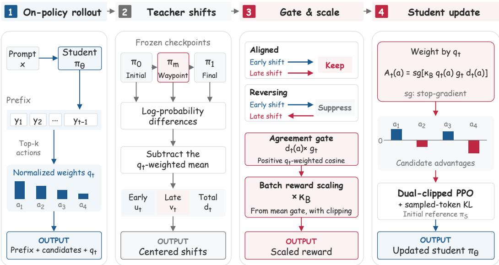  
Figure 2: Training pipeline of Waypoint-OPD. Initial, Waypoint, and Final score candidates at student-generated prefixes. Their centered segment shifts define an agreement gate on the endpoint shift. Batch scaling and detached candidate advantages drive the student update Waypoint measures consistency only.

and write $u _ { t } = C _ { q _ { t } } [ \delta _ { t } ^ { ( 1 ) } ] , v _ { t } = C _ { q _ { t } } [ \delta _ { t } ^ { ( 2 ) } ] ,$ , and $d _ { t } = C _ { q _ { t } } [ \delta _ { t } ] = u _ { t } + v _ { t }$ . We weight candidates by student probability using the inner product $\begin{array} { r } { \langle u _ { t } , v _ { t } \rangle _ { q _ { t } } = \sum _ { a \in \mathcal { K } _ { t } } q _ { t } ( a ) u _ { t } ( a ) v _ { t } ( a ) } \end{array}$ . The local temporal agreement and weighted norms are

$$
c _ { t } = \frac { \langle \boldsymbol { u } _ { t } , \boldsymbol { v } _ { t } \rangle _ { \boldsymbol { q } _ { t } } } { \| \boldsymbol { u } _ { t } \| _ { \boldsymbol { q } _ { t } } \| _ { \boldsymbol { v } _ { t } } \| _ { \boldsymbol { q } _ { t } } } , \quad \| \boldsymbol { u } _ { t } \| _ { \boldsymbol { q } _ { t } } = \sqrt { \langle \boldsymbol { u } _ { t } , \boldsymbol { u } _ { t } \rangle _ { \boldsymbol { q } _ { t } } } , \quad \| \boldsymbol { v } _ { t } \| _ { \boldsymbol { q } _ { t } } = \sqrt { \langle \boldsymbol { v } _ { t } , \boldsymbol { v } _ { t } \rangle _ { \boldsymbol { q } _ { t } } } .\tag{9}
$$

## 3.2 AGREEMENT GATING AND BATCH-SCALE NORMALIZATION

When both centered segment norms exceed $\varepsilon = 1 0 ^ { - 8 }$ , we use the positive-cosine gate

$$
g _ { t } = \operatorname* { m a x } ( 0 , c _ { t } ) .\tag{10}
$$

If either norm is at most ε, we use the low-norm fallback $g _ { t } = 1$ . The gate $g _ { t } \in [ 0 , 1 ]$ is shared by all candidates at prefix $s _ { t }$ . Outside this fallback, it removes the endpoint signal when $c _ { t } \leq 0$ and scales its magnitude by $c _ { t }$ otherwise. Algorithm and implementation conventions are given in Appendix B.

For illustration, consider two decompositions of a nonzero q -centered endpoint d, both outside the low-norm fallback. The pair $u = v = d / 2$ gives $c = 1$ and $g = 1$ , whereas $u = 2 d , v = - d$ gives $c = - 1$ and $g = 0$ . Both yield $u + v = d ,$ , so endpoint-only transfer cannot distinguish them. Appendix A.1 derives the endpoint’s independence from Waypoint at fixed student prefixes and weights. Directional agreement alone does not guarantee beneficial supervision.

To stabilize the average gate scale across batches, we multiply all gated rewards in batch B by

$$
\kappa _ { B } = \mathrm { c l i p } \left( \frac { \tau } { \operatorname* { m a x } \mathopen { } \mathclose \bgroup \left( | B _ { \mathrm { p r e f } } | ^ { - 1 } \sum _ { t \in B _ { \mathrm { p r e f } } } g _ { t } , \varepsilon _ { \mathrm { n u m } } \aftergroup \egroup \right) } , \kappa _ { \mathrm { m i n } } , \kappa _ { \mathrm { m a x } } \right) \mathrm { ~ , ~ }\tag{11}
$$

where $B _ { \mathrm { p r e f } }$ contains valid response prefixes in $B ,$ and $\varepsilon _ { \mathrm { { n u m } } } > 0$ is a numerical floor preventing division by zero. The ratio targets a mean rescaled gate of $\tau > 0$ , while clipping restricts $\kappa _ { B }$ to $\left[ \kappa _ { \mathrm { m i n } } , \kappa _ { \mathrm { m a x } } \right]$ , with $0 < \kappa _ { \mathrm { m i n } } \le \kappa _ { \mathrm { m a x } }$ . This shared positive multiplier preserves relative gate weights and zero gates. The effective multiplier $\kappa _ { B } g _ { t }$ can exceed one; batch scaling does not fix the reward-vector norm.

## 3.3 DENSE CANDIDATE OBJECTIVE

The final coefficient for candidate action $a \in \mathcal { K } _ { t }$ is

$$
A _ { t } ( a ) = \operatorname { s g } [ \kappa _ { B } q _ { t } ( a ) g _ { t } d _ { t } ( a ) ] .\tag{12}
$$

Following the signal-minus-KL form of Eq. 4, the local on-policy surrogate to maximize is

$$
\begin{array} { r l } & { \mathcal { I } _ { \mathrm { W P } } ( \theta ) = \mathbb { E } _ { x \sim \mathcal { D } } \Bigg [ \mathbb { E } _ { y \sim \pi _ { \theta } ( \cdot \vert x ) } \Bigg [ \sum _ { { t = 1 } } ^ { T } \sum _ { a \in \mathcal { K } _ { t } } A _ { t } ( a ) \log \pi _ { \theta } ( a \mid s _ { t } ) \Bigg ] } \\ & { \quad \quad \quad - \beta \widehat { D } _ { \mathrm { K L } } ( \pi _ { \theta } ( \cdot \vert x ) \parallel \pi _ { S } ( \cdot \vert x ) ) \Bigg ] , } \end{array}\tag{13}
$$

Rollout samples and candidate supports are held fixed when differentiating this surrogate, and the stopgradient operator sg detaches all factors in $A _ { t }$ . Candidate credit is dense on $\textstyle { \mathcal { K } } _ { t }$ , while the KL penalty is estimated on sampled response tokens and anchors the student to $\pi _ { S }$ . The implementation uses dual-clipped PPO, which has the same gradient as this surrogate at the rollout policy (Appendix B).

Relative to Direct-OPD, Waypoint-OPD adds one frozen teacher checkpoint and scoring pass, without additional trainable parameters or student rollouts. Derivations and signal properties appear in Appendix A.

## 4 EXPERIMENTS

We examine three questions:

Q1. Does Waypoint-OPD improve transfer across math, code, and model scales?

Q2. Does temporal consistency improve on endpoint transfer and Final-teacher imitation?

Q3. How do gate assignment, mean normalization, and Waypoint position affect performance?

Supplementary training-time and response-length analyses appear in Appendix H.

## 4.1 MODELS, DATA, AND EVALUATION

Teacher checkpoints and student models. For each domain, we use three checkpoints from the same Qwen3-4B (Yang et al., 2025) RL run: Initial $\mathbf { \Pi } ^ { \left( \pi _ { 0 } \right) }$ before RL, Waypoint $( \pi _ { m } )$ at RL step 600, and Final $( \pi _ { 1 } )$ at RL step 1200. Math and code teachers use non-thinking RL. All three checkpoints remain frozen during transfer. We train Qwen3-8B, Qwen3-14B, and Qwen3-30B-A3B students using the teacher’s RL-induced policy shifts. These students span three scales and dense and MoE architectures within one family with compatible tokenizers. The transfer objective does not require the teacher to outperform the student. We report all three teacher checkpoints and the Base students in the result tables to show pre-transfer performance.

Training and evaluation data. Math transfer uses DAPO-Math-17K prompts (Yu et al., 2025). We evaluate on seven benchmarks: AIME 2024, AIME 2025, AIME 2026, HMMT February 2025, HMMT November 2025, HMMT February 2026, and AMC 2023. For each problem, mean@32 measures average correctness over 32 generated responses. Benchmark scores average these values over problems, and Avg. is the unweighted mean across benchmarks.

Code transfer uses a Codeforces-derived prompt set. Evaluation uses the 378-problem MBPP+ set from EvalPlus (Liu et al., 2023), reporting both the original MBPP tests (Austin et al., 2021) and the original plus additional tests (MBPP+), together with LiveCodeBench v4, v5, and v6 (Jain et al., 2025). We report mean@8, which averages correctness over eight generated responses per problem and then over the problems in each benchmark. Code Avg. is the unweighted mean over these five evaluation scores. Within each benchmark, methods share prompt templates, decoding parameters, maximum generation lengths, and sample counts.

Student checkpoint selection. For both domains, we use AIME 2024 as the validation set and select each trained student’s checkpoint with the highest validation accuracy. All benchmark results for that student use this selected checkpoint.

Implementation. We build on verl (Sheng et al., 2025) and score the student’s top-16 token IDs with the three frozen teachers. The transfer objective combines the dense distillation reward with the student KL penalty. Answer graders are used only for evaluation. Implementation and training/evaluation configurations appear in Appendices B and C.

## 4.2 BASELINES AND CONTROLS

We compare against the Base student, standard on-policy distillation (OPD) from the Final teacher (Agarwal et al., 2024), $\mathrm { O P D ^ { 2 } }$ with its sampled-token objective (Heo et al., 2026), and endpoint Direct-OPD using log $\pi _ { 1 } - \log \pi _ { 0 }$ (Feng et al., 2026). All methods share training and evaluation settings, except for method-specific hyperparameters.

Three controls on Qwen3-8B math retain centering and alter one component of the full method. No gate sets $g _ { t } = 1$ while retaining the gate-mean normalization rule. Shuffled gate permutes gates among valid response prefixes within a batch, retaining each prefix’s candidate weights and centered endpoint signal. No normalization fixes $\kappa _ { B } = 1$ while retaining the positive-cosine gate. Appendix E gives definitions and invariants of the shuffle control. We separately vary the math Waypoint over teacher RL steps 500, 600, and 700 on Qwen3-8B in Appendix F.

## 5 RESULTS AND ANALYSIS

We compare transfer performance across math and code at three student scales (Section 5.1). We examine learning trajectories and performance relative to the Final teacher on Qwen3-8B math (Section 5.2). We assess the roles of temporal gating, gate assignment, and mean normalization through ablations (Section 5.3).

## 5.1 MAIN RESULTS ACROSS DOMAINS AND SCALES

Tables 1 and 2 report math scores and code averages. Full code results appear in Appendix D. Waypoint-OPD achieves the highest domain-average score among the evaluated student methods in all six settings.

Math. Waypoint-OPD improves over Direct-OPD, the strongest average baseline for all three students, by 2.18, 1.59, and 1.89 percentage points for Qwen3-8B, Qwen3-14B, and Qwen3-30B-A3B, respectively. It improves 19 of 21 benchmark comparisons. The exceptions are HMMT25N for 14B (47.60 to 47.08) and HMMT26F for 30B-A3B (33.05 to 32.77). These results demonstrate improvements over endpoint transfer across student scales and both dense and MoE architectures. The 14B and 30B-A3B students also exceed the Final teacher’s 56.13 average by 3.07 and 1.72 points, respectively, while 8B essentially matches it at 56.14. The 14B student surpasses the teacher on all seven math benchmarks.

Code. Waypoint-OPD improves over Direct-OPD by 2.66, 1.52, and 1.19 percentage points on average for Qwen3-8B, Qwen3-14B, and Qwen3-30B-A3B, respectively, with gains in all 15 code comparisons. $\mathrm { { O P D ^ { 2 } } }$ achieves higher scores on 14B LCB v5 and on 30B-A3B MBPP and MBPP+, while Waypoint-OPD retains the highest average for each student (Appendix D). The 14B and 30B-A3B students also surpass the Final teacher’s 55.37 average by 2.45 and 2.17 points, respectively, each scoring higher on four of the five code evaluations.

Interpreting the endpoint comparison. The gains over Direct-OPD show that Waypoint-OPD improves transfer performance across both domains and all three student scales. OPD and $\mathrm { O P D ^ { 2 } }$ provide complementary comparisons with Final-teacher imitation and selective distillation based on advantage sign agreement, respectively.

## 5.2 LEARNING DYNAMICS

Figure 3 compares Waypoint-OPD and Direct-OPD at matched evaluation steps during Qwen3- 8B math training. Unlike the selected-checkpoint results in Table 1, these trajectories show the performance gap over the same 100 updates.

Table 1: Mathematical reasoning across three student sizes. mean@32 scores (%) on seven benchmarks and their average. Bold marks the best score per student. Teacher checkpoints are references.
<table><tr><td>Method</td><td>AIME24</td><td>AIME25</td><td>AIME26</td><td>HMMT25 Feb</td><td>HMMT25 Nov</td><td>HMMT26 Feb</td><td>AMC23</td><td>Avg.</td></tr><tr><td colspan="9">Teacher: Qwen3-4B</td></tr><tr><td>Initial</td><td>21.67</td><td>21.67</td><td>21.67</td><td>12.50</td><td>10.00</td><td>15.15</td><td>71.25</td><td>24.84</td></tr><tr><td>Waypoint</td><td>58.96</td><td>54.79</td><td>56.77</td><td>31.35</td><td>35.73</td><td>31.72</td><td>93.44</td><td>51.82</td></tr><tr><td>Final</td><td>65.83</td><td>60.00</td><td>60.83</td><td>35.83</td><td>40.83</td><td>35.13</td><td>94.45</td><td>56.13</td></tr><tr><td colspan="9">Student: Qwen3-8B</td></tr><tr><td>Base</td><td>29.17</td><td>20.83</td><td>18.33</td><td>11.67</td><td>13.33</td><td>18.94</td><td>70.00</td><td>26.04</td></tr><tr><td>OPD</td><td>63.65</td><td>49.69</td><td>54.90</td><td>29.06</td><td>38.65</td><td>32.58</td><td>88.75</td><td>51.04</td></tr><tr><td>OPD2</td><td>64.48</td><td>48.33</td><td>53.96</td><td>28.44</td><td>40.52</td><td>31.53</td><td>92.97</td><td>51.46</td></tr><tr><td>Direct-OPD</td><td>67.29</td><td>55.31</td><td>57.40</td><td>31.77</td><td>40.83</td><td>33.71</td><td>91.41</td><td>53.96</td></tr><tr><td>Waypoint-OPD</td><td>68.85</td><td>57.92</td><td>60.21</td><td>34.38</td><td>42.60</td><td>36.36</td><td>92.66</td><td>56.14</td></tr><tr><td colspan="9">Student: Qwen3-14B</td></tr><tr><td>Base</td><td>30.00</td><td>27.50</td><td>20.00</td><td>10.00</td><td>11.67</td><td>18.94</td><td>73.13</td><td>27.32</td></tr><tr><td>OPD</td><td>69.17</td><td>55.52</td><td>58.44</td><td>36.77</td><td>45.21</td><td>31.82</td><td>96.25</td><td>56.17</td></tr><tr><td>OPD2</td><td>69.48</td><td>46.98</td><td>54.38</td><td>33.13</td><td>41.98</td><td>31.91</td><td>91.95</td><td>52.83</td></tr><tr><td>Direct-OPD</td><td>70.10</td><td>56.46</td><td>61.98</td><td>37.92</td><td>47.60</td><td>35.13</td><td>94.06</td><td>57.61</td></tr><tr><td>Waypoint-OPD</td><td>70.21</td><td>60.52</td><td>63.75</td><td>40.21</td><td>47.08</td><td>36.55</td><td>96.09</td><td>59.20</td></tr><tr><td colspan="9">Student: Qwen3-30B-A3B</td></tr><tr><td>Base</td><td>31.67</td><td>22.50</td><td>22.50</td><td>10.00</td><td>13.33</td><td>21.21</td><td>75.00</td><td>28.03</td></tr><tr><td>OPD</td><td>63.54</td><td>49.06</td><td>57.50</td><td>30.83</td><td>37.71</td><td>28.03</td><td>91.88</td><td>51.22</td></tr><tr><td>OPD²</td><td>64.90</td><td>51.77</td><td>60.42</td><td>31.56</td><td>38.54 41.56</td><td>30.21</td><td>91.33</td><td>52.68</td></tr><tr><td>Direct-OPD</td><td>69.17</td><td>54.69 58.44</td><td>61.98</td><td>38.96 39.90</td><td>44.69</td><td>33.05 32.77</td><td>92.34 94.53</td><td>55.96 57.85</td></tr><tr><td>Waypoint-OPD</td><td>70.94</td><td></td><td>63.65</td><td></td><td></td><td></td><td></td><td></td></tr></table>

Table 2: Average code reasoning performance. Average mean@8 scores (%) over five evaluations. Qwen3-4B teacher checkpoints are shared references. Bold marks the best score per student. Full results: Appendix D.
<table><tr><td colspan="4">Teacher reference: Qwen3-4B</td></tr><tr><td></td><td>Initial: 37.64</td><td>Waypoint: 52.22</td><td>Final: 55.37</td></tr><tr><td>Method</td><td>Qwen3-8B</td><td>Qwen3-14B</td><td>Qwen3-30B-A3B</td></tr><tr><td>Base</td><td>41.03</td><td>47.72</td><td>50.33</td></tr><tr><td>OPD</td><td>43.91</td><td>51.66</td><td>51.91</td></tr><tr><td>OPD²</td><td>51.21</td><td>55.60</td><td>55.96</td></tr><tr><td>Direct-OPD</td><td>50.59</td><td>56.30</td><td>56.35</td></tr><tr><td>Waypoint-OPD</td><td>53.25</td><td>57.82</td><td>57.54</td></tr></table>

Consistent gains across training checkpoints. Waypoint-OPD delivers consistent gains over Direct-OPD across both benchmarks and training checkpoints. Excluding the shared initialization, it scores higher in 13 of the 15 benchmark–checkpoint comparisons, with two exceptions early in training. From step 60 onward, Waypoint-OPD leads on all three benchmarks at every recorded evaluation, showing that its advantage is sustained through the end of training. The step-100 gains are 4.17, 3.13, and 0.10 percentage points on AIME 2025, AIME 2026, and HMMT November 2025, respectively. These results show that gains extend beyond the selected checkpoint to sustained advantages during training.

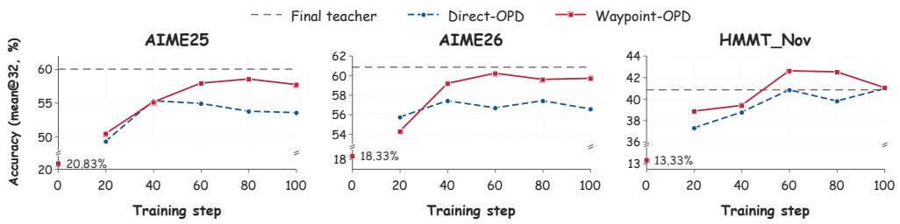  
Figure 3: Evaluation accuracy during training. Qwen3-8B results on AIME 2025, AIME 2026, and HMMT November 2025 at steps 0, 20, 40, 60, 80, and 100. Scores are mean@32 percentages. Solid red curves denote Waypoint-OPD and dashed blue curves denote Direct-OPD. Gray dashed lines show the Final Qwen3-4B teacher scores.

Comparison with the Final teacher. The gray reference lines distinguish gains over endpoint transfer from performance relative to the teacher. On HMMT November 2025, Waypoint-OPD exceeds the Final teacher’s 40.83 at steps 60, 80, and 100, reaching 42.60 at step 60. On both AIME benchmarks, its recorded scores remain below the corresponding teacher reference. Improvements over Direct-OPD therefore coexist with different teacher–student orderings across benchmarks. The sustained HMMT advantage demonstrates that Waypoint-OPD can use the teacher’s policy shifts to achieve performance beyond the Final teacher’s score.

## 5.3 GATE AND NORMALIZATION ABLATIONS

Table 3: Gate and normalization ablations on Qwen3-8B mathematical reasoning. Bold marks the best score in each column.
<table><tr><td>Method</td><td>AIME24</td><td>AIME25</td><td>AIME26</td><td>HMMT25 Feb</td><td>HMMT25 Nov</td><td>HMMT26 Feb</td><td>AMC23</td><td>Avg.</td></tr><tr><td>No gate</td><td>66.25</td><td>54.27</td><td>56.67</td><td>32.60</td><td>39.79</td><td>34.66</td><td>90.23</td><td>53.50</td></tr><tr><td>Shuffled gate</td><td>63.33</td><td>52.92</td><td>54.58</td><td>30.00</td><td>37.08</td><td>31.06</td><td>89.45</td><td>51.20</td></tr><tr><td>No normalization</td><td>68.13</td><td>56.46</td><td>58.33</td><td>34.79</td><td>41.56</td><td>35.23</td><td>92.03</td><td>55.22</td></tr><tr><td>Direct-OPD</td><td>67.29</td><td>55.31</td><td>57.40</td><td>31.77</td><td>40.83</td><td>33.71</td><td>91.41</td><td>53.96</td></tr><tr><td>Waypoint-OPD</td><td>68.85</td><td>57.92</td><td>60.21</td><td>34.38</td><td>42.60</td><td>36.36</td><td>92.66</td><td>56.14</td></tr></table>

Removing the gate. On Qwen3-8B math, removing the gate lowers Avg. from 56.14 to 53.50, a decrease of 2.64 points, with lower scores on all seven benchmarks (Table 3). Retaining centering and normalization without consistency-dependent weighting therefore does not recover the full method’s gain. This comparison does not isolate the effect of centering.

Disrupting the gate–prefix association. Shuffling gates lowers Avg. to 51.20, which is 4.94 points below the full method and 2.30 below the ungated variant, with the same ordering on every benchmark. Random reassignment is thus more detrimental than removing the selective weighting in this setting, supporting the value of matching each gate to the prefix whose temporal agreement produced it.

Removing mean normalization. Fixing $\kappa _ { B } = 1$ while retaining the positive-cosine gate lowers Avg. by 0.92 points to 55.22. Normalization improves six of seven benchmarks. The exception is HMMT February 2025 (34.79 without normalization versus 34.38 with it). The unnormalized variant still exceeds Direct-OPD by 1.26 points on average and on all seven benchmarks. Thus, the advantage persists without batch normalization, which provides an additional average benefit here. The remaining gain cannot be assigned entirely to gating because centering and other differences from Direct-OPD are also retained.

Ablation insights. These ablations support temporal weighting, its prefix assignment, and an incremental benefit from normalization in Qwen3-8B math. Their gaps are conditional on the retained components, not independent additive contributions. For a fixed rollout batch, shuffling preserves the gate distribution and $\kappa _ { B } .$ , while advantage and gradient norms depend additionally on the gate–signal pairing (Appendix E). Supplementary diagnostics show stronger average gate attenuation in later batches, while mean-gate normalization does not fix the reward norm (Appendix G).

## 6 RELATED WORK

On-policy distillation and policy-shift transfer. Knowledge distillation transfers teacher distributions or generated sequences (Hinton et al., 2015; Kim & Rush, 2016), while on-policy variants supervise student-generated trajectories (Agarwal et al., 2024). Complementary work refines divergence objectives and the use of teacher- and student-generated data (Wen et al., 2023; Gu et al., 2024; Ko et al., 2024; 2025). Weak-to-strong generalization asks whether weaker supervision can elicit stronger capabilities (Burns et al., 2024). WSPO and proxy-tuning reuse a weak model’s adaptation contrast for training and decoding, respectively (Zhu et al., 2025; Liu et al., 2024). Within on-policy training, Direct-OPD transfers an RL-induced policy change through an endpoint log-ratio on student rollouts (Feng et al., 2026). W2S-OPD constructs a proxy teacher by adding a weak-model logit contrast to student base logits, then minimizes reverse KL on student rollouts. Its contrasts span RL checkpoints, model scales, and correct versus incorrect hints (Yu et al., 2026). OPRD uses a centered teacher–reference shift to amplify the component of a verifier-driven gradient along that direction (Park et al., 2026). Waypoint-OPD builds on Direct-OPD, weighting local endpoint signals by agreement between shifts before and after a Waypoint checkpoint.

Selective supervision in distillation. Teacher–student compatibility affects the utility of on-policy supervision (Li et al., 2026). Prune-OPD uses support overlap for suffix attenuation (Yang et al., 2026). EOPD uses teacher uncertainty in its entropy-dependent forward KL (Jin et al., 2026), while PW-OPSD uses token position in its reference-conditioned self-distillation (Liu et al., 2026). OPD2 gates sampled-token updates by sign agreement between centered teacher–base and teacher–student advantages (Heo et al., 2026), whereas RG-OPD gates trajectories using agreement between verifierderived advantages and teacher–student sequence log-likelihood gaps (Akhondzadeh et al., 2026). Waypoint-OPD uses different evidence: consecutive shifts in the teacher’s own RL trajectory over student-supported candidate actions. Their weighted directional agreement produces a prefix-level gate for the dense endpoint update, without verifier feedback during transfer. This agreement is a weighting criterion, not a guarantee of correctness.

Checkpoint selection and progressive distillation. A teacher’s final performance need not determine its teaching utility: early stopping and intermediate checkpoint selection can improve distillation (Cho & Hariharan, 2019; Wang et al., 2022). Pro-KD and progressive distillation use successive teacher checkpoints as targets or a curriculum (Rezagholizadeh et al., 2022; Panigrahi et al., 2025). Direct-OPD also studies RL checkpoint choice for transfer (Feng et al., 2026). For fixed Initial and Final endpoints, Waypoint measures directional consistency between the two shifts. It supplies neither an imitation target nor a curriculum. The centered Initial-to-Final shift remains the transferred object.

## 7 CONCLUSION

We presented Waypoint-OPD, which uses agreement between consecutive teacher shifts to transfer RL-induced policy changes. An intermediate Waypoint checkpoint reveals whether early and late changes in relative action preferences reinforce or oppose each other at student-generated prefixes. This information, unavailable from endpoint differences alone, determines the weight of the centered Initial-to-Final shift in the student’s on-policy objective. The method requires one additional frozenteacher scoring pass and no verifier calls during transfer. Experiments on mathematical and code reasoning show gains over endpoint transfer across three Qwen3 student scales. Ablations on Qwen3- 8B math support prefix-specific gate assignment and batch-scale normalization. These findings suggest that intermediate teacher checkpoints provide evidence for weighting local policy changes during student learning.

## AI USE STATEMENT

We use generative AI tools for language polishing, assistance in clarifying mathematical derivations, and consistency checks of notation and exposition. These tools were not used for experimental design, implementation, or execution. We take full responsibility for the final content of this work.

## ETHICS STATEMENT

Use of Human Annotations Human annotations are only used in methodological research at the beginning of the work, to assist in analyzing the feasibility of the proposed solution. Annotators consented to the use of data for research purposes. We ensure that the privacy of all annotators is protected throughout the annotation process, and all of them are adequately paid according to local standards. Human annotations are not applied during the evaluation of our method.

Risks In this paper, all datasets are obtained from official sources. The datasets adopted have been anonymized and do not contain offensive information. However, we cannot guarantee that the datasets do not contain socially harmful or toxic language.

## REPRODUCIBILITY STATEMENT

The transfer objective is specified in Section 3, with supporting derivations and signal properties in Appendix A and pseudocode and optimization details in Appendix B. Section 4.1 describes the teacher checkpoints, student models, training and evaluation data, evaluation metrics, and student checkpoint selection. Appendix C reports hyperparameters, hardware, and evaluation settings.

Baselines and controls are described in Section 4.2, with precise definitions of the gate and normalization ablations in Appendix E and the Waypoint-position ablation setup in Appendix F. Per-benchmark results and domain averages appear in Tables 1 and 7, and gate and normalization ablation results appear in Table 3.

## REFERENCES

Rishabh Agarwal, Nino Vieillard, Yongchao Zhou, Piotr Stanczyk, Sabela Ramos Garea, Matthieu Geist, and Olivier Bachem. On-policy distillation of language models: Learning from selfgenerated mistakes. In The Twelfth International Conference on Learning Representations, ICLR 2024, Vienna, Austria, May 7-11, 2024. OpenReview.net, 2024. URL https://openreview. net/forum?id=3zKtaqxLhW.

Mohammad Sadegh Akhondzadeh, Vijay Lingam, Atula Tejaswi, Chanakya Ekbote, Sujay Sanghavi, and Aleksandar Bojchevski. Reward-gated on-policy distillation. arXiv preprint arXiv:2607.04037, 2026.

Jacob Austin, Augustus Odena, Maxwell Nye, Maarten Bosma, Henryk Michalewski, David Dohan, Ellen Jiang, Carrie Cai, Michael Terry, Quoc Le, et al. Program synthesis with large language models. arXiv preprint arXiv:2108.07732, 2021.

Collin Burns, Pavel Izmailov, Jan Hendrik Kirchner, Bowen Baker, Leo Gao, Leopold Aschenbrenner, Yining Chen, Adrien Ecoffet, Manas Joglekar, Jan Leike, Ilya Sutskever, and Jeffrey Wu. Weak-tostrong generalization: Eliciting strong capabilities with weak supervision. In Ruslan Salakhutdinov, Zico Kolter, Katherine A. Heller, Adrian Weller, Nuria Oliver, Jonathan Scarlett, and Felix Berkenkamp (eds.), Forty-first International Conference on Machine Learning, ICML 2024, Vienna, Austria, July 21-27, 2024, volume 235 of Proceedings ofMachine Learning Research, pp. 4971– 5012. PMLR / OpenReview.net, 2024. URL https://proceedings.mlr.press/v235/ burns24b.html.

Jang Hyun Cho and Bharath Hariharan. On the efficacy of knowledge distillation. In 2019 IEEE/CVF International Conference on Computer Vision, ICCV 2019, Seoul, Korea (South), October 27 - November 2, 2019, pp. 4793–4801. IEEE, 2019. doi: 10.1109/ICCV.2019.00489. URL https: //doi.org/10.1109/ICCV.2019.00489.

Ganqu Cui, Lifan Yuan, Zefan Wang, Hanbin Wang, Yuchen Zhang, Jiacheng Chen, Wendi Li, Bingxiang He, Yuchen Fan, Tianyu Yu, Qixin Xu, Weize Chen, Jiarui Yuan, Huayu Chen, Kaiyan Zhang, Xingtai Lv, Shuo Wang, Yuan Yao, Xu Han, Hao Peng, Yu Cheng, Zhiyuan Liu, Maosong Sun, Bowen Zhou, and Ning Ding. Process reinforcement through implicit rewards. Trans. Mach. Learn. Res., 2026, 2026. URL https://openreview.net/forum?id=9SkkifLopZ.

Shiyuan Feng, Huan-ang Gao, Haohan Chi, Hanlin Wu, Zhilong Zhang, Zheng Jiang, Bingxiang He, Wei-Ying Ma, Ya-Qin Zhang, and Hao Zhou. Weak-to-strong generalization via direct on-policy distillation. arXiv preprint arXiv:2607.05394, 2026.

Yuxian Gu, Li Dong, Furu Wei, and Minlie Huang. Minillm: Knowledge distillation of large language models. In The Twelfth International Conference on Learning Representations, ICLR 2024, Vienna, Austria, May 7-11, 2024. OpenReview.net, 2024. URL https://openreview. net/forum?id=5h0qf7IBZZ.

Daya Guo, Dejian Yang, Haowei Zhang, Junxiao Song, Peiyi Wang, Qihao Zhu, Runxin Xu, Ruoyu Zhang, Shirong Ma, Xiao Bi, Xiaokang Zhang, Xingkai Yu, Yu Wu, Z. F. Wu, Zhibin Gou, Zhihong Shao, Zhuoshu Li, Ziyi Gao, Aixin Liu, Bing Xue, Bingxuan Wang, Bochao Wu, Bei Feng, Chengda Lu, Chenggang Zhao, Chengqi Deng, Chong Ruan, Damai Dai, Deli Chen, Dongjie Ji, Erhang Li, Fangyun Lin, Fucong Dai, Fuli Luo, Guangbo Hao, Guanting Chen, Guowei Li, Hao Zhang, Hanwei Xu, Honghui Ding, Huazuo Gao, Hui Qu, Hui Li, Jianzhong Guo, Jiashi Li, Jingchang Chen, Jingyang Yuan, Jinhao Tu, Junjie Qiu, Junlong Li, J. L. Cai, Jiaqi Ni, Jian Liang, Jin Chen, Kai Dong, Kai Hu, Kaichao You, Kaige Gao, Kang Guan, Kexin Huang, Kuai Yu, Lean Wang, Lecong Zhang, Liang Zhao, Litong Wang, Liyue Zhang, Lei Xu, Leyi Xia, Mingchuan Zhang, Minghua Zhang, Minghui Tang, Mingxu Zhou, Meng Li, Miaojun Wang, Mingming Li, Ning Tian, Panpan Huang, Peng Zhang, Qiancheng Wang, Qinyu Chen, Qiushi Du, Ruiqi Ge, Ruisong Zhang, Ruizhe Pan, Runji Wang, R. J. Chen, R. L. Jin, Ruyi Chen, Shanghao Lu, Shangyan Zhou, Shanhuang Chen, Shengfeng Ye, Shiyu Wang, Shuiping Yu, Shunfeng Zhou, Shuting Pan, S. S. Li, Shuang Zhou, Shaoqing Wu, Tao Yun, Tian Pei, Tianyu Sun, Tao Wang, Wangding Zeng, Wen Liu, Wenfeng Liang, Wenjun Gao, Wenqin Yu, Wentao Zhang, W. L. Xiao, Wei An, Xiaodong Liu, Xiaohan Wang, Xiaokang Chen, Xiaotao Nie, Xin Cheng, Xin Liu, Xin Xie, Xingchao Liu, Xinyu Yang, Xinyuan Li, Xuecheng Su, Xuheng Lin, X. Q. Li, Xiangyue Jin, Xiaojin Shen, Xiaosha Chen, Xiaowen Sun, Xiaoxiang Wang, Xinnan Song, Xinyi Zhou, Xianzu Wang, Xinxia Shan, Y. K. Li, Y. Q. Wang, Y. X. Wei, Yang Zhang, Yanhong Xu, Yao Li, Yao Zhao, Yaofeng Sun, Yaohui Wang, Yi Yu, Yichao Zhang, Yifan Shi, Yiliang Xiong, Ying He, Yishi Piao, Yisong Wang, Yixuan Tan, Yiyang Ma, Yiyuan Liu, Yongqiang Guo, Yuan Ou, Yuduan Wang, Yue Gong, Yuheng Zou, Yujia He, Yunfan Xiong, Yuxiang Luo, Yuxiang You, Yuxuan Liu, Yuyang Zhou, Y. X. Zhu, Yanping Huang, Yaohui Li, Yi Zheng, Yuchen Zhu, Yunxian Ma, Ying Tang, Yukun Zha, Yuting Yan, Z. Z. Ren, Zehui Ren, Zhangli Sha, Zhe Fu, Zhean Xu, Zhenda Xie, Zhengyan Zhang, Zhewen Hao, Zhicheng Ma, Zhigang Yan, Zhiyu Wu, Zihui Gu, Zijia Zhu, Zijun Liu, Zilin Li, Ziwei Xie, Ziyang Song, Zizheng Pan, Zhen Huang, Zhipeng Xu, Zhongyu Zhang, and Zhen Zhang. Deepseek-r1 incentivizes reasoning in llms through reinforcement learning. Nat., 645(8081):633–638, 2025. doi: 10.1038/S41586-025-09422-Z. URL https://doi.org/10.1038/s41586-025-09422-z.

Zhiwei He, Tian Liang, Jiahao Xu, Qiuzhi Liu, Xingyu Chen, Yue Wang, Linfeng Song, Dian Yu, Zhenwen Liang, Wenxuan Wang, Zhuosheng Zhang, Rui Wang, Zhaopeng Tu, Haitao Mi, and Dong Yu. Deepmath-103k: A large-scale, challenging, decontaminated, and verifiable mathemati cal dataset for advancing reasoning. In Carl Vondrick, Bharath Hariharan, Colin Raffel, Lerrel Pinto, Diyi Yang, and Aleksandra Faust (eds.), The Fourteenth International Conference on Learn ing Representations, ICLR 2026, Rio de Janeiro, Brazil, April 23-27, 2026. proceedings.iclr.cc, 2026. URL https://proceedings.iclr.cc/paper\_files/paper/2026/hash/ df7b97ccf54c528516b62aa9a012d02a-Abstract-Conference.html.

Byeongho Heo, Jaehui Hwang, Sangdoo Yun, and Dongyoon Han. On-policy delta distillation. arXiv preprint arXiv:2607.15161, 2026.

Geoffrey Hinton, Oriol Vinyals, and Jeff Dean. Distilling the knowledge in a neural network. arXiv preprint arXiv:1503.02531, 2015.

Naman Jain, King Han, Alex Gu, Wen-Ding Li, Fanjia Yan, Tianjun Zhang, Sida Wang, Armando Solar-Lezama, Koushik Sen, and Ion Stoica. Livecodebench: Holistic and contamination free evaluation of large language models for code. In The Thirteenth International Conference on Learning Representations, ICLR 2025, Singapore, April 24-28, 2025. OpenReview.net, 2025. URL https://openreview.net/forum?id=chfJJYC3iL.

Woogyeol Jin, Taywon Min, Yongjin Yang, Dennis Wei, Yi Zhou, Swanand Ravindra Kadhe, Nathalie Baracaldo, and Kimin Lee. Entropy-aware on-policy distillation of language models. arXiv preprint arXiv:2603.07079, 2026.

Yoon Kim and Alexander M. Rush. Sequence-level knowledge distillation. In Jian Su, Xavier Carreras, and Kevin Duh (eds.), Proceedings of the 2016 Conference on Empirical Methods in Natural Language Processing, EMNLP 2016, Austin, Texas, USA, November 1-4, 2016, pp. 1317– 1327. The Association for Computational Linguistics, 2016. doi: 10.18653/V1/D16-1139. URL https://doi.org/10.18653/v1/d16-1139.

Jongwoo Ko, Sungnyun Kim, Tianyi Chen, and Se-Young Yun. Distillm: Towards streamlined distillation for large language models. In Ruslan Salakhutdinov, Zico Kolter, Katherine A. Heller, Adrian Weller, Nuria Oliver, Jonathan Scarlett, and Felix Berkenkamp (eds.), Forty-first International Conference on Machine Learning, ICML 2024, Vienna, Austria, July 21-27, 2024, volume 235 of Proceedings of Machine Learning Research, pp. 24872–24895. PMLR / OpenReview.net, 2024. URL https://proceedings.mlr.press/v235/ko24c.html.

Jongwoo Ko, Tianyi Chen, Sungnyun Kim, Tianyu Ding, Luming Liang, Ilya Zharkov, and Se-Young Yun. Distillm-2: A contrastive approach boosts the distillation of llms. In Aarti Singh, Maryam Fazel, Daniel Hsu, Simon Lacoste-Julien, Felix Berkenkamp, Tegan Maharaj, Kiri Wagstaff, and Jerry Zhu (eds.), Forty-second International Conference on Machine Learning, ICML 2025, Vancouver, BC, Canada, July 13-19, 2025, volume 267 of Proceedings of Machine Learning Research. PMLR / OpenReview.net, 2025. URL https://proceedings.mlr.press/ v267/ko25a.html.

Woosuk Kwon, Zhuohan Li, Siyuan Zhuang, Ying Sheng, Lianmin Zheng, Cody Hao Yu, Joseph Gonzalez, Hao Zhang, and Ion Stoica. Efficient memory management for large language model serving with pagedattention. In Jason Flinn, Margo I. Seltzer, Peter Druschel, Antoine Kaufmann, and Jonathan Mace (eds.), Proceedings of the 29th Symposium on Operating Systems Principles, SOSP 2023, Koblenz, Germany, October 23-26, 2023, pp. 611–626. ACM, 2023. doi: 10.1145/ 3600006.3613165. URL https://doi.org/10.1145/3600006.3613165.

Yaxuan Li, Yuxin Zuo, Bingxiang He, Jinqian Zhang, Chaojun Xiao, Cheng Qian, Tianyu Yu, Huanang Gao, Wenkai Yang, Zhiyuan Liu, et al. Rethinking on-policy distillation of large language models: Phenomenology, mechanism, and recipe. arXiv preprint arXiv:2604.13016, 2026.

Alisa Liu, Xiaochuang Han, Yizhong Wang, Yulia Tsvetkov, Yejin Choi, and Noah A Smith. Tuning language models by proxy. arXiv preprint arXiv:2401.08565, 2024.

Jiawei Liu, Chunqiu Steven Xia, Yuyao Wang, and Lingming Zhang. Is your code generated by chatgpt really correct? rigorous evaluation of large language models for code generation. In Alice Oh, Tristan Naumann, Amir Globerson, Kate Saenko, Moritz Hardt, and Sergey Levine (eds.), Advances in Neural Information Processing Systems 36: Annual Conference on Neural Information Processing Systems 2023, NeurIPS 2023, New Orleans, LA, USA, December 10 - 16, 2023, 2023. URL http://papers.nips.cc/paper\_files/paper/2023/hash/ 43e9d647ccd3e4b7b5baab53f0368686-Abstract-Conference.html.

Xiaogeng Liu, Xinyan Wang, Yingzi Ma, Yechao Zhang, and Chaowei Xiao. When are teacher tokens reliable? position-weighted on-policy self-distillation for reasoning. arXiv preprint arXiv:2605.21606, 2026.

Long Ouyang, Jeffrey Wu, Xu Jiang, Diogo Almeida, Carroll L. Wainwright, Pamela Mishkin, Chong Zhang, Sandhini Agarwal, Katarina Slama, Alex Ray, John Schulman, Jacob Hilton, Fraser Kelton, Luke Miller, Maddie Simens, Amanda Askell, Peter Welinder, Paul F. Christiano, Jan Leike, and Ryan Lowe. Training language models to follow instructions with human feedback. In Sanmi Koyejo, S. Mohamed, A. Agarwal, Danielle Belgrave, K. Cho, and A. Oh (eds.),

Advances in Neural Information Processing Systems 35: Annual Conference on Neural Information Processing Systems 2022, NeurIPS 2022, New Orleans, LA, USA, November 28 - December 9, 2022, 2022. URL http://papers.nips.cc/paper\_files/paper/2022/hash/ b1efde53be364a73914f58805a001731-Abstract-Conference.html.

Abhishek Panigrahi, Bingbin Liu, Sadhika Malladi, Andrej Risteski, and Surbhi Goel. Progressive distillation induces an implicit curriculum. In The Thirteenth International Conference on Learning Representations, ICLR 2025, Singapore, April 24-28, 2025. OpenReview.net, 2025. URL https: //openreview.net/forum?id=wPMRwmytZe.

Youngrok Park, Sangmin Bae, Hojung Jung, Jongwoo Ko, Yunseon Choi, Young Jin Kim, Pashmina Cameron, Aaron Courville, and Se-Young Yun. Eliciting weak-to-strong generalization with on-policy reverse distillation. arXiv preprint arXiv:2609.08798, 2026.

Rafael Rafailov, Archit Sharma, Eric Mitchell, Christopher D. Manning, Stefano Ermon, and Chelsea Finn. Direct preference optimization: Your language model is secretly a reward model. In Alice Oh, Tristan Naumann, Amir Globerson, Kate Saenko, Moritz Hardt, and Sergey Levine (eds.), Advances in Neural Information Processing Systems 36: Annual Conference on Neural Information Processing Systems 2023, NeurIPS 2023, New Orleans, LA, USA, December 10 - 16, 2023, 2023. URL http://papers.nips.cc/paper\_files/paper/2023/hash/ a85b405ed65c6477a4fe8302b5e06ce7-Abstract-Conference.html.

Mehdi Rezagholizadeh, Aref Jafari, Puneeth S. M. Saladi, Pranav Sharma, Ali Saheb Pasand, and Ali Ghodsi. Pro-kd: Progressive distillation by following the footsteps of the teacher. In Nicoletta Calzolari, Chu-Ren Huang, Hansaem Kim, James Pustejovsky, Leo Wanner, Key-Sun Choi, Pum-Mo Ryu, Hsin-Hsi Chen, Lucia Donatelli, Heng Ji, Sadao Kurohashi, Patrizia Paggio, Nianwen Xue, Seokhwan Kim, Younggyun Hahm, Zhong He, Tony Kyungil Lee, Enrico Santus, Francis Bond, and Seung-Hoon Na (eds.), Proceedings ofthe 29th International Conference on Computational Linguistics, COLING 2022, Gyeongju, Republic of Korea, October 12-17, 2022, pp. 4714–4727. International Committee on Computational Linguistics, 2022. URL https: //aclanthology.org/2022.coling-1.418.

John Schulman, Filip Wolski, Prafulla Dhariwal, Alec Radford, and Oleg Klimov. Proximal policy optimization algorithms. arXiv preprint arXiv:1707.06347, 2017.

Zhihong Shao, Peiyi Wang, Qihao Zhu, Runxin Xu, Junxiao Song, Xiao Bi, Haowei Zhang, Mingchuan Zhang, YK Li, Yang Wu, et al. Deepseekmath: Pushing the limits of mathematical reasoning in open language models. arXiv preprint arXiv:2402.03300, 2024.

Guangming Sheng, Chi Zhang, Zilingfeng Ye, Xibin Wu, Wang Zhang, Ru Zhang, Yanghua Peng, Haibin Lin, and Chuan Wu. Hybridflow: A flexible and efficient RLHF framework. In Proceedings of the Twentieth European Conference on Computer Systems, EuroSys 2025, Rotterdam, The Netherlands, 30 March 2025 - 3 April 2025, pp. 1279–1297. ACM, 2025. doi: 10.1145/3689031. 3696075. URL https://doi.org/10.1145/3689031.3696075.

Chaofei Wang, Qisen Yang, Rui Huang, Shiji Song, and Gao Huang. Efficient knowledge distillation from model checkpoints. In Sanmi Koyejo, S. Mohamed, A. Agarwal, Danielle Belgrave, K. Cho, and A. Oh (eds.), Advances in Neural Information Processing Systems 35: Annual Conference on Neural Information Processing Systems 2022, NeurIPS 2022, New Orleans, LA, USA, November 28 - December 9, 2022, 2022. URL http://papers.nips.cc/paper\_files/paper/2022/hash/ 03e0712bf85ebe7cec4f1a7fc53216c9-Abstract-Conference.html.

Yuqiao Wen, Zichao Li, Wenyu Du, and Lili Mou. f-divergence minimization for sequence-level knowledge distillation. In Anna Rogers, Jordan L. Boyd-Graber, and Naoaki Okazaki (eds.), Proceedings of the 61st Annual Meeting of the Association for Computational Linguistics (Volume 1: Long Papers), ACL 2023, Toronto, Canada, July 9-14, 2023, pp. 10817–10834. Association for Computational Linguistics, 2023. doi: 10.18653/V1/2023.ACL-LONG.605. URL https: //doi.org/10.18653/v1/2023.acl-long.605.

An Yang, Anfeng Li, Baosong Yang, Beichen Zhang, Binyuan Hui, Bo Zheng, Bowen Yu, Chang Gao, Chengen Huang, Chenxu Lv, et al. Qwen3 technical report. arXiv preprint arXiv:2505.09388, 2025.

Zhicheng Yang, Zhijiang Guo, Yifan Song, Minrui Xu, Yongxin Wang, Yiwei Wang, Xiaodan Liang, and Jing Tang. Prune-opd: Efficient and reliable on-policy distillation for long-horizon reasoning. arXiv preprint arXiv:2605.07804, 2026.

Deheng Ye, Zhao Liu, Mingfei Sun, Bei Shi, Peilin Zhao, Hao Wu, Hongsheng Yu, Shaojie Yang, Xipeng Wu, Qingwei Guo, Qiaobo Chen, Yinyuting Yin, Hao Zhang, Tengfei Shi, Liang Wang, Qiang Fu, Wei Yang, and Lanxiao Huang. Mastering complex control in MOBA games with deep reinforcement learning. In The Thirty-Fourth AAAI Conference on Artificial Intelligence, AAAI 2020, The Thirty-Second Innovative Applications ofArtificial Intelligence Conference, IAAI 2020, The Tenth AAAI Symposium on Educational Advances in Artificial Intelligence, EAAI 2020, New York, NY, USA, February 7-12, 2020, pp. 6672–6679. AAAI Press, 2020. doi: 10.1609/AAAI. V34I04.6144. URL https://doi.org/10.1609/aaai.v34i04.6144.

Fangxu Yu, Weijia Xu, Michael Xu, Tianyi Zhou, and Zinan Lin. Weak-to-strong on-policy distillation. arXiv preprint arXiv:2607.26246, 2026.

Qiying Yu, Zheng Zhang, Ruofei Zhu, Yufeng Yuan, Xiaochen Zuo, Yu Yue, Weinan Dai, Tiantian Fan, Gaohong Liu, Juncai Liu, Lingjun Liu, Xin Liu, Haibin Lin, Zhiqi Lin, Bole Ma, Guangming Sheng, Yuxuan Tong, Chi Zhang, Mofan Zhang, Ru Zhang, Wang Zhang, Hang Zhu, Jinhua Zhu, Jiaze Chen, Jiangjie Chen, Chengyi Wang, Hongli Yu, Yuxuan Song, Xiangpeng Wei, Hao Zhou, Jingjing Liu, Wei-Ying Ma, Ya-Qin Zhang, Lin Yan, Yonghui Wu, and Mingxuan Wang. DAPO: an opensource LLM reinforcement learning system at scale. In Danielle Belgrave, Cheng Zhang, Laura N. Montoya, Hsuan-Tien Lin, Razvan Pascanu, Piotr Koniusz, Marzyeh Ghassemi, Nancy Chen, Ivan´ Vladimir Meza Ru´ız, and Arturo Loaiza-Bonilla (eds.), Advances in Neural Information Processing Systems 38: Annual Conference on Neural Information Processing Systems 2025, NeurIPS 2025, San Diego, CA, USA, December 2-7, 2025 / Mexico City, Mexico, November 30 - December 5, 2025, 2025. URL http://papers.nips.cc/paper\_files/paper/2025/hash/ a4277440d50f1f15d2cb4c14f7e0c0d2-Abstract-Conference.html.

Yanli Zhao, Andrew Gu, Rohan Varma, Liang Luo, Chien-Chin Huang, Min Xu, Less Wright, Hamid Shojanazeri, Myle Ott, Sam Shleifer, Alban Desmaison, Can Balioglu, Pritam Damania, Bernard Nguyen, Geeta Chauhan, Yuchen Hao, Ajit Mathews, and Shen Li. Pytorch FSDP: experiences on scaling fully sharded data parallel. Proc. VLDB Endow., 16(12):3848–3860, 2023. doi: 10.14778/3611540.3611569. URL https://www.vldb.org/pvldb/vol16/ p3848-huang.pdf.

Wenhong Zhu, Zhiwei He, Xiaofeng Wang, Pengfei Liu, and Rui Wang. Weak-to-strong preference optimization: Stealing reward from weak aligned model. In The Thirteenth International Conference on Learning Representations, ICLR 2025, Singapore, April 24-28, 2025. OpenReview.net, 2025. URL https://openreview.net/forum?id=f7KxfUrRSb.

## A DERIVATIONS AND SIGNAL PROPERTIES

## A.1 ENDPOINT PRESERVATION AND GATE PROPERTIES

At fixed $s _ { t } , \kappa _ { t }$ , and $q _ { t }$ , with finite teacher log scores, linearity of centering gives

$$
u _ { t } + v _ { t } = C _ { q _ { t } } [ \delta _ { t } ^ { ( 1 ) } + \delta _ { t } ^ { ( 2 ) } ] = C _ { q _ { t } } [ \log \pi _ { 1 } - \log \pi _ { 0 } ] = d _ { t } .\tag{14}
$$

Hence Waypoint affects $g _ { t }$ and $\kappa _ { B }$ , while the transferred endpoint $d _ { t }$ remains fixed. This comparison holds at fixed student prefixes and weights; subsequent training trajectories can differ.

The remaining properties follow directly from the definitions. First, $C _ { q _ { t } } [ z + b ] = C _ { q _ { t } } [ z ]$ for any action-independent constant $b ,$ so such offsets in teacher scores leave the transfer signal unchanged. Second, outside the low-norm fallback, the gate is one for positively collinear shifts and zero for nonpositive weighted cosine. Independent positive rescaling of $u _ { t }$ and $v _ { t }$ leaves this gate unchanged provided neither segment enters the fallback; their sum $d _ { t }$ can change. Finally, $g _ { t } \in [ 0 , 1 ]$ and $\kappa _ { B } > 0$ ensure that $A _ { t } ( a )$ cannot reverse the sign of $d _ { t } ( a )$ . The effective multiplier $\kappa _ { B } g _ { t }$ can exceed one: batch normalization targets the mean gate, not a fixed reward norm. These are properties of the construction; the usefulness of temporal weighting is evaluated empirically.

## A.2 ZERO-SUM COEFFICIENTS AND THE LOCAL GRADIENT

Centering under $q _ { t }$ immediately gives

$$
\sum _ { a \in { \mathcal { K } } _ { t } } A _ { t } ( a ) = \kappa _ { B } g _ { t } \sum _ { a \in { \mathcal { K } } _ { t } } q _ { t } ( a ) d _ { t } ( a ) = 0 .\tag{15}
$$

With $\textstyle { \mathcal { K } } _ { t }$ fixed and $A _ { t }$ detached, this cancels the common softmax term. Writing $z _ { b }$ for the student logit of vocabulary token b at $s _ { t }$

$$
\frac { \partial } { \partial z _ { b } } \left[ - \sum _ { a \in K _ { t } } A _ { t } ( a ) \log \pi _ { \theta } ( a \mid s _ { t } ) \right] = \left\{ { - A _ { t } ( b ) } , \quad b \in K _ { t } , \right.\tag{16}
$$

The PPO surrogate has this gradient at the rollout policy (Appendix B.1). This local result excludes the KL term and does not imply that a shared-parameter update preserves candidate probability mass or leaves noncandidate probabilities unchanged.

## B ALGORITHM AND IMPLEMENTATION DETAILS

Algorithm 1 Agreement-gated on-policy distillation of RL-induced policy shifts   
Require: Prompts ${ \overline { { \mathcal { D } } } } ,$ student and reference policies $\pi _ { \boldsymbol { \theta } } , \pi _ { \boldsymbol { S } }$ , frozen Initial, Waypoint, and Final   
teachers $\pi _ { 0 } , \pi _ { m } , \pi _ { 1 } .$ , hyperparameters $k , \tau , \varepsilon ,$ scale bounds, and KL coefficient $\beta .$   
1: for each update do   
2: Sample prompts x and responses $y \sim \pi _ { \theta } ( \cdot \mid x )$   
3: for each valid prefix $\boldsymbol { s } _ { t } = \left( x , y _ { < t } \right)$ do   
4: Obtain $\mathcal { K } _ { t } \stackrel { \textstyle \subset } { = } \mathrm { T o p K } ( \pi _ { \theta } ( \cdot \mid s _ { t } ) , k )$ and detached normalized weights $q _ { t } .$   
5: Score $\textstyle { \mathcal { K } } _ { t }$ with $\pi _ { 0 } , \pi _ { m } ,$ and π1.   
6: Form $u _ { t } = C _ { q _ { t } } [ \log \pi _ { m } - \log \pi _ { 0 } ]$ and $v _ { t } = C _ { q _ { t } } [ \log \pi _ { 1 } - \log \pi _ { m } ] .$   
7: Compute $c _ { t }$ with Eq. 9 and set $g _ { t } = \operatorname* { m a x } ( 0 , c _ { t } )$ . Use $g _ { t } = 1$ if either centered norm is at   
most ε.   
8: Set $d _ { t } = u _ { t } + v _ { t } .$   
9: end for   
10: Compute $\kappa _ { B }$ with Eq. 11.   
11: Set $\hat { A } _ { t } ( a ) = \mathrm { s g } [ \kappa _ { B } \stackrel { \cdot } { q _ { t } } ( a ) g _ { t } d _ { t } ( a ) ] .$   
12: Update $\pi _ { \theta }$ using the PPO surrogate in Eq. 17 and the KL penalty in Eq. 13.   
13: end for

## B.1 CANDIDATE-WISE DUAL-CLIPPED PPO

We use the candidate-wise dual-clipped PPO surrogate (Schulman et al., 2017; Ye et al., 2020). Let $\pi _ { \mathrm { o l d } }$ denote the student policy at rollout time, with $r _ { t } ( a ) = \pi _ { \theta } ( a \mid s _ { t } ) / \pi _ { \mathrm { o l d } } ( a \mid s _ { t } ) , { \bar { r } } _ { t } ( a ) =$ $\mathrm { c l i p } ( r _ { t } ( a ) , 1 - \epsilon , 1 + \epsilon )$ , and let $c > 1$ be the dual-clip constant, distinct from $c _ { t }$ . For each candidate, the maximized surrogate is

$$
J _ { t } ( a ) = \left\{ \begin{array} { l l } { \operatorname* { m i n } \{ r _ { t } ( a ) A _ { t } ( a ) , \bar { r } _ { t } ( a ) A _ { t } ( a ) \} , } & { A _ { t } ( a ) \geq 0 , } \\ { \operatorname* { m a x } \{ \operatorname* { m i n } [ r _ { t } ( a ) A _ { t } ( a ) , \bar { r } _ { t } ( a ) A _ { t } ( a ) ] , c A _ { t } ( a ) \} , } & { A _ { t } ( a ) < 0 . } \end{array} \right.\tag{17}
$$

The loss sums $- J _ { t } ( a )$ over candidates and uses token-mean aggregation over valid response tokens, together with the sampled-token KL penalty to πS in Eq. 13. At the rollout policy, $r _ { t } ( a ) = 1$ and clipping is inactive, so maximizing $\bar { \sum _ { a \in \mathcal { K } _ { t } } { J _ { t } ( a ) } }$ gives the same local distillation update as Eq. 13 (Appendix A.2).

## B.2 IMPLEMENTATION CONVENTIONS

Candidate supports $\textstyle { \mathcal { K } } _ { t }$ and detached coefficients $A _ { t } ( a )$ remain fixed during each student update. Batch-scale normalization uses valid response prefixes across the global rollout batch B. The lownorm fallback retains the endpoint signal when a segment has too little weighted variation to define a reliable direction, using $\varepsilon = 1 0 ^ { - 8 }$ . The normalization floor $\varepsilon _ { \mathrm { n u m } }$ is the smallest positive normal float32 value $( \approx 1 . 1 8 \times \mathrm { ^ { - } 1 0 ^ { - 3 8 } ) }$ , distinct from the low-norm threshold. Training and evaluation configurations appear in Appendix C.

## C FULL EXPERIMENTAL PROTOCOL

We use verl (Sheng et al., 2025) with FSDP (Zhao et al., 2023) for training and vLLM (Kwon et al., 2023) for rollouts. Training and inference are performed on a single node with 8 NVIDIA H20 GPUs. Tables 4, 5, and 6 summarize the teacher and transfer training hyperparameters, model configurations, and evaluation benchmarks.

Teacher training. For math RL training, we select approximately 57K examples with difficulty levels $\geq 6$ from DeepMath (DeepMath-103K) (He et al., 2026). For code RL training, we use Eurus-RL-Code (Cui et al., 2026), which contains approximately 25K training examples. We train both Qwen3-4B teachers with group relative policy optimization (GRPO) (Shao et al., 2024) for 1,200 optimization steps using the same hyperparameters in Table 4; only the training datasets differ.

Table 4: GRPO training configuration shared by the math and code teachers.
<table><tr><td>Setting</td><td>Value</td></tr><tr><td>Train batch size</td><td>128</td></tr><tr><td>Micro batch size</td><td>128</td></tr><tr><td>Rollout n</td><td>8</td></tr><tr><td>Maximum prompt length Maximum response length</td><td>2,048 16,384</td></tr><tr><td>Temperature</td><td>1.0</td></tr><tr><td>Top-p</td><td>1.0</td></tr><tr><td>Learning rate</td><td>10-6</td></tr><tr><td>Optimization steps</td><td>1,200</td></tr><tr><td>KL coefficient</td><td>0.0</td></tr></table>

Evaluation settings. Math and code evaluation use the same rollout settings: temperature 0.7, top-p 0.95, and a maximum generation length of 16,384 tokens. We report mean@32 for math and mean@8 for code, averaging correctness over 32 and eight responses per problem, respectively, and then over the problems in each benchmark. MBPP (Austin et al., 2021) and MBPP+ from EvalPlus (Liu et al., 2023) use the same problems with the original tests and the original plus additional tests, respectively. We also evaluate on LiveCodeBench v4, LiveCodeBench v5, and LiveCodeBench v6 (Jain et al., 2025). For both domains, we select each trained student’s checkpoint by its validation accuracy on AIME 2024 and report all benchmark results from that checkpoint.

Table 5: Transfer configuration shared by math and code, except for the transfer datasets.
<table><tr><td>Setting</td><td>Value</td></tr><tr><td>Math training dataset Code training dataset Train batch size</td><td>DAPO-Math-17K Codeforces-derived 256</td></tr><tr><td>Mini batch size Rollout n Maximum prompt length Maximum response length Temperature Learning rate Optimization steps KL coefficient  $\beta$  Student support k</td><td>64 1 2,048 16,384 1.0  $1 0 ^ { - 6 }$  100 2.5 16  $1 0 ^ { - 8 }$ </td></tr></table>

Table 6: Model and evaluation configuration.
<table><tr><td>Item</td><td>Value</td></tr><tr><td>Initial teacher</td><td>Qwen3-4B</td></tr><tr><td>Waypoint teacher</td><td>RL step 600</td></tr><tr><td>Final teacher</td><td>RL step 1200</td></tr><tr><td>Students</td><td>Qwen3-8B, Qwen3-14B, Qwen3-30B-A3B</td></tr><tr><td>Math evaluation</td><td>AIME 2024, AIME 2025, AIME 2026, HMMT February 2025,HMMT November 2025, HMMT February 2026, AMC 2023</td></tr><tr><td>Code evaluation</td><td>MBPP, MBPP+, LiveCodeBench v4, LiveCodeBench v5,LiveCodeBench v6</td></tr></table>

## D FULL CODE RESULTS

Table 7 presents the complete code evaluation results corresponding to the averages summarized in Table 2 in the main text. It includes the three teacher checkpoints and all evaluated student methods.

## E COMPONENT ABLATION DETAILS

We detail the three controls evaluated on Qwen3-8B mathematical reasoning in Table 3. All controls retain q -centering and the student KL penalty and use the training and evaluation settings in Appendix C. Each control collects rollouts from its current student policy.

No gate. This control sets $g _ { t } \ = 1$ at every valid response prefix while retaining the centered endpoint signal and the gate-mean normalization rule in Eq. 11. With the default settings, the rule reduces to the constant multiplier

$$
\kappa _ { B } = \mathrm { c l i p } ( 0 . 8 , 0 . 7 5 , 1 . 5 ) = 0 . 8 .
$$

This control removes consistency-dependent weighting while retaining centering and the normalization rule.

Shuffled gate. We compute gates using the standard rule, including the low-norm fallback, and randomly permute them among valid response prefixes in the global rollout batch B. For a permutation

Table 7: Full code reasoning results across three student sizes. Scores are mean@8 percentages. Avg. is the unweighted mean across the five evaluations. Bold marks the best score within each student block. Teacher checkpoints are reference rows.
<table><tr><td>Method</td><td>MBPP</td><td>MBPP+</td><td>LCB v4</td><td>LCB v5</td><td>LCB v6</td><td>Avg.</td></tr><tr><td colspan="7">Teacher: Qwen3-4B</td></tr><tr><td>Initial</td><td>62.53</td><td>54.53</td><td>25.37</td><td>20.36</td><td>25.43</td><td>37.64</td></tr><tr><td>Waypoint</td><td>83.33</td><td>70.37</td><td>36.01</td><td>37.20</td><td>34.21</td><td>52.22</td></tr><tr><td>Final</td><td>88.00</td><td>72.65</td><td>38.61</td><td>40.57</td><td>37.00</td><td>55.37</td></tr><tr><td colspan="7">Student: Qwen3-8B</td></tr><tr><td>Base</td><td>67.16</td><td>58.63</td><td>30.82</td><td>23.35</td><td>25.21</td><td>41.03</td></tr><tr><td>OPD</td><td>69.58</td><td>57.67</td><td>35.64</td><td>26.95</td><td>29.71</td><td>43.91</td></tr><tr><td>OPD2</td><td>79.10</td><td>68.68</td><td>36.54</td><td>37.72</td><td>34.00</td><td>51.21</td></tr><tr><td>Direct-OPD</td><td>78.14</td><td>65.81</td><td>36.63</td><td>37.95</td><td>34.43</td><td>50.59</td></tr><tr><td>Waypoint-OPD</td><td>82.97</td><td>69.38</td><td>37.87</td><td>40.19</td><td>35.86</td><td>53.25</td></tr><tr><td colspan="7">Student: Qwen3-14B</td></tr><tr><td>Base</td><td>83.86</td><td>71.69</td><td>30.94</td><td>26.95</td><td>25.14</td><td>47.72</td></tr><tr><td>OPD</td><td>84.49</td><td>72.62</td><td>35.64</td><td>33.53</td><td>32.00</td><td>51.66</td></tr><tr><td>OPD2</td><td>85.98</td><td>72.92</td><td>38.61</td><td>43.56</td><td>36.93</td><td>55.60</td></tr><tr><td>Direct-OPD</td><td>85.32</td><td>73.58</td><td>43.44</td><td>42.96</td><td>36.21</td><td>56.30</td></tr><tr><td>Waypoint-OPD</td><td>87.57</td><td>74.60</td><td>45.54</td><td>43.11</td><td>38.29</td><td>57.82</td></tr><tr><td colspan="7">Student: Qwen3-30B-A3B</td></tr><tr><td>Base</td><td>86.34</td><td>73.18</td><td>32.55</td><td>28.67</td><td>30.93</td><td>50.33</td></tr><tr><td>OPD</td><td>86.61</td><td>72.25</td><td>35.15</td><td>32.49</td><td>33.07</td><td>51.91</td></tr><tr><td>OPD2</td><td>88.23</td><td>74.44</td><td>40.10</td><td>41.62</td><td>35.43</td><td>55.96</td></tr><tr><td>Direct-OPD</td><td>87.24</td><td>73.77</td><td>42.33</td><td>41.54</td><td>36.86</td><td>56.35</td></tr><tr><td>Waypoint-OPD</td><td>88.00</td><td>74.21</td><td>43.94</td><td>42.89</td><td>38.64</td><td>57.54</td></tr></table>

## σ, the advantage is

$$
A _ { t } ^ { \mathrm { s h u f f e } } ( a ) = \operatorname { s g } [ \kappa _ { B } q _ { t } ( a ) g _ { \sigma ( t ) } d _ { t } ( a ) ] .
$$

Candidate weights $q _ { t }$ and endpoint signals $d _ { t }$ remain at their original prefixes. For a fixed rollout batch, the permutation preserves the gate distribution and its mean, leaving $\kappa _ { B }$ unchanged. It breaks the association between each prefix and its own temporal-agreement weight. Advantage and gradient norms depend additionally on this gate–signal pairing.

No normalization. This control fixes $\kappa _ { B } = 1$ while retaining centering, the positive-cosine gate, and the low-norm fallback:

$$
A _ { t } ^ { \mathrm { u n n o r m } } ( a ) = \mathrm { s g } [ q _ { t } ( a ) g _ { t } d _ { t } ( a ) ] .
$$

For a fixed batch, removing the common multiplier preserves relative gate weights across prefixes while removing the batch-dependent rescaling of the distillation signal relative to the retained KL penalty.

## F SENSITIVITY TO WAYPOINT CHECKPOINT SELECTION

Experimental setup. We examine whether transfer performance depends on the precise position of the intermediate teacher checkpoint. On Qwen3-8B mathematical reasoning, we replace the default Waypoint at teacher RL step 600 with checkpoints at steps 500 and 700 from the same Qwen3-4B RL run. The Initial teacher before RL and the Final teacher at step 1200 remain fixed. The other training and evaluation settings follow the default Qwen3-8B math setup in Appendix C. Table 8 reports all seven benchmark scores and their unweighted average.

Small changes in aggregate performance. The average scores are 56.18, 56.14, and 56.13 for steps 500, 600, and 700, respectively, giving a total range of only 0.05 percentage points. Relative to the default step 600, moving the Waypoint earlier changes Avg. by +0.04 points, and moving it later changes Avg. by −0.01 points. All three choices exceed the Direct-OPD average of 53.96 by 2.17–2.22 points and outperform it on every individual benchmark (Table 1). Thus, the observed transfer advantage is preserved across these neighboring Waypoints.

Table 8: Sensitivity to the Waypoint checkpoint on Qwen3-8B mathematical reasoning. Only the intermediate teacher checkpoint is varied, while the Initial and Final teachers are fixed. Step numbers refer to the teacher’s RL training. Bold marks the best score in each column.
<table><tr><td>Waypoint</td><td>AIME24</td><td>AIME25</td><td>AIME26</td><td>HMMT25 Feb</td><td>HMMT25 Nov</td><td>HMMT26 Feb</td><td>AMC23</td><td> $\operatorname { A v g } .$ </td></tr><tr><td>Step 500</td><td>69.06</td><td>58.13</td><td>59.79</td><td>33.96</td><td>42.60</td><td>36.74</td><td>92.97</td><td>56.18</td></tr><tr><td>Step 600</td><td>68.85</td><td>57.92</td><td>60.21</td><td>34.38</td><td>42.60</td><td>36.36</td><td>92.66</td><td>56.14</td></tr><tr><td>Step 700</td><td>69.27</td><td>57.60</td><td>59.79</td><td>34.58</td><td>42.81</td><td>36.36</td><td>92.50</td><td>56.13</td></tr></table>

Stability across Waypoint choices. Across the three tested Waypoints, the score range on each benchmark is at most 0.62 percentage points, with the largest range on HMMT25 February (33.96– 34.58). Together with the 0.05-point range in Avg. and the consistent gains over Direct-OPD, these results show stable transfer performance across the tested neighboring Waypoints on Qwen3-8B math.

## G GATE DIAGNOSTICS

Figure 4 examines agreement gating and batch-scale normalization over 100 training steps of Waypoint-OPD on Qwen3-8B mathematical reasoning, using the configuration in Appendix C.

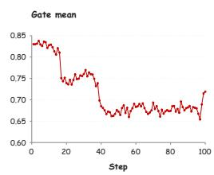

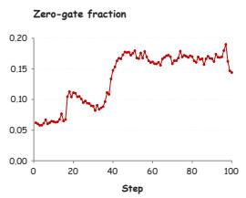

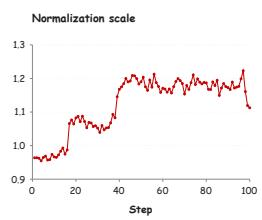

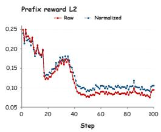  
Figure 4: Gate diagnostics on Qwen3-8B mathematical reasoning. Statistics for Waypoint-OPD over 100 training steps. From left to right: mean gate $_ { g _ { t } , }$ , zero-gate fraction, batch-scale normalization multiplier $\kappa _ { B }$ , and mean per-prefix reward-vector L2 norm. Raw uses the gated, student-weighted endpoint signal $q _ { t } ( a ) g _ { t } d _ { t } ( a )$ ; Normalized uses the final candidate coefficients $A _ { t } ( a )$ in Eq. 12 from the same run. All statistics aggregate valid response prefixes.

Temporal weighting over training. The mean gate $g _ { t }$ decreases from 0.810 in the first 20 steps to 0.683 in the last 20, while the zero-gate fraction increases from 7.26% to 16.59%. These summaries are unweighted averages of step-level statistics. The gate therefore applies stronger average attenuation before batch-scale normalization in later batches and removes the centered endpoint signal at a larger fraction of valid response prefixes. With the Initial, Waypoint, and Final teachers frozen, these statistics track temporal agreement on the evolving student-generated prefixes and candidate distributions.

Batch-scale normalization. The multiplier $\kappa _ { B }$ ranges from 0.955 to 1.223, remaining within the configured bounds $[ \kappa _ { \mathrm { m i n } } , \kappa _ { \mathrm { m a x } } ] = [ 0 . 7 5 , \dot { 1 } . 5 ]$ . It is below one for the first 16 steps and above one thereafter, maintaining the mean rescaled gate at the target $\tau = 0 . 8$ to numerical precision. As specified in Eq. 11, this shared positive multiplier preserves relative gate weights and zero gates. It also scales each prefix’s reward-vector L2 norm by $\kappa _ { B }$ . Over the last 20 steps, the mean per-prefix norms average 0.0855 before scaling and 0.1002 after scaling. Both norms decrease overall during training, while the mean rescaled gate remains stable. These diagnostics show how batch-scale normalization maintains the average gate scale as temporal weighting adapts to student-generated prefixes. The performance benefit is reflected in Table 3: mean normalization improves the Qwen3-8B math average from 55.22 to 56.14.

## H TRAINING TIME AND RESPONSE LENGTH

Table 9 compares the total training time over 100 training steps of Qwen3-8B on math using eight H20 GPUs, excluding evaluation. Both methods follow the configuration in Appendix C. Waypoint-OPD completes training in 8 h 2 min 21 s, compared with 8 h 21 min 3 s for Direct-OPD, reducing total training time by 18 min 42 s (3.73%). The corresponding mean step times are 289.41 s and 300.63 s, a reduction of 11.22 s per step. Total GPU-hours decrease from 66.81 to 64.31.

Table 9: Training-time comparison on Qwen3-8B math. Total training time over 100 training steps on eight H20 GPUs, excluding evaluation.
<table><tr><td>Method</td><td>Time (h:m:s)</td><td>Seconds/step</td><td>GPU-hours</td></tr><tr><td>Direct-OPD</td><td>8:21:03</td><td>300.63</td><td>66.81</td></tr><tr><td>Waypoint-OPD</td><td>8:02:21</td><td>289.41</td><td>64.31</td></tr></table>

GPU-hours are computed as eight times the reported training duration in hours and exclude evaluation.

Relative to Direct-OPD, Waypoint-OPD adds one scoring pass with the frozen Waypoint checkpoint while using the same number of student rollouts. With this additional source of temporal consistency information, Waypoint-OPD achieves a lower measured training time in this setting.

Figure 5 compares rollout generation over the same 100 training steps. Response length is the mean number of tokens per rollout response at each training step, and response truncation rate is the fraction of rollout responses reaching the maximum length of 16,384 tokens. Waypoint-OPD has a lower mean response length at 87 of the 100 steps and a lower response truncation rate at 62 steps, with equal rates at 18 steps. Averaged uniformly across the 100 steps, the response truncation rate decreases from 14.83% for Direct-OPD to 11.97% for Waypoint-OPD, a reduction of 2.86 percentage points. These results show that Waypoint-OPD produces shorter responses at most training steps and reaches the response-length limit less frequently on average.

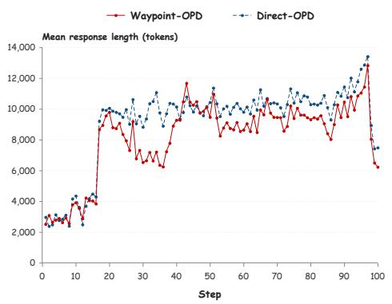  
(a) Mean response length

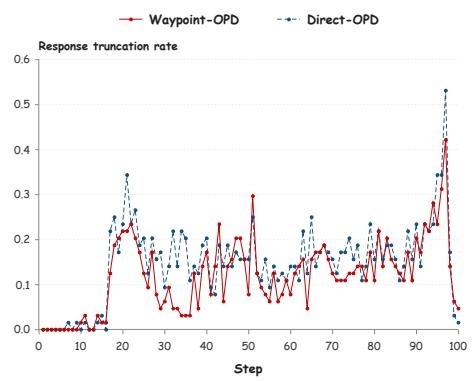  
(b) Response truncation rate  
Figure 5: Response length and response truncation rate. The two panels compare Qwen3-8B trained with Waypoint-OPD (solid red) and Direct-OPD (dashed blue) over 100 training steps. (a) Mean number of tokens per rollout response at each training step. (b) Fraction of rollout responses reaching the maximum length of 16,384 tokens; 0.2 corresponds to 20%.