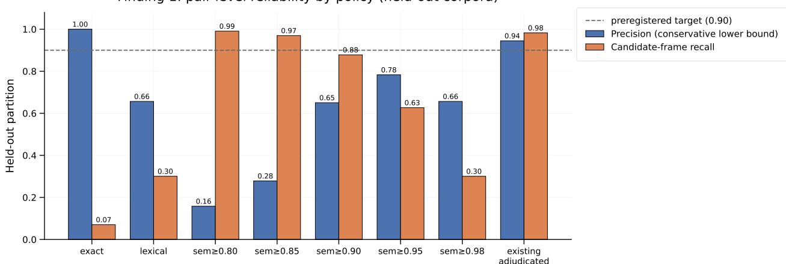
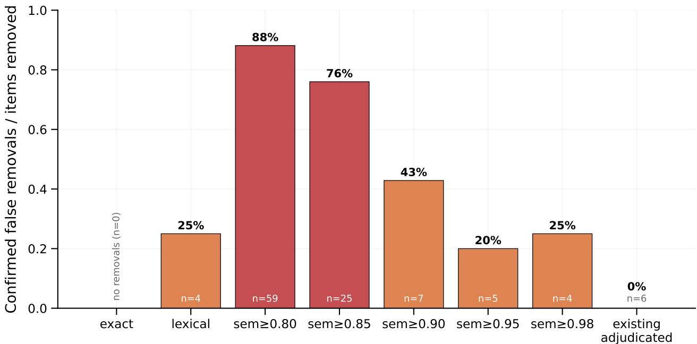
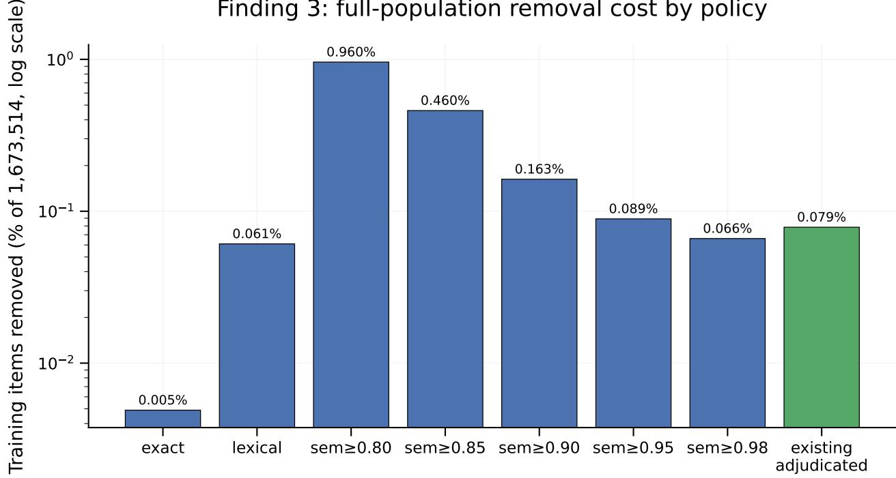

# What Should We Remove? Evaluating the Reliability and Costs of RLVR Data Decontamination

Esther Xin

Independent Researcher

estherxin0011@gmail.com

Code and data: https://github.com/ethxin0011/rlvr\_data\_contamination

## Abstract

Reinforcement learning with verifiable rewards (RLVR) math corpora are routinely screened for benchmark overlap before release, but the decontamination policy itself—which matching rule to trust, and at what cost—is rarely evaluated. We audit sixteen open RLVR math corpora (1,673,514 corpus-specific training items) against six benchmarks (MATH-500, GSM8K, AIME24, AIME25, AIME26, AMC23; 1,949 items) and evaluate eight cleaning policies built on an exact, lexical, and semantic candidate pipeline against an independently, blindly dualreviewed reference set: 594 training-benchmark pairs split into a calibration partition and a held-out partition of unseen corpora and benchmark items, plus a complete-candidate-edge review of 80 training items (83 pairs) that measures item-level false removal. Reviewers agreed on 89.4% and 95.9% of the two sets before adjudication. More aggressive semantic cleaning is not more reliable: at a 0.80 cosine threshold, 52 of 59 sampled removed items (88%) were distinct problems wrongly flagged as contamination, and no threshold in our preregistered grid (0.80– 0.98) meets the preregistered 90% conservative-precision target. The existing judge-adjudicated policy reaches 98.1% resolved precision and 98.2% candidate-frame recall on held-out corpora, with zero confirmed false removals among 6 sampled removals, one unresolved; this small sample does not establish zero false-removal risk. Exact matching has 100% observed precision but recovers only 7% of confirmed held-out exposure within the candidate frame; adding lexical matching raises candidate-frame recall to 30% at 70% precision. We release the reviewed labels, per-policy removal decisions, and coverage accounting so that RLVR data releases can report a decontamination policy against measured reliability and cost rather than a single overlap count.

## 1 Introduction

Training corpora for reinforcement learning with verifiable rewards (RLVR) on mathematics have grown rapidly, both as standalone releases and as ingredients folded into larger blends used for frontier post-training (Guo et al., 2025; Shao et al., 2024). Because these corpora are built by scraping, generating, or recombining problems from many upstream sources, a now-standard concern is that some training items are, in fact, copies or near-copies of items in the evaluation benchmarks those models are later scored on. Recent work has begun auditing this directly: Huang et al. (2026) trace 1.45 million RLVR instances back to twenty atomic sources and curate a decontaminated replacement corpus, and Yang et al. (2023) show that simple string-matching decontamination is bypassed by paraphrase and translation, motivating a stronger LLM-based detector.

Both lines of work answer a version of 'how much contamination is there, and how do we find more of it". Neither asks a question that is equally consequential for anyone who has to ship a decontaminated corpus: once you have a detector, which concrete removal policy should you actually apply, and what does applying it cost you in legitimate training data? A policy that maximizes recall by flagging anything semantically similar to a benchmark problem will, in a domain like competition mathematics where many corpora are built from a small number of recurring templates (changed numbers, re-ordered constraints, renamed variables), also flag a large number of training items that are not contamination at all—they are simply mathematically related problems. Reporting only a removal count, without independently verifying what fraction of removed items were correctly removed, makes it impossible for a downstream user to judge whether a released “decontaminated’ corpus lost 0.1% or 10% of its legitimately useful content.

We address this gap directly. Reusing an existing multi-tier contamination-candidate pipeline (exact match, lexical n-gram/MinHash, and embedding-based semantic retrieval, with an existing LLM-judge adjudication layer) as our candidate generator, we define eight concrete, fully specified cleaning policies and evaluate all of them against a new, independently and blindly dual-annotated reference set that we construct specifically for this purpose. Our reference set is split, before any label is seen, into a calibration partition and a held-out partition built from three corpora and benchmark questions that never appear in calibration, so that we can test whether a policy tuned on one slice of the data continues to behave reliably on genuinely unseen corpora. We additionally draw a second sample of 80 candidate-bearing training items and review every candidate edge attached to each one, because a single flagged pair is not sufficient evidence that an item was wrongly removed: the same item may have another, genuinely contaminating, match.

Contributions. (i) A preregistered, independently and blindly dual-reviewed reference set of 594 training-benchmark pairs plus 80 fully-resolved training items (83 candidate edges), split into disjoint calibration and held-out partitions by both benchmark question and training-example cluster, to our knowledge the first such resource built specifically to evaluate decontamination policies rather than to characterize contamination itself; (ii) a item-level false-removal methodology that reviews all candidate edges for a sampled item before counting it as wrongly removed, rather than relying on single-pair precision, which we show would otherwise overstate how conservative a policy is; (iii) an empirical result that a common, simple cleaning heuristic (semantic similarity above a fixed cosine threshold) trades reliability for candidate-frame recall overall as its threshold is relaxed, with the majority of its sampled removals at a permissive threshold confirmed false on manual review; and (iv) a full accounting of what each policy costs in retained corpus size and source-composition shift, released alongside the reviewed labels so other groups can audit, reuse, or extend this evaluation to additional corpora, benchmarks, or policies.

## 2 Related Work

RLVR data lineage and contamination auditing. Huang et al. (2026) is the closest prior work. ATLAS traces the provenance of 1.45 million RLVR instances to twenty atomic sources, documents that most released RLVR datasets are variants of a small shared pool, and uses this lineage information together with a source-level counterfactual utility score to curate a new, decontaminated training set, DAPO++. Their contribution is a lineage-aware curation method and the resulting dataset. Ours is different in kind: we do not propose a new training corpus or a new detector. We take an already-built detection pipeline as given and ask how reliable a range of concrete, fully specified removal rules built on top of it are, measured against independently reviewed ground truth, including on corpora held out from any tuning. ATLAS's analysis does not report a held-out generalization check of a specific contamination threshold against blinded human labels, nor an item-level false-removal rate; both are the central quantities we report.

Decontamination method strength. Yang et al. (2023) show that n-gram-based string matching misses paraphrased and translated test-set variants, and propose a stronger LLM-based decontamination method, demonstrating previously unknown overlap in several widely used pretraining corpora. Their contribution is a more sensitive detector. We do not propose a new detector; instead we take detector outputs across several existing tiers (exact, lexical, semantic, judge-adjudicated) as given and ask which concrete decision rule built on those outputs is reliable enough to apply, and at what data-loss cost, which their evaluation does not report.

Corpus provenance. One of the sixteen corpora we audit, GoOsEREAsON-0.7M, is built by masking spans of real corpus text and generating plausible distractors around them (Lu et al., 2026). We treat it here only as one of sixteen audited math corpora, evaluated on the same contaminationremoval question as the other fifteen; we make no claim about, and do not reuse any apparatus from, the separate question of whether its generated-distractor construction introduces an authenticity artifact exploitable by RLVR training, which is outside this paper's scope.

Annotation reliability. Measuring reviewer agreement is necessary but not sufficient evidence that reviewed labels are correct: raw percent agreement can overstate reliability relative to chancecorrected statistics, and label quality frameworks caution against treating any single annotation pass as ground truth without further validation (James, 2026; Lavitas et al., 2021). We report raw agreement rates for both of our annotation passes and discuss this limitation explicitly in §7 rather than treating our reviewed labels as an infallible gold standard.

## 3 Audited Corpora and Benchmarks

We audit sixteen open RLVR math training corpora, drawn from widely used public releases spanning late 2024 through late 2025.

acereason\_math, bigmath\_rl, ctrl\_gsm8k\_train, ctrl\_math\_train, dapo\_math\_17k, deepmath\_103k, deepscaler,dolci\_rlzero\_math, dolci\_think\_rl\_math, goosereason\_math, nemotron\_rl\_math\_v2,nemotron\_rl\_omr,numinamath15\_checkable,openr1\_math,polaris\_53k, skywork\_or1\_math.

We evaluate these corpora against six evaluation benchmarks: MATH-500 (500 items), GSM8K test (1,319), AIME24 (30), AIME25 (30), AIME26 (30, released after the construction of most of the audited corpora), and AMC23 (40). After normalization and corpus-specific deduplication, our unit of analysis is a corpus-specific training item: a unique normalized problem string within one specific corpus, so that a problem appearing in two corpora is counted, and can be independently removed or retained, in each. This yields 1,673,514 corpus-specific training items over 1,197,691 unique underlying problem texts.

## 4 Method

## 4.1 Existing candidate pipeline (reused, not a contribution)

Every training item is compared against every benchmark item through an existing three-tier matching pipeline, which we reuse unmodified as our candidate generator. Tier 1 (exact/near-exact) normalizes whitespace, casing, and LaTeX macros and checks for exact or near-exact string equality. Tier 2 (lexical) computes 13-gram and 8-gram coverage overlap and a 128-permutation MinHash/LSH Jaccard estimate between each training item and each benchmark item. Tier 3 (semantic) embeds every training item and benchmark item with Qwen3-Embedding-0.6B and retrieves nearest neighbors by cosine similarity. A subset of tier-2/tier-3 candidate pairs was previously adjudicated by an LLM judge into one of four labels (SAME, SUBSUMES, VARIANT, DIFFERENT); we refer to the resulting rule—flag a pair if Tier 1 fires, or the judge labeled it SAME/sUBsUMES, or (for unjudged pairs) a fixed lexical/semantic heuristic fires—as the existing adjudicated policy. Full tier thresholds are given in Table 4.

## 4.2 Policies under evaluation

We evaluate eight fully specified decision rules for whether a training item should be removed because it matches a benchmark item: exact (Tier 1 only); lexical (Tier 1, or 13-gram coverage $\ge ~ 0 . 5 .$ or MinHash Jaccard $\ge ~ 0 . 7 )$ ; five semantic-union policies at cosine thresholds {0.80,0.85, 0.90, 0.95, 0.98} (lexical policy, or semantic cosine similarity at or above the stated threshold); and the existing adjudicated policy described above. Every policy is a strict superset rule built from the same underlying scores, so differences between policies isolate the effect of the decision threshold, not a difference in what evidence was available.

## 4.3 Independent, blinded reference labels

Pair-level sample. We stratify the full candidate population (21,796 corpus-specific candidate pairs) by corpus, benchmark, and a joint stratum of (exact, lexical, adjudicated) policy flags crossed with five semantic-score bands, and draw up to two pairs per stratum cell. We partition benchmark questions 60/40 into calibration and a held-out set before sampling, assign three corpora (bigmath rl, goosereason math, nemotron rl math v2) entirely to the held-out partition, and then exclude from calibration any pair whose training item shares a near-duplicate cluster with a held-out pair, or whose benchmark question appears in the held-out partition, so that no trainingexample family or benchmark question is shared between partitions. This yields 594 sampled pairs: 448 calibration, 146 held-out.

Two reviewers independently labeled all 594 pairs, blind to every policy flag, similarity score, corpus identity, and the opposing reviewer's label, choosing one of six labels: EQUIVALENT (same problem, possibly reworded), sOLUTION EXPOsURE (benchmark-specific solution information present without being the same problem), CHANGED INSTANCE (same template or scenario, but different numbers/constraints yielding a different answer), RELATED\_DISTINCT (related topic or technique, different problem), UNRELATED, or UNCERTAIN. Reviewers agreed on 531/594 pairs (89.4%) before adjudication; a third pass independently adjudicated all 63 disagreements using the same label set and the original problem text, without access to any policy score.

Item-level sample. Pair-level precision can overstate how conservative a policy truly is: if an item has two candidate matches and only one is reviewed, labeling the reviewed pair as a false positive does not establish that removing the item was a mistake, since the other, unreviewed match might be genuine contamination. We therefore drew a second, independent sample of five candidate-bearing training items per corpus (80 items total, one corpus contributing all available items where fewer than five existed) and exported every candidate edge for each sampled item (83 pairs). Nine of these 83 pairs had identical problem/benchmark/answer text to an already-reviewed pair from the first sample and reused that pair's adjudicated label directly, without re-review; the remaining 74 were independently dual-reviewed under the same protocol as above (71/74, 95.9%, raw agreement; the remaining 3 disagreements adjudicated). An item is counted as a confirmed false removal only if a policy removes it and every one of its reviewed candidate edges is labeled CHANGED\_INSTANCE, RELATED DISTINCT, or UNRELATED; items with at least one UNCERTAIN edge and no confirmed exposure are reported separately as unresolved, not forced into either category.

## 4.4 Preregistered threshold-selection rule

To avoid selecting a semantic threshold by inspecting held-out performance, we fixed, before reviewing any label, a candidate grid {0.80, 0.85, 0.90, 0.95, 0.98} and a target: the smallest (most inclusive) threshold on the calibration partition whose conservative precision—treating every UN-

CERTAIN label as incorrect—is at least 0.90. If no threshold on the grid meets this target, we report that failure directly rather than relaxing the target or selecting a threshold using held-out labels.

## 4.5 Metrics

For a given partition and policy we report resolved precision (true positives over true-or-false positives, excluding UNCERTAIN pairs from the denominator), a conservative lower bound that instead treats every UNCERTAIN pair as a false positive, candidate-frame recall (true positives over true positives plus confirmed-exposure pairs the policy missed, within our sampled candidate frame only, not the full corpus), and the false-positive rate among confirmed-negative pairs. All pair-level statistics are inverse-probability weighted by each pair's stratum sampling probability. Item-level statistics use the same inverse-probability weighting over each sampled item's corpus-specific sampling probability, with exploratory 95% intervals computed by resampling items within corpus 1,000 times; with five items per corpus these intervals are reported as exploratory, not as rigorous survey-design confidence intervals (§7).

## 5 Results

<table><tr><td>Split</td><td>Policy</td><td>Precision</td><td>Prec. (lower)</td><td>Recall (cand.)</td><td>FPR</td><td>Weighted FP</td></tr><tr><td>calibration</td><td>exact</td><td>1.0000</td><td>1.0000</td><td>0.0851</td><td>0.0000</td><td>0.0</td></tr><tr><td>calibration</td><td>lexical</td><td>0.1763</td><td>0.1763</td><td>0.2596</td><td>0.0560</td><td>285.0</td></tr><tr><td>calibration</td><td>existing adjudicated</td><td>0.9546</td><td>0.8123</td><td>0.9851</td><td>0.0022</td><td>11.0</td></tr><tr><td>calibration</td><td>semantic ≥ 0.80</td><td>0.0511</td><td>0.0496</td><td>1.0000</td><td>0.8583</td><td>4366.5</td></tr><tr><td>calibration</td><td>semantic ≥ 0.85</td><td>0.1072</td><td>0.1050</td><td>0.9191</td><td>0.3535</td><td>1798.5</td></tr><tr><td>calibration</td><td>semantic ≥ 0.90</td><td>0.2167</td><td>0.2122</td><td>0.6681</td><td>0.1115</td><td>567.5</td></tr><tr><td>calibration</td><td>semantic ≥ 0.95</td><td>0.2091</td><td>0.2077</td><td>0.3915</td><td>0.0684</td><td>348.0</td></tr><tr><td>calibration</td><td>semantic ≥ 0.98</td><td>0.2083</td><td>0.2078</td><td>0.3191</td><td>0.0560</td><td>285.0</td></tr><tr><td>held-out</td><td>exact</td><td>1.0000</td><td>1.0000</td><td>0.0704</td><td>0.0000</td><td>0.0</td></tr><tr><td>held-out</td><td>lexical</td><td>0.6975</td><td>0.6564</td><td>0.3005</td><td>0.0169</td><td>55.5</td></tr><tr><td>held-out</td><td>existing adjudicated</td><td>0.9812</td><td>0.9447</td><td>0.9824</td><td>0.0024</td><td>8.0</td></tr><tr><td>held-out</td><td>semantic ≥ 0.80</td><td>0.1596</td><td>0.1580</td><td>0.9906</td><td>0.6767</td><td>2222.5</td></tr><tr><td>held-out</td><td> $\mathrm { s e m a n t i c } \geq 0 . 8 5$ </td><td>0.2809</td><td>0.2783</td><td>0.9695</td><td>0.3220</td><td>1057.5</td></tr><tr><td>held-out</td><td> $\mathrm { s e m a n t i c } \geq 0 . 9 0$ </td><td>0.6661</td><td>0.6504</td><td>0.8779</td><td>0.0571</td><td>187.5</td></tr><tr><td>held-out</td><td>semantic ≥ 0.95</td><td>0.8153</td><td>0.7830</td><td>0.6268</td><td>0.0184</td><td>60.5</td></tr><tr><td>held-out</td><td>semantic ≥ 0.98</td><td>0.6975</td><td>0.6564</td><td>0.3005</td><td>0.0169</td><td>55.5</td></tr></table>

Table 1: Pair-level policy metrics on the calibration partition (448 independently reviewed pairs) and the held-out partition (146 pairs, from three corpora and benchmark questions never used in calibration). All statistics are inverse-probability weighted by stratum sampling probability. "Prec. (lower)" treats every UNCERTAIN label as a false positive. “Recall (cand.)" is candidate-frame recall, not whole-corpus recall. No semantic threshold on the preregistered grid meets the 0.90 conservative-precision target on calibration (§4.4); the existing adjudicated policy exceeds it on held-out only (0.9447), not on calibration (0.8123)

## 5.1 No semantic threshold meets the preregistered target

Table 1 reports pair-level metrics for all eight policies on both partitions. On calibration, conservative precision for every semantic-union threshold on our grid is below the 0.90 target (ranging from 0.0496 at 0.80 to 0.2122 at 0.90), so, following §4.4, we select no semantic threshold and report

<table><tr><td>Policy</td><td>Removed</td><td>Confirmed false</td><td>Unresolved</td></tr><tr><td>exact</td><td>0</td><td>0</td><td>0</td></tr><tr><td>lexical</td><td>4</td><td>1</td><td>0</td></tr><tr><td>existing adjudicated</td><td>6</td><td>0</td><td>1</td></tr><tr><td> $\mathrm { s e m a n t i c } \geq 0 . 8 0$ </td><td>59</td><td>52</td><td>2</td></tr><tr><td> $\mathrm { s e m a n t i c } \geq 0 . 8 5$ </td><td>25</td><td>19</td><td>1</td></tr><tr><td> $\mathrm { s e m a n t i c } \geq 0 . 9 0$ </td><td>7</td><td>3</td><td>1</td></tr><tr><td> $\mathrm { s e m a n t i c } \geq 0 . 9 5$ </td><td>5</td><td>1</td><td>1</td></tr><tr><td>semantic ≥ 0.98</td><td>4</td><td>1</td><td>0</td></tr></table>

Table 2: Item-level removal review: 80 candidate-bearing training items (83 candidate edges; every edge for each sampled item was reviewed). “Confirmed false" counts items a policy removes for which every reviewed candidate edge is labeled CHANGED INSTANCE, RELATED DISTINCT, or UN-RELATED. “Unresolved" counts removed items with at least one UNCERTAIN edge and no confirmed exposure. At threshold 0.80, 52 of 59 sampled removed items (88%) are confirmed false removals, not a demonstrated population-level rate. The sampled false-removal rate generally falls with a higher threshold, but rises from 20% at 0.95 to 25% at 0.98. Among policies that removed sampled items, the existing adjudicated policy alone has zero confirmed false removals (6 removals, one unresolved); this does not establish zero false-removal risk

<table><tr><td>Policy</td><td>Removed</td><td>Removal %</td><td>Retained</td><td>Source TVD</td></tr><tr><td>exact</td><td>82</td><td>0.0049%</td><td>1,673,432</td><td>0.000026</td></tr><tr><td>lexical</td><td>1,021</td><td>0.0610%</td><td>1,672,493</td><td>0.000133</td></tr><tr><td>existing adjudicated</td><td>1,314</td><td>0.0785%</td><td>1,672,200</td><td>0.000317</td></tr><tr><td>semantic ≥ 0.80</td><td>16,067</td><td>0.9601%</td><td>1,657,447</td><td>0.001146</td></tr><tr><td>semantic ≥ 0.85</td><td>7,701</td><td>0.4602%</td><td>1,665,813</td><td>0.000660</td></tr><tr><td>semantic ≥ 0.90</td><td>2,720</td><td>0.1625%</td><td>1,670,794</td><td>0.000318</td></tr><tr><td>semantic ≥ 0.95</td><td>1,491</td><td>0.0891%</td><td>1,672,023</td><td>0.000241</td></tr><tr><td>semantic ≥ 0.98</td><td>1,106</td><td>0.0661%</td><td>1,672,408</td><td>0.000157</td></tr></table>

Table 3: Full-population removal cost across all 1,673,514 corpus-specific training items (not sampled). "Source $\mathrm { T V D } ^ { \mathrm { , } \mathrm { , } \mathrm { , } }$ is the total variation distance between the per-corpus share of the pool before and after removal, under 1.0 maximum distance. Threshold-0.80 semantic cleaning removes over twelve times as many items as the existing adjudicated policy, while aggregate source-composition shift remains small under every policy. Table 2 separately shows 52 confirmed false removals among 59 sampled removals at threshold 0.80; this does not establish a population-level false-removal rate.

this directly as a negative calibration result, rather than loosening the target to accommodate the held-out partition.

## 5.2 Aggressive semantic cleaning is less reliable, not more

The item-level review (Table 2) makes the practical consequence concrete. At cosine threshold 0.80, the policy would remove 59 of our 80 sampled candidate-bearing items; of those, 52 (88%) were confirmed on manual review to be CHANGED INSTANCE, RELATED DISTINCT, or UNRELATED— that is, confirmed false removals within our reviewed candidate frame. This 88% is a descriptive rate among sampled removals, not a demonstrated population-level false-removal rate. The sampled false-removal rate generally falls as the threshold is raised (19/25 at 0.85; 3/7 at 0.90; 1/5 at 0.95), but rises from 20% at 0.95 to 25% at 0.98 (1/4); the improvement is therefore not monotonic. The existing adjudicated policy removed 6 of the 80 items with zero confirmed false removals (one unresolved case with an UNCERTAIN edge). These six observations do not establish zero false-removal risk. Held-out pair-level results in Table 1 corroborate the overall trade-off: moving from threshold 0.80 to 0.95 trades candidate-frame recall of 0.99 for 0.63 while precision rises from 0.16 to 0.82— there is no threshold on our grid that achieves both candidate-frame recall and resolved precision of at least 0.90 on the held-out partition.

## 5.3 The existing adjudicated policy generalizes to held-out corpora

On the three held-out corpora and benchmark questions never used during calibration, the existing adjudicated policy achieves 0.9812 resolved precision (0.9447 conservative lower bound) and 0.9824 candidate-frame recall. Resolved precision and candidate-frame recall are similar to their calibration-partition values (0.9546 and 0.9851 respectively), supporting reliability on these held-out corpora within the sampled candidate frame. Conservative precision differs: it is 0.8123 on calibration and 0.9447 on held-out, so the adjudicated policy exceeds the 0.90 conservative-precision target on held-out only. Exact matching has 100% observed precision in both partitions but recovers only 7–9% of confirmed exposure within the candidate frame; adding lexical matching raises held-out candidate-frame recall to 30% while resolved precision falls to 70%, below the existing adjudicated policy on both axes.

## 5.4 Data-loss cost scales with aggressiveness, but total corpus composition shift stays small

Table 3 reports full-population removal counts (not sampled) across all 1,673,514 corpus-specific items. The existing adjudicated policy removes 1,314 items (0.079%); threshold-0.80 semantic cleaning removes 16,067 (0.96%), over twelve times as many. In the separate item-level sample. 52 of 59 removals under the latter policy were confirmed false; this does not establish the fraction of false removals among all 16,067 population removals. Aggregate source-composition shift (total variation distance between the corpus-share distribution before and after removal) remains small even under the most aggressive policy (0.0011), because removals are spread across corpora roughly in proportion to their size. The demonstrated costs are therefore greater full-population data removal and frequent confirmed false removals in the reviewed sample, not a gross distortion of which corpora dominate the cleaned pool.

## 5.5 Summary figures

Figures 1-4 recapitulate the numbers in Tables 1-3 in visual form, in the order the underlying evidence was collected: the independent-review process itself (Figure 1), pair-level reliability on held-out corpora (Figure 2), item-level confirmed false-removal rates (Figure 3), and full-population removal cost (Figure 4). Every value plotted is transcribed directly from the corresponding table; the figures add no new quantities and are provided purely to make the central reliability-versus-recall trade-off (§5.2) easier to read at a glance.

Finding 0: independent dual-review process summary
<table><tr><td rowspan=1 colspan=1>Stage</td><td rowspan=1 colspan=1>Count</td><td rowspan=1 colspan=1>Note</td></tr><tr><td rowspan=1 colspan=1>Pair-level review</td><td rowspan=1 colspan=1></td><td rowspan=1 colspan=1></td></tr><tr><td rowspan=1 colspan=1>Total sampled pairs</td><td rowspan=1 colspan=1>594</td><td rowspan=1 colspan=1>448 calibration + 146 held-out</td></tr><tr><td rowspan=1 colspan=1>Reviewer raw agreement</td><td rowspan=1 colspan=1>531 / 594 (89.4%)</td><td rowspan=1 colspan=1>before adjudication</td></tr><tr><td rowspan=1 colspan=1>Disagreements adjudicated</td><td rowspan=1 colspan=1>63</td><td rowspan=1 colspan=1>independent 3rd pass</td></tr><tr><td rowspan=1 colspan=1>Item-level review</td><td rowspan=1 colspan=1></td><td rowspan=1 colspan=1></td></tr><tr><td rowspan=1 colspan=1>Candidate-bearing items sampled</td><td rowspan=1 colspan=1>80</td><td rowspan=1 colspan=1>5 per corpus</td></tr><tr><td rowspan=1 colspan=1>Total candidate edges reviewed</td><td rowspan=1 colspan=1>83</td><td rowspan=1 colspan=1>all edges per item</td></tr><tr><td rowspan=1 colspan=1>Reused from pair-level review</td><td rowspan=1 colspan=1>9</td><td rowspan=1 colspan=1>identical problem text</td></tr><tr><td rowspan=1 colspan=1>Newly reviewed edges</td><td rowspan=1 colspan=1>74</td><td rowspan=1 colspan=1></td></tr><tr><td rowspan=1 colspan=1>Reviewer raw agreement (new)</td><td rowspan=1 colspan=1>71 / 74 (95.9%)</td><td rowspan=1 colspan=1>before adjudication</td></tr><tr><td rowspan=1 colspan=1>Disagreements adjudicated</td><td rowspan=1 colspan=1>3</td><td rowspan=1 colspan=1>independent 3rd pass</td></tr></table>

Figure 1: Independent dual-review process summary: sample sizes and raw reviewer agreement for both the pair-level sample (594 pairs, used for Table 1) and the item-level complete-candidate-edge sample (83 pairs over 80 items, used for Table 2), before and after adjudication of disagreements (§4.3).

## 6 Discussion

More aggressive decontamination is not necessarily better. Our central result is a dissociation between recall and reliability that a single overlap count cannot reveal. A detector that flags more candidates is not automatically a better basis for a removal policy: in our audited corpora, where many problems are built from recurring templates (the same scenario with different numbers, renamed quantities, or reordered constraints), a bare similarity threshold cannot distinguish a changed-instance variant from genuine benchmark exposure, and the gap is large—most permissivethreshold removals in our sample were not contamination at all. This is a different question from whether contamination exists (already addressed by prior work); it is a question about what a specific, deployable cleaning rule actually does when applied.

Adjudication, not just a stronger embedding, is what closes the gap. The existing adjudicated policy in this pipeline is not a higher embedding-similarity threshold; it is Tier-1 matches, plus an LLM judge's case-by-case decision for ambiguous tier-2/tier-3 candidates. Our results suggest that this kind of explicit, per-pair adjudication—not a better single scalar threshold—is what allows a policy to simultaneously achieve high recall and high precision on data it was not tuned on, within the held-out candidate frame evaluated here. This has a direct practical implication for anyone curating a new RLVR release: budget for adjudication of borderline candidates, rather than only for a better retrieval model.

Finding 1: pair-level reliability by policy (held-out corpora)  
  
Figure 2: Pair-level conservative precision and candidate-frame recall for all eight policies, held-out partition only (three corpora and all benchmark questions never used in calibration; full numbers, including the calibration partition, in Table 1). The dashed line marks the preregistered 0.90 conservative-precision target (§4.4): only the existing adjudicated policy clears it on this held-out partition while simultaneously retaining candidate-frame recall above 0.90; its calibration conservative precision is below the target.

Finding 2: item-level false-removal rate by policy  
  
Figure 3: Confirmed false-removal rate among sampled candidate-bearing training items actually removed by each policy (complete-candidate-edge item review; full counts in Table 2). “exact" removed none of the 80 sampled items and so has an undefined, not zero, rate. The sampled semantic-policy false-removal rate generally falls with a higher threshold, but rises from 20% at 0.95 to 25% at 0.98. The existing adjudicated policy has zero confirmed false removals among 6 sampled removals, with one unresolved case; this does not establish zero population-level risk.

Finding 3: full-population removal cost by policy  
  
Figure 4: Full-population removal cost, as a percentage of all 1,673,514 corpus-specific training items (not sampled; log-scaled y-axis; full counts in Table 3). Threshold-0.80 semantic cleaning removes over twelve times as many items as the existing adjudicated policy. Figure 3 separately reports false-removal rates among sampled removals, not demonstrated population-level rates.

Item-level review changes the picture pair-level review alone would give. Had we reported only pair-level precision, a policy's apparent conservatism could be inflated by under-reviewed items with a second, unexamined genuine match. Reviewing every candidate edge for a sampled item, rather than one pair at a time, is what lets us state the 0.80-threshold false-removal rate (88% of removed sampled items) with confidence that we are not conflating "this particular pair looked wrong" with“this item was wrongly removed" within the reviewed candidate frame. This descriptive sample rate is not a demonstrated population-level false-removal rate.

## 7 Limitations

Candidate-frame-only recall. Every recall estimate in this paper is conditional on our existing three-tier candidate pipeline having surfaced the pair at all; we cannot measure recall against contamination that no tier's candidate generation step ever proposed, and we do not claim wholecorpus recall. Small item-level sample. Five candidate-bearing items per corpus (80 total) is informative about false removals in the reviewed sample but gives wide uncertainty for individual policies and corpora. In particular, zero confirmed false removals among six adjudicated-policy removals, including one unresolved case, does not establish zero false-removal risk. The exploratory within-corpus bootstrap intervals we report are not a substitute for a full stratified survey-design analysis, and should not be read as precise population-level false-removal rates; the descriptive 52/59 (88%) sample rate is not a demonstrated population rate. Two-reviewer, single-site annotation. Both annotation passes used the same two reviewers; we report raw agreement (89.4% and 95.9%) rather than a chance-corrected statistic, and do not have an independent third reviewer pool to validate our own adjudication decisions. Raw agreement can overstate reliability relative to chancecorrected measures, and treating any single review pass as an infallible ground truth is a known risk in annotation-quality research (James, 2026; Lavitas et al., 2021); our reference labels should be read as independently and blindly reviewed, not as an unimpeachable gold standard. Fixed corpus and benchmark snapshots. All counts are computed against specific downloaded snapshots of sixteen corpora and six benchmarks; corpora that are revised, or benchmarks released after our snapshot, are out of scope. No downstream training claim. This paper evaluates decontamination policies against reviewed ground truth. It does not train any model and makes no claim about whether applying any of these policies changes downstream RLVR training outcomes; that causal question is a distinct undertaking left to separate work. Math-only, English-only. All audited corpora and benchmarks are English-language competition or standardized-test mathematics; whether our reliability ordering across policies transfers to other domains or languages is untested.

## 8 Conclusion

We evaluated eight concrete decontamination policies for RLVR math corpora against an independently, blindly dual-reviewed reference set built specifically for this purpose, including a held-out partition of corpora and benchmark questions never used for calibration and a complete-candidateedge item-level review designed to measure actual false removal rather than single-pair precision. We find that permissive semantic-similarity cleaning has high sampled false-removal costs, although the sampled rates do not improve monotonically with a higher threshold. No semantic threshold on our preregistered grid meets the preregistered conservative-precision target on calibration. An existing adjudicated policy already in use in this pipeline offers a more favorable balance of resolved precision and candidate-frame recall on the held-out corpora than the semantic-threshold alternatives tested, at substantially lower full-corpus removal cost than the most permissive policy. These results do not establish whole-corpus recall, population-level false-removal rates, or zero false-removal risk We release the reviewed labels, the per-policy removal decisions, and the full coverage accounting so that future RLVR corpus releases can report and justify a specific decontamination policy against measured reliability and cost, rather than a single unqualified overlap count.

## References

Daya Guo, Dejian Yang, Haowei Zhang, et al. DeepSeek-R1: Incentivizing reasoning capability in LLMs via reinforcement learning. arXiv preprint arXiv:2501.12948, 2025.

Hsiu-Yuan Huang, Weijie Liu, Chenming Tang, Sanwoo Lee, Kai Yang, Yangkun Chen, Saiyong Yang, and Yunfang Wu. RLVR datasets and where to find them: Tracing data lineage for better training data. arXiv preprint arXiv:2605.26971, 2026.

Joseph James. Counting on consensus: Selecting the right inter-annotator agreement metric for NLP annotation and evaluation. arXiv preprint arXiv:2603.06865, 2026.

Liliya Lavitas, Olivia Redfield, Allen Lee, Daniel Fletcher, Matthias Eck, and Sunil Janardhanan. Annotation quality framework – accuracy, credibility, and consistency. In NeurIPS Workshop

on Data-Centric AI (DCAI), 2021. https://www.datacentricai.org/neurips21/papers/49\_ CameraReady\_DCAI2021\_tex(8).pdf.

Ximing Lu, David Acuna, Jaehun Jung, Jian Hu, Di Zhang, Shizhe Diao, Yunheng Zou, Shaokun Zhang, Brandon Cui, Mingjie Liu, Hyunwoo Kim, Prithviraj Ammanabrolu, Jan Kautz, Yi Dong, and Yejin Choi. Golden goose: A simple trick to synthesize unlimited RLVR tasks from unverifiable internet text. arXiv preprint arXiv:2601.22975, 2026.

Zhihong Shao, Peiyi Wang, Qihao Zhu, Runxin Xu, Junxiao Song, Xiao Bi, Haowei Zhang, Mingchuan Zhang, Y. K. Li, Y. Wu, and Daya Guo. DeepSeekMath: Pushing the limits of mathematical reasoning in open language models. arXiv preprint arXiv:2402.03300, 2024.

Shuo Yang, Wei-Lin Chiang, Lianmin Zheng, Joseph E. Gonzalez, and Ion Stoica. Rethinking benchmark and contamination for language models with rephrased samples. arXiv preprint arXiv:2311.04850, 2023.

## A Reproducibility Details

Table 4 reports the full matching, embedding, and annotation-design configuration used to generate candidates and draw the reviewed samples, including the existing pipeline's fixed tier thresholds (reused, not tuned by us) and the new study's preregistered sampling and threshold-selection parameters.

<table><tr><td>Setting</td><td>Value</td></tr><tr><td colspan="2">Existing candidate pipeline (reused, not tuned by us)</td></tr><tr><td>Tier 2 long / short n-gram</td><td>13  / 8 tokens</td></tr><tr><td>Tier 2 keep threshold (13-gram cov. / 8-gram cov. 0.20 / 0.30 / 0.40</td><td></td></tr><tr><td>/ Jaccard) MinHash permutations</td><td>128</td></tr><tr><td>Embedding model</td><td>Qwen3-Embedding-0.6B</td></tr><tr><td>Embedding max sequence length</td><td>256 tokens</td></tr><tr><td>Semantic candidate threshold (Tier 3 entry)</td><td>cosine ≥ 0.80</td></tr><tr><td>Existing adjudicated policy, lexical override</td><td>Jaccard ≥ 0.80, or 13-gram cov.  $\ge 0 . 8 0$ </td></tr><tr><td>Existing adjudicated policy, semantic override</td><td>cosine ≥ 0.95 with matching final answer</td></tr><tr><td>New study design (this paper)</td><td></td></tr><tr><td>Random seed</td><td>20261010</td></tr><tr><td>Pairs sampled per stratum</td><td>2 60% / 40%</td></tr><tr><td>Benchmark-question calibration / held-out split</td><td></td></tr><tr><td>Corpora assigned entirely to held-out</td><td>bigmath rl, goosereason math, nemotron_rl_math_v2</td></tr><tr><td>Semantic threshold grid (preregistered)</td><td>0.80, 0.85, 0.90, 0.95, 0.98</td></tr><tr><td>Conservative-precision target (preregistered)</td><td>≥ 0.90 on calibration only</td></tr><tr><td>Items sampled per corpus (item-level review)</td><td>5</td></tr><tr><td>Reviewers per pair</td><td>2, independent and blind</td></tr><tr><td>Adjudication</td><td>independent third pass, disagreements only</td></tr></table>

Table 4: Full configuration for candidate generation (reused from the existing pipeline, listed here for reproducibility, not as a contribution of this paper) and for the new independent-review study design introduced in this paper. All study-design parameters were fixed before any new label was reviewed. "Pairs sampled per stratum" refers to the corpus × benchmark × (policy-flag, semanticscore band) stratification described in §4.3.