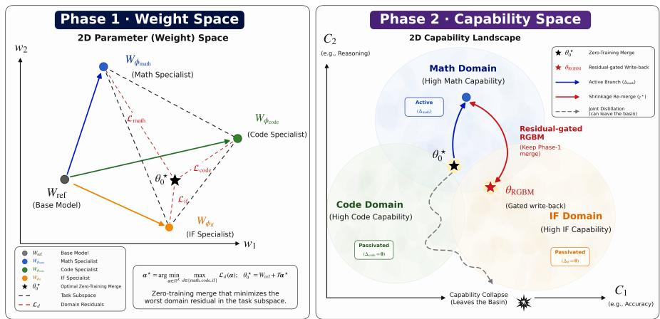
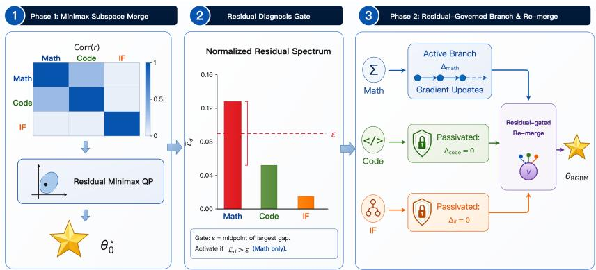
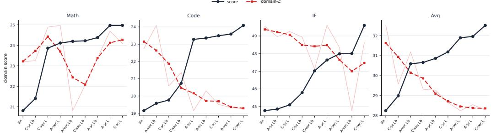
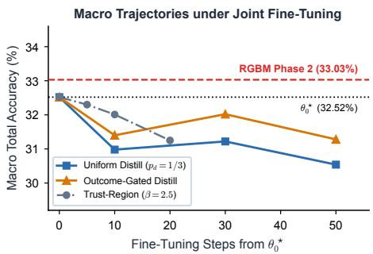
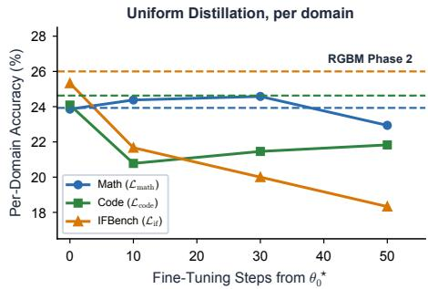
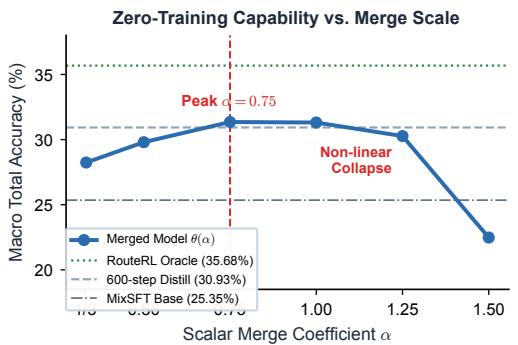
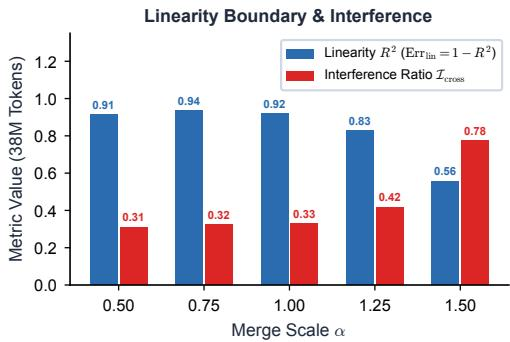

# A FISHER-GEOMETRIC VIEW OF MULTI-TEACHER ON-POLICY DISTILLATION

Kaiyuan Liu1,4, Ziyuan Zhuang4∗, Haoxuan Ma2, Yannian Gu3, Mingfei Song3, Rongxiang Weng4†, Jieping Ye1

1Zhejiang University 2Nanjing University 3Shanghai Jiao Tong University 4Meituan LongCat

## ABSTRACT

Consolidating specialized foundation models into a unified generalist is a central goal of post-training. Two approaches are in common use: model merging, which is fast but treated as a heuristic, and multi-teacher on-policy distillation, which matches distributions but demands heavy rollout compute and suffers from crosstask gradient conflict. We show that the two are one objective seen at different orders. Within a shared basin of homologous specialists, the multi-teacher onpolicy distillation objective is, to second order, exactly the Fisher-merging objective. Its minimizer is therefore the Fisher merge, a classic model-merging method given by a closed-form combination of the specialists, so merging is optimal, to second order, as a closed-form stage of distillation. Building on this identification, we propose Residual-Governed Branch-and-Merge (RGBM), a two-phase consolidation procedure. Concretely, a full-parameter Fisher merge is intractable on foundation models, so Phase 1 restricts the merge to the task-vector subspace. Extending tangent-space analyses of merging, we show that the same coefficients that mix task vectors also mix implicit rewards, which lets a residual program on unlabelled prompts solve for them. The program minimizes the worst per-domain residual and reports its energy-normalized values as the domain residual spectrum. Phase 2 lets this spectrum govern what may be added: RGBM passivates domains with low normalized residuals, trains isolated branches only for domains above the spectral gap, and writes back the admitted updates with calibrated shrinkage. On two open-source consolidation suites, the Phase 1 merge alone matches or outperforms fully trained multi-teacher distillation, and RGBM improves on it further with zero extra joint-training steps, whereas every un-gated write-back, including continued joint distillation from the merge, falls below it.

## 1 INTRODUCTION

Post-training of large language models (LLMs) increasingly produces homologous domain specialists—fine-tuned from a common base via reinforcement learning (RL) on distinct reasoning modalities (Agarwal et al., 2024; Shao et al., 2024; DeepSeek-AI, 2025; Team, 2025a; Gao et al., 2026; Liu et al., 2025a). Serving an ensemble of specialists multiplies memory and latency, making consolidation into a single generalist essential.

Two paradigms are in common use, each with its own shortcomings. Weight-space merging (Ilharco et al., 2023; Yadav et al., 2023; Yu et al., 2024; Lu et al., 2024; Yang et al., 2026a) adds to the base model a weighted sum of the specialists’ weight updates (their task vectors) at zero training cost, but the weights are set by hand and, once the merge is formed, nothing tells which domain it failed to recover or whether the chosen weights still combine the specialists faithfully. Multi-teacher onpolicy distillation (Agarwal et al., 2024; Gao et al., 2026; Sun et al., 2026; Yang et al., 2026b; Chen et al., 2026) (MOPD) instead trains a student to match each specialist (its teacher) on the student’s own generations, which repairs what merging misses, but at the cost of rollouts on every domain and with no control over which domains its shared-weight gradients overwrite. Neither paradigm can answer the question the other one raises: what a merge has already recovered, and where distillation is still needed without harming what is already correct. Answering it requires relating the two, which is what this paper does.

  
Figure 1: Merge before you distill (schematic). (a) Weight space: the dashed triangle is the task subspace spanned by the Math, Code, and IF task vectors. A Minimax projection on unlabelled prompts yields the zero-training merge $\theta _ { 0 } ^ { \star } = W _ { \mathrm { r e f } } + \mathcal { T } \alpha ^ { \star }$ , where $\tau$ stacks those task vectors, together with the per-domain residuals $\mathcal { L } _ { d }$ (red segments). Normalizing these residuals by domain reward energy gives the domain residual spectrum. (b) Capability space: joint distillation from $\theta _ { 0 } ^ { \star }$ can leave the basin (dashed path). The normalized spectrum passivates Code and $\operatorname { I F } ;$ RGBM writes back only the admitted Math branch, shrunk by $\gamma ^ { \star }$ (the largest factor that still passes the linearity test). See Section 3 for details.

Our starting point is that these paradigms optimize the same objective at different orders of approximation (Section 2). Expanded to second order around the specialists in a shared basin, the distillation objective is exactly the Fisher-merging objective of Matena & Raffel (2022), whose minimizer is a weighted average of the specialists with Fisher-information weights; merging is therefore not an alternative to distillation but is optimal, to second order, as its closed-form stage. A full-parameter Fisher merge is intractable on foundation models, so we restrict the merge to the task-vector subspace (Phase 1, described next). Extending tangent-space analyses of merging, we show that, to first order, the same coefficients that mix the task vectors also mix the specialists’ implicit rewards (the log-probability ratios between each specialist and the base), which lets us obtain them by minimizing the worst reward-space residual on unlabelled prompts. After solving, reward-energy normalization measures the relative share left unrecovered in each domain. The fidelity of this first-order fit provides an intrinsic, label-free test of whether a checkpoint still lies where the expansion holds.

Grounded in this framework, we propose Residual-Governed Branch-and-Merge (RGBM) as shown in Figure 1. In Phase 1, RGBM determines the combination weights by minimizing the worst per-domain residual via a small convex program on unlabelled prompts, yielding the zero-training merged model. It then normalizes the residuals by their domain reward energies to form the domain residual spectrum. This spectrum directly dictates what, if anything, should follow the merge. Standard joint distillation tends to degrade the merged model because gradients from domains with low normalized residuals corrupt shared weights. To prevent this interference, Phase 2 leaves those domains untouched and trains isolated branches only for domains above a closed-form spectral gap. Each admitted branch update is then written back, scaled by the largest factor that passes the linearity test.

Empirically, we validate our framework across two multi-teacher consolidation benchmarks: Open-MOPD (Gao et al., 2026) (SmolLM3-3B with Math, Code, and Instruction Following specialists) and G-OPD (Yang et al., 2026b) (Qwen3-4B with Math and Code specialists). On Open-MOPD, the zero-training Phase 1 merge alone achieves a Macro average of 32.52, outperforming the official 600-step distilled student (30.93) without requiring any rollout compute. By passivating domains with low normalized residuals and training an isolated branch solely for Math, Phase 2 further elevates the Macro score to 33.03 with zero joint-training steps. Crucially, un-gated baselines such as TIES (Yadav et al., 2023), DARE (Yu et al., 2024), and continued joint distillation all fall below the merge, confirming that their updates can corrupt shared parameters. The same procedure transfers seamlessly to G-OPD, where RGBM surpasses the strongest trained baseline, demonstrating the generality of residual-governed consolidation.

Contributions. (1) Theoretical Bridge: we establish a connection between multi-teacher onpolicy distillation and model merging, showing that the MOPD objective coincides to second order with Fisher merging (Matena & Raffel, 2022), and derive an implicit-reward homomorphism that yields a label-free linear basin diagnostic. (2) Two-Phase RGBM Framework: we propose Residual-Governed Branch-and-Merge (RGBM). Phase 1 computes the zero-training merge from a residual program on unlabelled prompts and forms an energy-normalized spectrum for cross-domain comparison. Phase 2 passivates domains below the spectral gap, trains isolated branches exclusively for domains above it, and writes admitted updates back via calibrated shrinkage. (3) Empirical Validation and Protection Mechanism: across two model families (SmolLM3-3B and Qwen3- 4B), Phase 1 alone matches or beats fully trained distillation, and Phase 2 advances performance further with zero joint-training steps. Crucially, un-gated write-backs fall below the merge, confirming that RGBM succeeds by shielding domains below the normalized spectral gap from cross-task interference.

## 2 MERGING IS OPTIMAL, TO SECOND ORDER, AS A CLOSED-FORM STAGE OF DISTILLATION

This section establishes the identification on which the paper rests: to second order, distillation and Fisher merging optimize the same objective (Section 2.2); on the task-vector subspace that objective has a closed-form minimizer (Section 2.3); and, to first order in the tangent space, combining parameters adds implicit rewards, which yields a validity test (Section 2.4). Proofs are in Appendix A.

## 2.1 SETTING

Let $W _ { \mathrm { r e f } } \ \in \ \mathbb { R } ^ { P }$ denote the base weights $( P$ parameters) and $\pi _ { \theta } ( \cdot \mid x )$ the autoregressive policy of a model with weights $\theta \in \mathbb { R } ^ { \breve { P } }$ on prompt x, with y a completion. We consider $K$ homologous specialists $\{ W _ { \phi _ { 1 } } , \hdots , W _ { \phi _ { K } } \}$ , fine-tuned from the same $W _ { \mathrm { r e f } }$ on datasets $\mathcal { D } _ { d }$ via RL on each domain, with policies $\pi _ { \boldsymbol { W } _ { \phi _ { d } } } .$ . The task vector of specialist d is $\tau _ { d } : = W _ { \phi _ { d } } - W _ { \mathrm { r e f } }$ , forming $\mathcal { T } : = [ \tau _ { 1 } , \dots , \tau _ { K } ] \in \mathbb { R } ^ { P \times K }$ . Multi-teacher on-policy distillation (MOPD) trains a student θ by minimizing the domain-weighted reverse-KL to the specialist policies, with mixture weights $p _ { d } \colon$

$$
J _ { \mathrm { M O P D } } ( \theta ) : = \sum _ { d = 1 } ^ { K } p _ { d } \mathbb { E } _ { x \sim \mathcal { D } _ { d } } \left[ \mathrm { K L } \big ( \pi _ { \theta } ( \cdot \mid x ) \| \pi _ { W _ { \phi _ { d } } } ( \cdot \mid x ) \big ) \right] , \quad p _ { d } \ge 0 , \quad \sum _ { d = 1 } ^ { K } p _ { d } = 1 .\tag{1}
$$

## 2.2 MOPD IS FISHER MERGING TO SECOND ORDER

Theorem 1 (Second-Order Equivalence of MOPD to Fisher Merging) Assume the specialists share a basin $B \subset \mathbb { R } ^ { P } ~ ($ a connected neighborhood of $W _ { \mathrm { r e f } }$ containing every $W _ { \phi _ { d } } )$ on which each mapping $\theta \mapsto \mathrm { K L } ( \pi _ { \theta } \Vert \pi _ { W _ { \phi _ { d } } } )$ is three times differentiable with bounded third derivative. For $\theta \in B ,$ the second-order Taylor expansion of JMOPD(θ) around the specialist checkpoints $\{ W _ { \phi _ { d } } \} _ { d = 1 } ^ { K }$ is:

$$
J _ { \mathrm { M O P D } } ( \theta ) = \frac { 1 } { 2 } \sum _ { d = 1 } ^ { K } p _ { d } ( \theta - W _ { \phi _ { d } } ) ^ { \top } F _ { d } ( \theta - W _ { \phi _ { d } } ) + \mathcal { O } \left( \operatorname* { m a x } _ { d } \| \theta - W _ { \phi _ { d } } \| ^ { 3 } \right) ,\tag{2}
$$

where $F _ { d } : = \mathbb { E } _ { { x } \sim \mathcal { D } _ { d } , { y } \sim \pi _ { W _ { \phi , d } } } [ \nabla _ { \theta } \log \pi _ { W _ { \phi _ { d } } } ( y \mid x ) \nabla _ { \theta } \log \pi _ { W _ { \phi _ { d } } } ( y \mid x ) ^ { \top } ] \in \mathbb { R } ^ { P \times P }$ is the empirical Fisher matrix of specialist d. The unconstrained global minimizer of Eq. 2 is the Fisher merge:

$$
\theta _ { \mathrm { F i s h e r } } ^ { \star } = \left( \sum _ { d = 1 } ^ { K } p _ { d } F _ { d } \right) ^ { - 1 } \sum _ { d = 1 } ^ { K } p _ { d } F _ { d } W _ { \phi _ { d } } .\tag{3}
$$

The proof (Appendix A.1) relies only on the fact that at $\theta = W _ { \phi _ { d } }$ , the KL divergence and its gradient vanish while its Hessian equals $F _ { d } .$ . Equation 3 recovers the Fisher-weighted average of Matena & Raffel (2022), originally derived via a Laplace approximation to the posterior. Theorem 1 establishes that this exact point is also the second-order optimum of the multi-teacher reverse-KL objective. The two paradigms therefore differ in approximation order rather than optimization goal: while $J _ { \mathrm { M O P D } }$ aligns student rollouts to teachers in distribution space, it corresponds in parameter space to the aggregate Fisher distance $\begin{array} { r } { \frac { 1 } { 2 } \sum _ { d } p _ { d } \| \theta - W _ { \phi _ { d } } \| _ { F _ { d } } ^ { 2 } } \end{array}$ with $\| v \| _ { F _ { d } } ^ { 2 } : = \dot { v } ^ { \top } F _ { d } v$ . Merging is thus optimal, to second order, as a closed-form stage of distillation: gradient steps taken from the Fisher merge act only on the third-order remainder, so merging should come first. What a linear combination in the task-vector subspace leaves unrecovered is a per-domain error, which the residual program of Section 3.1 measures.

## 2.3 SUBSPACE FISHER PROJECTION AND TASK ARITHMETIC

Eq. 3 requires inverting a $P \times P$ Fisher matrix, which is intractable for modern LLMs. We therefore restrict the student to the K-dimensional task subspace $\theta ( \alpha ) = W _ { \mathrm { r e f } } + T \alpha$ , with one coefficient α per specialist. Let $\mathbf { e } _ { d }$ be the d-th standard basis vector, so $\theta ( \mathbf { e } _ { d } ) = W _ { \phi _ { a } }$ and $\theta ( \alpha ) - W _ { \phi _ { d } } =$ $\mathcal { T } ( \alpha - \mathbf { e } _ { d } )$ . That substitution compresses Eq. 2 into a $K \times K$ system:

$$
J _ { \mathrm { s u b } } ( \pmb { \alpha } ) : = \frac { 1 } { 2 } \sum _ { d = 1 } ^ { K } p _ { d } \left( \pmb { \alpha } - \mathbf { e } _ { d } \right) ^ { \top } S _ { d } ( \pmb { \alpha } - \mathbf { e } _ { d } ) , \quad S _ { d } : = \mathcal { T } ^ { \top } F _ { d } \mathcal { T } \in \mathbb { R } ^ { K \times K } ,\tag{4}
$$

where $S _ { d }$ is the projected Fisher of specialist d. Setting $\nabla _ { \alpha } J _ { \mathrm { s u b } } = 0$ gives the closed-form subspace solution:

$$
\pmb { \alpha } _ { \mathrm { s u b } } ^ { \star } = \left( \sum _ { d = 1 } ^ { K } p _ { d } S _ { d } \right) ^ { - 1 } \sum _ { d = 1 } ^ { K } p _ { d } S _ { d } \mathbf { e } _ { d } .\tag{5}
$$

Remark 1 Task Arithmetic (Ilharco et al., 2023) forms $W _ { \mathrm { r e f } } + \tau$ α with hand-set coefficients, typically the isotropic $\begin{array} { r l r } { \alpha } & { { } = } & { \alpha { \bf 1 } } \end{array}$ with $\alpha \ = \ 1$ Eq. 5 identifies the coefficients that make this family the exact metric projection of the quadratic Fisher objective onto the task subspace $( \mathcal { T } ^ { \top } \nabla _ { \theta } J _ { \mathrm { M O P D } } ( \theta ( \alpha _ { \mathrm { s u b } } ^ { \star } ) ) = \mathbf { 0 } ) ,$ ; with these coefficients it is the computable closed-form instance of Fisher merging on $L L M s .$

## 2.4 FIRST-ORDER HOMOMORPHISM AND A VALIDITY DIAGNOSTIC

The subspace solution still depends on $F _ { d }$ . Forming $S _ { d } = T ^ { \top } F _ { d } \mathcal { T }$ from parameters is impractical on LLMs, so the computations of Section 3 run in the space of implicit rewards. The token-level implicit reward of specialist d relative to $W _ { \mathrm { r e f } }$ is $r _ { d } ( x , \bar { y _ { \smash { \cdot } } } ) : = \log ( \bar { \pi _ { W _ { \phi _ { d } } } } ( y  { \mid } x ) / \pi _ { W _ { \mathrm { r e f } } } ( y  { \mid } x ) )$ ), the log-probability ratio that RL fine-tuning implicitly optimizes (Rafailov et al., 2023; Bai et al., 2026); write $\mathbf { r } ( x , y ) \overset { \cdot } { : } = [ r _ { 1 } ( x , y ) , \dotsc , r _ { K } ( x , \breve { y } ) ] ^ { \top } \in \mathbb { R } ^ { \check { K } }$ for the stacked reward. Extending tangent-space analyses of merging (Ortiz-Jimenez et al.´ , 2023), a first-order expansion around $W _ { \mathrm { r e f } }$ yields the following homomorphism.

Proposition 2 (First-Order Homomorphism) Let $f ( x ; \theta )$ be the logit vector at prompt-prefix x and $Z ( x ; \theta )$ its softmax partition function. A first-order expansion around $W _ { \mathrm { r e f } }$ gives $r _ { d } ( x , y )$ ≈ $\nabla _ { \boldsymbol { \theta } } f ( \dot { x ; \boldsymbol { W _ { \mathrm { r e f } } } } ) [ \boldsymbol { y } ] ^ { \top } \boldsymbol { \tau _ { d } } - \dot { \boldsymbol { \Delta } }$ log $Z _ { d } ( x )$ , where ∆ log $Z _ { d } ( x ) : = \log Z ( x ; W _ { \phi _ { d } } ) - \log ^ { } Z ( x ; W _ { \mathrm { r e f } } )$ . For any linear combination $\theta ( \alpha ) = W _ { \mathrm { r e f } } + \mathcal { T } \alpha .$

$$
\log \frac { \pi _ { \theta ( \alpha ) } ( \boldsymbol { y } \mid \boldsymbol { x } ) } { \pi _ { W _ { \mathrm { r e f } } } ( \boldsymbol { y } \mid \boldsymbol { x } ) } \approx \sum _ { d = 1 } ^ { K } \alpha _ { d } r _ { d } ( \boldsymbol { x } , \boldsymbol { y } ) = \alpha ^ { \top } \mathbf { r } ( \boldsymbol { x } , \boldsymbol { y } ) .\tag{6}
$$

Proposition 2 provides two operational capabilities. First, the projected score $\mathcal { T } ^ { \top } \nabla _ { \theta } \log \pi _ { W _ { \phi _ { d } } }$ equals r up to a mean shift (Appendix A.3), so the projected Fisher is an empirical reward covariance, $\hat { S } _ { d } \approx \mathrm { C o v } _ { \pi _ { W _ { \phi _ { d } } } } ( \mathbf { r } )$ , and the per-domain residual in Section 3.1 can be computed from forward passes alone. Second, the log-ratio of the merged model, $\begin{array} { r } { \ell _ { \pmb { \alpha } } ( x , y ) : = \log \frac { \pi _ { \theta ( \pmb { \alpha } ) } ( y | x ) } { \pi _ { W _ { \mathrm { r e f } } } ( y | x ) } } \end{array}$ , should scale linearly with the superposed reward $\pmb { \alpha } ^ { \top } { \mathbf { r } } ( x , y )$ . The unexplained variance when regressing $\ell _ { \alpha }$ on $\pmb { \alpha } ^ { \top } \mathbf { r }$ over sampled tokens is then a label-free test of whether the first-order superposition of Proposition 2 still holds at that checkpoint:

$$
\operatorname { E r r l i n } ( \theta ( \alpha ) ) : = 1 - R ^ { 2 } { \big ( } \ell _ { \alpha } \sim \alpha ^ { \top } \mathbf { r } { \big ) } = \operatorname* { m i n } _ { a , b } { \frac { \mathbb { E } { \big [ } ( \ell _ { \alpha } - a \alpha ^ { \top } \mathbf { r } - b ) ^ { 2 } { \big ] } } { \operatorname { V a r } [ \ell _ { \alpha } ] } } .\tag{7}
$$

We treat $\mathrm { E r r } _ { \mathrm { l i n } } ( \theta ( \pmb { \alpha } ) ) \leq \delta _ { \mathrm { t o l } }$ under a fixed threshold $\delta _ { \mathrm { t o l } }$ as the operational criterion for a valid linear basin (we use linear basin for this regime throughout). Large $\operatorname { E r r } _ { \operatorname { l i n } }$ means the first-order fit has broken; Section 3.3 uses the same test to cap how far a Phase 2 write-back may move.

  
Figure 2: Two-phase RGBM architecture. (1) Phase 1 scores implicit rewards on unlabelled prompts, forms per-domain second-moment matrices $M _ { d } .$ , and minimizes the worst residual $\mathcal { L } _ { d }$ to obtain $\theta _ { 0 } ^ { \star }$ . The heatmap is the reward correlation, not $M _ { d }$ itself. (2) The bars are the energynormalized Open-MOPD spectrum ${ \overline { { \mathcal { L } } } } ;$ the gate cuts at the midpoint of its largest adjacent gap (threshold ϵ; Eq. 10), so only Math is active. (3) Phase 2 writes active updates back with shrinkage γ to obtain θRGBM; if every domain is passivated, $\theta _ { \mathrm { R G B M } } = \theta _ { 0 } ^ { \star }$ . See Sections 3.1 and 3.3 for details.

## 3 RGBM: RESIDUAL-GOVERNED BRANCH-AND-MERGE

Section 2 establishes that parameter merging should precede distillation, and that whatever the linear combination leaves unrecovered is what a later stage must address. Residual-Governed Branchand-Merge (RGBM; Figure 2; full procedure in Algorithm 1, Appendix C.1) operationalizes this insight into two distinct phases. Phase 1 (Section 3.1) solves a convex subspace merge and then normalizes its per-domain remainders into the domain residual spectrum. After analyzing why continuing joint distillation degrades domains with low normalized residuals (Section 3.2), Phase 2 (Section 3.3) trains isolated branches exclusively for domains marked by the spectrum as unrecovered, writing them back via calibrated shrinkage.

## 3.1 PHASE 1: MINIMAX SUBSPACE MERGE AND THE DOMAIN RESIDUAL SPECTRUM

Per-domain residual from unlabelled prompts. Under the tangent-space homomorphism of Proposition 2 the projected score equals r up to a mean shift, so $\breve { S _ { d } } \approx \bar { \mathrm { C o v } } _ { \pi _ { W _ { \phi _ { d } } } } ( \mathbf { r } )$ can be estimated without gradients. Let $\mathcal { D } _ { \mathrm { c a l i b } , d }$ be unlabelled prompts from domain d. Rather than center the rewards, we use the empirical second-moment $M _ { d } : = \mathbb { E } _ { x \sim \mathcal { D } _ { \mathrm { c a l i b } , d } , y \sim \pi _ { W _ { \phi _ { d } } } } [ \mathbf { r r } ^ { \top } ] \in \mathbb { R } ^ { K \times K }$ , assembled from forward passes of the base and the K specialists on completions sampled from specialist d. $M _ { d }$ equals that covariance plus a mean-shift outer product, and therefore upper-bounds the projected Fisher residual (Appendix A.3). We define the per-domain residual and its energy-normalized counterpart as

$$
\begin{array} { r l } & { \mathcal { L } _ { d } ( \pmb { \alpha } ) : = ( \pmb { \alpha } - \mathbf { e } _ { d } ) ^ { \top } M _ { d } ( \pmb { \alpha } - \mathbf { e } _ { d } ) , } \\ & { \overline { { \mathcal { L } } } _ { d } ( \pmb { \alpha } ) : = \frac { \mathcal { L } _ { d } ( \pmb { \alpha } ) } { \mathbb { E } [ r _ { d } ^ { 2 } ] } . } \end{array}\tag{8}
$$

Phase 1 optimizes $\mathcal { L } _ { d }$ . After the merge is fixed, division by $\mathbb { E } [ r _ { d } ^ { 2 } ]$ , the second moment of the specialist’s own reward (its reward energy), expresses the remainder as a fraction of domain-d energy. Thus $\overline { { \mathcal { L } } } _ { d }$ is comparable across domains and is used for diagnosis and gating, but not for solving the merge. Because $M _ { d }$ contains the cross-domain products $\mathbb { E } [ r _ { j } r _ { k } ] , \overline { { \mathcal { L } } } _ { d } ( \alpha ^ { \overline { { \star } } } )$ is the fraction of domain-d reward energy still unexplained after the coefficients have traded the domains off against one another. A value near zero means this joint combination already accounts for domain $d .$ It does not mean an isolated branch on d has nothing left to fit. A large value means a substantial share of that energy remains once the other domains have been accommodated. Section 4.3 measures the merges obtained when the same programs are solved on $\overline { { \mathcal { L } } } _ { d }$

Minimax merge. Eq. 5 requires domain weights $p _ { d } ,$ which are rarely known and trade one domain against another, so the Fisher stage of Section 2.3 is not directly computable. We remove this degree of freedom by taking the worst case over all admissible weights, the probability simplex $\Delta _ { K } \colon$ since $\begin{array} { r } { \mathrm { n a x } _ { \mathbf { p } \in \Delta _ { K } } \sum _ { d } p _ { d } \mathcal { L } _ { d } ( \pmb { \alpha } ) = \mathrm { m a x } _ { d } \mathcal { L } _ { d } ( \pmb { \alpha } ) } \end{array}$ , the problem becomes the convex Minimax quadratic program (QP)

$$
\pmb { \alpha } ^ { \star } = \arg \operatorname* { m i n } _ { \pmb { \alpha } \in \mathbb { R } ^ { K } } \operatorname* { m a x } _ { d \in \{ 1 , . . . , K \} } \mathcal { L } _ { d } ( \pmb { \alpha } ) ,\tag{9}
$$

i.e., the worst subspace residual under adversarially chosen domain weights. Its solution gives the zero-training checkpoint $\theta _ { 0 } ^ { \star } : = W _ { \mathrm { r e f } } + \tau \alpha ^ { \star }$ . We then report the Domain Residual Spectrum $\overline { { \pmb { \mathscr { L } } } } : = [ \overline { { \mathscr { L } } } _ { 1 } ( \pmb { \alpha } ^ { \star } ) , \dots , \overline { { \mathscr { L } } } _ { K } ( \pmb { \alpha } ^ { \star } ) ]$ for cross-domain comparison and Phase 2 allocation. The QP is $K \cdot$ dimensional, so its cost is dominated by assembling the $M _ { d } \left( \mathrm { A p p e n d i x } \mathrm { C } . 6 \right)$ . For numerical stability, the QP replaces $M _ { d }$ by $\tilde { M } _ { d } = M _ { d } + \lambda I ;$ ; the reported spectrum uses the unregularized $M _ { d }$ . We leave α unconstrained, so a coefficient may lie outside [0, 1] if that reduces the worst residual.

## 3.2 WHY NOT SIMPLY KEEP DISTILLING FROM $\theta _ { 0 } ^ { \star }  { ? }$

The quadratic model of Theorem 1 is stationary at the Fisher merge, and approximately stationary on the subspace at $\theta ( \alpha _ { \mathrm { s u b } } ^ { \star } )$ Phase $1 \mathrm { ~ \ r ~ s ~ } \theta _ { 0 } ^ { \star }$ is not that point: it minimizes the worst residual, so $\nabla J _ { \mathrm { M O P D } } (  { \boldsymbol { \theta } } _ { 0 } ^ { \star } )$ need not vanish, and continued joint distillation is not a refinement of a solved linear stage. Two mechanisms outside the quadratic regime then make it harmful. Each domain divergence $f _ { d } ( \mathbf { \bar { \theta } } ) : = \mathbb { E } _ { \substack { x \sim \mathcal { D } _ { d } } } [ \mathrm { K L } ( \pi _ { \theta } \| \pi _ { W _ { \phi _ { d } } } ) ]$ has $\nabla _ { \boldsymbol { \theta } } f _ { d } ( \boldsymbol { \theta } _ { 0 } ^ { \star } ) \neq \mathbf { 0 }$ , so mini-batch steps on shared parameters pull in conflicting directions, including components off the task subspace. A near-zero normalized residual $\overline { { \mathcal { L } } } _ { d }$ adds a second problem, and it is a joint one. An isolated branch can still reduce domain $d \mathbf { \hat { s } }$ own loss, because $\overline { { \mathcal { L } } } _ { d }$ is the gap left after the cross-domain tradeoff, not a claim that domain d is saturated. Writing that branch into shared weights moves every domain: the step is spent where the joint merge has already closed the gap, so the three-domain loss can worsen even while domain d itself improves. Joint distillation from $\theta _ { 0 } ^ { \star }$ should therefore degrade those low-residual domains on the shared model. A token-level KL penalty to $\pi _ { \theta _ { 0 } ^ { \star } }$ cannot prevent this, because the collision is in the weights. Section 4.4 checks both predictions.

## 3.3 PHASE 2: RESIDUAL GATE, ISOLATED BRANCHES, AND SHRINKAGE RE-MERGE

RGBM therefore never applies a joint gradient to the merge; it partitions domains by the normalized spectrum $\overline { { \mathcal { L } } }$ and treats the two groups differently.

Gate. Sort $\overline { { \mathcal { L } } } _ { ( 1 ) } \geq \cdot \cdot \cdot \geq \overline { { \mathcal { L } } } _ { ( K ) }$ , append a floor $\overline { { \mathcal { L } } } _ { ( K + 1 ) } : = 0$ , and cut at the midpoint of the largest adjacent gap,

$$
k ^ { \star } = \arg \operatorname* { m a x } _ { i = 1 , \ldots , K } \big ( \overline { { \mathcal { L } } } _ { ( i ) } - \overline { { \mathcal { L } } } _ { ( i + 1 ) } \big ) , \qquad \epsilon : = \frac { 1 } { 2 } \big ( \overline { { \mathcal { L } } } _ { ( k ^ { \star } ) } + \overline { { \mathcal { L } } } _ { ( k ^ { \star } + 1 ) } \big ) .\tag{10}
$$

Domain d is active iff $\overline { { \mathcal { L } } } _ { d } > \epsilon ,$ otherwise passivated; the floor makes every domain active when normalized residuals cluster, and any ϵ inside the same gap yields the same allocation (Appendix C.4).

Passivated and active domains. Passivated domains $( \overline { { \mathcal { L } } } _ { d } ~ \le ~ \epsilon )$ receive no shared write-back $( \Delta _ { d } = \mathbf { 0 } )$ The joint merge already accounts for them, which does not preclude an isolated gain on that domain alone. Each active domain trains an isolated branch $\theta _ { d } \gets \theta _ { 0 } ^ { \star }$ on its native data $\mathcal { D } _ { d }$ with no gradient sharing, giving an update $\Delta _ { d } = \theta _ { d } ^ { \mathrm { ( e n d ) } } - \theta _ { 0 } ^ { \star }$ ; isolation guarantees that no gradient computed on domain d touches a passivated domain during training. Whether the update can be written back without damaging them is decided next.

Shrinkage re-merge. The sole Phase 2 write-back is a shrunken sum of the active updates,

$$
\theta _ { \mathrm { R G B M } } = \theta _ { 0 } ^ { \star } + \sum _ { d : \overline { { \mathcal { L } } } _ { d } > \epsilon } \gamma _ { d } ^ { \star } \Delta _ { d } , \qquad \gamma _ { d } ^ { \star } = \operatorname* { m a x } \big \{ \gamma \in \Gamma \mid \mathrm { E r r } _ { \mathrm { l i n } } ( \theta _ { 0 } ^ { \star } + \gamma \Delta _ { d } ) \leq \delta _ { \mathrm { t o l } } \big \} ,\tag{11}
$$

where $\Gamma \subset ( 0 , 1 ]$ is a fixed discrete grid and $\operatorname { E r r } _ { \operatorname { l i n } }$ is evaluated on the same unlabelled calibration prompts $\mathcal { D } _ { \mathrm { c a l i b } } \overset { \cdot } { = } \bigcup _ { d } \mathcal { D } _ { \mathrm { c a l i b } , d }$ used for $M _ { d } . ~ \gamma _ { d } ^ { \star }$ is the largest grid value at which that single writeback still passes the linearity test of Section $2 . 4 .$ , so the write-back keeps the merged model’s log-ratio within $\delta _ { \mathrm { t o l } }$ of the Phase 1 superposition $\pmb { \alpha } ^ { \star \top } \mathbf { r }$ , which is held fixed as the predictor; Proposition 4 (Appendix $_ { \mathrm { A . 4 ) } }$ bounds the first-order remainder at $\theta _ { 0 } ^ { \star } + \gamma \Delta _ { d }$ by a quantity that is non-decreasing in γ. When several branches are active, evaluation uses their shrunken sum. If the gate leaves no active domain, $\theta _ { \mathrm { R G B M } } = \theta _ { 0 } ^ { \star }$ . The whole procedure has three fixed constants $( \lambda , \Gamma , \bar { \delta } _ { \mathrm { t o l } } )$ and no labelled data; their values and the resulting allocations on both suites are given in Section 4.1.

## 4 EXPERIMENTS

## 4.1 SETUP

Main suite (Open-MOPD). Our primary testbed is the Open-MOPD specialist suite (Gao et al., 2026): SmolLM3-3B (Bakouch et al., 2025) with $K = 3$ homologous RL specialists (the usual MOPD domain count; Gao et al., 2026; Sun et al., 2026; Chen et al., 2026), fine-tuned from the mixed-SFT checkpoint MixSFT as $W _ { \mathrm { r e f } }$ The specialists are Math, Code, and Instruction Following (IF), scored on AIME 2024/2025, LiveCodeBench v5/v6 (Jain et al., 2025), and IFEval/IFBench (Zhou et al., 2023; Pyatkin et al., 2025). We report $\begin{array} { r } { \mathbf { M a c r o } = \frac { 1 } { 3 } ( \mathbf { M a t h + C o d e + I F } ) } \end{array}$ where IF is the mean of IFEval and IFBench, and re-evaluate every system under one protocol. The italic RouteRL row is the routing oracle of Gao et al. (2026) that serves all K specialists; Multi-Teacher OPD is their released 600-step student. Every Phase 2 system starts from the same Phase 1 merge $\theta _ { 0 } ^ { \star } .$ . TIES (Yadav et al., 2023) and DARE (Yu et al., 2024) sparsify and sum the isolated on-policy distillation (OPD) branch updates $\Delta _ { d ^ { - } }$ —not the specialist task vectors—and RGBM uses those same branches, differing only in what is written back (Appendix Table 8). Per-benchmark numbers and hyperparameters are in Appendices B.2 and C.5.

Secondary suite (G-OPD). To test transfer across model families we apply the same procedure, unchanged, to the G-OPD suite (Yang et al., 2026b): Qwen3-4B (Team, 2025b) with Math and Code specialists (intermediate checkpoints of Table 2 in Yang et al., 2026b; 500/300 steps) on their 7 official benchmarks. Supervised fine-tuning (SFT), OPD, and the extended recipe ExOPD are from Yang et al. (2026b); merges are evaluated by us under the official protocol. The italic Domain-Matched Teacher row is that specialist pair, an oracle rather than a single generalist. Per-benchmark results and the fully trained pair are in Appendix B.7.

RGBM constants and resulting allocations. We use $\lambda = 1 0 ^ { - 4 } , \Gamma = \{ 0 . 1 2 5 , 0 . 2 5 , 0 . 5 , 0 . 7 5 \}$ and $\delta _ { \mathrm { t o l } } ~ = ~ 0 . 1 0$ on both suites. On Open-MOPD the energy-normalized spectrum is ${ \overline { { \mathcal { L } } } } \mathbf { \Phi } = $ (0.128, 0.052, 0.015) for (Math, Code, IF); the largest gap is between Math and Code, so $\epsilon = 0 . 0 9 0 .$ only Math is active, and Eq. 11 selects $\gamma _ { \mathrm { m a t h } } ^ { \star } ~ \bar { = } ~ 0 . \bar { 1 } 2 5$ , the largest $\gamma \in \Gamma$ with $\mathrm { E r r } _ { \mathrm { l i n } } \ \leq \ \delta _ { \mathrm { t o l } }$ $( \mathrm { E r r } _ { \mathrm { l i n } } = 0 . 0 7 0 1$ ; Appendix Table 10). On G-OPD, $\pmb { \alpha } ^ { \star } = ( 0 . 6 7 5 , 0 . 6 6 6 )$ and $\pmb { \overline { { c } } } = ( 0 . 0 9 4 , 0 . 0 9 0 )$ cluster, so the largest gap is down to the floor, $\epsilon = 0 . 0 4 5$ , both domains are active, and the same rule gives $\gamma ^ { \star } = 0 . 5$ . Hereafter, low- and high-residual domains refer to this normalized spectrum. Assembling the $M _ { d }$ costs < 15 minutes on 8 GPUs $( < 2 \mathrm { G P U \cdot h } )$ of unlabelled scoring and the $\mathrm { Q P }$ solves in $< 1 0$ ms.

## 4.2 MERGE BEFORE YOU DISTILL: ZERO-TRAINING MERGE VS. TRAINED DISTILLATION

The closed-form merge matches or beats trained distillation. On Open-MOPD (Table 1) the Minimax merge $\theta _ { 0 } ^ { \star }$ reaches 32.52 Macro at zero gradient cost, above Multi-Teacher OPD, the released 600-step student (30.93; 144 GPU·h), and above isotropic Task Arithmetic (31.31). On G-OPD (Table 3) the same procedure gives 53.34, above SFT, OPD, and Task Arithmetic and within 0.45 of the trained ExOPD recipe (equal-weight averaging collapses to 36.75: the gain is in the coefficients). The 31.90 row is the subspace Fisher solution of Eq. 5 under uniform weights $\mathit { p } _ { d } =$ $1 / K$ , i.e., the minimizer of $\sum _ { d } p _ { d } \hat { \mathcal { L } _ { d } } ( \pmb { \alpha } )$ with the Phase 1 second moments $M _ { d }$ in place of $S _ { d } .$ $\operatorname { E q . }$ 5 requires the domain weights $p _ { d } .$ , and those weights are not known; the uniform choice is a

Table 1: Open-MOPD (SmolLM3-3B; accuracy). Macro: mean of Math, Code, and IF. Bold: best deployable model. Italic: routing oracle. Gated Math: admitted branch only, at the listed $\gamma .$
<table><tr><td>Method</td><td>Math</td><td>Code</td><td>IF</td><td>Macro</td></tr><tr><td>RouteRL (Oracle Ensemble)</td><td>27.24</td><td>26.27</td><td>53.52</td><td>35.68</td></tr><tr><td>Multi-Teacher OPD</td><td>24.53</td><td>21.18</td><td>47.12</td><td>30.93</td></tr><tr><td>Task Arithmetic</td><td>24.35</td><td>22.81</td><td>46.77</td><td>31.31</td></tr><tr><td>Subspace Fisher Merge</td><td>24.11</td><td>23.59</td><td>47.99</td><td>31.90</td></tr><tr><td>RGBM Phase 1 (Ours,  $\theta _ { 0 } ^ { \star } )$ </td><td>23.86</td><td>24.09</td><td>49.60</td><td>32.52</td></tr><tr><td>Uniform Distillation (from  $\theta _ { 0 } ^ { \star } )$ </td><td>23.97</td><td>21.36</td><td>47.42</td><td>30.91</td></tr><tr><td>TIES (all branches)</td><td>24.61</td><td>21.56</td><td>46.72</td><td>30.96</td></tr><tr><td>DARE (all branches)</td><td>24.58</td><td>22.40</td><td>47.28</td><td>31.42</td></tr><tr><td>Gated Math  $( \gamma = 1 . 0 )$ </td><td>25.03</td><td>22.51</td><td>47.87</td><td>31.80</td></tr><tr><td>Gated Math (γ = 0.5)</td><td>25.42</td><td>23.48</td><td>48.08</td><td>32.32</td></tr><tr><td>RGBM Phase 2 (Ours)</td><td>23.93</td><td>24.63</td><td>50.52</td><td>33.03</td></tr></table>

default, not an estimate. Minimax, which minimizes the worst residual instead, is 0.62 higher and lifts IF from 47.99 to 49.60—when no domain may be sacrificed, the adversarial weighting is the operational choice.

Table 2: Open-MOPD coefficient grid. A minimizes the mean residual (uniform $p _ { d } ,$ Eq. 5); C minimizes the worst residual (Eq. 9). Scalar shares one coefficient; vector leaves α free. Scores for the four $\mathcal { L }$ rows and for $\alpha = { \bf 1 } / 3$ are Table 4; the four $\overline { { \mathcal { L } } }$ rows use the same protocol. Coefficients are Math/Code/IF.
<table><tr><td>Program</td><td>α</td><td>Math Code</td><td>IF</td><td>Macro</td></tr><tr><td> $\alpha = { \bf 1 } / 3$ </td><td>0.333/0.333/0.333</td><td>20.81 19.15</td><td>44.77</td><td>28.24</td></tr><tr><td>A scalar  $\mathcal { L }$  A vector  $\mathcal { L }$   $\textrm { C }$  scalar  $\mathcal { L }$ </td><td>0.626/0.626/0.626 0.527/0.609/0.821 0.579/0.579/0.579</td><td>24.97 23.28 24.11 23.59 24.97 23.49</td><td>47.64 47.99 45.10</td><td>31.96 31.90 31.19</td></tr><tr><td>C vector  $\mathcal { L }$  (θ0)</td><td>0.597/0.620/0.800</td><td>23.86 24.09</td><td>49.60</td><td>32.52</td></tr><tr><td>A scalar  $\overline { { \mathcal { L } } }$  A vector  $\overline { { \mathcal { L } } }$ </td><td>0.501/0.501/0.501</td><td>24.38 23.36</td><td>44.86</td><td>30.86</td></tr><tr><td>C scalar  $\overline { { \mathcal { L } } }$ </td><td>0.840/0.260/0.841</td><td>24.19 19.57</td><td>48.00</td><td>30.59</td></tr><tr><td></td><td>0.477/0.477/0.477</td><td>21.41 19.76</td><td>45.79</td><td>28.99</td></tr><tr><td>C vector  $\overline { { \mathcal { L } } }$ </td><td>0.724/0.426/0.63024.22</td><td></td><td>20.7347.02</td><td>30.66</td></tr></table>

  
Figure 3: Domain score against the raw residual (Open-MOPD). Each panel orders the nine merges of Table 2 by that panel’s score, so the score curve rises by construction. Domain-L is min max scaled onto that score range. $\mathbf { A } / \mathbf { C } \mathbf { : }$ uniform and minimax. sc/vec: shared scalar and free vector. L / Lb: the program minimizes $\mathcal { L }$ or $\mathcal { L } _ { d } / \mathbb { E } [ r _ { d } ^ { 2 } ]$ ]. lin: $\alpha = { \bf 1 } / 3$ . The energy-normalized spectrum is used only for the Phase 2 gate in Section 4.1.

RGBM improves on the merge on both suites. Writing back only the gated Math branch raises Open-MOPD to 33.03 (+0.51 over $\theta _ { 0 } ^ { \star } )$ ) with zero extra joint-training steps; on G-OPD both domains are active, and writing back both isolated branches gives 54.14, above ExOPD.

## 4.3 THE QUADRATIC THAT IS MINIMIZED

Phase 1 minimizes $\mathcal { L } _ { d }$ . This quadratic upper-bounds the domain term $( { \pmb { \alpha } } - { \bf e } _ { d } ) ^ { \top } S _ { d } ( { \pmb { \alpha } } - { \bf e } _ { d } )$ of $J _ { \mathrm { s u b } } \ ( \mathrm { E q . } \ 4 ;$ Appendix A.3), since $M _ { d }$ equals $S _ { d } \approx \mathrm { C o v } ( \mathbf { r } )$ plus a mean-shift outer product. The uniform row above is that bound, with $M _ { d }$ in place of $S _ { d }$ . The factor $1 / \mathbb { E } [ r _ { d } ^ { 2 } ]$ is applied after α is chosen, which rescales the reported spectrum and leaves the minimizer in place. Solving the same programs on $M _ { d } / \mathbb { E } [ r _ { d } ^ { 2 } ]$ weights domain d by $p _ { d } / \mathbb { E } [ r _ { d } ^ { 2 } ]$ ]. On the Open-MOPD calibration the energies are $\mathbb { E } [ r _ { d } ^ { 2 } ] = ( 0 . 1 \dot { 8 } 0 , 0 . 6 9 2 , \hat { 2 } . 4 0 )$ for (Math, Code, IF), so that program down-weights Code relative to Math by a factor of 3.8. Task arithmetic already treats the coefficient as a control on accuracy and picks it on held-out labels (Ilharco et al., 2023). The solve below uses no labels.

Every program solved on $\mathcal { L }$ lands in Macro $3 1 . 1 9 \sim 3 2 . 5 2$ . Every program solved on $\overline { { \mathcal { L } } }$ lands in $2 8 . 9 9 \sim 3 0 . 8 6$ , so the best normalized merge (30.86) sits below the worst raw merge (31.19). The reweighting shows up on Code. The uniform vector on $\mathcal { L }$ keeps $\alpha _ { \mathrm { c o d e } } = 0 . 6 0 9$ and Code at 23.59; the same program on $\overline { { \mathcal { L } } }$ sets $\alpha _ { \mathrm { c o d e } } = 0 . 2 6 0$ and Code falls to 19.57. The published minimax vector keeps $\alpha _ { \mathrm { c o d e } } = 0 . 6 2 0$ and Code at 24.09. Equal-weight $\alpha = { \bf 1 } / 3$ , which solves neither program, is lower still (28.24).

With $M _ { d }$ held fixed, $\mathcal { L } _ { d } ( \pmb { \alpha } )$ is a function of the coefficients alone. Figure 3 orders the nine merges by score and overlays that raw residual, min-max scaled onto the score range. On Code, $\alpha _ { \mathrm { c o d e } } \geq 0 . 5 0$ keeps Code at $2 3 . 2 8 \sim 2 4 . 0 9$ and $\alpha _ { \mathrm { c o d e } } \leq 0 . 4 8$ puts it at $1 9 . 1 5 \sim 2 0 . 7 3$ (Pearson $+ 0 . 8 9$ between $\alpha _ { \mathrm { c o d e } }$ and Code). On IF, $\alpha _ { \mathrm { i f } }$ and IF have $\mathrm { P e a r s o n + 0 . 8 7 }$ , from 44.77 at $\alpha _ { \mathrm { i f } } = 0 . 3 3 3$ to 49.60 at the published $\alpha _ { \mathrm { i f } } = 0 . 8 0 0$ . On Math, $\alpha _ { \mathrm { m a t h } }$ separates the floor: the two vectors with $\alpha _ { \mathrm { m a t h } } < 0 . 5$ score

  
(a) Macro trajectory

  
(b) Uniform Distillation, per domain  
Figure 4: Joint distillation from $\theta _ { 0 } ^ { \star }$ (Open-MOPD, ≤ 50 steps). (a) Macro under three joint objectives; dashed and dotted lines are RGBM Phase 2 and $\theta _ { 0 } ^ { \star }$ . (b) Uniform Distillation: Math stays near the merge before a late drop; Code and IFBench fall. Dashed lines mark RGBM Phase 2 on those axes.

20.81 and 21.41, and every vector with $\alpha _ { \mathrm { m a t h } } \geq 0 . 5$ stays in $2 3 . 8 6 \sim 2 4 . 9 7$ . The coefficients track Code and IF, and they track whether Math has cleared that floor.

## 4.4 WHY THE WRITE-BACK MUST BE GATED: JOINT DISTILLATION FROM THE MERGE

The obvious second stage is to keep distilling $\theta _ { 0 } ^ { \star }$ jointly on all domains; Section 3.2 argued that this should erode the low-residual domains. Figure 4 tracks three joint objectives initialized from $\theta _ { 0 } ^ { \star } \colon$ Uniform (equal-weight reverse-KL), Outcome-Gated (matching the teacher only on failed rollouts), and Trust-Region (outcome-gated reverse-KL with a KL penalty $\beta = 2 . 5$ toward $\pi _ { \theta _ { 0 } ^ { \star } } )$ . Appendix C.2 extends this analysis to five distinct objectives. (1) Low-residual domains deteriorate. At the last listed checkpoint of each recipe trained to step 20 or 50, Code drops by $1 . 1 \sim 2 . 9$ points below $\theta _ { 0 } ^ { \star }$ , IF falls behind the merge, and Macro stays in $3 0 . 5 \sim 3 2 . 3 $ . Joint distillation therefore undoes what Phase 1 had already recovered. (2) High-residual Math improves only marginally. Uniform and Outcome-Gated trajectory means are 23.97 and 24.69 (Appendix C.2), against 23.86 at $\theta _ { 0 } ^ { \star }$ . Continued joint steps do not convert the Math residual into a gain that offsets the drop on Code and IF. (3) Interference is parameter-level. Even when the Code reverse-KL is held below $1 0 ^ { - 3 }$ nat/token, Code still degrades. The student can stay close to the Code teacher in distribution space, so the damage is coming from shared-weight updates, not from a Code-teacher mismatch. (4) A token-level KL penalty cannot prevent collapse. The Trust-Region anchor bounds estimated policy drift to $\widehat { \mathrm { K L } } ( \pi _ { \theta } \| \pi _ { \theta _ { \cap } ^ { \star } } ) \approx 1 . 4 \times 1 0 ^ { - 3 }$ nat/token, yet Macro decays to 31.25 by step 20 (Code drops $2 4 . 0 9  2 1 . 1 8 )$ . A scalar KL only restricts isotropic divergence; it does not block interference along the anisotropic directions captured by $\overline { { \mathcal { L } } } _ { d }$

## 4.5 THE RESIDUAL SPECTRUM IDENTIFIES WHICH UPDATES CAN BE WRITTEN BACK SAFELY

The normalized spectrum $\overline { { \mathcal { L } } }$ = (0.128, 0.052, 0.015) is computed from the Phase 1 solution before any Phase 2 update, and the gate it induces admits only the Math branch. We test this decision against the alternatives it rejects. Writing back the admitted Math update $( \gamma ^ { \star } ~ = ~ 0 . 1 2 5 )$ raises Macro to 33.03. Writing back the rejected IF update at a mid-grid factor $( \theta _ { 0 } ^ { \star } + 0 . 5 \Delta _ { \mathrm { i f } } ;$ IF has no $\gamma _ { \mathrm { i f } } ^ { \star } )$ lowers Macro to 31.10 and Code to 20.70 (Appendix C.4). Writing back all three, as un-gated TIES and DARE do, gives 30.96 and 31.42, both below the merge. On G-OPD the normalized spectrum clusters, the gate keeps both domains, and writing back both raises the average by 0.80.

Table 3: G-OPD (Qwen3-4B). Math / Code: mean of the 4 math / 3 code tasks. Avg: 7-task mean. Italic: teacher oracle.
<table><tr><td>Method</td><td>Math</td><td>Code</td><td>Avg</td></tr><tr><td>Domain-Matched Teacher</td><td>46.00</td><td>61.17</td><td>52.50</td></tr><tr><td>SFT</td><td>44.33</td><td>60.80</td><td>51.39</td></tr><tr><td>OPD ExOPD</td><td>46.38</td><td>60.57</td><td>52.46</td></tr><tr><td></td><td>47.65</td><td>61.97</td><td>53.79</td></tr><tr><td>Task Arithmetic</td><td>43.05</td><td>60.65</td><td>50.59</td></tr><tr><td>Equal-Weight Average RGBM Phase 1 (Ours)</td><td>22.55</td><td>55.67</td><td>36.75</td></tr><tr><td></td><td>46.17</td><td>62.89</td><td>53.34</td></tr><tr><td>RGBM Phase 2 (Ours)</td><td>47.55</td><td>62.93</td><td>54.14</td></tr></table>

We stress what this does and does not show. Isolated branches raise their own domain under all three objectives (Appendix Table 11): IF by +0.48 ∼ +1.63, Code by $+ 0 . 4 3 \sim + 1 . 3 1$ , and Math by $+ 0 . 5 8 \sim + 1 . 8 3 .$ . A low residual therefore does not mean a domain has nothing left to learn on its own: $\overline { { \mathcal { L } } } _ { d }$ is the coupled gap at $\alpha ^ { \star }$ , after all domains have been traded off together. A write-back is one shared update, so it moves domains other than the branch that was trained, and it is scored on Math, Code, and IF together. On that joint score the rejected IF write-back lowers Macro, while the admitted Math write-back raises it only at $\gamma ^ { \star } = 0 . 1 2 5$ . The spectrum chooses which branch may enter the shared model. The shrinkage grid chooses how far that branch may move it.

## 4.6 ABLATIONS: GATE, ISOLATION, AND SHRINKAGE

The lower half of Table 1 isolates each RGBM component (full $\gamma$ grid in Appendix C.3). Uniform Distillation continues joint training; TIES and DARE write back every isolated branch; Gated Math writes back only the admitted branch, with or without shrinkage. Without the gate, every writeback falls below the merge, whether updates are trained jointly or in isolation, dense or sparsified, because the Code and IF updates damage shared weights. With the gate but $\gamma = 1$ , the Math branch alone still costs 0.72 Macro; intermediate γ trades Math against Code and IF (Appendix C.3). The unlabelled rule selects $\gamma ^ { \star } = 0 . 1 2 5$ , the only setting above the merge.

Where does the gain come from? The +0.51 Macro of RGBM is not a Math gain: at $\gamma ^ { \star } = 0 . 1 2 5$ Math moves only +0.07. It is carried by Code (+0.54) and IF (+0.92), the two passivated domains, which the small Math write-back moves through the shared weights. Protection explains a different comparison: relative to the merge, the un-gated write-backs lose $1 . 1 \sim 1 . 6$ Macro, and the gate removes that loss. Larger γ improves Math (+1.56 at $\gamma = 0 . 5 )$ only by sacrificing Code and IF. Across all checkpoints of Appendix C.2, the ordering un-gated write-backs < merge < RGBM holds.

## 4.7 LINEARITY DIAGNOSTICS AND THE LIMITS OF THE THEORY

Appendix Figure 5 is a sanity check of Proposition 2 on the isotropic family $\begin{array} { r } { \theta ( \alpha ) = W _ { \mathrm { r e f } } + \alpha \sum _ { d } \tau _ { d } } \end{array}$ of Remark 1, not on the Minimax vector $\alpha ^ { \star }$ . Regressing the merged log-ratio on the superposed reward over 38M tokens yields $R ^ { 2 } = 0 . 9 3 5$ at $\alpha = 0 . 7 5$ At $\alpha = 1 . 5 0$ the fit breaks $( R ^ { 2 } \ =$ 0.557), the cross-domain interference ratio $\mathcal { T } _ { \mathrm { c r o s s } }$ (the share of merged log-ratio energy not explained by the in-domain reward) rises to 0.775, and Macro falls to $2 2 . 4 8 - \mathbf { a }$ failure $\mathrm { E r r } _ { \mathrm { l i n } }$ flags without labels. Branch updates are not small relative to the merge $( \| \Delta _ { d } \| / \| T \alpha ^ { \star } \| \approx 2 2 \% \sim 2 9 \% )$ , and the unshrunk Math write-back already breaks the fit $( \mathrm { E r r } _ { \mathrm { l i n } } = 0 . 7 2 ~ \mathrm { a t } ~ \gamma = 1 )$ ; shrinking to $\gamma ^ { \star } = 0 . 1 2 5$ brings it back to $0 . 0 7 0 \leq \delta _ { \mathrm { t o l } }$ (Appendix Table 10).

## 5 RELATED WORK

Parameter-space merging. Training-free fusion spans Task Arithmetic (Ilharco et al., 2022; 2023), sparsification (Yadav et al., 2023; Yu et al., 2024; Davari & Belilovsky, 2024), routing (Lu et al., 2024), and second-order schemes such as Fisher averaging (Matena & Raffel, 2022; Roy et al., 2025) and RegMean (Jin et al., 2023). Whereas AdaMerging (Yang et al., 2024) optimizes black-box weights, Phase 1 obtains merge coefficients from a residual program on unlabelled prompts and normalizes the resulting per-domain residuals for diagnosis; Remark 1 identifies the related subspace Fisher projection of the quadratic. Extending tangent-space analyses of merging (Ortiz-Jimenez´ et al., 2023), Proposition 2 establishes reward-space linearity, and $\dot { \mathrm { E r r } } _ { \mathrm { l i n } }$ diagnoses departures from it.

On-policy and multi-teacher distillation. Beyond classical distillation (Hinton et al., 2015; Kim & Rush, 2016; You et al., 2017), on-policy distillation trains on student rollouts (Gu et al., 2024; Agarwal et al., 2024; Gudibande et al., 2023; Zhong et al., 2026; Cheng et al., 2026; Liu et al., 2026; Yan et al., 2026; Liu et al., 2025b); multi-teacher variants (Gao et al., 2026; Sun et al., 2026; Yang et al., 2026b; Chen et al., 2026) consolidate specialists via joint training from base weights. We show that, to second order, this objective has an optimal closed-form stage, and we gate subsequent updates by the normalized residual spectrum.

## 6 CONCLUSION

We bridge parameter merging and multi-teacher distillation by showing that to second order, the MOPD objective coincides with Fisher merging. Parameter merging is thus optimal, to second order, as a closed-form stage of distillation. For tractability, we restrict that merge to the task-vector subspace and, because the domain weights are unknown, replace them by their worst case: a residual program on unlabelled prompts yields the task-vector weights, and post-hoc reward-energy normalization yields the domain residual spectrum. Empirically, our zero-training merge beats a distilled student on Open-MOPD and approaches the strongest trained baseline on G-OPD, while residualgated RGBM advances performance further. Un-gated write-backs degrade below the merge, confirming that post-merge gains are localized, with the normalized spectrum identifying the updates to test for safe write-back. Limitations are discussed in Appendix D.

## 7 LLM USAGE

In accordance with conference guidelines, we disclose the use of large language models (LLMs) in the preparation of this manuscript. Mainstream LLMs were used exclusively for grammar correction, stylistic polishing, and editorial refinement to enhance the readability and fluency of the text.

## REFERENCES

Rishabh Agarwal, Nino Vieillard, Yongchao Zhou, Piotr Stanczyk, Sabela Ramos Garea, Matthieu Geist, and Olivier Bachem. On-policy distillation of language models: Learning from selfgenerated mistakes. In The Twelfth International Conference on Learning Representations, ICLR 2024, Vienna, Austria, May 7-11, 2024. OpenReview.net, 2024. URL https:// openreview.net/forum?id=3zKtaqxLhW.

Yang Bai, Kaiyuan Liu, Ziyuan Zhuang, Jiahong Zhou, Rongxiang Weng, Xin Chen, Jingang Wang, and Xunliang Cai. Multi-objective and mixed-reward reinforcement learning via reward decorrelated policy optimization. arXiv preprint arXiv:2605.13641, 2026.

Elie Bakouch, Loubna Ben Allal, Anton Lozhkov, Nouamane Tazi, Lewis Tunstall, Carlos Miguel Patino, Edward Beeching, Aymeric Roucher, Aksel Joonas Reedi, Quentin Gallou˜ edec, Kashif´ Rasul, Nathan Habib, Clementine Fourrier, Hynek Kydlicek, Guilherme Penedo, Hugo Larcher,´ Mathieu Morlon, Vaibhav Srivastav, Joshua Lochner, Xuan-Son Nguyen, Colin Raffel, Leandro von Werra, and Thomas Wolf. SmolLM3: smol, multilingual, long-context reasoner. https: //huggingface.co/blog/smollm3, 2025.

Tianlei Chen, Jiao Ou, Ziyuan Liu, Ruiming Tang, Jian Liang, and Han Li. Counteractionaware multi-teacher on-policy distillation for general capability recovery with domain preservation. CoRR, abs/2605.27115, 2026. doi: 10.48550/ARXIV.2605.27115. URL https: //doi.org/10.48550/arXiv.2605.27115.

Xueqi Cheng, Xugui Zhou, Tyler Derr, and Yushun Dong. Read: Reinforcement-guided capability distillation for large language models. CoRR, abs/2605.11290, 2026. doi: 10.48550/ARXIV. 2605.11290. URL https://doi.org/10.48550/arXiv.2605.11290.

MohammadReza Davari and Eugene Belilovsky. Model breadcrumbs: Scaling multi-task model merging with sparse masks. In Ales Leonardis, Elisa Ricci, Stefan Roth, Olga Russakovsky, Torsten Sattler, and Gul Varol (eds.),¨ Computer Vision - ECCV 2024 - 18th European Conference, Milan, Italy, September 29-October 4, 2024, Proceedings, Part LXXV, volume 15133 of Lecture Notes in Computer Science, pp. 270–287. Springer, 2024. doi: 10.1007/978-3-031-73226-3\ 16. URL https://doi.org/10.1007/978-3-031-73226-3\_16.

DeepSeek-AI. Deepseek-r1: Incentivizing reasoning capability in llms via reinforcement learning. CoRR, abs/2501.12948, 2025. doi: 10.48550/ARXIV.2501.12948. URL https://doi.org/ 10.48550/arXiv.2501.12948.

Huan-ang Gao, Haohan Chi, Yong Yan, Shiyuan Feng, Hanlin Wu, Zheng Jiang, Bingxiang He, Wei-Ying Ma, Ya-Qin Zhang, and Hao Zhou. Open-mopd: Diagnosing and fixing capability imbalance in multi-teacher on-policy distillation. CoRR, abs/2608.19098, 2026. doi: 10.48550/ ARXIV.2608.19098. URL https://doi.org/10.48550/arXiv.2608.19098.

Yuxian Gu, Li Dong, Furu Wei, and Minlie Huang. Minillm: Knowledge distillation of large language models. In The Twelfth International Conference on Learning Representations, ICLR 2024, Vienna, Austria, May 7-11, 2024. OpenReview.net, 2024. URL https://openreview. net/forum?id=5h0qf7IBZZ.

Arnav Gudibande, Eric Wallace, Charlie Snell, Xinyang Geng, Hao Liu, Pieter Abbeel, Sergey Levine, and Dawn Song. The false promise of imitating proprietary llms. volume abs/2305.15717, 2023. doi: 10.48550/ARXIV.2305.15717. URL https://doi.org/10.48550/arXiv. 2305.15717.

Geoffrey E. Hinton, Oriol Vinyals, and Jeffrey Dean. Distilling the knowledge in a neural network. CoRR, abs/1503.02531, 2015. URL http://arxiv.org/abs/1503.02531.

Gabriel Ilharco, Mitchell Wortsman, Samir Yitzhak Gadre, Shuran Song, Hannaneh Hajishirzi, Simon Kornblith, Ali Farhadi, and Ludwig Schmidt. Patching open-vocabulary models by interpolating weights. In Sanmi Koyejo, S. Mohamed, A. Agarwal, Danielle Belgrave, K. Cho, and A. Oh (eds.), Advances in Neural Information Processing Systems 35: Annual Conference on Neural Information Processing Systems 2022, NeurIPS 2022, New Orleans, LA, USA, November 28 - December 9, 2022, 2022. URL http://papers.nips.cc/paper\_files/paper/2022/ hash/bc6cddcd5d325e1c0f826066c1ad0215-Abstract-Conference.html.

Gabriel Ilharco, Marco Tulio Ribeiro, Mitchell Wortsman, Ludwig Schmidt, Hannaneh Hajishirzi,´ and Ali Farhadi. Editing models with task arithmetic. In The Eleventh International Conference on Learning Representations, ICLR 2023, Kigali, Rwanda, May 1-5, 2023. OpenReview.net, 2023. URL https://openreview.net/forum?id=6t0Kwf8-jrj.

Naman Jain, King Han, Alex Gu, Wen-Ding Li, Fanjia Yan, Tianjun Zhang, Sida Wang, Armando Solar-Lezama, Koushik Sen, and Ion Stoica. Livecodebench: Holistic and contamination free evaluation of large language models for code. In The Thirteenth International Conference on Learning Representations, ICLR 2025, Singapore, April 24-28, 2025. OpenReview.net, 2025. URL https://openreview.net/forum?id=chfJJYC3iL.

Xisen Jin, Xiang Ren, Daniel Preotiuc-Pietro, and Pengxiang Cheng. Dataless knowledge fusion by merging weights of language models. In The Eleventh International Conference on Learning Representations, ICLR 2023, Kigali, Rwanda, May 1-5, 2023. OpenReview.net, 2023. URL https://openreview.net/forum?id=FCnohuR6AnM.

Yoon Kim and Alexander M. Rush. Sequence-level knowledge distillation. In Jian Su, Xavier Carreras, and Kevin Duh (eds.), Proceedings of the 2016 Conference on Empirical Methods in Natural Language Processing, EMNLP 2016, Austin, Texas, USA, November 1-4, 2016, pp. 1317– 1327. The Association for Computational Linguistics, 2016. doi: 10.18653/V1/D16-1139. URL https://doi.org/10.18653/v1/d16-1139.

Kaiyuan Liu, Chen Shen, Zhanwei Zhang, Junjie Liu, Xiaosong Yuan, and Jieping Ye. Efficient reasoning through suppression of self-affirmation reflections in large reasoning models. CoRR, abs/2506.12353, 2025a. doi: 10.48550/ARXIV.2506.12353. URL https://doi.org/10. 48550/arXiv.2506.12353.

Kaiyuan Liu, Shaotian Yan, Rui Miao, Bing Wang, Chen Shen, Jun Zhang, and Jieping Ye. Where did this sentence come from? tracing provenance in llm reasoning distillation. arXiv preprint arXiv:2512.20908, 2025b.

Kaiyuan Liu, Ziyuan Zhuang, Yang Bai, Bing Wang, Rongxiang Weng, and Jieping Ye. Prefix teach, suffix fade: Local teachability collapse in strong-to-weak on-policy distillation. arXiv preprint arXiv:2605.13643, 2026.

Zhenyi Lu, Chenghao Fan, Wei Wei, Xiaoye Qu, Dangyang Chen, and Yu Cheng. Twin-merging: Dynamic integration of modular expertise in model merging. In Amir Globersons, Lester Mackey, Danielle Belgrave, Angela Fan, Ulrich Paquet, Jakub M. Tomczak, and Cheng Zhang (eds.), Advances in Neural Information Processing Systems 37: Annual Conference on Neural Information Processing Systems 2024, NeurIPS 2024, Vancouver, BC, Canada, December 10 - 15, 2024, 2024. URL http://papers.nips.cc/paper\_files/paper/2024/hash/ 8fcd17eb91bae20d9826786d7d6be799-Abstract-Conference.html.

Michael Matena and Colin Raffel. Merging models with fisher-weighted averaging. In Sanmi Koyejo, S. Mohamed, A. Agarwal, Danielle Belgrave, K. Cho, and A. Oh (eds.), Advances in Neural Information Processing Systems 35: Annual Conference on Neural Information Processing Systems 2022, NeurIPS 2022, New Orleans, LA, USA, November 28 - December 9, 2022, 2022. URL http://papers.nips.cc/paper\_files/paper/2022/hash/ 70c26937fbf3d4600b69a129031b66ec-Abstract-Conference.html.

Guillermo Ortiz-Jimenez, Alessandro Favero, and Pascal Frossard. Task arithmetic in the´ tangent space: Improved editing of pre-trained models. In Alice Oh, Tristan Naumann, Amir Globerson, Kate Saenko, Moritz Hardt, and Sergey Levine (eds.), Advances in Neural Information Processing Systems 36: Annual Conference on Neural Information Processing Systems 2023, NeurIPS 2023, New Orleans, LA, USA, December 10 - 16, 2023, 2023. URL http://papers.nips.cc/paper\_files/paper/2023/hash/ d28077e5ff52034cd35b4aa15320caea-Abstract-Conference.html.

Valentina Pyatkin, Saumya Malik, Victoria Graf, Hamish Ivison, Shengyi Huang, Pradeep Dasigi, Nathan Lambert, and Hanna Hajishirzi. Generalizing verifiable instruction following. 2025. URL http://papers.nips.cc/paper\_files/paper/2025/ hash/46499a0622ecf568b72d17b61e45dbd5-Abstract-Datasets\_and\_ Benchmarks\_Track.html.

Rafael Rafailov, Archit Sharma, Eric Mitchell, Christopher D. Manning, Stefano Ermon, and Chelsea Finn. Direct preference optimization: Your language model is secretly a reward model. In Alice Oh, Tristan Naumann, Amir Globerson, Kate Saenko, Moritz Hardt, and Sergey Levine (eds.), Advances in Neural Information Processing Systems 36: Annual Conference on Neural Information Processing Systems 2023, NeurIPS 2023, New Orleans, LA, USA, December 10 - 16, 2023, 2023. URL http://papers.nips.cc/paper\_files/paper/2023/hash/ a85b405ed65c6477a4fe8302b5e06ce7-Abstract-Conference.html.

Aniruddha Roy, Jyoti Patel, Aman Chadha, Vinija Jain, and Amitava Das. Alignmerge - alignmentpreserving large language model merging via fisher-guided geometric constraints. CoRR, abs/2512.16245, 2025. doi: 10.48550/ARXIV.2512.16245. URL https://doi.org/10. 48550/arXiv.2512.16245.

Zhihong Shao, Peiyi Wang, Qihao Zhu, Runxin Xu, Junxiao Song, Mingchuan Zhang, Y. K. Li, Y. Wu, and Daya Guo. Deepseekmath: Pushing the limits of mathematical reasoning in open language models. CoRR, abs/2402.03300, 2024. doi: 10.48550/ARXIV.2402.03300. URL https://doi.org/10.48550/arXiv.2402.03300.

Guangming Sheng, Chi Zhang, Zilingfeng Ye, Xibin Wu, Wang Zhang, Ru Zhang, Yanghua Peng, Haibin Lin, and Chuan Wu. Hybridflow: A flexible and efficient RLHF framework. In Proceedings of the Twentieth European Conference on Computer Systems, EuroSys 2025, Rotterdam, The Netherlands, 30 March 2025 - 3 April 2025, pp. 1279–1297. ACM, 2025. doi: 10.1145/3689031.3696075. URL https://doi.org/10.1145/3689031.3696075.

Zechen Sun, Zhiwei Zhang, Fei Zhao, Juntao Li, Mu Chuan, Huayu Deng, Guojian Zhan, Wenliang Chen, Yao Hu, and Min Zhang. D3-mopd: Adaptive dynamic domain scheduling for efficient multi-teacher distillation. CoRR, abs/2608.24987, 2026. doi: 10.48550/ARXIV.2608.24987. URL https://doi.org/10.48550/arXiv.2608.24987.

Kimi Team. Kimi k1.5: Scaling reinforcement learning with llms. CoRR, abs/2501.12599, 2025a. doi: 10.48550/ARXIV.2501.12599. URL https://doi.org/10.48550/arXiv.2501. 12599.

Qwen Team. Qwen3 technical report. CoRR, abs/2505.09388, 2025b. doi: 10.48550/ARXIV.2505. 09388. URL https://doi.org/10.48550/arXiv.2505.09388.

Prateek Yadav, Derek Tam, Leshem Choshen, Colin A. Raffel, and Mohit Bansal. Tiesmerging: Resolving interference when merging models. In Alice Oh, Tristan Naumann, Amir Globerson, Kate Saenko, Moritz Hardt, and Sergey Levine (eds.), Advances in Neural Information Processing Systems 36: Annual Conference on Neural Information Processing Systems 2023, NeurIPS 2023, New Orleans, LA, USA, December 10 - 16, 2023, 2023. URL http://papers.nips.cc/paper\_files/paper/2023/hash/ 1644c9af28ab7916874f6fd6228a9bcf-Abstract-Conference.html.

Shaotian Yan, Kaiyuan Liu, Chen Shen, Bing Wang, Sinan Fan, Jun Zhang, Yue Wu, and Zheng Wang. Jieping ye. distribution-aligned sequence distillation for superior long-cot reasoning. arXiv preprint arXiv:2601.09088, 2026.

Enneng Yang, Zhenyi Wang, Li Shen, Shiwei Liu, Guibing Guo, Xingwei Wang, and Dacheng Tao. Adamerging: Adaptive model merging for multi-task learning. In The Twelfth International Conference on Learning Representations, ICLR 2024, Vienna, Austria, May 7-11, 2024. OpenReview.net, 2024. URL https://openreview.net/forum?id=nZP6NgD3QY.

Enneng Yang, Li Shen, Guibing Guo, Xing-Wei Wang, Xiaochun Cao, Jie Zhang, and Dacheng Tao. Model merging in llms, mllms, and beyond: Methods, theories, applications, and opportunities. ACM Comput. Surv., 58(8):216:1–216:41, 2026a. doi: 10.1145/3787849. URL https://doi. org/10.1145/3787849.

Wenkai Yang, Weijie Liu, Ruobing Xie, Kai Yang, Saiyong Yang, and Yankai Lin. Learning beyond teacher: Generalized on-policy distillation with reward extrapolation. CoRR, abs/2602.12125, 2026b. doi: 10.48550/ARXIV.2602.12125. URL https://doi.org/10.48550/arXiv. 2602.12125.

Shan You, Chang Xu, Chao Xu, and Dacheng Tao. Learning from multiple teacher networks. In Proceedings of the 23rd ACM SIGKDD International Conference on Knowledge Discovery and Data Mining, Halifax, NS, Canada, August 13 - 17, 2017, pp. 1285–1294. ACM, 2017. doi: 10.1145/3097983.3098135. URL https://doi.org/10.1145/3097983.3098135.

Le Yu, Bowen Yu, Haiyang Yu, Fei Huang, and Yongbin Li. Language models are super mario: Absorbing abilities from homologous models as a free lunch. In Ruslan Salakhutdinov, Zico Kolter, Katherine A. Heller, Adrian Weller, Nuria Oliver, Jonathan Scarlett, and Felix Berkenkamp (eds.), Forty-first International Conference on Machine Learning, ICML 2024, Vienna, Austria, July 21-27, 2024, volume 235 of Proceedings of Machine Learning Research, pp. 57755–57775. PMLR / OpenReview.net, 2024. URL https://proceedings.mlr. press/v235/yu24p.html.

Chujie Zheng, Ziqi Wang, Heng Ji, Minlie Huang, and Nanyun Peng. Weak-to-strong extrapolation expedites alignment. volume abs/2404.16792, 2024. doi: 10.48550/ARXIV.2404.16792. URL https://doi.org/10.48550/arXiv.2404.16792.

Qiyong Zhong, Mao Zheng, Mingyang Song, Xin Lin, Jie Sun, Houcheng Jiang, Xiang Wang, and Junfeng Fang. SOD: step-wise on-policy distillation for small language model agents. CoRR, abs/2605.07725, 2026. doi: 10.48550/ARXIV.2605.07725. URL https://doi.org/10. 48550/arXiv.2605.07725.

Jeffrey Zhou, Tianjian Lu, Swaroop Mishra, Siddhartha Brahma, Sujoy Basu, Yi Luan, Denny Zhou, and Le Hou. Instruction-following evaluation for large language models. CoRR, abs/2311.07911, 2023. doi: 10.48550/ARXIV.2311.07911. URL https://doi.org/10.48550/arXiv. 2311.07911.

This appendix is organized as follows. Appendix A proves Theorem 1 and Proposition 2, derives the residual, its scale-normalized spectrum, and Minimax convexity, and bounds the linearization error of shrinkage re-merging. Appendix B reports the six-benchmark Phase 1 breakdown, the sixbenchmark scores of the normalized-objective merges, the empirical reward correlation, the $K =$ 2 pairwise merges, generation lengths, and the full G-OPD suite. Appendix C details the jointdistillation recipes, the post-hoc γ write-backs, the ϵ allocation cuts, training infrastructure, the cost of assembling $M _ { d } ,$ , and the Open-MOPD RGBM Phase 2 specification. Appendix D states the scope of the linear-basin guarantee, the specialist count, and the source of the Open-MOPD margin.

## A MATHEMATICAL PROOFS AND DERIVATIONS

This section records the proofs deferred from Section 2: the second-order equivalence of multiteacher distillation to Fisher merging (Appendix A.1), the first-order reward homomorphism (Appendix $\mathbf { A } . 2 )$ , the second-moment residual, its scale-normalized spectrum, and uniqueness of the Minimax QP (Appendix A.3), and the shrinkage bound on the linearization error of a re-merged branch (Appendix A.4).

## A.1 PROOF OF THEOREM 1 (SECOND-ORDER EQUIVALENCE TO FISHER MERGING)

Let $\mathcal { X } _ { d }$ denote the prompt space for domain $d ,$ and Y denote the token output space. For a given prompt $x \sim \mathcal { D } _ { d } .$ , the reverse Kullback-Leibler (KL) divergence between student policy $\pi _ { \boldsymbol { \theta } } ( \cdot \mid x )$ and teacher policy $\pi _ { \boldsymbol { W } _ { \phi _ { d } } } ( \cdot \mid x )$ is:

$$
D _ { \mathrm { K L } } ( \pi _ { \theta } ( \cdot  { | } x )  { | } | \pi _ { W _ { \phi _ { d } } } ( \cdot  { | } x ) ) = \sum _ { y \in \mathcal { Y } } \pi _ { \theta } ( y  { | } x ) \log \frac { \pi _ { \theta } ( y  { | } x ) } { \pi _ { W _ { \phi _ { d } } } ( y  { | } x ) } .\tag{12}
$$

We define the expected domain divergence function $f _ { d } : \mathbb { R } ^ { P } $ R as:

$$
f _ { d } ( \theta ) : = \mathbb { E } _ { \boldsymbol { x } \sim \mathcal { D } _ { d } } \left[ D _ { \mathrm { K L } } ( \pi _ { \theta } ( \cdot \cdot \vert \boldsymbol { x } ) \parallel \pi _ { W _ { \phi _ { d } } } ( \cdot \vert \boldsymbol { x } ) ) \right] .\tag{13}
$$

We perform a multivariate Taylor expansion of $f _ { d } ( \theta )$ around the expert weight point $\theta = W _ { \phi _ { d } }$

$$
f _ { d } ( \theta ) = f _ { d } ( W _ { \phi _ { d } } ) + \nabla _ { \theta } f _ { d } ( W _ { \phi _ { d } } ) ^ { \top } ( \theta - W _ { \phi _ { d } } ) + \frac { 1 } { 2 } ( \theta - W _ { \phi _ { d } } ) ^ { \top } \nabla _ { \theta } ^ { 2 } f _ { d } ( W _ { \phi _ { d } } ) ( \theta - W _ { \phi _ { d } } ) + \mathcal { O } ( \lVert \theta - W _ { \phi _ { d } } \rVert ^ { 3 } ) .\tag{14}
$$

We evaluate each term:

1. Zeroth-order term: $\mathrm { A t } \theta = W _ { \phi _ { d } }$ , the distributions are identical:

$$
f _ { d } ( W _ { \phi _ { d } } ) = \mathbb { E } _ { x \sim \mathcal { D } _ { d } } \left[ \sum _ { y } \pi _ { W _ { \phi _ { d } } } ( y \mid x ) \log \frac { \pi _ { W _ { \phi _ { d } } } ( y \mid x ) } { \pi _ { W _ { \phi _ { d } } } ( y \mid x ) } \right] = 0 .\tag{15}
$$

2. First-order gradient term: Taking the gradient of the reverse KL with respect to θ:

$$
\begin{array} { r l } & { \nabla _ { \theta } D _ { \mathrm { K L } } ( \pi _ { \theta } ( \cdot \ \vert \ x ) \| \pi _ { W _ { \phi _ { d } } } ( \cdot \ \vert x ) ) = \nabla _ { \theta } \displaystyle \sum _ { y } \pi _ { \theta } ( y \vert x ) \log \pi _ { \theta } ( y \vert x ) } \\ & { \quad \quad \quad \quad \quad - \nabla _ { \theta } \displaystyle \sum _ { y } \pi _ { \theta } ( y \vert x ) \log \pi _ { W _ { \phi _ { d } } } ( y \vert x ) } \\ & { \quad \quad \quad \quad \quad = \displaystyle \sum _ { y } \nabla _ { \theta } \pi _ { \theta } ( y \vert x ) \left( \log \pi _ { \theta } ( y \vert x ) + 1 - \log \pi _ { W _ { \phi _ { d } } } ( y \vert x ) \right) } \\ & { \quad \quad \quad \quad \quad = \displaystyle \sum _ { y } \nabla _ { \theta } \pi _ { \theta } ( y \vert x ) \log \frac { \pi _ { \theta } ( y \vert x ) } { \pi _ { W _ { \phi _ { d } } } ( y \vert x ) } + \sum _ { y } \nabla _ { \theta } \pi _ { \theta } ( y \vert x ) . } \end{array}\tag{16}
$$

Evaluating at $\theta = W _ { \phi _ { d } } \mathrm { ~ : ~ }$ : the log ratio $\log ( \pi _ { W _ { \phi _ { d } } } / \pi _ { W _ { \phi _ { d } } } ) = \log 1 = 0$ . Furthermore, because $\begin{array} { r } { \sum _ { \boldsymbol { u } } \pi _ { \boldsymbol { \theta } } ( \boldsymbol { y } \mid \boldsymbol { x } ) = 1 } \end{array}$ for all θ, the sum of gradients vanishes: $\begin{array} { r } { \sum _ { y } \nabla _ { \theta } \pi _ { \theta } ( y \mid x ) = \nabla _ { \theta } \sum _ { y } \pi _ { \theta } ( y \mid } \end{array}$ $x ) { \overset { \vartriangle } { = } } \nabla _ { \theta } 1 = \mathbf { 0 }$ . Therefore:

$$
\nabla _ { \theta } f _ { d } ( W _ { \phi _ { d } } ) = \mathbf { 0 } .\tag{17}
$$

3. Second-order Hessian term: Differentiating the gradient expression again with respect to $\theta \colon$

$$
\begin{array} { l } { \nabla _ { \theta } ^ { 2 } D _ { \mathrm { K L } } \bigl ( \pi _ { \theta } ( \cdot  { | \boldsymbol { \begin{array} { l } { x } \end{array} } \rvert } x )  { \lVert \pi _ { W _ { \phi _ { d } } } ( \cdot  { | \boldsymbol { \ x } } ) \bigr ) = \sum _ { y } } \nabla _ { \theta } ^ { 2 } \pi _ { \theta } ( y  { | \boldsymbol { \begin{array} { l } { x } \end{array} } \rangle } \left( \log \frac { \pi _ { \theta } ( y  { | \boldsymbol { \begin{array} { l } { x } \rangle } } } { \pi _ { W _ { \phi _ { d } } } ( y  { | \boldsymbol { \ x } } ) } + 1 \right) } \\ { \qquad + \sum _ { y } \nabla _ { \theta } \pi _ { \theta } ( y  { | \boldsymbol { \begin{array} { l } { x } \end{array} } \rangle } \nabla _ { \theta } \log \pi _ { \theta } ( y  { | \boldsymbol { \ x } } ) ^ { \top } . } \end{array} \end{array}\tag{18}
$$

Evaluating at $\theta = W _ { \phi _ { d } } \colon$ : the log ratio vanishes, leaving $\begin{array} { r } { \sum _ { y } \nabla _ { \theta } ^ { 2 } \pi _ { W _ { \phi _ { d } } } ( y \mid x ) = \nabla _ { \theta } ^ { 2 } ( \sum _ { y } \pi _ { W _ { \phi _ { d } } } ( y \mid } \end{array}$ $x ) ) = \mathbf { 0 }$ . Using the identity $\nabla _ { \theta } \pi _ { \theta } = \pi _ { \theta } \nabla _ { \theta }$ log $\pi _ { \theta }$ , the remaining term becomes:

$$
\begin{array} { r l } & { \nabla _ { \theta } ^ { 2 } f _ { d } ( W _ { \phi _ { d } } ) = \mathbb { E } _ { x \sim \mathcal { D } _ { d } } \left[ \sum _ { y } \pi _ { W _ { \phi _ { d } } } ( y \mid x ) \nabla _ { \theta } \log \pi _ { W _ { \phi _ { d } } } ( y \mid x ) \nabla _ { \theta } \log \pi _ { W _ { \phi _ { d } } } ( y \mid x ) ^ { \top } \right] } \\ & { \quad \quad \quad = \mathbb { E } _ { x \sim \mathcal { D } _ { d } , y \sim \pi _ { W _ { \phi _ { d } } } ( \cdot \mid x ) } \left[ \nabla _ { \theta } \log \pi _ { W _ { \phi _ { d } } } ( y \mid x ) \nabla _ { \theta } \log \pi _ { W _ { \phi _ { d } } } ( y \mid x ) ^ { \top } \right] = : F _ { d } , } \end{array}\tag{19}
$$

which is precisely the empirical Fisher Information Matrix $F _ { d } \in \mathbb { R } ^ { P \times P }$ of expert policy $\pi _ { \boldsymbol { W } _ { \phi _ { d } } }$

Substituting these three results back into the multi-teacher objective $\begin{array} { r } { J _ { \mathrm { M O P D } } ( \theta ) = \sum _ { d = 1 } ^ { K } p _ { d } f _ { d } ( \theta ) } \end{array}$ yields:

$$
J _ { \mathrm { M O P D } } ( \theta ) = \frac { 1 } { 2 } \sum _ { d = 1 } ^ { K } p _ { d } ( \theta - W _ { \phi _ { d } } ) ^ { \top } F _ { d } ( \theta - W _ { \phi _ { d } } ) + \mathcal { O } \left( \operatorname* { m a x } _ { d } \Vert \theta - W _ { \phi _ { d } } \Vert ^ { 3 } \right) .\tag{20}
$$

Taking the gradient with respect to θ and setting it to zero:

$$
\nabla _ { \theta } J _ { \mathrm { M O P D } } ( \theta ) = \sum _ { d = 1 } ^ { K } p _ { d } F _ { d } ( \theta - W _ { \phi _ { d } } ) = \mathbf { 0 } \implies \left( \sum _ { d = 1 } ^ { K } p _ { d } F _ { d } \right) \theta = \sum _ { d = 1 } ^ { K } p _ { d } F _ { d } W _ { \phi _ { d } } .\tag{21}
$$

Assuming $\textstyle \sum _ { d = 1 } ^ { K } p _ { d } F _ { d }$ is non-singular, we obtain the global unconstrained Fisher merge:

$$
\theta _ { \mathrm { F i s h e r } } ^ { \star } = \left( \sum _ { d = 1 } ^ { K } p _ { d } F _ { d } \right) ^ { - 1 } \sum _ { d = 1 } ^ { K } p _ { d } F _ { d } W _ { \phi _ { d } } .\tag{22}
$$

This completes the proof of Theorem 1.

## A.2 PROOF OF PROPOSITION 2 (FIRST-ORDER HOMOMORPHISM)

Let $f ( x ; \theta ) \in \mathbb { R } ^ { | V | }$ denote the logit vector at a generation step under prompt-prefix x. The token distribution is given by the softmax function:

$$
\pi _ { \theta } ( y \mid x ) = \frac { \exp ( f ( x ; \theta ) [ y ] ) } { \sum _ { y ^ { \prime } \in V } \exp ( f ( x ; \theta ) [ y ^ { \prime } ] ) } = \frac { \exp ( f ( x ; \theta ) [ y ] ) } { Z ( x ; \theta ) } .\tag{23}
$$

Taking the logarithm gives log $\pi _ { \boldsymbol { \theta } } ( y ~ \vert ~ x ) ~ = ~ f ( x ; \boldsymbol { \theta } ) [ y ] - \log Z ( x ; \boldsymbol { \theta } )$ . Write ∆ log $Z _ { d } ( x ) : =$ log $\bar { Z ( x ; W _ { \phi _ { d } } ) ^ { - } } \log \bar { Z ( x ; W _ { \mathrm { r e f } } ) }$ and $\Delta \log Z _ { \alpha } ( x ) : = \log Z ( x ; \theta ( \alpha ) ) - \log Z ( x ; W _ { \mathrm { r e f } } )$ Let $\theta = W _ { \mathrm { r e f } } + \tau$ . A first-order Taylor expansion of $f ( x ; \theta ) [ y ]$ around $W _ { \mathrm { r e f } }$ yields:

$$
f ( x ; W _ { \mathrm { r e f } } + \tau ) [ y ] = f ( x ; W _ { \mathrm { r e f } } ) [ y ] + \nabla _ { \theta } f ( x ; W _ { \mathrm { r e f } } ) [ y ] ^ { \top } \tau + \mathcal { O } ( \Vert \tau \Vert ^ { 2 } ) .\tag{24}
$$

Applying this to specialist weights $W _ { \phi _ { d } } = W _ { \mathrm { r e f } } + \tau _ { d }$ , the implicit reward is:

$$
\begin{array} { r } { r _ { d } ( x , y ) = \log \frac { \pi _ { W _ { \phi _ { d } } } ( y \mid x ) } { \pi _ { W _ { \mathrm { r e f } } } ( y \mid x ) } = \nabla _ { \theta } f ( x ; W _ { \mathrm { r e f } } ) [ y ] ^ { \top } \tau _ { d } - \Delta \log Z _ { d } ( x ) + \mathcal { O } ( \Vert \tau _ { d } \Vert ^ { 2 } ) . } \end{array}\tag{25}
$$

The log-partition function log $\begin{array} { r } { Z ( x ; \theta ) = \log \sum _ { y ^ { \prime } \in V } \exp ( f ( x ; \theta ) [ y ^ { \prime } ] ) } \end{array}$ is a smooth function of θ, so the same first-order expansion around $W _ { \mathrm { r e f } }$ gives

$$
\log Z ( x ; W _ { \mathrm { r e f } } + \tau ) - \log Z ( x ; W _ { \mathrm { r e f } } ) = \nabla _ { \theta } \log Z ( x ; W _ { \mathrm { r e f } } ) ^ { \top } \tau + \mathcal { O } ( \Vert \tau \Vert ^ { 2 } ) .\tag{26}
$$

Taking $\tau = \tau _ { d }$ gives $\Delta$ log $\begin{array} { r } { Z _ { d } ( x ) = \nabla _ { \theta } \log Z ( x ; W _ { \mathrm { r e f } } ) ^ { \top } \tau _ { d } + \mathcal { O } ( \| \tau _ { d } \| ^ { 2 } ) } \end{array}$ , and taking $\tau = \tau \alpha =$ $\sum _ { d } \alpha _ { d } \tau _ { d }$ gives, by linearity of the inner product,

$$
\begin{array} { r l } & { \Delta \log Z _ { \alpha } ( x ) = \displaystyle \sum _ { d = 1 } ^ { K } \alpha _ { d } \nabla _ { \theta } \log Z ( x ; W _ { \mathrm { r e f } } ) ^ { \top } \tau _ { d } + \mathcal { O } ( \| \mathcal { T } { \boldsymbol \alpha } \| ^ { 2 } ) } \\ & { \qquad = \displaystyle \sum _ { d = 1 } ^ { K } \alpha _ { d } \Delta \log Z _ { d } ( x ) + \mathcal { O } \Bigl ( \| \mathcal { T } { \boldsymbol \alpha } \| ^ { 2 } + \displaystyle \sum _ { d } | \alpha _ { d } | \| \tau _ { d } \| ^ { 2 } \Bigr ) . } \end{array}\tag{27}
$$

Now, for any linear combination $\begin{array} { r } { \theta ( { \pmb \alpha } ) = W _ { \mathrm { r e f } } + \sum _ { d = 1 } ^ { K } \alpha _ { d } \tau _ { d } . } \end{array}$ , by linearity of the gradient operator and Eq. 27:

$$
\begin{array} { r l r } {  { \log \frac { \pi _ { \theta ( \alpha ) } ( y \mid x ) } { \pi _ { W _ { \mathrm { r e f } } } ( y \mid x ) } = \nabla _ { \theta } f ( x ; W _ { \mathrm { r e f } } ) [ y ] ^ { \top } ( \sum _ { d = 1 } ^ { K } \alpha _ { d } \tau _ { d } ) - \Delta \log Z _ { \alpha } ( x ) + \mathcal { O } (  \sum _ { d } \alpha _ { d } \tau _ { d }  ^ { 2 } ) } } \\ & { } & { = \displaystyle \sum _ { d = 1 } ^ { K } \alpha _ { d } \Big ( \nabla _ { \theta } f ( x ; W _ { \mathrm { r e f } } ) [ y ] ^ { \top } \tau _ { d } - \Delta \log Z _ { d } ( x ) \Big ) + \mathcal { O } \Big ( \Vert \tau \alpha \Vert ^ { 2 } + \sum _ { d } \vert \alpha _ { d } \vert \Vert \tau _ { d } \Vert ^ { 2 } \Big ) } \\ & { } & { = \displaystyle \sum _ { d = 1 } ^ { K } \alpha _ { d } r _ { d } ( x , y ) + \mathcal { O } \Big ( \Vert \ T \alpha \Vert ^ { 2 } + \sum _ { d } \vert \alpha _ { d } \vert \Vert \tau _ { d } \Vert ^ { 2 } \Big ) \approx \alpha ^ { \top } \mathbf { r } ( x , y ) , ~ ( 2 8 ) } \end{array}
$$

where the last equality substitutes Eq. 25 for each $r _ { d }$ . This proves the First-Order Homomorphism between weight combinations and reward superposition. ■

## A.3 DERIVATION OF SECOND-MOMENT RESIDUALS AND MINIMAX CONVEXITY

Connection to the Projected Fisher Information Metric. Under the first-order logit expansion (Proposition 2), for any specialist d and prompt-prefix x:

$$
\mathcal { T } ^ { \top } \nabla _ { \theta } \log \pi _ { W _ { \phi _ { d } } } ( y \mid x ) = \mathbf { r } ( x , y ) - \mu _ { d } ( x ) + \mathcal { O } ( \operatorname* { m a x } _ { k } \| \tau _ { k } \| ^ { 2 } ) ,\tag{29}
$$

where $\pmb { \mu } _ { d } ( x ) = \mathbb { E } _ { \pmb { y } ^ { \prime } \sim \pi _ { W _ { \phi _ { d } } } ( \cdot | x ) } [ \mathbf { r } ( x , \pmb { y } ^ { \prime } ) ]$ . The projected Fisher Information Matrix $S _ { d } : = $ $\mathcal { T } ^ { \top } F _ { d } \mathcal { T } \in \mathbb { R } ^ { K \times K }$ satisfies:

$$
\begin{array} { r } { S _ { d } = \mathbb { E } _ { \boldsymbol { x } \sim \mathcal { D } _ { d } , \boldsymbol { y } \sim \pi _ { W _ { \phi _ { d } } } } \left[ \left( \mathcal { T } ^ { \top } \nabla _ { \theta } \log \pi _ { W _ { \phi _ { d } } } ( \boldsymbol { y } \mid \boldsymbol { x } ) \right) \left( \mathcal { T } ^ { \top } \nabla _ { \theta } \log \pi _ { W _ { \phi _ { d } } } ( \boldsymbol { y } \mid \boldsymbol { x } ) \right) ^ { \top } \right] } \\ { \approx \mathbb { E } _ { \boldsymbol { x } \sim \mathcal { D } _ { d } , \boldsymbol { y } \sim \pi _ { W _ { \phi _ { d } } } } \left[ \left( \mathbf { r } ( \boldsymbol { x } , \boldsymbol { y } ) - \boldsymbol { \mu } _ { d } ( \boldsymbol { x } ) \right) \left( \mathbf { r } ( \boldsymbol { x } , \boldsymbol { y } ) - \boldsymbol { \mu } _ { d } ( \boldsymbol { x } ) \right) ^ { \top } \right] = \operatorname { C o v } _ { \pi _ { W _ { \phi _ { d } } } } ( \mathbf { r } ) . } \end{array}\tag{30}
$$

Now, expanding the second-moment matrix $M _ { d } : = \mathbb { E } _ { \boldsymbol { x } \sim \mathcal { D } _ { d } , \boldsymbol { y } \sim \pi _ { W _ { \phi _ { d } } } } [ \mathbf { r } ( \boldsymbol { x } , \boldsymbol { y } ) \mathbf { r } ( \boldsymbol { x } , \boldsymbol { y } ) ^ { \top } ] \mathrm { . }$

$$
\begin{array} { r } { M _ { d } = \mathrm { C o v } _ { \pi _ { W _ { \phi , I } } } ( \mathbf { r } ) + \mathbb { E } _ { { x } \sim \mathcal { D } _ { d } } [ \pmb { \mu } _ { d } ( x ) \pmb { \mu } _ { d } ( x ) ^ { \top } ] \approx S _ { d } + \mathbb { E } _ { { x } \sim \mathcal { D } _ { d } } [ \pmb { \mu } _ { d } ( x ) \pmb { \mu } _ { d } ( x ) ^ { \top } ] . } \end{array}\tag{31}
$$

For any weight combination vector ${ \pmb { \alpha } } \in \mathbb { R } ^ { K }$ , writing $\mathbf { e } _ { d } \in \mathbb { R } ^ { K }$ for the d-th standard basis vector, the residual optimized in Phase 1 is

$$
\begin{array} { r } { \mathcal { L } _ { d } ( \pmb { \alpha } ) : = ( \pmb { \alpha } - \mathbf { e } _ { d } ) ^ { \top } M _ { d } ( \pmb { \alpha } - \mathbf { e } _ { d } ) \approx ( \pmb { \alpha } - \mathbf { e } _ { d } ) ^ { \top } S _ { d } ( \pmb { \alpha } - \mathbf { e } _ { d } ) + \mathbb { E } _ { \boldsymbol { x } \sim \mathcal { D } _ { d } } \big [ \big ( ( \pmb { \alpha } - \mathbf { e } _ { d } ) ^ { \top } \pmb { \mu } _ { d } ( \pmb { x } ) \big ) ^ { 2 } \big ] . } \end{array}\tag{32}
$$

$\mathcal { L } _ { d }$ upper-bounds the projected Fisher term $2 J _ { \mathrm { s u b } , d } ( { \pmb \alpha } ) = ( { \pmb \alpha } - { \bf e } _ { d } ) ^ { \top } S _ { d } ( { \pmb \alpha } - { \bf e } _ { d } )$ . After solving the Minimax problem, we form the normalized residual $\overline { { \mathcal { L } } } _ { d } ( \pmb { \alpha } ) : = \mathcal { L } _ { d } ( \pmb { \alpha } ) / \mathbb { E } [ r _ { d } ^ { 2 } ]$ . This post-hoc normalization expresses the remainder as a fraction of domain-d reward energy and makes the spectrum comparable across domains.

Term-wise Decomposition. Writing out the quadratic with $( M _ { d } ) _ { j k } = \mathbb { E } [ r _ { j } r _ { k } ]$ and then dividing by $\mathbb { E } [ r _ { d } ^ { 2 } ]$ yields the normalized diagnostic

$$
\overline { { \mathcal { L } } } _ { d } ( \alpha ) = ( \alpha _ { d } - 1 ) ^ { 2 } + \sum _ { j \neq d } \alpha _ { j } ^ { 2 } \frac { \mathbb { E } [ r _ { j } ^ { 2 } ] } { \mathbb { E } [ r _ { d } ^ { 2 } ] } + 2 ( \alpha _ { d } - 1 ) \sum _ { j \neq d } \alpha _ { j } \frac { \mathbb { E } [ r _ { d } r _ { j } ] } { \mathbb { E } [ r _ { d } ^ { 2 } ] } + 2 \sum _ { j < k } \alpha _ { j } \alpha _ { k } \frac { \mathbb { E } [ r _ { j } r _ { k } ] } { \mathbb { E } [ r _ { d } ^ { 2 } ] } .\tag{33}
$$

The first term is squared relative under-recovery of the in-domain reward (it vanishes at $\alpha _ { d } = 1 )$ The remaining terms are cross-domain interference measured in the same units. The correlation structure of Appendix B.4 governs the cross-terms.

Proposition 3 (Convexity of the Minimax QP) The objective function Φ(α) := $\mathrm { m a x } _ { d \in \{ 1 , \dots , K \} } \mathcal { L } _ { d } ( \pmb { \alpha } )$ is strictly convex in α whenever each $M _ { d } \succ 0$

Proof. Each component has Hessian $\nabla ^ { 2 } \mathcal { L } _ { d } ( \pmb { \alpha } ) = 2 M _ { d }$ . Since the finite collection $\{ M _ { d } \} _ { d = 1 } ^ { K }$ is positive definite, all components share a positive strong-convexity lower bound. Their pointwise maximum is therefore strongly convex, so the Minimax problem has a unique global minimizer $\alpha ^ { \star }$ In practice, replacing $M _ { d }$ by $\dot { M } _ { d } + \lambda I$ supplies this condition.

## A.4 THEORETICAL JUSTIFICATION OF BRANCH RE-MERGING WITHIN LOCAL TANGENT BASINS

A natural question is whether the branch updates $\Delta _ { d } = \theta _ { d } - \theta _ { 0 } ^ { \star }$ obtained in Phase 2, once written back with shrinkage, remain within the regime in which the first-order reward superposition of Proposition 2 is accurate. The following statement makes precise the role of the contraction factor γ.

Proposition 4 (Shrinkage Tightens the Linearization Error) Fix a prompt-prefix x and token y, and let $g ( \theta ) : = f ( x ; \theta ) \overline { { [ } } y ]$ denote the corresponding logit. Assume g is twice differentiable with $\lVert \nabla _ { \theta } ^ { 2 } g ( \theta ) \rVert \leq L _ { H }$ on a convex neighborhood B containing $W _ { \mathrm { r e f } } , \theta _ { 0 } ^ { \star } = \mathbf { \bar { \cal W } } _ { \mathrm { r e f } } + \mathcal { T } \alpha ^ { \star }$ , and the branch endpoint $\theta _ { 0 } ^ { \star } + \Delta _ { d } . \ L e t { \hat { g } } ( \theta ) : = g ( W _ { \mathrm { r e f } } ) + \nabla _ { \theta } g ( W _ { \mathrm { r e f } } ) ^ { \top } ( \theta - W _ { \mathrm { r e f } } )$ be thefirst-order model underlying Proposition 2. Thenfor every $\gamma \in [ 0 , 1 ]$ , the re-merged point $\theta _ { \gamma } : = \theta _ { 0 } ^ { \star } + \gamma \Delta _ { d }$ satisfies

$$
\big | g ( \theta _ { \gamma } ) - \hat { g } ( \theta _ { \gamma } ) \big | \leq \frac { L _ { H } } { 2 } \big \| T \alpha ^ { \star } + \gamma \Delta _ { d } \big \| ^ { 2 } \leq \frac { L _ { H } } { 2 } \Big ( \| T \alpha ^ { \star } \| + \gamma \| \Delta _ { d } \| \Big ) ^ { 2 } ,\tag{34}
$$

and the right-hand side is non-decreasing in $\gamma .$ . In particular, the linearization error at the re-merged model is at most that ofthe un-shrunk branch endpoint $( \gamma = 1 )$ and approaches that o ${ \dot { \theta } } _ { 0 } ^ { \star } a s \gamma  0 ;$ when $\| \Delta _ { d } \| \ll \| T \alpha ^ { \star } \|$ , the excess error over θ⋆ i $\cdot L _ { H } \dot { \gamma } \| \Delta _ { d } \| \| T { \pmb \alpha } ^ { \star } \| { \dot { + } } { \mathcal { O } } ( \gamma ^ { 2 } \| \Delta _ { d } \| ^ { 2 } )$ , i.e.,first order in $\gamma \Vert \Delta _ { d } \Vert$

Proof. Since $\theta _ { \gamma }$ is a convex combination of $\theta _ { 0 } ^ { \star }$ and $\theta _ { 0 } ^ { \star } + \Delta _ { d } ,$ , it lies in B. Taylor’s theorem with Lagrange remainder along the segment from $W _ { \mathrm { r e f } }$ to $\theta _ { \gamma }$ gives $g ( \theta _ { \gamma } ) - \hat { g } ( \theta _ { \gamma } ) ~ = ~ { \textstyle { \frac { 1 } { 2 } } } ( \theta _ { \gamma } ~ -$ $W _ { \mathrm { r e f } } ) ^ { \top } \nabla _ { \theta } ^ { 2 } g ( \xi ) ( \theta _ { \gamma } - W _ { \mathrm { r e f } } )$ for some $\xi \in B ,$ , and $\theta _ { \gamma } - W _ { \mathrm { r e f } } = \mathcal { T } \alpha ^ { \star } + \gamma \Delta _ { d } .$ . Bounding the Hessian by $L _ { H }$ and applying the triangle inequality yields Eq. 34. Monotonicity in γ follows because $\| \mathcal { T } \pmb { \alpha } ^ { \star } \| + \gamma \| \Delta _ { d } \|$ is affine and increasing in γ. Expanding the square gives the excess-error expression. The same argument applies to the log-partition term log $Z ( x ; \theta )$ , which is a smooth function of the logit vector, so the bound transfers to the log-ratio log πθ $( y \mid x ) / \pi _ { W _ { \mathrm { r e f } } } ( y \mid x )$ up to a constant factor depending only on the softmax smoothness. ■

Proposition 4 does not by itself assert that $\| \Delta _ { d } \|$ is small; it states that, whatever displacement branch training produces, shrinkage can only reduce the bound on the linearization error, and that the reduction is first order in γ. On Open-MOPD the residual gate writes back only the Math branch at the unlabelled grid value $\gamma ^ { \star } = 0 . 1 2 5 ;$ passivated Code/IF contribute $\Delta _ { d } = { \bf 0 }$

## B PHASE 1 DIAGNOSTICS AND DETAILED BENCHMARK RESULTS

This section supports Sections 2–4 with the linearity diagnostics (Appendix B.1), the six-benchmark Phase 1 breakdown (Appendix B.2), the six-benchmark scores of the normalized-objective merges (Appendix B.3), the empirical reward correlation (Appendix B.4), the $K \ : = \ : 2$ pairwise merges (Appendix B.5), generation lengths (Appendix B.6), and the full G-OPD suite (Appendix B.7).

## B.1 LINEARITY DIAGNOSTICS ON THE ISOTROPIC FAMILY

Figure 5 reports the diagnostics discussed in Section 4.7: the isotropic scan $\begin{array} { r } { \theta ( \alpha ) = W _ { \mathrm { r e f } } + \alpha \sum _ { d } \tau _ { d } } \end{array}$ of Remark 1, the regression $R ^ { 2 }$ of the merged log-ratio on the superposed reward over 38M tokens, and the cross-domain interference ratio $\begin{array} { r } { \bar { \mathcal { Z } } _ { \mathrm { c r o s s } } : = \sum _ { d } \mathbb { E } _ { \mathcal { D } _ { d } } [ ( \ell _ { \alpha } - \dot { \alpha } \dot { r _ { d } } ) ^ { 2 } ] / \sum _ { d } \mathbb { E } _ { \mathcal { D } _ { d } } [ \ell _ { \alpha } ^ { 2 } ] } \end{array}$ , the share of merged log-ratio energy not explained by the in-domain reward. The branch displacements used in Section 4.7 are $| | T \alpha ^ { \star } | | ^ { \sim } = 1 . 0 2 \dot { 5 } , | | \Delta _ { \mathrm { m a t h } } | | = 0 . 2 2 9 , | | \Delta _ { \mathrm { c o d e } } | | = 0 . 2 9 9 , | | \Delta _ { \mathrm { i f } } | | = \dot { 0 } . 2 6 5$

  
(a) Capability vs. isotropic merge scale α

  
(b) Linearity $R ^ { 2 }$ and interference $\scriptstyle { \mathcal { T } } _ { \mathrm { c r o s s } }$  
Figure 5: Linearity diagnostics on the isotropic family $\begin{array} { r } { ( \theta ( \alpha ) = W _ { \mathrm { r e f } } + \alpha \sum _ { d } } \end{array}$ τ ; not the Minimax vector $\alpha ^ { \star } )$ . (a) Macro vs. scalar α. Horizontal lines are RouteRL (35.68), the 600-step student (30.93), and MixSFT (25.35); the peak at $\alpha = 0 . 7 5$ is this scan, not $\alpha ^ { \star }$ . (b) $R ^ { 2 }$ and $\tau _ { \mathrm { c r o s s } }$ over 38M tokens.

## B.2 COMPLETE PER-BENCHMARK PHASE 1 RESULTS

Table 4 details the individual benchmark evaluations across all six downstream evaluation tasks: AIME 2024, AIME 2025 (Math), LiveCodeBench v5, LiveCodeBench v6 (Code), IFEval, and IF-Bench (Instruction Following). The Type column is the coefficient family: Scalar is a shared scale α1; 3D Vector is a free $\pmb { \alpha } \in \mathbb { R } ^ { 3 }$ . Official Distilled Model is the main-text Multi-Teacher OPD row. Forward-KL Merge uses forward KL in the same isotropic subspace program; Minimax Worst-Domain Merge (Scalar) is Eq. 9 restricted to ${ \pmb { \alpha } } = \alpha { \bf 1 }$ . Both Subspace Fisher Merge rows solve Eq. 5 under uniform $p _ { d } = 1 / 3$ with $M _ { d }$ in place of $S _ { d } ;$ the main-text Subspace Fisher Merge is the 3D Vector row.

Table 4: Comprehensive benchmark evaluation of Phase 1 candidates. Six-task breakdown. Bold: best zero-training candidate per column (or Phase 2 where it exceeds Phase 1).
<table><tr><td rowspan="2">Method / Configuration</td><td rowspan="2">Type</td><td colspan="3">Math</td><td colspan="3">Code</td><td colspan="3">Instruction Following</td><td rowspan="2">Macro</td></tr><tr><td>A24</td><td>A25</td><td>Avg</td><td>v5</td><td>V6</td><td>Avg</td><td>IFEval</td><td>IFB</td><td>Avg</td></tr><tr><td>MixSFT Base  $( W _ { \mathrm { r e f } } )$ </td><td></td><td>14.79</td><td>18.18</td><td>16.49</td><td>15.63</td><td>18.46</td><td>17.05</td><td>66.36</td><td>18.67</td><td>42.52</td><td>25.35</td></tr><tr><td>RouteRL (Oracle Upper Bound)</td><td></td><td>26.88</td><td>27.60</td><td>27.24</td><td>27.27</td><td>25.26</td><td>26.27</td><td>81.70</td><td>25.33</td><td>53.52</td><td>35.68</td></tr><tr><td>Official Distilled Model</td><td>Distill</td><td>24.38</td><td>24.68</td><td>24.53</td><td>21.05</td><td>21.31</td><td>21.18</td><td>70.24</td><td>24.00</td><td>47.12</td><td>30.93</td></tr><tr><td>Equal-Weight Average</td><td>Scalar</td><td>20.31</td><td>21.30</td><td>20.81</td><td>17.66</td><td>20.63</td><td>19.15</td><td>69.87</td><td>19.67</td><td>44.77</td><td>28.24</td></tr><tr><td>Task Arithmetic</td><td>Scalar</td><td>23.91</td><td>24.79</td><td>24.35</td><td>22.99</td><td>22.63</td><td>22.81</td><td>69.87</td><td>23.67</td><td>46.77</td><td>31.31</td></tr><tr><td>Subspace Fisher Merge</td><td>Scalar</td><td>25.47</td><td>24.48</td><td>24.97</td><td>23.65</td><td>22.91</td><td>23.28</td><td>73.94</td><td>21.33</td><td>47.64</td><td>31.96</td></tr><tr><td>Subspace Fisher Merge</td><td>3D Vector</td><td>23.85</td><td>24.38</td><td>24.11</td><td>24.49</td><td>22.69</td><td>23.59</td><td>72.64</td><td>23.33</td><td>47.99</td><td>31.90</td></tr><tr><td>Forward KL (FKL) Merge</td><td>Scalar</td><td>24.58</td><td>23.28</td><td>23.93</td><td>23.59</td><td>22.34</td><td>22.97</td><td>71.53</td><td>24.33</td><td>47.93</td><td>31.61</td></tr><tr><td>Minimax Worst-Domain Merge</td><td>Scalar</td><td>25.10</td><td>24.84</td><td>24.97</td><td>24.07</td><td>22.91</td><td>23.49</td><td>69.87</td><td>20.33</td><td>45.10</td><td>31.19</td></tr><tr><td>Minimax Merge (θ)</td><td>3D Vector</td><td>23.91</td><td>23.80</td><td>23.86</td><td>24.27</td><td>23.91</td><td>24.09</td><td>73.87</td><td>25.33</td><td>49.60</td><td>32.52</td></tr><tr><td>RGBM Phase 2</td><td>Residual-Gated</td><td>23.80</td><td>24.06</td><td>23.93</td><td>25.15</td><td>24.11</td><td>24.63</td><td>75.05</td><td>26.00</td><td>50.52</td><td>33.03</td></tr></table>

## B.3 SCORES OF THE NORMALIZED-OBJECTIVE MERGES

The four Open-MOPD programs of Table 2 that minimize $\mathcal { L } _ { d } / \mathbb { E } [ r _ { d } ^ { 2 } ]$ are absent from Table 4; their six-benchmark scores are Table 5.

Table 5: Six-benchmark scores of the four normalized-objective merges. Same protocol as Table 4. The four $\mathcal { L }$ programs and $\alpha = { \bf 1 } / 3$ are already in that table.
<table><tr><td>Program</td><td>A24</td><td>A25</td><td>Math</td><td>v5</td><td>v6</td><td>Code</td><td>IFEval</td><td>IFB</td><td>IF</td><td>Macro</td></tr><tr><td>A scalar  $\overline { { \mathcal { L } } }$ </td><td>24.64</td><td>24.11</td><td>24.38</td><td>23.23</td><td>23.49</td><td>23.36</td><td>71.72</td><td>18.00</td><td>44.86</td><td>30.86</td></tr><tr><td>A vector  $\overline { { \mathcal { L } } }$ </td><td>23.65</td><td>24.74</td><td>24.19</td><td>17.60</td><td>21.54</td><td>19.57</td><td>74.68</td><td>21.33</td><td>48.00</td><td>30.59</td></tr><tr><td>C scalar  $\overline { { \mathcal { L } } }$ </td><td>21.25</td><td>21.56</td><td>21.41</td><td>18.44</td><td>21.09</td><td>19.76</td><td>70.24</td><td>21.33</td><td>45.79</td><td>28.99</td></tr><tr><td>C vector  $\overline { { \mathcal { L } } }$ </td><td>23.54</td><td>24.90</td><td>24.22</td><td>19.52</td><td>21.94</td><td>20.73</td><td>75.05</td><td>19.00</td><td>47.02</td><td>30.66</td></tr></table>

## B.4 EMPIRICAL REWARD CORRELATION GEOMETRY

We sample 6,144 rollout sequences across domain training prompts and extract implicit rewards $\mathbf { r } = [ r _ { \mathrm { m a t h } } , r _ { \mathrm { c o d e } } , r _ { \mathrm { i f } } ] ^ { \top }$ . The empirical correlation matrix is:

$$
\mathrm { C o r r } ( \mathbf { r } ) = \left[ \begin{array} { l l l } { 1 . 0 0 0 } & { \mathbf { 0 . 3 1 3 } } & { 0 . 0 4 3 } \\ { \mathbf { 0 . 3 1 3 } } & { 1 . 0 0 0 } & { 0 . 0 3 5 } \\ { 0 . 0 4 3 } & { 0 . 0 3 5 } & { 1 . 0 0 0 } \end{array} \right] .\tag{35}
$$

The off-diagonal correlation between Math and Code is moderately positive (0.313), indicating that mathematical problem-solving and programming share underlying algorithmic reasoning representations. In contrast, the Instruction-Following specialist is strictly orthogonal to both reasoning domains $( < ~ 0 . 0 4 5 )$ . This geometric structure directly explains why the Minimax solver assigns $\alpha _ { \mathrm { i f } } ^ { \star } \approx 0 . 8 0 0$ (as the IF domain experiences near-zero destructive interference) while compressing $\alpha _ { \mathrm { m a t h } } ^ { \bar { \star } } \approx 0 . 5 9 7$ and $\alpha _ { \mathrm { c o d e } } ^ { \star } \approx 0 . 6 2 0$ to minimize cross-talk.

## B.5 TWO-DOMAIN (K = 2) SUB-CONSOLIDATIONS AND RESIDUAL TRACKING

To test whether the Fisher-geometric theory and the predictive validity of the residual spectrum hold across different expert subsets, we evaluate all three pairwise $K = 2$ specialist consolidations formed from $\{ W _ { \phi _ { \mathrm { m a t h } } } , \bar { W } _ { \phi _ { \mathrm { c o d e } } } , W _ { \phi _ { \mathrm { i f } } } \}$

1. Math + Code $( K = 2 ) \colon$ The implicit rewards share positive covariance $( \rho = 0 . 3 1 3 )$ . The Minimax solver allocates balanced weights $\pmb { \alpha } ^ { \star } = \lceil 0 . 6 \bar { 3 } 5 , 0 . 6 5 2 \rceil ^ { \top }$ , yielding zero-training performance of Math 24.38, Code 24.81 (Macro 24.60, higher than the 3-expert merge on Code due to zero interference from IF). The normalized spectrum ranks $\overline { { \mathcal { L } } } _ { \mathrm { m a t h } } \mathrm { ~ > ~ } \overline { { \mathcal { L } } } _ { \mathrm { c o d e } }$ , correctly identifying Math as the remaining active bottleneck.

2. Math $+ \ I F \ ( K = 2 ) \colon$ Because the two specialists are nearly orthogonal $( \rho = 0 . 0 4 3 )$ , crossdomain interference is minimal. The Minimax weights are $\mathbf { \dot { \alpha } } ^ { \star } = \left. \left[ 0 . 6 8 0 , 0 . 8 8 5 \right] ^ { \top } \right.$ , achieving Math 24.82 and IF 48.95 (Macro 36.89). $\overline { { \mathcal { L } } } _ { \mathrm { i f } }$ is near the floor (almost complete recovery), while $\overline { { \mathcal { L } } } _ { \mathrm { m a t h } }$ marks Math for post-merge branch training.

3. Code + IF (K = 2): With near-zero cross-covariance $( \rho = 0 . 0 3 5 )$ , linear superposition incurs minimal interference. The Minimax weights $\pmb { \alpha } ^ { \star } = [ 0 . 7 2 0 , 0 . 8 9 0 ] ^ { \top }$ achieve Code 25.02 and IF 49.10 (Macro 37.06). Both normalized residuals sit near the floor, predicting that both domains are passivated and require zero post-merge branch compute.

Across al $K = 2$ sub-settings, the normalized residual spectrum $\overline { { \mathcal { L } } }$ correctly ranks domain bottlenecks and tracks pairwise recovery.

## B.6 TOKEN GENERATION LENGTH DISTRIBUTIONS

Table 6 summarizes the average completion lengths across evaluation benchmarks.

Table 6: Average generation length across models. Completion tokens on one representative task per domain (AIME 2024, LiveCodeBench v5, IFBench).
<table><tr><td>Model</td><td>AIME 2024 (Math)</td><td>LiveCodeBench v5 (Code)</td><td>IFBench (IF)</td></tr><tr><td>MixSFT Base  $( W _ { \mathrm { r e f } } )$ </td><td>3,420</td><td>485</td><td>310</td></tr><tr><td>Math Specialist  $( W _ { \phi _ { \mathrm { m a t h } } } )$ </td><td>14,850</td><td>490</td><td>280</td></tr><tr><td>Code Specialist  $( W _ { \phi _ { \mathrm { c o d e } } } )$ </td><td>3,890</td><td>720</td><td>295</td></tr><tr><td>IF Specialist  $( W _ { \phi _ { \mathrm { i f } } } )$ </td><td>2,950</td><td>420</td><td>315</td></tr><tr><td>Equal-Weight Task Arithmetic</td><td>11,240</td><td>560</td><td>410</td></tr><tr><td>Official Distilled Model (600 steps)</td><td>11,850</td><td>580</td><td>390</td></tr><tr><td>Zero-Training Merge (θ0)</td><td>12,316</td><td>615</td><td>461</td></tr></table>

The zero-training merge $\theta _ { 0 } ^ { \star }$ preserves extended reasoning lengths (≈ 12.3k tokens on AIME), confirming that parameter merging successfully preserves reasoning traces without requiring expensive post-hoc length penalties.

## B.7 CROSS-SUITE GENERALIZATION ON G-OPD BENCHMARKS (QWEN3-4B)

To further establish that the Fisher-geometric projection generalizes across specialist regimes and model families, we evaluate RGBM on the official G-OPD benchmarks (Yang et al., 2026b) using Qwen3-4B in two specialist regimes: the intermediate checkpoints of Table 2 in Yang et al. (2026b) $( W _ { \phi _ { \mathrm { m a t h } } }$ at 500 steps, $W _ { \phi _ { \mathrm { c o d e } } }$ at 300 steps), which are the main-text G-OPD setting, and the fully trained pair of their Table 8 (both at 1200 steps). Table 7 reports the complete per-task benchmark results across all 7 evaluation datasets (AIME 2024, AIME 2025, HMMT Feb, HMMT Nov, HumanEval+ [HE+], MBPP+, and LiveCodeBench [LCB v6]) following the standardized evaluation protocol.

Table 7: Per-benchmark results on the G-OPD suite (Qwen3-4B). Intermediate and converged specialist regimes under the official 7-task protocol. ExPO is a published G-OPD baseline. Single-Teacher distills from one specialist; Multi-Teacher uses both. Bold: best consolidated model per column (teacher excluded).
<table><tr><td>Regime</td><td>Method / Configuration</td><td>AIME24</td><td>AIME25</td><td>HMMT-Feb</td><td>HMMT-Nov</td><td>HE+</td><td>MBPP+</td><td>LCB</td><td>7-Task Avg</td></tr><tr><td rowspan="6">Intermediate (Math-500</td><td>Teacher  $\overline { { ( W _ { \phi _ { \mathrm { m a t h } } } , W _ { \phi _ { \mathrm { c o d e } } } ) } }$  Student</td><td>58.00 21.50</td><td>54.60 21.90</td><td>32.50 10.00</td><td>38.90 8.00</td><td>86.00 74.70</td><td>70.20 64.70</td><td>27.30 17.90</td><td>52.50 31.24</td></tr><tr><td>SFT</td><td>58.50</td><td>53.30</td><td>30.70</td><td></td><td></td><td></td><td></td><td></td></tr><tr><td></td><td></td><td></td><td></td><td>34.80</td><td>86.40</td><td>69.60</td><td>26.40</td><td>51.39</td></tr><tr><td>ExPO (Zheng et al., 2024)</td><td>57.50</td><td>54.50</td><td>31.70</td><td>36.30</td><td>86.70</td><td>72.00</td><td>29.00</td><td>52.53</td></tr><tr><td>On-Policy Distillation (OPD)</td><td>60.60</td><td>54.10 56.00</td><td>32.50 34.40</td><td>38.30</td><td>84.60</td><td>69.50</td><td>27.60</td><td>52.46</td></tr><tr><td>ExOPD (Yang et al., 2026b) Task Arithmetic</td><td>61.00 56.98</td><td></td><td></td><td>39.20 36.77</td><td>86.30</td><td>70.60</td><td>29.00</td><td>53.79</td></tr><tr><td rowspan="7"></td><td>Equal-Weight Average</td><td>33.75</td><td>50.42 25.00</td><td>28.02 15.52</td><td>15.94</td><td>84.30 79.88</td><td>68.52 67.13</td><td>29.14 20.00</td><td>50.59 36.75</td></tr><tr><td>RGBM Phase 1 (Ours)</td><td>59.17</td><td>55.31</td><td>32.71</td><td>37.50</td><td>87.96</td><td>71.43</td><td>29.29</td><td>53.34</td></tr><tr><td>RGBM Phase 2 (Ours)</td><td>60.42</td><td>56.56</td><td>33.96</td><td>39.27</td><td>86.91</td><td>71.30</td><td>30.57</td><td>54.14</td></tr><tr><td>Teacher</td><td>68.20</td><td>59.30</td><td>37.30</td><td>42.90</td><td>88.90</td><td>72.50</td><td>28.00</td><td></td></tr><tr><td> $\mathbf { \Delta } _ { \mathrm { B a s e } } ^ { ( W _ { \phi _ { \mathrm { m g t h } } } ) } , W _ { \phi _ { \mathrm { c o d e } } } )$  Student</td><td>21.50</td><td>21.90</td><td>10.00</td><td>8.00</td><td>74.70</td><td>64.70</td><td>17.90</td><td>56.73 31.24</td></tr><tr><td>OPD (Single-Teacher)</td><td>68.30</td><td>58.70</td><td>38.70</td><td>41.20</td><td>89.30</td><td>71.30</td><td>28.00</td><td></td></tr><tr><td>ExOPD (Single-Teacher)</td><td>68.40</td><td>59.20</td><td>38.20</td><td>42.80</td><td>89.90</td><td>73.70</td><td>29.30</td><td>56.50 57.36</td></tr><tr><td rowspan="6">Converged (Math-1200 + Code-1200)</td><td>OPD (Multi-Teacher)</td><td>68.20</td><td>60.20</td><td>38.50</td><td>40.80</td><td>86.40</td><td>72.10</td><td></td><td></td></tr><tr><td></td><td>70.10</td><td>59.60</td><td>37.50</td><td>42.70</td><td>89.50</td><td>73.90</td><td>27.60</td><td>56.26</td></tr><tr><td>ExOPD (Multi-Teacher)</td><td></td><td></td><td></td><td></td><td></td><td></td><td>29.70</td><td>57.57</td></tr><tr><td>Task Arithmetic</td><td>64.79</td><td>59.48</td><td>35.10</td><td>41.56</td><td>87.50</td><td>74.74</td><td>30.86</td><td>56.29</td></tr><tr><td>Equal-Weight Average</td><td>40.94</td><td>35.62</td><td>20.10</td><td>24.17</td><td>80.79</td><td>68.85 74.87</td><td>21.57</td><td>41.72</td></tr><tr><td>RGBM Phase 1 (Ours)</td><td>67.50</td><td>62.92</td><td>36.46</td><td>43.33</td><td>85.37</td><td></td><td>31.00</td><td>57.35</td></tr></table>

Phase 1 coefficients and Phase 2 allocation. On the intermediate pair the Minimax weights are $\pmb { \alpha } ^ { \star } = ( 0 . 6 7 5 , 0 . 6 6 6 )$ and the normalized spectrum $\overline { { \pmb { c } } } = ( 0 . 0 9 4 , 0 . 0 9 0 )$ has its largest gap down to 0, so Eq. 10 gives $\epsilon = 0 . 0 4 5$ and both Math and Code stay active. Isolated distillation branches re-merged at the unlabelled grid value $\gamma = 0 . 5$ reach 54.14 (Table 7), +0.80 over Phase 1 and +0.35 over trained ExOPD. On the converged pair we report only Phase 1 $( \pmb { \alpha } ^ { \star } = ( 0 . 5 1 1 , 0 . 5 0 5 )$ , average 57.35); there is no Phase 2 run.

## C ADDITIONAL EXPERIMENTAL DETAILS AND PARAMETER SENSITIVITY

This section collects the full RGBM procedure and the systems compared (Appendix C.1), the five joint-distillation recipes (Appendix C.2), the post-hoc γ write-backs (Appendix C.3), the ϵ allocation cuts (Appendix C.4), training infrastructure (Appendix C.5), the cost and robustness of assembling $M _ { d }$ (Appendix C.6), and the Open-MOPD RGBM Phase 2 specification (Appendix C.7).

## C.1 RGBM PROCEDURE AND SYSTEMS COMPARED

Algorithm 1 lists the complete RGBM procedure of Section 3; Table 8 lists how every Open-MOPD system in Table 1 is built.

When evaluating $\mathrm { E r r } _ { \operatorname* { l i n } } ( \theta _ { 0 } ^ { \star } + \gamma \Delta _ { d } )$ in Algorithm 1, the response is $\ell _ { \theta _ { \gamma } } = \log ( \pi _ { \theta _ { \gamma } } / \pi _ { W _ { \mathrm { r e f } } } )$ and the predictor is the Phase 1 superposition $\pmb { \alpha } ^ { \star \top } \mathbf { r }$ , held fixed. Both are scored token-wise on the same Phase 1 pairs $( x , y )$ used to assemble $M _ { d } .$ , pooled over $\begin{array} { r } { \bigcup _ { d } \mathcal { D } _ { \mathrm { c a l i b } , d } . } \end{array}$ . A single OLS with intercept then yields $R ^ { 2 }$ , and $\mathrm { E r r } _ { \operatorname* { l i n } } = 1 - R ^ { 2 }$ as in Eq. 7.

Algorithm 1 Residual-Governed Branch-and-Merge (RGBM)   
Require: Base weights $W _ { \mathrm { r e f } } .$ , specialist weights $\{ W _ { \phi _ { d } } \} _ { d = 1 } ^ { K } ,$ , unlabelled calibration prompts $\begin{array} { r l } { \mathcal { D } _ { \mathrm { c a l i b } } } & { { } = } \end{array}$   
$\{ \mathcal { D } _ { \mathrm { c a l i b } , d } \} _ { d = 1 } ^ { K } ,$ , Tikhonov constant $\lambda ,$ discrete shrinkage grid $\Gamma = \{ 0 . 1 2 5 , 0 . 2 5 , 0 . 5 , 0 . 7 5 \}$ , linearity toler  
ance $\delta _ { \mathrm { t o l } } .$   
1: For each d: draw $N _ { d }$ pairs $x _ { i } \sim { \mathcal { D } } _ { \mathrm { c a l i b } , d } , y _ { i } \sim \pi _ { W _ { \phi _ { d } } } ( \cdot \mid x _ { i } ) ;$ score $\begin{array} { r } { \mathbf { r } \big ( x _ { i } , y _ { i } \big ) = [ \log \frac { \pi _ { W _ { \phi _ { k } } } ( y _ { i } | x _ { i } ) } { \pi _ { W _ { \mathrm { r e f } } } ( y _ { i } | x _ { i } ) } ] _ { k = 1 } ^ { K } ; } \end{array}$   
$\begin{array} { r } { M _ { d } \gets \frac { 1 } { N _ { d } } \sum _ { i } \mathbf { r } \mathbf { r } ^ { \top } } \end{array}$   
2: Solve the residual Minimax QP (Eq. 9) with $\tilde { M } _ { d } = M _ { d } + \lambda I$ for $\alpha ^ { \star } ;$ set $\theta _ { 0 } ^ { \star }  W _ { \mathrm { r e f } } + \mathcal { T } \alpha ^ { \star }$ ; using $M _ { d } ,$   
set $\mathcal { L } _ { d } \gets ( \pmb { \alpha } ^ { \star } - \mathbf { e } _ { d } ) ^ { \top } M _ { d } ( \pmb { \alpha } ^ { \star } - \dot { \mathbf { e } _ { d } } )$ and $\overline { { \mathcal { L } } } _ { d } \gets \mathcal { L } _ { d } / \mathbb { E } [ r _ { d } ^ { 2 } ]$ (Eq. 8).   
3: Sort $\begin{array} { r } { \overline { { \mathcal { L } } } _ { ( 1 ) } \overset { , } { \ge } \cdots \ge \overline { { \mathcal { L } } } _ { ( K ) } \overset { , } { \ge } \overline { { \mathcal { L } } } _ { ( K + 1 ) } : = 0 ; k ^ { \star }  \overset {  } { \mathrm { a r g } } \overset {  } { \operatorname* { m a x } } _ { i } ( \overline { { \mathcal { L } } } _ { ( i ) } - \overline { { \mathcal { L } } } _ { ( i + 1 ) } ) ; \epsilon  \frac { 1 } { 2 } ( \overline { { \mathcal { L } } } _ { ( k ^ { \star } ) } + \overline { { \mathcal { L } } } _ { ( k ^ { \star } + 1 ) } ) } \end{array}$   
(Eq. 10).   
4: for ${ \bf \bar { \Psi } } d = 1 , \dots , K$ do   
5: $\mathbf { i f } \ \overline { { \mathcal { L } } } _ { d } \leq \epsilon$ then   
6: Passivate: $\Delta _ { d } \gets \mathbf { 0 }$   
7: else   
8: Active branch: $\theta _ { d } \gets \theta _ { 0 } ^ { \star } ;$ train on $\mathcal { D } _ { d }$ only; $\Delta _ { d }  \theta _ { d } ^ { ( \mathrm { e n d } ) } - \theta _ { 0 } ^ { \star }$   
9: Compute unlabelled shrinkage $\gamma _ { d } ^ { \star } \gets$ max $\left\{ \gamma \in \Gamma \mid \mathrm { E r r } _ { \mathrm { l i n } } ( \theta _ { 0 } ^ { \star } + \gamma \Delta _ { d } ) \leq \delta _ { \mathrm { t o l } } \right\} ( \mathrm { E q . } 1 1 ) .$   
10: end if   
11: end for   
12: Re-merge: $\begin{array} { r } { \theta _ { \mathrm { R G B M } }  \theta _ { 0 } ^ { \star } + \sum _ { d : \overline { { \mathcal { L } } } _ { d } > \epsilon } \gamma _ { d } ^ { \star } \Delta _ { d } ( \mathrm { E q . } 1 1 ) . } \end{array}$   
13: return θRGBM

Table 8: Consolidation systems compared on Open-MOPD. How each row of Table 1 is built: initialization, training, and what is written back.
<table><tr><td>System</td><td>Init</td><td>Training</td><td>Written back</td></tr><tr><td>RouteRL (Gao et al., 2026) Multi-Teacher OPD (Gao et al., 2026)</td><td>K specialists</td><td>none</td><td>Routing oracle; serves K models Full student checkpoint</td></tr><tr><td></td><td> $W _ { \mathrm { r e f } } ^ { \mathrm { } }$ </td><td>joint OPD, all domains</td><td></td></tr><tr><td>Task Arithmetic (Ilharco et al., 2023)</td><td> $W _ { \mathrm { r e f } }$ </td><td>none</td><td> $\begin{array} { r } { \sum _ { d } \tau _ { d } ( \alpha = 1 ) } \end{array}$ </td></tr><tr><td>Subspace Fisher Merge RGBM Phase  $1 ( \theta _ { 0 } ^ { \star } )$ </td><td> $W _ { \mathrm { r e f } }$ </td><td>none</td><td> $\widetilde { T } \alpha _ { \mathrm { s u b } } ^ { a \star } \left( \mathrm { E q . } 5 , p _ { d } = 1 / 3 , M _ { d } \right.$  for  $S _ { d } )$   $\dot { \tau } \alpha ^ { \sharp }$ </td></tr><tr><td></td><td> $\dot { W } _ { \mathrm { r e f } }$ </td><td>none</td><td></td></tr><tr><td>Uniform Distillation</td><td> $\theta _ { 0 } ^ { \star }$ </td><td>joint OPD,  $p _ { d } = 1 / 3$ </td><td>Shared weights</td></tr><tr><td>TIES (Yadav et al., 2023) / DARE (Yu et al., 2024)</td><td></td><td>isolated branch per domain</td><td> $\mathsf { A I I } \left\{ \Delta _ { d } \right\} _ { d = 1 } ^ { 3 ^ { \circ } } , \mathsf { s p a r s i f i e d }$ </td></tr><tr><td>Gated Math  $( \gamma = \overset { \cdot } { 1 . 0 } )$ </td><td></td><td>isolated Math branch only</td><td> $\Delta _ { \mathrm { m a t h } }$  (no shrinkage)</td></tr><tr><td>Gated Math  $( \gamma = 0 . 5 )$ </td><td></td><td>isolated Math branch only</td><td> $0 . { \overset {  } { 5 } } \Delta _ { \mathrm { n } }$  nath</td></tr><tr><td>RGBM Phase 2 (Ours)</td><td>昨暗暗暗</td><td>the same isolated Math branch</td><td> $\gamma ^ { \star } \Delta _ { \mathrm { m a t h } }$ </td></tr></table>

## C.2 JOINT MULTI-TASK DISTILLATION: EXPLORATION OF 5 RECIPES

To thoroughly investigate whether any joint fine-tuning objective could maintain or improve upon $\theta _ { 0 } ^ { \star } .$ , we implemented and evaluated five distinct joint training recipes:

1. Standard Multi-Teacher Distillation (Uniform MOPD): Multi-teacher reverse-KL on student rollouts with equal domain sampling $( p _ { d } = 1 / 3 )$

2. Outcome-Gated Distillation: Outcome-gated on-policy distillation, where teacher distribution matching is active only when student reasoning fails verification.

3. Outcome-Veto Regularized Distillation: Regularized distillation applying explicit negative KL penalties to suppress drift on non-target domains.

4. Trust-Region Regularized Distillation: Outcome-gated distillation with explicit KL anchoring to $\theta _ { 0 } ^ { \star } \left( \beta = 2 . 5 \right)$

5. Hybrid Teacher-Anchor Distillation: Convex combination of specialist teacher KL and student-to-θ⋆ anchor KL.

Empirical Findings across Checkpoints. On the five recipes in Table 9, Macro Total stays in the $3 0 . 5 \% \sim 3 2 . 3 \%$ range; every listed checkpoint lies below residual-gated RGBM Phase 2 (33.03%). At the last listed checkpoint of each recipe, Code is $1 . 1 \sim 2 . 9$ points below $\theta _ { 0 } ^ { \star } .$ , and IF stays below the Phase 1 value 49.60. Within this testbed, no joint objective we tried preserved the low-residual domains while training on the shared weights, which is the behaviour anticipated by the argument of Section 3.3.

Table 9: Trajectory evaluation of joint multi-teacher distillation from $\theta _ { 0 } ^ { \star } .$ . Five joint objectives. Trajectory Mean is the average of the listed checkpoints. Trust-Region is scored at steps 5/10/20 because that run ends at step 20.
<table><tr><td>Distillation Framework</td><td>Step</td><td>Math</td><td>Code</td><td>IF</td><td>Macro Total</td><td> $\Delta \mathrm { v s . } \ \theta _ { 0 } ^ { \star }$ </td></tr><tr><td>RGBM Phase  $1 ( \theta _ { 0 } ^ { \star } )$ </td><td>0</td><td>23.86</td><td>24.09</td><td>49.60</td><td>32.52</td><td>一</td></tr><tr><td>RGBM Phase 2 (Ours)</td><td>0</td><td>23.93</td><td>24.63</td><td>50.52</td><td>33.03</td><td> $\mathbf { + 0 . 5 1 }$ </td></tr><tr><td rowspan="4">Uniform Distillation (Gao et al., 2026)</td><td>Step 10</td><td>24.38</td><td>20.78</td><td>47.79</td><td>30.98</td><td>-1.54</td></tr><tr><td>Step 30</td><td>24.58</td><td>21.46</td><td>47.62</td><td>31.22</td><td>-1.30</td></tr><tr><td>Step 50</td><td>22.94</td><td>21.83</td><td>46.84</td><td>30.54</td><td>-1.98</td></tr><tr><td>Trajectory Mean</td><td>23.97</td><td>21.36</td><td>47.42</td><td>30.91</td><td>-1.61</td></tr><tr><td rowspan="3">Outcome-Gated Distillation</td><td>Step 10</td><td>24.45</td><td>21.62</td><td>48.12</td><td>31.40</td><td>-1.12</td></tr><tr><td>Step 30</td><td>24.97</td><td>22.18</td><td>48.91</td><td>32.02</td><td>-0.50</td></tr><tr><td>Step 50</td><td>24.64</td><td>22.25</td><td>46.97</td><td>31.28</td><td>-1.24</td></tr><tr><td rowspan="3">Outcome-Veto Distillation</td><td>Trajectory Mean</td><td>24.69</td><td>22.02</td><td>48.00</td><td>31.57</td><td>-0.95</td></tr><tr><td>Step 10 Step 30</td><td>25.23 24.24</td><td>21.93 21.59</td><td>47.10</td><td>31.42</td><td>-1.10</td></tr><tr><td>Step 50</td><td>25.08</td><td>21.20</td><td>48.99 47.73</td><td>31.61 31.33</td><td>-0.91 -1.19</td></tr><tr><td rowspan="4">Trust-Region Regularization  $( \beta = 2 . 5 )$ </td><td>Trajectory Mean</td><td>24.85</td><td>21.57</td><td>47.94</td><td>31.45</td><td>-1.07</td></tr><tr><td>Step 5</td><td>23.57</td><td>23.33</td><td>49.99</td><td>32.30</td><td>-0.22</td></tr><tr><td>Step 10</td><td>24.84</td><td>23.66</td><td>47.52</td><td>32.01</td><td>-0.51</td></tr><tr><td>Step 20</td><td>24.95</td><td>21.18</td><td>47.62</td><td>31.25</td><td>-1.27</td></tr><tr><td rowspan="4">Hybrid Teacher-Anchor</td><td>Trajectory Mean</td><td>24.45</td><td>22.72</td><td>48.38</td><td>31.85</td><td>-0.67</td></tr><tr><td>Step 10</td><td>24.40</td><td>21.15</td><td>47.73</td><td>31.09</td><td>-1.43</td></tr><tr><td>Step 30 Step 50</td><td>23.65 24.69</td><td>22.73 22.99</td><td>48.69 46.38</td><td>31.69 31.35</td><td>-0.83</td></tr><tr><td>Trajectory Mean</td><td>24.25</td><td>22.29</td><td>47.60</td><td>31.38</td><td>-1.17 -1.14</td></tr></table>

## C.3 WRITE-BACK DOES NOT RAISE MACRO ABOVE RESIDUAL-GATED RGBM

The main-text Phase 2 scheme is residual-gated RGBM Phase 2 with Math active and Code/IF passivated. Shrinkage is chosen by the unlabelled rule (Eq. 11) on $\Gamma = \{ 0 . 1 2 5 , 0 . 2 5 , 0 . 5 , 0 . 7 5 \}$ which selects $\gamma ^ { \star } = 0 . 1 2 5$ (Macro 33.03), above the Phase 1 merge (32.52). Table 10 is a post-hoc diagnostic: the remaining grid points, ${ \mathfrak { i } } \gamma = 1$ (no-shrinkage) foil, and equal-mass alternatives are not used to choose $\gamma ;$ none of them exceed 33.03.

Table 10: Ablation of Math-branch write-back configurations. Part A: the grid Γ plus a $\gamma = 1$ no-shrinkage foil. $\operatorname { E r r } _ { \operatorname { l i n } }$ is evaluated on $\mathcal { D } _ { \mathrm { c a l i b } }$ and is the quantity in Eq. 11; $\bar { \delta } _ { \mathrm { t o l } } = \bar { 0 } . 1 0$ . Part B: $\theta _ { \mathrm { m a t h } } ^ { ( 1 ) }$ and $\theta _ { \mathrm { m a t h } } ^ { ( 2 ) }$ are two intermediate Math-branch checkpoints; the equal-mass rows match their total displacement rather than using $\mathrm { E r r } _ { \mathrm { l i n } }$
<table><tr><td>Configuration</td><td>Formula / Shrinkage</td><td>Math</td><td>Code</td><td>IF</td><td>Macro Total</td><td> $\operatorname { E r r } _ { \operatorname { l i n } }$ </td></tr><tr><td colspan="7"> $P a r t A \colon G r i d \Gamma = \{ 0 . 1 2 5 , 0 . 2 5 , 0 . 5 , 0 . 7 5 \} a n d \gamma = 1 f o i l$ </td></tr><tr><td> $\gamma = 0 . 1 2 5 ( \mathrm { O u r s } , \dot { \gamma } ^ { \star } )$ </td><td> $\theta _ { 0 } ^ { \star } + 0 . 1 2 5 \Delta _ { \mathrm { m a t h } }$ </td><td>23.93</td><td>24.63</td><td>50.52</td><td>33.03</td><td>0.0701</td></tr><tr><td> $\gamma = 0 . 2 5$ </td><td> $\theta _ { 0 } ^ { \star } + 0 . 2 5 \Delta _ { \mathrm { m a t h } }$ </td><td>24.19</td><td>24.02</td><td>47.82</td><td>32.01</td><td>0.1749</td></tr><tr><td> $\dot { \gamma } = 0 . 5 0$ </td><td> $\theta _ { 0 } ^ { \tt \breve { \star } } + 0 . 5 0 \Delta _ { \mathrm { m a t h } }$ </td><td>25.42</td><td>23.48</td><td>48.08</td><td>32.32</td><td>0.2594</td></tr><tr><td> $\gamma = 0 . 7 5$ </td><td> $\theta _ { 0 } ^ { \star } + 0 . 7 5 \Delta _ { \mathrm { m a t h } }$ </td><td>25.08</td><td>22.87</td><td>45.51</td><td>31.15</td><td>0.6442</td></tr><tr><td> $\gamma = 1 . 0 0$ </td><td> $\theta _ { 0 } ^ { \star } + 1 . 0 0 \Delta _ { \mathrm { m a t h } }$ </td><td>25.03</td><td>22.51</td><td>47.87</td><td>31.80</td><td>0.7231</td></tr><tr><td colspan="7">Part B: Equal Total Weight Mass Alternatives</td></tr><tr><td>Single Point  $\theta _ { \mathrm { m a t h } } ^ { ( 2 ) }$ </td><td> $\theta _ { 0 } ^ { \star } + \frac { 2 } { 3 } \Delta _ { \mathrm { m a t h } } ^ { ( 2 ) }$ </td><td>25.52</td><td>23.33</td><td>47.57</td><td>32.14</td><td></td></tr><tr><td>Single Point  $\theta _ { \mathrm { m a t h } } ^ { ( 1 ) }$ </td><td> $\theta _ { 0 } ^ { \star } + \frac { 2 } { 3 } \Delta _ { \mathrm { m a t h } } ^ { ( 1 ) }$ </td><td>24.64</td><td>23.84</td><td>48.18</td><td>32.22</td><td></td></tr><tr><td>Two-Point Average</td><td> $\begin{array} { r } { \frac { 1 } { 3 } ( \theta _ { 0 } ^ { \star } + \theta _ { \mathrm { m a t h } } ^ { ( \widetilde { 1 } ) } + \theta _ { \mathrm { m a t h } } ^ { ( 2 ) } ) } \end{array}$ </td><td>24.90</td><td>23.50</td><td>48.91</td><td>32.44</td><td></td></tr></table>

Readout. Eq. 11 selects $\gamma ^ { \star } = 0 . 1 2 5$ from Γ using only $\mathrm { E r r } _ { \mathrm { l i n } }$ on $\mathcal { D } _ { \mathrm { c a l i b } }$ . In Table 10 that value is $0 . 0 7 0 1 \leq \delta _ { \mathrm { t o l } } ,$ , while $\gamma = 0 . 2 5$ already reaches 0.1749. Post-hoc, every larger grid point and every equal-mass alternative in Table 10 has Macro $\leq 3 2 . 4 4$ . On G-OPD, where both domains require a separate OPD branch, the same unlabelled rule yields $\gamma ^ { \star } = 0 . 5$

Table 11: Normalized residual spectrum vs. realized in-domain branch gains. $\overline { { \mathcal { L } } } _ { d } ( \alpha ^ { \star } )$ vs. peak in-domain accuracy minus $\theta _ { 0 } ^ { \star }$ for an isolated branch trained by on-policy distillation, outcome-gated distillation, or RL. A large normalized residual does not imply a large stand-alone gain.
<table><tr><td>Domain</td><td> $\overline { { \mathcal { L } } } _ { d } ( \alpha ^ { \star } )$ </td><td>Rank</td><td> $\theta _ { 0 } ^ { \star }$ </td><td>Distill. Branch</td><td>Outcome-Gated</td><td>RL Branch</td></tr><tr><td>Math</td><td>0.128</td><td>1</td><td>23.86</td><td>+1.10</td><td>+1.83</td><td>+0.58</td></tr><tr><td>Code</td><td>0.052</td><td></td><td>24.09</td><td>+0.43</td><td>+1.31</td><td>+0.51</td></tr><tr><td>IF</td><td>0.015</td><td>23</td><td>49.60</td><td>+0.48</td><td>+1.63</td><td>+0.57</td></tr></table>

## C.4 RESIDUAL THRESHOLD SENSITIVITY AND PASSIVATION ROBUSTNESS

In Phase 2 the threshold ϵ only matters through which domains it activates. Eq. 10 is a closedform choice: sort the normalized spectrum $\overline { { \pmb { \mathscr { L } } } } = ( 0 . 1 2 8 , 0 . 0 5 2 , 0 . 0 1 5 )$ , append the floor 0, take the midpoint of the largest adjacent gap, and obtain ϵ = 0.090 (Math active). Any other ϵ in the same gap [0.052, 0.128) yields the same allocation; the four possible cuts are:

$\epsilon \geq 0 . 1 2 8 \colon$ no domain is active; the write-back is empty and the checkpoint remains $\theta _ { 0 } ^ { \star }$ (Macro 32.52).

$0 . 0 5 2 \leq \epsilon < 0 . 1 2 8$ (Eq. 10 on Open-MOPD, $\epsilon = 0 . 0 9 0 ) \mathrm { : }$ only Math is active. RGBM Phase 2 under this cut writes the unlabelled grid value $\gamma ^ { \star } = 0 . 1 2 5 \Delta _ { \mathrm { m a t h } }$ (Eq. 11) and is Macro 33.03. Post-hoc write-backs at the remaining grid points and the equal-mass alternatives yield Macro $3 1 . 1 5 \sim 3 2 . 4 4$ (Table 10), all below 33.03.

$0 . 0 1 5 \le \epsilon < 0 . 0 5 2 :$ Code is additionally activated. Isolated Code branches improve their own domain $( + 0 . 4 3 \sim + 1 . 3 1 ;$ Table 11). Writing every branch back, as un-gated TIES and DARE do, drops Code from 24.09 at $\theta _ { 0 } ^ { \star }$ to 21.56 and 22.40 (Table 1).

$\epsilon < 0 . 0 1 5$ : IF is additionally activated. Writing an IF branch back $( \theta _ { 0 } ^ { \star } + 0 . 5 \Delta _ { \mathrm { i f } } )$ reduces Code to 20.70% and Macro to 31.10%: the leakage mechanism of Section 4.4 operates even for a branch trained exclusively on IF prompts.

The Open-MOPD allocation is therefore Math-active residual-gated RGBM. On G-OPD, $\alpha ^ { \star } =$ (0.675, 0.666) and $\pmb { \overline { { c } } } = ( 0 . 0 9 4 , 0 . 0 9 0 )$ : the largest gap is down to 0, so Eq. 10 gives $\epsilon = 0 . 0 4 5$ and both domains stay active.

## C.5 TRAINING INFRASTRUCTURE AND HYPERPARAMETERS

All branch training and distillation experiments are executed using the verl distributed RLHF framework (Sheng et al., 2025) on clusters of 8× NVIDIA A100/H800 GPUs. The detailed hyperparameter configuration is reported in Table 12.

Table 12: Hyperparameter configuration for Open-MOPD branch training. G-OPD uses the official protocol of Yang et al. (2026b).
<table><tr><td>Hyperparameter</td><td>Value</td></tr><tr><td>Base Model Architecture Optimizer Peak Learning Rate Learning Rate Schedule</td><td> ${ \bf S m o l L M 3 - 3 B } ( P \approx 3 . 0 \times 1 0 ^ { 9 } )$  AdamW  $( \beta _ { 1 } = 0 . 9 , \beta _ { 2 } = 0 . 9 5 , \epsilon = 1 0 ^ { - 8 } )$   $1 . 5 \times 1 0 ^ { - 6 }$  Linear warmup (5 steps) with cosine decay</td></tr></table>

## C.6 COMPUTATIONAL COST AND ESTIMATION ROBUSTNESS OF $M _ { d }$

Estimating the second-moment matrices $M _ { d } = \mathbb { E } _ { \mathcal { D } _ { d } , \pi _ { W _ { \phi _ { \mathcal { I } } } } } [ \mathbf { r } \mathbf { r } ^ { \top } ] \in \mathbb { R } ^ { K \times K }$ requires calculating implicit rewards $\mathbf { r } ( x _ { i } , y _ { i } ) = [ \log \pi _ { W _ { \phi _ { k } } } ( y _ { i } \mid x _ { i } ) - \log \pi _ { W _ { \mathrm { r e f } } } ( y _ { i } \mid x _ { i } ) ] _ { k = 1 } ^ { K }$ across N calibration prompt rollouts $( N = 6 1 4 4$ total in our experiments, 2048 per domain).

## Wall-Clock Time, Scaling, and Comparison to Full Fisher Merging.

1. Tractability over Full-Space Fisher Inversion: Full-space Fisher merging (Matena & Raffel, 2022) requires inverting a $P \times P$ matrix $( P \approx 3 . 0 \times 1 0 ^ { 9 }$ for SmolLM3-3B), demanding ∼ $1 0 ^ { 1 9 }$ floating-point elements and exabytes of RAM, which is completely intractable for modern LLMs. In contrast, Subspace Fisher Merge compresses the system into $K \times K \left( 3 \times 3 \right.$ in our setting), reducing matrix assembly and inversion to $< 1 0$ ms.

2. Inference Rollouts and Log-Prob Scoring: For $K = 3$ specialists and a 3B model, scoring $N = 6 1 4 4$ sequences requires $O ( N K )$ forward passes without gradient computation or backward graph storage, taking < 15 minutes on $8 \mathrm { { G P U s } ( < 2 \mathrm { { G P U } \cdot h ) } }$

3. Scalability across Domain Counts K: Contemporary MOPD pipelines consistently consolidate $K = 2 \sim 4$ specialist modalities (e.g., Math, Code, IF; Gao et al., 2026; Yang et al., 2026b; Sun et al., 2026; Chen et al., 2026). Even if scaled to $K = 2 0$ , solving the ${ \check { K } } \cdot$ -dimensional Minimax QP takes $< 0 . 0 2$ seconds on a single CPU core. By random matrix theory, covariance estimation requires $N = \mathcal { O } ( K \log K )$ samples, meaning $\dot { N } \approx 1 0 2 4 \sim 2 0 4 8$ samples remain sufficient for high-fidelity spectrum rank preservation.

Sample Complexity and Robustness to Estimation Noise. To evaluate how finite-sample variance in $M _ { d }$ propagates to the optimal weights $\alpha ^ { \star }$ and the resulting normalized spectrum ${ \overline { { \mathcal { L } } } } ,$ , we perform bootstrap resampling of the calibration pool $\mathcal { D } _ { \mathrm { c a l i b } }$ across sample sizes $N \in$ {512, 1024, 2048, 4096, 6144}:

$\mathrm { A t } \ N \geq 1 0 2 4$ , the bootstrap standard deviation of the computed weights is $\sigma ( \alpha _ { d } ^ { \star } ) < 0 . 0 1 2$ , and the normalized spectrum remains invariant in its rank ordering: $\overline { { \mathcal { L } } } _ { \mathrm { m a t h } } \gg \overline { { \mathcal { L } } } _ { \mathrm { c o d e } } \gg \overline { { \mathcal { L } } } _ { \mathrm { i f } }$ with $> 9 9 . 9 \%$ confidence.

• The condition number of empirical matrices satisfies $\kappa ( M _ { d } ) \leq 4 5 . 2$ , well below the threshold where numerical inversion issues occur. Adding Tikhonov regularization $\lambda = 1 0 ^ { - 4 }$ provides uniform numerical stability even under rank-deficient specialist scenarios.

## C.7 RGBM PHASE 2 SPECIFICATION (OPEN-MOPD)

Phase 1 $\theta _ { 0 } ^ { \star }$ (step 0): AIME24 23.91, AIME25 23.80, LCBv5 24.27, LCBv6 23.91, IFEval 73.87, IFBench 25.33, hence Math 23.86, Code 24.09, IF 49.60, Macro 32.52. The sole Open-MOPD Phase 2 scheme is residual-gated RGBM Phase 2 with Math active, written back at the unlabelled grid value $\gamma ^ { \star } = 0 . 1 2 5 ~ \mathrm { ( E q . }$ 11): AIME24 23.80, AIME25 24.06, LCBv5 25.15, LCBv6 24.11, IFEval 75.05, IFBench 26.00, hence Math 23.93, Code 24.63, IF 50.52, Macro 33.03. On G-OPD the same unlabelled rule is used with a separate OPD branch on each domain and yields $\gamma ^ { \star } = 0 . 5$

## D LIMITATIONS

$\operatorname { E r r } _ { \operatorname { l i n } }$ certifies only the first-order reward superposition on calibration prompts; it does not bound the third-order remainder of Theorem 1. While evaluating $K = 2 \sim 3$ specialists across two model families (Gao et al., 2026; Yang et al., 2026b; Sun et al., 2026), scaling to $K \gg 1 0$ or heterogeneous bases remains future work. Furthermore, the +0.51 Open-MOPD margin comes from Code and IF moving under a small Math write-back rather than from an in-domain Math gain; on G-OPD both domains are active, so this transfer is not isolated there.