# ASTOR: Benchmarking and Improving Autoformulation for Soft-Constraint Optimization with a Formal Grammar

Amer Goel, Yeganeh Alimohammadi, Andrew Daw

## Abstract

Real-world decision problems combine two qualitatively different kinds of constraints: requirements that must be satisfied, called hard constraints, and preferences that can be violated, called soft constraints. Because these problems are often posed to decision-makers in natural language, large language models offer a natural tool for assisting with their solution. This has given rise to autoformulation, which focuses on using LLMs to translate natural-language descriptions of decision problems into executable mathematical optimization models. However, this research often neglects soft constraints like those proposed by consumers, managers, and planners, despite the fact that many practical problems require modeling them explicitly. We introduce ASTOR, an inference-time framework that maps a naturallanguage decision problem to a grammar-guided abstract syntax tree (AST) before deterministically compiling the resulting representation into executable optimization code. We also introduce SoftOR, a unified benchmark of natural language problems which focuses on soft constraint formulations. On SoftOR, ASTOR achieves the best aggregate accuracy among comparable single-request and multiagent LLM methods while remaining competitive on standard autoformulation benchmarks that include only hard constraints. Code and data are available here.

## 1 Introduction

In practical settings, decision-makers often have to balance preferences from many stakeholders, some of which are not always satisfiable. These preferences do not constrain their decisions the same way that a strict requirement might. For example, a hospital manager must assign nurses to cover every shift, but may accommodate preferences to avoid night shifts or maintain consecutive days off. A travel agent must choose hotels and flights that obey the requested destination, but may not always be able to accommodate brand preferences. A shopping agent must obey the consumer’s budget, but may choose to suggest a longer delivery date than the one desired. An ideal optimization model must therefore distinguish what must hold from what is preferred to hold, and when preferences conflict, determine which take priority.

Natural language is a familiar way to express these distinctions, and the growing use of large language models (LLMs) makes it an increasingly common interface for decision-making. Consumers use AI tools for shopping and planning [Associated Press, 2025, Shopify, 2026, McKinsey & Company, 2026], while firms are incorporating AI for investments or as retail assistants [The Wall Street Journal, 2026, Reuters, 2026]. These settings often present decision-makers with hard and soft constraints. As a result, LLM autoformulation provides a promising approach for this translation problem. Research in this field often uses LLM prompting or fine-tuning methods to successfully translate natural-language descriptions of real decision problems into solvable mathematical optimization formulations. However, their methods often prioritize only hard formulations [Wei et al., 2022, Deng et al., 2024, Yang et al., 2026] and current benchmarks only test those formulations [Ramamonjison et al., 2022, AhmadiTeshnizi et al., 2024, Xiao et al., 2024, Huang et al., 2025a]. They do not directly test whether a model distinguishes requirements from preferences or preserves the ordering among preferences. This leaves an important class of practical decision problems without a strong autoformulation method or evaluation tools.

We address this gap with ASTOR and SoftOR. ASTOR is an inference-time method which prompts an LLM to express a decision problem as an abstract syntax tree generated by a formal grammar, then validates and compiles that representation deterministically into solver code. The constructed grammar is adequate for the class of hard and soft constraint optimization problems considered in this work; see Appendix C. SoftOR is our newly introduced benchmark for evaluating whether models can recover weighted-penalty and lexicographic soft-constraint formulations from natural language. It consists of tasks involving travel planning and scheduling nurses for shifts in a hospital.

Across the 355 SoftOR instances, ASTOR achieves 88.5% solution accuracy, compared with 84.8% for the strongest alternative. It achieves the highest accuracy on three of the four SoftOR datasets, with the nurse scheduling dataset as the only exception. On 435 conventional hard-constraint problems, ASTOR achieves 81.8%, within 0.5 percentage points of the best-performing method.

## 2 Related Work

Autoformulation. Autoformulation methods differ in both their output representation and their use of inference-time computation. Under a single-request budget, Direct prompting returns a final solution, Codegen produces an executable solver program, and Chain-of-Thought prompting generates a natural-language derivation before producing the program [Deng et al., 2024, Wei et al., 2022, Yang et al., 2026].

Other systems improve autoformulation by adding training supervision or iterative inference. ORLM [Huang et al., 2025a] fine-tunes models on generated optimization instances, while LLMOPT [Jiang et al., 2025] trains models to produce structured formulations before code generation. Chain-of-Experts, OptiMUS, and ORThought instead distribute interpretation, formulation, implementation, and correction across multiple agents or execution-conditioned stages [Xiao et al., 2024, AhmadiTeshnizi et al., 2024, Yang et al., 2026]. These methods demonstrate the value of additional supervision and refinement. Some methods use intermediate representations to organize formulation or code generation [Jiang et al., 2025, AhmadiTeshnizi et al., 2024], but these representations are often not tailored to the task of optimization, nor do they admit any formal coverage guarantees. ASTOR uses the inference budget of the single-request methods and a bespoke formal representation designed for optimization formulations to produce more accurate models.

Benchmarking. Autoformulation benchmarks evaluate whether a system can translate a naturallanguage problem into a solvable mathematical program. Early benchmarks focused on recovering standard linear programs from relatively structured descriptions, as in NL4Opt [Ramamonjison et al., 2022]. Later work expanded the task to longer descriptions, mixed-integer programs, executable solver code, implicit constraints, and industrial problems [AhmadiTeshnizi et al., 2024, Huang et al., 2025b, Xiao et al., 2024, Huang et al., 2025a, Yang et al., 2026]. Together, these benchmarks have moved evaluation toward more realistic and structurally diverse formulation tasks [Xiao et al., 2025].

Evaluation methods differ by benchmark, but the most common kind is called solution accuracy [Jiang et al., 2025, Yang et al., 2026, AhmadiTeshnizi et al., 2024, Xiao et al., 2024]. In this method, each natural language instance is labeled a priori with a gold-standard optimal value that the authors consider correct. This optimal value can be a number if there is a single objective function, or a vector if there are multiple. To score an LLM autoformulation attempt, evaluators can take the optimization model produced by an LLM for a single natural language instance, perform the optimization using a solver like Gurobi, and compare the optimal value produced by the LLM’s optimization formulation to the gold-standard value. The LLM’s attempt is scored as correct if and only if the optimal value produced by its formulation matches the gold-standard value within the specified numerical tolerance. Other methods use an LLM and graph methods like embedding distance or edit distance to score the optimization formulation itself, instead of just the optimal value Liu et al. [2026], Zhang et al. [2026], Abdul Rahman et al. [2026], Li et al. [2025], Wang et al. [2025]. This paper uses solution accuracy as the primary evaluation metric, as well as some measures of formulation success.

Related benchmarks such as TravelPlanner, COMPASS, and SchedulingBenchmarks Nurse Rostering contain requirements and preferences that may conflict [Xie et al., 2024, Qin et al., 2026, Curtois, 2014]. However, these are not well prepared for autoformulation benchmarking, because none jointly provides complete natural language instances with gold-standard labeled optimal values. Additionally,

existing autoformulation benchmarks focus primarily on feasibility constraints and scalar objectives.   
SoftOR is the first of its kind to directly target soft constraint formulations.

Formal Language in LLM Inference Formal languages have proven to be a useful intermediate step in other LLM translation tasks. Researchers have defined bespoke formal languages to successfully aid translation from natural language into formal logic or code, often representing the formulas produced in those languages through tree-graphs called Abstract Syntax Trees (ASTs) [Aho et al., 2007, Alur et al., 2013, Padhi et al., 2023]. For example, NL2LOGIC uses a Backus–Naur Form grammar and AST representation to generate logical expressions that are translated into Boolean-solver code, reporting up to 99% syntactic faithfulness [Putra et al., 2026]. AST-T5 and AST-based NL-to-SQL methods likewise use syntactic structure to support code generation [Gong et al., 2024, Liao et al., 2026], while AST-Probe finds recoverable code structure in language-model representations [Hernández López et al., 2022].

Furthermore, the formal languages themselves often admit provable guarantees which are not accessible to other inference methods, and their computational representations as ASTs are useful for downstream formal evaluation such as graph embedding and isomorphism [Li et al., 2025, Wang et al., 2025]. These results motivate ASTs as an interface between language models and executable formal systems, especially NL2LOGIC, which even uses ASTs for LLM translation and deterministic solving. ASTOR applies that interface to optimization and newly extends it to represent hard constraints, weighted penalties, and lexicographic priorities.

## 3 Methodology

## 3.1 Formalizing Soft Preferences

Consider a user who specifies a collection of requirements and preferences over decisions x. We represent each requirement as a hard constraint $h _ { j } ( x ) \leq 0$ , which every feasible solution must satisfy, and each preference i with a nonnegative violation function $v _ { i } ( x )$ , where $v _ { i } ( x ) = 0$ indicates satisfaction and larger values indicate greater violation. The problem may also include a base objective $f _ { 0 } ( x )$ , such as monetary cost or total working time.

We consider two common formulations of these soft constraints:

lexicographic:

weighted penalty:

$$
\begin{array} { l l } { \displaystyle \operatorname* { l e x } _ { x } \operatorname* { m i n } \bigl ( V _ { 1 } ( x ) , \ldots , V _ { K } ( x ) , f _ { 0 } ( x ) \bigr ) , } & { { V _ { k } ( x ) = \sum _ { i : \mathrm { P r i o r i t y } ( i ) = k } v _ { i } ( x ) } , } \\ { \displaystyle \operatorname* { m i n } _ { x } f _ { 0 } ( x ) + \sum _ { i } w _ { i } v _ { i } ( x ) , } & { { w _ { i } \geq 0 , \qquad \mathrm { s . t . } \ h _ { j } ( x ) \leq 0 . } } \end{array}
$$

In the lexicographic formulation, each soft constraint is assigned to one of K priority tiers by Priority $: \mathbb { N }  \mathbb { N }$ , with lower indices indicating higher priority. These are indices that denote priority order in the mathematical formulation, operationally our method uses larger numbers to denote higher ranks, which is equivalent. The aggregate violation $V _ { k } ( x )$ sums the violations in tier $k .$ The objective then minimizes these tier violations in priority order, so an improvement at a lower-priority tier cannot compensate for a loss at a higher-priority tier.

In the weighted-penalty formulation, each violation $v _ { i }$ instead receives a nonnegative weight $w _ { i }$ . The weighted violations are added directly to the base objective, allowing preferences to trade off against one another and against the original objective [Golden et al., 2024, Bärmann et al., 2025]. Both formulations are common in goal-programming applications such as scheduling and planning.

## 3.2 Formal Grammar

The formal grammar G defines the intermediate language at the center of our method. G provides compositional rules to assemble variables, domains, numbers, expressions, formulas, boolean connectives, aggregations, and explicit priority levels into formulas that represent optimization models. This grammar is given to our method as its output language, which guides it to create well-formed formulas in a language we know to be well-suited for optimization with soft constraints. Other methods, which output in natural language or solver-code, do not provide a bespoke formal representation designed for a specific optimization task. Our method will do this through the use of a formal grammar.

However, the grammar used by our method does achieve one such guarantee. In particular, we use a notion of adequacy, which is a standard notion in formal logic for establishing that a formal language can represent its intended class of structures [Cheney et al., 2012, Otto, 2013]. In our case, G is adequate for the class of optimization problems considered in this work when the correspondence holds in both directions: every well-formed formula generated by G denotes a problem in the class, and every problem in the class can be represented by a well-formed formula generated by G. Thus, the grammar admits exactly the target problems without admitting any outside formulas [Cheney et al., 2012, Otto, 2013]. Appendix C gives the complete grammar, formal definition, and proof.

## 3.3 ASTOR Model Architecture

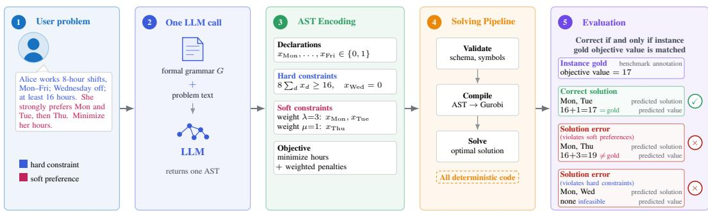  
Figure 1: ASTOR: One LLM call forms an AST which is compiled and solved deterministically.

Our method prompts an LLM with a natural-language problem and the grammar G to produce a well-formed expression in the language generated by G, which in this case is an optimization problem that may have hard or soft constraints. Every such expression admits a corresponding Abstract Syntax Tree (AST), a tree-structured representation that makes the compositional relationships between optimization components explicit. This gives our method a constrained intermediate representation between natural language and executable optimization code. AST-based intermediate representations have been used in natural-to-formal language translation to reduce generation errors and enforce compositional consistency [Putra et al., 2026, Gong et al., 2024, Liao et al., 2026, Hernández López et al., 2022]. We adapt this approach to mathematical optimization, and develop a typed grammar, which is more expressive than some first-order-logic grammars developed in previous AST papers. For this reason, we name our method ASTOR: Abstract Syntax Treesfor Operations Research.

The specific implementation is in Figure 1. Concretely, the model is given a prompt including a brief description of the task, the formal grammar, and a JSON schema which serializes the AST and is the expected output form. The AST-JSON contains variable declarations, hard constraints, soft constraints, and priority annotations. A deterministic post-processing pipeline applies only local JSON repairs, validates and parses the resulting tree, and compiles it into executable Gurobi code. Thus, the LLM is responsible for formulating the optimization problem, while all subsequent translation from the formal representation to solver code is deterministic. The resulting solver output is evaluated against the gold optimum. Worked examples and execution traces are provided in Appendix B, with complete prompts and execution rules in Appendix D.

## 4 Building a New Benchmark: SoftOR

Existing LLM autoformulation benchmarks primarily evaluate feasibility and objective recovery for problems expressed through hard constraints. Existing datasets contain preferences, but do not jointly provide natural-language instances, verified gold optima, and annotations for both weighted-penalty and lexicographic objectives. We therefore introduce SoftOR (Soft Operations Research), a unified natural-language soft-constraint autoformulation benchmark covering both objective structures. To construct and annotate lexicographic instances, we draw on the theory of modality from linguistics, which studies expressions such as must, should, and may that describe necessity, obligation, and desire [Henning et al., 2022, Garson, 2023]. These provide an immediate natural-language interface for soft constraints, and linguistic theory already motivates an ordering on modal words by strength that can be used to define lexicographic levels.

SoftOR comprises Nurse Rostering, COMPASS, TravelPlanner, and LexiBench. For the first three components, we use published datasets as basic source material, but construct the natural-language instances, soft-constraint semantics, priority annotations, and evaluation rules required for autoformulation. LexiBench is entirely original. Table 1 summarizes the resulting components and identifies the source data used in their construction.

Table 1: SoftOR components with new natural language problems and evaluations.
<table><tr><td>Component</td><td>n</td><td>Objective</td><td>Priority Signal</td><td>Gold construction</td><td>Source Material</td></tr><tr><td>Nurse Rostering</td><td>15</td><td>Weighted penalty</td><td>Explicit</td><td>Published optimum</td><td>Curtois [2014], Curtois and Qu [2014]</td></tr><tr><td>COMPASS</td><td>85</td><td>Lexicographic</td><td>Explicit</td><td>Enumeration</td><td>Qin et al. [2026]</td></tr><tr><td>TravelPlanner</td><td>180</td><td>Lexicographic</td><td>Modal</td><td>Enumeration</td><td>Xie et al. [2024]</td></tr><tr><td>LexiBench</td><td>75</td><td>Lexicographic</td><td>Mixed</td><td>Enumeration/Solver Code</td><td>This work</td></tr></table>

Full benchmark construction details, including natural language cues, are included in Appendix F.

## 4.1 Constructing New SoftOR Autoformulation Instances from Source data

The source data from Nurse Rostering, COMPASS, and TravelPlanner were designed for scheduling or planning evaluation rather than natural-language optimization autoformulation and were therefore not directly usable as SoftOR instances without our adaptations as described below.

For Nurse Rostering, we convert published tabular requirements into new natural-language instances with explicit priority markers. Each published request weight becomes a fixed phrase. In particular, the original priority markers, annotated as 1, 2, 3, and 100, become “slightly prefers," “prefers," “strongly prefers" and “far more serious." The original numbers are not kept in the final natural language instance, since we intend to test whether these ordinal priorities can be recovered from language alone. Optima are provided by the original benchmark authors [Curtois, 2014]. Numerical weights are not given to any method. Each method instantiates its own weights, if it chooses to use them, and the specific numerical weights given by the benchmark are used only post-modeling for scoring and evaluation. We chose not to show weights to any route during decision-making so we can evaluate each route’s ability to infer preference strength from natural language. As an ablation, we run a case where routes can see weights before decisions in Appendix F.

The original COMPASS source material provided a natural-language query, structured hard constraints and preferences, a finite set of candidate plans, and one annotated gold plan ID [Qin et al., 2026]. It did not present these elements as a single autoformulation instance or annotate the underlying optimization objective. To adapt these instances for SoftOR, we combine the query and structured fields into a complete natural-language problem using fixed templates that mark requirements as "required" and wishes as equally important soft constraints that are "preferred". We also reconstruct the gold objective. Because multiple plans may satisfy the same maximum number of preferences, we enumerate every provided plan and use that maximum as gold rather than requiring the single plan ID supplied originally by COMPASS.

The original TravelPlanner source already provided natural-language travel-planning problems and structured candidate data, but it was designed to evaluate plan generation and does not supply annotated optimization formulations or gold objective vectors [Xie et al., 2024]. For our adaptation, we convert each instance into a lexicographic autoformulation task by assigning its linguistic cues to three priority tiers. These cues, called modals, express obligation, intention, or desire, and the tiers follow the deontic–teleological–bouletic distinction in modal linguistics [Rubinstein et al., 2013, von Fintel and Iatridou, 2008, Portner, 2009, Henning et al., 2022]: deontic language states what must hold, teleological language what the speaker plans to achieve, and bouletic language what the speaker wants. We then enumerate every valid combination of transport, one hotel per city, and restaurants; compare plans lexicographically by tier violations; and break ties by total cost. The resulting optimal vector is the gold annotation, and a formulation is correct only if its solution matches that vector at every tier and in cost. The complete inventory of linguistic cues and benchmark construction details is included in Appendix F.

## 4.2 Original Construction of LexiBench

LexiBench is an original dataset of 75 problems that tests richer ordered preferences than the preceding sources, which contain either fixed weights or at most three tiers. Figure 2 shows its five preference structures. Each structure is instantiated for three decision types. Atomic problems select one element from a candidate set, as in COMPASS. Assembly problems build a bundle from several candidate sets, as in TravelPlanner. Constructive problems formulate constraints and optimize over an implicitly defined feasible region, as in conventional hard-constraint benchmarks. Hardness is signaled with the same modal cues as TravelPlanner, and when more than three levels are needed, explicit comparatives such as “more important than,” “higher priority,” and “above all” fix the remaining order. Gold is computed by enumeration for atomic and assembly problems and by solving the annotated lexicographic model in Gurobi for constructive problems. A formulation is correct if it attains the gold objective vector, regardless of which optimal solution it returns.

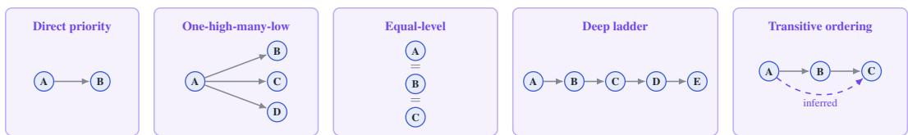  
Figure 2: Priority annotation in LexiBench instances. Arrows indicate priority ordering: left is a higher priority than right.

The priority signal column of Table 1 records how each source communicates priority, and Appendix A disaggregates accuracy by it. Explicit sources state priority in words that name a level directly, such as “strongly prefer” and “slightly prefer” in Nurse Rostering or “equally important” in COMPASS. Modal sources encode priority only through the modal verbs above, so the tier must be inferred from the strength of the wording. Mixed sources, namely LexiBench, combine modal cues with explicit comparatives and pairwise statements, so recovering the ordering requires both readings. Appendix F gives the complete construction and annotation procedures for SoftOR.

## 5 Experiments

To evaluate ASTOR, we compare it with single-request prompting methods and previously published agentic autoformulation methods across hard and soft constraint benchmarks. Our experiments address the following research questions:

• RQ1: How accurately do single-request and multi-agent inference methods solve soft-constraint benchmarks? How does this performance differ by lexicographic and weighted penalty objectives?

• RQ2: How does accuracy vary by priority signal and problem difficulty?

• RQ3: What technical and solution errors do the methods produce?

• RQ4: How expensive is ASTOR compared to other methods?

• RQ5: How do the ASTOR components and backbone affect performance?

## 5.1 Experimental Setup

For our main experiment, we evaluate on SoftOR using temperature-zero Gemini 3.7 Flash as the LLM backbone with the provider-default thinking configuration on most benchmarks. The only exception is Nurse Rostering, where all routes receive an increased thinking budget and use Gemini 3.8 Flash, due to its more complex formulations. Appendix A includes additional experiments on standard autoformulation benchmarks distributed by Yang et al. [2026], but these include almost exclusively hard constraints. A non-reasoning model, a non-Gemini reasoning model, and a larger Gemini reasoning model are included in later ablation studies on SoftOR and standard benchmarks.

Solution Accuracy, as defined in Section 2, is the primary evaluation metric, and other metrics are reported in Table 3 for more granularity on which soft constraints are most often satisfied. Since lexicographic problems have multiple objectives, gold-standard labels are vectors, and LLM formulations are considered correct if and only if the entire lexicographic objective vector produced matches the gold-standard one within the specified numerical tolerance. Weighted-penalty problem have a single objective, so the gold standard label is a number, and similarly, formulations are correct if and only if the number produced matches the gold-standard value within the specified numerical tolerance.

We compare against three single-request routes using the same backbone model. Direct is given the natural language problem and predicts the final answer with no intermediate representation. Code-generation (Codegen) is a single-request LLM prompting method which is given the natural language problem and outputs executable Gurobi code to solve the problem [Deng et al., 2024]. This is the main control of the experiment, and tests whether a formal grammar provides any advantage over another formal intermediate representation, like solver code. Chain-of-Thought (CoT) asks the LLM to think in steps to produce a mathematical optimization model and executable Gurobi code [Wei et al., 2022]. ORThought uses agents to formulate the optimization problem as executable code and at most three repair agents to debug the formulation or code [Yang et al., 2026]. Chain-of-Experts (CoE) uses a panel of many LLM agents to collaborate on formulation, coding, and natural-language extraction [Xiao et al., 2024]. ORThought and CoE use published prompts.

Direct, Codegen, and CoT are single-request LLM prompting methods, whereas CoE and ORThought are multi-request pipelines that use different LLM prompts for formulation, repair, and execution. We estimate sampling uncertainty with 10,000 paired bootstrap resamples over problem instances, using the same sampled instances for every method. Tables report bootstrap standard errors in parentheses, and figures show percentile 95% confidence intervals. Appendix D gives the prompts.

## 5.2 RQ1: Accuracy

Overall, ASTOR is the most accurate on SoftOR, with an aggregate accuracy across lexicographic and weighted penalty problems of 88.5%. From most to least accurate, the baselines achieve 84.8% for CoE, 83.7% for Codegen, 81.4% for CoT, 80.0% for ORThought, and 52.7% for Direct. We now report results stratified by objective type (lexicographic or weighted), including more granular data on soft constraint satisfaction.

## 5.2.1 Lexicographic Problems

Table 2: Solution accuracy by dataset for six routes (%), bootstrap standard errors are in parentheses. The best result is bolded.
<table><tr><td>Method</td><td>COMPASS</td><td>Travel Planner</td><td>LexiBench</td><td>Overall</td></tr><tr><td>Direct</td><td>56.5 (5.4)</td><td>75.0 (3.2)</td><td>5.3 (2.6)</td><td>55.0 (2.7)</td></tr><tr><td>Codegen</td><td>98.8 (1.2)</td><td>76.1 (3.2)</td><td>89.3 (3.5)</td><td>84.7 (1.9)</td></tr><tr><td>CoT</td><td>95.3 (2.3)</td><td>77.2 (3.1)</td><td>80.0 (4.6)</td><td>82.4 (2.1)</td></tr><tr><td>ORThought</td><td>96.5 (2.0)</td><td>80.0 (3.0)</td><td>66.7 (5.4)</td><td>81.2 (2.1)</td></tr><tr><td>CoE</td><td>98.8 (1.2)</td><td>79.4 (3.0)</td><td>89.3 (3.5)</td><td>86.5 (1.8)</td></tr><tr><td>ASTOR (Ours)</td><td>98.8 (1.2)</td><td>85.0 (2.7)</td><td>92.0 (3.2)</td><td>90.0 (1.6)</td></tr></table>

In Table 2, we compare the six routes on solution accuracy over each component of SoftOR. Table 6 in Appendix A reports solution accuracy on the hard-constraint benchmarks.

Table 3: Average soft constraint satisfaction (%) over instances containing preferences in the relevant column. Combined pools tiers within each instance before averaging.
<table><tr><td></td><td>COMPASS</td><td colspan="3">TravelPlanner</td><td colspan="4">LexiBench</td></tr><tr><td>Method</td><td>Preferences  $n = 8 5$ </td><td>Tier 2 Strong preferences n = 16</td><td>Tier 3 Weak preferences  $n = 8 7$ </td><td>Combined n = 95</td><td>Tier 1  $n = 7 5$ </td><td>Tier 2  $n = 6 0$ </td><td>Tiers 3–5 n = 66</td><td>Combined  $n = 7 5$ </td></tr><tr><td>Direct</td><td>35.0</td><td>93.8</td><td>86.2</td><td>87.4</td><td>4.5</td><td>3.3</td><td>1.5</td><td>3.5</td></tr><tr><td>Codegen</td><td>62.7</td><td>93.8</td><td>83.9</td><td>85.3</td><td>92.8</td><td>52.1</td><td>65.2</td><td>65.6</td></tr><tr><td>CoT</td><td>60.4</td><td>81.2</td><td>85.1</td><td>85.3</td><td>90.1</td><td>51.8</td><td>60.6</td><td>63.8</td></tr><tr><td>ORThought</td><td>60.7</td><td>93.8</td><td>83.9</td><td>85.3</td><td>73.1</td><td>38.6</td><td>50.0</td><td>52.0</td></tr><tr><td>CoE</td><td>62.7</td><td>100.0</td><td>87.4</td><td>88.4</td><td>94.1</td><td>50.4</td><td>68.2</td><td>66.3</td></tr><tr><td>ASTOR (Ours)</td><td>62.7</td><td>100.0</td><td>92.0</td><td>92.6</td><td>92.0</td><td>53.2</td><td>63.6</td><td>63.5</td></tr></table>

In Table 3, “Combined” columns report the average across instances of the percentage of preferences satisfied within each instance, counting preferences from all tiers together. Individual tier columns average only over instances containing preferences at that tier. All columns report proportion of preferences satisfied on each lexicographic level. LexiBench tiers are grouped for brevity and data sparsity. ASTOR performs best on COMPASS, TravelPlanner, and some LexiBench metrics. Hard constraint satisfaction on SoftOR is reported in Appendix A.

Table 4: Performance relative to gold-standard optimum on the 15 Nurse Rostering instances.
<table><tr><td>Method</td><td>1</td><td>2</td><td>3</td><td>4</td><td>5</td><td>6</td><td>7</td><td>8</td><td>9</td><td>10</td><td>11</td><td>12</td><td>13</td><td></td><td>15</td></tr><tr><td>Direct</td><td>+407</td><td>+897</td><td>FAIL</td><td>FAIL</td><td>FAIL</td><td>FAIL</td><td>FAIL</td><td>FAIL</td><td>FAIL</td><td>FAIL</td><td>FAIL</td><td>FAIL</td><td>FAIL</td><td>FAIL</td><td>FAIL</td></tr><tr><td>Codegen</td><td>0</td><td>0</td><td>0</td><td>+1</td><td>+1</td><td>0</td><td>0</td><td>+1</td><td>+2</td><td>0</td><td>0</td><td>+1</td><td>0</td><td>+1</td><td>0</td></tr><tr><td>CoT</td><td>0</td><td>0</td><td>0</td><td>+1</td><td>+1</td><td>0</td><td>0</td><td>+6</td><td>+2</td><td>0</td><td>0</td><td>+1</td><td>0</td><td>+1</td><td>0</td></tr><tr><td>ORThought</td><td>0</td><td>0</td><td>0</td><td>+1</td><td>+3</td><td>FAIL</td><td>0</td><td>+1</td><td>+2</td><td>0</td><td>0</td><td>+1</td><td>0</td><td>FAIL</td><td>0</td></tr><tr><td>CoE</td><td>0</td><td>0</td><td>0</td><td>+1</td><td>+1</td><td>0</td><td>+1</td><td>+2</td><td>+2</td><td>0</td><td>0</td><td>+1</td><td>+2</td><td>+1</td><td>0</td></tr><tr><td>ASTOR</td><td>0</td><td>0</td><td>0</td><td>+1</td><td>+1</td><td>+1</td><td>0</td><td>+2</td><td>+2</td><td>0</td><td>0</td><td>+1</td><td>0</td><td>+4</td><td>0</td></tr></table>

## 5.2.2 Weighted Penalty Problems (Nurse Rostering Instances)

Table 4 shows the performance of each method on each instance of Nurse Rostering. Numbers indicate incurred surplus penalty by violating staffing requirements or shift preferences. Zero penalty is an optimal solution. FAIL denotes instances where the route failed to obey all hard constraints or failed to produce a roster at all. Codegen and CoT are the most accurate on this dataset, with 9/15 correct instances (0 penalty). ASTOR and ORThought have 8/15, CoE has 7/15, and Direct has 0/15. ASTOR is as good as all other inference methods on staffing measures. It is neither the worst nor the best on weighted shift preferences. Details on Nurse Rostering are available in Appendix F.

## 5.3 RQ2: Performance by Problem Characteristics

We disaggregate results by difficulty level, with token usage as a proxy. Figure 4 has all 355 SoftOR instances as its horizontal axis, ordered from least to most token usage on the Direct route. Token usage counts how many tokens the Direct route used to produce an answer for that instance. Each tally mark indicates a correct answer for that instance. The section on the right, called "Direct Failures" is for those instances Direct did not produce a roster, and does not have token ranks on its horizontal axis. In this case, instances are sorted alphabetically by dataset name and then instance ID, and tally marks indicate correct solutions for each route. Figure 3a uses the same definition of token usage, and aggregates them into five roughly equal groups, called quintiles, with

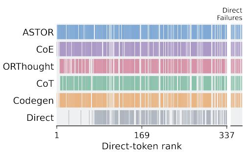  
Figure 4: Correct instances ordered by Direct token usage as a proxy for difficulty.

Q1 containing the lowest token usage and Q5 the highest. ASTOR performs best, even as the difficulty level of the problem increases. More disaggregated results are in Appendix A (Figure 6).

## 5.4 RQ3: Error Analysis

We analyze technical and solution errors as percentages of all evaluated attempts. Technical errors include malformed outputs, parsing, compilation, or execution failures. Solution errors indicate that the optimal value is different than the gold-standard. More details are in Appendix E.

ASTOR has the lowest error rate (i.e., percent of instances with either technical or solution errors) on SoftOR among the compared methods (Figure 3b). The whiskers show 95% bootstrap confidence intervals for the total error rate, combining technical and solution errors, and the unplotted remainder up to 100% represents correct attempts. On LexiBench, Codegen and CoT often satisfy the right preferences but fail to choose the cheapest solution among equally preferred options, accounting for 5 of Codegen’s 8 solution errors and 10 of CoT’s 12. ASTOR instead gives up preferences to reduce cost in five of its six errors because it combines preference penalties and cost in a weighted sum. In the remaining case, it gives the highest priorities to the wishes the request explicitly says to give up first. On the hard-constraint benchmarks, error rates are similar for ASTOR, Codegen, CoT, ORThought, and CoE, for which full details are included in Appendix A.

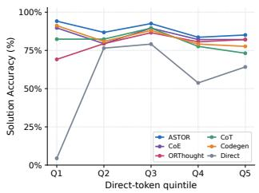  
(a)

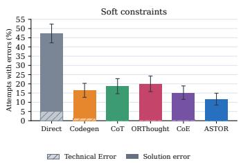  
(b)

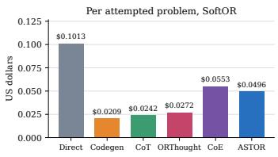  
(c)  
Figure 3: (a) Accuracy by token quintile as a proxy for difficulty. (b) Error rates on SoftOR (%) with 95% CI. (c) Monetary cost in USD by route at time of evaluation.

## 5.5 RQ4: Cost Analysis

We report the incurred cost in USD of ASTOR and other methods at the time of evaluation. Figure 3c shows ASTOR is 10.3% less expensive than CoE, the strongest alternative, while also being the most accurate. Other cost results are in Appendix A, where ASTOR shows a similar profile.

## 5.6 RQ5: Ablation Studies

We examine the prompt components and LLM backbone of ASTOR. Following precedent for analysis on fixed benchmark subsets [Song et al., 2026, Lu et al., 2025, Yao et al., 2025], we construct a frozen, stratified 100-instance sample drawn from the eight benchmarks, including the four from SoftOR and four hard-constraint-only benchmarks in Appendix A. All main-text ablations report results on the 45 soft-constraint instances included in the sample, while Appendix A reports the corresponding results on the complementary 55 hard-constraint instances. For every ablation except the LLM backbone, the same settings as the main experiment are applied to each dataset.

As seen in Appendix D, the ASTOR prompt has several components, and we remove one for each ablation. The ASTOR prompt includes the formal grammar in two parts, one as a human-readable markdown file in the style of a BNF grammar, and the other as a JSON schema that specifies the expected form of the output. It also supplies a benchmark contract, with bespoke information needed to use the data of each benchmark. Lastly, ASTOR uses a deterministic Python code repair which detects and fixes syntax mistakes in the JSON output, for which more information is available in Appendix A.

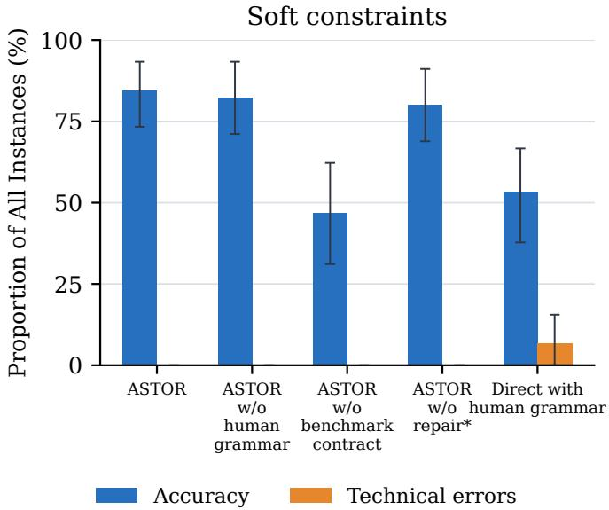  
Figure 5: ASTOR prompt ablations on SoftOR. Whiskers show bootstrap 95% confidence intervals.

Removing the human-readable grammar and the deterministic repair reduced performance by only 2.2 and 4.4 percentage points, respectively, indicating that the serialized grammar may be enough and that syntax errors are uncommon. Removing the benchmark contract reduces performance by more. The last bar in Figure 5 gives the human grammar to the Direct method, provided as a tool for internal reasoning only. This method performs exactly the same as the Direct method on the ablation set.

Table 5: Model-backbone ablation on the 45 soft-constraint instances. Solution accuracy (%); bootstrap standard errors are in parentheses.
<table><tr><td>Method</td><td>Gemini 3.5 Flash Lite</td><td>GPT-5</td><td>Gemini 3.1 Pro</td></tr><tr><td>Direct</td><td>6.7 (3.7)</td><td>44.4 (7.4)</td><td>33.3 (7.0)</td></tr><tr><td>Codegen</td><td>44.4 (7.4)</td><td>68.9 (6.9)</td><td>80.0 (6.0)</td></tr><tr><td>CoT</td><td>17.8 (5.7)</td><td>51.1 (7.5)</td><td>73.3 (6.6)</td></tr><tr><td>ORThought</td><td>28.9 (6.8)</td><td>68.9 (6.9)</td><td>80.0 (6.0)</td></tr><tr><td>CoE</td><td>37.8 (7.2)</td><td>68.9 (6.9)</td><td>77.8 (6.2)</td></tr><tr><td>ASTOR (Ours)</td><td>26.7 (6.6)</td><td>73.3 (6.6)</td><td>80.0 (6.0)</td></tr></table>

Codegen leads on Gemini 3.5 Flash Lite, whereas ASTOR leads on the GPT backbone. Codegen, ORThought, and ASTOR tie on Gemini 3.1 Pro, with CoE close behind. (Table 5).

## 6 Discussion and Conclusion

SoftOR makes soft-constraint autoformulation measurable through weighted penalties, lexicographic objectives, and solver-verified gold annotations, and ASTOR shows that a formal intermediate language improves accuracy on exactly those problems, particularly ordered preferences, while remaining competitive on hard constraints. Future work should define and evaluate on a metric of faithfulness to the original optimization problem or solver performance and extend the benchmark with less explicit language to test how well the method transfers to those settings. Overall, the results support formal languages and ASTs as practical foundations for optimization autoformulation.

## Ethics Statement

This work does not involve human subjects, personal data, or sensitive attributes, so institutional review board approval was not required. SoftOR is built from publicly released benchmarks (COMPASS, TravelPlanner, and SchedulingBenchmarks) under their original licenses, together with LexiBench, an original dataset written and annotated by the authors. All priority annotations, gold constructions, and error labels were produced by the authors following the protocols in Appendices E and F, and no crowdsourcing or paid annotation was used. The natural-language instances describe scheduling, travel, and staffing scenarios with fictional entities and contain no real individuals. Experiments call commercial LLM APIs, and the available token usage and cost of every reported run are recorded in Appendix A at the prices listed in Appendix D so that the environmental and financial footprint of the study is visible. The methods and benchmark are intended to make optimization formulation more faithful to stated preferences and carry no foreseeable dual-use risk beyond that of general-purpose optimization tooling. The authors have no conflicts of interest or sponsorship to declare.

## Reproducibility Statement

We release the complete ASTOR pipeline, the SoftOR benchmark with its gold annotations, all prompts, and the raw outputs and evaluation records of every reported run as supplementary material and at the repository linked in the abstract. The formal grammar, the definition of the problem class, and the full proof of adequacy are in Appendix C, and Appendix B works one instance through the pipeline with its literal compiler trace. Appendix D gives the exact prompts for the four singlerequest routes, the configuration and prompt provenance of ORThought and CoE, the benchmark contracts, the execution and evaluation rules, the frozen decoding and pricing settings, and the ablation definitions. The identifiers of the frozen 100-instance ablation subset are available through the repository. Appendix F documents every dataset adaptation, including the TravelPlanner priority rules, the LexiBench construction, the Nurse Rostering phrase mapping, the COMPASS templates, and the gold-label corrections applied to the ORThought releases. Section 5.1 states the backbone, decoding settings, and bootstrap protocol, and Appendix E gives the error-labeling decision order.

## AI Use Statement

In this work, we used generative AI tools to generate the natural-language instances of SoftOR by applying a dataset-construction procedure that the authors designed without AI, to clean and reformat source datasets, and to assist in the exposition of author-developed adequacy proofs in Appendix C, but not with formulating the mathematical claims. It was also used to provide feedback on the experimental design, and to implement the ablation experiments. We have not used generative AI tools to develop the conceptual framework or the formal grammar, to propose or refine hypotheses, to design the methodology, or to interpret results. Translation and qualitative or thematic analysis are not applicable to this work. Additionally, we used generative AI tools to create and edit software code, to create scientific figures, to brainstorm, to edit the paper for readability, and to format references. We have reviewed all AI-assisted work. We take responsibility for the final content of this work, including text, claims, and artifacts produced with the aid of generative AI.

## References

Sumaya Abdul Rahman, Seckhen Ariel Andrade Cuellar, Ghani Raissov, and Mohammad Raza. VeriSimpl: Robust optimization modeling from natural language using simplification-based verification, 2026.

Ali AhmadiTeshnizi, Wenzhi Gao, and Madeleine Udell. OptiMUS: Scalable optimization modeling with (MI)LP solvers and large language models. In Proceedings of the 41st International Conference on Machine Learning, volume 235 of Proceedings of Machine Learning Research, pages 577–596. PMLR, 2024.

Alfred V. Aho, Monica S. Lam, Ravi Sethi, and Jeffrey D. Ullman. Compilers: Principles, Techniques, and Tools. Pearson Education, 2 edition, 2007.

Rajeev Alur, Rastislav Bodík, Garvit Juniwal, Milo M. K. Martin, Mukund Raghothaman, Sanjit A. Seshia, Rishabh Singh, Armando Solar-Lezama, Emina Torlak, and Abhishek Udupa. Syntaxguided synthesis. In 2013 Formal Methods in Computer-Aided Design, pages 1–8, 2013. doi: 10.1109/FMCAD.2013.6679385.

Associated Press. AI-assisted shopping is the talk of the holiday shopping season, November 2025.

Michel L. Balinski and H. Peyton Young. Fair Representation: Meeting the Ideal ofOne Man, One Vote. Brookings Institution Press, 2 edition, 2001.

Andreas Bärmann, Alexander Müller, and Dieter Weninger. Lexicographic column generation with a tree search pricing algorithm. Mathematical Methods of Operations Research, 102:163–228, 2025. doi: 10.1007/s00186-025-00905-3.

James Cheney, Michael Norrish, and René Vestergaard. Formalizing adequacy: A case study for higher-order abstract syntax. Journal ofAutomated Reasoning, 49(2):209–239, 2012. doi: 10.1007/s10817-011-9221-6.

Tim Curtois. Nurse rostering benchmark instances, 2014.

Tim Curtois and Rong Qu. Computational results on new staff scheduling benchmark instances. Technical report, ASAP Research Group, School of Computer Science, University of Nottingham, 2014.

Haoxuan Deng, Bohao Zheng, Yirui Jiang, and Trung Hieu Tran. CAFA: Coding as auto-formulation can boost large language models in solving linear programming problem. In The 4th Workshop on Mathematical Reasoning and AI at NeurIPS 2024, 2024.

James Garson. Modal logic. In Edward N. Zalta and Uri Nodelman, editors, The Stanford Encyclopedia ofPhilosophy. Metaphysics Research Lab, Stanford University, 2023.

Bruce Golden, Linus Schrage, Douglas Shier, and Lida Anna Apergi. The unexpected power of linear programming: An updated collection of surprising applications. Annals of Operations Research, 343:573–605, 2024. doi: 10.1007/s10479-024-06245-5.

Linyuan Gong, Mostafa Elhoushi, and Alvin Cheung. AST-T5: Structure-aware pretraining for code generation and understanding. In Proceedings ofthe 41st International Conference on Machine Learning, volume 235 of Proceedings ofMachine Learning Research, pages 15839–15853. PMLR, 2024.

Sophie Henning, Nicole Macher, Stefan Grünewald, and Annemarie Friedrich. MiST: A large-scale annotated resource and neural models for functions of modal verbs in English scientific text. In Findings of the Association for Computational Linguistics: EMNLP 2022, pages 1305–1324. Association for Computational Linguistics, 2022. doi: 10.18653/v1/2022.findings-emnlp.94.

José Antonio Hernández López, Martin Weyssow, Jesús Sánchez Cuadrado, and Houari Sahraoui. AST-Probe: Recovering abstract syntax trees from hidden representations of pre-trained language models. In 37th IEEE/ACM International Conference on Automated Software Engineering, pages 1–11, 2022. doi: 10.1145/3551349.3556900.

Chenyu Huang, Zhengyang Tang, Shixi Hu, Ruoqing Jiang, Xin Zheng, Dongdong Ge, Benyou Wang, and Zizhuo Wang. ORLM: A customizable framework in training large models for automated optimization modeling. Operations Research, 73(6):2986–3009, 2025a. doi: 10.1287/opre.2024. 1233.

Xuhan Huang, Qingning Shen, Yan Hu, Anningzhe Gao, and Benyou Wang. LLMs for mathematical modeling: Towards bridging the gap between natural and mathematical languages. In Findings of the Associationfor Computational Linguistics: NAACL 2025, pages 2678–2710. Association for Computational Linguistics, 2025b. doi: 10.18653/v1/2025.findings-naacl.146.

Caigao Jiang, Xiang Shu, Hong Qian, Xingyu Lu, Jun Zhou, Aimin Zhou, and Yang Yu. LL-MOPT: Learning to define and solve general optimization problems from scratch. In International Conference on Learning Representations, volume 2025, pages 101580–101606, 2025.

Sirui Li, Janardhan Kulkarni, Ishai Menache, Cathy Wu, and Beibin Li. Towards foundation models for mixed integer linear programming. In International Conference on Learning Representations, volume 2025, pages 88590–88638, 2025.

Weibin Liao, Xin Gao, Tianyu Jia, Rihong Qiu, Yifan Zhu, Yang Lin, Xinyu Ma, Junfeng Zhao, and Yasha Wang. LearNAT: Learning NL2SQL with AST-guided task decomposition for large language models. In International Conference on Learning Representations, volume 2026, pages 87420–87452, 2026.

Haoyang Liu, Jie Wang, Boxuan Niu, Xiongwei Han, Yian Xu, Mingxuan Ye, Zijie Geng, Fangzhou Zhu, Tao Zhong, Mingxuan Yuan, and Jianye Hao. Opt-verifier: Unleashing the power of llms for optimization modeling via dual-side verification. In Proceedings of the 43rd International Conference on Machine Learning, 2026.

Hongliang Lu, Zhonglin Xie, Yaoyu Wu, Can Ren, Yuxuan Chen, and Zaiwen Wen. OptMATH: A scalable bidirectional data synthesis framework for optimization modeling. In Proceedings of the 42nd International Conference on Machine Learning, volume 267 of Proceedings ofMachine Learning Research, pages 40769–40802. PMLR, 2025.

McKinsey & Company. The automation curve in agentic commerce, January 2026.

Martin Otto. Expressive completeness through logically tractable models. Annals ofPure and Applied Logic, 164(12):1418–1453, 2013.

Saswat Padhi, Elizabeth Polgreen, Mukund Raghothaman, Andrew Reynolds, and Abhishek Udupa. The SyGuS language standard version 2.1, 2023.

Paul Portner. Modality. Oxford University Press, 01 2009. ISBN 9780199292424.

Rizky Ramadhana Putra, Raihan Sultan Pasha Basuki, Yutong Cheng, and Peng Gao. NL2Logic: AST-guided translation of natural language into first-order logic with large language models. In Findings of the Association for Computational Linguistics: EACL 2026, pages 6035–6051. Association for Computational Linguistics, 2026. doi: 10.18653/v1/2026.findings-eacl.317.

Tian Qin, Haoping Bai, Ting-Yao Hu, Raviteja Vemulapalli, Hema Swetha Koppula, Zhiyang Xu, Bowen Jin, Mert Cemri, Jiarui Lu, Zirui Wang, and Meng Cao. COMPASS: Benchmarking constrained optimization in LLM agents. In Third Conference on Language Modeling, 2026.

Rindranirina Ramamonjison, Timothy Yu, Raymond Li, Haley Li, Giuseppe Carenini, Bissan Ghaddar, Shiqi He, Mahdi Mostajabdaveh, Amin Banitalebi-Dehkordi, Zirui Zhou, and Yong Zhang. NL4Opt Competition: Formulating optimization problems based on their natural language descriptions. In Proceedings of the NeurIPS 2022 Competitions Track, volume 220 of Proceedings of Machine Learning Research, pages 189–203. PMLR, 2022.

Reuters. Retailers tap AI shopping traffic but fight to keep customer data, August 2026.

Aynat Rubinstein, Hillary Harner, Elizabeth Krawczyk, Daniel Simonson, Graham Katz, and Paul Portner. Toward fine-grained annotation of modality in text. In Proceedings of the IWCS 2013 Workshop on Annotation of Modal Meanings in Natural Language (WAMM), pages 38–46, Potsdam, Germany, March 2013. Association for Computational Linguistics.

Shopify. What is agentic shopping and what it means for your store, April 2026.

Yang Song, Anoushka Vyas, Zirui Wei, Sina Khoshfetrat Pakazad, Henrik Ohlsson, and Graham Neubig. NEMO: Execution-aware optimization modeling via autonomous coding agents. In Proceedings of the 43rd International Conference on Machine Learning, 2026.

The Wall Street Journal. Inside BlackRock’s AI transformation, April 2026.

Kai von Fintel and Sabine Iatridou. How to say ought in foreign: The composition of weak necessity modals. In Jacqueline Guéron and Jacqueline Lecarme, editors, Time and Modality, volume 75 of Studies in Natural Language and Linguistic Theory, pages 115–141. Springer, Dordrecht, 2008. doi: 10.1007/978-1-4020-8354-9\_6.

Zhuohan Wang, Ziwei Zhu, Ziniu Li, Congliang Chen, Yizhou Han, Yufeng Lin, Zhihang Lin, Angyang Gu, Xinglin Hu, Ruoyu Sun, and Tian Ding. Orgeval: Graph-theoretic evaluation of llms in optimization modeling, 2025.

Jason Wei, Xuezhi Wang, Dale Schuurmans, Maarten Bosma, Brian Ichter, Fei Xia, Ed H. Chi, Quoc V. Le, and Denny Zhou. Chain-of-thought prompting elicits reasoning in large language models. In Advances in Neural Information Processing Systems, volume 35, pages 24824–24837, 2022. doi: 10.52202/068431-1800.

Ziyang Xiao, Dongxiang Zhang, Yangjun Wu, Lilin Xu, Yuan Jessica Wang, Xiongwei Han, Xiaojin Fu, Tao Zhong, Jia Zeng, Mingli Song, and Gang Chen. Chain-of-experts: When LLMs meet complex operations research problems. In International Conference on Learning Representations, 2024.

Ziyang Xiao, Jingrong Xie, Lilin Xu, Shisi Guan, Jingyan Zhu, Xiongwei Han, Xiaojin Fu, WingYin Yu, Han Wu, Wei Shi, Qingcan Kang, Jiahui Duan, Tao Zhong, Mingxuan Yuan, Jia Zeng, Yuan Wang, Gang Chen, and Dongxiang Zhang. A survey of optimization modeling meets LLMs: Progress and future directions. In Proceedings ofthe Thirty-Fourth International Joint Conference on Artificial Intelligence, pages 10742–10750, 2025. doi: 10.24963/ijcai.2025/1192.

Jian Xie, Kai Zhang, Jiangjie Chen, Tinghui Zhu, Renze Lou, Yuandong Tian, Yanghua Xiao, and Yu Su. TravelPlanner: A benchmark for real-world planning with language agents. In Proceedings of the 41st International Conference on Machine Learning, volume 235 of Proceedings of Machine Learning Research, pages 54590–54613. PMLR, 2024.

Beinuo Yang, Qishen Zhou, Junyi Li, Chenxing Su, Panagiotis Angeloudis, and Simon Hu. OR-Thought: Benchmarking and automating logistics optimization modeling via structured LLM reasoning. Artificial Intelligencefor Transportation, 6:100059, 2026. doi: 10.1016/j.ait.2026.100059.

Zijun Yao, Weijian Qi, Liangming Pan, Shulin Cao, Linmei Hu, Liu Weichuan, Lei Hou, and Juanzi Li. SeaKR: Self-aware knowledge retrieval for adaptive retrieval augmented generation. In Proceedings ofthe 63rd Annual Meeting ofthe Associationfor Computational Linguistics (Volume 1: Long Papers), pages 27022–27043. Association for Computational Linguistics, 2025. doi: 10.18653/v1/2025.acl-long.1312.

Yansen Zhang, Qingcan Kang, Yujie Chen, Yufei Wang, Xiongwei Han, Tao Zhong, Mingxuan Yuan, and Chen Ma. SAC-Opt: Semantic anchors for iterative correction in optimization modeling. In AIMS Workshop at ICLR 2026, 2026.

## A Additional Experimental Results

## A.1 Hard-Constraint Accuracy

All results in this appendix use the backbone, request budget, and bootstrap protocol of Section 5.1.

Table 6: Solution accuracy (%) on hard-constraint benchmarks. Bootstrap standard errors are in parentheses.
<table><tr><td>Method</td><td>ComplexOR</td><td>IndustryOR</td><td>LogiOR</td><td>NLP4LP</td><td>Overall</td></tr><tr><td>Direct</td><td>94.4 (5.4)</td><td>75.9 (4.7)</td><td>62.0 (5.0)</td><td>78.1 (2.6)</td><td>74.9 (2.1)</td></tr><tr><td>Codegen</td><td>88.9 (7.5)</td><td>75.9 (4.7)</td><td>72.8 (4.7)</td><td>87.2 (2.1)</td><td>82.1 (1.8)</td></tr><tr><td>CoT</td><td>83.3 (8.8)</td><td>75.9 (4.7)</td><td>72.8 (4.7)</td><td>86.8 (2.2)</td><td>81.6 (1.9)</td></tr><tr><td>ORThought</td><td>83.3 (8.8)</td><td>78.3 (4.5)</td><td>73.9 (4.6)</td><td>85.5 (2.2)</td><td>81.6 (1.9)</td></tr><tr><td>CoE</td><td>88.9 (7.3)</td><td>80.7 (4.3)</td><td>71.7 (4.7)</td><td>86.4 (2.2)</td><td>82.3 (1.8)</td></tr><tr><td>ASTOR (Ours)</td><td>94.4 (5.4)</td><td>77.1 (4.6)</td><td>68.5 (4.9)</td><td>87.6 (2.1)</td><td>81.8 (1.8)</td></tr></table>

Table 7: Paired comparison of ASTOR with CoE and Codegen on conventional hard-constraint benchmarks. ∆ is ASTOR accuracy minus baseline accuracy (percentage points). Intervals are 95% confidence intervals from 10,000 bootstrap resamples.
<table><tr><td></td><td colspan="4">Instances solved correctly</td><td colspan="2">ASTOR — baseline</td></tr><tr><td>Baseline</td><td>Both</td><td>ASTOR only</td><td>Baseline only</td><td>Neither</td><td>∆(%)</td><td>95% CI</td></tr><tr><td>CoE</td><td>345</td><td>11</td><td>13</td><td>66</td><td>-0.5</td><td>[−2.5, 1.8]</td></tr><tr><td>Codegen</td><td>346</td><td>10</td><td>11</td><td>68</td><td>-0.2</td><td>[−2.3, 1.8]</td></tr></table>

Table 6 reports all six methods on the conventional hard-constraint benchmarks. Aggregated over the 435 instances, ASTOR is statistically indistinguishable from CoE (Table 7), from Codegen (paired 95% CI [−2.3, 1.8] pp), and from ORThought ([−2.1, 2.5] pp).

Table 8 complements the soft-constraint backbone analysis in Table 5 by reporting the same compari son on the 55 hard-constraint instances in the frozen 100-instance ablation sample.

Table 8: Model-backbone ablation on the 55 hard-constraint instances. Solution accuracy (%); bootstrap standard errors are in parentheses.
<table><tr><td>Method</td><td>Gemini 3.7 Flash (reasoning)</td><td>Gemini 3.5 Flash Lite (no reasoning)</td><td>GPT-5 (reasoning, medium)</td><td>Gemini 3.1 Pro (reasoning)</td></tr><tr><td>Direct</td><td>78.2 (5.6)</td><td>18.2 (5.2)</td><td>78.2 (5.6)</td><td>78.2 (5.6)</td></tr><tr><td>Codegen</td><td>81.8 (5.2)</td><td>78.2 (5.6)</td><td>80.0 (5.4)</td><td>80.0 (5.4)</td></tr><tr><td>CoT</td><td>83.6 (5.0)</td><td>76.4 (5.7)</td><td>65.5 (6.4)</td><td>80.0 (5.4)</td></tr><tr><td>ORThought</td><td>83.6 (5.0)</td><td>83.6 (5.0)</td><td>85.5 (4.8)</td><td>80.0 (5.4)</td></tr><tr><td>CoE</td><td>83.6 (5.0)</td><td>80.0 (5.4)</td><td>81.8 (5.2)</td><td>81.8 (5.2)</td></tr><tr><td>ASTOR (Ours)</td><td>85.5 (4.8)</td><td>78.2 (5.6)</td><td>83.6 (5.0)</td><td>81.8 (5.2)</td></tr></table>

ASTOR leads on Gemini 3.7 Flash, ORThought leads on Gemini 3.5 Flash Lite and GPT-5, and ASTOR ties CoE for the lead on Gemini 3.1 Pro.

Table 9 lists results for four other LLM autoformulation methods as published by ORThought [Yang et al., 2026]. These methods differ from ours in inference budget, number of repetitions, and backbone: CoE and ORThought use GPT-4.1-nano, ORLM uses LLaMA-3-8B, and OptiMUS is reported only on NLP4LP using author-supplied intermediate JSON.

Table 9: Published hard-constraint success rates (%) from Yang et al. [2026].
<table><tr><td>Method</td><td>ComplexOR</td><td>IndustryOR</td><td>LogiOR</td><td>NLP4LP</td></tr><tr><td>ORLM</td><td>77.78</td><td>32.13</td><td>15.58</td><td>67.80</td></tr><tr><td>OptiMUS</td><td></td><td></td><td></td><td>69.42</td></tr><tr><td>CoE</td><td>55.56</td><td>40.96</td><td>34.78</td><td>75.00</td></tr><tr><td>ORThought</td><td>77.78</td><td>57.83</td><td>46.01</td><td>89.02</td></tr></table>

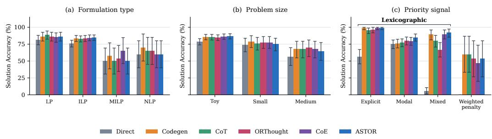  
Figure 6: Hard-constraint accuracy by (a) formulation type and (b) problem size, and (c) softconstraint accuracy by priority signal. Whiskers show bootstrap 95% confidence intervals.

Figure 6 disaggregates the hard-constraint benchmarks by formulation type and problem size for hard constraints, and priority signal for soft constraints. Problem types are Linear Program (LP), Integer Linear Program (ILP), Mixed Integer Linear Program (MILP), and Nonlinear Program (NLP). Problem sizes toy, small, and medium are defined in Yang et al. [2026]. Priority is signaled by explicit, modal, or mixed markers for lexicographic formulations, and weighted penalty formulations are always explicit. ASTOR leads on ILPs and on toy problems, and a different baseline leads in each remaining category, and achieves the highest accuracy for every lexicographic signal, with its largest margins when priorities are modal or mixed. Codegen and CoT tie for the highest accuracy on weighted-penalty Nurse Rostering.

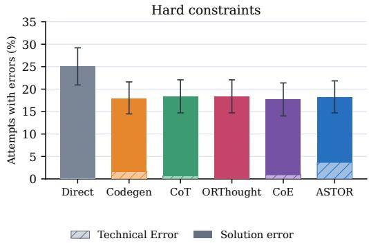  
Figure 7: Error rates on the hard-constraint benchmarks as percentages of all attempts. The unplotted remainder is correct. Whiskers show bootstrap 95% confidence intervals for the total error rate.  
Figure 7 reports error rates on the hard-constraint benchmarks. Every method except Direct has a similar total error rate.

## A.2 Constraint Satisfaction

Table 10: Average hard constraint satisfaction (%) over all instances on SoftOR.
<table><tr><td>Method</td><td>Nurse Rostering</td><td>COMPASS</td><td>Travel Planner</td><td>LexiBench</td></tr><tr><td>Direct</td><td>31.8</td><td>57.6</td><td>99.0</td><td>5.3</td></tr><tr><td>Codegen</td><td>100.0</td><td>100.0</td><td>96.3</td><td>100.0</td></tr><tr><td>CoT</td><td>100.0</td><td>96.5</td><td>96.4</td><td>96.0</td></tr><tr><td>ORThought</td><td>86.7</td><td>97.6</td><td>97.4</td><td>78.7</td></tr><tr><td>CoE</td><td>100.0</td><td>100.0</td><td>97.5</td><td>100.0</td></tr><tr><td>ASTOR (Ours)</td><td>100.0</td><td>100.0</td><td>98.8</td><td>100.0</td></tr></table>

ASTOR satisfies every hard constraint on COMPASS and LexiBench and is within about a point of the lead on TravelPlanner; on Nurse Rostering it ties Codegen, CoT, and CoE at 100% hard constraint satisfaction. More details on Nurse Rostering are available in Appendix F.

## A.3 Efficiency

We report recorded monetary cost from provider token-usage telemetry and observed cache hits. Cost per correct solution divides the total recorded cost by the number of exact-correct predictions. The top row of Figure 8 aggregates over all 790 evaluated problems and the bottom row restricts to the 355 SoftOR instances. Nurse Rostering costs use the new Gemini 3.8 Flash run; other benchmarks retain their original runs. Three Nurse Rostering API failures had no usage telemetry and are excluded from the recorded costs; budget reservations are not treated as measured charges.

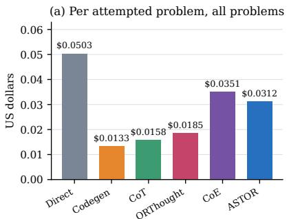

(b) Per correct solution, all problems  
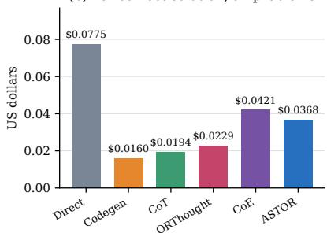

(c) Per correct solution, SoftOR  
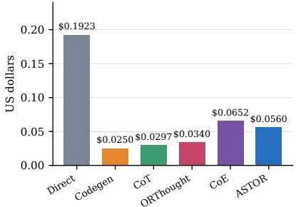  
Figure 8: Recorded monetary cost per attempted problem and per correct solution over (a, b) all evaluated problems and (c) SoftOR only. ASTOR uses provider-reported cached-input pricing.

## A.4 Ablation Studies

Figure 9 repeats the component ablations of Section 5.6 with the hard-constraint strata alongside the soft-constraint strata shown in the main text. Deterministic repair uses fixed rules in Python to fix local syntax errors in the model’s JSON output before parsing and compilation, without making another LLM call. Specifically, we use the JSON schema to correct misplaced closing braces and brackets and remove invalid labels on array elements, then check the repaired output’s structure and retention of the original strings and numbers before accepting it.

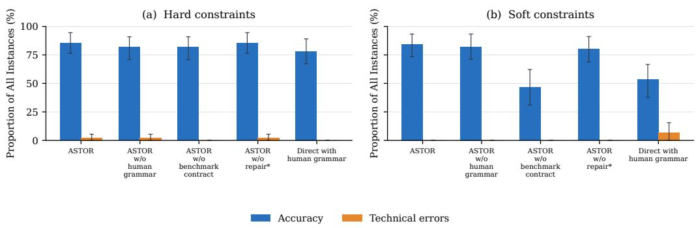  
Figure 9: ASTOR component ablation on (a) hard-constraint and (b) soft-constraint benchmarks. Blue bars indicate percent of formulations that ended in a correct solution, whereas orange bars indicate the percent of formulations that terminated in technical errors. Whiskers show bootstrap 95% confidence intervals.

On the hard-constraint strata, removing the benchmark contract lowers accuracy by under four percentage points, and removing deterministic repair changes nothing. The Direct + AST control (the Direct prompt with the ASTOR grammar prepended as a reasoning aid; see the ablation definitions in Appendix D) matches Direct exactly on both families, 78.2% on the hard-constraint instances and 53.3% on the soft-constraint instances, so the grammar helps only when its output is compiled and solved.

## B Worked Example

We use the following natural-language instance throughout. Blue marks the hard requirements and query, red marks the soft preferences.

A ward manager is scheduling Alice for an 8-hour Day shift on any of Monday through Friday. Wednesday is already an agreed fixed day off, and her contract requires her to work at least 16 hours this week. She strongly prefers to work Monday and Tuesday, and slightly prefers to work Thursday. The manager would like to minimize the number of hours Alice works. Which days should she work?

This appendix works the Nurse Rostering example through a compact view of the grammar, from declarations to three finished models.

## B.1 Simplified Grammar View

Figure 10 summarizes the compositional rules of an example grammar constructed for this problem. The complete grammar for ASTOR appears in Appendix C. A program is a block of declarations followed by a model, and a model is one objective together with a list of named constraints. Expressions are built from constants, symbols and indexed symbols, combined with arithmetic operators, a small set of functions, and aggregation over an index set. A formula either compares two expressions or joins other formulas with the usual connectives.

The objective is where the preferences are formalized, and it has three forms. Objective(feasibility) is a problem with nothing to optimize. Objective(sense, ⟨Expr⟩) is a single scalar objective, which is the form a weighted-penalty model takes, since its penalty terms are folded into that one expression. Objective(sense, ⟨Tier⟩,...) takes an ordered list of tiers, each carrying its own expression, and a lexicographic model uses that form instead. This lets an evaluator tell two formulations apart by looking at the tree, without going back to the natural language.

⟨Program⟩ ::= ⟨Declarations⟩ ⟨Model⟩   
⟨Declarations⟩ ::= Declarations(⟨Params⟩, ⟨Vars⟩)   
⟨Params⟩ ::= Parameters( name : ⟨Const⟩, . . . )   
⟨Vars⟩ ::= Variables(⟨Domain⟩, name, . . . )   
⟨Domain⟩ ::= {0, 1} | Z | R | [low, hi]   
⟨Model⟩ ::= Model(⟨Objective⟩, ⟨Constraints⟩)   
⟨Objective⟩ ::= Objective(feasibility)   
| Objective(sense, ⟨Expr⟩)   
| Objective(sense, ⟨Tier⟩, . . . )   
⟨Tier⟩ ::= priority(k, ⟨Expr⟩)   
⟨Constraints⟩ ::= Constraints(⟨Constraint⟩, . . . )   
⟨Constraint⟩ ::= name(⟨Formula⟩)   
⟨Formula⟩ ::= ⟨Expr⟩ ▷◁ ⟨Expr⟩   
| ¬P | P ∧ Q | P ∨ Q | P ⇒ Q | P ⇔ Q   
⟨Expr⟩ ::= ⟨Term⟩ | ⟨Expr⟩ ⊕ ⟨Expr⟩   
| f(⟨Expr⟩, . . .) | agg <sub>v∈S</sub> ⟨Expr⟩   
⟨Term⟩ ::= ⟨Const⟩ | ⟨Sym⟩ | ⟨Sym⟩[⟨Index⟩, . . .]   
sense ∈ {maximize, minimize}; ▷◁ ∈ {≤, <, =, ̸=, >, ≥}; ⊕ ∈ {+, −, ×, ∇·,ˆ}; f ∈ {abs, min, max, exp, log,   
sqrt}; agg ∈ {P, Q, min, max, count}; P, Q range over ⟨Formula⟩.  
Figure 10: An example grammar, which generates optimization problems that have hard constraints, weighted-penalty objectives, or lexicographic preferences. Preferences are syntactically encoded.

## B.2 Declarations

Figure 11 shows the declarations for the example. Parameters hold the numbers taken from the instance, here the shift length and the contract minimum. Variables hold the decisions, one binary per day of the planning period.

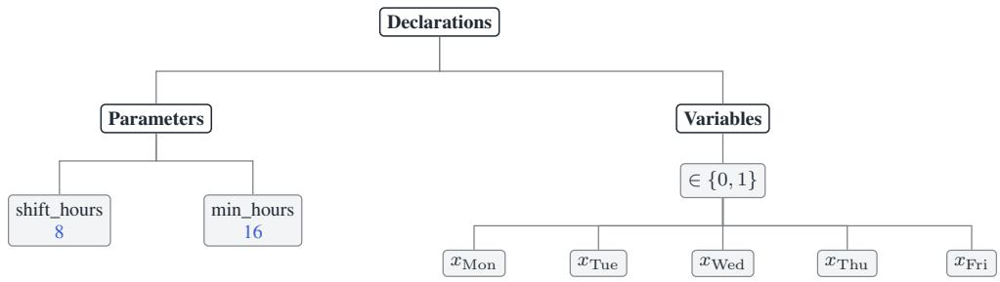  
Figure 11: Declaration subtree for the nurse example, shared by all three models of Figure 12. Declares numeric data and variable names to be used in AST construction.

## B.3 Three Formulations

Figure 12 sets the three formulations side by side, each AST above the model it compiles to. The declarations and the constraint subtree are the same in all three, and only the objective branch differs.

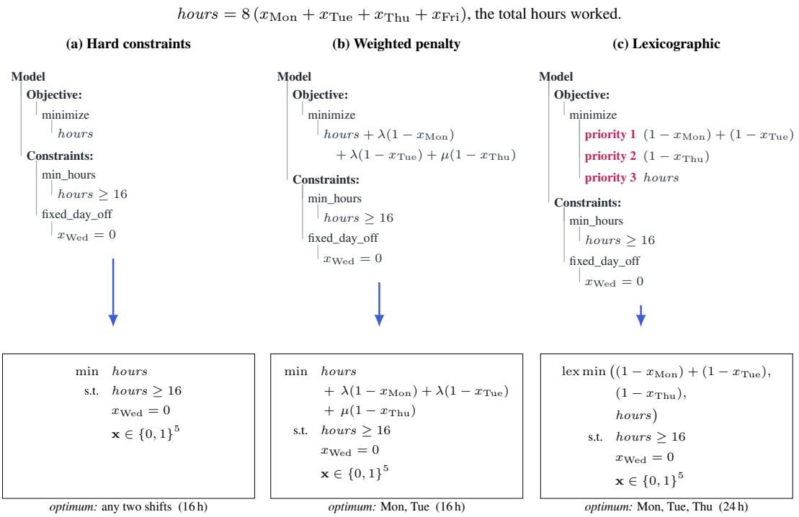  
Figure 12: Different formulations of the nurse problem. Formulation (a) contains no preferences, (b) penalizes violations by scalar terms $\lambda , \mu$ chosen by an author, and (c) tiers the preferences based on lexicographic strength, with the time objective as the final tie-breaker.

The optima differ as well. With no preferences stated, any two shifts that avoid Wednesday meet the 16-hour minimum, so the answer is not unique. Under the weighted objective at $\lambda = 3$ and $\mu = 1$ Alice works Monday and Tuesday: satisfying the Thursday request would cost eight more hours to relieve one point of penalty, so the solver drops it. Under the lexicographic objective she works Monday, Tuesday and Thursday, because hours only break ties among rosters that already satisfy both request levels, and no saving in hours can outrank a request at a higher level.

A weighted model will trade a preference away once the objective pays enough for it, and a lexicographic model will not.

## B.4 Literal Compiler Trace

## LexiBench: habitat crew-days

Problem statement. Divide the season’s habitat-restoration crew-days among erosion control, wetland repair, native planting, and trail improvement. The wish we would surrender last is that at least 21 crew-days go jointly to erosion control and wetland repair; the others together do not equal it. The season allows 29 crew-days in total, and weather rules out any extension. Ignore how the days were split last season. Those remaining wishes are tied with one another and rank below it: every one of the 29 available crew-days is put to use; at least 10 crew-days go to native planting; and at least 10 crew-days go to trail improvement. Each site must receive at least one crew-day. Allocations must be nonnegative whole numbers. Determine the allocation.

## Instance data.

<table><tr><td>Restoration category</td><td>Unit cost</td><td></td><td></td></tr><tr><td>Erosion control</td><td>13</td><td>Available crew-days</td><td>29</td></tr><tr><td>Wetland repair</td><td>10</td><td>Minimum per category</td><td>1</td></tr><tr><td>Native planting</td><td>12</td><td></td><td></td></tr><tr><td>Trail improvement</td><td>9</td><td></td><td></td></tr></table>

Benchmark stratum. Constructive; direct priority dominance; easy.

The model received this statement with a value-free data contract and returned an AST serialized as JSON. The reader view below is rendered directly from that JSON and preserves every declaration, hard constraint, soft constraint, priority, preference relation, objective, and unresolved item. It suppresses only serialization scaffolding such as repeated node-type labels, null defaults, expression wrappers, descriptions, and copied source text. The JSON Schema and benchmark instance are available in the anonymous repository. The instance data were bound only after formulation.

## Reader view of the model-produced AST for LexiBench habitat crew-days Reader vlew of the model-p -davs

```markdown
Model
|-- Declarations
|-- Set: Categories
|-- Parameters
|-- available_units : integer [crew-days]
|-- category_is_erosion_control[Categories] : integer
|-- category_is_native_planting[Categories] : integer
|-- category_is_trail_improvement[Categories] : integer
|-- category_is_wetland_repair[Categories] : integer
|-- minimum_units_per_category : integer [crew-days]
|-- unit_cost[Categories] : real
|-- Variable: allocated_units[Categories] : nonnegative integer [crew-days]
Hard constraints
|-- total_available_units_limit
|-- SUM(c in Categories) allocated_units[c] <= available_units
|-- min_allocation_per_category
|-- FOR ALL c: allocated_units[c] >= minimum_units_per_category
|-- Soft constraints [aggregation: lexicographic]
|-- Priority 2: prefer_erosion_and_wetland_min_21
| |-- erosion allocation + wetland allocation >= 21
|-- Priority 1 (three tied preferences)
|-- SUM(c in Categories) allocated_units[c] = available_units
|-- native planting allocation >= 10
|-- trail improvement allocation >= 10
|-- Other: preference_relations=[]; objective=feasibility; unresolved=[]
```

## Deterministic continuation

Let $x _ { E } , x _ { W } , x _ { N } , x _ { T }$ denote crew-days assigned to erosion control, wetland repair, native planting, and trail improvement. The compiler produced

$$
x _ { c } \in \mathbb { Z } _ { \geq 0 } , \qquad \sum _ { c } x _ { c } \leq 2 9 , \qquad x _ { c } \geq 1 \quad ( c \in \{ E , W , N , T \} ) ,
$$

with the lexicographic satisfaction vector

$$
\mathrm { l e x m a x } \left( \mathbb { 1 } [ x _ { E } + x _ { W } \ge 2 1 ] , \ \mathbb { 1 } \left[ \sum _ { c } x _ { c } = 2 9 \right] + \mathbb { 1 } [ x _ { N } \ge 1 0 ] + \mathbb { 1 } [ x _ { T } \ge 1 0 ] \right) .
$$

Gurobi returned $( x _ { E } , x _ { W } , x _ { N } , x _ { T } ) = ( 1 , 2 6 , 1 , 1 )$ . Its tier vector (1, 1) matches the gold tier vector exactly.

## C Formal Grammar and Its Adequacy

## C.1 Complete Grammar

The complete abstract-syntax grammar used by ASTOR is given here. The suffixes X\*, X?, X{n}, and X{n,} denote, respectively, zero or more occurrences, an optional occurrence, exactly n occurrences, and at least n occurrences. We read G as a typed grammar: symbol occurrences resolve to declarations, operators are applied to arguments of the displayed sorts, penalty weights and violations are nonnegative, and preference relations determine ordered priority tiers, allowing ties.

## Program and data declarations

Program   
declarations : Declaration\*   
objective : Objective   
Declaration ::=   
Set | Parameter | Variable I Piecewise   
| Constraint | SoftConstraint |   
PreferenceRelation   
Set   
name : Name   
elements : SetValue\*?   
Parameter   
name : Name   
domain : ParameterDomain?   
indexed\_by : Name\*   
value\_ast : Constant?   
values : ValueTable?   
units : Text?

## Decision declarations

Variable   
name : Name   
domain : Domain   
indexed\_by : Name\*   
integrality\_basis : Basis?   
units : Text?   
lower\_bound : Expr?   
upper\_bound : Expr?   
categories : SetValue\*?   
Piecewise   
name : Name   
input : Expr   
breakpoints : Number{2,}   
values : Number\*?   
marginal\_rates : Number\*?

## Constraints, preferences, and objectives

Constraint   
name : Name   
body : Formula   
source\_text : Text?   
SoftConstraint   
name : Name   
condition : Formula   
guard : Formula?   
aggregation : Aggregation?   
weight : Constant?   
priority : Constant?   
violation : Expr?   
source\_text : Text?

PreferenceRelation   
relation : Relation   
left : Name | Expr   
right : Name | Expr   
source\_text : Text?   
Objective   
sense : minimize | maximize | feasibility   
expression : Expr?

## Decision-dependent formulas and expressions

Formula ::=   
comparison (operator: CompareOp, left: Expr, right: Expr)   
| logical (operator: and|or, arguments: Formula{2,})   
| logical (operator: not, arguments: Formula{1})   
| logical (operator: implies|iff|xor, arguments: Formula{2})   
| quantifier (quantifier: forall|exists, variable: Name, domain: Name,   
condition: DataFormula?, body: Formula)   
| membership (element: DataExpr, collection: DataExpr, negated: Bool?)   
Expr ::=   
constant (value: Value, value\_type: ValueType?)   
| symbol (name: Name)   
| indexed\_symbol (name: Name, indices: Expr\*)   
| operation (operator: Op, arguments: Expr\*,   
order: NormOrder?)   
| operation (operator: if,   
arguments: (Formula, Expr, Expr))   
| aggregation (operator: sum|product|min|max|count|average,   
index: Name, domain: Name,   
condition: DataFormula?, expression: Expr)

## Data-only formulas and expressions

DataFormula ::=   
comparison (operator: CompareOp, left: DataExpr, right: DataExpr)   
| logical (operator: and|or, arguments: DataFormula{2,})   
| logical (operator: not, arguments: DataFormula{1})   
| logical (operator: implies|iff|xor, arguments: DataFormula{2})   
| membership (element: DataExpr, collection: DataExpr, negated: Bool?)   
DataExpr ::=   
constant (value: Value, value\_type: ValueType?)   
| symbol (name: DataName)   
| indexed\_symbol (name: ParameterName, indices: DataExpr\*)   
| operation (operator: Op, arguments: DataExpr\*,   
order: NormOrder?)   
| operation (operator: if,   
arguments: (DataFormula, DataExpr, DataExpr))   
| aggregation (operator: sum|product|min|max|count|average,   
index: Name, domain: Name,   
condition: DataFormula?, expression: DataExpr)

## Domains and terminal symbols

Domain ::= binary | integer | nonnegative\_integer | real   
| nonnegative\_real | bounded\_integer | bounded\_real   
| categorical   
ParameterDomain ::= integer | real | boolean | categorical   
Basis ::= explicitly\_stated\_lp | explicitly\_stated\_integer   
| indivisible\_unit | divisible\_quantity | convention\_default   
Aggregation ::= lexicographic | weighted\_sum   
Relation ::= prefer | higher\_priority   
CompareOp ::= le | ge | eq | lt | gt | neq   
Op ::= add | subtract | multiply | divide | negate | power   
| sqrt | exp | log | sin | cos | tan | abs   
| min | max | norm   
NormOrder ::= 0 | 1 | 2 | inf   
ValueType ::= integer | real | rational | boolean | string   
Value ::= Number | Text | Bool   
Constant ::= constant (value: Value, value\_type: ValueType?)

ValueTable ::= { Text : Value }   
SetValue ::= Number | Text   
DataName ::= SetName | ParameterName | IndexName   
SetName ::= Name   
ParameterName ::= Name   
IndexName ::= Name   
Name ::= identifier

## C.2 Soft-constraint Specifications

Soft-constraint semantics. Each soft constraint has a condition: a true-or-false statement describing the desired outcome, such as “the hotel costs at most \$100.” An optional guard is another true-or-false statement that determines whether the preference applies, such as “the hotel is selected.” Without a guard, the preference always applies.

For a solution x, the penalty v<sub>i</sub>(x) is zero if the guard is false. Otherwise, it is zero if the condition is true and one if it is false. In weighted\_sum mode, an optional violation expression can specify the penalty instead. This expression must be nonnegative and zero exactly when the condition is true.

All soft constraints must specify the same aggregation mode. For weighted\_sum, each must supply a nonnegative weight that multiplies its penalty. Priorities are unused. For lexicographic, the objective counts violated preferences within each tier, with each violated preference contributing one regardless of its weight or violation expression. Tiers with larger priorities are optimized first. Every constraint’s tier must be specified explicitly or fully determined by preference relations. No default priority is assumed.

## C.3 Representational Adequacy

Let O be the class of finite optimization problems over binary, integer, real, bounded, or finite categorical decision domains. Hard constraints and objectives are formed by finite compositions of constants, indexed quantities, arithmetic and elementary functions, norms, conditionals, piecewiselinear functions, finite aggregations, comparisons, Boolean connectives, and quantification over finite index sets. A problem may additionally contain nonnegative soft-constraint violations combined by either weighted penalties or a finite lexicographic priority ordering.

A sort is the type of value represented by a node, such as an integer, real number, Boolean value, string, or element of a declared finite set. An AST is well-sorted when every operation is applied to inputs of the appropriate types. For example, arithmetic operations require numeric inputs, a comparison of two numeric expressions produces a Boolean-valued condition, and a quantified index must range over a declared finite set. An AST is well-formed if its construction does not contradict the rules of G and if all references and indices are valid, expressions and aggregations are defined wherever evaluated, piecewise constructions are unambiguous, and priority annotations and relations determine ordered tiers for all soft constraints, allowing ties. A partial ordering that leaves a constraint’s tier unresolved is insufficient.

Let A be the set of well-formed, well-sorted ASTs generated by G. The grammar defines a map

$$
[ [ \cdot ] ] : \mathcal { A } \longrightarrow \mathcal { O } .
$$

For an AST A, A is the optimization problem described by A: its decision domain, feasible set, and ordering of feasible solutions. This map is evaluated recursively, with each node applying its specified operation to the meanings of its children.

We consider two optimization problems equivalent if they have the same decision domain and feasible set and rank all feasible solutions in the same order. For this representation, adequacy means that the semantic image of G is exactly O: the grammar represents all and only the problems in the target class [Cheney et al., 2012, Otto, 2013]. The following results prove the two set inclusions.

Lemma C.1 (Representation of expressions and conditions). Every Expr generated by G is a wellsorted term, and every Formula generated by G evaluates to either true or false. Conversely, every expression and condition allowed in a problem in O can be represented by an Expr or Formula in G. The original and represented versions return the same value or truth value for every valid assignment ofthe decision variables and data.

Proof. For the forward direction, we use induction over the nodes of a well-formed AST generated by ${ \dot { G } } ,$ , proceeding from the leaves to the root.

Base case. A leaf is a constant, symbol, or indexed\_symbol. A constant has its stated value and sort; a symbol or indexed\_symbol inherits the sort of its declaration. Since G requires symbols and indices to agree with their declarations, every leaf is well-sorted.

Inductive step. The inductive hypothesis is that every child Expr or DataExpr is well-sorted and every child Formula or DataFormula is Boolean-valued. Proceeding to the parent, an operation applies a typed operator to compatible expressions; a conditional selects between compatible branches using a Boolean condition; and an aggregation combines well-sorted values over a declared finite domain. A comparison, membership, logical, or quantifier node returns a Boolean value when applied to children of the required sorts. By the inductive hypothesis and the typing requirements of G, the parent is therefore well-sorted if it is an expression and Boolean-valued if it is a formula. This completes the induction.

For the converse direction, we use induction over the nodes of any expression or condition allowed in a problem in ${ \mathcal { O } } .$

Base case. A leaf is a constant, scalar quantity, or indexed quantity. It is represented by a constant, symbol, or indexed\_symbol node, respectively, with the same value and sort.

Inductive step. The inductive hypothesis is that every child has a representation in $G$ returning the same value or truth value on every valid assignment. Proceeding to the parent, arithmetic and elementary functions, norms, and conditionals are represented by operation; finite aggregations by aggregation; piecewise-linear expressions by Piecewise; comparisons and membership conditions by their corresponding Formula productions; Boolean combinations by logical; and finite universal or existential conditions by quantifier. Data-only constructions use the corresponding DataExpr and DataFormula productions. By the inductive hypothesis, the represented children agree with the original children; because the parent applies the same operation, it also returns the same value or truth value. This completes the induction. □

Theorem C.1 (Well-definedness). For every $A \in { \mathcal { A } } ,$

$$
\mathbb { I } { \mathbb { I } } \in { \mathcal { O } } .
$$

Proof. Fix $A \in { \mathcal { A } }$ . We verify each condition in the definition of $\mathcal { O }$

Decision domain. The Program production contains finitely many declarations and one Objective. Its Set declarations define finite index sets, and its Parameter declarations define fixed data. Each Variable declaration selects one of the permitted domains in Domain. Since there are finitely many variables, these declarations determine a finitely presented decision domain

$$
D _ { A } = D _ { 1 } \times \cdot \cdot \cdot \times D _ { n } ,
$$

where every $D _ { i }$ is binary, integer, real, bounded, or finite categorical. Each Piecewise declaration has finitely many breakpoints and therefore defines a finitely presented piecewise-linear function.

Feasible set. Let $C _ { 1 } , \ldots , C _ { q }$ be the Constraint declarations in A. Each $C _ { i }$ contains a Formula; by Lemma C.1, this formula returns a truth value for every valid $x \in D _ { A }$ . Let $h _ { j } ( x )$ denote that value. The hard constraints therefore define the feasible set

$$
F _ { A } = \{ x \in D _ { A } : h _ { j } ( x ) = { \mathrm { t r u e ~ f o r ~ e v e r y ~ } } j = 1 , \ldots , q \} .
$$

The same lemma ensures that each $h _ { j }$ is constructed only from the expressions and conditions permitted in O.

Base objective. If the Objective contains an expression, Lemma C.1 implies that it defines a scalar function $f _ { 0 }$ on $D _ { A }$ . To express every objective as a minimization ordering, define

$$
\bar { f } _ { 0 } ( x ) = \left\{ \begin{array} { l l } { f _ { 0 } ( x ) , } & { \mathrm { i f ~ t h e ~ s e n s e ~ i s ~ m i n i m i z e , } } \\ { - f _ { 0 } ( x ) , } & { \mathrm { i f ~ t h e ~ s e n s e ~ i s ~ m a x i m i z e , } } \\ { 0 , } & { \mathrm { i f ~ t h e ~ s e n s e ~ i s ~ f e a s i b i l i t y } } \end{array} \right.
$$

Thus, $\bar { f } _ { 0 }$ induces exactly the ordering specified by the Objective.

Soft constraints. Let $S _ { 1 } , \ldots , S _ { m }$ be the SoftConstraint declarations. By Lemma C.1, each condition and guard is Boolean-valued and each explicit violation is a well-sorted expression. Under the interpretation of SoftConstraint described above, these fields define a nonnegative violation function $v _ { i }$ on $D _ { A }$

If the aggregation mode is weighted\_sum, well-formedness supplies a nonnegative weight $w _ { i }$ for each $v _ { i }$ . The program orders feasible solutions by the scalar function

$$
\bar { f } _ { 0 } ( x ) + \sum _ { i = 1 } ^ { m } w _ { i } v _ { i } ( x ) ,
$$

which is a weighted-penalty objective of the form permitted in $\mathcal { O }$

If the aggregation mode is lexicographic, the priority fields and PreferenceRelation declarations place the finitely many soft constraints into finitely many consistently ordered levels. Number these levels from most to least important and define

$$
V _ { k } ( x ) = \sum _ { i : \mathrm { P r i o r i t y } ( i ) = k } v _ { i } ( x ) .
$$

The program then orders feasible solutions lexicographically by

$$
\bigl ( V _ { 1 } ( x ) , \ldots , V _ { K } ( x ) , \bar { f } _ { 0 } ( x ) \bigr ) ,
$$

which is a finite lexicographic objective of the form permitted in O. If A has no soft constraints, its ordering is determined by $\bar { f } _ { 0 }$ alone.

Therefore, A defines a finitely presented problem with an admissible decision domain, a feasible set defined by permitted conditions, and a base, weighted-penalty, or finite lexicographic objective. Hence,

$$
\mathbb { I } { \mathbb { I } } \in { \mathcal { O } } .
$$

□

Theorem C.2 (Expressive completeness). For every $O \in { \mathcal { O } } _ { : }$ , there exists $A \in { \mathcal { A } }$ such that

$$
\mathbb { I } A \mathbb { I } = O .
$$

Proof. Fix $O \in \mathcal { O }$ . We construct an AST $A \in { \mathcal { A } }$ and show that it represents the same optimization problem as O.

Decision domain. Because O is finitely presented, it contains finitely many index domains, data quantities, decision quantities, and piecewise-linear functions. Represent each finite index domain by a Set declaration and each data quantity by a Parameter declaration with the same value and domain. Represent each decision quantity by a Variable declaration with the same domain, indices, and bounds. Represent each piecewise-linear function by a Piecewise declaration with the same input, breakpoints, and values or marginal rates. These declarations reproduce the decision domain $D _ { O }$ of O.

Feasible set. Let $h _ { 1 } , \ldots , h _ { q }$ be the hard constraints of O. By Lemma C.1, each $h _ { j }$ has a Formula representation $\widehat { h } _ { j }$ that returns the same truth value as $h _ { j }$ for every valid assignment. Place each $\widehat { h } _ { j }$ in a Constraint declaration. The resulting constraints define

$$
\{ \boldsymbol { x } \in D _ { O } : \widehat { h } _ { j } ( \boldsymbol { x } ) = \mathrm { t r u e ~ f o r ~ e v e r y ~ } j \} = \{ \boldsymbol { x } \in D _ { O } : h _ { j } ( \boldsymbol { x } ) = \mathrm { t r u e ~ f o r ~ e v e r y ~ } j \} ,
$$

so they reproduce the feasible set of $O$

Base objective. If O has a base objective $f _ { 0 } ,$ Lemma C.1 supplies an Expr that returns $f _ { 0 } ( x )$ for every valid assignment. Place this expression in an Objective with the same minimization or maximization sense as O. If O is a feasibility problem, use feasibility with no objective expression. The resulting Objective therefore reproduces the base ordering of $O$

Soft constraints. For each soft constraint $i ,$ use Lemma C.1 to represent its satisfaction condition by a Formula and its nonnegative violation function $v _ { i }$ by an Expr. Place these representations in the condition and violation fields of a SoftConstraint declaration.

If O uses weighted penalties, set aggregation to weighted\_sum and place the corresponding nonnegative coefficient $w _ { i }$ in weight. The resulting declarations reproduce the objective

$$
\bar { f } _ { 0 } ( x ) + \sum _ { i } w _ { i } v _ { i } ( x ) .
$$

If O uses lexicographic priorities, set aggregation to lexicographic and place the level of each soft constraint in priority. When preference relations fully determine the ordered tiers, encode the ordering with PreferenceRelation declarations. Otherwise, specify the tiers explicitly in priority. These declarations reproduce the ordered objective vector

$$
\bigl ( V _ { 1 } ( x ) , \ldots , V _ { K } ( x ) , \bar { f } _ { 0 } ( x ) \bigr ) , \qquad V _ { k } ( x ) = \sum _ { \substack { i : \mathrm { P r i o r i t y } ( i ) = k } } v _ { i } ( x ) .
$$

Assembly. Collect the constructed declarations and objective in a Program. All components use productions of G, and their types, domains, and aggregation fields agree with their declarations; therefore, the resulting AST A belongs to A. Its declarations reproduce the decision domain of O, its hard constraints reproduce the feasible set of O, and its objective and soft constraints reproduce the ordering of feasible solutions in O. Under the stated notion of equivalence,

$$
\mathbb { I } A \mathbb { I } = O .
$$

□

Corollary C.1 (Representational adequacy). The semantic image of G is exactly O:

$$
\left\{ \left[ A \right] : A \in \mathcal { A } \right\} = \mathcal { O } .
$$

Proof. Theorem C.1 gives the inclusion from left to right, and Theorem C.2 gives the reverse inclusion. □

## D Prompts and Inference Protocol

The following are the exact prompt templates used in the reported comparison. Text in double braces is replaced deterministically before the request is sent.

## D.1 ASTOR

AST prompt template   
You are an expert in mathematical optimization. Your task is to formalize a   
natural-language optimization problem as an optimization model.   
You will be given a formal grammar that generates well-formed optimization   
models. Using this grammar, construct an abstract syntax tree representing the   
model the problem describes.   
The problem may contain hard constraints, which   
must always be satisfied, and soft constraints, which may be violated. It is   
your job to determine the hardness or strength of each constraint, which may   
be indicated by modal words of varied strength or by explicit comparison. For   
problems with soft constraints, decide whether the optimization is   
lexicographic or uses a weighted-sum penalty objective.   
Here is the formal grammar:   
{{grammar}}   
The abstract syntax tree is serialized as JSON. You must strictly obey this   
schema: it is parsed deterministically into solver code, and a response that   
deviates from it is discarded unread.

{{ast\_json\_schema}}   
TASK SEMANTICS:   
{{benchmark\_semantics\_contract}}   
BENCHMARK COMPATIBILITY CONTRACT:   
{{benchmark\_compatibility\_contract}}   
STEP 1 –- Declare every symbol. Classify each as exactly one of:   
A = set: a collection the problem indexes over ("the plants", "each product")   
B = parameter: fixed data the optimizer cannot change (costs, capacities, demands)   
C = decision variable: a quantity the optimizer chooses (how much to ship, whether to open)   
STEP 2 –- Express every requirement, preference, and objective in the appropriate prescribed form   
within   
the serialized AST JSON, using ONLY the symbols declared in Step 1.   
Do not invent or change problem information.   
End your response with the complete serialized AST in a single ‘‘‘json fenced   
block: exactly one, containing the entire JSON object. Only that block is   
parsed.

The request appends the instance using the exact boundary

AST request assembly   
{{rendered\_ast\_prompt}}   
PROBLEM:   
{{problem\_text\_and\_authoritative\_data}}

Table 11: Deterministic substitutions in the AST prompt.
<table><tr><td rowspan=1 colspan=1>Placeholder</td><td rowspan=1 colspan=1>Source</td></tr><tr><td rowspan=1 colspan=1>grammar</td><td rowspan=1 colspan=1>The grammar reproduced in Appendix C, inserted verbatim fromthe artifact at runtime.</td></tr><tr><td rowspan=1 colspan=1>ast_json_schema</td><td rowspan=1 colspan=1>The strict JSON response schema, inserted in full at runtime andretained in the artifact rather than repeated in print.</td></tr><tr><td rowspan=1 colspan=1>benchmark_semantics_contract</td><td rowspan=1 colspan=1>The benchmark-specific scoring semantics reproduced below.</td></tr><tr><td rowspan=1 colspan=1>benchmark_compatibility_contract</td><td rowspan=1 colspan=1>The benchmark-specific output interface reproduced below.</td></tr></table>

## D.2 Direct

Direct prompt template   
You are an expert in mathematical optimization. Your task is to formalize a   
natural-language optimization problem as an optimization model.   
Solve the optimization problem yourself. Use only the supplied problem   
and authoritative instance data. Do not defer to a solver.   
The problem may contain hard constraints, which must always be satisfied, and   
soft constraints, which may be violated. It is your job to determine the   
hardness or strength of each constraint, which may be indicated by modal   
words of varied strength or by explicit comparison. For problems with soft   
constraints, decide whether the optimization is lexicographic or uses a   
weighted-sum penalty objective.   
Your response must conform exactly to this JSON Schema:   
{{direct\_output\_schema}}   
When status is optimal, report a numeric objective\_value and one concrete   
optimal assignment in variable\_values. When status is infeasible or unbounded,   
use null objective\_value and an empty variable\_values object.   
{{benchmark\_semantics\_contract}}

The inserted schema is a closed JSON object with exactly three fields: status in {optimal, infeasible, unbounded}, a numeric-or-null objective\_value, and a variable\_values object whose values are numeric.

## D.3 Codegen

Codegen prompt template   
You are an expert in mathematical optimization. Your task is to formalize a   
natural-language optimization problem as an optimization model.   
Write one complete Python program that formulates and solves the supplied   
optimization problem with gurobipy. Do not solve in prose.   
The problem may contain hard constraints, which must always be satisfied, and   
soft constraints, which may be violated. It is your job to determine the   
hardness or strength of each constraint, which may be indicated by modal   
words of varied strength or by explicit comparison. For problems with soft   
constraints, decide whether the optimization is lexicographic or uses a   
weighted-sum penalty objective.   
INSTANCE\_DATA CONTRACT   
{{instance\_data\_contract}}   
TASK SEMANTICS   
{{benchmark\_semantics\_contract}}   
BENCHMARK COMPATIBILITY CONTRACT   
{{benchmark\_compatibility\_contract}}   
The primary Gurobi model object must be named ‘model‘; call model.optimize().   
End by copying this reporting protocol verbatim and unchanged.   
\_STATUS\_NAMES = {   
GRB.OPTIMAL: "optimal",   
GRB.INFEASIBLE: "infeasible",   
GRB.UNBOUNDED: "unbounded",   
GRB.INF\_OR\_UNBD: "infeasible\_or\_unbounded",   
}   
if model.Status == GRB.INF\_OR\_UNBD:   
model.Params.DualReductions = 0   
model.reset()   
model.optimize()   
print(f"STATUS = {\_STATUS\_NAMES.get(model.Status, model.Status)}")   
if model.Status == GRB.OPTIMAL:   
print(f"OBJECTIVE = {model.ObjVal}")   
for \_variable in model.getVars():   
print(f"VARIABLE {\_variable.VarName} = {\_variable.X}")   
Do not invent or change problem information. End your response with the complete program in a single   
‘‘‘python fenced   
block: exactly one. Only that block is parsed.   
PROBLEM   
{{problem\_text}}

## D.4 Chain-of-Thought

CoT prompt template   
The problem description is as follows:   
{{problem\_text}}   
Please provide its mathematical model and Gurobipy code to solve this problem. The code you return   
should be a callable function whose parameters have default values extracted from the problem,

and whose return value is the optimal objective function value of the model (if it exists),   
otherwise return None. Your response should include:   
‘‘‘model   
[Your Model]   
ccc   
‘‘‘python   
[Your Code]   
ccc   
Now, Let’s think step by step.   
{{instance data contract}}   
{{benchmark\_semantics\_contract}}   
{{benchmark\_compatibility\_contract}}   
{{reporting\_protocol}}

The CoT route uses the same reporting adapter as Codegen. The text inserted at reporting\_protocol begins with the following compiler adapter and is followed verbatim by the \_STATUS\_NAMES block in the Codegen prompt:

CoT compiler adapter   
Compiler adapter: although the upstream prompt describes a callable function, this project executes   
the returned Python block as a complete standalone program. Define the primary Gurobi model   
object at top level, name it ‘model‘, and call model.optimize().   
End the program by copying this reporting protocol verbatim and unchanged.

## D.5 ORThought and Chain-of-Experts

Both multi-agent baselines run from their official implementations, ORThought at commit 5293e248 of its public repository [Yang et al., 2026] and Chain-of-Experts at commit afb89bf6 [Xiao et al., 2024]. Their prompt prose is unchanged. Each agent prompt is followed by the same instance-data, task-semantics, and compatibility contracts that Codegen receives, and the prompt that emits the final program also carries the Codegen reporting protocol. ORThought runs its model agent once and then up to three execution-conditioned debug rounds, which see only technical execution errors. CoE runs the conductor over the seven upstream experts for three selections, then the reducer, with the optional reflection pass disabled. Both use the backbone, decoding settings, and execution limits of Table 12, so an ORThought attempt makes one to four LLM requests and a CoE attempt makes seven. The verbatim prompt files and adaptation notes are in the released code.

## D.6 Benchmark Contracts

Direct receives the task semantics only. ASTOR, Codegen, CoT, ORThought, and CoE also receive the route-specific compatibility text. These are the exact strings used for the reported benchmarks.

Hard-constraint benchmarks   
TASK SEMANTICS:   
Enforce every required choice with an equality or an activated lower bound; an upper bound alone is   
insufficient.   
AST AND CODE COMPATIBILITY:   
No benchmark-specific decision interface is required.

COMPASS   
TASK SEMANTICS:   
Select exactly one option. Report select[option\_id] = 1 for the chosen option, using the supplied id   
verbatim; omitted entries count as 0.   
AST COMPATIBILITY:   
Declare binary decision variable select indexed by [Options] and select exactly one option. Bind   
every option-dependent soft-condition index within its formula.   
CODE COMPATIBILITY:

Use Gurobi binary variables select[option] over Options and select exactly one option.

TravelPlanner   
TASK SEMANTICS:   
Select exactly one placement, one eligible transport option per leg, one eligible hotel per visited   
city, and one eligible restaurant per active meal slot; selected restaurants must be distinct.   
Evaluate preferences from most to least important; improvement on a less important preference   
cannot compensate for worsening a more important one, and consider total cost only afterward.   
Report the chosen plan as use\_placement[placement\_id], use\_transport[transport\_id], pick\_hotel[   
placement\_id,hotel\_id], and assign\_meal[meal\_slot\_id,restaurant\_id] entries set to 1, using   
supplied ids verbatim; omitted entries count as 0.   
AST COMPATIBILITY:   
Candidate \*\_ok and \*\_active parameters define eligibility.   
Use these binary decision variables exactly: use\_placement[Placements], use\_transport[   
TransportOptions], pick\_hotel[Placements,Hotels], and assign\_meal[MealSlots,Restaurants].   
CODE COMPATIBILITY:   
Candidate \*\_ok and \*\_active parameters define eligibility.   
Use these Gurobi binary variable families exactly: use\_placement[placement], use\_transport[option],   
pick\_hotel[placement,hotel], and assign\_meal[slot,restaurant].

## LexiBench

Enforce every required choice with an equality or an activated lower bound; an upper bound alone is insufficient. Evaluate preferences from most to least important: improvement on a less important preference cannot compensate for worsening a more important one, and apply any stated tie-break only afterward. Report exactly one indexed decision-variable family per supplied set, including every member with unselected members set to 0; report no auxiliary quantities.

## Nurse Rostering

Minimize the combined penalty for staffing-target deviations and unmet shift requests according to their stated severities. Report work[nurse,day,shift] = 1 for every worked shift, using supplied ids verbatim; omitted entries count as 0. Any numerical penalties you choose to use must be inferred from text and instantiated yourself. Never invent other problem data.

Declare binary decision variable work indexed by [Nurses,Days,Shifts], where 1 means the nurse works that shift on that day. Auxiliary variables may use arbitrary names.

Declare every set and parameter listed in the external data contract exactly once, using those exact names and index domains, with values provided in EXTERNAL DATA CONTRACT declared null. You must instantiate any penalty weights with numbers or expressions.

CODE COMPATIBULITY: Create work = model.addVars(nurses, days, shifts, vtype=GRB.BINARY, name="work"), where 1 means the nurse works that shift on that day. Auxiliary variables may use arbitrary names.

For schema-bearing AST instances other than Nurse Rostering, the following sentence is appended verbatim to the AST compatibility contract:

## External-data binding

Declare every set and parameter listed in the external data contract exactly once, using those exact names and index domains, with null external values.

The instance-data contract in Codegen and CoT states that INSTANCE\_DATA is a flat dictionary with no sets or parameters wrapper. For schema-bearing instances, sets are lists, indexed parameters use

string or comma-joined keys, and scalar parameters are bare numbers. For prose-only instances, the contract states verbatim: “INSTANCE\_DATA is an empty dict for this problem: every value you need is stated in the problem text itself.”

## D.7 Execution and Evaluation

ASTOR makes one LLM request. The output includes exactly one JSON block, repaired deterministically only when JSON syntax admits an unambiguous local correction, checked against the response schema and symbol table, and compiled deterministically to Gurobi. Direct is evaluated from its reported assignment; Codegen and CoT execute their single returned Python program, and ORThought and CoE execute the final program returned by their last agent. All routes then use the same benchmark oracle. The frozen runs contain 790 scored ASTOR attempts and no JSON-repair, error-retry, or rephrase API call artifacts; thus each scored ASTOR attempt used one LLM request.

For numeric objectives, a prediction is correct when the solver reports the gold status and the absolute error is at most max $\left\{ 1 0 ^ { - 4 } , 1 0 ^ { - 5 } \operatorname* { m a x } ( 1 , | z ^ { \star } | ) \right\}$ , where $z ^ { \star }$ is the gold-standard optimal objective value for the instance. Infeasible and unbounded gold outcomes require an exact status match. Soft benchmarks additionally decode the reported assignment, verify feasibility, and recompute the weighted penalty or lexicographic tier vector; a lexicographic result must match every tier and its final numeric tie-break.

Table 12: Frozen settings for the main experiment.
<table><tr><td>Setting</td><td>Value</td></tr><tr><td>Provider and model</td><td>Gemini 3.7 Flash; Nurse Rostering: Gemini 3.8 Flash</td></tr><tr><td>Decoding</td><td>Temperature 0; maximum output 32,768 tokens (65,536 for Nurse Rostering)</td></tr><tr><td>Thinking</td><td>Provider default, except Nurse Rostering, where every route used</td></tr><tr><td>Sampling</td><td>a 32,768-token thinking budget One repeat per instance; seed 0; blind prompt mode</td></tr><tr><td>External tools</td><td>Disabled</td></tr><tr><td>Structured output</td><td>Disabled; deterministic validation applied after generation</td></tr><tr><td>Repair</td><td>Deterministic JSON handling enabled; no additional repair re- quest observed</td></tr><tr><td>Execution</td><td>Gurobi 13+; 300-second generated-program and solver limits (3,600 seconds for Nurse Rostering)</td></tr><tr><td>Context cache</td><td>Enabled for reusable ASTOR context; provider-reported cache use priced as cached input</td></tr><tr><td>Pricing</td><td>USD per million tokens: input 0.75, cached input 0.075, output 3.75</td></tr></table>

Nurse Rostering is the one exception to the default thinking configuration. Under the provider default, all routes had substantial difficulty with Nurse Rostering, so the reported Nurse Rostering runs use a higher thinking budget and token limit for all six routes.

## D.8 Ablation Definitions

The component study changes one element of the full ASTOR condition at a time, holding the main experimental setup constant. Without benchmark contract replaces both benchmark-contract fields by None.; and without deterministic repair disables local JSON repair while leaving the model request unchanged. Direct + AST is a prompt-only control rather than an ASTOR variant: the Direct prompt with the ASTOR grammar of Appendix C prepended and an instruction to construct the abstract syntax tree of the model as an internal reasoning step before answering. Its output schema, benchmark contract, instance data, decoding settings, and evaluation are those of Direct, and nothing is compiled or solved.

## D.9 Frozen Ablation Sample

Following the cost-controlled analyses in NEMO, OptMATH, and SeaKR, which use restricted benchmark sets or sampled analysis subsets, we run ablations on a frozen subset of the main evaluation cohort [Song et al., 2026, Lu et al., 2025, Yao et al., 2025]. We use Hamilton largestremainder allocation to assign exactly 100 of the 790 instances proportionally across the eight reported benchmarks, yielding 55 hard-constraint and 45 soft-constraint instances [Balinski and Young, 2001]. With master seed 20260825, we sample uniformly without replacement within each stratum; the COMPASS allocation is further divided proportionally into ten hotel and one complex instance. The same IDs are used for every ablation condition, and no method output is used in their selection.

Table 13: Proportional allocation of the frozen ablation sample.
<table><tr><td>Benchmark</td><td>Cohort</td><td>Sample</td><td>Benchmark</td><td>Cohort</td><td>Sample</td></tr><tr><td>ComplexOR</td><td>18</td><td>2</td><td>COMPASS</td><td>85</td><td>11</td></tr><tr><td>IndustryOR</td><td>83</td><td>10</td><td>TravelPlanner</td><td>180</td><td>23</td></tr><tr><td>LogiOR</td><td>92</td><td>12</td><td>LexiBench</td><td>75</td><td>9</td></tr><tr><td>NLP4LP</td><td>242</td><td>31</td><td>Nurse Rostering</td><td>15</td><td>2</td></tr><tr><td>Hard total</td><td>435</td><td>55</td><td>Soft total</td><td>355</td><td>45</td></tr></table>

Frozen instance IDs. The identifiers of the 100 sampled instances, together with the per-stratum seeds, are provided as a machine-readable manifest in the anonymous repository.

## D.10 Artifact Index

The anonymous repository contains the complete grammar and its JSON schema, the exact prompt templates for every method and for the Direct + AST control, the frozen 100-instance ablation manifest, the contract-construction code, the parser, validator, and compiler, the benchmark adapters and evaluators together with the SoftOR data, the frozen experiment configurations, the per-problem result records of the 790-instance evaluation and of the backbone ablation, the reporting inputs from which every table and figure is regenerated, and the test suite.

## E Error Annotations and Discussion

For the error analysis in the main text, errors are classified as follows: a recorded parser, compiler, solver-execution, or other harness failure is technical. This includes a non-successful formulationconversion status. An attempt that passes the automatic evaluator is correct. Every remaining attempt is a solution error. Thus the error rates use all evaluated attempts as their denominator, and the unplotted remainder in Figures 3b and 7 is correct.

For example, ComplexOR prob\_007 under Codegen returned no Python fence and was labeled technical. ComplexOR prob\_008 under CoT executed normally but returned objective 10 against gold 7 and was labeled a solution error.

## E.1 Additional Error Analysis

## E.1.1 Soft Constraints

On LexiBench, ASTOR returns hard-feasible solutions on all 75 instances, but six have incorrect preference outcomes. Five of these use weighted-sum aggregation with a cost objective, while the sixth assigns higher priority to preferences that the request explicitly says to sacrifice first. Among the local constraints in the 180 evaluated TravelPlanner instances, ASTOR treats 17 of 124 preferences as hard constraints and 5 of 116 hard constraints as preferences. Treating a preference as hard wa harmless in 11 of the 17 cases, and treating a hard constraint as a preference never caused a failure.

ASTOR has 41 unsuccessful attempts on SoftOR: 27 on TravelPlanner, 6 on LexiBench, 7 on Nurse Rostering, and 1 on COMPASS. Of these, 1 is a technical failure and 40 are classified as solution errors by the evaluator. All seven unsuccessful Nurse Rostering attempts return hard-feasible rosters, with published-weight penalties between 1 and 4 points above the gold optimum. Lexicographic mistakes include wrong preference tiers or misdiagnosing a soft constraint as hard. Some examples: In the laptop instance, five equal wishes are followed by “the cheaper one wins”; ASTOR kept all five wishes but summed them with price, and satisfied three instead of four. In the service-vehicle instance, the text ranks wishes as “we would sooner run without X than without Y”; ASTOR reversed the order. In the makerspace instance, the top wish is “the one thing we will not trade”; ASTOR made it a hard constraint.

When a method gets a soft-constraint problem wrong, it is usually not because it missed a preference. It often treats one preference as too strict, or mixes the preferences together the wrong way. The baselines often end up minimizing cost instead of respecting the priority order, so a cheap plan wins even when it skips something more important. ASTOR’s mistakes go the other way: it sometimes turns a preference into a hard rule, or lets cost outweigh a preference it should have kept.

## E.1.2 Hard Constraints

On the hard-constraint benchmarks, a wrong answer is almost always a wrong objective value rather than a failed solve. A value better than gold means the method was able to achieve a lower value for a minimization objective or a higher value for a maximization objective than the annotated gold-standard optimum, and a value worse than gold means the opposite. Dropped constraints are the more common error for every method, by about two to one: Codegen returns 47 values better than gold and 22 worse, CoT 51 and 23, ORThought 55 and 22, CoE 46 and 24, and ASTOR 43 and 17, the fewest over-constrained formulations. Direct, which solves by hand, returns 71 better and 31 worse. Infeasible or unbounded formulations are rare, at most 3 per method.

When a method gets a hard-constraint problem wrong, it is almost always because it left out a constraint, not because it added one that was not there. That makes the solver report a better answer than is actually allowed. It is rare for a method to end up with an infeasible or over-constrained model instead. The grammar does not stop constraints from getting dropped, but when one does get dropped, it is more likely to show up as an obvious error instead of a wrong answer that looks right.

## F Benchmark Construction and Dataset Adaptations

This appendix records the rules used to turn the source datasets into natural-language optimization problems and to compute their gold answers. Table 14 summarizes the four SoftOR components, and the sections below detail each construction.

Table 14: SoftOR composition. Gold annotations are provided or verified by enumeration/solver optimization.
<table><tr><td>Component</td><td>n</td><td>Objective</td><td>Priority Signal</td><td>Gold construction</td></tr><tr><td>Nurse Rostering</td><td>15</td><td>Weighted penalty</td><td>Explicit</td><td>Published optimum</td></tr><tr><td>COMPASS</td><td>85</td><td>Lexicographic</td><td>Explicit</td><td>Enumeration</td></tr><tr><td>TravelPlanner</td><td>180</td><td>Lexicographic</td><td>Modal</td><td>Enumeration</td></tr><tr><td>LexiBench</td><td>75</td><td>Lexicographic</td><td>Mixed</td><td>Enumeration/Solver Code</td></tr></table>

The specific linguistic cues used by the first three datasets are depicted in Figure 13. These cues are further elaborated on in subsequent sections.

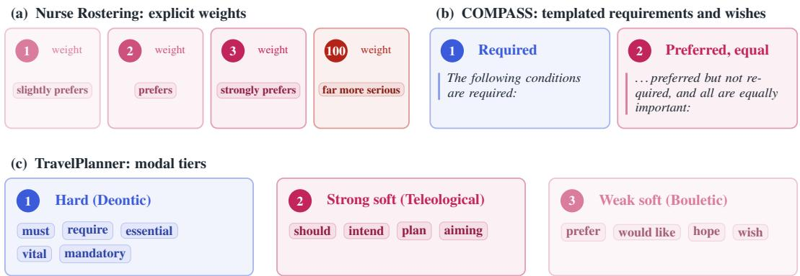  
Figure 13: Priority annotation in SoftOR instances constructed from source data.

## F.1 TravelPlanner Priority Rules

TravelPlanner uses modal language to distinguish requirements from preferences. We map deontic, teleological, and bouletic expressions to three optimization levels [Rubinstein et al., 2013, von Finte and Iatridou, 2008, Portner, 2009, Henning et al., 2022].

Table 15: TravelPlanner modal priority rules.
<table><tr><td rowspan=1 colspan=1>Tier</td><td rowspan=1 colspan=1>Interpretation</td><td rowspan=1 colspan=1>Common cues</td></tr><tr><td rowspan=1 colspan=1>1</td><td rowspan=1 colspan=1>Hard constraint</td><td rowspan=1 colspan=1>must, require, need, essential, mandatory, cannot, non-negotiable, ensure, will not, do not plan, avoid, not via</td></tr><tr><td rowspan=1 colspan=1>2</td><td rowspan=1 colspan=1>Strong preference</td><td rowspan=1 colspan=1>should, important, intend to, plan to, aiming for</td></tr><tr><td rowspan=1 colspan=1>3</td><td rowspan=1 colspan=1>Weak preference</td><td rowspan=1 colspan=1>prefer, would like, appreciate, hope, wish, interested in, ideally,open to, prefer not, rather not</td></tr></table>

Budget, party size, origin, destination, and the original TravelPlanner validity rules are always hard constraints. Other local constraints are classified using the modal cue in the same clause. Tier 1 takes precedence when several cues match, except that prefer not and rather not remain weak preferences. Unrecognized expressions default to Tier 3 and are flagged for review. This procedure recognizes a cue for all 180 instances used in our experiments.

Let x range over candidate plans, let $v _ { i } ( x ) \in \{ 0 , 1 \}$ indicate that plan x violates local constraint i, let Priorit $\prime ( i ) \in \{ 1 , 2 \}$ be its strong or weak tier (tiers 2 and 3 of Table 15; tier 1 becomes a hard constraint $h _ { j } )$ , and let $f _ { 0 } ( x )$ be the plan’s cost. The gold objective is

$$
\begin{array} { r l } { { \operatorname { l e x } } \underset { x } { \operatorname* { m i n } } } & { \left( V _ { 1 } ( x ) , V _ { 2 } ( x ) , f _ { 0 } ( x ) \right) } \\ { \mathrm { s . t . } } & { h _ { j } ( x ) \leq 0 \quad \forall j , \qquad V _ { k } ( x ) = \underset { i : \mathrm { P r i o r i t y } ( i ) = k } { \sum } v _ { i } ( x ) . } \end{array}
$$

A prediction is correct if it attains the same objective vector as the gold plan. It need not select the same plan when several plans are optimal.

The original TravelPlanner authors created 225 total instances, which together have 300 hard and soft constraints. We only use 180 of these instances (the subset they labeled "validation"), which together have 240 hard and soft constraints.

## F.2 LexiBench Construction

LexiBench contains five instances for every combination of three decision types and five preference structures, giving $3 \times 5 \times 5 = 7 5$ problems.

Table 16: LexiBench decision types.
<table><tr><td rowspan=1 colspan=1>Decision type</td><td rowspan=1 colspan=1>Decision space</td></tr><tr><td rowspan=1 colspan=1>Atomic</td><td rowspan=1 colspan=1>Select one of 12 supplied options.</td></tr><tr><td rowspan=1 colspan=1>Assembly</td><td rowspan=1 colspan=1>Select one element from each of three five-element sets, giving 125possible combinations.</td></tr><tr><td rowspan=1 colspan=1>Constructive</td><td rowspan=1 colspan=1>Optimize over integer decision variables and an implicitly definedfeasible region.</td></tr></table>

Table 17: LexiBench preference structures and difficulty labels.
<table><tr><td colspan="1" rowspan="1">Preference structure</td><td colspan="1" rowspan="1">Property tested</td><td colspan="1" rowspan="1">Difficulty</td></tr><tr><td colspan="1" rowspan="1">Direct priority dominance</td><td colspan="1" rowspan="1">One preference level dominates another.</td><td colspan="1" rowspan="1">Easy</td></tr><tr><td colspan="1" rowspan="1">Equal-level feature counting</td><td colspan="1" rowspan="1">All preferences have equal priority.</td><td colspan="1" rowspan="1">Easy</td></tr><tr><td colspan="1" rowspan="1">One-high-many-low</td><td colspan="1" rowspan="1">Several lower preferences cannot replace onehigher preference.</td><td colspan="1" rowspan="1">Medium</td></tr><tr><td colspan="1" rowspan="1">Deep ladder</td><td colspan="1" rowspan="1">Preferences form four or five ordered levels.</td><td colspan="1" rowspan="1">Hard</td></tr><tr><td colspan="1" rowspan="1">Sparse transitive ordering</td><td colspan="1" rowspan="1">The full order must be inferred from pairwisecomparisons.</td><td colspan="1" rowspan="1">Hard</td></tr></table>

LexiBench uses the same modal words in Table 15 to signal preferences, with the same tier structure. It also uses explicit words "more important," "less important," and "above all" to get more than three tiers.

Difficulty depends only on preference structure, not decision type. The benchmark therefore contains 30 easy, 15 medium, and 30 hard problems. These labels and the gold annotations are not shown to the model.

Let $v _ { i } ( x ) \in \{ 0 , 1 \}$ indicate that decision x violates preference i, let Priority(i) be its annotated level, ordered from highest to lowest, and let $f _ { 0 } ( x )$ be the stated tie-break objective, omitted when none is stated. Hard constraints $h _ { j }$ come from budget, capacity, or required attributes marked by deontic language in the natural language instance. The gold objective is

$$
\begin{array} { r l } { { \operatorname { l e x } \underset { x } { \operatorname* { m i n } } } } & { { } \left( V _ { 1 } ( x ) , \ldots , V _ { K } ( x ) , f _ { 0 } ( x ) \right) } \\ { \mathrm { s . t . } } & { { } h _ { j } ( x ) \leq 0 \quad \forall j , \qquad V _ { k } ( x ) = \underset { i : \mathrm { P r i o r i t y } ( i ) = k } { \sum } v _ { i } ( x ) . } \end{array}
$$

We certify each gold vector with Gurobi. We optimize the highest preference level, fix its optimal value, and repeat for each lower level. Any ordinary objective or tie-break is optimized last. Every stage must be optimal with zero MIP gap. A frozen manifest records the build seed, benchmark hash, solver version, and successful verification of all 75 problems.

## F.3 Nurse Rostering

We convert the published request weights into qualitative language.

Table 18: Nurse Rostering preference phrases.
<table><tr><td rowspan=1 colspan=1>Published weight</td><td rowspan=1 colspan=1>Natural-language phrase</td></tr><tr><td rowspan=1 colspan=1>1</td><td rowspan=1 colspan=1>slightly prefers</td></tr><tr><td rowspan=1 colspan=1>2</td><td rowspan=1 colspan=1>prefers</td></tr><tr><td rowspan=1 colspan=1>3</td><td rowspan=1 colspan=1>strongly prefers</td></tr><tr><td rowspan=1 colspan=1>100</td><td rowspan=1 colspan=1>far more serious</td></tr></table>

The included instances assign penalties of 100 to understaffing and 1 to overstaffing. We express this by stating that understaffing is “far more serious” than overstaffing. The numerical penalties are not shown to the model and are only used to evaluate the final roster produced by each method. If the route chooses to use weights in creating a roster, it must create its own weights. Once the roster is produced, we only use the original numerical penalties for evaluation, but they are never used in generating a solution.

Note that the request weights 1, 2, 3, 100 are the numbers chosen by the original authors of Nurse Rostering at SchedulingBenchmarks, but those numbers are not unique in determining the preference order. For example, 3, 14, 86, and 1592 would create the same ordering. As a result, for our newly constructed natural language instances which only signal request strength through linguistic cues, it is precisely the task of each method to be able to infer and instantiate numerical weights which reflect the strength of the given language. In the weighted penalty experiments we never show the original weights of 1, 2, 3, 100 to the models, and allow them to choose their own numbers or whether to use weights at all. After doing this, they will produce a nurse roster for this problem, which specifies which nurses work on which days using indicator decision variables. We only use the original weights 1, 2, 3, 100 after the decision is made for the sake of evaluation: to accrue the penalty of each roster by noting when the chosen decision violates staffing and shift preferences, and multiplying by their weights in accordance with the original SchedulingBenchmarks gold-standard calculation.

Let $x _ { n d s } ~ \in ~ \{ 0 , 1 \}$ indicate that nurse n works shift s on day d, and let $r _ { d s }$ be the number of nurses required on day d and shift s, as specified by the instance’s cover requirement for each $( d , s ) \in \{ \mathrm { \dot { d a y s } } \} \times \{ \mathrm { s h i f t s } \}$ . Each shift request i names a nurse, day, and shift $( n _ { i } , d _ { i } , s _ { i } )$ together with the phrase that carries its weight. The gold roster solves the weighted-penalty problem

$$
\begin{array} { r l } { \underset { x } { \mathrm { m i n } } } & { V _ { 1 } ( x ) + 2 V _ { 2 } ( x ) + 3 V _ { 3 } ( x ) + 1 0 0 U ( x ) + O ( x ) } \\ { \mathrm { s . t . } } & { h _ { j } ( x ) \leq 0 \quad \forall j , } \\ { \mathrm { U n d e r s t a f f i n g : } } & { U ( x ) = \sum _ { ( d , s ) } \big ( \mathrm { r e q u i r e d } _ { d s } - \mathrm { a s s i g n e d } _ { d s } ( x ) \big ) ^ { + } , } \\ { \mathrm { O v e r s t a f f i n g : } } & { O ( x ) = \sum _ { ( d , s ) } \big ( \mathrm { a s s i g n e d } _ { d s } ( x ) - \mathrm { r e q u i r e d } _ { d s } \big ) ^ { + } , } \end{array}
$$

where $( \cdot ) ^ { + } = \operatorname* { m a x } \{ 0 , \cdot \}$ , the sums run over days d and shifts s, required $\begin{array} { r } { \operatorname { l } _ { d s } = r _ { d s } . } \end{array}$ , assigned $ _ { \cdot d s } ( x ) =$ $\textstyle \sum _ { n } x _ { n d s }$ , and the hard constraints $h _ { j }$ encode the scheduling rules of the source benchmark. $V _ { k } ( x )$ counts the violated requests phrased slightly prefers (k = 1), prefers $( k = 2 )$ , and strongly prefers $( k = 3 ) ;$ a request to work a shift is violated when the nurse is not assigned to it, and a request not to work a shift is violated when the nurse is. This is the weighted-penalty form of Section 3.1 with no base objective: request weights 1, 2, 3, understaffing weight 100, and overstaffing weight 1. Each predicted roster is checked against the original hard scheduling rules described below and rescored using this objective. The published optimal objective is used as the gold value.

Table 19 reports partial-credit measures. Hard Constraints Satisfied is calculated separately for each roster. Each nurse is evaluated on nine hard constraint categories, which form the $h _ { j }$ in the formulation above: at most one shift per day, forbidden shift successions, limits on assignments to each shift type, total working-time bounds, fixed days off, maximum consecutive working days, minimum consecutive working days, minimum consecutive days off, and maximum weekends worked. A nurse receives one point for a category if and only if the rule is satisfied throughout the planning horizon. The roster score is the percentage of all nurse–category pairs receiving one point. Following the benchmark, blocks extending beyond the start or end of the horizon are excluded from the two minimum-consecutive-length checks.

The remaining measures are also calculated separately for each roster:

$$
{ \begin{array} { r l } & { { \mathrm { U n d e r s t a f f i n g } } = { \frac { { \mathrm { m i s s i n g ~ r e q u i r e d ~ n u r s e } } - { \mathrm { s h i f t ~ p o s i t i o n s } } } { \mathrm { t o t a l ~ r e q u i r e d ~ n u r s e } - { \mathrm { s h i f t ~ p o s i t i o n s } } } } . } \\ & { { \mathrm { O v e r s t a f f i n g } } = { \frac { { \mathrm { a s s i g n m e n t s ~ a b o v e ~ s t a f f i n g ~ r e q u i r e m e n t s } } } { \mathrm { t o t a l ~ r e q u i r e d ~ n u r s e } - { \mathrm { s h i f t ~ p o s i t i o n s } } } } . } \\ & { { \mathrm { W e i g h t e d ~ P r e f e r e n c e ~ V i o l a t i o n } } = { \frac { \mathrm { t o t a l ~ w e i g h t ~ o f ~ v i o l a t e d ~ s h i f t ~ r e q u e s t s } } { \mathrm { t o t a l ~ w e i g h t ~ o f ~ a l l ~ s h i f t ~ r e q u e s t s } } } . } \end{array} }
$$

Understaffing and overstaffing may both be nonzero because different shifts can fall below and exceed their requirements. Table 19 reports the complements of these three measures, so that higher is better in every column: staffing coverage is one minus understaffing or overstaffing, and weighted preference satisfied is one minus weighted preference violation. Each of the 15 instances receives equal weight in its method’s reported average, and an attempt with no decodable roster counts as satisfying no constraint.

Table 19: Nurse Rostering partial-credit measures (%), averaged over all 15 instances. Higher is better.
<table><tr><td>Method</td><td>Hard Constraints Satisfied</td><td>Staffing Coverage (under)</td><td>Staffing Coverage (over)</td><td>Weighted Preference Satisfied</td></tr><tr><td>Direct</td><td>31.8</td><td>27.9</td><td>31.1</td><td>28.1</td></tr><tr><td>Codegen</td><td>100.0</td><td>94.8</td><td>97.9</td><td>88.0</td></tr><tr><td>CoT</td><td>100.0</td><td>94.8</td><td>97.9</td><td>87.9</td></tr><tr><td>ORThought</td><td>86.7</td><td>82.3</td><td>85.2</td><td>76.2</td></tr><tr><td>CoE</td><td>100.0</td><td>94.8</td><td>97.9</td><td>87.9</td></tr><tr><td>ASTOR (Ours)</td><td>100.0</td><td>94.8</td><td>97.9</td><td>87.9</td></tr></table>

Direct returned five evaluable rosters: two satisfied all hard constraints and three violated at least one; the remaining ten attempts yielded no evaluable roster. Table 20 reports how many of the five evaluable rosters contained at least one violation from each observed rule family.

Table 20: Hard-constraint violations in Direct’s five evaluable Nurse Rostering outputs.
<table><tr><td>Hard-constraint family</td><td>Rosters with a violation</td></tr><tr><td>Working-time bounds</td><td>2/5</td></tr><tr><td>Consecutive working-day bounds</td><td>2/5</td></tr><tr><td>Forbidden shift successions</td><td>1/5</td></tr><tr><td>Weekend limits</td><td>2/5</td></tr><tr><td>Consecutive days-off bounds</td><td>2/5</td></tr><tr><td>Shift-count limits</td><td>2/5</td></tr></table>

Working-time, consecutive-working-day, consecutive-days-off, weekend, and shift-count limits were each violated in two of the five evaluable rosters.

Currently, the version of Nurse Rostering we use has each route infer and instantiate its own penalty weights, and only uses author-published weights for calculating penalties for the final scoring. We chose this setup because our main question is whether methods can turn natural-language preferences into decisions. Supplying the numerical weights before optimization would provide part of the preference interpretation that we want the methods to perform. As an ablation, we ran a version of Nurse Rostering that allowed methods to see weights before decision-making, using the same experimental settings as the main Nurse Rostering experiment. Direct sees numerical weights associated with natural language directly in the prompt, and all other routes use variable placeholders for each weight, which are deterministically replaced with the actual weights 1, 2, 3, or 100 when the code is generated, before running it to find an optimal solution. The results are presented in the Table 21, which should be read in the same way as Table 4.

The task-semantics contract for this supplied-weight setting is reproduced verbatim below.

Nurse Rostering with supplied weights: task-semantics contract   
Minimize the combined penalty for staffing-target deviations and unmet shift requests according to   
their stated severities. Report work[nurse,day,shift] = 1 for every worked shift, using supplied   
ids verbatim; omitted entries count as 0.

Table 21: Performance relative to gold-standard optimum on the 15 Nurse Rostering instances.
<table><tr><td>Method</td><td>1</td><td>2</td><td>3</td><td>4</td><td>5</td><td>6</td><td>7</td><td>8</td><td>9</td><td>10</td><td>11</td><td>12</td><td>13</td><td>14</td><td>15</td></tr><tr><td>Direct</td><td>FAIL</td><td>FAIL</td><td>FAIL</td><td>FAIL</td><td>FAIL</td><td>FAIL</td><td>FAIL</td><td>FAIL</td><td>FAIL</td><td>FAIL</td><td>FAIL</td><td>FAIL</td><td>FAIL</td><td>FAIL</td><td>FAIL</td></tr><tr><td>Codegen</td><td>0</td><td>0</td><td>0</td><td>0</td><td>0</td><td>0</td><td>0</td><td>FAIL</td><td>0</td><td>0</td><td>0</td><td>0</td><td>0</td><td>0</td><td>0</td></tr><tr><td>CoT</td><td>0</td><td>0</td><td>0</td><td>0</td><td>0</td><td>0</td><td>FAIL</td><td>FAIL</td><td>0</td><td>0</td><td>0</td><td>0</td><td>0</td><td>0</td><td>0</td></tr><tr><td>ORThought</td><td>0</td><td>0</td><td>0</td><td>0</td><td>0</td><td>0</td><td>FAIL</td><td>FAIL</td><td>0</td><td>0</td><td>0</td><td>0</td><td>0</td><td>0</td><td>0</td></tr><tr><td>CoE</td><td>0</td><td>0</td><td>0</td><td>0</td><td>0</td><td>0</td><td>FAIL</td><td>FAIL</td><td>0</td><td>0</td><td>0</td><td>0</td><td>0</td><td>0</td><td>0</td></tr><tr><td>ASTOR</td><td>FAIL</td><td>0</td><td>0</td><td>0</td><td>0</td><td>0</td><td>FAIL</td><td>0</td><td>0</td><td>0</td><td>0</td><td>0</td><td>0</td><td>0</td><td>FAIL</td></tr></table>

Supplying the numerical weights removes the need to infer preference strength, but still requires translating the scheduling rules into a valid executable formulation. Nurse rostering is still challenging in this setting: some methods violate hard constraints or fail to return an evaluable roster consistently.

## F.4 COMPASS

We convert each structured COMPASS record into natural language using fixed templates. Hard constraints begin with:

The following conditions are required:

Soft constraints begin with:

The following wishes are preferred but not required, and all are equally important:

Each requirement and wish is rendered as a numbered sentence. The generated text is parsed back into structured form to verify that no constraint was changed or omitted.

Let x range over the supplied candidates, let $v _ { i } ( x ) \in \{ 0 , 1 \}$ indicate that candidate x fails wish i, and let the requirements be the hard constraints $h _ { j } ( x ) \leq 0$ (marked in the instance with “require"). All wishes share one priority level, so the gold objective is

$$
\begin{array} { r l } { \underset { x } { \mathrm { l e x } } \underset { } { \mathrm { m i n } } } & { \displaystyle \big ( V _ { 1 } ( x ) \big ) } \\ { \mathrm { s . t . } \quad h _ { j } ( x ) \leq 0 \quad \forall j , \quad } & { V _ { 1 } ( x ) = \displaystyle \sum _ { i } v _ { i } ( x ) . } \end{array}
$$

We recompute the optimum over all candidates and accept any feasible choice that attains it, including ties absent from the original annotation.

## F.5 ORThought Gold-Label Corrections

We found 16 ORThought records whose answer files reported an optimal status but contained no objective value [Yang et al., 2026]. We retained the original problem statements and reference formulations, reran the bundled solver code, and updated only the missing gold outcome. For solver results initially reported as infeasible or unbounded, we disabled dual reductions to distinguish the two statuses.

Table 22: Audited corrections to ORThought gold outcomes.
<table><tr><td colspan="1" rowspan="1">Dataset</td><td colspan="1" rowspan="1">Problem ID</td><td colspan="1" rowspan="1">Correction</td></tr><tr><td colspan="1" rowspan="1">ComplexOR</td><td colspan="1" rowspan="1">prob_004</td><td colspan="1" rowspan="1">Restored the objective value 250 from the accompanyingsample and confirmed it with the reference formulation.</td></tr><tr><td colspan="1" rowspan="1">IndustryOR</td><td colspan="1" rowspan="1">prob_045</td><td colspan="1" rowspan="1">Changed optimal with a null objective to infeasible; thereference scheduling formulation produces an irreducibleinfeasible subsystem.</td></tr><tr><td colspan="1" rowspan="1">NLP4LP</td><td colspan="1" rowspan="1">prob_002</td><td colspan="1" rowspan="1">Changed optimal with a null objective to infeasible; therequired advertising purchases exceed the available budget.</td></tr><tr><td colspan="1" rowspan="1">NLP4LP</td><td colspan="1" rowspan="1">prob_027</td><td colspan="1" rowspan="1">Changed optimal with a null objective to infeasible; thevitamin D requirement is incompatible with the vitamin Eupper bound.</td></tr><tr><td colspan="1" rowspan="1">NLP4LP</td><td colspan="1" rowspan="1">prob_050</td><td colspan="1" rowspan="1">Changed optimal with a null objective to infeasible; theheating requirement cannot be met within the electricitylimit.</td></tr><tr><td colspan="1" rowspan="1">NLP4LP</td><td colspan="1" rowspan="1">prob_056</td><td colspan="1" rowspan="1">Changed optimal with a null objective to infeasible; thecooking-rate, oil-use, and grill-ordering requirements areincompatible.</td></tr><tr><td colspan="1" rowspan="1">NLP4LP</td><td colspan="1" rowspan="1">prob_057</td><td colspan="1" rowspan="1">Changed optimal with a null objective to infeasible; theminimum bottle counts and ratio require more syrup thanis available.</td></tr><tr><td colspan="1" rowspan="1">NLP4LP</td><td colspan="1" rowspan="1">prob_067</td><td colspan="1" rowspan="1">Changed optimal with a null objective to infeasible; thecrate minimum and ratio require more bananas than areavailable.</td></tr><tr><td colspan="1" rowspan="1">NLP4LP</td><td colspan="1" rowspan="1">prob_076</td><td colspan="1" rowspan="1">Changed optimal with a null objective to infeasible; theslicing-rate, grease-use, and slicer-ordering requirementsare incompatible.</td></tr><tr><td colspan="1" rowspan="1">NLP4LP</td><td colspan="1" rowspan="1">prob_082</td><td colspan="1" rowspan="1">Changed optimal with a null objective to infeasible; thehydrogen requirement cannot be met under the pollutioncap.</td></tr><tr><td colspan="1" rowspan="1">NLP4LP</td><td colspan="1" rowspan="1">prob_122</td><td colspan="1" rowspan="1">Changed optimal with a null objective to infeasible; theminimum nighttime-pill requirement exceeds the availablepainkiller medicine.</td></tr><tr><td colspan="1" rowspan="1">NLP4LP</td><td colspan="1" rowspan="1">prob_125</td><td colspan="1" rowspan="1">Changed optimal with a null objective to infeasible; theproduction requirements exceed the available labor hours.</td></tr><tr><td colspan="1" rowspan="1">NLP4LP</td><td colspan="1" rowspan="1">prob_134</td><td colspan="1" rowspan="1">Changed optimal with a null objective to infeasible; thepill-production requirements exceed the available material.</td></tr><tr><td colspan="1" rowspan="1">NLP4LP</td><td colspan="1" rowspan="1">prob_178</td><td colspan="1" rowspan="1">Changed optimal with a null objective to infeasible; thetransport requirement cannot be met within the stated bud-get.</td></tr><tr><td colspan="1" rowspan="1">NLP4LP</td><td colspan="1" rowspan="1">prob_239</td><td colspan="1" rowspan="1">Changed optimal with a null objective to unbounded; themodel maximizes production subject only to lower boundsand has no limiting resource constraint.</td></tr><tr><td colspan="1" rowspan="1">NLP4LP</td><td colspan="1" rowspan="1">prob_243</td><td colspan="1" rowspan="1">Changed optimal with a null objective to infeasible; the re-quired bag ratio and minimum number of tiny bags exceedthe energy budget.</td></tr></table>

## F.6 ComplexOR Key-Name Reconciliation

Eight of ComplexOR’s [Xiao et al., 2024] eighteen problems describe their data using one set of symbols in the natural-language question and another in the accompanying instance JSON. We reconciled the two representations by renaming each instance-JSON key to the symbol the question text uses for it.

Table 23: Renamed ComplexOR instance-JSON keys.
<table><tr><td rowspan=1 colspan=1>Dataset</td><td rowspan=1 colspan=1>Problem ID</td><td rowspan=1 colspan=1>Renamed key(s)</td></tr><tr><td rowspan=1 colspan=1>ComplexOR</td><td rowspan=1 colspan=1>prob_005</td><td rowspan=1 colspan=1>roll_width→RollWidth,             widths→Width,orders→Orders,     num_patterns→NumPatterns,num_rolls_width→NumRollsWidth</td></tr><tr><td rowspan=1 colspan=1>ComplexOR</td><td rowspan=1 colspan=1>prob_006</td><td rowspan=1 colspan=1>food_set→Foods,       nutrient_set→Nutrients,food_cost→Cost, min_food_amount→MinAmount,max_food_amount→MaxAmount,min_nutrient_amount→MinNutrient,max_nutrient_amount→MaxNutrient,nutrient_amount→NutrientAmount</td></tr><tr><td rowspan=1 colspan=1>ComplexOR</td><td rowspan=1 colspan=1>prob_007</td><td rowspan=1 colspan=1>cost→Cost,                 n_min→MinRequirement,n_max→MaxRequirement, amt→NutrientAmount</td></tr><tr><td rowspan=1 colspan=1>ComplexOR</td><td rowspan=1 colspan=1>prob_008</td><td rowspan=1 colspan=1>jobs→Jobs,                     machines→Machines,proces_time→ProcesTime</td></tr><tr><td rowspan=1 colspan=1>ComplexOR</td><td rowspan=1 colspan=1>prob_011</td><td rowspan=1 colspan=1>supply→Supply,                     demand→Demand,cost→ShippingCost,limit→Limit</td></tr><tr><td rowspan=1 colspan=1>ComplexOR</td><td rowspan=1 colspan=1>prob_012</td><td rowspan=1 colspan=1>supply→Supply,  demand→Demand,   cost→Cost,limit→Limit</td></tr><tr><td rowspan=1 colspan=1>ComplexOR</td><td rowspan=1 colspan=1>prob_014</td><td rowspan=1 colspan=1>supply→Supply,  demand→Demand,  rate→Rate,limit→Limit</td></tr><tr><td rowspan=1 colspan=1>ComplexOR</td><td rowspan=1 colspan=1>prob_017</td><td rowspan=1 colspan=1>products→Products, stages→Stages, rate→Rate,profit→Profit, commit→Commit,market→Market,avail→Available</td></tr></table>