# AdaExploreBench: Benchmarking LLM Agents for Proactive Exploration and Test-time Adaptation in Evolving Environments

Rui Wang\*<sup>1,3</sup> Zishen Lai<sup>∗2</sup> Jiayu Liu<sup>∗3,4</sup> Cheng Qian<sup>4</sup> Jeonghwan Kim<sup>4</sup> Heng Wang<sup>4</sup>   
Xuejun Zhang<sup>4</sup> Jiateng Liu<sup>4</sup> Bingxuan Li<sup>4</sup> Shujin Wu<sup>4</sup> Qing Zong<sup>1</sup> Tianshi Zheng<sup>1</sup> Chunyang Li<sup>1</sup> Qihan Lin<sup>3</sup> Chen Li<sup>6</sup> Dadi Guo<sup>1</sup> Xiusi Chen<sup>5</sup> Yangqiu Song<sup>1</sup> <sup>1</sup>HKUST <sup>2</sup>HKUST(GZ) <sup>3</sup>HKUST-UGAIL <sup>4</sup>UIUC <sup>5</sup>CUHK <sup>6</sup>CMU   
{rwangcn,jliufv}@connect.ust.hk xiusichen@cse.cuhk.edu.hk yqsong@ust.hk Code Dataset Project Page

## Abstract

Large Language Model (LLM) agents are increasingly deployed in unfamiliar and evolving environments, requiring them to proactively explore, understand, and adapt to environmental dynamics. However, existing benchmarks rarely test whether agents can proactively discover how an environment works and adapt as it evolves. To address this gap, we introduce AdaExploreBench, a benchmark for proactive exploration and test-time adaptation in evolving environments. By instantiating environmental dynamics as hidden rules, AdaExploreBench requires agents to actively acquire evidence and infer the rules. Under implicit rule drift, the latent rule changes without announcement, requiring agents to detect from degraded performance that prior knowledge is stale and reexplore. Experiments on eight leading LLMs show that proactive and adaptive exploration remain challenging: GPT-6 Sol achieves only 61.9% calibrated accuracy, while providing sufficient evidence or removing rule drift improves average performance significantly by close to 10%. These results reveal a critical bottleneck in current LLM agents: they can often reason effectively from informative evidence once it is available, but struggle to actively acquire the right evidence and recognize when previously acquired evidence is no longer valid.

## 1 Introduction

Large Language Models (LLMs) are increasingly deployed as agents in unfamiliar and partially observable interactive environments (Du et al., 2026). In such settings, agents often cannot rely on given observations, but must actively interact with the unknown environment to collect evidence necessary to successfully resolve tasks being presented to them (He et al., 2025). This requires proactive exploration: deciding when, what, and how much to interact for understanding the surrounding environment (Wang et al., 2025; Jhamtani et al., 2025). The challenge becomes harder when the environment is constantly evolving (Chen et al., 2025a). Previously acquired evidence may become stale as the underlying dynamics change, requiring the agent to recognize and re-explore (Chen et al., 2025a; Yoo et al., 2024). We refer to this capability as adaptive exploration: the ability to detect, reexplore and revise in response to environmental dynamics (Sun et al., 2023). This ability is particularly important for test-time adaptation in evolving environments, where hypothesis that were valid earlier may become stale during deployment (Lucas and Jurgovsky, 2020; Gama et al., 2014).

However, as summarized in Table 1, existing benchmarks do not fully capture these capabilities. The evidence are often given (Hua et al., 2025; Zheng et al., 2026a) or leaked from environment (Liu et al., 2026c), and the environments are often stationary (He et al., 2025; Zheng et al., 2026b; Chen et al., 2026b). These limitations motivate our central question: Can LLM agents proactively explore to understand and adapt to the environmental dynamics? Answering the question needs a benchmark with: (1) Self-directed environment exploration, where agents must actively gather evidence to uncover environmental rules, rather than relying on provided evidence or predefined task-completion objectives; and (2) Unannounced environmental changes, where latent rules may shift without explicit notification, requiring agents to recognize when previously acquired knowledge becomes outdated and re-explore to adapt.

To this end, we introduce AdaExploreBench, a benchmark for proactive exploration and testtime adaptation in evolving environments. In this work, we instantiate environmental dynamics as latent rules, a mapping from agents’ action to its outcome (Li et al., 2025b; Wang et al., 2024). Understanding the rules corresponds to learning the environment, while a change in the rule represents evolving environments. AdaExploreBench consists of 256 evaluation and 1000 training instances over four rule families. In the default setting, the agent decides itself on when to interact, which input values to query, and how many evidence to collect. Meanwhile, unannounced rule drift occurs during interaction, where agents must detect from altered exploration outcome. To ensure that even agents with limited exploration effort have opportunities to recognize rule drift, evaluation cases are presented sequentially in small batches. Agents can thus detect rule drift through either further exploration or performance degradation. This protocol also yields a performance curve over the interaction, enabling in-process evaluation for further analysis.

<table><tr><td>Benchmark / Work</td><td>Proactive Exploration</td><td>Adaptive Exploration</td><td>Env-learning Exploration</td><td>In-Process Evaluation</td><td>Heterogeneous Rules</td><td>Scalable Generation</td></tr><tr><td>InductionBench (Hua et al., 2025)</td><td>X</td><td>x</td><td>X</td><td>X</td><td></td><td></td></tr><tr><td>HERO&#x27;S JOURNEY (Zheng et al., 2026a)</td><td></td><td>X</td><td></td><td>X</td><td></td><td></td></tr><tr><td>RULEARN (He et al., 2025)</td><td></td><td>X</td><td></td><td></td><td></td><td></td></tr><tr><td>NewtonBench (Zheng et al., 2026b)</td><td></td><td>X</td><td></td><td>X</td><td></td><td></td></tr><tr><td>WILT (Banatt et al., 2024)</td><td></td><td>X</td><td></td><td></td><td></td><td></td></tr><tr><td>OdysseyArena (Xu et al., 2025)</td><td></td><td>X</td><td></td><td></td><td></td><td></td></tr><tr><td>CausalGame (Chen et al., 2026b)</td><td></td><td>X</td><td></td><td></td><td></td><td></td></tr><tr><td>ExplorationBench (Zhang et al., 2026)</td><td></td><td>X</td><td></td><td></td><td></td><td></td></tr><tr><td>PhysGym (Chen et al., 2025b)</td><td></td><td>X</td><td></td><td></td><td></td><td></td></tr><tr><td>AdaPlanBench (Liu et al., 2026c)</td><td></td><td></td><td></td><td></td><td></td><td></td></tr><tr><td>PlanBench-XL (Liu et al., 2026a)</td><td></td><td></td><td></td><td></td><td></td><td></td></tr><tr><td>AdaExploreBench (Ours)</td><td></td><td></td><td></td><td></td><td></td><td></td></tr></table>

Table 1: Positioning of AdaExploreBench. For each work, the table reports whether each trait is fully (✓), partially (✓) or not (✗) addressed. Detailed explanations of each terminology are provided in Appendix A.

We evaluate eight leading LLMs on AdaExploreBench. Our results suggest that proactive exploration and test-time adaptation remains highly challenging. While all models get below 70% calibrated accuracy in default setting , giving extra evidence or removing rule changes improves average performance by 9.4% and 6.2% significantly, suggesting that models are considerably better at exploiting given evidence in static environment. We further find that exploration quality is more important than quantity, and agents often report partially correct but incomplete rules and rule changes. Thess findings show that current LLM agents still lag in proactive exploration and test-time adaptation in evolving environment. We summarize our main contributions as:

• Scalable Construction Pipeline: We introduce AdaExploreBench, a scalable LLM-based generation pipeline to synthesize complex and diverse evaluation instances without extra human labor.

• Evolving Environment Design: We instantiate proactive and adaptive exploration in an evolving environment governed by latent rules and rule changes, reflecting real-world challenges and providing a testbed for future training.

• Thorough Analysis: We evaluate eight LLMs and reveal that current agents remain limited in proactive exploration and dynamic adaptation.

Together, our work provides a foundation for understanding the limitations of current LLM agents and serves as a training playground for improving their exploration and adaptation capabilities.

## 2 Related Work

Proactive Exploration for Environment Learning. Recent work moves beyond reasoning over given evidence by letting agents proactively explore to learn the environment. Prior work studies proactive learning through scientific discovery (Zheng et al., 2026b), interactive learning (He et al., 2025), hypothesis testing (Banatt et al., 2024), long-horizon induction (Xu et al., 2025), and alienworld exploration (Zhang et al., 2026). These works test proactive exploration and targeted at environment learning, but the environment typically remains static, and sometimes leaks information not queried by the agent (He et al., 2025). In contrast, AdaExploreBench prevents information leakage and introduces unannounced rule drift, requiring agents to re-explore and adapt accordingly.

Test-time Adaptation. A complementary line of work studies adaptation when task-relevant conditions change during interaction. Related work studies adaptation to changing conditions through concept drift (Gama et al., 2014), deployment-time dynamics grounding (Chen et al., 2026a), progressively revealed constraints (Liu et al., 2026c), unreliable tools (Liu et al., 2026a), and changing tool costs (Liu et al., 2026b). However, these works emphasize statistical adaptation or task-oriented replanning, whereas AdaExploreBench requires agents to recognize unannounced rule drift, revise their hypotheses, and proactively re-explore. More related works are provided in Appendix B.

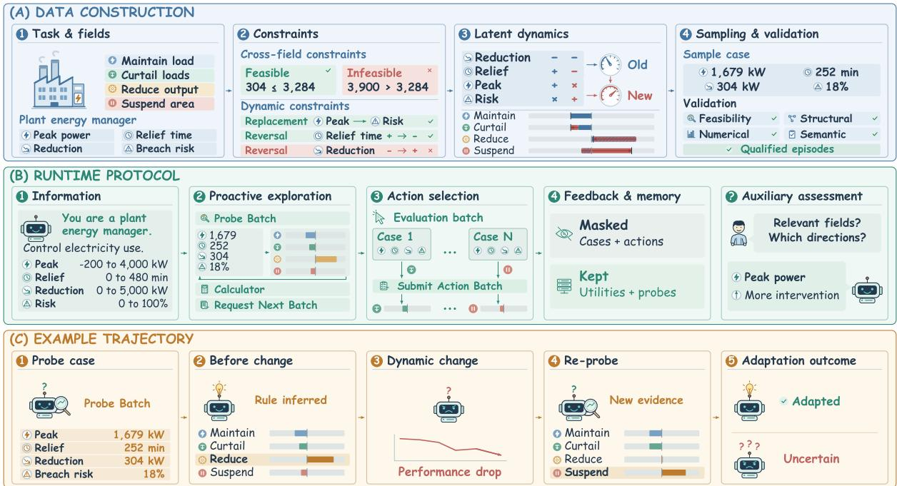  
Figure 1: Overview of AdaExploreBench. Data construction shows the generation pipeline. Runtime protocol shows how agents explore and how are they assessed. Example Trajectory shows a complete example of an episode.

## 3 Benchmark Construction

## 3.1 Data Generation

Definitions. We consider decision-making environments where an agent selects actions based on observable input fields. Each case contains a set of field values, and the agent chooses from four actions $\mathcal { A } = \{ a _ { 0 } , a _ { 1 } , a _ { 2 } , a _ { 3 } \}$ ordered by intervention strength. A subset of fields, termedfactors, determines the appropriate intervention, with each factor having a positive or negative directional effect. The latent environmental dynamics map each case to an intervention score s ∈ [−1, 1], where higher scores favor stronger interventions. A fixed utility function maps this score to action utilities, rewarding actions whose intervention levels better match the score. An episode is a complete evaluation instance comprising a task and a sequence of cases governed by potentially changing environmental dynamics.

Task Specification. Each task defines an operational scenario, an agent role, and four ordered actions based on predefined blueprints across finance, healthcare, cybersecurity, and manufacturing. We use LLM-assisted generation to construct a field catalog with semantic descriptions, numerical ranges, and sampling distributions. Each episode selects relevant factors and irrelevant distractors from the catalog. We further impose (1) cross-field constraints to ensure feasible field combinations and (2) dynamics constraints to specify admissible factor interactions and environmental changes.

Environmental Dynamics. We instantiate four families representing different decision-making strategies (Einhorn, 1970; Payne et al., 1993). Additive dynamics aggregate evidence across factors, conjunctive and disjunctive dynamics require all or any conditions to be satisfied, and lexicographic dynamics follow a factor priority order. The resulting evidence is calibrated to a common intervention score. In static settings, the underlying dynamics remain fixed, while dynamic settings introduce an unannounced rule drift that replaces one relevant factor and reverses another factor’s direction within the same family. These changes are constrained to be semantically plausible and induce meaningful yet moderate shifts in optimal actions. Detailed formalizations are provided in Appendix C.

Episode Generation and Validation. We construct episodes by instantiating latent dynamics and sampling feasible evaluation cases using established field catalog and following the constraints. Candidates undergo structural, numerical, and semantic validation to ensure valid configurations, non-degenerate action distributions, and plausible environmental changes. A further LLM-based review evaluates field realism, change plausibility, and distractor quality. We retain only qualified episodes from candidates for the final benchmark. Detailed procedures and prompts are provided in Appendix D. To ensure high quality, human study of the generated instances are given in Appendix E.

## 3.2 Runtime Protocol

Interaction Protocol. At the beginning of each episode, the agent receives the task description, input fields and ranges, available actions, definitions of the four dynamics families, and interaction tools. The instantiated family, relevant factors, parameters, and occurrence and timing of environmental changes remain hidden. Each episode proceeds through evaluation batches preceded by exploration windows. The agent may use Probe Batch to query self-designed cases and observe utilities for all actions, or Request Next Batch to proceed without probing. For each revealed evaluation batch, Submit Action Batch collects action choices and returns utility feedback. A Calculator supports numerical reasoning. The agent decides whether, what, and how much to explore, while receiving cumulative utility feedback throughout the episode.

Evaluation History Masking. By default, completed evaluation cases and selected actions are removed from subsequent context, while their realized utilities remain available. In contrast, selfcollected probe observations are retained. This isolates proactive exploration from environmentprovided evidence while preserving non-diagnostic feedback that may signal environmental changes.

Auxiliary Assessment. We conduct necessary assessments to directly evaluate whether agents identify relevant factors, their directional effects, and changes in environmental dynamics. Assessments are collected immediately before rule drift and at episode completion in dynamic settings, and only at completion in static settings. They are excluded from subsequent interaction context to avoid influencing agent behavior. Please refer to Appendix F for detailed and additional runtime settings.

## 4 Experiments

## 4.1 Settings

Models. Our evaluation includes proprietary and leading open-source models with distinct parameter scale. Proprietary models include GPT-6-Luna, GPT-6-Sol (OpenAI, 2026), and Gemini-3.8-Flash (Google DeepMind, 2026), while open-source models include DeepSeek-V4.1- Flash (DeepSeek-AI, 2026), Gemma-4-12B (Team, 2026), Llama-3.1-8B (Grattafiori et al., 2024), Qwen3.5-9B (Qwen Team, 2026a), and Qwen3.8- 27B (Qwen Team, 2026b). Detailed reasoning and inference configs are specified in Appendix G.

Experimental Settings. Each setting is a combination of configurations of (1) Whether rule drift occur. (2) Whether evaluation batches are masked. (3) Whether probings are mandatory. We evaluate agents under the following settings:

(1) Default. rule drift occurs during interactions. Evaluation batches are masked. Probing amount is self-decided by the agent.

(2) Stationary. The same as default except that rule drift does not occur during interactions.

(3) Evidence Given. The same settings as default except that Evaluation batches are not masked.

(4) Forced-Probe. The same settings as default except that probings are mandatory in every window with a minimal number of cases required.

We evaluate the main results under default setting and the other settings are for analysis.

## 4.2 Metrics

We evaluate end-to-end performance, exploration behavior and adaptation performance. The detailed metrics definitions are provided in Appendix H. Here we give a brief explanation of each one.

(1) Exact Accuracy (EA) measures the strict correctness of the agent’s decisions. Each evaluation case receives credit only when the agent selects the optimal action with largest utility feedback. We report the mean credit over evaluation cases.

(2) Calibrated Accuracy (CA) is the calibrated version of EA, where near-optimal choices are granted partial credit based on the actual utility received. The score is further calibrated so that a uniformly random policy obtains zero in expectation and the optimal policy obtains full score.

(3) Mean Unique Probes measures the amount of exploration. We count the average number of distinct probes queried by the agent. Identical probes issued before and after rule drift are treated as distinct, since they may help recognize rule drift.

<table><tr><td rowspan="2">Model Name</td><td colspan="2">End-to-end Outcome</td><td colspan="2">Exploration Behavior</td><td colspan="2">Adaptation Performance</td></tr><tr><td>EA (%) ↑</td><td>CA (%) ↑</td><td>Mean Uni. Probes</td><td>Mean Re-probes</td><td>Factor Rec. (%) ↑</td><td>Change Rec. (%) ↑</td></tr><tr><td>Llama-3.1-8B</td><td>30.67</td><td>8.13</td><td>4.77</td><td>0.24</td><td>52.54</td><td>6.30</td></tr><tr><td>Qwen3.5-9B</td><td>32.17</td><td>12.31</td><td>7.81</td><td>1.04</td><td>39.40</td><td>13.80</td></tr><tr><td>Qwen3.8-27B</td><td>45.95</td><td>37.73</td><td>42.20</td><td>5.46</td><td>65.87</td><td>25.93</td></tr><tr><td>Gemma-4-12B</td><td>37.98</td><td>20.59</td><td>12.52</td><td>0.13</td><td>53.21</td><td>10.34</td></tr><tr><td>DeepSeek-V4.1-Flash</td><td>58.01</td><td>52.87</td><td>113.42</td><td>16.04</td><td>78.07</td><td>44.52</td></tr><tr><td>GPT-6-Luna</td><td>46.50</td><td>35.10</td><td>22.84</td><td>0.73</td><td>56.66</td><td>9.96</td></tr><tr><td>GPT-6-Sol</td><td>65.69</td><td>61.87</td><td>99.03</td><td>6.95</td><td>73.79</td><td>47.56</td></tr><tr><td>Gemini-3.8-Flash</td><td>69.47</td><td>67.25</td><td>88.12</td><td>10.25</td><td>78.30</td><td>63.68</td></tr></table>

Table 2: Main evaluation results in the default setting. Scores in bold indicate the best performance among all models, and underlined scores denote the second-best performance. Exploration Behavior metrics omit arrows and highlights, as neither direction is inherently better. Metrics marked with (%) are reported in percentage form.

(4) Mean Re-probes after Change measures the agent’s verification effort after rule drift. We count the distinct pre-change probe points that the agent queries again later. It is the exact complement of Mean Unique Probes on post-change probes.

(5) Factor Recognition measures how accurately the agent identifies the factors of the rule through the auxiliary assessment. We compare the predicted factor set with the ground-truth set by F1, and averaging the pre- and post-change values.

(6) Change Recognition measures whether the agent correctly identifies what changed in the rule. We represent rule drift as a set of atomic changes and score the changes inferred from the agent’s preand post-change assessments by set F1.

## 4.3 Results

## Takeaway 1

Proactive and adaptive exploration remains highly challenging for most models.

All models fall below 70% calibrated accuracy, and weaker models select more costly actions. Table 2 shows a clear performance divide across models. Gemini-3.8-Flash achieves the strongest end-to-end performance, but still score below 70%. Moreover, the gap between EA and CA widens substantially as model performance decreases. It ranges from about 2 to 5 points for the top three models, but grows to 8 to 22 points for the remaining models. This suggests that weaker agents not only make incorrect decisions more frequently, but their mistakes also tend to incur larger utility losses. The results highlight the difficulty of proactive and adaptive exploration under evolving environments.

## Takeaway 2

Greater exploration and verification effort do not necessarily translate into better endto-end performance across models.

Exploration effort yields highly unequal returns across models. Table 2 reveals variation in exploration behavior, with DeepSeek-V4.1-Flash issuing approximately 24 times as many probes as Llama-3.1-8B. However, this variation does not translate into proportional performance gains. Despite probing the most, DeepSeek-V4.1-Flash achieves lower CA than both Gemini-3.8-Flash and GPT-6-Sol. Similarly, Gemini-3.8-Flash outperforms GPT-6- Sol with fewer probes. These contrasts reveal a discrepancy between exploration volume and realized performance, as models with fewer interactions can achieve substantially better outcomes.

Additional verification does not close the performance gap. This discrepancy extends to postchange exploration. DeepSeek-V4.1-Flash performs considerably more re-probes than the two strongest models, yet still achieves lower end-toend performance. Thus, additional opportunities to verify previously learned relationships do not lead to more successful adaptation. Together, these results highlight the limitations of measuring exploration through interaction counts alone and underscore the importance of evaluating how effectively agents acquire and exploit informative evidence.

## Takeaway 3

Adaptation ability distinguishes effective agents more clearly than exploration efforts.

Recognition is a stronger indicator of end-to-end performance. Table 2 shows that differences in recognition ability are more strongly reflected in final performance than differences in exploration effort. The four strongest models by CA follow exactly the same ranking in Change Recognition, while the remaining models achieve at most 13.80% Change Recognition and substantially lower CA. Factor Recognition exhibits a similar, though relatively less pronounced, pattern. In contrast, exploration effort does not distinguish model performance as consistently. Further detailed correlation analysis is provided in Appendix I.1.

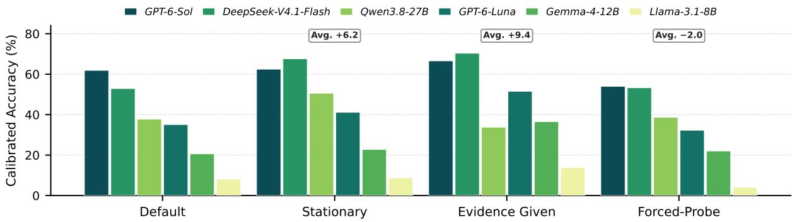  
Figure 2: Calibrated Accuracy under default and the three other settings. Boxed annotations give the average CA gain over Default across all models. The full results and significance analysis provided in Appendix I.2 and I.3.

## 5 Analysis

Section 4.3 reports models’ behaviors under default setting. Here we ask why they fail by ablations.

• Rule Drift Adaptation. How much of the performance gap does rule drift cause?

• Evidence Sufficiency. How much is caused by the burden of acquiring evidence proactively?

• Exploration Quantity vs. Quality. Can forcing agents to explore more close the gap?

Figure 2 reports Calibrated Accuracy (CA) for Default and the three diagnostic settings.

## Takeaway 4

Removing unannounced rule drift significantly recovers agents’ end-to-end outcome.

Removing rule drift recovers performance significantly for most models. The Stationary setting only removes rule drift compared with default setting. It raises CA by up to 14.7% for DeepSeek-V4.1-Flash in Figure 2, and 6.2% on average. Though GPT-6-Sol barely changes, it is because its default performance is already near its stationary ceiling, consistent with its second-best Change Recognition in Table 2. The weakest models improves by less 1%, so removing rule drift barely help agents that cannot even learn in stationary setting. Rule Drift is thus a first-order bottleneck for models with basic learning competence.

## Takeaway 5

Agents exploit effectively when sufficient evidence is provided externally.

Most models improve substantially when sufficient evidence is given. The Evidence Given setting let passive evidence accumulate across batches. Six of the seven models improve, four by more than 15 CA points. The resulting gains identify proactive evidence acquisition as a key bottleneck: models learn better from available evidence than they acquire it on their own. Qwen3.8-27B is the only model that degrades under Evidence Given, but it also cuts exploration effort the most as shown in Appendix I. This shows that sufficient given evidence that become stale later can mislead models that trust them without re-verifying, consistent with the near-zero re-probing effort in this setting.

## Takeaway 6

Effective exploration depends more on explored evidence quality than quantity.

Forcing agents to explore more barely help. If the gap reflected exploration willingness or amount, Forced-Probe should close it. In forced-probe setting, probing quantity indeed shifts drastically. As shown in Appendix I, Mean unique probes rise from 33.9 to 53.8 across all models, and the most reluctant explorers scale up their efforts by two to five times. Re-probes after the rule change also rise substantially. Yet performance stays flat or even degrades, with a mean CA change of −2.0%.

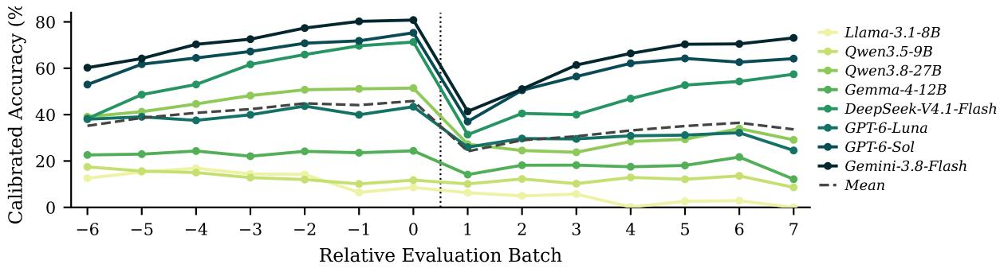  
Figure 3: Calibrated Accuracy per evaluation batch under default, with batch 0 marking the last pre-change batch.

Probe informativeness emerges as a likely bottleneck. Poor performance may stem from insufficient exploration effort, weak induction from available evidence, or uninformative probe selection. However, Forced-Probe weakens the first explanation, as increasing exploration effort fails to improve performance, while Evidence Given weakens the second, as models improve substantially when sufficient evidence is provided. Together, these findings suggest that the inability to select informative probe cases is a key remaining bottleneck, although probe quality is not directly measured.

Synthesis. Agents learn well from given evidence, but they neither acquire comparably useful evidence on their own, nor detect and revise around rule drift. The binding constraints on current LLM agents in evolving environments are proactive exploration quality and test-time adaptation, not exploration quantity or basic rule learning. More ablation studies are provided in Appendix J.

## 6 Error Analysis

Section 5 showed why the agents fail. We now look inside the main results and ask what the failure looks like. Specifically, we examine:

• When does accuracy drop and whether the agent recovers its performance later?

• Does re-probing helps recognizing rule drift?

• How factor and change recognition fails? Results in Figure 3, Table 3 and Table 4 give comprehensive analysis for answering the questions.

## Takeaway 7

Rule Drift causes an immediate performance drop, and no model recovers at last.

Accuracy drops immediately at rule drift and never fully recovers. Figure 3 aligns each episode at its rule drift. Every model that climbs above the random baseline loses a large share of that progress at the first post-change batch, with an average loss of 26.9 points across the six models that operate above the floor. Each of these drops is significant, and recovery is partial. Averaging over the final two batches, all six models remain 6.9 to 19.2 points below their own pre-change plateau. Weak models stay near the random baseline even before rule drift, so there is little left to lose and no significant drop. Llama-3.1-8B further decrease to 1.3% by the final batch, possibly a performance decay under long context. The rule change is therefore not a transient disturbance but has a huge impact on the subsequent trajectory.

<table><tr><td rowspan="2">Model</td><td rowspan="2"></td><td rowspan="2">Change Rec.(%)</td><td colspan="2">Spearman ρ</td></tr><tr><td>count</td><td>rate</td></tr><tr><td>Llama-3.1-8B</td><td>0.24</td><td>6.30</td><td>0.05</td><td>0.05</td></tr><tr><td>Qwen3.5-9B</td><td>1.04</td><td>13.80</td><td>0.01</td><td>0.03</td></tr><tr><td>Qwen3.8-27B</td><td>5.46</td><td>25.93</td><td>0.66</td><td>0.64</td></tr><tr><td>Gemma-4-12B</td><td>0.13</td><td>10.34</td><td>0.05</td><td>0.05</td></tr><tr><td>DeepSeek-V4.1-Flash</td><td>16.04</td><td>44.52</td><td>0.25</td><td>0.30</td></tr><tr><td>GPT-6-Luna</td><td>0.73</td><td>9.96</td><td>0.30</td><td>0.30</td></tr><tr><td>GPT-6-Sol</td><td>6.95</td><td>47.56</td><td>0.59</td><td>0.52</td></tr><tr><td>Gemini-3.8-Flash</td><td>10.25</td><td>63.68</td><td>0.32</td><td>0.39</td></tr><tr><td>Within model</td><td></td><td></td><td>0.37</td><td>0.28</td></tr><tr><td>Across models</td><td></td><td></td><td>0.86</td><td>0.45</td></tr></table>

Table 3: Correlation between Mean Re-probes and Change Recognition on default, where rate normalizes re-probes by distinct pre-change probe number. Bold and underlined values indicate p < 0.001 and $p < 0 . 0 1$

## Takeaway 8

Re-probing provides additional evidence, but successful adaptation also depends on how effectively a model exploit evidence.

Re-probing supports within-model change recognition. Table 3 shows significant positive correlations between re-probing and Change Recognition for all models performing above the recognition floor. These correlations persist after normalizing re-probes by pre-change exploration and when pooling model-centered episodes. This suggests that revisiting previously explored points provides direct evidence which help agents detect inconsistencies with their existing hypotheses and identify changes in environmental dynamics. The consistent within-model associations highlight the value of targeted verification during adaptation.

<table><tr><td rowspan="2">Model</td><td colspan="2">Factor Rec.</td><td colspan="2">Change Rec.</td></tr><tr><td>P</td><td>R</td><td>P</td><td>R</td></tr><tr><td>Llama-3.1-8B</td><td>38.2</td><td>84.5</td><td>10.5</td><td>6.5</td></tr><tr><td>Qwen3.5-9B</td><td>43.9</td><td>35.9</td><td>19.2</td><td>14.9</td></tr><tr><td>Qwen3.8-27B</td><td>81.1</td><td>55.6</td><td>66.9</td><td>23.1</td></tr><tr><td>Gemma-4-12B</td><td>52.8</td><td>53.5</td><td>18.6</td><td>10.5</td></tr><tr><td>DeepSeek-V4.1-Flash</td><td>86.9</td><td>70.8</td><td>77.8</td><td>39.3</td></tr><tr><td>GPT-6-Luna</td><td>63.8</td><td>50.7</td><td>31.3</td><td>9.2</td></tr><tr><td>GPT-6-Sol</td><td>79.1</td><td>69.1</td><td>63.6</td><td>45.6</td></tr><tr><td>Gemini-3.8-Flash</td><td>94.9</td><td>66.9</td><td>83.1</td><td>58.3</td></tr><tr><td>Mean</td><td>67.6</td><td>60.9</td><td>46.4</td><td>25.9</td></tr></table>

Table 4: Precision and recall for Factor Rec. and Change Rec. on default. The larger value is bolded.

Re-probing alone does not explain cross-model differences. Although raw re-probe counts correlate with Change Recognition across models, this relationship becomes insignificant after normalization by pre-change exploration. This suggests that the apparent association is partly driven by differences in exploration volume, rather than verification effectiveness alone. For instance, DeepSeek-V4.1-Flash performs more re-probes than Gemini-3.8-Flash, yet achieves lower Change Recognition. One possible explanation is that models differ in their ability to exploit the collected evidence, particularly in interpreting before-and-after observations and updating their hypotheses. Thus, effective change recognition depends not only on the availability of verification evidence but also on the agent’s ability to reason over it.

## Takeaway 9

Agents tend to settle on incomplete representations of environmental dynamics.

Agents prematurely settle on incomplete environmental models. Table 4 shows that precision generally exceeds recall in both Factor and Change Recognition, suggesting that agents recover mostly correct but incomplete representations of environmental dynamics. This pattern points to a potential failure of hypothesis refinement, where agents may settle on plausible explanations without sufficiently exploring alternative dependencies. Such incomplete representations can further hinder adaptation, as changes involving overlooked factors may remain undetected. Indeed, in 36.3% of eligible episodes, agents report identical pre- and postchange assessments despite changes in the environment. This failure is particularly pronounced for GPT-6-Luna and Qwen3.8-27B, affecting 65.6% and 54.2% of their episodes, respectively. Detailed episode-level results are provided in Appendix K.

## Takeaway 10

Agents struggle to recognize changes in how existing factors influence outcomes.

Agents struggle to revise previously learned factors. All evaluated models recognize factor replacements more reliably than direction reversals. At the episode level, agents identify both replacements but miss the reversal in 17.7% of episodes, compared with only 4.1% for the converse. This suggests that agents are better at updating which factors matter than revising how existing factors affect outcomes. Unlike replacements, reversals require agents to correctly infer directional effects both before and after rule drift, potentially making previous knowledge harder to revise. This highlights a limitation in hypothesis revision, where agents may retain outdated interpretations despite changes in environmental dynamics. Detailed results are provided in Appendix K.

Synthesis. Together, these findings suggest that a central obstacle to adaptation is the persistence of unchallenged assumptions. Agents may form plausible but incomplete environmental models and fail to reconsider established rules as the environment evolves. This creates a potential blind spot where insufficient exploration and strong hypothesis persistence reinforce each other. A detailed case study is given in Appendix L for more clarity.

## 7 Conclusion

In this work, we introduce AdaExploreBench, a benchmark for evaluating proactive exploration and test-time adaptation of LLM agents in evolving environments. By instantiating environmental dynamics as latent rules, we requires agents to decide when, what, and how much to explore, while recognizing rule drift and revising their hypothesis accordingly. Our results show that current LLM agents remain limited in both proactive exploration and test-time adaptation. These findings highlight a broader challenge in enabling agents to autonomously acquire evidence while keeping their understanding of evolving environments up to date. Addressing this challenge may require agents to actively challenge established assumptions and revise their knowledge as the environment changes. We envision AdaExploreBench as a foundation for developing agents capable of reliable exploration and adaptation in dynamic environments.

## Limitations

Simplified Environmental Dynamics. We model environmental dynamics as latent rules and rule drift, providing a controlled but necessarily simplified abstraction of real-world environments. While this formulation cannot fully capture real-world complexity and uncertainty, agents already struggle with proactive exploration and adaptation even in these simplified settings.

Indirect Assessment of Exploration Quality. Our exploration metrics primarily measure effort rather than quality. We omit direct quality metrics based on spatial diversity or decision-region coverage, as they inherently favor extensive probing and yield incomparable scores across heterogeneous rule families. Instead, we use corresponding ablations settings to indirectly examine whether ineffective evidence acquisition limits performance.

Limited Coverage of Environmental Changes. Our evaluation currently focuses on within-family rule drift involving factor replacement and direction reversal. Due to time and computational resource constraints, we leave cross-family changes, alternative change types, and systematically varying change magnitudes for future work.

## Ethics Statement

Offensive Content. AdaExploreBench consists of synthetically generated scenarios across domains. The evaluation instances are constructed without collecting sensitive user data. The benchmark is designed solely for research evaluation and does not involve offensive content.

Licenses. Our code will be released under the MIT license, and AdaExploreBench will be distributed under a Creative Commons license to support academic research. We will ensure that our use of third-party models and tools complies with their respective licenses and terms of use.

Models. All open-source models were hosted and executed locally using the vLLM library (Kwon et al., 2023), while all closed-source models were accessed through their official APIs. The experimental settings are detailed in G for reproducibility.

Data Annotations. All data annotation was performed by PhD-level researchers with relevant expertise, ensuring that the process was conducted responsibly and following ethical standards.

## References

Eryk Banatt, Jonathan Cheng, and Tiffany Hwu. 2024. WILT: A multi-turn, memorization-robust inductive logic benchmark for LLMs. In The 4th Workshop on Mathematical Reasoning and AI at NeurIPS’24.

Arthur Chen, Zuxin Liu, Jianguo Zhang, Akshara Prabhakar, Zhiwei Liu, Shelby Heinecke, Silvio Savarese, Victor Zhong, and Caiming Xiong. 2026a. Test-time adaptation for llm agents via environment interaction. In International Conference on Learning Representations, volume 2026, pages 39256–39288.

Guoxin Chen, Zhong Zhang, Xin Cong, Fangda Guo, Yesai Wu, Yankai Lin, Wenzheng Feng, and Yasheng Wang. 2025a. Learning evolving tools for large language models. In International Conference on Learning Representations, volume 2025, pages 87140– 87169.

Yimeng Chen, Piotr Pi˛ekos, Mateusz Ostaszewski, Firas Laakom, and Jürgen Schmidhuber. 2025b. Physgym: Benchmarking llms in interactive physics discovery with controlled priors. In Advances in Neural Information Processing Systems, volume 38, Main Conference. Curran Associates, Inc.

Zhenhao Chen, Yongqiang Chen, Chenxi Liu, Junchi Yu, Xiangchen Song, Zijian Li, Jialin Li, Philip Torr, Bo Han, and Kun Zhang. 2026b. CausalGame: Benchmarking causal thinking of LLM agents in games. In Proceedings of the 43rd International Conference on Machine Learning, volume 306 of Proceedings of Machine Learning Research, pages 13726–13765. PMLR.

DeepSeek-AI. 2026. Deepseek-v4.1-flash: Pushing the limits of kv cache compression.

Shangheng Du, Jiabao Zhao, Jinxin Shi, Zhentao Xie, Xin Jiang, Yanhong Bai, and Liang He. 2026. A survey on the optimization of large language modelbased agents. ACM Comput. Surv., 58(9).

H. J. Einhorn. 1970. The use of nonlinear, noncompensatory models in decision making. Psychological Bulletin, 73:221–230.

Hillel J. Einhorn. 1971. Use of nonlinear, noncompensatory models as a function of task and amount of information. Organizational Behavior and Human Performance, 6(1):1–27.

João Gama, Indrundefined Žliobaitundefined, Albert Bifet, Mykola Pechenizkiy, and Abdelhamid Bouchachia. 2014. A survey on concept drift adaptation. ACM Comput. Surv., 46(4).

G. Gigerenzer and D. G. Goldstein. 1996. Reasoning the fast and frugal way: Models of bounded rationality. Psychological Review, 103:650–669.

Google DeepMind. 2026. Gemini 3.8 Flash Model Card. Model card.

Aaron Grattafiori, Abhimanyu Dubey, Abhinav Jauhri, Abhinav Pandey, Abhishek Kadian, Ahmad Al-Dahle, Aiesha Letman, Akhil Mathur, Alan Schelten, Alex Vaughan, Amy Yang, Angela Fan, Anirudh Goyal, Anthony Hartshorn, Aobo Yang, Archi Mitra, Archie Sravankumar, Artem Korenev, Arthur Hinsvark, and 542 others. 2024. The llama 3 herd of models. Preprint, arXiv:2407.21783.

Kaiyu He, Mian Zhang, Shuo Yan, Peilin Wu, and Zhiyu Zoey Chen. 2025. IDEA: Enhancing the rule learning ability of large language model agent through induction, deduction, and abduction. In Findings of the Association for Computational Linguistics: ACL 2025, pages 13563–13597, Vienna, Austria. Association for Computational Linguistics.

Wenyue Hua, Tyler Wong, Fei Sun, Liangming Pan, Adam Jardine, and William Yang Wang. 2025. InductionBench: LLMs fail in the simplest complexity class. In Proceedings of the 63rd Annual Meeting of the Associationfor Computational Linguistics (Volume 1: Long Papers), pages 26526–26546, Vienna, Austria. Association for Computational Linguistics.

Harsh Jhamtani, Jacob Andreas, and Benjamin Van Durme. 2025. LLM agents for coordinating multi-user information gathering. In Findings of the Associationfor Computational Linguistics: ACL 2025, pages 17800–17826, Vienna, Austria. Association for Computational Linguistics.

Woosuk Kwon, Zhuohan Li, Siyuan Zhuang, Ying Sheng, Lianmin Zheng, Cody Hao Yu, Joseph Gonzalez, Hao Zhang, and Ion Stoica. 2023. Efficient memory management for large language model serving with pagedattention. In Proceedings ofthe 29th Symposium on Operating Systems Principles, SOSP ’23, page 611–626, New York, NY, USA. Association for Computing Machinery.

Chunyang Li, Weiqi Wang, Tianshi Zheng, and Yangqiu Song. 2025a. Patterns over principles: The fragility of inductive reasoning in LLMs under noisy observations. In Findings ofthe Associationfor Computational Linguistics: ACL 2025, pages 19608–19626, Vienna, Austria. Association for Computational Linguistics.

Jiachun Li, Pengfei Cao, Zhuoran Jin, Yubo Chen, Kang Liu, and Jun Zhao. 2025b. Mirage: Evaluating and explaining inductive reasoning process in language models. In International Conference on Learning Representations, volume 2025, pages 73944–73969.

Jiayu Liu, Qihan Lin, Cheng Qian, Rui Wang, Emre Can Acikgoz, Xiaocheng Yang, Jiateng Liu, Zhenhailong Wang, Xiusi Chen, Heng Ji, and Dilek Hakkani-Tür. 2026a. PlanBench-XL: Evaluating long-horizon planning of LLM tool-use agents in large-scale tool ecosystems. arXiv preprint arXiv:2606.22388.

Jiayu Liu, Cheng Qian, Zhaochen Su, Qing Zong, Shijue Huang, Bingxiang He, and Yi R. Fung. 2026b. CostBench: Evaluating multi-turn cost-optimal planning and adaptation in dynamic environments for LLM tool-use agents. In Proceedings ofthe 64th Annual Meeting ofthe Associationfor Computational Linguistics (Volume 1: Long Papers), pages 12826– 12858, San Diego, California, United States. Association for Computational Linguistics.

Jiayu Liu, Cheng Qian, Zhenhailong Wang, Bingxuan Li, Jiateng Liu, Qing Zong, Heng Wang, Jeonghwan Kim, Yumeng Wang, Bingxiang He, and 1 others. 2026c. Adaplanbench: Evaluating adaptive planning in large language model agents under world and user constraints. arXiv preprint arXiv:2606.05622.

Jiayu Liu, Junhao Tang, Hanwen Wang, Baixuan Xu, Haochen Shi, Weiqi Wang, and Yangqiu Song. 2024. GProofT: A multi-dimension multi-round fact checking framework based on claim fact extraction. In Proceedings ofthe Seventh Fact Extraction and VERification Workshop (FEVER), pages 118–129, Miami, Florida, USA. Association for Computational Linguistics.

Jiayu Liu, Rui Wang, Qing Zong, Yumeng Wang, Cheng Qian, Qingcheng Zeng, Tianshi Zheng, Haochen Shi, Dadi Guo, Baixuan Xu, Chunyang Li, and Yangqiu Song. 2026d. NOVA: NOise-aware verbal confidence CAlibration for robust large language models in RAG systems. In Findings ofthe Associationfor Computational Linguistics: EMNLP 2026.

Yvan Lucas and Johannes Jurgovsky. 2020. Credit card fraud detection using machine learning: A survey. Preprint, arXiv:2010.06479.

OpenAI. 2026. GPT-6 Astra System Card. System card.

John W. Payne, James R. Bettman, and Eric J. Johnson. 1993. The Adaptive Decision Maker. Cambridge University Press.

Qwen Team. 2026a. Qwen3.5: Towards native multimodal agents.

Qwen Team. 2026b. Qwen3.8-Max: A new bar for coding and cowork.

Haotian Sun, Yuchen Zhuang, Lingkai Kong, Bo Dai, and Chao Zhang. 2023. Adaplanner: Adaptive planning from feedback with language models. In Advances in Neural Information Processing Systems, volume 36, pages 58202–58245. Curran Associates, Inc.

Gemma Team. 2026. Gemma 4 technical report. Preprint, arXiv:2607.02770.

Dong Wang, Xinghang Li, Zhengshen Zhang, Jirong Liu, Xiao Ma, Hanbo Zhang, Tao Kong, and Huaping Liu. 2025. ProcWorld: Benchmarking large model planning in reachability-constrained environments. In Proceedings of the 2025 Conference on Empirical Methods in Natural Language Processing, pages 12564–12594, Suzhou, China. Association for Computational Linguistics.

Ruocheng Wang, Eric Zelikman, Gabriel Poesia, Yewen Pu, Nick Haber, and Noah Goodman. 2024. Hypothesis search: Inductive reasoning with language models. In International Conference on Learning Representations, volume 2024, pages 38993–39014.

Fangzhi Xu, Hang Yan, Qiushi Sun, Jingyang Wu, Zixian Huang, Muye Huang, Jingyang Gong, Zichen Ding, Kanzhi Cheng, Yian Wang, Xinyu Che, Zeyi Sun, Jian Zhang, Zhangyue Yin, Haoran Luo, Xuanjing Huang, Ben Kao, Jun Liu, and Qika Lin. 2025. Odysseyarena: Benchmarking large language models for long-horizon, active and inductive interactions. arXiv preprint arXiv:2602.05843.

Minjong Yoo, Jinwoo Jang, Wei-jin Park, and Honguk Woo. 2024. Exploratory retrieval-augmented planning for continual embodied instruction following. In Advances in Neural Information Processing Systems, volume 37, pages 67034–67060. Curran Associates, Inc.

Ming Zhang, Zhenghao Xiang, Peizhong Gao, Yujiong Shen, Yuhui Wang, Zhonghan Yue, Shihan Dou, Zhangyue Yin, Junjie Ye, Shichun Liu, Weihuang Zheng, Jiahao Chen, Jiayi Chen, Hongzhang Liu, Jiaqi Shao, Tao Gui, Qi Zhang, Xuanjing Huang, Suncong Zheng, and Maxm Pan. 2026. Explorationbench: Measuring ai systems’ exploration in verifiable alien worlds. arXiv preprint arXiv:2609.30199.

Anshun Asher Zheng, Kanishka Misra, David I. Beaver, and Junyi Jessy Li. 2026a. Hero’s journey: Testing complex rule induction with text games. Preprint, arXiv:2606.02556.

Tianshi Zheng, Kiu Wai Tam, Kim Hue Nam Nguyen, Baixuan Xu, Zhaowei Wang, Cheng Jiayang, Hong Ting Tsang, Weiqi Wang, Jiaxin Bai, Tianqing Fang, Yangqiu Song, Ginny Wong, and Simon See. 2026b. Newtonbench: Benchmarking generalizable scientific law discovery in llm agents. In International Conference on Learning Representations, volume 2026, pages 99018–99088.

## A Terms Explanation in Positioning Table

We define each trait in Table 1 below.

• Proactive Exploration. The agent decides itself on when, what, and how much to interact for collecting evidence. Evidence should be mostly self-queried, instead of given or leaked from the environment.

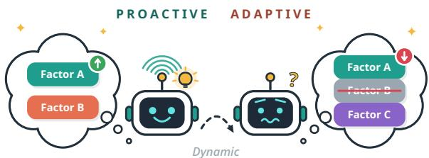  
Figure 4: Motivation of AdaExploreBench. An agent proactively explore and get confused when rule changes.

• Adaptive Exploration. The environment dynamics change during interaction without notifications, and the agent must detect the shift and explore again.

• Env-learning Exploration. Exploration aims to learn how the environment works, rather than to complete a predefined task.

• In-Process Evaluation. Performance is measured throughout exploration instead of only at the end, yielding a performance curve over the whole interaction process.

• Heterogeneous Rules. Latent rules span structurally and cognitively distinct families rather than variations of similar forms.

• Scalable Generation. evaluation instances are procedurally generated and the benchmark size can be scaled up easily without human labor.

## B More on Related Work

Passive Rule Learning. Prior work has examined whether LLMs can infer latent rules from given evidence. InductionBench evaluates inductive reasoning by requiring models to recover underlying transformation rules from a fixed set of observations (Hua et al., 2025). Patterns Over Principles studies the robustness of rule induction under noisy observations, revealing the fragility of LLM rule abstraction (Li et al., 2025a). HERO’S JOURNEY extends rule induction to rule executions, where agents not only infer hidden rules from demonstrations but also apply them in real tasks (Zheng et al., 2026a). However, these settings are largely passive, where the evidence used is predetermined. In contrast, AdaExploreBench embeds rule learning in an interactive decision process where agents can actively construct probes to gather diagnostic evidence before making decisions.

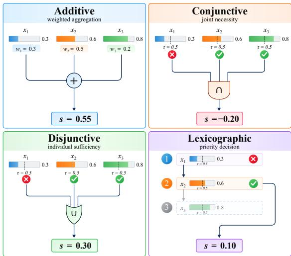  
Figure 5: Illustrative examples of the four rule families considered in this work. Given the same input vector, the additive rule computes a weighted sum, the conjunctive and disjunctive rules return the minimum and maximum threshold margins $( x _ { i } - \tau _ { i } )$ , respectively, and the lexicographic rule returns the margin of the first threshold-satisfying input in priority order.

## C Environment Formalization

Rule families. The four rule families correspond to four common attribute-combination strategies:

• Additive. Relevant fields are combined through a weighted sum. A high value on one field can compensate for a low value on another (Payne et al., 1993).

• Conjunctive. All relevant fields must satisfy their conditions. A single field that falls below its threshold can limit the overall outcome (Einhorn, 1971).

• Disjunctive. Satisfying any one relevant condition can be sufficient. Thus, one strong field may determine the outcome even when other fields are weak (Einhorn, 1970).

• Lexicographic. Relevant fields are checked in a fixed priority order. The highest-priority field is considered first, and lower-priority fields matter only when earlier fields are not decisive (Payne et al., 1993; Gigerenzer and Goldstein, 1996).

Figure 5 illustrates the structural difference among the four families: additive rules aggregate evidence, conjunctive rules require all conditions, disjunctive rules require any condition, and lexicographic rules follow a priority order.

Case space. Each case is represented by a $d -$ dimensional vector over predefined field ranges:

$$
\mathbf { x } = ( x _ { 1 } , \ldots , x _ { d } ) \in \mathcal { X } , \qquad \mathcal { X } = \prod _ { j = 1 } ^ { d } [ l _ { j } , u _ { j } ] ,
$$

where only an unknown subset of fields $\mathcal { T } \subseteq$ $\{ 1 , \ldots , d \}$ is relevant to the decision.

Rule Function. The Rule Function first normalizes each relevant field to $[ - 1 , 1 ] \colon$

$$
\tilde { x } _ { j } = 2 \frac { x _ { j } - l _ { j } } { u _ { j } - l _ { j } } - 1 .
$$

Each rule then combines the relevant fields into a scalar raw evidence value e according to one of four structural families.

For an additive rule, evidence is aggregated across relevant fields:

$$
e = b + \sum _ { j \in \mathcal { T } } w _ { j } \tilde { x } _ { j } ,
$$

where $w _ { j }$ is the contribution of field $j$ and $b$ is a bias term.

For the remaining families, each relevant field has a threshold $t _ { j }$ , normalized analogously as $\tilde { t } _ { j }$ and a direction $d _ { j } \in \{ - 1 , + 1 \}$ . Its oriented margin is

$$
m _ { j } = d _ { j } \big ( \tilde { x } _ { j } - \tilde { t } _ { j } \big ) .
$$

Conjunctive and disjunctive rules aggregate these margins by their weakest and strongest conditions, respectively:

$$
e _ { \mathrm { c o n j } } = \operatorname* { m i n } _ { j \in \mathbb { Z } } m _ { j } , \qquad e _ { \mathrm { d i s j } } = \operatorname* { m a x } _ { j \in \mathbb { Z } } m _ { j } .
$$

A lexicographic rule additionally specifies a priority ordering π over the relevant fields and an indifference band δ. The decisive field is determined by

$$
\begin{array} { r } { k ^ { * } = \left\{ \begin{array} { l l } { \operatorname* { m i n } \{ k : | m _ { \pi _ { k } } | > \delta \} , } & { \mathrm { i f ~ s u c h ~ } k \mathrm { ~ e x i s t s , ~ } } \\ { | \mathcal { Z } | , } & { \mathrm { o t h e r w i s e . } } \end{array} \right. } \end{array}
$$

The raw evidence is then

$$
e _ { \mathrm { l e x } } = m _ { \pi _ { k ^ { \ast } } } .
$$

Thus, the first decisive field determines the outcome, with the lowest-priority field used as a fallback.

Finally, a monotonic calibration function maps raw evidence to the intervention score:

$$
s = R _ { \theta } ( \mathbf { x } ) = C _ { \theta } ( e ) , \qquad C _ { \theta } : \mathbb { R } \to [ - 1 , 1 ] ,
$$

where the calibration is determined from the prechange evidence distribution, as detailed below.

Calibration from Evidence to Intervention Score. To obtain balanced action regions across heterogeneous rule families, we calibrate raw evidence using its distribution under the pre-change population. Let $q _ { 2 5 } , q _ { 5 0 } $ , and $q _ { 7 5 }$ denote the empirical quartiles of raw evidence sampled from this population. We map these quartiles to the three action boundaries $- 0 . 5 , 0 .$ , and 0.5 using a monotonic piecewise-linear function:

$$
\begin{array} { r } { C _ { \theta } ( e ) = \mathrm { c l i p } _ { [ - 1 , 1 ] } \left\{ \begin{array} { l l } { - \frac { 1 } { 2 } + \frac { e - q _ { 2 5 } } { 2 ( q _ { 5 0 } - q _ { 2 5 } ) } , } & { e \leq q _ { 5 0 } , } \\ { \frac { e - q _ { 5 0 } } { 2 ( q _ { 7 5 } - q _ { 5 0 } ) } , } & { e > q _ { 5 0 } . } \end{array} \right. } \end{array}
$$

We require q<sub>25</sub> $< \ q _ { 5 0 } \ < \ q _ { 7 5 }$ to ensure a welldefined mapping. This calibration approximately balances the four optimal actions under the prechange population. For dynamic episodes, the calibration is fitted once and held fixed after environmental changes, preserving a consistent evidenceto-score mapping throughout the episode.

Utility Function. The Utility Function maps the intervention score to the utilities of the four actions:

$$
\begin{array} { r } { \mathcal { U } ( s ) = \big ( u _ { 0 } ( s ) , u _ { 1 } ( s ) , u _ { 2 } ( s ) , u _ { 3 } ( s ) \big ) \in \mathbb { R } ^ { 4 } , } \end{array}
$$

where $u _ { k } ( s )$ is the utility obtained by choosing action $a _ { k }$ . Each action is associated with a fixed score anchor $\mathbf { c } = ( - 0 . 7 5 , - 0 . 2 5 , 0 . 2 5 , 0 . 7 5 )$ , corresponding to increasing intervention intensity. For each action $a _ { k } , k = 0 , \ldots , 3$ , we define

$$
u _ { k } ( s ) = \frac { 1 } { 3 } \left( 4 \frac { \exp [ - \beta ( s - c _ { k } ) ^ { 2 } ] } { \sum _ { j = 0 } ^ { 3 } \exp [ - \beta ( s - c _ { j } ) ^ { 2 } ] } - 1 \right) ,
$$

where $\beta = 8$ is fixed across all tasks. This construction gives higher utility to actions whose anchors are closer to the intervention score. The preferred action changes at the midpoints between adjacent anchors, $s \in \{ - 0 . 5 , 0 , 0 . 5 \}$ , yielding four equalsized decision regions, and the utilities sum to zero for every s.

## D Data Generation Details

## D.1 Semantic Field Catalog Construction

Catalog Specifications. The semantic field catalog is constructed using a predefined schema and task blueprints. Each blueprint specifies the task scenario, agent role, and four ordered actions, while the schema defines the required field attributes, rule-family specifications, cross-field constraints, and admissible environmental changes. LLMassisted synthesis extends these predefined specifications with task-specific field semantics and numerical parameters.

Component Synthesis. For each task blueprint, we construct the semantic field catalog through the following component-level generation steps:

• Field Discovery. The LLM proposes a set of candidate observable fields relevant to the task scenario, including field names, descriptions, units, and basic directional information.

• Field Semantics. For each retained field, the LLM specifies its applicability to different rule families, directional effects on intervention decisions, and admissible direction reversals with corresponding semantic events.

• Field Parameters. The LLM assigns numerical ranges, sampling distributions, and associated parameters to the accepted fields, establishing the field population used for subsequent episode generation.

• Lexicographic Orders. Based on the established field set, the LLM generates admissible priority orders for lexicographic decision rules.

• Cross-Field Constraints. The LLM defines feasibility constraints among fields to exclude invalid or contradictory combinations of field values.

• Cross-Field Dynamics. The LLM specifies admissible field replacement relations, including replacement groups, directional transitions, and coupling relationships for dynamic episodes.

Detailed generation prompts and output specifications are provided in Appendix D.5.

Validation and LLM Audit. Each generated component undergoes programmatic validation against the predefined schema and componentspecific constraints, followed by LLM-based semantic auditing. Components failing these checks are revised and revalidated or rejected. Crosscomponent consistency is further verified to ensure valid field references and compatible semantic specifications. Only accepted components are integrated into the finalized semantic field catalog for subsequent episode generation.

## D.2 Episode Generation

Episode generation consists of two steps: searching for valid field and rule configurations, followed by

sampling evaluation cases and organizing them into batches.

## D.2.1 Field Configuration Search

Candidate Enumeration. For each task and rule family, we enumerate candidate combinations of rule-relevant fields from the semantic field catalog. The enumeration follows a seed-determined bounded traversal of the admissible combinations. For dynamic episodes, candidates additionally incorporate admissible field replacements and direction reversals. Configurations violating cross-field feasibility or rule applicability constraints are discarded before numerical evaluation.

Numerical Certification. For each structurally valid configuration, we instantiate the corresponding latent dynamics and evaluate their properties over the feasible case population. Static candidates are calibrated and checked for non-degenerate optimal-action distributions. Dynamic candidates undergo three stages of numerical certification: initial screening, refinement, and held-out verification, using 256, 2048, and 16384 sampled cases, respectively. We evaluate the pre- and post-transition dynamics under a shared calibration, requiring adequate action coverage, moderate changes in optimal-action assignments, and feasible target action transitions. Specifically, the natural rate of changed optimal actions is constrained to 0.25– 0.75, with marginal optimal-action proportions between 0.15 and 0.35.

Semantic Review. After numerical certification, additional distractor fields are selected to complete the observable field configuration. An LLM-based reviewer then assesses the semantic consistency of the selected fields and environmental dynamics with the task scenario. Candidates with invalid field configurations are rejected. Algorithm 1 summarizes the construction procedure, and the review prompt specification are provided in Appendix D.5.

## D.2.2 Evaluation Case Sampling

For each accepted configuration, evaluation cases x are sampled from the specified field distributions. The applicable latent dynamics determine the action utilities $\mathcal { U } ( R _ { \theta } ( \mathbf { x } ) ) ,$ , and the resulting cases are organized into evaluation batches.

Static Setting. For static episodes, we independently sample cases from the field distributions conditioned on the cross-field feasibility constraints, and randomly organize them into evaluation batches. All cases are evaluated under the same latent dynamics.

Dynamic Setting. For dynamic episodes, we first sample a shared pre-transition prefix under the initial dynamics, followed by multiple post-transition branches. The post-transition sampling includes an IID control branch drawn from the feasible case population and several targeted branches with specified optimal-action change rates. For each targeted branch, cases are sampled from pre/post actiontransition groups identified during numerical certification to achieve the desired change rate. The resulting branches share the same pre-transition cases but differ in their post-transition case distributions.

Algorithm 2 summarizes the evaluation case sampling and batch assembly procedure.

## D.3 Dataset-Level Review and Selection

After episode generation, a separate LLM-based quality review evaluates each candidate along three dimensions: field realism, plausibility of dynamic rule transitions, and distractor quality. Episodes must exceed the minimum score threshold on every dimension to qualify for selection. Qualified episodes are ranked by their aggregate review scores within each domain–rule-family combination, and equal numbers are selected from these groups to maintain dataset balance.

The selected episodes form the final evaluation dataset. Detailed review criteria and prompts are provided in Appendix D.5.

## D.4 Dataset Configuration

Dataset Composition. Our evaluation dataset consists exclusively of dynamic episodes, balanced across all domain–rule-family combinations. We generate 384 candidate episodes, with 24 per combination, and retain the 256 highest-scoring qualified episodes through the dataset-level review and selection procedure, yielding 16 episodes per combination.

Evaluation Batches. Each episode contains 12 action batches, with 8 evaluation cases per batch. The rule drift occurs after batch 5, 6, or 7, with the preceding batches shared across all post-transition branches. We construct one IID control branch and three targeted branches with optimal-action change rates of 0.25, 0.50, and 0.75. Each complete trajectory contains 96 evaluation cases. The evaluation protocol additionally specifies a probe budget of

Algorithm 1 Field Configuration Enumeration and Validation   
Require: Semantic field catalog F, constraints Γ, Λ, generation cells G, quotas q   
Ensure: Accepted configurations C   
1: C ← ∅   
2: for all eligible generation cells $g \in { \mathcal { G } }$ do   
3: for all candidate cores c ∈ ENUMERATECORES(g) do   
4: if ¬STRUCTURALLYFEASIBLE(c, Γ, Λ) then   
5: continue   
6: end if   
7: $( \mathcal { R } _ { \mathcal { E } } , \Delta _ { \mathcal { E } } ) \gets$ INSTANTIATEDYNAMICS(c, g)   
8: if ¬NUMERICALLYVALID(c, R , ∆ ) then   
9: continue   
10: end if   
11: $\mathcal { F } _ { \mathcal { E } } $ ADDDISTRACTORS(c, F)   
12: r ← SEMANTICREVIEW(F<sub>E</sub>, R<sub>E</sub>, ∆<sub>E</sub>)   
13: while r = reject\_distractors and retries remain do   
14: F ← RESELECTDISTRACTORS(c, F)   
15: r ← SEMANTICREVIEW $( \mathcal { F } _ { \mathcal { E } } , \mathcal { R } _ { \mathcal { E } } , \Delta _ { \mathcal { E } } )$   
16: end while   
17: if r = accept then   
18: Add $( \mathcal { F } _ { \mathcal { E } } , \mathcal { R } _ { \mathcal { E } } , \Delta _ { \mathcal { E } } )$ to C   
19: Update remaining quotas   
20: end if   
21: if QUOTASATISFIED(g, q) then   
22: break   
23: end if   
24: end for   
25: end for   
26: return C

16 per batch, a maximum of 32 probe cases, and a total probe budget of 32.

Training Set. We additionally provide a training set containing 1,000 episodes, generated using the same data generation and validation pipeline as the evaluation dataset.

## D.5 LLM Prompt Specifications

Semantic Field Catalog Construction. Figures 8, 9, and 10 present the system prompts for field discovery, semantic specification, and numerical parameter calibration, respectively. Figures 11, 12, and 13 provide the prompts for constructing lexicographic priority orders, cross-field feasibility constraints, and admissible field replacements.

Episode and Dataset Review. Figure 14 presents the prompt used to assess candidate episode configurations and distractor fields. Figure 15 presents the final dataset-level review prompt, which scores episodes on field realism, rule-change realism, and

distractor quality.

## E Human Study

To assess the semantic plausibility of our LLMassisted generated tasks, we randomly sampled 40 episodes from the 256 dynamic episodes and invited three human annotators to evaluate each case along three dimensions: (i) scenario plausibility, assessing whether the task setting and available actions are realistic; (ii) factor replacement, assessing whether the contextual changes in relevant fields and their underlying reasons justify updating existing information; and (iii) effect reversal, assessing whether the changes reasonably justify reversing the influence of an attribute on decision-making. Each dimension was rated on a five-point Likert scale, with scores of 4 or 5 indicating positive assessments. As shown in Table 5, all three dimensions received favorable evaluations, with mean scores above 4.0. Notably, at least 90% of the evaluated cases received positive ratings from a majority of annotators across all dimensions, supporting the overall semantic plausibility of our generated tasks and dynamic mechanisms.

Algorithm 2 Evaluation Case Sampling and Batch Assembly   
Require: Accepted configuration $( \mathcal { F } _ { \mathcal { E } } , \mathcal { R } _ { \mathcal { E } } , \Delta _ { \mathcal { E } } )$ , constraints $\Gamma ,$ mode $m ,$ number of batches T, batch   
size $b ,$ target rates $\mathcal { Q }$   
Ensure: Evaluation batches $B _ { \mathcal { E } }$   
1: if $m =$ static then   
2: $X \gets \mathrm { S A M P L E F E A S I B L E } ( \mathcal { F } _ { \mathcal { E } } , \Gamma , T b )$   
3: $\mathcal { B } _ { \mathcal { E } }  \mathrm { B A T C H W I T H U T I L I T I E S } ( X , R _ { \theta } , b )$   
4: else   
5: Select an admissible transition boundary $\tau$   
6: $X _ { \mathrm { p r e } } \gets \mathrm { S A M P L E F E A S I B L E } ( \mathcal { F } _ { \mathcal { E } } , \Gamma , \tau b )$   
7: $B _ { \mathrm { p r e } }  \mathbf { B }$ ATCHWITHUTILITIES $( X _ { \mathrm { p r e } } , R _ { \theta _ { \mathrm { p r e } } } , b )$   
8: for all post-transition branches $r \in \{ \mathtt { I I D } \} \cup \mathcal { Q }$ do   
9: if r = IID then   
10: $X _ { \mathrm { p o s t } } ^ { r }  \mathrm { S A M P L E F E A S I B L E } ( \mathcal { F } _ { \mathcal { E } } , \Gamma , ( T - \tau ) b )$   
11: else   
12: $X _ { \mathrm { p o s t } } ^ { r }$ ← SAMPLETRANSITIONBUCKETS $( r , ( T - \tau ) b )$   
13: end $\mathbf { i } \mathbf { \dot { f } }$   
14: $R ^ { r } \gets \mathrm { A P P L I C A B L E R U L E } ( r , \mathcal { R } _ { \mathcal { E } } , \Delta _ { \mathcal { E } } )$   
15: $B _ { \mathrm { p o s t } } ^ { r }  \mathbf { B }$ ATCHWITHUTILITIES $( X _ { \mathrm { p o s t } } ^ { r } , R ^ { r } , b )$   
16: end for   
17: $\mathcal { B } _ { \mathcal { E } }  ( B _ { \mathrm { p r e } } , \{ B _ { \mathrm { p o s t } } ^ { r } \} _ { r } )$   
18: end if   
19: return $B _ { \mathcal { E } }$

<table><tr><td>Dimension</td><td> $\mathbf { M e a n } \pm \mathbf { S D }$ </td><td></td><td>Pos. (%) Maj. (%)</td></tr><tr><td>Scenario Plausibility</td><td> $4 . 9 5 \pm 0 . 2 2$ </td><td>100.0</td><td>100.0</td></tr><tr><td>Information Replacement</td><td> $4 . 5 6 \pm 0 . 6 1$ </td><td>94.2</td><td>100.0</td></tr><tr><td>Effect Reversal</td><td> $4 . 0 9 \pm 0 . 7 3$ </td><td>77.5</td><td>90.0</td></tr></table>

Table 5: Human evaluation of generated task plausibility. Positive denotes the percentage of ratings $\geq 4 .$ , while Majority denotes the percentage of cases rated $\geq 4$ by at least two annotators.

## F Detailed Runtime Settings

<table><tr><td>Setting</td><td>Value</td></tr><tr><td>Episode layout</td><td></td></tr><tr><td>Action batches per episode</td><td>12</td></tr><tr><td>Cases per action batch</td><td>8</td></tr><tr><td>Candidate actions per case</td><td>4</td></tr><tr><td>Input fields per case</td><td>8</td></tr><tr><td>rule drift after batch</td><td>5, 6, or 7</td></tr><tr><td>Probing and answering Max probe cases per probe_batch call</td><td></td></tr><tr><td></td><td>16</td></tr><tr><td>Probe calls per batch window</td><td> $\leq 1$ </td></tr><tr><td>Min probe cases per probe_batch call</td><td>1</td></tr><tr><td>Probe-free reveal (request_next_batch)</td><td>allowed</td></tr><tr><td>Per-case abstention</td><td>allowed</td></tr><tr><td>Failure handling</td><td></td></tr><tr><td>Repair attempts per rejected call</td><td>1</td></tr><tr><td>Provider retries per request</td><td>5 (backoff 2–16 s)</td></tr><tr><td>Regenerations after a truncated response</td><td>1</td></tr></table>

Table 6: Interaction and failure-handling configuration of the benchmark runtime. Every value is fixed across episodes, models, and settings. The fallbacks that apply once a limit is exhausted are described in the text.

Runtime configs. Table 6 lists the runtime configuration shared by every model and episode. Each episode presents its evaluation cases as a fixed sequence of batches, and rule drift is scheduled after a batch drawn approximately uniformly from the middle of that sequence. Within each batch window the agent may probe at most once, each probe call is capped in size, and probing is always optional because the upcoming batch can also be revealed directly. Action submissions may abstain on individual cases, and unanswered cases earn zero utility. A rejected call may be repaired once per window before the environment applies the fallbacks described above; provider failures are retried with capped exponential backoff, and an over-length response is regenerated once before its window is skipped. These limits are identical for all models, and no model profile overrides them.

Runtime Failure Handling. We distinguish protocol errors from provider failures. (1) Repair. Invalid agent responses, including malformed JSON, schema violations, and invalid tool calls, trigger an error message in the agent’s context and one additional interaction for correction, without advancing the environment. If the repair fails, the current exploration window is skipped, or unanswered evaluation cases receive zero utility and are counted as incorrect. Mandatory probing requirements are waived for the affected window. (2) Retry. Provider and network failures are retried with capped exponential backoff, without affecting the agent’s interaction history or repair budget. Exhausted retries mark the run as failed. Truncated responses receive one additional generation attempt, after which repeated truncation triggers the corresponding fallback.

Runtime Prompts. Figure 16 shows the initial prompt that opens every episode under Default, and Figures 17, 18, 19, and 20 show the environment feedback that answers each of the four interaction tools. Angle brackets mark content that varies across episodes, such as the role assignment, the action names, and the field descriptions, while ellipses and bracketed elision notes stand for entries that repeat a displayed structure. When an episode defines feasibility constraints, they appear as a constraint list after the field descriptions in the first user message. Every environment message ends with the latest Current state card, which is the authoritative snapshot of tool usability, cumulative utility, pending cases, and remaining action batches. A Request Next Batch call is answered through this card alone, because revealing a batch without probing produces no separate result payload. After each submitted action batch, the environment rewrites the retained history as described in the system message, so later turns observe the scoreboard form of earlier outcomes instead of the original messages. Feedback for rejected calls is omitted from these figures, since a rejection only triggers a repair opportunity and leaves the episode state unchanged.

## G Model Configs

Reasoning Configs. Table 7 lists the configuration snapshot that the benchmark runner froze into each reported run at launch. All eight models must answer in JSON, and temperature is 0.0 wherever the endpoint acceptsit. The default effort of Llama-3.1-8B and Qwen3.5-9B is not a lowered reasoning setting, since the former has no reasoning mode and the latter always reasons.

<table><tr><td>Model Name</td><td>Effort</td><td>Thinking Budget</td><td>Max Output Tokens</td></tr><tr><td>Llama-3.1-8B</td><td>default</td><td></td><td>8192</td></tr><tr><td>Qwen3.5-9B</td><td>default</td><td>4096</td><td>8192</td></tr><tr><td>Qwen3.8-27B</td><td>medium</td><td></td><td>8192</td></tr><tr><td>Gemma-4-12B</td><td>high</td><td>4096</td><td>8192</td></tr><tr><td>DeepSeek-V4.1-Flash</td><td>high</td><td>一</td><td>32768</td></tr><tr><td>GPT-6-Luna</td><td>high</td><td>一</td><td>32768</td></tr><tr><td>GPT-6-Sol</td><td>high</td><td></td><td>32768</td></tr><tr><td>Gemini-3.8-Flash</td><td>high</td><td></td><td>32768</td></tr></table>

Table 7: Configuration snapshot of every reported run, frozen into the run directory at launch. A dash means the setting is unset.

Resource Used. We use 4x Nvidia L20 GPU to host the open-source small models. Large models and close-source models are accessed through their official APIs.

## H Formal Definitions of Evaluation Metrics

Calibrated Accuracy. For evaluation case i, let $u _ { i } ( a )$ denote the utility of action a and $\hat { a } _ { i }$ the action selected by the agent. We first compute

$$
p _ { i } = \frac { u _ { i } ( \widehat { a } _ { i } ) - \operatorname* { m i n } _ { a \in \mathcal { A } } u _ { i } ( a ) } { \operatorname* { m a x } _ { a \in \mathcal { A } } u _ { i } ( a ) - \operatorname* { m i n } _ { a \in \mathcal { A } } u _ { i } ( a ) } .
$$

The corresponding uniformly random baseline is

$$
b _ { i } = \frac { 1 } { \vert \mathcal { A } \vert } \sum _ { a \in \mathcal { A } } \frac { u _ { i } ( a ) - \operatorname* { m i n } _ { a ^ { \prime } } u _ { i } ( a ^ { \prime } ) } { \operatorname* { m a x } _ { a ^ { \prime } } u _ { i } ( a ^ { \prime } ) - \operatorname* { m i n } _ { a ^ { \prime } } u _ { i } ( a ^ { \prime } ) } .
$$

Let $\bar { p }$ and $\bar { b }$ denote their averages over evaluation cases. We report

$$
\mathrm { C A } = { \frac { { \bar { p } } - { \bar { b } } } { 1 - { \bar { b } } } } ,
$$

such that a uniformly random policy obtains 0 in expectation and the oracle policy obtains 1. Unlike binary accuracy, CA preserves information about the relative quality of suboptimal decisions (Liu et al., 2026d).

Mean Unique Probes. Every probe instantiates a complete context vector on the agent-facing value grid (integer fields are exact; decimal fields are resolved at two decimal places), so two probes are duplicates if and only if their vectors coincide exactly. Splitting an episode at the rule change, let $S ^ { \mathrm { p r e } }$ and $S ^ { \mathrm { p o s t } }$ be the sets of distinct probe vectors queried in the pre- and post-change phases; repeated queries of the same point within a phase are counted once (Liu et al., 2024). A post-change probe that revisits a pre-change point is not deduplicated: under the new rule it returns fresh evidence, so it still counts as unique (this overlap is measured separately below). On branches without a rule change, the episode is treated as a single phase. We report

$$
\frac { 1 } { N } \sum _ { i = 1 } ^ { N } \Big ( \big | S _ { i } ^ { \mathrm { p r e } } \big | + \big | S _ { i } ^ { \mathrm { p o s t } } \big | \Big ) .
$$

Factor Recognition. The auxiliary assessments described in Section 3.2 allow us to isolate rule induction from action execution. Each assessment reports a predicted relevant-field set $\hat { \mathcal { I } } ;$ reported directions are not scored here and enter only through Change Recognition below. For each phase $t \in \{ \mathrm { p r e } , \mathrm { p o s t } \}$ , we pool counts over all episodes with a successfully completed assessment, $\begin{array} { r } { \mathrm { { \bar { T P } } } _ { t } = \sum _ { i } | \mathcal { \hat { Z } } _ { i , t } \cap \mathcal { T } _ { i , t } | , \mathrm { { F P } } _ { t } \overset {  } { = } \sum _ { i } | \mathcal { \hat { Z } } _ { i , t } \setminus \mathcal { T } _ { i , t } | } \end{array}$ $\begin{array} { r } { \mathrm { F N } _ { t } = \sum _ { i } | \mathcal { T } _ { i , t } \rangle \hat { \mathcal { T } } _ { i , t } | } \end{array}$ , and compute a single microaveraged

$$
\mathrm { F } 1 _ { t } = \frac { 2 \mathrm { T P } _ { t } } { 2 \mathrm { T P } _ { t } + \mathrm { F P } _ { t } + \mathrm { F N } _ { t } } .
$$

Because every episode has exactly three relevant fields, micro and macro recall coincide, and pooling chiefly smooths the coarse per-episode granularity of F1. The Factor Recognition score is $\frac { 1 } { 2 } \left( \mathrm { F } 1 _ { \mathrm { p r e } } + \mathrm { F } 1 _ { \mathrm { p o s t } } \right)$ . Failed or missing assessments never enter a pool; on branches without a rule change we pool the single final assessment instead.

Change Recognition. We represent the rule transition as a set of atomic changes. A field replacement contributes a removal atom $( f ^ { \mathrm { o u t } } , d _ { f ^ { \mathrm { o u t } } } ^ { \mathrm { p r e } } )$ and an addition atom $( f ^ { \mathrm { i n } } , d _ { f ^ { \mathrm { i n } } } ^ { \mathrm { p o s t } } )$ , each pairing the field with its direction in the respective rule, while a direction reversal contributes a reversal atom $( f , d _ { f } ^ { \mathrm { p r e } } , d _ { f } ^ { \mathrm { p o s t } } )$ . Every transition in our benchmark is compound, so the ground-truth change set $\mathcal { C } ^ { * }$ always contains exactly three atoms. We construct the predicted change set $\hat { \mathcal { C } }$ from the model’s two assessments by the same construction—fields leaving the reported set yield removal atoms, fields entering it yield addition atoms, and retained fields whose reported direction flips yield reversal atoms—and score it against $\mathcal { C } ^ { * }$ by set F1 with strict matching: a reversal atom is correct only if the field and both its pre- and post-change directions match. The Change Recognition score is the mean per-episode F1 over episodes in which both assessments completed successfully, and we report the paired-assessment completion rate alongside it.

<table><tr><td rowspan="2">Metric</td><td colspan="3">Pearson r</td><td colspan="3">Spearman ρ</td></tr><tr><td>EA</td><td>CA</td><td> $\operatorname { A v g } .$ </td><td>EA</td><td>CA</td><td>Avg.</td></tr><tr><td>Mean Uni. Probes</td><td>0.912</td><td>0.916</td><td>0.914</td><td>0.881</td><td>0.905</td><td>0.893</td></tr><tr><td>Factor Rec.</td><td>0.913</td><td>0.922</td><td>0.917</td><td>0.929</td><td>0.952</td><td>0.940</td></tr><tr><td>Change Rec.</td><td>0.937</td><td>0.928</td><td>0.932</td><td>0.833</td><td>0.905</td><td>0.869</td></tr></table>

Table 8: Pearson r and Spearman ρ of Mean Unique Probes and the two recognition metrics with the end-toend outcomes, computed across the eight model means. Bold marks the strongest correlation in each column.
<table><tr><td rowspan="2">Model</td><td colspan="2">Stationary</td><td colspan="2">Stationary-IID</td></tr><tr><td>EA</td><td>CA</td><td>EA</td><td>CA</td></tr><tr><td>DeepSeek-V4.1-Flash</td><td>69.19</td><td>67.60</td><td>68.85</td><td>67.39</td></tr><tr><td>Qwen3.8-27B</td><td>54.74</td><td>50.57</td><td>55.60</td><td>51.37</td></tr><tr><td>GPT-6-Luna</td><td>50.26</td><td>41.14</td><td>50.82</td><td>42.23</td></tr><tr><td>Gemma-4-12B</td><td>39.37</td><td>22.78</td><td>40.32</td><td>24.86</td></tr><tr><td>Qwen3.5-9B</td><td>32.15</td><td>12.41</td><td>33.29</td><td>13.86</td></tr><tr><td>Llama-3.1-8B</td><td>30.90</td><td>8.74</td><td>31.53</td><td>9.74</td></tr><tr><td>Mean</td><td>46.10</td><td>33.87</td><td>46.73</td><td>34.91</td></tr></table>

Table 9: Performance results comparing stationary and stationary setting with IID sampling.

Mean Re-probes after Change. Using the probe-point sets defined above, we report

$$
\frac { 1 } { N } \sum _ { i = 1 } ^ { N } \big | S _ { i } ^ { \mathrm { p o s t } } \cap S _ { i } ^ { \mathrm { p r e } } \big | ,
$$

the number of distinct pre-change probe points that the agent queries again after the rule change; repeated visits to the same point count once. It is the exact complement of Mean Unique Probes on post-change probes:

$$
| S ^ { \mathrm { p o s t } } | = | S ^ { \mathrm { p o s t } } \setminus S ^ { \mathrm { p r e } } | + | S ^ { \mathrm { p o s t } } \cap S ^ { \mathrm { p r e } } | ,
$$

splitting post-change exploration into novel points and revisited points. The metric is defined only on branches with a rule change and is bounded above by $| S ^ { \mathrm { p r e } } |$

## I Analysis Results

## I.1 Correlation Analysis

Table 8 quantifies how strongly exploration volume and the two recognition metrics co-vary with the end-to-end outcomes. Each cell correlates the eight model means from Table 2, so the table measures whether a metric separates strong models from weak ones, and the Avg. columns average the EA and CA correlations.

## I.2 Full Results for Analysis

Tables 11, 14, and 15 report the full per-model results under the Stationary, Evidence Given, and

<table><tr><td>Model</td><td>Factor Replacement</td><td>Direction Reversal</td></tr><tr><td>Llama-3.1-8B</td><td>6.9</td><td>5.9</td></tr><tr><td>Qwen3.5-9B</td><td>21.1</td><td>2.4</td></tr><tr><td>Qwen3.8-27B</td><td>31.7</td><td>6.0</td></tr><tr><td>Gemma-4-12B</td><td>14.7</td><td>2.0</td></tr><tr><td>DeepSeek-V4.1-Flash</td><td>49.2</td><td>19.6</td></tr><tr><td>GPT-6-Luna</td><td>13.1</td><td>1.6</td></tr><tr><td>GPT-6-Sol</td><td>57.6</td><td>21.5</td></tr><tr><td>Gemini-3.8-Flash</td><td>73.6</td><td>27.7</td></tr><tr><td>Pooled</td><td>33.5</td><td>10.8</td></tr></table>

Table 10: Change Recognition decomposed by atom type on default. The larger of the two rates is in bold. The replacement rate exceeds the reversal rate at $p <$ $1 0 ^ { - 7 0 }$ under a paired Wilcoxon signed-rank test.
<table><tr><td rowspan="2">Model Name</td><td colspan="2">End-to-end Outcome</td><td rowspan="2">Exploration Behavior</td></tr><tr><td>EA (%) ↑</td><td>CA (%) ↑</td></tr><tr><td>Llama-3.1-8B</td><td>30.90</td><td>8.74</td><td>4.53</td></tr><tr><td>Qwen3.5-9B</td><td>32.15</td><td>12.41</td><td>6.76</td></tr><tr><td>Qwen3.8-27B</td><td>54.74</td><td>50.57</td><td>33.31</td></tr><tr><td>Gemma-4-12B</td><td>39.37</td><td>22.78</td><td>12.28</td></tr><tr><td>DeepSeek-V4.1-Flash</td><td>69.19</td><td>67.60</td><td>85.36</td></tr><tr><td>GPT-6-Luna</td><td>50.26</td><td>41.14</td><td>21.11</td></tr><tr><td>GPT-6-Sol</td><td>65.60</td><td>62.46</td><td>57.02</td></tr></table>

Table 11: Evaluation results under the Stationary control, where the rule never changes. Mean Re-probes and Adaptation Performance are undefined in this setting. Gemini-3.8-Flash has no diagnostic runs and is omitted.

Forced-Probe settings introduced in Section 5, complementing the default results in Table 2. Since Stationary removes the rule change, Mean Re-probes and the two Adaptation Performance metrics are undefined, and the table reports only the End-toend Outcome metrics and Mean Unique Probes. Evidence Given and Forced-Probe retain the rule change and report the same six metrics as the main table. Gemini-3.8-Flash has no diagnostic runs and is omitted from all three tables.

## I.3 Significance Analysis

Table 16 reports paired Wilcoxon signed-rank tests that compare each diagnostic setting with default on per-episode Calibrated Accuracy. The gains under Stationary and Evidence Given are significant at the model level, and the Evidence Given gain is positive and significant for nearly every model. The Forced-Probe effect is mixed across models and its model-level mean is not significant.

## J Ablation Studies

Ablation on Evaluation-case Sampling. We further performs an ablation study on Stationary Setting with IID Sampling. It follows Stationary setting except that the evaluation cases are sampled randomly rather than controlled for 50% flip rate. Table 9 compares Stationary with a Stationary-IID variant whose evaluation cases are sampled randomly. The two differ by at most 2.1 CA points per model and 1.0 point on average, so the sampling scheme has little effect and is not significant. The difficulty of default setting thus stems from the unannounced rule drift and self-collecting evidence, not from how evaluation cases are distributed.

## K Change Recognition Decomposition Results

Assessment outcomes. Table 12 decomposes Factor Recognition into per-assessment outcomes on the dynamic branch of Default, reported separately for the pre-change and post-change phases. Each completed assessment falls into exactly one of four exhaustive categories, depending on whether the reported factor set matches the ground truth exactly, omits relevant factors without adding irrelevant ones, adds irrelevant factors without omissions, or mixes both error types. Assessments reporting no factors at all count as omission only.

Atom decomposition. Table 10 decomposes Change Recognition on the dynamic branch of Default by atom type and reports the share of groundtruth atoms recovered under strict matching. Every transition contributes two replacement atoms, one removal and one addition, and a single reversal atom, so the two columns average over different numbers of atoms per episode.

Outcome categories. Table 13 complements the per-atom breakdown in Table 10 with an episodelevel view of the same episodes. Each episode falls into exactly one of four categories under strict matching, depending on whether the agent recovered both replacement atoms together with the reversal, the full replacement alone, the reversal alone, or neither. An episode counts only when the agent completed both factor assessments. Because recovering the replacement requires both of its atoms while the reversal contributes one, the replacement-only column is stricter than the peratom replacement rate in Table 10. The unchangedreport column counts episodes whose post-change assessment repeats the pre-change one exactly, which recovers no atom and therefore overlaps with the neither column.

## L Case Study

## L.1 Data Case Study

Figure 6 presents a production scheduling instance, including the complete task specification, a concrete input case, and its reference output. The hidden rules are included alongside the agent-facing data so that the reader can inspect which fields determine the decision and how their effects change.

## L.2 Error Case Study

Figure 7 follows GPT-6 Sol under Default on the same instance. We reproduce the complete exploration and action exchange for the first post-change batch, together with the pre-change and final factor assessments. The agent updates the relevant factor set correctly but retains the old direction for line throughput trend, even after collecting probes that vary this field while holding the other inputs fixed.

<table><tr><td></td><td colspan="4">Pre-change (%)</td><td colspan="4">Post-change (%)</td><td></td></tr><tr><td>Model</td><td>Exact</td><td>Omit only</td><td>Over-report only</td><td>Mixed</td><td>Exact</td><td>Omit only</td><td>Over-report only</td><td>Mixed</td><td>n (pre/post)</td></tr><tr><td>Llama-3.1-8B</td><td>0.4</td><td>0.0</td><td>60.0</td><td>39.6</td><td>0.0</td><td>0.4</td><td>77.0</td><td>22.7</td><td>255/256</td></tr><tr><td>Qwen3.5-9B</td><td>0.0</td><td>32.4</td><td>12.3</td><td>55.3</td><td>0.0</td><td>29.7</td><td>10.5</td><td>59.8</td><td>253/256</td></tr><tr><td>Qwen3.8-27B</td><td>29.1</td><td>65.7</td><td>1.6</td><td>3.5</td><td>2.4</td><td>44.0</td><td>4.0</td><td>49.6</td><td>254/252</td></tr><tr><td>Gemma-4-12B</td><td>10.9</td><td>48.8</td><td>18.0</td><td>22.3</td><td>0.4</td><td>17.3</td><td>19.2</td><td>63.1</td><td>256/255</td></tr><tr><td>DeepSeek-V4.1-Flash</td><td>46.1</td><td>49.6</td><td>2.0</td><td>2.3</td><td>18.0</td><td>30.2</td><td>9.4</td><td>42.4</td><td>256/255</td></tr><tr><td>GPT-6-Luna</td><td>21.1</td><td>59.4</td><td>8.6</td><td>10.9</td><td>0.0</td><td>19.5</td><td>9.4</td><td>71.1</td><td>256/256</td></tr><tr><td>GPT-6-Sol</td><td>38.3</td><td>47.3</td><td>8.6</td><td>5.9</td><td>17.6</td><td>37.5</td><td>10.9</td><td>34.0</td><td>256/256</td></tr><tr><td>Gemini-3.8-Flash</td><td>43.8</td><td>54.7</td><td>0.4</td><td>1.2</td><td>20.3</td><td>61.3</td><td>2.3</td><td>16.0</td><td>256/256</td></tr><tr><td>Pooled</td><td>23.8</td><td>44.8</td><td>13.9</td><td>17.6</td><td>7.3</td><td>30.0</td><td>17.9</td><td>44.8</td><td>2042/2042</td></tr></table>

Table 12: Factor Recognition decomposed into per-assessment outcomes on the dynamic branch of Default, reported as shares of completed assessments before and after rule drift. Each assessment falls into exactly one of the four columns. n lists the completed assessments in each phase, and the pooled row aggregates assessments across models.

<table><tr><td>Model</td><td>Both</td><td>Replacement only</td><td>Reversal only</td><td>Neither</td><td>Unchanged report</td><td>n</td></tr><tr><td>Llama-3.1-8B</td><td>0.0</td><td>2.7</td><td>5.9</td><td>91.4</td><td>33.3</td><td>255</td></tr><tr><td>Qwen3.5-9B</td><td>0.0</td><td>11.9</td><td>2.4</td><td>85.8</td><td>29.6</td><td>253</td></tr><tr><td>Qwen3.8-27B</td><td>2.4</td><td>22.3</td><td>3.6</td><td>71.7</td><td>54.2</td><td>251</td></tr><tr><td>Gemma-4-12B</td><td>0.0</td><td>4.3</td><td>2.0</td><td>93.7</td><td>44.3</td><td>255</td></tr><tr><td>DeepSeek-V4.1-Flash</td><td>14.5</td><td>19.2</td><td>5.1</td><td>61.2</td><td>29.4</td><td>255</td></tr><tr><td>GPT-6-Luna</td><td>0.0</td><td>5.1</td><td>1.6</td><td>93.4</td><td>65.6</td><td>256</td></tr><tr><td>GPT-6-Sol</td><td>17.6</td><td>30.1</td><td>3.9</td><td>48.4</td><td>21.9</td><td>256</td></tr><tr><td>Gemini-3.8-Flash</td><td>19.5</td><td>45.7</td><td>8.2</td><td>26.6</td><td>12.1</td><td>256</td></tr><tr><td>Pooled</td><td>6.8</td><td>17.7</td><td>4.1</td><td>71.5</td><td>36.3</td><td>2037</td></tr></table>

Table 13: Episode-level decomposition of Change Recognition outcomes on the dynamic branch of Default, reported as shares of eligible episodes. Each episode falls into exactly one of the first four columns, while unchanged report overlaps with the neither column. n counts eligible episodes, and the pooled row aggregates episodes across models.

<table><tr><td></td><td colspan="2">End-to-end Outcome</td><td colspan="2">Exploration Behavior</td><td colspan="2">Adaptation Performance</td></tr><tr><td>Model Name</td><td>EA (%) ↑</td><td>CA (%) ↑</td><td>Mean Uni. Probes</td><td>Mean Re-probes</td><td>Factor Rec. (%) ↑</td><td>Change Rec. (%) ↑</td></tr><tr><td>Llama-3.1-8B</td><td>34.13</td><td>13.78</td><td>4.87</td><td>0.41</td><td>52.55</td><td>5.32</td></tr><tr><td>Qwen3.5-9B</td><td>43.30</td><td>28.18</td><td>4.72</td><td>0.29</td><td>40.91</td><td>15.39</td></tr><tr><td>Qwen3.8-27B</td><td>35.73</td><td>33.78</td><td>17.36</td><td>0.08</td><td>62.65</td><td>13.85</td></tr><tr><td>Gemma-4-12B</td><td>48.10</td><td>36.52</td><td>7.00</td><td>0.00</td><td>50.34</td><td>12.10</td></tr><tr><td>DeepSeek-V4.1-Flash</td><td>71.51</td><td>70.34</td><td>119.28</td><td>6.38</td><td>79.92</td><td>43.65</td></tr><tr><td>GPT-6-Luna</td><td>56.93</td><td>51.53</td><td>23.92</td><td>0.34</td><td>59.73</td><td>9.91</td></tr><tr><td>GPT-6-Sol</td><td>68.51</td><td>66.57</td><td>79.08</td><td>2.55</td><td>76.41</td><td>44.40</td></tr></table>

Table 14: Evaluation results under the Evidence Given setting.

<table><tr><td></td><td colspan="2">End-to-end Outcome</td><td colspan="2">Exploration Behavior</td><td colspan="2">Adaptation Performance</td></tr><tr><td>Model Name</td><td>EA (%) ↑</td><td>CA (%) ↑</td><td>Mean Uni. Probes</td><td>Mean Re-probes</td><td>Factor Rec. (%) ↑</td><td>Change Rec. (%) ↑</td></tr><tr><td>Llama-3.1-8B</td><td>27.83</td><td>4.07</td><td>19.81</td><td>2.05</td><td>51.10</td><td>7.74</td></tr><tr><td>Qwen3.5-9B</td><td>33.59</td><td>14.32</td><td>17.46</td><td>4.41</td><td>38.66</td><td>12.76</td></tr><tr><td>Qwen3.8-27B</td><td>47.98</td><td>38.69</td><td>58.09</td><td>8.01</td><td>66.34</td><td>38.70</td></tr><tr><td>Gemma-4-12B</td><td>38.96</td><td>22.02</td><td>26.25</td><td>5.37</td><td>52.10</td><td>9.59</td></tr><tr><td>DeepSeek-V4.1-Flash</td><td>57.98</td><td>53.27</td><td>133.05</td><td>18.68</td><td>78.54</td><td>48.91</td></tr><tr><td>GPT-6-Luna</td><td>44.77</td><td>32.27</td><td>68.04</td><td>2.31</td><td>59.60</td><td>14.01</td></tr><tr><td>GPT-6-Sol</td><td>59.89</td><td>53.99</td><td>120.44</td><td>5.02</td><td>73.61</td><td>50.66</td></tr><tr><td></td><td colspan="2">Stationary vs. Default</td><td colspan="2">Evidence Given vs. Default</td><td colspan="2">Forced-Probe vs. Default</td></tr><tr><td>Model Name</td><td>∆CA</td><td>p</td><td>∆CA</td><td>p</td><td>∆CA</td><td>p</td></tr><tr><td>Llama-3.1-8B</td><td>+0.62</td><td>0.294</td><td>+5.65</td><td> $< 0 . 0 0 1 ^ { * * * }$ </td><td>-4.06</td><td> $< 0 . 0 0 1 ^ { * * * }$ </td></tr><tr><td>Qwen3.5-9B</td><td>+0.10</td><td>0.893</td><td>+15.87</td><td> $< 0 . 0 0 1 ^ { * * * }$ </td><td>+2.01</td><td>0.066</td></tr><tr><td>Qwen3.8-27B</td><td>+12.85</td><td> $< 0 . 0 0 1 ^ { * * * }$ </td><td>-3.94</td><td> $0 . 0 0 7 ^ { * * }$ </td><td>+0.96</td><td>0.618</td></tr><tr><td>Gemma-4-12B</td><td>+2.19</td><td>0.003**</td><td>+15.93</td><td> $< 0 . 0 0 1 ^ { * * * }$ </td><td>+1.43</td><td>0.132</td></tr><tr><td>DeepSeek-V4.1-Flash</td><td>+14.74</td><td> $< 0 . 0 0 1 ^ { * * * }$ </td><td>+17.47</td><td> $< 0 . 0 0 1 ^ { * * * }$ </td><td>+0.40</td><td>0.711</td></tr><tr><td>GPT-6-Luna</td><td>+6.05</td><td> $< 0 . 0 0 1 ^ { * * * }$ </td><td>+16.43</td><td> $< 0 . 0 0 1 ^ { * * * }$ </td><td>-2.82</td><td>0.029*</td></tr><tr><td>GPT-6-Sol</td><td>+0.58</td><td>0.889</td><td>+4.69</td><td> $0 . 0 0 4 ^ { * * }$ </td><td>-7.88</td><td> $< 0 . 0 0 1 ^ { * * * }$ </td></tr><tr><td>Mean</td><td>+5.30</td><td>0.016*</td><td>+10.30</td><td> $0 . 0 3 1 ^ { * }$ </td><td>-1.42</td><td>0.578</td></tr></table>

Table 15: Evaluation results under the Forced-Probe setting.

Table 16: Paired Wilcoxon signed-rank tests on per-episode Calibrated Accuracy between each diagnostic setting and Default, over 256 paired episodes per model. ∆CA is the mean difference in percentage points, positive when the diagnostic setting scores higher. The Mean row averages the per-model deltas and tests them at the model level. All seven models with diagnostic runs are reported, while the main text figure shows six of them for space. $^ { * } p < 0 . 0 5 , ^ { * * } p < 0 . 0 1 , ^ { * * * } p < 0 . 0 0 1$

```jsonl
Data Case Study: Production Scheduling
[Task]
At each short-horizon scheduling checkpoint, a production planning
supervisor decides which sequencing intervention to apply to a released
work order over the next production window.
[Actions]
action_0: Keep current sequence
action_1: Resequence within assigned line
action_2: Authorize overtime capacity
action_3: Reroute to alternate capacity
[Field catalog, excerpt]
"remaining_labor_hours": {
"description": "The standard qualified labor-hours required by the unfinished routing
operations of this work order.",
"type": "decimal", "unit": "labor-hours", "minimum": 0, "maximum": 240
}
"line_throughput_trend": {
"description": "The slope of hourly good-unit throughput rates on the assigned line across
the trailing 8 operating-hour observation window.",
"type": "decimal", "unit": "units per hour squared", "minimum": -16, "maximum": 16
}
...
[Case input from batch_08]
{"context_id": "case_059", "raw_values": {
"line_throughput_trend": -10.63,
"remaining_labor_hours": 67.17,
"expected_machine_recovery_hours": 2.32,
"forecast_machine_unavailability_hours": 1.52,
"required_changeover_hours": 0.16,
"changeovers_ahead_count": 0,
"historical_line_downtime_rate": 0.12,
"downstream_blocked_order_count": 1
}}
[Hidden rules, excerpt; + / - denote factor directions]
Family: additive_aggregation. Change occurs after batch_07.
Before: remaining_labor_hours (+), line_throughput_trend (-),
expected_machine_recovery_hours (+)
After: remaining_labor_hours (+), line_throughput_trend (+),
forecast_machine_unavailability_hours (+)
[Reference output, hidden from the agent]
{"optimal_action_id": "action_1", "utilities": {
"action_0": 0.14, "action_1": 0.5,
"action_2": -0.31, "action_3": -0.33
}}
```  
Figure 6: Selected task fields and one complete case input from a production scheduling episode. The hidden rule summary and reference output are evaluation-side annotations. Field descriptions and ancillary rule parameters are omitted where indicated. The same input appears as case\_059 in Figure 7.

```jsonl
Error Case Study: A Missed Direction Reversal
[Agent factor assessment before the change]
{"relevant_fields": ["line_throughput_trend", "remaining_labor_hours",
"expected_machine_recovery_hours"],
"field_directions": [
{"field_id": "line_throughput_trend", "direction": "negative"},
{"field_id": "remaining_labor_hours", "direction": "positive"},
{"field_id": "expected_machine_recovery_hours", "direction": "positive"}
]}
[Retained base probe]
probe_059: remaining_labor_hours = 8; all other input fields = 0.
[Agent -> Probe Batch after batch_07, excerpt]
{"tool": "probe_batch", "arguments": {"probes": [
{"base_context_id": "probe_059", "changes": {
"line_throughput_trend": -1, "remaining_labor_hours": 40,
"expected_machine_recovery_hours": 2,
"forecast_machine_unavailability_hours": 2}},
{"base_context_id": "probe_059", "changes": {
"line_throughput_trend": 1, "remaining_labor_hours": 40,
"expected_machine_recovery_hours": 2,
"forecast_machine_unavailability_hours": 2}},
...
]}}
[Environment -> Agent; case_059 input is shown in the data case]
{"results": [
{"context_id": "probe_103", "utilities": {
"action_0": -0.26, "action_1": 0.67,
"action_2": -0.08, "action_3": -0.33}, ...},
{"context_id": "probe_104", "utilities": {
"action_0": -0.3, "action_1": 0.51,
"action_2": 0.12, "action_3": -0.33}, ...},
], "pending_action_batch": {"batch_id": "batch_08", "cases": [
{"context_id": "case_059", "raw_values": {...}},
]}, ...}
[Agent -> Submit Action Batch, excerpt]
{"tool": "submit_action_batch", "arguments": {
"batch_id": "batch_08", "actions": {..., "case_059": "action_3", ...}
}}
[Environment -> Agent, excerpt]
{"batch_id": "batch_08", "results": [
..., {"context_id": "case_059", "action_id": "action_3", "utility": -0.33}, ...
], ...}
[Agent factor assessment at episode completion, after batch_12]
{"relevant_fields": ["line_throughput_trend", "remaining_labor_hours",
"forecast_machine_unavailability_hours"],
"field_directions": [
{"field_id": "line_throughput_trend", "direction": "negative"},
{"field_id": "remaining_labor_hours", "direction": "positive"},
{"field_id": "forecast_machine_unavailability_hours", "direction": "positive"}
]}
```  
Figure 7: Trajectory excerpts for GPT-6 Sol under Default on the episode in Figure 6. The paired probes differ only in throughput trend. The agent chooses action\_3 for case\_059 and later reports the correct replacement factor but the old throughput direction. Other probes, cases, feedback fields, and intervening interactions are omitted with ellipses.

<table><tr><td>You build the complete practical inventory of numeric measurements that support decision making in the supplied operational scenario. Return every realistic measurement that can realistically inform intervention tendency. Explore current state, exposure, workload, time, quality, exceptions, risk, recovery, forecasts, trends, completed historical evidence, and decision-relevant subgroups when they answer materially different operational questions; Give a diverse set while preventing same or synonymous fields. Include an action-neutral numeric measurement when it describes or predicts the governed condition&#x27;s expected loss, deterioration, urgency, or autonomous recovery within the</td></tr><tr><td>, queue, environment, or system. Exclude pure regime selectors, action authorization or execution capability, consequences of choosing a stronger action, action-conditional forecasts, and the unresolved governed item&#x27;s post-decision outcome. For every field, output only a stable field_id, concise display_name, integer or decimal type, exact unit, one concise description, and pressure_direction. The description must identify exactly one decision-evidence quantity and explain what the reported numeric value represents. To avoid ambiguity, you should make necessary clarifications as follows: When needed to distinguish the quantity, name the operands and their order for a difference; the numerator, denominator, and time basis for a fraction or rate; the target event and horizon for a probability or forecast; and the governed population,</td></tr><tr><td>not existing under certain circumstances, state it as undefined or null, but do not assign a value that may cause ambiguity. For instance, for field &quot;preparation_time&quot;, when there is no preparation at ali, the value does not exist, state it as null/ undefined instead of assigning 0, else there could be ambiguity for preparation_time=0 ( do not know whether there is preparation but finished immediately or there is no preparation). For any one fixed surrounding decision condition, every retained field must have a well- defined monotonic direction across its full defined legal numeric domain (do not need to consider situations where the field is undefined or unavailable). The direction must remain stable while that condition is fixed (but it may be different under another fixed condition). Across the field&#x27;s entire legal domain, increasing the value must consistently support either the same or stronger intervention, or the same or weaker</td></tr><tr><td>intervention, or whose direction otherwise changes merely because its own value crosses a threshold. While each field should have a clear intervention tendency within one certain condition, the direction are allowed to flip across different regime. During discovery, actively and broadly look for fields whose entire monotonic direction could genuinely reverse after a concrete, scenario-plausible event or condition change. For instance, &quot;machine uptime minutes&quot; normally means more availability and less intervention pressure, but during a mandated preventive-shutdown window the same high uptime means the required outage was skipped, which requests for more intensive intervention. So do not limit your discover only to those fields who obviously point towards an adverse or intervention needs, deliberately brainstorm for independently useful, action-neutral direct measurements, such as direct operational levels, signed flows or rates, progress or completion, throughput, uptime or availability, elapsed or remaining time, neutral forecasts or trends, whose pressure direction is clear under the ordinary condition but may reverse after a separate external event or condition change.</td></tr><tr><td>Assign pressure_direction according to the field&#x27;s ordinary interpretation in the recurring decision, if you consider a field to be reversible, then it may have different direction under different circumstances, assign the direction for the most common situation you think: use 1 when increasing values monotonically support stronger intervention and -1 when increasing values monotonically support weaker intervention. Notice that we require the pressure_direction to be applied to the whole domain under one specific circumstances. A plausible conditional reversal does not make the base pressure_direction ambiguous.</td></tr></table>

## Field Discovery Prompt

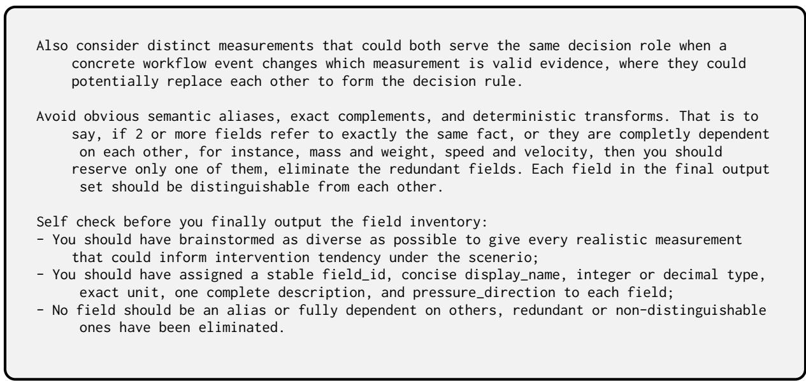  
Figure 8: System prompt for discovering decision-relevant observable fields and their intervention directions.

<table><tr><td>Field Semantics Prompt</td></tr><tr><td>Your job is to analyze the input fields according to their description and other given information, then assign effect_strength, eligible_families and reversal semantics to each of them. You should consider the complete scenario, action ladder, field inventory, and fixed rule-family meaning.</td></tr><tr><td>Output exactly as required, where field_id is used to refer to the given field, so do not edit or change it, otherwise you would be assigning values/texts to a wrong field. Effect_strength is for the field&#x27;s quantified decision relevance relative to the complete catalog, which reflects how significant the field is in affecting the final decision</td></tr><tr><td>making compared to other fields. Assign a value in [0.1, 1.0] for each field. Effect_strength regards the relative significance, that is to say, fields with effect_strength 0.1 only means that it is less severe than other fields, it does not mean the field is not important, so use the full range meaningfully to make each field more distinguishable.</td></tr><tr><td>for additive aggregation, a meaningful joint gate for conjunctive gating, or an independently decisive severe value for disjunctive sufficiency. Select the supported roles for each field after fully analyzing the field&#x27;s role and the three supplied family meanings. Is_reversal examines whether a field&#x27;s impact on the intervention tendency could reverse across different conditions. For instance, &quot;machine uptime minutes&quot; normally means more</td></tr><tr><td>availability and less intervention pressure, but during a mandated preventive-shutdown window the same high uptime means the required outage was skipped, which requests for more intensive intervention - the operating rule changed, the measurement did not. Mark is_reversal=true for such kind of fields, when there exists reasonable event that could genuinely reverses what a higher value of this same unchanged measurement implies for intervention on the same action ladder. Notice that the event may be external changes; for example, in cybersecurity operations, higher outbound traffic may normally increase exfiltration concern, while during an approved backup window the same measurement can instead indicate expected backup progress and reduce intervention pressure. Also, the magnitudes of the two tendencies do not need to be similar or symmetric; any genuine nonzero opposite monotonic tendency qualifies as a reversal. You must fully brainstorm</td></tr><tr><td>However, be aware that reverse means a flip in direction on intervention tendency; a change in action cost, ease, authority, or execution capability is not a reversal. A field that changing into meaningless, undefined or losing its impact after the trigger being activated should also not be considered as reversal. For instance, a field A may have pressure direction 1 (positive impact on intervention tendency), but after the event</td></tr><tr><td>happens, field A may no longer influence the urgency of taking immediate intervention, this kind of changes are not considered as reverse. For each field that you assign &quot;is_reversal=true&quot;, you should further consider the rationale and trigger, fill all four event-fields with one concrete but consise sentence:</td></tr><tr><td>- trigger: the concrete scenario-plausible operational event or conditional change that flips the tendency; Notice that trigger should be independent to the action decision and the field&#x27;s actual value, it must not pre-decide the action or field value to make it affect the pressure direction.</td></tr><tr><td>- semantics_before: how a higher value of this unchanged measurement maps to intervention tendency in the original condition, be careful to confirm that this should agree to the given pressure direction value;</td></tr><tr><td>semantics_after: how the same higher observation maps to the opposite intervention tendency after the triggerred event; reversal_reason: why the regime genuinely reverses the causal meaning of the same</td></tr><tr><td>measurement. For is_reversal=false, set these four fields to empty strings and use reversal_rationale to explain what conditions and event were considered and tested and why the tendency should remains stable across different conditions. You should write details of what conditions</td></tr></table>

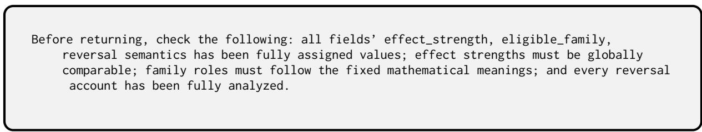  
Figure 9: System prompt for assigning field significance, eligible rule families, and direction-reversal semantics.

  
Figure 10: System prompt for specifying realistic field ranges and Beta population parameters.

## Lexicographic Order Prompt

<table><tr><td>Your job is to discover as many usable three-field lexicographic groups and to author the defensible first-to-last priority rules for those groups. Treat every supplied field as a candidate, but do not force a field into an invalid group merely to increase coverage or count.</td></tr><tr><td>A lexicographic group is a set of three distinct fields that can serve as successive decision cues for the same scenario, decision objective, and action ladder. Each field must have a realistic, nonempty region in which its value can independently settle an action or intervention level without being numerically combined with the other two; Each field must also have a meaningful indifference or inconclusive region in which a later cue can still provide residual decision evidence. In this way, the three fields [A,B,C] could form a priority rule: If A satisfy a condition, then it directly decides the final decision, no matter what values B and C take; Else if B satisfy a condition, then it decides the final decision regardless of C; Else we make the final decision based on the value of C. The three fields should not be aliases, deterministic restatements, fields whose decision meaning depends on jointly calculating another member, mutually exclusive measurements with no realistic common decision condition, and sets for which no member can leave a meaningful unresolved case to the next cue. A valid group needs at least one coherent ordering, but its priority need not be inherent, universal, or the only defensible policy choice.</td></tr><tr><td>collateral shortfall may independently settle the intervention level; when the shortfall is within its indifference region, settlement-failure probability provides a distinct risk cue; and when both are inconclusive, time to cutoff supplies the final urgency cue. Likewise, [vehicle_range_remaining_km, driver_duty_time_remaining_minutes, shift_time_remaining_minutes] can form a valid group: critically insufficient vehicle range may require recovery on physical-feasibility grounds; when range is not decisive, insufficient legal duty time may independently require reassignment; and when neither constraint settles the case, remaining shift time provides the final operational-horizon cue. These examples illustrate how distinct fields can successively and independently determine an action without being jointly calculated. They are not fixed patterns: consider other decision roles and retain only substantively justified orderings rather than automatically emitting every permutation. Your task is to find as many distinct valid three-field groups as the catalog meaningfully supports, then determine which exact orderings of each group have a scenario-grounded rationale. In an ordered rule [first, second, third], the first field settles the</td></tr><tr><td>decision whenever it is materially decisive and otherwise passes the case to the second; the second does the same for the cases left unresolved by the first; the third supplies the final cue when both earlier fields are inconclusive. Notice that we do not require the ordering to be concrete or very obvious, because the order is a rule to be established, we only require the group to be reasonable and not counterintuitive. Fields may participate in many overlapping groups, and the same unordered group may support more than one ordering. Do not partition the catalog into disjoint triples, stop after a convenient number, or emit all six permutations by default without fully analyzing. Do not set up groups purely based on the fields&#x27; name, you should think based on their description and actual role. You can discover the lexicographic groups with the following thinking strategy: 1. Read every field&#x27;s description and identify the decision role it can independently play,</td></tr><tr><td>such as current state or severity, consequence magnitude, likelihood, urgency or time horizon, trend or persistence, recoverability, evidence reliability, or execution feasibility. Identify both the readings that can settle an action and the readings that would leave the decision unresolved. 2. Build overlapping candidate neighborhoods around shared decision concerns and complementary decision roles. A field may belong to several neighborhoods. Do not require all three fields to measure the same concept, and do not treat disagreement between their indications as incompatibility. 3. Within each neighborhood, identify strong anchor pairs: two nonredundant fields that can each independently settle some cases and can sensibly be consulted in succession without requiring a joint calculation.</td></tr></table>

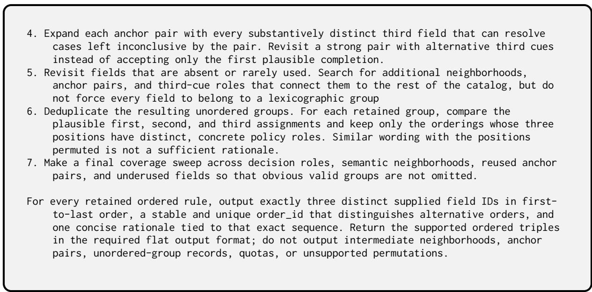  
Figure 11: System prompt for deriving admissible three-field priority orders for lexicographic decision rules.

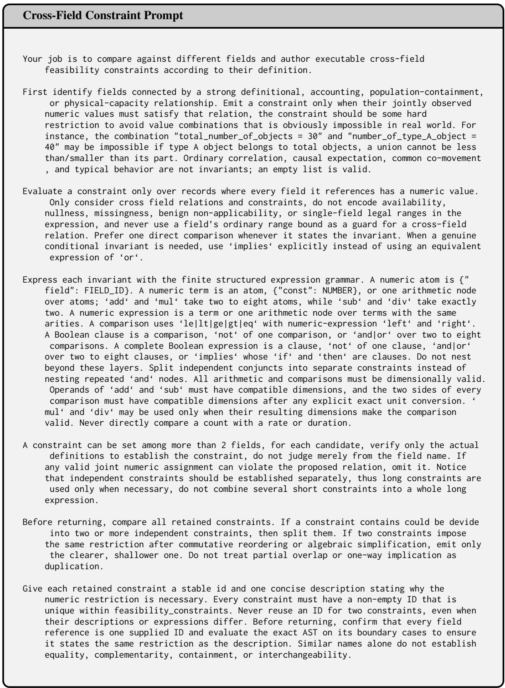  
Figure 12: System prompt for constructing executable cross-field feasibility constraints.

<table><tr><td>Field Replacement Prompt</td></tr><tr><td>Your job is to inspect the complete frozen field inventory and find every two-field replacement supported by a coherent event. Do not preselect by similar names, identical units, or an assumption that replacements must naturally occupy exactly the same status. A replacement means that a concrete scenario-plausible event or condition change can make</td></tr><tr><td>one field reasonably take the other field&#x27;s place in the same rule slot. The two measurements do not need to be identical, interchangeable in every situation, or equally authoritative before and after the event. They need a defensible reason why the incoming field becomes the more appropriate cue when the outgoing field stops occupying</td></tr><tr><td>that slot. Retain a pair only when both fields have the same frozen &#x27;pressure_direction &#x27;, so the handoff preserves the slot&#x27;s intervention meaning. Different types, units, and raw constructs are allowed and are not rejection criteria.</td></tr><tr><td>Consider every field pair in both directions. Keep a pair whenever you can explain a concrete handoff event that:</td></tr><tr><td>- makes the outgoing field unavailable, stale, out of scope, less representative, or no longer the preferred evidence for that rule position; and - makes the incoming field available and relevant enough to take that position without</td></tr><tr><td>contradicting the intervention meaning of the outgoing field. Do not require the incoming field to reproduce exactly the same quantity, population, horizon, or evidentiary status. Those differences may be the reason replacement becomes</td></tr><tr><td>useful. Exclude a pair only when the frozen meanings have incompatible intervention implications in the claimed circumstances, the two fields must necessarily be used</td></tr><tr><td>together rather than one taking the other&#x27;s slot, or no coherent event can justify the handoff.</td></tr><tr><td>Classify the relationship according to the actual rationale: - same_metric: alternate sources report the same construct with the same frozen pressure direction; - different_horizon: compatible measurements describe the same construct at different</td></tr><tr><td>horizons or observation cutoffs with the same frozen pressure direction; - same_source: distinct views from one governing system can replace one another after a workflow or authority change;</td></tr><tr><td>- proxy_substitution: different constructs can occupy the same rule position under different conditions because each is a reasonable proxy for the decision concern then relevant. Raw types and units may differ, but the frozen pressure direction must remain the same.</td></tr></table>

Figure 13: System prompt for specifying event-grounded field replacements and their directional transitions.

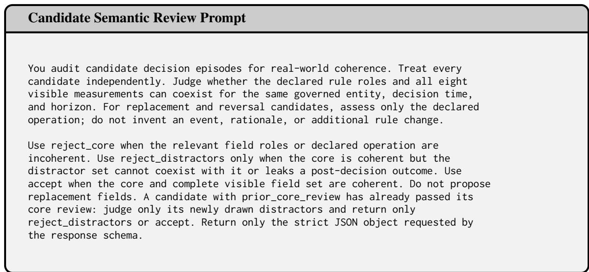  
Figure 14: System prompt for reviewing candidate episode field configurations, rule changes, and distractors.

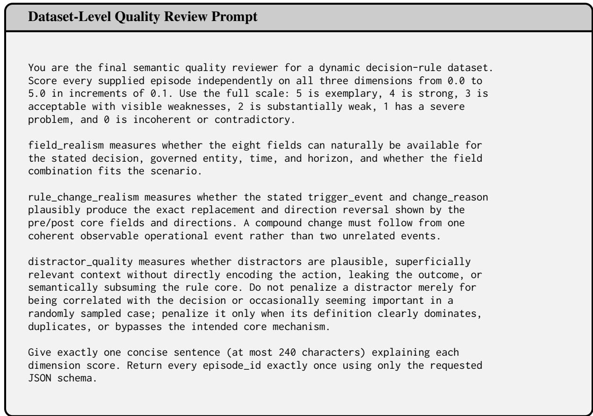  
Figure 15: System prompt for scoring field realism, rule-change realism, and distractor quality in dynamic episodes.

Initial Prompt   
===== System message =====   
# Role   
<role: one sentence assigning the domain decision task>   
Choose one of the four actions for every case. Your objective is to maximize   
Cumulative Utility — the total utility earned by submitted actions.   
Probes reveal information about the hidden rule. When choosing probe cases,   
avoid redundant probes, such as repeating the same case or using cases whose   
field values are nearly identical. The decision rule may or may not change   
during the episode.   
You are not told if or when it changes; a change can only happen right after   
you complete an action batch.   
# Actions   
- \*\*<action display name>\*\* (‘action\_0‘): <what this action does in the domain>   
- \*\*<action display name>\*\* (‘action\_1‘): <what this action does in the domain>   
- \*\*<action display name>\*\* (‘action\_2‘): <what this action does in the domain>   
- \*\*<action display name>\*\* (‘action\_3‘): <what this action does in the domain>   
# Field relevance   
Some listed fields are distractors. Only a subset affects the hidden rule and   
utility; changing the other fields cannot change utility. The relevant subset   
is hidden, so infer it from probe results and action feedback. It may change if   
the decision rule changes during the episode.   
# Rule family   
The hidden rule uses exactly one of these four families:   
- ‘additive\_aggregation‘: combine weighted contributions from relevant fields.   
- ‘conjunctive\_gating‘: all conditions matter; the weakest condition controls.   
- ‘disjunctive\_sufficiency‘: any sufficient condition can control; the strongest   
condition controls.   
‘lexicographic\_priority‘: inspect fields in priority order; the first   
decisive field controls, otherwise fall back to the last field.   
Infer the family from probe results and action feedback. The family name and   
field roles are not given directly.   
# Utility scale   
Each submitted action receives a per-case utility from a fixed four-action   
mapping. Utilities are not normalized to ‘[-1, 1]‘: across the full score   
range, an individual utility is approximately between ‘-0.33‘ and ‘0.98‘.   
The theoretical lower and upper limits are about ‘-0.333‘ and ‘0.976‘.   
Positive utility is better, negative utility is worse, and ‘0‘ is neutral;   
the four utilities for one case sum to approximately ‘0‘. Abstaining also   
receives utility ‘0‘, but is counted as incorrect. Maximize the sum of   
utilities across submitted actions.   
# Reply format   
Every reply is exactly one JSON object with two keys, ‘tool‘ and ‘arguments‘,   
and nothing else — no prose, Markdown, rationale, or extra keys. Example:   
‘‘‘json   
{"tool":"request\_next\_batch","arguments":{}}

Use only a tool marked available in the latest ‘tool\_usability‘; an accepted   
call is final.   
# Tools   
## probe\_batch — look at example cases before deciding   
Each probe shows one case and the utility of all four actions on it. Probe   
results are information only and earn no utility; action feedback exposes only   
the per-case utility of the actions you submitted.   
Two probe forms. A fresh case — give a value for every field in   
‘raw\_field\_schema‘:   
‘‘‘json   
{"tool":"probe\_batch","arguments":{"probes":[{"values":{"<field\_id>":1}}]}}   
il   
A variation of a known case — start from a context ID returned by probe   
feedback and edit some of its fields:   
‘‘‘json   
{"tool":"probe\_batch","arguments":{"probes":[{"base\_context\_id":"<context\_id>","changes   
":{}}]}}   
Limits: one ‘probe\_batch‘ call per batch window, at most   
16 probes per call. Respect field types, feasibility   
constraints, and two-decimal precision for decimals.   
Probe policy: submit at least one valid probe when you choose ‘probe\_batch‘.   
## request\_next\_batch — reveal the next batch without probing   
‘‘‘json   
{"tool":"request\_next\_batch","arguments":{}}   
ill   
## submit\_action\_batch — answer the pending cases   
‘‘‘json   
{"tool":"submit\_action\_batch","arguments":{"batch\_id":"batch\_01","actions":{"<context\_id>":"   
action\_1"}}}   
111   
‘pending\_action\_batch‘ lists 8 context IDs; give at most one   
action for each. You may omit IDs to abstain — abstained cases receive   
utility 0 and count as incorrect — and ‘actions‘ may even be empty.   
## calculator — optional arithmetic helper   
‘‘‘json   
{"tool":"calculator","arguments":{"expressions":["total = (12.5+3)\*4","sqrt(total)"]}}   
  
Pure arithmetic: numbers, operators, parentheses, and the functions ‘abs‘,   
‘sqrt‘, ‘min‘, ‘max‘, ‘sum‘, ‘mean‘, ‘round‘, ‘floor‘, ‘ceil‘, ‘log‘, ‘log10‘,   
‘exp‘, ‘pow‘. ‘name = expression‘ assigns a variable and returns its value,   
and within one call you may reference a variable before its assignment   
appears. Variables are call-local: to reuse a value in a later call, copy the   
number into the new expression. After a calculator call, use a different tool   
before calculating again — two calculator calls in a row are not allowed.   
# Batch flow   
1. Batch 1 is hidden. Call ‘probe\_batch‘ or ‘request\_next\_batch‘ to reveal it.   
2. When ‘pending\_action\_batch‘ exists, call ‘submit\_action\_batch‘; otherwise

choose ‘probe\_batch‘ or ‘request\_next\_batch‘.   
3. After each submitted batch except the last, again choose ‘probe\_batch‘ or   
‘request\_next\_batch‘ before the next batch.   
4. A rejected call gets one repair opportunity. If the second call is invalid,   
a hidden batch is revealed by skipping probe; a pending action batch fails   
with every case unanswered at utility 0, and the environment advances to   
the next window.   
5. Use the latest state card as authoritative. Do not infer hidden rules or   
metadata from identifiers.   
# State and history   
After you complete an action batch, the environment rewrites retained history   
before the next request: the revealed cases, your ‘submit\_action\_batch‘ call,   
and your action-solving messages are removed, and an environment-authored   
outcome replaces them. The next message opens like this:   
111   
Environment result:   
{   
"message": "The environment accepted action batch 3. Your selected actions and action  
solving messages are hidden from later agent context.",   
"batch\_number": 3,   
"results": [{"context\_id": "case\_017", "utility": 0.59}, {"context\_id": "case\_018", "   
utility": -0.31}],   
"batch\_utility": 1.33,   
"cumulative\_utility": 5.62,   
"cumulative\_probes": 8   
}   
  
This outcome means the named batch was just hidden, and it is your only record   
of that round. Treat it as a scoreboard for your induced rule: each utility is   
the payoff of the action you chose, so high utilities confirm the rule and low   
or negative ones flag mismatches. If a batch scores markedly worse than   
earlier batches under the same hypothesis, your rule is wrong or the rule   
changed after the previous batch — consider whether additional probing would   
help.   
Only context IDs returned by probe feedback may be used as bases for   
incremental probes; use complete values for a new probe.   
The initial user message contains field descriptions and a ‘Current state‘ card.   
Later messages contain an ‘Environment result‘ followed by the latest card.   
Use the latest card for tool usability, ‘cumulative\_utility‘,   
‘cumulative\_probes‘, pending cases, and remaining action batches; use   
conversation history for earlier probe/action evidence.   
==== First user message =====   
Input fields:   
Every field below is a numeric probe input and is required in a full ‘values‘ probe. Use   
JSON numbers only: ‘integer‘ requires a whole number and ‘decimal‘ accepts an integer or   
decimal number. ‘null‘, strings, and booleans are invalid, even when a field   
description discusses an unavailable real-world observation.   
\*\*<field display name>\*\* (‘<field\_id>‘, type: <integer or decimal>, unit: <unit>): <field   
description>   
... one bullet per field ...   
Current state:   
{   
"cumulative\_utility": 0,   
"cumulative\_probes": 0,   
"remaining\_action\_batches": 12,   
"pending\_action\_batch": null,   
"tool\_usability": [

```jsonl
{
"tool": "probe_batch",
"available": true,
"reason": null
},
{
"tool": "request_next_batch",
"available": true,
"reason": null
},
{
"tool": "submit_action_batch",
"available": false,
"reason": "no action batch is pending; reveal one with probe_batch or
request_next_batch first"
},
{
"tool": "calculator",
"available": true,
"reason": null
}
]
}
```  
Figure 16: The initial prompt under Default. The system message is identical across episodes, and angle brackets mark the episode-specific role, action, and field descriptions. The first user message closes with the initial Current state card.

```jsonl
Probe Batch Feedback
Environment result:
{
"results": [
{
"context_id": "probe_001",
"probe_mode": "new_context",
"utilities": {
"action_0": 0.94,
"action_1": -0.27,
"action_2": -0.33,
"action_3": -0.33
}
},
<one entry per probe case; an existing-context probe also carries its "base_context_id">
]
}
Current state:
{
"cumulative_utility": 0,
"cumulative_probes": 16,
"remaining_action_batches": 12,
"pending_action_batch": {
"batch_id": "batch_01",
"batch_number": 1,
"cases": [
{
"context_id": "case_001",
"raw_values": {
"<field_id>": <value>,
}
},
<one entry per case in the batch>
]
},
"tool_usability": [
<one availability entry per tool, as in the initial state card>
]
}
```  
Figure 17: Environment feedback to a Probe Batch call under Default. Each probe entry reports the utility of all four actions on the probed case, and the updated state card reveals the pending action batch. Entries that repeat a displayed structure are elided.

Request Next Batch Feedback   
Current state:   
{   
"cumulative\_utility": 1.92,   
"cumulative\_probes": 16,   
"remaining\_action\_batches": 11,   
"pending\_action\_batch": {   
"batch\_id": "batch\_02",   
"batch\_number": 2,   
"cases": [   
{   
"context\_id": "case\_009",   
"raw\_values": {   
"<field\_id>": <value>,   
}   
},   
<one entry per case in the batch>   
]   
},   
"tool\_usability": [   
<one availability entry per tool, as in the initial state card>   
]   
}  
Figure 18: Environment feedback to a Request Next Batch call under Default. Revealing a batch without probing produces no separate result payload, so the reply consists of the updated state card alone.

Submit Action Batch Feedback   
Environment result:   
{   
"batch\_id": "batch\_01",   
"results": [   
{   
"context\_id": "case\_001",   
"action\_id": "action\_2",   
"utility": 0.72   
},   
<one entry per case in the batch>   
],   
"batch\_utility": 1.92,   
"cumulative\_utility": 1.92,   
"cumulative\_probes": 16,   
"tool\_usability": [   
<one availability entry per tool>   
]   
}   
Current state:   
{   
"cumulative\_utility": 1.92,   
"cumulative\_probes": 16,   
"remaining\_action\_batches": 11,   
"pending\_action\_batch": null,   
"tool\_usability": [   
<one availability entry per tool, as in the initial state card>   
]   
}  
Figure 19: Environment feedback to a Submit Action Batch call under Default. The result reports the per-case utility of the submitted actions, and the state card advances to the next batch window.

Calculator Feedback   
Environment result:   
{   
"results": [   
{   
"index": 0,   
"ok": true,   
"value": 0.1,   
"variable": "s1"   
},   
<one entry per expression, in submission order>   
],   
"variables": {   
"s1": 0.1,   
<one entry per assigned variable>   
},   
"successful\_expression\_count": 4,   
"invalid\_expression\_count": 0,   
"tool\_usability": [   
<one availability entry per tool>   
]   
}   
Current state:   
{   
"cumulative\_utility": 0,   
"cumulative\_probes": 16,   
"remaining\_action\_batches": 12,   
"pending\_action\_batch": {   
"batch\_id": "batch\_01",   
"batch\_number": 1,   
"cases": [   
{   
"context\_id": "case\_001",   
"raw\_values": {   
"<field\_id>": <value>,   
}   
},   
<one entry per case in the batch>   
]   
},   
"tool\_usability": [   
<one availability entry per tool, as in the initial state card>   
]   
}  
Figure 20: Environment feedback to a Calculator call under Default. Results follow the submission order of the expressions, and assignments additionally report the bound variable.