# An Empirical Study of Parameter-Eficient Fine-Tuning for Mixture-of-Experts LLMs

Minglei Li1\* Peng Ye2,3\* Haonan He2,4 Jingqi Ye2,4 Qingyu Yang2,5 Tao Chen1,6†

1Fudan University 2Shanghai Artificial Intelligence Laboratory

3The Chinese University of Hong Kong 4University of Science and Technology of China

5KTH Royal Institute of Technology 6Shanghai Innovation Institute

Equal contribution. † Corresponding author.

## Abstract

Parameter-eficient fine-tuning (PEFT) methods are critical for adapting large models under resourceconstrained settings. However, as mixture-of-experts (MoE) architectures, which ofer eficient inference at massive parameter scales, gain increasing prevalence in the community, a critical gap arising from the lack of systematic recipes for applying PEFT to MoE models. To narrow this gap, we conduct a large-scale systematic study that investigates a set of essential design recipes, including which modules should be adapted, which granularity should be used to adapt MoE modules, which PEFT method to use, and to what extent should the load-balancing objective be used, across three MoE backbones on downstream tasks and general knowledge tasks. Our experiments yield several key insights. First, adapting MoE experts alone achieves the highest downstream performance with competitive general capability retention under a comparable parameter budget. Second, native expert-weight updates ofer a better downstream–retention trade-of than adapters that bypass experts or entire MoE modules. Third, LoRA and DoRA together define the strongest operating region for high downstream accuracy among the evaluated PEFT methods. Fourth, no nonzero load-balancing coeficient Pareto-dominates the zero baseline. We finally evaluate a weight-level redesign of MoE2-LoRA on Qwen3. Moving its module-level bypass pool into native expert weights improves all four upstream endpoints by 2.4 to 17.9 points with 17% fewer trainable parameters and a 3.2-point average downstream cost.

€ Project Page

§ Code

z October, 2026

## 1. Introduction

Mixture-of-experts architectures (Du et al., 2022; Fedus et al., 2022; Lepikhin et al., 2021; Shazeer et al., 2017) enable extensive scaling of model parameters while activating only a small fraction of parameters per input unit. This sparse activation paradigm ofers an outstanding trade-of between performance and computation, and has consequently been adopted by frontier models such as GLM-5.2 (GLM-5 Team, 2026) and Kimi-K3 (Kimi Team, 2026). Despite the increasing prevalence of MoE architectures, most existing parameter-eficient fine-tuning (PEFT) methods (Houlsby et al., 2019; Hu et al., 2022; Li and Liang, 2021) and recipes were originally designed for dense models, and the community still lacks a systematic guideline for applying PEFT methods to MoE structures. Given that MoE models typically comprise a massive number of parameters, it is essential to adopt a scientifically grounded guideline for applying PEFT to such models to achieve eficient adaptation. This gap therefore raises a pressing question: How can we adapt MoE models to achieve the best performance-eficiency balance with the least forgetting?

To answer this question, we conduct a large-scale systematic empirical study using representative MoE backbones from diferent families, including Qwen3-30B-A3B-Base (Qwen Team, 2025), Gemma-4-26B-A4B (Gemma Team, 2026), and GPT-OSS-20B (OpenAI, 2025). Specifically, we structure our study around four main axes: (1) which modules should be targeted for adapting MoE models under a similar trainable parameter budget? (2) should adaptation granularity for MoE modules be set at the module level, expert level, or weight level? (3) which PEFT method generally works best for adapting MoE models? (4) how strong should the auxiliary loss coeficient be set for adapting MoE models? We conduct the study using two distinct downstream tasks and two general tasks. The first downstream task is mathematical reasoning, on which base models typically already possess strong capabilities; it serves to probe whether further leverages well-established knowledge. The second downstream task is an intent classification task, which yields unsatisfactory results for the three base models and therefore provides a more stringent test of a PEFT method’s ability to adapt in under-represented regimes.

Our study therefore yields four instructive insights: (1) applying adaptation solely to experts, achieves the best downstream performance; (2) within the MoE modules, applying adaptation at the weight level is more reliable than at the expert level or module level; (3) among the evaluated PEFT methods, LoRA and DoRA deliver the strongest downstream performance, whereas methods with weaker general capabilities retention can fail to learn the target task properly; (4) auxiliary load balancing may degrade performance on both downstream tasks and general capabilities retention. Guided by these findings, we revisit $\mathrm { M o E } ^ { 2 } { \cdot } \mathrm { L o R A } .$ , a PEFT method tailred for MoE fine-tuning, which established a learned mapping between the selection of pre-trained MoE experts and that of LoRA experts. Our modification on MoE2-LoRA improves all four upstream endpoints by 2.4 to 17.9 points with 17% fewer trainable parameters and only a 3.2-point average downstream cost, turning a large task-dependent forgetting into near-complete retention and thereby showing that our insights are efective beyond the controlled grid.

## Our contributions are summarized as follows:

To our knowledge, this is the first large-scale PEFT study conducted directly on pretrained MoE LLMs, covering four design axes, three heterogeneous backbones, and two downstream tasks. Beyond the downstream accuracy that PEFT work usually reports alone, we pair every selected checkpoint with general-capability evaluation on MMLU-Pro and IFEval, so each design choice is judged by what it gains and by what it costs the pretrained model.

We distill the study into four actionable insights on adaptation position, expert granularity, update form, and load balancing, each stated with the regime in which it holds, providing concrete defaults and open questions for future work on MoE adaptation. Functional and spectral analyses explain how weight-level updates reuse pretrained expert computation.

• We show the insights are practical by refining MoE2-LoRA, a recent routed-pool method, along the single axis it does not already follow, which improves all four general-capability endpoints with 17% fewer parameters.

## 2. Related Work

Parameter-eficient Fine-tuning (PEFT). PEFT adapts large models by learning a small set of parameters while keeping pretrained weights largely frozen. Low-rank methods modify pretrained weights through compact updates: LoRA learns a low-rank residual, while DoRA decouples weight magnitude and direction to improve the update (Hu et al., 2022; Liu et al., 2024a). OFT and FourierFT further restrict the update space through orthogonal transformations and frequency-domain parameterization, respectively (Gao et al., 2024b; Qiu et al., 2024), whereas IA3 adapts the model by scaling intermediate activations (Liu et al., 2022). A complementary line introduces conditional computation into PEFT by organizing prompts, adapters, or LoRA modules as routed experts (Dou et al., 2023; Gao et al., 2024a; Li et al., 2024; Luo et al., 2024; Tian et al., 2024). However, these methods are predominantly validated on dense models. It therefore remains unclear how PEFT should interact with the existing experts and routers of an MoE model. In this paper, we systematically study adaptation position, expert granularity, update form, and load balancing to derive principled guidelines for applying PEFT to MoE models.

PEFT for MoE architecture models. PEFT for pretrained MoE models is not a straightforward extension of dense-model PEFT, because sparse routing governs how limited trainable parameters receive supervision. Since each token is dispatched to a few experts, PEFT modules receive uneven, task-dependent signals, making expert selection and update sharing central design choices (Wang et al., 2024c). Conventional top-� routing also provides incomplete gradients for PEFT modules optimization during posttraining (Yao et al.). Moreover, load-balancing objectives may enforce overly uniform routing and weaken the specialization induced by expert-specific updates

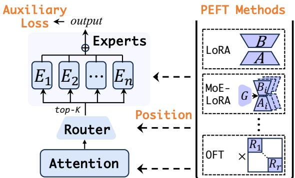  
Figure 1 | Illustration of Position, PEFT Methods, and Auxiliary Loss.

on narrow downstream distributions (Guo et al., 2025; Wang et al., 2024a). Existing PEFT studies address parts of this through task-relevant expert selection, expert-wise allocation, joint router–expert adaptation, or additional routed adaptation modules (Bai et al., 2025; Deng et al., 2026; Liu et al., 2024b; Wang et al., 2024c; Yang et al., 2026). However, they often vary simultaneously in adaptation position, expert granularity, update form, routing strategy, and balancing objective, making it dificult to determine which choices consistently benefit. We therefore conduct a controlled study of these factors to derive robust principles for MoE adaptation.

## 3. Background and Study Design

## 3.1. Background

This work investigates the principled application of PEFT methods to MoE models, with an emphasis on the MoE modules. Formally, given a hidden state �, the computation inside an MoE module can be written as

$$
y = \sum _ { e \in \mathrm { T o p K } ( g ( x ) ) } p _ { e } ( x ) f _ { e } ( x ) ,\tag{1}
$$

where $g$ denotes the router, $p _ { e }$ is the routing probability for expert �, and $f _ { e }$ represents the transformation of expert �.

We model the fine-tuning process as an incremental update of the pre-trained weights:

$$
\begin{array} { r } { W ^ { \prime } = W + \Delta W , } \end{array}\tag{2}
$$

where $W ^ { \prime } \in \mathbb { R } ^ { d _ { \mathrm { o u t } } \times d _ { \mathrm { i n } } }$ is the fine-tuned weight, and � and Δ� correspond to the pre-trained weight and its additive update, respectively. In the case of LoRA,

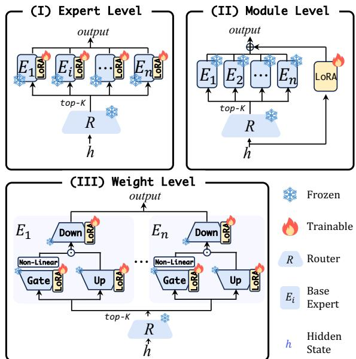  
Figure 2 | Three evaluated adaptation granularities of the MoE module.

the update is parameterized as $\begin{array} { r } { \Delta W = \frac { \alpha } { r } B A . } \end{array}$ , with low-rank matrices $A \in \mathbb { R } ^ { r \times d _ { \mathrm { i n } } }$ and $B \in \mathbb { R } ^ { d _ { \mathrm { o u t } } \times r }$ , while � and � are hyper-parameters controlling the update scale and rank. Other PEFT methods evaluated in this study are deferred to Appendix A.

## 3.2. Study Design

We evaluate Qwen3-30B-A3B-Base, Gemma-4-26B-A4B, and GPT-OSS-20B on two complementary downstream tasks, specifically mathematical reasoning and intent classification. Appendix E details their architectures. For the intent classification task, the models are trained on ESFT\_Intent (Wang et al., 2024c) and evaluated by exact match on 500 held-out examples. For the mathematical reasoning task, models are trained on MetaMathQA-R1, derived from MetaMathQA (Yu et al., 2024), and evaluated on MATH-500 (Hendrycks et al., 2021).

We use MMLU-Pro (Wang et al., 2024b) and IFEval (Zhou et al., 2023) to measure the general capabilities, including knowledge-based reasoning and instruction-following retained after downstream adaptation. For each configuration and model–task pair in the four design studies, we train three seeds per candidate learning rate and select the rate with the highest mean downstream score. We evaluate the three checkpoints at that rate on MMLU-Pro and IFEval and report three-seed means, without using general scores for selection. Detailed implementation settings are provided in Appendix B. Selected learning rates and Qwen3 training throughput are reported in Appendix H.

## 4. Empirical Study

## 4.1. Which Modules Should be Targeted for Adaptation?

We compare attention-only (� = 64), expert-only (� = 256), and attention+experts (� = 32 and 128) under a comparable budget, using one shared branch for the expert block to keep the focus on position. We repeat each with a rank-8 router update and also test the higher-budget attention/expert pair (� = 64/256), with and without router adaptation.

Figure 3 summarizes the adaptation-position study. Expert-only adaptation leads across the six model–task cells at 68.6%, ahead of experts+router at 68.1% and attention+experts at 67.0%. It changes MMLU-Pro and IFEval by −3.3 and −3.6 points. Attention-only reaches 61.7%, with changes of −10.4 and −7.9 points. Attention+experts changes the two benchmarks by −1.8 and −1.0 points, while experts+router changes them by −2.0 and −3.6 points. Without and with router adaptation, the higher-budget settings reach 64.8% and 64.9%; MMLU-Pro changes by −2.2 and −0.6 points, and IFEval by −2.4 and −1.0 points. Expert-only is strongest at comparable budget, while attention+experts retains more general capability.

##  Insight 1.

For MoE fine-tuning, target the experts by default, and adapt the router only when the task calls for routing specialization.

## 4.2. Which Granularity Should be Used to Adapt MoE Modules?

Figure 2 contrasts a rank-256 module-level bypass, a rank-2 expert-level bypass, and weight-level updates at ranks 1 and 2.

Figure 4 shows weight-level adaptation leading at rank 2 with 69.1%, followed by rank 1 at 68.5%, module-level bypass at 68.4%, and expert-level bypass at 64.7%. Rank 1 has the strongest generalcapability profile, changing MMLU-Pro and IFEval by +0.8 and −1.4 points; rank 2 changes them by −0.9 and −3.4. Both bypass alternatives reduce both benchmarks. Rank 2 gains 0.6 downstream points at roughly twice the trainable-parameter count.

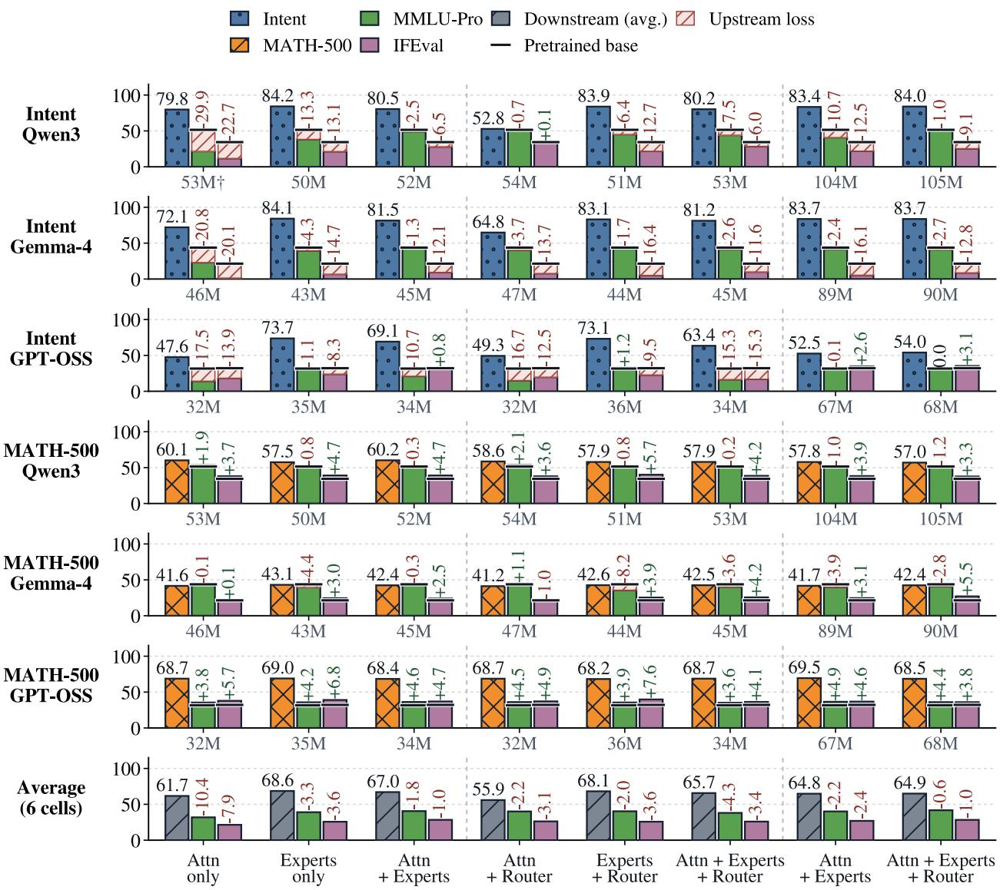  
Figure 3 | Visualized results of the study of adapted modules. Attn denotes attention, and gray labels report trainable parameters.

##  Insight 2.

Weight-level adaptation provides the best trade-of. Rank-1 is a strong default, achieving nearoptimal downstream performance while preserving general capabilities. Increasing the rank brings only marginal gains, whereas bypass-based adaptation is generally less stable and less efective.

## 4.3. Which PEFT Method Generally Works Best for Adapting MoE Models?

We compare LoRA (Hu et al., 2022), DoRA (Liu et al., 2024a), OFT (Qiu et al., 2024), FourierFT (Gao et al., 2024b), and IA3 (Liu et al., 2022), alongside expert-level LoRA, MoE-LoRA (Luo et al., 2024), module-level LoRA, DAS-LoRA (Tang et al., 2026), and last-layer partial fine-tuning (Ye et al., 2023).

Weight-level LoRA and DoRA tie at 68.5% across the six downstream cells. Both raise MMLU-Pro by 0.8 points; DoRA changes IFEval by -1.1, compared with -1.4 for LoRA. Among MoE-specific variants, layer-level LoRA leads at 66.7%, followed by MoE-LoRA at 65.7%, DAS-LoRA at 64.8%, and expert-level LoRA at 64.7%. OFT, FourierFT, IA3, and partial fine-tuning reach 60.8%, 43.6%, 41.3%, and 39.4%. Weight-level LoRA and DoRA provide the strongest downstream accuracy, with DoRA retaining more IFEval performance.

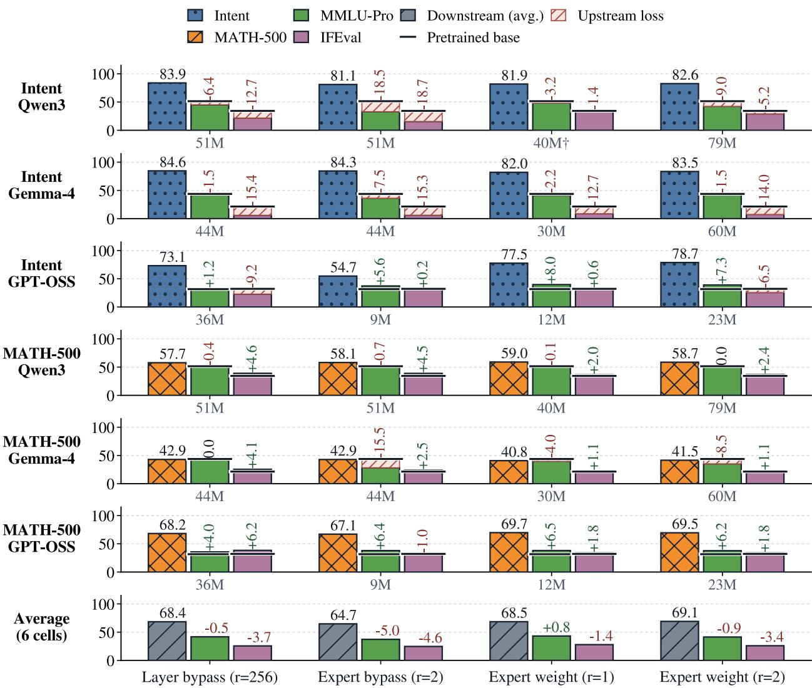  
Figure 4 | Visualized results of the study of MoE adaptation granularity.

##  Insight 3.

Start expert-weight adaptation with standard LoRA or DoRA. Favor DoRA when preserving instruction-following performance is a priority.

## 4.4. How Strong Should the Auxiliary Loss Coeficient Be Set For Adapting MoE Models?

We vary the auxiliary loss coeficient from zero to $1 0 ^ { - 1 }$ while holding the adaptation method and trainable-parameter count fixed, as illustrated in Figure 6.

Figure 6 shows a 68.5% downstream average without auxiliary loss; coeficients of $1 0 ^ { - 4 } , 1 0 ^ { - 3 }$ $1 0 ^ { - 2 } { \bmod { \frac { \cdot } { \cdot } } }$ , and $1 0 ^ { - 1 }$ yield 68.1%, 66.8%, 64.6%, and 58.6%. At $1 0 ^ { - 3 }$ , MMLU-Pro rises 1.2 points, IFEval falls 2.5, and the downstream average falls 1.7 relative to zero. $\mathrm { A t } 1 0 ^ { - 1 }$ , MMLU-Pro and IFEval fall 0.9

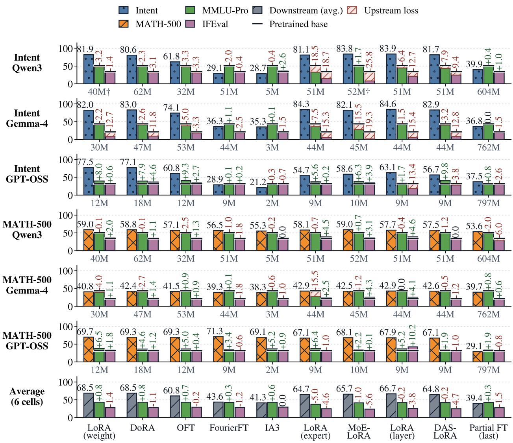  
Figure 5 | Visualized results of the study of PEFT methods.  
and 8.5 points. Larger coeficients therefore reduce downstream performance and IFEval retention.

##  Insight 4.

The auxiliary loss should be disabled or assigned a very small coeficient during MoE adaptation. A coeficient around $1 0 ^ { - 4 }$ is a safe choice when routing regularization is required, whereas larger values can substantially degrade downstream performance.

## 5. Design Implications

To test whether the insights transfer to a composite method, we refine MoE2-LoRA (Yang et al., 2026). It follows Insight 1 by adapting only MoE modules with frozen attention and follows Insight 4 by disabling auxiliary load balancing. It also uses the native router to select entries from a shared pool without updating router weights. Its remaining mismatch is Insight 2: the pool is a module-level bypass rather than an update to native expert projections. We therefore replace each of the 128 rank-32 pool entries with a low-rank update to native expert weights while retaining the routed pool,

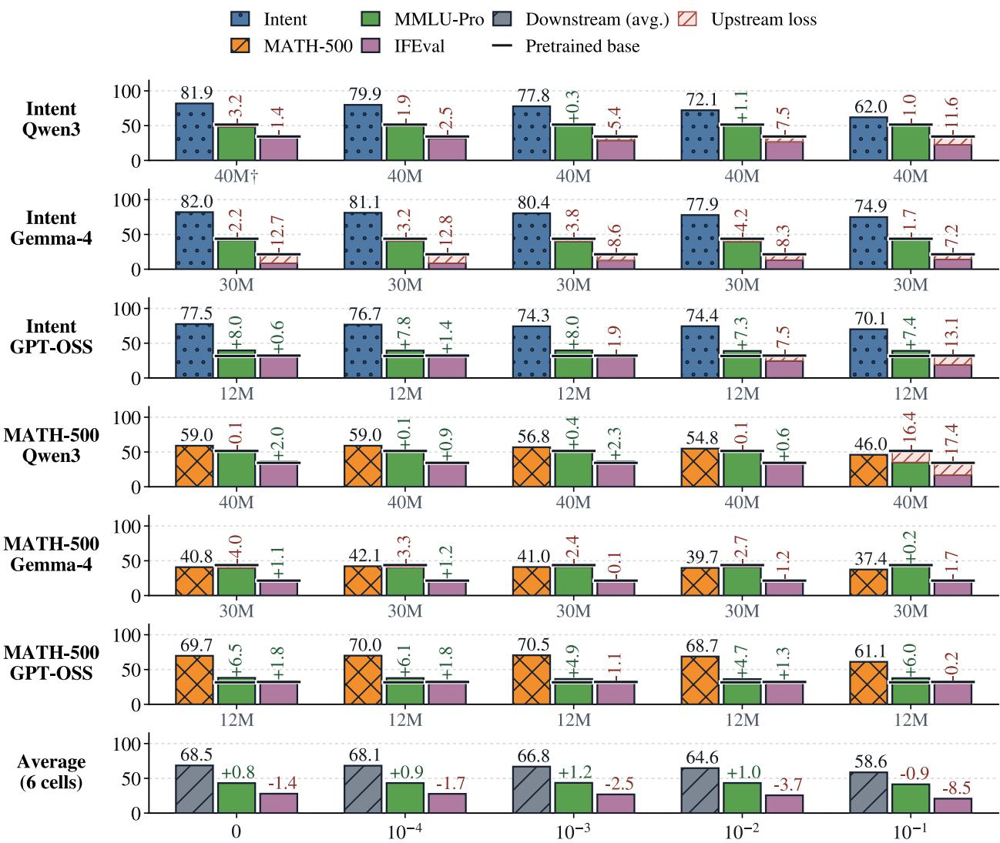  
Figure 6 | Visualized results of the study of the strength of auxiliary loss.  
router-driven selection, frozen attention, and zero balancing coeficient. Appendix A.1 gives both update equations.

Table 1 shows this change reduces the parameter count by 17.0%, from 47.71M to 39.58M. It improves MMLU-Pro and IFEval by 2.44 and 5.18 points on Math, and by 5.94 and 17.93 points on Intent. The mean absolute diference from the base falls from 6.64 to 2.19 points, and the worst loss from 16.27 to 0.87. Intent remains near base on MMLU-Pro at −0.30 and exceeds base on IFEval by 1.66 points; empty responses stay low and truncation falls from 49.2% to 11.1%. The redesign costs 3.2 downstream points while preserving

<table><tr><td colspan="3">Checkpoint Benchmark Original Weight Level</td></tr><tr><td>Trainable params</td><td>47.71M</td><td>39.58M</td></tr><tr><td rowspan="3">Math</td><td>MATH-500 60.0</td><td>55.8</td></tr><tr><td>MMLU-Pro 48.19</td><td>50.63</td></tr><tr><td>IFEval 35.12</td><td>40.30</td></tr><tr><td rowspan="3">Intent</td><td>Intent</td><td>84.0</td><td>81.8</td></tr><tr><td>MMLU-Pro</td><td>45.26</td><td>51.20</td></tr><tr><td>IFEval</td><td>18.11</td><td>36.04</td></tr></table>

Table 1 | Original MoE2-LoRA versus the insightguided expert-weight redesign on Qwen3.

high downstream performance. Appendix D reports additional MoE2-LoRA experiments showing that adding attention adaptation or auxiliary load balancing does not consistently improve performance across tasks.

## 6. Analysis of Adaptation Granularity

We explain the advantage of weight-level adaptation in Insight 2 through functional response diversity and consistency with pretrained expert structure. We use RMSNorm-scaled probes to analyze functional response diversity and pretrained spectral consistency in Qwen3 Math and Intent adapters.

## 6.1. Functional Response Diversity

For a layer with base output $F _ { 0 }$ and adapted output $F _ { a } ,$ collect the changes on shared probes as $Y = [ F _ { a } ( x _ { j } ) - F _ { 0 } ( x _ { j } ) ] _ { j = 1 } ^ { n }$ . We measure how broadly response energy spans output directions using the functional efective rank

$$
r _ { \mathrm { e f f } } ( Y ) = { \frac { ( \operatorname { t r } K ) ^ { 2 } } { \| K \| _ { F } ^ { 2 } + \varepsilon } } , \qquad K = { \frac { 1 } { n } } Y Y ^ { \top } .\tag{3}
$$

Equal energy in � orthogonal directions gives $r _ { \mathrm { e f f } } = k$ up to the numerical stabilizer, making the four granularities comparable.

Weight-level updates reuse the frozen expert’s nonlinear features. For a gated expert $f _ { e } ( x ) =$ $D _ { e } [ \sigma ( G _ { e } x ) \odot U _ { e } x ]$ , a rank-one up-projection update $\Delta U _ { e } = a b ^ { \top }$ gives the exact correction

$$
\begin{array} { r } { \delta _ { U } f _ { e } ( x ) = ( b ^ { \top } x ) D _ { e } \operatorname { D i a g } ( a ) \sigma ( G _ { e } x ) . } \end{array}\tag{4}
$$

The frozen nonlinear features $\sigma ( G _ { e } x )$ let a rank-one update span multiple output directions, while routing combines expert-specific responses. Appendix F gives the derivation, rank bounds, and probe protocol.

(a) Math-adapted checkpoint  
(b) Intent-adapted checkpoint  
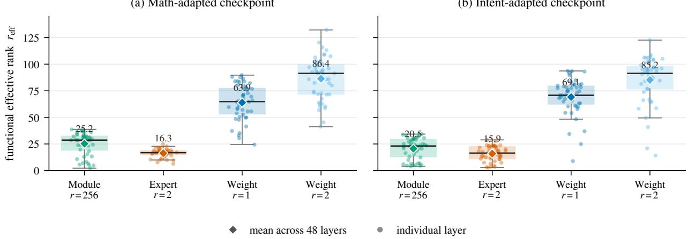  
Figure 7 | Functional response diversity across all 48 Qwen3 MoE layers on synthetic probes. Points denote layers, boxes show medians and interquartile ranges, and diamonds mark means. Weight-level rank-one updates produce broad layer responses on both adapted checkpoints.

Figure 7 shows mean efective ranks of 63.90 and 69.08 for weight-level � = 1 on Math and Intent, compared with 16.31 and 15.91 for expert-level $r = 2$ . The module-level $r = 2 5 6$ update reaches 25.25 and 20.54, while weight-level $r = 2$ reaches 86.37 and 85.22. Native weight updates therefore produce broad responses at low rank, with additional rank expanding coverage.

## 6.2. Pretrained Spectral Consistency

To test alignment with the pretrained expert, let $u _ { e , i }$ and $\sigma _ { e , i }$ denote the left singular vectors and descending singular values of its frozen down projection. For perturbations $\mathit { Y _ { e , } }$ define the cumulative

energy $S _ { k }$ and pretrained profile $S _ { k , e } ^ { 0 }$ as

$$
S _ { k } = \frac { \sum _ { i \leq k } \| u _ { e , i } ^ { \top } Y _ { e } \| _ { 2 } ^ { 2 } } { \sum _ { i \leq m } \| u _ { e , i } ^ { \top } Y _ { e } \| _ { 2 } ^ { 2 } + \varepsilon } , \qquad S _ { k , e } ^ { 0 } = \frac { \sum _ { i \leq k } \sigma _ { e , i } ^ { 2 } } { \sum _ { i \leq m } \sigma _ { e , i } ^ { 2 } } .\tag{5}
$$

At cutofs $\mathcal { K } = \{ 1 6 , 6 4 , 2 5 6 \}$ and expert width $m = 7 6 8$ , the spectral-consistency score is

$$
C _ { \mathrm { s p e c } } = 1 - \frac { \sum _ { k \in \mathcal { K } } | S _ { k } - S _ { k , e } ^ { 0 } | } { \sum _ { k \in \mathcal { K } } | k / m - S _ { k , e } ^ { 0 } | + \varepsilon } .\tag{6}
$$

A score of one matches the pretrained profile, while zero denotes uniform energy. Appendix G gives the derivation and full spectral and output-subspace results.

(b) Intent-adapted profile  
(a) Math-adapted profile  
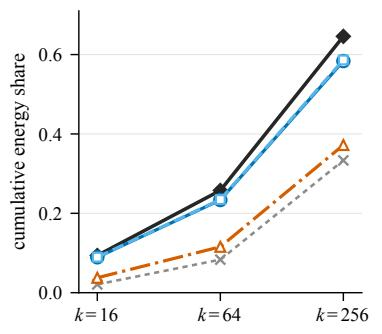

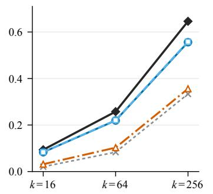  
(c) Position-wise distribution

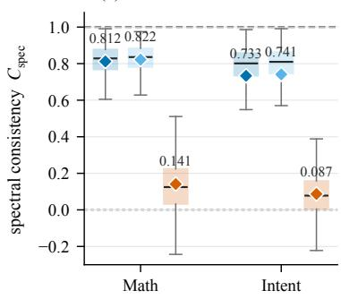  
Pretrained $W _ { \mathrm { d o w n } }$ Uniform reference Weight r = 1 Weight r = 2 Expert r = 2  
Figure 8 | Pretrained spectral consistency on Qwen3: Math and Intent energy profiles and score distributions across layer–expert positions. Weight-level updates follow the pretrained spectrum.

Figure 8 shows mean $C _ { \mathrm { s p e c } }$ values of 0.812 and 0.822 on Math and 0.733 and 0.741 on Intent for weight-level ranks 1 and 2, versus 0.141 and 0.087 for expert-level rank 2. Rank-one weight updates lead across all 48 layer means and at 99.8% of Math and 96.3% of Intent positions. Measurements across gate, up, and down projections confirm spectral alignment; rank two broadens responses while retaining it. These results explain the low-rank eficiency behind Insight 2.

## 7. Conclusion

MoE-PEFT is not only a choice of update parameterization; placement, granularity, optimization, and routing objectives materially change its reliability. Across three backbones and two tasks, expert FFNs are the downstream-robust placement, native expert weights are the most reliable evaluated granularity, LoRA/DoRA lead when a high downstream floor is enforced, and zero auxiliary load balancing is the only no-tuning joint default. None is universal: mixed placement can drift less, low-drift update forms can adapt poorly, and a moderate auxiliary coeficient can trade downstream accuracy for better retention of some general capabilities. Our Qwen3 analyses show that weight-level adaptation combines broad functional responses with strong reuse of pretrained spectral structure. These defaults also carry over beyond our own grid: a weight-level redesign of $\mathrm { M o E } ^ { 2 } { \cdot } \mathrm { L o R A }$ that moves its module-level bypass pool into native expert weights improves all four upstream endpoints by 2.4 to 17.9 points with 17% fewer trainable parameters at a small downstream cost. We therefore ofer these defaults as a scoped but directionally reliable starting point for MoE adaptation. We hope our findings and analyses can stimulate further research on parameter-eficient adaptation of MoE models, and encourage future methods to report what each design choice costs the pretrained model alongside what it gains.

## References

Jun Bai, Minghao Tong, Yang Liu, Zixia Jia, and Zilong Zheng. Understanding and leveraging the expert specialization of context faithfulness in mixture-of-experts LLMs. In Proceedings of the 2025 Conference on Empirical Methods in Natural Language Processing, pages 21927–21942. Association for Computational Linguistics, 2025. doi: 10.18653/v1/2025.emnlp-main.1114.

Guanzhi Deng, Bo Li, Ronghao Chen, Xiujin Liu, Zhuo Han, Huacan Wang, Lijie Wen, and Linqi Song. DR-LoRA: Dynamic rank LoRA for fine-tuning mixture-of-experts models, 2026.

Shihan Dou, Enyu Zhou, Yan Liu, Songyang Gao, Jun Zhao, Wei Shen, Yuhao Zhou, Zhiheng Xi, Xiao Wang, Xiaoran Fan, Shiliang Pu, Jiang Zhu, Rui Zheng, Tao Gui, Qi Zhang, and Xuanjing Huang. LoRAMoE: Alleviate world knowledge forgetting in large language models via MoE-style plugin, 2023.

Nan Du, Yanping Huang, Andrew M. Dai, Simon Tong, Dmitry Lepikhin, Yuanzhong Xu, Maxim Krikun, Yanqi Zhou, Adams Wei Yu, Orhan Firat, Barret Zoph, Liam Fedus, Maarten Bosma, Zongwei Zhou, Tao Wang, Emma Wang, Kellie Webster, Marie Pellat, Kevin Robinson, Kathleen Meier-Hellstern, Toju Duke, Lucas Dixon, Kun Zhang, Quoc V. Le, Yonghui Wu, Zhifeng Chen, and Claire Cui. GLaM: Eficient scaling of language models with mixture-of-experts. In Proceedings of the 39th International Conference on Machine Learning, volume 162, pages 5547–5569, 2022.

William Fedus, Barret Zoph, and Noam Shazeer. Switch transformers: Scaling to trillion parameter models with simple and eficient sparsity. Journal of Machine Learning Research, 23(120):1–39, 2022.

Chongyang Gao, Kezhen Chen, Jinmeng Rao, Baochen Sun, Ruibo Liu, Daiyi Peng, Yawen Zhang, Xiaoyuan Guo, Jie Yang, and V. S. Subrahmanian. Higher layers need more LoRA experts, 2024a.

Ziqi Gao, Qichao Wang, Aochuan Chen, Zijing Liu, Bingzhe Wu, Liang Chen, and Jia Li. Parametereficient fine-tuning with discrete fourier transform, 2024b.

Gemma Team. Gemma 4 technical report, 2026.

GLM-5 Team. GLM-5: From vibe coding to agentic engineering, 2026.

Hongcan Guo, Haolang Lu, Guoshun Nan, Bolun Chu, Jialin Zhuang, Yuan Yang, Wenhao Che, Xinye Cao, Sicong Leng, Qimei Cui, and Xudong Jiang. Advancing expert specialization for better MoE. In Advances in Neural Information Processing Systems, 2025. URL https://papers.nips.cc/paper\_ files/paper/2025/file/4598de7d243d528e38eb0c5d8155fb52-Paper-Conference.pdf.

Dan Hendrycks, Collin Burns, Saurav Kadavath, Akul Arora, Steven Basart, Eric Tang, Dawn Song, and Jacob Steinhardt. Measuring mathematical problem solving with the MATH dataset. In Advances in Neural Information Processing Systems Datasets and Benchmarks Track, 2021.

Neil Houlsby, Andrei Giurgiu, Stanislaw Jastrzebski, Bruna Morrone, Quentin de Laroussilhe, Andrea Gesmundo, Mona Attariyan, and Sylvain Gelly. Parameter-eficient transfer learning for NLP. In Proceedings of the 36th International Conference on Machine Learning, volume 97 of Proceedings of Machine Learning Research, pages 2790–2799, 2019.

Edward J. Hu, Yelong Shen, Phillip Wallis, Zeyuan Allen-Zhu, Yuanzhi Li, Shean Wang, Lu Wang, and Weizhu Chen. LoRA: Low-rank adaptation of large language models. In International Conference on Learning Representations, 2022.

Kimi Team. Kimi K3: Open frontier intelligence, 2026.

Dmitry Lepikhin, HyoukJoong Lee, Yuanzhong Xu, Dehao Chen, Orhan Firat, Yanping Huang, Maxim Krikun, Noam Shazeer, and Zhifeng Chen. GShard: Scaling giant models with conditional computation and automatic sharding. In International Conference on Learning Representations, 2021.

Dengchun Li, Yingzi Ma, Naizheng Wang, Zhengmao Ye, Zhiyuan Cheng, Yinghao Tang, Yan Zhang, Lei Duan, Jie Zuo, Cal Yang, and Mingjie Tang. MixLoRA: Enhancing large language models fine-tuning with LoRA-based mixture of experts, 2024.

Xiang Lisa Li and Percy Liang. Prefix-tuning: Optimizing continuous prompts for generation. In Proceedings of the 59th Annual Meeting of the Association for Computational Linguistics, pages 4582–4597, 2021. doi: 10.18653/v1/2021.acl-long.353.

Haokun Liu, Derek Tam, Mohammed Muqeeth, Jay Mohta, Tenghao Huang, Mohit Bansal, and Colin Rafel. Few-shot parameter-eficient fine-tuning is better and cheaper than in-context learning. In Advances in Neural Information Processing Systems, volume 35, 2022.

Shih-Yang Liu, Chien-Yi Wang, Hongxu Yin, Pavlo Molchanov, Yu-Chiang Frank Wang, Kwang-Ting Cheng, and Min-Hung Chen. DoRA: Weight-decomposed low-rank adaptation, 2024a.

Yilun Liu, Yunpu Ma, Shuo Chen, Zifeng Ding, Bailan He, Zhen Han, and Volker Tresp. PERFT: Parameter-eficient routed fine-tuning for mixture-of-expert model, 2024b.

Tongxu Luo, Jiahe Lei, Fangyu Lei, Weihao Liu, Shizhu He, Jun Zhao, and Kang Liu. MoELoRA: Contrastive learning guided mixture of experts on parameter-eficient fine-tuning for large language models, 2024.

OpenAI. gpt-oss-20b model card. Hugging Face model card: https://huggingface.co/openai/gpt-oss-20b, 2025. Accessed 2026-07-24.

Zeju Qiu, Weiyang Liu, Haiwen Feng, Yuxuan Xue, Yao Feng, Zhen Liu, Dan Zhang, Adrian Weller, and Bernhard Schölkopf. Controlling text-to-image difusion by orthogonal finetuning, 2024.

Qwen Team. Qwen3 technical report, 2025.

Jef Rasley, Samyam Rajbhandari, Olatunji Ruwase, and Yuxiong He. DeepSpeed: System optimizations enable training deep learning models with over 100 billion parameters. In Proceedings of the 26th ACM SIGKDD International Conference on Knowledge Discovery and Data Mining, pages 3505–3506, 2020.

Noam Shazeer, Azalia Mirhoseini, Krzysztof Maziarz, Andy Davis, Quoc Le, Geofrey Hinton, and Jef Dean. Outrageously large neural networks: The sparsely-gated mixture-of-experts layer. In International Conference on Learning Representations, 2017.

Yiru Tang, Kun Zhou, Xin Zhao, Jing Sha, Zhichao Sheng, and Shijin Wang. Exploring expert concentration for parameter-eficient fine-tuning of mixture-of-expert LLMs, 2026. URL https: //openreview.net/forum?id=zBgjWTWgCh.

Chunlin Tian, Zhan Shi, Zhijiang Guo, Li Li, and Chengzhong Xu. HydraLoRA: An asymmetric LoRA architecture for eficient fine-tuning, 2024.

Lean Wang, Huazuo Gao, Chenggang Zhao, Xu Sun, and Damai Dai. Auxiliary-loss-free load balancing strategy for mixture-of-experts. arXiv preprint arXiv:2408.15664, 2024a. doi: 10.48550/arXiv.2408. 15664. URL https://arxiv.org/abs/2408.15664.

Yubo Wang, Xueguang Ma, Ge Zhang, Yuansheng Ni, Abhranil Chandra, Shiguang Guo, Weiming Ren, Aaran Arulraj, Xuan He, Ziyan Jiang, Tianle Li, Max Ku, Kai Wang, Alex Z. Wang, and Wenhu Chen. MMLU-Pro: A more robust and challenging multi-task language understanding benchmark, 2024b.

Zihan Wang, Deli Chen, Damai Dai, Runxin Xu, Zhuoshu Li, and Yu Wu. Let the expert stick to his last: Expert-specialized fine-tuning for sparse architectural large language models. In Proceedings of the 2024 Conference on Empirical Methods in Natural Language Processing, pages 784–801. Association for Computational Linguistics, 2024c. doi: 10.18653/v1/2024.emnlp-main.46.

Qingyu Yang, Haonan He, Minglei Li, Jingqi Ye, Tao Chen, Lei Bai, and Peng Ye. MoE2-LoRA: When MoE models meet MoE-style low-rank adaptation, 2026.

Feng Yao, Junxia Cui, Ruohan Zhang, Liyuan Liu, Shibo Hao, Li Zhang, Chengyu Dong, Shuohang Wang, Jianfeng Gao, Jingbo Shang, et al. Densemixer: Improving moe post-training with precise router gradient. In NeurIPS 2025 Workshop on Structured Probabilistic Inference {\&} Generative Modeling.

Peng Ye, Yongqi Huang, Chongjun Tu, Minglei Li, Tao Chen, Tong He, and Wanli Ouyang. Partial fine-tuning: A successor to full fine-tuning for vision transformers, 2023. URL https://arxiv.org/ abs/2312.15681.

Longhui Yu, Weisen Jiang, Han Shi, Jincheng Yu, Zhengying Liu, Yu Zhang, James T. Kwok, Zhenguo Li, Adrian Weller, and Weiyang Liu. MetaMath: Bootstrap your own mathematical questions for large language models. In International Conference on Learning Representations, 2024.

Jefrey Zhou, Tianjian Lu, Swaroop Mishra, Siddhartha Brahma, Sujoy Basu, Yi Luan, and Denny Zhou. Instruction-following evaluation for large language models, 2023.

## An Empirical Study of Parameter-Eficient Fine-Tuning for Mixture-of-Experts LLMs Supplementary Material

The supplementary material is organized as follows:

• Appendix A defines the MoE and PEFT updates, including MoE2-LoRA and its redesign.

• Appendix B describes the datasets, checkpoint selection, and evaluation protocol.

• Appendix C gives the settings for the four design studies.

• Appendix D reports additional MoE2-LoRA placement and balancing experiments.

• Appendix E compares the backbones’ attention and expert architectures.

• Appendix F derives and measures functional response diversity across adaptation granularities.

• Appendix G analyzes pretrained spectral structure and expert output-subspace alignment.

• Appendix H reports selected learning rates and Qwen3 training throughput.

## A. Overview and Notation

Let $x \in \mathbb { R } ^ { d }$ denote the token representation entering an MoE layer. Each routed expert is a gated feed-forward network. Using the fused gate/up projection employed by the evaluated backbones, expert � is

$$
\begin{array} { r } { \bigg [ a _ { e } ( \boldsymbol { x } ) \bigg ] = W _ { \mathrm { g u } , e } x , \qquad W _ { \mathrm { g u } , e } \in \mathbb { R } ^ { 2 d _ { \mathrm { f f } } \times d } , } \end{array}\tag{7}
$$

$$
h _ { e } ( x ) = \phi ( a _ { e } ( x ) ) \odot u _ { e } ( x ) ,\tag{8}
$$

$$
f _ { e } ( x ) = W _ { \mathrm { d o w n } , e } h _ { e } ( x ) , \qquad W _ { \mathrm { d o w n } , e } \in \mathbb { R } ^ { d \times d _ { \mathrm { f f } } } ,\tag{9}
$$

where $\phi$ is the backbone activation function; for a SwiGLU expert, $\phi$ is SiLU. Equivalently, $W _ { \mathrm { g u } , e }$ may be written as separate gate and up matrices $W _ { \mathrm { g a t e } , e }$ and $W _ { \mathrm { u p , \it e } }$ . Biases are omitted for clarity.

Let $\boldsymbol { g } ( \boldsymbol { x } ) \in \mathbb { R } ^ { E }$ denote the native router logits over � routed experts. For a router that renormalizes its selected probabilities, define

$$
\bar { p } _ { e } ( x ) = \frac { \exp ( g _ { e } ( x ) ) } { \sum _ { j = 1 } ^ { E } \exp ( g _ { j } ( x ) ) } ,\tag{10}
$$

$$
S ( x ) = \mathrm { T o p K } ( \bar { p } ( x ) , k ) ,\tag{11}
$$

$$
p _ { e } ( x ) = \frac { \bar { p } _ { e } ( x ) } { \sum _ { j \in S ( x ) } \bar { p } _ { j } ( x ) } , \qquad e \in S ( x ) .\tag{12}
$$

The routed MoE output is

$$
y _ { \mathrm { r o u t e d } } ( x ) = \sum _ { e \in S ( x ) } p _ { e } ( x ) f _ { e } ( x ) .\tag{13}
$$

If a backbone contains an always-on shared expert $f _ { \mathrm { s h } } ,$ , the complete MoE output may be written abstractly as

$$
y _ { \mathrm { M o E } } ( x ) = y _ { \mathrm { r o u t e d } } ( x ) + c _ { \mathrm { s h } } ( x ) f _ { \mathrm { s h } } ( x ) ,\tag{14}
$$

where $c _ { \mathrm { s h } } ( x )$ is the native shared-expert gate, or one for an ungated shared expert. This term is omitted for backbones without a shared expert. Router normalization, shared-expert gating, residual placement, and normalization layers otherwise remain unchanged from the pretrained backbone.

Each routed expert contains fused gate/up and down projections. We use Weight Level for directly adapting these expert weights, Expert Level for applying one adaptation branch to each routed expert, and Module Level for applying one shared adaptation branch to the complete MoE module in a layer. All unlisted pretrained parameters remain frozen.

DoRA. DoRA (Liu et al., 2024a) separates the magnitude and direction of an adapted weight. Under the convention $W _ { 0 } \in \mathbb { R } ^ { d _ { \mathrm { o u t } } \times d _ { \mathrm { i n } } }$ and $y = W _ { 0 } x _ { \cdot }$ , define

$$
V = W _ { 0 } + { \frac { \alpha } { r } } B A ,\tag{15}
$$

$$
m _ { 0 } = \| W _ { 0 } \| _ { \mathrm { r o w } } , \qquad m \in \mathbb { R } ^ { d _ { \mathrm { o u t } } } ,\tag{16}
$$

where � is trainable and initialized as $m _ { 0 }$ . The adapted weight is

$$
\begin{array} { r } { W ^ { \prime } = \mathrm { D i a g } ( m \oslash \| V \| _ { \mathrm { r o w } } ) V . } \end{array}\tag{17}
$$

Here $\oslash$ denotes elementwise division. This row-wise expression is the transpose-equivalent form of the column-wise normalization used in the original DoRA notation.

The memory-eficient implementation replaces the normalizer used for gradient computation by

$$
c ( V ) = \mathrm { s t o p g r a d } ( \| V \| _ { \mathrm { r o w } } ) , \qquad W ^ { \prime } = \mathrm { D i a g } ( m \oslash c ( V ) ) V .\tag{18}
$$

The stop-gradient operation changes the backward graph, not the numerical forward value. Weightlevel DoRA is applied independently to the fused gate/up and down projections of each adapted routed expert.

OFT. OFT (Qiu et al., 2024) applies the same orthogonal transformation to the weight vector of every output neuron in a frozen projection. For a skew-symmetric parameter $Q ,$

$$
\begin{array} { r } { Q ^ { \top } = - Q , \qquad R = ( I + Q ) ( I - Q ) ^ { - 1 } , \qquad R ^ { \top } R = I . } \end{array}\tag{19}
$$

Under the convention $y = W x$ , with $W \in \mathbb { R } ^ { d _ { \mathrm { o u t } } \times d _ { \mathrm { i n } } }$ , the adapted projection is

$$
\boldsymbol { W } ^ { \prime } = \boldsymbol { W } \boldsymbol { R } ^ { \intercal } , \qquad \boldsymbol { y } ^ { \prime } = \boldsymbol { W } \boldsymbol { R } ^ { \intercal } \boldsymbol { x } ,\tag{20}
$$

Here $R \in \mathbb { R } ^ { d _ { \mathrm { i n } } \times d _ { \mathrm { i n } } }$ acts on the input dimension, equivalently transforming each row weight vector by the same orthogonal map. For block-diagonal OFT,

$$
R = { \mathrm { D i a g } } ( R _ { 1 } , \ldots , R _ { b } ) ,\tag{21}
$$

and the block size must divide the input width $d _ { \mathrm { i n } }$ . The skew-symmetric parameters are initialized so that $R = I$ at initialization.

FourierFT. FourierFT (Gao et al., 2024b) represents a dense weight update using a small number of trainable Fourier coeficients. Let Ω be a fixed random support in the two-dimensional frequency domain, and let $S _ { \Omega } ( c )$ scatter the trainable real coeficient vector � into the corresponding frequency locations. The update is

$$
\Delta W = \gamma \mathrm { ~ R e } [ \mathrm { I D F T } _ { 2 } ( S _ { \Omega } ( c ) ) ] , \qquad W ^ { \prime } = W + \Delta W .\tag{22}
$$

The original method samples the support once and uses randomly initialized coeficients. In our benchmark implementation, the support is fixed with seed 2024, the coeficients are instead initialized to zero so that $\Delta W = 0$ initially, and the update scale is set to $\gamma = 1 5 0$ . These are experimental implementation choices rather than defining properties of FourierFT.

IA3. IA3 (Liu et al., 2022) learns multiplicative activation vectors. For routed expert $e ,$ let

$$
h _ { e } ( x ) = \phi \bigl ( W _ { \mathrm { g a t e } , e } x \bigr ) \odot W _ { \mathrm { u p } , e } x .\tag{23}
$$

The feed-forward IA3 vector $\ell _ { \mathrm { f f } , e } \in \mathbb { R } ^ { d _ { \mathrm { f f } } }$ modifies the expert as

$$
f _ { e } ^ { \mathrm { I A 3 } } ( x ) = W _ { \mathrm { d o w n } , e } \left( \ell _ { \mathrm { f f } , e } \odot h _ { e } ( x ) \right) .\tag{24}
$$

All IA3 vectors are initialized to one. Canonical IA3 additionally scales attention key and value activations, but attention adaptation is disabled in the final PEFT method comparison.

Where router IA3 is enabled in our benchmark, it is a MoE-specific extension rather than part of canonical IA3. It is applied before top-� selection:

$$
g ^ { \mathrm { I A 3 } } ( x ) = \ell _ { \mathrm { r o u t e r } } \odot g ( x ) , \qquad \ell _ { \mathrm { r o u t e r , 0 } } = 1 ,\tag{25}
$$

and $S ( x )$ and $p _ { e } ( x )$ are then computed from $g ^ { \mathrm { I A 3 } } ( x )$

DAS-LoRA. DAS-LoRA (Tang et al., 2026) performs an ofline analysis of native router statistics on downstream-domain and reference data. It computes the paper’s cumulative Domain Advantage Score (CDAS) for each routed expert and selects a fixed budget of task-relevant experts in each layer:

$$
\begin{array} { r } { \mathcal { E } _ { \ell } ^ { \mathrm { D A S } } = \mathrm { T o p B } \left( \left\{ \mathrm { C D A S } _ { \ell , e } \right\} _ { e = 1 } ^ { E } , b _ { \ell } \right) , } \end{array}\tag{26}
$$

where $b _ { \ell }$ is the selected-expert budget. We do not replace the paper’s CDAS procedure by a simple diference of mean routing probabilities.

LoRA is attached only to the gate/up/down weights of the selected experts. Writing $\Delta f _ { \ell , e } ^ { \mathrm { L o R A } } ( x )$ for the change induced by those weight-level low-rank updates, the layer output is

$$
y _ { \ell } ^ { \prime } ( x ) = \sum _ { e \in S _ { \ell } ( x ) } p _ { \ell , e } ( x ) \left[ f _ { \ell , e } ( x ) + \mathbb { I } { \Big ( } e \in { \mathcal { E } } _ { \ell } ^ { \mathrm { D A S } } { \Big ) } \Delta f _ { \ell , e } ^ { \mathrm { L o R A } } ( x ) \right] .\tag{27}
$$

Thus an adapted expert contributes only when it is both selected ofline by DAS-LoRA and dispatched to the current token by the native router.

## A.1. MoE2-LoRA and the Insight-Guided Redesign

Canonical MoE2-LoRA. MoE2-LoRA (Yang et al., 2026) uses both native router information and a low-dimensional hidden-state channel to route over a global pool of LoRA experts. For MoE layer ℓ, let

$$
\begin{array} { r } { \boldsymbol { z } _ { \ell } ( \boldsymbol { x } ) = \boldsymbol { g } _ { \ell } ( \boldsymbol { x } ) \in \mathbb { R } ^ { E } , } \end{array}\tag{28}
$$

$$
h _ { \ell } ^ { c } ( x ) = W _ { \ell } ^ { h } x \in \mathbb { R } ^ { d _ { b } } .\tag{29}
$$

The layer-specific LoRA-pool router is

$$
\begin{array} { r l r } { q _ { \ell } ( x ) = \mathrm { s o f t m a x } \left( W _ { \ell } ^ { q } \left[ \frac { z _ { \ell } ( x ) } { h _ { \ell } ^ { c } ( x ) } \right] \right) , } & { { } } & { W _ { \ell } ^ { q } \in \mathbb { R } ^ { N _ { L } \times ( E + d _ { b } ) } . } \end{array}\tag{30}
$$

Let

$$
\mathcal { T } _ { \ell } ( x ) = \mathrm { T o p K } ( q _ { \ell } ( x ) , K _ { L } ) .\tag{31}
$$

The selected pool probabilities are renormalized as

$$
\widetilde { q } _ { \ell , j } ( x ) = \frac { q _ { \ell , j } ( x ) } { \sum _ { i \in \mathcal { T } _ { \ell } ( x ) } q _ { \ell , i } ( x ) } , \qquad j \in \mathcal { T } _ { \ell } ( x ) .\tag{32}
$$

A single LoRA expert pool $\{ ( A _ { j } , B _ { j } ) \} _ { j = 1 } ^ { N _ { L } }$ is shared across all MoE layers, while the routing projections are layer-specific. The canonical module-level update is

$$
y _ { \ell } ^ { \prime } ( x ) = y _ { \mathrm { M o E } , \ell } ( x ) + \sum _ { j \in \mathcal { T } _ { \ell } ( x ) } \widetilde { q } _ { \ell , j } ( x ) \frac { \alpha } { r } B _ { j } A _ { j } x .\tag{33}
$$

Our reproduced Qwen3 setting uses two layer groups with 128 rank-32 pool entries each (256 total), top-8 routing, and a routing bottleneck of $d _ { b } = 1 2 8$

Weight-level redesign. Our redesign retains the native-router-conditioned pool selection but places the resulting low-rank residuals directly in the expert weights rather than applying a module-level adaptation after the complete MoE output.

Let

$$
\pi _ { \ell } ( j ) = ( e , t )\tag{34}
$$

map pool entry � to routed expert � and target projection $t \in \{ \mathtt { g u }$ , down} in layer ℓ. For an input � to that projection, define the token-conditioned efective update

$$
\Delta W _ { \ell , e , t } ( x ) = \sum _ { j \in \mathcal { T } _ { \ell } ( x ) } \mathbb { I } [ \pi _ { \ell } ( j ) = ( e , t ) ] \widetilde { q } _ { \ell , j } ( x ) \frac { \alpha _ { t } } { r } B _ { j } A _ { j } .\tag{35}
$$

The corresponding expert projection is evaluated as

$$
z _ { \ell , e , t } ^ { \prime } ( u ; x ) = \big ( W _ { \ell , e , t } + \Delta W _ { \ell , e , t } ( x ) \big ) u .\tag{36}
$$

Replacing the relevant projections in Equations 7–9 yields the adapted expert $\widehat { f } _ { \ell , e } ( x )$ , and the redesigned routed output is

$$
y _ { \ell } ^ { \prime } ( x ) = \sum _ { e \in S _ { \ell } ( x ) } p _ { \ell , e } ( x ) \widehat { f } _ { \ell , e } ( x ) ,\tag{37}
$$

with the backbone’s shared-expert term added separately where applicable.

## B. Datasets, Evaluation, and Training Protocol

## B.1. Downstream and General-Capability Evaluation

The mathematical-reasoning experiments fine-tune on MetaMathQA-R1 (huggingface oumi-ai/ MetaMathQA-R1), a pre-constructed synthetic dataset whose problems are drawn from Meta-MathQA (Yu et al., 2024) and whose responses are generated by DeepSeek-R1. We use only the final solution portion of each response for training, excluding the intermediate think content. Mathematical reasoning is evaluated on the 500 examples in MATH-500 (Hendrycks et al., 2021). The intent experiments fine-tune on ESFT\_Intent and report exact-match accuracy on a held-out set of 500 examples. We assess general-capability retention on MMLU-Pro (Wang et al., 2024b) and IFEval (Zhou et al., 2023).

For each model–task–configuration in the four design studies, we train every candidate learning rate with three random seeds and select one rate by mean downstream score. We then evaluate the three checkpoints at that rate on MMLU-Pro and IFEval. Downstream and general-capability scores are averaged over the same three seeds; general scores do not afect learning-rate selection. Table 2 summarizes the task-specific training and downstream-evaluation settings.

## B.2. Common Optimization Settings

All reported fine-tuning runs use four GPUs, BF16 computation, gradient checkpointing, and Deep-Speed ZeRO-2 (Rasley et al., 2020). Optimization uses fused AdamW with $\beta _ { 1 } = 0 . 9 , \beta _ { 2 } = 0 . 9 9 9$ , and $\epsilon = 1 0 ^ { - 8 }$ ; the learning-rate schedule is cosine with a 0.1 warmup ratio. For every experiment, the learning rate is selected by grid search over candidates drawn from $\{ 1 0 ^ { - 5 } , 1 0 ^ { - 4 } , 1 0 ^ { - 3 } \}$ . No adapter dropout was configured. All backbones are loaded with remote model code enabled.

The per-device batch size is 6 with six accumulation steps on four GPUs, giving an efective batch size of $6 \times 6 \times 4 = 1 4 4$ . Gemma-4 Intent uses a per-device batch size of 4 and nine accumulation steps, preserving the same efective batch size of $4 \times 9 \times 4 = 1 4 4$ . GPT-OSS Intent explicitly disables FlashAttention.

<table><tr><td>Setting</td><td>Math</td><td>Intent</td></tr><tr><td>Training data</td><td>MetaMathQA-R1</td><td>ESFT Intent</td></tr><tr><td>Maximum samples</td><td>80,000</td><td>80,000</td></tr><tr><td>Epochs</td><td>1</td><td>3</td></tr><tr><td>Sequence cutoff</td><td>2,048</td><td> $^ { 4 , 0 9 6 }$ </td></tr><tr><td>Packing</td><td>default</td><td>disabled</td></tr><tr><td>Evaluation set size</td><td>500</td><td>500</td></tr><tr><td>Evaluation metric</td><td>accuracy</td><td>exact match</td></tr><tr><td>Maximum new tokens</td><td>512</td><td>512</td></tr><tr><td>Evaluation batch size</td><td>32</td><td>8</td></tr></table>

Table 2 | Task-specific training and downstream-evaluation settings.
<table><tr><td>Base arm</td><td></td><td>Attention Expert adaptation Router variant</td><td></td></tr><tr><td>Attention only</td><td> $r 6 4 / a 1 2 8$ </td><td></td><td>off  $\mathrm { o r } r 8 / a 1 6$ </td></tr><tr><td>Experts only</td><td></td><td> $r 2 5 6 / a 5 1 2$ </td><td>off  $\mathrm { o r } r 8 / a 1 6$ </td></tr><tr><td>Attention+experts</td><td> $r 3 2 / a 6 4$ </td><td> $r 1 2 8 / a 2 5 6$ </td><td>off  $\mathrm { o r } r 8 / a 1 6$ </td></tr><tr><td>Higher budget</td><td> $r 6 4 / a 1 2 8$ </td><td> $r 2 5 6 / a 5 1 2$ </td><td> $\mathrm { o f f } \ \mathrm { o r } \ r 8 / a 1 6$ </td></tr></table>

Table 3 | Adaptation-position arms. Expert adaptation uses one independently routed top-1 branch per layer $( N _ { L } = 1 )$ , shared by the complete expert block.

## C. Experiment-Specific Settings

## C.1. Adaptation Position

The position study uses one shared low-rank adaptation branch alongside the complete expert block when experts are adapted, standard LoRA for attention, and an optional LoRA branch on the native router. All target layers are enabled, pool and weight sharing are per layer, and the auxiliary coeficient is zero. The scale is $\alpha = 2 r$ throughout. Each of the first three base configurations is evaluated both without and with router LoRA $( r = 8 , \alpha = 1 6 )$ ; the higher-budget configuration is evaluated in the same two variants, yielding eight arms. Table 3 summarizes these adaptation-position configurations.

For Qwen3, the estimated trainable counts before adding the optional router branch are approximately 53.48M for attention $r = 6 4 \AA$ , 50.33M for expert adaptation with $r = 2 5 6 ,$ 51.90M for attention $r = 3 2$ plus expert adaptation with $r = 1 2 8 \AA$ , and 103.81M for the higher-budget arm.

## C.2. Adaptation Granularity

The final granularity experiment isolates the expert-adaptation design while retaining the router LoRA anchor. Attention is disabled. Every arm targets all MoE layers, uses per-layer pool/weight sharing, router LoRA $r = 8 , \alpha = 1 6 ,$ and zero auxiliary coeficient.

## C.3. PEFT Method Comparison

The ten-method comparison uses the same experts+router, no-attention protocol as the final granularity study. For LoRA-structured methods, the router anchor is LoRA � = 8, � = 16. For DoRA, OFT, FourierFT, and IA3, the router uses the same update family as the weight-level expert adaptation rather than a LoRA adapter. All methods target every MoE layer and use zero auxiliary loss. The exact method-specific settings are listed in Tables 5 and 6.

<table><tr><td>Granularity</td><td>Routing and placement</td><td>Expert setting</td></tr><tr><td>Module Level</td><td>Independent, NL = 1, top-1</td><td>r256/a512</td></tr><tr><td>Expert Level</td><td>Follow native router; one branch per expert</td><td> $r 2 / a 4$ </td></tr><tr><td>Weight Level</td><td>Follow native router; gate/up/down weights</td><td>r1/a2</td></tr><tr><td>Weight Level</td><td>Follow native router; gate/up/down weights</td><td>r2/a4</td></tr></table>

Table 4 | The four final granularity arms. Native routing uses 128 experts and top-8 for Qwen3/Gemma-4, and 32 experts and top-4 for GPT-OSS.
<table><tr><td>Method</td><td>Expert update</td><td>Router update</td><td>Backbone-specific values</td></tr><tr><td>Weight-level LoRA</td><td>Expert gate/up/down weights, LoRA r8/a16 r1/a2</td><td></td><td>Same on all three backbones</td></tr><tr><td>Weight-level DoRA</td><td>Expert gate/up/down weights, r1/a2, plus magnitude</td><td>DoRA r8/a16</td><td>Same ranks/scales on all three backbones</td></tr><tr><td>Weight-level OFT</td><td>Blockwise Cayley transform</td><td>Blockwise OFT</td><td>Expert/router blocks: Qwen3 4/128; Gemma-4 8/128; GPT-OSS 6/32</td></tr><tr><td>FourierFT</td><td>Fixed-support spectral delta</td><td>FourierFT</td><td>Expert/router frequencies: Qwen3 4096/17408; Gemma-4 5632/23552; GPT-OSS 5760/23296; scale 150, seed 2024</td></tr><tr><td>IA3</td><td>Per-expert down-input scale</td><td>Router-logit output scale</td><td>One-initialized vectors; no rank</td></tr></table>

Table 5 | Weight-level methods in the final PEFT method comparison. Attention is disabled, so attentionspecific capacity values are intentionally omitted.

## C.4. Auxiliary Load-Balancing Loss

The auxiliary study uses weight-level LoRA with � = 1, � = 2, router LoRA � = 8, � = 16, no attention, and the same learning-rate grid as the granularity study. For a batch-level routing frequency $f _ { e }$ and mean dense router probability $\bar { p } _ { e }$ , the per-layer balancing term has the form

$$
\mathcal { L } _ { \mathrm { b a l } } = E \sum _ { e = 1 } ^ { E } f _ { e } \bar { p } _ { e } , \qquad \mathcal { L } = \mathcal { L } _ { \mathrm { t a s k } } + \lambda \mathcal { L } _ { \mathrm { b a l } } .\tag{38}
$$

The schedule is constant and $\lambda \in \{ 0 , 1 0 ^ { - 4 } , 1 0 ^ { - 3 } , 1 0 ^ { - 2 } , 1 0 ^ { - 1 } \}$ . The zero-coeficient arm reuses the corresponding no-attention granularity baseline. The downstream averages reported in the main paper are 68.5, 68.1, 66.8, 64.6, and 58.6 percent for increasing �, respectively.

## D. Additional MoE2-LoRA Validation of Placement and Balancing

In this section, we test the adaptation-position conclusion (Insight 1 in the main paper) and the auxiliary-load-balancing conclusion (Insight 4).

An Empirical Study of Parameter-Eficient Fine-Tuning for Mixture-of-Experts LLMs
<table><tr><td>Method</td><td>Expert update</td><td>Router update</td><td>Backbone-specific values</td></tr><tr><td>Expert-level LoRA</td><td>One adaptation branch per routed expert, follows the native router&#x27;s top-k,  $r 2 / a 4$ </td><td>LoRA r8/a16</td><td>E/k = 128/8 for Qwen3 and Gemma-4; 32/4 for GPT-OSS</td></tr><tr><td>MoE-LoRA</td><td>Independent adapter router,  $N _ { L } = 8 ,$  adapter top-2</td><td>LoRA r8/a16</td><td>FFN r32/a64 on Qwen3/Gemma-4; r8/a16 on GPT-OSS</td></tr><tr><td>Module-level LoRA</td><td>One independent top-1 adaptation branch per layer</td><td>LoRA r8/a16</td><td>FFN r256/a512 on Qwen3/Gemma-4; r64/a128 on GPT-OSS</td></tr><tr><td>DAS-LoRA</td><td>Highest-DAS expert subset per layer</td><td>Enabled common LoRA router anchor</td><td>Select 8 experts with r32/a64 on Qwen3/Gemma-4; 4 experts with r16/a32 on GPT-OSS</td></tr><tr><td>Partial FT</td><td>Full expert weights in last decoder layer</td><td>Full router in last layer</td><td>No adapter and no parameter matching</td></tr></table>

Table 6 | MoE-structured and partial-fine-tuning methods in the final PEFT method comparison. MoE2-LoRA is excluded from this controlled ten-method grid and analyzed separately in Section A.1.

<table><tr><td>Configuration</td><td>Trainable params</td><td>Intent</td><td>MMLU-Pro</td><td>IFEval</td></tr><tr><td>Experts only</td><td>47.71M</td><td>84.00</td><td>45.26</td><td>18.11</td></tr><tr><td>Attention+experts</td><td>48.07M</td><td>81.60</td><td>47.93</td><td>14.23</td></tr><tr><td>Balance  $1 0 ^ { - 4 }$ </td><td>47.71M</td><td>85.00</td><td>47.46</td><td>17.56</td></tr><tr><td>Balance  $1 0 ^ { - 3 }$ </td><td>47.71M</td><td>82.20</td><td>45.18</td><td>5.91</td></tr><tr><td>Balance 10⁻2</td><td>47.71M</td><td>80.80</td><td>22.37</td><td>7.76</td></tr><tr><td>Balance  $1 0 ^ { - 1 }$ </td><td>47.71M</td><td>67.80</td><td>16.89</td><td>13.31</td></tr></table>

Table 7 | Additional Qwen3 $\mathrm { M o E } ^ { 2 } { \cdot } \mathrm { L o R A }$ validation on Intent. All metrics are percentages. Intent uses 500 held-out examples, MMLU-Pro uses 12,032 examples, and IFEval is prompt-level accuracy on 541 prompts.

## D.1. Experimental Controls

The experts-only �32 reference uses the reproduced $\mathrm { M o E } ^ { 2 } { \cdot } \mathrm { L o R A }$ configuration: two layer groups, a 128-entry rank-32 adaptation pool per group (256 entries in total), $\alpha = 6 4 .$ learned top-8 pool routing, a 128-dimensional routing bottleneck, and no attention or router LoRA. Its load-balancing coeficient is zero. The budget-matched placement arm reduces the expert-adaptation pool to $r = 1 8 ,$ $\alpha = 3 6$ , and adds standard rank-18, � = 36 LoRA to the Q, K, V, and output projections in every attention layer. This changes the trainable count by only 0.76%, from 47.71M to 48.07M parameters.

The balancing arms keep the experts-only �32 architecture and trainable count fixed, leave attention and router adaptation disabled, and apply a constant $\lambda \in \{ 1 0 ^ { - 4 } , 1 0 ^ { - 3 } , 1 0 ^ { - 2 } , 1 0 ^ { - 1 } \}$ . The downstream-selected learning rate is $1 0 ^ { - 3 }$ for Intent and $1 0 ^ { - 4 }$ for Math. Intent is trained for three epochs and Math for one epoch; both use the common 80,000-sample training and downstreamselected checkpoint protocol. MMLU-Pro and IFEval are evaluated on those same checkpoints. Tables 7 and 8 report full-set results.

<table><tr><td>Configuration</td><td>Trainable params</td><td>MATH-500</td><td>MMLU-Pro</td><td>IFEval</td></tr><tr><td>Experts only</td><td>47.71M</td><td>60.00</td><td>48.19</td><td>35.12</td></tr><tr><td>Attention+experts</td><td>48.07M</td><td>56.60</td><td>47.56</td><td>36.23</td></tr><tr><td>Balance  $1 0 ^ { - 4 }$ </td><td>47.71M</td><td>56.40</td><td>47.27</td><td>40.67</td></tr><tr><td>Balance  $1 0 ^ { - 3 }$ </td><td>47.71M</td><td>55.80</td><td>46.69</td><td>43.81</td></tr><tr><td>Balance  $1 0 ^ { - 2 }$ </td><td>47.71M</td><td>55.60</td><td>44.83</td><td>45.47</td></tr><tr><td>Balance  $1 0 ^ { - 1 }$ </td><td>47.71M</td><td>53.40</td><td>42.50</td><td>46.58</td></tr></table>

Table 8 | Additional Qwen3 MoE2-LoRA validation on Math. All metrics are percentages.

## D.2. Evidence for the Two Design Defaults

Adaptation position. Starting from the experts-only reference, adding attention adaptation at an effectively matched parameter budget consistently weakens downstream performance: Intent decreases from 84.00 to 81.60 and MATH-500 from 60.00 to 56.60. For each task, the joint Attention+experts configuration also degrades at least one upstream benchmark. On Intent, IFEval falls from 18.11 to 14.23 despite the MMLU-Pro improvement; on Math, MMLU-Pro falls from 48.19 to 47.56 despite the IFEval improvement. Adding attention therefore fails to provide a consistent benefit and instead introduces simultaneous downstream and upstream degradation on both tasks. These results reinforce Insight 1: for MoE fine-tuning, target the experts by default and unfreeze shared attention modules cautiously, since adapting more modules does not necessarily yield better transfer and may amplify general-capability forgetting.

Auxiliary load balancing. On Intent, the smallest coeficient, $1 0 ^ { - 4 }$ , remains competitive: it improves Intent from 84.00 to 85.00 and MMLU-Pro from 45.26 to 47.46, with only a 0.55-point decrease on IFEval. This local benefit does not transfer to Math, where the same coeficient reduces MATH-500 from 60.00 to 56.40 and MMLU-Pro from 48.19 to 47.27, although IFEval improves. The other nonzero coeficients are generally more damaging. They all lower downstream performance on both tasks; on Intent, the larger coeficients also cause substantial upstream degradation, while on Math the IFEval gains are consistently accompanied by losses on both MATH-500 and MMLU-Pro. Thus, auxiliary balancing does not yield a task-stable improvement. These results support Insight 4: the auxiliary loss should be disabled or assigned a very small coeficient during MoE adaptation. A coeficient around $1 0 ^ { - 4 }$ is a safe choice when routing regularization is required and may benefit particular datasets, whereas larger values can substantially degrade downstream performance.

## E. Backbone Architectures

The experiments use the text-generation pathways of Qwen3-30B-A3B-Base (Qwen Team, 2025), Gemma-4-26B-A4B (Gemma Team, 2026), and GPT-OSS-20B (OpenAI, 2025). Gemma-4 is distributed through a multimodal wrapper, but no visual inputs or vision-tower adaptation are used. The architectural values below follow the oficial reports, model cards, and released checkpoint configurations. Tables 9 and 10 summarize the attention and MoE architectures, respectively.

These backbones are not minor variants of one MoE template. They difer in expert cardinality (32 versus 128), token-level fan-out (top-4 versus top-8), routed width (704, 768, or 2880), the presence of an always-active shared expert, grouped-KV geometry, and attention locality. In particular, Gemma-4 tests routed-expert adaptation in the presence of a frozen shared path, while Qwen3 and GPT-OSS expose no explicit shared-expert branch; Qwen3 uses full attention throughout, whereas the other two mix local and global attention with diferent schedules. Against this architectural variation, the recurring trends behind the main paper’s placement, granularity, PEFT method, and balancing insights are observed across the three-backbone grid, even though individual endpoints need not share an identical ordering. This makes the findings less likely to be an artifact of one expert count, router fan-out, or attention topology, while remaining empirical rather than universal claims.

<table><tr><td>Backbone</td><td>Layers</td><td>Hidden</td><td>Q heads</td><td>KV heads</td><td>Head dim</td><td>Attention pattern</td></tr><tr><td>Qwen3-30B-A3B- Base</td><td>48</td><td>2048</td><td>32</td><td>4</td><td>128</td><td>Full attention; no sliding window</td></tr><tr><td>Gemma-4-26B- A4B</td><td>30</td><td>2816</td><td>16</td><td>8 local / 2 global</td><td>256 local / 512 global</td><td>Five sliding layers followed by one global layer; window 1024; global K=V and p-RoPE</td></tr><tr><td>GPT-OSS-20B</td><td>24</td><td>2880</td><td>64</td><td>8</td><td>64</td><td>Alternating sliding and full layers; window 128</td></tr></table>

Table 9 | Text-backbone and attention diferences. “Q heads” and “KV heads” distinguish query heads from grouped key/value heads. Gemma-4 changes both KV-head count and head dimension in its global-attention layers and ties their key and value projections.
<table><tr><td>Backbone</td><td>Routed experts</td><td></td><td>Top-k Shared/always-on expert path</td><td>Routed width</td><td>Expert adaptation target</td></tr><tr><td>Qwen3-30B-A3B- Base</td><td>128</td><td>8</td><td>No explicit shared expert</td><td>768</td><td>Routed experts host</td></tr><tr><td>Gemma-4-26B- A4B</td><td>128</td><td>8</td><td>One always-active shared expert; dense width 2112 in config</td><td>704</td><td>The 128 routed experts; shared path frozen</td></tr><tr><td>GPT-OSS-20B</td><td>32</td><td>4</td><td>No explicit shared expert</td><td>2880</td><td>Routed experts host</td></tr></table>

Table 10 | MoE structure and the actual expert-adaptation boundary. “No explicit shared expert” means that no such branch is defined in the released checkpoint configuration or reference implementation; it is not a claim about all models in that family. The Gemma-4 shared path is always active, while the repository adapts only its separate routed-expert container.

## F. Functional Geometry of Adaptation Granularity

This appendix gives the response definitions, rank derivations, measurement protocol, and detailed numerical results for the functional analysis of adaptation granularity. The module-level rank constrains one shared branch, the expert-level rank constrains each routed branch, and the weight-level rank constrains individual expert projections. We compare these configurations through the output of the full MoE computation, including nonlinear expert features and routed aggregation.

## F.1. Layer-Level Response and Functional Efective Rank

For MoE layer ℓ, let $\boldsymbol { F } _ { 0 , \ell } ( \boldsymbol { x } )$ denote the frozen base-model block output and $F _ { a , \ell } ( x )$ the output after loading adapter configuration �. The adapter-induced functional perturbation is

$$
\delta F _ { a , \ell } ( x ) = F _ { a , \ell } ( x ) - F _ { 0 , \ell } ( x ) .\tag{39}
$$

For a probe set $X _ { \ell } = \{ x _ { 1 } , \ldots , x _ { n } \}$ , we collect these perturbations as columns,

$$
Y _ { a , \ell } = \big [ \delta F _ { a , \ell } ( x _ { 1 } ) \quad \cdot \cdot \cdot \quad \delta F _ { a , \ell } ( x _ { n } ) \big ] \in \mathbb { R } ^ { d \times n } .\tag{40}
$$

Unlike the rank of an individual LoRA factor or weight matrix, $Y _ { a , \ell }$ includes the efect of pretrained expert computation, routing weights, and aggregation across selected experts.

We define the uncentered second-moment matrix

$$
K _ { a , \ell } = \frac { 1 } { n } Y _ { a , \ell } Y _ { a , \ell } ^ { \top } .\tag{41}
$$

If its eigenvalues are $\lambda _ { 1 } , \ldots , \lambda _ { d } \geq 0$ , the layer-level functional efective rank is the participation ratio

$$
r _ { \mathrm { e f f } } ( Y _ { a , \ell } ) = \frac { \left( \mathrm { t r } K _ { a , \ell } \right) ^ { 2 } } { \| K _ { a , \ell } \| _ { F } ^ { 2 } + \varepsilon } = \frac { \left( \sum _ { i } \lambda _ { i } \right) ^ { 2 } } { \sum _ { i } \lambda _ { i } ^ { 2 } + \varepsilon } ,\tag{42}
$$

where � is used only for numerical protection. For a nonzero response in the $\varepsilon \to 0$ limit, concentrating all energy in one direction gives $r _ { \mathrm { e f f } } = 1$ , whereas equal energy in � orthogonal directions gives $r _ { \mathrm { e f f } } = k$ More generally,

$$
r _ { \mathrm { e f f } } ( Y _ { a , \ell } ) \leq \mathrm { r a n k } ( Y _ { a , \ell } ) \leq \operatorname* { m i n } ( d , n ) .\tag{43}
$$

The measure is invariant to a common nonzero rescaling of the response, up to the numerical stabilizer. It therefore describes how response energy is distributed across directions, rather than the perturbation magnitude. A larger value indicates a higher-dimensional realized response on the probe set. Table 11 reports this geometric quantity alongside the measured downstream and retention outcomes.

## F.2. Why Local Rank Does Not Determine Layer-Level Rank

Module- and expert-level adaptation. A module-level adaptation produces the linear correction

$$
\delta F _ { M } ( x ) = C x , \qquad \mathrm { r a n k } ( C ) \leq r _ { M } .\tag{44}
$$

Writing the probe inputs as $X = [ x _ { 1 } , \ldots , x _ { n } ]$ gives

$$
\mathrm { r a n k } ( Y _ { M } ) = \mathrm { r a n k } ( C X ) \leq \operatorname* { m i n } \left( r _ { M } , \mathrm { r a n k } ( X ) \right) .\tag{45}
$$

Thus, $r _ { M } = 2 5 6$ is an upper bound for the single shared map, not its realized efective rank. A concentrated learned spectrum or a restricted probe span can yield a substantially smaller value. Moreover, this local bound cannot be converted directly into the rank of a configuration distributed across many experts and projections.

For expert-level adaptation, the correction from expert � is

$$
\delta f _ { E , e } ( x ) = C _ { e } x , \qquad \mathrm { r a n k } ( C _ { e } ) \leq r _ { E } .\tag{46}
$$

Multiplication by the input-dependent routing weight $p _ { e } ( x )$ does not move a branch response outside col $\left( C _ { e } \right)$ . The complete layer, however, aggregates several selected experts whose column spaces may difer; its efective rank can therefore exceed $r _ { E }$ . The value $r _ { E } = 2$ constrains each branch, not the routed layer response.

Weight-level adaptation. Write one gated expert as

$$
f _ { e } ( x ) = D _ { e } \big [ \sigma ( G _ { e } x ) \odot U _ { e } x \big ] ,\tag{47}
$$

where $G _ { e } , U _ { e } ,$ , and $D _ { e }$ are the gate, up, and down projections. Consider only a rank-one update to the up projection, $\Delta U _ { e } = a b ^ { \top }$ . Its exact output correction is

$$
\begin{array} { r } { \delta _ { U } f _ { e } ( x ) = ( \boldsymbol { b } ^ { \top } \boldsymbol { x } ) D _ { e } \mathrm { D i a g } ( a ) \sigma ( G _ { e } \boldsymbol { x } ) . } \end{array}\tag{48}
$$

For � inputs, define

$$
S _ { \mathcal { X } } = \left[ \sigma ( G _ { e } x _ { 1 } ) \quad \cdots \quad \sigma ( G _ { e } x _ { n } ) \right] , \qquad \zeta _ { j } = b ^ { \top } x _ { j } .\tag{49}
$$

The resulting sample-response matrix is

$$
\begin{array} { c } { { Y _ { U } = D _ { e } \mathrm { D i a g } ( a ) S _ { X } \mathrm { D i a g } ( \zeta ) , } } \\ { { \mathrm { } } } \\ { { \mathrm { r a n k } ( Y _ { U } ) \le \mathrm { m i n } ( d , m , n ) , } } \end{array}\tag{50}
$$

where � is the expert intermediate width. When $D _ { e } { \mathrm { D i a g } } ( a ) S _ { X }$ attains the corresponding rank and all $\zeta _ { j }$ are nonzero, this upper bound is attainable. Hence, even a rank-one update to a single expert projection can reuse the frozen gate’s input-dependent nonlinear features to produce a multi-directional sample response. The measured weight-level configurations update gate, up, and down projections across all 128 experts and then aggregate routed responses. Equation 50 establishes the rank-expansion mechanism for an individual up-projection update. The full measurements include all adapted projections and routed aggregation.

## F.3. Measurement Protocol

We measure the four Qwen3 granularity configurations selected for the Math and Intent experiments.   
The protocol is as follows.

• We scan all 48 MoE layers and all 128 routed experts, without expert subsampling.

• Each layer uses $n = 3 8 4$ deterministic synthetic probes, $x \sim N \big ( 0 , \mathrm { d i a g } ( \gamma _ { \ell } ^ { 2 } ) \big )$ , where $\gamma _ { \ell }$ is the pretrained pre-MoE RMSNorm gain for that layer.

• We estimate a checkpoint-specific expert-selection distribution from the recorded training-time activation counts. For each synthetic token, we sample eight experts without replacement and assign each selected expert an aggregation weight of $1 / 8$

• The expert-level and two weight-level configurations share the same synthetic routing realization. The module-level adaptation is applied once per token and does not pass through expert routing.

• We evaluate Equation 42 for each task–configuration–layer combination, giving $2 \times 4 \times 4 8 = 3 8 4$ layer-level observations.

Math and Intent identify the trained adapters and their recorded routing statistics. All reported functional ranks characterize these checkpoints on the RMSNorm-scaled synthetic probe distribution specified above.

## F.4. Functional Efective Rank Across Granularities

Table 11 reports the checkpoint-specific means and their average over 96 task–layer observations. Each layer uses 384 probes, so the response matrix has rank at most 384. The reported participation ratios further account for the concentration of energy within that response span.

<table><tr><td>Granularity</td><td>Local r</td><td>Math</td><td>Intent</td><td>Mean</td><td>Down. avg.</td><td>General-capability observation</td></tr><tr><td>Module Level</td><td>256</td><td>25.25</td><td>20.54</td><td>22.90</td><td>68.4</td><td>MMLU-Pro -0.5; IFEval -3.7</td></tr><tr><td>Expert Level</td><td>2</td><td>16.31</td><td>15.91</td><td>16.11</td><td>64.7</td><td>MMLU-Pro –5.0; IFEval -4.6; unstable across backbones</td></tr><tr><td>Weight Level</td><td>1</td><td>63.90</td><td>69.08</td><td>66.49</td><td>68.5</td><td>MMLU-Pro +0.8; IFEval –1.4; best retention</td></tr><tr><td>Weight Level</td><td>2</td><td>86.37</td><td>85.22</td><td>85.80</td><td>69.1</td><td>MMLU-Pro -0.9; IFEval -3.4; nearly twice the trainable pa- rameters</td></tr></table>

Table 11 | Functional efective rank and the corresponding granularity results. Math, Intent, and Mean report Qwen3 layer-level efective ranks; Mean averages the 96 task–layer observations. Downstream and general-capability results are the main-paper aggregates over three backbones and two task endpoints. The local � values constrain diferent objects and are included only to identify each configuration.

## F.5. Configuration-Level Comparisons

Within weight-level adaptation. Holding the expert and projection set fixed, increasing � from one to two raises the mean efective rank from 66.49 to 85.80, a 29.0% increase. The task-specific increases are 22.47 on Math (35.2%) and 16.14 on Intent (23.4%). The corresponding three-backbone downstream average rises from 68.5 to 69.1, while rank one uses approximately half the trainable parameters and retains more general capability. These measurements identify the additional functional coverage supplied by a larger local rank and its associated task, parameter, and retention costs.

Across adaptation positions. The expert-level responses have mean efective ranks near 16 on both checkpoints. Their fixed branch column spaces are combined through routing, as characterized in Appendix F.2. The shared module-level branch reaches 25.25 on Math and 20.54 on Intent, showing diferent energy concentration under the same local rank of 256. Weight-level rank one reaches 63.90 and 69.08 through the nonlinear mechanism in Equation 50.

Interpreting the reported quantities. Functional ranks are measured on the selected Qwen3 checkpoints, while the downstream and retention columns summarize the three-backbone study. Efective rank characterizes response diversity; MMLU-Pro and IFEval directly measure generalcapability retention. Together with the expert-local spectral measurements below, these quantities describe complementary aspects of the adaptation trade-of.

## G. Pretrained Spectral Consistency Across Adaptation Granularities

This appendix provides the expert-local spectral definitions, the mechanism of spectral inheritance, and the full measurement protocol and numerical profiles. We express each expert-output perturbation in the left singular basis of its corresponding pretrained down projection and compare its cumulative energy distribution with that projection’s spectrum.

## G.1. Spectral Profile and Consistency Score

Let the pretrained down projection of expert � be $D _ { e } \in \mathbb { R } ^ { d \times m }$ , with singular value decomposition

$$
\begin{array} { l } { { \displaystyle { D _ { e } = U _ { e } \Sigma _ { e } V _ { e } ^ { \top } } } } \\ { { \displaystyle ~ = \sum _ { i = 1 } ^ { m } \sigma _ { e , i } u _ { e , i } \nu _ { e , i } ^ { \top } } . } \end{array}\tag{51}
$$

The left singular vectors $u _ { e , i }$ form the pretrained expert’s output coordinates, with $\sigma _ { e , 1 } \geq \cdot \cdot \cdot \geq \sigma _ { e , m } \geq 0 _ { : }$ ordered from spectrally strong to weak directions. For adapter configuration � and probes $\chi \ =$ $\{ x _ { 1 } , \ldots , x _ { n } \}$ , define the expert-output perturbation matrix

$$
\begin{array} { c } { { Y _ { a , e } = \left[ \delta f _ { a , e } ( x _ { 1 } ) \quad \cdots \quad \delta f _ { a , e } ( x _ { n } ) \right] , } } \\ { { \delta f _ { a , e } ( x ) = f _ { a , e } ( x ) - f _ { 0 , e } ( x ) . } } \end{array}\tag{52}
$$

For weight-level adaptation, this is the change induced jointly by the gate, up, and down LoRA updates. For expert-level adaptation, it is the output of the new expert-local branch. Measuring experts separately ensures that every response is compared with its corresponding pretrained $D _ { e }$

The cumulative fraction of perturbation energy carried by the first � pretrained output directions is

$$
S _ { k } ( Y _ { a , e } ) = \frac { \sum _ { i \leq k } \| u _ { e , i } ^ { \top } Y _ { a , e } \| _ { 2 } ^ { 2 } } { \sum _ { i \leq m } \| u _ { e , i } ^ { \top } Y _ { a , e } \| _ { 2 } ^ { 2 } + \varepsilon } .\tag{53}
$$

We compare this profile with the down projection’s own cumulative spectrum,

$$
S _ { k , e } ^ { 0 } = \frac { \sum _ { i \leq k } \sigma _ { e , i } ^ { 2 } } { \sum _ { i \leq m } \sigma _ { e , i } ^ { 2 } } , \qquad S _ { k } ^ { \mathrm { u n i } } = \frac { k } { m } ,\tag{54}
$$

where $S _ { k } ^ { \mathrm { u n i } }$ is the reference for energy distributed uniformly over the � pretrained directions. A profile close to $S _ { k , e } ^ { 0 }$ follows the pretrained strong-to-weak hierarchy, whereas a profile close to $k / m$ is approximately uniform in the same singular coordinates.

To summarize the three measured cutofs K = {16, 64, 256}, we define the pretrained spectralconsistency score

$$
C _ { \mathrm { s p e c } } ( Y _ { a , e } ) = 1 - \frac { \sum _ { k \in \mathcal { K } } \left| S _ { k } ( Y _ { a , e } ) - S _ { k , e } ^ { 0 } \right| } { \sum _ { k \in \mathcal { K } } \left| k / m - S _ { k , e } ^ { 0 } \right| + \varepsilon } .\tag{55}
$$

This normalization assigns $C _ { \mathrm { s p e c } } = 1$ to an exact match with the pretrained cumulative profile and $C _ { \mathsf { s p e c } } = 0$ to the uniform reference; negative values indicate a larger aggregate deviation from the pretrained profile than the uniform reference. Because common rescaling of $Y _ { a , e }$ leaves the score unchanged, it isolates the relative spectral organization of the realized perturbation.

The pretrained expert computation provides a direct mechanism for spectral inheritance. For a perturbation component that passes through the frozen down projection, $Y _ { a , e } ^ { \parallel } = D _ { e } H _ { a , e }$ , Equation 51 gives

$$
S _ { k } ( Y _ { a , e } ^ { \parallel } ) = \frac { \sum _ { i \leq k } \sigma _ { e , i } ^ { 2 } \Vert \upsilon _ { e , i } ^ { \top } H _ { a , e } \Vert _ { 2 } ^ { 2 } } { \sum _ { i \leq m } \sigma _ { e , i } ^ { 2 } \Vert \upsilon _ { e , i } ^ { \top } H _ { a , e } \Vert _ { 2 } ^ { 2 } + \varepsilon } .\tag{56}
$$

Thus, when the latent perturbation energy is broadly distributed in the right singular coordinates, the pretrained singular values shape the output-energy profile. Weight-level gate/up updates traverse this frozen projection and can inherit its hierarchy. By contrast, expert-level adaptation produces its output through a newly learned map, without the same architectural coupling to the expert’s pretrained down spectrum. The measured score tests the resulting placement-dependent distinction directly.

<table><tr><td>Checkpoint</td><td>Configuration</td><td> $S _ { 1 6 }$ </td><td> $S _ { 6 4 }$ </td><td> $S _ { 2 5 6 }$ </td><td> $C _ { \mathrm { s p e c } }$ </td></tr><tr><td>Reference</td><td>Pretrained down spectrum</td><td>0.09368</td><td>0.25758</td><td>0.64587</td><td>1.000</td></tr><tr><td>Reference</td><td>Uniform directions</td><td>0.02083</td><td>0.08333</td><td>0.33333</td><td>0.000</td></tr><tr><td>Math</td><td>Weight Level,  $r = 1$ </td><td>0.08921</td><td>0.23353</td><td>0.58366</td><td>0.812</td></tr><tr><td>Math</td><td>Weight Level,  $r = 2$ </td><td>0.08950</td><td>0.23470</td><td>0.58642</td><td>0.822</td></tr><tr><td>Math</td><td>Expert Level, r = 2</td><td>0.03762</td><td>0.11561</td><td>0.37202</td><td>0.141</td></tr><tr><td>Intent</td><td>Weight Level, r = 1</td><td>0.08308</td><td>0.21957</td><td>0.55615</td><td>0.733</td></tr><tr><td>Intent</td><td>Weight Level, r = 2</td><td>0.08338</td><td>0.22072</td><td>0.55822</td><td>0.741</td></tr><tr><td>Intent</td><td>Expert Level,  $r = 2$ </td><td>0.03151</td><td>0.10275</td><td>0.35596</td><td>0.087</td></tr></table>

Table 12 | Mean cumulative spectral profiles and pretrained spectral-consistency scores. Each adapted row averages 6,144 layer–expert positions. The reference rows average the corresponding pretrained expert spectra and use $m = 7 6 8$ for the uniform profile.

## G.2. Measurement Protocol

We evaluate the Qwen3 weight-level $r = 1$ , weight-level $r = 2$ , and expert-level $r = 2$ checkpoints selected for the Math and Intent experiments. The protocol is as follows.

• We scan all 48 MoE layers, $\ell \in \{ 0 , \ldots , 4 7 \}$ , and all 128 routed experts in each layer, giving 6,144 layer–expert positions per checkpoint and configuration.

• Each layer uses $n \ = \ 7 6 8$ deterministic Gaussian probes scaled by the pretrained pre-MoE RMSNorm gain.

• We compute the expert-output perturbation before cross-expert aggregation and express it in the left singular basis of the corresponding pretrained down projection.

• For Qwen3, $m = 7 6 8 ;$ we record $S _ { 1 6 } , S _ { 6 4 }$ , and $S _ { 2 5 6 }$ and evaluate Equation 55 at every layer–expert position before averaging the scores.

The diagnostic is expert-indexed. The module-level configuration produces one shared post-MoE response rather than an expert-specific response, and its geometry is therefore characterized by the layer-level analysis in Section F.

## G.3. Spectral Consistency Across Granularities

Table 12 reports the three cumulative energy cutofs and the mean consistency score. Scores are computed separately for each layer–expert position before averaging, preserving each expert’s own pretrained reference. Weight-level rank one exceeds expert-level adaptation by 0.671 on Math and 0.646 on Intent in mean $C _ { \mathrm { s p e c } }$ . The layer-mean diference is positive in all 48 layers on both checkpoints; paired diferences are positive at 99.8% of Math positions and 96.3% of Intent positions. The two weight-level ranks produce closely matched cumulative profiles at all three cutofs.

## G.4. Alignment with the Main Granularity Result

Table 13 places the Qwen3 spectral measurements beside the three-backbone granularity results. Both weight-level configurations combine high spectral consistency with better downstream accuracy and retention than the expert-level configuration. Within weight-level adaptation, rank two increases functional response diversity while rank one gives the best retention and near-best downstream accuracy. The detailed measurements thus connect update placement to both response diversity and the reuse of pretrained spectral structure.

(c) Position-wise distribution
<table><tr><td>Configuration</td><td> $C _ { \mathrm { s p e c } }$  (M/I)</td><td>avg.</td><td>Down. MMLU IFEval Δ</td><td>Δ</td></tr><tr><td>Weight Level</td><td> $r = 1 0 . 8 1 2 / 0 . 7 3 3$ </td><td>68.5</td><td>+0.8</td><td>-1.4</td></tr><tr><td>Weight Level</td><td> $r = 2 0 . 8 2 2 / 0 . 7 4 1$ </td><td>69.1</td><td>-0.9</td><td>-3.4</td></tr><tr><td>Expert Level r = 2</td><td> $0 . 1 4 1 / 0 . 0 8 7$ </td><td>64.7</td><td>-5.0</td><td>-4.6</td></tr></table>

Table 13 | Pretrained spectral consistency alongside the main granularity results. M/I denotes Math-/Intent, and MMLU denotes MMLU-Pro. Spectral scores are measured on Qwen3; downstream and general-capability values are the main-paper aggregates over three backbones and two task endpoints.

## G.5. Energy in the Pretrained Output Subspace

Weight-level adaptation also concentrates more perturbation energy in the pretrained expert’s output subspace. To quantify this concentration, we measure the fraction of the expert-output perturbation carried by col $\left( D _ { e } \right)$ :

$$
\eta _ { \mathrm { c o l } } ( Y _ { a , e } ) = \frac { \Vert U _ { e } ^ { \top } Y _ { a , e } \Vert _ { F } ^ { 2 } } { \Vert Y _ { a , e } \Vert _ { F } ^ { 2 } + \varepsilon } .\tag{57}
$$

Here $U _ { e }$ contains the $m = 7 6 8$ left singular directions of the pretrained down projection. We measure this share on RMSNorm-scaled Gaussian probes across all 48 layers and 128 experts for each Math and Intent checkpoint. The projection energy is estimated using $D _ { e } ( D _ { e } ^ { \top } D _ { e } + \lambda _ { e } I ) ^ { - 1 } D _ { e } ^ { \top }$ , with $\lambda _ { e } ~ =$ $1 0 ^ { - 6 } \mathrm { t r } ( D _ { e } ^ { \top } D _ { e } ) / m$ . An isotropic output perturbation has expected share $m / d = 7 6 8 / 2 0 4 8 = 0 . 3 7 5$

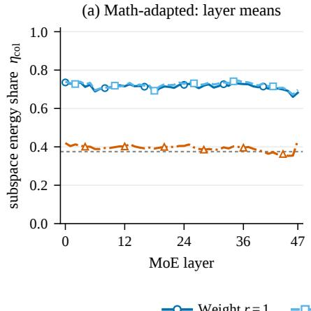

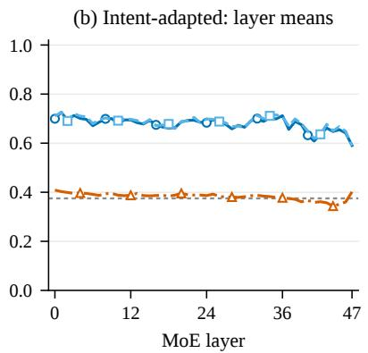

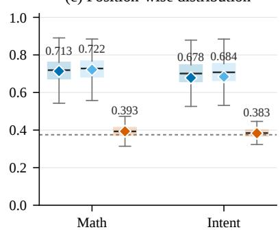  
Weight r = 1 Weight r = 2 Expert r = 2 Isotropic reference (0.375)

Figure 9 | Perturbation energy in the pretrained expert output subspace on Qwen3 synthetic probes. The left and middle panels show layer means over 128 experts; the right panel shows distributions over $^ { 6 , 1 4 4 }$ layer–expert positions per configuration. Boxes show medians and interquartile ranges, whiskers extend to the most extreme observations within 1.5 interquartile ranges, and diamonds mark means. The dashed line is the isotropic reference of 0.375. Weight-level updates concentrate more energy in pretrained output subspaces across both checkpoints.

Figure 9 shows mean $\eta _ { \mathrm { c o l } }$ values of 0.713 and 0.722 for weight-level ranks one and two on Math, and 0.678 and 0.684 on Intent. Expert-level rank two reaches 0.393 and 0.383, respectively. Rank-one weight updates increase the in-subspace energy share by 32.0 percentage points on Math and 29.5 points on Intent, with a positive diference in all 48 layer means on both checkpoints. The rank-one and rank-two results show that this concentration is already established at rank one. Together, $\eta _ { \mathrm { c o l } }$ and $C _ { \mathrm { s p e c } }$ characterize two complementary aspects of pretrained structure reuse: the energy retained in the expert’s output subspace and its distribution along the pretrained spectral hierarchy.

## H. Selected Learning Rates and Training Throughput on Qwen3

Table 14 complements the four design studies with the selected learning rates and training throughput on Qwen3-30B-A3B-Base. Each configuration uses the learning rate selected by mean downstream performance across three seeds from candidates drawn from $\mathrm { \bar { \{ 1 0 ^ { - 5 } , 1 0 ^ { - 4 } , 1 0 ^ { - 3 } \} } }$ ; the same rate is used for all three runs. Throughput is measured under the four-GPU training protocol in Appendix B, with an efective batch size of 144. Samples/s measures training examples processed per second, and steps/s measures optimizer updates per second.

The throughput results support the practical appeal of expert-weight LoRA. At the selected rates of $1 0 ^ { - 3 }$ for Intent and $1 0 ^ { - 4 }$ for Math, weight-level LoRA processes 28.27 and 19.97 samples/s, respectively, giving 1.31× and 1.45× the throughput of DoRA in these settings. It also achieves 1.53× and 1.41× the throughput of expert-level LoRA on the two tasks. These comparisons support standard expert-weight LoRA as an eficient training recipe for both Qwen3 tasks.

<table><tr><td rowspan="2">Configuration</td><td colspan="3">Intent</td><td colspan="3">Math</td></tr><tr><td>LR</td><td>Samples/s</td><td>Steps/s</td><td>LR</td><td>Samples/s</td><td>Steps/s</td></tr><tr><td>Adaptation position</td><td></td><td></td><td></td><td></td><td></td><td></td></tr><tr><td> $A _ { 6 4 }$ </td><td> $1 0 ^ { - 3 }$ </td><td> $7 2 . 0 3 4 \pm 3 . 5 9 6$ </td><td> $0 . 5 0 4 \pm 0 . 0 2 5$ </td><td> $1 0 ^ { - 5 }$ </td><td> $3 0 . 9 0 3 \pm 0 . 2 9 8$ </td><td> $0 . 2 1 5 \pm 0 . 0 0 2$ </td></tr><tr><td> $E _ { 2 5 6 }$ </td><td> $1 0 ^ { - 4 }$ </td><td> $4 4 . 7 1 9 \pm 1 . 2 0 6$ </td><td> $0 . 3 1 3 \pm 0 . 0 0 8$ </td><td> $1 0 ^ { - 5 }$ </td><td> $2 9 . 6 1 5 \pm 0 . 1 2 4$ </td><td> $0 . 2 0 6 \pm 0 . 0 0 1$ </td></tr><tr><td> $A _ { 3 2 } + E _ { 1 2 8 }$ </td><td></td><td> $1 0 ^ { - 4 } 3 8 . 3 9 6 \pm 1 . 0 0 4$ </td><td> $0 . 2 6 9 \pm 0 . 0 0 7$ </td><td> $1 0 ^ { - 5 }$ </td><td> $2 7 . 9 6 0 \pm 0 . 3 1 7$ </td><td> $0 . 1 9 4 \pm 0 . 0 0 2$ </td></tr><tr><td> $A _ { 6 4 } + R$ </td><td></td><td> $1 0 ^ { - 4 } 7 0 . 1 5 4 \pm 1 . 6 9 5$ </td><td> $0 . 4 9 1 \pm 0 . 0 1 2$ </td><td> $1 0 ^ { - 5 }$ </td><td> $3 0 . 8 3 5 \pm 0 . 0 6 1$ </td><td> $0 . 2 1 4 \pm 0 . 0 0 1$ </td></tr><tr><td> $E _ { 2 5 6 } + R$ </td><td></td><td> $1 0 ^ { - 4 } 4 3 . 0 7 1 \pm 1 . 0 3 3$ </td><td> $0 . 3 0 2 \pm 0 . 0 0 7$ </td><td> $1 0 ^ { - 5 }$ </td><td> $2 9 . 1 2 9 \pm 0 . 5 0 8$ </td><td> $0 . 2 0 2 \pm 0 . 0 0 3$ </td></tr><tr><td> ${ \cal A } _ { 3 2 } + { \cal E } _ { 1 2 8 } + { \cal R }$ </td><td></td><td> $1 0 ^ { - 4 } 3 8 . 3 6 3 \pm 0 . 8 2 2$ </td><td> $0 . 2 6 9 \pm 0 . 0 0 6$ </td><td> $1 0 ^ { - 5 }$ </td><td> $2 7 . 3 6 0 \pm 0 . 1 0 2$ </td><td> $0 . 1 9 0 \pm 0 . 0 0 1$ </td></tr><tr><td> $A _ { 6 4 } + E _ { 2 5 6 }$ </td><td> $1 0 ^ { - 4 }$ </td><td> $3 8 . 0 0 8 \pm 0 . 7 2 3$ </td><td> $0 . 2 6 6 \pm 0 . 0 0 5$ </td><td> $1 0 ^ { - 5 }$ </td><td> $2 7 . 9 5 1 \pm 0 . 3 6 1$ </td><td> $0 . 1 9 4 \pm 0 . 0 0 2$ </td></tr><tr><td> $A _ { 6 4 } + E _ { 2 5 6 } + R$ </td><td> $1 0 ^ { - 4 }$ </td><td> $3 7 . 8 7 5 \pm 0 . 8 9 3$ </td><td> $0 . 2 6 5 \pm 0 . 0 0 6$ </td><td> $1 0 ^ { - 5 }$ </td><td> $2 7 . 1 8 9 \pm 0 . 1 0 8$ </td><td> $0 . 1 8 9 \pm 0 . 0 0 1$ </td></tr><tr><td>Adaptation granularity</td><td></td><td></td><td></td><td></td><td></td><td></td></tr><tr><td>Module Level  $\left( r = 2 5 6 \right)$ </td><td></td><td> $1 0 ^ { - 4 } 4 3 . 6 6 4 \pm 1 . 0 7 7$ </td><td> $0 . 3 0 6 \pm 0 . 0 0 8$ </td><td> $1 0 ^ { - 5 }$ </td><td> $2 9 . 2 4 2 \pm 0 . 6 8 3$ </td><td> $0 . 2 0 3 \pm 0 . 0 0 5$ </td></tr><tr><td>Expert Level  $\left( r = 2 \right)$ </td><td></td><td> $1 0 ^ { - 3 } 1 8 . 4 7 1 \pm 0 . 2 4 3$ </td><td> $0 . 1 2 9 \pm 0 . 0 0 2$ </td><td> $1 0 ^ { - 4 }$ </td><td> $1 4 . 1 2 3 \pm 0 . 7 0 8$ </td><td> $0 . 0 9 8 \pm 0 . 0 0 5$ </td></tr><tr><td>Weight Level  $( r = 1 )$ </td><td> $1 0 ^ { - 3 }$ </td><td> $2 8 . 2 6 6 \pm 1 . 0 2 7$ </td><td> $0 . 1 9 8 \pm 0 . 0 0 7$ </td><td> $1 0 ^ { - 4 }$ </td><td> $1 9 . 9 6 9 \pm 0 . 0 7 0$ </td><td> $0 . 1 3 9 \pm 0 . 0 0 1$ </td></tr><tr><td>Weight Level  $\left( r = 2 \right)$ </td><td> $1 0 ^ { - 3 }$ </td><td> $2 8 . 9 8 6 \pm 0 . 5 4 3$ </td><td> $0 . 2 0 3 \pm 0 . 0 0 4$ </td><td> $1 0 ^ { - 4 }$ </td><td> $1 9 . 8 1 1 \pm 0 . 1 3 8$ </td><td> $0 . 1 3 8 \pm 0 . 0 0 1$ </td></tr><tr><td>PEFT method</td><td></td><td></td><td></td><td></td><td></td><td></td></tr><tr><td>Weight-level LoRA</td><td> $1 0 ^ { - 3 }$ </td><td> $2 8 . 2 6 6 \pm 1 . 0 2 7$ </td><td> $0 . 1 9 8 \pm 0 . 0 0 7$ </td><td> $1 0 ^ { - 4 }$ </td><td> $1 9 . 9 6 9 \pm 0 . 0 7 0$ </td><td> $0 . 1 3 9 \pm 0 . 0 0 1$ </td></tr><tr><td>DoRA</td><td> $1 0 ^ { - 3 }$ </td><td> $2 1 . 6 3 0 \pm 0 . 9 9 5$ </td><td> $0 . 1 5 2 \pm 0 . 0 0 7$ </td><td> $1 0 ^ { - 4 }$ </td><td> $1 3 . 7 3 6 \pm 0 . 0 6 0$ </td><td> $0 . 0 9 6 \pm 0 . 0 0 1$ </td></tr><tr><td>OFT</td><td> $1 0 ^ { - 3 }$ </td><td> $2 0 . 5 1 9 \pm 0 . 2 7 0$ </td><td> $0 . 1 4 4 \pm 0 . 0 0 2$ </td><td> $1 0 ^ { - 3 }$ </td><td> $3 . 6 9 0 \pm 0 . 0 1 1$ </td><td> $0 . 0 2 6 \pm 0 . 0 0 0$ </td></tr><tr><td>FourierFT</td><td> $1 0 ^ { - 3 }$ </td><td> $8 . 4 9 0 \pm 0 . 0 1 9$ </td><td> $0 . 0 6 0 \pm 0 . 0 0 1$ </td><td> $1 0 ^ { - 3 }$ </td><td> $7 . 2 5 0 \pm 0 . 0 1 5$ </td><td> $0 . 0 5 0 \pm 0 . 0 0 0$ </td></tr><tr><td>IA3</td><td></td><td> $1 0 ^ { - 3 } 6 2 . 0 4 6 \pm 0 . 8 8 7$ </td><td> $0 . 4 3 5 \pm 0 . 0 0 6$ </td><td> $1 0 ^ { - 3 }$ </td><td> $2 8 . 9 8 8 \pm 0 . 1 3 7$ </td><td> $0 . 2 0 1 \pm 0 . 0 0 1$ </td></tr><tr><td>Expert-level LoRA</td><td></td><td> $1 0 ^ { - 3 } 1 8 . 4 7 1 \pm 0 . 2 4 3$ </td><td> $0 . 1 2 9 \pm 0 . 0 0 2$ </td><td> $1 0 ^ { - 4 }$ </td><td> $1 4 . 1 2 3 \pm 0 . 7 0 8$ </td><td> $0 . 0 9 8 \pm 0 . 0 0 5$ </td></tr><tr><td>MoE-LoRA</td><td></td><td> $1 0 ^ { - 3 } 4 5 . 9 6 3 \pm 0 . 4 0 5$ </td><td> $0 . 3 2 2 \pm 0 . 0 0 3$ </td><td> $1 0 ^ { - 5 }$ </td><td> $3 0 . 2 3 2 \pm 0 . 2 9 8$ </td><td> $0 . 2 1 0 \pm 0 . 0 0 2$ </td></tr><tr><td>Module-level LoRA</td><td></td><td> $1 0 ^ { - 4 } 4 3 . 6 6 4 \pm 1 . 0 7 7$ </td><td> $0 . 3 0 6 \pm 0 . 0 0 8$ </td><td> $1 0 ^ { - 5 }$ </td><td> $2 9 . 2 4 2 \pm 0 . 6 8 3$ </td><td> $0 . 2 0 3 \pm 0 . 0 0 5$ </td></tr><tr><td>DAS-LoRA</td><td> $1 0 ^ { - 3 }$ </td><td> $2 6 . 5 0 8 \pm 0 . 6 0 4$ </td><td> $0 . 1 8 6 \pm 0 . 0 0 4$ </td><td> $1 0 ^ { - 4 }$ </td><td> $1 9 . 2 9 8 \pm 0 . 1 2 2$ </td><td> $0 . 1 3 4 \pm 0 . 0 0 1$ </td></tr><tr><td>Partial FT (last layer)</td><td> $1 0 ^ { - 4 }$ </td><td> $2 3 . 3 5 7 \pm 1 . 3 2 6$ </td><td> $0 . 1 6 4 \pm 0 . 0 0 9$ </td><td> $1 0 ^ { - 3 }$ </td><td> $1 9 . 7 4 6 \pm 0 . 4 8 0$ </td><td> $0 . 1 3 7 \pm 0 . 0 0 4$ </td></tr><tr><td colspan="7">Auxiliary load-balancing loss</td></tr><tr><td> $\lambda = 0$ </td><td></td><td> $1 0 ^ { - 3 } 2 8 . 2 6 6 \pm 1 . 0 2 7$ </td><td> $0 . 1 9 8 \pm 0 . 0 0 7$ </td><td> $1 0 ^ { - 4 }$ </td><td> $1 9 . 9 6 9 \pm 0 . 0 7 0$ </td><td> $0 . 1 3 9 \pm 0 . 0 0 1$ </td></tr><tr><td> $\lambda = 1 0 ^ { - 4 }$ </td><td></td><td> $1 0 ^ { - 3 } 2 5 . 0 9 0 \pm 0 . 7 5 2$ </td><td> $0 . 1 7 6 \pm 0 . 0 0 5$ </td><td> $1 0 ^ { - 4 }$ </td><td> $2 0 . 1 1 6 \pm 0 . 0 6 1$ </td><td> $0 . 1 4 0 \pm 0 . 0 0 1$ </td></tr><tr><td> $\lambda = 1 0 ^ { - 3 }$ </td><td></td><td> $1 0 ^ { - 3 } 2 4 . 8 0 6 \pm 0 . 3 5 5$ </td><td> $0 . 1 7 4 \pm 0 . 0 0 3$ </td><td> $1 0 ^ { - 4 }$ </td><td> $2 0 . 0 7 2 \pm 0 . 1 4 2$ </td><td> $0 . 1 3 9 \pm 0 . 0 0 1$ </td></tr><tr><td> $\lambda = 1 0 ^ { - 2 }$ </td><td></td><td> $1 0 ^ { - 3 } 2 4 . 2 1 6 \pm 0 . 6 7 9$ </td><td> $0 . 1 7 0 \pm 0 . 0 0 5$ </td><td> $1 0 ^ { - 4 }$ </td><td> $1 9 . 7 7 3 \pm 0 . 6 9 5$ </td><td> $0 . 1 3 8 \pm 0 . 0 0 5$ </td></tr><tr><td> $\lambda = 1 0 ^ { - 1 }$ </td><td> $1 0 ^ { - 3 }$ </td><td> $2 4 . 3 3 7 \pm 0 . 2 8 8$ </td><td> $0 . 1 7 0 \pm 0 . 0 0 2$ </td><td> $1 0 ^ { - 3 }$ </td><td> $1 9 . 7 0 3 \pm 0 . 3 2 1$ </td><td> $0 . 1 3 7 \pm 0 . 0 0 2$ </td></tr></table>

Table 14 | Selected learning rates and training throughput on Qwen3-30B-A3B-Base. Throughput is reported as mean ± sample standard deviation across the runs used for each reported configuration. In the position block, $A _ { r }$ and $E _ { r }$ denote attention and expert-block adaptation at rank $r ;$ � adds router adaptation.