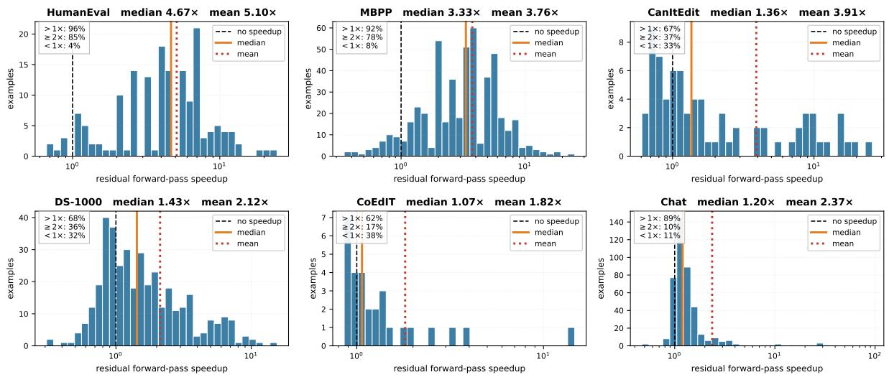
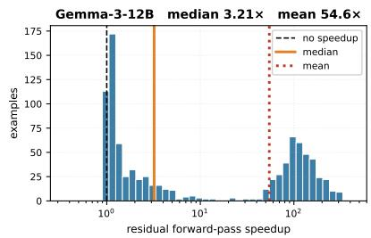
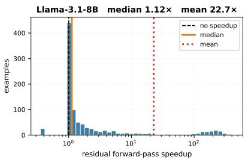
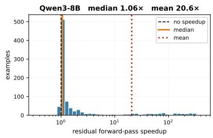

# Answering While You Type: Optimizing Time-to-Answer with Streaming Generation

Nikita Dragunov, Matvey Mikhalchuk, Anton Razzhigaev

FusionBrain Lab

Correspondence: nikitadragunovjob@gmail.com

## Abstract

Work on efficient large-language-model inference has concentrated almost entirely on reducing the cost of decoding once a request is complete. The quantity a user experiences, however, is the interval between submitting a request and receiving a usable response, and that interval can be shortened without making decoding itself faster. While a request is being composed it is already partially specified, yet conventional deployments begin no computation until submission. We propose and study streaming generation, a decoding regime in which the model begins producing a response from an incomplete request and revises it as the remaining input arrives, so that only a small residue of the answer remains to be computed once the request is submitted. We evaluate the regime on autoregressive and diffusion language models, characterise the conditions under which it reduces user-visible latency, and analyse the mechanism responsible.

## 1 Introduction

Research on efficient large-language-model inference optimizes the cost of producing a response once the request is known, and identifies that cost with the user’s waiting time. This identification is valid only under the convention that decoding begins at submission. Composing a request takes several seconds, during which the request is already partially specified and the model performs no work. Streaming generation uses that interval: the model drafts a response from the partial request and revises the draft as the remainder arrives, so that little work remains once the user submits.

The regime changes the quantity to be measured. Total decoding cost ceases to be the appropriate objective, because computation performed before the user finishes composing is not part of the observed latency. We therefore measure the residual cost: the forward passes and wall-clock time required after the final token of the request becomes available.

## Contributions.

• We formalise streaming generation and adopt residual cost as the evaluation criterion, and give a single draft–verify–regenerate procedure that instantiates it for both autoregressive and diffusion decoders.

• We evaluate the regime on six benchmarks spanning the tasks an assistant is actually asked to perform: program synthesis from a specification (HumanEval, MBPP), data-science code completion (DS-1000), instructed code editing (CanItEdit), text editing (CoEdIT) and multi-turn dialogue.

• On a slot-based diffusion model with an autoregressive verifier (ReFusion-8B, Li et al., 2025b) the procedure lowers residual cost by 2.18× in forward passes and 1.88× in wall clock, averaged over the six benchmarks, without significant loss in quality. The gain is largest where the opening of the request already determines the answer, reaching 4.67× and 3.68× on HumanEval.

• On three autoregressive models the same procedure yields macro-averaged median residual speedups of 14.4× (Gemma-3-12B), 1.23× (Llama-3.1-8B) and 1.21× (Qwen3-8B), at an average quality drop of 2.8 to 6.1 points across the six benchmarks.

• We show that the procedure does not transfer to fully bidirectional diffusion models (LLaDA-8B, Dream-7B), and explain why. Verification there asks the model to judge tokens that it can see, which it will almost always approve: offered a draft answering a completely different question, it accepts every token. What the method needs is a verifier whose judgement of a token is formed without access to that token, at a cost that does not grow with the length of the answer. Causal attention provides exactly this in a single forward pass.

• We report that self-distillation on incomplete requests helps, and that what it buys differs by model. On Qwen3-8B it roughly doubles the mean residual speedup (11.9 → 24.8×) and raises the median by a third (1.21 → 1.65×), by lengthening the drafts the verifier already accepts. On Gemma-3-12B, which streams well to begin with, it adds a little of both accuracy and speed. On ReFusion-8B it improves accuracy by up to 17 points.

## 2 Related Work

Speculative decoding. Speculative decoding accelerates autoregressive generation by having a cheap drafter propose several tokens that the target model verifies in a single parallel forward pass, provably preserving the target distribution (Leviathan et al., 2023; Chen et al., 2023). Followup work mostly addresses the cost and fidelity of the drafter: Medusa attaches lightweight parallel decoding heads to a frozen backbone (Cai et al., 2024), self-speculative decoding drafts by skipping intermediate layers of the target model itself (Zhang et al., 2024), and EAGLE autoregresses over hidden features rather than tokens (Li et al., 2024); Xia et al. (2024) survey the area. These methods share when the draft is produced andfrom what: speculation occurs at decode time, after the request is complete, and the draft originates from a smaller, early-exiting or auxiliary head. Our setting differs on both counts. The draft is produced by the same model during composition, so speculative computation occupies an interval that would otherwise go unused and no auxiliary drafter must be trained or deployed. Verification at submission serves the function that parallel verification serves in speculative decoding, but the accepted prefix is carried across a turn boundary rather than across a few decode steps.

Generation before submission. Beginning work before the input is complete is not a new idea, although we are not aware of prior work in the typed-text setting. Its oldest form is simultaneous translation, where wait-k policies emit target tokens from a source prefix (Ma et al., 2019) and re-translation revises the hypothesis as the source grows (Arivazhagan et al., 2020); SSBD makes retranslation efficient by reusing the previous output as a self-speculative draft for the extended input (Zeng et al., 2025). In speech, PredGen performs “input-time speculation”, drafting a response from the first ASR chunk and refining it as later chunks arrive (Li and Grover, 2025); it is the closest neighbour to this work, differing in modality and in using standard autoregressive speculative decoding. Outside language, SpeQL begins executing a SQL query before the user has finished typing it (Li et al., 2025a).

Diffusion language models and ReFusion. Discrete diffusion for text was placed on a principled footing by D3PM (Austin et al., 2021a) and later simplified: Sahoo et al. (2024) show that a Rao-Blackwellized masked-diffusion objective reduces to a mixture of masked-LM losses. Scaling the recipe yields general-purpose diffusion LLMs such as LLaDA (Nie et al., 2025) and, through semiautoregressive and block decoding, practically deployable variants (Han et al., 2023; Arriola et al., 2025). The relevant property is that every position in the current window is re-predicted at each step, so an already-emitted token may be revised rather than being frozen, as it necessarily is under autoregressive decoding.

Our principal diffusion backbone is ReFusion-8B (Li et al., 2025b), which differs from the models above in two respects that the method depends on. First, its answer buffer is divided into fixedsize slots, and a slot is committed only when the model’s confidence in its contents exceeds a threshold; decoding therefore terminates as soon as the answer is complete rather than after a fixed number of denoising steps. Second, and critically for this work, its attention is causal and it is trained with a mixed objective: an autoregressive loss on committed positions and a masked-diffusion loss on masked ones. The model consequently exposes two predictors for the same buffer. The diffusion predictor fills masked slots in place; the autoregressive predictor scores a token from the state to its left, which cannot observe the token itself. The second is what makes verification meaningful, and its absence is what we will show prevents the method from transferring to fully bidirectional diffusion models. Closest in spirit is SpecDiff (Christopher et al., 2025), which uses a discrete diffusion model as a parallel drafter verified by an autoregressive model; we likewise pair masked diffusion with an autoregressive verifier, but both roles are played by a single model and the verified content is carried across turns.

Prefix caching and KV reuse. A large body of systems work accelerates inference by caching keyvalue state across requests: Prompt Cache precomputes attention states for reusable prompt modules (Gim et al., 2024), SGLang’s RadixAttention maintains a radix tree over KV caches so that shared prefixes are matched automatically (Zheng et al., 2024b), PagedAttention supplies the memory substrate that makes such sharing practical (Kwon et al., 2023), and CacheBlend relaxes the strictprefix requirement by selectively recomputing a small subset of tokens (Yao et al., 2025). What unifies them is what is reused: the computation belongs to the request, so they shorten prefill. We reuse the answer computed while the user was still composing, and therefore save decode rather than prefill; the two are composable.

User-perceived latency. Latency is conventionally decomposed into time-to-first-token and timeper-output-token, and systems work optimizes both: Orca introduces iteration-level scheduling (Yu et al., 2022), Sarathi-Serve uses chunked prefills to remove decode stalls (Agrawal et al., 2024), and DistServe disaggregates prefill from decode to meet the two targets independently (Zhong et al., 2024). All of them start the clock at submission, which is the assumption relaxed here.

## 3 Streaming Generation

Modelling the setting. The granularity at which a partially composed request becomes available depends on the application and the domain. A code assistant may observe every keystroke; a chat interface may see text arrive in bursts; a voice interface receives transcription chunks whose boundaries are set by the recogniser. No single segmentation is universally appropriate. We therefore adopt an explicit simplification: composition is modelled as the arrival of successive sentences, and each sentence boundary is treated as a point at which new input becomes available. This is a controlled proxy for keystroke-level composition, selected because it is reproducible across benchmarks and because a sentence is the smallest unit after which a request is generally interpretable.

The simplification rests on one assumption that must be stated. It is meaningful only if the model can produce and revise a draft faster than the user composes the next sentence. This condition is satisfied for the models and answer lengths studied here, since a draft of a few dozen tokens requires a small number of forward passes, well below the time required to type a sentence. It would have to be re-examined for considerably longer answers or faster composition.

Cost and speedup. A request arrives as a growing sequence of sentence prefixes $S _ { 1 } ~ \subset ~ S _ { 2 } ~ \subset ~$ $\cdots \subset S _ { n } ,$ where $S _ { n }$ is the complete request. We report cost in two units: forward passes through the backbone, which is hardware-independent and is what an implementation can be held to, and wallclock seconds, which is what the user experiences. A non-streaming system pays the full cost of decoding $S _ { n }$ after submission. A streaming system performs work at every $S _ { i }$ , but only the work performed after $S _ { n }$ is observable. We therefore report

$$
\mathrm { s p e e d u p } \ = \ { \frac { c _ { \mathrm { b a s e } } ( S _ { n } ) } { c _ { \mathrm { s t r e a m } } ( S _ { n } \mid D _ { n - 1 } ) } } ,
$$

where $D _ { n - 1 }$ is the draft carried in from the preceding sentence, and we report total cost separately so that the compute-for-latency exchange is explicit.

The procedure. The same three-step loop instantiates the regime in both model families. The system holds a draft $D _ { i }$ −1 produced for the request as it stood at $S _ { i - 1 }$ . When sentence $S _ { i }$ arrives:

1. Verify. One forward pass over $S _ { i }$ concatenated with $D _ { i - 1 }$ yields, for every draft position $j ,$ , the probability the model assigns to the token already sitting there, conditioned on the updated request.

2. Accept. The longest leading run of draft tokens whose probability clears a threshold $\tau$ is retained; the remainder is discarded.

3. Regenerate. Decoding resumes from the accepted prefix and completes the answer, producing $D _ { i }$

At submission the loop runs once more: the draft is verified in a single forward pass, and only the suffix after the accepted prefix is regenerated. The residual cost is therefore one verification pass plus the decoding of that suffix, and it is this quantity, not the cost of a full decode, that the user waits through.

Because the system cannot know which sentence will turn out to be the last, the procedure is executed at every intermediate point. This is a property of the experimental protocol rather than a deployment recommendation. A production system would schedule drafting according to load and available capacity, drafting frequently when the accelerator is underutilised and not at all when it is saturated. Our measurements assume that spare capacity is available, which is the regime in which the question arises.

Why the accepted set must be a prefix. Step 2 keeps a leading run rather than every token that clears the threshold. For an autoregressive model the reason is immediate: it writes left to right and cannot insert text in the middle, so as soon as one token is rejected everything after it has to be rewritten anyway.

For ReFusion-8B the reason is less obvious, because the model can rewrite any position and so is not forced to keep a prefix. The constraint comes from the verifier instead. It reports the probability of the token at position j given the draft tokens to its left, so that number is only meaningful while those tokens stay in place. Keep a scattered set and every gap invalidates the scores of everything after it, since the text those scores were conditioned on is about to change. A leading run is the longest stretch over which the verifier’s own numbers still describe the answer being assembled. We did try the alternative, keeping every token above threshold and letting the model fill the gaps; it left the answer perforated throughout rather than truncated at the end, and cost more to repair than it saved.

Family-specific details. The two families differ only in step 3. An autoregressive decoder writes strictly left to right and cannot go back, so it simply resumes writing after the accepted prefix. A diffusion decoder holds the whole answer in a buffer and can rewrite any position, so the rejected part is blanked out and filled in again. The practical difference is that the diffusion model is free to change its mind about text it has already written, and the autoregressive model is not.

## 4 Experimental Setup

Models. We evaluate two decoder families. The autoregressive models are Gemma-3-12B-

IT (Team et al., 2025), Llama-3.1-8B-Instruct (Grattafiori et al., 2024) and Qwen3-8B (Yang et al., 2025); drafts are verified by greedy agreement with a newly decoded continuation under the extended request and truncated at the first divergence. The diffusion models are ReFusion-8B (Li et al., 2025b), described in Section 3, and two fully bidirectional models that lack its autoregressive verification path, LLaDA-8B (Nie et al., 2025) and Dream-7B (Ye et al., 2025). Decoding is greedy throughout. The diffusion experiments were run on an NVIDIA RTX A6000 and the autoregressive experiments on NVIDIA A100 80 GB GPUs.

Benchmarks. Both families use the same suite: HumanEval (Chen et al., 2021), MBPP (Austin et al., 2021b), CanItEdit (Cassano et al., 2024), DS-1000 (Lai et al., 2023), CoEdIT (Raheja et al., 2023) and multi-turn chat drawn from UltraChatstyle dialogues and an MT-Bench-like suite (Zheng et al., 2023). Requests are split into sentences and replayed cumulatively; requests consisting of a single sentence are excluded, since there is nothing to stream. For chat, the full dialogue history is always present and only the final user turn is streamed. Examples for which either side returns an empty answer are excluded from all columns alike.

## 5 Results

On ReFusion-8B the procedure reduces residual cost substantially on the two specification-first coding benchmarks and leaves accuracy intact: HumanEval is 4.67× cheaper in forward passes and 3.68× faster in wall clock at unchanged pass@1, and MBPP is 3.33× and 2.90× with pass@1 rising by two points (Table 1). The remaining four benchmarks gain between 1.07× and 1.43×.

The procedure transfers to the autoregressive family on all three checkpoints, with the same task dependence and a wider spread in magnitude (Table 2). Gemma-3-12B streams exceptionally well with no adaptation at all, reaching a median residual speedup of 14.4×. Llama-3.1-8B and Qwen3- 8B return medians of 1.23× and 1.21×, close to a fifth of the post-submission work removed on the typical request, together with means of 13.8× and 11.9× carried by a substantial minority of requests that finish almost immediately. All three share the same acceptance rule, so the spread is a property of the individual checkpoint rather than of the decoder family. Streaming costs 2.8 to 6.1 accuracy points, concentrated on the coding benchmarks.

<table><tr><td rowspan="2">Benchmark</td><td colspan="2">Quality (%)</td><td colspan="2">Forwards after final token</td><td colspan="2">Speedup, forwards (×)</td><td colspan="2">Speedup, wall clock (×)</td></tr><tr><td>base</td><td>stream</td><td>base</td><td>stream</td><td>mean</td><td>median</td><td>mean</td><td>median</td></tr><tr><td>HumanEval (pass@1)</td><td>54.3</td><td>54.3</td><td>16</td><td>3</td><td>5.10</td><td>4.67</td><td>3.86</td><td>3.68</td></tr><tr><td>MBPP (pass@1)</td><td>55.1</td><td>57.1</td><td>12</td><td>3</td><td>3.76</td><td>3.33</td><td>3.21</td><td>2.90</td></tr><tr><td>CanItEdit (pass@1)</td><td>19.7</td><td>23.7</td><td>42</td><td>27</td><td>3.91</td><td>1.36</td><td>2.85</td><td>1.25</td></tr><tr><td>DS-1000 (pass@1)</td><td>3.9</td><td>1.6</td><td>18</td><td>11</td><td>2.12</td><td>1.43</td><td>1.76</td><td>1.32</td></tr><tr><td>CoEdIT (F1)</td><td>72.9</td><td>71.8</td><td>26</td><td>19</td><td>1.82</td><td>1.07</td><td>1.63</td><td>1.03</td></tr><tr><td>Chat (F1)</td><td>42.7</td><td>42.5</td><td>194</td><td>148</td><td>2.37</td><td>1.20</td><td>1.60</td><td>1.12</td></tr></table>

Table 1: ReFusion-8B. base: decoding the complete request with the benchmark’s default configuration. stream: the procedure of Section 3. Both come from one run over the same examples. Forward counts are medians. Means exceed medians on every benchmark because the distribution carries a long right tail (Figure 1).
<table><tr><td rowspan="2">Model</td><td rowspan="2">Benchmark</td><td colspan="2">Quality (%)</td><td colspan="2">Speedup, forwards (×)</td><td colspan="2">Speedup, wall clock (×)</td></tr><tr><td>base</td><td>stream</td><td>mean</td><td>median</td><td>mean</td><td>median</td></tr><tr><td rowspan="8">Gemma-3-12B</td><td>MBPP (pass@1)</td><td>75.8</td><td>65.8</td><td>75.89</td><td>74.00</td><td>63.73</td><td>67.80</td></tr><tr><td>HumanEval (pass@1)</td><td>84.1</td><td>75.0</td><td>63.05</td><td>7.98</td><td>49.13</td><td>7.67</td></tr><tr><td>CanItEdit (pass@1)</td><td>41.0</td><td>30.5</td><td>53.95</td><td>1.44</td><td>20.84</td><td>1.40</td></tr><tr><td>DS-1000 (pass@1)</td><td>0.0</td><td>10.2</td><td>2.38</td><td>1.04</td><td>2.23</td><td>1.03</td></tr><tr><td>CoEdIT (F1)</td><td>39.0</td><td>39.2</td><td>7.89</td><td>1.05</td><td>7.07</td><td>1.05</td></tr><tr><td>Chat (F1)</td><td>31.8</td><td>31.8</td><td>1.05</td><td>1.01</td><td>1.03</td><td>1.00</td></tr><tr><td>average</td><td>45.3</td><td>42.1</td><td>34.03</td><td>14.42</td><td>24.01</td><td>13.32</td></tr><tr><td>MBPP (pass@1)</td><td>59.8</td><td>55.4</td><td>34.41</td><td>1.25</td><td>18.30</td><td>1.23</td></tr><tr><td rowspan="6">Llama-3.1-8B</td><td>HumanEval (pass@1)</td><td>67.7</td><td>62.2</td><td>34.22</td><td>2.06</td><td>19.52</td><td>2.00</td></tr><tr><td>CanItEdit (pass@1)</td><td>40.0</td><td>36.2</td><td>1.20</td><td>1.00</td><td>1.17</td><td>0.99</td></tr><tr><td>DS-1000 (pass@1)</td><td>6.2</td><td>3.1</td><td>1.47</td><td>1.00</td><td>1.34</td><td>0.98</td></tr><tr><td>CoEdIT (F1)</td><td>51.5</td><td>51.8</td><td>1.27</td><td>1.05</td><td>1.24</td><td>1.04</td></tr><tr><td>Chat (F1)</td><td>41.0</td><td>41.0</td><td>10.18</td><td>1.01</td><td>3.29</td><td>0.99</td></tr><tr><td>average</td><td>44.4</td><td>41.6</td><td>13.79</td><td>1.23</td><td>7.48</td><td>1.21</td></tr><tr><td rowspan="7">Qwen3-8B</td><td>MBPP (pass@1)</td><td>70.6</td><td>67.2</td><td>26.32</td><td>1.09</td><td>17.78</td><td>1.08</td></tr><tr><td>HumanEval (pass@1)</td><td>83.5</td><td>52.4</td><td>25.54</td><td>2.12</td><td>20.70</td><td>2.09</td></tr><tr><td>CanItEdit (pass@1)</td><td>45.7</td><td>37.1</td><td>9.15</td><td>1.00</td><td>4.44</td><td>1.00</td></tr><tr><td>DS-1000 (pass@1)</td><td>10.9</td><td>17.2</td><td>3.84</td><td>1.00</td><td>2.81</td><td>0.98</td></tr><tr><td>CoEdIT (F1)</td><td>59.2</td><td>59.2</td><td>5.51</td><td>1.02</td><td>4.67</td><td>1.02</td></tr><tr><td>Chat (F1)</td><td>36.7</td><td>36.7</td><td>1.05</td><td>1.01</td><td>1.03</td><td>1.00</td></tr><tr><td>average</td><td>51.1</td><td>45.0</td><td>11.90</td><td>1.21</td><td>8.57</td><td>1.19</td></tr></table>

Table 2: Autoregressive models with no adaptation, per benchmark. average is the macro-average over the six benchmarks. The gain concentrates on the two specification-first coding benchmarks, as it does for the diffusion model in Table 1, and means run far above medians for the same reason.

## 6 Analysis

## 6.1 The distribution of the gain

Figure 1 shows the per-example residual speedup on ReFusion-8B, one panel per benchmark. The distributions have three properties that a single summary statistic would not convey, and each of them bears on how the method should be deployed.

The first is that the gain varies widely between requests of the same benchmark. On HumanEval and MBPP most requests fall between 2× and 8×, and individual requests reach 24×. On CanItEdit the most common outcome is close to 1×, yet a minority of requests exceeds 10×. Because the distributions are right-skewed, the mean and the median answer different questions: the mean reflects the total computation saved across a workload, while the median describes the request a typical user issues. Tables 1 and 2 therefore report both.

The second is that every benchmark contains requests that gain nothing. Between 4% and 38% of them fall below 1×. This follows from the design of the procedure rather than from any defect in it: one verification pass is always spent, and when the draft is rejected that pass yields nothing, leaving the request slightly more expensive than the non-streaming baseline.

The third is that the outcome is close to binary rather than graded, and this is what gives the distributions their shape. At the final prompt update 42% of requests keep no draft token at all and 46% keep every one, leaving only 12% in between. Requests that keep nothing are concentrated just below 1×, and requests that keep their draft account for the entire right tail. Benchmarks therefore differ chiefly in how often the draft is kept, from 9% of HumanEval and MBPP requests discarding it to 56% on DS-1000 and 82% on chat. Partial acceptance is uncommon, though more frequent where the request is an instruction to edit existing text: it occurs on 30% of CanItEdit requests against 2% on MBPP.

  
Figure 1: Per-example residual speedup on ReFusion-8B, one panel per benchmark, on a logarithmic axis. Orange marks the median, dotted red the mean, dashed black the 1× line at which streaming costs what the baseline costs.

The autoregressive models show the same skew, in a more extreme form (Figure 2). All three place a large spike at 1× and a long tail beyond it, so that pooled medians of 3.21×, 1.12× and 1.06× sit alongside pooled means of 54.6×, 22.7× and 20.6×. Gemma-3-12B differs from the other two in having a distinct second mode above 100×: on requests whose opening determines the answer it accepts drafts of several hundred tokens and finishes 34% of requests in a single residual forward pass, against roughly 10% for Llama and Qwen. Reporting the mean alone on this family would describe a request that almost never occurs. The medians quoted here are taken over the pooled distribution of individual requests, whereas Table 2 macro-averages each benchmark’s own median.

## 6.2 Streaming is worth applying unconditionally

Taken together, these distributions support a simple deployment policy: stream every request, without attempting to predict in advance which ones will

benefit.

The expected gain is substantial. Pooled over the 1573 diffusion requests, the mean residual speedup is 3.10× and the median 1.68×, and streaming removes 37.6% of the forward passes that the user would otherwise wait through. Both averages favour the method, so it is not the case that a rare success is being paid for by a common loss.

The risk is correspondingly small, and this is the more important half of the argument. Only 16% of requests end below 1×, 10% below 0.9× and 5% below 0.8×. Among the requests that do lose, the median outcome is 0.86×, that is a delay of roughly one seventh of the baseline cost. A pronounced slowdown is rare because the penalty for a rejected draft is structurally bounded: it is one wasted verification pass, whose cost does not grow with the length of the answer, whereas the reward for an accepted draft grows with it. The asymmetry between a bounded loss and an unbounded gain is what makes the unconditional policy preferable, and it also means that a gate would have to be very accurate to be worth its own complexity.

## 6.3 Where it works, and why

Streaming pays off when the request is of the form “produce an artefact from a specification”. The specification appears in the opening sentences, and what follows is illustration (examples, assertions, formatting markers) that refines the answer without changing its structure. The draft written from the first sentence is then already close to the final answer, it survives each update, and at submission only a verification pass and a short remainder are left. HumanEval and MBPP are of this form, and both families behave the same way on them: the diffusion model reaches 4.67× and 3.33×, and the strongest autoregressive checkpoint reaches 74× on MBPP.

  
Figure 2: Per-example residual speedup on the three autoregressive models, on the same axes as Figure 1. Orange marks the pooled median, dotted red the pooled mean, dashed black the 1× line.

Two things reduce the gain. One is late-arriving instruction: in editing tasks the program is supplied first and the instruction last, so the model correctly writes nothing until the final sentence and there is no draft to reuse. The other is the absence of a unique correct wording. In open dialogue a semantically equivalent rephrasing fails a tokenlevel acceptance test, so drafts are discarded even when they were perfectly good answers. Chat sits at the bottom of the table for this reason rather than because its requests are hard.

There is also an upper limit on what the method can achieve, which is worth stating because the observed values approach it. Even when the entire draft is accepted, the model must still perform a minimum number of forward passes to confirm the answer and emit it; on ReFusion-8B that minimum is three, and no request in the evaluation completed in fewer. The attainable speedup on a request is therefore its baseline cost divided by three, which for the median request is 5.33× on HumanEval and 4.00× on MBPP. The measured 4.67× and 3.33× correspond to 88% and 83% of those limits, so on these benchmarks little further gain is available from accepting more draft tokens.

## 6.4 Why the two families differ in what they pay

The diffusion and autoregressive results differ in one respect that the tables make plain: ReFusion-8B preserves quality while the autoregressive checkpoints do not. Table 2 locates the loss precisely. On CoEdIT and chat the quality change is between 0.0 and +0.3 points for all three models, and on the code and editing benchmarks it reaches −31. Those are also the two benchmarks on which the autoregressive median speedup is 1.01–1.05×, that is, on which almost no draft is accepted.

The two observations are the same observation. An autoregressive decoder cannot revise a token it has emitted, so whatever part of the draft is accepted is fixed for good, including the part that was written before the request was complete. Where nothing is accepted the answer is the non-streaming answer and quality is untouched; where a long prefix is accepted the model is committed to an opening chosen under less information than it now has. The diffusion decoder is not subject to this, because it re-predicts every position in its buffer and can revise an accepted region if the completed request calls for it. The quality cost of streaming is therefore not intrinsic to the regime. It is the price of irreversible decoding, and it is paid only by the family that decodes irreversibly.

## 6.5 Where it does not work

The procedure needs a verifier that can be wrong about the draft: one whose judgement of a token is formed without access to that token. Causal attention supplies this for free, since the state that scores position j has seen only what lies to its left, and one forward pass yields a verdict on the entire draft.

Fully bidirectional diffusion models supply nothing of the kind, and the consequence is not subtle. Offered a draft answering an entirely unrelated request, an account of the Byzantine Empire presented as the answer to a Python exercise, Dream-7B assigns it a median probability of 0.999 and accepts every one of its 96 tokens. It is not indiscriminate: random tokens are rejected everywhere.

It is confirming that the text in front of it is the text in front of it. Applied to LLaDA-8B and Dream-7B the procedure consequently keeps stale drafts and loses accuracy at every threshold we tried; on HumanEval nearly every streamed Dream answer is the same nine-token stub, written from the opening sentence and never revised. Hiding the draft to force an honest reading does not help, because it also removes the context the draft needs in order to be judged at all.

## 7 Adapting the Model to Incomplete Requests

Streaming asks a model to do something it was not trained for: answer a request that stops midsentence, and then agree with itself once the remainder arrives. We therefore adapted models in both families to that regime.

Setups. Supervision is the answer to the complete question given only a prefix of it, so that the model learns to commit early to what it will eventually say. Adaptation uses LoRA (Hu et al., 2022) on the attention projections, and autoregressive runs additionally prepend a system message asking the model to answer incomplete questions, following Li and Grover (2025). The autoregressive adapters use rank 8, α=16, dropout 0.05, learning rate $2 \times 1 0 ^ { - 5 }$ , effective batch size 16 and a maximum sequence length of 2048; evaluation uses the merged checkpoint at 1000 steps.

The two families were adapted on different corpora, so we report each separately and draw no cross-family comparison. For ReFusion-8B we built 13,845 prefix-to-answer pairs from three code corpora disjoint from the evaluation suite: the MBPP training split (Austin et al., 2021b), Magicoder-OSS-Instruct (Wei et al., 2024) and Evol-CodeAlpaca (Luo et al., 2024). The autoregressive models were adapted on requests drawn from LMSYS-Chat-1M (Zheng et al., 2024a), a corpus of real user conversations with deployed assistants. The two adaptation corpora therefore differ in domain as well as in construction, which is the reason we do not compare the families on the effect of adaptation.

For the diffusion model we trained two variants: draft-refinement, which is shown the current draft and learns to repair it, and prefix-to-answer, which maps a bare request prefix to the full answer with no draft in the input.

<table><tr><td>Model</td><td>Benchmark</td><td>quality</td><td>median speedup</td></tr><tr><td colspan="4">Autoregressive</td></tr><tr><td>Qwen3-8B</td><td>MBPP</td><td> $6 7 . 2  5 9 . 2$ </td><td> $1 . 0 9  1 . 5 0 $ </td></tr><tr><td></td><td>HumanEval</td><td> $5 2 . 4  5 9 . 8 $ </td><td> $2 . 1 2  3 . 4 4$ </td></tr><tr><td>Llama-3.1-8B</td><td>average</td><td> $4 1 . 6  4 1 . 7$ </td><td> $1 . 2 3  1 . 1 8$ </td></tr><tr><td>Gemma-3-12B</td><td>average</td><td> $4 2 . 1  4 3 . 3$ </td><td> $1 4 . 4 2  1 5 . 2 0$ </td></tr><tr><td colspan="4">Diffusion (ReFusion-8B)</td></tr><tr><td>draft-refinement</td><td>HumanEval</td><td> $5 4 . 3  5 7 . 3$ </td><td> $4 . 6 7  4 . 6 7$ </td></tr><tr><td></td><td>MBPP</td><td> $5 7 . 1  5 9 . 1 $ </td><td> $3 . 3 3  2 . 9 3$ </td></tr><tr><td>prefix-to-answer</td><td>HumanEval</td><td> $5 4 . 3  6 2 . 2$ </td><td> $4 . 6 7  3 . 5 6$ </td></tr><tr><td></td><td>MBPP</td><td> $5 7 . 1  5 3 . 4$ </td><td> $3 . 3 3  2 . 1 3$ </td></tr></table>

Table 3: Adaptation to incomplete requests, before → after.

What improves. Adaptation helps, and what it buys depends on the model (Table 3). Qwen3-8B gains the most speed: the macro-averaged mean residual forward speedup roughly doubles $( 1 1 . 9 $ 24.8×, wall clock $8 . 6  1 5 . 3 \times )$ and the median rises on every benchmark we measured (MBPP $1 . 0 9  1 . 5 0 \times$ , HumanEval $2 . 1 2  3 . 4 4 \times$ , Can-ItEdit $1 . 0 0  1 . 5 2 \times$ , CoEdIT $1 . 0 2  1 . 3 9 \times )$ The mechanism is acceptance length: the fraction of draft tokens preserved rises from 0.27 to 0.43, and the share of requests finishing in a single residual forward pass from 9.6% to 15.9%. Gemma gains a little of both quality and speed, Llama gains in the mean.

On ReFusion-8B adaptation buys quality rather than speed. Every benchmark improves, several substantially: +3.0 points on HumanEval, +2.0 on MBPP, +0.8 on DS-1000, +7.7 on CanItEdit and +17.1 on CoEdIT. The prefix-to-answer variant reaches the highest HumanEval quality of any configuration we ran, +7.9 points, but is less stable across benchmarks. Median speed is unchanged on HumanEval and slightly lower elsewhere.

The pattern is consistent with the analysis above. Adaptation makes the generator commit earlier, which lengthens drafts that the verifier was already accepting; it does not change whether a draft clears the acceptance test in the first place, and that is what sets the residual cost of a typical request.

## 8 Conclusion

Time to answer, rather than decoding latency, is what a user experiences, and it can be reduced without making decoding faster. Streaming generation does so on both decoder families we studied. On the diffusion model it removes 37.6% of the forward passes a user waits through. On the two benchmarks whose opening already determines the answer it is 4.67× and 3.33× cheaper in forward passes and 3.68× and 2.90× faster in wall clock, at quality that is unchanged on HumanEval and two points higher on MBPP. On the autoregressive side the gain is larger still where the model commits early: Gemma-3-12B reaches a median of 74× on MBPP and finishes a third of all requests in a single forward pass after submission. Adapting a model to incomplete requests raises the gain further, roughly doubling the mean on Qwen3-8B.

Two properties decide whether a model can do this. Its verifier must be able to reject a stale draft, which requires that a token be judged without being seen; causal attention supplies this in one forward pass, and full bidirectional attention does not supply it at all. And because a rejected draft costs one verification pass while an accepted one saves work in proportion to the length of the answer, streaming is worth applying to every request rather than to a selected few. The computation it spends is computation that would otherwise sit idle while the user is still typing.

## Limitations

Latency is bought with computation. The regime trades throughput for the latency of an individual user, and the exchange rate should be stated. Streaming regenerates the answer at every sentence, so total forward passes rise by a factor of 1.3 to 5.4 across the diffusion benchmarks, and by 3.5 to 3.9 on the two where the residual gain is largest. The autoregressive side likewise performs speculative work during composition that residual metrics do not charge. This work is done while the accelerator would otherwise be idle, so the method suits interactive or local deployment and is not intended for a saturated batch system.

Speed does not imply quality. A response may be produced quickly because it is deficient. Among the 44 diffusion chat examples with speedup at least 2×, 10 lose a correct answer; one CanItEdit example reaches 25× while turning correct into incorrect, because a frozen draft ignored the edit instruction entirely. On the autoregressive side Qwen3-8B loses 31 points on HumanEval under streaming.

Variation across checkpoints. The three autoregressive models use the same acceptance rule, yet their median residual speedups range from 1.2× to 14×. The one that streams best is also the largest, but three checkpoints are not enough to tell whether size is the reason. Why one instructiontuned model settles on its answer early, while another keeps revising it, is left open.

## References

Amey Agrawal, Nitin Kedia, Ashish Panwar, Jayashree Mohan, Nipun Kwatra, Bhargav S. Gulavani, Alexey Tumanov, and Ramachandran Ramjee. 2024. Taming throughput-latency tradeoff in LLM inference with Sarathi-Serve. arXiv preprint arXiv:2403.02310.

Naveen Arivazhagan, Colin Cherry, Te I, Wolfgang Macherey, Pallavi Baljekar, and George Foster. 2020. Re-translation strategies for long form, simultaneous, spoken language translation. In IEEE International Conference on Acoustics, Speech and Signal Processing (ICASSP).

Marianne Arriola, Aaron Gokaslan, Justin T. Chiu, Zhihan Yang, Zhixuan Qi, Jiaqi Han, Subham Sekhar Sahoo, and Volodymyr Kuleshov. 2025. Block diffusion: Interpolating between autoregressive and diffusion language models. In International Conference on Learning Representations (ICLR).

Jacob Austin, Daniel D. Johnson, Jonathan Ho, Daniel Tarlow, and Rianne van den Berg. 2021a. Structured denoising diffusion models in discrete state-spaces. In Advances in Neural Information Processing Systems (NeurIPS), volume 34, pages 17981–17993.

Jacob Austin, Augustus Odena, Maxwell Nye, Maarten Bosma, Henryk Michalewski, David Dohan, Ellen Jiang, Carrie Cai, Michael Terry, Quoc Le, and Charles Sutton. 2021b. Program synthesis with large language models. arXiv preprint arXiv:2108.07732.

Tianle Cai, Yuhong Li, Zhengyang Geng, Hongwu Peng, Jason D. Lee, Deming Chen, and Tri Dao. 2024. Medusa: Simple LLM inference acceleration framework with multiple decoding heads. In Proceedings of the 41st International Conference on Machine Learning (ICML), pages 5209–5235.

Federico Cassano et al. 2024. CanItEdit: Interactive code editing benchmark. In arXiv preprint.

Charlie Chen, Sebastian Borgeaud, Geoffrey Irving, Jean-Baptiste Lespiau, Laurent Sifre, and John Jumper. 2023. Accelerating large language model decoding with speculative sampling. arXiv preprint arXiv:2302.01318.

Mark Chen et al. 2021. Evaluating large language models trained on code. arXiv preprint arXiv:2107.03374.

Jacob K. Christopher, Brian R. Bartoldson, Tal Ben-Nun, Michael Cardei, Bhavya Kailkhura, and Ferdinando Fioretto. 2025. Speculative diffusion decoding: Accelerating language generation through diffusion. In Proceedings of the 2025 Conference

ofthe Nations ofthe Americas Chapter ofthe Associationfor Computational Linguistics: Human Language Technologies (Volume 1: Long Papers), pages 12042–12059.

In Gim, Guojun Chen, Seung-seob Lee, Nikhil Sarda, Anurag Khandelwal, and Lin Zhong. 2024. Prompt Cache: Modular attention reuse for low-latency inference. In Proceedings of Machine Learning and Systems 6 (MLSys).

Aaron Grattafiori et al. 2024. The Llama 3 herd of models. arXiv preprint arXiv:2407.21783.

Xiaochuang Han, Sachin Kumar, and Yulia Tsvetkov. 2023. SSD-LM: Semi-autoregressive simplex-based diffusion language model for text generation and modular control. In Proceedings of the 61st Annual Meeting of the Association for Computational Linguistics (Volume 1: Long Papers), pages 11575– 11596.

Edward J. Hu, Yelong Shen, Phillip Wallis, Zeyuan Allen-Zhu, Yuanzhi Li, Shean Wang, Lu Wang, and Weizhu Chen. 2022. LoRA: Low-rank adaptation of large language models. ICLR.

Woosuk Kwon, Zhuohan Li, Siyuan Zhuang, Ying Sheng, Lianmin Zheng, Cody Hao Yu, Joseph E. Gonzalez, Hao Zhang, and Ion Stoica. 2023. Efficient memory management for large language model serving with PagedAttention. In Proceedings of the 29th Symposium on Operating Systems Principles (SOSP).

Yuhang Lai, Chengxi Li, Yiming Wang, Tianyi Zhang, Ruiqi Zhong, Luke Zettlemoyer, Wen-tau Yih, Daniel Fried, Sida Wang, and Tao Yu. 2023. DS-1000: A natural and reliable benchmark for data science code generation. In ICML.

Yaniv Leviathan, Matan Kalman, and Yossi Matias. 2023. Fast inference from transformers via speculative decoding. In Proceedings of the 40th International Conference on Machine Learning (ICML), pages 19274–19286.

Haoyu Li, Srikanth Kandula, Maria Angels de Luis Balaguer, Aditya Akella, and Venkat Arun. 2025a. Speculative ad-hoc querying. arXiv preprint arXiv:2503.00714.

Jia-Nan Li, Jian Guan, Wei Wu, and Chongxuan Li. 2025b. ReFusion: A diffusion large language model with parallel autoregressive decoding. Preprint, arXiv:2512.13586.

Shufan Li and Aditya Grover. 2025. PredGen: Accelerated inference of large language models through input-time speculation for real-time speech interaction. arXiv preprint arXiv:2506.15556.

Yuhui Li, Fangyun Wei, Chao Zhang, and Hongyang Zhang. 2024. EAGLE: Speculative sampling requires rethinking feature uncertainty. In Proceedings of the 41st International Conference on Machine Learning (ICML), pages 28935–28948.

Ziyang Luo, Can Xu, Pu Zhao, Qingfeng Sun, Xiubo Geng, Wenxiang Hu, Chongyang Tao, Jing Ma, Qingwei Lin, and Daxin Jiang. 2024. WizardCoder: Empowering code large language models with Evol-Instruct. In The Twelfth International Conference on Learning Representations.

Mingbo Ma, Liang Huang, Hao Xiong, Renjie Zheng, Kaibo Liu, Baigong Zheng, Chuanqiang Zhang, Zhongjun He, Hairong Liu, Xing Li, Hua Wu, and Haifeng Wang. 2019. STACL: Simultaneous translation with implicit anticipation and controllable latency using prefix-to-prefix framework. In Proceedings of the 57th Annual Meeting of the Association for Computational Linguistics.

Shen Nie, Fengqi Zhu, Zebin You, Xiaolu Zhang, Jingyang Ou, Jun Hu, Jun Zhou, Yankai Lin, Ji-Rong Wen, and Chongxuan Li. 2025. Large language diffusion models. In Advances in Neural Information Processing Systems (NeurIPS).

Vipul Raheja, Dhruv Kumar, Remy Koo, and Dongyeop Kang. 2023. CoEdIT: Text editing by task-specific instruction tuning. In EMNLP Findings.

Subham Sekhar Sahoo, Marianne Arriola, Yair Schiff, Aaron Gokaslan, Edgar Marroquin, Justin T. Chiu, Alexander Rush, and Volodymyr Kuleshov. 2024. Simple and effective masked diffusion language models. In Advances in Neural Information Processing Systems (NeurIPS), volume 37, pages 130136– 130184.

Gemma Team et al. 2025. Gemma 3 technical report. arXiv preprint arXiv:2503.19786.

Yuxiang Wei, Zhe Wang, Jiawei Liu, Yifeng Ding, and Lingming Zhang. 2024. Magicoder: Empowering code generation with OSS-Instruct. In Proceedings of the 41st International Conference on Machine Learning.

Heming Xia, Zhe Yang, Qingxiu Dong, Peiyi Wang, Yongqi Li, Tao Ge, Tianyu Liu, Wenjie Li, and Zhifang Sui. 2024. Unlocking efficiency in large language model inference: A comprehensive survey of speculative decoding. In Findings of the Association for Computational Linguistics: ACL 2024, pages 7655–7671.

An Yang et al. 2025. Qwen3 technical report. arXiv preprint arXiv:2505.09388.

Jiayi Yao, Hanchen Li, Yuhan Liu, Siddhant Ray, Yihua Cheng, Qizheng Zhang, Kuntai Du, Shan Lu, and Junchen Jiang. 2025. CacheBlend: Fast large language model serving for RAG with cached knowledge fusion. In Proceedings of the Twentieth European Conference on Computer Systems (EuroSys), pages 94–109.

Jiacheng Ye, Zhihui Xie, Lin Zheng, Jiahui Gao, Zirui Wu, Xin Jiang, Zhenguo Li, and Lingpeng Kong. 2025. Dream 7B: Diffusion large language models. arXiv preprint arXiv:2508.15487.

Gyeong-In Yu, Joo Seong Jeong, Geon-Woo Kim, Soojeong Kim, and Byung-Gon Chun. 2022. Orca: A distributed serving system for transformer-based generative models. In 16th USENIX Symposium on Operating Systems Design and Implementation (OSDI 22), pages 521–538.

Linxiao Zeng, Haoyun Deng, Kangyuan Shu, and Shizhen Wang. 2025. Self-speculative biased decoding for faster re-translation. arXiv preprint arXiv:2509.21740.

Jun Zhang, Jue Wang, Huan Li, Lidan Shou, Ke Chen, Gang Chen, and Sharad Mehrotra. 2024. Draft & Verify: Lossless large language model acceleration via self-speculative decoding. In Proceedings ofthe 62nd Annual Meeting of the Association for Computational Linguistics (Volume 1: Long Papers), pages 11263–11282.

Lianmin Zheng, Wei-Lin Chiang, Ying Sheng, Tianle Li, Siyuan Zhuang, Zhanghao Wu, Yonghao Zhuang, Zhuohan Li, Zi Lin, Eric P. Xing, Joseph E. Gonzalez, Ion Stoica, and Hao Zhang. 2024a. LMSYS-Chat-1M: A large-scale real-world LLM conversation dataset. In The Twelfth International Conference on Learning Representations.

Lianmin Zheng, Wei-Lin Chiang, Ying Sheng, Siyuan Zhuang, Zhanghao Wu, Yonghao Zhuang, Zi Lin, Zhuohan Li, Dacheng Li, Eric Xing, Hao Zhang, Joseph E. Gonzalez, and Ion Stoica. 2023. Judging LLM-as-a-judge with MT-Bench and Chatbot Arena. In NeurIPS Datasets and Benchmarks.

Lianmin Zheng, Liangsheng Yin, Zhiqiang Xie, Chuyue Sun, Jeff Huang, Cody Hao Yu, Shiyi Cao, Christos Kozyrakis, Ion Stoica, Joseph E. Gonzalez, Clark Barrett, and Ying Sheng. 2024b. SGLang: Efficient execution of structured language model programs. In Advances in Neural Information Processing Systems (NeurIPS).

Yinmin Zhong, Shengyu Liu, Junda Chen, Jianbo Hu, Yibo Zhu, Xuanzhe Liu, Xin Jin, and Hao Zhang. 2024. DistServe: Disaggregating prefill and decoding for goodput-optimized large language model serving. arXiv preprint arXiv:2401.09670.