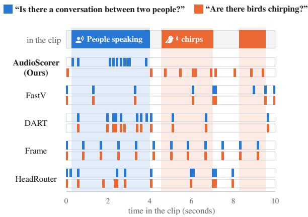
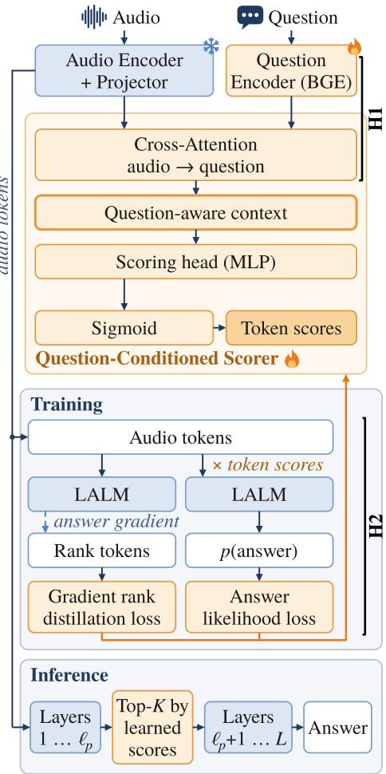
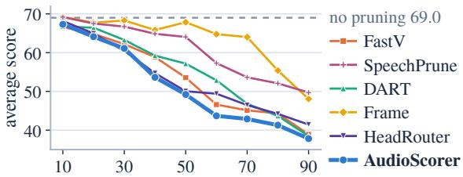
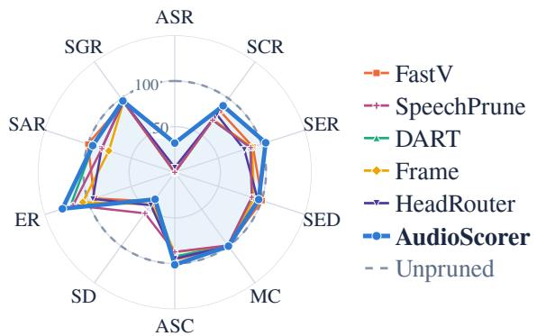

# AudioScorer: Learning Question-Aware Token Relevance for Large Audio Language Models

Marwan Farag   
Institute of Signal Processing   
and System Theory (ISS)   
University of Stuttgart   
Stuttgart, Germany   
marwan.farag@iss.uni-stuttgart.de

## Abstract

Large Audio Language Models (LALMs) reason over speech, environmental sounds, music, and other acoustic information. However, their audio encoders produce dense token sequences that make long-form audio costly to process. Existing audio pruning methods reduce this cost using heuristics such as attention, representation similarity, or temporal sampling, but do not explicitly learn which tokens are most useful for a given question. We propose AudioScorer, a lightweight model that scores audio tokens according to the user question. It is trained by distilling the ranking of audio tokens under the frozen LALM’s answer-gradient saliency, together with downstream answer supervision. Compared with other pruning meth ods, AudioScorer achieves the best or tied-best result at 10% token retention on 7 of 10 semantic and acoustic tasks, including speech recognition, emotion recognition, and audio-scene classification.

## 1 Introduction

Multimodal Large Language Models (MLLMs) extend LLM reasoning to modalities such as vision and audio (Alayrac et al., 2022; Li et al., 2023; Liu et al., 2023; OpenAI, 2023). Particularly, Large Audio Language Models (LALMs) (Chu et al., 2023; Tang et al., 2024; Ghosh et al., 2026; Xu et al., 2025b) encode audio into dense embedding sequences projected into the LLM input space. Since the number of audio tokens grows with duration, long recordings substantially increase decoder cost. For example, Qwen2-Audio (Chu et al., 2024) processes about 25 audio tokens per second, yielding roughly 750 tokens for a 30-second clip. A given question, however, may depend on only a fraction of them, motivating task-aware token pruning.

Existing pruning methods reduce token cost in MLLMs using signals such as attention (Chen et al., 2024; He et al., 2026; Zhang et al., 2025), redundancy (Wen et al., 2025), temporal sampling (He

Bin Yang   
Institute of Signal Processing   
and System Theory (ISS)   
University of Stuttgart   
Stuttgart, Germany   
bin.yang@iss.uni-stuttgart.de

  
Figure 1: Question-dependent token selection for the same audio. AudioScorer adapts its selection to the question under a fixed budget. Audio and token-to-time mapping from Wang et al. (2026).

et al., 2025), or learned relevance. Question-aware audio pruning is also established (Lin et al., 2025), while learned relevance prediction has been explored in vision (Takezoe et al., 2026). Existing question-aware pruning methods largely rely on predefined signals, while learned relevance predictors are typically question-independent. Learning audio-token utility jointly from the question and downstream answer quality thus remains underexplored. This motivates our central question: Can a scoring network learn question-conditioned audiotoken relevancefrom signals ofdownstream answer utility?

We introduce AudioScorer, a lightweight question-conditioned scorer trained by distilling the frozen LALM’s gradient-based ranking of audio tokens according to how strongly the correct answer depends on them, together with downstream answer supervision. Figure 1 shows that AudioScorer’s token selection changes more with the question for the same audio clip than that of the other pruning methods. At 10% token retention on AudioMarathon (He et al., 2025), AudioScorer is best or tied-best on 7 of 10 tasks and leads on

  
Frozen LALM AudioScorer (trained)  
Figure 2: Overview of AudioScorer. It learns audiotoken relevance from answer-gradient targets and downstream answer supervision. At inference, the scores drive Top-K pruning after early decoder layers.

Speech Content, Audio Classification, and Speaker Information. Notably, ASR reaches a 31.25% word accuracy rate (WAR), compared with 5.15% for the strongest baseline. Our codebase will be released upon publication to support reproducibility.

## 2 Method

## 2.1 Design Hypotheses

Our goal is to retain the audio tokens most useful for answering the user’s question under a fixed token budget. We build AudioScorer around two hypotheses. (H1) Token relevance depends on the question: the same audio token may be useful for one question and irrelevant for another. (H2) The frozen LALM can serve as a relevance teacher: given the question and reference answer, gradientbased sensitivity of the answer likelihood provides a useful signal of audio-token relevance.

## 2.2 AudioScorer Design

Figure 2 illustrates AudioScorer and its integration with the frozen LALM. Its design follows directly from the two hypotheses above.

Question-conditioned scoring (H1). We encode the question with bge-base-en-v1.5 (Xiao et al., 2024) and use a lightweight cross-attention layer in which each audio token attends to the question tokens. A scoring head maps the resulting questionconditioned representation to one score per audio token, allowing the same recording to receive different rankings for different questions.

LALM-guided relevance distillation (H2). For each training example, we feed the full audio and question to the frozen LALM, teacher-force the reference answer, and backpropagate its loglikelihood to the audio tokens at the decoder input. Each token’s gradient norm measures the local sensitivity of the answer to that token. We normalize these values into soft token-level targets that supervise AudioScorer’s ranking. We complement this with downstream answer supervision. We scale each audio token by its predicted score: higher-scoring tokens are suppressed less than lower-scoring tokens. At inference, soft weighting is replaced by hard Top-K pruning after layer $\ell _ { p }$ . Full details are provided in Appendix A.

## 3 Experiments

Models and evaluation. We evaluate AudioScorer on Qwen2.5-Omni-3B (Xu et al., 2025a) using AudioMarathon (He et al., 2025) and MMAU-Pro (Kumar et al., 2026). We compare against the following baselines: FastV (Chen et al., 2024), DART (Wen et al., 2025), uniform frame sampling (He et al., 2025), HeadRouter (He et al., 2026), and SpeechPrune (Lin et al., 2025) at matched 70%, 40%, and 10% retention. All methods prune after decoder layer $\ell _ { p } = 2 .$ , so the first two layers process the full sequence. The same ranking is reused across retention ratios.

## 3.1 Results

Does learned token scoring preserve answer quality? The benefit of AudioScorer is most pronounced on speech tasks under aggressive compression. At 10% retention, it improves Speech Content by 13.38 points over the strongest baseline, as shown in Table 1. This improvement is substantially larger than those observed for Audio Classification (0.57 points) and Speaker Information (1.13 points). SpeechPrune leads on Audio Authenticity. AudioScorer is best or tied-best on seven subtasks; its Speech Content advantage includes ASR (31.25 versus 5.15 for HeadRouter) and SCR (74.57 versus 69.20 for FastV). At 40% and 70%, it also leads on Speech Content. On MMAU-Pro, it achieves the highest weighted score among pruning methods at all three budgets and, at 10% retention, stays within 0.06 points of the unpruned model (48.51 versus 48.57), as shown in Table 2. Appendix C gives all category results. Figure 3 further shows that deleting each method’s highest-ranked tokens degrades AudioScorer most on average, supporting the informativeness of its ranking. AudioScorer’s selection is relatively cheap: it adds on average 0.16 TFLOPs over Frame, which prunes at the same depth without scoring, i.e., 0.4–0.9% of total prefilling compute as shown in Table 1.

<table><tr><td colspan="2"></td><td colspan="3">Speech Content Avg.</td><td colspan="3">Audio Classification Avg.</td><td colspan="3">Speaker Information</td><td colspan="2">Audio auth.</td><td>Prefill compute</td></tr><tr><td colspan="2">Keep Method</td><td>ASR</td><td colspan="3">SCR SER</td><td colspan="3">SED MC ASC</td><td colspan="3">ER SAR SGR</td><td>Avg. SD</td><td>TFLOPs</td></tr><tr><td rowspan="6"></td><td>100% Unpruned</td><td>97.68</td><td>82.81</td><td>24.02</td><td>68.17</td><td>70.18 100.00</td><td>70.31</td><td>80.16</td><td>33.82</td><td>15.53 99.63</td><td>49.66</td><td>90.11</td><td>46.04</td></tr><tr><td>FastV</td><td>97.03</td><td>82.62 24.52†</td><td></td><td>68.06</td><td>69.82 100.00 70.62†</td><td></td><td>80.15</td><td>33.04 15.97†</td><td>98.98</td><td>49.33</td><td>87.53</td><td>35.83</td></tr><tr><td>SpeechPrune</td><td>91.31</td><td>80.51 24.95†</td><td></td><td>65.59</td><td>68.59 100.00 70.22</td><td></td><td>79.60</td><td>35.14† 15.87†</td><td>98.90</td><td>49.97†</td><td>93.93†</td><td>35.93</td></tr><tr><td>DART</td><td>95.93 82.87† 25.14†</td><td></td><td></td><td>67.98</td><td>69.84 100.00 70.50†</td><td></td><td>80.11</td><td>36.52†</td><td>15.90† 99.19</td><td>50.54†</td><td>93.09†</td><td>35.88</td></tr><tr><td>Frame</td><td>95.28</td><td>82.71 25.03†</td><td></td><td>67.67</td><td>70.19† 100.00 70.93†</td><td></td><td>80.37†</td><td>34.33†</td><td>15.03 98.98</td><td>49.45</td><td>85.03</td><td>35.83</td></tr><tr><td>HeadRouter</td><td>97.22 83.20†</td><td></td><td>22.74 25.00†</td><td>67.72</td><td>69.31 100.00 70.99†</td><td>80.10</td><td></td><td>31.82 16.19† 99.27</td><td></td><td>49.09</td><td>80.92</td><td>35.84</td></tr><tr><td rowspan="6">40%</td><td>AudioScorer</td><td colspan="3">97.49 82.99†</td><td>68.49†</td><td>69.45 100.00 71.03†</td><td></td><td>80.16</td><td>34.67†</td><td>15.09 99.49</td><td>49.75†</td><td>82.47</td><td>35.99</td></tr><tr><td>FastV</td><td>92.26</td><td></td><td>82.53 25.31†</td><td>66.70</td><td>70.15 100.00 71.20†</td><td></td><td>80.45</td><td>35.27†</td><td>16.55† 98.18</td><td>50.00†</td><td>70.80</td><td>26.27</td></tr><tr><td>SpeechPrune</td><td>68.26</td><td></td><td>72.15 22.47</td><td>54.29</td><td>67.92 100.00 68.83</td><td></td><td>78.92</td><td>40.76†</td><td>17.88† 98.76</td><td>52.47†</td><td>85.02</td><td>26.34</td></tr><tr><td>DART</td><td>85.21</td><td></td><td>77.08 25.15†</td><td>62.48</td><td>65.87 100.00 70.44†</td><td></td><td>78.77</td><td>37.98†</td><td>14.09 99.05</td><td>50.37†</td><td>79.22</td><td>26.32</td></tr><tr><td>Frame</td><td>86.47</td><td></td><td>79.84 25.11†</td><td>63.81</td><td>69.43 100.00 71.17†</td><td></td><td>80.20†</td><td>32.78</td><td>13.42 98.62</td><td>48.27</td><td>72.79</td><td>26.27</td></tr><tr><td>HeadRouter</td><td colspan="3">93.28 80.58 24.52†</td><td>66.13</td><td>70.19† 100.00 71.07†</td><td></td><td>80.42†</td><td>27.11 16.11† 97.69</td><td></td><td>46.97</td><td>63.40</td><td>26.28 26.43</td></tr><tr><td rowspan="6">10%</td><td>AudioScorer FastV</td><td colspan="3">96.94 83.25†</td><td>23.85 68.01 30.27</td><td colspan="2">69.10 100.00 71.78†</td><td>80.29† 79.12</td><td>34.19†</td><td>14.42 99.19</td><td>49.27</td><td>71.01</td><td></td></tr><tr><td>SpeechPrune</td><td>0.00</td><td>0.00 69.20</td><td>21.61</td><td>26.50</td><td>70.62† 99.26 62.21 99.04</td><td>67.48 61.31</td><td>74.19</td><td>39.60†</td><td>31.25 15.55† 94.29</td><td>47.03</td><td>35.72 50.03</td><td>17.35 17.40</td></tr><tr><td>DART</td><td>0.00</td><td>58.45 58.50</td><td>21.04 20.89</td><td>26.46</td><td>62.27 99.15</td><td>64.89</td><td>75.44</td><td>40.65†</td><td>13.03 96.27 14.60 96.97</td><td>49.63 50.74†</td><td>33.63</td><td>17.40</td></tr><tr><td>Frame</td><td>0.00</td><td>59.22</td><td>21.33</td><td>26.85</td><td>64.18 100.00</td><td>61.45</td><td>75.21</td><td>35.83†</td><td>11.79 95.17</td><td>47.60</td><td>39.17</td><td>17.35</td></tr><tr><td>HeadRouter</td><td>5.15</td><td>64.81</td><td>19.24</td><td>29.73</td><td>66.97 100.00</td><td>66.54</td><td>77.84</td><td>31.93</td><td>13.08 95.39</td><td>46.80</td><td>40.16</td><td>17.35</td></tr><tr><td>AudioScorer</td><td>31.25</td><td>74.57 25.14†</td><td></td><td>43.65</td><td>67.82 100.00 71.24†</td><td></td><td>79.69</td><td>43.75†</td><td>14.67 97.19</td><td>51.87†</td><td>32.97</td><td>17.51</td></tr></table>

Table 1: AudioMarathon results on Qwen2.5-Omni-3B: WAR for ASR and Macro-F1 otherwise. Avg. is the unweighted mean of each three-task category; Audio Authenticity contains only SD. Single/double vertical rules separate category averages/categories. Bold/underlining mark the best/second-best pruning scores per retention ratio; † marks scores above unpruned. Prefill compute: mean TFLOPs to the first token over the same 80 randomly sampled duration-stratified clips. ASR: automatic speech recognition; SCR: speech content reasoning; SER: speech entity recognition; SED: sound event detection; MC: music classification; ASC: audio scene classification; ER: emotion recognition; SAR: speaker age recognition; SGR: speaker gender recognition; SD: deepfake detection.

<table><tr><td>Method</td><td>70%</td><td>40%</td><td>10%</td></tr><tr><td>Unpruned</td><td>48.57</td><td>48.57</td><td>48.57</td></tr><tr><td>FastV</td><td>48.53</td><td>48.78†</td><td>47.17</td></tr><tr><td>SpeechPrune</td><td>48.14</td><td>47.86</td><td>46.01</td></tr><tr><td>DART</td><td>48.45</td><td>47.90</td><td>46.27</td></tr><tr><td>Frame</td><td>48.42</td><td>48.20</td><td>46.41</td></tr><tr><td>HeadRouter</td><td>48.64†</td><td>49.00†</td><td>46.16</td></tr><tr><td>AudioScorer</td><td>49.18†</td><td>49.53†</td><td>48.51</td></tr></table>

Table 2: MMAU-Pro official weighted scores at three retention ratios. Bold, underlining, and † follow Table 1.

  
highest-ranked audio tokens deleted (%)  
Figure 3: Deleting the top-ranked audio tokens on 500 random equally drawn AudioMarathon samples: a steeper drop indicates better evidence localization.

How does pruning sensitivity vary across tasks? Figure 4 shows strong task-dependent sensitivity to pruning. At 10% retention, ASR nearly collapses for most methods and SD degrades substantially, while MC, SGR, SED, and ASC remain more robust. ER is a notable exception: pruning improves it for most methods, with the largest gain for AudioScorer (33.82 → 43.75). MMAU-Pro shows a similar effect, where 40% retention improves the weighted score from 48.57 to 49.53. One possible explanation is that pruning filters irrelevant context and mitigates lost-in-the-middle effects (Liu et al., 2024), though our results do not establish this as the sole cause.

<table><tr><td rowspan=2 colspan=2>Variant</td><td rowspan=1 colspan=1></td><td rowspan=1 colspan=3>70% retention</td><td rowspan=1 colspan=4>40% retention</td><td rowspan=1 colspan=4>10% retention</td></tr><tr><td rowspan=1 colspan=1>SC</td><td rowspan=1 colspan=1>AC</td><td rowspan=1 colspan=1>SI</td><td rowspan=1 colspan=1>AA</td><td rowspan=1 colspan=1>SC</td><td rowspan=1 colspan=1>AC</td><td rowspan=1 colspan=1>SI</td><td rowspan=1 colspan=1>AA</td><td rowspan=1 colspan=1>SC</td><td rowspan=1 colspan=1>AC</td><td rowspan=1 colspan=1>SI</td><td rowspan=1 colspan=1>AA</td></tr><tr><td rowspan=4 colspan=2>AudioScorer (full)w/o question conditioningw/o relevance distillationw/o both</td><td rowspan=1 colspan=1>68.49</td><td rowspan=1 colspan=1>80.16</td><td rowspan=1 colspan=1>49.75</td><td rowspan=1 colspan=1>82.47</td><td rowspan=1 colspan=1>68.01</td><td rowspan=1 colspan=1>80.29</td><td rowspan=1 colspan=1>49.27</td><td rowspan=1 colspan=1>71.01</td><td rowspan=1 colspan=1>43.65</td><td rowspan=1 colspan=1>79.69</td><td rowspan=1 colspan=1>51.87</td><td rowspan=1 colspan=1>32.97</td></tr><tr><td rowspan=1 colspan=1>68.13</td><td rowspan=1 colspan=1>79.95</td><td rowspan=1 colspan=1>49.55</td><td rowspan=1 colspan=1>81.06</td><td rowspan=1 colspan=1>68.48</td><td rowspan=1 colspan=1>80.31</td><td rowspan=1 colspan=1>49.67</td><td rowspan=1 colspan=1>64.76</td><td rowspan=1 colspan=1>41.84</td><td rowspan=1 colspan=1>80.26</td><td rowspan=1 colspan=1>51.22</td><td rowspan=1 colspan=1>31.36</td></tr><tr><td rowspan=1 colspan=1>67.90</td><td rowspan=1 colspan=1>79.93</td><td rowspan=1 colspan=1>49.70</td><td rowspan=1 colspan=1>38.92</td><td rowspan=1 colspan=1>63.04</td><td rowspan=1 colspan=1>80.30</td><td rowspan=1 colspan=1>50.04</td><td rowspan=1 colspan=1>35.64</td><td rowspan=1 colspan=1>27.72</td><td rowspan=1 colspan=1>73.12</td><td rowspan=1 colspan=1>48.41</td><td rowspan=1 colspan=1>44.03</td></tr><tr><td rowspan=1 colspan=1>66.92</td><td rowspan=1 colspan=1>80.83</td><td rowspan=1 colspan=1>49.74</td><td rowspan=1 colspan=1>81.23</td><td rowspan=1 colspan=1>64.96</td><td rowspan=1 colspan=1>80.41</td><td rowspan=1 colspan=1>41.44</td><td rowspan=1 colspan=1>43.98</td><td rowspan=1 colspan=1>27.58</td><td rowspan=1 colspan=1>75.42</td><td rowspan=1 colspan=1>34.15</td><td rowspan=1 colspan=1>54.54</td></tr><tr><td rowspan=3 colspan=2>w/o downstream CESingle-layer scoring headHard Top-K + STE</td><td rowspan=1 colspan=1>68.33</td><td rowspan=1 colspan=1>80.38</td><td rowspan=1 colspan=1>49.53</td><td rowspan=1 colspan=1>84.13</td><td rowspan=1 colspan=1>68.29</td><td rowspan=1 colspan=1>80.69</td><td rowspan=1 colspan=1>49.01</td><td rowspan=1 colspan=1>79.64</td><td rowspan=1 colspan=1>31.20</td><td rowspan=1 colspan=1>74.02</td><td rowspan=1 colspan=1>51.71</td><td rowspan=1 colspan=1>51.06</td></tr><tr><td rowspan=1 colspan=1>ing head</td><td rowspan=2 colspan=1>68.1668.49</td><td rowspan=2 colspan=1>80.5080.07</td><td rowspan=1 colspan=1>49.17</td><td rowspan=1 colspan=1>82.21</td><td rowspan=1 colspan=1>68.48</td><td rowspan=1 colspan=1>80.42</td><td rowspan=1 colspan=1>49.12</td><td rowspan=1 colspan=1>67.81</td><td rowspan=1 colspan=1>35.74</td><td rowspan=1 colspan=1>80.50</td><td rowspan=1 colspan=1>51.03</td><td rowspan=1 colspan=1>32.35</td></tr><tr><td rowspan=1 colspan=1>49.22</td><td rowspan=1 colspan=1>84.52</td><td rowspan=1 colspan=1>68.30</td><td rowspan=1 colspan=1>80.40</td><td rowspan=1 colspan=1>49.77</td><td rowspan=1 colspan=1>71.29</td><td rowspan=1 colspan=1>34.46</td><td rowspan=1 colspan=1>75.15</td><td rowspan=1 colspan=1>51.61</td><td rowspan=1 colspan=1>52.71</td></tr></table>

Table 3: AudioMarathon ablations by category: SC = Speech Content, AC = Audio Classification, SI = Speaker Information, and AA = Audio Authenticity. Scores are unweighted task means; bold marks the best result in each column. The joint ablation (w/o both) removes question conditioning via cross-attention and relevance distillation. CE denotes cross-entropy. STE denotes the straight-through estimator (Bengio et al., 2013).

  
Figure 4: AudioMarathon subtask scores at 10% retention, normalized to the unpruned model (WAR for ASR, Macro-F1 otherwise).

## 4 Ablation Study

Table 3 shows that both of our supervision signals are important, especially under aggressive pruning. Relevance distillation has the largest effect: removing it substantially degrades Speech Content and Audio Classification at 10% retention. Removing downstream CE causes a similar but smaller decline. This supports their complementary roles: gradient-based targets provide explicit token-level relevance supervision, whereas CE directly optimizes the retained evidence for answer quality. Simplifying the scoring head to a single linear layer reduces Speech Content performance at 10% retention. Replacing soft weighting with hard Top-K training using a straight-through estimator (STE) (Bengio et al., 2013) also hurts Speech Content and Audio Classification at 10% retention, while remaining competitive or slightly better at

40% and 70%. This suggests that soft weighting is most helpful when pruning is aggressive. Question cross-attention has a smaller and more taskdependent effect, suggesting that much of the gain comes from learned relevance supervision, with explicit question conditioning providing additional adaptation. No component is uniformly beneficial across all categories. Full subtask results are provided in Appendix D.

## 5 Related Work

FastV (Chen et al., 2024) uses attention-based ranking, DART (Wen et al., 2025) removes redundant tokens, and AudioMarathon (He et al., 2025) evaluates these methods for long audio alongside uniform sampling. SpeechPrune (Lin et al., 2025) combines speech–text similarity with approximated attention, while HeadRouter (He et al., 2026) uses calibrated head profiles. Other methods reduce tokens through merging rather than pruning (Xiang et al., 2026; Bolya et al., 2023). LearnPruner (Takezoe et al., 2026) learns question-independent vision pruning, introducing question conditioning only later within the decoder. AudioScorer instead learns question-conditioned audio-token relevance from reference-answer gradients and downstream supervision, contributing a new supervision and pruning design for audio.

## 6 Conclusion

AudioScorer learns question-conditioned audiotoken relevance using supervision from a frozen LALM. At aggressive retention budgets, it improves speech recognition, audio classification, and speaker information modeling over pruning baselines. The category-level trade-offs motivate further work on task-adaptive selection for efficient long-form audio understanding.

## Limitations

Our experiments are limited to Qwen2.5-Omni-3B and the audio modality. Moreover, performance gains are not uniform across tasks under aggressive pruning. For example, audio authenticity detection degrades substantially at 10% retention. Improvements over competing methods should therefore be interpreted in the context of these task-dependent trade-offs.

Question conditioning yields modest and taskdependent gains in our ablations. Neither our training datasets nor the evaluation benchmarks directly target question-specific token selection. AudioScorer is trained from individual audio– question–answer examples, without explicit supervision that contrasts which evidence should be selected for different questions on the same recording. Likewise, the benchmarks evaluate downstream task performance rather than question-dependent changes in the selected evidence. We therefore cannot determine whether the modest gains reflect a limitation of the conditioning mechanism or of the used evaluation. More controlled questionswitching data would allow this effect to be assessed directly. Our evaluation is subject to benchmark limitations. To the best of our knowledge, AudioMarathon had not been published in a peerreviewed venue at the time of submission.

## References

Sami Abu-El-Haija, Nisarg Kothari, Joonseok Lee, Paul Natsev, George Toderici, Balakrishnan Varadarajan, and Sudheendra Vijayanarasimhan. 2016. Youtube-8m: A large-scale video classification benchmark. arXiv preprint arXiv:1609.08675.

Jean-Baptiste Alayrac, Jeff Donahue, Pauline Luc, Antoine Miech, Iain Barr, Yana Hasson, Karel Lenc, Arthur Mensch, Katherine Millican, Malcolm Reynolds, et al. 2022. Flamingo: a visual language model for few-shot learning. Advances in neural information processing systems, 35:23716–23736.

Yoshua Bengio, Nicholas Léonard, and Aaron Courville. 2013. Estimating or propagating gradients through stochastic neurons for conditional computation. arXiv preprint arXiv:1308.3432.

Daniel Bolya, Cheng-Yang Fu, Xiaoliang Dai, Peizhao Zhang, Christoph Feichtenhofer, and Judy Hoffman. 2023. Token merging: Your vit but faster. In International Conference on Learning Representations.

Carlos Busso, Murtaza Bulut, Chi-Chun Lee, Abe Kazemzadeh, Emily Mower, Samuel Kim, Jeannette N Chang, Sungbok Lee, and Shrikanth S

Narayanan. 2008. Iemocap: Interactive emotional dyadic motion capture database. Language resources and evaluation, 42(4):335–359.

Liang Chen, Haozhe Zhao, Tianyu Liu, Shuai Bai, Junyang Lin, Chang Zhou, and Baobao Chang. 2024. An image is worth 1/2 tokens after layer 2: Plug-and-play inference acceleration for large vision-language models. In European Conference on Computer Vision, pages 19–35. Springer.

Yunfei Chu, Jin Xu, Qian Yang, Haojie Wei, Xipin Wei, Zhifang Guo, Yichong Leng, Yuanjun Lv, Jinzheng He, Junyang Lin, et al. 2024. Qwen2-audio technical report. arXiv preprint arXiv:2407.10759.

Yunfei Chu, Jin Xu, Xiaohuan Zhou, Qian Yang, Shiliang Zhang, Zhijie Yan, Chang Zhou, and Jingren Zhou. 2023. Qwen-audio: Advancing universal audio understanding via unified large-scale audiolanguage models. arXiv preprint arXiv:2311.07919.

Soham Deshmukh, Benjamin Elizalde, and Huaming Wang. 2023. Audio retrieval with wavtext5k and CLAP training. In 24th Annual Conference of the International Speech Communication Association, Interspeech 2023, Dublin, Ireland, August 20-24, 2023, pages 2948–2952. ISCA.

Sreyan Ghosh, Arushi Goel, Jaehyeon Kim, Sonal Kumar, Zhifeng Kong, Sang-gil Lee, Chao-Han Yang, Ramani Duraiswami, Dinesh Manocha, Rafael Valle, et al. 2026. Audio flamingo 3: Advancing audio intelligence with fully open large audio language models. Advances in Neural Information Processing Systems, 38:41819–41886.

Peize He, Yaodi Luo, Xiaoqian Liu, Xuyang Liu, Jiahang Deng, Yaosong Du, Bangyu Li, Xiyan Gui, Yuxuan Chen, and Linfeng Zhang. 2026. Headrouter: Dynamic head-weight routing for task-adaptive audio token pruning in large audio language models. arXiv preprint arXiv:2604.23717.

Peize He, Zichen Wen, Yubo Wang, Yuxuan Wang, Xiaoqian Liu, Jiajie Huang, Zehui Lei, Zhuangcheng Gu, Xiangqi Jin, Jiabing Yang, et al. 2025. Audiomarathon: A comprehensive benchmark for longcontext audio understanding and efficiency in audio llms. arXiv preprint arXiv:2510.07293.

Chris Dongjoo Kim, Byeongchang Kim, Hyunmin Lee, and Gunhee Kim. 2019. Audiocaps: Generating captions for audios in the wild. In Proceedings of the 2019 Conference ofthe North American Chapter of the Association for Computational Linguistics: Human Language Technologies, Volume 1 (Long and Short Papers), pages 119–132.

Sonal Kumar, Šimon Sedlácek, Vaibhavi Lokegaonkar,ˇ Fernando López, Wenyi Yu, Nishit Anand, Hyeonggon Ryu, Lichang Chen, Maxim Plicka, Miroslavˇ Hlavácek, et al. 2026. Mmau-pro: A challengingˇ and comprehensive benchmark for holistic evaluation of audio general intelligence. In Proceedings

of the AAAI Conference on Artificial Intelligence, volume 40, pages 22688–22697.

Junnan Li, Dongxu Li, Silvio Savarese, and Steven Hoi. 2023. Blip-2: Bootstrapping language-image pretraining with frozen image encoders and large language models. In International conference on machine learning, pages 19730–19742. PMLR.

Yueqian Lin, Yuzhe Fu, Jingyang Zhang, Yudong Liu, Jianyi Zhang, Jingwei Sun, Hai Helen Li, and Yiran Chen. 2025. Speechprune: Context-aware token pruning for speech information retrieval. In 2025 IEEE International Conference on Multimedia and Expo (ICME), pages 1–6. IEEE.

Haotian Liu, Chunyuan Li, Qingyang Wu, and Yong Jae Lee. 2023. Visual instruction tuning. Advances in neural information processing systems, 36:34892– 34916.

Nelson F Liu, Kevin Lin, John Hewitt, Ashwin Paranjape, Michele Bevilacqua, Fabio Petroni, and Percy Liang. 2024. Lost in the middle: How language models use long contexts. Transactions ofthe association for computational linguistics, 12:157–173.

Ilya Loshchilov and Frank Hutter. 2019. Decoupled weight decay regularization. In International Conference on Learning Representations.

Jan Melechovsky, Zixun Guo, Deepanway Ghosal, Navonil Majumder, Dorien Herremans, and Soujanya Poria. 2024. Mustango: Toward controllable textto-music generation. In Proceedings of the 2024 Conference of the North American Chapter of the Associationfor Computational Linguistics: Human Language Technologies (Volume 1: Long Papers), pages 8293–8316.

OpenAI. 2023. GPT-4V(ision) System Card.

Vassil Panayotov, Guoguo Chen, Daniel Povey, and Sanjeev Khudanpur. 2015. Librispeech: an asr corpus based on public domain audio books. In 2015 IEEE international conference on acoustics, speech and signal processing (ICASSP), pages 5206–5210. IEEE.

Se Jin Park, Chae Won Kim, Hyeongseop Rha, Minsu Kim, Joanna Hong, Jeong Hun Yeo, and Yong Man Ro. 2024. Let’s go real talk: Spoken dialogue model for face-to-face conversation. In Proceedings ofthe 62nd Annual Meeting ofthe Associationfor Computational Linguistics (Volume 1: Long Papers), pages 16334–16348.

Gary Stafford. 2024. Deepfake audio detection dataset v4.

Rinyoichi Takezoe, Yaqian Li, Zi-Hao Bo, Anzhou Hou, Mo Guang, and Kaiwen Long. 2026. Learnpruner: Rethinking attention-based token pruning in vision language models. In International Conference on Learning Representations, pages 66381–66400.

Changli Tang, Wenyi Yu, Guangzhi Sun, Xianzhao Chen, Tian Tan, Wei Li, Lu Lu, Zejun Ma, and Chao Zhang. 2024. Salmonn: Towards generic hearing abilities for large language models. In International Conference on Learning Representations, pages 16607–16629.

Hualei Wang, Yiming Li, Shuo Ma, Hong Liu, and Xiangdong Wang. 2026. Listening between the frames: Bridging temporal gaps in large audio-language models. In Proceedings ofthe AAAI Conference on Artificial Intelligence, volume 40, pages 26233–26241.

Zichen Wen, Yifeng Gao, Shaobo Wang, Junyuan Zhang, Qintong Zhang, Weijia Li, Conghui He, and Linfeng Zhang. 2025. Stop looking for “important tokens” in multimodal language models: Duplication matters more. In Proceedings of the 2025 Conference on Empirical Methods in Natural Language Processing, pages 9972–9991.

Bajian Xiang, Tingwei Guo, Xuan Chen, and Yang Han. 2026. Do we need distinct representations for every speech token? unveiling and exploiting redundancy in large speech language models. In Findings of the Association for Computational Linguistics: ACL 2026, pages 15069–15087.

Shitao Xiao, Zheng Liu, Peitian Zhang, Niklas Muennighoff, Defu Lian, and Jian-Yun Nie. 2024. C-Pack: Packed resources for general Chinese embeddings. In Proceedings ofthe 47th International ACM SIGIR Conference on Research and Development in Information Retrieval, pages 641–649. Association for Computing Machinery.

Jin Xu, Zhifang Guo, Jinzheng He, Hangrui Hu, Ting He, Shuai Bai, Keqin Chen, Jialin Wang, Yang Fan, Kai Dang, Bin Zhang, Xiong Wang, Yunfei Chu, and Junyang Lin. 2025a. Qwen2.5-omni technical report. arXiv preprint arXiv:2503.20215.

Jin Xu, Zhifang Guo, Hangrui Hu, Yunfei Chu, Xiong Wang, Jinzheng He, Yuxuan Wang, Xian Shi, Ting He, Xinfa Zhu, et al. 2025b. Qwen3-omni technical report. arXiv preprint arXiv:2509.17765.

Yuan Zhang, Chun-Kai Fan, Junpeng Ma, Wenzhao Zheng, Tao Huang, Kuan Cheng, Denis A. Gudovskiy, Tomoyuki Okuno, Yohei Nakata, Kurt Keutzer, and Shanghang Zhang. 2025. Sparsevlm: Visual token sparsification for efficient visionlanguage model inference. In Forty-second International Conference on Machine Learning, ICML 2025, Vancouver, BC, Canada, July 13-19, 2025, volume 267 of Proceedings ofMachine Learning Research. PMLR / OpenReview.net.

## A AudioScorer Architecture and Training Details

We describe the configuration of the reported Qwen2.5-Omni-3B checkpoint. The LALM, including its audio encoder, remains frozen. We train

only the scorer and its question-conditioning components; the gradient teacher described below has no parameters.

## A.1 Training Details

The supervised mixture covers speech transcription, dialogue, sound description, music understanding, speaker characteristics, emotion, and audio authenticity. LibriSpeech (Panayotov et al., 2015) supplies transcription and gender-label examples. MultiDialog and IEMOCAP are drawn from the LongAudio-XL resources (Ghosh et al., 2026; Park et al., 2024; Busso et al., 2008); AudioCaps (Kim et al., 2019) provides sound captions. WavText5K, YouTube-8M, and MusicBench use the AudioSkills-XL resources (Ghosh et al., 2026; Deshmukh et al., 2023; Abu-El-Haija et al., 2016; Melechovsky et al., 2024). Audio-authenticity examples come from the deepfake-audio-detection dataset (Stafford, 2024). We train for three epochs on a single NVIDIA A6000 GPU using AdamW (Loshchilov and Hutter, 2019) with a learning rate of $1 0 ^ { - 4 }$ Training AudioScorer takes approximately 9 GPUhours. To balance the training sources, we randomly sample 1,000 examples from each dataset without replacement using a fixed seed of 42. The selected subsets remain fixed across epochs. Final evaluation uses the available 6,347 AudioMarathon and 5,305 MMAU-Pro examples.

## A.2 Question-Conditioned Scoring

Let $\begin{array} { r c l } { \mathbf { X } } & { = } & { \{ \mathbf { x } _ { i } \} _ { i = 1 } ^ { N } } \end{array}$ denote the projected audio tokens. We encode the user question with BAAI/bge-base-en-v1.5 (Xiao et al., 2024), producing token-level representations $\mathbf { T } = \{ \mathbf { t } _ { j } \} _ { j = 1 } ^ { L }$ where L is the number of question tokens. These representations are projected into the scorer space and used as keys and values for cross-attention with the audio tokens.

Of the question encoder’s 109.48M parameters, only the final two transformer layers (14.18M) and pooler (0.59M) are trainable; the remaining 94.72M are frozen. A trainable projection and LayerNorm (1.58M parameters) map T into the scorer space. The complete question-encoder module contains 111.06M parameters, of which 16.35M are trainable.

A grouped-query cross-attention layer uses audio tokens as queries and question tokens as keys

and values:

$$
\begin{array} { r } { { \bf C } = \mathrm { C r o s s } { \mathrm { A t t n } } ( { \bf X } , { \bf T } ) , \qquad { \bf c } _ { i } = { \bf C } _ { i } . } \end{array}\tag{1}
$$

The cross-attention layer follows the Qwen2.5- Omni-3B (Xu et al., 2025a) configuration, using hidden size 2048, 16 query heads, 2 key/value heads, and head dimension 128.

A scoring head $f ,$ an MLP with dimensions $2 0 4 8 \to 4 0 9 6 \to 1 0 2 4 \to 1$ , maps the questionconditioned representation $\mathbf { c } _ { i }$ of each token to a logit, and a sigmoid turns the logit into the token score:

$$
s _ { i } = \sigma ( f ( \mathbf { c } _ { i } ) ) \in ( 0 , 1 ) .\tag{2}
$$

Overall, AudioScorer has 50.15M trainable parameters, of which 16.35M belong to the question encoder and its projection. Together with the 94.72M frozen parameters of the question encoder, it contains 144.87M parameters. Relative to the approximately 3.72B parameters of the frozen audio-language path of Qwen2.5-Omni-3B (language model plus audio encoder), AudioScorer corresponds to about 3.89% of the base model size, while its trainable parameters correspond to about 1.35%.

## A.3 Training Losses

AudioScorer is trained with two losses: the answerbased gradient-rank distillation loss $\mathcal { L } _ { \mathrm { r a n k } }$ and the answer likelihood loss $\mathcal { L } _ { \mathrm { a n s } }$ . Both are computed from the reference answer through the frozen LALM, but on different inputs: $\mathcal { L } _ { \mathrm { r a n k } }$ from a separate pass on the unweighted audio tokens and $\mathcal { L } _ { \mathrm { a n s } }$ on the score-weighted audio tokens.

Answer-based gradient-rank distillation loss. We first provide AudioScorer with explicit tokenlevel relevance targets derived from the gradient saliency of the frozen LALM.

Let $\mathbf { X } = \{ \mathbf { x } _ { i } \} _ { i = 1 } ^ { N }$ denote the sequence of $N$ projected audio embeddings, with $\mathbf { x } _ { i } \in \mathbb { R } ^ { D }$ the i-th embedding, q the user question, and $\mathbf { y } = \{ y _ { m } \} _ { m = 1 } ^ { M }$ the reference answer of M tokens. For every training example, we run one additional teacher-forced pass of the frozen LALM on the unweighted audio sequence and compute the log-likelihood of the reference answer,

$$
J = \sum _ { m = 1 } ^ { M } \log p ( y _ { m } \mid y _ { < m } , q , \mathbf { X } ) ,\tag{3}
$$

where $y _ { < m }$ denotes the reference-answer tokens preceding position $m$

We measure the saliency of audio token $\mathbf { x } _ { i }$ by the Euclidean norm of the gradient of J with respect to its embedding at the input of the first decoder layer:

$$
g _ { i } = \left\| { \frac { \partial J } { \partial \mathbf { x } _ { i } } } \right\| _ { 2 } , \qquad i = 1 , \ldots , N .\tag{4}
$$

Here, $g _ { i } ~ \in ~ \mathbb { R } _ { \geq 0 }$ measures the local sensitivity of the reference-answer likelihood to token x ; a larger value indicates greater sensitivity.

Because inference uses hard Top-K pruning, only the relative ordering of the token scores determines which tokens are retained; their absolute magnitudes do not affect the selection. We therefore retain only the within-example ranking induced by $\{ g _ { i } \} _ { i = 1 } ^ { N }$

$$
u _ { i } = \frac { \mathrm { r a n k } ( g _ { i } ) } { N - 1 } \in [ 0 , 1 ] ,\tag{5}
$$

where rank $( g _ { i } ) \in \{ 0 , \ldots , N - 1 \}$ assigns rank 0 to the least salient token and rank N −1 to the most salient. Thus, $u _ { i }$ is the normalized saliency rank of token i.

We map the normalized rank to a continuous target using a smooth, monotonically increasing function ϕ:

$$
\tau _ { i } = \phi ( u _ { i } ) \in ( 0 , 1 ) ,\tag{6}
$$

where $\tau _ { i }$ denotes the distillation target for audio token i. In our experiments, ϕ is a sigmoid centered at the median rank, assigning targets above 0.5 to the more salient half of the tokens and below 0.5 to the less salient half.

The targets supervise AudioScorer’s predicted scores $s _ { i }$ through

$$
\mathcal { L } _ { \mathrm { r a n k } } = \frac { 1 } { N } \sum _ { i = 1 } ^ { N } \left( s _ { i } - \tau _ { i } \right) ^ { 2 } .\tag{7}
$$

The teacher is computed online during training, has no trainable parameters, and requires one additional forward and backward pass through the frozen LALM per training example. Because computing $\tau _ { i }$ requires the reference answer, the teacher is used only during training. At inference, AudioScorer predicts the token scores directly from the audio and question.

Answer likelihood loss. Gradient-rank relevance distillation provides explicit token-level supervision, but does not directly optimize whether the predicted scores preserve the information needed to generate the reference answer. We therefore complement $\mathcal { L } _ { \mathrm { r a n k } }$ with downstream answer supervision.

Using the predicted score $s _ { i } ,$ we softly weight each projected audio embedding as

$$
\tilde { \mathbf { x } } _ { i } = [ \epsilon + ( 1 - \epsilon ) s _ { i } ] \mathbf { x } _ { i } , \qquad \epsilon = 0 . 0 1 ,\tag{8}
$$

where ϵ is a small residual weight that prevents low-scoring tokens from being completely removed during training. We denote the resulting weighted sequence by $\tilde { \mathbf { X } } = \{ \tilde { \mathbf { x } } _ { i } \} _ { i = 1 } ^ { N }$

The weighted sequence is passed through the frozen LALM, and we minimize the negative loglikelihood of the same reference answer:

$$
\mathcal { L } _ { \mathrm { a n s } } = - \sum _ { m = 1 } ^ { M } \log p ( y _ { m } \mid y _ { < m } , q , \tilde { \mathbf { X } } ) .\tag{9}
$$

Although the LALM parameters remain frozen, gradients from $\mathcal { L } _ { \mathrm { a n s } }$ propagate through it to AudioScorer, encouraging scores that preserve information useful for answering the question. During training, soft weighting is applied before the audio enters the LLM, so all decoder layers process the weighted sequence. At inference, the full sequence is instead processed through the first $\ell _ { p }$ decoder layers before hard Top-K pruning is applied.

Overall objective. The complete objective sums the answer-based gradient-rank distillation loss and the answer likelihood loss with equal weight:

$$
\begin{array} { r } { \mathcal { L } = \mathcal { L } _ { \mathrm { r a n k } } + \mathcal { L } _ { \mathrm { a n s } } . } \end{array}\tag{10}
$$

## B SpeechPrune Baseline Implementation

We reimplement SpeechPrune (Lin et al., 2025) while preserving its training-free, two-stage selection procedure. The first stage ranks temporal audio groups using speech–question cosine similarity, while the second stage further filters the retained representation using first-layer attention.

The original method uses a fixed intermediate budget of 750 tokens. Because our evaluation compares all pruning methods at matched final token budgets, we replace this fixed value with a sample-dependent intermediate budget. Given the requested final number of retained tokens, we divide the required token removals approximately equally between the similarity and attention stages.

For the attention stage, we interpret token importance as the mean received attention across query positions and attention heads. After both stages, the selected tokens are restored to their original temporal order and removed tokens are discarded after decoder layer $\ell _ { p } = 2$ , the same pruning depth as all other methods.

<table><tr><td>Method</td><td>Speech Sound Music</td><td></td><td></td><td>Voice</td><td>Spatial Multi</td><td>Open</td><td>Instr.</td><td></td><td></td><td></td><td>So-Mu Mu-Sp So-Sp So-Mu-Sp</td><td></td><td>Avg.</td></tr><tr><td></td><td colspan="9">100% retention</td><td></td><td colspan="3"></td></tr><tr><td>Unpruned</td><td>46.80</td><td>41.07</td><td>55.36</td><td>42.76</td><td>46.15</td><td>38.37 3.210</td><td>37.93</td><td>42.00</td><td></td><td>36.96</td><td>32.95</td><td>57.14</td><td>48.57</td></tr><tr><td colspan="10">70% retention</td><td colspan="3"></td><td></td></tr><tr><td>FastV</td><td>46.58</td><td>40.88</td><td>55.08</td><td>44.83†</td><td>45.85</td><td>37.91</td><td>3.210</td><td>39.08†</td><td>46.00†</td><td>36.96</td><td>32.95</td><td>57.14</td><td>48.53</td></tr><tr><td>SpeechPrune</td><td>45.45</td><td>42.41†</td><td>55.57†</td><td>39.31</td><td>43.69</td><td>35.35</td><td>3.220†</td><td>37.93</td><td>40.00</td><td>36.96</td><td>36.36†</td><td>57.14</td><td>48.14</td></tr><tr><td>DART</td><td>45.57</td><td>41.36†</td><td>55.57†</td><td>43.10†</td><td>44.62</td><td>37.91</td><td>3.247†</td><td>40.23†</td><td>42.00</td><td>36.96</td><td>29.55</td><td>71.43†</td><td>48.45</td></tr><tr><td>Frame</td><td>47.03†</td><td>41.36†</td><td>56.21†</td><td>41.03</td><td>40.92</td><td>37.21</td><td>3.184</td><td>40.23†</td><td>44.00†</td><td>39.13†</td><td>32.95</td><td>71.43†</td><td>48.42</td></tr><tr><td>HeadRouter</td><td>46.80</td><td>40.78</td><td>55.99†</td><td>43.45†</td><td>44.92</td><td>37.44</td><td>3.189</td><td>43.68†</td><td>40.00</td><td>36.96</td><td>35.23†</td><td>57.14</td><td>48.64†</td></tr><tr><td>AudioScorer</td><td>48.71†</td><td>42.22†</td><td>55.71†</td><td>43.10†</td><td>42.77</td><td>40.23†</td><td>3.194</td><td>40.23†</td><td>44.00†</td><td>32.61</td><td>34.09†</td><td>57.14</td><td>49.18†</td></tr><tr><td colspan="12">40% retention</td></tr><tr><td>FastV</td><td>46.46</td><td>42.79†</td><td>55.78</td><td>43.10†</td><td>44.92</td><td>34.88</td><td>3.204</td><td>43.68†</td><td>44.00†</td><td>36.96</td><td>36.36</td><td>57.14</td><td>48.78†</td></tr><tr><td>SpeechPrune</td><td>43.10</td><td>44.41†</td><td>55.29</td><td>38.62</td><td>42.77</td><td>34.88</td><td>3.194</td><td>37.93</td><td>42.00</td><td>36.96</td><td>34.09†</td><td>57.14</td><td>47.86</td></tr><tr><td>DART</td><td>45.01</td><td>43.55†</td><td>55.71†</td><td>43.10†</td><td>37.54</td><td>35.12</td><td>3.221†</td><td>28.74</td><td>36.00</td><td>34.78</td><td>32.95</td><td>71.43†</td><td>47.90</td></tr><tr><td>Frame</td><td>45.45</td><td>44.03†</td><td>55.50†</td><td>42.07</td><td>40.62</td><td>34.88</td><td>3.164</td><td>36.78</td><td>40.00</td><td>36.96</td><td>32.95</td><td>85.71†</td><td>48.20</td></tr><tr><td>HeadRouter</td><td>46.58</td><td>42.98†</td><td>56.28†</td><td>46.55†</td><td>43.38</td><td>35.58</td><td>3.209</td><td>37.93</td><td>44.00†</td><td>39.13†</td><td>32.95</td><td>57.14</td><td>49.00†</td></tr><tr><td>AudioScorer</td><td>49.72†</td><td>43.17†</td><td>55.36</td><td>45.17†</td><td>40.31</td><td>39.53†</td><td>3.186</td><td>47.13†</td><td>46.00†</td><td>36.96</td><td>36.36†</td><td>57.14</td><td>49.53†</td></tr><tr><td colspan="10">10% retention</td><td colspan="3"></td></tr><tr><td>FastV</td><td>43.88</td><td>43.84†</td><td>54.72</td><td>37.93</td><td>43.08</td><td>31.63</td><td>3.191</td><td>26.44</td><td>38.00</td><td>41.30†</td><td>28.41</td><td>71.43†</td><td>47.17</td></tr><tr><td>SpeechPrune</td><td>38.16</td><td>45.94†</td><td>53.10</td><td>37.24</td><td>42.77</td><td>33.26</td><td>3.164</td><td>21.84</td><td>32.00</td><td>36.96</td><td>28.41</td><td>57.14</td><td>46.01</td></tr><tr><td>DART</td><td>38.27</td><td>46.13†</td><td>52.40</td><td>40.69</td><td>43.08</td><td>33.26</td><td>3.248†</td><td>21.84</td><td>34.00</td><td>28.26</td><td>30.68</td><td>57.14</td><td>46.27</td></tr><tr><td>Frame</td><td>39.51</td><td>46.61†</td><td>52.82</td><td>38.62</td><td>44.00</td><td>32.56</td><td>3.173</td><td>19.54</td><td>30.00</td><td>30.43</td><td>32.95</td><td>85.71†</td><td>46.41</td></tr><tr><td>HeadRouter</td><td>40.18</td><td>45.56†</td><td>53.31</td><td>39.66</td><td>42.77</td><td>32.09</td><td>3.148</td><td>17.24</td><td>28.00</td><td>26.09</td><td>28.41</td><td>85.71†</td><td>46.16</td></tr><tr><td>AudioScorer</td><td>46.35</td><td>46.80†</td><td>54.37</td><td>40.34</td><td>40.92</td><td>33.95</td><td>3.208</td><td>34.48</td><td>38.00</td><td>34.78</td><td>37.50†</td><td>57.14</td><td>48.51</td></tr></table>

Table 4: Detailed MMAU-Pro results at all retention ratios. Avg. is the official MMAU-Pro weighted (Kumar et al., 2026) score across all categories, as in Table 2. Open-Ended QA is scored from 0 to 5. Mixed-domain abbreviations are So = Sound, Mu = Music, and Sp = Speech. Bold and underlining denote the best and second-best distinct pruning results within each retention ratio; † denotes scores above the corresponding unpruned result.

## C MMAU-Pro Results

Table 4 reports detailed MMAU-Pro results across all categories and retention ratios, including the official weighted score (Avg.) already reported in Table 2.

AudioScorer achieves the highest weighted score at all three retention ratios: 49.18, 49.53, and 48.51 at 70%, 40%, and 10%, respectively. At 70% and 40% retention, it exceeds both the unpruned model (48.57) and the strongest pruning baseline (48.64 and 49.00). The largest margin appears at 10% retention, where AudioScorer exceeds the strongest baseline by 1.34 points while remaining within 0.06 points of the unpruned model. It largely preserves Speech performance (46.35 vs. 46.80 unpruned), outperforming the next-best method (43.88), and leads on Sound, Multi-Audio, and Instruction Following. This is consistent with AudioMarathon, where its largest advantages also appear in speech-related tasks under aggressive com-

pression.

The mixed-domain results show additional gains, particularly for Sound–Music and Sound–Speech at 40% retention and Sound–Speech at 10%. However, these subsets contain only 7–88 examples, so their differences should be interpreted cautiously. Overall, the gains remain task-dependent: at 10% retention, Frame performs better on Spatial, FastV on Music, and DART on Voice.

## D Additional Ablation Analysis

Table 5 reports the complete ablation results across all ten AudioMarathon subtasks at 70%, 40%, and 10% retention, revealing effects that are less apparent in the category averages.

Variant definitions. The w/o question conditioning variant removes scorer cross-attention. The frozen LALM still receives the question. The w/o relevance distillation variant removes gradientderived targets but retains cross-attention and downstream CE. The joint ablation (w/o both) removes cross-attention and distillation. w/o downstream CE retains only distillation. The single-layer variant replaces the multilayer scoring head with a linear layer. STE replaces soft weighting with hard Top-K selection and a straight-through estimator.

<table><tr><td rowspan=2 colspan=1>Variant</td><td rowspan=1 colspan=1>Speech Content</td><td rowspan=1 colspan=3>Audio Classification</td><td rowspan=1 colspan=2>Speaker Information</td><td rowspan=1 colspan=1>Audioauth.</td></tr><tr><td rowspan=1 colspan=1>ASR SCR SER Avg.</td><td rowspan=1 colspan=3>SED   MC ASCAvg.</td><td rowspan=1 colspan=2>ER SAR SGRAvg.</td><td rowspan=1 colspan=1>SD</td></tr><tr><td rowspan=1 colspan=8>70% retention</td></tr><tr><td rowspan=3 colspan=1>AudioScorer (full)w/o question-conditioningw/o relevance distillationw/o bothw/o downstream CE</td><td rowspan=3 colspan=1>97.49 82.99 25.00 68.4997.4282.88 24.0868.1397.4183.5522.7567.9097.66 83.6819.43 66.9297.5882.84 24.5868.33</td><td rowspan=1 colspan=3>69.45 100.00 71.03 80.1668.24 100.00 71.60 79.95</td><td rowspan=1 colspan=2>34.67 15.09 99.49 49.7534.6114.62 99.4149.55</td><td rowspan=1 colspan=1>82.4781.06</td></tr><tr><td rowspan=2 colspan=3>68.66 100.00 71.13 79.9370.60 100.00 71.88 80.8369.88 100.00 71.26 80.38</td><td rowspan=1 colspan=2>35.0415.15 98.9149.7034.3016.5298.4049.74</td><td rowspan=1 colspan=1>38.9281.23</td></tr><tr><td rowspan=1 colspan=1>0.00 71.26 80.38</td><td rowspan=1 colspan=2>33.6315.5699.4149.53</td><td rowspan=1 colspan=1>84.13</td></tr><tr><td rowspan=2 colspan=1>Single-layer scoring headHard Top-K + STE</td><td rowspan=2 colspan=1>97.5182.97 24.01 68.1697.5383.5724.3668.49</td><td rowspan=1 colspan=2>69.81 10</td><td rowspan=1 colspan=1>0.00 71.68 80.50</td><td rowspan=2 colspan=2>32.8515.1799.4949.1732.2515.92 99.4949.22</td><td rowspan=2 colspan=1>82.2184.52</td></tr><tr><td rowspan=1 colspan=3>69.35 100.00 70.8580.07</td></tr><tr><td rowspan=1 colspan=8>40% retention</td></tr><tr><td rowspan=3 colspan=1>AudioScorer (full)w/o question-conditioningw/o relevance distillationw/o bothw/o downstream CESingle-layer scoring headHard Top-K + STE</td><td rowspan=3 colspan=1>96.94 83.25 23.85 68.0196.7583.5425.1668.4886.9780.16 21.99 63.0496.25 80.2018.43 64.9696.3883.08 25.4268.2996.9083.18 25.3668.4896.96 82.55 25.39 68.30</td><td rowspan=1 colspan=3>69.10 100.00 71.78 80.29</td><td rowspan=2 colspan=2>34.1914.42 99.19 49.2734.3915.73 98.90 49.67</td><td rowspan=2 colspan=1>71.0164.76</td></tr><tr><td rowspan=1 colspan=3>69.02 100.00 71.90 80.31</td></tr><tr><td rowspan=1 colspan=3>69.54 100.00 71.3780.3068.56 100.00 72.66 80.4170.17 100.00 71.89 80.6969.10 100.00 72.15 80.4269.08 100.00 72.13 80.40</td><td rowspan=1 colspan=2>37.2915.9196.92 50.0430.0116.55 77.7741.4433.8114.0399.20 49.0133.7314.66 98.9849.1234.8615.4898.9849.77</td><td rowspan=1 colspan=1>35.6443.9879.6467.8171.29</td></tr><tr><td rowspan=1 colspan=8>10% retention</td></tr><tr><td rowspan=3 colspan=1>AudioScorer (full)w/o question-conditioningw/o relevance distillationw/o both</td><td rowspan=1 colspan=1>31.25 74.57 25.14 43.6528.3375.1722.0341.84</td><td rowspan=1 colspan=3>67.82 100.00 71.24 79.6968.67100.00 72.1180.26</td><td rowspan=1 colspan=2>43.7514.6797.1951.8742.1514.9596.5651.22</td><td rowspan=1 colspan=1>32.9731.36</td></tr><tr><td rowspan=1 colspan=1>0.00 61.89 21.27 27.72</td><td rowspan=1 colspan=3>62.93 90.69 65.7473.12</td><td rowspan=2 colspan=2>45.4415.7084.0848.41</td><td rowspan=4 colspan=1>44.0354.5451.0632.3552.71</td></tr><tr><td rowspan=1 colspan=1>0.00 61.23 21.51 27.58</td><td rowspan=1 colspan=3>68.60 89.52 68.15 75.42</td><td rowspan=1 colspan=1>23.8212.10 66.53 34.1</td></tr><tr><td rowspan=2 colspan=1>w/o downstream CESingle-layer scoring headHard Top-K + STE</td><td rowspan=1 colspan=1>1.65 70.72 21.24 31.20</td><td rowspan=1 colspan=3>66.54 99.26 56.2774.02</td><td rowspan=1 colspan=2>43.2812.8698.98 51.71</td><td rowspan=1 colspan=1>51</td></tr><tr><td rowspan=1 colspan=1>13.1973.84 20.2035.7416.89 65.46 21.02 34.46</td><td rowspan=1 colspan=3>68.60 100.00 72.89 80.5069.12 96.02 60.31 75.15</td><td rowspan=1 colspan=2>43.2613.7596.0751.0344.0015.3195.52 51.61</td></tr></table>

Table 5: Detailed AudioMarathon ablations on Qwen2.5-Omni-3B. ASR uses WAR; other subtasks use Macro-F1. Avg. is the unweighted mean within each three-task category; Audio Authenticity contains only SD. Task abbreviations follow Table 1. Bold/underlining mark the best/second-best scores per retention ratio; ties receive the same formatting. The joint ablation (w/o both) removes cross-attention with the question and gradient relevance distillation.

Speech Content subtasks. ASR is particularly sensitive to the training objectives under aggressive pruning. At 10% retention, removing relevance distillation reduces ASR from 31.25 to 0.00; removing downstream CE, using a linear scoring head, and using STE reduce it to 1.65, 13.19, and 16.89, respectively. SCR is more robust, although removing distillation or using STE still lowers performance. Removing question cross-attention reduces ASR and SER by approximately 3 points each while slightly improving SCR. At larger budgets, most variants retain near-unpruned ASR performance, indicating that these differences matter most under severe compression.

Audio Classification and Speaker Information subtasks. Within Audio Classification, ASC is particularly sensitive to downstream CE and the training relaxation. At 10% retention, removing CE reduces ASC from 71.24 to 56.27, while STE lowers it to 60.31. Removing relevance distillation instead affects all three subtasks, including a decline in MC from 100.00 to 90.69. In Speaker

Information, the effects are concentrated in specific subtasks. Removing relevance distillation lowers SGR from 97.19 to 84.08 at 10% retention. Removing both distillation and cross-attention causes larger declines in SGR (66.53) and ER (23.82), whereas removing cross-attention alone has relatively little effect.

Budget-dependent effects. At 40% and 70% retention, the linear head and STE often match or slightly outperform the full model on individual subtasks, including ASC and SER. Their disadvantages emerge at 10%, especially for ASR and ASC. Removing distillation sharply reduces SD at the larger budgets but improves it at 10%, where STE and removing downstream CE also help. Component benefits therefore depend on both retention budget and subtask evidence requirements.