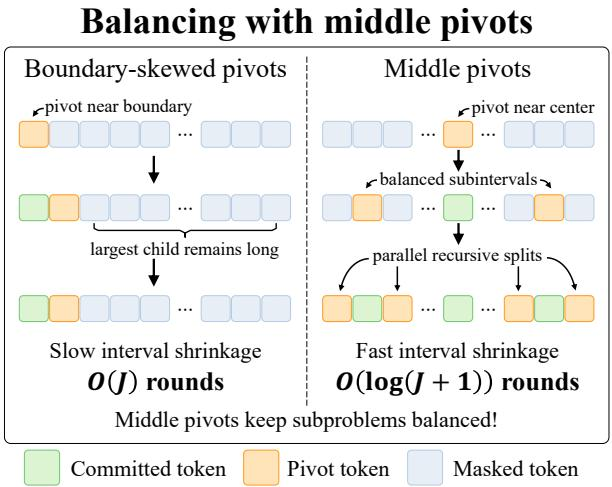
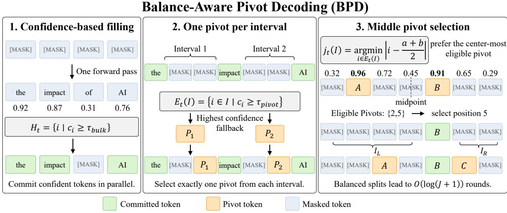
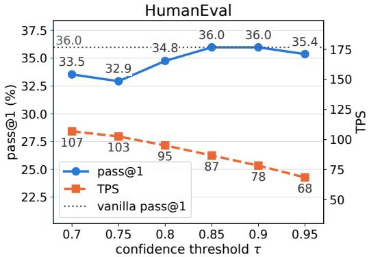
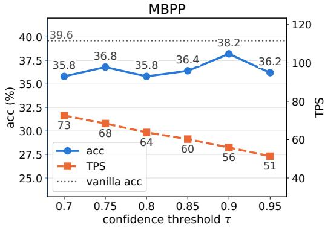
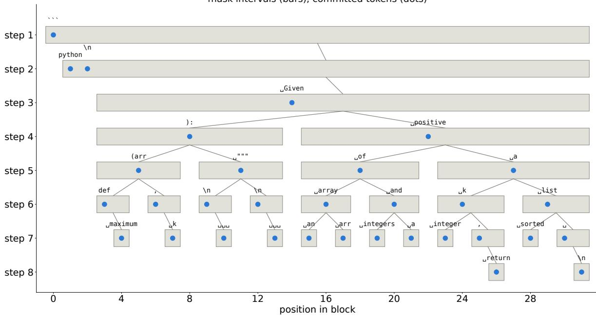

# Balance-Aware Pivot Selection for Parallel Diffusion LLM Decoding

Yejin Lee\*, Hyundong Jin\*, Yo-Sub Han Yonsei University, Seoul, Republic of Korea, {ssgyejin,tuzi04,emmous}@yonsei.ac.kr

## Abstract

Diffusion language models enable parallel token generation, offering a promising alternative to sequential autoregressive decoding. Existing acceleration methods use predictive confidence to enable parallel token commitment while preserving generation quality. However, confidence-based selection prioritizes reliable token predictions without explicitly considering how token positions shape the remaining decoding schedule. Moreover, such ordering does not always reflect inter-token dependencies, suggesting that confidence need not be the sole criterion for token selection. Motivated by this limitation, we propose Balance-Aware Pivot Decoding (BPD), which favors central pivots within contiguous masked intervals and decodes the selected positions in parallel. Balanced pivots yield logarithmic decoding depth in the interval length. Our practical method accounts for model uncertainty by combining confidence-based prefilling with confidence-thresholded center selection. We evaluate the resulting quality–efficiency tradeoff on LLaDA and Dream across five mathematical reasoning, code generation, and instructionfollowing benchmarks. Our implementation is available at https://anonymous.4open. science/r/DLM\_random\_pivot-EE62/

## 1 Introduction

Diffusion language models offer an alternative to autoregressive generation by iteratively recovering masked tokens using bidirectional context (Nie et al., 2025; Ye et al., 2025). Their ability to predict multiple positions in a single forward pass can reduce the number of forward passes required for generation. Realizing this potential requires an effective decoding strategy that determines how many tokens to commit and which positions to select at each step (Kim et al., 2025; Chen et al.,

  
Figure 1: Motivation for position-aware unmasking strategy. Center-based selection promotes balanced partitions, unlike confidence-based selection that may leave long masked intervals.

2026). Aggressive parallel commitment can compromise generation quality, whereas conservative schedules leave much of the available parallelism unused (Zhong et al., 2026).

Recent methods address this trade-off through confidence-based selection, caching, and iterative revision. Fast-dLLM (Wu et al., 2026) combines confidence-aware parallel decoding with KV-cache reuse, reducing both the number of decoding iterations and the computation required per iteration. WINO (Hong et al., 2026) allows uncertain commitments to be revised through a parallel drafting and verification process. Hierarchy-dLLM (Qi et al., 2026) introduces a divide-and-conquer structure that partitions unresolved positions into contiguous sub-decoding areas and processes them in parallel. These approaches demonstrate the effectiveness of confidence-guided token selection and parallel decoding.

However, confidence-based selection measures the reliability of individual token predictions, without explicitly accounting for the remaining decoding process. In threshold-based decoding, the number of committed tokens depends on current predictions, providing limited control over the remaining decoding rounds. Moreover, recent studies suggest that confidence-based ordering does not always align with token dependencies (Kim and No, 2026), and that alternative unmasking orders can improve decoding (Lee et al., 2026). These observations motivate considering additional criteria beyond predictive confidence when determining the decoding order. Rather than replacing confidence, we explore whether a simple positional strategy can provide a more structured decoding schedule while retaining the benefits of confidence-based token selection.

We propose Balance-Aware Pivot Decoding (BPD), which introduces a structural preference into confidence-aware token selection. BPD favors pivots near the centers of contiguous masked intervals, progressively dividing unresolved positions into smaller intervals that can be processed in parallel, as illustrated in Figure 1. We show that balanced pivot selection yields O(log(J + 1)) decoding rounds for an interval of length J. To account for prediction uncertainty, BPD incorporates confidence-based prefilling and thresholded pivot selection. We empirically examine the resulting pivot balance and quality–efficiency trade-off.

Our contributions are summarized as follows:

• We introduce BPD, combining center-based pivot selection with confidence-aware decoding to exploit parallelism.

• We characterize the decoding depth of balanced pivot selection and analyze how confidence-aware pivoting affects the applicability of the theoretical bound.

• We evaluate generation quality, decoding efficiency, and pivot balance on LLaDA and Dream across five reasoning, code generation, and instruction-following benchmarks.

## 2 Related Work

Diffusion Language Models Diffusion models, originally developed for continuous data (Ho et al., 2020; Nichol and Dhariwal, 2021), have been extended to text generation through continuous (Li et al., 2022; Gong et al., 2023) and discrete formulations (Austin et al., 2021a; He et al., 2023). Masked diffusion language models (DLMs) enable iterative token refinement with flexible generation orders. Sahoo et al. (2024) introduced a simplified training objective for masked diffusion, while largescale models such as LLaDA (Nie et al., 2025) and Dream (Ye et al., 2025) have demonstrated competitive performance on reasoning and code generation tasks. Further advances include preference optimization (Zhu et al., 2026), anchor-based conditioning (Rout et al., 2025), and iterative remasking (Wang et al., 2025).

Parallel Decoding Parallel decoding exploits the ability of DLMs to predict multiple masked tokens in a single forward pass, reducing decoding iterations at the potential cost of generation quality due to inter-token dependencies. FastdLLM (Wu et al., 2026) combines confidencethresholded parallel decoding with KV caching, allowing multiple high-confidence tokens to be committed while reusing previously computed representations. WINO (Hong et al., 2026) introduces a parallel drafting and verification process, where uncertain commitments can be remasked and refined in subsequent iterations. Hierarchy-dLLM (Qi et al., 2026) adopts a divide-and-conquer approach that recursively partitions unresolved positions into subdecoding areas, using confidence-based selection within each area to enable parallel progress. It also supports remasking unreliable predictions. These approaches improve decoding efficiency through parallel commitment, computation reuse, or iterative revision, while relying primarily on predictive confidence to determine which tokens to commit.

Token Ordering and Structured Decoding Recent studies explore decoding criteria beyond individual token confidence. DAPD (Kim et al., 2026) constructs attention-based dependency graphs to select weakly dependent tokens for parallel updates, while DOS (Zhou et al., 2026) uses attentionderived dependencies to guide decoding. Kim and No (2026) further show that confidence-guided ordering can diverge from logical dependencies in complex reasoning tasks. In concurrent work, Bansal et al. (2026) investigate parallel sampling through graph random walks and introduce recursive bisection samplers with logarithmic parallel depth. Their score-guided variant selects lowuncertainty pivots within the middle half of each interval. In contrast, BPD selects the most central position among confidence-eligible candidates and incorporates an initial confidence-based prefilling phase. This design favors balanced splits without imposing a fixed central-region constraint.

## 3 Method

We introduce Balance-Aware Pivot Decoding (BPD), a parallel decoding strategy that integrates positional balance with predictive confidence. As illustrated in Figure 2, BPD first commits high-confidence tokens in parallel and then selects central pivots with in the remaining masked intervals to reduce decoding depth. We first analyze the theoretical complexity of balanced pivot selection and then describe our confidence-aware decoding procedure.

## 3.1 Balance-Aware Pivot Decoding

Given a prompt u, we initialize a generation canvas $y = \mathsf { M A S K } ^ { G }$ and process blocks of size B from left to right, assuming that B divides G. At iteration t within a block, let $\mathcal { M } _ { t }$ be its masked positions and $\mathcal { T } _ { t }$ the maximal contiguous intervals in $\mathcal { M } _ { t }$ One model forward pass produces distributions $p _ { i } ^ { ( t ) }$ for the current block. Excluding MASK from the predictive vocabulary, we define

$$
\widehat { y } _ { i } ^ { ( t ) } = \arg \operatorname* { m a x } _ { v } p _ { i } ^ { ( t ) } ( v ) , \quad c _ { i } ^ { ( t ) } = p _ { i } ^ { ( t ) } ( \widehat { y } _ { i } ^ { ( t ) } ) .\tag{1}
$$

The basic BPD rule selects

$$
j _ { t } ( I ) = \arg \operatorname* { m i n } _ { i \in I } \left| i - { \frac { a + b } { 2 } } \right| , \quad I = [ a , b ] \in { \mathcal { I } } _ { t } ,\tag{2}
$$

with positional ties resolved to the left. All selected predictions are committed simultaneously using the same forward output. A pivot j replaces $[ a , b ]$ by its nonempty children $[ a , j - 1 ]$ and $[ j + 1 , b ]$ Committed tokens remain fixed.

The number of sequential rounds is determined by the deepest branch of this interval-splitting process. Since both children advance in the same subsequent rounds, the relevant recurrence is

$$
\begin{array} { r } { D ( I ) = 1 + \operatorname* { m a x } \{ D ( I _ { \mathrm { L } } ) , D ( I _ { \mathrm { R } } ) \} , \quad D ( \emptyset ) = 0 , } \end{array}\tag{3}
$$

for a realized splitting tree. Thus exact midpoint selection is not necessary. Any pivot that contracts both children by a fixed factor gives logarithmic depth.

Proposition 1 (Balanced-pivot round complexity). Consider a masked interval of length $J ~ \geq ~ 1 .$ Suppose every round commits one pivot in every nonempty interval and, for a fixed $\rho \in [ 1 / 2 , 1 )$ every pivot satisfies

$$
\operatorname* { m a x } \{ | I _ { \mathrm { L } } | , | I _ { \mathrm { R } } | \} \leq \rho | I | .\tag{4}
$$

Then decoding finishes within

$$
T ( J ) \leq \left\lfloor { \frac { \log J } { \log ( 1 / \rho ) } } \right\rfloor + 1 = O ( \log ( J + 1 ) )\tag{5}
$$

rounds. In particular, pivots that leave neither child larger than $3 | I | / 4$ satisfy this bound with $\rho = 3 / 4$

Exact midpoint selection completes an interval in $\lceil \log _ { 2 } ( J + 1 ) \rceil$ rounds. Proposition 1 extends this result to any consistently balanced pivot rule, providing a worst-case depth bound. An expecteddepth extension for probabilistically balanced pivots is given in Appendix A. These bounds concern sequential decoding rounds, not computational cost or generation quality, and do not assume independence between masked intervals.

## 3.2 Confidence-Based Prefilling

Pure midpoint selection ignores predictive confidence and may commit unreliable tokens during early decoding step. To address this limitation, we introduce confidence-based prefilling, which commit high-confidence predictions in parallel before pivot selection. During the first K iterations of each block, we select tokens according to their predictive confidence. At iteration $t < K$ , define

$$
H _ { t } = \{ i \in \mathcal { M } _ { t } : c _ { i } ^ { ( t ) } \geq \tau _ { \mathrm { b u l k } } \} .\tag{6}
$$

If $H _ { t } \ \ne \ \emptyset$ , we commit all predictions in $H _ { t }$ simultaneously. These commitments can divide the remaining masks into several shorter intervals. If $H _ { t } = \emptyset$ , we immediately apply the interval-wise pivot rule below. The probabilities and candidate sets are recomputed at every iteration. This process provides reliable contextual information for subsequent pivot selection.

## 3.3 Confidence-Threshold Pivoting

A geometrically central token may have low predictive confidence. We therefore retain the center preference while restricting it to candidates above a threshold. For each active interval $I = [ a , b ]$ , let

$$
E _ { t } ( I ) = \{ i \in I : c _ { i } ^ { ( t ) } \geq \tau _ { \mathrm { p i v o t } } \} .\tag{7}
$$

We select

$$
j _ { t } ( I ) = \left\{ \begin{array} { l l } { \mathop { \mathrm { a r g } } \displaystyle \operatorname* { m i n } _ { i \in E _ { t } ( I ) } \left| i - \frac { a + b } { 2 } \right| , } & { E _ { t } ( I ) \ne \emptyset , } \\ { \mathop { \mathrm { a r g } } \displaystyle \operatorname* { m a x } _ { i \in I } c _ { i } ^ { ( t ) } , } & { E _ { t } ( I ) = \emptyset . } \end{array} \right.\tag{8}
$$

Ties are resolved to the left. This rule commits exactly one token per interval and always makes

  
Figure 2: Overview of Balance-Aware Pivot Decoding (BPD). BPD first commits high-confidence tokens in parallel, then selects one pivot per remaining masked interval. It favors the most central confidence-eligible position to promote balanced splits and reduce decoding depth.

progress. Let $P _ { t } = \{ j _ { t } ( I ) ~ | ~ I \in \mathcal { I } _ { t } \}$ denote the selected pivots. Combining both techniques gives

$$
\begin{array} { r } { S _ { t } = \left\{ \begin{array} { l l } { H _ { t } , } & { t < K \mathrm { a n d } H _ { t } \ne \emptyset , } \\ { P _ { t } , } & { \mathrm { o t h e r w i s e } , } \end{array} \right. } \\ { y _ { i } \gets \widehat { y } _ { i } ^ { ( t ) } ( i \in S _ { t } ) . } \end{array}\tag{9}
$$

The confidence threshold allows BPD to avoid uncertain central predictions. To connect this rule with Proposition 1, let $A _ { \rho } ( I )$ denote the positions in interval I that satisfy the balance condition in Eq. (4). Since these positions form a central region, the selected pivot is guaranteed to be balanced whenever $E _ { t } ( I ) \cap A _ { \rho } ( I ) \neq \emptyset$ . Otherwise, the selected pivot may lie near an endpoint, and the logarithmic bound is not guaranteed. Without the balance condition, the worst-case decoding depth is B rounds per block.

Prefix KV caching. We employ approximate prefix KV caching to reduce computation across decoding iterations. At the first inference of each block, we obtain its predictions and the prefix KV cache from a single full-sequence forward pass. Subsequent iterations reuse the fixed prefix cache while recomputing the suffix. This reduces computation per round without affecting the interval-depth analysis. For a fixed K, if all subsequent pivots satisfy Eq. (4), each block requires $O ( K + \log ( B + 1 ) )$ rounds, yielding $O ( ( G / B ) ( K + \log ( B + 1 ) ) )$ ) forward passes over the full generation.

## 4 Experiment

## 4.1 Experimental Setting

We evaluate our method on three diffusion language models: LLaDA-8B-Instruct, LLaDA-1.5, and Dream-7B. We conduct all experiments on a single NVIDIA RTX A6000 GPU with 48 GB of memory. We use semi-autoregressive decoding with a block size of 32 and a maximum generation length of 256 tokens. We set both confidence threshold $\tau _ { \mathrm { b u l k } }$ and $\tau _ { \mathrm { p i v o t } }$ to 0.9, and the number of prefilling steps K to 3. We use the same decoding configuration for all benchmarks unless otherwise specified. Further implementation details are provided in Appendix C.1.

Benchmarks and Baselines. We evaluate our method on five benchmarks: GSM8K (Cobbe et al., 2021) and MATH-500 (Lightman et al., 2024) for mathematical reasoning, HumanEval (Chen et al., 2021) and MBPP (Austin et al., 2021b) for code generation, and IFEval (Zhou et al., 2023) for instruction following. We compare our method against five parallel decoding baselines: HierarchydLLM (Qi et al., 2026), WINO (Hong et al., 2026), Fast-dLLM (Wu et al., 2026), DAPD (Kim et al., 2026), and DOS (Zhou et al., 2026).

Evaluation Metrics. We evaluate task performance using Pass@1 for HumanEval and MBPP and accuracy for the remaining benchmarks. We measure inference efficiency using tokens per second (TPS), which measures the number of generated tokens per second. Since decoding acceleration can trade generation quality for throughput, we use Quality-Throughput Gain (QTG) as our primary aggregate metric to evaluate both aspects jointly. QTG is defined as the relative throughput weighted by relative task performance with respect to vanilla decoding:

<table><tr><td rowspan="2">Dataset</td><td rowspan="2">Method</td><td colspan="3">LLaDA-8B-Instruct</td><td colspan="3">LLaDA-1.5</td><td colspan="3">Dream-7B</td></tr><tr><td>Score ↑</td><td>TPS ↑</td><td>QTG↑</td><td>Score ↑</td><td>TPS ↑</td><td>QTG↑</td><td>Score ↑</td><td>TPS ↑</td><td>QTG↑</td></tr><tr><td rowspan="7">GSM8K</td><td>Vanilla</td><td>81.65</td><td>12.02</td><td>1.00×</td><td>81.88</td><td>11.92</td><td>1.00×</td><td>82.87</td><td>14.62</td><td>1.00×</td></tr><tr><td>Hierarchy-dLLM</td><td>77.94</td><td>52.87</td><td>4.20×</td><td>79.45</td><td>54.51</td><td>4.44×</td><td>73.54</td><td>73.43</td><td>4.46×</td></tr><tr><td>WINO</td><td>80.29</td><td>46.24</td><td>3.78×</td><td>79.53</td><td>46.46</td><td>3.79×</td><td>80.21</td><td>55.24</td><td>3.66×</td></tr><tr><td>Fast-dLLM</td><td>81.50</td><td>52.83</td><td>4.39×</td><td>81.58</td><td>54.96</td><td>4.59×</td><td>80.52</td><td>74.60</td><td>4.96×</td></tr><tr><td>DAPD</td><td>80.44</td><td>36.01</td><td>2.95×</td><td>82.03</td><td>37.69</td><td>3.17×</td><td>82.56</td><td>41.84</td><td>2.85×</td></tr><tr><td>DOS</td><td>79.98</td><td>22.32</td><td>1.82×</td><td>82.18</td><td>23.39</td><td>1.97×</td><td>82.49</td><td>32.75</td><td>2.23×</td></tr><tr><td>Ours</td><td>79.98</td><td>54.50</td><td>4.44×</td><td>80.59</td><td>56.10</td><td>4.63×</td><td>79.91</td><td>82.87</td><td>5.47×</td></tr><tr><td rowspan="7">MATH-500</td><td>Vanilla</td><td>38.60</td><td>12.13</td><td>1.00×</td><td>37.40</td><td>12.07</td><td>1.00×</td><td>42.00</td><td>14.70</td><td>1.00×</td></tr><tr><td>Hierarchy-dLLM</td><td>36.20</td><td>40.94</td><td>3.17×</td><td>36.80</td><td>41.24</td><td>3.36×</td><td>26.40</td><td>48.22</td><td>2.06×</td></tr><tr><td>WINO</td><td>37.20</td><td>28.08</td><td>2.23×</td><td>38.20</td><td>27.97</td><td>2.37×</td><td>40.20</td><td>34.97</td><td>2.28×</td></tr><tr><td>Fast-dLLM</td><td>37.00</td><td>41.06</td><td>3.24×</td><td>36.20</td><td>42.02</td><td>3.37×</td><td>42.60</td><td>54.40</td><td>3.75×</td></tr><tr><td>DAPD</td><td>37.80</td><td>26.63</td><td>2.15×</td><td>36.60</td><td>22.78</td><td>1.85×</td><td>39.40</td><td>28.93</td><td>1.85×</td></tr><tr><td>DOS</td><td>34.60</td><td>17.27</td><td>1.28×</td><td>35.80</td><td>18.05</td><td>1.43×</td><td>39.60</td><td>21.19</td><td>1.36×</td></tr><tr><td>Ours</td><td>37.00</td><td>44.20</td><td>3.49×</td><td>37.00</td><td>44.95</td><td>3.68×</td><td>40.40</td><td>62.52</td><td>4.09×</td></tr><tr><td rowspan="7">HumanEval</td><td>Vanilla</td><td>35.98</td><td>10.44</td><td>1.00×</td><td>39.63</td><td>10.34</td><td>1.00×</td><td>59.76</td><td>11.79</td><td>1.00×</td></tr><tr><td>Hierarchy-dLLM</td><td>32.93</td><td>72.53</td><td>6.36×</td><td>37.20</td><td>67.81</td><td>6.16×</td><td>32.32</td><td>83.43</td><td>3.83×</td></tr><tr><td>WINO</td><td>39.63</td><td>43.49</td><td>4.59×</td><td>38.41</td><td>39.75</td><td>3.73×</td><td>57.32</td><td>51.30</td><td>4.17×</td></tr><tr><td>Fast-dLLM</td><td>39.02</td><td>79.06</td><td>8.21×</td><td>38.41</td><td>78.54</td><td>7.36×</td><td>60.37</td><td>91.39</td><td>7.83×</td></tr><tr><td>DAPD</td><td>37.80</td><td>47.33</td><td>4.76×</td><td>37.80</td><td>46.23</td><td>4.26×</td><td>57.32</td><td>39.38</td><td>3.20×</td></tr><tr><td>DOS</td><td>34.76</td><td>26.93</td><td>2.49×</td><td>37.80</td><td>27.76</td><td>2.56×</td><td>57.32</td><td>34.08</td><td>2.77×</td></tr><tr><td>Ours</td><td>35.98</td><td>78.29</td><td>7.50×</td><td>37.20</td><td>77.83</td><td>7.07×</td><td>54.88</td><td>107.61</td><td>8.38×</td></tr><tr><td rowspan="7">MBPP</td><td>Vanilla</td><td>39.60</td><td>10.78</td><td>1.00×</td><td>40.00</td><td>10.74</td><td>1.00×</td><td>58.00</td><td>12.69</td><td>1.00×</td></tr><tr><td>Hierarchy-dLLM</td><td>36.80</td><td>49.38</td><td>4.26×</td><td>36.20</td><td>49.30</td><td>4.15×</td><td>49.20</td><td>124.89</td><td>8.35×</td></tr><tr><td>WINO</td><td>38.80</td><td>26.50</td><td>2.41×</td><td>38.60</td><td>26.71</td><td>2.40×</td><td>56.40</td><td>56.34</td><td>4.32×</td></tr><tr><td>Fast-dLLM</td><td>38.00</td><td>52.01</td><td>4.63×</td><td>37.80</td><td>52.89</td><td>4.65×</td><td>57.60</td><td>112.33</td><td>8.79×</td></tr><tr><td>DAPD</td><td>38.80</td><td>30.74</td><td>2.79×</td><td>38.00</td><td>32.03</td><td>2.83×</td><td>56.20</td><td>69.43</td><td>5.30×</td></tr><tr><td>DOS</td><td>40.20</td><td>20.58</td><td>1.94×</td><td>39.80</td><td>21.28</td><td>1.97×</td><td>57.80</td><td>54.23</td><td>4.26×</td></tr><tr><td>Ours</td><td>38.20</td><td>55.90</td><td>5.00×</td><td>38.60</td><td>56.69</td><td>5.09×</td><td>53.00</td><td>131.36</td><td>9.46×</td></tr><tr><td rowspan="7">IFEval</td><td>Vanilla</td><td>56.01</td><td>12.26</td><td>1.00×</td><td>58.60</td><td>12.98</td><td>1.00×</td><td>51.39</td><td>16.24</td><td>1.00×</td></tr><tr><td>Hierarchy-dLLM</td><td>46.40</td><td>35.88</td><td>2.42×</td><td>50.28</td><td>35.97</td><td>2.38×</td><td>31.61</td><td>58.51</td><td>2.22×</td></tr><tr><td>WINO</td><td>55.82</td><td>21.23</td><td>1.73×</td><td>57.12</td><td>21.80</td><td>1.64×</td><td>50.83</td><td>31.70</td><td>1.93×</td></tr><tr><td>Fast-dLLM</td><td>53.79</td><td>30.09</td><td>2.36×</td><td>57.49</td><td>31.41</td><td>2.37×</td><td>52.31</td><td>47.52</td><td>2.98×</td></tr><tr><td>DAPD</td><td>58.23</td><td>25.91</td><td>2.20×</td><td>58.41</td><td>25.59</td><td>1.97×</td><td>40.67</td><td>67.35</td><td>3.28×</td></tr><tr><td>DOS</td><td>59.89</td><td>19.77</td><td>1.72×</td><td>60.44</td><td>19.52</td><td>1.55×</td><td>56.93</td><td>25.17</td><td>1.72×</td></tr><tr><td>Ours</td><td>51.20</td><td>43.66</td><td>3.26×</td><td>54.71</td><td>43.48</td><td>3.13×</td><td>51.57</td><td>63.94</td><td>3.95×</td></tr></table>

Table 1: Main results on five benchmarks using LLaDA-8B-Instruct, LLaDA-1.5, and Dream-7B. We report generation quality (Score), throughput measured in tokens per second (TPS), and Quality-Throughput Gain (QTG). QTG is the product of relative throughput and relative task performance with respect to vanilla.

$$
\mathrm { Q T G } = \frac { \mathrm { T P S } _ { m } } { \mathrm { T P S } _ { v } } \cdot \frac { \mathrm { S c o r e } _ { m } } { \mathrm { S c o r e } _ { v } } ,\tag{10}
$$

where m denotes the evaluated decoding method and v denotes vanilla decoding, and Score represents Pass@1 or accuracy.

## 4.2 Main Results

Table 1 compares BPD with five accelerated decoding baselines across three models and five benchmarks. BPD achieves the highest QTG in 13 of the 15 settings and the highest throughput in 12 settings. We examine these results by decoding method, task, and model to distinguish efficiency gains from changes in generation quality.

Comparison across Decoding Methods. Hierarchy-dLLM provides a particularly relevant comparison because it also partitions unresolved positions into smaller regions, while relying primarily on confidence for token selection. Compared with Hierarchy-dLLM, BPD achieves higher throughput in all 15 settings, with equal or higher task scores throughout. Fast-dLLM is a stronger competitor, particularly on LLaDA code generation. On HumanEval, Fast-dLLM achieves QTG values of 8.21× and 7.36× on the two

LLaDA models, compared with 7.50× and 7.07× for BPD. Dependency-aware methods, including DAPD and DOS, retain higher task scores in some settings but generally operate at lower throughput.

Comparison across Datasets. On GSM8K and MATH-500, BPD remains within three percentage points of vanilla accuracy across all six modelbenchmark settings, while achieving approximately 3.6–5.7× higher throughput. Code generation exhibits a more model-dependent quality-efficiency trade-off. On the two LLaDA models, HumanEval Pass@1 is preserved or decreases by at most 2.43 percentage points relative to vanilla. On Dream, however, HumanEval Pass@1 decreases from 59.76 to 54.88, and MBPP Pass@1 decreases from 58.00 to 53.00, while throughput reaches 107.61 and 131.36 TPS, respectively. IFEval presents a different challenge. Although BPD achieves the highest QTG for all three models, its instruction-following scores decrease by 4.81 and 3.89 percentage points on the two LLaDA models. These results highlight that decoding acceleration does not uniformly preserve generation quality, and that throughput gains must be interpreted alongside task-specific performance.

Comparison across Models. We use identical block sizes, prefilling schedules, and confidence thresholds across all three models, without modelspecific tuning. Nevertheless, the relative advantages of different decoding strategies vary across model families. For instance, on Dream, BPD achieves 17.7% and 16.9% higher throughput than Fast-dLLM on HumanEval and MBPP, respectively. These improvements are accompanied by Pass@1 reductions of 5.49 and 4.60 percentage points relative to Fast-dLLM. These results indicate that the proposed decoding strategy transfers across different model families, although its relative qualitythroughput advantage depends on the model and task.

## 4.3 Throughput on Correct Generations

Overall throughput may be influenced by failed generations across decoding methods. We therefore additionally measure TPS on correctly solved instances, while reporting task scores over the complete evaluation set. Table 2 shows that BPD achieves the highest correct-generation throughput on all five benchmarks with LLaDA-8B-Instruct. Compared with the next-fastest method, BPD improves throughput by 8.5% on MBPP and 24.4% on IFEval. The gains are more modest on GSM8K, MATH-500, and HumanEval, ranging from 0.7% to 2.9%. These findings show that the efficiency advantage persists on successful generations, rather than appearing only in the aggregate results. Because the correct-generation subsets can differ across methods, this analysis complements the fullset quality and throughput comparisons rather than replacing them.

<table><tr><td>Method</td><td>GSM8K MATH</td><td>H.Eval MBPP</td><td>IFEval</td></tr><tr><td>Vanilla</td><td>11.41 12.69 (81.65) (38.60)</td><td>10.99 11.11 (35.98) (39.60)</td><td>12.28 (56.01)</td></tr><tr><td>Hierarchy</td><td>51.36 48.74 (77.94) (36.20)</td><td>85.36 (32.93) (36.80)</td><td>53.96 37.69 (46.40)</td></tr><tr><td>WINO</td><td>48.67 33.84 (80.29) (37.20)</td><td>50.23 (39.63) (38.80)</td><td>29.55 21.49 (55.82)</td></tr><tr><td>Fast-dLLM</td><td>54.90 47.69 (81.50) (37.00)</td><td>86.40 (39.02)</td><td>56.50 31.94 (38.00) (53.79)</td></tr><tr><td>DAPD</td><td>37.77 33.50 (80.44) (37.80)</td><td>56.87 35.20 (37.80) (38.80)</td><td>28.17 (58.23)</td></tr><tr><td>DOS</td><td>23.31 (79.98)</td><td>20.24 33.99 (34.60) (34.76)</td><td>23.68 21.17 (40.20) (59.89)</td></tr><tr><td>Ours</td><td>56.12 50.17 (79.98) (37.00)</td><td>86.97 61.32 (35.98) (38.20)</td><td>46.89 (51.20)</td></tr></table>

Table 2: Generation quality and throughput on five benchmarks using LLaDA-8B-Instruct. Each method reports TPS in the first row and task performance (Score) in the second row.

## 5 Analysis

## 5.1 Ablation Study

We evaluate the contributions of positional pivot selection, confidence-based prefilling, and KV caching on HumanEval using LLaDA-8B-Instruct, as reported in Table 3. To isolate the effect of positional preference, we replace our center-preferred pivot rule with random and confidence-based selection variants, while retaining the other components. These variants increase forward steps from 55.73 to 64.20 and 71.79, respectively, while reducing throughput from 78.29 to 68.72 and 62.34 TPS. Both variants also achieve lower Pass@1, supporting the benefit of positional preference. Unlike the bisection strategies in Section 5.2, these variants do not enforce a fixed balance constraint on pivot positions.

Confidence-based prefilling contributes to both generation quality and decoding efficiency. Removing prefilling reduces Pass@1 from 35.98 to 33.54 and increases forward steps from 55.73 to

<table><tr><td>Variant</td><td>Pass@1</td><td>TPS</td><td># Steps</td><td>QTG</td></tr><tr><td>Vanilla</td><td>35.98</td><td>10.44</td><td>256.00</td><td>1.00×</td></tr><tr><td>w/o KV caching</td><td>37.20</td><td>54.01</td><td>49.21</td><td>5.35×</td></tr><tr><td>w/o Prefilling</td><td>33.54</td><td>59.15</td><td>73.77</td><td>5.28×</td></tr><tr><td>w/ Random Pivot</td><td>34.15</td><td>68.72</td><td>64.20</td><td>6.25×</td></tr><tr><td>w/ Confident Pivot</td><td>35.37</td><td>62.34</td><td>71.79</td><td>5.87×</td></tr><tr><td>Ours</td><td>35.98</td><td>78.29</td><td>55.73</td><td>7.50×</td></tr></table>

Table 3: Ablation study on HumanEval using LLaDA-8B-Instruct to examine the contribution of each component. We report generation quality, throughput, and quality-throughput gain (QTG).

73.77. Early high-confidence commitments reduce the number of unresolved tokens and can partition long masked intervals before subsequent pivot selection. Prefix KV caching further improves inference efficiency. Without caching, throughput decreases from 78.29 to 54.01 TPS, despite requiring fewer forward steps. The noncached variant also achieves a slightly higher Pass@1 of 37.20, suggesting that approximate cache reuse may affect predictions. Overall, the complete method achieves the highest QTG of 7.50× among the evaluated variants.

## 5.2 Pivot Selection, Prefilling, and Balance

We further examine how pivot selection interacts with confidence-based prefilling and the balance condition underlying Proposition 1. Table 4 compares BPD with three bisection strategies from Bansal et al. (2026): Exact, Margin, and Entropy. We additionally include a random bisection variant that samples pivots from the balanced region. Each strategy is evaluated with and without confidencebased prefilling, using identical generation settings and prefix KV caching. Implementation details are provided in Appendix C.3.

Pivot Selection and Prefilling. Without prefilling, BPD achieves the highest Pass@1 of 33.54% and QTG of 5.28× among the five strategies, despite having the lowest throughput. Exact bisection achieves higher throughput, but its Pass@1 drops to 23.17%. This contrast illustrates that enforcing balanced partitions can accelerate decoding at the cost of generation quality. Adding prefilling improves throughput across all five strategies, by 41.6–50.0% for the bisection variants and 32.4% for BPD. However, its effect on Pass@1 depends on the pivot selection strategy. Prefilling improves Pass@1 for Margin, Random, and BPD, but reduces it for Exact and Entropy. For example, Margin improves from 25.00% to 29.27%, whereas Entropy decreases from 29.88% to 27.44%. This suggests that early high-confidence commitments interact with subsequent pivot selection rather than uniformly improving generation quality. With prefilling, Margin achieves the highest QTG of 7.59×, slightly exceeding the 7.50× of BPD. However, BPD retains the highest Pass@1 of 35.98%, exceeding Margin by 6.71 percentage points, while operating at lower throughput. These results highlight the trade-off between enforcing balanced partitions and incorporating prediction confidence into pivot selection.

<table><tr><td rowspan="2">Method</td><td colspan="3">Pivoting</td><td colspan="3">Prefilling</td></tr><tr><td>Pass@1</td><td>TPS</td><td>QTG</td><td>Pass@1</td><td>TPS</td><td>QTG</td></tr><tr><td rowspan="4">Exact Margin Entropy</td><td>23.17</td><td>76.65</td><td>4.73</td><td>22.56</td><td>108.57</td><td>6.52</td></tr><tr><td>25.00</td><td>64.96</td><td>4.32</td><td>29.27</td><td>97.41</td><td>7.59</td></tr><tr><td>29.88</td><td>63.53</td><td>5.05</td><td>27.44</td><td>94.54</td><td>6.91</td></tr><tr><td>20.12</td><td>69.25</td><td>3.71</td><td>21.34</td><td>102.17</td><td>5.80</td></tr><tr><td>Ours</td><td>33.54</td><td>59.15</td><td>5.28</td><td>35.98</td><td>78.29</td><td>7.50</td></tr></table>

Table 4: Comparison of pivot selection strategies with and without confidence-based prefilling on LLaDA-8B-Instruct and HumanEval.
<table><tr><td>Pivot Type</td><td># Events</td><td># Balanced</td><td>BPR (%)</td></tr><tr><td>Eligible</td><td>2,570</td><td>1,451</td><td>56.46</td></tr><tr><td>Fallback</td><td>2,113</td><td>423</td><td>20.02</td></tr><tr><td>Total</td><td>4,683</td><td>1,874</td><td>40.02</td></tr></table>

Table 5: Balance statistics of BPD pivot selections. The first three iterations of each block and intervals of length at most four are excluded.

Theoretical and Empirical Balance. The bisection variants enforce the 3/4-balance condition at every pivot selection. Consequently, their pivoting rounds satisfy the logarithmic depth bound in Proposition 1. With prefilling, the same bound applies to the remaining intervals after the initial K iterations, yielding O(K+log(R+1)) total rounds, where R is the largest remaining interval. In contrast, BPD prioritizes central positions only among confidence-eligible candidates and may select unbalanced fallback pivots. Its logarithmic depth is therefore not guaranteed.

To characterize this distinction, we measure the balanced pivot rate (BPR) and critical-path BPR (CP-BPR), as defined in Appendix C.1. As shown in Table 5, BPD achieves an overall BPR of 40.02%. Confidence-eligible pivots satisfy the balance condition more frequently than fallback pivots. The

  
Figure 3: Effect of the confidence threshold on generation quality and throughput using LLaDA-8B-Instruct. We report Pass@1 on HumanEval and Accuracy on MBPP, along with tokens per second (TPS). Dotted lines indicate vanilla decoding performance.

CP-BPR is 31.90%, 8.12 percentage points below the overall BPR. This indicates that unbalanced selections are more frequent along the critical paths, which determine the number of decoding rounds rather than the average balance across all pivots.

The probabilistic bound in Appendix A requires a lower bound on the probability of balanced selection conditional on the decoding history, which is not implied by the observed aggregate BPR. Instead, the theoretical analysis establishes the structural advantage of balanced partitioning, while our experiments characterize the trade-off introduced by relaxing this constraint. Strict bisection guarantees interval contraction but may commit uncertain predictions, whereas BPD permits unbalanced splits when confidence-eligible central pivots are unavailable. This flexibility allows BPD to achieve higher generation quality than strictly balanced strategies, while retaining a substantial throughput improvement over vanilla decoding. These results support positional balance as a useful decoding preference rather than an unconditional constraint.

## 5.3 Effect of the Confidence Threshold

We investigate how the confidence threshold affects generation quality and decoding efficiency. Figure 3 shows that increasing the threshold consistently reduces throughput, while improvements in task performance remain limited. HumanEval achieves its highest Pass@1 at thresholds of 0.85 and 0.90, whereas MBPP reaches its highest accuracy at 0.90. Further increasing the threshold reduces performance on both benchmarks despite confidence filtering.

This behavior indicates the interaction between confidence filtering and pivot selection. BPD selects the position closest to the interval center among candidates that satisfy the confidence threshold. As the threshold increases, fewer positions remain eligible, reducing the chance of finding a reliable pivot near the center. This restriction can shift pivot selection away from interval centers and produce uneven partitions that require additional decoding steps. The results suggest that excessively strict confidence filtering restricts the structural advantage of BPD without providing further gains in generation quality. These findings demonstrate that the confidence threshold determines how effectively BPD can exploit balanced interval partitioning while maintaining prediction reliability.

## 6 Conclusion

We presented Balance-Aware Pivot Decoding (BPD), a training-free parallel decoding strategy for diffusion language models that incorporates positional balance into confidence-aware token selection. BPD combines confidence-based prefilling with center-preferred pivot selection to promote balanced interval decomposition without forcing uncertain commitments. We established logarithmic decoding-depth bounds under balanced pivot selection and examined their applicability to practical decoding. Experiments across three diffusion language models and five benchmarks demonstrate favorable quality-throughput tradeoffs, achieving up to 10.35× higher throughput than vanilla decoding with a QTG of 9.46×. BPD achieves the highest QTG in 13 of 15 settings and the highest throughput in 12 settings. These findings suggest that positional balance can serve as a useful structural preference rather than a strict constraint for accelerating parallel diffusion decoding.

## Limitations

Our theoretical decoding-depth bound assumes that every selected pivot satisfies a fixed balance condition. In practice, BPD incorporates confidencebased selection and fallback mechanisms that do not guarantee this condition. Thus, the logarithmic bound does not unconditionally apply to the practical algorithm. Moreover, the theoretical analysis concerns sequential decoding rounds rather than wall-clock latency, which also depends on computational and caching overhead. Additionally, BPD does not revise committed tokens, which may limit its robustness when uncertain predictions are committed prematurely.

## References

Jacob Austin, Daniel D. Johnson, Jonathan Ho, Daniel Tarlow, and Rianne van den Berg. 2021a. Structured denoising diffusion models in discrete state-spaces. In Advances in Neural Information Processing Systems 34: Annual Conference on Neural Information Processing Systems 2021, NeurIPS, 2021, pages 17981–17993.

Jacob Austin, Augustus Odena, Maxwell Nye, Maarten Bosma, Henryk Michalewski, David Dohan, Ellen Jiang, Carrie Cai, Michael Terry, Quoc Le, and Charles Sutton. 2021b. Program synthesis with large language models. arXiv preprint arXiv:2108.07732.

Vansh Bansal, Cholyeon Cho, Syamantak Kumar, Sujay Sanghavi, and Purnamrita Sarkar. 2026. Walk fast but be careful: Understanding parallel sampling in masked diffusion. arXiv preprint arXiv:2606.22976.

Mark Chen, Jerry Tworek, Heewoo Jun, Qiming Yuan, Henrique Ponde de Oliveira Pinto, Jared Kaplan, Harri Edwards, Yuri Burda, Nicholas Joseph, Greg Brockman, Alex Ray, Raul Puri, Gretchen Krueger, Michael Petrov, Heidy Khlaaf, Girish Sastry, Pamela Mishkin, Brooke Chan, Scott Gray, and 39 others. 2021. Evaluating large language models trained on code. arXiv preprint arXiv:2107.03374.

Sitan Chen, Kevin Cong, and Jerry Li. 2026. Optimal inference schedules for masked diffusion models. In Proceedings of Thirty Ninth Conference on Learning Theory, COLT, volume 336, pages 1279–1311.

Karl Cobbe, Vineet Kosaraju, Mohammad Bavarian, Mark Chen, Heewoo Jun, Lukasz Kaiser, Matthias Plappert, Jerry Tworek, Jacob Hilton, Reiichiro Nakano, et al. 2021. Training verifiers to solve math word problems. arXiv preprint arXiv:2110.14168.

Shansan Gong, Mukai Li, Jiangtao Feng, Zhiyong Wu, and Lingpeng Kong. 2023. Diffuseq: Sequence to sequence text generation with diffusion models. In The Eleventh International Conference on Learning Representations, ICLR.

Zhengfu He, Tianxiang Sun, Qiong Tang, Kuanning Wang, Xuanjing Huang, and Xipeng Qiu. 2023. Diffusionbert: Improving generative masked language models with diffusion models. In Proceedings ofthe 61st Annual Meeting of the Association for Computational Linguistics (Volume 1: Long Papers), ACL, pages 4521–4534.

Jonathan Ho, Ajay Jain, and Pieter Abbeel. 2020. Denoising diffusion probabilistic models. In Advances in Neural Information Processing Systems 33: Annual Conference on Neural Information Processing Systems 2020, NeurIPS.

Feng Hong, Geng Yu, Yushi Ye, Haicheng Huang, Huangjie Zheng, Ya Zhang, Yanfeng Wang, and Jiangchao Yao. 2026. Wide-in, narrow-out: Revokable decoding for efficient and effective dllms. In The Fourteenth International Conference on Learning Representations, ICLR.

Bumjun Kim, Dongjae Jeon, Moongyu Jeon, and Albert No. 2026. Dependency-aware parallel decoding via attention for diffusion llms. ICML.

Dueun Kim and Albert No. 2026. The confidence shortcut: A reasoning failure mode of masked diffusion models. arXiv preprint arXiv:2605.29123.

Jaeyeon Kim, Kulin Shah, Vasilis Kontonis, Sham M. Kakade, and Sitan Chen. 2025. Train for the worst, plan for the best: Understanding token ordering in masked diffusions. In Forty-second International Conference on Machine Learning, ICML, volume 267.

Sanghyun Lee, Seungryong Kim, Jongho Park, and Dongmin Park. 2026. Lookahead unmasking elicits accurate decoding in diffusion language models. In Proceedings ofthe 43rd International Conference on Machine Learning, ICML, volume 306, pages 64158– 64174.

Xiang Lisa Li, John Thickstun, Ishaan Gulrajani, Percy Liang, and Tatsunori B. Hashimoto. 2022. Diffusionlm improves controllable text generation. In Advances in Neural Information Processing Systems 35: Annual Conference on Neural Information Processing Systems, NeurIPS.

Hunter Lightman, Vineet Kosaraju, Yuri Burda, Harrison Edwards, Bowen Baker, Teddy Lee, Jan Leike, John Schulman, Ilya Sutskever, and Karl Cobbe. 2024. Let’s verify step by step. In The Twelfth International Conference on Learning Representations, ICLR.

Alexander Quinn Nichol and Prafulla Dhariwal. 2021. Improved denoising diffusion probabilistic models. In International conference on machine learning, pages 8162–8171.

Shen Nie, Fengqi Zhu, Zebin You, Xiaolu Zhang, Jingyang Ou, Jun Hu, Jun Zhou, Yankai Lin, Ji-Rong Wen, and Chongxuan Li. 2025. Large language diffusion models. In Advances in Neural Information

Processing Systems 38: Annual Conference on Neural Information Processing Systems, NeurIPS.

Xiaojing Qi, Lun Du, Xinyuan Zhang, Lanning Wei, Tao Jin, and Da Zheng. 2026. Hierarchy decoding: A training-free parallel decoding strategy for diffusion large language models. In The Fourteenth International Conference on Learning Representations, ICLR.

Litu Rout, Constantine Caramanis, and Sanjay Shakkottai. 2025. Anchored diffusion language model. In Advances in Neural Information Processing Systems 38: Annual Conference on Neural Information Processing Systems, NeurIPS.

Subham Sekhar Sahoo, Marianne Arriola, Yair Schiff, Aaron Gokaslan, Edgar Marroquin, Justin T Chiu, Alexander Rush, and Volodymyr Kuleshov. 2024. Simple and effective masked diffusion language models. In Advances in Neural Information Processing Systems, NeurIPS, pages 130136–130184.

Guanghan Wang, Yair Schiff, Subham Sekhar Sahoo, and Volodymyr Kuleshov. 2025. Remasking discrete diffusion models with inference-time scaling. In Advances in Neural Information Processing Systems, NeurIPS.

Chengyue Wu, Hao Zhang, Shuchen Xue, Zhijian Liu, Shizhe Diao, Ligeng Zhu, Ping Luo, Song Han, and Enze Xie. 2026. Fast-dllm: Training-free acceleration of diffusion LLM by enabling KV cache and parallel decoding. In The Fourteenth International Conference on Learning Representations, ICLR.

Jiacheng Ye, Zhihui Xie, Lin Zheng, Jiahui Gao, Zirui Wu, Xin Jiang, Zhenguo Li, and Lingpeng Kong. 2025. Dream 7b: Diffusion large language models. arXiv preprint arXiv:2508.15487.

Yangyang Zhong, Yanmei Gu, Zhengqing Zang, Xiaomeng Li, Yuqi Ding, Xibei Jia, Yuting Shen, Zhenzhong Lan, Liwang Zhu, Weiping Liu, Junlin Zhou, Haisheng Liu, Zhong Xin Yu, Pengxin Luo, Donglian Qi, Yunfeng Yan, and Junbo Zhao. 2026. Parallelism and generation order in masked diffusion language models: Limits today, potential tomorrow. In Findings of the Association for Computational Linguistics, ACL, pages 7178–7218.

Jeffrey Zhou, Tianjian Lu, Swaroop Mishra, Siddhartha Brahma, Sujoy Basu, Yi Luan, Denny Zhou, and Le Hou. 2023. Instruction-following evaluation for large language models. arXiv preprint arXiv:2311.07911.

Xueyu Zhou, Yangrong Hu, and Jian Huang. 2026. DOS: dependency-oriented sampler for masked diffusion language models. In Findings of the Association for Computational Linguistics, ACL.

Fengqi Zhu, Rongzhen Wang, Shen Nie, Xiaolu Zhang, Chunwei Wu, Jun Zhou, Yankai Lin, Ji-Rong Wen, and Chongxuan Li. 2026. Llada 1.5: Variancereduced preference optimization for large language diffusion models. In Proceedings of the 64th Annual Meeting of the Association for Computational Linguistics (Volume 1: Long Papers), ACL, pages 11425–11460.

## A Proofs of the Round-Complexity Bounds

## A.1 Deterministically Balanced Pivots

Proof of Proposition 1. Let $L _ { t }$ be the largest remaining masked-interval length after t rounds, setting $L _ { t } = 0$ after completion. Initially $L _ { 0 } = J$ Each active interval is processed once per round, and each child has length at most $\rho$ times its parent length. Therefore

$$
L _ { t + 1 } \leq \rho L _ { t } , \quad L _ { t } \leq \rho ^ { t } J .\tag{11}
$$

Choose $t _ { \star } = \lfloor \log J / \log ( 1 / \rho ) \rfloor + 1$ . Then $\rho ^ { t _ { \star } } J <$ 1. Since $L _ { t , \ t }$ is a nonnegative integer, it must equal zero. This proves Eq. (5). The argument also applies to any initial collection of masked intervals when J is their maximum length, because all intervals advance in parallel. □

A discrete middle-half condition. For an interval $I = [ a , b ]$ of length $m = b - a + 1$ , define

$$
A ( I ) = \left\{ j \in I \bigg \vert \operatorname* { m a x } \{ j - a , b - j \} \leq \frac { 3 m } { 4 } \right\} .\tag{12}
$$

Selecting any $j ~ \in ~ A ( I )$ guarantees the desired $1 / 4 { \mathrm { - } } 3 / 4 { \mathrm { - } } \mathrm { t y p e }$ split, with pivot removal and integer rounding handled explicitly. Equivalently,

$$
\operatorname* { m a x } \{ j - a , b - j \} = \frac { m - 1 } { 2 } + \left| j - \frac { a + b } { 2 } \right| .\tag{13}
$$

Thus, if $E _ { t } ( I ) \cap A ( I ) \neq \emptyset$ , the eligible token nearest the center also belongs to $A ( I )$ . However, the practical threshold rule does not guarantee that this intersection is nonempty or that a fallback pivot is balanced.

Corollary 1 (Exact midpoint depth). Exact midpoint selection completes an initially masked interval of length J in $\lceil \log _ { 2 } ( J + 1 ) \rceil$ rounds, including $T ( 0 ) = 0 .$

Proof. For an interval of length $m \geq 1$ , midpoint selection leaves a largest child of length $\lfloor m / 2 \rfloor$ Consequently,

$$
T ( m ) = 1 + T ( \lfloor m / 2 \rfloor ) , \quad T ( 0 ) = 0 .\tag{14}
$$

Repeated halving gives $T ( m ) = \lfloor \log _ { 2 } m \rfloor + 1 =$ = $\lceil \log _ { 2 } ( m + 1 ) \rceil$ for integer $m \geq 1$ □

## A.2 Expected Depth under Probabilistic Balance

Proposition 2 (Probabilistically balanced pivots). Start from an interval of length $J ~ \geq ~ 1$ , and commit one pivot in every active interval each round. Conditional on the entire history before that round, suppose each interval’s pivot satisfies Eq. (4) with probability at least $q > 0$ , where q and $\rho < 1$ are constants independent ofJ. No independence between intervals or rounds is required. Set $\alpha = 1 - q ( 1 - \rho )$ . Then

$$
\operatorname* { P r } ( T > t ) \leq \operatorname* { m i n } \{ 1 , J ^ { 2 } \alpha ^ { t } \} ,\tag{15}
$$

$$
\mathbb { E } [ T ] \leq \left\lceil { \frac { 2 \log J } { - \log \alpha } } \right\rceil + { \frac { 1 } { 1 - \alpha } } = O \left( { \frac { \log ( J + 1 ) } { q ( 1 - \rho ) } } \right) .\tag{16}
$$

Proof. Let $\mathcal { F } _ { t }$ denote the history after t rounds and define the potential

$$
\Phi _ { t } = \sum _ { I \in \mathcal { I } _ { t } } | I | ^ { 2 } .\tag{17}
$$

For an interval of length $m ,$ , the child lengths $\ell , r$ satisfy $\ell + r = m - 1$ . On a balanced split,

$$
\ell ^ { 2 } + r ^ { 2 } \leq \operatorname* { m a x } \{ \ell , r \} ( \ell + r ) \leq \rho m ( m { - } 1 ) \leq \rho m ^ { 2 } .\tag{18}
$$

On any other split, $\ell ^ { 2 } + r ^ { 2 } \le ( \ell + r ) ^ { 2 } \le m ^ { 2 }$ The conditional balance assumption and linearity of expectation therefore imply

$$
\mathbb { E } [ \Phi _ { t + 1 } \mid \mathcal { F } _ { t } ] \leq \left( q \rho + 1 - q \right) \Phi _ { t } = \alpha \Phi _ { t } .\tag{19}
$$

Since $\Phi _ { 0 } ~ = ~ J ^ { 2 }$ , iteration gives $\mathbb { E } [ \Phi _ { t } ] ~ \le ~ J ^ { 2 } \alpha ^ { t }$ Decoding is unfinished exactly when $\Phi _ { t } \geq 1$ , so Markov’s inequality yields the stated tail bound. Let $t _ { 0 } = \lceil 2 \log J / ( - \log \alpha ) \rceil$ . Summing the tail probabilities gives

$$
\mathbb { E } [ T ] = \sum _ { t = 0 } ^ { \infty } \operatorname* { P r } ( T > t )\tag{20}
$$

$$
\leq t _ { 0 } + \sum _ { t = t _ { 0 } } ^ { \infty } J ^ { 2 } \alpha ^ { t } \leq t _ { 0 } + { \frac { 1 } { 1 - \alpha } } .\tag{21}
$$

Finally, $- \log \alpha \ge 1 - \alpha = q ( 1 - \rho )$ gives the asymptotic bound. □

Uniform random pivots. At least half the positions in any nonempty interval belong to $A ( I )$ Indeed, with local ranks $r \in \{ 1 , \ldots , m \}$ , the condition is $\lceil m / 4 \rceil \leq r \leq \lfloor 3 m / 4 \rfloor + 1$ , intersected with $\{ 1 , \ldots , m \}$ . Thus uniform random pivoting satisfies the proposition with $q = 1 / 2$ and $\rho = 3 / 4$ giving expected logarithmic depth. This scheduling fact does not establish that random pivoting preserves generation quality. Nor does it imply that confidence-based pivots have the same conditional balance probability.

## A.3 Bulk Initialization and the Practical Rule

Suppose the first K iterations have completed and masks remain. Let R be the largest remaining interval length. If every subsequent pivot is $\rho \mathrm { - }$ balanced, the deterministic result gives

$$
T _ { \mathrm { t o t a l } } \leq K + \left\lfloor { \frac { \log R } { \log ( 1 / \rho ) } } \right\rfloor + 1 .\tag{22}
$$

If no masks remain, $T _ { \mathrm { t o t a l } } \leq K$ . Bulk commits can only delete positions and split intervals, so $R \leq B$ This is a conditional depth bound. It does not assert that bulk initialization always reduces the actual runtime relative to another schedule.

For the unrestricted confidence-based rule, every unfinished iteration commits at least one non-MASK token and never remasks a committed position. Hence ${ T _ { \mathrm { t o t a l } } } ~ \le ~ B$ This bound can be attained. If bulk candidates are absent and each interval’s unique highest-confidence token is always its left endpoint, with all confidences below the pivot threshold, the rule commits just one endpoint per round. This gives $T ( B ) = B$ and shows why an unconditional logarithmic claim for the practical rule would be incorrect.

## B Detailed Algorithms

CACHE denotes the construction of the KV cache for the prefix preceding the current block J. For clarity, cache construction is shown separately. In practice, it shares a single model forward pass with the first FORWARDWITHCACHE call. The resulting prefix cache remains fixed throughout decoding of J and is refreshed at the next block boundary. FORWARDWITHCACHE returns token probabilities over J, excluding MASK from the predictive distribution. Ties in positional selection are broken to the left. We assume $B \mid G$

All selections in an iteration use the same preupdate model output. During the first three iterations of each block, a nonempty bulk set replaces interval-wise selection. If it is empty, the pivot rule applies immediately. The pivot rule commits exactly one token per remaining masked interval $( n = 1 )$ . Committed tokens are not remasked. Prefix KV is refreshed at each block boundary.

Algorithm 1 Confidence-guided decoding with bulk initialization and center pivots   
Require: Model $f _ { \theta } ,$ , prompt u, generation length G, block size $B$   
Require: Bulk steps K, thresholds $\tau _ { \mathrm { b u l k } }$ and $\tau _ { \mathrm { p i v o t } }$   
1: $y  \mathsf { M A S K } ^ { G }$   
2: for each block $J$ of size B in y, from left to right do $y ,$   
3: $t  0$   
4: $C \gets \mathbf { C A C H E } ( f _ { \theta } , u , y , J )$   
5: while $y _ { J }$ contains masks do   
6: $p \gets \mathrm { F O R W A R D W I T H C A C H E } ( f _ { \theta } , u , y , J , C )$   
7: $\widehat { y } _ { i } \gets \arg \operatorname* { m a x } _ { v } p _ { i } ( v )$   
8: $c _ { i } \gets p _ { i } ( \widehat { y } _ { i } )$ for each $i \in J$   
9: $M \gets \{ i \in J : y _ { i } = \mathsf { M A S K } \}$   
10: $S \gets \emptyset$   
11: $\mathbf i \mathbf f t < K$ then   
12: $S \gets \{ i \in M : c _ { i } \geq \tau _ { \mathrm { b u l k } } \}$   
13: end if   
14: if $S = \emptyset$ then   
15: for each maximal contiguous interval $I = [ a , b ]$ in M do   
16: $E  \{ i \in I : c _ { i } \geq \tau _ { \mathrm { p i v o t } } \}$   
17: if $E \neq \emptyset$ then   
18: $j \gets \arg \operatorname* { m i n } _ { i \in E } \left| i - ( a + b ) / 2 \right|$   
19: else   
20: $j  \mathrm { a r g }$ maxi∈I ci   
21: end if   
22: $S  S \cup \{ j \}$   
23: end for   
24: end if   
25: $y _ { i } \gets \widehat { y } _ { i }$ for all $i \in S$ simultaneously   
26: $t \gets t + 1$   
27: end while   
28: end for   
29: return $y$

## C Experimental Details

## C.1 Datasets, Metrics and Prompts

Datasets. We evaluate on five benchmarks spanning mathematical reasoning, code generation, and instruction following: GSM8K, MATH500, HumanEval, MBPP, and IFEval. This selection follows the common practice of evaluating diffusion decoding methods on mathematical reasoning and code generation, as in Fast-dLLM, WINO, and Hierarchy-dLLM. We additionally include IFEval to assess whether accelerated decoding preserves adherence to explicit instructions. Table 6 summarizes the benchmarks and evaluation split sizes.

back to the last number in the response when the marker is absent. For MATH500, we extract the final boxed answer and use normalized string matching, allowing an absolute error below $1 0 ^ { - 6 }$ when both answers can be parsed as numbers. This evaluator does not check symbolic equivalence.

Metrics. For GSM8K, we report numerical answer accuracy after normalization. We extract the answer following the final #### marker, falling

For HumanEval and MBPP, we report Pass@1 using one greedy completion per problem. For N evaluation examples, we compute

$$
\mathrm { P a s s @ 1 } = \frac 1 N \sum _ { x = 1 } ^ { N } { \bf 1 } \left[ x \mathrm { p a s s e s ~ a l l ~ t e s t s } \right] .\tag{23}
$$

HumanEval and MBPP use their unit tests. For IFEval, we report both prompt-level and instructionlevel accuracy under the original strict checking rules. All decoding methods share the same taskspecific evaluators.

<table><tr><td>Dataset</td><td>Description</td><td>Examples</td></tr><tr><td>GSM8K (Cobbe et al., 2021)</td><td>Grade-school mathematical word problems requiring multistep reasoning.</td><td>1,319</td></tr><tr><td>MATH500 (Lightman et al., 2024)</td><td>A 500-problem subset of MATH covering competition-level mathematics.</td><td>500</td></tr><tr><td>HumanEval (Chen et al., 2021)</td><td>Python function completion from signatures and docstrings, evaluated with unit tests.</td><td>164</td></tr><tr><td>MBPP (Austin et al., 2021b)</td><td>Basic Python programming problems with natural-language specifications and tests.</td><td>500</td></tr><tr><td>IFEval (Zhou et al., 2023)</td><td>Instruction-following prompts with automatically verifiable constraints.</td><td>541</td></tr></table>

Table 6: Evaluation benchmarks and split sizes.

We additionally measure decoding depth using the mean number of model forward steps. Let $S _ { x , b }$ denote the number of forward passes required to decode block b of example x. We compute

$$
\overline { { S } } = \frac { 1 } { N } \sum _ { x = 1 } ^ { N } \sum _ { b = 1 } ^ { G / B } S _ { x , b } .\tag{24}
$$

All decoding iterations are included, including confidence-based prefilling. This metric measures sequential model evaluations over the complete generated sequence.

Pivot-Balance Metrics. To examine the interval contraction property underlying Proposition 1, we measure the balanced pivot rate (BPR). For a pivot j selected from an interval $I = [ a , b ]$ , define the larger-child ratio as

$$
r ( I , j ) = \frac { \operatorname* { m a x } \{ j - a , b - j \} } { | I | } .\tag{25}
$$

A pivot is balanced if $r ( I , j ) \leq 3 / 4$ . For a collection of pivot events D, we define

$$
\mathrm { B P R } ( \mathcal { D } ) = \frac { 1 } { | \mathcal { D } | } \sum _ { ( I , j ) \in \mathcal { D } } \mathbf { 1 } \left[ r ( I , j ) \leq \frac { 3 } { 4 } \right] .\tag{26}
$$

Since active masked intervals are decoded concurrently, the sequential decoding depth is determined by the longest branch of the interval-splitting process. For each block, we reconstruct the splitting tree from the recorded mask transitions and identify a longest root-to-leaf path, breaking ties in favor of the leftmost path. Let C denote the collection of pivot events along these critical paths. We define the critical-path balanced pivot rate (CP-BPR) as

$$
\mathrm { C P - B P R } = \mathrm { B P R } ( { \mathcal C } ) .\tag{27}
$$

For BPD, we measure pivot balance after the first K = 3 iterations of each block, excluding the initial prefilling window. Intervals of length at most four are excluded, since every pivot in such intervals satisfies the 3/4-balance condition. Only single-pivot commitments are counted.

For BPD, we further distinguish confidenceeligible pivots, selected when $E _ { t } ( I ) \ \neq \ \varnothing$ , from fallback pivots, selected when $E _ { t } ( I ) = \varnothing .$ Their respective BPR values are computed using Eq. (26) over the corresponding event sets.

Prompts. We use zero-shot prompts and apply each model’s native chat template with a single user message and an assistant generation prefix. We retain the original problem statements and add taskspecific output instructions. GSM8K requests a step-by-step solution ending with #### <answer>, while MATH500 requests a step-by-step solution with the final answer enclosed in \boxed{}. HumanEval requests a complete Python function in a Python code block, given the original function signature and docstring. MBPP supplies the task description and its provided tests, and requests a complete solution in a Python code block. IFEval uses the original prompt without additional task instructions. Within each model, these prompts are identical across decoding methods.

## C.2 Models

We use LLaDA-8B-Instruct (Nie et al., 2025), LLaDA-1.5 (Zhu et al., 2026) and Dream-v0- Instruct-7B (Ye et al., 2025), with the public checkpoints GSAI-ML/LLaDA-8B-Instruct, GSAI-ML/LLaDA-1.5, and Dream-org/Dream-v0-Instruct-7B, respectively. All three are open masked diffusion language models that support iterative token prediction with bidirectional context, making them suitable for evaluating alternative decoding orders and parallel commitment strategies. They also represent different training approaches: LLaDA is pretrained from scratch with a masked diffusion objective, whereas Dream is initialized from a pretrained autoregressive language model and adapted to diffusion modeling. Evaluating both allows us to assess whether the proposed decoding strategy transfers across these model families at a similar parameter scale. These families also provide continuity with prior decoding studies, including Fast-dLLM and Hierarchy-dLLM. We use the instruction-tuned checkpoints to support the shared conversational prompting protocol across all five tasks. Model parameters remain frozen, and all methods use greedy token predictions without additional training.

## C.3 Baselines

We compare against six training-free decoding baselines covering fixed-budget unmasking, confidence-based parallel decoding, dependencyaware token selection, iterative revision, and hierarchical interval decomposition.

Vanilla. Vanilla uses the standard confidencebased unmasking schedule in our evaluation framework. Within each generation block, it ranks masked positions by the probability of their predicted tokens and commits the highest-confidence predictions according to a predefined per-step token budget. The remaining positions stay masked, and committed tokens remain fixed. With one decoding step per generated token, this schedule commits one token per iteration. Our implementation recomputes the full sequence without KV caching.

WINO. Wide-In, Narrow-Out (Hong et al., 2026) combines parallel drafting with verification of previously committed tokens. It accepts multiple sufficiently confident predictions and uses an auxiliary masked copy of the current block to evaluate committed tokens without exposing each token to its own verifier prediction. Tokens with low verification confidence can be remasked and reconsidered in subsequent iterations. This allows the decoder to revise earlier commitments as additional context becomes available.

Fast-dLLM. Fast-dLLM (Wu et al., 2026) combines confidence-aware parallel decoding with blockwise KV-cache reuse. Its parallel selection rule commits masked-token predictions whose confidence exceeds a threshold, with a highestconfidence fallback to ensure progress. The number of tokens committed therefore adapts to model confidence. Its caching mechanism reuses context representations to reduce the computation required by subsequent decoding iterations.

Hierarchy-dLLM. Hierarchy-dLLM (Qi et al., 2026) recursively partitions unresolved positions into contiguous sub-decoding areas and processes these areas in parallel. It combines a high confidence threshold for parallel commitments with a lower threshold for selecting the most confident candidate within each area, together with a fallback that ensures progress. It also supports remasking low-confidence committed tokens. We use its remasking variant without KV caching. Its confidence-based selection within each area provides a direct comparison for the center preference in our pivot rule.

DAPD Dependency-Aware Parallel Decoding (Kim et al., 2026) introduced a dependencyaware parallel decoding strategy that modeled token dependencies through a graph constructed from self-attention scores. It represented masked positions as graph nodes and connected token pairs with strong dependencies. The method then identified an independent set of tokens for parallel unmasking to reduce interference among dependent predictions. This graph-based selection strategy aimed to improve decoding efficiency while preserving generation quality.

DOS Dependency-Oriented Sampler (Zhou et al., 2026) proposed an attention-based decoding strategy that determined the unmasking order according to token dependencies on the observed context. It estimated the dependency score of each masked position by aggregating its attention weights toward unmasked tokens. The method prioritized positions with higher dependency scores to leverage the available contextual information during generation. This selection mechanism aimed to improve prediction reliability by determining the decoding order from contextual dependencies rather than token confidence alone.

Bisection Variants. For the pivot-balance analysis, we consider four balanced bisection strategies. The first three are adapted from Bansal et al. (2026) to our decoding framework.

Bisection recursively selects the midpoint of each active masked interval. Bisection (Margin) and Bisection (Entropy) restrict pivot candidates to the centered half of each interval, following the score-guided bisection principle. Margin selects the position with the largest difference between the two highest token probabilities, whereas Entropy selects the position with the lowest predictive

entropy.

We additionally introduce Bisection (Random) to examine balanced pivot selection without predictive confidence. For each interval $I = [ a , b ]$ , we define the balanced region

$$
A _ { \rho } ( I ) = \{ j \in I \ | \ \operatorname* { m a x } \{ j - a , b - j \} \leq \rho | I | \} ,\tag{28}
$$

where $\rho = 3 / 4$ . At each iteration, this variant samples one pivot uniformly from the balanced region:

$$
j _ { t } ( I ) \sim \operatorname { U n i f o r m } ( A _ { \rho } ( I ) ) .\tag{29}
$$

Unlike the uniform random pivoting analyzed in Appendix A, this variant restricts sampling to the balanced region and therefore guarantees the balance condition at every split.

All four bisection variants select one pivot per active masked interval at each iteration and commit the corresponding greedy predictions in parallel. Following the prefilling phase, their pivots satisfy the $3 / 4 \AA$ -balance condition by construction.

## C.4 Hyperparameter Settings

Unless otherwise specified, we use a generation length of G = 256 and a block size of $B = 3 2$ BPD uses $K = 3$ initial prefilling iterations, with confidence thresholds $\tau _ { \mathrm { b u l k } } = \tau _ { \mathrm { p i v o t } } = 0 . 9$ . All methods use greedy token predictions.

Pivot Selection Comparison. We compare five pivot selection strategies on HumanEval using LLaDA-8B-Instruct, with 164 evaluation problems. All methods use identical prompts, a generation length of 256, a block size of 32, and prefix KV caching. Each strategy is evaluated with and without confidence-based prefilling. The prefillingenabled configurations use K = 3 and $\tau _ { \mathrm { b u l k } } = 0 . 9$ BPD additionally uses $\tau _ { \mathrm { p i v o t } } = 0 . 9$ for confidencethresholded pivot selection.

Exact, Margin, and Entropy follow the bisection strategies of Bansal et al. (2026), while Random is our additional balanced-region sampling baseline. Unlike these four strategies, which enforce the 3/4-balance condition during pivot selection, BPD uses confidence-thresholded center selection with a highest-confidence fallback. Further implementation details are provided in Appendix C.3.

## C.5 Experimental Environments

All experiments were conducted on a server equipped with an NVIDIA RTX A6000 GPU (48

GB) and AMD EPYC 9354 32-Core CPU, running Rocky Linux 9.4 (Blue Onyx), kernel 5.14.0- 427.22.1e9\_4.x86\_64. The software environment used Python 3.11.0, PyTorch 2.6.0+cu124, and CUDA 12.4. The main dependencies included Accelerate 1.15.0, Datasets 5.0.1, Scikit-learn 1.9.1, and Transformers 4.52.3.

## D Additional Experimental Results

## D.1 Additional Baseline Configurations

We further evaluate multiple configurations of FastdLLM, DOS, and BPD across five benchmarks and three diffusion language models, as reported in Table 7. For Fast-dLLM, we consider prefix, dual, and parallel configurations, while DOS is evaluated with top-1 and entropy-bounded (eb) selection. We also evaluate BPD with both prefix and dual caching to examine the effect of different caching configurations under the same pivot selection strategy.

Dual caching generally improves throughput, but often comes at the cost of generation quality. For BPD, dual caching increases throughput and QTG in all 15 settings, while reducing task scores in 14 settings and preserving them in one. For example, on LLaDA-8B-Instruct with MBPP, dual caching improves throughput from 55.90 to 69.09 TPS, while Pass@1 decreases from 38.20% to 35.00%. We therefore adopt prefix caching for both Fast-dLLM and BPD in the main experiments, prioritizing generation quality over the additional acceleration offered by dual caching. For DOS, we use the entropy-bounded configuration as its accelerated decoding variant.

Nevertheless, BPD remains competitive under the more aggressive dual caching configuration. It achieves the highest QTG in 12 of the 15 settings, with a near tie against Fast-dLLM (dual) on Dream HumanEval. The remaining two settings are HumanEval on the LLaDA models, where Fast-dLLM (prefix) achieves higher QTG. These results show that the effectiveness of BPD is not limited to prefix caching, and that further throughput improvements are possible when modest reductions in generation quality are acceptable.

## D.2 Fine-grained Analysis on Instruction Following

Aggressive parallel decoding increases efficiency by committing multiple tokens at each decoding step. However, instruction-following tasks expose a distinct failure mode in which accelerated decoding terminates generation before the response satisfies the requested structure. We analyze this behavior by decomposing IFEval results by instruction category. We define an early termination error as a failed instruction whose response contains fewer than half as many tokens as the vanilla response to the same prompt. We compare our method with Hierarchy-dLLM, which adopts a similar divide-and-conquer decoding structure, to examine how different token selection strategies affect instruction-following performance. Table 8 shows that early termination accounts for 23.0% of the failures from Hierarchy-dLLM, compared with 6.4% from our method.

<table><tr><td rowspan="2">Dataset</td><td rowspan="2">Method</td><td colspan="3">LLaDA-8B-Instruct</td><td colspan="3">LLaDA-1.5</td><td colspan="3">Dream-7B</td></tr><tr><td>Score ↑</td><td>TPS ↑</td><td>QTG↑</td><td>Score ↑</td><td>TPS ↑</td><td>QTG↑</td><td>Score ↑</td><td>TPS ↑</td><td>QTG↑</td></tr><tr><td rowspan="9">GSM8K</td><td>Vanilla</td><td>81.65</td><td>12.02</td><td>1.00×</td><td>81.88</td><td>11.92</td><td>1.00×</td><td>82.87</td><td>14.62</td><td>1.00×</td></tr><tr><td>Fast-dLLM (prefix)</td><td>81.50</td><td>52.83</td><td>4.39×</td><td>81.58</td><td>54.96</td><td>4.59×</td><td>80.52</td><td>74.60</td><td>4.96×</td></tr><tr><td>Fast-dLLM (dual)</td><td>80.36</td><td>60.37</td><td>4.94×</td><td>82.03</td><td>62.16</td><td>5.22×</td><td>82.11</td><td>81.74</td><td>5.54×</td></tr><tr><td>Fast-dLLM (parallel)</td><td>82.18</td><td>35.50</td><td>2.97×</td><td>82.03</td><td>36.41</td><td>3.06×</td><td>34.19</td><td>26.46</td><td>0.75×</td></tr><tr><td>DOS (top-1)</td><td>80.36</td><td>12.04</td><td>0.99×</td><td>82.64</td><td>12.04</td><td>1.02×</td><td>82.71</td><td>14.84</td><td>1.01×</td></tr><tr><td>DOS (eb)</td><td>79.98</td><td>22.32</td><td>1.82×</td><td>82.18</td><td>23.39</td><td>1.97×</td><td>82.49</td><td>32.75</td><td>2.23×</td></tr><tr><td>Ours (prefix)</td><td>79.98</td><td>54.50</td><td>4.44×</td><td>80.59</td><td>56.10</td><td>4.63×</td><td>79.91</td><td>82.87</td><td>5.47×</td></tr><tr><td>Ours (dual)</td><td>78.92</td><td>67.26</td><td>5.41×</td><td>80.06</td><td>68.64</td><td>5.63×</td><td>79.45</td><td>90.30</td><td>5.92×</td></tr><tr><td>Vanilla</td><td>38.60</td><td>12.13</td><td>1.00×</td><td>37.40</td><td>12.07</td><td>1.00×</td><td>42.00</td><td>14.70</td><td>1.00×</td></tr><tr><td rowspan="8">MATH-500</td><td>Fast-dLLM (prefix)</td><td>37.00</td><td>41.06</td><td>3.24×</td><td>36.20</td><td>42.02</td><td>3.37×</td><td>42.60</td><td>54.40</td><td>3.75×</td></tr><tr><td>Fast-dLLM (dual)</td><td>36.40</td><td>44.52</td><td>3.46×</td><td>37.00</td><td>46.51</td><td>3.81×</td><td>42.00</td><td>56.76</td><td>3.86×</td></tr><tr><td>Fast-dLLM (parallel)</td><td>37.60</td><td>25.69</td><td>2.06×</td><td>38.00</td><td>26.43</td><td>2.22×</td><td>15.60</td><td>20.44</td><td>0.52×</td></tr><tr><td>DOS (top-1)</td><td>35.80</td><td>12.10</td><td>0.93×</td><td>36.60</td><td>11.95</td><td>0.97×</td><td>41.20</td><td>14.84</td><td>0.99×</td></tr><tr><td>DOS (eb)</td><td>34.60</td><td>17.27</td><td>1.28×</td><td>35.80</td><td>18.05</td><td>1.43×</td><td>39.60</td><td>21.19</td><td>1.36×</td></tr><tr><td>Ours (prefix)</td><td>37.00</td><td>44.20</td><td>3.49×</td><td>37.00</td><td>44.95</td><td>3.68×</td><td>40.40</td><td>62.52</td><td>4.09×</td></tr><tr><td>Ours (dual)</td><td>36.00</td><td>53.91</td><td>4.14×</td><td>35.20</td><td>54.85</td><td>4.28×</td><td>40.40</td><td>63.48</td><td>4.15×</td></tr><tr><td>Vanilla</td><td></td><td></td><td></td><td></td><td></td><td></td><td></td><td></td><td></td></tr><tr><td rowspan="8">HumanEval</td><td>Fast-dLLM (prefix)</td><td>35.98 39.02</td><td>10.44 79.06</td><td>1.00× 8.21×</td><td>39.63 38.41</td><td>10.34 78.54</td><td>1.00× 7.36×</td><td>59.76 60.37</td><td>11.79 91.39</td><td>1.00× 7.83×</td></tr><tr><td>Fast-dLLM (dual)</td><td>35.98</td><td>79.05</td><td>7.57×</td><td>38.41</td><td>76.53</td><td>7.17×</td><td>57.93</td><td>111.88</td><td>9.20×</td></tr><tr><td>Fast-dLLM (parallel)</td><td>34.76</td><td>48.71</td><td>4.51×</td><td>38.41</td><td>44.85</td><td>4.20×</td><td>29.88</td><td>27.60</td><td>1.17×</td></tr><tr><td>DOS (top-1)</td><td>35.98</td><td>10.38</td><td>0.99×</td><td>39.02</td><td>10.40</td><td>0.99×</td><td>57.93</td><td>11.85</td><td></td></tr><tr><td>DOS (eb)</td><td>34.76</td><td>26.93</td><td>2.49×</td><td>37.80</td><td>27.76</td><td></td><td>57.32</td><td></td><td>0.97×</td></tr><tr><td>Ours (prefix)</td><td>35.98</td><td></td><td></td><td></td><td></td><td>2.56×</td><td></td><td>34.08</td><td>2.77×</td></tr><tr><td>Ours (dual)</td><td>34.76</td><td>78.29 87.95</td><td>7.50× 8.14×</td><td>37.20 34.15</td><td>77.83 86.95</td><td>7.07×</td><td>54.88</td><td>107.61</td><td>8.38×</td></tr><tr><td></td><td></td><td></td><td></td><td></td><td></td><td>7.25×</td><td>53.66</td><td>120.78</td><td>9.20×</td></tr><tr><td rowspan="8">MBPP</td><td>Vanilla Fast-dLLM (prefix)</td><td>39.60</td><td>10.78</td><td>1.00×</td><td>40.00 37.80</td><td>10.74 52.89</td><td>1.00× 4.65×</td><td>58.00 57.60</td><td>12.69 112.33</td><td>1.00×</td></tr><tr><td>Fast-dLLM (dual)</td><td>38.00</td><td>52.01</td><td>4.63×</td><td></td><td></td><td></td><td></td><td></td><td>8.79×</td></tr><tr><td></td><td>37.60</td><td>58.82</td><td>5.18×</td><td>36.80</td><td>58.60</td><td>5.02×</td><td>54.80</td><td>134.80</td><td>10.04×</td></tr><tr><td>Fast-dLLM (parallel)</td><td>39.20</td><td>30.23</td><td>2.78×</td><td>39.80</td><td>31.37</td><td>2.91×</td><td>44.80</td><td>26.38</td><td>1.61×</td></tr><tr><td>DOS (top-1)</td><td>36.80</td><td>10.78</td><td>0.93×</td><td>40.20</td><td>10.79</td><td>1.01×</td><td>57.60</td><td>12.46</td><td>0.98×</td></tr><tr><td>DOS (eb)</td><td>40.20</td><td>20.58</td><td>1.94×</td><td>39.80</td><td>21.28</td><td>1.97×</td><td>57.80</td><td>54.23</td><td>4.26×</td></tr><tr><td>Ours (prefix)</td><td>38.20</td><td>55.90</td><td>5.00×</td><td>38.60</td><td>56.69</td><td>5.09×</td><td>53.00</td><td>131.36</td><td>9.46×</td></tr><tr><td>Ours (dual)</td><td>35.00</td><td>69.09</td><td>5.66×</td><td>37.20</td><td>69.00</td><td>5.97×</td><td>52.80</td><td>147.81</td><td>10.60×</td></tr><tr><td rowspan="8">IFEval</td><td>Vanilla</td><td>56.01</td><td>12.26</td><td>1.00×</td><td>58.60</td><td>12.98</td><td>1.00×</td><td>51.39</td><td>16.24</td><td>1.00×</td></tr><tr><td>Fast-dLLM (prefix)</td><td>53.79</td><td>30.09</td><td>2.36×</td><td>57.49</td><td>31.41</td><td>2.37×</td><td>52.31</td><td>47.52</td><td>2.98×</td></tr><tr><td>Fast-dLLM (dual) Fast-dLLM (parallel)</td><td>54.34</td><td>39.07</td><td>3.09×</td><td>56.56</td><td>36.24</td><td>2.69×</td><td>51.02</td><td>53.67</td><td>3.28×</td></tr><tr><td>DOS (top-1)</td><td>55.82 60.63</td><td>22.00 12.72</td><td>1.79× 1.12×</td><td>57.86 59.15</td><td>20.78 12.96</td><td>1.58× 1.01×</td><td>23.11 56.38</td><td>42.58 16.15</td><td>1.18× 1.09×</td></tr><tr></table>

Table 7: Additional results on five benchmarks using LLaDA-8B-Instruct, LLaDA-1.5, and Dream-7B. We report generation quality (Score), throughput measured in tokens per second (TPS), and Quality-Throughput Gain (QTG). QTG is the product of relative throughput and relative task performance with respect to vanilla.

Completion-dependent instructions show the largest difference between the two methods. Instructions such as startend, detectable\_content, and combination require the model to preserve generation until a specific part of the response appears. Early termination prevents the decoder from producing required suffixes, postscripts, or content following a repeated request. Table 8 shows that 60.0% of the startend failures from HierarchydLLM correspond to early termination. Table 9 further illustrates cases in which Hierarchy-dLLM stops before generating the required content, while our method completes the response and satisfies the instruction. Our method generates 167.9 tokens on average, which remains close to the 173.7 tokens from vanilla decoding. Hierarchy-dLLM generates 146.6 tokens on average.

<table><tr><td rowspan="2">Category</td><td rowspan="2">#Inst.</td><td colspan="2">Accuracy (%) ↑</td><td colspan="2">Early Term. (%) ↓</td><td colspan="2">TPS (tok/s) ↑</td></tr><tr><td>Hier.</td><td>Ours</td><td>Hier.</td><td>Ours</td><td>Hier.</td><td>Ours</td></tr><tr><td>startend</td><td>67</td><td>77.6</td><td>83.6</td><td>60.0</td><td>9.1</td><td>32.42</td><td>42.11</td></tr><tr><td>detectable_content</td><td>53</td><td>45.3</td><td>67.9</td><td>34.5</td><td>0.0</td><td>26.83</td><td>37.20</td></tr><tr><td>keywords</td><td>163</td><td>57.7</td><td>57.7</td><td>29.0</td><td>7.2</td><td>31.82</td><td>41.88</td></tr><tr><td>combination</td><td>65</td><td>41.5</td><td>66.2</td><td>28.9</td><td>22.7</td><td>49.21</td><td>60.11</td></tr><tr><td>detectable_format</td><td>157</td><td>63.7</td><td>72.6</td><td>22.8</td><td>4.7</td><td>31.11</td><td>43.68</td></tr><tr><td>length_constraints</td><td>143</td><td>46.9</td><td>42.0</td><td>21.1</td><td>2.4</td><td>27.16</td><td>36.43</td></tr><tr><td>language</td><td>31</td><td>77.4</td><td>80.6</td><td>14.3</td><td>16.7</td><td>36.30</td><td>44.33</td></tr><tr><td>change_case</td><td>89</td><td>61.8</td><td>57.3</td><td>5.9</td><td>7.9</td><td>31.66</td><td>43.59</td></tr><tr><td>punctuation</td><td>66</td><td>45.5</td><td>37.9</td><td>2.8</td><td>4.9</td><td>39.97</td><td>50.99</td></tr><tr><td>Overall</td><td>834</td><td>56.7</td><td>60.4</td><td>23.0</td><td>6.4</td><td>32.83</td><td>43.66</td></tr></table>

Table 8: Instruction-level analysis of IFEval across instruction categories. We report instruction-following accuracy, the proportion of failures attributable to early termination, and decoding TPS (tokens/second) for Hierarchy-dLLM and our method. We define early termination as a failed instruction whose response length falls below 50% of the corresponding vanilla response length.
<table><tr><td colspan="2">Case 1: Keyword and Repetition Constraints</td></tr><tr><td colspan="2">Prompt: Write a funny haiku about moms, containing keywords “mom&quot; and “mother&quot; in your response. First repeat the request word for word without change, then give your answer (...)</td></tr><tr><td>Hierarchy (16 tokens, Fail)</td><td>Ours (42 tokens, Pass)</td></tr><tr><td>Write a funny haiku about moms, containing keywords &quot;mom&quot; and &quot;mother</td><td>Write a funny haiku about moms, containing keywords &quot;mom&quot; and &quot;mother&quot; in your response.&lt;br&gt;&lt;br&gt;Mom&#x27;s smile is loud,&lt;br&gt;Mother&#x27;s laugh is loud,&lt;br&gt;Laughter all around.</td></tr><tr><td colspan="2">Case 2: Explicit Ending Constraint</td></tr><tr><td colspan="2">Prompt: How to write a good Chinese poem? At the end of your response, please explicitly add a note starting with “P.S.&quot;</td></tr><tr><td>Hierarchy (59 tokens, Fail) Ours (254 tokens, Pass)</td><td></td></tr><tr><td>Writing a good Chinese poem requires a blend of creativity, Writing a good Chinese poem requires a blend of cre- structure (and understanding of traditional Chinese poetry. ativity, structure, and cultural understanding. Here are Here are some tips:&lt;br&gt;&lt;br&gt;1. Understand the Structure: Fa- some tips:&lt;br&gt;&lt;br&gt;1. Choose Traditional Themes: .. miliarize yourself with the different forms of Chinese poetry, &lt;br&gt;... &lt;br&gt;6. Practice and Reflect: ... &lt;br&gt;&lt;br&gt;P.S. Remem- such as the jue (绝句)， lishi (绝句</td><td>ber to stay true to the essence of traditional Chinese poetry while adding your own unique voice.</td></tr></table>

Table 9: Qualitative comparison between Hierarchy-dLLM and our method on IFEval. Our method satisfies the specified instructions, whereas Hierarchy-dLLM produces incomplete responses. Ellipses indicate omitted text.

Our method achieves higher throughput across all instruction categories, with an overall improvement from 32.83 to 43.66 tokens per second. Despite this acceleration, our method maintains an average response length close to vanilla decoding (167.9 vs. 173.7 tokens), whereas HierarchydLLM produces shorter responses (146.6 tokens). This difference also appears in the preservation of correct responses. Our method retains 252 of the 303 prompts that vanilla decoding answers correctly, compared with 227 for Hierarchy-dLLM. These results demonstrate that our method improves decoding efficiency while preserving response completeness and instruction-following performance.

## D.3 Case Study of Pivot Selection

Figure 4 illustrates the token unmasking process of our method on a HumanEval example using LLaDA-8B-Instruct. The decoding process begins with confidence-based token commitments that provide initial context for subsequent predictions.

Ours: HumanEval/120, block 0 (8 steps) mask intervals (bars), committed tokens (dots)  
  
Figure 4: Decoding trajectory on HumanEval. Gray bars represent masked intervals, and blue dots indicate committed tokens. Our method recursively partitions masked intervals through center-preferred pivot selection, completing a 32-token block in eight decoding steps.

These early commitments create multiple masked intervals of varying lengths across the block. Our method then selects pivots near the center of each remaining interval and recursively partitions them into smaller subintervals. Since each active interval is processed independently, multiple pivots can be committed in parallel during a single forward pass. As decoding progresses, the remaining masked intervals become shorter and more distributed across the sequence. The 32-token block is completed in only eight decoding steps, compared with 32 steps required by single-token unmasking. This example illustrates how confidence-based prefilling and interval-wise pivot selection jointly exploit parallelism to reduce decoding depth.