# Bridged Self-Distillation for On-Policy Learning

Runsheng Chen<sup>1,\*</sup>, Yihong Liu<sup>2,3,\*,†</sup>, Raoyuan Zhao<sup>2,3</sup>, Michael A. Hedderich<sup>2,3</sup>, Hinrich Schütze<sup>2,3</sup>, and Matthias Grabmair<sup>1</sup>

<sup>1</sup>Technical University of Munich <sup>2</sup>LMU Munich <sup>3</sup>Munich Center for Machine Learning (MCML) {runsheng.chen, matthias.grabmair}@tum.de {yihong, rzhao, hedderich}@cis.lmu.de

## Abstract

On-policy distillation can transfer the reasoning capabilities of a strong teacher to a smaller student. However, distillation from a stronger teacher model faces two mismatches: its solutions may be difficult for a smaller student to imitate, and its token-level probabilities may be incompatible with, or even unavailable to, the student. Existing methods handle these settings through different forms of supervision. To this end, we propose Bridged Self-Distillation (BSD), a unified framework for distilling from any teacher that provides reasoning traces. The model to be distilled from, termed the external teacher, first provides a reasoning trace as privileged context, which can be generated in an offline fashion. The student generates rollouts without this context, while a copy of the student conditioned on it, serving as the self-teacher, scores the same rollouts in the student’s own token space. BSD uses the resulting token-level guidance to adjust updates on unsuccessful rollouts, with a verifier providing the outcome signal. As the external teacher is queried only to produce text, the same training procedure applies to all teacher scenarios: shared-tokenizer, crosstokenizer, and closed API teachers. Across these scenarios, BSD improves over the base model and outperforms baselines tailored to each scenario, offering a novel and unified pathway for distillation. Code is available: https://github.com/TUMLegalTech/ Bridged-Self-Distillation

## 1 Introduction

Large reasoning models have become increasingly capable on tasks that require multi-step reasoning (Wei et al., 2022; Ahn et al., 2024; Muennighoff et al., 2025; Guo et al., 2025). Much of this progress comes from post-training, typically including supervised fine-tuning (SFT) on reasoning traces and reinforcement learning with verifiable rewards (RLVR) (Ouyang et al., 2022; Chung et al., 2024; Shao et al., 2024; Ye et al., 2025a,b; Yu et al., 2025). Yet the cost of running a large reasoning model makes it desirable to transfer its capabilities to smaller student models that can respond more quickly and be deployed more widely (Hinton et al., 2015; Kim and Rush, 2016). On-policy distillation (OPD) has emerged as a promising post-training approach for this purpose, allowing a smaller model to learn from the guidance of a stronger teacher (Gu et al., 2024; Agarwal et al., 2024; Ko et al., 2024; Xu et al., 2025; Lu and Lab, 2025; Li et al., 2026b; Song and Zheng, 2026).

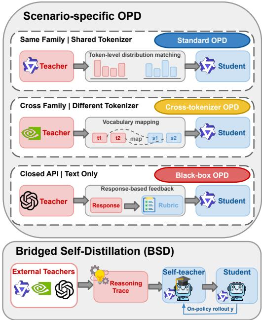  
Figure 1: Comparison between scenario-specific OPD and BSD. Top: existing methods derive a different training signal for each kind of teacher access, namely tokenlevel distribution matching with a shared tokenizer, vocabulary mapping across tokenizers, and response-based feedback for a closed API. Bottom: BSD uses a unified framework for all three scenarios: the external teacher provides a reasoning trace z, and a self-teacher conditioned on z scores the student’s own on-policy rollouts.

In standard OPD, the student generates its own rollouts, and the teacher scores the student’s tokens to guide training (Ross et al., 2011; Agarwal et al., 2024; Jin et al., 2026; Wu et al., 2026). This requires access to the teacher’s next-token distributions and a way to align them with the student’s tokenization. However, when teacher and student use different tokenizers, these distributions cannot be compared directly; when the teacher is available only through a closed API, they may be inaccessible. Cross-tokenizer OPD methods address the former by constructing mappings between the token spaces of the student and teacher (Zhang et al., 2024; Minixhofer et al., 2025; Boizard et al., 2025; Niu et al., 2026; Sun et al., 2026), while blackbox methods address the latter using feedback such as rubrics or sampled continuations (Jiang et al., 2023; Ye et al., 2026a; Fang et al., 2026; Xiong et al., 2026; Zhou et al., 2026). These methods expand the range of usable teachers, but require different training signals for different teacher settings (Figure 1, top). Alternatively, SFT can train on teacher-generated text without accessing probabilities, although directly imitating a much stronger model’s reasoning can be difficult for a small student (Zhang et al., 2023, 2025; Huang et al., 2026; Lyu et al., 2026). This motivates a unified on-policy learning method that can distillfrom any teacher capable of providing reasoning traces.

We propose Bridged Self-Distillation (BSD) to turn the reasoning of an external teacher into guidance on the student’s own rollouts (Figure 1, bottom). The external teacher is the model we aim to distill from, and BSD requires only its reasoning trace. Instead of training the student to imitate the teacher’s solution, as in SFT, we provide that solution as privileged context to a copy of the student. Inspired by on-policy self-distillation (Zhao et al., 2026; Zhang et al., 2026; Yang et al., 2026a), this conditioned copy serves as a self-teacher, scoring rollouts generated by the student without the privileged context. Both versions score the same tokens in the student’s own token space, and the differences show how access to the teacher’s reasoning changes the student’s predictions along its rollouts. BSD uses these differences to adjust token-level penalties on unsuccessful rollouts, while a verifier determines the direction of the updates. Because the external teacher provides only text, the same training procedure applies to sharedtokenizer, cross-tokenizer, and closed API teachers.

We evaluate BSD under three forms of teacher access: (1) shared-tokenizer, (2) cross-tokenizer, and (3) closed API teachers. Across twelve teacher– student pairs and three math reasoning benchmarks, BSD remains effective in all three settings while avoiding the severe degradation that SFT exhibits in several pairs. Our contributions are as follows:

• We introduce BSD, a unified on-policy distillation framework that turns reasoning traces from external teachers into token-level guidance through a privileged self-teacher.

• We evaluate BSD across twelve teacher– student pairs spanning shared-tokenizer, crosstokenizer, and closed API teachers, demonstrating that BSD generally outperforms the baselines across all three settings.

• Our analyses show that BSD maintains stable training, benefits from more complete reasoning traces, and concentrates its guidance on uncertain tokens, with stronger guidance associated with larger performance gains.

## 2 Preliminaries

## Group Relative Policy Optimization (GRPO).

Let $\pi _ { \theta }$ denote the policy model being optimized. For a question x, the policy samples a group of rollouts $\{ \bar { y } ^ { ( i ) } \} _ { i = 1 } ^ { G } .$ , and a verifier assigns each rollout a binary reward $r ^ { ( i ) } \in \{ 0 , 1 \}$ . GRPO (Shao et al., 2024) normalizes these rewards within the group:

$$
A ^ { ( i ) } = \frac { r ^ { ( i ) } - \mathrm { m e a n } \left( \{ r ^ { ( j ) } \} _ { j = 1 } ^ { G } \right) } { \mathrm { s t d } \left( \{ r ^ { ( j ) } \} _ { j = 1 } ^ { G } \right) } ,\tag{1}
$$

and applies the advantage $A ^ { ( i ) }$ uniformly to every token of $\boldsymbol y ^ { ( i ) }$ in a clipped policy-gradient update. When a group contains both outcomes, successful rollouts have positive advantage and unsuccessful rollouts have negative advantage. If all rollouts have the same outcome, their advantages are zero, and the group contributes no gradient. We omit the rollout index i when considering a single rollout.

Privileged self-distillation. A privileged context z is available during training but absent when the model generates rollouts or performs inference. In on-policy self-distillation (OPSD) (Zhao et al., 2026; Hübotter et al., 2026), the model generates on-policy rollouts without z as the student. A copy conditioned on z acts as the teacher and scores the same tokens. RLSD (Yang et al., 2026a) uses the ratio of these two token probabilities to refine the rollout-level advantage at each token:

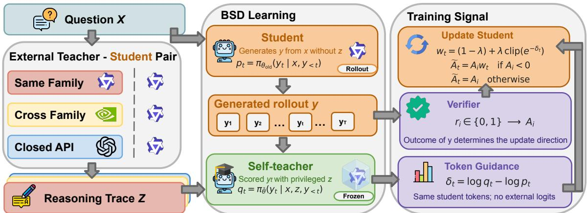  
Figure 2: Overview of Bridged Self-Distillation (BSD). An external teacher, whatever its access setting, provides a reasoning trace z for each question. The student generates rollouts without z, and the self-teacher (a frozen copy of the student conditioned on z) scores the same tokens. The token-level guidance $\delta _ { t }$ reweights the penalty on unsuccessful rollouts, while the verifier determines the direction of every update.

$$
\begin{array} { r } { \boldsymbol { u } _ { t } = \left[ \frac { \pi _ { \boldsymbol { \theta } } ( y _ { t } \mid \boldsymbol { x } , \boldsymbol { z } , y _ { < t } ) } { \pi _ { \boldsymbol { \theta } } ( y _ { t } \mid \boldsymbol { x } , y _ { < t } ) } \right] ^ { \mathrm { s i g n } ( A ) } , } \\ { \hat { A } _ { t } ^ { \mathrm { R L S D } } = A \big [ ( 1 - \lambda ) + \lambda \mathrm { c l i p } _ { 1 \pm \epsilon } ( u _ { t } ) \big ] . } \end{array}\tag{2}
$$

Here, $\mathrm { c l i p } _ { 1 \pm \epsilon } ( \cdot )$ clips its argument to $[ 1 - \epsilon , 1 + \epsilon ]$ and $\lambda \in [ 0 , 1 ]$ controls the strength of token-level reweighting. Because the multiplier is positive, reweighting preserves the sign of A. Intuitively, in RLSD, the verifier determines the direction of the update while the privileged context changes how strongly individual tokens are updated.

## 3 Bridged Self-Distillation

To distill from teacher models with different tokenizers or text-only access, we need guidance that does not depend on their token probabilities. Directly imitating a stronger teacher’s reasoning can also be difficult for a smaller student. We therefore propose Bridged Self-Distillation (BSD), which only needs a teacher’s reasoning trace and turns it into guidance on the student’s own rollouts (Figure 2). We describe the key components below.

## 3.1 External Teacher

We refer to the model that we want to distill from as the external teacher. Given a question x, it provides a reasoning trace z, the text it returns when solving x, which contains its full reasoning when this is exposed and only its final response otherwise. BSD uses z as the privileged context for the self-teacher. Because the external teacher only needs to provide text, this setup applies to all scenarios, including shared-tokenizer, cross-tokenizer,

and closed API teachers.

## 3.2 Self-Teacher

To turn z into guidance on the student’s own reasoning, the student first generates a rollout y from x without z. For each generated token $y _ { t }$ , the student assigns the probability $p _ { t } = \pi _ { \theta } ( y _ { t } \mid x , y _ { < t } )$

The self-teacher is a frozen copy $\pi _ { \bar { \theta } }$ of the student conditioned on both x and z. Rather than generating a separate solution, the self-teacher scores the same rollout $y$ token by token, assigning $q _ { t } = \pi _ { \bar { \theta } } ( y _ { t } \mid x , z , y _ { < t } )$ . As the two scores come from the same model and share the same token space, neither logits from the external teacher nor vocabulary alignment is needed.

We define the token-level guidance as their pertoken log-probability difference:

$$
\delta _ { t } = \mathrm { s g } \big [ \log q _ { t } - \log p _ { t } \big ] ,\tag{3}
$$

where $\mathrm { s g } [ \cdot ]$ denotes the stop-gradient operator. A positive $\delta _ { t }$ means the self-teacher assigns more probability to the student’s chosen token after reading z; a negative value means it assigns less.

## 3.3 Learning

The self-teacher provides token-level guidance, while a verifier checks whether each rollout reaches the correct answer. GRPO converts these outcomes into the group-relative advantage A (Eq. 1). For an unsuccessful rollout with $A < 0$ , BSD instead uses the guidance $\delta _ { t }$ to set a token-specific weight:

$$
w _ { t } = ( 1 - \lambda ) + \lambda \mathrm { c l i p } _ { 1 \pm \epsilon } \Big ( e ^ { - \delta _ { t } } \Big ) .\tag{4}
$$

When $\delta _ { t } ~ < ~ 0$ , the self-teacher assigns less probability to the chosen token, so $w _ { t } ~ > ~ 1$ and that token receives a stronger penalty. When $\delta _ { t } > 0 .$

the penalty is reduced. The coefficient λ controls the strength of this reweighting, which decays over training, while clipping bounds its effect.

The weight $w _ { t }$ is applied only to unsuccessful rollouts, while the successful ones are unchanged:

$$
\tilde { A } _ { t } \ = \ \left\{ \begin{array} { l l } { A w _ { t } } & { \mathrm { i f } \ A < 0 , } \\ { A } & { \mathrm { o t h e r w i s e } . } \end{array} \right.\tag{5}
$$

This means that successful rollouts retain their advantage, as in GRPO, allowing the student to reinforce correct solutions it found without the external teacher’s guidance. Because $w _ { t }$ is positive, the token-level guidance changes the magnitude of a penalty without changing the sign of A.

The student model is then optimized by maximizing the following policy-gradient objective $\begin{array} { r } { \mathcal { I } ( \theta ) = \mathbb { E } \big [ \sum _ { t } \tilde { A } _ { t } \log \pi _ { \theta } ( y _ { t } \mid x , y _ { < t } ) \big ] } \end{array}$ 1

## 4 Experimental Setup

## 4.1 Models

Backbone models. We use three Qwen3 models as the student models (Yang et al., 2025) (in thinking mode): Qwen3-0.6B, Qwen3-1.7B, and Qwen3-4B. We also use Qwen3-4B-Instruct-2507 as an additional backbone, which we first fine-tune on 1,000 reasoning traces to enable it to produce reasoning blocks. We refer to the fine-tuned model as Qwen3-4B-Instruct and use it as another student.

Teacher models. We consider three models as external teachers with different access settings: Qwen3-32B (Yang et al., 2025) as a shared-tokenizer teacher, Nemotron-3-30B-A3B (NVIDIA et al., 2025) as a cross-tokenizer teacher, and GPT-5.6 Luna (OpenAI, 2026) as a closed API teacher.

## 4.2 Training

Data. We use the mathematical reasoning subset of OpenThoughts (Guha et al., 2026). For each teacher–student pair, we sample 2,400 training problems, and the external teacher provides one reasoning trace z per problem. The traces of Qwen3-32B and Nemotron-3-30B-A3B average about 4,000 tokens, while GPT-5.6 Luna returns only its final response, which averages 247 tokens.

Implementation details. We implement BSD using verl (Sheng et al., 2025) and vLLM (Kwon et al., 2023). Each student model is trained for 150 updates on NVIDIA H100/H200 GPUs. Further details are provided in Appendix A.

## 4.3 Evaluation

Benchmarks. We evaluate on three competitionlevel mathematics benchmarks: AIME 2024 (Mathematical Association of America, 2024), AIME 2025 (Mathematical Association of America, 2025), and HMMT 2025 (Dekoninck et al., 2026). We select the best checkpoints using a separate set of 128 development problems from OpenThoughts.

Metrics. For each benchmark problem, we generate four samples. We report Avg@4, the average correctness of the four samples, in Table 1, and Pass@4, the proportion of problems solved by at least one sample, in Table 14. The evaluation settings, the teachers’ own scores, and the selected checkpoints are in Appendices A and F.

## 4.4 Baselines

We consider the following baselines, which use the same backbones and training problems as BSD.

Supervised Fine-Tuning (SFT). We train each student to imitate the external teacher’s reasoning traces (Kim and Rush, 2016) using the same traces that serve as privileged context for BSD.

Vanilla OPD. For the shared-tokenizer teacher, we use standard OPD (Lu and Lab, 2025), which is optimized by minimizing the log-probability differences between student and teacher.

Cross-Tokenizer OPD (xOPD). For the crosstokenizer teacher, we use cross-tokenizer OPD (Niu et al., 2026), denoted xOPD, which aligns the two tokenizations and maps teacher token logprobabilities onto student tokens.

Rubric-Based OPD (ROPD). For the closed API teacher, we use ROPD (Fang et al., 2026), which asks the teacher to derive a rubric for each question and score the student’s rollouts against it.

## 5 Main Results

We examine how BSD performs under different forms of teacher access. Across twelve teacher– student pairs, we first compare BSD with SFT and the OPD baseline designed for each of the sharedtokenizer, cross-tokenizer, and closed API settings. We then track performance and response length throughout training to examine how BSD and the baselines affect the student’s behavior.

<table><tr><td colspan="5">Shared tokenizer (Qwen3-32B)</td><td colspan="4">Cross-tokenizer (Nemotron-3-30B-A3B)</td><td colspan="4">Closed API (GPT-5.6 Luna)</td></tr><tr><td>Method</td><td>AIME24</td><td>AIME25</td><td>HMMT25</td><td>Avg</td><td>AIME24</td><td>AIME25</td><td>HMMT25</td><td>Avg</td><td>AIME24</td><td>AIME25</td><td>HMMT25</td><td>Avg</td></tr><tr><td>Qwen3-4B</td><td></td><td></td><td></td><td></td><td></td><td></td><td></td><td></td><td></td><td></td><td></td><td></td></tr><tr><td>Base</td><td>72.5</td><td>62.5</td><td>42.5</td><td>59.2</td><td>72.5</td><td>62.5</td><td>42.5</td><td>59.2</td><td>72.5</td><td>62.5</td><td>42.5</td><td>59.2</td></tr><tr><td>+ SFT</td><td>72.5</td><td>65.0</td><td>44.2</td><td>60.6</td><td>76.7</td><td>65.0</td><td>49.2</td><td>63.6</td><td>68.3</td><td>62.5</td><td>40.8</td><td>57.2</td></tr><tr><td>+ OPD</td><td>73.3</td><td>67.5</td><td>40.0</td><td>60.3</td><td>70.8</td><td>62.5</td><td>45.8</td><td>59.7</td><td>70.8</td><td>64.2</td><td>44.2</td><td>59.7</td></tr><tr><td>+ BSD</td><td>79.2</td><td>68.3</td><td>44.2</td><td>63.9</td><td>76.7</td><td>66.7</td><td>47.5</td><td>63.6</td><td>75.8</td><td>65.0</td><td>45.0</td><td>61.9</td></tr><tr><td colspan="9">Qwen3-4B-Instruct</td><td></td><td></td><td></td></tr><tr><td>Base</td><td>56.7</td><td>49.2</td><td>27.5</td><td>44.4</td><td>56.7</td><td>49.2</td><td>27.5</td><td>44.4</td><td>56.7</td><td>49.2</td><td>27.5</td><td>44.4</td></tr><tr><td>+ SFT</td><td>50.0</td><td>46.7</td><td>25.8</td><td>40.8</td><td>47.5</td><td>43.3</td><td>23.3</td><td>38.1</td><td>47.5</td><td>47.5</td><td>24.2</td><td>39.7</td></tr><tr><td>+ OPD</td><td>54.2</td><td>45.0</td><td>27.5</td><td>42.2</td><td>54.2</td><td>50.8</td><td>30.0</td><td>45.0</td><td>57.5</td><td>50.8</td><td>29.2</td><td>45.8</td></tr><tr><td>+ BSD</td><td>57.5</td><td>51.7</td><td>28.3</td><td>45.8</td><td>55.8</td><td>49.2</td><td>31.7</td><td>45.6</td><td>60.0</td><td>50.8</td><td>28.3</td><td>46.4</td></tr><tr><td colspan="9">Qwen3-1.7B</td><td></td><td></td><td></td></tr><tr><td>Base</td><td>50.8</td><td>34.2</td><td>22.5</td><td>35.8</td><td>50.8</td><td>34.2</td><td>22.5</td><td>35.8</td><td>50.8</td><td>34.2</td><td>22.5</td><td>35.8</td></tr><tr><td>+ SFT</td><td>38.3</td><td>31.7</td><td>20.0</td><td>30.0</td><td>53.3</td><td>34.2</td><td>25.0</td><td>37.5</td><td>55.0</td><td>37.5</td><td>18.3</td><td>36.9</td></tr><tr><td>+ OPD</td><td>56.7</td><td>34.2</td><td>25.0</td><td>38.6</td><td>45.0</td><td>33.3</td><td>26.7</td><td>35.0</td><td>49.2</td><td>35.8</td><td>24.2</td><td>36.4</td></tr><tr><td>+ BSD</td><td>53.3</td><td>37.5</td><td>25.0</td><td>38.6</td><td>55.8</td><td>38.3</td><td>23.3</td><td>39.2</td><td>56.7</td><td>38.3</td><td>25.0</td><td>40.0</td></tr><tr><td colspan="9">Qwen3-0.6B</td><td></td><td></td><td></td><td></td></tr><tr><td>Base</td><td>8.3</td><td>17.5</td><td>6.7</td><td>10.8</td><td>8.3</td><td>17.5</td><td>6.7</td><td>10.8</td><td>8.3</td><td>17.5</td><td>6.7</td><td>10.8</td></tr><tr><td>+ SFT</td><td>7.5</td><td>13.3</td><td>6.7</td><td>9.2</td><td>5.8</td><td>10.0</td><td>6.7</td><td>7.5</td><td>0.8</td><td>5.0</td><td>2.5</td><td>2.8</td></tr><tr><td>+ OPD</td><td>11.7</td><td>17.5</td><td>10.0</td><td>13.1</td><td>15.0</td><td>20.0</td><td>7.5</td><td>14.2</td><td>11.7</td><td>14.2</td><td>8.3</td><td>11.4</td></tr><tr><td>+ BSD</td><td>14.2</td><td>17.5</td><td>9.2</td><td>13.6</td><td>12.5</td><td>17.5</td><td>8.3</td><td>12.8</td><td>10.0</td><td>18.3</td><td>9.2</td><td>12.5</td></tr></table>

Table 1: Avg@4 on three mathematical reasoning benchmarks; Avg is the mean across benchmarks. OPD denotes vanilla OPD, xOPD, and ROPD for shared-tokenizer, cross-tokenizer, and closed API teachers, respectively. Bold marks the best score among distillation methods within each teacher–student setting. BSD consistently improves over the base model in all twelve teacher–student pairs and achieves the best Avg in eleven pairs.

## 5.1 Comparing Teacher Access

BSD consistently improves over the base model and outperforms the distillation baselines across teacher settings. Table 1 reports Avg@4 for four students paired with shared-tokenizer, crosstokenizer, and closed API teachers. BSD improves over the base model in all twelve teacher–student pairs, with gains of 1.2 to 4.7 points, and achieves the best average score in eleven pairs.

Shared-tokenizer teacher. Qwen3-32B shares the students’ tokenizer, allowing vanilla OPD to score their rollouts directly with teacher token probabilities. BSD outperforms SFT for all four students by 3.3 to 8.6 points in average score, while SFT falls below the base model for three of them. Thus, even within the same model family, directly imitating a much stronger teacher’s reasoning can be difficult for smaller students (Zhang et al., 2023, 2025). BSD also matches or outperforms vanilla OPD for every student: the two tie in average score for Qwen3-1.7B, and BSD scores up to 3.6 points higher for the other three. This indicates that sharing a tokenizer does not ensure compatible reasoning patterns between distinct models, which prior work identifies as important for successful OPD (Li et al., 2026b). BSD instead uses a self-teacher, a copy of the student conditioned on the external teacher’s reasoning, so that the token-level guidance comes from the student’s own model and is therefore more compatible.

Cross-tokenizer teacher. Because the teacher model Nemotron-3-30B-A3B uses a different tokenizer from the students, xOPD must align the two tokenizations and map the teacher’s token probabilities onto the student’s tokens. Nevertheless, xOPD does not yield consistent gains over the base models. It improves the average score of Qwen3-0.6B by 3.4 points, but brings only marginal gains of 0.5 and 0.6 points for Qwen3-4B and Qwen3-4B-Instruct, respectively, and decreases the score of Qwen3-1.7B by 0.8 points. This indicates that constructing a mapping makes cross-tokenizer OPD possible, but does not guarantee effective token-level supervision. In contrast, BSD improves all four base models by 1.2 to 4.4 points and outperforms xOPD for three of the four students, with Qwen3-0.6B as the only exception. BSD therefore provides a strong alternative for cross-tokenizer distillation, obtaining guidance directly in the student’s token space without mappings between distinct vocabularies.

Closed API teacher. GPT-5.6 Luna is accessible only through a text API and exposes neither token probabilities nor its tokenizer. Moreover, it returns short final responses averaging 247 tokens, compared with about 4,000 tokens from the other two teachers. Directly using these responses as SFT targets causes the students to imitate their length (cf. Section 5.2). Consequently, SFT falls below the base model for three of the four students, with Qwen3-0.6B dropping from 10.8 to 2.8. ROPD handles the lack of token probabilities by asking the external teacher to derive a rubric and score student rollouts during training. BSD outperforms SFT for all four students by 3.1 to 9.7 points and ROPD by 0.6 to 3.6 points. BSD achieves these gains by using each API response as privileged context for the self-teacher while allowing the student to generate its own rollouts, without training the student to reproduce their form.

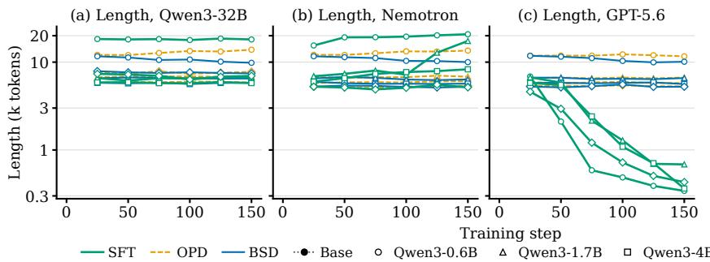

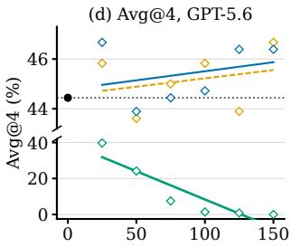  
Figure 3: Training progression. (a)–(c) Mean response length on the development set at each checkpoint for four students under the shared-tokenizer, cross-tokenizer, and closed API teachers, respectively. OPD refers to vanilla OPD, xOPD, and ROPD in the three respective settings. (d) Avg@4 across the three benchmarks at each checkpoint for Qwen3-4B-Instruct distilled from GPT-5.6 Luna. SFT can substantially shorten its responses and cause performance to collapse with the closed API teacher, whereas BSD and OPD generally maintain stable response lengths and show stable or improving performance throughout training.

## 5.2 Training Progression

We further examine how distillation changes the students throughout training. Figure 3 tracks two aspects of this progression: response length across all twelve teacher–student pairs and benchmark performance in a representative closed API setting.<sup>2</sup>

Response length. Figure 3a–c shows that the effect of SFT on response length depends strongly on the external teacher. With the shared-tokenizer teacher, response lengths remain largely stable for all methods. With the cross-tokenizer teacher, BSD and xOPD remain stable, whereas SFT usually increases the response lengths, most notably for Qwen3-1.7B. The most pronounced shift occurs with the closed API teacher, whose responses average only 247 tokens. SFT trains directly on these short responses, causing all four students to gradually shorten their outputs. In contrast, BSD and the corresponding OPD baselines maintain relatively stable response lengths across all twelve pairs. These trends show that using the external teacher’s reasoning trace as privileged context allows BSD to preserve the student’s output form without forcing it to reproduce the trace’s length.

Performance. A substantial decline in performance accompanies the response-length drift under the closed API teacher. Figure 3d illustrates this behavior for Qwen3-4B-Instruct distilled from GPT-5.6 Luna. SFT is already below the base model at the beginning, and its performance falls to nearly zero by the end of training. The additional curves in Appendix H show similar collapses or declines of SFT in other teacher–student pairs. These results further indicate that directly imitating a stronger teacher’s reasoning traces can lead to unstable training. In contrast, ROPD and BSD maintain stable or slightly improving performance throughout training. BSD is particularly notable because it uses the same external-teacher reasoning traces as SFT, but treats them as privileged context to guide the student’s own rollouts rather than as targets to imitate. Appendix I further shows that SFT suffers from catastrophic forgetting on two out-ofdomain benchmarks, whereas BSD does not.

## 6 Further Analysis

## 6.1 Ablation Study

BSD combines privileged context from an external teacher with verifier-guided learning and applies token-level guidance only to unsuccessful rollouts. We ablate these design choices by asking three questions: (1) whether privileged context itself improves learning, (2) how much reasoning the context should contain, and (3) whether the verifier and the restriction to unsuccessful rollouts are needed. We study these questions in the sharedtokenizer setting using Qwen3-4B as the student and Qwen3-32B as the external teacher. All variants use the same training problems and optimization setup.

BSD-trace, which uses the full reasoning trace as in the main experiments, serves as the reference. For (1), we compare it with GRPO (Shao et al., 2024), which has no privileged context or self-teacher, and RLSD (Yang et al., 2026a), which uses only the ground-truth answer while otherwise following BSD. For (2), BSD-hint uses a threesentence hint and BSD-guide uses up to eight reasoning steps without computations, both followed by the answer and derived from the full trace (obtained by using the prompts in Appendix B). For (3), BSD (w/ succ.) additionally weights successful rollouts, while OPSD (Zhao et al., 2026) uses the self-teacher’s token-level signal on every rollout without a verifier. Figure 4 reports training accuracy in panels (a)–(b) and Avg@4 in panel (c).

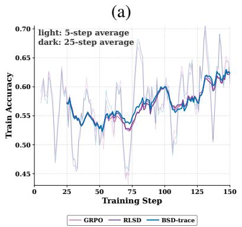

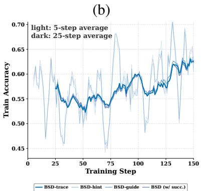

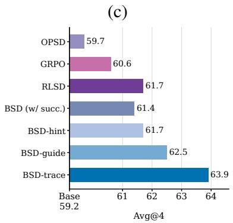  
Figure 4: Ablations with the Qwen3-4B student and Qwen3-32B external teacher. (a) Training accuracy of GRPO, answer-conditioned RLSD, and full-trace BSD. (b) Training accuracy of BSD with a hint, guide, or full trace, including a full-trace variant that also weights successful rollouts. (c) Avg@4 across the three benchmarks for these variants and OPSD; the base model scores 59.2. Despite similar training-accuracy curves, richer privileged context generally yields better results, with the full trace performing best. Appendix D reports the per-benchmark scores.

Privileged context facilitates reinforcement learning. GRPO, RLSD, and BSD-trace exhibit nearly identical training-accuracy curves, with their average differences remaining below 0.2, although BSD-trace shows a slight advantage in the middle of training (Figure 4a). Nevertheless, Avg@4 increases from 59.2 for the base model to 60.6 with GRPO, 61.7 with answer-conditioned RLSD, and 63.9 with trace-conditioned BSD. Privileged context therefore improves how verifier feedback transfers to downstream problems.

More complete reasoning produces stronger gains. Changing the privileged context from a short hint to a full trace has little effect on the training dynamics, as the three variants follow similar accuracy curves (Figure 4b). However, BSD-hint scores 61.7, while BSD-guide reaches 62.5 and BSD-trace further improves to 63.9 (Figure 4c), indicating that downstream performance benefits from more detailed reasoning in the privileged context.

<table><tr><td>Student</td><td>|δ|</td><td> $\rho _ { H }$ </td><td>Gain</td></tr><tr><td>Qwen3-0.6B</td><td>0.072</td><td>0.87</td><td>+2.2</td></tr><tr><td>Qwen3-1.7B</td><td>0.115</td><td>0.90</td><td>+3.5</td></tr><tr><td>Qwen3-4B</td><td>0.114</td><td>0.90</td><td>+3.9</td></tr><tr><td> $( \mathsf { ) w e n 3 - 4 B - I n s t r u c t }$ </td><td>0.037</td><td>0.83</td><td>+1.5</td></tr></table>

Table 2: Token-level guidance before training, measured on unsuccessful rollouts. |<sup>¯</sup>δ| is the absolute value of the mean of $\delta _ { t }$ over all tokens, $\rho _ { H }$ is the Spearman correlation between $\left| { \delta _ { t } } \right|$ and the student’s token entropy, and Gain is the mean improvement of BSD over the base model shown in Table 1.

The verifier and the restriction to unsuccessful rollouts matter. BSD (w/ succ.) scores 61.4, below the 63.9 of BSD-trace, so extending the weight to successful rollouts does not help (Figure 4c). OPSD scores 59.7 and declines over training, from 63.3 at step 25 to 55.8 at step 150, while its responses on the benchmarks shorten from 16.8k to 12.5k tokens (Appendix D). The other variants keep the response length of the base model.

## 6.2 What the Token-Level Guidance Captures

BSD uses the token-level guidance $\delta _ { t }$ to distribute verifier feedback across the tokens of an unsuccessful rollout. To understand this signal, we examine which tokens it emphasizes, whether its strength is associated with BSD’s gains, and how it affects the student’s behavior. Table 2 reports the quantitative results averaged across teachers, with the measurement setup described in Appendix A, while Figure 5 illustrates a concrete example.

Guidance targets uncertain tokens and tracks performance gains. The correlation $\rho _ { H }$ between per-token guidance magnitude and the student’s token entropy on unsuccessful rollouts ranges from 0.83 to 0.90, indicating that the strongest guidance concentrates on tokens where the student is most uncertain. Its magnitude also follows the gains: Qwen3-4B-Instruct has both the weakest guidance and the smallest gain, whereas Qwen3-1.7B and Qwen3-4B receive stronger guidance and achieve larger gains. Thus, BSD achieves larger gains when the privileged context more strongly changes the student’s predictions, particularly at uncertain tokens.

Case study: BSD encourages self-correction. Figure 5 shows an AIME24 problem where the base Qwen3-4B finds the correct integer N = 5694 but misreads its quotient and remainder when it is divided by 1000. Given the same prefix containing this mistake, the base model continues without revisiting the division, whereas the student trained with BSD re-checks the step, identifies the error, and reaches the correct answer. Across eight continuations from this prefix, the BSD student solves the problem six times, compared with four for the base model. This example illustrates how BSD can help the student revisit and correct an uncertain intermediate step rather than persist with an initially plausible but incorrect rollout.<sup>3</sup>

## 7 Related Work

Knowledge distillation. Knowledge distillation transfers supervision from a stronger teacher to a smaller student through output distributions or generated sequences (Hinton et al., 2015; Kim and Rush, 2016). For reasoning models, this idea is commonly instantiated by training on teachergenerated reasoning traces, although large teacher– student gaps can make direct imitation difficult (Shridhar et al., 2023; Hsieh et al., 2023; Zhang et al., 2023; Huang et al., 2026; Lyu et al., 2026). On-policy distillation instead learns from studentgenerated rollouts under token-level teacher guidance (Gu et al., 2024; Agarwal et al., 2024; Jin et al., 2026; Yang et al., 2026b). Recent variants extend OPD to heterogeneous tokenizers (Minixhofer et al., 2025; Boizard et al., 2025; Niu et al., 2026; Sun et al., 2026) and black-box teachers (Ye et al., 2026a; Xiong et al., 2026; Fang et al., 2026; Zhou et al., 2026), but typically require setting-specific supervision. In contrast, BSD offers an effective and unified framework for all these settings.

Problem (AIME24). N is the greatest four-digit integer   
such that changing any one of its digits to 1 gives a multi  
ple of 7. Q and R are the quotient and remainder when N   
is divided by 1000. Find Q + R. Answer: 699   
Shared prefix: a rollout of the base model, first 90%.   
[. . . ] All divisible by 7. So this works. [. . . ] Therefore, it   
seems that 5694 is the only possible number, and hence   
the answer is Q=569, R=4, so Q+R=573. [. . . ]   
The base model continues.   
[. . . ] It seems that no higher number works. There  
fore, 5694 is indeed the maximum. [. . . ] Therefore,   
the answer is Q=569, R=4, so Q + R = 573. [. . . ]   
Q = ⌊5694/1000⌋ = 569, R = 5694 mod 1000 = 694.   
Hence, Q + R = 569 + 694 = 1263.   
Final answer: 1263 ✗   
The student trained with BSD continues.   
[. . . ] Thus, the final answer is Q=569, R=4, so 569 + 4   
= 573. But wait, let me double-check the calculation   
of N divided by 1000. N=5694. When divided by 1000,   
the quotient Q is 5 (since 5694 = 5\*1000 + 694), and the   
remainder R is 694. [. . . ] Wait, this is a critical mistake!   
[. . . ] So Q=5, R=694, so Q+R=5 + 694=699.   
Final answer: 699 ✓  
Figure 5: Case study on an AIME 2024 problem. From the same erroneous prefix, the base Qwen3-4B continues incorrectly, whereas the BSD-trained student (Qwen3-32B teacher) checks the quotient and remainder and reaches the correct answer. [. . . ] marks omissions.

Privileged information and self-distillation. Learning with privileged information provides a general framework for exploiting supervision that is available only during training, with generalized distillation connecting this idea to teacher–student learning (Vapnik and Vashist, 2009; Lopez-Paz et al., 2016). In language models, context distillation instantiates this principle by internalizing information from instructions, demonstrations, or other contextual signals into a model that later operates without them (Snell et al., 2022; Shin et al., 2025; Duan et al., 2024; Ye et al., 2026b). Recent self-distillation methods further use the model itself as a privileged teacher by conditioning it on answers, solutions, feedback, or successful trajectories (Zhao et al., 2026; Penaloza et al., 2026; Hübotter et al., 2026; Ye et al., 2026b; Ding, 2026; Liu et al., 2026; Yang et al., 2026a; Pan et al., 2026; Li et al., 2026a; Kim et al., 2026). BSD follows this privileged paradigm, but uses reasoning from an external teacher as the privileged context.

## 8 Conclusion

We introduced BSD, a unified framework for distilling from any teacher that provides reasoning traces. BSD uses the external teacher’s reasoning trace as privileged context for a self-teacher, producing compatible token-level guidance in the student’s own token space without teacher probabilities or vocabulary mappings. Across twelve teacher–student pairs spanning shared-tokenizer, cross-tokenizer, and closed API settings, BSD improves every base model and achieves the best or tied average performance among the distillation methods in eleven pairs. Our analyses further show that BSD supports stable training, benefits from more complete reasoning, and focuses its guidance on uncertain tokens, establishing reasoning traces as a common and effective interface for on-policy distillation.

## Limitations

We evaluate BSD with shared-tokenizer, crosstokenizer, and closed API teachers across twelve teacher–student pairs and analyze its token-level guidance. However, we acknowledge three main limitations.

First, due to computational constraints, our experiments are limited to students of up to 4B parameters from one model family and to English competition mathematics. Future work could examine whether the gains of BSD hold for larger students, other model families, and other domains.

Second, BSD relies on a verifier to set the direction of each update, so it applies only to tasks whose answers can be checked automatically and not to open-ended ones. Whether the agreement between the student and the external teacher can serve as a verifier in such tasks remains to be explored.

Finally, our analysis relates the token-level guidance to the gains of BSD only through correlations across students. It characterizes where the guidance concentrates but does not establish which tokens it helps, or why, which we leave for future work.

## Ethics Statement

This work fine-tunes publicly released language models on publicly available mathematical reasoning datasets and evaluates them with automatic verifiers. It involves no human subjects, no personally identifiable information, and no newly collected data. The method transfers reasoning capability that the teacher models already expose through their public interfaces, so we do not identify risks beyond those general to improving open-weight reasoning models.

The closed API teacher is queried through its official API solely to obtain responses for noncommercial research. The students trained with these responses serve only to study distillation methods: we do not deploy them, offer them as a service, or use them to develop models that compete with the API provider. We release only code, and release no model weights and no datasets, including the teacher’s reasoning traces.

Use of AI Assistants. The authors used AI assistants for code development, the organization of experiments and analyses, figure preparation, and manuscript drafting and language editing. All reported experimental results and scientific interpretations were reviewed by the authors, who take responsibility for the final paper.

## Acknowledgments

This project was generously funded by the German Federal Justice Ministry as part of the Digitalisierungsinitiative des Bundes für die Justiz under the GSJ Project (“Generatives Sprachmodell der Justiz”), a collaboration between the justice ministries of Northrhine-Westphalia and Bavaria, TU Munich, and the University of Cologne. The authors gratefully acknowledge the scientific support and resources of the AI service infrastructure LRZ AI Systems provided by the Leibniz Supercomputing Centre (LRZ) of the Bavarian Academy of Sciences and Humanities (BAdW), funded by the Bayerisches Staatsministerium für Wissenschaft und Kunst (StMWK), primarily through the BayernKI initiative. This research was also supported by the Munich Center for Machine Learning (MCML) and German Research Foundation (DFG, grant SCHU 2246/14-1).

## References

Rishabh Agarwal, Nino Vieillard, Yongchao Zhou, Piotr Stanczyk, Sabela Ramos Garea, Matthieu Geist, and Olivier Bachem. 2024. On-policy distillation of language models: Learning from self-generated mistakes. In The Twelfth International Conference on Learning Representations, ICLR 2024, Vienna, Austria, May 7-11, 2024. OpenReview.net.

Janice Ahn, Rishu Verma, Renze Lou, Di Liu, Rui Zhang, and Wenpeng Yin. 2024. Large language models for mathematical reasoning: Progresses and challenges. In Proceedings of the 18th Conference of the European Chapter of the Association for Computational Linguistics: Student Research Workshop, pages 225–237, St. Julian’s, Malta. Association for Computational Linguistics.

Nicolas Boizard, Kevin El Haddad, Céline Hudelot, and Pierre Colombo. 2025. Towards cross-tokenizer distillation: the universal logit distillation loss for LLMs. Trans. Mach. Learn. Res., 2025.

Hyung Won Chung, Le Hou, Shayne Longpre, Barret Zoph, Yi Tay, William Fedus, Yunxuan Li, Xuezhi Wang, Mostafa Dehghani, Siddhartha Brahma, Albert Webson, Shixiang Shane Gu, Zhuyun Dai, Mirac Suzgun, Xinyun Chen, Aakanksha Chowdhery, Alex Castro-Ros, Marie Pellat, Kevin Robinson, and 16 others. 2024. Scaling instruction-finetuned language models. J. Mach. Learn. Res., 25:70:1–70:53.

Jasper Dekoninck, Nikola Jovanovic, Tim Gehrunger,´ Kári Rögnvaldsson, Ivo Petrov, Chenhao Sun, and Martin Vechev. 2026. Beyond benchmarks: Math-Arena as an evaluation platform for mathematics with LLMs. Preprint, arXiv:2605.00674.

Ken Ding. 2026. HDPO: Hybrid distillation policy optimization via privileged self-distillation. Preprint, arXiv:2603.23871.

Yifei Duan, Liu Li, Zirui Zhai, and Jinxia Yao. 2024. In-context learning distillation for efficient few-shot fine-tuning. Preprint, arXiv:2412.13243.

Yu Fan, Jingwei Ni, Jakob Merane, Yang Tian, Yoan Hermstrüwer, Yinya Huang, Mubashara Akhtar, Etienne Salimbeni, Florian Geering, Oliver Dreyer, Daniel Brunner, Markus Leippold, Mrinmaya Sachan, Alexander Stremitzer, Christoph Engel, Elliott Ash, and Joel Niklaus. 2026. LEXam: Benchmarking legal reasoning on 340 law exams. In The Fourteenth International Conference on Learning Representations, ICLR 2026, Rio de Janeiro, Brazil, April 23-27, 2026. proceedings.iclr.cc.

Junfeng Fang, Zhepei Hong, Mao Zheng, Mingyang Song, Gengsheng Li, Houcheng Jiang, Dan Zhang, Haiyun Guo, Xiang Wang, and Tat-Seng Chua. 2026. Rubric-based on-policy distillation. Preprint, arXiv:2605.07396.

Yuxian Gu, Li Dong, Furu Wei, and Minlie Huang. 2024. MiniLLM: Knowledge distillation of large language models. In The Twelfth International Conference on Learning Representations, ICLR 2024, Vienna, Austria, May 7-11, 2024. OpenReview.net.

Etash Guha, Ryan Marten, Sedrick Keh, Negin Raoof, Georgios Smyrnis, Hritik Bansal, Marianna Nezhurina, Jean Mercat, Trung Vu, Zayne Sprague, Ashima Suvarna, Benjamin Feuer, Leon Liangyu Chen, Zaid Khan, Eric Frankel, Sachin Grover, Caroline Choi, Niklas Muennighoff, Shiye Su, and 32 others. 2026. OpenThoughts: Data recipes for reasoning models. In International Conference on Learning Representations, volume 2026, pages 108059–108130.

Daya Guo, Dejian Yang, Haowei Zhang, Junxiao Song, Peiyi Wang, Qihao Zhu, Runxin Xu, Ruoyu Zhang, Shirong Ma, Xiao Bi, Xiaokang Zhang, Xingkai Yu, Yu Wu, Z. F. Wu, Zhibin Gou, Zhihong Shao,

Zhuoshu Li, Ziyi Gao, Aixin Liu, and 175 others. 2025. DeepSeek-R1 incentivizes reasoning in LLMs through reinforcement learning. Nature, 645(8081):633–638.

Geoffrey Hinton, Oriol Vinyals, and Jeff Dean. 2015. Distilling the knowledge in a neural network. Preprint, arXiv:1503.02531.

Cheng-Yu Hsieh, Chun-Liang Li, Chih-kuan Yeh, Hootan Nakhost, Yasuhisa Fujii, Alex Ratner, Ranjay Krishna, Chen-Yu Lee, and Tomas Pfister. 2023. Distilling step-by-step! outperforming larger language models with less training data and smaller model sizes. In Findings of the Association for Computational Linguistics: ACL 2023, pages 8003–8017, Toronto, Canada. Association for Computational Linguistics.

Edward J. Hu, Yelong Shen, Phillip Wallis, Zeyuan Allen-Zhu, Yuanzhi Li, Shean Wang, Lu Wang, and Weizhu Chen. 2022. LoRA: Low-rank adaptation of large language models. In The Tenth International Conference on Learning Representations, ICLR 2022, Virtual Event, April 25-29, 2022. OpenReview.net.

Zixian Huang, Kaichen Yang, Xu Huang, Feiyang Hao, Qiming Ge, Bowen Li, He Du, Kai Chen, and Qipeng Guo. 2026. How to fine-tune a reasoning model? a teacher-student cooperation framework to synthesize student-consistent SFT data. Preprint, arXiv:2604.14164.

Jonas Hübotter, Frederike Lübeck, Lejs Behric, Anton Baumann, Marco Bagatella, Daniel Marta, Ido Hakimi, Idan Shenfeld, Thomas Kleine Buening, Carlos Guestrin, and Andreas Krause. 2026. Reinforcement learning via self-distillation. Preprint, arXiv:2601.20802.

Yuxin Jiang, Chunkit Chan, Mingyang Chen, and Wei Wang. 2023. Lion: Adversarial distillation of proprietary large language models. In Proceedings of the 2023 Conference on Empirical Methods in Natural Language Processing, pages 3134–3154, Singapore. Association for Computational Linguistics.

Woogyeol Jin, Taywon Min, Yongjin Yang, Dennis Wei, Yi Zhou, Swanand Ravindra Kadhe, Nathalie Baracaldo, and Kimin Lee. 2026. Entropy-aware onpolicy distillation of language models. In Forty-third International Conference on Machine Learning.

Jeonghye Kim, Jiwon Jeon, Dongsheng Li, and Yuqing Yang. 2026. Rebellious student: Reversing teacher signals for reasoning exploration with self-distilled RLVR. Preprint, arXiv:2605.10781.

Yoon Kim and Alexander M. Rush. 2016. Sequencelevel knowledge distillation. In Proceedings of the 2016 Conference on Empirical Methods in Natural Language Processing, pages 1317–1327, Austin, Texas. Association for Computational Linguistics.

Jongwoo Ko, Sungnyun Kim, Tianyi Chen, and Se-Young Yun. 2024. DistiLLM: Towards streamlined

distillation for large language models. In Fortyfirst International Conference on Machine Learning, ICML 2024, Vienna, Austria, July 21-27, 2024, volume 235 of Proceedings of Machine Learning Research, pages 24872–24895. PMLR / OpenReview.net.

Woosuk Kwon, Zhuohan Li, Siyuan Zhuang, Ying Sheng, Lianmin Zheng, Cody Hao Yu, Joseph Gonzalez, Hao Zhang, and Ion Stoica. 2023. Efficient memory management for large language model serving with PagedAttention. In Proceedings ofthe 29th Symposium on Operating Systems Principles, SOSP 2023, Koblenz, Germany, October 23-26, 2023, pages 611– 626. ACM.

Gengsheng Li, Tianyu Yang, Junfeng Fang, Mingyang Song, Mao Zheng, Haiyun Guo, Dan Zhang, Jinqiao Wang, and Tat-Seng Chua. 2026a. Unifying grouprelative and self-distillation policy optimization via sample routing. In Third Conference on Language Modeling.

Yaxuan Li, Yuxin Zuo, Bingxiang He, Jinqian Zhang, Chaojun Xiao, Cheng Qian, Tianyu Yu, Huan ang Gao, Wenkai Yang, Zhiyuan Liu, and Ning Ding. 2026b. Rethinking on-policy distillation of large language models: Phenomenology, mechanism, and recipe. Preprint, arXiv:2604.13016.

Yihong Liu, Raoyuan Zhao, Michael A. Hedderich, and Hinrich Schütze. 2026. Crosslingual on-policy self-distillation for multilingual reasoning. Preprint, arXiv:2605.09548.

David Lopez-Paz, Léon Bottou, Bernhard Schölkopf, and Vladimir Vapnik. 2016. Unifying distillation and privileged information. In 4th International Conference on Learning Representations, ICLR 2016, San Juan, Puerto Rico, May 2-4, 2016, Conference Track Proceedings.

Kevin Lu and Thinking Machines Lab. 2025. On-policy distillation. Thinking Machines Lab: Connectionism.

Yuanjie Lyu, Chengyu Wang, Jun Huang, and Tong Xu. 2026. Student-centered distillation narrows the agentic gap between small and large LLMs. In Fortythird International Conference on Machine Learning.

Mathematical Association of America. 2024. American Invitational Mathematics Examination (AIME) 2024. Problems from the HuggingFaceH4/aime\_2024 dataset.

Mathematical Association of America. 2025. American Invitational Mathematics Examination (AIME) 2025. Problems from the yentinglin/aime\_2025 dataset.

Benjamin Minixhofer, Ivan Vulic, and Edoardo Maria Ponti. 2025. Universal cross-tokenizer distillation via approximate likelihood matching. In Advances in Neural Information Processing Systems 38: Annual Conference on Neural Information Processing Systems 2025, NeurIPS 2025, San Diego, CA, USA, December 2-7, 2025 / Mexico City, Mexico, November 30 - December 5, 2025.

Niklas Muennighoff, Zitong Yang, Weijia Shi, Xiang Lisa Li, Li Fei-Fei, Hannaneh Hajishirzi, Luke Zettlemoyer, Percy Liang, Emmanuel Candès, and Tatsunori Hashimoto. 2025. s1: Simple test-time scaling. In Proceedings ofthe 2025 Conference on Empirical Methods in Natural Language Processing, pages 20275–20321, Suzhou, China. Association for Computational Linguistics.

Yifan Niu, Han Xiao, Dongyi Liu, Zelong Wang, Dihong Gong, Yasheng Wang, and Jia Li. 2026. Breaking the tokenizer barrier: On-policy distillation across model families. Preprint, arXiv:2606.09456.

NVIDIA, Aaron Blakeman, Aaron Grattafiori, Aarti Basant, Abhibha Gupta, Abhinav Khattar, Adi Renduchintala, Aditya Vavre, Akanksha Shukla, Akhiad Bercovich, Aleksander Ficek, Aleksandr Shaposhnikov, Alex Kondratenko, Alexander Bukharin, Alexandre Milesi, Ali Taghibakhshi, Alisa Liu, Amelia Barton, Ameya Sunil Mahabaleshwarkar, and 294 others. 2025. Nemotron 3 Nano: Open, efficient mixture-of-experts hybrid Mamba-Transformer model for agentic reasoning. Preprint, arXiv:2512.20848.

OpenAI. 2026. GPT-5.6 System Card. OpenAI Deployment Safety Hub.

Long Ouyang, Jeffrey Wu, Xu Jiang, Diogo Almeida, Carroll L. Wainwright, Pamela Mishkin, Chong Zhang, Sandhini Agarwal, Katarina Slama, Alex Ray, John Schulman, Jacob Hilton, Fraser Kelton, Luke Miller, Maddie Simens, Amanda Askell, Peter Welinder, Paul F. Christiano, Jan Leike, and Ryan Lowe. 2022. Training language models to follow instructions with human feedback. In Advances in Neural Information Processing Systems 35: Annual Conference on Neural Information Processing Systems 2022, NeurIPS 2022, New Orleans, LA, USA, November 28 - December 9, 2022.

Leyi Pan, Shuchang Tao, Yunpeng Zhai, Lingzhe Zhang, Zhaoyang Liu, Bolin Ding, Aiwei Liu, and Lijie Wen. 2026. RLCSD: Reinforcement learning with contrastive on-policy self-distillation. Preprint, arXiv:2606.11709.

Emiliano Penaloza, Dheeraj Vattikonda, Nicolas Gontier, Alexandre Lacoste, Laurent Charlin, and Massimo Caccia. 2026. Privileged information distillation for language models. Preprint, arXiv:2602.04942.

Stéphane Ross, Geoffrey J. Gordon, and Drew Bagnell. 2011. A reduction of imitation learning and structured prediction to no-regret online learning. In Proceedings ofthe Fourteenth International Conference on Artificial Intelligence and Statistics, AIS-TATS 2011, Fort Lauderdale, USA, April 11-13, 2011, volume 15 of JMLR Proceedings, pages 627–635. JMLR.org.

Zhihong Shao, Peiyi Wang, Qihao Zhu, Runxin Xu, Junxiao Song, Xiao Bi, Haowei Zhang, Mingchuan

Zhang, Y. K. Li, Y. Wu, and Daya Guo. 2024. DeepSeekMath: Pushing the limits of mathematical reasoning in open language models. Preprint, arXiv:2402.03300.

Guangming Sheng, Chi Zhang, Zilingfeng Ye, Xibin Wu, Wang Zhang, Ru Zhang, Yanghua Peng, Haibin Lin, and Chuan Wu. 2025. HybridFlow: A flexible and efficient RLHF framework. In Proceedings of the Twentieth European Conference on Computer Systems, EuroSys 2025, Rotterdam, The Netherlands, 30 March 2025 - 3 April 2025, pages 1279–1297. ACM.

Haebin Shin, Lei Ji, Yeyun Gong, Sungdong Kim, Eunbi Choi, and Minjoon Seo. 2025. Generative prompt internalization. In Proceedings of the 2025 Conference of the Nations of the Americas Chapter of the Associationfor Computational Linguistics: Human Language Technologies (Volume 1: Long Papers), pages 7338–7363, Albuquerque, New Mexico. Association for Computational Linguistics.

Kumar Shridhar, Alessandro Stolfo, and Mrinmaya Sachan. 2023. Distilling reasoning capabilities into smaller language models. In Findings of the Association for Computational Linguistics: ACL 2023, pages 7059–7073, Toronto, Canada. Association for Computational Linguistics.

Charlie Snell, Dan Klein, and Ruiqi Zhong. 2022. Learning by distilling context. Preprint, arXiv:2209.15189.

Mingyang Song and Mao Zheng. 2026. A survey of on-policy distillation for large language models. Preprint, arXiv:2604.00626.

Jie Sun, Mao Zheng, Mingyang Song, Qiyong Zhong, Yilin Cheng, Bichuan Feng, Pengfei Liu, Junfeng Fang, and Xiang Wang. 2026. SimCT: Recovering lost supervision for cross-tokenizer on-policy distillation. Preprint, arXiv:2605.07711.

Vladimir Vapnik and Akshay Vashist. 2009. A new learning paradigm: Learning using privileged information. Neural Networks, 22(5-6):544–557.

Yubo Wang, Xueguang Ma, Ge Zhang, Yuansheng Ni, Abhranil Chandra, Shiguang Guo, Weiming Ren, Aaran Arulraj, Xuan He, Ziyan Jiang, Tianle Li, Max Ku, Kai Wang, Alex Zhuang, Rongqi Fan, Xiang Yue, and Wenhu Chen. 2024. MMLU-Pro: A more robust and challenging multi-task language understanding benchmark. In Advances in Neural Information Processing Systems 37: Annual Conference on Neural Information Processing Systems 2024, NeurIPS 2024, Vancouver, BC, Canada, December 10 - 15, 2024.

Jason Wei, Xuezhi Wang, Dale Schuurmans, Maarten Bosma, Brian Ichter, Fei Xia, Ed H. Chi, Quoc V. Le, and Denny Zhou. 2022. Chain-of-thought prompting elicits reasoning in large language models. In Advances in Neural Information Processing Systems 35: Annual Conference on Neural Information Processing Systems 2022, NeurIPS 2022, New Orleans, LA, USA, November 28 - December 9, 2022.

Yecheng Wu, Song Han, and Han Cai. 2026. Lightning OPD: Efficient post-training for large reasoning models with offline on-policy distillation. Preprint, arXiv:2604.13010.

Jing Xiong, Hui Shen, Shansan Gong, Yuxin Cheng, Jianghan Shen, Chaofan Tao, Haochen Tan, Haoli Bai, Lifeng Shang, and Ngai Wong. 2026. OVD: On-policy verbal distillation. Preprint, arXiv:2601.21968.

Wenda Xu, Rujun Han, Zifeng Wang, Long T. Le, Dhruv Madeka, Lei Li, William Yang Wang, Rishabh Agarwal, Chen-Yu Lee, and Tomas Pfister. 2025. Speculative knowledge distillation: Bridging the teacherstudent gap through interleaved sampling. In The Thirteenth International Conference on Learning Representations, ICLR 2025, Singapore, April 24- 28, 2025. OpenReview.net.

An Yang, Anfeng Li, Baosong Yang, Beichen Zhang, Binyuan Hui, Bo Zheng, Bowen Yu, Chang Gao, Chengen Huang, Chenxu Lv, Chujie Zheng, Dayiheng Liu, Fan Zhou, Fei Huang, Feng Hu, Hao Ge, Haoran Wei, Huan Lin, Jialong Tang, and 41 others. 2025. Qwen3 technical report. Preprint, arXiv:2505.09388.

Chenxu Yang, Chuanyu Qin, Qingyi Si, Minghui Chen, Naibin Gu, Dingyu Yao, Zheng Lin, Weiping Wang, Jiaqi Wang, and Nan Duan. 2026a. Self-distilled RLVR. Preprint, arXiv:2604.03128.

Wenkai Yang, Weijie Liu, Ruobing Xie, Kai Yang, Saiyong Yang, and Yankai Lin. 2026b. Learning beyond teacher: Generalized on-policy distillation with reward extrapolation. Preprint, arXiv:2602.12125.

Junjie Ye, Yuming Yang, Yang Nan, Shuo Li, Qi Zhang, Tao Gui, Xuanjing Huang, Peng Wang, Zhongchao Shi, and Jianping Fan. 2025a. Analyzing the effects of supervised fine-tuning on model knowledge from token and parameter levels. In Proceedings of the 2025 Conference on Empirical Methods in Natural Language Processing, pages 471–513, Suzhou, China. Association for Computational Linguistics.

Tianzhu Ye, Li Dong, Zewen Chi, Xun Wu, Shaohan Huang, and Furu Wei. 2026a. Black-box onpolicy distillation of large language models. Preprint, arXiv:2511.10643.

Tianzhu Ye, Li Dong, Xun Wu, Shaohan Huang, and Furu Wei. 2026b. On-policy context distillation for language models. Preprint, arXiv:2602.12275.

Yixin Ye, Zhen Huang, Yang Xiao, Ethan Chern, Shijie Xia, and Pengfei Liu. 2025b. LIMO: Less is more for reasoning. In Second Conference on Language Modeling.

Qiying Yu, Zheng Zhang, Ruofei Zhu, Yufeng Yuan, Xiaochen Zuo, Yu Yue, Weinan Dai, Tiantian Fan, Gaohong Liu, Juncai Liu, Lingjun Liu, Xin Liu, Haibin Lin, Zhiqi Lin, Bole Ma, Guangming Sheng, Yuxuan Tong, Chi Zhang, Mofan Zhang, and 17 others. 2025.

DAPO: an open-source LLM reinforcement learning system at scale. In Advances in Neural Information Processing Systems 38: Annual Conference on Neural Information Processing Systems 2025, NeurIPS 2025, San Diego, CA, USA, December 2-7, 2025 / Mexico City, Mexico, November 30 - December 5, 2025.

Chen Zhang, Qiuchi Li, Dawei Song, Zheyu Ye, Yan Gao, and Yao Hu. 2025. Towards the law of capacity gap in distilling language models. In Proceedings of the 63rd Annual Meeting of the Association for Computational Linguistics (Volume 1: Long Papers), pages 22504–22528, Vienna, Austria. Association for Computational Linguistics.

Chen Zhang, Yang Yang, Jiahao Liu, Jingang Wang, Yunsen Xian, Benyou Wang, and Dawei Song. 2023. Lifting the curse of capacity gap in distilling language models. In Proceedings of the 61st Annual Meeting of the Association for Computational Linguistics (Volume 1: Long Papers), pages 4535–4553, Toronto, Canada. Association for Computational Linguistics.

Songming Zhang, Xue Zhang, Zengkui Sun, Yufeng Chen, and Jinan Xu. 2024. Dual-space knowledge distillation for large language models. In Proceedings of the 2024 Conference on Empirical Methods in Natural Language Processing, pages 18164–18181, Miami, Florida, USA. Association for Computational Linguistics.

Xinsen Zhang, Zhenkai Ding, Tianjun Pan, Run Yang, Chun Kang, Xue Xiong, and Jingnan Gu. 2026. OPSDL: On-policy self-distillation for long-context language models. Preprint, arXiv:2604.17535.

Siyan Zhao, Zhihui Xie, Mengchen Liu, Jing Huang, Guan Pang, Feiyu Chen, and Aditya Grover. 2026. Self-distilled reasoner: On-policy self-distillation for large language models. Preprint, arXiv:2601.18734.

Yuhang Zhou, Lizhu Zhang, Yifan Wu, Mingyi Wang, Bo Peng, Jiayi Liu, Xiangjun Fan, and Zhuokai Zhao. 2026. OmniOPD: Logit-free on-policy distillation via speculative verification. Preprint, arXiv:2606.01476.

## A Experimental Details

Teacher traces. Teacher traces are generated once, before training, with the settings in Table 3 and the prompts in Appendix B. For a closed teacher that hides its reasoning, the trace is built from the response it returns: we enclose the derivation of the response in a reasoning block (<think> and </think>) and place its boxed final answer after the block, which is the format of the students own responses. Within a teacher–student pair, BSD and SFT use the same traces, BSD as privileged context for the self-teacher and SFT as training targets.

Training. Tables 4 and 5 give the training configuration. All methods train LoRA adapters (Hu et al., 2022), and the learning rate is warmed up linearly over the first 10 updates and is constant afterwards. Training sets are identical for all methods within a teacher–student pair. For BSD, the student’s score $p _ { t }$ uses its current log-probabilities, and the rollout–trainer gap is corrected with tokenlevel truncated importance sampling (Yu et al., 2025). During training, BSD adds one forward pass of the self-teacher over the student’s rollouts. This pass takes 7 to 18 seconds per update, depending on the length of the trace, which is under 10% of the update time. The limit of 2,048 tokens on the prompt applies to the student’s prompt, which contains only the question. The self-teacher’s prompt also contains the trace and has a separate limit of 12,288 tokens. The longest question and trace together take 8,950 tokens, so no trace is truncated in any run; the hint and guide of Section 6.1 are shorter than the full trace.

Compute. In total, the training, evaluation, and ablation runs reported in this paper take about 1,450 GPU-hours on NVIDIA H100 and H200 GPUs. Table 6 reports the GPU-hours of training with each method for the Qwen3-4B student, measured on NVIDIA H200 GPUs. The values cover the 150 updates and exclude checkpoint saving, checkpoint evaluation, and the generation of the teacher traces before training. OPD and xOPD keep the teacher on one additional GPU during training, which is counted, and ROPD queries the teacher through its API, whose compute is not counted.

Evaluation. Table 7 gives the evaluation parameters. Checkpoints are selected on the development set, and the earliest checkpoint is taken in case of a tie. Each of the three benchmarks contains 30 problems. Final answers are checked with Math-Verify.<sup>4</sup>

Guidance measurement. For Table 2, each student generates six rollouts for each of 24 hard problems shared by all students before training, and each rollout is scored under one verified trace from each of the three teachers. We write <sup>¯</sup>δ for the mean of the signed guidance $\delta _ { t }$ over all tokens of the unsuccessful rollouts, and Table 2 reports its absolute value |<sup>¯</sup>δ|. The mean is negative for every teacher–student pair, so the self-teacher assigns on average a lower probability to the student’s tokens than the student does. This quantity differs from the mean absolute guidance |δ|, in which positive and negative values do not cancel; it is 0.163, 0.191, 0.202, and 0.110 for Qwen3-0.6B, Qwen3-1.7B, Qwen3-4B, and Qwen3-4B-Instruct, respectively, so the last student has the smallest value under both statistics. The correlation ρ<sub>H</sub> is computed within each of the same rollouts and averaged over them.

<table><tr><td>Parameter</td><td>Qwen3-32B</td><td>Nemotron-3-30B-A3B</td><td>GPT-5.6 Luna</td></tr><tr><td>Access</td><td>Local weights</td><td>Local weights</td><td>API</td></tr><tr><td>Thinking mode</td><td>Enabled</td><td>Enabled</td><td>Reasoning effort medium</td></tr><tr><td>Temperature</td><td>0.6</td><td>1.0</td><td>Provider default</td></tr><tr><td>Top-p</td><td>0.95</td><td>1.0</td><td>Provider default</td></tr><tr><td>Max new tokens</td><td>8,192</td><td>8,192</td><td>8,192</td></tr><tr><td>Traces per problem</td><td>1</td><td>1</td><td>1</td></tr></table>

Table 3: Generation settings of the teacher traces. The open teachers follow their recommended sampling settings.
<table><tr><td>Parameter</td><td>BSD</td><td>OPD</td><td>xOPD</td><td>ROPD</td><td>SFT</td></tr><tr><td>Learning rate</td><td> $1 \times 1 0 ^ { - 6 }$ </td><td> $1 \times 1 0 ^ { - 6 }$ </td><td> $1 \times 1 0 ^ { - 6 }$ </td><td> $1 \times 1 0 ^ { - 6 }$ </td><td> $5 \times 1 0 ^ { - 6 }$ </td></tr><tr><td>Training updates</td><td>150</td><td>150</td><td>150</td><td>150</td><td>150</td></tr><tr><td>LoRA rank (r)</td><td>32</td><td>32</td><td>32</td><td>32</td><td>32</td></tr><tr><td>LoRA alpha (α)</td><td>64</td><td>64</td><td>64</td><td>64</td><td>64</td></tr><tr><td>Checkpoint interval (updates)</td><td>25</td><td>25</td><td>25</td><td>25</td><td>25</td></tr><tr><td>Max prompt length (student)</td><td>2,048</td><td>2,048</td><td>2,048</td><td>2,048</td><td></td></tr><tr><td>Max prompt length (self-teacher)</td><td>12,288</td><td></td><td></td><td></td><td>一</td></tr><tr><td>Max response length</td><td>12,288</td><td>12,288</td><td>12,288</td><td>8,192</td><td></td></tr><tr><td>Problems per update</td><td>16</td><td>16</td><td>16</td><td>16</td><td>16</td></tr><tr><td>Rollouts per problem</td><td>8</td><td>1</td><td>8</td><td>8</td><td></td></tr><tr><td>Sampling temperature</td><td>1.0</td><td>1.0</td><td>1.0</td><td>1.0</td><td></td></tr></table>

Table 4: Training configuration of BSD and the baselines. The rollout setting of OPD follows its original implementation, and the maximum response length of ROPD follows its released code.

<table><tr><td>Parameter</td><td>Value</td></tr><tr><td>Weight coefficient λ</td><td>0.5, decayed linearly to 0 over training</td></tr><tr><td>Clipping range € of the weight</td><td>0.2</td></tr><tr><td>Self-teacher</td><td>Every 10 updates</td></tr><tr><td>synchronization</td><td></td></tr><tr><td>Policy clipping thresholds</td><td>0.2 (lower), 0.28 (upper)</td></tr><tr><td>Loss aggregation</td><td>Token mean</td></tr><tr><td>Importance sampling</td><td>Token-level, truncated</td></tr><tr><td>KL penalty</td><td>None</td></tr><tr><td>Entropy regularization</td><td>None</td></tr></table>

Table 5: Settings specific to BSD.

Teacher evaluation. Table 8 reports Avg@4 of the external teachers on the three benchmarks, with four samples per problem and seeds {0, 1, 2, 3}. Qwen3-32B and Nemotron-3-30B-A3B are evaluated under the students’ protocol: thinking enabled, temperature 1.0, top-p 1.0, and a maximum generation length of 32,768 tokens. GPT-5.6 Luna is evaluated through its API with reasoning effort medium, a limit of 32,768 completion tokens, and the provider’s default sampling parameters; its reasoning is not returned.

<table><tr><td>Teacher</td><td>Method</td><td>GPU-hours</td></tr><tr><td rowspan="3">Qwen3-32B</td><td>SFT</td><td>0.8</td></tr><tr><td>OPD</td><td>29.4</td></tr><tr><td>BSD</td><td>31.4</td></tr><tr><td rowspan="2">Nemotron-3-30B-A3B</td><td>xOPD</td><td>70.8</td></tr><tr><td>BSD</td><td>48.7</td></tr><tr><td rowspan="2">GPT-5.6 Luna</td><td>ROPD</td><td>83.0</td></tr><tr><td>BSD</td><td>33.3</td></tr></table>

Table 6: GPU-hours of training the Qwen3-4B student for 150 updates with each method. The value of SFT is measured with the Qwen3-32B traces.

Fine-tuning of Qwen3-4B-Instruct. The released Qwen3-4B-Instruct-2507 does not produce a reasoning block, so we fine-tune it on 1,000 Nemotron-3-30B-A3B traces before using it as a student (Section 4). Table 9 reports its scores before and after this step. The released model is evaluated with its plain prompt and no reasoning block; the fine-tuned model is the base model of the Qwen3-4B-Instruct block in Table 1.

Licenses. Our code builds on verl, which is released under the Apache License 2.0, and we release it under the same license. The Qwen3 models are released under the Apache License 2.0 and Nemotron-3-30B-A3B under the NVIDIA Nemotron Open Model License; the closed teacher is accessed under the terms of its API. OpenThoughts is released under the Apache License 2.0, and HMMT 2025 under CC BY-NC-SA 4.0. We use all models and datasets for research only and redistribute none of them.

<table><tr><td>Parameter</td><td>Value</td></tr><tr><td>Samples per problem</td><td>4</td></tr><tr><td>Seeds</td><td>{0, 1, 2, 3}</td></tr><tr><td>Thinking mode</td><td>Ènabled</td></tr><tr><td>Temperature</td><td>1.0</td></tr><tr><td>Top-p</td><td>1.0</td></tr><tr><td>Max new tokens</td><td>32,768</td></tr><tr><td>Checkpoint selection</td><td>128 development problems</td></tr></table>

Table 7: Evaluation parameters for the students on the three benchmarks.
<table><tr><td>Teacher</td><td>AIME24</td><td>AIME25</td><td>HMMT25</td><td>Avg</td></tr><tr><td>Qwen3-32B</td><td>80.0</td><td>75.0</td><td>52.5</td><td>69.2</td></tr><tr><td>Nemotron-3-30B-A3B</td><td>80.0</td><td>70.0</td><td>55.8</td><td>68.6</td></tr><tr><td>GPT-5.6 Luna</td><td>88.3</td><td>87.5</td><td>85.8</td><td>87.2</td></tr></table>

Table 8: Avg@4 of the external teachers on the evaluation benchmarks and their mean (Avg).

## B Prompt Templates

All prompts are given as the user message of the model’s chat template. For Qwen3-4B, Qwen3-1.7B, and Qwen3-0.6B, the student is prompted with the question:

Problem: {question x}

Please reason step by step, and put your final answer within \boxed{}.

The self-teacher receives the same question together with the external teacher’s trace:

Problem: {question x}

Here is a reference solution to this problem:

<reference\_solution>

{trace z}

</reference\_solution>

After reading the reference solution above, make sure you truly understand the reasoning behind each step — do not copy or paraphrase it. Now, using your own words and independent reasoning, derive the same final answer to the problem above. Think step by step, explore different approaches, and don’t be afraid to backtrack or reconsider if something doesn’t work out:

Please reason step by step, and put your final answer within \boxed{}.

<table><tr><td>Model</td><td>AIME24</td><td>AIME25</td><td>HMMT25</td><td>Avg</td></tr><tr><td>Released</td><td>60.8</td><td>49.2</td><td>29.2</td><td>46.4</td></tr><tr><td>Fine-tuned</td><td>56.7</td><td>49.2</td><td>27.5</td><td>44.4</td></tr></table>

Table 9: Avg@4 of Qwen3-4B-Instruct-2507 before and after the fine-tuning that enables its reasoning block, and their mean (Avg).

For Qwen3-4B-Instruct, the chat template opens the reasoning block (<think>) at the start of the response, and the last line of both prompts is additionally replaced by:

Think through the problem step by step inside <think> and </think> tags. After </think>, give your final solution and put the final answer within \boxed{}.

The token-level guidance is computed on the student’s original response tokens appended after each prompt; responses are not decoded and retokenized.

Teacher traces. All three external teachers generate their traces from the same prompt:

Problem: {question x}

Please reason step by step, and put your final answer within \boxed{}.

RLSD ablation. For RLSD (Section 6.1), the self-teacher receives the ground-truth answer in place of the trace:

Problem: {question x}

Here is a verified correct final answer to this problem:

<reference\_solution>

{answer}

</reference\_solution>

After reading the reference solution above, make sure you truly understand the reasoning behind each step — do not copy or paraphrase it. Now, using your own words and independent reasoning, derive the same final answer to the problem above. Think step by step, explore different approaches, and don’t be afraid to backtrack or reconsider if something doesn’t work out:

Please reason step by step, and put your final answer within \boxed{}.

Guide and hint ablations. For the ablation on the form of the privileged context (Section 6.1), the external teacher rewrites its trace as a guide or as a hint. The guide is generated with:

You are helping a student who is stuck on a math problem. Below are the problem and a worked reasoning trace written by a stronger solver.

{question x}

Worked reasoning:

{trace z}

Write a step-by-step guide for the student: a numbered list of the steps of the solution, in order, at most 8 steps and under 150 words in total. Rules: each step says what to do and why (the idea, the quantity to set up, the case split), without carrying out the computation; do not state the final answer; do not give intermediate numerical results; do not restate the problem; plain text, no markdown formatting. Output only the numbered list.

The hint is generated with the same opening, problem, and worked reasoning, followed by this instruction:

Write a hint of at most three sentences (under 80 words) that points the student to the key idea or the first decisive step. Rules: do not state the final answer; do not give numerical intermediate results; do not write out the solution; name the method or the observation that unlocks the problem. Output only the hint.

The self-teacher then receives the guide, with the verified final answer appended, in place of the reference solution:

Problem: {question x}

Here is a step-by-step guide to this problem, followed by its verified final answer:

<guide>

{guide}

</guide>

After reading the guide above, make sure you truly understand why each step is needed — do not copy or paraphrase it. Now, using your own words and independent reasoning, carry out the steps and derive the same final answer to the problem above. Think step by step, explore different approaches, and don’t be afraid to backtrack or reconsider if something doesn’t work out:

Please reason step by step, and put your final answer within \boxed{}.

## The self-teacher prompt for the hint is:

Problem: {question x}

Here is a hint for this problem, followed by its verified final answer:

<hint>

{hint}

</hint>

After reading the hint above, make sure you truly understand the idea it points to — do not copy or paraphrase it. Now, using your own words and independent reasoning, work out the solution and derive the same final answer to the problem above. Think step by step, explore different approaches, and don’t be afraid to backtrack or reconsider if something doesn’t work out: Please reason step by step, and put your final answer within \boxed{}.

## C Proofs

Throughout, expectations are over prompts $x ,$ traces z, and rollouts $y \sim \pi _ { \theta _ { \mathrm { o l d } } } ( \cdot \ | \ x )$ , where $\theta _ { \mathrm { o l d } }$ is the policy that sampled the rollouts and $\bar { \theta }$ is the frozen copy of the student that serves as the self-teacher (Section 3.2), so that $p _ { t } = \pi _ { \theta _ { \mathrm { o l d } } } ( y _ { t } \ |$ $x , y _ { < t } )$ and $q _ { t } = \pi _ { \bar { \theta } } ( y _ { t } \mid x , z , y _ { < t } )$ in Eq. 3; the response mask is left implicit. The quantities A, $\delta _ { t } ,$ and $w _ { t }$ carry no gradient, so the statements below do not depend on how often the self-teacher is synchronized.

## C.1 Small-Gap Decomposition

Reverse-KL OPD trains the student with the tokenlevel advantage $\hat { A } _ { t } ^ { \mathrm { O P D } } ~ = ~ \log \pi ^ { * } ( y _ { t } ~ | ~ s _ { t } ) ~ - ~$ log $\pi _ { \theta } ( y _ { t } \mid s _ { t } )$ , where $\pi ^ { * }$ is the teacher and $s _ { t } =$ $( x , y _ { < t } )$ ; with a reference policy $\pi _ { \mathrm { r e f } }$ it is equivalent to KL-regularized RL with the token reward $r _ { t } ~ = ~ \log \pi ^ { * } ( y _ { t } ~ \mid ~ s _ { t } ) - \log \pi _ { \mathrm { r e f } } ( y _ { t } ~ \mid ~ s _ { t } )$ (Agarwal et al., 2024; Yang et al., 2026b). Taking the self-teacher as $\pi ^ { * }$ and the unconditioned student as $\pi _ { \mathrm { r e f } }$ gives log $q _ { t } - \log p _ { t }$ , whose stop-gradient value is $\delta _ { t }$ , so $\overline { { r _ { t } ^ { \mathrm { O P D } , z } } } \overset {  } { = } \delta _ { t }$ . Writing $\Phi _ { \lambda , \epsilon } ( u ) =$ $( 1 - \lambda ) + \lambda \mathrm { c l i p } _ { 1 \pm \epsilon } ( e ^ { - u } )$ , Eqs. 5 and 4 read

$\tilde { A } _ { t } = A \cdot \Phi _ { \lambda , \epsilon } ( \delta _ { t } ) { \bf 1 } _ { \{ A < 0 \} } + A { \bf 1 } _ { \{ A \geq 0 \} } ,$ (6) and since $\Phi _ { \lambda , \epsilon } > 0 , \mathrm { s i g n } ( \tilde { A } _ { t } ) = \mathrm { s i g n } ( A )$ , whereas the sign of $\hat { A } _ { t } ^ { \mathrm { O P D } }$ follows $\delta _ { t }$

Proposition 1 (Small-gap decomposition). Ignoring clipping and evaluating the update at the policy that sampled the rollouts, $\theta = \theta _ { \mathrm { o l d } } , f o r \ : | \delta _ { t } | \ll 1$ the BSD policy gradient satisfies

$$
\begin{array} { r l } & { g _ { \mathrm { B S D } } = g _ { \mathrm { G R P O } } + O ( \delta _ { t } ^ { 2 } ) } \\ & { + \lambda \operatorname { \mathbb { E } } \bigl [ \sum _ { t } \mathbf { 1 } _ { \{ A < 0 \} } | A | \delta _ { t } \nabla _ { \theta } \log \pi _ { \theta } ( y _ { t } | s _ { t } ) \bigr ] . } \end{array}\tag{7}
$$

This decomposition is an interpretation and does not guarantee stability or good credit assignment. It holds for any privileged context z. With z the ground-truth answer it describes the RLSD variant of Section 6.1, which also restricts the weight to unsuccessful rollouts; with a teacher trace, $r _ { t } ^ { \mathrm { \scriptsize \breve { O P D } , * } }$ carries information from another model’s reasoning.

## C.2 Proof of Proposition 1

The weight of Eq. 4 applies only to tokens with $A < 0 ;$ tokens with $A \geq 0$ contribute their GRPO term unchanged. On $A < 0$ the BSD token advantage is

$$
\tilde { A } _ { t } = A \big [ ( 1 - \lambda ) + \lambda e ^ { - \delta _ { t } } \big ] ,\tag{8}
$$

where clipping is ignored (it is inactive for $| \delta _ { t } |$ small, since the clip interval $[ 1 - \epsilon , 1 + \epsilon ]$ contains a neighborhood of 1). Expanding $e ^ { - \delta t } = 1 - \delta _ { t } +$ $O ( \delta _ { t } ^ { 2 } )$ gives

$$
\begin{array} { r } { \tilde { A } _ { t } = A \big [ 1 - \lambda \delta _ { t } \big ] + O \big ( | A | \delta _ { t } ^ { 2 } \big ) } \\ { = A - \lambda A \delta _ { t } + O \big ( | A | \delta _ { t } ^ { 2 } \big ) . } \end{array}\tag{9}
$$

Substituting into the policy gradient evaluated at the rollout policy, $\begin{array} { r } { \boldsymbol { g } = \mathbb { E } [ \sum _ { t } \boldsymbol { \tilde { A } _ { t } } \nabla _ { \boldsymbol { \theta } } } \end{array}$ log $\pi _ { \boldsymbol { \theta } } ( y _ { t }$ | $s _ { t } ) \big ] \big | _ { \theta = \theta _ { \mathrm { o l d } } }$ , where the PPO likelihood ratio equals one and its clipping is inactive, and writing $- A =$ |A| on the reweighted tokens $( A < 0 )$ yields

$$
\begin{array} { r l } & { g _ { \mathrm { B S D } } = \underbrace { \mathbb { E } \Big [ \sum _ { t } A \nabla _ { \theta } \log \pi _ { \theta } \Big ] } _ { g _ { \mathrm { G R P O } } } + O ( \delta _ { t } ^ { 2 } ) } \\ & { ~ + ~ \lambda \mathbb { E } \Big [ \sum _ { t } \mathbf { 1 } _ { \{ A < 0 \} } | A | \delta _ { t } \nabla _ { \theta } \log \pi _ { \theta } \Big ] . } \end{array}\tag{10}
$$

Since $\delta _ { t } = r _ { t } ^ { \mathrm { O P D } , z }$ , the correction is an outcomeweighted OPD update restricted to unsuccessful rollouts. □

## C.3 Weighting Successful Rollouts

Proposition 1 concerns unsuccessful rollouts only. Two different weights can be applied to rollouts with $A \ > \ 0 .$ , and they act in opposite directions. The first is the weight of RLSD (Eq. 2), $\begin{array} { r } { ( 1 - \lambda ) + \lambda \exp _ { 1 \pm \epsilon } ( e ^ { + \delta _ { t } } ) } \end{array}$ , which is the one used by the BSD (w/ succ.) variant of Section 6.1. Under the conditions of Proposition 1, it gives

$$
\begin{array} { c } { { \tilde { A } _ { t } = A \big [ ( 1 - \lambda ) + \lambda e ^ { \delta _ { t } } \big ] } } \\ { { = A + \lambda \left| A \right| \delta _ { t } + O \big ( \left| A \right| \delta _ { t } ^ { 2 } \big ) , } } \end{array}\tag{11}
$$

so the correction has the same form as on unsuccessful rollouts. The update of BSD (w/ succ.) is then the GRPO update plus an outcome-weighted OPD correction on all rollouts, which also pulls successful rollouts toward the self-teacher. The second applies the weight of Eq. 4, with $e ^ { - \delta _ { t } }$ unchanged to successful rollouts. It gives $\tilde { A } _ { t } =$ $A - \lambda \left| A \right| \delta _ { t } + O ( \left| A \right| \delta _ { t } ^ { 2 } )$ , whose correction has the opposite sign and pushes the policy away from the self-teacher on successful rollouts, rewarding divergence as in RLRT (Kim et al., 2026). We do not evaluate this second weight.

BSD uses neither weight. A successful rollout is a solution that the student found without the trace, and BSD reinforces it with its GRPO advantage alone, without moving it toward or away from the self-teacher. The expansion above describes what the first weight adds but does not by itself predict its effect on accuracy; the support for restricting the weight to unsuccessful rollouts is empirical, as

<table><tr><td>Setting</td><td>GRPO</td><td>RLSD</td><td>OPSD</td></tr><tr><td>Privileged context</td><td>None</td><td>Answer</td><td>Full trace</td></tr><tr><td>Self-teacher</td><td>None</td><td>Synced every 10 updates</td><td>Frozen base model</td></tr><tr><td>Verifier reward</td><td>Yes</td><td>Yes</td><td>No</td></tr><tr><td>Token-level signal</td><td>None</td><td> $\mathrm { W e i g h t } , \lambda \colon 0 . 5 \to 0 , \epsilon = 0 . 2$ </td><td>Log-ratio, clipped at ±2</td></tr><tr><td>Rollouts with the signal</td><td></td><td>Unsuccessful</td><td>All</td></tr></table>

Table 10: Settings in which GRPO, RLSD, and OPSD differ in the ablation. All other settings follow Table 4.

BSD (w/ succ.) scores 61.4 against 63.9 for BSD (Section 6.1).

## D Ablation Details

Table 11 gives the scores of Figure 4 on each benchmark, with the training step of each selected checkpoint and the magnitude of the mean token-level guidance of each form of context.

Training settings of the ablation variants. GRPO, RLSD, and OPSD use the training problems, optimizer, learning rate, rollout budget (16 problems with 8 rollouts each), number of updates, and length limits of BSD (Table 4), and Table 10 lists where they differ. GRPO trains on the groupnormalized verifier reward alone. RLSD applies the weight and schedule of BSD to unsuccessful rollouts, with a self-teacher that sees only the groundtruth answer. OPSD (Zhao et al., 2026) conditions a frozen copy of the base model on the full trace, following its original implementation, and uses the clipped log-probability difference between this selfteacher and the student as a token-level reward on every rollout, without the verifier reward. BSDhint, BSD-guide, and BSD (w/ succ.) share the settings of BSD-trace except for the privileged context or, for BSD (w/ succ.), the weight on successful rollouts, which follows Eq. 2.

Figure 6 shows the mean response length of each variant on the three benchmarks at every saved checkpoint. The responses of OPSD shorten from 16.8k tokens at step 25 to 12.5k at step 150, against 17.5k for the base model, and its Avg@4 falls from 63.3 to 55.8 over the same steps. The other variants stay between 16.5k and 17.7k tokens.

Figure 7 gives an example in which the full trace provides more informative guidance than the answer. It shows the token-level guidance under the two forms of context on the same passage of an unsuccessful rollout of the Qwen3-4B student before training. In it the student computes the length of an interval incorrectly, writing $1 / 5 ^ { m + 1 }$ where the difference is $4 / 5 ^ { m + 1 }$ . With the full trace as context, which contains the correct derivation, the guidance is strongly negative on the incorrect numerator and on the tokens that carry the result into the next step. With the ground-truth answer as context, the guidance on the same tokens is close to zero, since the answer alone does not indicate which intermediate step is wrong.

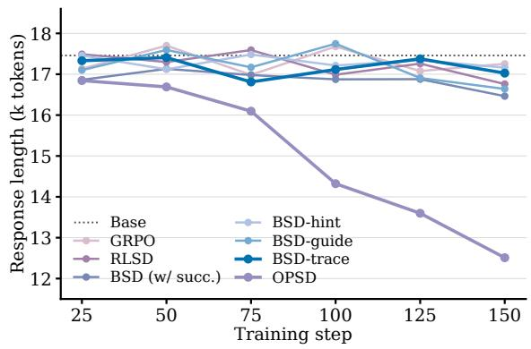

Figure 6: Mean response length on the three benchmarks at every saved checkpoint for the variants of Figure 4, with the Qwen3-4B student and the Qwen3-32B external teacher. The dotted line marks the base model.
<table><tr><td>Method</td><td>AIME24</td><td>AIME25</td><td>HMMT25</td><td>Avg</td><td>Step</td><td> $| \bar { \delta } |$ </td></tr><tr><td>Base</td><td>72.5</td><td>62.5</td><td>42.5</td><td>59.2</td><td>一</td><td>一</td></tr><tr><td>OPSD</td><td>70.8</td><td>66.7</td><td>41.7</td><td>59.7</td><td>50</td><td>一</td></tr><tr><td>GRPO</td><td>72.5</td><td>64.2</td><td>45.0</td><td>60.6</td><td>50</td><td></td></tr><tr><td>RLSD</td><td>73.3</td><td>69.2</td><td>42.5</td><td>61.7</td><td>125</td><td>0.055</td></tr><tr><td>BSD (w/ succ.)</td><td>75.8</td><td>65.0</td><td>43.3</td><td>61.4</td><td>125</td><td>0.127</td></tr><tr><td>BSD-hint</td><td>71.7</td><td>68.3</td><td>45.0</td><td>61.7</td><td>150</td><td>0.062</td></tr><tr><td>BSD-guide</td><td>73.3</td><td>67.5</td><td>46.7</td><td>62.5</td><td>75</td><td>0.076</td></tr><tr><td>BSD-trace</td><td>79.2</td><td>68.3</td><td>44.2</td><td>63.9</td><td>125</td><td>0.127</td></tr></table>

Table 11: Scores of the ablation in Figure 4, with the Qwen3-4B student and the Qwen3-32B training set. Protocol as in Table 1; Step is the training step of the selected checkpoint, and |<sup>¯</sup>δ| is the magnitude of the mean token-level guidance of each form of context, measured before training on the same unsuccessful rollouts (Section 6.2).

## E Wording of Incorrect and Correct Responses

The case study in Section 6.2 shows a single response. Here we compare the wording of responses across the three benchmarks, for the base Qwen3-4B and the student trained with BSD on Qwen3-32B traces, with four samples per problem from each model. On 26 problems the base model gives at least one incorrect response and the BSD student at least one correct response; these comprise 45 incorrect responses of the base model and 69 correct responses of the BSD student. For every word n-gram with $n \leq 3$ that is frequent in these responses (1,508 n-grams), we compute its rate per 1,000 words in the two groups for each problem and a paired t-statistic over the problems. The rates of 24 n-grams differ with $| t | > 3 ,$ , where about four are expected by chance; Table 12 lists examples. Incorrect responses of the base model contain more expressions of negation and doubt, and correct responses of the BSD student more expressions of verification. The correct responses are also shorter, with 19,057 tokens on average against 24,279. This comparison changes the model and the correctness of the response at the same time, so the differences cannot be attributed to BSD alone. We report them as a description of the two groups of responses and not as independent evidence that BSD induces self-correction.

```latex
Problem. Let S be the set of points (x, y) with $0 < x \le$ 1 and
$0 < y \le 1$ for which $\lfloor \log _ { 2 } ( 1 / x ) \rfloor$ and $\lfloor \log _ { 5 } ( 1 / y ) \rfloor$ are both
even. The area of S is m/n in lowest terms. Find m + n.
Answer: 14
Self-teacher conditioned on the trace
Then similar to above, m log<sub>5</sub>(1/y) < m + 1 5^m 1/y <
$5 ^ { \wedge } \{ \mathrm { m } + 1 \}  1 / 5 ^ { \wedge } \{ \mathrm { m } + 1 \} < \mathrm { y } \leq 1 / 5 ^ { \wedge } \mathrm { m } . \mathrm { T h e r e f o r e } ,$ the
length of each interval is $1 / 5 \wedge \mathrm  { \hat { m } } - 1 / 5 \wedge \{ m + 1 \} = 1 / 5 \wedge \{ m +$
1}.
Therefore, the total area for y is A_y = sum_{m even} 1 / 5^{m
+ 1}.
Self-teacher conditioned on the answer
Then similar to above, m  log<sub>5</sub>(1/y) < m + 1  5^m  1/y <
$5 ^ { \wedge } \{ \mathrm { m } + 1 \}  1 / 5 ^ { \wedge } \{ \mathrm { m } + 1 \} < \mathrm { y } \leq 1 / 5 ^ { \wedge } \mathrm { m } .$ Therefore, the
length of each interval is 1 / 5^m - 1 / 5^{m + 1} = 1 / 5^{m +
1}.
Therefore, the total area for y is A_y = sum_{m even} 1 / 5^{m
+ 1}.
δ<sub>t</sub> 2 <sup>δ</sup>t ≥ <sup>+2</sup>
```  
Figure 7: Token-level guidance $\delta _ { t }$ on one passage of an unsuccessful rollout, with the self-teacher conditioned on the Qwen3-32B trace (top) or on the answer alone (bottom). Red marks tokens to which the self-teacher assigns a lower probability than the student and green a higher one; the color saturates at $| \delta _ { t } | = 2$

## F Selected Checkpoints

Table 13 lists the training step of every checkpoint evaluated in Table 1.

## G Pass@4 Results

Table 14 reports Pass@4 for the checkpoints of Table 1.

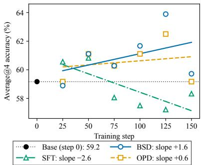

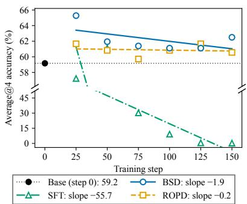  
(b) Qwen3-4B student, GPT-5.6 Luna teacher

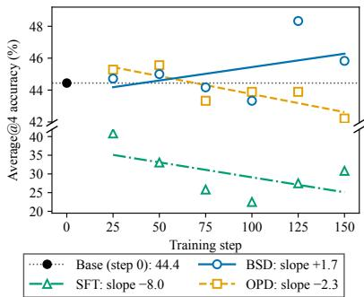  
(c) Qwen3-4B-Instruct student, Qwen3-32B teacher

Figure 8: Avg@4 across the three benchmarks at every saved checkpoint for three further settings. Lines are linear fits over the checkpoints, and the legends give their slopes in percentage points per 100 training steps.
<table><tr><td>n-gram</td><td>Base, incorrect</td><td>BSD, correct</td><td>t</td></tr><tr><td>but this is</td><td>0.84</td><td>0.38</td><td>-4.3</td></tr><tr><td>this is not</td><td>0.45</td><td>0.18</td><td>-4.2</td></tr><tr><td>not sure</td><td>0.58</td><td>0.29</td><td>-3.4</td></tr><tr><td>try to</td><td>1.21</td><td>0.66</td><td>-3.4</td></tr><tr><td>approach</td><td>0.80</td><td>0.58</td><td>-3.3</td></tr><tr><td>which matches</td><td>0.12</td><td>0.21</td><td>+4.3</td></tr><tr><td>indeed</td><td>0.12</td><td>0.27</td><td>+3.3</td></tr><tr><td>verify</td><td>0.15</td><td>0.23</td><td>+3.1</td></tr><tr><td>is indeed</td><td>0.10</td><td>0.22</td><td>+3.1</td></tr></table>

Table 12: Rates per 1,000 words of selected n-grams in incorrect responses of the base Qwen3-4B and correct responses of the student trained with BSD, on the 26 problems that have both. t is the paired t-statistic over the problems.
<table><tr><td></td><td colspan="3">Qwen3-32B</td><td colspan="3">Nemotron-3-30B-A3B</td><td colspan="3">GPT-5.6 Luna</td></tr><tr><td>Student</td><td>SFT</td><td>OPD</td><td>BSD</td><td>SFT</td><td>OPD</td><td>BSD</td><td>SFT</td><td>OPD</td><td>BSD</td></tr><tr><td>Qwen3-4B</td><td>25</td><td>75</td><td>125</td><td>25</td><td>125</td><td>25</td><td>25</td><td>75</td><td>50</td></tr><tr><td>Qwen3-4B-Instruct</td><td>25</td><td>150</td><td>150</td><td>50</td><td>75</td><td>100</td><td>25</td><td>25</td><td>150</td></tr><tr><td>Qwen3-1.7B</td><td>150</td><td>125</td><td>125</td><td>25</td><td>150</td><td>50</td><td>25</td><td>150</td><td>25</td></tr><tr><td>Qwen3-0.6B</td><td>25</td><td>50</td><td>25</td><td>25</td><td>150</td><td>50</td><td>25</td><td>100</td><td>50</td></tr></table>

Table 13: Training step of the checkpoint selected on the development set for each run of Table 1. Checkpoints are saved every 25 steps. As in Table 1, the OPD column is vanilla OPD for Qwen3-32B, xOPD for Nemotron-3-30B-A3B, and ROPD for GPT-5.6 Luna.

## H Additional Training Progression Results

Figure 8 shows the score trend for three further settings, in the format of Figure 3d. In each of them the score of SFT declines over training, while BSD stays stable.

## I Out-of-Domain Evaluation

To examine how the distillation methods affect outof-domain performance, we evaluate the Qwen3-4B student on general knowledge and legal questions, at every saved checkpoint of BSD, SFT, and the OPD variant of each teacher. We use two sets of 200 multiple-choice questions: from MMLU-Pro (Wang et al., 2024), 20 questions from each of its ten categories other than mathematics, physics, chemistry, and engineering, and from LEXam (Fan et al., 2026), 200 four-choice questions in English and German, sampled in the proportion of the two languages in the benchmark. The protocol is that of Table 7, and the base model scores 63.5 on the MMLU-Pro questions and 45.9 on the LEXam questions.

Figure 9 shows that SFT is unstable during training, whereas BSD and the OPD variants are not. On the MMLU-Pro questions, SFT with GPT-5.6 Luna falls steadily from 62.1 at step 25 to 54.1 at step 150, 9.4 points below the base model, and SFT with Nemotron-3-30B-A3B falls from 64.0 to 60.8. On the LEXam questions, SFT with GPT-5.6 falls to 40.5 at step 100, 5.4 points below the base model. Under a bootstrap paired over questions, these three differences from the base model exclude zero at the 95% level, whereas no difference of SFT with Qwen3-32B does. In contrast, at every checkpoint and for all three teachers, BSD and the OPD variants are never more than 1.1 points below the base model on the MMLU-Pro questions and 3.5 points on the LEXam questions. Learning from the student’s own rollouts therefore preserves its abilities outside the training domain, whereas imitating the teacher’s reasoning traces can erase them.

Figure 10 shows the mean response length in the same evaluations. With GPT-5.6 Luna, SFT shortens the responses from 3,031 to 1,059 tokens on the MMLU-Pro questions and from 4,255 to 1,975 tokens on the LEXam questions, against

<table><tr><td>Method</td><td colspan="4">Shared tokenizer (Qwen3-32B)</td><td colspan="4">Cross-tokenizer (Nemotron-3-30B-A3B)</td><td colspan="4">Closed API (GPT-5.6 Luna)</td></tr><tr><td></td><td>AIME24</td><td>AIME25</td><td>HMMT25</td><td>Avg</td><td>AIME24</td><td>AIME25</td><td>HMMT25</td><td>Avg</td><td>AIME24</td><td>AIME25</td><td>HMMT25</td><td>Avg</td></tr><tr><td colspan="9">Qwen3-4B</td><td></td><td></td><td></td></tr><tr><td>Base</td><td>86.7</td><td>80.0</td><td>56.7</td><td>74.4</td><td>86.7</td><td>80.0</td><td>56.7</td><td>74.4</td><td>86.7</td><td>80.0</td><td>56.7</td><td>74.4</td></tr><tr><td>+ SFT</td><td>80.0</td><td>76.7</td><td>56.7</td><td>71.1</td><td>83.3</td><td>80.0</td><td>63.3</td><td>75.6</td><td>83.3</td><td>80.0</td><td>50.0</td><td>71.1</td></tr><tr><td>+ OPD</td><td>83.3</td><td>80.0</td><td>50.0</td><td>71.1</td><td>86.7</td><td>80.0</td><td>60.0</td><td>75.6</td><td>83.3</td><td>76.7</td><td>56.7</td><td>72.2</td></tr><tr><td>+ BSD</td><td>80.0</td><td>80.0</td><td>60.0</td><td>73.3</td><td>86.7</td><td>83.3</td><td>56.7</td><td>75.6</td><td>83.3</td><td>76.7</td><td>53.3</td><td>71.1</td></tr><tr><td colspan="9">Qwen3-4B-Instruct</td><td rowspan="3"></td><td rowspan="3"></td><td></td><td></td></tr><tr><td>Base</td><td>70.0</td><td>63.3</td><td>43.3</td><td>58.9</td><td>70.0</td><td>63.3</td><td>43.3</td><td>58.9 70.0</td><td>63.3</td><td>43.3</td></tr><tr><td>+ SFT</td><td>63.3</td><td>63.3</td><td>40.0</td><td>55.6</td><td>63.3</td><td>60.0</td><td>40.0</td><td>54.4</td><td>70.0 73.3</td><td>43.3</td><td>58.9 62.2</td></tr><tr><td>+ OPD</td><td>70.0</td><td>60.0</td><td>46.7</td><td>58.9</td><td>66.7</td><td>63.3</td><td>50.0</td><td>60.0</td><td>73.3</td><td>66.7</td><td>43.3</td><td>61.1</td></tr><tr><td>+ BSD</td><td>70.0</td><td>60.0</td><td>46.7</td><td>58.9</td><td>66.7</td><td>63.3</td><td>56.7</td><td>62.2</td><td>73.3</td><td>66.7</td><td>53.3</td><td>64.4</td></tr><tr><td colspan="9">Qwen3-1.7B</td><td rowspan="3"></td><td></td><td rowspan="3"></td><td>51.1</td></tr><tr><td>Base</td><td>73.3</td><td>46.7</td><td>33.3</td><td>51.1</td><td>73.3</td><td>46.7</td><td>33.3</td><td>51.1 73.3</td><td>46.7</td><td>33.3</td></tr><tr><td>+ SFT</td><td>66.7</td><td>53.3</td><td>36.7</td><td>52.2</td><td>73.3</td><td>50.0</td><td>40.0</td><td>54.4 76.7</td><td>56.7</td><td>26.7</td></tr><tr><td>+ OPD</td><td>73.3</td><td>40.0</td><td>36.7</td><td>50.0</td><td>66.7</td><td>50.0</td><td>46.7</td><td>54.4</td><td>66.7</td><td>53.3</td><td>36.7</td><td>53.3 52.2</td></tr><tr><td>+ BSD</td><td>70.0</td><td>50.0</td><td>40.0</td><td>53.3</td><td>76.7</td><td>56.7</td><td>43.3</td><td>58.9</td><td>73.3</td><td>53.3</td><td>36.7</td><td>54.4</td></tr><tr><td colspan="9">Qwen3-0.6B</td><td rowspan="3"></td><td></td><td rowspan="3">13.3</td><td rowspan="3">23.3</td></tr><tr><td>Base + SFT</td><td>23.3</td><td>33.3</td><td>13.3</td><td>23.3</td><td>23.3</td><td>33.3</td><td>13.3 23.3</td><td>23.3</td><td>33.3</td></tr><tr><td></td><td>16.7</td><td>20.0</td><td>13.3</td><td>16.7</td><td>13.3</td><td>23.3</td><td>13.3</td><td>16.7 3.3</td><td>13.3</td><td>6.7</td></tr><tr><td>+ OPD + BSD</td><td>26.7 33.3</td><td>33.3 30.0</td><td>23.3 13.3</td><td>27.8 25.6</td><td>30.0 23.3</td><td>30.0 30.0</td><td>13.3 13.3</td><td>24.4 22.2</td><td>26.7 30.0</td><td>26.7 33.3</td><td>13.3 23.3</td><td>7.8 22.2 28.9</td></tr></table>

Table 14: Pass@4, the share of problems solved by at least one of the four samples, on each benchmark and averaged over the three (Avg). Checkpoints, protocol, and layout as in Table 1, including the OPD variant of each teacher; bold marks the best score among the three methods for each teacher–student pair.

3,159 and 4,302 tokens for the base model, and with Nemotron-3-30B-A3B it lengthens them to 3,600 tokens on the MMLU-Pro questions. BSD and the OPD variants stay within 300 tokens of the base model at every checkpoint. The loss of out-of-domain accuracy under SFT thus coincides with the change in response length that it shows on mathematics (Section 5.2).

Table 15 summarizes each run by the mean and standard deviation of its score over the six checkpoints. BSD averages 63.8 to 64.5 on the MMLU-Pro questions and 43.9 to 44.9 on the LEXam questions, with a standard deviation of at most 1.1 points, and the OPD variants behave similarly. SFT with GPT-5.6 Luna averages 59.6 on the MMLU-Pro questions with a standard deviation of 3.1 points. The base model has a single checkpoint, so we report its standard deviation over the four sampling seeds; on the LEXam questions it is 4.9 points, and the gap between the base model and the trained students there is comparable to this sampling noise.

<table><tr><td>Teacher</td><td>Method MMLU-Pro</td><td></td><td>LEXam</td></tr><tr><td>一</td><td>Base</td><td> $6 3 . 5 \pm 1 . 9$ </td><td> $4 5 . 9 \pm 4 . 9$ </td></tr><tr><td>Qwen3-32B</td><td>SFT OPD BSD</td><td> $6 3 . 8 \pm 1 . 3$   $6 3 . 7 \pm 0 . 9$   $6 4 . 5 \pm 0 . 8$ </td><td> $4 3 . 8 \pm 0 . 8$   $4 4 . 9 \pm 0 . 5$   $4 3 . 9 \pm 0 . 9$ </td></tr><tr><td>Nemotron-3-30B-A3B</td><td>SFT xOPD BSD</td><td> $6 2 . 1 \pm 1 . 5$   $6 4 . 0 \pm 0 . 5$   $6 4 . 0 \pm 1 . 1$ </td><td> $4 3 . 8 \pm 1 . 3$   $4 4 . 8 \pm 0 . 9$   $4 4 . 6 \pm 0 . 7$ </td></tr><tr><td>GPT-5.6 Luna</td><td>SFT ROPD BSD</td><td> $5 9 . 6 \pm 3 . 1$   $6 3 . 6 \pm 0 . 6$   $6 3 . 8 \pm 1 . 1$ </td><td> $4 3 . 1 \pm 1 . 7$   $4 4 . 7 \pm 0 . 9$   $4 4 . 9 \pm 0 . 7$ </td></tr></table>

Table 15: Mean and standard deviation of Avg@4 over the six saved checkpoints of each run of the Qwen3-4B student on the out-of-domain questions of Figure 9. For the base model, the standard deviation is over its four sampling seeds.

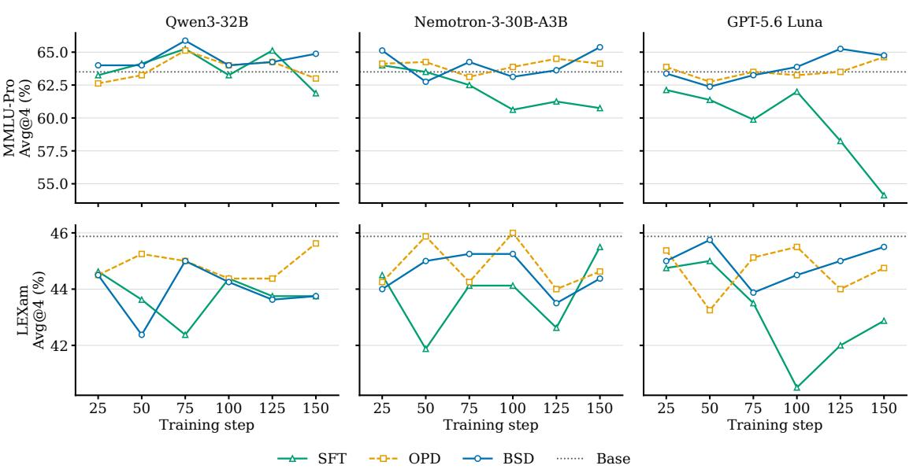  
Figure 9: Avg@4 of the Qwen3-4B student on out-of-domain questions at every saved checkpoint. Rows are the MMLU-Pro and LEXam questions, and columns are the external teachers. OPD is vanilla OPD, xOPD, and ROPD for the three teachers, respectively. SFT falls below the base model over training with Nemotron-3-30B-A3B and GPT-5.6 Luna, whereas BSD and OPD stay at its level.

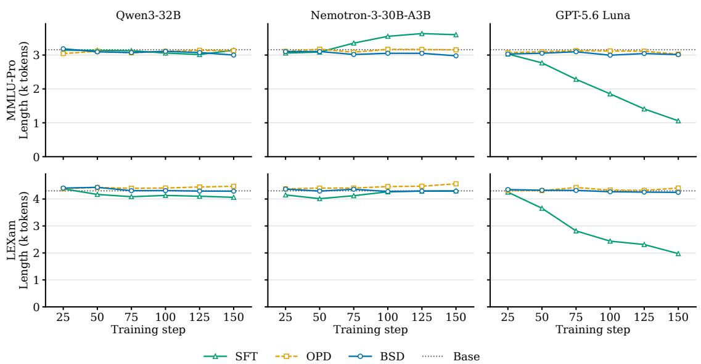  
Figure 10: Mean response length of the Qwen3-4B student on the out-of-domain questions at every saved checkpoint, in the layout of Figure 9. SFT shortens the responses with GPT-5.6 Luna and lengthens them on the MMLU-Pro questions with Nemotron-3-30B-A3B, whereas BSD and OPD keep the length of the base model.