# CAN IT ACTUALLY WORK? SYNTHESIZING FUNCTIONAL CAD MECHANISMS

Wenqian Zhang<sup>1,†</sup> Yangyi Huang<sup>2,†</sup> Zigeng Xu<sup>1,†</sup> Weiyang Liu<sup>2,‡</sup> Zhen Liu<sup>1,‡,\*</sup> <sup>1</sup>The Chinese University of Hong Kong (Shenzhen) <sup>2</sup>The Chinese University of Hong Kong <sup>†</sup>Equal contribution <sup>‡</sup>Equal advising <sup>\*</sup>Corresponding author

thegenlab.ai/funcad/

From a user request to an agent-designed prototype

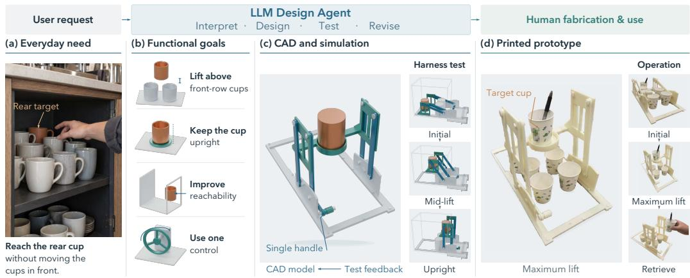  
Figure 1: Functional CAD design from user request to physical prototype. In the illustration, a user request for cup access is decomposed into functional goals that guide agent-based CAD construction and simulationdriven refinement. The resulting design is fabricated and operated by a human, with the printed prototype shown at maximum lift and during cup retrieval.

## ABSTRACT

While LLM agents can generate visually plausible CAD assemblies, these designs often fail to fulfill their intended physical functions. We study functional CAD design, a setting where agents interpret underspecified requests to construct and iteratively revise mechanisms that satisfy functional requirements in physical simulation. Verifying these requirements is nontrivial: different candidate mechanisms may realize the same function through entirely different components, controls, and operating sequences. To bridge this gap, we propose FunCAD-Harness, a framework that translates abstract requirements into candidate-specific physical tests and uses simulation feedback to guide design revisions. To systematically evaluate this capability, we introduce FunCADBench, a benchmark spanning 46 mechanism families with interdependent and multi-step operations. Experiments across frontier LLM agents show that FunCAD-Harness exposes subtle mechanical failures invisible to visual inspection, substantially improving functional success rates over standard simulation-augmented baselines. Ultimately, our work marks a step toward CAD agents capable of translating human intent into working mechanisms.

## 1 INTRODUCTION

A longstanding ambition for generative AI is to turn human intentions into machines that can be built and made to work. Recent progress in LLM agents brings this ambition closer, enabling them to write modeling programs and operate CAD software to construct sophisticated mechanical designs for fabrication by 3D printing or CNC machining. Yet a visually plausible CAD model does not ensure that the resulting machine will fulfill the user’s request, because its function depends on how its parts interact physically during operation. Even an assembly with valid parts and plausible articulation can fail to transmit a load, maintain contact, or return to a state that permits the next operation. A gripper, for example, may grasp an object successfully but leave it poorly positioned after release, preventing the next grasp. Because fabricating and assembling each candidate is costly, physical simulation offers a practical way to examine these interactions under specified inputs and loads and use the resulting feedback to revise the design.

Verifying a design through physical simulation, however, requires tests that reflect both the user’s intended function and the way the candidate mechanism realizes it. Users often describe what they want a machine to accomplish without specifying all the behaviors needed to achieve it. Even when these requirements are made explicit, they do not uniquely determine an experiment, because the same function can be realized by mechanisms that operate differently. For an alarm that must trigger autonomously at a requested time, a gravity-powered design requires raising a weight, whereas a mainspring-powered design requires winding. A test designed around one mechanism can therefore be inappropriate for the other, even though the intended function is unchanged.

We study whether LLM agents can carry this process from an underspecified request to a CAD mechanism that satisfies its functional requirements in simulation, a problem we term functional CAD design. To examine how far current agents can go on this task, we introduce FunCADBench, a benchmark spanning 46 mechanism families. Its tasks range from clamps and transmissions to mechanical counters, alarm clocks, and coin-sorting devices, whose functions depend on different combinations of geometry, force transmission, and changing contact states. Each task specifies a fixed request and an abstract functional test template while leaving the mechanical realization open. Success requires the resulting assembly to perform the complete requested behavior and satisfy the applicable geometric and physical constraints. Since repeated physical simulation can be costly for complex mechanisms, we develop a customized simulation environment to support efficient benchmark evaluation.

For this specific task, we develop FunCAD-Harness, which translates user requests into task requirements and abstract physical test templates. It then determines test conditions appropriate to the candidate mechanism and uses structured simulation feedback to guide design revision. Fig. 1 illustrates this workflow through an open-ended cup-access design and its printed prototype.

With FunCAD-Harness, we evaluate frontier models and baseline workflows on FunCADBench and find that structured physical testing and diagnostic feedback improve task success. The model comparisons also show that strong visual 3D modeling capabilities do not necessarily translate into superior functional design. To better understand how agents approach this task, we analyze their tool use and observe that they rely primarily on CAD programs and simulation, with little use of rendered images. Testing the role of visual access directly, a separate experiment shows that substantial task success remains possible when it is removed from the constructor.

In summary, our contributions are:

• We formulate functional CAD design, in which agents translate underspecified requests into mechanisms that fulfill their intended functions in simulation, and introduce FunCADBench, spanning 46 mechanism families, with a simulation environment for efficient physical evaluation.

• We develop FunCAD-Harness, which derives requirements and abstract test templates from user requests, constructs physical tests suited to candidate mechanisms, and uses structured simulation feedback to guide iterative design and revision.

• We systematically evaluate frontier agents and baseline workflows, demonstrating the benefits of physical testing and diagnostic feedback. Our analyses further reveal performance–cost tradeoffs and recurring challenges in functional mechanical design.

## 2 RELATED WORK

Mechanical design and AI for engineering. Mechanical design connects intended functions to the structure and motion of mechanisms (Reuleaux, 2013). Computational approaches optimize mechanisms and structural topology (Coros et al., 2013; Bendsøe et al., 2004), while learned models predict performance and generate candidate designs (Umetani & Bickel, 2018; Regenwetter et al., 2022). Co-design accounts for dependencies between morphology, motion, and control (Ha et al., 2016; Yuan et al., 2022), and between hardware and software under resource and compatibility constraints (Carlone & Pinciroli, 2019). LLMs connect natural-language specifications to design generation, analysis, and optimization tools (Makatura et al., 2023). Executable evaluation supports both benchmarking, as in EngDesign’s cross-domain design tasks (Guo et al., 2025), and search, as in VLMgineer’s simulation-guided evolutionary co-design of robot-mounted tool geometry and action waypoints (Gao et al., 2026). Closest to our setting, BesiegeField studies compositional machine design from textual functional demands, assembling standardized components in a game-based simulator and using simulation rewards and state feedback to revise the assembly (Zhang et al., 2026). Our CAD setting expands the design space beyond predefined blocks: agents jointly synthesize part geometry, assembly structure, and operating inputs to realize the requested functions, producing CAD models that provide a basis for eventual fabrication.

Programmatic CAD and physically grounded assets. Programmatic CAD and graphics representations make modeling operations and part composition editable (Ritchie et al., 2023; Wu et al., 2023; Li et al., 2025), with compilation, rendered views, and CAD-engine diagnostics providing feedback on geometric fidelity and modeling validity (Alrashedy et al., 2025; Gong et al., 2026). Assembly benchmarks extend evaluation to functionality, manufacturability, and assemblability through executable geometry checks and drawing-based VLM judgments under supplied assembly graphs and engineering constraints (Dong et al., 2026). Articulated-asset generation further tests how parts interact, using agent-authored checks of contact, clearance, containment, and pose-dependent relations (Zhou et al., 2026), or independent review and physical simulation of collisions, stability, and manipulation feasibility for coupled motions (Cai et al., 2026). Whereas these approaches assess the realization and functional usability of specified objects, FunCADBench evaluates alternative mechanism architectures against a functional request’s complete operating requirements, including load transmission and dependent or repeated operations.

Agent workflows, harnesses, and executable evaluation. Agent interfaces and runtimes organize tool use, context, and execution feedback (Yang et al., 2024; Wang et al., 2025), while automated search optimizes workflows and full harness programs against supplied evaluators (Zhang et al., 2025; Lee et al., 2026). Executable checks also guide artifact construction within a workflow, from stage gates for robot-learning environments, interfaces, rewards, and training configurations (Li et al., 2026) to geometric checks and finite-element stress and safety-factor feedback for structural CAD under prescribed loads, supports, and design-space constraints (Berger et al., 2026). To accommodate generated implementations, software testing can adapt test inputs against a trusted reference and retain counterexamples for regression testing (Kato, 2026), or bind fixed functional tests to implementationspecific identifiers (Liu et al., 2025). FunCAD-Harness extends candidate-specific test binding to operating mechanisms whose geometry, assembly, and inputs vary across designs. Registered requirements and abstract test templates remain fixed, while actuation, loads, and observations are bound to each candidate for simulation and source-geometry checks. This evaluates complete mechanism operation rather than structural response to a prescribed load case, and supplies feedback for structural revision.

## 3 FUNCADBENCH: BENCHMARK FOR FUNCTIONAL CAD DESIGN

## 3.1 FUNCTIONAL CAD DESIGN

Mechanical design involves production cost, manufacturing processes, and regulatory requirements as well as mechanical behavior (Pahl et al., 2007; Nisbett & Budynas, 2020). We focus on interpreting high-level user requests and determining whether a CAD mechanism fulfills the intended functions under appropriate physical conditions (Zhang et al., 2026). Formally speaking, each task of functional CAD design is specified by a natural-language request describing a mechanism’s intended use. The request establishes itsfunctional requirements, which describe the behaviors to achieve, andfixed constraints, which must be preserved throughout design. The agent produces a candidate design together with declared physical assumptions. Different mechanical implementations are acceptable as long as they satisfy these requirements; for example, a clamp may use different actuation mechanisms, but it must still close, hold an object, and release it.

## 3.2 TASK FAMILIES AND TAXONOMY

To evaluate frontier LLM agents on this task across different mechanical demands, we introduce FunCADBench, a benchmark spanning 46 mechanism families (representative mechanisms are shown in Fig. 2). These range from elementary assemblies to coupled transmissions and devices with sequential or repeated operation. Fig. 3 shows mechanisms that LLM agents built for all 46 families in our experiments. Many of these families are drawn from familiar artifacts, such as clamps, whose intended uses can be described without specifying their internal mechanics. Several families pose open-ended mechanism design tasks that leave key architectural choices to the constructor. For example, the four-station indexing table (Task 40) must convert continuous input rotation into intermittent motion with dwell, without prescribing the indexing mechanism. We choose these families to cover different combinations of challenges along these axes–motion primitives, topology, complexity, contact, and geometric difficulty–each drawing on different agent capabilities (Table 1).

Table 1: Task taxonomy of FunCADBench.
<table><tr><td>Axis</td><td>Mechanical demands</td><td>Agent capabilities</td></tr><tr><td>Motion primitives</td><td>Motion conversion, transmission, phase, and repetition</td><td>Spatial and physical reasoning about motion</td></tr><tr><td>Topology</td><td>Connections, branches, and kinematic loops</td><td>Reasoning about assembly constraints</td></tr><tr><td>Complexity</td><td>Coupled subsystems, states, and operation sequences</td><td>Task decomposition and revision planning</td></tr><tr><td>Contact</td><td>Engagement, sliding, locking, and friction</td><td>Reasoning about contact and friction</td></tr><tr><td>Geometric difficulty</td><td>Feature construction, alignment, clearance, and assembly access</td><td>CAD tool use and geometric verification</td></tr></table>

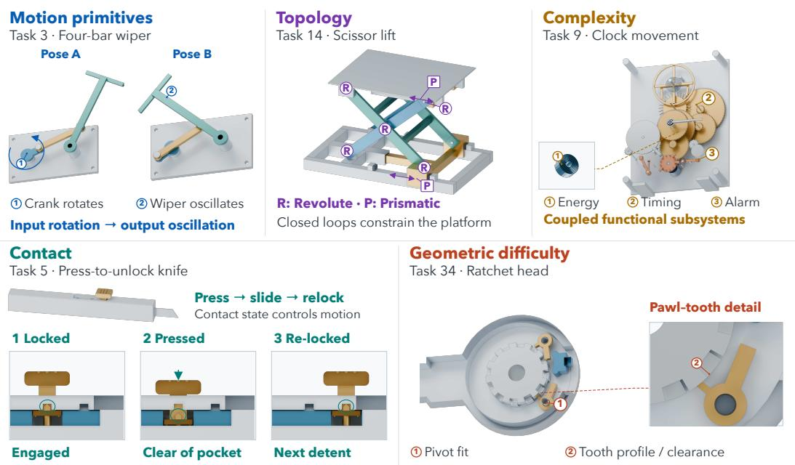  
Figure 2: Taxonomy with representative mechanisms. Colors indicate functional parts and subsystems.

## 3.3 PHYSICAL EVALUATION AND SUCCESS CRITERIA

Functional requirements specify what an assembly must accomplish, while its mechanical realization determines how those functions can be tested. Similar to the separation between test logic and implementation-specific parameters in ProjectEval (Liu et al., 2025), we define abstract test templates for the required behaviors and bind them to each candidate mechanism, while keeping the requests and templates fixed across candidates for registered benchmark tasks. This binding identifies the candidate’s operating interfaces (e.g., bicycle handlebars) and observation signals, and specifies the inputs, loads, physical attributes, and environmental conditions needed to execute the template. These choices reflect how the mechanism operates while preserving the task’s required functions and fixed constraints. Parameters left open by the task may be selected or revised within its permitted scope (Appendix A.4). Given these parameters, we run physical simulation and record feedback signals, including forces, positions, and contact or collision events, for the relevant mechanical modules. The assembly succeeds under the task’s simulation protocol if it passes all required functional checks and all applicable source-geometry checks (e.g., collision checks) under its declared operating conditions.

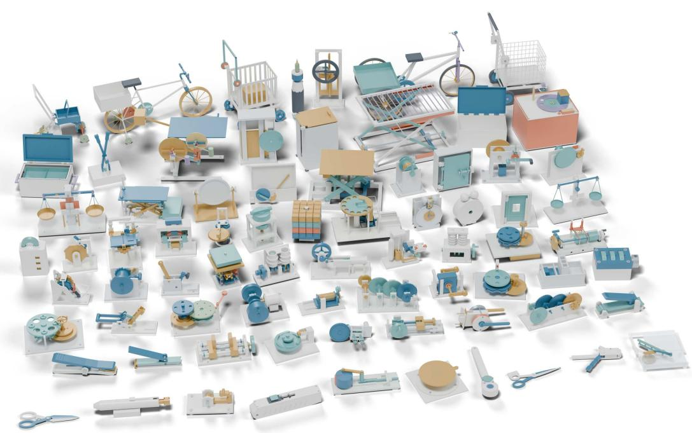  
Figure 3: Mechanisms built by LLM agents in our experiments. The 75 assemblies cover all 46 FunCAD-Bench families and are rendered from their delivered CAD geometry (arranged for display, not to scale); 38 of them pass the full FunCAD-Harness evaluation.

## 3.4 SIMULATION ENVIRONMENT

Physical evaluation and repeated design revision require tests that can run within an agent’s working budget. Our simulation environment uses Project Chrono (Tasora et al., 2016) for rigid-body dynamics and Bullet (Coumans, 2015) for collision detection. Since resolving detailed mechanical interactions can be costly, the environment also supports equivalent models. Gear couplings, for example, represent transmission between rotating components without resolving individual tooth contacts (Coros et al., 2013; Tasora et al., 2016).

When configuring a physical test, the agents choose between native simulation and a declared equivalent model for each interaction, recording its parameters and assumptions. If an equivalent model is used, it specifies force or torque laws for the corresponding source components, leaving the native solver to compute the resulting motion without prescribing output trajectories. Connections remain tied to finite regions of the source geometry and are released if those regions separate. The resulting motion provides the basis for functional checks, while separate audits examine the original CAD geometry at sampled poses. Appendix D describes the interaction models, audit scope, and execution procedure.

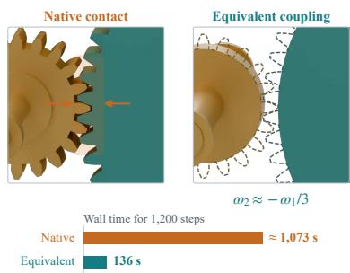  
Figure 4: Gear-transmission cost. Native time is extrapolated from its recorded mean.

## 4 AGENTIC HARNESS FOR FUNCTIONAL CAD DESIGN

A mechanism’s design determines how its functions can be tested, and the test results in turn inform how the design should change. FunCAD-Harness organizes this interaction into a closed loop for developing and revising CAD mechanisms (Fig. 5). Building on agentic CAD generation (Zhou et al.,

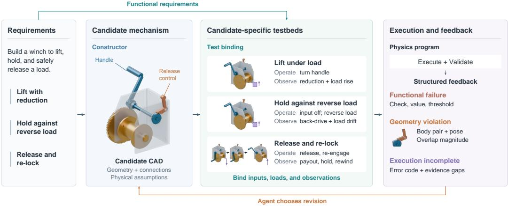  
Figure 5: Overview of FunCAD-Harness, illustrated with a releasable reduction winch (Task 42).

2026) and simulation-based machine design (Zhang et al., 2026), the harness pairs a constructor responsible for mechanism design with a test-binding agent responsible for preparing physical tests.

## 4.1 FUNCTIONAL REQUIREMENTS AND TEST TEMPLATES

The constructor starts from a text prompt specifying the functional requirements, which describe what the mechanism must accomplish while leaving its mechanical realization open. A request for an alarm clock, for example, may require it to trigger autonomously at a specified time without prescribing a particular escapement design. Each test template specifies the operations, observations, and success criteria for verifying the requested behavior, leaving mechanism-dependent details to candidate-specific binding. For the 46 registered FunCADBench tasks, both prompts and test templates remain fixed across candidate designs.

For requests outside the registered benchmark, the constructor first identifies the required functions, fixed constraints, and open operating parameters from the prompt, then proposes a test template. The test-binding agent checks its coverage and executability, and the constructor revises it accordingly. This additional template-authoring step is separate from the candidate-specific binding used to evaluate registered benchmark tasks.

## 4.2 CAD CONSTRUCTION AND PHYSICAL TESTING

With the requirements and test templates in place, the constructor develops the CAD geometry, connections, operating inputs, and physical assumptions. The test-binding agent then binds each template to the candidate’s operating inputs and observable states without changing its geometry or declared mechanics. For the winch in Fig. 5, this involves identifying the handle, release control, and load attachment and configuring tests of lifting, holding, release, and re-locking. The parameters needed to execute these tests come from the task, geometry, design documentation, or task-authorized constructor choices. Their sources and any permitted adjustments are retained as described in Appendix A.4.

Once the physical experiments have been specified through binding, the harness executes them without changing the CAD design between tests and checks the original geometry at sampled motion poses (Section 3.3). The execution program determines the outcomes from the recorded signals and applicable geometry checks.

## 4.3 REVISION FROM PHYSICAL FEEDBACK

These outcomes return to the constructor as per-function results, accompanied by physical signals, failed checks, geometry violations, and execution errors. Using this feedback, the constructor diagnoses failures and revises the geometry, connections, permitted operating parameters, or simulation representations. Since a revision may affect several functions, the test-binding agent updates the candidate-specific bindings for all required functions, and the harness reruns the full set of tests on the revised assembly.

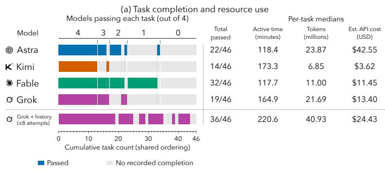

## 5 EXPERIMENTS AND RESULTS

## 5.1 FUNCTIONAL DESIGN PERFORMANCE

We evaluate GPT-6 Astra, Kimi K3, Fable 5.1, and Grok 4.6 with FunCAD-Harness on all 46 tasks (details in Table 7), allowing one independent attempt per family within a three-hour active-time budget. Each model drives its own ReAct loop (Yao et al., 2023) for CAD construction, testing, and revision, with internal tests and revisions included in the generation process.

After each batch of generation runs, we evaluate the resulting assemblies in a separate batch using GPT-6 Astra with a one-million-token context allowance and medium reasoning. The final-evaluation model, context allowance, and reasoning setting remain the same across all generation models and comparison settings, including Grok + history. The evaluation agent configures candidate-specific physical tests under the task’s required functions and fixed constraints, and the execution program determines their outcomes. Appendix E.1 provides the model settings and time-accounting details.

Across the four models, agents solve 34 of the 46 tasks (Fig. 6). All four succeed on most lowcomplexity tasks, but their performance diverges on more demanding mechanisms. Every task solved exclusively by Fable has medium or high complexity, although even this strongest model solves only five of the 15 high-complexity tasks. We also compare success across the benchmark’s demand axes by weighting each task according to its requirement grade on the corresponding axis. All four models have their lowest weighted success rate on the contact axis, which covers engagement, release, friction, and changes in contact state.

We also evaluate Grok with up to eight attempts per task and access to records from earlier attempts. This setting solves 36 tasks, including six unsolved by any model in the default setting, at a lower median cumulative constructor API cost than Astra’s default runs.

<table><tr><td colspan="7">(a) Task completion and resource use</td><td colspan="3">(b) Weighted task completion</td></tr><tr><td></td><td colspan="3">Models passing each task (out of 4)</td><td colspan="3"></td><td colspan="3">Per-task medians</td></tr><tr><td>Model</td><td>4</td><td>3</td><td>2 1</td><td>0</td><td>Total passed</td><td>Active time (minutes)</td><td>Tokens (millions)</td><td>Est. API cost (USD)</td><td>Motion coordination</td></tr><tr><td>Astra</td><td></td><td></td><td></td><td></td><td>22/46</td><td>118.4</td><td>23.87</td><td>$42.55</td><td>100% 75%</td></tr><tr><td>K Kimi</td><td></td><td></td><td></td><td></td><td>14/46</td><td>173.3</td><td>6.85</td><td>$3.62</td><td>Geometric 50% Structural 25%</td></tr><tr><td> Fable</td><td></td><td></td><td></td><td></td><td>32/46</td><td>117.7</td><td>11.00</td><td>$11.45</td><td>constraints coupling</td></tr><tr><td>ø Grok</td><td></td><td></td><td></td><td></td><td>19/46</td><td>164.9</td><td>21.69</td><td>$13.40</td><td></td></tr><tr><td>ø Grok + history (≤8 attempts)</td><td></td><td></td><td></td><td></td><td>36/46</td><td>220.6</td><td>40.93</td><td>$24.43</td><td>Contact Functional</td></tr><tr><td colspan="2">0 Cumulative task count (shared ordering)</td><td>10 20</td><td>30</td><td>40</td><td>46</td><td></td><td></td><td></td><td>coordination integration Fable</td></tr></table>

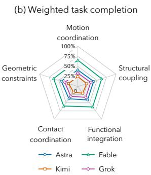  
Figure 6: Task success and mechanical demand coverage. (a) Tasks share an ordering across models. Colored segments indicate success, and gray segments indicate no recorded success. Individual outcomes appear in Table 8. Time, tokens, and estimated constructor API cost are per-task medians. API cost covers recorded constructor usage and accumulates across attempts in the history setting (Appendix E.3). (b) Success weighted by requirement grades 1–3 for each demand axis, normalized by the total weight over all 46 tasks (Appendix E.5). Task grouping and demand-weighted scores use the four single-attempt settings.

## 5.2 HARNESS COMPARISONS

To assess the contribution of structured physical testing, we compare FunCAD-Harness with three alternative workflows (Table 2). In the requirements-only and simulation-tools baselines, agents choose their own tests and may implement their own simulations. The binary-feedback variant retains the full harness workflow but returns only pass/fail simulation outcomes. We also test whether visual access contributes to construction and revision by repeating the Astra and Grok full-harness experiments with visual access removed only from the constructor. The other agents retain their standard visual access. All settings undergo independent final evaluation under the same protocol.

Simulation access and whole-task success. Providing simulation tools improves success over requirements alone, and the full harness raises it further, from 8 to 22 tasks for Astra and from 10 to 19 for Grok. These gains span motion transmission and locking through mechanical contact. Both models additionally solve the rack-and-pinion gate, four-bar wiper, and hand-cranked whisk (Tasks 2–4), as well as the self-locking knife and spring-latch lock (Tasks 5 and 33).

(a) Bicycle: steering blocked

Table 2: End-to-end completion on 46 functional CAD tasks under independent final evaluation. Success-set overlaps appear in Appendix F.
<table><tr><td>Setting</td><td>Provided support</td><td>Astra</td><td>Grok</td></tr><tr><td>Requirements only</td><td>Requirements and agent-chosen verification</td><td>1/46</td><td>3/46</td></tr><tr><td>Simulation tools</td><td>Requirements, simulator, and tool guidance</td><td>8/46</td><td>10/46</td></tr><tr><td>Binary feedback</td><td>Full workflow with pass/fail simulation feedback</td><td>0/46</td><td>8/46</td></tr><tr><td>No constructor vision</td><td>Full harness without constructor visual access</td><td>20/46</td><td>18/46</td></tr><tr><td>Full harness</td><td>Tests of required functions and diagnostic feedback</td><td>22/46</td><td>19/46</td></tr></table>

(b) Clock: hour hand blocked  
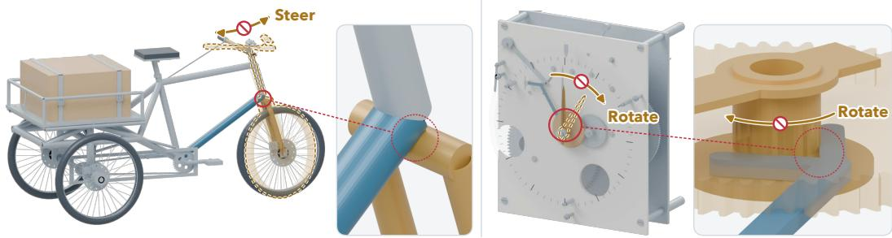  
Figure 7: Function-blocking interference in Astra designs produced without harness feedback. (a) The bicycle’s steering assembly intersects the fixed frame (Task 7, requirements-only). (b) The clock’s hour wheel overlaps the alarm lever despite separate escapement and striker tests (Task 9, simulation-tools). Red circles mark interference, and dashed silhouettes indicate intended poses. The clock inset uses schematic hand placement and sleeve length.

Access to simulation does not, however, ensure that the tests cover the complete requested behavior. In the simulation-tools setting, Astra tests a clock’s escapement for ten simulated minutes and its striker separately, but leaves the sequence of setting, triggering, and stopping the alarm while preserving timekeeping unverified. The delivered hour wheel also interferes with the alarm lever (Fig. 7b).

Retaining functional checks through revision. Functional checks can also be lost during repair. In the simulation-tools setting, Grok replaces a numerically invalid loaded test of a ratchet screwdriver (Task 13) with a short stepping test, leaving the drive and return-stroke requirements unchecked. A separate full-harness run retains these checks, revealing that all four stroke checks pass but both checks for backward slip of the output fail.

Diagnostic feedback and workflow completion. When a test fails, diagnostic feedback helps the constructor identify what needs to change. The full harness reports failed requirements, measured discrepancies, and physical-validity violations that can distinguish failure causes and guide repairs. Removing these diagnostics reduces recorded success from 22 to zero tasks for Astra and from 19 to eight for Grok. Astra’s binary-feedback runs include early delivery of partial results, so its zero successes include unfinished evaluation as well as failed checks. The benefit of diagnostic feedback extends to continued testing as well as design revision.

## 5.3 DESIGN AND REVISION BEHAVIOR

Repairing failures in repeated operation. Fable’s gripper (Task 41) passes a short development test, but formal repeated-use testing reveals that the workpiece tips after release, causing the next grasp to miss it. The second grasp records 0 N against a 10 N minimum. Fable responds by widening the contact pads and support rest and reducing the permitted input-force limit from 50 to 35 N. The revised design leaves the workpiece positioned for reuse, and its second grasp reaches 14.40 N under the unchanged 5 N external load. Both grasp–release cycles and the geometry audit pass (Fig. 11).

Restoring function can still leave geometric interference to resolve. In Grok’s spring-return door latch (Task 33), the latch initially rests on the strike-plate edge after closure, failing both re-locking check while passing the other 13 functional checks. Grok reshapes the entry bevel and adds a catching shoulder, restoring engagement after both closures and passing all 15 functional checks. It then adds local relief to the faceplate to resolve the remaining latch–faceplate interference. The final revision passes both the functional checks and the audit of the original CAD geometry under unchanged test parameters (Fig. 8).

Opening the door is not enough: the latch must engage again after closing.  
Repair trajectory: restoring re-locking after closure Grok · Task 33 · Spring-return door latch  
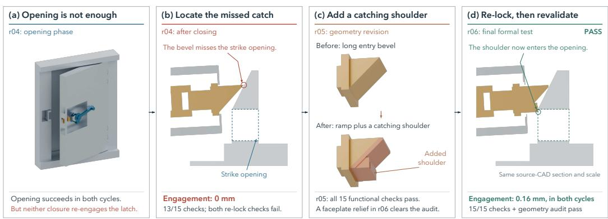  
Figure 8: Grok repairs re-locking and local interference in a spring-return door latch (Task 33).

Verification strategies and visual access. We analyze tool use on 41 task families with recorded harness-tool execution times for all four models (Appendix E.6, Fig. 9). Fable and Grok devote larger shares of their calls to reading requirements, documentation, and source code. Astra devotes more to simulation, geometric checks, and analysis of test results and traces, with a higher share of simulation calls than Fable on 40 of the 41 matched tasks. Despite these differences in call distribution, simulation-related operations account for 75–85% of recorded harness-tool execution time on average across tasks for every model.

Agents obtain geometric and physical information primarily through CAD programs and simulation, with little use of rendered images. Without visual access, Astra’s constructor still succeeds on 20 of the 46 tasks, compared with 22 with visual access (Table 2). Grok shows a similar pattern, completing 18 tasks without visual access compared with 19 with it. Substantial functional design success therefore remains possible without visual inspection during construction and revision. Appendix F.5 provides the protocol and task-level results.

## 5.4 TOOL USE AND EXECUTION TIME

We analyze tool use on 41 tasks with timing records available for all four models (Fig. 9). Fable and Grok devote larger shares of their calls to reading requirements, documentation, and source code, whereas Astra devotes more to simulation, geometric checks, and feedback analysis. These differences in call frequency do not translate into equally different execution-time profiles. For every model, simulation and cost probes account for approximately 75–85% of recorded tool execution time, even when they make up a small share of calls. Their cost highlights the importance of efficient simulation for repeated design revision. Across models, visual inspection remains infrequent, consistent with agents obtaining geometric and physical information primarily through CAD programs and numerical feedback.

## 5.5 REAL-WORLD FABRICATION

We 3D-printed and assembled prototypes to complement the simulation-based evaluation with qualitative examples of fabrication and assembly. Figure 10 shows selected prototypes, and supplementary videos document their operation. Additional examples appear in Figure 16 in Appendix G.

## 6 DISCUSSIONS

From simulation to fabrication. Turning a simulated mechanism into a working machine requires accounting for uncertainty in both physics models and fabrication. Contact and friction approximations, manufacturing tolerances, assembly misalignment, and material variation can change whether parts slide, engage, or jam. Experiments with selected prototypes could calibrate uncertain parameters and identify missing effects, following approaches that calibrate simulators from real-world robot trajectories (Chebotar et al., 2019). Testing over plausible parameter ranges would then assess robustness to fabrication and operating conditions. The same prototype measurements could also help adapt world models, which offer fast predictions of rigid, articulated, and deformable interactions (Huang et al., 2026; Yang et al., 2025). Such adaptation could capture effects that are difficult to model explicitly and make repeated design tests more affordable.

(a) Tool-call distribution  
(b) Tool execution time  
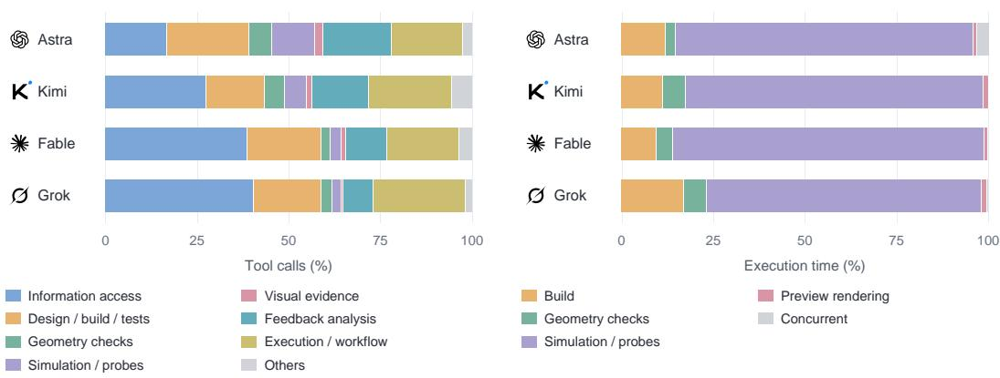  
Figure 9: Tool use and execution time on 41 matched tasks. (a) Distribution of constructor tool calls. (b) Distribution of recorded standard-tool execution time. Simulation and cost probes are grouped together, and Concurrent denotes overlapping execution across categories. Shares are computed within each task and averaged with equal task weights. Call annotation, filtering, and timing details appear in Appendix E.6.

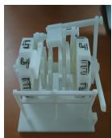

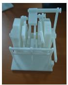  
(a) Two-digit counter

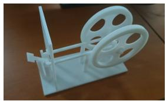  
(b) Gravity timer

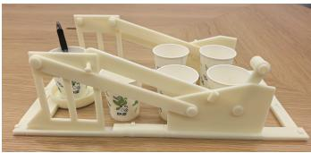  
(c) Cup-access machine  
Figure 10: Selected printed prototypes. (a) Front and rear views of the two-digit counter (Task 19). (b) Gravity timer (Task 21). (c) Initial configuration of the open-ended cup-access machine. The pen marks the target cup at the rear. Figure 1 shows the raised configuration and retrieval. Task numbers follow Appendix B.

Coverage of functional tests. Improving simulation fidelity does not by itself ensure that the tests cover the intended behavior. Functional CAD design shares this challenge with project-level software generation in ProjectEval (Liu et al., 2025), where a high-level request must be translated into an artifact whose components work together. In both settings, ambiguous requirements and incomplete test suites can leave functions unchecked, while component tests may miss interactions. For mechani cal systems, these interactions also depend on loads, initial states, and operation sequences, which determine contacts and the states available to later operations. Future harnesses could cover more of these conditions by combining requirement review and reusable engineering tests with automated searches for failure cases within the intended operating range (Formica et al., 2024). The resulting tests could guide revisions and check that later designs preserve previously verified behavior.

Multimodal interface fluency and physical reasoning. Despite its impressive visual 3D reconstruction capabilities (Sun et al., 2026), Astra does not dominate functional CAD design. Fable solves more tasks, while Grok with additional attempts and retained history exceeds the best default result at a lower median cumulative constructor API cost than Astra. This contrast raises the possibility that visual modeling performance partly reflects multimodal interface fluency rather than a corresponding advantage in physical reasoning. Our agents obtain geometric and physical information primarily through CAD programs and simulation, and Astra retains substantial task success when its constructor has no visual access. Given that targeted post-training can develop proficiency in computer-use and CAD workflows (Ramrakhya et al., 2025; Gong et al., 2026), training on these design–test–repair trajectories could improve functional design capabilities. Harnesses that help agents reuse prior designs and feedback could further improve the cost–performance tradeoff.

## 7 CONCLUDING REMARKS

Turning a high-level request into a functional CAD mechanism requires connecting the intended behavior to physical tests that reflect how the design operates. Through FunCADBench and its 46 mechanism families, we study this connection and develop FunCAD-Harness to use the resulting feedback for design revision. Our experiments show that organizing physical testing around the requested functions substantially improves whole-task success over providing simulation tools alone, helping agents repair failures in coupled and repeated operations. These findings highlight the importance of integrating functional verification into generation as LLM agents move from constructing 3D geometry toward designing mechanisms for practical use.

## REFERENCES

Kamel Alrashedy, Pradyumna Tambwekar, Zulfiqar Haider Zaidi, Megan Langwasser, Wei Xu, and Matthew Gombolay. Generating CAD code with vision-language models for 3d designs. In ICLR, 2025. 3

Martin P Bendsøe, Ole Sigmund, et al. Topology optimization: theory, methods, and applications, volume 2. Springer Berlin, 2004. 2

Elias Berger, Muhammad Usama, Jan Mehlstäubl, Bernhard Saske, and Kristin Paetzold-Byhain. Physics-in-the-loop: A hybrid agentic architecture for validated cad engineering design. arXiv preprint arXiv:2605.19717, 2026. 3

Xudong Cai, Ruijie Zhu, Haoliang Shang, Ruining Li, Marc Pollefeys, Shangzhe Wu, Andrea Vedaldi, and Chuanxia Zheng. Towards physically grounded articulated 3d assets: A multi-agent pipeline and benchmark. arXiv preprint arXiv:2610.13947, 2026. 3

Luca Carlone and Carlo Pinciroli. Robot co-design: beyond the monotone case. In ICRA, 2019. 2

Yevgen Chebotar, Ankur Handa, Viktor Makoviychuk, Miles Macklin, Jan Issac, Nathan Ratliff, and Dieter Fox. Closing the sim-to-real loop: Adapting simulation randomization with real world experience. In ICRA, 2019. 10

Stelian Coros, Bernhard Thomaszewski, Gioacchino Noris, Shinjiro Sueda, Moira Forberg, Robert W. Sumner, Wojciech Matusik, and Bernd Bickel. Computational design of mechanical characters. TOG, 2013. 2, 5

Erwin Coumans. Bullet physics simulation. In ACM SIGGRAPH 2015 Courses. Association for Computing Machinery, 2015. doi: 10.1145/2776880.2792704. 5

Xiaoyu Dong, Zhi Li, and Xiao-Ming Wu. Muse: Benchmarking manufacturable, functional, and assemblable text-to-cad generation. arXiv preprint arXiv:2605.28579, 2026. 3

Federico Formica, Tony Fan, Akshay Rajhans, Vera Pantelic, Mark Lawford, and Claudio Menghi. Simulation-based testing of Simulink models with test sequence and test assessment blocks. IEEE Trans. Softw. Eng., 2024. 10

George Jiayuan Gao, Tianyu Li, Junyao Shi, Yihan Li, Zizhe Zhang, Nadia Figueroa, and Dinesh Jayaraman. VLMgineer: Vision-language models as robotic toolsmiths. In ICLR, 2026. 3

Yifei Gong, Xing Wu, Wenda Liu, and Kang Tu. ToolCAD: Exploring tool-using large language models in text-to-CAD generation with reinforcement learning. arXiv preprint arXiv:2604.07960, 2026. 3, 11

Xingang Guo, Yaxin Li, Xiangyi Kong, Yilan Jiang, Xiayu Zhao, Zhihua Gong, Yufan Zhang, Daixuan Li, Tianle Sang, Beixiao Zhu, et al. Toward engineering agi: Benchmarking the engineering design capabilities of llms. Advances in Neural Information Processing Systems, 2025. 3

Sehoon Ha, Stelian Coros, Alexander Alspach, Joohyung Kim, and Katsu Yamane. Task-based limb optimization for legged robots. In IROS, 2016. 2

Wenlong Huang, Yu-Wei Chao, Arsalan Mousavian, Ming-Yu Liu, Dieter Fox, Kaichun Mo, and Fei-Fei Li. PointWorld: Scaling 3D world models for in-the-wild robotic manipulation. arXiv preprint arXiv:2601.03782, 2026. 10

Masahiro Kato. Gtdd: Generative test-driven development for ai coding agents with adversarial testing. arXiv preprint arXiv:2610.02952, 2026. 3

Yoonho Lee, Roshen Nair, Qizheng Zhang, Kangwook Lee, Omar Khattab, and Chelsea Finn. Metaharness: End-to-end optimization of model harnesses. arXiv preprint arXiv:2603.28052, 2026. 3

Jiahao Li, Weijian Ma, Xueyang Li, Yunzhong Lou, Guichun Zhou, and Xiangdong Zhou. CAD-Llama: Leveraging large language models for computer-aided design parametric 3D model generation. In Proc. CVPR, 2025. 3

Zechu Li, Yufeng Jin, Xiaoyang Liu, Puze Liu, Vignesh Prasad, Carlo D’Eramo, and Georgia Chalvatzaki. Harbor: A harness framework for agentic robot reinforcement learning. arXiv preprint arXiv:2606.08610, 2026. 3

Kaiyuan Liu, Youcheng Pan, Yang Xiang, Daojing He, Jing Li, Yexing Du, and Tianrun Gao. ProjectEval: A benchmark for programming agents automated evaluation on project-level code generation. arXiv preprint arXiv:2503.07010, 2025. URL https://arxiv.org/abs/2503. 07010. 3, 4, 10

Liane Makatura, Michael Foshey, Bohan Wang, Felix HähnLein, Pingchuan Ma, Bolei Deng, Megan Tjandrasuwita, Andrew Spielberg, Crystal Elaine Owens, Peter Yichen Chen, Allan Zhao, Amy Zhu, Wil J Norton, Edward Gu, Joshua Jacob, Yifei Li, Adriana Schulz, and Wojciech Matusik. How can large language models help humans in design and manufacturing? arXiv preprint, 2023. 3

Keith Nisbett and Richard Budynas. Shigley’s Mechanical Engineering Design , 11th edition. 01 2020. 3

Gerhard Pahl, Wolfgang Beitz, Joerg Feldhusen, and Karl-Heinrich Grote. Engineering Design: A Systematic Approach. 01 2007. ISBN 978-1-84628-318-5. doi: 10.1007/978-1-84628-319-2. 3

Ram Ramrakhya, Andrew Szot, Omar Attia, Yuhao Yang, Anh Nguyen, Bogdan Mazoure, Zhe Gan, Harsh Agrawal, and Alexander Toshev. Scaling synthetic task generation for agents via exploration. arXiv preprint arXiv:2509.25047, 2025. 11

Lyle Regenwetter, Amin Heyrani Nobari, and Faez Ahmed. Deep generative models in engineering design: A review. Journal ofMechanical Design, 2022. 2

Franz Reuleaux. The kinematics of machinery: outlines of a theory of machines. Courier Corporation, 2013. 2

Daniel Ritchie, Paul Guerrero, R Kenny Jones, Niloy Mitra, Adriana Schulz, Karl D Willis, and Jiajun Wu. Neurosymbolic models for computer graphics. In Eurographics, 2023. 3

Shufan Sun, Chen Wang, Enxin Song, Jiatao Gu, and Lingjie Liu. HARMONY: Hierarchical agentic reasoning for MONocular image-to-scene synthesis. arXiv preprint arXiv:2609.26793, 2026. 10

A. Tasora, R. Serban, H. Mazhar, A. Pazouki, D. Melanz, J. Fleischmann, M. Taylor, H. Sugiyama, and D. Negrut. Chrono: An open source multi-physics dynamics engine. In T. Kozubek (ed.), High Performance Computing in Science and Engineering, pp. 19–49. Springer, 2016. 5, 29

Nobuyuki Umetani and Bernd Bickel. Learning three-dimensional flow for interactive aerodynamic design. ACM Transactions on Graphics (TOG), 37(4):1–10, 2018. 2

Xingyao Wang, Boxuan Li, Yufan Song, Frank F. Xu, Xiangru Tang, Mingchen Zhuge, Jiayi Pan, Yueqi Song, Bowen Li, Jaskirat Singh, Hoang H. Tran, Fuqiang Li, Ren Ma, Mingzhang Zheng, Bill Qian, Yanjun Shao, Niklas Muennighoff, Yizhe Zhang, Binyuan Hui, Junyang Lin, Robert Brennan, Hao Peng, Heng Ji, and Graham Neubig. Openhands: An open platform for ai software developers as generalist agents. arXiv preprint arXiv:2407.16741, 2025. 3

Sifan Wu, Amir Khasahmadi, Mor Katz, Pradeep Kumar Jayaraman, Yewen Pu, Karl Willis, and Bang Liu. Cad-llm: Large language model for cad generation. In NeurIPS, 2023. 3

John Yang, Carlos E. Jimenez, Alexander Wettig, Kilian Lieret, Shunyu Yao, Karthik Narasimhan, and Ofir Press. Swe-agent: Agent-computer interfaces enable automated software engineering. arXiv preprint arXiv:2405.15793, 2024. 3

Yu Yang, Zhilu Zhang, Xiang Zhang, Yihan Zeng, Hui Li, and Wangmeng Zuo. PhysWorld: From real videos to world models of deformable objects via physics-aware demonstration synthesis. arXiv preprint arXiv:2510.21447, 2025. 10

Shunyu Yao, Jeffrey Zhao, Dian Yu, Nan Du, Izhak Shafran, Karthik Narasimhan, and Yuan Cao. ReAct: Synergizing reasoning and acting in language models. In Proc. ICLR, 2023. 7

Ye Yuan, Yuda Song, Zhengyi Luo, Wen Sun, and Kris M Kitani. Transform2act: Learning a transform-and-control policy for efficient agent design. In ICLR, 2022. 2

Jiayi Zhang, Jinyu Xiang, Zhaoyang Yu, Fengwei Teng, Xionghui Chen, Jiaqi Chen, Mingchen Zhuge, Xin Cheng, Sirui Hong, Jinlin Wang, Bingnan Zheng, Bang Liu, Yuyu Luo, and Chenglin Wu. Aflow: Automating agentic workflow generation. arXiv preprint arXiv:2410.10762, 2025. 3

Wenqian Zhang, Yangyi Huang, Weiyang Liu, and Zhen Liu. Compositional machine design as program synthesis with LLMs. In EMNLP, 2026. 3, 6

Matt Zhou, Ruining Li, Xiaoyang Lyu, Zhaomou Song, Zhening Huang, Chuanxia Zheng, Christian Rupprecht, Andrea Vedaldi, and Shangzhe Wu. Articraft: An agentic system for scalable articulated 3d asset generation. arXiv preprint arXiv:2605.15187, 2026. 3, 5

## Appendix

## Table of Contents

A Prompts and Model-Visible Materials 15   
A.1 Task prompts and constructor instructions 15   
A.2 Harness Tool Descriptions and Returned Information 15   
A.3 Test-Binding Instructions . 16   
A.4 Permitted Operating and Performance Adjustments 17   
A.5 Template Authoring and Review for Open-Ended Requests 18   
A.6 Materials for the Comparison Settings 19   
R Mechanism Families and Task Taxonomy 19   
B.1 Mechanism Catalog 19   
B.2 Taxonomy Dimensions and Representative Mechanisms 23   
Functional Specifications and Diagnostic Cases 24   
C.1 From Input Requirements to Executable Tests 24   
C.2 Worked Example: Designing and Refining a Parallel Gripper 26   
C.3 Fixed Requirements, Adjustable Parameters, and Binding 27   
C.4 State Dependencies and Completion 27   
C.5 Diagnostic Interpretation 27   
C.6 Repair Trajectories 28   
D Scene Interface and Physical Execution Details 29   
D.1 Scene Interface and Initialization 29   
D.2 Contact, Connections, and Equivalent Models 29   
D.3 Trajectory Recording and Geometry Auditing 29   
E Agent Configurations, Budgets, and Evaluation Protocol 30   
E.1 Model and Agent Configurations 30   
E.2 Attempts and Time Accounting . 30   
E.3 Artifact Selection and Outcome Aggregation . 30   
E.4 Task-Level Completion Results . 32   
E.5 Demand-Weighted Completion and Complexity Strata 33   
E.6 Tool-Use Annotation and Execution-Time Profiles 34   
F Detailed Harness Comparisons 34   
F.1 Experimental Settings and Evaluation 36   
F.2 Task-Level Outcomes 37   
F.3 Verification Scope and Revision Without the Harness 38   
F.4 Diagnosis and Stopping Under Binary Feedback 39   
F.5 Construction Without Visual Access 40   
F.6 Repeated Attempts Without Shared Records 42   
Details on 3D-Printed Mechanical Prototypes 44

## A PROMPTS AND MODEL-VISIBLE MATERIALS

## A.1 TASK PROMPTS AND CONSTRUCTOR INSTRUCTIONS

Each of the 46 registered task prompts combines family-specific functional requirements with shared CAD-delivery instructions. The requirements specify the intended use, required functions, permitted operations, and fixed constraints, while leaving the choice of geometry and assembly structure to the constructor. Attempts on the same registered family use the same task text; additional harness instructions describe the available tools and provide run-specific information, including the execution budget. Experiment-specific task adjustment (operating/performance parameters) are recorded separately from the original registered text. Fig. 5 presents an abbreviated description of the Task 42 winch task, whose functional requirements include lifting with reduction, holding against reverse load, and release followed by re-locking.

The box below summarizes the principal instructions provided to the constructor during the experiments, retaining their design, delivery, and verification requirements while omitting file organization and execution details.

## Constructor instructions (summary)

Construct a complete and recognizable CAD assembly that satisfies the required functions and preserves the task’s fixed constraints. Include all moving parts, supports, connections, and internal physical effects required for its intended functions.   
Provide rebuildable modeling source, a complete STEP assembly, the information needed for physical simulation, and concise operating instructions.   
Identify the actual controls and their operating directions, the normal operating sequence, observable physical states, and the units and basis of relevant parameters.   
Use the modeling representations permitted by the workflow, and document the sources of their parameters and the limits of their applicability.   
Support functional claims with execution evidence; do not substitute prescribed output motion, fabricated measurements, or undeclared fixation for the mechanism’s functionality. Leave formal test binding to the separate test-binding agent, who maps the test requirements to the actual design’s components, operations, measurements, and parameters.   
Use execution feedback to revise the design, and submit the updated candidate for renewed binding and evaluation.   
Do not assign a formal pass verdict yourself; the harness determines completion from execution evidence.

These instructions separate mechanical construction from formal test binding: the constructor delivers the mechanism and its operating instructions, the test-binding agent binds the formal tests, and the program determines their outcomes from execution evidence.

## A.2 HARNESS TOOL DESCRIPTIONS AND RETURNED INFORMATION

The harness provides tools for building, previewing, checking, and simulating candidate mechanisms. Formal evaluation combines source preparation, independent test binding, physical execution, and source-geometry auditing.

Source preparation loads the delivered geometry and physical scene for evaluation. After independent binding, interface checks verify that the required inputs and observations are connected to the prepared model; passing these checks does not establish functional success. Physical execution produces the signals used to evaluate functional criteria, complemented by audits of the original geometry at the initial configuration and sampled motion poses.

The following excerpt shows the structured result of the second formal evaluation of the Task 3 wiper. The excerpt retains all five functional checks and the geometry-audit outcome, while omitting assertion expressions and ancillary metadata.

```jsonl
Example structured evaluation result: Task 3
{
"status": "PASS",
"revision": 2,
"tests": [{
"test_id": "continuous_wiping",
"execution_status": "completed",
"physical_pass": true,
"assertions": [
{"id": "complete_sweeps", "passed": true,
"observed_operands": [4.0, 3.0]},
{"id": "links_attached", "passed": true,
"observed_operands": [1.4331800428598694e-06, 0.0002]},
{"id": "actual_input_cycles", "passed": true,
"observed_operands": [4.0, 3.0]},
{"id": "same_phase_return", "passed": true,
"observed_operands":
[3.468221060552712e-05, 0.017453292519943295]},
{"id": "total_input_progress", "passed": true,
"observed_operands":
[28.192713231822275, 18.84955592153876]}
],
"geometry_audit": {"passed": true}
}],
"complete_instance_pass": true
}
```

In each observed\_operands pair, the first value is the measured statistic and the second is it comparison bound. Cycle counts and accumulated rotation must meet or exceed their lower bounds, while joint separation and return error must not exceed their upper bounds. Lengths and angles are reported in metres and radians, respectively. All five functional checks and the source-geometry audit passed, and the harness marked the candidate as complete under the tested conditions.

## A.3 TEST-BINDING INSTRUCTIONS

The final evaluation agent instantiates the task template for the submitted mechanism by identifying its operating inputs, loads, and observable physical states. The constructor’s operating instructions inform this process, but the correspondence is checked against the candidate’s actual geometry and mechanics. For example, testing a toolbox requires identifying the moving lid, its hinge, and a measurement of its opening angle; component names alone do not establish these relationships.

## Test-binding instructions (summary)

Inspect the delivered candidate and map each required function to the components, operating inputs, and measurements needed to test it.

Preserve the delivered geometry and declared mechanics when constructing the test binding. Specify the driven connections, loading conditions, effort schedules, and observation signals according to the candidate’s normal operation.

Record each test parameter together with its value and source, including task requirements, geometric measurements, source documentation, or a declared constructor decision.

Apply permitted parameter adjustments while retaining the original values, revised values, and reasons for the changes.

After each design revision, ensure that the binding and evaluation evidence correspond to the updated candidate. Do not combine checks from different candidate configurations to claim completion of a single design.

The test-binding agent configures the candidate-specific experiment, while the program determines its outcome from execution evidence.

Example of candidate-specific binding. The following excerpt shows the final evaluation agent’s binding for the second revision of the Task 3 wiper. Comments marked FILLED identify entries supplied when constructing the executable binding, including numerical parameters and component references. The provenance of these entries is recorded separately. Loading code and additiona observation routines are omitted.

```python
Candidate-specific binding example: Task 3
PROTOCOL = {
"period_s": 1.8333333333333333, # FILLED
"repeats": 3, # FILLED
"input_speed_rad_s": 6.283185307179586, # FILLED
"input_torque_nm": 2.0, # FILLED
"gain": 0.02, # FILLED
"sweep_rad": 1.53588974175501, # FILLED
"return_tolerance_rad":
0.017453292519943295, # FILLED
"min_input_turn_rad":
6.283185307179586, # FILLED
"max_joint_separation_m": 0.0002, # FILLED
}
frame = bodies["frame"] # FILLED: reference body
model.actuators["input"] = Actuator(
bodies["crank"], # FILLED: driven body
"body_torque",
reference=frame,
axis=(0.0, 0.0, 1.0), # FILLED: drive axis
react_on_reference=False,
)
model.signals["input.angle_rad"] = Signal(
bodies["crank"], # FILLED: observed input body
"body_angle",
reference=frame,
)
model.signals["wiper.angle_rad"] = Signal(
bodies["rocker"], # FILLED: observed output body
"body_angle",
reference=frame,
)
```

The operation and observation names, such as input and wiper.angle\_rad, belong to the fixed template interface. The test-binding agent connects these interfaces to the candidate’s actual crank, rocker, and reference frame. The numerical protocol implements the constructor’s recorded parameter request, with the provenance of each value retained alongside the binding. Here, period\_s denotes the observation allowance per required cycle, not the commanded input-shaft period. With three required cycles, the total observation duration is 5.5 seconds.

## A.4 PERMITTED OPERATING AND PERFORMANCE ADJUSTMENTS

The task distinguishes required functions and explicit constraints from operating or performance parameters that the constructor may adjust. For example, a clamp task may permit changes to applied load or operating duration while still requiring closing, holding, and release. The constructor selects these values within the task’s permitted scope. The test-binding agent incorporates them into the test protocol and records their original values, revised values, and the reason for each change; programmatic validity checks remain in force. Completion is assessed under the final tested conditions, which are reported with the adjustment history.

Example of a constructor-requested adjustment. After the first formal Task 3 evaluation failed its motion checks, the constructor requested an adjustment to the operating protocol. The following example combines the recorded parameter request with its accompanying decision rationale. Only the changed parameters are shown, and the rationale is condensed for presentation.

Constructor-requested adjustment: Task 3   
Recorded action: adjust\_task.   
Requested parameter values:   
{   
"parameters": {   
"period\_s": 1.8333333333333333,   
"gain": 0.02   
}   
}   
Preserved targets. Retain the commanded input speed of 60 rpm, the finite torque cap of   
2 N m, at least three complete cycles, an 88<sup>◦</sup> sweep, a maximum same-phase return error of   
1<sup>◦</sup>, and a maximum connection separation of 0.2 mm.   
Changes from the previous protocol. Reduce the speed-control gain from 0.8 to   
0.02 N m s/rad. Increase the observation allowance per required cycle from 1.5 to approxi  
mately 1.8333 seconds, extending the total observation duration from 4.5 to 5.5 seconds.   
Worker rationale, condensed. The constructor attributed the repeated input reversals in the   
preceding formal trace to excessive speed-control gain. It requested gentler speed correction   
and a longer observation window.   
Recorded trade-off. Accept slower speed correction, greater load-dependent speed error, and   
a longer observation window while preserving the functional targets and source geometry.

The final evaluation agent implemented both requested changes in the updated binding. The remaining protocol parameters and source CAD geometry were unchanged. The second formal evaluation passed all five functional checks and the source-geometry audit, as illustrated in Appendix A.2. This example documents an operating-parameter adjustment and its subsequent evaluation; it does not isolate the effect of either parameter change individually.

## A.5 TEMPLATE AUTHORING AND REVIEW FOR OPEN-ENDED REQUESTS

Registered tasks reuse fixed functional templates, whereas open-ended requests require templates to be constructed for the requested functions. The constructor proposes the template, and an final evaluation agent checks it before candidate-specific binding.

## Template-authoring instructions (summary)

Decompose the request into distinct functional requirements, each with an observable outcome and an explicit pass criterion.

For each requirement, specify the operating conditions, input sequence, measurements, and parameters to be determined for the candidate mechanism.

Preserve dependencies between operations: when a later function relies on an earlier operation, evaluate it from the physical state produced by that operation.

Define requirements in terms of the behavior the mechanism must achieve, rather than the internal steps of a particular implementation. For a mechanical alarm clock, the alarm triggering at the set time is a functional requirement, whereas the escapement engaging a particular tooth describes an implementation detail.

Reuse the shared execution components and submit the proposed template for independent review.

## Template-review instructions (summary)

Check that the template covers the requested functions and preserves the task’s fixed constraints.

Verify that the proposed operations, observations, and pass criteria express the intended behavior and can be implemented through the available interfaces.

Return missing or incorrect test definitions to the constructor for revision.

If a required function cannot be evaluated using the available operations or observations, record the limitation and leave that function unverified.

The constructor may revise the template, but template review and formal instance binding remain independent responsibilities. A candidate is not considered complete while any required function remains unverified.

## A.6 MATERIALS FOR THE COMPARISON SETTINGS

The four settings in Table 3 vary the support provided for simulation, functional evaluation, and diagnosis. Requirements only does not prohibit self-written simulations. Simulation tools supplies execution support but does not independently organize or enforce coverage of every required function. Full harness and binary feedback share the requirement-level workflow, differing in the diagnostic simulation feedback returned to the constructor.

Table 3: Model-visible support in the four harness settings.
<table><tr><td>Setting</td><td>Model-visible materials and feedback</td></tr><tr><td>Requirements only</td><td>Functional requirements and ordinary construction tools; agents may implement their own verification.</td></tr><tr><td>Simulation tools</td><td>The same requirements, with the simulation environment, starter code, and API guidance; agents select and interpret their own tests.</td></tr><tr><td>Full harness</td><td>Simulation support, independent requirement-level test binding, and diagnostic execution feedback throughout revision.</td></tr><tr><td>Binary feedback</td><td>The same harness workflow, with pass/fail simulation feedback in place of diagnostic details.</td></tr></table>

Requirements-only setting. This setting follows ordinary user interaction with an agent: the user describes the desired mechanism and its functions in a natural-language request, and the agent generates a corresponding CAD assembly. The agent chooses how to construct the mechanism and verify its functionality, without requirement-level testbeds or diagnostic feedback from FunCAD-Harness.

## B MECHANISM FAMILIES AND TASK TAXONOMY

## B.1 MECHANISM CATALOG

FunCADBench comprises the 46 mechanism families listed in Table 4, numbered consecutively from 1 to 46. Each family is defined by its required functions and fixed constraints, while allowing different geometries, transmission arrangements, and permitted operating choices. Different designs that satisfy the requirements of a family are treated as alternative realizations rather than additional families. The table summarizes each family’s functional requirements and the operations and observations used to evaluate them. The specific components, inputs, measurements, and operating parameters are established through independent binding to each candidate design.

Table 4: The 46 mechanism families in FunCADBench, their functional requirements, and the corresponding operations and observations.
<table><tr><td>Mechanism</td><td>Functional requirements</td><td>Operations and observations Actuate the handle or lid edge;</td></tr><tr><td>1 Hinged toolbox</td><td>Open the lid to the target angle against a physical stop, then close it; keep the lid attached and the hinge pin axially retained throughout.</td><td>record lid angle, stop contact, and axial hinge-pin displacement.</td></tr><tr><td>2 Rack-and-pinion gate</td><td>Raise and lower the gate, including under load, with the required travel per handle revolution while maintaining guidance and respecting travel limits.</td><td>Turn the handle; record input rotation, gate travel, load, guide retention, and travel limits.</td></tr><tr><td>3 Four-bar wiper</td><td>Convert continuous input rotation into repeated sweeping with the required angular range, consistent return, and intact linkage connections.</td><td>Rotate the drive shaft; record sweep extrema, return position, cycle count, and accumulated drift.</td></tr><tr><td>4 Hand-cranked egg beater</td><td>Drive both beaters in opposite directions at the required speed ratio, including under the specified resistance.</td><td>Turn the handle; record handle and beater angles and speeds, resisting loads, and shaft retention.</td></tr><tr><td>5 Self-locking utility knife</td><td>Extend the blade to two positions, retain each position after release, and permit unlocking and full retraction.</td><td>Operate the slider; record extension at each position, displacement after release, and the final tip position.</td></tr><tr><td>6 Folding drying rack</td><td>Unfold both frames and raise the drying surface, stand stably, and fold into the required storage configuration without losing support.</td><td>Operate the folding controls; record frame angles, drying-surface height, ground support, and folded dimensions.</td></tr><tr><td>7 Bicycle</td><td>Provide pedal-driven travel, steering, and bell operation; cargo variants additionally require loaded travel and steering.</td><td>Operate the pedals, handlebar, and bell; record drive ratio, wheel contact, stability, and cargo loading where applicable, and</td></tr><tr><td>8 Pedal-operated bin</td><td>Open and hold the lid while the pedal is pressed, then close the lid and return the pedal after release over repeated cycles</td><td>Press and release the pedal; record lid angle, pedal return, and closure after release.</td></tr><tr><td>9 Mechanical alarm clock</td><td>Run after winding, display and adjust time, retain an independently set alarm, and trigger and stop the alarm without interrupting timekeeping.</td><td>Operate winding, time-setting, alarm-setting, and stop controls; record hand motion, settings, and striking, with sound assessed through a separate physical test.</td></tr><tr><td>10 Kitchen tongs</td><td>Grasp an object, retain it while the tongs are lifted, and reopen on release to return the object to the table.</td><td>Squeeze and lift the tongs; record jaw gap, object height and slip, and table contact.</td></tr><tr><td>11 Retractable ballpoint pen</td><td>Complete two extension-retraction cycles, with successive button presses and releases alternating and retaining the tip state.</td><td>Press and release the button; record press count, released button position, and tip state.</td></tr><tr><td>12 Nail clipper</td><td>Repeatedly close the cutting edges to the required gap and reopen them when the lever is released.</td><td>Operate the lever; record edge separation, reopening, and pressing force; material cutting requires a separate physical test.</td></tr><tr><td>13 One-way ratchet screwdriver</td><td>Accumulate forward output rotation under reciprocating handle motion, both unloaded and under the specified resisting torque.</td><td>Turn the handle back and forth; record net output rotation, reverse motion during return, and resisting torque.</td></tr><tr><td>14 Linearly actuated scissor lift</td><td>Raise and lower the platform within the input-force limit while maintaining its orientation, guidance, and support, and hold</td><td>Operate the lift input; record platform height and tilt, applied load, driving force, and holding drift.</td></tr><tr><td>Mechanism</td><td>Functional requirements</td><td>Operations and observations</td></tr><tr><td>15 Equal-arm balance</td><td>Balance equal loads, tilt toward the heavier side, recover after removing excess load, retain freely suspended pans, and indicate</td><td>Load and unload the pans; record mass difference, beam tilt, pan pose, pointer reading, and settling behavior.</td></tr><tr><td>16 Toggle clamp / press</td><td>mass difference. Close and reopen using the selected variant's controls; self-locking variants must resist an opening load, while pressing variants must</td><td>Operate the handle or release control; record closing travel, clamping or pressing force, loaded</td></tr><tr><td>17 Dry piston-pump mechanism</td><td>repeat loaded strokes and return. Repeat piston strokes with the required travel and return position, both unloaded and under resistance, while maintaining guidance and</td><td>drift, and return. Rotate the crank; record piston position, stroke, period, and resistance; the task evaluates dry</td></tr><tr><td>18 Three-digit combination lock</td><td>connections. Adjust each wheel independently, unlock with the correct code, re-lock after reinsertion and scrambling, and reject a single wrong digit at</td><td>motion rather than fluid pumping. Operate the wheels and bolt; record code settings, locking-bar or bolt travel, and blocking under incorrect codes.</td></tr><tr><td>19 Two-digit mechanical counter</td><td>each position. Count correctly through 09 → 10 and 19 → 20, increment once per forward stroke, prevent reverse counting on return, and retain</td><td>Operate the push rod; record the units and tens readings after each forward stroke, return stroke, and release.</td></tr><tr><td>20 Three-ball dispenser</td><td>the reading at rest. Dispense exactly three balls in each of three cycles, reaching cumulative totals of 3, 6, and 9; refill between cycles while retaining unused balls and conserving the total count.</td><td>Operate the dispensing slider; track individual balls, counts, and cycle timing across the hopper, metering chamber, and receiving</td></tr><tr><td>21 Gravity timer</td><td>Run autonomously after release, trigger within the specified time window without triggering early, retain a visible indicator, and repeat</td><td>area. Operate reset and release; record weight position, trigger time, and indicator retention.</td></tr><tr><td>22 Slider-crank push rod</td><td>after reset. Complete three unloaded reciprocating cycles with the required forward and return travel, then repeat under the specified load.</td><td>Rotate the crank; record slider position, cycle count, stroke length, and applied load.</td></tr><tr><td>23 Gravity-pawl turntable</td><td>Allow forward rotation with gravity-driven pawl re-engagement, block reverse rotation under the specified torque, and resume</td><td>Rotate the turntable; record forward and reverse angles, pawl seating position and time, and</td></tr><tr><td>24 Sliding-bolt gate</td><td>forward rotation. Remain locked under pushing with the bolt inserted, then open to the required angle after withdrawal while retaining hinge support and</td><td>reverse torque. Operate the bolt and gate handle; record bolt travel, opening angle, and gate motion while locked.</td></tr><tr><td>25 Three-stage gear reducer</td><td>bolt guidance. Transmit rotation at 3:1 per stage and 27:1 overall, operate under three braking loads, and decelerate naturally after input removal.</td><td>Drive only the input shaft; record each shaft's angle and speed, input energy, and braking dissipation.</td></tr><tr><td>26 Desktop display turntable</td><td>Rotate to 90° ± 3° and return within ±3° of the initial position without eccentric motion or axial separation.</td><td>Apply bounded force to the manual tab; record rotation angle, return error, eccentricity, and axial displacement.</td></tr><tr><td>27 Small swing gate</td><td>Open to 60° ± 3° and return within ±3° of the initial position while maintaining a stable frame and preventing hinge-axis slip or</td><td>Push and pull the gate; record opening angle, return error, and downward displacement along the</td></tr><tr><td>28 Tilting desktop mirror</td><td>disengagement. Tilt 30° ± 3° from upright and return within ±3° of the initial position while maintaining</td><td>hinge axis. Rotate the mirror frame; record tilt and axial displacement; angle</td></tr><tr><td>29 Folding wall hook</td><td>base stability and pivot support. Deploy the hook through 90° ± 3° from its stowed position and return within ±3° while</td><td>locking is not required. Operate the hook arm; record rotation angle, return error, and</td></tr><tr><td>30 Spring clothespin</td><td>Open when squeezed, retain the specified test piece after release, release it when squeezed again, and repeatedly return to the closed</td><td>Squeeze and release the tails; record jaw gap, test-piece slip, release, and the specified load.</td></tr><tr><td>31 Scissors</td><td>position. Repeatedly open and close through the required angular range while retaining the pivot and avoiding blade interference.</td><td>Operate the handles; record blade angle, opening, and pivot retention; opening and closing do not establish material-cutting</td></tr><tr><td>32 Ratchet hand winch</td><td>Wind under load, hold during handle return or reverse drum torque, permit controlled payout, and re-engage to hold and wind again.</td><td>capability. Operate the handle and release control; record drum rotation, load displacement, and drift after</td></tr><tr><td>33 Spring-latch door lock</td><td>Retract the latch when the handle turns, extend it on release, and automatically retract and re-engage against the strike during door</td><td>stopping. Operate the handle and close the door; record latch travel, door position, and contact with or entry</td></tr><tr><td>34 Reversible dual-pawl ratchet wrench</td><td>closure. Drive the head in the selected direction without reversing it on the return stroke; switch direction and repeat, including under</td><td>into the strike. Operate the handle and selector; record output advance, reverse motion on return, and resisting torque in both modes.</td></tr><tr><td>35 Full-cycle ratchet crimper</td><td>resistance. Reach the required loaded stroke and force, prevent opening after a partial stroke, and release for full reopening at the endpoint over</td><td>Operate the handles; record head travel, force, and pawl state; metal forming and electrical-joint</td></tr><tr><td>36 Geneva indexing table with overload clutch</td><td>repeated cycles. Index by 90° with stable dwell under load, resist dwell disturbances, slip under obstruction, and resume correct indexing after</td><td>quality are outside this check. Drive the input and apply disturbances or obstruction; record table angle, dwell drift, rotations on both sides of the</td></tr><tr><td>37 Folding shopping cart</td><td>Carry the specified load while rolling and permit handle folding and unfolding without losing assembly integrity.</td><td>clutch, and load. Operate the pulling and handle-folding controls; record travel, load, frame support, wheel</td></tr><tr><td>38 Mechanical 4 × 4 puzzle cube</td><td>Rotate and align outer and inner layers separately without unintended motion of other layers or piece loss, and execute successive</td><td>motion, and handle angle. Turn the selected layers; record inner and outer layer angles, unintended layer motion, and</td></tr><tr><td>39 Twin-cylinder engine linkage</td><td>turns about different axes. Drive both pistons through repeated strokes with the required phase relationship and travel while maintaining guidance and avoiding</td><td>piece retention. Rotate the crankshaft; record piston positions, phase, and stroke; the task evaluates transmission</td></tr><tr><td>40 Four-station indexing</td><td>interference. Cycle through the designated stations under continuous input, alternating motion and</td><td>rather than combustion. Rotate the input shaft; record table angle, stopping positions, and</td></tr><tr><td>table 41 Synchronized parallel gripper</td><td>dwell without disengagement or jamming. Open and close symmetrically from a single input while maintaining parallel jaw faces and guidance, and grasp and retain a test piece</td><td>dwell duration. Operate the gripper; record jaw travel, face angle, gripping force, test-piece slip, and the state left for the next grasp.</td></tr><tr><td>42 Releasable reduction winch</td><td>grasp-hold-release sequence. Lift under load through a reduction transmission, hold against reverse drum torque after input stops, permit controlled payout,</td><td>Operate the handle and release control; record input and drum rotation, load displacement, holding drift, and release and</td></tr><tr><td>43 Baby stroller</td><td>Roll and steer under load, engage and release the brake, and, for folding variants, fold, unfold, and re-lock the frame.</td><td>Operate the push handle, steering, brake, and folding controls; record body pose, wheel motion, load support, and residual displacement after braking.</td></tr><tr><td>44 Height- and tilt-adjustable worktable</td><td>Reach the required height and tilt ranges, hold both settings under load, and permit unlocking, readjustment, and re-locking.</td><td>Operate the lift, tilt, and locking controls; record height, angle, load, and drift after locking.</td></tr><tr><td>45 Coin sorter and counter</td><td>Sort a continuous mixed coin stream to the correct outlets, count each coin exactly once, and resume after pauses or collection-bin emptying without count errors.</td><td>Operate the feeder; record coin type and size, outlet assignment, outlet counts, counter readings, and jams.</td></tr><tr><td>46 Interchangeable-tune music box</td><td>Play and stop in the required direction and rhythm, actuate sound elements in sequence with recovery, and accept a replacement tune component.</td><td>Operate power or winding, stop, and tune replacement; record score position and actuation sequence, with melody recognition assessed through a separate physical test.</td></tr></table>

## B.2 TAXONOMY DIMENSIONS AND REPRESENTATIVE MECHANISMS

We characterize the mechanical demands of the tasks along five complementary dimensions: motion primitives, topology, complexity, contact, and geometric difficulty. These dimensions are not mutually exclusive categories: a mechanism family typically involves several dimensions, and task variants may place different demands on each.

Motion primitives. This dimension describes how a mechanism converts and transmits motion, including input–output direction, phase relationships, and repeated or intermittent operation. In the four-bar wiper (3), continuous crank rotation must produce repeated wiper oscillation, so evaluation must capture the input–output relationship over complete motion cycles.

Topology. This dimension describes connections, branches, and closed kinematic chains, together with the compatibility of the constraints they impose. In the scissor lift (14), revolute and prismatic connections form closed loops that constrain platform motion; the connections must therefore be individually valid and collectively kinematically compatible.

Complexity. This dimension describes interactions among components and subsystems, state transitions, required operating sequences, and part count. The mechanical alarm clock (9) couples energy supply, timekeeping, and alarm operation through winding, running, and triggering, requiring coordination across subsystems and states.

Contact. This dimension describes how engagement, sliding, locking, friction, and changes in contact state enable or prevent a behavior. In the self-locking utility knife (5), pressing the release changes the contact state to permit sliding, after which engagement at another detent restores locking.

Geometric difficulty. This dimension describes the feature construction, alignment, clearance control, and assembly access needed to realize the intended mechanical relationships. The reversible dual-pawl ratchet wrench (34) illustrates these demands through its pawl–tooth geometry, pivot fit, and local clearances, whose shapes and relative placement must support the intended engagement.

The five dimensions interact: adding components may introduce new contacts, while changing the topology may simplify geometry but complicate operation. The taxonomy therefore describes the mechanical diversity of the benchmark, while performance on an individual family generally reflects the combined effects of several capabilities.

## C FUNCTIONAL SPECIFICATIONS AND DIAGNOSTIC CASES

We use Fable’s design trajectory for the synchronized parallel gripper (Task 41) to illustrate how functional requirements guide construction, execution, and revision, and how the resulting evidence establishes completion. Appendix C.6 adds two repair cases that connect functional feedback to local geometric changes and renewed verification.

## C.1 FROM INPUT REQUIREMENTS TO EXECUTABLE TESTS

Table 5 connects three levels of specification for the cases below. The input requirement states the intended behavior. The functional test template decomposes that behavior into operations, observations, and acceptance checks, with interfaces and parameters to be bound to a candidate. The candidate-specific simulation test supplies the actual controls, environment, measurements, and declared parameter values. Registered tasks reuse the template across candidates; open-ended requests require a new template and independent review, as described in Appendix A.

Table 5: From input requirements to functional test templates and recorded candidate-specific simulation tests. Prompt clauses are condensed; numerical settings refer to the named candidate and revision.
<table><tr><td>Input requirement</td><td>Functional test template</td><td>Candidate-specific simulation test</td></tr><tr><td colspan="3">Task 41: synchronized parallel gripper — Fable, r02</td></tr><tr><td>A single input opens and closes both jaws with symmetric motion and parallel gripping faces.</td><td>Motion and guidance. Operate the normal input; check each jaw's travel, synchronization, face parallelism, guide deviation, and available opening.</td><td>Apply force to the central plunger along its sliding axis, capped at 35 N. Measure the actual jaws: each travels at least 6 mm; synchronization and guide errors stay within 0.5 mm, parallelism within 0.01 rad, and the</td></tr><tr><td>Hold the test piece without slipping or falling under the specified load.</td><td>Loaded holding. Apply a load to the grasped piece; verify actual load, minimum jaw-piece contact force, and three-dimensional slip</td><td>released opening reaches at least 50 mm. Apply 5 N tangentially to the free test block during 1–3 and 5–7 s. Require at least 10 N grip force, measured mean load of at least 4.5 N, and slip of at most 1 mm in each loaded phase.</td></tr><tr><td>Grasp, release, and repeat using the same operating input.</td><td>relative to the jaws. Repeated use. Execute two close-hold-release cycles in one trial, retaining the workpiece state between cycles. Apply the same checks to both cycles.</td><td>The repeated_loaded_grip trial lasts 8 s. Plunger targets are +40 mm for closing and 0 mm for opening; physical contact limits actual travel. The second cycle begins at 4 s without resetting the block. All 16 checks are</td></tr><tr><td colspan="3">evaluated on this continuous trial. Task 33: spring-return door latch — Grok, r06</td></tr><tr><td>Turning the handle retracts the latch so the door can open.</td><td>Unlocking and opening. Retract the latch through handle operation before opening the door; observe latch protrusion and door position.</td><td>Bind inputs to the actual handle and door hinges, with torque caps of 3 and 12 N m. Target a handle angle of —70° and a door opening of 0.4 rad. Require latch protrusion of at most 8 mm and door-position error of at most 0.12 rad.</td></tr><tr><td>Releasing the handle lets the latch extend automatically.</td><td>Passive return. Remove handle actuation while the door is open; check that the spring restores latch extension. Contact-mediated re-locking.</td><td>After opening, stop driving the handle. Read the actual nose position relative to the door and require at least 10 mm protrusion at the end of the return phase. The repeated_open_close trial uses</td></tr><tr><td>Closing compresses the beveled latch, which springs into the strike plate and locks again; repeat the sequence.</td><td>Close the door; check strike contact, temporary latch retraction, closed position, and engagement after door actuation ends. Repeat the full sequence.</td><td>0.8 s phases and two cycles over 8.8 s. Measure strike-contact force and exported latch-nose penetration into the actual strike opening. Require contact, protrusion of at most 8 mm during closure, and positive final engagement in both cycles.</td></tr><tr><td colspan="3">Task 39: twin-cylinder linkage — Grok, r02</td></tr><tr><td>Continuous crankshaft rotation drives both pistons repeatedly with the design's strokes and phase relationship.</td><td>Transmission and phase. Drive the crank; measure both piston trajectories, complete reciprocation counts, and crank angles at matched piston extrema.</td><td>The continuous_crank_drive trial drives the shaft for 3.5 s at a target of 2π rad/s with a 1 N m torque cap. Require at least two cycles per piston, 24 mm stroke within 2 mm, and phase separation of π within 0.1 rad over at least two matched extrema pairs.</td></tr><tr><td>Both pistons stay within their guides without unintended interference or jamming.</td><td>Guidance and interference. Monitor guide deviation and unintended contact throughout the same crank-driven trial; distinguish normal bearing contacts from prohibited collisions.</td><td>Track both ends of each piston skirt in the frame coordinates; require guide error of at most 1 mm. Sum contact forces outside the identified bearing regions and require at most 1 N. Together with the motion and phase checks, the trial evaluates eight functional checks.</td></tr></table>

The mapping is not one requirement per simulation run: several checks can share a continuous trial, preserving the states needed for later operations. For example, the second grasp uses the block left by the first release, and re-locking is checked after closing inputs have been removed. The trials also undergo source-geometry auditing at sampled poses, which is separate from the functional checks summarized above (Appendix D). These protocols test the required behaviors for particular designs; a different mechanism may need a different input location, operating policy, or observation mapping.

## C.2 WORKED EXAMPLE: DESIGNING AND REFINING A PARALLEL GRIPPER

The task requires a single input to drive two synchronized, parallel jaws that grasp a workpiece, hold it under load, release it, and repeat the operation. Fig. 11 follows the agent from choosing a linkage and inspecting its CAD assembly to developing tests, interpreting formal feedback, and verifying the revised design.

Design trajectory: preserving function across repeated use Fable · Task 41 · Synchronized parallel gripper
<table><tr><td>Stage</td><td>Action and evidence</td><td>Recorded CAD and motion</td></tr><tr><td>1. Design the mechanism</td><td>Use one input and symmetric links for parallel jaw motion.</td><td>Pull to close V-links Parallel jaws</td></tr><tr><td>2. Build and inspect</td><td>Build and inspect the CAD assembly. Check contacts and export the solids.</td><td>Source assembly Contact surfaces (isolated)</td></tr><tr><td>3. Develop and test</td><td>Test closing, loaded holding, and release. Refine contact details.</td><td>Development diagnostic · 3 s close hold (5 N) release</td></tr><tr><td>4. Revise after formal feedback</td><td>Fix tipping and the missed second grip. Widen pads and supports; lower input force.</td><td>r01: tips after release r02: returns to the rest Pad span: 12×12 to 20×20 mm Rest span: 10×10 to 28×20 mm</td></tr><tr><td>5. Verify the full sequence</td><td>Verify two loaded grip-release cycles. 16/16 checks and geometry audit pass.</td><td>Input limit: 50 to 35 N | Load: 5 N unchanged PASS grip release grip release Cycle 1 Cycle 2</td></tr></table>

Each operation must leave a usable state for the next.

Figure 11: Fable’s design trajectory for the synchronized parallel gripper (Task 41). Construction and development tests establish the initial grasping behavior; formal feedback exposes a failure during repeated use. The agent revises the contact geometry, workpiece support, and permitted input effort before the final candidate passes both loaded grasp–release cycles and the source-geometry audit.

The first submitted design completes the initial loaded grasp, but its revision report identifies a subsequent failure: after release, the workpiece tips off its rest, leaving the jaws to close on empty space in the second cycle. The agent widens the contact pads and support footprint and lowers the permitted input effort, while retaining the external test load. The revised candidate passes the complete sequence. This trajectory illustrates why a successful operation must leave the mechanism and its environment in a usable state for the next operation.

## C.3 FIXED REQUIREMENTS, ADJUSTABLE PARAMETERS, AND BINDING

The specification distinguishesfunctional requirements,fixed constraints, and adjustable operating parameters. For Task 41, synchronized parallel motion, loaded holding, release, and repeated use remain required throughout revision. The single-input constraint also remains fixed. As a registered benchmark task, it uses a frozen test template; candidate-specific binding makes that template executable for the submitted mechanism.

Candidate-specific binding. The final evaluation agent connects the template to the candidate’s mechanism, environment, control policy, observations, and pass criteria. The mechanism uses a central plunger, symmetric links, and guided jaws to grasp a free workpiece resting on a support; an external load is applied during holding. The policy pulls the plunger to close the jaws, holds under load, releases, and repeats. Observations include jaw synchronization and parallelism, grip force, workpiece slip, and its state after release. The pass criteria require these measurements to satisfy the task’s motion and holding requirements throughout the sequence.

Operating protocol. Different gripper designs may place the input, contact surfaces, and supports differently, so the locations and directions of actuation, load application, and measurement must follow the candidate. The constructor’s operating instructions inform these choices, while the testbinding agent checks them against the delivered geometry and mechanics. Binding changes how the required behavior is exercised and observed; it preserves the behaviors that must be established.

Parameter provenance and permitted adjustments. Each parameter retains its value and supporting basis, whether derived from the task, source documentation, geometric measurements, or an explicit constructor decision. A permitted adjustment records the original target, revised target, and reason for the change, following Appendix A.4. In this trajectory, the input-effort limit changes from 50 to 35 N, while the external 5 N load and the requirements for loaded holding, release, and repeated use remain unchanged. The final candidate is evaluated with the 35 N input-effort limit, while the external 5 N load and the requirements for loaded holding, release, and repeated use remain unchanged.

## C.4 STATE DEPENDENCIES AND COMPLETION

Each trial starts from a fresh instance of the delivered configuration, while successive operating phases preserve the evolving physical state. In the gripper test, opening the jaws releases the workpiece without resetting its position before the next grasp. An isolated successful grasp therefore does not establish repeatability: the released workpiece must remain accessible to the mechanism.

Whole-task completion requires every required function and the applicable physical-validity checks to pass under the declared operating conditions and modeling assumptions. For the final gripper, this includes both loaded grasp–release cycles and the source-geometry audit. All evidence must refer to the same delivered configuration, which remains unchanged during evaluation. After a revision, the binding and evaluation must be checked against the updated candidate; successful checks from different designs cannot be combined to establish completion of one design.

## C.5 DIAGNOSTIC INTERPRETATION

The gripper trajectory illustrates how feedback separates verified behavior, observed failures, and missing evidence.

Partial functional evidence. Development tests of closing, loaded holding, and release provide useful evidence for refining contacts, but do not by themselves establish that the complete operating sequence succeeds. Likewise, a passed first grasp leaves the second grasp unverified.

Observed functional failure. In the first submission, the second closure fails to grip the workpiece. The failed grip and holding checks identify the unmet behavior; examining the preceding release explains why that behavior is no longer possible from the resulting state. Repair therefore involves the workpiece support and release behavior, in addition to the geometry that produces the grasp.

Physical-validity failure. During development of the revision, a flat open-stop contact triggers a source-geometry overlap check and is replaced with three small support buttons. A desired motion can therefore coexist with a geometric violation. Functional measurements and source-geometry findings provide distinct feedback and both contribute to the completion decision.

Insufficient evidence. If a required operation is not executed or its necessary observation is unavailable, the corresponding function remains inconclusive. For example, omitting the second loaded grasp would leave repeatability unestablished even if the first cycle passed. Missing evidence establishes neither mechanical failure nor completion.

Test outcomes and defect attribution. A failed grip check identifies an unmet criterion, but does not by itself distinguish inadequate contact force from a misplaced workpiece. That distinction requires evidence about contacts and the preceding motion; here, the revision report links the missed second grasp to post-release tipping. When assessing diagnostic correctness, reference defect labels must be established independently of the test outcome being evaluated.

## C.6 REPAIR TRAJECTORIES

The following cases show how functional feedback and geometry checks guide successive revisions of an existing design.

Restoring re-locking after closure (Task 33). Fig. 8 follows Grok’s repair of a spring-return door latch. In revision r04, the door opens successfully, but the latch rests on the strike-plate edge after closing instead of entering its opening. Both re-locking checks fail, leaving 13 of 15 functional checks passed. Grok reshapes the entry bevel and adds a catching shoulder; revision r05 restores engagement after both closures and passes all 15 functional checks. A remaining latch–faceplate interference is then removed through a local faceplate relief in r06, which also passes the source-geometry audit. Test parameters remain unchanged throughout these revisions. The case distinguishes reaching a closed door position from restoring the latch engagement required for re-locking, and separates functional recovery from subsequent geometric validation.

Repair trajectory: restoring repeated piston motion Grok · Task 39 · Twin-cylinder linkage  
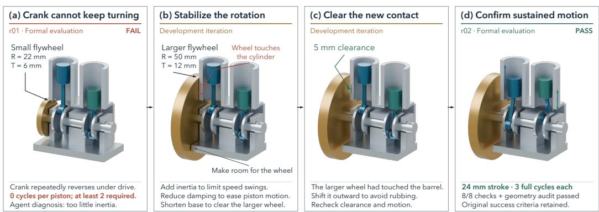  
Fix the motion, check for new interference, and re-run the formal test.

Figure 12: Grok repairs the twin-cylinder linkage (Task 39): enlarge the flywheel, clear the resulting cylinder contact, and verify repeated piston motion.

Restoring sustained piston motion (Task 39). Fig. 12 follows Grok’s repair of a twin-cylinder linkage. In revision r01, the crank repeatedly reverses under drive and neither piston completes a full cycle. The agent diagnoses insufficient rotational inertia and enlarges the flywheel, while reducing guide damping and shortening the bedplate. Intermediate development checks then reveal interference between the larger flywheel and a cylinder barrel. Moving the wheel outward provides approximately 5 mm of clearance. In the formal evaluation of r02, both pistons complete three cycles with approximately 24 mm stroke; all eight functional checks and the source-geometry audit pass under the original success criteria. This case shows how a repair aimed at sustained motion can introduce a new geometric conflict, requiring clearance checks followed by verification of the complete behavior.

## D SCENE INTERFACE AND PHYSICAL EXECUTION DETAILS

## D.1 SCENE INTERFACE AND INITIALIZATION

The physical scene associates the submitted geometry with rigid bodies, connections, material properties, external supports, and gravity. Source preparation constructs the simulation model from these geometric and physical declarations before test binding. The binding connects the template’s operating inputs and observation signals to the prepared model. Prechecks verify that these interfaces are available and that the source bodies and their physical-update routines are retained.

During execution, prescribed inputs are applied at the bound operating interfaces, subject to the force or torque limits specified by the test protocol. Trial initialization and state continuity follow the rules in Appendix C.4. Parameter provenance and permitted adjustments are recorded as described in Appendix C.3.

## D.2 CONTACT, CONNECTIONS, AND EQUIVALENT MODELS

The registered-template execution path uses the NSC system in Project Chrono (Tasora et al., 2016) for rigid-body dynamics and Bullet for collision detection. Collision representations are constructed from the retained source geometry, and the material and contact parameters used during execution are recorded with the run.

The supported connection types are revolute, prismatic, spherical, and fixed. Each connection is associated with finite regions on the source geometry and remains active only while those regions overlap. If the regions separate, the connection is disabled before the next integration step and remains released for the rest of the trial.

Selected mechanical effects, including spring storage, elastic response, friction-clutch behavior, detents, and gear engagement, can be represented by explicitly declared equivalent models. These models apply force or torque laws to the corresponding source components while the native solver computes the resulting rigid-body motion. Their parameters, source correspondence, and operating ranges are specified before execution.

The original CAD geometry is retained, and any exclusions from motion-geometry auditing are restricted to declared elastic reference bodies or explicitly bounded local regions. Other geometry and contacts remain subject to the applicable checks.

## D.3 TRAJECTORY RECORDING AND GEOMETRY AUDITING

The primary registered-template path records measurement signals at every native integration step. These signals include the motion, connection states, and contact information required by the bound tests. Body poses are saved at nominal 20 ms intervals, with additional poses retained at operatingphase boundaries.

Functional assertions are evaluated from the recorded measurement signals, while source-geometry auditing uses the saved body poses. The audit selects poses at 10 Hz, includes the initial and final poses, and checks the original source geometry for violations of the applicable geometric criteria. The 20 ms recording interval determines the retained motion detail, whereas the 10 Hz audit frequency determines when the geometry is inspected. Geometric conclusions apply to the inspected poses within the declared modeling scope.

Table 6: Task 25 reducer timings (1 ms step; standard test budget: 300 s). Different designs and simulated durations preclude a controlled speedup comparison.
<table><tr><td>Interaction model</td><td>Wall/step (s)</td><td>Sim. time (s)</td><td>Total wall (s)</td></tr><tr><td>Native tooth contact (light)</td><td>0.894</td><td>6.0</td><td>5,364</td></tr><tr><td>Equivalent spur gears (light/medium/heavy)</td><td>0.113-0.117</td><td>1.2</td><td>136-141</td></tr></table>

Table 7: Generation-agent and final-evaluation configurations
<table><tr><td>Role</td><td>Model identifier</td><td>Wrapper</td><td>Requested reasoning setting</td></tr><tr><td>Constructor</td><td> $\mathtt { c l a u d e - f a b l e - 5 - 1 - t h i n k i n g - h i g h }$ </td><td>Cursor</td><td>High</td></tr><tr><td>Constructor</td><td> $\mathtt { c u r s o r - g r o k - 4 . 6 - x h i g h }$ </td><td>Cursor</td><td>Extra high</td></tr><tr><td>Constructor</td><td> $\mathtt { k i m i - c o d e / k 3 }$ </td><td>Kimi CLI</td><td>High 业</td></tr><tr><td>Constructor</td><td> $\mathtt { g p t - 6 - a s t r a }$ </td><td>Codex</td><td>High</td></tr><tr><td>Final evaluation agent</td><td> $\mathtt { g p t - 6 - a s t r a }$ </td><td>Codex</td><td>Medium</td></tr></table>

<sup>\*</sup>For Kimi CLI, High records the requested setting; the integration does not expose a separate reasoning-effort control.

If a trial fails or is interrupted, the measurements and poses recorded up to that point are retained together with its execution status.

## E AGENT CONFIGURATIONS, BUDGETS, AND EVALUATION PROTOCOL

## E.1 MODEL AND AGENT CONFIGURATIONS

Table 7 lists the model identifiers, agent wrappers, and requested reasoning settings used during generation and final evaluation. During generation, each agent uses its own model configuration. Final batch evaluation uses GPT-6 Astra with a one-million-token context allowance and medium reasoning across all experimental settings.

Both Fable 5.1 and GPT-6 Astra are configured with a context allowance of one million tokens. Each constructor receives the registered English task prompt and shared CAD-delivery instructions, with tool access and feedback determined by the experimental condition described in Appendix A.

## E.2 ATTEMPTS AND TIME ACCOUNTING

An independent attempt includes construction, testing, and revision for one mechanism family within a three-hour active-time budget. In the single-attempt settings, each family receives one such attempt; internal tests, retries, and revisions do not count as additional independent attempts.

Active time is computed from the union of observed working intervals, so overlapping activity is counted only once. For intervals $I _ { 1 } , \ldots , I _ { m } ,$ we define

$$
T _ { \mathrm { a c t i v e } } = \mathrm { d u r a t i o n } \left( \bigcup _ { j = 1 } ^ { m } I _ { j } \right) .\tag{1}
$$

Each formal native simulation test has a wall-clock limit of 300 seconds, with simulated duration recorded separately.

## E.3 ARTIFACT SELECTION AND OUTCOME AGGREGATION

Acceptance is determined from the final delivered configuration under its final declared operating target, following the completion rules in Appendix C.4. The record retains the original target, any adjustments, and the conditions actually evaluated. Each reported outcome is linked to the evaluated design revision, its test protocol, and the corresponding execution evidence.

Each attempt is assigned to one of three mutually exclusive outcome groups. First-submission pass denotes completion on the first candidate submitted to the formal harness. Pass after revision denotes completion on a subsequent candidate after revision. Not passed denotes the absence of recorded completion by the end of the attempt, including cases with unfinished evaluation.

Submission order is established from program events and preparation snapshots rather than revision identifiers alone. The first formal submission may follow substantial development and self-testing, so first-submission success does not imply success on the first generated design.

The three outcome counts sum to the number of available attempts for each configuration, and total completion is the sum of first-submission and post-revision passes. For the single-attempt configurations, Fig. 6 reports median active time across all 46 tasks, including those without recorded success.

Token use is the median of cumulative constructor input and output tokens per task, in millions, over tasks with recorded usage. Estimated API cost is computed per task from uncached input, cache reads, cache writes, and output, then summarized by the median. We use official standard API prices checked on September 25, 2026, with short-context rates for Astra and Grok and 5-minute cache writes for Fable. The exported counters do not resolve per-request context tiers or cache lifetimes, so long-context surcharges and 1-hour cache-write rates are not included. These estimates cover recorded constructor usage only, excluding reviewer usage and external tool charges; unreported turns can leave a task’s cost incomplete.

The Grok + history setting allows up to eight sequential attempts per task on the same 46-task cohort, with access to earlier records. Its generated machines undergo the same final batch evaluation as the other settings.

## E.4 TASK-LEVEL COMPLETION RESULTS

Table 8 lists the task-level outcomes for the four single-attempt full-harness configurations underlying Fig. 6. Task IDs and names follow the mechanism catalog in Appendix B.

Table 8: Task-level recorded completion in the four single-attempt full-harness configurations. A check mark denotes completion under formal evaluation; a dash denotes no recorded completion, including unfinished evaluation. Each configuration has one independent attempt per task.
<table><tr><td>ID</td><td>Mechanism</td><td>Astra</td><td>Kimi</td><td>Fable</td><td>Grok</td></tr><tr><td>1</td><td>Hinged toolbox</td><td></td><td></td><td></td><td></td></tr><tr><td>2</td><td>Rack-and-pinion gate</td><td></td><td></td><td></td><td></td></tr><tr><td>3</td><td>Four-bar wiper</td><td></td><td></td><td></td><td></td></tr><tr><td>4</td><td>Hand-cranked egg beater</td><td></td><td></td><td></td><td></td></tr><tr><td>5</td><td>Self-locking utility knife</td><td></td><td></td><td></td><td></td></tr><tr><td>6</td><td>Folding drying rack</td><td></td><td></td><td></td><td></td></tr><tr><td>7</td><td>Bicycle</td><td></td><td></td><td></td><td></td></tr><tr><td>8</td><td>Pedal-operated bin</td><td></td><td></td><td></td><td></td></tr><tr><td>9</td><td>Mechanical alarm clock</td><td></td><td></td><td></td><td></td></tr><tr><td>10</td><td>Kitchen tongs</td><td></td><td></td><td></td><td></td></tr><tr><td>11</td><td>Retractable ballpoint pen</td><td></td><td></td><td></td><td></td></tr><tr><td>12</td><td>Nail clipper</td><td></td><td></td><td></td><td></td></tr><tr><td>13</td><td>One-way ratchet screwdriver</td><td></td><td></td><td></td><td></td></tr><tr><td>14</td><td>Linearly actuated scissor lift</td><td></td><td></td><td></td><td></td></tr><tr><td>15</td><td>Equal-arm balance</td><td></td><td></td><td></td><td></td></tr><tr><td>16</td><td>Toggle clamp / press</td><td></td><td></td><td></td><td></td></tr><tr><td>17</td><td>Dry piston-pump mechanism</td><td></td><td></td><td></td><td></td></tr><tr><td>18</td><td>Three-digit combination lock</td><td></td><td></td><td></td><td></td></tr><tr><td>19</td><td>Two-digit mechanical counter</td><td></td><td></td><td></td><td></td></tr><tr><td>20</td><td>Three-ball dispenser</td><td></td><td></td><td></td><td></td></tr><tr><td>21</td><td>Gravity timer</td><td></td><td></td><td></td><td></td></tr><tr><td>22</td><td>Slider-crank push rod</td><td></td><td></td><td></td><td></td></tr><tr><td>23</td><td>Gravity-pawl turntable</td><td></td><td></td><td></td><td></td></tr><tr><td>24</td><td>Sliding-bolt gate</td><td></td><td></td><td></td><td></td></tr><tr><td>25</td><td>Three-stage gear reducer</td><td></td><td></td><td></td><td></td></tr><tr><td>26</td><td>Desktop display turntable</td><td></td><td></td><td></td><td></td></tr><tr><td>27</td><td>Small swing gate</td><td></td><td></td><td></td><td></td></tr><tr><td>28</td><td>Tilting desktop mirror</td><td></td><td></td><td></td><td></td></tr><tr><td>29</td><td>Folding wall hook</td><td></td><td></td><td></td><td></td></tr><tr><td>30</td><td>Spring clothespin</td><td></td><td></td><td></td><td></td></tr><tr><td>31</td><td>Scissors</td><td></td><td></td><td></td><td></td></tr><tr><td>32</td><td>Ratchet hand winch</td><td></td><td></td><td></td><td></td></tr><tr><td>33</td><td>Spring-latch door lock</td><td></td><td></td><td></td><td></td></tr><tr><td>34</td><td>Reversible dual-pawl ratchet wrench</td><td></td><td></td><td></td><td></td></tr><tr><td>35</td><td>Full-cycle ratchet crimper</td><td></td><td></td><td></td><td></td></tr><tr><td>36</td><td>Geneva indexing table with overload clutch</td><td></td><td></td><td></td><td></td></tr><tr><td>37</td><td>Folding shopping cart</td><td></td><td></td><td></td><td></td></tr><tr><td>38</td><td>Mechanical 4 × 4 puzzle cube</td><td></td><td></td><td></td><td></td></tr><tr><td>39</td><td>Twin-cylinder engine linkage</td><td></td><td></td><td></td><td></td></tr><tr><td>40</td><td>Four-station indexing table</td><td></td><td></td><td></td><td></td></tr><tr><td>41</td><td>Synchronized parallel gripper</td><td></td><td></td><td></td><td></td></tr><tr><td>42</td><td>Releasable reduction winch</td><td></td><td></td><td></td><td></td></tr><tr><td>43</td><td>Baby stroller</td><td></td><td></td><td></td><td></td></tr><tr><td>44</td><td>Height- and tilt-adjustable worktable</td><td></td><td></td><td></td><td></td></tr><tr><td>45</td><td>Coin sorter and counter</td><td></td><td></td><td></td><td></td></tr><tr><td>46</td><td>Interchangeable-tune music box</td><td></td><td></td><td></td><td></td></tr><tr><td>Total completed</td><td></td><td>22/46</td><td>14/46</td><td>32/46</td><td>19/46</td></tr></table>

## E.5 DEMAND-WEIGHTED COMPLETION AND COMPLEXITY STRATA

The radar in Fig. 6 uses five requirement-based demand grades derived from the taxonomy. Motion coordination grades motion primitives; structural coupling grades topology; functional integration grades coordination among functions and states; contact coordination grades engagement and contactstate requirements; and geometric constraints grade fits, swept clearances, and interacting geometric relations. A grade of 1 denotes a local or direct requirement, 2 denotes a coupled relation, and 3 denotes multiple interacting relations or operating states, as specified below. These are descriptive ordinal annotations, rather than calibrated difficulty units or independently measured cognitive abilities. The functional-integration grade and the original low/medium/high complexity label are related annotations but are not interchangeable.

For each axis, weighted completion is the sum of that axis’s grades on completed tasks divided by the sum on all 46 tasks. Using grades 1, 2, and 3 as weights is a linear weighting convention; every task contributes positively to every denominator. The same weights are used for all models.

Table 9: Anchors for the three mechanical-demand grades.
<table><tr><td>Axis</td><td>Grade 1</td><td>Grade 2</td><td>Grade 3</td></tr><tr><td>Motion</td><td>Direct operation of one degree of freedom</td><td>One input-output relation</td><td>Multiple stages or coordinated outputs</td></tr><tr><td>Structure</td><td>Local support or connection</td><td>One jointly constrained chain</td><td>Multiple constraint groups sharing parts or state</td></tr><tr><td>Function</td><td>One basic operation and return</td><td>Coupled functions or operating conditions</td><td>Interdependent functions or conditional states</td></tr><tr><td>Contact</td><td>Continuous support or transmission</td><td>Engagement/release or force-dependent function</td><td>Several contacts coordinated across states</td></tr><tr><td>Geometry</td><td>Local fit, alignment, or retention</td><td>Swept clearance or one meshing relation</td><td>Interacting clearances, retention, or meshing constraints</td></tr></table>

Table 10: Task demand grades used in the weighted-completion analysis. Columns M, S, F, C, and G denote motion, structure, function, contact, and geometry. Task IDs follow the mechanism catalog.
<table><tr><td rowspan=1 colspan=1>G</td><td></td></tr><tr><td rowspan=1 colspan=1>C</td><td></td></tr><tr><td rowspan=1 colspan=1>F</td><td></td></tr><tr><td rowspan=1 colspan=1>S</td><td rowspan=1 colspan=1>221</td></tr><tr><td rowspan=1 colspan=1>MTaskGCFSMTask</td><td></td></tr></table>

Table 11: Recorded completion within the benchmark’s original complexity classes. These classes were not constructed by binning the radar scores.
<table><tr><td>Complexity</td><td>Tasks</td><td>Astra</td><td>Kimi</td><td>Fable</td><td>Grok</td></tr><tr><td>Low</td><td>11</td><td>9/11</td><td>8/11</td><td>9/11</td><td>9/11</td></tr><tr><td>Medium</td><td>20</td><td>12/20</td><td>6/20</td><td>18/20</td><td>10/20</td></tr><tr><td>High</td><td>15</td><td>1/15</td><td>0/15</td><td>5/15</td><td>0/15</td></tr></table>

## E.6 TOOL-USE ANNOTATION AND EXECUTION-TIME PROFILES

Tool-call classification. Each deduplicated constructor tool call receives one primary-purpose label based on its arguments, outputs, and any recoverable helper-script content from preceding events. Information access covers reading task requirements, tool documentation, and source code. Design, build, and test implementation covers source edits, artifact construction, and test writing. Geometry checks include explicit validation calls, custom geometric measurements, and motion-geometry audits. Simulation includes development runs, cost probes, and custom dynamics trials. Visual evidence includes preview generation and image-access operations, whilefeedback analysis covers reading test results and analyzing recorded traces. Execution and workflow management includes environment setup, file transfer, process monitoring, and artifact bookkeeping. Mixed-purpose calls and calls whose purpose cannot be resolved are assigned to Others.

These labels describe observed actions rather than their success or the model’s underlying reasoning ability. In particular, an image-access operation does not establish that the model successfully inspected or understood the image.

Sample selection and normalization. The analysis uses 46 task families with observed standardtool execution time for all four configurations. Calls with missing or truncated arguments that cannot be recovered are excluded before normalization. For this matched sample, 1,883 Kimi calls and one Grok call are excluded, leaving 6,035, 6,018, 8,474, and 22,223 calls for Astra, Kimi, Fable, and Grok, respectively.

Category shares are first computed within each task and then averaged with equal weight across tasks.   
This procedure prevents tasks with unusually many tool calls from dominating the aggregate profile.

Execution-time accounting. Execution-time shares are computed from independently recorded start and end times for standard build, check, simulate, probe, and preview operations. Overlapping intervals within the same category are counted once, while intervals containing simultaneous activity from multiple categories are assigned to Concurrent. Intervals with missing endpoints or unresolved zero duration are excluded.

For each task, category durations are normalized by the total observed standard-tool execution time and then averaged equally across the same 41 families. These profiles include preparation performed within each tool operation, but do not represent total agent runtime or all categories in the behavioral analysis. Preview time measures rendering, and neither it nor the remaining portion of active time is interpreted as a direct measure of model reasoning.

Timing-coverage check. We additionally examine the 14 task families with complete standard-tool timing records for all four configurations. Simulation remains the largest execution-time category for every configuration, and Grok retains the highest share of build time. These comparisons describe observed execution costs, which depend on the generated mechanisms and execution environments as well as the agents’ tool choices.

## F DETAILED HARNESS COMPARISONS

Table 12 retains the success-set overlaps behind Table 2. Independent agents evaluate the final assemblies from each workflow under the task requirements and fixed constraints, selecting simulation strategies and configuring candidate-specific tests as described in Section 5.1.

Table 12: Whole-task successes and their overlap with the full harness. Shared counts tasks solved by both the row’s workflow and the full harness for the same model; Only counts successes unique to that workflow relative to the full harness.
<table><tr><td rowspan="2"></td><td colspan="3">Astra</td><td colspan="3">Grok</td></tr><tr><td>Passed</td><td>Shared</td><td>Only</td><td>Passed</td><td>Shared</td><td>Only</td></tr><tr><td>Setting Requirements only</td><td>1/46</td><td>1</td><td>0</td><td>3/46</td><td>3</td><td>0</td></tr><tr><td>Simulation tools</td><td>8/46</td><td>7</td><td>1</td><td>10/46</td><td>8</td><td>2</td></tr><tr><td>Full harness</td><td>22/46</td><td></td><td></td><td>19/46</td><td></td><td></td></tr><tr><td>Binary feedback</td><td>0/46</td><td>0</td><td>0</td><td>8/46</td><td>7</td><td>1</td></tr></table>

Relative to simulation tools, the full harness has 15 additional successful tasks for Astra and 11 for Grok; the tools-only setting has one and two successes outside the respective full-harness sets. The net increases are therefore 14 and nine tasks. Relative to simulation tools, both full-harness configurations additionally solve the rack-and-pinion gate, four-bar wiper, and hand-cranked whisk (Tasks 2–4), as well as the self-locking knife and spring-latch lock (Tasks 5 and 33). In the binary-feedback setting, Grok has seven successes shared with the full harness and one additional success.

The comparisons in Section 5.2 examine three roles of the harness: providing access to physical simulation, maintaining coverage of the functional requirements, and returning evidence that guides revision. This appendix specifies the information available in each setting, lists the task-level outcomes, and uses selected trajectories to examine how agents test, revise, and decide when to stop.

## F.1 EXPERIMENTAL SETTINGS AND EVALUATION

Construction-time support. All four settings start from the task’s functional requirements and permit CAD construction, source inspection, and static visualization. Table 13 distinguishes the supplied simulation support, responsibility for test coverage, and visible feedback. In the requirementsonly setting, agents may still write verification code, including their own simulations. The simulationtools setting supplies a simulator and guidance, while leaving the agent to select operating conditions, observations, and acceptance checks. Thefull harness additionally connects the candidate mechanism to requirement-level tests throughout design revision.

Table 13: Support and feedback available during construction.
<table><tr><td>Setting</td><td>Simulation support</td><td>Requirement-level testing</td><td>Visible evidence</td></tr><tr><td>Requirements only</td><td>Agent implements any simulation it chooses to use.</td><td>Agent chooses its own checks.</td><td>Outputs of agent-written checks.</td></tr><tr><td>Simulation tools</td><td>Simulator, starter code, and tool guidance are supplied.</td><td>Agent chooses its own checks.</td><td>Agent&#x27;s simulation outputs and geometric analyses</td></tr><tr><td>Binary feedback</td><td>Harness constructs and executes candidate-specific tests.</td><td>Required functions remain part of the evaluation workflow.</td><td>Pass/fail outcomes; execution and validation diagnostics are hidden.</td></tr><tr><td>Full harness</td><td>Harness constructs and executes candidate-specific tests.</td><td>Required functions remain part of the evaluation workflow.</td><td>Failed checks, measured discrepancies, and physical-validity diagnostics.</td></tr></table>

Scope of binary feedback. The binary-feedback setting restricts both development and formal simulation tests, as well as the standard validation interface, to pass/fail outcomes. The constructor cannot inspect the execution traces, measured residuals, validator diagnostics, or reviewer artifacts underlying these outcomes. It can still inspect its CAD source and static previews, perform its own geometric or analytical calculations, and request additional tests. This comparison asks whether correctness signals alone provide sufficient direction for repair. Simulation tools and binary feedback change both test organization and evidence access; they are complementary comparisons rather than successive levels of a single support variable.

Evaluation and outcome accounting. Requirements-only and simulation-tools designs are adapted for evaluation after construction by a separate agent, whereas the harness settings expose requirementlevel evaluation during revision. Post-hoc evaluation includes establishing an executable physical model of the delivered assembly. An incomplete adaptation or execution therefore leaves whole-task completion unestablished, without by itself identifying a mechanical defect. We report the same recorded whole-task outcomes as Table 2; passing an agent-written check is evidence only for that check’s scope. The binary-feedback analysis uses the isolated 46-task batch for each model, excluding the earlier development and pilot batches.

## F.2 TASK-LEVEL OUTCOMES

Table 14 expands Table 2 by task. Full-harness outcomes reuse the main-experiment runs; each other setting contributes one selected run per model and task.

Table 14: Recorded completion by task and setting. Req.: requirements only; Sim.: simulation tools; Bin.: binary feedback. A check mark denotes recorded whole-task completion; a dash denotes no recorded completion, including incomplete evaluation or partial delivery.

<table><tr><td rowspan=2 colspan=16>Astra                     GrokID Mechanism                                   Req.  Sim.  Bin.  Full</td></tr><tr><td rowspan=1 colspan=4>Req. Sim. Bin. Full</td></tr><tr><td rowspan=1 colspan=8>1 Hinged toolbox</td><td rowspan=1 colspan=1></td><td rowspan=1 colspan=1></td><td rowspan=1 colspan=1></td><td rowspan=1 colspan=1></td><td rowspan=1 colspan=1></td><td rowspan=1 colspan=3></td></tr><tr><td rowspan=1 colspan=8>2 Rack-and-pinion gate</td><td rowspan=1 colspan=1></td><td rowspan=1 colspan=1></td><td rowspan=1 colspan=1></td><td rowspan=1 colspan=1></td><td rowspan=1 colspan=1></td><td rowspan=1 colspan=3></td></tr><tr><td rowspan=2 colspan=8>3 Four-bar wiper4 Hand-cranked egg beater</td><td rowspan=1 colspan=1></td><td rowspan=1 colspan=1></td><td rowspan=1 colspan=1></td><td rowspan=1 colspan=1></td><td rowspan=1 colspan=1></td><td rowspan=1 colspan=3></td></tr><tr><td rowspan=1 colspan=1></td><td rowspan=1 colspan=1></td><td rowspan=1 colspan=1></td><td rowspan=1 colspan=1></td><td rowspan=1 colspan=1></td><td rowspan=1 colspan=3></td></tr><tr><td rowspan=1 colspan=8>5 Self-locking utility knife</td><td rowspan=1 colspan=1></td><td rowspan=1 colspan=1></td><td rowspan=1 colspan=1></td><td rowspan=1 colspan=1></td><td rowspan=1 colspan=1></td><td rowspan=1 colspan=3></td></tr><tr><td rowspan=1 colspan=8>6 Folding drying rack</td><td rowspan=1 colspan=1></td><td rowspan=1 colspan=1></td><td rowspan=1 colspan=1></td><td rowspan=1 colspan=1></td><td rowspan=1 colspan=1></td><td rowspan=1 colspan=3></td></tr><tr><td rowspan=1 colspan=8>7 Bicycle</td><td rowspan=1 colspan=1></td><td rowspan=1 colspan=1></td><td rowspan=1 colspan=1></td><td rowspan=1 colspan=1></td><td rowspan=1 colspan=1></td><td rowspan=1 colspan=3></td></tr><tr><td rowspan=1 colspan=8>8 Pedal-operated bin</td><td rowspan=1 colspan=1></td><td rowspan=1 colspan=1></td><td rowspan=1 colspan=1></td><td rowspan=1 colspan=1></td><td rowspan=1 colspan=1></td><td rowspan=1 colspan=3></td></tr><tr><td rowspan=1 colspan=3>9 Mech</td><td rowspan=1 colspan=2>echanic</td><td rowspan=1 colspan=3>9 Mechanical alarm clock</td><td rowspan=1 colspan=1></td><td rowspan=1 colspan=1></td><td rowspan=1 colspan=1></td><td rowspan=1 colspan=1></td><td rowspan=1 colspan=1></td><td rowspan=1 colspan=1></td><td rowspan=1 colspan=2></td></tr><tr><td rowspan=1 colspan=3>10 Kitchen tongs</td><td rowspan=1 colspan=2>chen</td><td rowspan=1 colspan=3></td><td rowspan=1 colspan=1></td><td rowspan=1 colspan=1></td><td rowspan=1 colspan=1></td><td rowspan=1 colspan=1></td><td rowspan=1 colspan=1></td><td rowspan=1 colspan=1></td><td rowspan=1 colspan=2></td></tr><tr><td rowspan=2 colspan=8>11 Retractable ballpoint pen12 Nail clipper</td><td rowspan=1 colspan=1></td><td rowspan=1 colspan=1></td><td rowspan=1 colspan=1></td><td rowspan=1 colspan=1></td><td rowspan=1 colspan=1></td><td rowspan=1 colspan=1></td><td rowspan=1 colspan=2></td></tr><tr><td rowspan=1 colspan=1></td><td rowspan=1 colspan=1></td><td rowspan=1 colspan=1></td><td rowspan=1 colspan=1></td><td rowspan=1 colspan=1></td><td rowspan=1 colspan=1></td><td rowspan=1 colspan=2></td></tr><tr><td rowspan=1 colspan=8>13 One-way ratchet screwdriver</td><td rowspan=1 colspan=1></td><td rowspan=1 colspan=1></td><td rowspan=1 colspan=1></td><td rowspan=1 colspan=1></td><td rowspan=1 colspan=1></td><td rowspan=1 colspan=1></td><td rowspan=1 colspan=2></td></tr><tr><td rowspan=1 colspan=8>14 Linearly actuated scissor lift</td><td rowspan=1 colspan=1></td><td rowspan=1 colspan=1></td><td rowspan=1 colspan=1></td><td rowspan=1 colspan=1></td><td rowspan=1 colspan=1></td><td rowspan=1 colspan=1></td><td rowspan=1 colspan=2></td></tr><tr><td rowspan=1 colspan=7>15 Equal-arm balance</td><td></td><td rowspan=1 colspan=1></td><td rowspan=1 colspan=1></td><td rowspan=1 colspan=1></td><td rowspan=1 colspan=1></td><td rowspan=1 colspan=1></td><td rowspan=1 colspan=1></td><td rowspan=1 colspan=2></td></tr><tr><td rowspan=1 colspan=7>16 Toggle clamp / press</td><td></td><td rowspan=1 colspan=1></td><td rowspan=1 colspan=1></td><td rowspan=1 colspan=1></td><td rowspan=1 colspan=1></td><td rowspan=1 colspan=1></td><td rowspan=1 colspan=1></td><td rowspan=1 colspan=1></td><td rowspan=1 colspan=1></td></tr><tr><td rowspan=1 colspan=7>17 Dry piston-pump mechanism</td><td></td><td rowspan=1 colspan=1></td><td rowspan=1 colspan=1></td><td rowspan=1 colspan=1></td><td rowspan=1 colspan=1></td><td rowspan=1 colspan=1></td><td rowspan=1 colspan=1></td><td rowspan=1 colspan=1></td><td rowspan=1 colspan=1></td></tr><tr><td rowspan=1 colspan=7>18 Three-digit combination lock</td><td></td><td rowspan=1 colspan=1></td><td rowspan=1 colspan=1></td><td rowspan=1 colspan=1></td><td rowspan=1 colspan=1></td><td rowspan=1 colspan=1></td><td rowspan=1 colspan=1></td><td rowspan=1 colspan=1></td><td rowspan=1 colspan=1></td></tr><tr><td rowspan=2 colspan=8>19 Two-digit mechanical counter20 Three-ball dispenser</td><td rowspan=1 colspan=1></td><td rowspan=1 colspan=1></td><td rowspan=1 colspan=1></td><td rowspan=1 colspan=1></td><td rowspan=1 colspan=1></td><td rowspan=1 colspan=1></td><td rowspan=1 colspan=1></td><td rowspan=1 colspan=1></td></tr><tr><td rowspan=1 colspan=1></td><td rowspan=1 colspan=1></td><td rowspan=1 colspan=1></td><td rowspan=1 colspan=1></td><td rowspan=1 colspan=1></td><td rowspan=1 colspan=1></td><td rowspan=1 colspan=1></td><td rowspan=1 colspan=1></td></tr><tr><td rowspan=1 colspan=8>21 Gravity timer</td><td rowspan=1 colspan=1></td><td rowspan=1 colspan=1></td><td rowspan=1 colspan=1></td><td rowspan=1 colspan=1></td><td rowspan=1 colspan=1></td><td rowspan=1 colspan=1></td><td rowspan=1 colspan=1></td><td rowspan=1 colspan=1></td></tr><tr><td rowspan=1 colspan=1>22 S</td><td rowspan=1 colspan=7>lider-crank push rod</td><td rowspan=1 colspan=1></td><td rowspan=1 colspan=1></td><td rowspan=1 colspan=1></td><td rowspan=1 colspan=1></td><td rowspan=1 colspan=1></td><td rowspan=1 colspan=1></td><td rowspan=1 colspan=1></td><td rowspan=1 colspan=1></td></tr><tr><td rowspan=1 colspan=1>23 Gr</td><td rowspan=2 colspan=7>avity-pawl turntable</td><td rowspan=1 colspan=1></td><td rowspan=1 colspan=1></td><td rowspan=1 colspan=1></td><td rowspan=1 colspan=1></td><td rowspan=1 colspan=1></td><td rowspan=1 colspan=1></td><td rowspan=1 colspan=1></td><td rowspan=2 colspan=1></td></tr><tr><td rowspan=1 colspan=1>24</td><td rowspan=1 colspan=6>Sliding-bolt gate</td><td rowspan=1 colspan=1></td><td rowspan=1 colspan=1></td><td rowspan=1 colspan=1></td><td rowspan=1 colspan=1></td><td rowspan=1 colspan=1></td><td rowspan=1 colspan=1></td><td rowspan=1 colspan=1></td></tr><tr><td rowspan=1 colspan=1>25 Th</td><td rowspan=1 colspan=7>ree-stage gear reducer</td><td rowspan=1 colspan=1></td><td rowspan=1 colspan=1></td><td rowspan=1 colspan=1></td><td rowspan=1 colspan=1></td><td rowspan=1 colspan=1></td><td rowspan=1 colspan=1></td><td rowspan=1 colspan=1></td><td rowspan=1 colspan=1></td></tr><tr><td rowspan=1 colspan=8>26 Desktop display turntable</td><td rowspan=1 colspan=1></td><td rowspan=1 colspan=1></td><td rowspan=1 colspan=1></td><td rowspan=1 colspan=1></td><td rowspan=1 colspan=1></td><td rowspan=1 colspan=1></td><td rowspan=1 colspan=1></td><td></td></tr><tr><td rowspan=1 colspan=8>27 Small swing gate</td><td rowspan=1 colspan=1></td><td rowspan=1 colspan=1></td><td rowspan=1 colspan=1></td><td rowspan=1 colspan=1></td><td rowspan=1 colspan=1></td><td rowspan=1 colspan=1></td><td rowspan=1 colspan=1></td><td rowspan=1 colspan=1></td></tr><tr><td rowspan=1 colspan=6>28 Tilting desktop mirror</td><td rowspan=1 colspan=2></td><td rowspan=1 colspan=1></td><td rowspan=1 colspan=1></td><td rowspan=1 colspan=1></td><td rowspan=1 colspan=1></td><td rowspan=1 colspan=1></td><td rowspan=1 colspan=1></td><td rowspan=1 colspan=1></td><td rowspan=1 colspan=1></td></tr><tr><td rowspan=1 colspan=6>29 Folding wall hook</td><td rowspan=1 colspan=2></td><td rowspan=1 colspan=1></td><td rowspan=1 colspan=1></td><td rowspan=1 colspan=1></td><td rowspan=1 colspan=1></td><td rowspan=1 colspan=1></td><td rowspan=1 colspan=1></td><td rowspan=1 colspan=1></td><td rowspan=1 colspan=1></td></tr><tr><td rowspan=1 colspan=6>30 Spring clothespin</td><td rowspan=1 colspan=2></td><td rowspan=1 colspan=1></td><td rowspan=1 colspan=1></td><td rowspan=1 colspan=1></td><td rowspan=1 colspan=1></td><td rowspan=1 colspan=1></td><td rowspan=1 colspan=1></td><td rowspan=1 colspan=1></td><td rowspan=1 colspan=1></td></tr><tr><td rowspan=1 colspan=6>31 Scissors</td><td rowspan=1 colspan=2></td><td rowspan=1 colspan=1></td><td rowspan=1 colspan=1></td><td rowspan=1 colspan=1></td><td rowspan=1 colspan=1></td><td rowspan=1 colspan=1></td><td rowspan=1 colspan=1></td><td rowspan=1 colspan=1></td><td rowspan=1 colspan=1></td></tr><tr><td rowspan=1 colspan=6>32 Ratchet hand winch</td><td rowspan=1 colspan=2></td><td rowspan=1 colspan=1></td><td rowspan=1 colspan=1></td><td rowspan=1 colspan=1></td><td rowspan=1 colspan=1></td><td rowspan=1 colspan=1></td><td rowspan=1 colspan=1></td><td rowspan=1 colspan=1></td><td rowspan=1 colspan=1></td></tr><tr><td rowspan=1 colspan=8>33 Spring-latch door lock</td><td rowspan=1 colspan=1></td><td rowspan=1 colspan=1></td><td rowspan=1 colspan=1></td><td rowspan=1 colspan=1></td><td rowspan=1 colspan=1></td><td rowspan=1 colspan=1></td><td rowspan=1 colspan=1></td><td rowspan=1 colspan=1></td></tr><tr><td rowspan=1 colspan=8>34 Reversible dual-pawl ratchet wrench</td><td rowspan=1 colspan=1></td><td rowspan=1 colspan=1></td><td rowspan=1 colspan=1></td><td rowspan=1 colspan=1></td><td rowspan=1 colspan=1></td><td rowspan=1 colspan=1></td><td rowspan=1 colspan=1></td><td rowspan=1 colspan=1></td></tr><tr><td rowspan=1 colspan=8>35 Full-cycle ratchet crimper</td><td rowspan=1 colspan=1></td><td rowspan=1 colspan=1></td><td rowspan=1 colspan=1></td><td rowspan=1 colspan=1></td><td rowspan=1 colspan=1></td><td rowspan=1 colspan=1></td><td rowspan=1 colspan=2></td></tr><tr><td rowspan=1 colspan=8>36 Geneva indexing table with overload clutch</td><td rowspan=1 colspan=1></td><td rowspan=1 colspan=1></td><td rowspan=1 colspan=1></td><td rowspan=1 colspan=1></td><td rowspan=1 colspan=1></td><td rowspan=1 colspan=1></td><td rowspan=1 colspan=2></td></tr><tr><td rowspan=1 colspan=8>37 Folding shopping cart</td><td rowspan=1 colspan=1></td><td rowspan=1 colspan=1></td><td rowspan=1 colspan=1></td><td rowspan=1 colspan=1></td><td rowspan=1 colspan=1></td><td rowspan=1 colspan=1></td><td rowspan=1 colspan=2></td></tr><tr><td rowspan=3 colspan=8>38 Mechanical 4 × 4 puzzle cube39 Twin-cylinder engine linkage</td><td rowspan=1 colspan=1></td><td rowspan=1 colspan=1></td><td rowspan=1 colspan=1></td><td rowspan=1 colspan=1></td><td rowspan=1 colspan=1></td><td rowspan=1 colspan=1></td><td rowspan=1 colspan=2></td></tr><tr><td rowspan=1 colspan=1></td><td rowspan=1 colspan=1></td><td rowspan=1 colspan=1></td><td rowspan=1 colspan=1></td><td rowspan=1 colspan=1></td><td rowspan=1 colspan=1></td><td rowspan=1 colspan=2></td></tr><tr><td rowspan=4 colspan=8>41 Synchronized parallel gripper42 Releasable reduction winch43 Baby stroller</td><td rowspan=1 colspan=1>40 Fo</td><td rowspan=1 colspan=6>r-station indexing table</td><td rowspan=1 colspan=1></td></tr><tr><td rowspan=1 colspan=1></td><td rowspan=1 colspan=1></td><td rowspan=1 colspan=1></td><td rowspan=1 colspan=1></td><td rowspan=1 colspan=1></td><td rowspan=1 colspan=1></td><td rowspan=1 colspan=1></td><td rowspan=1 colspan=1></td></tr><tr><td rowspan=1 colspan=1></td><td rowspan=1 colspan=1></td><td rowspan=1 colspan=1></td><td rowspan=1 colspan=1></td><td rowspan=1 colspan=1></td><td rowspan=1 colspan=1></td><td rowspan=1 colspan=1></td><td rowspan=1 colspan=1></td></tr><tr><td rowspan=1 colspan=1></td><td rowspan=1 colspan=1></td><td rowspan=1 colspan=1></td><td rowspan=1 colspan=1></td><td rowspan=1 colspan=1></td><td rowspan=1 colspan=1></td><td rowspan=1 colspan=1></td><td rowspan=1 colspan=1></td></tr><tr><td rowspan=3 colspan=8>44 Height- and tilt-adjustable worktable45 Coin sorter and counter46 Interchangeable-tune music box</td><td rowspan=1 colspan=1></td><td rowspan=1 colspan=1></td><td rowspan=1 colspan=1></td><td rowspan=1 colspan=1></td><td rowspan=1 colspan=1></td><td rowspan=1 colspan=1></td><td rowspan=1 colspan=1></td><td rowspan=1 colspan=1></td></tr><tr><td rowspan=1 colspan=1></td><td rowspan=1 colspan=1></td><td rowspan=1 colspan=1></td><td rowspan=1 colspan=1></td><td rowspan=1 colspan=1></td><td rowspan=1 colspan=1></td><td rowspan=1 colspan=1></td><td rowspan=2 colspan=1></td></tr><tr><td rowspan=1 colspan=1></td><td rowspan=1 colspan=1></td><td rowspan=1 colspan=1></td><td rowspan=1 colspan=1></td><td rowspan=1 colspan=1></td><td rowspan=1 colspan=1></td><td rowspan=1 colspan=1></td></tr><tr><td rowspan=1 colspan=8>Total completed</td><td rowspan=1 colspan=1></td><td rowspan=1 colspan=1>8</td><td rowspan=1 colspan=1>0</td><td rowspan=1 colspan=1>22</td><td rowspan=1 colspan=1>3</td><td rowspan=1 colspan=1>10</td><td rowspan=1 colspan=2>8     19</td></tr></table>

## F.3 VERIFICATION SCOPE AND REVISION WITHOUT THE HARNESS

Access to simulation supports meaningful engineering. The simulation-tools trajectories contain active physical diagnosis and geometric repair. For example, Astra adds a detent to an indexing table after identifying motion during the intended dwell phase, then checks recovery from obstructions. Such behavior shows that agents can formulate useful experiments without the harness. The question is how those experiments collectively establish the requested function, and whether that target remains intact as the design and test code change.

Table 15: Testing and revision in the simulation-tools setting. Agent-written checks are distinguished from recorded whole-task completion.
<table><tr><td>Case</td><td>Agent action</td><td>Observed evidence</td><td>Implication and remaining scope</td></tr><tr><td>Task 36 Astra Geneva indexing table</td><td>Adds a spring-loaded roller detent after station drift; tests obstructions near entry and exit; relieves slot mouths after a swept-geometry check.</td><td>The constructor reports eight 90° steps, dwell holding under disturbances, and recovery after obstruction in its own simulations.</td><td>Task-relevant experiments lead to concrete mechanical changes. These local results do not establish whole-task completion in the reported evaluation.</td></tr><tr><td>Task 9 Astra Mechanical alarm clock</td><td>Tests the escapement for 600 simulated seconds and tests the striker separately; revises gear phasing and local clearances.</td><td>The escapement advances approximately ten revolutions. The delivery explicitly leaves the integrated alarm sequence unverified; the hour wheel also interferes with the alarm lever.</td><td>Subsystem evidence leaves a composition gap: setting, triggering, and stopping the alarm must all preserve timekeeping. See Fig. 7b.</td></tr><tr><td>Task 13 Grok Ratchet screwdriver</td><td>Replaces a numerically invalid 1.40-second loaded, two-stroke test with a 0.20-second stepping test.</td><td>The new run returns 21 finite samples, but the bit remains nearly stationary. The original drive and return-stroke checks are not repeated.</td><td>Restoring executable simulation narrows the tested behavior. The agent identifies the result as a smoke test and does not claim functional success.</td></tr></table>

Complete functions span interactions and operation sequences. The clock case illustrates why successful component tests do not establish the behavior of an assembled mechanism. The missing evidence concerns interactions between subsystems and the preservation of timekeeping through an alarm sequence. A requirement-level testbed makes these obligations explicit alongside tests of the escapement and striker. This connects functional decomposition to composition: individual tests must jointly cover the user’s requested behavior, including transitions between operations.

A revision should preserve the target being tested. The screwdriver case separates numerical recovery from functional recovery. Producing finite simulation states is useful, but it leaves unanswered whether the handle advances the output under load without undoing that motion on return. In a separate full-harness Grok run on Task 13, the second candidate passes both forward-advance and both handle-return checks, while both output-backslip checks remain failures. Although neither run records whole-task completion, the harness result identifies the outstanding requirement after partial progress. These are independently generated candidates; the comparison illustrates how the evaluation target is maintained during revision.

## F.4 DIAGNOSIS AND STOPPING UNDER BINARY FEEDBACK

Binary outcomes shift diagnosis toward additional experiments. A failed test can reflect an incorrect input convention, obstructed motion, or an invalid execution setup. A pass/fail response does not distinguish these explanations. Table 16 shows three responses: designing tests that separate hypotheses, reconstructing evidence through independent geometric reasoning, and revising several plausible failure sources without confirming which caused the rejection.

Table 16: Diagnostic strategies under binary feedback. Geometric and kinematic calculations are the agents’ own analyses, not hidden simulation traces.
<table><tr><td>Case</td><td>Agent action</td><td>Evidence and outcome</td><td>What the case shows</td></tr><tr><td>Task 1 Astra Hinged toolbox</td><td>Tests rest and opening with opposite torque signs. Reverses the hinge&#x27;s body ordering after only the reverse-direction opening test passes.</td><td>A subsequent positive-torque opening test passes. The complete two-cycle operation remains unverified; the agent delivers partial results.</td><td>Carefully chosen binary tests can distinguish an input-direction error from other explanations. Resolving one local cause does not establish the full operating sequence.</td></tr><tr><td>Task 12 Grok Nail clipper</td><td>Uses its own geometry and linkage calculations to investigate input direction, excessive follower travel, and changes in the four-bar solution branch; revises the mechanism.</td><td>The revised design obtains a recorded whole-task pass. Several coupled design changes precede this result.</td><td>Restricted feedback still permits successful diagnosis when independent analysis supplies the missing information. This success cannot be attributed to a single parameter change.</td></tr><tr><td>Task 33 Grok Spring-latch door lock</td><td>Measures clearances and revises hinges, handle bearings, cam orientation, latch geometry, and the strike plate after repeated binary failures.</td><td>The agent finds geometric problems, but the returned failures do not confirm which defect caused rejection. No whole-task completion is recorded.</td><td>Useful inspection can coexist with unresolved failure localization. The full-harness repair in Fig. 8 instead tracks relocking checks and then residual interference.</td></tr></table>

The models also differ in when they stop. Table 17 summarizes the recorded termination states in the binary-feedback batch. Astra chooses partial delivery in 43 of 46 runs, with a median of 137.8 minutes of active budget remaining at those decisions. Its explanations repeatedly cite insufficient evidence for a targeted next revision. Grok instead reaches the budget limit in 36 runs and complete eight. The same restricted feedback thus accompanies different search and stopping strategies; Astra’s zero recorded completions should not be read as 46 fully executed mechanical failures.

Table 17: Recorded termination states under binary feedback, with 46 runs per model. Categories are mutually exclusive. Evidence required denotes a recorded unresolved evidence state.
<table><tr><td>Model</td><td>Completed</td><td>Partial delivery</td><td>Budget exhausted</td><td>Evidence required</td></tr><tr><td>Astra</td><td>0</td><td>43</td><td>0</td><td>3</td></tr><tr><td>Grok</td><td>8</td><td>0</td><td>36</td><td>2</td></tr></table>

Together, these observations separate a correctness signal from evidence for choosing a revision. Binary outcomes can guide repair through additional experiments or independent analysis. Detailed feedback supplies further information about the failed operation or validity condition, helping the agent select and verify its next change. The stopping counts compare models within the binary setting; estimating how masking changes each model’s stopping policy would require a paired analysis of the full-harness runs.

## F.5 CONSTRUCTION WITHOUT VISUAL ACCESS

Section 6 notes that agents rarely inspect rendered images during functional design. To test whether visual access nonetheless contributes to task success, we repeat the single-attempt Astra and Grok full-harness experiments with one additional restriction on the constructor. Task prompts, constructor instructions, the harness workflow, physical simulation, diagnostic numerical feedback, the activetime budget, and the independent final evaluation are identical to Section 5.1. The constructor, however, cannot view, generate, or capture images, and cannot operate a computer or browser through screenshots. It cannot render the model through the harness preview tool, through its own scripts using plotting, imaging, or CAD visualization libraries, or through external modeling and rendering programs. It also cannot open image, video, 3D-viewer, HTML, or PDF files, and harness feedback returned to it contains only text and numerical values. The constructor retains its CAD source and exported geometry (STEP and STL), programmatic geometric queries, and simulation. The test-binding agent, independent review, and final evaluation keep their standard visual access, so the restriction removes visual information only from design and revision.

Table 18 compares the two runs. Without visual access, Astra completes 20 of the 46 tasks, compared with 22 with visual access. Sixteen tasks are solved in both settings. Six are solved only with visual access: the four-bar wiper, piston pump, two-digit counter, gravity-pawl turntable, tilting mirror, and folding shopping cart (Tasks 3, 17, 19, 23, 28, and 37). Four are solved only without it: the hinged toolbox, scissor lift, toggle clamp, and parallel gripper (Tasks 1, 14, 16, and 41). Grok shows a similar pattern: without visual access, it completes 18 of the 46 tasks, compared with 19 with visual access; 14 tasks are solved in both settings, five only with visual access, and four only without it.

Removing visual access therefore changes the aggregate count by two tasks, while the sets of solved tasks differ in ten. With one attempt per task, these task-level differences cannot be attributed to visual access alone. The aggregate result nevertheless indicates that, within FunCAD-Harness, the constructor’s functional success depends mainly on CAD programs, geometric queries, and simulation feedback rather than on visual inspection, consistent with the tool-use profiles in Appendix E.6. Figure 13 shows the 20 designs completed without visual access, and Figure 14 shows the 18 designs completed by Grok without visual access.

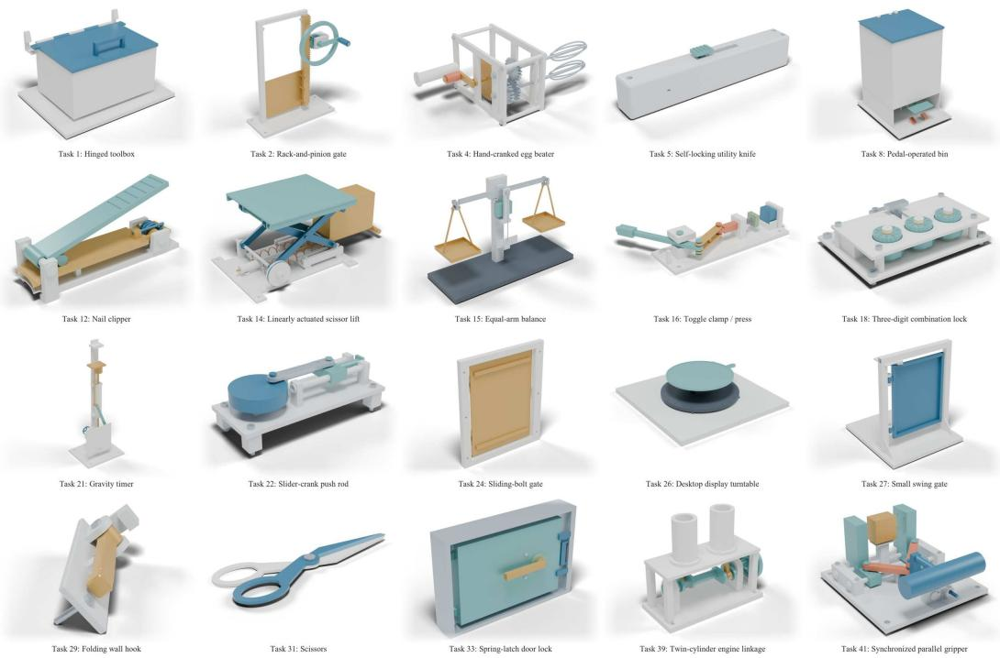  
Figure 13: Mechanisms completed by Astra without visual access for the constructor.

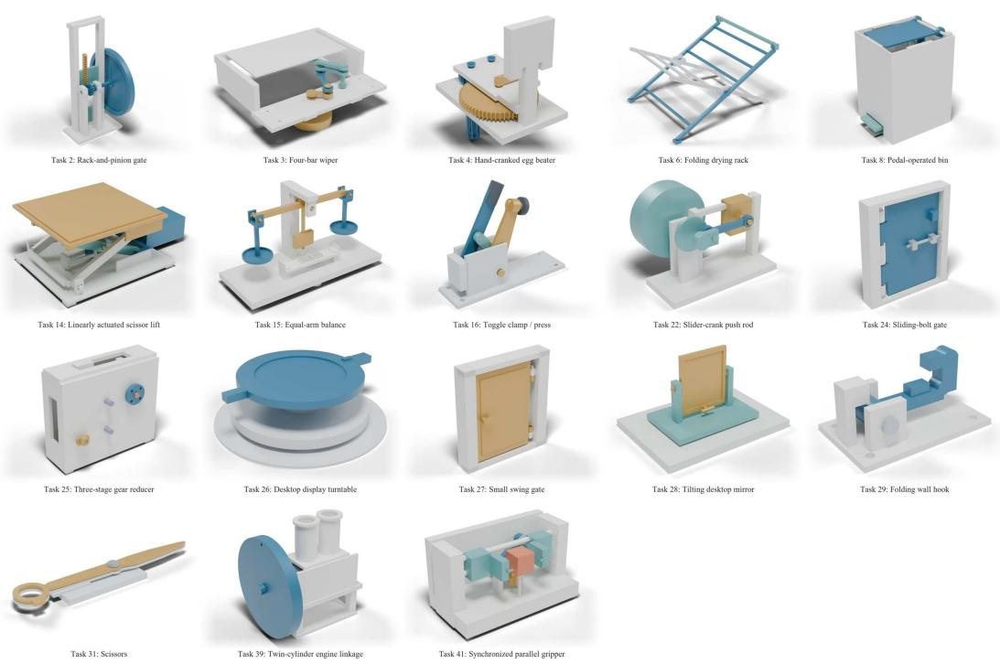  
Figure 14: Mechanisms completed by Grok without visual access for the constructor.

Table 18: Task-level recorded completion of single-attempt Astra and Grok full-harness runs with and without visual access for the constructor. A check mark denotes completion under formal evaluation; a dash denotes no recorded completion, including unfinished evaluation. Each setting has one independent attempt per task; the With vision columns reproduce the Astra and Grok columns of Table 8.

<table><tr><td rowspan="2">ID Mechanism</td><td rowspan="2"></td><td colspan="2">Astra</td><td colspan="2">Grok</td></tr><tr><td>With vision</td><td>No vision</td><td>With vision</td><td>No vision</td></tr><tr><td>1</td><td>Hinged toolbox</td><td></td><td>√</td><td></td><td></td></tr><tr><td>2</td><td>Rack-and-pinion gate</td><td>√</td><td>√</td><td>V</td><td>√</td></tr><tr><td>3</td><td>Four-bar wiper</td><td>√</td><td></td><td>√</td><td>√</td></tr><tr><td>4</td><td>Hand-cranked egg beater</td><td>V</td><td>&gt;</td><td>√</td><td>√</td></tr><tr><td>5</td><td>Self-locking utility knife</td><td>√</td><td>√</td><td>√</td><td></td></tr><tr><td>6</td><td>Folding drying rack</td><td></td><td></td><td>一</td><td>V</td></tr><tr><td>7</td><td>Bicycle</td><td></td><td></td><td></td><td></td></tr><tr><td>8</td><td>Pedal-operated bin</td><td>√</td><td></td><td></td><td>√</td></tr><tr><td>9</td><td>Mechanical alarm clock</td><td></td><td></td><td></td><td></td></tr><tr><td></td><td>10 Kitchen tongs</td><td></td><td></td><td></td><td></td></tr><tr><td>11</td><td>Retractable ballpoint pen</td><td></td><td></td><td></td><td></td></tr><tr><td>12</td><td>Nail clipper</td><td>√</td><td>V</td><td></td><td></td></tr><tr><td>13</td><td>One-way ratchet screwdriver</td><td></td><td></td><td></td><td></td></tr><tr><td>14</td><td>Linearly actuated scissor lift</td><td></td><td>V</td><td></td><td></td></tr><tr><td>15</td><td>Equal-arm balance</td><td>√</td><td>1</td><td>V</td><td></td></tr><tr><td>16</td><td>Toggle clamp / press</td><td>&gt;</td><td>V</td><td>V</td><td></td></tr><tr><td>17</td><td>Dry piston-pump mechanism</td><td></td><td></td><td>√</td><td></td></tr><tr><td>18</td><td>Three-digit combination lock</td><td>V</td><td>V</td><td>一</td><td></td></tr><tr><td></td><td>19 Two-digit mechanical counter</td><td>√</td><td></td><td></td><td></td></tr><tr><td></td><td>20 Three-ball dispenser</td><td></td><td></td><td></td><td></td></tr><tr><td>21</td><td>Gravity timer</td><td></td><td>V</td><td>V</td><td></td></tr><tr><td>22</td><td>Slider-crank push rod</td><td>V</td><td>V</td><td>√</td><td></td></tr><tr><td></td><td></td><td colspan="2">Astra</td><td colspan="2">Grok</td></tr><tr><td>ID</td><td>Mechanism</td><td>With vision</td><td>No vision</td><td>With vision</td><td>No vision</td></tr><tr><td>23</td><td>Gravity-pawl turntable</td><td>√</td><td></td><td></td><td></td></tr><tr><td>24</td><td>Sliding-bolt gate</td><td>√</td><td>√</td><td>V</td><td>√</td></tr><tr><td>25</td><td>Three-stage gear reducer</td><td></td><td></td><td></td><td>√</td></tr><tr><td>26</td><td>Desktop display turntable</td><td>V</td><td>√</td><td>V</td><td>√</td></tr><tr><td>27</td><td>Small swing gate</td><td>√</td><td>√</td><td>√</td><td>√</td></tr><tr><td>28</td><td>Tilting desktop mirror</td><td>√</td><td></td><td>√</td><td>√</td></tr><tr><td>29</td><td>Folding wall hook</td><td>√</td><td>√</td><td>√</td><td>√</td></tr><tr><td></td><td>30 Spring clothespin</td><td></td><td></td><td>√</td><td></td></tr><tr><td>31</td><td>Scissors</td><td>√</td><td>V</td><td>√</td><td>√</td></tr><tr><td>32</td><td>Ratchet hand winch</td><td></td><td></td><td></td><td></td></tr><tr><td>33</td><td>Spring-latch door lock</td><td>√</td><td>√</td><td>V</td><td></td></tr><tr><td>34</td><td>Reversible dual-pawl ratchet wrench</td><td></td><td></td><td></td><td></td></tr><tr><td>35</td><td>Full-cycle ratchet crimper</td><td></td><td></td><td></td><td></td></tr><tr><td>36</td><td>Geneva indexing table with overload clutch</td><td></td><td></td><td></td><td></td></tr><tr><td></td><td>37 Folding shopping cart</td><td>√</td><td></td><td></td><td></td></tr><tr><td>38</td><td>Mechanical 4 × 4 puzzle cube</td><td></td><td></td><td></td><td></td></tr><tr><td>39</td><td>Twin-cylinder engine linkage</td><td></td><td>V</td><td>√</td><td>√</td></tr><tr><td>40</td><td>Four-station indexing table</td><td></td><td></td><td></td><td></td></tr><tr><td>41</td><td>Synchronized parallel gripper</td><td></td><td>√</td><td></td><td></td></tr><tr><td>42</td><td>Releasable reduction winch</td><td></td><td></td><td></td><td></td></tr><tr><td>43</td><td>Baby stroller</td><td></td><td></td><td></td><td></td></tr><tr><td>44</td><td>Height- and tilt-adjustable worktable</td><td></td><td></td><td></td><td></td></tr><tr><td>45</td><td>Coin sorter and counter</td><td></td><td></td><td></td><td></td></tr><tr><td>46</td><td>Interchangeable-tune music box</td><td></td><td></td><td></td><td></td></tr><tr><td>Total completed</td><td></td><td>22/46</td><td>20/46</td><td>19/46</td><td></td></tr></table>

## F.6 REPEATED ATTEMPTS WITHOUT SHARED RECORDS

The Grok + history setting in Section 5.1 allows up to eight attempts per task, each with access to records from earlier attempts, and completes 36 of the 46 tasks. To separate the contribution of these records from that of additional sampling, we repeat the eight-attempt Grok experiment with one change: each attempt can access only its own artifacts and cannot read the designs, tests, feedback, or other records produced by any other attempt. Task prompts, constructor instructions, the full-harness workflow, the per-attempt budget, and the final evaluation are otherwise identical. All eight attempts are executed for every task, and a task counts as completed if at least one attempt passes the formal evaluation.

Table 19 lists the outcomes. Individual batches complete between 15 and 18 of the 46 tasks (129 passing runs out of 368, or 16.1 tasks per batch on average), comparable to the single-attempt Grok configuration in Table 8 (19/46). Taking the union over eight independent attempts raises completion to 24 of the 46 tasks, compared with 36 when attempts share records. Relative to a single attempt, additional independent sampling thus adds five tasks, whereas eight attempts with shared records add 17. The union includes seven tasks not completed by the single-attempt run (Tasks 1, 10, 12, 18, 23, 25, and 38) but misses two that it completes, the self-locking utility knife and gravity timer (Tasks 5 and 21), reflecting run-to-run variation at a fixed configuration.

Outcomes across attempts are also uneven. Seven tasks pass in all eight attempts, whereas six of the 24 completed tasks pass in at most two, and 22 tasks are completed by no attempt. Without shared records, each attempt restarts from the task description, so repeated sampling mainly recovers tasks that a single attempt already solves with moderate probability. Figure 15 shows one passing design for each of the 24 tasks completed by at least one independent attempt.

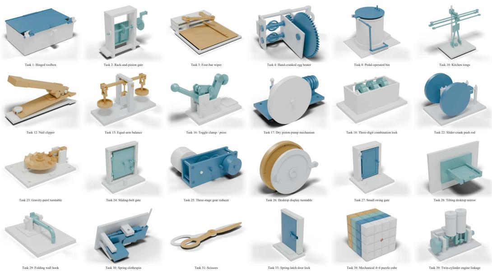  
Figure 15: Mechanisms completed by Grok in pass@8 without shared records.

Table 19: Task-level recorded completion of Grok with eight independent full-harness attempts per task, without access to records from other attempts. Single reproduces the Grok column of Table 8; Passing runs counts attempts that complete the task under formal evaluation; Any of8 marks tasks completed by at least one attempt. A dash denotes no recorded completion, including unfinished evaluation.

<table><tr><td>ID</td><td>Mechanism</td><td>Single</td><td>Passing runs</td><td>Any of 8</td></tr><tr><td>1</td><td>Hinged toolbox</td><td></td><td>2/8</td><td>√</td></tr><tr><td>2</td><td>Rack-and-pinion gate</td><td>√</td><td>7/8</td><td>√</td></tr><tr><td>3</td><td>Four-bar wiper</td><td>√</td><td>7/8</td><td>√</td></tr><tr><td>4</td><td>Hand-cranked egg beater</td><td>√</td><td>7/8</td><td>√</td></tr><tr><td>5</td><td>Self-locking utility knife</td><td>√</td><td>0/8</td><td></td></tr><tr><td>6</td><td>Folding drying rack</td><td>1</td><td>0/8</td><td></td></tr><tr><td>7</td><td>Bicycle</td><td></td><td>0/8</td><td></td></tr><tr><td>8</td><td>Pedal-operated bin</td><td>√</td><td>7/8</td><td>√</td></tr><tr><td>9</td><td>Mechanical alarm clock</td><td></td><td>0/8</td><td></td></tr><tr><td>10</td><td>Kitchen tongs</td><td></td><td>2/8</td><td>√</td></tr><tr><td>11</td><td>Retractable ballpoint pen</td><td></td><td>0/8</td><td></td></tr><tr><td>12</td><td>Nail clipper</td><td></td><td>3/8</td><td>√</td></tr><tr><td>13</td><td>One-way ratchet screwdriver</td><td></td><td>0/8</td><td>一</td></tr><tr><td>14</td><td>Linearly actuated scissor lift</td><td></td><td>0/8</td><td></td></tr><tr><td>15</td><td>Equal-arm balance</td><td>√</td><td>6/8</td><td>√</td></tr><tr><td>16</td><td>Toggle clamp / press</td><td>√</td><td>6/8</td><td>√</td></tr><tr><td>17</td><td>Dry piston-pump mechanism</td><td>√</td><td>8/8</td><td>√</td></tr><tr><td>18</td><td>Three-digit combination lock</td><td></td><td>4/8</td><td>√</td></tr><tr><td>19</td><td>Two-digit mechanical counter</td><td></td><td>0/8</td><td></td></tr><tr><td>20</td><td>Three-ball dispenser</td><td></td><td>0/8</td><td></td></tr><tr><td>21</td><td>Gravity timer</td><td>√</td><td>0/8</td><td></td></tr><tr><td>22</td><td>Slider-crank push rod</td><td>√</td><td>8/8</td><td>√</td></tr><tr><td>23</td><td>Gravity-pawl turntable</td><td></td><td>3/8</td><td>√</td></tr><tr><td>24</td><td>Sliding-bolt gate</td><td>√</td><td>8/8</td><td>√</td></tr><tr><td>25</td><td>Three-stage gear reducer</td><td>一</td><td>7/8</td><td>√</td></tr><tr><td>26</td><td>Desktop display turntable</td><td>√</td><td>8/8</td><td>√</td></tr><tr><td>27</td><td>Small swing gate</td><td>√</td><td>8/8</td><td>√</td></tr><tr><td>28</td><td>Tilting desktop mirror</td><td>√</td><td>1/8</td><td>√</td></tr><tr><td>29</td><td>Folding wall hook</td><td>√</td><td>8/8</td><td>√</td></tr><tr><td>30</td><td>Spring clothespin</td><td>√</td><td>1/8</td><td>V</td></tr><tr><td>31</td><td>Scissors</td><td>√</td><td>8/8</td><td>√</td></tr><tr><td>32</td><td>Ratchet hand winch</td><td></td><td>0/8</td><td></td></tr><tr><td>33</td><td>Spring-latch door lock</td><td>√</td><td>1/8</td><td>√</td></tr><tr><td>34</td><td>Reversible dual-pawl ratchet wrench</td><td></td><td>0/8</td><td></td></tr><tr><td>35</td><td>Full-cycle ratchet crimper</td><td></td><td>0/8</td><td></td></tr><tr><td>36</td><td>Geneva indexing table with overload clutch</td><td></td><td>0/8</td><td></td></tr><tr><td>37</td><td>Folding shopping cart</td><td></td><td>0/8</td><td></td></tr><tr><td>38</td><td>Mechanical 4 × 4 puzzle cube</td><td></td><td>7/8</td><td></td></tr><tr><td>39</td><td>Twin-cylinder engine linkage</td><td></td><td>2/8</td><td></td></tr><tr><td>40</td><td>Four-station indexing table</td><td></td><td>0/8</td><td></td></tr><tr><td>41</td><td>Synchronized parallel gripper</td><td></td><td>0/8</td><td></td></tr><tr><td>42</td><td>Releasable reduction winch</td><td></td><td>0/8</td><td></td></tr><tr><td>43</td><td>Baby stroller</td><td></td><td>0/8</td><td></td></tr><tr><td>44</td><td>Height- and tilt-adjustable worktable</td><td></td><td>0/8</td><td></td></tr><tr><td>45</td><td>Coin sorter and counter</td><td></td><td>0/8</td><td></td></tr><tr><td>46</td><td>Interchangeable-tune music box</td><td></td><td>0/8</td><td></td></tr><tr><td colspan="2">Total completed</td><td>19/46</td><td>129/368</td><td>24/46</td></tr></table>

## G DETAILS ON 3D-PRINTED MECHANICAL PROTOTYPES

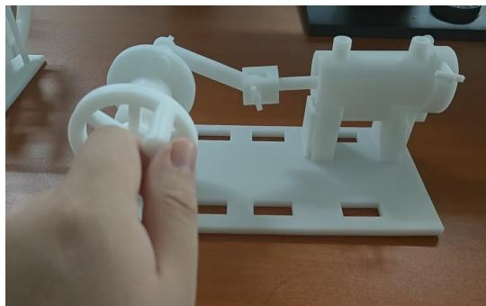  
(a) Piston: crank position 1

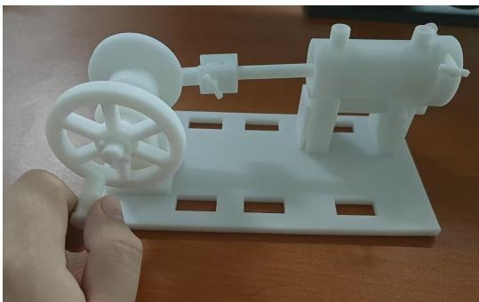  
(b) Piston: crank position 2

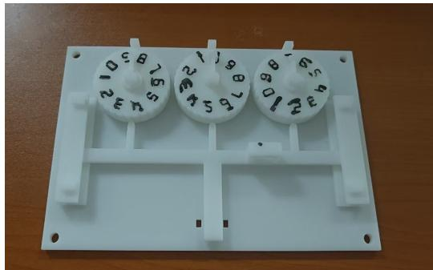  
(c) Three-digit combination lock

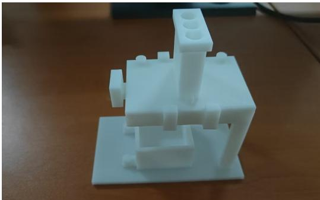  
(d) Three-ball dispenser  
Figure 16: Printed prototypes for piston motion, code-controlled locking, and ball dispensing. (a–b) Task 17: two crank positions of the piston linkage. (c) Task 18: three numbered code wheels and the locking bar. (d) Task 20: the loading channels, dispensing slider, and receiving tray.

Piston (Task 17). The crank and connecting rod drive a guided piston back and forth. The task requires repeated strokes with the specified travel and return position, including motion against resistance. Panels (a–b) show the printed assembly at two crank positions.

Combination lock (Task 18). Three independently adjustable wheels encode the combination. The task requires unlocking at the correct code, re-locking after reinserting the locking bar and scrambling the wheels, and blocking withdrawal when any one digit is incorrect.

Ball distributor (Task 20). The slider meters balls from the loading channels into the receiving tray. The task requires three balls per cycle, cumulative outputs of 3, 6, and 9 across three cycles, and retention of the remaining balls between operations.

Two-digit counter (Task 19). The task requires one increment per forward push-rod stroke, correct carry through 09 → 10 and 19 → 20, and retention of the reading during the return stroke and at rest. The two views expose the digit wheels and the linkage that advances them.

Gravity timer (Task 21). The prototype implements a nominal 10-second gravity timer. The task requires autonomous operation after release, triggering within the specified time window, retention of the visible indication, and repeat operation after reset.

Cup-access machine (open-ended task). The design addresses access to a cup stored behind other cups. Turning the handle moves the paired side linkages and raises the cup holder into reach. Panel (c) shows the initial arrangement; the supplementary video shows operation of the printed linkage and cup retrieval.