# COMEM: LEARNING TO ANTICIPATE FAILURES FROM RETRIEVED EXPERIENCE

Yun Shen1 Ming Shen2,3 Tianjun Yao2,\*

1The Ohio State University 2Shenzhen Loop Area Institute 3Shanghai Jiaotong University Corresponding author.

## ABSTRACT

Reflection lets LLM agents improve from their own attempts, but the memory it builds is local to a single task, so an agent reflecting on its own tends to revisit the same explanation for failure. Cross-task reflective memory addresses this in two forms: retrieved memory keeps past experience explicit and looks up related cases, which is specific but bounded by the bank, and parametric memory internalizes experience into parameters, which generalizes but is grounded in nothing beyond the task description. When both are used, existing agents combine them additively, feeding their outputs to the solver side by side, so retrieved experience never changes what the learned memory produces. We introduce CoMem (Compounding Memory), which makes retrieved experience an input to the learned memory itself, at training and at inference. The agent builds a bank of its own successful and failed reflections, learns from retrieved cases to write failure hypotheses, candidate explanations of how an attempt is likely to go wrong, and at test time reasons from newly retrieved cases to guide each attempt. Varying the retrieved cases gives the memory different perspectives, yielding reflective diversity that is not merely sampled but also grounded in retrieved experience. Across two backbones and five benchmarks in math, code, and multi-hop QA, CoMem achieves strong overall performance. Additional evaluations show that it generalizes to out-of-distribution tasks and enables smaller models to provide effective guidance to stronger solvers.

## 1 INTRODUCTION

Large language models (LLMs) now solve a wide range of reasoning and coding tasks (OpenAI, 2026; Qwen Team, 2026a; DeepSeek-AI, 2026), and a natural next step is agents that keep improving from their own experience rather than from a stronger external model (Zelikman et al., 2022; Madaan et al., 2023). At test time, the dominant mechanism for such improvement is reflection, in which the agent verbalizes what went wrong after a failed attempt and carries this guidance into the next trial (Shinn et al., 2023). Reflection-based frameworks have become a standard component of language agents for programming, mathematical reasoning, and multi-hop question answering (Yao et al., 2023b; Madaan et al., 2023; Shinn et al., 2023).

The effectiveness of reflection, however, is bounded by its diversity. Studies of self-correction report that a model left to reflect on its own tends to produce repetitive or superficial diagnoses that miss the actual cause of failure (Huang et al., 2024; Yao et al., 2024), so later attempts revisit the same explanation instead of exploring alternative ones. Conversely, more diverse reflections correlate strongly with higher task success (Lingam et al., 2025; Yao et al., 2026). Existing work introduces diversity by varying prompts and sampling (Lingam et al., 2025), searching over multiple reasoning branches (Yao et al., 2023a; Zhou et al., 2024), retrieving trajectories of previously solved tasks from a cross-sample memory bank (Lingam et al., 2025), and, most recently, training a lightweight parametric memory that generates reflective signals from patterns internalized across many tasks (Yao et al., 2026). The latter two are notable because they let an agent draw on experience beyond the current task, and both can be built entirely from the base model’s own trajectories.

Retrieval and parametric memory expand diversity through opposite mechanisms, and each has a ceiling. Retrieval provides concrete, task-specific experience, but its coverage is limited by the bank and by what embedding similarity can surface. Learned embeddings capture compositional structure poorly and tend to collapse into low-rank subspaces, which narrows the set of retrievable cases (Nguyen & Yates, 2023; Weller et al., 2025; Guo et al., 2024). Parametric memory general izes beyond the bank but generates from the task description alone. Its diversity comes only from sampling temperature, with no concrete experience to ground each sample, so its outputs can drift toward generic advice. Current systems place the two side by side, concatenating retrieved trajectories and parametric outputs in the solver’s prompt (Yao et al., 2026), which treats remembered experience and learned experience as two independent sources to be summed. We argue this misses where the diversity lies.

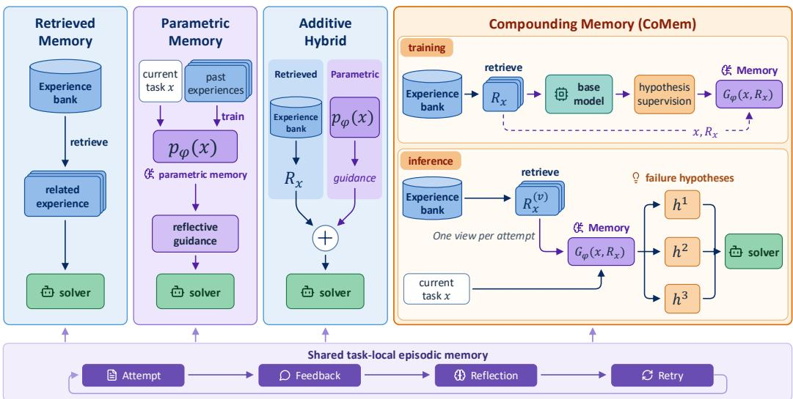  
Figure 1: Reflective memory designs and CoMem. Retrieved memory recalls past experience, parametric memory generates guidance from the task alone, and additive hybrids combine both. CoMem uses retrieved experience to construct supervision and train an experience-conditioned generator. At inference, different retrieved pairs elicit diverse failure hypotheses.

Can an agent’s remembered experience and its learned experience be made to compound, rather than merely add, so that reflection becomes more diverse than either form of memory alone can make it?

Our answer rests on a simple observation about how experience becomes useful. Remembering a specific past case and internalizing a general lesson are complementary parts of the same process. A retrieved case is only as useful as the agent’s ability to see what it shares with the task at hand, and a learned lesson is only as specific as the concrete cases it is anchored to. Diversity arises when the same internalized knowledge is applied to different remembered cases, yielding different and equally grounded conclusions. We introduce CoMem (Compounding Memory), a reflective memory in which the parametric and the retrieved are no longer separate sources but one loop (Figure 1). The agent builds a bank of its own successful and failed reflections, learns from that bank how to read related past experience, and at inference retrieves experience for each task and reasons from it to produce failure hypotheses about how an attempt might fail. These guide the first attempt, with different sets used alongside accumulated reflections in subsequent attempts. Retrieval supplies task-specific experience, while parametric memory provides the ability to generalize from it. Each retrieved case gives the memory a different perspective, adding a new source of reflective diversity grounded in the agent’s own experience. Every step of the loop runs on the base model alone, making CoMem fully self-improving.

We evaluate CoMem with two backbone models on five benchmarks spanning mathematical reasoning, code generation, and multi-hop question answering. It achieves strong overall performance, produces measurably more diverse failure hypotheses than either frozen generation or retrieval-free self-training, generalizes to out-of-distribution tasks and demonstrates weak-to-strong transfer, with hypotheses from a smaller model improving a larger solver. Our contributions are threefold:

① Compounding memory. We identify that existing agents treat retrieved and parametric reflective memory as additive sources, and propose CoMem, a compounding memory that trains the parametric component to reason from retrieved successful and failed experience, with all supervision generated by the base model itself. ② Compounding as a source of diversity. We show that compounding is a distinct source of reflective diversity. CoMem generates more diverse failure hypotheses than either memory alone, and case studies illustrate how this broadens the errors an agent considers during problem solving. ③ Strong empirical performance. We demonstrate strong performance across two backbones and five benchmarks spanning three domains, together with effective out-ofdistribution generalization and weak-to-strong transfer.

## 2 RELATED WORK

Reflection-based agents and the diversity bottleneck. Self-Refine (Madaan et al., 2023) and Re flexion (Shinn et al., 2023) established the reflect-and-retry loop, in which an agent built on Re-Act (Yao et al., 2023b) critiques a failed attempt in natural language and conditions the next attempt on that critique; CRITIC (Gou et al., 2024) and Self-Debug (Chen et al., 2024) ground the critique in tool or execution feedback, the setting we also adopt. The loop, however, saturates quickly. Without external feedback, self-correction rarely helps and can degrade performance (Huang et al., 2024; Kamoi et al., 2024); even with feedback, an agent that has committed to an explanation seldom produces a new one, a failure named Degeneration-of-Thought (Liang et al., 2024) and observed as behavior collapse when self-correction is trained with RL (Kumar et al., 2025), with alignment-induced mode collapse as a likely root cause (Kirk et al., 2024). Remedies inject diversity from within the current task: DoT (Lingam et al., 2025) reduces redundant reflections, Self-Contrast (Zhang et al., 2024) contrasts multiple solving perspectives, SPP (Wang et al., 2024) simulates several personas, Verbalized Sampling (Zhang et al., 2025) elicits diverse samples by prompt, ToT (Yao et al., 2023a) and LATS (Zhou et al., 2024) search over branches, and multi-agent debate (Du et al., 2024; Liang et al., 2024) pits agents against each other, though debate does not reliably beat simple ensembling (Smit et al., 2024). All of these resample or search the current task. CoMem instead draws diversityfrom experience on other tasks, which brings us to memory.

Memory for reflection: retrieved and parametric. Reflexion (Shinn et al., 2023) keeps an episodic buffer of its own reflections. Cross-sample memory extends this to other tasks: DoT-bank (Lingam et al., 2025) retrieves trajectories of similar solved problems, ExpeL (Zhao et al., 2024) distills past trajectories into reusable insights, and Generative Agents (Park et al., 2023) synthesize a memory stream into higher-level reflections that are later retrieved. A separate line stores experience in pa rameters: Retroformer (Yao et al., 2024) trains a reflector with policy gradients. Retrieved memory is specific but bounded by the bank and by embedding similarity; parametric memory generalizes but is conditioned on the task alone. ParamAgent-plus (Yao et al., 2026) augments parametric memory with cross-task trajectory retrieval. Retrieved trajectories and generated reflections jointly guide the solver, but the parametric memory does not use retrieved experience during training or reflection generation. CoMem makes retrieved experience the input of the parametric memory at both stages, so that its supervision is retrieval-grounded and each retrieved case yields a different failure hypothesis.

Self-improvement from self-generated experience. Training on a model’s own outputs is a wellestablished route to improvement: STaR (Zelikman et al., 2022) and ReSTEM (Singh et al., 2024) filter self-generated rationales by correctness and fine-tune the solver on them, and SCoRe (Kumar et al., 2025) trains self-correction with multi-turn RL. Closer to agents, Retroformer (Yao et al., 2024) optimizes the reflector against environment reward, and ExpeL (Zhao et al., 2024) and Agent Workflow Memory (Wang et al., 2025) distill insights or workflows from an agent’s own trajectories without training. CoMem keeps the solverfrozen and trains a memory on hypotheses generated by the same backbonefrom its own retrieved successes andfailures. The memory learns to relate these experiences to the current task, producing guidance that can also transfer to stronger solvers.

## 3 PRELIMINARIES

Reflection loop. Let $p _ { \theta }$ be a language model that produces a solution y for a task x and receives feedback f (unit-test results, a correctness signal, or an answer judge).

In Reflexion (Shinn et al., 2023), when attempt $y _ { k - 1 }$ fails, the model writes a reflection $r _ { k - 1 }$ from $( x , y _ { k - 1 } , f _ { k - 1 } )$ , stores it in an episodic memory, and conditions the next attempt on all reflections so far,

$$
y _ { k } \sim p _ { \theta } ( \cdot \mid x , r _ { 1 : k - 1 } ) .\tag{1}
$$

Reflections are written after failure and by the same model that failed, so across iterations they tend to restate one explanation.

Cross-task memory. Two families of methods let the agent draw on experience from other tasks.

Retrieved memory. Retrieval-based memory (Lingam et al., 2025) keeps a bank B of trajectories from previously solved tasks and adds the most similar ones to the prompt,

$$
y _ { k } \sim p _ { \theta } ( \cdot \mid x , r _ { 1 : k - 1 } , \mathrm { R E T R I E V E } ( B , x ) ) .\tag{2}
$$

Parametric memory. Parametric memory (Yao et al., 2026) fine-tunes a lightweight module $p _ { \phi }$ on reflections written for training tasks and, at each iteration, samples a generated reflection that is appended to the prompt,

$$
y _ { k } \sim p _ { \theta } ( { \cdot } \mid x , r _ { 1 : k - 1 } , r _ { k } ^ { g } ) , \qquad r _ { k } ^ { g } \sim p _ { \phi } ( \cdot \mid x ) .\tag{3}
$$

The generated reflection depends on x alone, so different samples differ only through temperature. When both memories are used, their outputs are concatenated in the solver’s prompt, and $p _ { \phi }$ never sees what was retrieved. CoMem, introduced next, replaces $p _ { \phi } ( \cdot \mid x )$ with a memory that takes the retrieved experience as input.

## 4 COMEM: COMPOUNDING RETRIEVED AND PARAMETRIC MEMORY

CoMem replaces the unconditioned generator $p _ { \phi } ( \cdot \mid x )$ of Eq. (3) with a memory $G _ { \phi } ( \cdot \mid x , R _ { x } )$ that reads retrieved experience $R _ { x }$ and writes failure hypotheses for the current task. The memory is trained on supervision that is itself produced from retrieved experience, so retrieval enters at both training and inference. We describe the experience bank, the retrieval-grounded supervision used to train $G _ { \phi } ( \mathrm { S e c t i o n } 4 . 1 )$ , hypothesis generation at inference (Section 4.2), and how the solver uses the hypotheses (Section 4.3). Algorithm 1 in the appendix summarizes the full procedure.

## 4.1 BUILDING THE MEMORY

Experience bank from the agent’s own reflection. For every training task $x \in \mathcal { D } _ { \mathrm { t r } }$ we run the base model $p _ { \theta }$ through the reflection loop of Eq. (1) for at most $K = 3$ attempts, including the initial attempt. Tasks solved on the first attempt carry no correction signal and are discarded. If a later attempt succeeds, the transition from the failed attempt through its reflection to the repaired solution, $\tau = ( y _ { k - 1 } , r _ { k - 1 } , y _ { k } )$ , is stored as a positive entry in $B ^ { + }$ . If the budget is exhausted, the final failed attempt and its reflection are stored as a negative entry in $B ^ { - }$ . The bank $B = B ^ { + } \cup B ^ { - }$ therefore holds only experience about how this model’s attempts go wrong and, when a repair was found, how it was found. Both types of entries are useful because a positive entry shows a failure mode together with its fix, while a negative entry records a failure that the model did not resolve within the attempt budget. The complete contents of each memory entry are detailed in Section A.2.

Retrieval-grounded supervision. To train $G _ { \phi }$ we need, for each task, a target set of failure hypotheses. Rather than obtaining these from a stronger model, we let $p _ { \theta }$ write them while reading its own related experience. For a training task $x ,$ we embed the task statement and retrieve the top-k most similar tasks from $B ^ { + }$ and $B ^ { - }$ , excluding x itself. We then sample one entry from each shortlist according to the softmax probabilities computed from its similarity scores. The pair $R _ { x } = ( \tau ^ { + } , \tau ^ { - } )$ is placed in the prompt together with x and an instruction to predict how an attempt at x is likely to fail, transferring relevant failure modes from the references while accounting for differences between the tasks. The base model then writes a hypothesis set $z _ { x } \sim p _ { \theta } ( \cdot \mid x , R _ { x } )$ . We keep candidates that contain concrete, task-specific items and discard generic advice. The result is a supervision set ${ \cal { S } } = \{ ( ( x , R _ { x } ) , z _ { x } ) \}$ in which every target is grounded in two retrieved cases. The supervision prompts are provided in Section A.2.1.

Training. We fine-tune $p _ { \theta }$ with LoRA (Hu et al., 2022) on S to obtain $G _ { \phi }$ by minimizing the conditional negative log-likelihood

$$
\mathcal { L } ( \phi ) = - \sum _ { ( ( x , R _ { x } ) , z _ { x } ) \in S } \log G _ { \phi } ( z _ { x } \mid x , R _ { x } ) .\tag{4}
$$

The retrieved pair is also included in the training input to $G _ { \phi } ,$ conditioning hypothesis generation on both the current task and retrieved experience. To keep the memory from specializing to the easiest tasks, which dominate the unbalanced supervision set, we balance S through stratified sampling. Details of training-data sampling are provided in Section A.1.

## 4.2 GENERATING FAILURE HYPOTHESES

For a test task $x ,$ we retrieve from the same bank B and let the memory write

$$
h \sim G _ { \phi } ( \cdot \mid x , R _ { x } ) , \qquad R _ { x } \sim \mathrm { R E T R I E V E } ( B , x ) .\tag{5}
$$

Eq. (5) is where the two memories compound. The distribution over hypotheses is a mixture over retrieved pairs, $\textstyle \sum _ { R } \operatorname* { P r } ( R \mid x ) G _ { \phi } ( \hat { h } \mid x , R )$ . Its diversity comes from sampling within a fixed pair, as in parametric memory, and from variation across pairs, which parametric memory alone does not have.

We exploit the second source directly. For each test task, we retrieve the top-k entries from $B ^ { + }$ and $B ^ { \stackrel { . } { - } }$ as in training, apply softmax to each shortlist’s similarity scores, and sample $V$ pairs with replacement by independently drawing one entry from each shortlist according to these probabilities. Generating one hypothesis set per pair yields V views $\{ h ^ { ( 1 ) } , \ldots , h ^ { ( V ) } \}$ of how the task might fail, each conditioned on its corresponding retrieved pair. $G _ { \phi }$ learns to adapt retrieved experience to the current task, allowing it to generate task-specific hypotheses even when the retrieved cases are only loosely related.

## 4.3 SOLVING WITH FAILURE HYPOTHESES

We use the frozen base model $p _ { \theta }$ as the solver and vary only the guidance it receives. The first attempt is conditioned on the first hypothesis set, and each subsequent iteration receives the next hypothesis set together with the accumulated reflections,

$$
y _ { 1 } \sim p _ { \theta } ( \cdot \mid x , h ^ { ( 1 ) } ) , \qquad y _ { k } \sim p _ { \theta } ( \cdot \mid x , r _ { 1 : k - 1 } , h ^ { ( k ) } ) , \quad k > 1 .\tag{6}
$$

Hypotheses thus act before the first failure, so the agent can avoid an error it has not yet made, and they rotate across iterations to encourage reflections to consider alternative explanations on subsequent attempts. During this reflection loop, the solver receives only the memory’s conclusions from the retrieved training trajectories.

Following DoT-bank (Lingam et al., 2025), we additionally maintain a test-time bank $\mathcal { C }$ of trajectories solved during evaluation. Tasks that remain unsolved after the loop in Eq. (6) enter a second solving stage, where the most similar successful trajectory from C is added to the prompt alongside the failure hypotheses. Newly solved tasks are added to C immediately. This stage is shared with the DoT-bank baseline, so any difference in the comparison comes from the hypotheses.

Why compounding helps. The design connects these simple components by feeding retrieved experience into the parametric memory at every stage. Relative to retrieval alone, the agent receives a hypothesis that is specific to x even when no retrieved case matches it closely, and does not need to fit those training trajectories into the solver’s context. Relative to parametric memory alone, every hypothesis is anchored to a real success or failure, and the memory can be steered to a new region of failure modes by changing what it reads rather than by raising the temperature. The whole pipeline uses $p _ { \theta }$ for the bank, for the supervision, for the memory, and for the solver, so CoMem improves an agent using only that agent’s own experience.

## 5 EXPERIMENTS

In this section, we evaluate CoMem on mathematical reasoning, code generation, and multi-hop question answering. We compare its task performance with reflection- and memory-based baselines and analyze the diversity of its generated hypotheses. We further study the effect of training data size, generalization to out-of-distribution tasks, and whether hypotheses generated by a smaller model can improve a stronger solver.

## 5.1 EXPERIMENTAL SETUP

Datasets. We evaluate our method across three task domains. For mathematical reasoning, we use MATH (Hendrycks et al., 2021b). For code generation, we use HumanEval+ (Liu et al., 2023) and LiveCodeBench (Jain et al., 2025). For multi-hop question answering, we use HotpotQA (Yang et al., 2018) and MuSiQue (Trivedi et al., 2022). For out-of-distribution (OOD) evaluation, we use AIME24 and AIME25 as well as OlympiadBench (He et al., 2024) for mathematical reasoning, BigCodeBench-Hard (Zhuo et al., 2025) for code generation, and 2WikiMultiHopQA (Ho et al., 2020) for multi-hop question answering. Further dataset details are provided in Section A.1.

Evaluation metrics. We use accuracy for mathematical reasoning and multi-hop question answering, and Pass@1 for code generation. For code tasks, generation and reflection use only visible or synthetic tests. We evaluate the final program on hidden tests and count it as correct only if it passes all tests. For MATH, we use Math-Verify1 to check whether the predicted answer is mathematically equivalent to the reference answer. For multi-hop QA, we use Qwen3.6-35B-A3B (Qwen Team, 2026b) as a semantic judge to assess answer correctness. The judging prompt is provided in Section A.2.3. We report the mean and standard deviation over three seeds for all tasks.

Models and baselines. We use Qwen3-4B and Qwen3-8B (Qwen Team, 2025) as backbone models, both in non-thinking mode. We compare our method against the following baselines: Base, which uses the corresponding backbone model to solve each problem directly; Reflexion (Shinn et al., 2023), which uses self-reflections stored in episodic memory to guide subsequent attempts; DoT-Bank (Lingam et al., 2025), which augments diverse self-reflections with relevant successful trajectories retrieved from a cross-task memory bank; and ParamMem (Yao et al., 2026), which learns cross-sample reflection patterns through fine-tuning and generates reflections to guide the solver. Throughout our experiments, the ParamMem baseline denotes ParamAgent-plus, which augments parametric memory with cross-task trajectory retrieval.

Implementation. Across all three domains, we fine-tune the memory for three epochs with a learning rate of $2 \times 1 0 ^ { - 5 }$ and a batch size of 128, using LoRA with rank $r \ = 3 2$ and $\alpha = 6 4$ . For retrieval, we compute text embeddings using text-embedding-3-small (OpenAI, n.d.). Further implementation details are provided in Section A.2.

## 5.2 EXPERIMENTAL RESULTS

Observation 1: CoMem outperforms strong baselines across diverse domains. Table 1 shows that CoMem achieves strong performance across mathematical reasoning, code generation, and multi-hop QA. CoMem improves over DoT-Bank and ParamMem, which already combines retrieved and parametric memory. These gains suggest that conditioning hypothesis generation on retrieved experience provides further benefits beyond their additive combination. By learning to interpret experiences from related tasks in the context of the current problem, CoMem’s memory can anticipate potential errors beyond those revealed by the solver’s own attempts. These additional perspectives can complement self-reflection and help the solver reconsider its approach across successive attempts.

On MATH, CoMem improves over ParamMem by 0.72 and 0.96 with Qwen3-4B and Qwen3-8B, respectively. These gains build on already high baseline accuracy, showing that CoMem can still provide useful additional guidance. Similar tasks retrieved from the memory bank may indicate errors the model could make on the current task, helping hypothesis generation account for mistakes that might otherwise be overlooked. Both coding benchmarks show larger gains over ParamMem, reaching 3.28 and 1.43 on HumanEval+ and 1.14 and 3.23 on LiveCodeBench with Qwen3-4B and Qwen3-8B, respectively. Here, hypotheses may complement test feedback by drawing attention to potential implementation errors beyond those directly indicated by the feedback. In multi-hop QA, CoMem matches ParamMem on HotpotQA with Qwen3-4B and outperforms it on both benchmarks with Qwen3-8B. Its lower MuSiQue accuracy with Qwen3-4B may stem from differences in guidance. ParamMem (Yao et al., 2026) provides multiple solution approaches, whereas CoMem’s hypotheses generated by Qwen3-4B may not cover a sufficiently broad range of reasoning errors.

Table 1: Performance comparison of CoMem with baselines across three task domains using Qwen3-4B and Qwen3-8B as base models. We report accuracy for MATH and QA, and Pass@1 for code. Results are averaged over three random seeds, with standard deviations in superscript. All values are percentages. Bold marks the best result within each dataset and model.
<table><tr><td>Model</td><td>Method</td><td>MATH</td><td></td><td>HumanEval+ LiveCodeBench</td><td>HotpotQA</td><td>MuSiQue</td></tr><tr><td rowspan="5"></td><td>Base</td><td> $7 2 . 9 0 ^ { \pm 0 . 7 4 }$ </td><td> $7 3 . 4 2 ^ { \pm 0 . 7 7 }$ </td><td> $3 2 . 5 6 ^ { \pm 0 . 3 1 }$ </td><td> $7 4 . 6 ^ { \pm 1 . 3 }$ </td><td> $3 6 . 3 ^ { \pm 0 . 3 }$ </td></tr><tr><td>Reflexion</td><td> $8 5 . 7 3 ^ { \pm 0 . 6 1 }$ </td><td> $8 0 . 3 7 ^ { \pm 1 . 0 0 }$ </td><td> $4 3 . 6 7 ^ { \pm 0 . 2 7 }$ </td><td> $8 7 . 4 ^ { \pm 0 . 5 }$ </td><td> $6 3 . 5 ^ { \pm 2 . 6 }$ </td></tr><tr><td>Qwen3-4B DoT-Bank</td><td> $8 7 . 7 7 ^ { \pm 0 . 2 9 }$ </td><td> $8 5 . 2 8 ^ { \pm 0 . 8 7 }$ </td><td> $5 0 . 4 4 ^ { \pm 0 . 9 6 }$ </td><td> $9 1 . 3 ^ { \pm 0 . 9 }$ </td><td> $6 8 . 0 ^ { \pm 2 . 8 }$ </td></tr><tr><td>ParamMem</td><td> $9 2 . 3 3 ^ { \pm 1 . 2 2 }$ </td><td> $9 2 . 0 2 ^ { \pm 1 . 6 2 }$ </td><td> $5 3 . 5 3 ^ { \pm 1 . 3 7 }$ </td><td> $\mathbf { 9 2 . 4 ^ { \pm 0 . 2 } }$ </td><td> $\mathbf { 8 0 . 6 ^ { \pm 1 . 0 } }$ </td></tr><tr><td>CoMem</td><td> $\mathbf { 9 3 . 0 5 ^ { \pm 0 . 6 1 } }$ </td><td> $\mathbf { 9 5 . 3 0 ^ { \pm 0 . 2 9 } }$ </td><td> $\mathbf { 5 4 . 6 7 ^ { \pm 0 . 4 7 } }$ </td><td> $\mathbf { 9 2 . 4 } ^ { \pm 0 . 6 }$ </td><td> $7 8 . 6 ^ { \pm 0 . 8 }$ </td></tr><tr><td rowspan="5"></td><td>Base</td><td> $7 9 . 3 8 ^ { \pm 0 . 4 5 }$ </td><td> $8 1 . 1 9 ^ { \pm 0 . 5 8 }$ </td><td> $4 1 . 0 0 ^ { \pm 0 . 2 7 }$ </td><td> $8 2 . 4 ^ { \pm 0 . 2 }$ </td><td> $4 3 . 1 ^ { \pm 0 . 9 }$ </td></tr><tr><td>Reflexion</td><td> $8 6 . 4 5 ^ { \pm 0 . 1 7 }$ </td><td> $8 4 . 8 7 ^ { \pm 0 . 5 8 }$ </td><td> $5 0 . 4 4 ^ { \pm 1 . 0 3 }$ </td><td> $9 2 . 6 ^ { \pm 0 . 5 }$ </td><td> $7 3 . 3 ^ { \pm 0 . 9 }$ </td></tr><tr><td>Qwen3-8B DoT-Bank</td><td> $9 0 . 1 7 ^ { \pm 0 . 6 8 }$ </td><td> $8 8 . 1 4 ^ { \pm 0 . 2 9 }$ </td><td> $5 3 . 8 9 ^ { \pm 1 . 5 0 }$ </td><td> $9 2 . 6 ^ { \pm 0 . 5 }$ </td><td> $7 3 . 5 ^ { \pm 2 . 5 }$ </td></tr><tr><td>ParamMem</td><td> $9 3 . 7 6 ^ { \pm 0 . 1 7 }$ </td><td> $9 3 . 6 6 ^ { \pm 0 . 3 5 }$ </td><td> $5 6 . 4 4 ^ { \pm 1 . 0 7 }$ </td><td> $9 3 . 6 ^ { \pm 0 . 6 }$ </td><td> $8 3 . 5 ^ { \pm 2 . 0 }$ </td></tr><tr><td>CoMem</td><td> $\mathbf { 9 4 . 7 2 ^ { \pm 0 . 9 4 } }$ </td><td> $\mathbf { 9 5 . 0 9 ^ { \pm 0 . 8 7 } }$ </td><td> $\mathbf { 5 9 . 6 7 ^ { \pm 0 . 2 7 } }$ </td><td> $\mathbf { 9 4 . 9 ^ { \pm 0 . 2 } }$ </td><td> ${ \bf 8 5 . 6 ^ { \pm 3 . 1 } }$ </td></tr></table>

Observation 2: CoMem enhances hypothesis diversity through retrieved reflections. We hypothesize that reflections from similar tasks can suggest potential errors that the model might otherwise overlook, leading to more diverse hypotheses for the current task. To study this, we compare Frozen, Vanilla SFT, Frozen + Retrieval, and CoMem. Frozen generates hypotheses directly from the question without fine-tuning. Vanilla SFT fine-tunes a memory with LoRA on supervision targets produced by the backbone. Neither configuration uses retrieved experience. Frozen + Retrieval adds examples retrieved from related tasks to the frozen backbone’s input without fine-tuning. CoMem includes examples retrieved from related tasks in the memory’s input prompt during both training and inference. QA inputs include the provided context. All configurations generate 10 hypothesis sets per question at a sampling temperature of $T = 1 . 0 .$

For MATH and code generation, we evaluate Qwen3-4B and Qwen3-8B on MATH, HumanEval+, and LiveCodeBench. For each question, we embed the 10 generated hypothesis sets and compute $D _ { \mathrm { m e a n } }$ as the average cosine distance between all pairs of embeddings. We then plot the distribution of $D _ { \mathrm { m e a n } }$ across questions, with higher values indicating greater diversity. For QA, we evaluate Qwen3- 8B on MuSiQue using Self-BLEU-4 (Zhu et al., 2018), where lower scores indicate less overlap among generated hypothesis sets, and Distinct-1/2 (Li et al., 2016), where higher scores indicate greater unigram and bigram diversity.

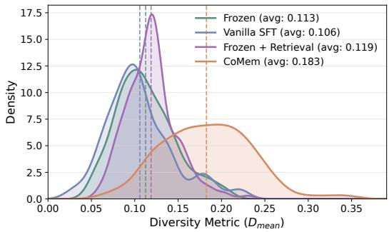  
Figure 2: Hypothesis diversity on HumanEval+ with Qwen3-8B. Curves show $D _ { \mathrm { m e a n } }$ distributions, with dashed lines marking means.

As shown in Figure 2, Frozen + Retrieval and Vanilla SFT remain close to Frozen on HumanEval+ with Qwen3-8B, while CoMem substantially increases diversity. This advantage

holds across mathematical and programming tasks (Section B.1). Across all four coding settings, CoMem’s gain over Frozen exceeds the sum of the two standalone gains. This pattern supports compounding, as the memory learns to interpret retrieved experience and derive more diverse failure hypotheses.

The QA results provide further evidence of this effect (Table 2). Although Vanilla SFT reduces overlap relative to Frozen, its bigram diversity remains largely unchanged. CoMem yields both lower Self-BLEU-4 and higher Distinct-1/2, indicating less repetition and greater lexical variation in its hypothesis sets. These findings suggest that incorporating experiences from related tasks can diversify hypotheses by highlighting potential errors that may otherwise be overlooked. Case studies in Section B.3 illustrate how diverse hypotheses can also diversify subsequent reflections, helping the model recognize overlooked requirements and consider alternative solution strategies.

Table 2: Hypothesis diversity on MuSiQue with Qwen3-8B. Lower Self-BLEU-4 and higher Distinct-1/2 indicate greater textual diversity. Bold marks the best result in each column.
<table><tr><td>Method</td><td>Self-BLEU-4↓</td><td>Distinct-1 ↑</td><td>Distinct-2 ↑</td></tr><tr><td>Frozen</td><td>0.598</td><td>0.149</td><td>0.414</td></tr><tr><td>Vanilla SFT</td><td>0.508</td><td>0.172</td><td>0.412</td></tr><tr><td>CoMem</td><td>0.419</td><td>0.195</td><td>0.483</td></tr></table>

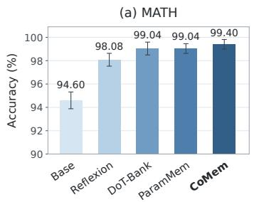

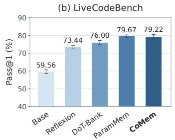

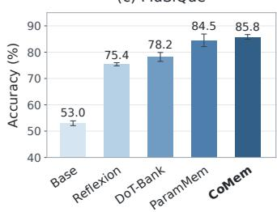  
Figure 3: Weak-to-strong evaluation. We use Qwen3-Next-80B-A3B-Instruct as the task solver, guided by hypotheses generated by CoMem with Qwen3-8B. Bars show mean accuracy or Pass@1 over three random seeds. Error bars indicate one standard deviation. Compared with the baselines, the hypothesis-guided solver achieves the best or near-best performance across the three tasks.

Observation 3: Guidance from failure hypotheses transfers from smaller to stronger models. We investigate weak-to-strong transfer to determine whether hypotheses generated by a smaller model can complement the reasoning of a stronger solver. We use Qwen3-8B to generate hypotheses and provide them to Qwen3-Next-80B-A3B-Instruct for problem solving on MATH, Live-CodeBench, and MuSiQue. As shown in Figure 3, CoMem achieves the best performance on MATH, providing a further improvement even when accuracy is already close to saturation. It also outperforms Reflexion and DoT-Bank on LiveCodeBench and achieves the highest mean accuracy on MuSiQue, showing that guidance from a smaller model remains useful to a stronger solver.

CoMem and ParamMem obtain similar results across these tasks. Some hypotheses generated by the smaller model may concern errors that the stronger solver already avoids, limiting the benefit of additional guidance. The gains over DoT-Bank suggest that a smaller model can provide useful guidance without matching the stronger solver’s overall problem-solving capability.

Observation 4: CoMem generalizes to out-of-distribution tasks. We evaluate whether a memory trained on source tasks can provide useful guidance for out-of-distribution problems. We use Qwen3-8B throughout. For mathematical reasoning, the memory trained on MATH produces hypotheses for AIME24, AIME25, and OlympiadBench. For programming, we use the APPStrained memory (Hendrycks et al., 2021a) to produce hypotheses that guide code generation on BigCodeBench-Hard, evaluating transfer from algorithmic programming problems to tasks that require combining function calls from multiple libraries (Zhuo et al., 2025). For multi-hop QA, we transfer the MuSiQue-trained memory to 2WikiMultiHopQA. In each case, we use the sourcetrained memory to produce new hypotheses for each OOD problem and provide these hypotheses to the solver.

Table 3 shows that CoMem achieves the best performance on AIME24, AIME25, OlympiadBench, and BigCodeBench-Hard, outperforming ParamMem and DoT-Bank on all four datasets. On 2Wiki-MultiHopQA, CoMem outperforms Reflexion and DoT-Bank and achieves performance comparable to ParamMem. These results demonstrate that CoMem generalizes to out-of-distribution tasks using a source-trained memory and references retrieved from the source-task memory bank.

Table 3: Out-of-distribution evaluation with Qwen3-8B. Memory modules trained on MATH, APPS, and MuSiQue generate problem-specific hypotheses that guide the solver on the corresponding outof-distribution benchmarks. Results are averaged over three random seeds. CoMem performs best on math and code and remains competitive on multi-hop QA.
<table><tr><td>Method</td><td>AIME24</td><td>AIME25</td><td>OlympiadBench</td><td>BigCodeBench- Hard</td><td>2Wiki MultiHopQA</td></tr><tr><td>Base</td><td> $1 6 . 6 7 ^ { \pm 0 . 0 0 }$ </td><td> $1 5 . 5 6 ^ { \pm 3 . 1 4 }$ </td><td> $4 6 . 1 1 ^ { \pm 2 . 6 8 }$ </td><td> $2 6 . 3 5 ^ { \pm 3 . 7 6 }$ </td><td> $5 6 . 8 ^ { \pm 0 . 3 }$ </td></tr><tr><td>Reflexion</td><td> $3 3 . 3 3 ^ { \pm 0 . 0 0 }$ </td><td> $2 6 . 6 7 ^ { \pm 2 . 7 2 }$ </td><td> $6 2 . 5 0 ^ { \pm 2 . 5 0 }$ </td><td> $3 9 . 8 6 ^ { \pm 2 . 9 5 }$ </td><td> $9 4 . 5 ^ { \pm 0 . 5 }$ </td></tr><tr><td>DoT-Bank</td><td> $3 3 . 3 3 ^ { \pm 2 . 7 2 }$ </td><td> $3 0 . 0 0 ^ { \pm 4 . 7 1 }$ </td><td> $6 5 . 2 8 ^ { \pm 2 . 5 5 }$ </td><td> $4 5 . 5 0 ^ { \pm 1 . 0 3 }$ </td><td> $9 2 . 3 ^ { \pm 1 . 2 }$ </td></tr><tr><td>ParamMem</td><td> $4 2 . 2 2 ^ { \pm 1 . 9 2 }$ </td><td> $3 1 . 1 1 ^ { \pm 5 . 0 9 }$ </td><td> $7 1 . 1 1 ^ { \pm 1 . 2 7 }$ </td><td> $4 5 . 5 0 ^ { \pm 0 . 7 8 }$ </td><td> $\mathbf { 9 6 . 7 ^ { \pm 0 . 8 } }$ </td></tr><tr><td>CoMem</td><td> $\mathbf { 4 4 . 4 4 ^ { \pm 3 . 8 5 } }$ </td><td> $\mathbf { 3 6 . 6 7 ^ { \pm 0 . 0 0 } }$ </td><td> $\mathbf { 7 3 . 0 6 ^ { \pm 0 . 9 6 } }$ </td><td> $\mathbf { 5 0 . 2 3 ^ { \pm 0 . 3 9 } }$ </td><td> $9 6 . 1 ^ { \pm 0 . 5 } $ </td></tr></table>

Table 4: Sample efficiency of CoMem. We train the memory on 1,000 randomly selected samples. Results are averaged over three random seeds. Although performance is lower than with full-data training, CoMem outperforms DoT-Bank on three benchmarks, suggesting that a small training set can already yield useful hypotheses covering a range of potential mistakes during problem solving.
<table><tr><td></td><td colspan="3">Qwen3-4B</td><td>Qwen3-8B</td></tr><tr><td>Method</td><td>MATH</td><td>HumanEval+</td><td>LiveCodeBench</td><td>MuSiQue</td></tr><tr><td>DoT-Bank</td><td>87.77</td><td>85.28</td><td>50.44</td><td>73.5</td></tr><tr><td>ParamMem</td><td>92.33</td><td>92.02</td><td>53.53</td><td>83.5</td></tr><tr><td>CoMem (full)</td><td>93.05</td><td>95.30</td><td>54.67</td><td>85.6</td></tr><tr><td>CoMem (1,000 samples)</td><td>91.97</td><td>90.80</td><td>50.22</td><td>79.1</td></tr></table>

Observation 5: Effective guidance from hypotheses with limited supervision. We assess whether useful guidance from failure hypotheses can be learned from small samples. We randomly sample from the questions that the model answered incorrectly during memory bank construction and use their supervision targets to form a fine-tuning set of 1,000 examples. We use the same memory bank as in the full-data setting.

We observe that CoMem retains much of the performance reported in our main experiments with only 1,000 fine-tuning examples (Tables 1 and 4). Performance remains close on MATH, with larger decreases on the coding and QA benchmarks. It still outperforms DoT-Bank on MATH, HumanEval+, and MuSiQue and achieves comparable performance on LiveCodeBench. This suggests that, even with a limited sample size, the memory can use references retrieved from similar tasks to produce hypotheses that cover some of the errors the model may make when solving test questions. For more challenging problems in LiveCodeBench, additional hypothesis training examples may be needed to cover a broader range of potential errors. Results with larger training sets are provided in Section B.2.

## 6 CONCLUSION

We introduced CoMem, a self-improvement framework that conditions hypothesis generation on retrieved experience during training and inference. By interpreting different retrieved similar cases for the current task, CoMem provides complementary perspectives on potential errors to support self-reflection. Experiments across mathematical reasoning, code generation, and multi-hop QA show strong overall performance and increased hypothesis diversity. Further evaluations demonstrate out-of-distribution generalization and weak-to-strong transfer. These findings highlight the value of connecting cross-task experience with reflection for agent self-improvement. Future work could incorporate reinforcement learning to jointly improve the correctness and semantic diversity of generated hypotheses, encouraging coverage of distinct failure modes while reducing redundant paraphrases of the same error.

## ETHICS STATEMENT

This work adheres to the ICLR Code of Ethics. Our study uses publicly available benchmarks for mathematical reasoning, code generation, and multi-hop question answering and does not involve human-subject or animal experiments. We report our methods, experimental settings, and results transparently to support research integrity.

## REPRODUCIBILITY STATEMENT

To facilitate reproducibility, Section 4 and Algorithm 1 describe the CoMem framework, while Section 5.1 and Section A document the experimental setup, including dataset sampling, model configurations, training and inference settings, evaluation procedures, and prompt examples. All benchmarks used in this study are publicly available. We conduct experiments with three random seeds and report aggregated results to account for variability.

## REFERENCES

Xinyun Chen, Maxwell Lin, Nathanael Scharli, and Denny Zhou. Teaching large language models to¨ self-debug. In The Twelfth International Conference on Learning Representations, ICLR 2024, Vienna, Austria, May 7-11, 2024. OpenReview.net, 2024. URL https://openreview.net/ forum?id=KuPixIqPiq.

DeepSeek-AI. DeepSeek-V4.1-Flash: Pushing the limits of KV cache compression. Official model card, 2026. URL https://huggingface.co/deepseek-ai/DeepSeek-V4. 1-Flash.

Yilun Du, Shuang Li, Antonio Torralba, Joshua B. Tenenbaum, and Igor Mordatch. Improving factuality and reasoning in language models through multiagent debate. In Ruslan Salakhutdinov, Zico Kolter, Katherine A. Heller, Adrian Weller, Nuria Oliver, Jonathan Scarlett, and Felix Berkenkamp (eds.), Forty-first International Conference on Machine Learning, ICML 2024, Vienna, Austria, July 21-27, 2024, volume 235 of Proceedings of Machine Learning Research, pp. 11733–11763. PMLR / OpenReview.net, 2024. URL https://proceedings.mlr. press/v235/du24e.html.

Zhibin Gou, Zhihong Shao, Yeyun Gong, Yelong Shen, Yujiu Yang, Nan Duan, and Weizhu Chen. CRITIC: large language models can self-correct with tool-interactive critiquing. In The Twelfth International Conference on Learning Representations, ICLR 2024, Vienna, Austria, May 7-11, 2024. OpenReview.net, 2024. URL https://openreview.net/forum?id= Sx038qxjek.

Xingzhuo Guo, Junwei Pan, Ximei Wang, Baixu Chen, Jie Jiang, and Mingsheng Long. On the embedding collapse when scaling up recommendation models. In Ruslan Salakhutdinov, Zico Kolter, Katherine A. Heller, Adrian Weller, Nuria Oliver, Jonathan Scarlett, and Felix Berkenkamp (eds.), Forty-first International Conference on Machine Learning, ICML 2024, Vienna, Austria, July 21- 27, 2024, volume 235 of Proceedings ofMachine Learning Research, pp. 16891–16909. PMLR / OpenReview.net, 2024. URL https://proceedings.mlr.press/v235/guo24e. html.

Chaoqun He, Renjie Luo, Yuzhuo Bai, Shengding Hu, Zhen Leng Thai, Junhao Shen, Jinyi Hu, Xu Han, Yujie Huang, Yuxiang Zhang, Jie Liu, Lei Qi, Zhiyuan Liu, and Maosong Sun. Olympiadbench: A challenging benchmark for promoting AGI with olympiad-level bilingual multimodal scientific problems. In Lun-Wei Ku, Andre Martins, and Vivek Srikumar (eds.), Proceedings of the 62nd Annual Meeting of the Association for Computational Linguistics (Volume 1: Long Papers), ACL 2024, Bangkok, Thailand, August 11-16, 2024, pp. 3828–3850. Association for Computational Linguistics, 2024. doi: 10.18653/V1/2024.ACL-LONG.211. URL https://doi.org/10.18653/v1/2024.acl-long.211.

Dan Hendrycks, Steven Basart, Saurav Kadavath, Mantas Mazeika, Akul Arora, Ethan Guo, Collin Burns, Samir Puranik, Horace He, Dawn Song, and Jacob Steinhardt. Measuring coding challenge competence with APPS. In Joaquin Vanschoren and Sai-Kit Yeung (eds.),

Proceedings of the Neural Information Processing Systems Track on Datasets and Benchmarks 1, NeurIPS Datasets and Benchmarks 2021, December 2021, virtual, 2021a. URL https://datasets-benchmarks-proceedings.neurips.cc/paper/2021/ hash/c24cd76e1ce41366a4bbe8a49b02a028-Abstract-round2.html.

Dan Hendrycks, Collin Burns, Saurav Kadavath, Akul Arora, Steven Basart, Eric Tang, Dawn Song, and Jacob Steinhardt. Measuring mathematical problem solving with the MATH dataset. In Joaquin Vanschoren and Sai-Kit Yeung (eds.), Proceedings of the Neural Information Processing Systems Track on Datasets and Benchmarks 1, NeurIPS Datasets and Benchmarks 2021, December 2021, virtual, 2021b. URL https://datasets-benchmarks-proceedings.neurips.cc/paper/2021/ hash/be83ab3ecd0db773eb2dc1b0a17836a1-Abstract-round2.html.

Xanh Ho, Anh-Khoa Duong Nguyen, Saku Sugawara, and Akiko Aizawa. Constructing A multihop QA dataset for comprehensive evaluation of reasoning steps. In Donia Scott, Nuria Bel,´ and Chengqing Zong (eds.), Proceedings of the 28th International Conference on Computational Linguistics, COLING 2020, Barcelona, Spain (Online), December 8-13, 2020, pp. 6609– 6625. International Committee on Computational Linguistics, 2020. doi: 10.18653/V1/2020. COLING-MAIN.580. URL https://doi.org/10.18653/v1/2020.coling-main. 580.

Edward J. Hu, Yelong Shen, Phillip Wallis, Zeyuan Allen-Zhu, Yuanzhi Li, Shean Wang, Lu Wang, and Weizhu Chen. Lora: Low-rank adaptation of large language models. In The Tenth International Conference on Learning Representations, ICLR 2022, Virtual Event, April 25-29, 2022. OpenReview.net, 2022. URL https://openreview.net/forum?id=nZeVKeeFYf9.

Jie Huang, Xinyun Chen, Swaroop Mishra, Huaixiu Steven Zheng, Adams Wei Yu, Xinying Song, and Denny Zhou. Large language models cannot self-correct reasoning yet. In The Twelfth International Conference on Learning Representations, ICLR 2024, Vienna, Austria, May 7-11, 2024. OpenReview.net, 2024. URL https://openreview.net/forum?id=IkmD3fKBPQ.

Naman Jain, King Han, Alex Gu, Wen-Ding Li, Fanjia Yan, Tianjun Zhang, Sida Wang, Armando Solar-Lezama, Koushik Sen, and Ion Stoica. Livecodebench: Holistic and contamination free evaluation of large language models for code. In The Thirteenth International Conference on Learning Representations, ICLR 2025, Singapore, April 24-28, 2025. OpenReview.net, 2025. URL https://openreview.net/forum?id=chfJJYC3iL.

Ryo Kamoi, Yusen Zhang, Nan Zhang, Jiawei Han, and Rui Zhang. When can llms Actually correct their own mistakes? A critical survey of self-correction of llms. Trans. Assoc. Comput. Linguistics, 12:1417–1440, 2024. doi: 10.1162/TACL A 00713. URL https://doi.org/10. 1162/tacl\_a\_00713.

Robert Kirk, Ishita Mediratta, Christoforos Nalmpantis, Jelena Luketina, Eric Hambro, Edward Grefenstette, and Roberta Raileanu. Understanding the effects of RLHF on LLM generalisation and diversity. In The Twelfth International Conference on Learning Representations, ICLR 2024, Vienna, Austria, May 7-11, 2024. OpenReview.net, 2024. URL https://openreview. net/forum?id=PXD3FAVHJT.

Aviral Kumar, Vincent Zhuang, Rishabh Agarwal, Yi Su, John D. Co-Reyes, Avi Singh, Kate Baumli, Shariq Iqbal, Colton Bishop, Rebecca Roelofs, Lei M. Zhang, Kay McKinney, Disha Shrivastava, Cosmin Paduraru, George Tucker, Doina Precup, Feryal M. P. Behbahani, and Aleksandra Faust. Training language models to self-correct via reinforcement learning. In The Thirteenth International Conference on Learning Representations, ICLR 2025, Singapore, April 24-28, 2025. OpenReview.net, 2025. URL https://openreview.net/forum?id= CjwERcAU7w.

Jiwei Li, Michel Galley, Chris Brockett, Jianfeng Gao, and Bill Dolan. A diversity-promoting objective function for neural conversation models. In Kevin Knight, Ani Nenkova, and Owen Rambow (eds.), NAACL HLT 2016, The 2016 Conference of the North American Chapter of the Association for Computational Linguistics: Human Language Technologies, San Diego California, USA, June 12-17, 2016, pp. 110–119. The Association for Computational Linguistics, 2016. doi: 10.18653/V1/N16-1014. URL https://doi.org/10.18653/v1/n16-1014.

Tian Liang, Zhiwei He, Wenxiang Jiao, Xing Wang, Yan Wang, Rui Wang, Yujiu Yang, Shuming Shi, and Zhaopeng Tu. Encouraging divergent thinking in large language models through multiagent debate. In Yaser Al-Onaizan, Mohit Bansal, and Yun-Nung Chen (eds.), Proceedings of the 2024 Conference on Empirical Methods in Natural Language Processing, EMNLP 2024, Miami, FL, USA, November 12-16, 2024, pp. 17889–17904. Association for Computational Linguistics, 2024. doi: 10.18653/V1/2024.EMNLP-MAIN.992. URL https://doi.org/10.18653/ v1/2024.emnlp-main.992.

Vijay Lingam, Behrooz Omidvar-Tehrani, Sujay Sanghavi, Gaurav Gupta, Sayan Ghosh, Linbo Liu, Jun Huan, and Anoop Deoras. Enhancing language model agents using diversity of thoughts. In The Thirteenth International Conference on Learning Representations, ICLR 2025, Singapore, April 24-28, 2025. OpenReview.net, 2025. URL https://openreview.net/forum?id= ZsP3YbYeE9.

Jiawei Liu, Chunqiu Steven Xia, Yuyao Wang, and Lingming Zhang. Is your code generated by chatgpt really correct? rigorous evaluation of large language models for code generation. In Alice Oh, Tristan Naumann, Amir Globerson, Kate Saenko, Moritz Hardt, and Sergey Levine (eds.), Advances in Neural Information Processing Systems 36: Annual Conference on Neural Information Processing Systems 2023, NeurIPS 2023, New Orleans, LA, USA, December 10 - 16, 2023, 2023. URL http://papers.nips.cc/paper\_files/paper/2023/hash/ 43e9d647ccd3e4b7b5baab53f0368686-Abstract-Conference.html.

Aman Madaan, Niket Tandon, Prakhar Gupta, Skyler Hallinan, Luyu Gao, Sarah Wiegreffe, Uri Alon, Nouha Dziri, Shrimai Prabhumoye, Yiming Yang, Shashank Gupta, Bodhisattwa Prasad Majumder, Katherine Hermann, Sean Welleck, Amir Yazdanbakhsh, and Peter Clark. Self-refine: Iterative refinement with self-feedback. In Alice Oh, Tristan Naumann, Amir Globerson, Kate Saenko, Moritz Hardt, and Sergey Levine (eds.), Advances in Neural Information Processing Systems 36: Annual Conference on Neural Information Processing Systems 2023, NeurIPS 2023, New Orleans, LA, USA, December 10 - 16, 2023, 2023. URL http://papers.nips.cc/paper\_files/paper/2023/hash/ 91edff07232fb1b55a505a9e9f6c0ff3-Abstract-Conference.html.

Thong Nguyen and Andrew Yates. Generative retrieval as dense retrieval. CoRR, abs/2306.11397, 2023. doi: 10.48550/ARXIV.2306.11397. URL https://doi.org/10.48550/arXiv. 2306.11397.

OpenAI. GPT-6 Astra: A new generation of intelligence. Official model release, 2026. URL https://openai.com/index/gpt-6-astra/.

OpenAI. text-embedding-3-small. OpenAI API documentation, n.d. URL https:// developers.openai.com/api/docs/models/text-embedding-3-small. Accessed September 9, 2026.

Joon Sung Park, Joseph C. O’Brien, Carrie Jun Cai, Meredith Ringel Morris, Percy Liang, and Michael S. Bernstein. Generative agents: Interactive simulacra of human behavior. In Sean Follmer, Jeff Han, Jurgen Steimle, and Nathalie Henry Riche (eds.),¨ Proceedings of the 36th Annual ACM Symposium on User Interface Software and Technology, UIST 2023, San Francisco, CA, USA, 29 October 2023- 1 November 2023, pp. 2:1–2:22. ACM, 2023. doi: 10.1145/3586183. 3606763. URL https://doi.org/10.1145/3586183.3606763.

Qwen Team. Qwen3 technical report, 2025. URL https://arxiv.org/abs/2505.09388.

Qwen Team. Qwen3.8-Max: A new bar for coding and cowork. Official model card, August 2026a. URL https://huggingface.co/Qwen/Qwen3.8-2.4T-A95B.

Qwen Team. Qwen3.6-35B-A3B: Agentic coding power, now open to all, April 2026b. URL https://qwen.ai/blog?id=qwen3.6-35b-a3b.

Noah Shinn, Federico Cassano, Ashwin Gopinath, Karthik Narasimhan, and Shunyu Yao. Reflexion: language agents with verbal reinforcement learning. In Alice Oh, Tristan Naumann, Amir Globerson, Kate Saenko, Moritz Hardt, and Sergey Levine (eds.), Advances

in Neural Information Processing Systems 36: Annual Conference on Neural Information Processing Systems 2023, NeurIPS 2023, New Orleans, LA, USA, December 10 - 16, 2023, 2023. URL http://papers.nips.cc/paper\_files/paper/2023/hash/ 1b44b878bb782e6954cd888628510e90-Abstract-Conference.html.

Avi Singh, John D. Co-Reyes, Rishabh Agarwal, Ankesh Anand, Piyush Patil, Xavier Garcia, Peter J. Liu, James Harrison, Jaehoon Lee, Kelvin Xu, Aaron T. Parisi, Abhishek Kumar, Alexander A. Alemi, Alex Rizkowsky, Azade Nova, Ben Adlam, Bernd Bohnet, Gamaleldin Fathy Elsayed, Hanie Sedghi, Igor Mordatch, Isabelle Simpson, Izzeddin Gur, Jasper Snoek, Jeffrey Pennington, Jiri Hron, Kathleen Kenealy, Kevin Swersky, Kshiteej Mahajan, Laura Culp, Lechao Xiao, Maxwell L. Bileschi, Noah Constant, Roman Novak, Rosanne Liu, Tris Warkentin, Yundi Qian, Yamini Bansal, Ethan Dyer, Behnam Neyshabur, Jascha Sohl-Dickstein, and Noah Fiedel. Beyond human data: Scaling self-training for problem-solving with language models. Trans. Mach. Learn. Res., 2024, 2024. URL https://openreview.net/forum?id= lNAyUngGFK.

Andries P. Smit, Nathan Grinsztajn, Paul Duckworth, Thomas D. Barrett, and Arnu Pretorius. Should we be going mad? A look at multi-agent debate strategies for llms. In Ruslan Salakhut dinov, Zico Kolter, Katherine A. Heller, Adrian Weller, Nuria Oliver, Jonathan Scarlett, and Felix Berkenkamp (eds.), Forty-first International Conference on Machine Learning, ICML 2024, Vienna, Austria, July 21-27, 2024, volume 235 of Proceedings of Machine Learning Research, pp. 45883–45905. PMLR / OpenReview.net, 2024. URL https://proceedings.mlr. press/v235/smit24a.html.

Harsh Trivedi, Niranjan Balasubramanian, Tushar Khot, and Ashish Sabharwal. musique: Mul-tihop questions via single-hop question composition. Trans. Assoc. Comput. Linguistics, 10: 539–554, 2022. doi: 10.1162/TACL A 00475. URL https://doi.org/10.1162/tacl\_ a\_00475.

Zhenhailong Wang, Shaoguang Mao, Wenshan Wu, Tao Ge, Furu Wei, and Heng Ji. Unleashing the emergent cognitive synergy in large language models: A task-solving agent through multi-persona self-collaboration. In Kevin Duh, Helena Gomez-Adorno, and Steven Bethard (eds.),´ Proceedings of the 2024 Conference of the North American Chapter of the Association for Computational Linguistics: Human Language Technologies (Volume 1: Long Papers), NAACL 2024, Mexico City, Mexico, June 16-21, 2024, pp. 257–279. Association for Computational Linguistics, 2024. doi: 10.18653/V1/2024.NAACL-LONG.15. URL https://doi.org/10.18653/v1/2024. naacl-long.15.

Zora Zhiruo Wang, Jiayuan Mao, Daniel Fried, and Graham Neubig. Agent workflow memory. In Aarti Singh, Maryam Fazel, Daniel Hsu, Simon Lacoste-Julien, Felix Berkenkamp, Tegan Maharaj, Kiri Wagstaff, and Jerry Zhu (eds.), Forty-second International Conference on Machine Learning, ICML 2025, Vancouver, BC, Canada, July 13-19, 2025, volume 267 of Proceedings of Machine Learning Research. PMLR / OpenReview.net, 2025. URL https://proceedings. mlr.press/v267/wang25bx.html.

Orion Weller, Michael Boratko, Iftekhar Naim, and Jinhyuk Lee. On the theoretical limitations of embedding-based retrieval. CoRR, abs/2508.21038, 2025. doi: 10.48550/ARXIV.2508.21038. URL https://doi.org/10.48550/arXiv.2508.21038.

Zhilin Yang, Peng Qi, Saizheng Zhang, Yoshua Bengio, William W. Cohen, Ruslan Salakhutdinov, and Christopher D. Manning. Hotpotqa: A dataset for diverse, explainable multi-hop question answering. In Ellen Riloff, David Chiang, Julia Hockenmaier, and Jun’ichi Tsujii (eds.), Proceedings of the 2018 Conference on Empirical Methods in Natural Language Processing, Brussels, Belgium, October 31 - November 4, 2018, pp. 2369–2380. Association for Computational Linguistics, 2018. doi: 10.18653/V1/D18-1259. URL https://doi.org/10.18653/v1/ d18-1259.

Shunyu Yao, Dian Yu, Jeffrey Zhao, Izhak Shafran, Tom Griffiths, Yuan Cao, and Karthik Narasimhan. Tree of thoughts: Deliberate problem solving with large language models. In Alice Oh, Tristan Naumann, Amir Globerson, Kate Saenko, Moritz Hardt, and Sergey Levine (eds.), Advances in Neural Information Processing Systems 36: Annual Conference on Neural Information Processing Systems 2023, NeurIPS 2023, New Orleans, LA, USA, December

10 - 16, 2023, 2023a. URL http://papers.nips.cc/paper\_files/paper/2023/ hash/271db9922b8d1f4dd7aaef84ed5ac703-Abstract-Conference.html.

Shunyu Yao, Jeffrey Zhao, Dian Yu, Nan Du, Izhak Shafran, Karthik R. Narasimhan, and Yuan Cao. React: Synergizing reasoning and acting in language models. In The Eleventh International Conference on Learning Representations, ICLR 2023, Kigali, Rwanda, May 1-5, 2023. OpenReview.net, 2023b. URL https://openreview.net/forum?id=WE\_vluYUL-X.

Tianjun Yao, Yongqiang Chen, Yujia Zheng, Pan Li, Zhiqiang Shen, and Kun Zhang. Parammem: Augmenting language agents with parametric reflective memory. CoRR, abs/2602.23320, 2026. doi: 10.48550/ARXIV.2602.23320. URL https://doi.org/10.48550/arXiv.2602. 23320.

Weiran Yao, Shelby Heinecke, Juan Carlos Niebles, Zhiwei Liu, Yihao Feng, Le Xue, Rithesh R. N., Zeyuan Chen, Jianguo Zhang, Devansh Arpit, Ran Xu, Phil Mui, Huan Wang, Caiming Xiong, and Silvio Savarese. Retroformer: Retrospective large language agents with policy gradient optimization. In The Twelfth International Conference on Learning Representations, ICLR 2024, Vienna, Austria, May 7-11, 2024. OpenReview.net, 2024. URL https: //openreview.net/forum?id=KOZu91CzbK.

Eric Zelikman, Yuhuai Wu, Jesse Mu, and Noah D. Goodman. Star: Bootstrapping reasoning with reasoning. In Sanmi Koyejo, S. Mohamed, A. Agarwal, Danielle Belgrave, K. Cho, and A. Oh (eds.), Advances in Neural Information Processing Systems 35: Annual Conference on Neural Information Processing Systems 2022, NeurIPS 2022, New Orleans, LA, USA, November 28 - December 9, 2022, 2022. URL http://papers.nips.cc/paper\_files/paper/2022/ hash/639a9a172c044fbb64175b5fad42e9a5-Abstract-Conference.html.

Jiayi Zhang, Simon Yu, Derek Chong, Anthony Sicilia, Michael R. Tomz, Christopher D. Manning, and Weiyan Shi. Verbalized sampling: How to mitigate mode collapse and unlock LLM diversity. CoRR, abs/2510.01171, 2025. doi: 10.48550/ARXIV.2510.01171. URL https://doi.org/ 10.48550/arXiv.2510.01171.

Wenqi Zhang, Yongliang Shen, Linjuan Wu, Qiuying Peng, Jun Wang, Yueting Zhuang, and Weiming Lu. Self-contrast: Better reflection through inconsistent solving perspectives. In Lun-Wei Ku, Andre Martins, and Vivek Srikumar (eds.), Proceedings of the 62nd Annual Meeting of the Association for Computational Linguistics (Volume 1: Long Papers), ACL 2024, Bangkok, Thailand, August 11-16, 2024, pp. 3602–3622. Association for Computational Linguistics, 2024. doi: 10.18653/V1/2024.ACL-LONG.197. URL https://doi.org/10.18653/ v1/2024.acl-long.197.

Andrew Zhao, Daniel Huang, Quentin Xu, Matthieu Lin, Yong-Jin Liu, and Gao Huang. Expel: LLM agents are experiential learners. In Michael J. Wooldridge, Jennifer G. Dy, and Sriraam Natarajan (eds.), Thirty-Eighth AAAI Conference on Artificial Intelligence, AAAI 2024, Thirty-Sixth Conference on Innovative Applications of Artificial Intelligence, IAAI 2024, Fourteenth Symposium on Educational Advances in Artificial Intelligence, EAAI 2024, February 20-27, 2024, Vancouver, Canada, pp. 19632–19642. AAAI Press, 2024. doi: 10.1609/AAAI.V38I17.29936. URL https://doi.org/10.1609/aaai.v38i17.29936.

Andy Zhou, Kai Yan, Michal Shlapentokh-Rothman, Haohan Wang, and Yu-Xiong Wang. Language agent tree search unifies reasoning, acting, and planning in language models. In Ruslan Salakhutdinov, Zico Kolter, Katherine A. Heller, Adrian Weller, Nuria Oliver, Jonathan Scarlett, and Felix Berkenkamp (eds.), Forty-first International Conference on Machine Learning, ICML 2024, Vienna, Austria, July 21-27, 2024, volume 235 of Proceedings of Machine Learning Research, pp. 62138–62160. PMLR / OpenReview.net, 2024. URL https://proceedings. mlr.press/v235/zhou24r.html.

Yaoming Zhu, Sidi Lu, Lei Zheng, Jiaxian Guo, Weinan Zhang, Jun Wang, and Yong Yu. Texygen: A benchmarking platform for text generation models. In Kevyn Collins-Thompson, Qiaozhu Mei, Brian D. Davison, Yiqun Liu, and Emine Yilmaz (eds.), The 41st International ACM SIGIR Conference on Research & Development in Information Retrieval, SIGIR 2018, Ann Arbor, MI, USA, July 08-12, 2018, pp. 1097–1100. ACM, 2018. doi: 10.1145/3209978.3210080. URL https://doi.org/10.1145/3209978.3210080.

Terry Yue Zhuo, Minh Chien Vu, Jenny Chim, Han Hu, Wenhao Yu, Ratnadira Widyasari, Imam Nur Bani Yusuf, Haolan Zhan, Junda He, Indraneil Paul, Simon Brunner, Chen Gong, James Hoang, Armel Randy Zebaze, Xiaoheng Hong, Wen-Ding Li, Jean Kaddour, Ming Xu, Zhihan Zhang, Prateek Yadav, et al. Bigcodebench: Benchmarking code generation with diverse function calls and complex instructions. In The Thirteenth International Conference on Learning Representations, ICLR 2025, Singapore, April 24-28, 2025. OpenReview.net, 2025. URL https://openreview.net/forum?id=YrycTjllL0.

## APPENDIX

## A EXPERIMENTAL DETAILS

## A.1 DATASET DETAILS

MATH. We use MATH (Hendrycks et al., 2021b), a competition-level mathematics benchmark covering seven subject categories: prealgebra, algebra, intermediate algebra, geometry, number theory, counting and probability, and precalculus. We sample up to 1,500 problems per category from the training split and up to 40 problems per category from the test split. For out-of-distribution evaluation, we use all problems from AIME24 and AIME25. For OlympiadBench (He et al., 2024), we construct a balanced test subset across four subjects: algebra, combinatorics, geometry, and number theory. We randomly sample 30 problems per subject, yielding 120 test problems.

Programming. We use the training split of APPS (Hendrycks et al., 2021a) for training and evaluate on HumanEval+ (Liu et al., 2023) and LiveCodeBench (Jain et al., 2025). HumanEval+ contains 164 problems; we exclude HumanEval/32 due to a bug in its test cases, leaving 163 problems for evaluation. For LiveCodeBench, we use release v6 and sample 300 problems through stratified sampling by platform and difficulty, allocating samples to each stratum in proportion to its size in the original release.

Multi-hop QA. We adopt HotpotQA (Yang et al., 2018) and MuSiQue (Trivedi et al., 2022). For HotpotQA, we use 30,000 questions from the distractor training split for training. We construct a held-out test set from the remaining questions by sampling 100 questions from each of the easy, medium, and hard difficulty levels, yielding 300 test questions. For MuSiQue, we sample 10,000 training questions across different reasoning types. The test set contains 180 questions, with 60 each for 2-hop, 3-hop, and 4-hop reasoning. For out-of-distribution evaluation, we construct a balanced evaluation set of 200 questions from 2WikiMultiHopQA (Ho et al., 2020), with 50 questions from each of four reasoning types: bridge-comparison, comparison, compositional, and inference.

## A.2 IMPLEMENTATION DETAILS

We run all experiments with three random seeds: 42, 43, and 44. During evaluation, we use a solving budget of five attempts per stage, including the initial attempt. For CoMem, we set k = 5 during both training and inference and V = 8 at inference. We use a retrieval softmax temperature of $T _ { \mathrm { r e t } } = 0 . 1$ during both training and inference. During evaluation, we set the sampling temperature for task solving to $T = 0 . 2$ in the first iteration and $\mathbf { \check { \Psi } } T = 1 . 0$ in subsequent iterations to promote diversity. The maximum generation length is 2,048 tokens for MATH and HumanEval+, 4,096 tokens for LiveCodeBench and BigCodeBench-Hard, 8,192 tokens for AIME24 and AIME25, and 32,000 tokens for HotpotQA and MuSiQue.

Memory bank construction. We construct a memory bank for each domain and backbone model using the corresponding training data. Problems solved on the first attempt are excluded. If the initial attempt fails, the model generates reflections based on the feedback and attempts to solve the problem again. We allow up to K = 3 attempts in total, including the initial attempt. Successful attempts are stored as positive entries, while final unsuccessful attempts are stored as negative entries. Each entry contains a failed solution, its corresponding reflection, and the updated solution. For MATH, the Qwen3-4B bank contains 2,809 entries (1,161 positive and 1,648 negative), and the Qwen3-8B bank contains 2,733 entries (1,359 positive and 1,374 negative). For programming, the corresponding banks contain 3,264 entries (953 positive and 2,311 negative) and 3,349 entries (1,361 positive and 1,988 negative), respectively.

## A.2.1 HYPOTHESIS SUPERVISION PROMPT

## Hypothesis Supervision Prompt (MATH)

You are a pitfalls predictor. Given a math problem, list up to 6 potential common reasoning mistakes someone might make on the CURRENT problem. Do not solve the current problem, do not compute or reveal the final answer, and do not include solution steps. Generate only

## Hypothesis Supervision Prompt (MATH) (continued)

pitfalls. Each item must be specific to the current problem, not generic study advice. Do not list correct facts, valid reasoning steps, or true intermediate observations as mistakes. Avoid self-contradictory items. You may receive retrieved solved and unsolved examples as optional reference material. They can help suggest possible reasoning risks for the current problem, though their relevance may vary. Base the final pitfalls primarily on the current problem, and adapt useful signals from the examples rather than mechanically copying them. Output ONLY a Markdown numbered list, items 1-6, with no preamble, closing remarks, wrapper tags, or restatement of the problem. An earlier problem-and-pitfalls exchange is provided as a one-shot demonstration. It may guide the output format and level of specificity, while the pitfalls should be tailored to the current problem and its retrieved references.

## Hypothesis Supervision Prompt (Code)

You are a pitfall predictor for Python coding tasks. You are given a CURRENT coding task plus two retrieved reference tasks: one similar SOLVED task with a successful implementation and reflection, and one similar UNSOLVED task with a failed implementation and reflection. The retrieved tasks are provided specifically as references for predicting pitfalls in the CURRENT task. Actively transfer relevant implementation patterns from the solved reference and relevant failure modes from the unsolved reference. Do not blindly copy them: account for differences in the task statement, interface, constraints, and input/output contract, and ignore irrelevant details. Every item must be specific to the CURRENT task. Return exactly 4 to 6 concise, non-overlapping pitfalls under exactly one <Pitfalls>: heading. Return pitfalls only. Do not output code, an implementation, a complete algorithm, a proof, or a final answer.

## Hypothesis Supervision Prompt (QA)

You are a pitfalls predictor for multi-hop factual QA. Each request includes one similar solved reflection transition and one similar unsolved reflection transition retrieved by question similarity. Treat the solved transition as a validated example of an error that was corrected. Treat the unsolved transition as warning evidence that may be incomplete or mistaken; do not blindly imitate it. Use both only to identify transferable risks for the CURRENT question. The CURRENT question includes its evidence context paragraphs (gold and distractor). Ground each pitfall in the actual entities and passages present in the context where possible. When referring to entities from the context, use paragraph indices or descriptive references (e.g., “the entity in [3]”); never write out any string that could be the final answer. List 4 to 6 plausible reasoning or retrieval pitfalls that are specific to the CURRENT question. Focus on misreading constraints, confusing entities or relations, skipping a reasoning hop, using insufficient evidence, and returning the wrong answer type. Do NOT solve the CURRENT question, state or guess a candidate answer, reveal a final conclusion, or provide a step-by-step solution. Output ONLY a Markdown numbered list of 4–6 consecutive items starting at 1, with no preamble, headings, closing remarks, or wrapper tags.

One-shot Demonstration (MATH)   
User   
=== Similar solved example ===   
Problem:   
If t(x) = 9 + 2f(x) and f(x) = x2 − 3, then what is t(f(−2))?   
Successful solution sketch:   
Evaluates the nested composition from the inside out, then applies the definition of t without   
conflating f(−2) with the later evaluation of f.   
Prior reflection / key principle:   
Function-composition inputs must be propagated one layer at a time; substituting into the outer   
expression too early changes the computation.

## One-shot Demonstration (MATH) (continued)

## === Similar unsolved example ===

## Problem:

A piecewise graph of f on [−4, 4] is given. Count the values of x satisfying f(f(x)) = 2. Historical failed attempt:

Located several inputs of the outer function but did not consistently solve every corresponding inner preimage across all pieces of the graph.

Observed pitfall / reflection:

For a composition equation, first enumerate every value mapped to the target by the outer function, then find all valid preimages of each value.

## === One-shot demonstration problem ===

If f(x) = 8x3 − 6x2 − 4x + 5, find the value of f(−2).

List up to 6 potential pitfalls / common mistakes for this problem. Do not solve it.

## Assistant

1. Substituting the wrong input - Evaluating f(2) or another nearby value instead of substituting x = -2.

2. Mishandling powers of a negative number - Computing (-2)ˆ3 or (-2)ˆ2 with the wrong sign.

3. Losing the coefficient signs - Treating -6(-2)ˆ2 or -4(-2) as if the coefficient signs do not matter.

4. Violating order of operations - Adding terms before evaluating powers and products.

5. Omitting a polynomial term - Forgetting to include -4x or the constant +5 in the evaluation.

6. Combining terms arithmetically incorrectly - Making small addition or subtraction errors when summing the terms.

## A.2.2 MEMORY TRAINING FORMAT

## Memory Training Format (MATH)

You are a pitfalls predictor. Given a math problem, list up to 6 potential common reasoning mistakes someone might make on the CURRENT problem. Do not solve the current problem, do not compute or reveal the final answer, and do not include solution steps. Generate only pitfalls. Each item must be specific to the current problem, not generic study advice. Do not list correct facts, valid reasoning steps, or true intermediate observations as mistakes. Avoid self-contradictory items. You may receive retrieved solved and unsolved examples as optional reference material. They can help suggest possible reasoning risks for the current problem, though their relevance may vary. Base the final pitfalls primarily on the current problem, and adapt useful signals from the examples rather than mechanically copying them. Output ONLY a Markdown numbered list, items 1-6, with no preamble, closing remarks, wrapper tags, or restatement of the problem.

## Memory Training Format (Code)

You are a proactive coding-task analyst.

Given one current coding task and two retrieved reference tasks, predict a compact set of taskspecific pitfalls that would help a solver avoid likely mistakes before writing the solution. Requirements:

\- Return only a <Pitfalls>: section.

\- Write 1 to 6 numbered pitfalls. Use fewer items when the available information does not support more.

\- Make each item concrete and actionable for the current task.

\- Cover distinct failure modes instead of paraphrasing one issue.

Memory Training Format (Code) (continued)   
- Do not write code or solve the task.   
Memory Training Format (QA)   
You are an AI assistant specialized in multi-hop factual QA. Given a current question with its   
evidence context paragraphs and retrieved similar solved/unsolved reflection transitions, iden  
tify and explain 4 to 6 reasoning or retrieval pitfalls that a solver might encounter on the current   
question. Ground pitfalls in specific entities and passages from the context where possible. A   
solved transition shows a validated correction; an unsolved transition is warning evidence that   
may be incomplete. Do not solve the current question, state or guess a candidate answer, reveal   
a conclusion, or provide solution steps. Output only a Markdown numbered list.

## A.2.3 QA SEMANTIC JUDGE PROMPT

QA Semantic Judge Prompt   
Determine if the following two answers are semantically similar or equivalent in the context of   
a factual QA task. Let’s not be too strict. For instance:   
1. “Aroostook” and “Aroostook County, Maine, United States” should be considered sim  
ilar;   
2. Spinning industry and spining should be considered similar.   
3. Some abbreviations and their full forms should be considered equivalent. For instance,   
“Britain”, “UK”, and “United Kingdom” are similar.   
4. Some fine-grained categories and their corresponding coarse-grained categories should   
be considered similar. e.g., “musician” and “musical artist” are similar. “music” and   
“rock music” are similar.   
If the two answers are semantically similar or refer to the same entity/fact, judge them as equiv  
alent and respond “Yes”. Only respond “No” when they clearly refer to different things.   
Answer 1: {prediction}   
Answer 2: {gold}   
Respond only with “Yes” or “No”.

## A.3 FRAMEWORK PSEUDOCODE

Algorithm 1 summarizes CoMem following Section 4. The frozen base model $p _ { \theta }$ collects experi ence, generates supervision, and serves as the solver. Only the LoRA adapter of the memory $G _ { \phi }$ is trained. The training bank B stays fixed during evaluation, while C accumulates successful test-time trajectories.

Here $s \in \{ + , - \}$ indicates correctness and f is the task feedback. The budgets K and $K _ { s }$ include the initial attempt, and Ks applies separately to each solving stage. REFLECTANDRETRY makes at most K − 1 further attempts and returns the successful repair transition or the final failed attempt and its reflection, as described in Section 4.1.

For supervision generation, TOPK retrieves the top-k tasks separately from $B ^ { + }$ and $B ^ { - }$ , excluding x itself. We divide the cosine similarity scores by $\bar { T } _ { \mathrm { r e t } }$ before applying softmax within each shortlist. SAMPLEPAIR independently draws one positive and one negative entry according to their respective probabilities to form $R _ { x }$ . The references remain in the LoRA input. At inference, we again retrieve top-k shortlists and compute softmax probabilities. We repeat SAMPLEPAIR independently V times with replacement, so reference pairs may repeat. Each sampled pair conditions one hypothesis set, and these sets form the ordered tuple $\mathcal { H } _ { x }$ . During the reflection loop, each attempt uses the next set and all preceding reflections.

Algorithm 1 CoMem Framework   
Require: Training tasks $\mathcal { D } _ { \mathrm { t r } } ,$ supervision tasks $\overline { { \mathcal { D } _ { \mathrm { s u p } } \subseteq \mathcal { D } _ { \mathrm { t r } } } } ,$ , test tasks $\mathcal { D } _ { \mathrm { t e } }$   
Require: Base model pθ, bank budget $K = 3 ,$ per-stage solving budget $K _ { s } = 5 ,$ , shortlist size $k = 5 ,$ , number   
of hypothesis sets ${ \bar { V } } = 8 ,$ retrieval softmax temperature $T _ { \mathrm { r e t } } \overline { { = } } \overline { { 0 . 1 } }$   
Ensure: Memory $G _ { \phi } ,$ training bank $B ,$ results $\mathcal { V }$   
Memory bank construction   
1: $B ^ { + }  \dot { \varnothing } , B ^ { - }  \varnothing$   
2: for $x \in \mathcal { D } _ { \operatorname { t r } }$ do   
3: $( y , f , s )$ ← SOLVEANDEVALUATE $\operatorname { i } ( p _ { \theta } , x )$   
4: if $s = -$ then ▷ Skip initially solved tasks   
5: $( \tau , s ) \gets$ REFLECTANDRETRY $\cdot ( p _ { \theta } , x , y , f , K - 1 )$   
6: $\dot { B } ^ { s } \gets B ^ { s } \cup \{ ( x , \tau ) \}$   
7: end if   
8: end for   
9: $B  B ^ { + } \cup B ^ { - }$   
Supervision and training   
10: $s \gets \emptyset$   
11: for $x \in \mathcal { D } _ { \mathrm { s u p } } { \bf d o }$   
12: $\mathcal { L } _ { x } ^ { \pm } \gets \mathrm { T o p K } ( B ^ { \pm } , x , k )$ ▷ Exclude x itself   
13: $p _ { x } ^ { \Xi }  \mathrm { s o f t m a x } ( \sin ( x , \mathcal { L } _ { x } ^ { \pm } ) / T _ { \mathrm { r e t } } )$   
14: $R _ { x } \gets \mathrm { S A M P L E P A I R } ( p _ { x } ^ { + } , p _ { x } ^ { - } )$   
15: $z _ { x } \sim p _ { \theta } ( \cdot \mid x , R _ { x } )$   
16: $\mathcal { S }  \mathcal { \bar { S } } \cup \{ ( ( x , R _ { x } ) , z _ { x } ) \}$   
17: end for   
18: Discard generic advice from the generated supervision $s .$   
19: $G _ { \phi } \gets \breve { \mathrm { L o R A T R A I N } } ( p _ { \theta } , S )$ ▷ Eq. (4)   
Inference: retrieval and hypothesis generation   
20: for $x \in \mathcal { D } _ { \mathrm { t e } }$ do   
21: $\mathcal { L } _ { x } ^ { \pm } \gets \mathrm { T o p K } ( B ^ { \pm } , x , k )$   
22: $p _ { x } ^ { \Xi }  \mathrm { s o f t m a x } ( \sin ( x , \mathcal { L } _ { x } ^ { \pm } ) / T _ { \mathrm { r e t } } )$   
23: for $v = 1 , \ldots , \dot { V }$ do ▷ Independent draws with replacement   
24: $R _ { x } ^ { ( v ) } \gets \mathrm { S A M P L E P A I R } ( p _ { x } ^ { + } , p _ { x } ^ { - } )$   
25: $h _ { x } ^ { ( v ) } \sim G _ { \phi } ( \cdot \mid x , R _ { x } ^ { ( v ) } )$   
26: end for   
27: $\mathcal { H } _ { x }  ( h _ { x } ^ { ( 1 ) } , \ldots , h _ { x } ^ { ( V ) } )$   
28: end for   
29: ${ \mathcal { C } } \gets \emptyset , { \mathcal { F } } \gets \emptyset , y \gets \emptyset$   
Stage 1: Hypothesis-guided solving   
30: for $x \in \mathcal { D } _ { \mathrm { t e } }$ do   
31: $r _ { 1 : 0 } \gets ( )$ ▷ No reflection before the first attempt   
32: for $t = \ddot { 1 } , \dots , K _ { s }$ do   
33: $y _ { t } \sim p _ { \theta } ( \cdot \mid x , r _ { 1 : t - 1 } , h _ { x } ^ { ( t ) } )$   
34: (ft, s) ← EVALUATE $( x , \dot { y } _ { t } )$   
35: i $: s = +$ then   
36: $\tau \gets ( y _ { 1 : t } , r _ { 1 : t - 1 } )$   
37: $\mathcal { C }  \breve { \mathcal { C } } \cup \big \{ ( x , \tau ) \big \}$   
38: break   
39: end if   
40: $\mathbf { i f } t < K _ { s }$ then $r _ { t } \gets$ REFLECT $\cdot ( p _ { \theta } , x , y _ { t } , f _ { t } )$   
41: end for   
42: $\mathcal { V } [ x ]  ( y _ { t } , s )$   
43: i ${ \mathrm { \Delta } } { \mathrm { \hat { f } } } { \mathrm { \Delta } } s = -$ then ${ \mathcal { F } } \gets { \mathcal { F } } \cup \{ x \}$   
44: end for   
Stage 2: Retry with successful trajectories   
45: for $x \in { \mathcal { F } }$ do ▷ After all Stage 1 tasks finish   
46: $\mathbf { i f } \mathcal { C } = \varnothing$ then break   
47: τ∗ ← RETRIEVEMOSTSIMIL $. \mathbf { A } \mathbf { R } ( \mathcal { C } , x )$   
48: j ∼ Uniform $\left( \left. \Omega , \dots , V \right\} \right)$   
49: $( y , \tau , s ) \gets \mathrm { I }$ RETRYWITHTRAJECTORY $( p _ { \theta } , x , h _ { x } ^ { ( j ) } , \tau ^ { * } , K _ { s } )$   
50: ${ \dot { \mathcal { V } } } [ x ] \gets ( y , s )$   
51: $\mathbf { i } \mathbf { f } s = +$ then ${ \mathcal { C } } \gets { \mathcal { C } } \cup \{ ( x , \tau ) \}$   
52: end for   
53: return $\left( G _ { \phi } , B , \mathcal { V } \right)$

RETRYWITHTRAJECTORY denotes one additional retry procedure from Section 4.3, using the retrieved successful trajectory and one hypothesis set sampled uniformly from $\mathcal { H } _ { x }$ . It is called once per unresolved task when a successful reference is available and allows at most $K _ { s }$ solving attempts. Newly solved trajectories enter C immediately for subsequent retries.

## B ADDITIONAL RESULTS

## B.1 ADDITIONAL DIVERSITY RESULTS

## B.1.1 DISTANCE-BASED DIVERSITY ANALYSIS

Figure 4 shows that CoMem achieves the highest mean hypothesis diversity in all five settings. On MATH, Frozen + Retrieval exceeds both Frozen and Vanilla SFT with both backbones, with larger gains over Frozen than on the coding benchmarks. These results suggest that retrieved mathematical experience provides a stronger source of variation in hypothesis generation. CoMem further increases diversity as its memory learns to relate this experience to the current task and derive different failure hypotheses from it.

For each question x, let $\mathbf { e } _ { i }$ denote the embedding of its i-th generated hypothesis set. With $K = 1 0$ sets per question, we compute

$$
D _ { \mathrm { m e a n } } ( x ) = \frac { 2 } { K ( K - 1 ) } \sum _ { 1 \le i < j \le K } \left( 1 - \frac { { \bf e } _ { i } ^ { \top } { \bf e } _ { j } } { \| { \bf e } _ { i } \| _ { 2 } \| { \bf e } _ { j } \| _ { 2 } } \right) .\tag{7}
$$

The plots show the distribution of these question-level scores.

## B.1.2 CLUSTERING-BASED DIVERSITY ANALYSIS

To complement the pairwise-distance analysis, we apply k-means to the embeddings of generated hypothesis sets. For each problem, we jointly cluster 40 sets, comprising 10 sets from each of Frozen, Vanilla SFT, Frozen + Retrieval, and CoMem, with $K \in \mathsf { \bar { \{ 2 , 3 , 5 , 8 , 1 0 \} } }$ This shared partition allows the methods to be compared at the same clustering granularity. We compute the entropy-based effective cluster count for each method within this partition and average it across problems.

As shown in Figure 5, at $K = 5 , 8$ , and 10, CoMem achieves the highest mean effective cluster counts in all four settings. With Qwen3-4B, Vanilla SFT is slightly higher at K = 3. With Qwen3- 8B, Frozen achieves higher effective cluster counts than Vanilla SFT and Frozen + Retrieval, while CoMem remains highest across all tested values of K. These results complement the distance-based analysis, showing that CoMem’s hypothesis sets are less concentrated in a few clusters

## B.2 ADDITIONAL SAMPLE-EFFICIENCY RESULTS

The source training set for programming contains only 5,000 problems and is smaller than those for MATH and QA. We therefore evaluate an additional 2,000-sample setting for HumanEval+ and LiveCodeBench, while considering both 2,000 and 3,000 samples for MATH and 3,000 samples for MuSiQue. We use Qwen3-4B for MATH and programming, and Qwen3-8B for MuSiQue.

We observe that using 2,000 training samples on MATH yields slightly better performance than full-data training (Table 5), and the 3,000-sample setting achieves performance close to the fulldata result. A small training set, combined with retrieved references, may already provide useful coverage of common errors on MATH. In contrast, on HumanEval+ and LiveCodeBench, using 2,000 samples improves performance over the 1,000-sample setting but still falls short of full-data training. For more challenging programming problems, limited training data may leave some failure modes insufficiently represented, restricting the memory’s ability to generate task-specific failure hypotheses. Additional training examples could broaden this coverage and help the memory identify potential mistakes across different programming problems. On MuSiQue, the larger full training set may cover a broader range of potential errors than the 3,000-sample subset. Although training on this subset falls short of full-data performance, it still outperforms DoT-Bank, indicating that limited supervision can yield useful hypotheses.

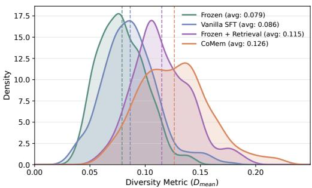  
(a) MATH – Qwen3-4B

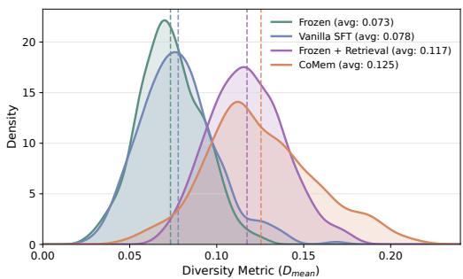  
(b) MATH – Qwen3-8B

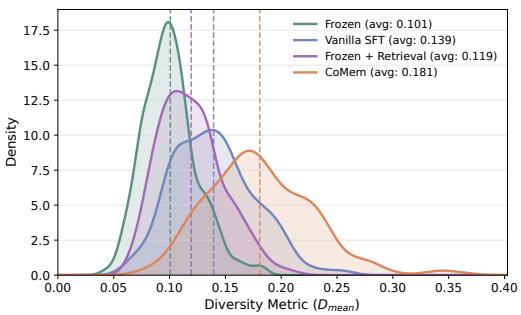  
(c) LiveCodeBench – Qwen3-4B

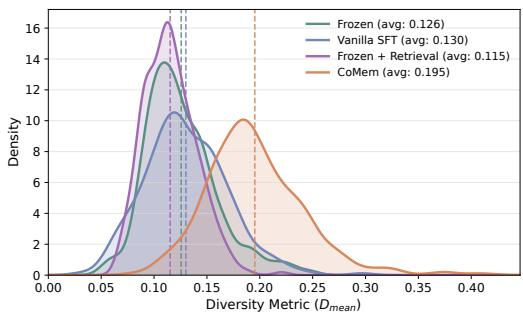  
(d) LiveCodeBench – Qwen3-8B

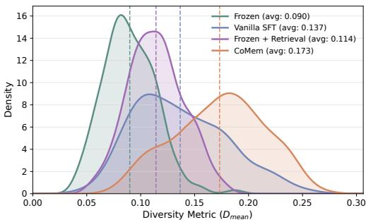  
(e) HumanEval+ – Qwen3-4B  
Figure 4: Additional hypothesis diversity results on MATH and code generation. The top row shows MATH with Qwen3-4B and Qwen3-8B, the middle row shows LiveCodeBench with the same backbones, and the bottom row shows HumanEval+ with Qwen3-4B. Dashed lines mark mean $D _ { \mathrm { m e a n } }$ scores. All configurations generate 10 hypothesis sets per question at $T = 1 . 0$

Table 5: CoMem performance across fine-tuning dataset sizes with the memory bank held fixed. Values are final accuracy for MATH and MuSiQue, and Pass@1 for HumanEval+ and LiveCodeBench, in percentages. Full denotes training on the full dataset. Dashes indicate unavailable results. Bold marks the best result within each dataset.
<table><tr><td rowspan="2">Training samples</td><td colspan="3">Qwen3-4B</td><td rowspan="2">Qwen3-8B</td></tr><tr><td>MATH</td><td>HumanEval+</td><td>LiveCodeBench</td></tr><tr><td>2,000</td><td>93.65</td><td>92.02</td><td>51.78</td><td>MuSiQue</td></tr><tr><td>3,000</td><td>92.45</td><td></td><td></td><td>80.7</td></tr><tr><td>Full</td><td>93.05</td><td>95.30</td><td>54.67</td><td>85.6</td></tr></table>

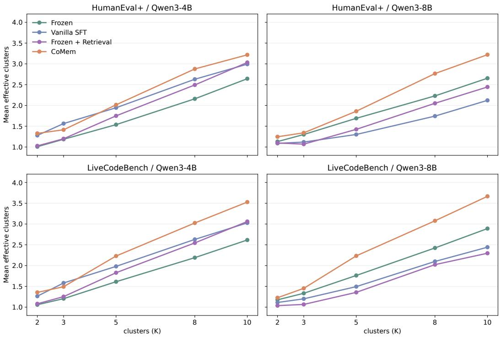  
Figure 5: Clustering-based diversity of generated hypothesis sets on HumanEval+ and Live-CodeBench with Qwen3-4B and Qwen3-8B. Curves show the mean entropy-based effective cluster count across problems. For each problem, k-means is applied jointly to 40 hypothesis sets, with 10 sets from each of Frozen, Vanilla SFT, Frozen + Retrieval, and CoMem, using K shared clusters.

## B.3 CASE STUDY

We use case studies to illustrate how CoMem promotes diversity in both hypotheses and reflections. By highlighting different potential errors, hypotheses can encourage reflections to consider alternative explanations and overlooked requirements, guiding solution revision. We present hypotheses and reflections alongside the resulting answers or code.

## B.3.1 MATH

We show two tasks in MATH where CoMem revises incorrect answers after reflection. These cases illustrate checks on the symmetry of an equation and constraints over an entire interval, with comparisons against Reflexion, DoT-Bank, and ParamMem.

## Case 1: Revisiting Symmetry in a Rational Equation

Task. Find the sum of all complex solutions to

$$
\sum _ { k = 1 } ^ { 4 } { \frac { k } { x ^ { 2 } - k } } = 2 0 1 0 x - 4 .
$$

The correct sum is $4 / 2 0 1 0 = 2 / 1 0 0 5$

## Case 1: Baselines

Reflexion. A reflection recognizes the broken symmetry. The final solution nevertheless misclassifies the equation as transcendental and returns 0 without carrying out the polynomial reduction.

DoT-Bank. A reflection identifies the linear term 2010x as breaking symmetry. The final solution misidentifies the polynomial’s degree after clearing denominators and returns 0 without computing the required coefficients.

Case 2: Baselines   
Reflexion. A reflection calls for checking the entire interval. The revised solution transforms the degree  
two Chebyshev polynomial to [0, 1] and returns 17.   
DoT-Bank. Reflections also raise the need to check interior points. The final solution nevertheless uses   
$P ( x ) = - 4 x ^ { 2 } + 2 x + 1$ and returns 7, claiming that its checks at 0, 1/2, and 1 ensure the bound everywhere.   
This candidate violates the constraint, since $\bar { P } ( 1 / 4 ) = 5 / 4 > 1 .$   
ParamMem. The final solution constructs $8 x ^ { 2 } - 8 x + 1$ and returns 17. No reflection is recorded.   
Case 2: CoMem   
Hypotheses. The guidance covers interior extrema, the applicability of Chebyshev polynomials on [0, 1],   
dependencies between coefficients, and the need to consider both upper and lower bounds.   
Reflection. “Assuming the maximum occurs only at the endpoints x = 0 and x = 1, neglecting the   
behavior of the polynomial at intermediate points like x = 0.5 or critical points within the interval.”   
Solution revision. The preceding answer is 8. The revision considers the whole interval and maps $T _ { 2 } ( t ) =$   
2t2 − 1 from [−1, 1] to [0, 1], giving   
P(x) = T2(2x − 1) = 8x2 − 8x + 1.   
This polynomial satisfies the bound throughout [0, 1], and its coefficient magnitudes sum to 8+8+1 = 17.   
Result. The revised answer is 17, matching the reference.

## Case 1: Baselines (continued)

ParamMem. Reflections also identify the asymmetry. The final solution acknowledges that x and −x need not be paired, but appeals to an unsupported cancellation argument and returns 0.

Case 1: CoMem   
Hypotheses. The guidance highlights sign and coefficient errors when handling the right-hand side   
2010x − 4, and warns against applying Vieta’s formula to an incorrectly formed polynomial.   
Reflection. “Failing to recognize that the right-hand side introduces an odd-degree term, disrupting the   
expected symmetry.”   
Solution revision. The preceding solution treats the equation as containing only even powers and returns   
0. The revision rejects this symmetry assumption and changes the answer to 4/2010.   
Result. The revised answer matches the reference.

The hypotheses flag risks in forming the polynomial, and the reflection identifies the symmetry error. The baselines also recognize this issue but retain an incorrect final answer, while CoMem’s revision corrects it.

## Case 2: Checking a Polynomial Across the Entire Interval

Task. For real $a , b , c ,$ suppose $| a x ^ { 2 } + b x + c | \leq 1$ for every $x \in [ 0 , 1 ]$ . Find the largest possible value of $| a | + | b | + | c |$ . The correct answer is 17.

The hypotheses suggest several ways to check the constrained polynomial. The reflection emphasizes the interior of the interval, and the revised answer constructs a polynomial satisfying the full constraint. DoT-Bank raises a similar check but does not enforce it in its final solution.

## B.3.2 HUMANEVAL+

We show two tasks in HumanEval+ that illustrate checks on signed-digit semantics and duplicate removal. CoMem corrects faulty code in both cases, while Reflexion, DoT-Bank, and ParamMem remain unsuccessful.

## Case 3: Handling the Sign of the First Digit

Task. count nums counts integers whose signed-digit sum is positive. For a negative integer, only the first digit is negative. Thus, −123 contributes $- \bar { 1 } + 2 + \bar { 3 } = 4$ and is counted, whereas −11 contributes −1 + 1 = 0 and is excluded.

## Case 3: Baselines

Reflexion. The final program applies the number’s sign to the entire digit sum, incorrectly excluding −123. DoT-Bank. The final program also negates the sum of all digits for a negative integer, retaining the same sign-handling error.

ParamMem. A reflection recommends: “When processing a negative number, extract the first signed digit correctly by treating it as negative and then summing the absolute values of the remaining digits.” The final program nevertheless subtracts 1 and adds all unsigned digits, incorrectly counting −11.

## Case 3: CoMem

Hypotheses. The saved hypotheses cover signed-digit contributions, distinguishing positive from nonzero   
sums, and preserving the integer return type.   
Reflection. “Adjust the logic for extracting the first digit of a negative number by using abs(num) before   
converting to a string and then modifying the first digit’s sign separately.”   
Code revision. An earlier implementation attempts int(str(num)[0]), which reads the minus sign   
for negative inputs. The repair extracts unsigned digits and restores the sign only to the first.   
digits = []   
abs\_num = abs(num)   
str\_num = str(abs\_num)   
if num < 0:   
digits.append(-int(str\_num[0]))   
else:   
digits.append(int(str\_num[0]))   
for ch in str\_num[1:]:   
digits.append(int(ch))   
if sum(digits) > 0:   
count += 1   
Result. The final implementation passes the evaluation.

The reflection turns the sign-handling concern into a concrete operation on the first digit, which the successful code implements.

## Case 4: Removing All Occurrences of Repeated Values

Task. remove duplicates removes every value that appears more than once and preserves the order of the rest. For example, [1, 2, 3, 2, 4] must become [1, 3, 4].

## Case 4: Baselines

Reflexion. A reflection states that “The code should remove all elements that occur more than once”. The final program still uses a seen set to retain the first occurrence of each value.

DoT-Bank. A reflection suggests that “the test case might be expecting a different behavior”. The final program still fails to filter values by frequency.

ParamMem. Reflections recommend including each element only once, regardless of its frequency. The final program retains repeated values rather than removing them entirely. All three baselines fail the evaluation.

## Case 4: CoMem

Hypotheses. The guidance warns against “Incorrectly assuming that the first occurrence of an element determines its frequency” and calls for checking counts before adding elements to the result.

Reflection. “Track the count of each element using a dictionary and only include elements in the result if they appear exactly once in the entire list, not just up to their first occurrence.”

Code revision. The initial program returns [1, 2, 3, 4] for [1, 2, 3, 2, 4]. The repair first counts all occurrences in count, then filters the original sequence to return [1, 3, 4].

for num in numbers:   
if count[num] == 1:   
result.append(num)   
return result   
Result. The final implementation passes the evaluation.

The hypotheses warn against relying on the first occurrence. The reflection turns this concern into a global frequency check, which the revised code implements.

## B.3.3 LIVECODEBENCH

We show three tasks in LiveCodeBench where CoMem succeeds after reflection, with comparisons against Reflexion, DoT-Bank, and ParamMem. These cases illustrate checks on rotation validity, graph-state updates, and candidate eligibility. Each case shows hypotheses alongside the corresponding reflections and code revisions.

## Case 5: Validating the Entire Rotation

Task. Given an array of distinct integers, return the minimum number of right shifts needed to sort it, or −1 if no rotation is sorted. For example, [3, 4, 5, 1, 2] requires two right shifts to become [1, 2, 3, 4, 5].

## Case 5: Baselines

Reflexion. The final code compares the cyclically indexed input against a sorted copy and computes the required shift count. It passes all 15 evaluation tests.

DoT-Bank. A reflection recommends that the solution “thoroughly validate the sorted condition after identifying the break point”. The final code still checks only the first decrease and the end-to-start relation, passing 10 of 15 tests.

ParamMem. The final code constructs the candidate rotation and compares it with a sorted copy of the array. It passes all 15 tests.

## Case 5: CoMem

Hypotheses. The used hypotheses cover whether the array is a valid rotation of a sorted sequence, the zero-shift case, and the conversion from a pivot position to the required number of right shifts.

Reflection. “After identifying the pivot, ensure that the array is a valid rotation by checking that the last element is less than or equal to the first element and that all elements after the pivot are in increasing order.”

Code revision. The earlier code finds the first decrease and checks the endpoints but can miss further decreases. The repair adds a scan of the remaining interval.

for i in range(pivot, n - 1):   
if nums[i] > nums[i + 1]:

For illustration, [3, 1, 4, 2] cannot be sorted by rotation. The earlier code returns 3, while the added check detects the second decrease and returns −1.   
Result. The final implementation passes all 15 evaluation tests.

Here, the reflection turns the rotation-validity concern into a check for additional decreases after the first pivot, which the repair implements.

## Case 6: Preserving Isolation Counts During Edge Removal

Task. Isolation maintains an undirected graph under edge insertions and removal of all edges incident to a chosen vertex. It must report the number of isolated vertices after each operation. Deleting edges from an already isolated vertex should leave this count unchanged.

## Case 6: Baselines

Reflexion. The final code updates isolation counts as existing edges are removed and leaves them unchanged when no edge exists. It passes all 14 evaluation tests.

DoT-Bank. The final code decreases the isolated count when an endpoint loses its last edge, reversing the required update. It passes 0 of 14 tests.

ParamMem. A reflection recommends: “Before updating the isolated count, check if the vertex’s degree was 0 before the change to ensure we don’t overcount isolated vertices.” The final code still increments the count after an empty deletion, passing 1 of 14 tests.

## Case 6: CoMem

Hypotheses. The used hypotheses cover accurate degree tracking, the effect of edge removal on neighboring vertices, and efficient dynamic graph updates.

Reflection. “Before removing edges, check if the vertex is already isolated and adjust the count accordingly.”

Code revision. Deleting edges from one of two isolated vertices incorrectly returns 3. The repair checks whether the vertex is already isolated, preserving the correct count of 2.

if degree[v] == 0:   
print(isolated\_count)   
continue   
Result. The final implementation passes all 14 evaluation tests.

Here, the reflection turns the state-tracking concern into a check on whether the vertex was already isolated, and the repair implements it before updating the graph.

## Case 7: Maintaining All Eligible Earlier Elements

Task. Minimize |nums[i] − nums[j]| subject to $| i - j | \geq x$ . The distance constraint is a lower bound, so sufficiently old elements remain eligible as the scan advances. Self-comparisons violate this constraint when x > 0.

## Case 7: Baselines

Reflexion. A reflection calls for considering all earlier elements at least x positions away. A later suggestion returns to removing old elements, and the final program discards eligible history.

DoT-Bank. Reflections describe the valid range as “i - x to i”. The final program retains nearby positions and permits self-comparisons, reversing the distance requirement.

ParamMem. A reflection recommends checking both neighbors of a binary-search insertion point. The final program nevertheless queries a collection that already contains the same occurrence being searched for.

## Case 7: CoMem

Hypotheses. “The sliding window approach may miss valid pairs because it only considers elements within a fixed distance, not all pairs that are at least x indices apart.”

Reflection. “The algorithm incorrectly considers elements that are not at least x indices apart due to improper window management.”

Code revision. At position i ≥ x, the repair adds the newly eligible value nums[i − x] and retains previously eligible history. It searches for the closest value to nums[i] in

$$
\mathcal { H } _ { i } = \{ \mathrm { n u m s } [ j ] ~ | ~ 0 \leq j \leq i - x \} .
$$

The maintained candidates now cover all eligible earlier positions, correcting both the removal of valid history and the inclusion of positions that are too close.

Result. The final implementation is reported to pass the complete evaluation, while the compared baselines fail.

The hypothesis questions which valid candidates are excluded, while the reflection identifies invalid candidates being included. The revision addresses both concerns by replacing a recent window with accumulated eligible history.

## B.3.4 MUSIQUE

We show two tasks in MuSiQue where CoMem returns the reference answer after reflection while Reflexion and DoT-Bank return incorrect final answers. The saved hypotheses cover entity roles, location, and administrative levels, illustrating several ways to question an initial interpretation. These excerpts are from saved refined pitfall summaries, whose correspondence to the exact input at each step is not recorded.

Case 8: Distinguishing an Actor from the Character Played

Task. The question asks who the creator of Push, Nevada played in Dazed and Confused. The passages identify Ben Affleck as a co-creator of the show and associate him with Fred O’Bannion in the film. The required answer is the character’s name, Fred O’Bannion.

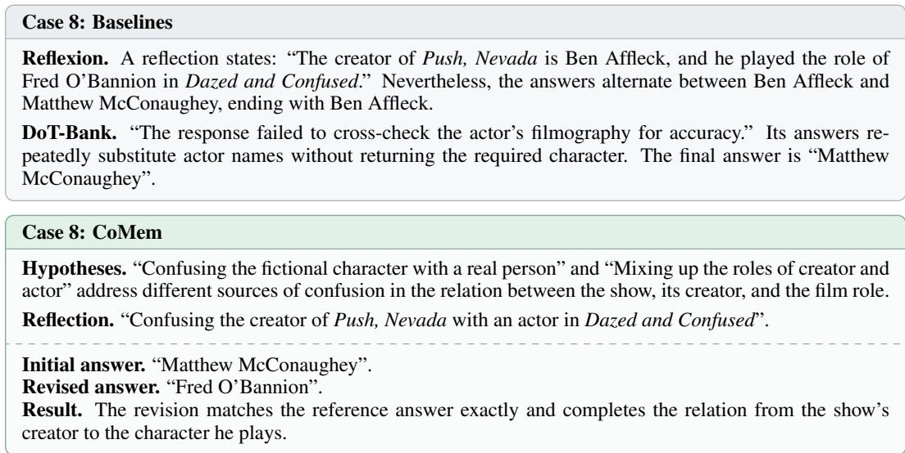  
Reflexion verbalizes the correct relation but still answers with the actor’s name. DoT-Bank continues to substitute actors. CoMem’s revision returns the character required by the question, showing the importance of both resolving entities and preserving the requested answer type.

Case 9: Preserving Administrative Levels Across a Reasoning Chain

Task. The question asks for the capital of a county bordering the county where Pierce Manufacturing is headquartered. The dataset’s annotated chain links the company to Appleton, then to Outagamie County, neighboring Brown County, and finally Green Bay.

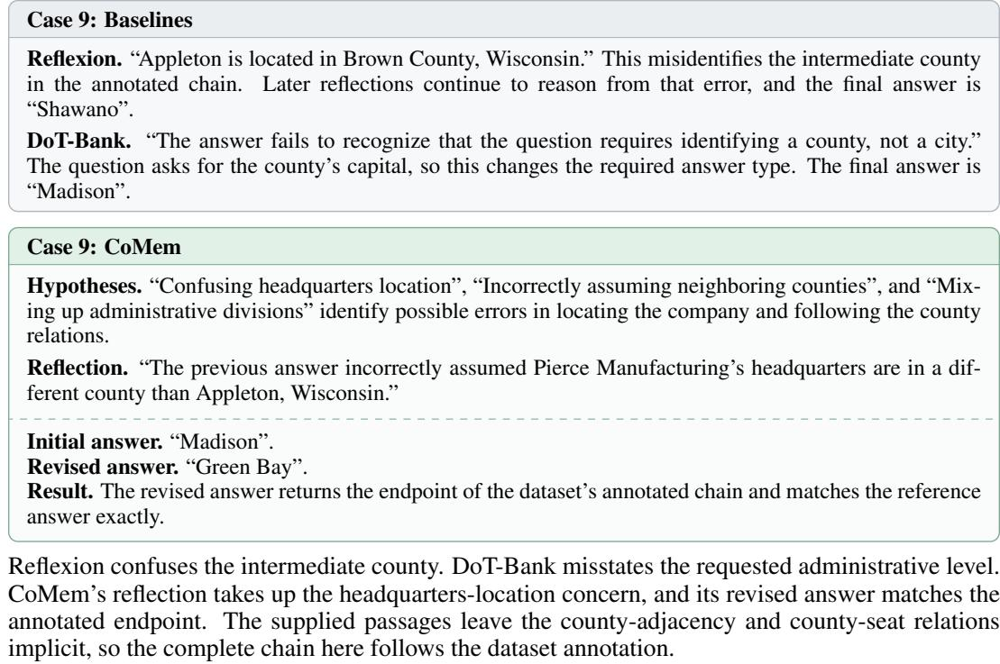

## C AI USE STATEMENT

We used generative AI tools to assist with drafting and polishing the manuscript based on outlines, technical content, experimental results, and analyses provided by the authors. This assistance included organizing the supplied material into prose, refining sentence structure, and improving clarity and readability. The authors reviewed and revised the AI-assisted text sentence by sentence and take full responsibility for the final manuscript, including its claims, results, and references.