# COMPETING LEARNING IN HYBRID ARCHITECTURES

Xingyu Shen∗, Yingfa Chen∗, Ziqing Qiao, Chaojun Xiao, Xu Han, & Zhiyuan Liu Department of Science and Technology, Tsinghua University, Beijing, China xingyu-c21@mails.tsinghua.edu.cn, chenyingfa1999@gmail.com

## ABSTRACT

Many modern language models have adopted hybrid architectures that incorporate both linear-time recurrence and softmax attention. Modern recurrence layers provide a highly expressive mixing mechanism while ensuring high throughput by compressing contextual information into a fixed-size state, but underperform softmax attention in contextual information retrieval. In this paper, we reveal a Competing Learning phenomenon where different kinds of mixers compete to learn the same function, and when any layer learns a function, it suppresses the corresponding learning signal for other layers. Layer attribution analysis reveals that under typical data distributions, modern recurrence learns retrieval functions faster than softmax attention, causing attention to fail to learn retrieval in most cases. Stopping weight updates in recurrence in the middle of training helps attention learn retrieval. Based on these results, we propose a staged training procedure for pretraining hybrid architectures on natural language. Empirical results on models up to 1B parameters show that our method results in substantial improvement in language modeling loss, common-sense reasoning, as well as a wide range of retrieval-related tasks across different context lengths. 1

## 1 INTRODUCTION

Recently, many open-weight large language models (LLMs) have adopted hybrid architectures that combine two distinct types of token mixers: linear recurrence (e.g., state space models (SSMs) and linear attention) and softmax attention (Vaswani et al., 2017). Such models have demonstrated strong language modeling capabilities while offering improved training and inference efficiency, scaling to models with up to trillions of parameters. Representative examples include Kimi K3 (Team Kimi et al., 2026), GLM-5.3-Flash (GLM Team, 2026), Qwen3.8-Flash-Next (Qwen Team, 2026), and Nemotron-3-Ultra (NVIDIA Team, 2026).

Prior work has shown that, in well-trained LLMs, different token mixers—and/or different heads within the same mixer—can specialize in distinct mixing patterns. For instance, Xiao et al. (2025) show that a subset of attention heads in Transformer models (Vaswani et al., 2017), referred to as retrieval heads, learn long-distance mixing patterns, whereas other heads primarily capture shortdistance interactions. Similarly, Bick et al. (2025) show that different heads within a linear recur rence layer exhibit retrieval behaviors over different distances. In hybrid architectures, Chen et al. (2026) further show that assigning long-distance retrieval to softmax attention and short-distance mixing to recurrent layers is beneficial across a wide range of downstream tasks. Together, these findings motivate a division of labor in hybrid models, where softmax attention specializes in longdistance mixing while recurrent layers specialize in short-distance mixing.

In this work, we identify Competing Learning, a phenomenon in which layers that acquire retrieval capabilities earlier inhibit the development of these capabilities in other layers. In the hybrid model we study, recurrent layers tend to gain this early advantage, taking over retrieval-related functions that softmax attention layers are intended to specialize in. Consequently, training hybrid models using standard practices results in softmax attention’s retrieval learning being limited by recurren layers, leading to suboptimal division of labor.

Concretely, we provide an analysis based on layer-wise contribution attribution on synthetic retrieval tasks to identify the speed of retrieval learning of different mixers in a hybrid model. The analysis provides evidence to illustrate how the learning of retrieval functions in softmax attention is inhibited by the retrieval learning of recurrent layers. Furthermore, manually stopping recurrent layers from learning retrieval at different points in the training process reveals that softmax attention starts learning retrieval as soon as recurrent layers’ learning is stopped. We also discover that under typical training distributions, with more short-distance patterns than long-distance ones, recurrence learns retrieval faster than softmax attention, resulting in suboptimal division of labor.

To address this issue, we propose Better Layer Division (BLD), a training pipeline that introduces a preliminary training stage before standard pretraining to give full-attention layers an early advantage in learning retrieval. This intervention is designed to steer Competing Learning in favor of full-attention layers, encouraging them to assume the long-range retrieval role during subsequent pretraining. We evaluate BLD on widely used benchmarks (e.g. Common-sense reasoning (CSR), recall-intensive tasks, LongPPL (Fang et al., 2025).) using hybrid models based on Kimi Delta Attention (KDA)2 (Kimi Team et al., 2025) at multiple scales, and observe improvements in benchmarks including CSR, recall-intensive tasks, RULER, LongPPL and training loss over vanilla ones.

Our main contributions are as follows:

• We investigate the training dynamics of layer-wise functional specialization in hybrid models, focusing on the allocation of retrieval-related functions between recurrent and fullattention layers.

• We identify and characterize Competing Learning through empirical analyses, revealing how early differences in retrieval learning influence subsequent layer specialization.

• We propose BLD, an LLM training pipeline that guides functional specialization by freezing the parameters of selected components during the early stage of pretraining, and verify its effectiveness on hybrid models at multiple scales and with different recurrent architectures. Empirical results show that BLD produces pretrained LLMs with performance gains on a wide range of tasks.

## 2 RELATED WORK

Hybrid Architectures Recent LLMs increasingly adopt hybrid architectures that combine softmax attention with linear attention, including GLM-5.3-Flash (GLM Team, 2026), Kimi K3 (Team Kimi et al., 2026), Qwen3.8-Flash-Next (Qwen Team, 2026), and Nemotron-3-Ultra (NVIDIA Team, 2026). Such designs combine the retrieval strength of softmax attention with the computational efficiency of linear attention. Prior work has shown that linear or recurrent models can underperform softmax attention on precise in-context retrieval (Arora et al., 2024; Bick et al., 2025; Jelassi et al., 2024). Several works improve the memory or retrieval capabilities of linear attention through architectural or state-space enhancements (Yang et al., 2023; 2025b; Qin et al., 2024; Shen et al., 2026). In contrast, our work does not enhance the retrieval capacity of linear attention itself, but improves the pre-training of hybrid models without architectural modifications. Hybrid archi tectures instead retain softmax-attention layers for long-range retrieval while using efficient linear attention for most computation (Kimi Team et al., 2025). Our work focuses on better realizing this architectural complementarity during pre-training. Most of our experiments are conducted on Kimi-Linear-style models based on Kimi Delta Attention (KDA) (Kimi Team et al., 2025).

Labor Division in Non-Hybrid Models Prior work has shown that only a small subset of attention heads develops strong long-context retrieval behavior (Wu et al., 2025). DuoAttention exploits this functional specialization by distinguishing retrieval heads from streaming heads for efficient inference (Xiao et al., 2025). Other works leverage already-formed retrieval heads to construct posttraining signals for improving long-context performance and contextual faithfulness (Huang et al., 2025; Ma & Okazaki, 2026). Recent studies further analyze how retrieval heads are learned or evolve during context extension and long-context continual pre-training (Zhao et al., 2024; Liang et al., 2026). These works mainly study or exploit specialization among homogeneous softmax-attention heads, rather than the allocation of retrieval capability across heterogeneous attention components.

In hybrid models, however, such allocation is critical: if all retrieval heads emerge in linear-attention components, the intended architectural advantage of combining efficient linear attention with the stronger retrieval capability of softmax attention would be largely undermined.

Labor Division in Hybrid Models Prior work has observed functional specialization between attention and recurrent components in hybrid models, with attention playing a particularly important role in exact retrieval and recall (Bick et al., 2025; Afendulev et al., 2026; Wang et al., 2025). These works mainly characterize specialization after it has emerged, while other studies exploit such specialization to construct hybrid models from pretrained Transformers (Chen et al., 2026; Bick et al., 2026; Li et al., 2026). In contrast, we study how this division of labor forms during hybridmodel pre-training and how it can be actively optimized. In the work most closely related to ours, Qiao et al. (2026) show that efficient-attention modules can weaken the optimization pressure for full-attention layers and delay retrieval-head formation. Our work further identifies the underlying competition in retrieval-specific learning signals: linear-attention and softmax-attention layers both gradually acquire retrieval capabilities, and layers that learn retrieval earlier reduce the retrievalspecific prediction error, thereby weakening the learning signal available to other layers. We refer to this as the Competing Learning phenomenon and use it to guide pre-training toward stronger retrieval specialization in softmax-attention layers.

## 3 COMPETING LEARNING IN HYBRID ATTENTION MODELS

Central to our paper is the Competing Learning phenomenon, which is stated as follows:

## Competing Learning Phenomenon

During hybrid-model pre-training, both recurrent and softmax-attention layers can acquire in-context retrieval capabilities. If some layers learn retrieval earlier, they can reduce the retrieval-specific prediction error, weakning the training signal for other layers, slowing their acquisition of the same capability.

To show the causes and effects of this phenomenon, we conduct a series of layer attribution and gradient intervention experiments to monitor the retrieval learning of each layer in a hybrid model. In the following sections, we first propose a synthetic retrieval task (Section 3.1). Then, we propose a novel metric for determining how much a layer contributes to the model’s retrieval abilities (Section 3.2). Finally, we train a series of hybrid models on this task and inspect the contributions of each layer to monitor their retrieval learning over time (Section 3.3).

Concretely, we conduct the following three sets of experiments:

• Section 3.3.1: We provide the experimental evidence for the Competing Learning phenomenon with weight freezing.

• Section 3.3.2: We provide direct gradient evidence for the Competing Learning phenomenon through weight freezing and unfreezing.

• Section 3.3.3: We show how the distribution of short and long-distance patterns chooses the winner of Competing Learning phenomenon.

Altogether, we demonstrate the existence of Competing Learning in hybrid models and that KDA layers learn modeling short-distance patterns faster than attention layers. Since short-distance patterns are more frequent than long-distance patterns in natural language pretraining (Futrell et al., 2015), this leads to a suboptimal labor division in direct pretraining of hybrid models.

## 3.1 SPACED RETRIEVAL

In order to evaluate retrieval ability without interference from complicated pattern in natural language, we craft a synthetic task called “Spaced Retrieval” in the following format:

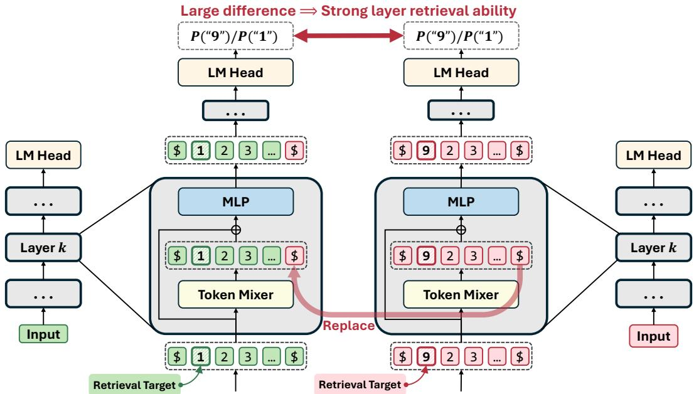  
Figure 1: Illustration of our layer retrieval ability estimation method (described in Section 3.2). As an example, the sequence to copy $\mathrm { i s } \ ^ { 6 6 } 1 2 3 ^ { , 5 }$ , and the layer under inspection is layer k. The difference in probability change tells us the contribution of layer k in retrieving the target token $" 9 "$

$$
\begin{array} { r l } { \mathrm { I n p u t : } } & { \mathbb { S } \mathbb { X } _ { 1 } \mathbb { X } _ { 2 } \cdot \cdot \cdot \mathbb { X } _ { \mathrm { t } } \underbrace { \bigcup \cdot \cdot \cdot \bigcup } _ { g \mathrm { s p a c e s } } \mathbb { S } } \\ { \mathrm { O u t p u t : } } & { \mathbb { X } _ { 1 } \mathbb { X } _ { 2 } \cdot \cdot \cdot \mathbb { X } _ { \mathrm { t } } } \end{array}
$$

where $g$ is the gap between the source and target sequence. Each ${ \tt X } _ { \mathrm { i } }$ is a token sampled from $\{ 0 , 1 , \ldots , 9 \}$ uniformly at random. We can adjust $t , g$ to change the properties of this task. We use $t = 5$ and $g ^ { ' } \in \{ 6 4 , 8 1 \dot { 9 } 2 \}$ for the training and evaluation in following experiments.

## 3.2 LAYER RETRIEVAL ABILITY SCORE ESTIMATION

Here, we design a method for estimating a layer’s contribution to the mode’s retrieval abilities, which is important for us to monitor the learning of Spaced Retrieval of different layers in a hybrid model. Figure 1 provides an illustration of this method.

Model Notations Let $\mathbf { H } _ { l - 1 } ( x ) \in \mathbb { R } ^ { N \times d }$ be the residual stream entering the l-th layer for input x. Each layer computes

$$
\mathbf { U } _ { l } ( { \boldsymbol { x } } ) = \operatorname { M i x e r } _ { l } \bigl ( \mathbf { H } _ { l - 1 } ( { \boldsymbol { x } } ) \bigr ) ,\tag{1}
$$

$$
\mathbf { R } _ { l } ( x ) = \mathbf { H } _ { l - 1 } ( x ) + \mathbf { U } _ { l } ( x ) ,\tag{2}
$$

$$
\mathbf { H } _ { l } ( x ) = \mathbf { R } _ { l } ( x ) + \mathrm { M L P } _ { l } \big ( \mathbf { R } _ { l } ( x ) \big ) ,\tag{3}
$$

where $\mathrm { M i x e r } _ { l }$ is a recurrence or softmax attention layer. We write $\mathbf { h } _ { l } ( x , t ) = [ \mathbf { U } _ { l } ( x ) ] _ { t }$ for its output at token position $t ,$ before residual addition. Let ${ \mathbf z } ( x , t )$ denote the final logits from the model’s native output head, and define the answer margin of two tokens $a , b$ as

$$
m ( { \mathbf { z } } ; a , b ) = [ { \mathbf { z } } ] _ { a } - [ { \mathbf { z } } ] _ { b } .\tag{4}
$$

Retrieval Ability Estimation Consider two input prefixes $x ^ { A }$ and $x ^ { B }$ of equal length $j ,$ differing only in the source digit to be retrieved: a in $x ^ { \hat { A } }$ and b in $x ^ { B }$ . Their mixer outputs at layer l are denoted by $\mathbf { U } _ { l } ( x ^ { A } )$ and $\mathbf { U } _ { l } ( x ^ { B } )$ . We replace only the output at the last unmasked position. We also omit the layer index for simplicty, and we get:

$$
\begin{array} { r l } & { \mathbf { U } ( x ^ { A } ) = \big [ \mathbf { U } _ { 1 } ( x ^ { A } ) , \dots , \mathbf { U } _ { j - 1 } ( x ^ { A } ) , \mathbf { U } _ { j } ( x ^ { A } ) \big ] , } \\ & { \widetilde { \mathbf { U } } ^ { A  B } = \big [ \mathbf { U } _ { 1 } ( x ^ { A } ) , \dots , \mathbf { U } _ { j - 1 } ( x ^ { A } ) , \mathbf { U } _ { j } ( x ^ { B } ) \big ] , } \end{array}\tag{5}
$$

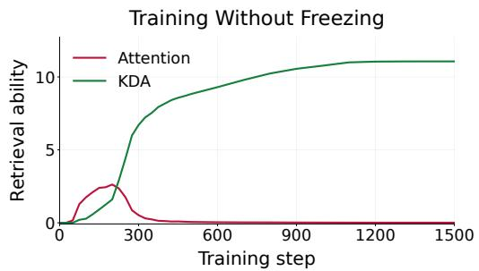  
Figure 2: The average retrieval ability of the two types of layer in a hybrid model trained on Spaced Retrieval.

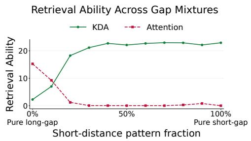  
Figure 3: The retrieval ability of the two different kinds of layer in a hybrid model, trained on Spaced Retrieval with different data mixtures.

where $\mathbf { U } _ { t } ( x )$ denotes the mixer output at position t.

During the forward pass of $x ^ { A }$ , we substitute $\widetilde { \mathbf { U } } ^ { A  B } \mathrm { f o r } \mathbf { U } ( x ^ { A } )$ before residual addition, retaining the residual input from $x ^ { A }$ . The current layer’s MLP and all subsequent computations proceed normally with unchanged parameters. We denote the resulting logits at position j by $\widetilde { \mathbf z } _ { l , j } ^ { A  B }$

The retrieval ability score of layer l for this input pair and answer position is

$$
\begin{array} { r } { \boxed { C _ { l } ^ { A  B } = m \big ( { \mathbf z } ( x ^ { A } , j ) ; a , b \big ) - m \big ( \widetilde { \mathbf z } _ { l , j } ^ { A  B } ; a , b \big ) . } } \end{array}\tag{6}
$$

This score indicates the reduction in correct-answer preference after replacing the layer’s output with a misleading output with a different answer. Therefore, the layers that contribute more to retrieval will have large scores, because the model’s retrieval performance drops more severely when these layers’ retrieval are interfered with.

## 3.3 ANALYSIS EXPERIMENTS

With the above task and estimation method, we can now perform a series of experiments to analyze the phenomenon of Competing Learning for hybrid models, which is central to our paper.

Experimental Configuration We train several hybrid models on the Spaced Retrieval task. Each model has 3.6M parameters and consists of two KDA (a widely-used linear recurrence architecture) layers and two attention layers. Unless specified otherwise, we use 1:1 mixtures of examples with $g = 6 4$ and $g = 8 1 9 2$ . During training, we only compute the loss on output tokens using loss masks. Here, we report the results for $g = 8 1 9 2$ , but we emphasize that the results of $g = 6 4$ are similar. The results for $g = 6 4$ and more experimental details can be found in Appendix A.

## 3.3.1 SUPPRESSING LEARNING IN ONE TOKEN MIXER STIMULATES LEARNING INANOTHER

Without intervention, KDA layers become dominant in terms of retrieval ability in this setting, as shown in Figure $2 .$ To investigate how their dominance affects the attention layers, we freeze all KDA layers at different training steps and continue training the remaining model components. As shown in the left part of Figure 4, the attention layers’ retrieval ability increases sharply immediately after each freezing intervention. This observation is consistent with the hypothesis that, once KDA layers acquire some retrieval capability, they suppress the acquisition of the same capability by attention layers, providing evidence for the Competing Learning phenomenon.

Furthermore, we explore how unfreezing KDA layers at a later training step influences learning competition. In the right plot of Figure 4, runs in which KDA is frozen earlier than step 125 have higher retrieval ability than when the KDA remains frozen for the rest of the training, while runs in which KDA is frozen later than step 125 have lower retrieval ability than when the KDA remains frozen. Moreover, these changes appear almost immediately after KDA is unfrozen. This clear polarization may be attributed to the fact that attention layers in checkpoints where freezing began earlier than step 125 have enough retrieval advantages by freezing KDA layers long enough. At these early freezing checkpoints, attention layers have already accumulated a sufficient advantage in retrieval performance, substantially outperforming KDA layers. Consequently, once freezing is lifted, attention layers tend to further reinforce their retrieval capabilities, while KDA layers are driven to specialize in other functions. This is reflected in Figure 4: at checkpoints where attention layers have established a sufficiently strong advantage, their retrieval ability further improves after unfreezing. In contrast, at checkpoints where this advantage is insufficient, attention layers are once again outcompeted by KDA layers, leading to a decline in their retrieval ability.

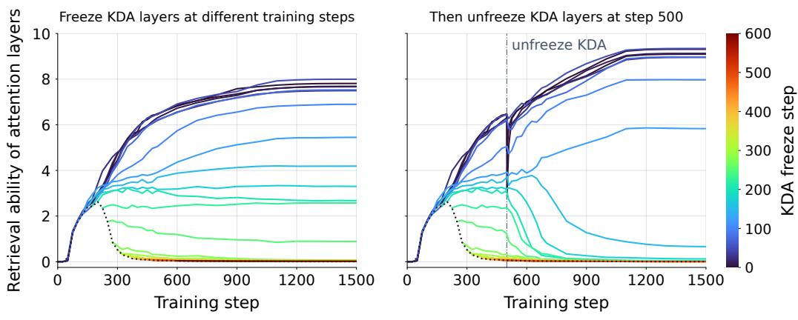  
Dotted: never freeze KDA

Figure 4: Demonstration of Competing Learning. The curves indicate the retrieval ability of attention layers in a hybrid model consisting of attention and recurrent layers (KDA), trained on our retrieval task, Spaced Retrieval (Section 3.1).  
Relative Gradient Dynamics under KDA Freezing  
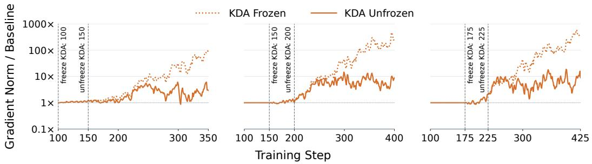  
Figure 5: Relative gradient magnitude changes in the Attention layers compared to the baseline without KDA freezing. KDA is frozen at steps 100, 150, or 175, with an unfreezing branch introduced 50 steps later. Across these timings, keeping KDA frozen progressively amplifies attention gradient norms relative to the baseline, whereas unfreezing KDA substantially attenuates this amplification.

Takeaways In hybrid models, KDA and attention layers compete to learn retrieval, with KDA initially gaining an advantage due to its stronger inductive bias toward short-range patterns. Temporarily freezing the dominant KDA layers can shift—and, with sufficient duration, even reverse—the winner of this competition.

## 3.3.2 GRADIENT EVIDENCE OF COMPETING LEARNING

We further investigate how the freezing intervention affects gradient dynamics. As shown in Figure 5, the gradient norm of the attention layers in the frozen checkpoint reaches approximately 10× that of the baseline checkpoint, which has never undergone freezing. Moreover, the gap between the dotted and solid curves indicates that unfreezing the KDA layers mitigates this gradient amplification. Notably, the gradient norm increases progressively rather than abruptly, suggesting that this amplification emerges from the evolving optimization dynamics rather than as an immediate consequence of freezing. This observation further supports Competing Learning, suggesting a selfreinforcing optimization mechanism in which the current parameter configuration determines the allocation of learning signals, progressively amplifying the advantages of already dominant compo nents. See Appendix I.1 for more details.

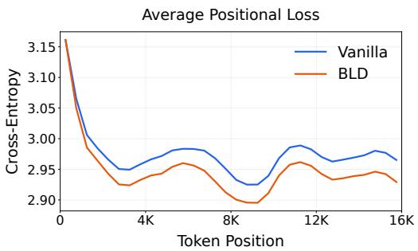  
Figure 6: Average position-wise loss of 510M BLD/vanilla model across all examples.

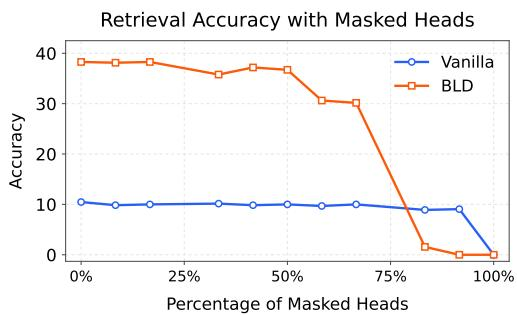  
Figure 7: The retrieval accuracy when masking a fraction of the heads.

Takeaways Freezing KDA progressively amplifies attention layers’ gradients, while unfreezing mitigates this effect. This supports Competing Learning: learning signals depend on the current ability gap of components, reinforcing the advantages of already dominant components.

## 3.3.3 DIFFERENT TRAINING DATA PREFER DIFFERENT ARCHITECTURES

We further investigate how the distribution of gap (g) in the training data influences the learnability of retrieval in different mixers. To this end, we train the hybrid model using different mixture proportions of short-distance (g = 64) and long-distance (g = 8192) examples. As shown in Figure 3, attention layers become more important as the proportion of long-distance examples increases, whereas KDA layers are more likely to dominate when the long-distance patterns do not appear overwhelmingly more than short-distance patterns. This is because KDA initializes forget gates with low values, which gives this architecture a short-distance inductive bias (See Appendix B for a more specific explanation).

Takeaways Different mixers learn retrieval at different speeds, depending on the data distribution. While both mixers can acquire the same retrieval abilities, the mixer that learns faster will become dominant, limiting the learning of the other mixer.

Implications Applying the traditional training recipe to a hybrid model can lead to a suboptimal division of labor. Because short-distance patterns occur more frequently than long-distance patterns in natural language (Futrell et al., 2015), the training objective may encourage KDA to dominate retrieval, suppressing the training of attention layers. This issue is less problematic in homogeneous architectures such as Transformers, where all layers share the same architecture and, consequently, have the same potential for retrieval.

## 4 LLM PRETRAINING EXPERIMENTS

In this section, we show that we can leverage insights about Competing Learning to achieve improved LLM performance in natural language pre-training.

## 4.1 METHOD: BETTER LAYER DIVISION

Based on the analysis results in Section 3.3.1, we propose Better Layer Division (BLD), which freezes RNN layers’ weights during the early stage of pretraining, thereby giving the attention layers a first-mover advantage in Competing Learning. Importantly, this intervention establishes a corrected division of labor between the two components, which is subsequently preserved and further reinforced throughout the remainder of pretraining. This better labor division translates to improved model performance.

## 4.2 EXPERIMENTAL DETAILS

Model Configuration We train a family of KDA–attention hybrid models ranging from 180M to 1B total parameters, including embeddings. All models share a repeating four-layer pattern consisting of one attention layer followed by three KDA layers, maintaining a fixed 3:1 KDA-to-attention ratio across scales. The layers are stacked in the form of “Attention-KDA-KDA-KDA”, and all layers are using NoPE (not adopting RoPE, which is reported to be better than using RoPE in KDA-based hybrid architecture (Kimi Team et al., 2025)). We scale the models by varying their depth and hidden width. At each scale, BLD and vanilla pre-training use identical architectures. Detailed model configurations are provided in Appendix C.

Training Configuration We compare BLD against vanilla pre-training by training models from scratch with token budgets scaled proportionally to their non-embedding parameter counts, following the Chinchilla scaling principle (training tokens are roughly 20 × of parameters) (Hoffmann et al., 2022). All models are trained on DCLM (Li et al., 2024), a high-quality open-source pretraining corpus, using the Qwen3 tokenizer (Yang et al., 2025a) and a context length of 16,384 tokens. For BLD, the KDA blocks remain frozen for approximately 1/10 of the subsequently unfrozen pretraining part. The vanilla baseline updates all parameters, using the same training data, token budgets, and optimization schedule.

We use AdamW during the initial portion of pre-training, followed by Muon with auxiliary AdamW after unfreezing, with identical optimization schedules for BLD and the vanilla baseline. Detailed hyperparameters and token budgets are provided in Appendix D.

Evaluation Tasks We evaluate models across common-sense reasoning (CSR), recall-intensive tasks, RULER, and language modeling, without fine-tuning. See Appendix E for more details.

• CSR is measured by the average score on seven benchmarks: ARC-Easy, ARC-Challenge (Clark et al., 2018), HellaSwag (Zellers et al., 2019), PIQA (Bisk et al., 2020), BoolQ (Clark et al., 2019), WinoGrande (Sakaguchi et al., 2019), LAMBADA (Paperno et al., 2016).

• Recall is evaluated on six tasks from the Based (Arora et al., 2024) evaluation suite: SWDE (Lockard et al., 2019), FDA (Arora et al., 2023), SQuAD (Rajpurkar et al., 2018), TriviaQA (Joshi et al., 2017), DROP (Dua et al., 2019), and Natural Questions (Kwiatkowski et al., 2019).

• RULER (Hsieh et al., 2024) is evaluated with average scores across the 57 evaluated RULER task–length combinations spanning 1K to 16K tokens.

• Language modeling is evaluated using word-level perplexity on WikiText-2 (Merity et al., 2016) and selected-token perplexity on LongPPL (Fang et al., 2025).

## 4.3 MAIN RESULTS

Downstream Tasks As shown in Table 1, BLD models achieve notably lower LM losses. They also show a modest improvement in CSR performance, while exhibiting substantial gains on retrieval-oriented tasks, including Recall and RULER. Moreover, the PPL metrics, which reflect overall long-context modeling capability, consistently favor BLD by a large margin. The specific subtask scores are included in Appendix F.

Context Utilization We evaluate the long-context utilization of our models as Sun et al. (2024) by computing LM loss as a function of context length. Specifically, we calculated next-token prediction loss on Books3,BookCorpus2 (Gao et al., 2020) as a function of token positions, up to 16K. Figure 6 shows that BLD model has a lower loss especially in the later position, highlighting better context utilization abilities by BLD models. The results of all model sizes and other details are included in Appendix G.

<table><tr><td>Size</td><td>Model</td><td>LM Loss ↓</td><td>CSR ↑</td><td>Recall ↑</td><td>RULER ↑</td><td>WikiText ↓</td><td>LongPPL ↓</td></tr><tr><td>180M</td><td>Vanilla</td><td>3.5903</td><td>37.76</td><td>10.39</td><td>2.84</td><td>54.00</td><td>258.47</td></tr><tr><td>180M</td><td>BLD</td><td>3.5702</td><td>37.49</td><td>14.12</td><td>8.82</td><td>50.38</td><td>108.64</td></tr><tr><td>250M</td><td>Vanilla</td><td>3.2844</td><td>38.31</td><td>21.54</td><td>17.32</td><td>36.52</td><td>57.22</td></tr><tr><td>250M</td><td>BLD</td><td>3.2642</td><td>41.49</td><td>25.33</td><td>20.98</td><td>34.27</td><td>17.96</td></tr><tr><td>390M</td><td>Vanilla</td><td>3.1611</td><td>41.91</td><td>26.73</td><td>22.32</td><td>29.10</td><td>17.09</td></tr><tr><td>390M</td><td>BLD</td><td>3.1441</td><td>44.25</td><td>31.27</td><td>26.89</td><td>28.11</td><td>11.16</td></tr><tr><td>510M</td><td>Vanilla</td><td>3.0553</td><td>44.80</td><td>30.50</td><td>25.25</td><td>26.02</td><td>14.56</td></tr><tr><td>510M</td><td>BLD</td><td>3.0461</td><td>44.49</td><td>34.70</td><td>29.42</td><td>25.57</td><td>9.21</td></tr><tr><td>750M</td><td>Vanilla</td><td>2.9773</td><td>45.94</td><td>33.52</td><td>26.53</td><td>23.28</td><td>12.68</td></tr><tr><td>750M</td><td>BLD</td><td>2.9705</td><td>46.61</td><td>37.52</td><td>32.82</td><td>22.75</td><td>8.08</td></tr><tr><td>1B</td><td>Vanilla</td><td>2.8744</td><td>48.69</td><td>36.50</td><td>32.75</td><td>20.52</td><td>7.69</td></tr><tr><td>1B</td><td>BLD</td><td>2.8680</td><td>49.45</td><td>38.14</td><td>36.04</td><td>20.15</td><td>6.50</td></tr></table>

Table 1: Zero-shot evaluation results of BLD (ours) versus vanilla pre-training. Size denotes total parameters, including embeddings, rounded to the nearest 10M. CSR and Recall are macro averages over seven and six tasks, respectively. RULER averages 57 task–length entries at 1K–16K. All three scores are percentages. Bold indicates the better result at each model size.

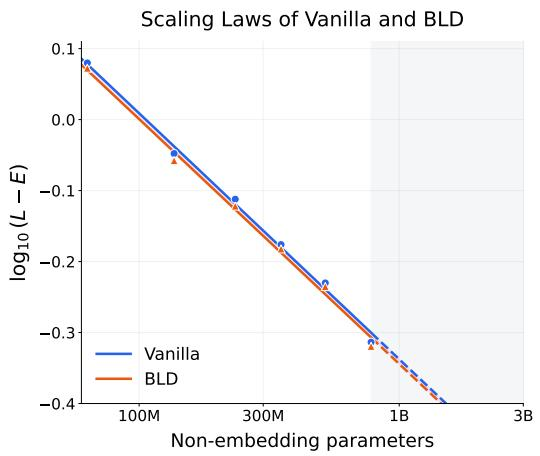

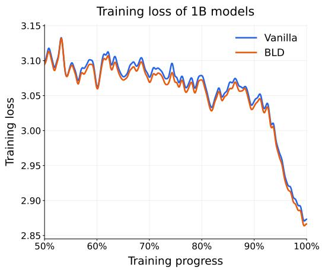  
Figure 8: Left: Loss as a function of non-embedding model size, fitted with power-plus-constant scaling laws. Right: The training-loss curve of the 1B vanilla and BLD models.

Scaling Laws We also fit the loss as a power-law function of model size to verify that BLD is scalable to larger model scales (shown in Figure 8), and the fitted curves suggest that BLD retains its loss advantage well beyond the evaluated model scales.

## 4.4 TRANSFERABILITY TO OTHER RNN ARCHITECTURES

We also applied BLD to two other popular recurrent mixers, Gated DeltaNet (GDN) (Yang et al., 2025b) and Gated Linear Attention (GLA) (Yang et al., 2023). These models have the same configuration as the model in Section 4.2, but with KDA layers replaced with either of these layers. Training configuration is also the same as in Section 4.2. Further details are reported in Appendix H.

Takeaways The advantages of BLD, lower training loss and better downstream task performance, are transferable to other linear recurrence architectures.

<table><tr><td>Architecture</td><td>Size</td><td>Model</td><td>LM Loss ↓</td><td>CSR ↑</td><td>Recall ↑</td><td>RULER↑</td><td>WikiText ↓</td><td>LongPPL ↓</td></tr><tr><td>GDN</td><td>400M</td><td>Vanilla</td><td>3.1947</td><td>43.23</td><td>17.33</td><td>12.33</td><td>31.25</td><td>152.84</td></tr><tr><td>GDN</td><td>400M</td><td>BLD</td><td>3.1624</td><td>43.90</td><td>32.05</td><td>25.42</td><td>28.69</td><td>11.77</td></tr><tr><td>GLA</td><td>400M</td><td>Vanilla</td><td>3.2911</td><td>41.19</td><td>24.58</td><td>23.98</td><td>34.57</td><td>32.69</td></tr><tr><td>GLA</td><td>400M</td><td>BLD</td><td>3.2113</td><td>43.20</td><td>30.12</td><td>28.54</td><td>30.65</td><td>13.26</td></tr></table>

Table 2: Zero-shot evaluation results of BLD (ours) versus vanilla pre-training with GDN and GLA hybrid models with 3:1 recurrence-to-attention ratio.

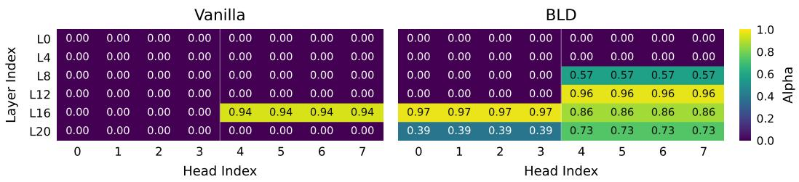

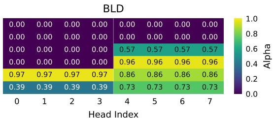  
Figure 9: The α values of attention heads. With GQA, query heads 0–3 and 4–7 share a KV head within each group and therefore share the same KV-head-level α value. Greater α values indicate heads that are important for long-distance retrieval.

## 4.5 EVIDENCE FOR LABOR DIVISION CHANGE IN ATTENTION SCORES

We further provide direct evidence that BLD induces stronger functional differentiation. Specifically, following Xiao et al. (2025), we analyze 510M KDA-attention hybrid models by training α values to distinguish retrieval heads, which are responsible for long-distance information retrieval, from streaming heads, which primarily perform short-distance token mixing. α measures a head’s reliance on full-context attention, with larger values indicating greater reliance. In other words, heads with greater α values are more important for long-distance retrieval. The α values are trained for 1,000 steps. More experimental details and results are reported in Appendix I.

As shown in Figure 9, the attention heads in the BLD model exhibit higher α values than those in the vanilla model, indicating that BLD contains more retrieval heads that attend to long-range tokens. Figure 7 reports model’s retrieval accuracy as attention heads are progressively masked in ascending order of their α values. For BLD, the accuracy remains largely unchanged as lowα heads are masked and drops sharply only when the final three heads, which have the highest α values, are removed. This suggests that these three heads play a critical role in retrieval, and we therefore identify them as retrieval heads. In contrast, the vanilla model exhibits a substantial accuracy drop only when its single highest-α head is masked, indicating that it contains only one retrieval head.

Takeaways BLD promotes a greater degree of functional specialization, with more attention heads specializing in long-range retrieval. This behavior aligns with the motivation underlying our method.

## 5 CONCLUSION

In this work, we first identify the Competing Learning phenomenon and provide supporting experimental evidence. We then show that directly pretraining hybrid models can lead to a suboptimal division of labor among different architectural components. To address this issue, we propose BLD and validate its effectiveness through scalable experiments. By promoting a more effective division of labor, BLD consistently improves model capabilities across a wide range of dimensions.

Nevertheless, BLD represents only a preliminary approach to addressing the Competing Learning phenomenon in the training of hybrid models. We believe that a deeper understanding of the Competing Learning phenomenon will provide further insights into the division of labor within hybrid architectures and inspire the development of more advanced neural architectures and training strategies that better account for this phenomenon and achieve stronger performance.

## AI USE STATEMENT

In this work, we used generative AI tools for research execution. We have not used generative AI tools for research ideation, and LLM data-generation is not applicable to this work. Additionally, we used generative AI tools for polishing the manuscript. We have reviewed all AI-assisted work. LLM-generated code was verified and tested for correctness by 2 authors. We take responsibility for the final content of this work, including text, claims or artifacts produced with the aid of generative AI.

## REPRODUCIBILITY STATEMENT

We provide the experimental settings needed to reproduce our results in the appendix. Appendix A details the synthetic retrieval task, model configuration, training procedure, and freezing interventions. Appendices C and D describe the language-model architectures, training data, token budgets, optimization settings, and parameter-freezing scope. Evaluation protocols and detailed results are provided in Appendices E and F. Appendices G and H describe the position-wise loss analysis and the GDN/GLA experiments, respectively.

We will publicly release the training and evaluation code, relevant experimental data, and model checkpoints to facilitate reproduction.

## REFERENCES

Kirill Afendulev, Alexey Dontsov, Elena Tutubalina, and Anton Korznikov. What attention recalls and recurrence controls in hybrid language models. arXiv preprint arXiv:2609.04434, 2026.

Joshua Ainslie, James Lee-Thorp, Michiel de Jong, Yury Zemlyanskiy, Federico Lebron, and Sumit Sanghai. GQA: Training generalized multi-query transformer models from multi-head checkpoints. In Houda Bouamor, Juan Pino, and Kalika Bali (eds.), Proceedings of the 2023 Conference on Empirical Methods in Natural Language Processing, pp. 4895–4901, Singapore, December 2023. Association for Computational Linguistics. doi: 10.18653/v1/2023.emnlp-main.298. URL https://aclanthology.org/2023.emnlp-main.298/.

Simran Arora, Brandon Yang, Sabri Eyuboglu, Avanika Narayan, Andrew Hojel, Immanuel Trummer, and Christopher Re. Language models enable simple systems for generating structured views ´ of heterogeneous data lakes. arXiv preprint arXiv:2304.09433, 2023.

Simran Arora, Sabri Eyuboglu, Michael Zhang, Aman Timalsina, Silas Alberti, Dylan Zinsley, James Zou, Atri Rudra, and Christopher Re. Simple linear attention language models balance ´ the recall-throughput tradeoff. arXiv:2402.18668, 2024.

Aviv Bick, Eric Xing, and Albert Gu. Understanding the skill gap in recurrent language models: The role of the gather-and-aggregate mechanism. arXiv preprint arXiv:2504.18574, 2025.

Aviv Bick, Eric P Xing, and Albert Gu. Retrieval-aware distillation for transformer-ssm hybrids. arXiv preprint arXiv:2602.11374, 2026.

Yonatan Bisk, Rowan Zellers, Ronan Le Bras, Jianfeng Gao, and Yejin Choi. Piqa: Reasoning about physical commonsense in natural language. In Thirty-Fourth AAAI Conference on Artificial Intelligence, 2020.

Yingfa Chen, Zhen Leng Thai, Zihan Zhou, Zhu Zhang, Xingyu Shen, Shuo Wang, Chaojun Xiao, Xu Han, and Zhiyuan Liu. Hybrid linear attention done right: Efficient distillation and effective architectures for extremely long contexts. arXiv preprint arXiv:2601.22156, 2026.

Christopher Clark, Kenton Lee, Ming-Wei Chang, Tom Kwiatkowski, Michael Collins, and Kristina Toutanova. Boolq: Exploring the surprising difficulty of natural yes/no questions. In NAACL, 2019.

Peter Clark, Isaac Cowhey, Oren Etzioni, Tushar Khot, Ashish Sabharwal, Carissa Schoenick, and Oyvind Tafjord. Think you have solved question answering? try arc, the ai2 reasoning challenge. arXiv:1803.05457v1, 2018.

Dheeru Dua, Yizhong Wang, Pradeep Dasigi, Gabriel Stanovsky, Sameer Singh, and Matt Gardner. Drop: A reading comprehension benchmark requiring discrete reasoning over paragraphs. In Proceedings ofthe 2019 Conference ofthe North American Chapter ofthe Associationfor Computational Linguistics: Human Language Technologies, Volume 1 (Long and Short Papers), pp. 2368–2378, 2019.

Lizhe Fang, Yifei Wang, Zhaoyang Liu, Chenheng Zhang, Stefanie Jegelka, Jinyang Gao, Bolin Ding, and Yisen Wang. What is wrong with perplexity for long-context language modeling? In International Conference on Learning Representations, volume 2025, pp. 94541–94563, 2025.

Richard Futrell, Kyle Mahowald, and Edward Gibson. Large-scale evidence of dependency length minimization in 37 languages. Proceedings ofthe National Academy ofSciences, 112(33):10336– 10341, 2015. doi: 10.1073/pnas.1502134112. URL https://www.pnas.org/doi/abs/ 10.1073/pnas.1502134112.

Leo Gao, Stella Biderman, Sid Black, Laurence Golding, Travis Hoppe, Charles Foster, Jason Phang, Horace He, Anish Thite, Noa Nabeshima, et al. The pile: An 800gb dataset of diverse text for language modeling. arXiv preprint arXiv:2101.00027, 2020.

GLM Team. Glm-5.3-flash: Frontier intelligence, flash cost, 2026. URL https://z.ai/blog/ glm-5.3-flash.

Jordan Hoffmann, Sebastian Borgeaud, Arthur Mensch, Elena Buchatskaya, Trevor Cai, Eliza Rutherford, Diego de Las Casas, Lisa Anne Hendricks, Johannes Welbl, Aidan Clark, et al. Training compute-optimal large language models. arXiv preprint arXiv:2203.15556, 2022.

Cheng-Ping Hsieh, Simeng Sun, Samuel Kriman, Shantanu Acharya, Dima Rekesh, Fei Jia, Yang Zhang, and Boris Ginsburg. Ruler: What’s the real context size of your long-context language models? arXiv preprint arXiv:2404.06654, 2024.

Lei Huang, Xiaocheng Feng, Weitao Ma, Yuchun Fan, Xiachong Feng, Yangfan Ye, Weihong Zhong, Yuxuan Gu, Baoxin Wang, Dayong Wu, et al. Improving contextual faithfulness of large language models via retrieval heads-induced optimization. In Proceedings of the 63rd Annual Meeting of the Association for Computational Linguistics (Volume 1: Long Papers), pp. 16896– 16913, 2025.

Luyang Huang, Shuyang Cao, Nikolaus Parulian, Heng Ji, and Lu Wang. Efficient attentions for long document summarization. In Proceedings ofthe 2021 conference ofthe north American chapter of the association for computational linguistics: Human language technologies, pp. 1419–1436, 2021.

Samy Jelassi, David Brandfonbrener, Sham M Kakade, and Eran Malach. Repeat after me: Transformers are better than state space models at copying. arXiv preprint arXiv:2402.01032, 2024.

Keller Jordan, Yuchen Jin, Vlado Boza, Jiacheng You, Franz Cesista, Laker Newhouse, and Jeremy Bernstein. Muon: An optimizer for hidden layers in neural networks, 2024. URL https: //kellerjordan.github.io/posts/muon/.

Mandar Joshi, Eunsol Choi, Daniel S Weld, and Luke Zettlemoyer. Triviaqa: A large scale distantly supervised challenge dataset for reading comprehension. In Proceedings ofthe 55th Annual Meeting of the Association for Computational Linguistics (Volume 1: Long Papers), pp. 1601–1611, 2017.

Kimi Team, Yu Zhang, Zongyu Lin, Xingcheng Yao, Jiaxi Hu, Fanqing Meng, Chengyin Liu, Xin Men, Songlin Yang, Zhiyuan Li, et al. Kimi linear: An expressive, efficient attention architecture. arXiv preprint arXiv:2510.26692, 2025.

Tom Kwiatkowski, Jennimaria Palomaki, Olivia Redfield, Michael Collins, Ankur Parikh, Chris Alberti, Danielle Epstein, Illia Polosukhin, Jacob Devlin, Kenton Lee, et al. Natural questions: a benchmark for question answering research. Transactions of the Association for Computational Linguistics, 7:453–466, 2019.

Jeffrey Li, Alex Fang, Georgios Smyrnis, Maor Ivgi, Matt Jordan, Samir Gadre, Hritik Bansal, Etash Guha, Sedrick Keh, Kushal Arora, Saurabh Garg, Rui Xin, Niklas Muennighoff, Reinhard Heckel, Jean Mercat, Mayee Chen, Suchin Gururangan, Mitchell Wortsman, Alon Albalak, Yonatan Bitton, Marianna Nezhurina, Amro Abbas, Cheng-Yu Hsieh, Dhruba Ghosh, Josh Gardner, Maciej Kilian, Hanlin Zhang, Rulin Shao, Sarah Pratt, Sunny Sanyal, Gabriel Ilharco, Giannis Daras, Kalyani Marathe, Aaron Gokaslan, Jieyu Zhang, Khyathi Chandu, Thao Nguyen, Igor Vasiljevic, Sham Kakade, Shuran Song, Sujay Sanghavi, Fartash Faghri, Sewoong Oh, Luke Zettlemoyer, Kyle Lo, Alaaeldin El-Nouby, Hadi Pouransari, Alexander Toshev, Stephanie Wang, Dirk Groeneveld, Luca Soldaini, Pang Wei Koh, Jenia Jitsev, Thomas Kollar, Alexandros G. Dimakis, Yair Carmon, Achal Dave, Ludwig Schmidt, and Vaishaal Shankar. Datacomp-lm: In search of the next generation of training sets for language models, 2024.

Yanhong Li, Songlin Yang, Shawn Tan, Mayank Mishra, Rameswar Panda, Jiawei Zhou, and Yoon Kim. Distilling to hybrid attention models via kl-guided layer selection. In International Conference on Learning Representations, volume 2026, pp. 108531–108555, 2026.

Yupu Liang, Shuang Chen, Guanwei Zhang, Shaolei Wang, and Suncong Zheng. Revealing the learning dynamics of long-context continual pre-training. arXiv preprint arXiv:2604.02650, 2026.

Colin Lockard, Prashant Shiralkar, and Xin Luna Dong. Openceres: When open information extraction meets the semi-structured web. In Proceedings ofthe 2019 Conference ofthe North American Chapter of the Association for Computational Linguistics: Human Language Technologies, Volume 1 (Long and Short Papers), pp. 3047–3056, 2019.

Ilya Loshchilov and Frank Hutter. Decoupled weight decay regularization. arXiv preprint arXiv:1711.05101, 2017.

Youmi Ma and Naoaki Okazaki. From interpretability to performance: Optimizing retrieval heads for long-context language models. In Findings ofthe Associationfor Computational Linguistics: ACL 2026, pp. 27731–27747, 2026.

Stephen Merity, Caiming Xiong, James Bradbury, and Richard Socher. Pointer sentinel mixture models, 2016.

NVIDIA Team. Nemotron 3 ultra: Open, efficient mixture-of-experts hybrid mamba-transformer model for agentic reasoning, 2026. URL https://arxiv.org/abs/2606.15007.

Denis Paperno, German Kruszewski, Angeliki Lazaridou, Ngoc-Quan Pham, Raffaella Bernardi,´ Sandro Pezzelle, Marco Baroni, Gemma Boleda, and Raquel Fernandez. The lambada dataset:´ Word prediction requiring a broad discourse context. In Proceedings of the 54th annual meeting of the association for computational linguistics (volume 1: Long papers), pp. 1525–1534, 2016.

Ziqing Qiao, Yinuo Xu, Chaojun Xiao, Zhou Su, Zihan Zhou, Yingfa Chen, Xiaoyue Xu, Xu Han, and Zhiyuan Liu. Rethinking the role of efficient attention in hybrid architectures. arXiv preprint arXiv:2606.15378, 2026.

Zhen Qin, Songlin Yang, Weixuan Sun, Xuyang Shen, Dong Li, Weigao Sun, and Yiran Zhong. Hgrn2: Gated linear rnns with state expansion. arXiv preprint arXiv:2404.07904, 2024.

Qwen Team. Qwen3.8-Flash-Next: A new architecture, towards ultimate cost-efficiency, August 2026. URL https://qwen.ai/blog?id=qwen3.8-flash-next.

Pranav Rajpurkar, Robin Jia, and Percy Liang. Know what you don’t know: Unanswerable questions for squad. In Proceedings of the 56th Annual Meeting of the Association for Computational Linguistics (Volume 2: Short Papers), pp. 784–789, 2018.

Keisuke Sakaguchi, Ronan Le Bras, Chandra Bhagavatula, and Yejin Choi. Winogrande: An adversarial winograd schema challenge at scale, 2019. URL https://arxiv.org/abs/1907. 10641.

Noam Shazeer. Glu variants improve transformer. arXiv preprint arXiv:2002.05202, 2020.

Xingyu Shen, Yingfa Chen, Zhen Leng Thai, Xu Han, Zhiyuan Liu, and Maosong Sun. Statex: Enhancing rnn recall via post-training state expansion. In Findings of the Association for Computational Linguistics: ACL 2026, pp. 21339–21353, 2026.

Yu Sun, Xinhao Li, Karan Dalal, Jiarui Xu, Arjun Vikram, Genghan Zhang, Yann Dubois, Xinlei Chen, Xiaolong Wang, Sanmi Koyejo, et al. Learning to (learn at test time): Rnns with expressive hidden states. arXiv preprint arXiv:2407.04620, 2024.

Team Kimi, Tongtong Bai, Yifan Bai, Yiping Bao, Jianfeng Cai, Xinyuan Cai, Peizhou Cao, Yuxuan Cao, Ziwei Chai, Y Charles, et al. Kimi k3: Open frontier intelligence. arXiv preprint arXiv:2607.24653, 2026.

Ashish Vaswani, Noam Shazeer, Niki Parmar, Jakob Uszkoreit, Llion Jones, Aidan N Gomez, Łukasz Kaiser, and Illia Polosukhin. Attention is all you need. Advances in neural information processing systems, 30, 2017.

Dustin Wang, Rui-Jie Zhu, Steven Abreu, Yong Shan, Taylor Kergan, Yuqi Pan, Yuhong Chou, Zheng Li, Jibin Wu, Ge Zhang, et al. A systematic analysis of hybrid linear attention. arXiv preprint arXiv:2507.06457, 2025.

Wenhao Wu, Yizhong Wang, Guangxuan Xiao, Hao Peng, and Yao Fu. Retrieval head mechanistically explains long-context factuality. In International Conference on Learning Representations, volume 2025, pp. 62143–62156, 2025.

Guangxuan Xiao, Jiaming Tang, Jingwei Zuo, Junxian Guo, Shang Yang, Haotian Tang, Yao Fu, and Song Han. Duoattention: Efficient long-context llm inference with retrieval and streaming heads. In International Conference on Learning Representations, volume 2025, pp. 37228–37253, 2025.

An Yang, Anfeng Li, Baosong Yang, Beichen Zhang, Binyuan Hui, Bo Zheng, Bowen Yu, Chang Gao, Chengen Huang, Chenxu Lv, et al. Qwen3 technical report. arXiv preprint arXiv:2505.09388, 2025a.

Songlin Yang, Bailin Wang, Yikang Shen, Rameswar Panda, and Yoon Kim. Gated linear attention transformers with hardware-efficient training. arXiv preprint arXiv:2312.06635, 2023.

Songlin Yang, Jan Kautz, and Ali Hatamizadeh. Gated delta networks: Improving mamba2 with delta rule. In International Conference on Learning Representations, volume 2025, pp. 29687– 29707, 2025b.

Rowan Zellers, Ari Holtzman, Yonatan Bisk, Ali Farhadi, and Yejin Choi. Hellaswag: Can a machine really finish your sentence? In Proceedings of the 57th Annual Meeting of the Association for Computational Linguistics, 2019.

Biao Zhang and Rico Sennrich. Root mean square layer normalization. Advances in neural information processing systems, 32, 2019.

Xinyu Zhao, Fangcong Yin, and Greg Durrett. Understanding synthetic context extension via retrieval heads. arXiv preprint arXiv:2410.22316, 2024.

## A SPACED RETRIEVAL EXPERIMENTS

## A.1 DATA AND ARCHITECTURE

We use the Spaced Retrieval task from Section 3.1:

$$
\begin{array} { r l } { { \mathrm { I n p u t : } } } & { { } { \mathfrak { F } } { \mathrm { X } } _ { 1 } { \mathrm { X } } _ { 2 } \cdot \cdot \cdot { \mathrm { X } } _ { \mathfrak { t } } \underbrace { \sqcup \cdot \cdot \cdot \sqcup } _ { g { \mathrm { ~ s p a c e s } } } \mathfrak { L } } \\ { { \mathrm { O u t p u t : } } } & { { } { \mathrm { X } } _ { 1 } { \mathrm { X } } _ { 2 } \cdot \cdot \cdot { \mathrm { X } } _ { \mathfrak { t } } } \end{array}
$$

Here $t = 5 ,$ , each $X _ { i }$ is a digit, and $g \in \{ 6 4 , 8 1 9 2 \}$ is the number of spaces separating the key from the retrieval query. We add 0–20 spaces before the first delimiter to vary the key’s position. Training and evaluation, including the modified keys used for attribution, use disjoint keys. To compare $g = 6 4$ and $g = 8 1 9 2$ , we keep each example identical except for $g .$ Tables 3 and 4 summarize the data, model, and optimization settings.

Table 3: The configuration of the dataset (Spaced Retrieval) and the models in Section 3.3.
<table><tr><td>Setting</td><td>Value</td></tr><tr><td>Key length  $\textit { \textbf { / g } }$ </td><td>Five digits;  $g \in \{ 6 4 , 8 1 9 2 \}$ </td></tr><tr><td>Leading spaces</td><td>0-20</td></tr><tr><td>Vocabulary</td><td>12 symbols: ten digits, delimiter, and space/padding</td></tr><tr><td>Training / evaluation</td><td>50,000 distinct keys / 2,000 held-out pairs per g</td></tr><tr><td>Decoder blocks</td><td>KDA-attention-KDA-attention</td></tr><tr><td>Hidden / FFN width</td><td>256 / 512</td></tr><tr><td>Mixer heads / attention KV heads</td><td>2/2</td></tr><tr><td>KDA head dimension / value expansion</td><td>128 / 2</td></tr><tr><td>Short convolution width</td><td></td></tr><tr><td>KDA output gate</td><td>Enabled (sigmoid) (Kimi Team et al., 2025)</td></tr><tr><td>position encoding</td><td>all layers have no rotary embeddings</td></tr><tr><td>Embeddings</td><td>Tied input/output embeddings</td></tr></table>

## A.2 THE TRAINING CONFIGURATION OF THE EXPERIMENTS IN SECTION 3.3.

Table 4: Synthetic training and attribution evaluation settings.
<table><tr><td>Setting</td><td>Value</td></tr><tr><td>Optimizer / updates</td><td>AdamW (Loshchilov &amp; Hutter, 2017) / 1,500</td></tr><tr><td>Batch</td><td>32 examples per update</td></tr><tr><td>Learning rate</td><td>Peak  $3 \times 1 0 ^ { - 4 } ;$  final  $1 0 ^ { - 5 }$ </td></tr><tr><td>Schedule</td><td>100 warmup updates, followed by cosine decay</td></tr><tr><td>Adam coefficients</td><td> $( \beta _ { 1 } , \beta _ { 2 } ) = ( 0 . 9 , 0 . 9 5 )$ </td></tr><tr><td>Weight decay / gradient clip</td><td>0.1 / global norm 1.0</td></tr><tr><td>Precision</td><td>BF16</td></tr><tr><td>Loss mask</td><td>Cross-entropy on the five answer tokens only</td></tr></table>

Source digits, delimiters, leading spaces, and gap tokens do not contribute to the training loss.

For attribution, we select one answer digit per held-out pair, with 400 pairs assigned to each of the five answer positions. The counterfactual input changes only the corresponding digit in the source key. Each input prefix ends just before the selected answer digit, and any earlier answer digits are identical in the two inputs. We average attribution scores across these pairs, rather than performing five interventions on every pair.

## A.3 BIDIRECTIONAL MIXER-OUTPUT INTERVENTION

For each input pair, we compute the retrieval ability score defined in Section 3.2 twice, once in each direction $( A  B$ and $B  A )$ , and take their average. We then average over all evaluation pairs:

$$
C _ { l } = \frac { 1 } { 2 } \mathbb { E } _ { ( A , B ) } \big [ m ( \mathbf { z } ^ { A } ; a , b ) - m ( \widetilde { \mathbf { z } } _ { l } ^ { A  B } ; a , b ) + m ( \mathbf { z } ^ { B } ; b , a ) - m ( \widetilde { \mathbf { z } } _ { l } ^ { B  A } ; b , a ) \big ] .\tag{7}
$$

In each direction, we replace the selected layer’s mixer output at the prediction position with that from the paired input, then recompute the prediction without changing the model weights.

The score is a change in a logit margin. Signed values are retained. Independently measured layer effects need not add to a total model effect: they are neither disjoint contributions nor normalized shares. In the baseline and freeze/unfreeze plots, a mixer-family curve averages its two layer scores. The mixture endpoint plot instead sums the two scores within each family before averaging across seeds.

## A.4 FREEZING AND UNFREEZING INTERVENTIONS

Table 5: Synthetic freezing and unfreezing protocol for the experiment in Section 3.3.1.
<table><tr><td>Setting</td><td>Value</td></tr><tr><td>Frozen parameters</td><td>Entire KDA blocks 0 and 2, including mixer, MLP, and normalization Attention blocks and shared parameters</td></tr><tr><td>Trainable components Updates completed</td><td>0, 1, 10, 25, 50, 75, 100, 125, 150, 175, 200, 225, 250, 275, 300, 325,</td></tr><tr><td>freezing (s)</td><td>350, 375, 400, 425, 450, 475, 500, 600</td></tr><tr><td>Permanent freeze</td><td>Keep KDA blocks frozen through update 1,500</td></tr></table>

For each s in Table 5, we train normally for s updates, then freeze the KDA blocks starting with update $s + 1$ . Thus, $s = 0$ means freezing from the start, and the score recorded at update s is measured before freezing has any effect. Frozen blocks still participate in the forward pass and allow gradients to reach earlier trainable components.

In the unfreezing experiment, we resume KDA updates at update 501 and continue training to update 1,500. We use only $s \leq 5 0 0$ , excluding $s = 6 0 0 .$ . The $s = 5 0 0$ run has no frozen updates and serves as a continuation control; we also compare with the baseline that never freezes KDA.

Each run continues from the saved training state, preserving the optimizer, learning-rate schedule, random state, and data order. Unfreezing does not reset these states or restart warmup.

## A.5 DIFFERENT TRAINING DATA PREFER DIFFERENT ARCHITECTURES

We vary the proportion of short-distance examples to study how the training distribution affects retrieval learning, as in Section 3.3.3. Let p denote the fraction of examples with $g \ = \ 6 4 ;$ the remaining fraction $1 - p$ uses $g = 8 1 9 2$ . Thus, $p = 0$ uses only long-distance examples, whereas $p = 1$ uses only short-distance examples.

Table 6: Training-data proportions and settings for the data-distribution experiment in Section 3.3.3.
<table><tr><td>Setting</td><td>Value</td></tr><tr><td>Short-distance fraction p</td><td>0, 0.1, 0.2, 0.3, 0.4, 0.5, 0.6, 0.7, 0.8, 0.9, 1</td></tr><tr><td>Training distances</td><td>g = 64 and  $g = 8 1 9 2$ </td></tr><tr><td>Optimizer updates</td><td>1,500</td></tr><tr><td>Examples per update</td><td>32</td></tr><tr><td>Evaluation distances</td><td> $g = 6 4$  and g = 8192</td></tr></table>

Within each optimizer update, short- and long-distance examples are processed separately. Their gradients are weighted by the number of examples and accumulated before a single parameter update. We use at least three random seeds for each setting and report the average final-checkpoint retrieval scores in Figure 3.

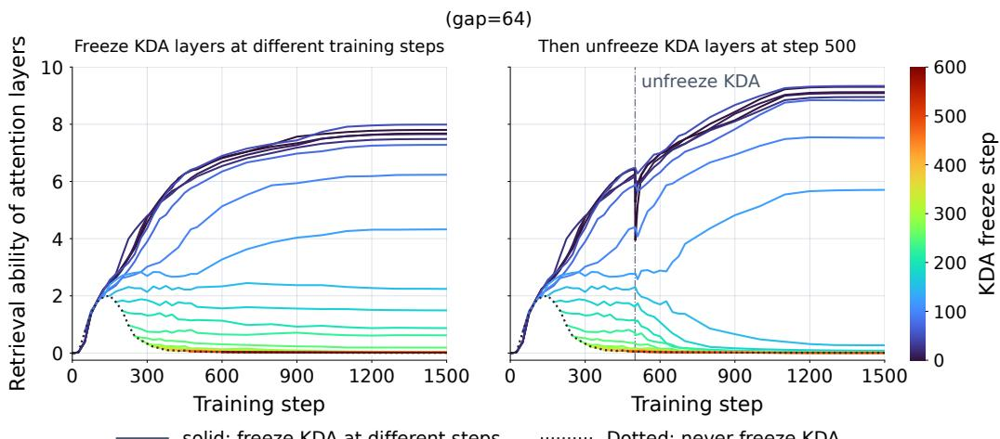  
Figure 10: Attention retrieval ability under KDA freezing and unfreezing at $g = 6 4 .$ using the same setup as in Figure 4.

## B SHORT-DISTANCE INDUCTIVE BIAS FROM KDA FORGET GATES

The KDA mechanism can be formulated as follows:

$$
\begin{array} { r l } { S _ { t } = \left( I - \beta _ { t } k _ { t } k _ { t } ^ { T } \right) { \mathrm { D i a g } } ( \alpha _ { t } ) S _ { t - 1 } + \beta _ { t } k _ { t } v _ { t } ^ { T } \in \mathbb R ^ { d _ { k } \times d _ { v } } , \ o _ { t } } & { = S _ { t } ^ { T } q _ { t } \in \mathbb R ^ { d _ { v } } . } \end{array}\tag{8}
$$

Here, $\alpha _ { t }$ denotes the forget gate, which is initialized with relatively small values. Consequently, the KDA state $S _ { t }$ initially tends to retain information primarily from recent tokens. This is because historical information is progressively attenuated by the forget gates, and the cumulative product of small gate values rapidly approaches zero over successive time steps. As a result, contributions from distant tokens diminish quickly.

## C MODEL CONFIGURATIONS

## C.1 PARAMETER ACCOUNTING AND MODEL IDENTITY

Table 7: KDA hybrid model configurations. Parameter counts are rounded to the nearest million; tied embeddings are counted once.
<table><tr><td>Model size</td><td>Total params (M)</td><td>Non-emb. params (M)</td><td>Decoder blocks</td><td>Hidden dim.</td><td>FFN dim.</td><td>KDA heads</td><td>Attn. heads (Q/KV)</td></tr><tr><td>180M</td><td>181</td><td>63</td><td>8</td><td>768</td><td>1792</td><td>6</td><td>12/3</td></tr><tr><td>250M</td><td>254</td><td>136</td><td>16</td><td>768</td><td>2048</td><td>6</td><td>6/2</td></tr><tr><td>390M</td><td>391</td><td>234</td><td>16</td><td>1024</td><td>2688</td><td>8</td><td>8/2</td></tr><tr><td>510M</td><td>508</td><td>351</td><td>24</td><td>1024</td><td>2688</td><td>8</td><td>8/2</td></tr><tr><td>750M</td><td>755</td><td>520</td><td>16</td><td>1536</td><td>4096</td><td>12</td><td>12/3</td></tr><tr><td>1B</td><td>1015</td><td>780</td><td>24</td><td>1536</td><td>4096</td><td>12</td><td>12/3</td></tr></table>

We label models by their total parameter counts, including token embeddings, throughout this appendix: 180M, 250M, 390M, 510M, 750M, and 1B. Labels are rounded to the nearest 10M. Table 7 reports total and nonembedding parameter counts rounded to the nearest million. Training token-toparameter ratios and scaling fits use the unrounded nonembedding parameters.

All models repeatedly stack the four-block sequence Attention–KDA–KDA–KDA, giving a 3:1 ratio of KDA to softmax-attention blocks at every model size.

The size-dependent settings are listed in Table 7.

Table 8: Architecture settings shared across KDA language models, in Section 4.2.
<table><tr><td>Setting</td><td>Value</td></tr><tr><td>Tokenizer / vocabulary</td><td>Qwen3 (Yang et al., 2025a) / 153,000 entries</td></tr><tr><td>Repeating block pattern</td><td>Attention-KDA-KDA-KDA; KDA-to-attention ratio 3:1</td></tr><tr><td>Embeddings / FFN</td><td>Tied input/output embeddings / SwiGLU (Shazeer, 2020)</td></tr><tr><td>Normalization</td><td>RMSNorm (Zhang &amp; Sennrich, 2019), € = 10−6</td></tr><tr><td>KDA head dimension</td><td>128</td></tr><tr><td>KDA value expansion / convo- lution width</td><td>2/4</td></tr><tr><td>KDA output gate</td><td>Enabled (sigmoid) (Kimi Team et al., 2025)</td></tr><tr><td>Softmax attention</td><td>Grouped-query attention (Ainslie et al., 2023); no projection bias or slid- ing window</td></tr><tr><td>Positional embeddings</td><td>Rotary embeddings disabled</td></tr></table>

## D TRAINING DETAILS

## D.1 DATA AND FREEZING DURING EARLY PRETRAINING

Throughout pretraining, we use DCLM (Li et al., 2024) with 16,384-token sequences. Texts are tokenized, terminated with EOS, concatenated, and split into fixed-length sequences; incomplete remainders of preprocessing batches are discarded. Table 9 contrasts the early and remaining portions of pretraining. Vanilla and BLD use the same data views, token budgets, and optimizer schedules at each model size.

Table 9: Freezing configuration of BLD in pretraining experiments in Section 4.2.
<table><tr><td>Setting</td><td>Early pretraining</td><td>Remaining pretraining</td></tr><tr><td>DCLM data view</td><td>Global shard 01</td><td>Global shards 02–10</td></tr><tr><td>Token fraction</td><td>Approximately 1/11 (9.09%)</td><td>Approximately 10/11 (90.91%)</td></tr><tr><td>Vanilla parameters</td><td>All trainable</td><td>All trainable None</td></tr><tr><td>BLD: frozen components</td><td>Entire KDA blocks: mixer, MLP, and normalization</td><td></td></tr><tr><td>BLD: trainable compo- nents</td><td>Attention blocks, tied embeddings, and final normalization</td><td>All components</td></tr><tr><td>Weight / optimizer ini- tialization</td><td>Train from scratch</td><td>Continue from current weights; reset optimizer and schedule</td></tr></table>

Table 10 summarizes the token budgets.

Table 10: Training token budgets for the LLM pretraining experiments in Section 4.2, rounded for readability.
<table><tr><td>Model size</td><td>Early pretraining tokens</td><td>Remaining pretraining tokens</td></tr><tr><td>180M</td><td>120M</td><td>1.20B</td></tr><tr><td>250M</td><td>280M</td><td>2.80B</td></tr><tr><td>390M</td><td>480M</td><td>4.80B</td></tr><tr><td>510M</td><td>720M</td><td>7.20B</td></tr><tr><td>750M</td><td>1.07B</td><td>10.65B</td></tr><tr><td>1B</td><td>1.60B</td><td>16.00B</td></tr></table>

Early pretraining uses approximately 2.05N tokens, followed by approximately 20.5N tokens in the remaining pretraining, where N is the number of non-embedding parameters, following the Chinchilla scaling principle (Hoffmann et al., 2022).

Table 11: Optimization settings shared by Vanilla and BLD.
<table><tr><td>Setting</td><td>Early pretraining</td><td>Remaining pretraining</td></tr><tr><td>Optimizer</td><td>AdamW (Loshchilov &amp; Hutter, 2017)</td><td>Muon (Jordan et al., 2024) with auxil- iary AdamW</td></tr><tr><td>Peak learning rate</td><td> $1 0 ^ { - 4 }$ </td><td>Muon: 0.02; AdamW: 0.001</td></tr><tr><td>Minimum learning rate</td><td> $1 0 ^ { - 4 }$  (no terminal decay)</td><td>Muon: 0.001; AdamW:  $5 \times 1 0 ^ { - 5 }$ </td></tr><tr><td>Schedule</td><td>Linear warmup, then constant</td><td>Linear warmup, constant interval, then cosine decay</td></tr><tr><td>Adam coefficients</td><td>(0.9, 0.95)</td><td>(0.9, 0.95)</td></tr><tr><td>Muon momentum / itera- tions</td><td>Not applicable</td><td>0.95 / 5 Newton–Schulz iterations</td></tr><tr><td>Weight decay / clip</td><td>0.1 / global norm 1.0</td><td>0.1 / global norm 1.0</td></tr><tr><td>Precision / seed</td><td>BF16 /0</td><td>BF16 /0</td></tr><tr><td>Global batch (sequences)</td><td>16</td><td>32</td></tr><tr><td>Tokens per update</td><td>262,144</td><td>524,288</td></tr><tr><td>Microbatch per GPU</td><td>1 sequence</td><td>2 sequences</td></tr></table>

Table 12: Size-dependent schedules and batching. Warmup and decay durations are in optimizer updates; accumulation is unchanged throughout pretraining.
<table><tr><td>Size</td><td>Early warmup</td><td>Remaining warmup</td><td>Final decay</td><td>GPUs</td><td>Accum.</td></tr><tr><td>180M</td><td>23</td><td>229</td><td>229</td><td>1</td><td>16</td></tr><tr><td>250M</td><td>53</td><td>534</td><td>534</td><td>1</td><td>16</td></tr><tr><td>390M</td><td>92</td><td>916</td><td>916</td><td>2</td><td>8</td></tr><tr><td>510M</td><td>137</td><td>1,373</td><td>1,373</td><td>2</td><td>8</td></tr><tr><td>750M</td><td>198</td><td>2,032</td><td>2,032</td><td>2</td><td>8</td></tr><tr><td>1B</td><td>305</td><td>3,052</td><td>3,052</td><td>8</td><td>2</td></tr></table>

## D.2 OPTIMIZATION, BATCHING, AND RESTARTS

Muon updates eligible hidden matrix weights; embeddings, the output head, and remaining parameters use auxiliary AdamW. All optimizer groups share the same multiplicative schedule. Both methods reset optimizer and schedule state when the early portion ends.

## E EVALUATION DETAILS

## E.1 CHECKPOINT AND METRIC SELECTION

We evaluate the final pretraining checkpoint without fine-tuning, using zero demonstrations for the downstream language-model evaluation tasks. The decoding strategy for generation tasks is greedy decoding.

Language Modeling Loss We report the mean training loss over the final 100 optimizer updates.

Common-Sense Reasoning CSR is the macro average of seven tasks: ARC-Easy and ARC-Challenge (Clark et al., 2018), HellaSwag (Zellers et al., 2019), and PIQA (Bisk et al., 2020) use normalized accuracy; BoolQ (Clark et al., 2019), WinoGrande (Sakaguchi et al., 2019), and LAM-BADA (Paperno et al., 2016) use accuracy.

Recall We use the Based evaluation suite (Arora et al., 2024) and average the contains scores over SWDE (Lockard et al., 2019), FDA (Arora et al., 2023), SQuAD (Rajpurkar et al., 2018), TriviaQA (Joshi et al., 2017), DROP (Dua et al., 2019), and Natural Questions (Kwiatkowski et al., 2019) with a 2,048-token context.

RULER We evaluate RULER (Hsieh et al., 2024) at 1K, 2K, 4K, 8K, and 16K tokens, with 100 examples per task–length combination. These lengths include 10, 11, 12, 12, and 12 tasks, respectively; QA-1 is included from 2K and QA-2 from 4K. The overall score averages all 57 task–length combinations. CSR, Recall, and RULER scores are reported as percentages.

WikiText-2 We report word-level perplexity on WikiText-2 (Merity et al., 2016) using the evaluator’s word perplexity metric.

LongPPL Following LongPPL (Fang et al., 2025), we report pooled perplexity over tokens selected using fixed reference-model annotations, as detailed below.

## E.2 LONGPPL REPRODUCTION

Table 13: Configuration for calculating LongPPL in Section 4.2.
<table><tr><td>Setting</td><td>Value</td></tr><tr><td>Dataset / sample</td><td>GovReport (Huang et al., 2021) / 50 documents</td></tr><tr><td>Sampling seed / token limit</td><td>42 / 32,768 per document</td></tr><tr><td>Input formatting</td><td>Raw text; no chat template or additional BOS</td></tr><tr><td>Reference model</td><td>Qwen3-8B (Yang et al., 2025a); fixed annotations across compared models</td></tr><tr><td>Short context / stride</td><td> $K = 4 0 9 6 / d = 1 0 2 4$ </td></tr><tr><td>Selected targets</td><td>3,920 tokens across 49 documents</td></tr><tr><td>Alignment</td><td>Same texts and target positions; tokenizer alignment checked</td></tr></table>

For token i, let $\ell _ { i } ^ { \mathrm { { l o n g } } }$ and $\ell _ { i } ^ { \mathrm { s h o r t } }$ be its reference log probabilities under the document prefix and a short-context window. The selected-token indicator is

$$
M _ { i } = \nVdash \{ \ell _ { i } ^ { \mathrm { l o n g } } - \ell _ { i } ^ { \mathrm { s h o r t } } > 2 \} \lvert \mathcal { k } \{ \ell _ { i } ^ { \mathrm { l o n g } } > - 2 \} .\tag{9}
$$

Target tokens within each stride interval share the same left context boundary, so their context lengths range from K to $K + d - 1$ preceding tokens. Table 13 lists the fixed sample and reference settings. The reported metric is

$$
\mathrm { L o n g P P L } ( \theta ) = \exp \left[ - \frac { \sum _ { i } M _ { i } \log p _ { \theta } ( x _ { i } \mid x _ { < i } ) } { \sum _ { i } M _ { i } } \right] .\tag{10}
$$

We pool selected-token negative log likelihoods before exponentiation; we do not average document perplexities. The document without selected tokens does not enter this denominator.

## F DETAILED RESULTS AND ADDITIONAL ANALYSES

## F.1 DOWNSTREAM TASK RESULTS

Tables 14 and 15 report individual CSR and Recall scores. The CSR mean here covers the seven tasks listed above, including LAMBADA, and uses the same aggregation as the main tables. Table 16 breaks RULER down by context length; Tables 17–19 provide task-wise averages. All entries use the same final checkpoints as Tables 1 and 2.

Figure 11 compares Vanilla and BLD at each context length across the six KDA model sizes.

## F.2 SCALING FITS

We use actual nonembedding parameter counts N as the model-size variable. A power-plus-constant fit with a shared floor and method-specific amplitudes and exponents has the form

$$
L _ { m } ( N ) = E + A _ { m } ( N / 1 0 ^ { 9 } ) ^ { - \alpha _ { m } } , \qquad m \in \{ \mathrm { V a n i l l a , B L D } \} .\tag{11}
$$

The archived fitting procedure minimizes unweighted squared loss residuals jointly over both methods, with nonnegative floor/amplitudes and positive exponents. It examines the final-100-update average.

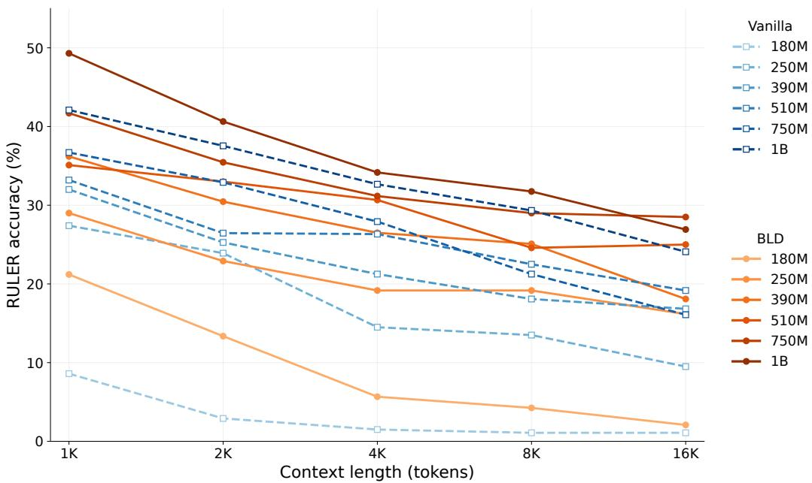  
Figure 11: RULER accuracy by context length for six KDA model sizes. Blue dashed lines denote Vanilla; orange solid lines denote BLD. Darker shades indicate larger models. Each point averages the tasks evaluated at that length.

Table 14: The concrete results of the hybrid models on CSR (Section 4.2). LAMBADA reports accuracy. Means use unrounded scores from all seven tasks. GDN and GLA denote the transfer configurations in Appendix H. Unless otherwise specified, all models are KDA-based hybrid models.
<table><tr><td>Size / mixer</td><td>Method</td><td>ARC-E</td><td>ARC-C</td><td>Hella.</td><td>PIQA</td><td>BoolQ</td><td>Wino.</td><td>LAMBADA</td><td>Mean</td></tr><tr><td>180M</td><td>Vanilla</td><td>36.36</td><td>22.44</td><td>27.38</td><td>58.27</td><td>58.87</td><td>51.07</td><td>9.94</td><td>37.76</td></tr><tr><td>180M</td><td>BLD</td><td>35.65</td><td>22.44</td><td>27.64</td><td>59.30</td><td>55.84</td><td>49.96</td><td>11.59</td><td>37.49</td></tr><tr><td>250M 250M</td><td>Vanilla BLD</td><td>38.43 41.16</td><td>23.98 23.72</td><td>29.80 30.33</td><td>58.98 62.35</td><td>45.05 60.58</td><td>51.38 48.70</td><td>20.57 23.56</td><td>38.31 41.49</td></tr><tr><td>390M 390M</td><td>Vanilla BLD</td><td>43.73 43.43</td><td>24.74 24.57</td><td>34.31 35.35</td><td>64.20 65.40</td><td>47.68 58.75</td><td>49.25 50.75</td><td>29.46 31.48</td><td>41.91 44.25</td></tr><tr><td>510M</td><td>Vanilla</td><td>46.51</td><td>26.11</td><td>36.93</td><td>66.27</td><td>58.01</td><td>50.43</td><td>29.34</td><td>44.80</td></tr><tr><td>510M</td><td>BLD</td><td>47.31</td><td>25.17</td><td>37.42</td><td>66.97</td><td>55.69</td><td>51.22</td><td>27.61</td><td>44.49</td></tr><tr><td>750M</td><td>Vanilla</td><td>48.06</td><td>25.51</td><td>40.68</td><td>67.19</td><td>53.76</td><td>51.14</td><td>35.26</td><td>45.94</td></tr><tr><td>750M</td><td>BLD</td><td>48.91</td><td>25.26</td><td>40.93</td><td>68.50</td><td>53.73</td><td>51.85</td><td>37.12</td><td>46.61</td></tr><tr><td>1B</td><td>Vanilla</td><td>51.26</td><td>27.65</td><td>45.11</td><td>69.75</td><td>53.82</td><td>52.96</td><td>40.25</td><td>48.69</td></tr><tr><td>1B</td><td>BLD</td><td>51.09</td><td>27.90</td><td>45.91</td><td>69.10</td><td>55.69</td><td>55.25</td><td>41.22</td><td>49.45</td></tr><tr><td></td><td></td><td></td><td></td><td></td><td></td><td></td><td></td><td></td><td></td></tr><tr><td>GDN (400M)</td><td>Vanilla</td><td>44.44</td><td>24.40</td><td>34.41</td><td>64.53</td><td>56.73</td><td>51.07</td><td>27.03</td><td>43.23</td></tr><tr><td>GDN (400M)</td><td>BLD</td><td>44.23</td><td>24.66</td><td>34.77</td><td>64.91</td><td>58.69</td><td>51.54</td><td>28.51</td><td>43.90</td></tr><tr><td>GLA (400M)</td><td>Vanilla</td><td>43.43</td><td>24.06</td><td>32.43</td><td>64.25</td><td>52.23</td><td>49.80</td><td></td><td></td></tr><tr><td>GLA (400M)</td><td>BLD</td><td>44.53</td><td>24.74</td><td>33.32</td><td>63.44</td><td>59.48</td><td>50.36</td><td>22.10 26.57</td><td>41.19 43.20</td></tr></table>

Table 20 reports the fitting using the same checkpoints as Table 1. Figure 8 uses the final-100- update fit. Its right panel shows the 1B model’s training loss over 50–100% of the total pretraining token budget, smoothed for display by a Gaussian filter with standard deviation 100 updates in the remaining portion and reflected boundaries.

## G POSITION-WISE LANGUAGE-MODELING LOSS

Table 21 describes the diagnostic underlying Figure 6. Figure 12 shows the results of the same diagnostic across all model sizes.

Table 15: Recall results using the contains metric (percent). Means use unrounded scores. Unless otherwise specified, all models are KDA-based hybrid models.
<table><tr><td>Size / mixer</td><td>Method</td><td>SWDE</td><td>FDA</td><td>SQuAD</td><td>TriviaQA</td><td>DROP</td><td>NQ</td><td>Mean</td></tr><tr><td>180M</td><td>Vanilla</td><td>9.09</td><td>0.54</td><td>13.40</td><td>21.74</td><td>13.08</td><td>4.50</td><td>10.39</td></tr><tr><td>180M</td><td>BLD</td><td>13.95</td><td>13.43</td><td>14.68</td><td>23.52</td><td>14.23</td><td>4.91</td><td>14.12</td></tr><tr><td>250M</td><td>Vanilla</td><td>27.90</td><td>17.15</td><td>21.88</td><td>33.12</td><td>19.45</td><td>9.72</td><td>21.54</td></tr><tr><td>250M</td><td>BLD</td><td>29.79</td><td>30.85</td><td>25.00</td><td>35.25</td><td>18.93</td><td>12.13</td><td>25.33</td></tr><tr><td>390M 390M</td><td>Vanilla BLD</td><td>34.74 38.34</td><td>26.04 40.83</td><td>27.38 30.09</td><td>38.68 41.35</td><td>20.17 19.84</td><td>13.34 17.14</td><td>26.73 31.27</td></tr><tr><td>510M</td><td>Vanilla</td><td>36.72</td><td>34.21</td><td>28.92</td><td>43.36</td><td>21.99</td><td>17.77</td><td>30.50</td></tr><tr><td>510M</td><td>BLD</td><td>44.46</td><td>46.55</td><td>30.06</td><td>44.25</td><td>23.38</td><td>19.51</td><td>34.70</td></tr><tr><td>750M</td><td>Vanilla</td><td>40.59</td><td>41.47</td><td>30.90</td><td>47.45</td><td>21.66</td><td>19.04</td><td>33.52</td></tr><tr><td>750M</td><td>BLD</td><td>49.23</td><td>50.54</td><td>33.31</td><td>49.41</td><td>21.56</td><td>21.03</td><td>37.52</td></tr><tr><td>1B</td><td></td><td></td><td></td><td></td><td></td><td></td><td></td><td></td></tr><tr><td>1B</td><td>Vanilla</td><td>44.55</td><td>42.74</td><td>33.91</td><td>52.19</td><td>24.77</td><td>20.84</td><td>36.50</td></tr><tr><td></td><td>BLD</td><td>48.15</td><td>43.83</td><td>36.76</td><td>53.08</td><td>24.20</td><td>22.81</td><td>38.14</td></tr><tr><td>GDN</td><td>Vanilla</td><td>17.55</td><td>3.27</td><td>20.95</td><td>36.43</td><td>16.29</td><td>9.50</td><td>17.33</td></tr><tr><td>GDN</td><td>BLD</td><td>43.74</td><td>40.74</td><td>30.06</td><td>41.88</td><td>19.50</td><td>16.34</td><td>32.05</td></tr><tr><td>GLA</td><td></td><td></td><td></td><td></td><td></td><td></td><td></td><td></td></tr><tr><td>GLA</td><td>Vanilla BLD</td><td>36.18 40.86</td><td>27.59 41.20</td><td>22.52 27.78</td><td>33.95 38.15</td><td>17.63 17.97</td><td>9.60 14.73</td><td>24.58 30.12</td></tr></table>

Table 16: RULER scores by context length (percent). Parentheses give task counts; All averages the 57 task–length entries. Unless otherwise specified, all models are KDA-based hybrid models.
<table><tr><td>Size / mixer</td><td>Method</td><td>1K (10)</td><td>2K (11)</td><td>4K (12)</td><td>8K (12)</td><td>16K (12)</td><td>All (57)</td></tr><tr><td>180M</td><td>Vanilla</td><td>8.60</td><td>2.91</td><td>1.50</td><td>1.08</td><td>1.08</td><td>2.84</td></tr><tr><td>180M</td><td>BLD</td><td>21.20</td><td>13.36</td><td>5.67</td><td>4.25</td><td>2.08</td><td>8.82</td></tr><tr><td>250M</td><td>Vanilla</td><td>27.40</td><td>23.91</td><td>14.50</td><td>13.50</td><td>9.50</td><td>17.32</td></tr><tr><td>250M</td><td>BLD</td><td>29.00</td><td>22.91</td><td>19.17</td><td>19.17</td><td>16.17</td><td>20.98</td></tr><tr><td>390M</td><td>Vanilla</td><td>32.00</td><td>25.27</td><td>21.25</td><td>18.08</td><td>16.83</td><td>22.32</td></tr><tr><td>390M</td><td>BLD</td><td>36.20</td><td>30.45</td><td>26.50</td><td>25.08</td><td>18.08</td><td>26.89</td></tr><tr><td>510M 510M</td><td>Vanilla</td><td>33.20</td><td>26.45</td><td>26.33</td><td>22.50</td><td>19.17</td><td>25.25</td></tr><tr><td></td><td>BLD</td><td>35.10</td><td>33.00</td><td>30.67</td><td>24.58</td><td>25.00</td><td>29.42</td></tr><tr><td>750M</td><td>Vanilla</td><td>36.70</td><td>32.91</td><td>27.92</td><td>21.25</td><td>16.08</td><td>26.53</td></tr><tr><td>750M</td><td>BLD</td><td>41.70</td><td>35.45</td><td>31.17</td><td>29.00</td><td>28.50</td><td>32.82</td></tr><tr><td>1B</td><td>Vanilla</td><td>42.10</td><td>37.55</td><td>32.67</td><td>29.33</td><td>24.08</td><td>32.75</td></tr><tr><td>1B</td><td>BLD</td><td>49.30</td><td>40.64</td><td>34.17</td><td>31.75</td><td>26.92</td><td>36.04</td></tr><tr><td>GDN (400M)</td><td>Vanilla</td><td>18.60</td><td>13.27</td><td>11.33</td><td>10.17</td><td>9.42</td><td>12.33</td></tr><tr><td>GDN (400M)</td><td>BLD</td><td>32.30</td><td>26.45</td><td>23.83</td><td>24.75</td><td>21.00</td><td>25.42</td></tr><tr><td>GLA (400M)</td><td>Vanilla</td><td>29.00</td><td>26.55</td><td>23.42</td><td>25.08</td><td>16.92</td><td>23.98</td></tr><tr><td>GLA (400M)</td><td>BLD</td><td>34.30</td><td>30.64</td><td>28.58</td><td>27.58</td><td>22.75</td><td>28.54</td></tr></table>

Table 17: Task-wise RULER scores averaged over evaluated lengths (percent). V: Vanilla; B: BLD. QA-1 averages four lengths, QA-2 three, and other tasks five.
<table><tr><td>Task</td><td>180M V</td><td>180M B</td><td>250M V</td><td>250M B</td><td>390M V</td><td>390M B</td></tr><tr><td>Single-1</td><td>8.20</td><td>34.80</td><td>96.20</td><td>100.00</td><td>100.00</td><td>98.40</td></tr><tr><td>Single-2</td><td>8.60</td><td>40.40</td><td>41.00</td><td>31.40</td><td>62.80</td><td>72.80</td></tr><tr><td>Single-3</td><td>0.00</td><td>5.40</td><td>28.60</td><td>69.00</td><td>49.00</td><td>78.60</td></tr><tr><td>Multi-key-1</td><td>6.60</td><td>11.20</td><td>15.80</td><td>20.80</td><td>26.40</td><td>32.40</td></tr><tr><td>Multi-key-2</td><td>0.00</td><td>0.00</td><td>0.20</td><td>0.40</td><td>0.80</td><td>3.20</td></tr><tr><td>Multi-key-3</td><td>0.00</td><td>0.00</td><td>0.00</td><td>1.60</td><td>0.80</td><td>2.00</td></tr><tr><td>Multi-value</td><td>0.00</td><td>0.00</td><td>0.00</td><td>0.00</td><td>0.00</td><td>0.00</td></tr><tr><td>Multi-query</td><td>0.00</td><td>0.00</td><td>0.00</td><td>0.00</td><td>0.00</td><td>0.00</td></tr><tr><td>Variable tracking</td><td>0.00</td><td>0.00</td><td>0.00</td><td>0.00</td><td>0.00</td><td>0.00</td></tr><tr><td>Frequent words</td><td>0.00</td><td>0.00</td><td>0.20</td><td>0.00</td><td>0.00</td><td>3.20</td></tr><tr><td>QA-1</td><td>4.50</td><td>4.00</td><td>9.50</td><td>11.00</td><td>10.50</td><td>9.75</td></tr><tr><td>QA-2</td><td>9.00</td><td>9.33</td><td>13.00</td><td>12.00</td><td>10.33</td><td>13.67</td></tr></table>

Table 18: Task-wise RULER scores averaged over evaluated lengths (percent). V: Vanilla; B: BLD. QA-1 averages four lengths, QA-2 three, and other tasks five.
<table><tr><td rowspan=1 colspan=1>Task</td><td rowspan=1 colspan=1>510M V  510M B</td><td rowspan=1 colspan=2>750M V  750M B  1B V  1B B</td></tr><tr><td rowspan=1 colspan=1>Single-1</td><td rowspan=1 colspan=1>100.00   98.80</td><td rowspan=1 colspan=1>99.60     100.00</td><td rowspan=1 colspan=1>99.80  100.00</td></tr><tr><td rowspan=1 colspan=1>Single-2</td><td rowspan=1 colspan=1>67.80    99.00</td><td rowspan=1 colspan=1>79.60    90.40</td><td rowspan=1 colspan=1>83.00  92.80</td></tr><tr><td rowspan=1 colspan=1>Single-3</td><td rowspan=1 colspan=1>73.80     60.20</td><td rowspan=1 colspan=1>60.60     81.40</td><td rowspan=1 colspan=1>71.60  77.00</td></tr><tr><td rowspan=9 colspan=1>Multi-key-1Multi-key-2Multi-key-3Multi-valueMulti-queryVariable trackingFrequent wordsQA-1QA-2</td><td rowspan=1 colspan=1>26.60    48.40</td><td rowspan=1 colspan=1>39.20    61.00</td><td rowspan=1 colspan=1>61.80  58.40</td></tr><tr><td rowspan=1 colspan=1>1.00      2.80</td><td rowspan=1 colspan=1>2.80      5.40</td><td rowspan=1 colspan=1>26.60  30.80</td></tr><tr><td rowspan=1 colspan=1>1.60      3.80</td><td rowspan=1 colspan=1>2.20      6.60</td><td rowspan=1 colspan=1>2.60   6.60</td></tr><tr><td rowspan=1 colspan=1>0.00      0.00</td><td rowspan=1 colspan=1>0.00      4.20</td><td rowspan=1 colspan=1>0.40   6.80</td></tr><tr><td rowspan=1 colspan=1>0.00      0.00</td><td rowspan=1 colspan=1>0.00      0.40</td><td rowspan=1 colspan=1>0.40   1.20</td></tr><tr><td rowspan=1 colspan=1>0.00      0.00</td><td rowspan=1 colspan=1>0.00      0.00</td><td rowspan=1 colspan=1>0.00   0.00</td></tr><tr><td rowspan=1 colspan=1>0.40     2.60</td><td rowspan=1 colspan=1>0.20      0.60</td><td rowspan=1 colspan=1>0.40   9.40</td></tr><tr><td rowspan=1 colspan=1>10.25     13.25</td><td rowspan=1 colspan=1>14.25     17.75</td><td rowspan=1 colspan=1>19.50  24.50</td></tr><tr><td rowspan=1 colspan=1>14.00     15.33</td><td rowspan=1 colspan=1>11.33     16.67</td><td rowspan=1 colspan=1>18.67  13.67</td></tr></table>

Table 19: Task-wise RULER scores averaged over evaluated lengths (percent). V: Vanilla; B: BLD. QA-1 averages four lengths, QA-2 three, and other tasks five.
<table><tr><td>Task</td><td>GDN V</td><td>GDN B</td><td>GLA V</td><td>GLA B</td></tr><tr><td>Single-1 Single-2</td><td>99.60 18.20</td><td>99.60 86.00</td><td>94.80 84.80</td><td>99.80 93.40</td></tr><tr><td>Single-3</td><td>1.00</td><td>44.20</td><td>55.00</td><td>79.20</td></tr><tr><td>Multi-key-1</td><td>13.20</td><td>38.00</td><td>27.20</td><td>33.40</td></tr><tr><td>Multi-key-2</td><td>0.00</td><td>1.20</td><td>0.60</td><td>2.60</td></tr><tr><td>Multi-key-3</td><td>0.00</td><td>2.60</td><td>1.00</td><td>1.60</td></tr><tr><td>Multi-value</td><td>0.00</td><td>0.00</td><td>0.00</td><td>0.00</td></tr><tr><td>Multi-query</td><td>0.00</td><td>0.00</td><td>0.00</td><td>0.00</td></tr><tr><td>Variable tracking</td><td>0.00</td><td>0.00</td><td>0.00</td><td>0.00</td></tr><tr><td>Frequent words</td><td>0.40</td><td>0.20</td><td>0.00</td><td></td></tr><tr><td>QA-1</td><td>4.00</td><td></td><td></td><td>0.20</td></tr><tr><td></td><td></td><td>11.75</td><td>4.50</td><td>7.50</td></tr><tr><td>QA-2</td><td>8.33</td><td>14.33</td><td>10.67</td><td>15.33</td></tr></table>

Table 20: Shared-floor fits for the original-checkpoint six-size series. $A _ { V } , \alpha _ { V }$ are scaling law fitted coefficients for the vanilla model while $A _ { B }$ , α are those for the BLD models. RMSE columns are Vanilla/BLD.
<table><tr><td>Loss window</td><td>E</td><td> $A _ { V }$ </td><td> $\alpha _ { V }$ </td><td> $A _ { B }$ </td><td>αB</td><td>RMSE (V)</td><td>RMSE (B)</td></tr><tr><td>Final 100</td><td>2.38867</td><td>0.45960</td><td>0.34649</td><td>0.45266</td><td>0.34502</td><td>0.01321</td><td>0.01424</td></tr></table>

Table 21: Position-wise language-modeling diagnostic settings.
<table><tr><td>Setting</td><td>Value</td></tr><tr><td>Dataset</td><td>First 50 nonempty documents from each local Books3 and BookCorpus2 cache from The Pile (Gao et al., 2020) (100 total)</td></tr><tr><td>Input processing</td><td>Independent documents; no added special tokens; cached token IDs and checked tokenization</td></tr><tr><td>Input / prediction limit</td><td>16,384 input tokens / 16,384 predictions per document</td></tr><tr><td>Execution</td><td>Full decoder prefix; chunked output projection; original position settings</td></tr><tr><td>Precision</td><td>BF16 model execution; FP32 logits</td></tr></table>

## H TRANSFER TO GDN AND GLA

Table 22 reports the GDN (Yang et al., 2025b) and GLA (Yang et al., 2023) replacement architectures. The 400M designation in Table 2 identifies the reference KDA configuration. They match

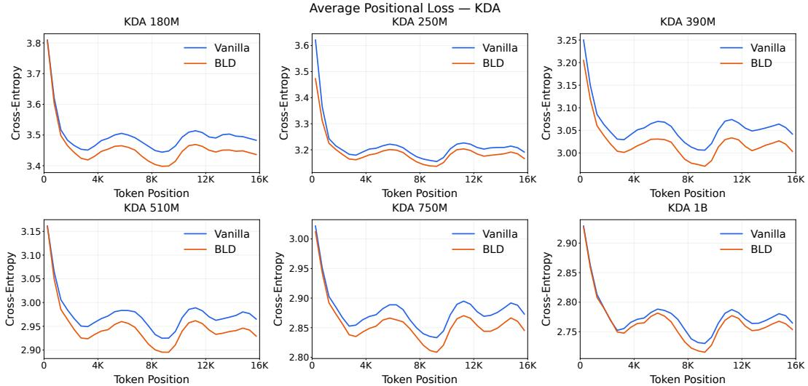  
Figure 12: Average loss of KDA hybrid models of different scales, as functions of token positions.

Table 22: Configurations for the GDN and GLA models in Section 4.4. Parameter and token counts are rounded; M and B denote million and billion.
<table><tr><td>Setting</td><td>GDN</td><td>GLA</td></tr><tr><td>Blocks / hidden / FFN width</td><td>16 / 1,024 / 2,688</td><td>16 / 1,024 / 2,688</td></tr><tr><td>Attention block indices</td><td>0,4,8, 12</td><td>0,4,8, 12</td></tr><tr><td>Attention Q / KV heads</td><td>8/2</td><td>8/2</td></tr><tr><td>Recurrent blocks / heads</td><td>12/8</td><td>12 /8</td></tr><tr><td>Recurrent dimensions</td><td>Head dimension 128</td><td>Key expansion 1</td></tr><tr><td>Value expansion</td><td>2</td><td>2</td></tr><tr><td>Convolution width / output gate</td><td>4 / enabled</td><td>4 / enabled</td></tr><tr><td>Rotary embeddings</td><td>Disabled</td><td>Disabled</td></tr><tr><td>Total parameters</td><td>400M</td><td>401M</td></tr><tr><td>Nonembedding parameters</td><td>244M</td><td>244M</td></tr><tr><td>Early / remaining updates</td><td>1,831 / 9,155</td><td>1,831 / 9,155</td></tr><tr><td>Early pretraining tokens</td><td>480M</td><td>480M</td></tr><tr><td>Remaining pretraining tokens</td><td>4.80B</td><td>4.80B</td></tr></table>

KDA in depth, width, and token budget. Optimization and full-block freezing/unfreezing follow the 390M KDA configuration. Data budgets remain fixed rather than being rescaled to each replacement’s parameter count. Detailed downstream scores appear in Tables 14–16.

## I RETRIEVAL HEAD IDENTIFICATION AND RETRIEVAL EVALUATION

Retrieval Head identification. We apply a DuoAttention-style retrieval head identification procedure (Xiao et al., 2025) to the final 510M Vanilla and BLD checkpoints. Each model has six attention layers, with two KV heads and eight query heads per layer. We learn one gate $\alpha _ { \ell , g } \in [ 0 , 1 ]$ per KV head (12 gates in total), shared by its four query heads. Before the attention output projection, each head interpolates between full causal and streaming attention:

$$
\widetilde { \mathbf { o } } _ { \ell , h } = \alpha _ { \ell , g ( h ) } \mathbf { o } _ { \ell , h } ^ { \mathrm { f u l l } } + \big ( 1 - \alpha _ { \ell , g ( h ) } \big ) \mathbf { o } _ { \ell , h } ^ { \mathrm { s t r e a m } } .\tag{12}
$$

Streaming attention retains the first 128 tokens and the most recent 256 tokens, subject to causality.   
All pretrained parameters are frozen; KDA layers retain their original computation without gates.

Each model serves as its own full-attention teacher. We optimize the gates using mean squared error between teacher and student final hidden states at reference-answer token positions, plus

0.05 mean(|α|). Both branches receive reference answers during identification; this is hidden-state distillation, not retrieval fine-tuning of the base model. Gates start at one and are clamped to [0, 1] after each update. Table 23 summarizes the main settings.

Table 23: Settings for retrieval head identification experiments in Section 4.5.
<table><tr><td>Setting</td><td>Value</td></tr><tr><td>Optimization steps / batch size</td><td>1,000 / 1 sequence</td></tr><tr><td>Optimizer</td><td>AdamW, no weight decay</td></tr><tr><td>Peak / minimum learning rate</td><td>0.02 / 0.002</td></tr><tr><td>Schedule</td><td>200-step warmup and final 200-step decay 16,384 tokens</td></tr><tr><td>Sequence length Passkeys per sequence</td><td>10, each containing 32 words</td></tr><tr><td>Background / insertion depth</td><td>BookSum / 5–95%</td></tr></table>

Masking and evaluation. Within each model, we rank all 12 KV heads by increasing learned alpha and progressively replace full attention with streaming attention, starting with the lowestalpha heads. Remaining heads use full attention; the continuous alpha values are used only for ranking. No further training is performed. Thus, a “masked head” denotes a KV head whose four query heads use restricted context, rather than a head with zeroed output. The evaluated budgets are 0, 1, 2, 4, 5, 6, 7, 8, 10, 11, 12 KV heads, obtained by rounding masking ratios of 0%, 10%, . . . , 100%.

We use the same separately generated set of 64 documents and 10 passkeys per document for both models and every budget (640 queries per condition). Each passkey contains 32 random NATOalphabet words embedded in BookSum text. The 16K length includes the document and reference question–answer pairs. At evaluation, each question is answered independently from the document cache using greedy decoding, without reference answers or earlier question–answer pairs. The plotted accuracy is the percentage of queries whosefirst generated token matches the reference.

## I.1 DETAILS OF THE GRADIENT DYNAMICS EXPERIMENT

Figure 5 compares a never-frozen baseline with a KDA-freezing intervention under the settings in Table 24. At the branching point, the frozen trajectory is split into continued-freezing and unfreezing branches with identical model, optimizer, scheduler. Unfreezing resumes the paused KDA Adam states without resetting the optimizer. Within each seed, all compared branches follow the same training-data sequence. Training uses full backward passes and the same step-specific baseline clip ping coefficient before frozen updates are masked.

We measure unclipped attention gradients using the same gradient-enabled diagnostic graph across conditions. For each attention mixer, we average the per-example gradient vectors before taking their $\ell _ { 2 }$ norm, then divide by the corresponding baseline norm at the same step. The plotted statistic is the arithmetic mean of the two attention mixers’ trajectories, each computed as the geometric mean of paired ratios across seeds. The left panel enlarges the freezing phase of the full trajectory shown on the right.

Table 24: Experimental settings for Figure 5.
<table><tr><td>Setting</td><td>Value</td></tr><tr><td>Mixer order Total model parameters</td><td>KDA-Attention-KDA-Attention</td></tr><tr><td>Independent seeds</td><td>3,555,588 10</td></tr><tr><td>Frozen modules</td><td>Both KDA mixers</td></tr><tr><td>Frozen parameter count Measured parameters</td><td>1,453,060</td></tr><tr><td>Freezing begins</td><td>262,144 per attention mixer</td></tr><tr><td></td><td>After update 175</td></tr><tr><td>Frozen/unfrozen branches split</td><td>After update 225</td></tr><tr><td>Final measured step Gradient probe</td><td>425</td></tr><tr><td></td><td>32 fixed training examples</td></tr><tr><td>Retrieval gap</td><td>8192</td></tr><tr><td>Probe loss</td><td>First-answer-token cross-entropy</td></tr><tr><td>Measurement frequency</td><td></td></tr><tr><td>Temporal smoothing</td><td>Every training step None</td></tr></table>