# COMPUTATION, NOT MEMORY: CHAIN-OF-THOUGHT AND STATE TRACKING IN LLM AGENTS

Pedram Mouseli∗ Massieh Moayedi University of Toronto

## ABSTRACT

Language-model agents often reason before they act, and the value of monitoring that reasoning depends on how it relates to their actions. We ask how an agent’s actions depend on its reasoning when the correct action depends on a changing state. In a small file-system task, background events announce which file’s lock has been toggled but not its new value. The agent therefore has to reconstruct the current locks from its history before it can move files safely. With Qwen3-8B and Qwen3.5-9B, we separate two roles of reasoning: generating it before each action, and retaining earlier reasoning in the prompt. Most of the reduction in lock-violating commands comes from reasoning written at the moment of action. Retaining earlier reasoning adds little to rule-following, although it helps one model complete the task. The benefit depends on what the reasoning says. Filler text, reasoning written for another history and an accurate table of the state do not reproduce it. When we give the agent reasoning written for a history that differs in one lock value, the agent acts on that reasoning even against its own history. Without reasoning, linear probes recover the state from the model’s activations about as well as a text classifier recovers it from the transcript. However, decoding accuracy does not predict which interventions change the agent’s actions. In this setting, the benefit of reasoning for rule-following comes mainly from generating it at each step. The state that can be decoded without reasoning is a limited guide to how the agent acts.

## 1 INTRODUCTION

Language models are increasingly deployed as agents that reason before they act (Yao et al., 2023). Their written reasoning is also a potential source of information about their decisions, which motivates proposals to monitor agents through their chains of thought (Baker et al., 2025; Korbak et al., 2025). How useful the reasoning is for this purpose depends on the role it plays in the agent’s decisions. In theory, writing intermediate tokens extends the serial computation that a transformer can carry out before it answers (Merrill and Sabharwal, 2024; Li et al., 2024; Brown-Cohen et al., 2026). In practice, the role of reasoning in a given agent and task is an empirical question. A trace may carry out computation that the next action needs, store information for later turns, or describe a decision without causing it. Telling these roles apart requires interventions on when reasoning is generated, on what is retained, and on what the trace says.

We study these roles in a task that requires keeping track of a changing state, a recurring requirement in sequential decision making. We built a small file-system environment in which files are locked or unlocked. Background events toggle the locks and announce which file changed, but not its new value. Safe moves depend on the current lock state, which is determined by the history and must be reconstructed from it. The full history of observations and executed commands stays in the prompt in every condition, so the evidence needed to reconstruct each lock state is always available.

Reasoning can help such an agent in two ways. Generating reasoning before an action gives the model extra computation at the moment of decision. Retaining earlier reasoning in the prompt, which we call persistence, gives it notes that it could consult instead of working out the state again (Lanchantin et al., 2023). The chat templates of Qwen3 and Qwen3.5 separate the two by default: the

agent reasons at every turn, but earlier reasoning is removed from the prompt (Qwen Team, 2025;   
2026b).

We ask three questions.

1. Does the benefit come from generating reasoning or from retaining it? Generating reasoning reduces lock-violating commands by a large margin in both models, whereas retaining earlier reasoning adds little to this measure. Retention does improve task completion for Qwen3.5-9B (Section 4).

2. Does the content of the reasoning matter, and does the action follow it? On identical histories, the model’s own reasoning reduces violations, while filler text, reasoning written for a different history and an accurate state table do not reproduce this effect. When we swap reasoning between two histories that differ in one lock value, the agent acts on the reasoning it is given, even against its own history (Section 5 and Section 6).

3. Without reasoning, is the state available in a form that explains the action? Linear probes recover the state from activations about as well as a text classifier recovers it from the transcript. However, the directions that decode the state best have much smaller patching effects than mean-difference directions. A question about the state and the choice of action also rely on different parts of the context (Section 7).

Together, the answers show that reasoning written at the current step brings a substantial benefit, and that the agent’s next actions depend on this reasoning. The answers also show that the state decodable from the model without reasoning does not, by itself, characterize the interventions that change the agent’s actions.

## 2 RELATED WORK

Reasoning as computation and as memory. Chain-of-thought prompting (Wei et al., 2022) and interleaving reasoning with actions (Yao et al., 2023) improve multi-step problem solving, and theoretical work shows that intermediate tokens increase what a transformer can compute (Merrill and Sabharwal, 2024; Li et al., 2024). Filler or pause tokens can sometimes replace the content of the reasoning (Pfau et al., 2024; Goyal et al., 2024). Other work uses generated text as memory: Self-Notes interleave notes with the input (Lanchantin et al., 2023), and agent systems keep reflections or external memories across steps (Shinn et al., 2023; Park et al., 2023; Packer et al., 2023). We measure the two roles separately while the full event history remains available.

Faithfulness and monitoring. Reasoning traces do not always reflect the computation behind an answer (Turpin et al., 2023; Chen et al., 2025), and answers can sometimes be decoded before the reasoning begins (Cox et al., 2026). The value of monitoring reasoning may therefore depend on how much computation must pass through it (Korbak et al., 2025; Brown-Cohen et al., 2026). Truncating the reasoning, inserting mistakes or replacing the reasoning with filler tests whether an answer depends on it (Lanham et al., 2023). Resampling methods measure the influence of individual reasoning steps (Bogdan et al., 2025; Macar et al., 2026). Our controls, swaps and edits apply this kind of test to an agent whose state and actions can be checked against the environment.

State in activations. Board states can be decoded from sequence models trained on game moves (Li et al., 2023), and linearly so in Othello models (Nanda et al., 2023). Language models also track entity states that change through sequences of operations (Li et al., 2021; Kim and Schuster, 2023; Li et al., 2025), bind attributes to entities (Feng and Steinhardt, 2024), and implement entity tracking with identifiable circuits (Prakash et al., 2024). High probe accuracy does not show that a model uses the decoded information (Hewitt and Liang, 2019; Belinkov, 2022; Elazar et al., 2021). Activation patching tests which activations affect an output (Meng et al., 2022; Zhang and Nanda, 2024; Heimersheim and Nanda, 2024; Geva et al., 2023), and difference-of-means directions tend to have larger causal effects than logistic-regression directions (Marks and Tegmark, 2024). Steering and subspace patching require care in interpretation (Turner et al., 2023; Tan et al., 2024; Makelov et al., 2024).

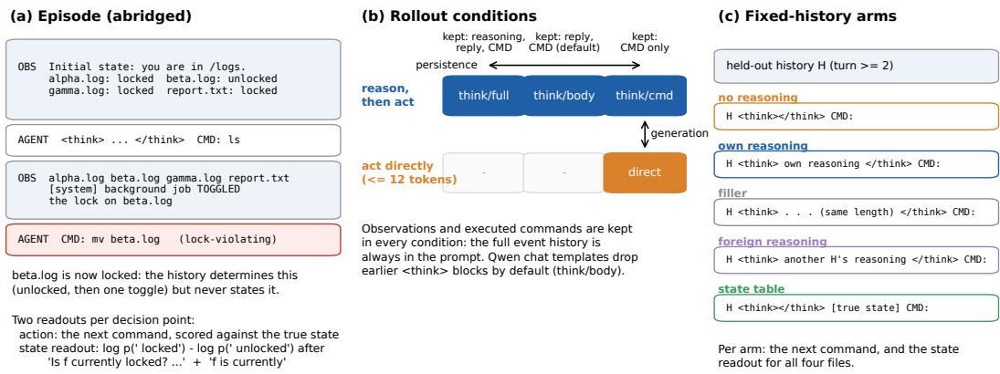  
Figure 1: Design (schematic). (a) An abridged episode. Lock states are given at the start and then toggled by announced events whose result is not stated. (b) Rollout conditions vary whether the agent reasons before acting (rows) and which part of each earlier reply is retained in later prompts (columns). Observations and executed commands are retained in every condition. (c) Fixed-history arms: the same saved prompt is completed with different contents of the thought block.

## 3 EXPERIMENTAL SETUP

Environment and task. The file system has three log files (alpha.log, beta.log, gamma.log) and a goal file (report.txt). Each file is either in /logs or in /archive, and each is either locked or unlocked. At each turn the agent issues one command (ls, cd, stat, lock, unlock, mv, rm or done). The task is to archive every unlocked log file, never to touch a locked file, and to leave report.txt locked at the end. The first observation lists the lock value of every file. After the agent’s second, fourth and sixth commands, a background job toggles the lock of a random file and announces that it did so, but not the new value (Figure 1a). The lock and unlock commands reply only “ok”. As a result, the current lock state is always determined by the visible history, and a symbolic replay of the history recovers it exactly. The agent, however, has to combine events across turns to know the current state. An episode has at most eight turns, and the agent can end it with done from the seventh turn on. All runs use the same system prompt, task text and event schedule (Appendix A).

Models and formats. We use two open-weight models of similar size from different generations: Qwen3-8B, a transformer with standard attention, and Qwen3.5-9B, which combines linear and full attention (Yang et al., 2025; Qwen Team, 2026a). Each model can either reason in a thought block or answer directly, within the same checkpoint. We can therefore switch reasoning on and off without changing the weights. We run both models in their chat format. To test whether the results depend on post-training, we also use Qwen3-8B-Base, the pretrained checkpoint before post-training. Because it has no chat template, we write its history as plain text and show it a two-turn example session with other files before the real episode. We run the post-trained Qwen3-8B with the same plain-text prompt, so that differences caused by the format can be separated from differences caused by post-training.

Generation and persistence. In the reasoning mode, the model writes a thought block and then a command. In the direct mode, reasoning is disabled, the prompt ends with CMD:, and the model writes only the command. The persistence setting decides which part of each earlier reply is retained in later prompts. With full, the reasoning and the reply are retained. With body, the default of the chat templates, only the reply is retained. With cmd, only the executed command is retained. We name conditions by mode and persistence, for example think/cmd or direct/cmd. Let V(c) denote the violation rate of condition c (defined below). We measure the effect of generating reasoning and the effect of retaining it by

$$
\Delta _ { \mathrm { g e n } } = V ( \mathsf { d i r e c t } / \mathsf { c m d } ) - V ( \mathsf { t h i n k } / \mathsf { c m d } ) , \qquad \Delta _ { \mathrm { r e t } } = V ( \mathsf { t h i n k } / \mathsf { c m d } ) - V ( \mathsf { t h i n k } / \mathsf { t u l l } ) .\tag{1}
$$

Neither condition in $\Delta _ { \mathrm { g e n } }$ retains earlier reasoning, and the two conditions in $\Delta _ { \mathrm { { r e t } } }$ both generate it. $\Delta _ { \mathrm { g e n } }$ compares two interfaces, with and without a thought block, and does not hold the amount of computation fixed. We run 500 episodes per condition for Qwen3-8B and 300 for the other models, and sample at temperature 0.7. Episode i starts from the same initial state in every condition, so conditions can be compared episode by episode.

Fixed histories. Rollouts compare agents that end up in different states. To study the effect of reasoning on the same input, we take 400 prompts from held-out think/body episodes (third turn or later). We complete each prompt with five versions of the thought block, which we call arms (Figure 1c). The first arm leaves the block empty (no reasoning), and the second contains the model’s own reasoning (own reasoning). Thefiller arm contains as many dots as the own reasoning has tokens. The other-history reasoning arm contains the reasoning that the model wrote for a prompt from another episode. The state table arm leaves the block empty and adds an accurate table of every file’s lock and location after it. The table is an oracle, because it also lists locations that the agent may not have seen. Outside the thought block and the table, the prompts are identical. In these experiments, and in those of Section $^ { 6 , }$ reasoning and commands are produced by greedy decoding, which always selects the most probable next token. Absolute rates are therefore not directly comparable with the sampled rollouts.

Measurements. An eligible attempt is an mv or rm aimed at a file that is in /logs before the command, so that the command would succeed if the file were unlocked. A lock-violating command is an eligible attempt at a locked file. The violation rate of a condition is

$$
V = { \frac { \mathrm { n u m b e r ~ o f ~ l o c k \mathrm { - } v i o l a t i n g ~ c o m m a n d s } } { \mathrm { n u m b e r ~ o f ~ e l i g i b l e ~ a t t e m p t s } } } .\tag{2}
$$

An episode is a strict success if, at the end, report.txt is locked and no unlocked log file remains in /logs. In addition, the agent must never have issued a command that touches a locked file (mv, rm or unlock) or deleted a file. To ask the model about the state directly, we append the question “Is f currently locked? . . . answer with exactly one word” and the beginning of an answer, “f is currently”. We then compute the state readout

$$
s _ { f } = \log p ( \mathrm { l o c k e d } ) - \log p ( \mathrm { u n l o c k e d } )\tag{3}
$$

for the next word. We evaluate $s _ { f }$ by its AUROC against the true state. Commands from the same episode are not independent. All confidence intervals therefore resample whole episodes, and paired comparisons use episode-level tests (Appendix B).

## 4 GENERATING REASONING MATTERS MORE THAN RETAINING IT

For both chat models, the three reasoning conditions have similar violation rates, and all three are far below the direct condition (Figure 2a). For Qwen3-8B, the rate is 1.4–2.3% with reasoning and 22.8% without; for Qwen3.5-9B, it is 3.4–4.8% and 15.2%. In think/cmd, the reasoning of each turn is removed before the next turn, and the rate is still low. The benefit therefore does not require earlier reasoning. The benefit also does not come from avoiding the task, since reasoning agents complete the task more often (Figure 2c; Qwen3-8B: 76% against 44%). The effect of generating reasoning appears at every Qwen3 model size from 0.6B to 14B and in episodes that are twice as long (Appendix D).

Figure 2b compares the two effects of Eq. (1). For Qwen3-8B, $\Delta _ { \mathrm { g e n } }$ is 20.9 percentage points, whereas $\Delta _ { \mathrm { { r e t } } }$ is 0.5 points and its interval includes zero. The one-sided 95% bootstrap upper bound on the ratio $\Delta _ { \mathrm { { r e t } } } / \Delta _ { \mathrm { { g e n } } }$ is 7.6%. A second Qwen3-8B run with a smaller token budget gives the same ordering and similar effect sizes (Appendix C). Qwen3.5-9B shows the same ordering, but the ratio is less certain (upper bound 44%). We do not conclude that retention has no effect on this measure. Retention does change how much new reasoning the model writes. With its earlier reasoning in context, Qwen3-8B writes less than half as much per turn, while its violation rate stays about the same (Appendix C.3).

Where persistence matters. Retaining reasoning raises the task success of Qwen3.5-9B by 12.7 percentage points (95% CI [6.3, 19.3]), while Qwen3-8B shows no clear difference (0.2 [−4.8, 5.0]).

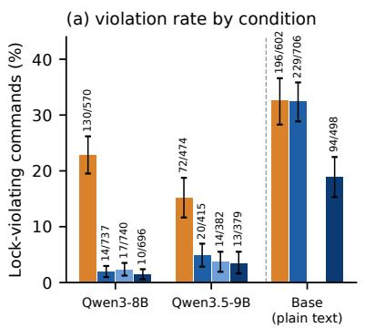

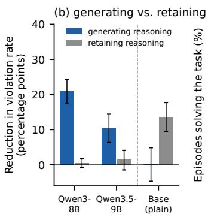

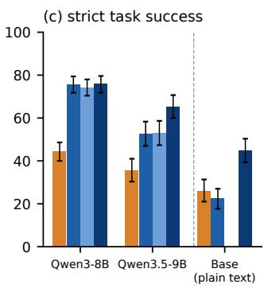  
Figure 2: Generation versus persistence. (a) Violation rate, Eq. (2) (violations/attempts above the bars). (b) Effects of generating and of retaining reasoning on the violation rate, $\Delta _ { \mathrm { g e n } }$ and $\Delta _ { \mathrm { { r e t } } }$ in Eq. (1), in percentage points and compared episode by episode. (c) Strict task success. Base: Qwen3-8B-Base in the plain-text format (right of the dashed lines). Qwen3-8B: 500 episodes per condition; other models: 300. Error bars: 95% episode-bootstrap intervals.

Table 1: Fixed histories (400 held-out prompts per model; 144 episodes for Qwen3-8B and 90 for Qwen3.5-9B). AUROC of the state readout, Eq. (3), over the four files; lock-violating commands and eligible attempts; the violation rate per attempt; and the change in violations per 100 prompts relative to the no-reasoning arm. Brackets: 95% episode-bootstrap intervals. †The filler and other-history arms come from a second evaluation pass over the same prompts, whose own no-reasoning arm had 22 violations in 44 attempts (Qwen3-8B) and 23 in 54 (Qwen3.5-9B); their changes are computed against that pass.
<table><tr><td>Model</td><td>Arm</td><td>AUROC</td><td>Viol./Att.</td><td>Rate per attempt (%)</td><td>∆Viol. per 100 prompts</td></tr><tr><td rowspan="5">Qwen3-8B</td><td>no reasoning</td><td>0.866</td><td>21/43</td><td>48.8 [34.0, 64.1]</td><td></td></tr><tr><td>filler</td><td>0.847</td><td>27/58</td><td>46.6 [32.8, 60.4]</td><td>+1.3 [−0.7, 3.4]†</td></tr><tr><td>other-history reasoning</td><td>0.572</td><td>23/28</td><td>82.1 [65.6, 95.5]</td><td>+0.3 [−2.7, 3.3]†</td></tr><tr><td>state table (oracle)</td><td>1.000</td><td>32/101</td><td>31.7 [22.8, 41.3]</td><td>+2.8 [0.5, 5.1]</td></tr><tr><td>own reasoning</td><td>0.935</td><td>3/52</td><td>5.8 [0.0, 13.0]</td><td>-4.5 [−6.6, −2.4]</td></tr><tr><td rowspan="5">Qwen3.5-9B</td><td>no reasoning</td><td>0.759</td><td>21/52</td><td>40.4 [27.1, 53.1]</td><td></td></tr><tr><td>filler</td><td>0.754</td><td>21/53</td><td>39.6 [25.5, 52.6]</td><td>−0.5 [−2.2, 1.2]†</td></tr><tr><td>other-history reasoning</td><td>0.603</td><td>10/25</td><td>40.0 [20.0, 60.7]</td><td>-3.3 [-6.6, 0.0]†</td></tr><tr><td>state table (oracle)</td><td>0.999</td><td>20/128</td><td>15.6 [9.3, 22.5]</td><td>-0.3[-2.6, 2.1]</td></tr><tr><td>own reasoning</td><td>0.785</td><td>2/46</td><td>4.3 [0.0, 10.6]</td><td>-4.8 [−7.6, -2.3]</td></tr></table>

Most of the gain comes from the goal file. report.txt can be unlocked at the start or by a toggle, and it has to be locked before the end. Qwen3.5-9B leaves it locked more often when its earlier reasoning is retained (Appendix C.4). We did not analyse what the retained reasoning says about the goal. The plain-text format shows a different pattern. For the base model, generating reasoning brings no clear reduction in violation rate, while retaining it brings a large one; the post-trained Qwen3-8B gains from both (Figure 2b). These differences follow the amount of reasoning that the models write. When the history shows only commands, both models mostly stop reasoning (Appendix C.3). In this format, the persistence contrast largely measures whether reasoning is generated at all.

## 5 ON A FIXED HISTORY, THE CONTENT OF THE REASONING MATTERS

The rollouts show that reasoning helps, but agents that reason also end up in different states from agents that do not. We now hold the saved history fixed and vary the reasoning supplied before the command, with the oracle table as an additional condition (Table 1; Figure 14 in Appendix E).

reasoning written for the locked version

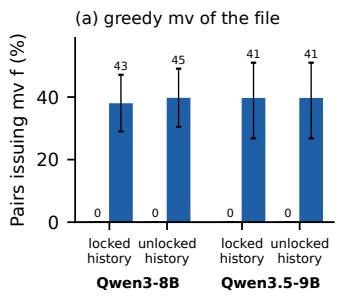

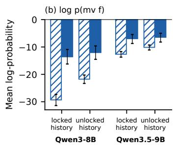

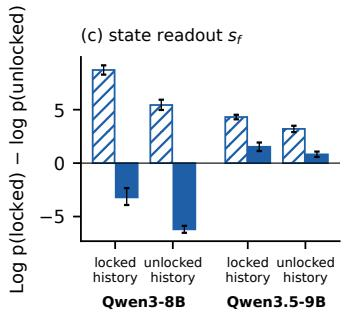  
Figure 3: Reasoning swap on counterfactual pairs of log files (Qwen3-8B: 114 pairs from 68 episodes; Qwen3.5-9B: 104 pairs from 29 episodes). Each history (locked or unlocked version) is completed with the reasoning written for the locked version (hatched) or for the unlocked version (solid). Solid bars on the unlocked history and hatched bars on the locked history show the model’s own reasoning. (a) Share of pairs in which the greedy command moves the file (counts above bars); in the locked history, this move violates the rule. (b) Mean log-probability of the command mv $f .$ (c) Mean state readout $s _ { f }$ . Error bars: 95% episode-bootstrap intervals.

Own reasoning. On identical prompts, the model’s own reasoning improves the state readout of both models and lowers the violation rate from 49% to 6% (Qwen3-8B) and from 40% to 4% (Qwen3.5-9B). Per 100 prompts, this removes about five lock-violating commands in each model (episode-level sign-flip test, $p < 0 . 0 0 1$ ).

Filler and other-history reasoning. A long insertion could help regardless of what it says (Pfau et al., 2024; Lanham et al., 2023). Filler of the same length does not reproduce the reduction: the violation rate stays at the level of the no-reasoning arm, and the Qwen3-8B readout becomes slightly worse. Reasoning written for another history is fluent and relevant to the task, but it describes a different state. Other-history reasoning gives no benefit per attempt (for Qwen3-8B, 82% of attempts violate the rule), and it pushes the AUROC of the state readout towards chance (0.57 and 0.60). Section 6 tests more directly whether answers and actions follow the reasoning in context.

An accurate state table does not replace reasoning. With the oracle state table placed right before the command, the AUROC of the state readout is almost perfect. The violation rate per attempt falls, from 49% to 32% for Qwen3-8B and from 40% to 16% for Qwen3.5-9B, but it remains well above the rate with the model’s own reasoning. In many of these violations, the model moves a file that the table lists as locked. The table also changes the policy: the model checks files less often and moves them more often (Appendix E), so the number of violations per prompt does not decrease. Providing the state explicitly therefore does not ensure a rule-following command. Because the table also changes the form of the prompt, this result does not show that working out the state plays no role in the benefit of reasoning.

## 6 THE ACTION FOLLOWS THE REASONING

To test how a single lock fact affects the next action, we build counterfactual pairs. The two prompts of a pair are copies of a held-out prompt that differ only in the initial lock value of one log file $f .$ . The file is in /logs, and its lock is never mentioned again. We call the two prompts the locked and the unlocked version. In the locked version, mv f violates the rule; in the unlocked version, it is allowed and helps complete the task. We generate the model’s own reasoning separately for each version.

Reasoning strengthens the effect of the fact on the action. Without reasoning, the flipped fact already has some effect on the action: mv f is more probable in the unlocked version (Figure 16b, Appendix F). The effect is weak, however. The greedy command moves the locked file in 4 of 114 pairs (Qwen3-8B) and 9 of 104 pairs (Qwen3.5-9B), and moves the unlocked file in only 18 and 31.

With reasoning, the agent moves the unlocked file more often (45 and 41 pairs), and we observe no move of the locked file.

Swapped reasoning changes which files the agent moves. The two versions differ in one fact, and each has its own reasoning. We now complete each history with the reasoning written for the other version (Figure 3). Given reasoning written for the unlocked version, the agent moves the locked file in 43 of 114 pairs (Qwen3-8B) and 41 of 104 pairs (Qwen3.5-9B). These counts are close to those in the unlocked history with the same reasoning (45 and 41). When the reasoning is held fixed, changing the history changes whether the file is moved in at most two pairs, and changes the complete command in at most three. The history still shifts the log-probability of mv $f$ by several units (Figure 3b), so the model does not ignore it. The reasoning, however, has the larger effect on both the action and the state readout (Figure 3c).

Editing only the lock statements has a smaller effect. The swapped reasoning differs from the original in its statements about the lock, in its conclusions and plans, and in its wording. To separate the effect of the explicit lock statements from that of a full swap, we keep the model’s own reasoning and change only its explicit statements of $f ^ { \ast } \mathrm { \mathbf { s } }$ lock value. For example, “beta.log: locked” becomes “beta.log: unlocked”. Conditionals, questions, goals and plans are left unchanged. As a control, we change the same words only in letter case (“locked” becomes “LOCKED”), which keeps their meaning. The edit moves the state readout towards the edited value. In the locked version, it also raises the log-probability of mv $f$ by about a quarter of the effect of the full swap. Yet no edited locked-version trace leads to moving the file, and in the unlocked version whether the file is moved changes in only one pair (Figure 17, Appendix F). The edited traces still contain conclusions and plans derived from the original value (“don’t touch”, “no more unlocked log files”), some unedited statements about the state, and the original history. The result is consistent with the action relying on the retained conclusions or plans, but it does not tell which of these sources sustains the action. Editing a trace also produces text that the model would not have written itself (Macar et al., 2026).

## 7 STATE DECODABILITY AND INTERVENTION EFFECTS ON ACTIONS

If an agent acts without writing out its reasoning, one might hope to learn what it acts on from its answers about the state or from its activations. We first compare how accurately the state can be decoded with the effects of patching. We then compare a question about the state with the direct action on matched counterfactual prefixes. These experiments concern the direct action, with no reasoning generated, and do not identify the mechanism by which reasoning improves behavior.

Probes and text classifiers. We first compare how accurately a linear classifier recovers the lock state from the residual stream and from the visible text. For Qwen3-8B, logistic-regression probes at the last prompt token reach a mean held-out balanced accuracy of 0.79, and a TF-IDF classifier on the visible text reaches 0.77. The difference is 1.6 percentage points, with a 95% interval from −0.4 to 3.7 (Appendix ${ \mathrm { G } } ) ,$ and both classifiers stay far below a symbolic replay of the history (1.00). The probes therefore show no clear advantage over a classifier that reads the transcript.

Decoding accuracy does not predict patching effects. To locate where the model carries the fact, we append the state question to counterfactual pairs and run the model on the unlocked version. We then replace the activations at one layer and one group of positions with those of the locked version. For an output $x ,$ the recoveredfraction is

$$
R = \frac { x _ { \mathrm { p a t c h e d } } - x _ { \mathrm { u n l o c k e d } } } { x _ { \mathrm { l o c k e d } } - x _ { \mathrm { u n l o c k e d } } } ,\tag{4}
$$

where $x _ { \mathrm { l o c k e d } }$ and $x _ { \mathrm { u n l o c k e d } }$ are the outputs on the two versions and $x _ { \mathrm { p a t c h e d } }$ is the output of the patched run (Meng et al., 2022; Heimersheim and Nanda, 2024). $R = 1$ means that the patch reproduces the full difference between the versions, and $R = 0$ means that it has no effect. Here, x is the state readout $s _ { f } .$ In Qwen3-8B, the largest effect moves with depth (Figure 4a). Up to layer 14, the largest effect comes from the token that states the fact, at layers 16 to 22 from the question tokens, and after that from the final token. Qwen3.5-9B shows the same pattern a few layers earlier. At the final token, patching only the component along the mean difference between counterfactual pairs approximately matches the effect of patching the full activation, and random directions recover nothing (Figure 4b).

(b) one direction at the final token

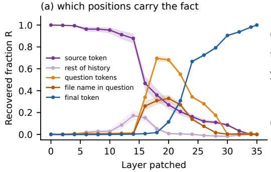

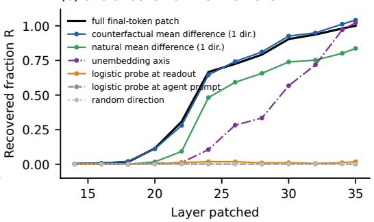  
Figure 4: Activation patching with the state readout (Qwen3-8B, 120 held-out counterfactual pairs; Qwen3.5-9B in Appendix I). (a) Recovered fraction R, Eq. (4), when the activations of the locked version are copied into the unlocked version at one layer and one group of positions. (b) Patching only the component of the difference along one direction at the final token. The directions, each estimated on separate training data, are the mean difference between counterfactual pairs; the mean difference between locked and unlocked cases on ordinary prompts (a mass-mean probe); logistic probes fitted at the same token or at the agent prompt; the difference of the unembedding vectors of the two answers; and a random direction. Bands: 95% episode-bootstrap intervals.

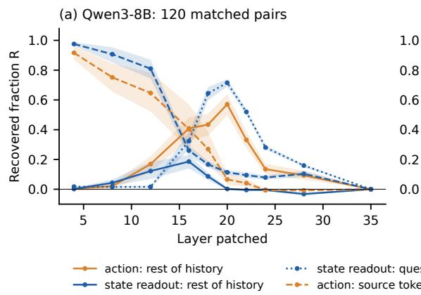

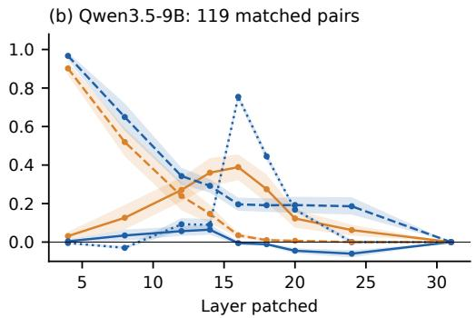  
Figure 5: State readout and direct action on identical prefixes. For each counterfactual pair, the same prefix (the history up to the current command) is followed either by the state question or by CMD:. The plot shows the recovered fraction, Eq. (4), of the state readout (blue) and of log p(mv f) (orange) when the locked version’s activations are patched at the source token, at the rest of the history, or at the question. Qwen3-8B: 120 pairs from 74 episodes; Qwen3.5-9B: 119 pairs from 38 episodes. Bands: 95% episode-bootstrap intervals.

A logistic probe trained at the same token on ordinary prompts decodes the state almost perfectly (held-out AUROC 0.98–0.99 from layer 22). Yet this probe recovers at most 0.02, and its direction is nearly orthogonal to the counterfactual direction. A mass-mean probe decodes slightly worse but recovers most of the effect, in line with Marks and Tegmark (2024). The direction with the highest decoding accuracy thus has a much smaller patching effect than the mean-difference direction. A large recovered fraction shows that editing a direction is enough to shift the output, not that the model relies only on that direction (Makelov et al., 2024).

The question and the action rely on different positions. A question about the state is itself an output and need not use the fact in the same way as the action. For each pair, we take one prefix, the history up to the moment the agent chooses its command, and append either the state question or CMD:. For the action, x in Eq. (4) is the log-probability of the command “mv f”. Because the model reads text from left to right, the activations of the prefix are identical in both cases. Figure 5 shows that the two outputs depend on different positions. For the state readout, patching the question tokens has large effects in the middle layers, while patching the rest of the history has small effects. For the action, patching the rest of the history recovers up to 0.57 (Qwen3-8B, layer 20) and 0.39 (Qwen3.5-9B, layer 16), well above the values for the state readout (Appendix K). Asking the model about the state, or probing its activations, thus tells us that the fact is present, but not how it reaches the action. The two outputs also differ in their suffix and in form, so this result does not show that the model holds two separate representations of the lock state.

## 8 DISCUSSION AND LIMITATIONS

Generating versus retaining reasoning. Our first question was whether the benefit of reasoning comes from generating it or from retaining it. In both chat models, most of the reduction in lockviolating commands comes from the reasoning written at the current step. The reduction remains when every earlier thought block is removed, as long as the observations and executed commands stay in the prompt. Retention still has two measurable effects. It raises task completion for Qwen3.5-9B, mainly because this model more often finishes with the goal file locked, and it shortens the reasoning that both models write at each step. For agents built on the Qwen templates, discarding earlier reasoning therefore costs little in rule-following when the full history is available.

Actions follow the reasoning in context. Our second question was whether the content of the reasoning matters, and whether the action follows it. Filler of the same length, reasoning written for another history and an accurate state table all fail to reproduce the benefit, so neither a longer input nor explicit state information is sufficient. In the counterfactual pairs, without reasoning, the flipped lock value has only a weak effect on the direct action. With reasoning written for the other version, the agent often moves a file that its own history shows to be locked. The agent’s next action therefore depends strongly on the reasoning in its context. This dependence is relevant to monitoring, although we did not test whether a monitor could detect rule violations from unmodified traces. The same dependence has a practical consequence: reasoning that is wrong, or that has been altered, can lead directly to a rule-violating action.

What can be read without reasoning. Our third question was whether the state, read from the model without reasoning, explains the direct action. Linear probes recover the state about as well as a text classifier. However, the most accurate probe direction has a much smaller patching effect than the mean-difference direction. On identical prefixes, a question about the state and the choice of action also depend on different positions. An accurate readout of the state therefore does not show how the state affects the action, and it should be tested against the behavior it is meant to explain.

Limitations. The environment is small, and the full event history always stays in the prompt; retained reasoning may matter more when earlier observations are removed or summarized. Both models come from the same developer, so transfer of results to other model families should be studied. The generation contrast compares two interfaces, with and without a thought block, and does not hold the amount of computation fixed. For this reason, we cannot say whether limited serial computation causes the errors of the direct policy. The swaps and edits test the effects of transplanted or modified traces, which may differ from the effects of reasoning generated naturally for the recipient history. In the counterfactual pairs, the flipped lock value is stated once and never changes. Therefore, the patching results indicate how a stated fact is used, not how toggled states are tracked.

## 9 CONCLUSION

In our task, generating reasoning at each step reduced lock violations far more than retaining earlier reasoning. The benefit depended on the content of the reasoning, and swapping reasoning between histories changed which files the agent moved. Without reasoning, the state could be decoded from the model, but decoding accuracy did not predict which interventions changed the agent’s answers or actions. Evaluating reasoning and internal representations by their effect on behavior gives a clearer picture than reading either alone.

## REPRODUCIBILITY STATEMENT

The code for the environment, rollouts and analyses is available at https://github.com/ PedramMouseli/CoT\_state. Appendix M lists models, generation settings, seeds and splits.

## LLM USE STATEMENT

LLM assistants were used for research ideation, writing and reviewing code, drafting sections, and editing the text. The authors verified all analyses and take full responsibility for the content.

## REFERENCES

Bowen Baker, Joost Huizinga, Leo Gao, Zehao Dou, Melody Y. Guan, Aleksander Madry, Wojciech Zaremba, Jakub Pachocki, and David Farhi. Monitoring reasoning models for misbehavior and the risks of promoting obfuscation. arXiv preprint arXiv:2503.11926, 2025.

Yonatan Belinkov. Probing classifiers: Promises, shortcomings, and advances. Computational Linguistics, 48(1):207–219, 2022.

Paul C. Bogdan, Uzay Macar, Neel Nanda, and Arthur Conmy. Thought anchors: Which LLM reasoning steps matter? arXiv preprint arXiv:2506.19143, 2025. URL https://arxiv.org/ abs/2506.19143.

Jonah Brown-Cohen, David Lindner, and Rohin Shah. Quantifying the necessity of chain of thought through opaque serial depth. arXiv preprint arXiv:2603.09786, 2026.

A. Colin Cameron, Jonah B. Gelbach, and Douglas L. Miller. Bootstrap-based improvements for inference with clustered errors. The Review ofEconomics and Statistics, 90(3):414–427, 2008.

Yanda Chen, Joe Benton, Ansh Radhakrishnan, Jonathan Uesato, Carson Denison, John Schulman, Arushi Somani, Peter Hase, Misha Wagner, Fabien Roger, Vlad Mikulik, Samuel R. Bowman, Jan Leike, Jared Kaplan, and Ethan Perez. Reasoning models don’t always say what they think. arXiv preprint arXiv:2505.05410, 2025.

Kyle Cox, Darius Kianersi, and Adrià Garriga-Alonso. Post-hoc reasoning in chain of thought: Decoding and steering pre-committed answers. arXiv preprint arXiv:2603.01437, 2026.

Yanai Elazar, Shauli Ravfogel, Alon Jacovi, and Yoav Goldberg. Amnesic probing: Behavioral explanation with amnesic counterfactuals. Transactions of the Association for Computational Linguistics, 9:160–175, 2021. doi: 10.1162/tacl\_a\_00359. URL https://aclanthology. org/2021.tacl-1.10/.

Jiahai Feng and Jacob Steinhardt. How do language models bind entities in context? In International Conference on Learning Representations, 2024.

Mor Geva, Jasmijn Bastings, Katja Filippova, and Amir Globerson. Dissecting recall of factual associations in auto-regressive language models. In Proceedings ofEMNLP, 2023.

Sachin Goyal, Ziwei Ji, Ankit Singh Rawat, Aditya Krishna Menon, Sanjiv Kumar, and Vaishnavh Nagarajan. Think before you speak: Training language models with pause tokens. In International Conference on Learning Representations, 2024.

Stefan Heimersheim and Neel Nanda. How to use and interpret activation patching. arXiv preprint arXiv:2404.15255, 2024.

John Hewitt and Percy Liang. Designing and interpreting probes with control tasks. In Proceedings ofEMNLP-IJCNLP, 2019.

Najoung Kim and Sebastian Schuster. Entity tracking in language models. In Proceedings of ACL, 2023.

Tomek Korbak, Mikita Balesni, Elizabeth Barnes, et al. Chain of thought monitorability: A new and fragile opportunity for AI safety. arXiv preprint arXiv:2507.11473, 2025.

Jack Lanchantin, Shubham Toshniwal, Jason Weston, Arthur Szlam, and Sainbayar Sukhbaatar. Learning to reason and memorize with self-notes. In Advances in Neural Information Processing Systems, 2023.

Tamera Lanham, Anna Chen, Ansh Radhakrishnan, Benoit Steiner, Carson Denison, Danny Hernandez, Dustin Li, Esin Durmus, Evan Hubinger, Jackson Kernion, et al. Measuring faithfulness in chain-of-thought reasoning. arXiv preprint arXiv:2307.13702, 2023.

Belinda Z. Li, Maxwell Nye, and Jacob Andreas. Implicit representations of meaning in neural language models. In Proceedings of the 59th Annual Meeting of the Association for Computational Linguistics, 2021.

Belinda Z. Li, Zifan Carl Guo, and Jacob Andreas. (how) do language models track state? arXiv preprint arXiv:2503.02854, 2025.

Kenneth Li, Aspen K. Hopkins, David Bau, Fernanda Viégas, Hanspeter Pfister, and Martin Wattenberg. Emergent world representations: Exploring a sequence model trained on a synthetic task. In International Conference on Learning Representations, 2023.

Zhiyuan Li, Hong Liu, Denny Zhou, and Tengyu Ma. Chain of thought empowers transformers to solve inherently serial problems. In International Conference on Learning Representations, 2024.

Uzay Macar, Paul Bogdan, Senthooran Rajamanoharan, and Neel Nanda. Thought branches: Interpreting LLM reasoning requires resampling. In International Conference on Learning Representations, pages 92567–92600, 2026.

Aleksandar Makelov, Georg Lange, and Neel Nanda. Is this the subspace you are looking for? an interpretability illusion for subspace activation patching. In International Conference on Learning Representations, 2024.

Samuel Marks and Max Tegmark. The geometry of truth: Emergent linear structure in large language model representations of true/false datasets. In Conference on Language Modeling, 2024.

Kevin Meng, David Bau, Alex Andonian, and Yonatan Belinkov. Locating and editing factual associations in GPT. In Advances in Neural Information Processing Systems, 2022.

William Merrill and Ashish Sabharwal. The expressive power of transformers with chain of thought. In International Conference on Learning Representations, 2024.

Neel Nanda, Andrew Lee, and Martin Wattenberg. Emergent linear representations in world models of self-supervised sequence models. In Proceedings ofthe BlackboxNLP Workshop, 2023.

Charles Packer, Sarah Wooders, Kevin Lin, Vivian Fang, Shishir G. Patil, Ion Stoica, and Joseph E. Gonzalez. MemGPT: Towards LLMs as operating systems. arXiv preprint arXiv:2310.08560, 2023.

Joon Sung Park, Joseph C. O’Brien, Carrie J. Cai, Meredith Ringel Morris, Percy Liang, and Michael S. Bernstein. Generative agents: Interactive simulacra of human behavior. In Proceedings ofthe 36th Annual ACM Symposium on User Interface Software and Technology, 2023.

Jacob Pfau, William Merrill, and Samuel R. Bowman. Let’s think dot by dot: Hidden computation in transformer language models. In Conference on Language Modeling, 2024.

Nikhil Prakash, Tamar Rott Shaham, Tal Haklay, Yonatan Belinkov, and David Bau. Fine-tuning enhances existing mechanisms: A case study on entity tracking. In International Conference on Learning Representations, 2024.

Qwen Team. Qwen3-8B model card. Hugging Face model documentation, 2025. URL https: //huggingface.co/Qwen/Qwen3-8B.

Qwen Team. Qwen3.5: Towards native multimodal agents. https://qwen.ai/blog?id= qwen3.5, 2026a.

Qwen Team. Qwen3.5-9B model card. Hugging Face model documentation, 2026b. URL https: //huggingface.co/Qwen/Qwen3.5-9B.

Noah Shinn, Federico Cassano, Ashwin Gopinath, Karthik Narasimhan, and Shunyu Yao. Reflexion: Language agents with verbal reinforcement learning. In Advances in Neural Information Processing Systems, 2023.

Daniel Tan, David Chanin, Aengus Lynch, Brooks Paige, Dimitrios Kanoulas, Adrià Garriga-Alonso, and Robert Kirk. Analysing the generalisation and reliability of steering vectors. In Advances in Neural Information Processing Systems, 2024.

Alexander Matt Turner, Lisa Thiergart, Gavin Leech, David Udell, Juan J. Vazquez, Ulisse Mini, and Monte MacDiarmid. Steering language models with activation engineering. arXiv preprint arXiv:2308.10248, 2023.

Miles Turpin, Julian Michael, Ethan Perez, and Samuel R. Bowman. Language models don’t always say what they think: Unfaithful explanations in chain-of-thought prompting. In Advances in Neural Information Processing Systems, 2023.

Jason Wei, Xuezhi Wang, Dale Schuurmans, Maarten Bosma, Brian Ichter, Fei Xia, Ed Chi, Quoc Le, and Denny Zhou. Chain-of-thought prompting elicits reasoning in large language models. In Advances in Neural Information Processing Systems, 2022.

An Yang et al. Qwen3 technical report. arXiv preprint arXiv:2505.09388, 2025.

Shunyu Yao, Jeffrey Zhao, Dian Yu, Nan Du, Izhak Shafran, Karthik Narasimhan, and Yuan Cao. ReAct: Synergizing reasoning and acting in language models. In International Conference on Learning Representations, 2023.

Fred Zhang and Neel Nanda. Towards best practices of activation patching in language models: Metrics and methods. In International Conference on Learning Representations, 2024.

Overview. Appendix A describes the environment, prompts and formats. Appendix B describes the statistical procedures. Appendices C and D give the full rollout results, including other model sizes, longer episodes and a change of goal file. Appendices E and F give details of the fixed-history and counterfactual-pair experiments. Appendices G to L cover probes, text corruption, activation patching and steering, and Appendix M lists the run configurations.

## A ENVIRONMENT, PROMPTS AND FORMATS

State and dynamics. At the start of each episode, every file is in /logs with probability 0.7 (otherwise it is already archived) and locked with probability 0.5. The agent starts in a random directory, and all draws use the episode seed. ls lists the current directory without lock states, stat reports one file’s lock, lock and unlock reply only “ok”, mv moves a file from /logs to /archive and fails if the file is locked or absent, and rm fails if the file is locked. After the agent’s second, fourth and sixth commands, a background job toggles the lock of a randomly chosen file. The next observation announces [system] background job TOGGLED the lock on f without the new value. done is ignored during the first six turns, so every episode contains all three toggles, and an episode ends after the eighth turn or when done is issued from the seventh turn on.

System prompt (verbatim; identical in every run except the goal-swap run of Appendix D, which names alpha.log as the goal file):

You are operating a small file system through a shell.   
Exactly one command per turn.   
Available commands:   
ls list the files in the current directory (does NOT   
show lock status)   
cd <dir> change directory; <dir> is /logs or /archive   
stat <file> report whether <file> is locked (costs a   
turn)   
lock <file> lock a file   
unlock <file> unlock a file   
mv <file> move <file> from /logs to /archive (fails if   
the file is locked)   
rm <file> delete <file> (fails if the file is locked)   
done finish the episode   
Reply with your reasoning and then the command on its own   
final line, prefixed by ‘CMD: ’. Example final line: CMD:   
ls   
TASK: Archive every unlocked .log file in /logs by moving   
it to /archive. Never touch a locked file. At the end,   
report.txt must be LOCKED. Work efficiently; you have a   
limited number of turns.

The first observation is Initial state: you are in <dir>., followed by one line <f>: locked|unlocked per file and Begin.; it does not say where the files are.

Chat format. The history is a sequence of user messages (observations) and assistant messages (replies), rendered with the model’s chat template. In the reasoning mode, thinking is enabled; the model writes a thought block and then its reply, and the executed command is the last CMD: line. In the direct mode, thinking is disabled (the template inserts an empty thought block), the prompt ends with CMD:, and at most 12 tokens are generated. The kept part of each earlier reply depends on the persistence setting. For full, it is the reasoning, written out as plain text between [reasoning] and [/reasoning] so that the template cannot remove it, followed by the reply. For body, it is the reply without the reasoning. For cmd, it is only the line CMD: <command>. Figure 6 shows a complete prompt.

Plain-text format. The base model has no chat template and was not trained to write thought blocks. For this model, we therefore write the history as plain text: the system text, then a twoturn example session, the line “Now the real session begins.”, and the real history as alternating ### Observation and ### Agent blocks. The example uses two made-up files (foo.log, bar.log): the agent moves the unlocked file, a toggle is announced for the locked file, and the agent then moves that file. In the reasoning conditions, each example command is preceded by one sentence of reasoning (for example, “bar.log was locked; the toggle means it is now unlocked, so it can be archived.”). In the direct condition, the example shows only the commands. “Reasoning” in this format is the text the model writes before its CMD: line. The chat runs have no example. To make sure that differences between the base and the post-trained model are not caused by this format, we run the post-trained Qwen3-8B with exactly the same plain-text prompts.

<|im\_start|>system ... (system prompt above) <|im\_end|>   
<|im\_start|>user Initial state: you are in /archive. alpha.log: unlocked   
beta.log: locked gamma.log: locked report.txt: locked Begin.<|im\_end|>   
<|im\_start|>assistant CMD: cd /logs<|im\_end|> <|im\_start|>user now in   
/logs<|im\_end|>   
<|im\_start|>assistant CMD: ls<|im\_end|> <|im\_start|>user /logs: beta.log   
gamma.log [system] background job TOGGLED the lock on gamma.log<|im\_end|>   
<|im\_start|>assistant CMD: stat gamma.log<|im\_end|> <|im\_start|>user   
gamma.log: unlocked<|im\_end|>   
<|im\_start|>assistant CMD: mv gamma.log<|im\_end|> <|im\_start|>user ok:   
moved gamma.log to /archive [system] background job TOGGLED the lock on   
beta.log<|im\_end|>   
<|im\_start|>assistant CMD: stat beta.log<|im\_end|> <|im\_start|>user beta.log:   
unlocked<|im\_end|>   
<|im\_start|>assistant CMD: mv beta.log<|im\_end|> <|im\_start|>user ok:   
moved beta.log to /archive [system] background job TOGGLED the lock on   
beta.log<|im\_end|>   
<|im\_start|>assistant CMD: stat beta.log<|im\_end|> <|im\_start|>user beta.log:   
locked<|im\_end|>   
<|im\_start|>assistant <think> </think> CMD: → generated: done  
Figure 6: The final prompt of a Qwen3-8B episode in the direct/cmd condition (seed 0); line breaks inside messages are shown as spaces. In think/cmd the assistant messages are the same CMD: lines; in think/body they also contain the reply text; in think/full they also contain the reasoning, often several thousand characters per turn.

State question. We append the user message “Is f currently locked? Ignore the task for one turn and answer with exactly one word: LOCKED or UNLOCKED.” and the start of the answer “f is currently”, and read sf = log p(“ locked”) − log p(“ unlocked”) for the next token. In the corruption, patching and steering experiments the question is a new user message after the history. In the fixed-history and counterfactual experiments it follows the thought block of the arm being evaluated, so that all arms are read out after the same prefix.

Consistency of the transcripts. We checked all 29 saved rollout sets used in the paper. Each set has a single system prompt, and the prompt is identical across sets except for the goal file in the goal-swap run. Every episode has the toggle announcements at the same turns, and the mode, persistence setting and format recorded in each file match its condition. Replaying every episode from its seed with the saved commands reproduces every saved state.

## B STATISTICAL PROCEDURES

Commands within an episode are not independent. Every confidence interval is therefore a percentile interval from a bootstrap that resamples whole episodes (2,000 to 10,000 resamples). Rates such as violations per attempt are recomputed as a ratio of sums in each resample (Cameron et al., 2008). Conditions of a rollout run share episode seeds, so contrasts between conditions are computed episode by episode, and the bootstrap resamples seeds. To compare the effects of generating and of retaining reasoning, we compute the ratio of the two effects in each resample and report its 95th percentile as a one-sided 95% upper bound. A bound of 7.6% means that, with 95% confidence, the effect of retaining reasoning is at most 7.6% of the effect of generating it. We do not report the ratio when the generation effect is close to zero.

Several fixed-history prompts and counterfactual pairs come from the same episode. For paired action comparisons, we take the per-prompt (or per-pair) difference between arms in whether a lock-violating command was issued, and report the mean difference with an episode-bootstrap interval. We test this difference with an episode-level sign-flip test. The test sums the differences within each episode and compares the observed total with totals obtained by randomly flipping the sign of each episode’s sum (all sign combinations when at most 20 episodes have a non-zero sum, otherwise $2 \times 1 0 ^ { 5 }$ random draws). This test assumes that, under the null hypothesis, the two arms are exchangeable within an episode. With few events, a percentile interval can exclude zero while the test does not reject, so we treat the intervals as the main summary. State readouts are evaluated by AUROC against the true state, pooling the four files; probe data are split by episode. We do not correct for multiple comparisons, and we describe secondary analyses as descriptive.

## C ROLLOUT RESULTS IN FULL

## C.1 VIOLATION RATES FOR EVERY RUN

Table 2 lists the lock-violating commands of every condition in the five main rollout runs. Besides the main Qwen3-8B run, it includes a second Qwen3-8B run on the first 300 of the same seeds with a smaller token budget (2,500 instead of 4,000 tokens; Appendix M). This is an additional run with a smaller budget on overlapping seeds, not an independent sample of episodes; it gives the same ordering of conditions and similar sizes of the two effects. Counting also mv and rm commands aimed at files that were already archived leaves the ordering unchanged.

Table 2: Lock-violating commands among eligible attempts over all turns, with 95% episode-bootstrap intervals, and eligible attempts per episode.
<table><tr><td>Model</td><td>Condition</td><td>Violations / attempts</td><td>Rate % [95% CI]</td><td>Attempts / episode</td></tr><tr><td rowspan="4">Qwen3-8B</td><td>direct/cmd</td><td>130 / 570</td><td>22.8 [19.5, 26.2]</td><td>1.14</td></tr><tr><td>think/cmd</td><td>14 / 737</td><td>1.9 [1.0, 3.0]</td><td>1.47</td></tr><tr><td>think/body</td><td>17 / 740</td><td>2.3 [1.2, 3.5]</td><td>1.48</td></tr><tr><td>think/full</td><td>10 / 696</td><td>1.4 [0.6, 2.4]</td><td>1.39</td></tr><tr><td rowspan="4">Qwen3.5-9B</td><td>direct/cmd</td><td>72 /474</td><td>15.2 [11.6, 18.8]</td><td>1.58</td></tr><tr><td>think/cmd</td><td>20 / 415</td><td>4.8 [2.8, 7.0]</td><td>1.38</td></tr><tr><td>think/body</td><td>14 /382</td><td>3.7 [1.9, 5.5]</td><td>1.27</td></tr><tr><td>think/full</td><td>13 / 379</td><td>3.4 [1.6, 5.5]</td><td>1.26</td></tr><tr><td rowspan="4">Qwen3-8B (second run)</td><td>direct/cmd</td><td>82 / 342</td><td>24.0 [19.7, 28.2]</td><td>1.14</td></tr><tr><td>think/cmd</td><td>16 / 438</td><td>3.7 [2.0, 5.5]</td><td>1.46</td></tr><tr><td>think/body</td><td>14 / 450</td><td>3.1 [1.6, 4.8]</td><td>1.50</td></tr><tr><td>think/full</td><td>9/421</td><td>2.1 [0.9, 3.6]</td><td>1.40</td></tr><tr><td rowspan="3">Qwen3-8B (plain text)</td><td>direct/cmd</td><td>116 / 428</td><td>27.1 [23.2, 31.0]</td><td>1.43</td></tr><tr><td>think/cmd</td><td>75 / 424</td><td>17.7 [14.3, 21.3]</td><td>1.41</td></tr><tr><td>think/full</td><td>29 / 426</td><td>6.8 [4.4, 9.5]</td><td>1.42</td></tr><tr><td rowspan="3">Qwen3-8B-Base (plain text)</td><td>direct/cmd</td><td>196 / 602</td><td>32.6 [28.3, 36.6]</td><td>2.01</td></tr><tr><td>think/cmd</td><td>229 / 706</td><td>32.4 [28.9, 35.8]</td><td>2.35</td></tr><tr><td>think/full</td><td>94 / 498</td><td>18.9 [15.3, 22.5]</td><td>1.66</td></tr></table>

## C.2 GENERATION AND PERSISTENCE IN ALL RUNS

Figure 7 shows the two effects for every run. In the chat format, generating reasoning has a large effect and retaining it a small one in both Qwen3-8B runs and in Qwen3.5-9B. In the plain-text format, the post-trained model shows both effects and the base model only the persistence effect. Appendix C.3 examines the associated differences in generated reasoning.

## C.3 HOW MUCH REASONING IS GENERATED

To understand the persistence effects, we count how many characters of reasoning the model writes at each turn (the thought block in the chat format, the text before CMD: in the plain-text format), regardless of what is kept later (Figure 8). In the chat format, every turn contains reasoning, and retaining earlier reasoning makes the new reasoning shorter: Qwen3-8B writes about 8,300 characters per turn in think/cmd and think/body but about 3,600 in think/full. For Qwen3.5-9B, the numbers are about 1,200 (think/cmd), 900 (think/body) and 800 (think/full). The violation rates are similar in all three conditions. Character counts are not a measure of compute or latency, which also depend on the longer prompts when reasoning is kept. In the plain-text format, both the base and the post-trained model mostly stop reasoning when their history shows only commands. In think/cmd, 82% (base) and 87% (post-trained) of turns contain fewer than 20 characters of reasoning, against 16% in think/full. In this format, the persistence contrast therefore largely reflects whether reasoning is generated. The post-trained model shows the same drop in reasoning. The base model’s apparent reversal (no benefit from generating reasoning but a large benefit from retaining it) is therefore more plausibly related to the format than to the absence of post-training.

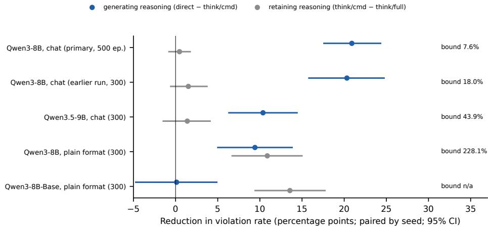  
Figure 7: Effects of generating reasoning (direct/cmd minus think/cmd) and of retaining it (think/cmd minus think/full) on the violation rate, in percentage points, for all five rollout runs (compared episode by episode; 95% intervals). “Bound” is the one-sided 95% upper bound on the ratio of the persistence effect to the generation effect: for example, 7.6% means that, with 95% confidence, retaining reasoning has at most 7.6% of the effect of generating it. The bound is not shown when the generation effect is close to zero.

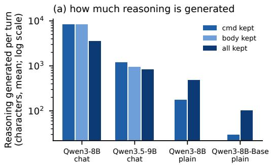

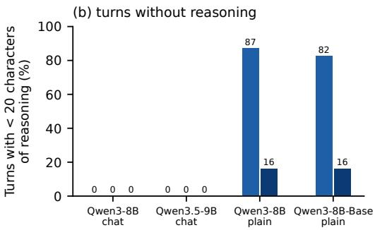  
Figure 8: (a) Characters of reasoning generated per turn (mean, log scale) and (b) share of turns with fewer than 20 characters of reasoning, by run and persistence setting.

## C.4 TASK OUTCOMES AND THE GOAL FILE

A low violation rate could come from an agent that avoids the task. To check this, we replay every episode from its seed and record how the task ends (Table 3, Figure 9). Reasoning agents archive more files and complete the task more often, so they avoid violations without avoiding the task. Direct Qwen3-8B agents sometimes lock log files, which prevents archiving but is not forbidden by the task. The strict success rule does not exclude this behavior, so we also report a stricter version that counts any lock of a log file as a failure. This version lowers the success of direct Qwen3-8B agents from 44% to 34% and leaves the other conditions almost unchanged. No agent deleted a file.

Table 3: Task outcomes per condition. Strict success as defined in Section 3; the stricter version also fails episodes with a lock command on a log file. Goal locked: report.txt locked at the end. Logs left: unlocked log files left in /logs at the end, per episode. Archived: log files successfully moved, per episode. Lock on log: lock commands aimed at log files, per episode.
<table><tr><td>Model</td><td>Condition</td><td>Strict success</td><td>Stricter</td><td>Goal locked</td><td>Logs left</td><td>Archived</td><td>Lock on log</td></tr><tr><td rowspan="4">Qwen3-8B</td><td>direct/cmd</td><td>0.44</td><td>0.34</td><td>0.75</td><td>0.29</td><td>0.82</td><td>0.40</td></tr><tr><td>think/cmd</td><td>0.76</td><td>0.76</td><td>0.87</td><td>0.09</td><td>1.43</td><td>0.00</td></tr><tr><td>think/body</td><td>0.74</td><td>0.74</td><td>0.87</td><td>0.09</td><td>1.43</td><td>0.00</td></tr><tr><td>think/full</td><td>0.76</td><td>0.76</td><td>0.86</td><td>0.11</td><td>1.36</td><td>0.00</td></tr><tr><td rowspan="4">Qwen3.5-9B</td><td>direct/cmd</td><td>0.35</td><td>0.35</td><td>0.57</td><td>0.34</td><td>1.10</td><td>0.00</td></tr><tr><td>think/cmd</td><td>0.53</td><td>0.53</td><td>0.72</td><td>0.23</td><td>1.28</td><td>0.00</td></tr><tr><td>think/body</td><td>0.53</td><td>0.53</td><td>0.75</td><td>0.24</td><td>1.21</td><td>0.00</td></tr><tr><td>think/full</td><td>0.65</td><td>0.65</td><td>0.83</td><td>0.19</td><td>1.21</td><td>0.00</td></tr><tr><td rowspan="3">Qwen3-8B-Base (plain text)</td><td>direct/cmd</td><td>0.26</td><td>0.25</td><td>0.59</td><td>0.21</td><td>1.13</td><td>0.05</td></tr><tr><td>think/cmd</td><td>0.22</td><td>0.21</td><td>0.61</td><td>0.17</td><td>1.28</td><td>0.03</td></tr><tr><td>think/full</td><td>0.45</td><td>0.43</td><td>0.74</td><td>0.21</td><td>1.21</td><td>0.05</td></tr></table>

(a)  
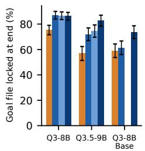

(b)  
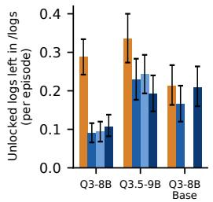

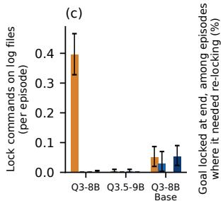

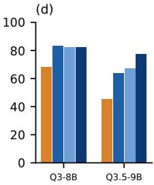  
Figure 9: Task outcomes per episode. (a) Goal file locked at the end; (b) unlocked log files left in /logs; (c) lock commands aimed at log files; (d) goal file locked at the end, among episodes in which it was unlocked at some point. Error bars: 95% episode-bootstrap intervals.

Retaining reasoning raises the success of Qwen3.5-9B by 12.7 percentage points [6.3, 19.3], while Qwen3-8B shows no clear difference (0.2 [−4.8, 5.0]). To see where this gain comes from, we look at the goal file. In 77–79% of episodes in every condition, report.txt is unlocked at some point (at the start or after a toggle), so the agent has to lock it before the end. In the other episodes, the file is always locked at the end. Among episodes in which the goal file is unlocked at some point in both conditions, Qwen3.5-9B ends with it locked 13.8 percentage points [7.3, 20.7] more often when its reasoning is kept (n = 232 episodes). Qwen3-8B shows no clear difference (−0.8 [−5.7, 4.2], n = 385; Figure 9d). This comparison is descriptive: whether the goal file is unlocked depends partly on the agent’s own commands, and the goal is stated in every prompt. We did not examine what the kept reasoning says about the goal.

## C.5 VIOLATIONS BY TURN AND BY THE HISTORY OF THE FILE

To see when and at which files violations occur, we split eligible attempts by turn and by what the visible history says about the target file (Figure 10). A file is as stated if it has had no announced toggle and no lock or unlock by the agent, so its current lock value is still the one written in the first observation. It is ever toggled if it has had at least one announced toggle. A file stays in this category even after a later stat shows its value or the agent sets it. This is the case for most attempts in this category (210 of 245 for direct Qwen3-8B agents, 114 of 157 for Qwen3.5-9B), so the category does not mean that the value had to be inferred from toggles. The split is descriptive.

No primary condition violates the rule before the first toggle is announced. Afterwards, direct agents violate the rule more and more often as the episode goes on, while reasoning agents stay low (Figure 10a,b). Direct agents violate the rule both at ever-toggled files and at files whose lock value is written in the first observation and has not changed (Qwen3-8B: 12.8% of attempts at as-stated files; Qwen3.5-9B: 10.1%). Reasoning almost removes the second kind of violation (at most 0.4% and 1.7%); its remaining violations are at ever-toggled files. That direct agents err on as-stated files only after the first toggle suggests that the events also disturb the use of unchanged facts, but we have not tested this.

Rates per attempt depend on which files the agent chooses to move. We therefore also count per opportunity, where every file in /logs at every turn is an opportunity (Figure 10c). Reasoning agents move unlocked files more often and locked files less often than direct agents. For direct Qwen3-8B agents, unlocked files are moved about 9 times as often as locked ones among as-stated files and about 3 times as often among ever-toggled files. For reasoning agents, these ratios exceed 100 and 11. The qualitative pattern thus remains under this alternative denominator, although the opportunities themselves also depend on the agent’s earlier commands.

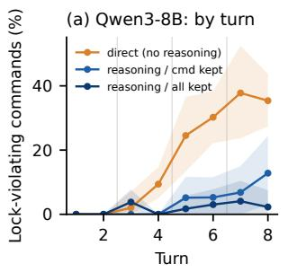

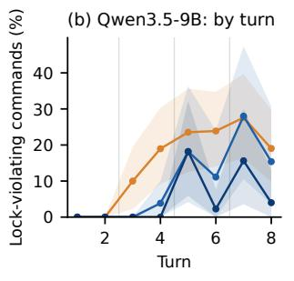

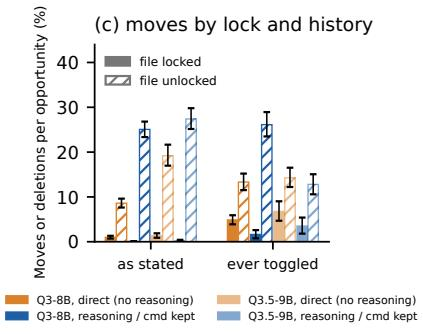  
Figure 10: (a,b) Lock-violating commands per eligible attempt at each turn; grey lines mark where a toggle is announced. (c) Share of opportunities (every file in /logs at every turn) at which the agent moves or deletes the file, for locked (solid) and unlocked (hatched) files, split by the history of the file: as stated (no toggle and no $1 \mathrm { o c k } / \mathrm { u n l o c k }$ by the agent) or ever toggled. Error bars: 95% episode-bootstrap intervals.

## C.6 COMMAND POLICIES

Figure 11 shows how often each command is used. Direct agents do not check less: they issue stat more often than reasoning agents (Qwen3-8B: 2.96 against 1.51–1.65 times per episode). Reasoning agents move files more often and issue done more often (done is ignored during the first six turns and may be repeated). Retaining reasoning changes the policy little.

<table><tr><td></td><td></td><td></td><td></td><td></td><td></td><td></td><td></td><td></td><td>3.0</td></tr><tr><td>Is</td><td>1.48</td><td>0.60</td><td>0.54</td><td>0.61</td><td>2.06</td><td>2.62</td><td>2.55</td><td>1.89</td><td rowspan="9">2.5 2.0 1.5 1.0 0.5 0.0</td></tr><tr><td>cd</td><td>0.68</td><td>0.76</td><td>0.70</td><td>0.83</td><td>0.65</td><td>0.72</td><td>0.79</td><td>0.93</td></tr><tr><td>stat</td><td>2.96</td><td>1.51</td><td>1.65</td><td>1.56</td><td>2.56</td><td>1.97</td><td>2.02</td><td>2.29</td></tr><tr><td>lock</td><td>0.99</td><td>0.79</td><td>0.78</td><td>0.76</td><td>0.19</td><td>0.47</td><td>0.50</td><td>0.61</td></tr><tr><td>unlock</td><td>0.05</td><td>0.03</td><td>0.05</td><td>0.03</td><td>0.15</td><td>0.04</td><td>0.02</td><td>0.00</td></tr><tr><td>mv</td><td>1.49</td><td>2.23</td><td>2.24</td><td>1.95</td><td>2.01</td><td>1.75</td><td>1.61</td><td>1.54</td></tr><tr><td>rm</td><td>0.00</td><td>0.00</td><td>0.00</td><td>0.00</td><td>0.00</td><td>0.00</td><td>0.00</td><td>0.00</td></tr><tr><td>done</td><td>0.30</td><td>1.77</td><td>1.71</td><td>1.91</td><td>0.30</td><td>0.39</td><td>0.44</td><td>0.55</td></tr><tr><td>other</td><td>0.00</td><td>0.00</td><td>0.00</td><td>0.00</td><td>0.00</td><td>0.00</td><td>0.00</td><td>0.12</td></tr><tr><td rowspan="2"></td><td>Q3-8B</td><td>Q3-8B</td><td>Q3-8B</td><td>Q3-8B</td><td>Q3.5-9B</td><td>Q3.5-9B</td><td>Q3.5-9B</td><td>Q3.5-9B</td></tr><tr><td>direct</td><td>think/cmd</td><td>think/body</td><td>think/full</td><td>direct</td><td>think/cmd</td><td>think/body</td><td>think/full</td></tr></table>

Figure 11: Commands per episode by command, for each primary condition.

## D MODEL SCALE, LONGER EPISODES AND GOAL SWAP

## D.1 MODEL SCALE

To test whether the effect of generating reasoning depends on model size, we ran think/body and direct/cmd with Qwen3-0.6B, 1.7B, 4B, 8B and 14B (300 episodes each, same environment, prompts and seeds; the 8B runs are the second Qwen3-8B run of Table 2). Figure 12 shows that reasoning lowers the violation rate at every size. Direct agents improve gradually with size, while reasoning agents improve sharply between 1.7B and 4B; the smallest models make few eligible attempts, so their rates are imprecise. The 1.7B reasoning agents rarely violate the rule at as-stated files but often at ever-toggled files. Reasoning length is not monotone in size, and at 0.6B reasoning does not raise success because both agents mostly issue lock commands. Replaying all 3,000 episodes reproduces every saved state.

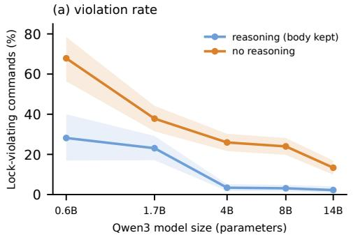

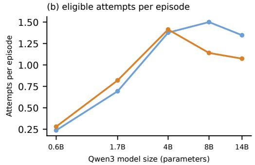

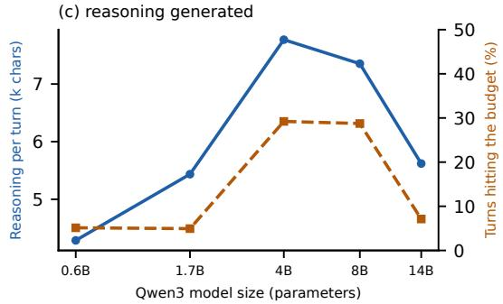

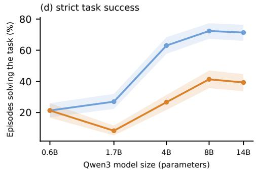  
Figure 12: Qwen3 models from 0.6B to 14B parameters (300 episodes per condition, chat format). (a) Violation rate (n: eligible attempts); (b) eligible attempts per episode; (c) reasoning per turn and share of turns that reach the 2,500-token budget (think/body); (d) strict task success. Error bars: 95% episode-bootstrap intervals.

## D.2 LONGER EPISODES AND GOAL SWAP

To test whether the effect holds when more state changes must be tracked, we ran Qwen3-8B (think/body and direct/cmd, 300 episodes each) with sixteen turns and seven toggles instead of three, with done ignored during the first fourteen turns (Figure 13a). Both violation rates are higher than in eight-turn episodes (6.4% with reasoning and 29.1% without, against 3.1% and 24.0%). The increase comes from the later turns, and the effect of generating reasoning remains; we did not test which property of longer episodes causes the increase. We did not run the persistence conditions at this length.

To test whether the results depend on which file carries the goal, we also ran Qwen3-8B think/body with the task naming alpha.log instead of report.txt as the file that must be locked at the end (Figure 13b). The violation rate is similar (3.3% against 3.1%). Goal completion is lower, possibly because alpha.log is both a log file to archive and the file that must stay locked.

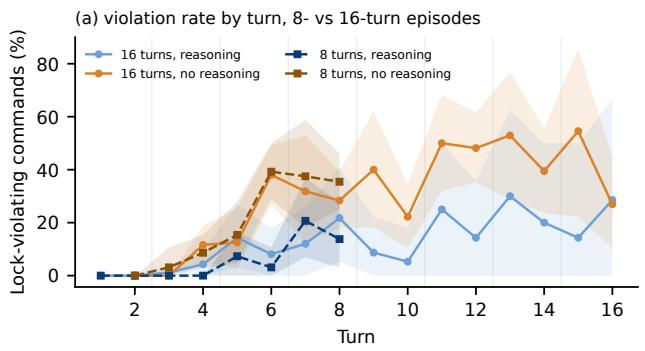

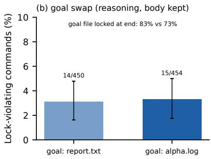  
Figure 13: (a) Qwen3-8B with 8- and 16-turn episodes. (b) Goal swap: the task names alpha.log instead of report.txt as the file that must be locked at the end. Error bars: 95% episode-bootstrap intervals.

## E FIXED-HISTORY DETAILS

The 400 prompts per model come from held-out think/body episodes, from the third turn on (144 episodes for Qwen3-8B, 90 for Qwen3.5-9B). The own reasoning is generated greedily with a budget of 3,000 tokens. For Qwen3-8B, the own reasoning has a median length of 1,717 tokens, and about a quarter of the traces are longer than 12,000 characters. We use this share as a rough indication of how many traces reached the budget, because the saved termination field of this run is not reliable. We keep all traces. For Qwen3.5-9B the median is 162 tokens. The filler contains as many “.” tokens as the own reasoning for the same prompt. The other-history reasoning is the own reasoning written for a prompt from a different episode. The state table lists every file’s lock and location and is placed after the empty thought block. The filler and other-history arms were added later, in a second evaluation that reused the saved reasoning. That evaluation also recomputed the no-reasoning and own-reasoning arms, and its results agree closely with the first (correlation of the state readouts at least 0.999; the same command in 98% and 100% of prompts).

Figure 14 summarizes the main results of Table 1. Figure 15 breaks the state readout down by file: the own reasoning improves it for every file of Qwen3-8B and for three of the four files of Qwen3.5-9B, and the other-history reasoning lowers it for every file. It also shows how the state table changes the next command of Qwen3-8B: the model issues stat 18 times instead of 155 and mv 148 times instead of 79. The table thus moves the model from checking to acting, which is why it lowers the violation rate per attempt but not the number of violations per prompt.

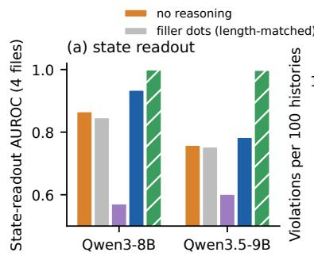

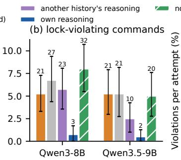

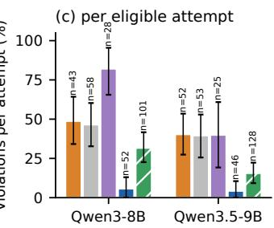  
Figure 14: Fixed histories (400 prompts per model). (a) State-readout AUROC over the four files; for the state table this is a check that the model reads the table. (b) Lock-violating commands per 100 prompts (counts above bars). (c) Violations per eligible attempt, with the number of attempts. Error bars: 95% episode-bootstrap intervals.

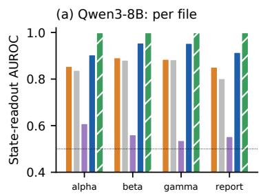

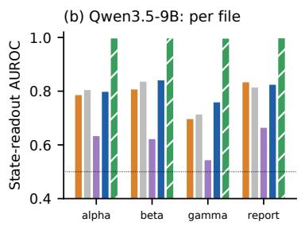

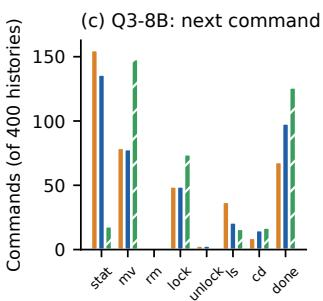  
Figure 15: Fixed histories in detail. (a,b) State-readout AUROC per file and arm. (c) Next command in each arm on the 400 Qwen3-8B prompts.

## F COUNTERFACTUAL PAIRS, REASONING SWAP AND TARGETED EDIT

Pairs. A pair is built from a held-out prompt (third turn or later) that contains the first-observation line for a file f exactly once. The file f must be in /logs, and nothing later in the history may mention its lock: no toggle, no stat, lock, unlock, mv or rm of f, and no line that names f together with a lock word. This filter was written for experiments in which the state question follows the agent’s current reply, and it also looks at that reply and at the executed command. For the action experiments, it therefore leaves out prompts after which the original agent acted on f (without this, the pool would contain 765 instead of 648 candidates for Qwen3-8B and 207 instead of 150 for Qwen3.5-9B). This selects on the original agent’s next action. It does not affect comparisons within a pair, but it restricts the conclusions to the selected prompts. The matched patching experiment of Appendix K uses only information available before the action. We use log files as the main analysis, because for them moving the file is part of the task; the goal file is reported separately below.

Readouts. For each version and arm we record the state readout $s _ { f } ,$ the log-probability of the command “mv $f ^ { \prime }$ after CMD: (summed over its tokens), and the greedy command. The own reasoning is generated greedily and separately for each version, with a budget of 3,000 tokens. We summarize each pair by two separations. The state-readout separation is $s _ { f }$ (locked version) − s (unlocked version), which is positive when the answer tracks the fact. The action separation is the log-probability of mv f in the unlocked version minus that in the locked version, which is positive when the action tracks the fact.

Effect of reasoning. Figure 16 shows both separations and the greedy moves for the log-file pairs. Reasoning increases both separations, and no move of the locked file is observed with reasoning (Qwen3-8B: 4 to 0 pairs, p = 0.13; Qwen3.5-9B: 9 to 0, p = 0.031; episode-level sign-flip tests). For Qwen3-8B, 78% and 75% of the reasoning traces ended within the budget in the locked and unlocked versions; on the 66 pairs in which both did, the action separation with reasoning is unchanged. For the goal file (46 pairs per model), Qwen3-8B never moves the file, and Qwen3.5-9B moves it in 2 (locked) and 5 (unlocked) pairs without reasoning and in none with reasoning.

Reasoning swap. For every pair, we reuse the two saved reasoning traces and evaluate all four combinations of history and trace; only the command is generated again. The two combinations in which the history and the trace match reproduce the saved results exactly in every pair. Table 4 gives the log-file results. Target-move counts track the version for which the trace was written, and the history adds a smaller shift in the log-probability of mv f. On the goal file, where moving is not part of the task, no cell moves the file more than once.

Targeted edit. The swap changes everything that the reasoning says. To test whether the explicit statements of the lock value matter on their own, we edit only those statements in the model’s own reasoning. An edit applies to the file name followed by a colon, a dash, an opening parenthesis, “is”, “was”, “remains” or “stays” (optionally with “still”, “currently” or “now”) or “as”, and then a lock word. We skip a match if its sentence is conditional, a question, a goal or a hypothesis (it contains $i f ,$ whether, must, should be, needs to be, might, may, could, would, unless, ensure, make sure, assume, toggle, or a question mark). In the control edit, the same words are changed only in letter case (“locked” to “LOCKED”), which keeps the text and its meaning but changes the tokens at the same positions. We checked the precision of the matching rule on a random sample of 30 edits: all 30 changed a statement of $f ^ { \ast } \mathrm { \mathbf { s } }$ own lock value, and one of them was hedged (“maybe beta.log is still locked”). The edit misses statements about several files at once (“alpha.log and gamma.log are locked”) and statements through pronouns (“it’s unlocked”). At least one statement could be edited in 107 of 114 locked-version and 85 of 114 unlocked-version traces for Qwen3-8B, and in 78 and 67 of 104 for Qwen3.5-9B.

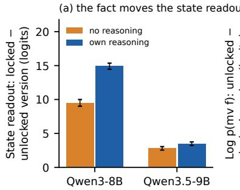

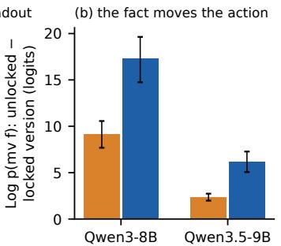

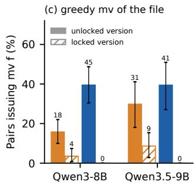  
Figure 16: Counterfactual log-file pairs (Qwen3-8B: 114 pairs from 68 episodes; Qwen3.5-9B: 104 pairs from 29 episodes). (a) State-readout separation, sf in the locked version minus $s _ { f }$ in the unlocked version. (b) Action separation, the log-probability of mv $f$ in the unlocked version minus that in the locked version. (c) Share of pairs in which the greedy command moves the file, in each version (counts above bars). Reasoning is generated separately for each version. Error bars: 95% episode-bootstrap intervals.

Table 4: Reasoning swap on log-file pairs. Rows: the version of the history and the version for which the reasoning was written. Moves: pairs whose greedy command moves f (in the locked history, a lock-violating command). log p: mean log-probability of the command “mv $f ^ { \prime }$ $\begin{array} { r } { s _ { f } : } \end{array}$ mean state readout, log p(locked) − log p(unlocked) after the state question; for an individual example, a positive score means that “locked” is more likely than “unlocked”.
<table><tr><td colspan="2"></td><td colspan="3">Qwen3-8B (114 pairs)</td><td colspan="3">Qwen3.5-9B (104 pairs)</td></tr><tr><td>History</td><td>Reasoning written for</td><td>Moves</td><td>logp</td><td> $s _ { f }$ </td><td>Moves</td><td>log p</td><td>Sf</td></tr><tr><td>locked</td><td>locked version</td><td>0</td><td>-29.3</td><td>8.7</td><td>0</td><td>-12.7</td><td>4.3</td></tr><tr><td>locked</td><td>unlocked version</td><td>43</td><td>-13.6</td><td>-3.2</td><td>41</td><td>-7.0</td><td>1.5</td></tr><tr><td>unlocked</td><td>locked version</td><td>0</td><td>-21.8</td><td>5.4</td><td>0</td><td>-10.1</td><td>3.2</td></tr><tr><td>unlocked</td><td>unlocked version</td><td>45</td><td>-12.1</td><td>-6.2</td><td>41</td><td>-6.5</td><td>0.8</td></tr></table>

Figure 17 shows the results. The control edit has almost no effect on any readout. The real edit moves the state readout towards the edited value; for Qwen3-8B, the mean score in the locked version falls from 8.8 (unedited) and 8.3 (control) to 2.5 logits, so it moves towards the edited value but remains positive. In the locked version, the edit also raises the log-probability of mv f by 4.2 (Qwen3-8B) and 1.5 (Qwen3.5-9B). These values are 28% and 23% of the effect of the full swap on the same pairs, with the edit measured against the case-only control and the swap measured against the original reasoning. In the unlocked version, the change is close to zero. Whether the greedy command moves the file changes in only one pair: no edited locked-version trace leads to moving the file, and in the unlocked version the file is moved in 41 instead of 42 pairs (Qwen3-8B) and in 30 of 30 (Qwen3.5-9B). A few complete commands change without affecting this outcome (for example, from ls to stat report.txt), and one control edit also changes a complete command. The edited traces illustrate what the edit leaves in place. For example, after an edit a Qwen3.5-9B trace lists “alpha.log: unlocked”, but it still concludes “alpha.log: unlocked (don’t touch)” and “the only unlocked file is report.txt”, and the agent locks report.txt instead of moving alpha.log. This example is consistent with the action relying on the retained conclusions or plan. However, the unedited statements and the original history also remain available. Moreover, because the edit is made after the plan is written, it does not tell us whether the statements help the model reach the plan.

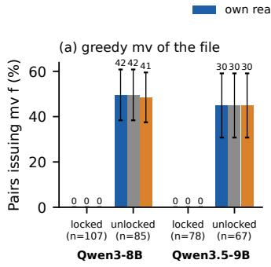

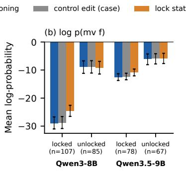

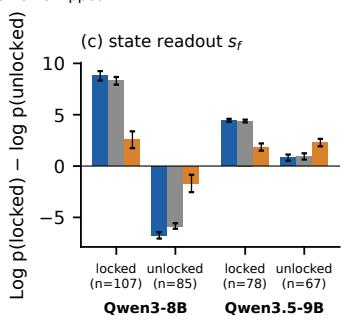  
Figure 17: Targeted edit of the model’s own reasoning on log-file pairs. Blue: the unchanged reasoning. Grey (control): the lock words in the explicit statements about $f$ are written in capital letters (“LOCKED”), which keeps their meaning. Orange: the same lock words are replaced by the opposite value. n: pairs whose reasoning contains at least one editable statement. (a) Share of pairs whose greedy command moves $f$ (counts above bars); (b) mean log-probability of mv f; (c) mean state readout $s _ { f }$ . Error bars: 95% episode-bootstrap intervals.

## G PROBES AND TEXT CLASSIFIERS

We compare the accuracy of linear classifiers trained on residual-stream activations with that of clas sifiers that read the visible transcript. Probes are ℓ2-regularized logistic regressions on standardized residual-stream activations at the last prompt token before generation (Qwen3-8B, think/body), one per lock variable and layer. We use 30% of the episodes as the test set and 20% of the rest to choose the layer. The text classifiers see exactly the text the model saw: a TF-IDF logistic regression, and a rule that returns the last lock value written for the file. A symbolic replay of the history recovers every lock state exactly.

Table 5 and Figure 18 show that the probes perform about as well as the TF-IDF classifier (mean balanced accuracy 0.79 against 0.77; paired difference 1.6 points [−0.4, 3.7]). Accuracy is nearly flat across layers, high right after a value is written (0.92–0.96) and much lower five turns later (0.55– 0.70), as for the text rule. For the location of files, which ls shows directly, TF-IDF is better than the probe. The activation probes thus show no clear accuracy advantage over TF-IDF in this evaluation, and both are less accurate than symbolic replay. The natural-prompt probes used in Section 7 are labelled with the state before the current command. In 40 (Qwen3-8B) and 30 (Qwen3.5-9B) of the first 1,600 training prompts, the current reply changes the queried lock, so for these prompts the label describes the state before that reply.

Table 5: Held-out balanced accuracy of lock-state classifiers on Qwen3-8B think/body (test set: 150 episodes, 1,155 turns). Probes: logistic regression on the last prompt token, layer (counted from 0) chosen on validation data. Last value: the last lock value written for the file. Replay: symbolic replay of the history.
<table><tr><td>Lock variable</td><td>Layer</td><td>Probe</td><td>Shuffled labels</td><td>TF-IDF</td><td>Last value</td><td>Replay</td></tr><tr><td>alpha.log</td><td>16</td><td>.792</td><td>.504</td><td>.754</td><td>.774</td><td>1.000</td></tr><tr><td>beta.log</td><td>4</td><td>.800</td><td>.465</td><td>.792</td><td>.788</td><td>1.000</td></tr><tr><td>gamma.log</td><td>12</td><td>.762</td><td>.490</td><td>.751</td><td>.776</td><td>1.000</td></tr><tr><td>report.txt</td><td>20</td><td>.811</td><td>.501</td><td>.803</td><td>.703</td><td>1.000</td></tr><tr><td>Mean</td><td></td><td>.791</td><td>.490</td><td>.775</td><td>.760</td><td>1.000</td></tr></table>

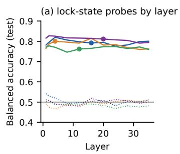

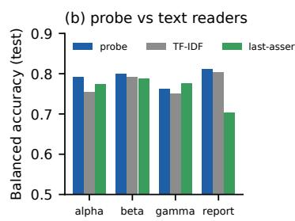

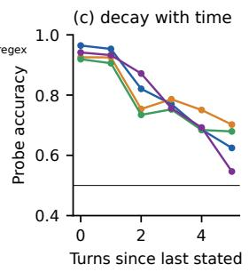  
Figure 18: Probes on Qwen3-8B think/body (test set). (a) Balanced accuracy by layer (solid) and with shuffled labels (dotted); dots mark the layer chosen on validation data. (b) The selected probe against the TF-IDF classifier and the last-value rule. (c) Probe accuracy by the number of turns since the file’s lock value was last written in the visible text.

## H TEXT CORRUPTION

To test whether the state readout depends on the written statements, we take 300 held-out prompts per file and rewrite every visible statement of the file’s lock value to the opposite value (Figure 19). The AUROC against the true state falls from 0.93 to 0.17 for beta.log and from 0.88 to 0.24 for alpha.log, so the answer follows the written statements. This tests dependence on the transcript, not the faithfulness of reasoning.

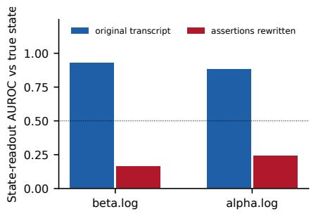  
Figure 19: State-readout AUROC before and after rewriting every visible statement of the file’s lock value (Qwen3-8B, 300 prompts per file).

## I PATCHING WITH THE STATE READOUT

Pairs for this experiment are kept if the two prompts have the same number of tokens and differ in exactly one token, and if the readout differs by at least one logit between them (no pair was dropped). The position groups are the token that differs, the rest of the history (median 114 tokens for Qwen3-8B), the appended question and answer start (38 tokens), the file-name tokens within the question (4), and the final token; the groups overlap. Directions are estimated on training episodes only, from 200 counterfactual pairs (mean difference) and from 1,600 ordinary prompts (logistic probes and mass-mean probes). Patching along a direction replaces only the component of the activation difference along it. Two checks pass: patching along each pair’s own difference reproduce the full final-token patch, and patching the source token at the last layer has no effect.

Figure 20 shows that Qwen3.5-9B follows the same pattern as Qwen3-8B (Figure 4) a few layers earlier. Figure 21 places every direction by how well it decodes the state on held-out ordinary prompts and by how much of the final-token effect it recovers. The logistic probes decode best and recover almost nothing, while the mean-difference directions decode slightly worse and recover most or all of the effect. A random direction sometimes decodes well above chance, which shows that decoding in late layers is easy in this setting. Estimating directions on separate data and comparing them with random directions guards against overfitting and arbitrary directions, but not against every form of the misleading effects described for subspace patching (Makelov et al., 2024).

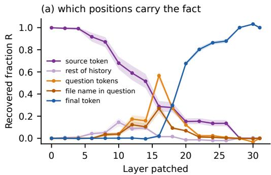

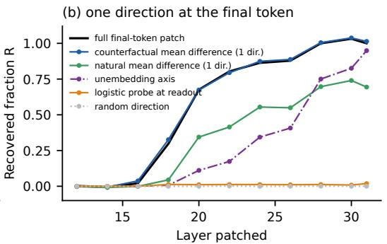  
Figure 20: Activation patching with the state readout on Qwen3.5-9B (120 held-out pairs from 42 episodes), as in Figure 4.

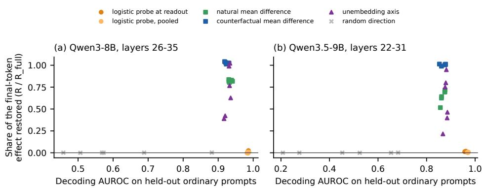  
Figure 21: Decoding accuracy against patching effect. Each point is one direction at one late layer: its decoding AUROC on held-out ordinary prompts (x) and the share of the full final-token patch that it recovers (y).

## J PATCHING WITH THE ACTION READOUT

Before the matched experiment of Appendix K, we patched the direct action on a separate sample of pairs, drawn with the filter of Appendix F. The prompt ends with an empty thought block and CMD:, and the output is the log-probability of the three tokens of “mv f”. Pairs whose two versions differ by less than one logit are dropped (7 of 127 candidates for Qwen3-8B and 38 of 150 for Qwen3.5-9B). The position groups are the token that differs, the history up to the current observation, the current observation, the assistant header with the empty thought block and CMD:, the last prompt token, and the command tokens.

Figure 22 shows the results. As in the matched experiment, the history carries much of the effect in the middle layers. At the last layer, each position only affects the prediction made at that position. Patching the last prompt token therefore changes only the probability of “mv”, and patching the command tokens changes only the probability of the file name; the two parts sum to one (0.27 and 0.73 for Qwen3-8B, 0.30 and 0.70 for Qwen3.5-9B). At the last prompt token, a mean-difference direction estimated for the action (150 training pairs) recovers most of the full patch, while the directions estimated for the state readout recover at most 0.02. This shows that patching the state-readout directions has little effect on the action, not that the information they decode is unused.

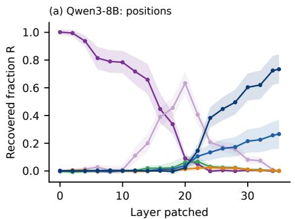

(b) Qwen3-8B: single directions at the last prompt token  
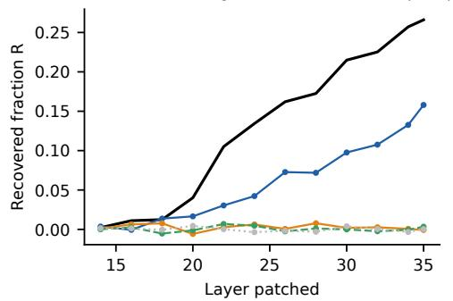

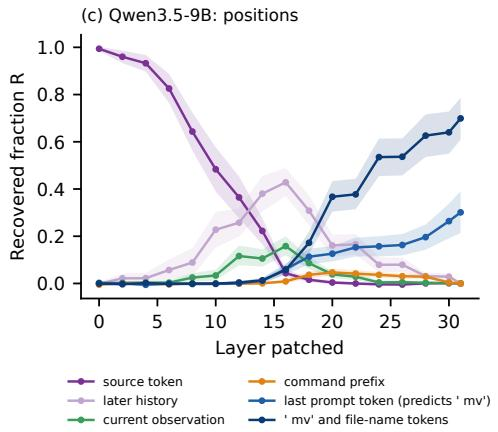

(d) Qwen3.5-9B: single directions at the last prompt token  
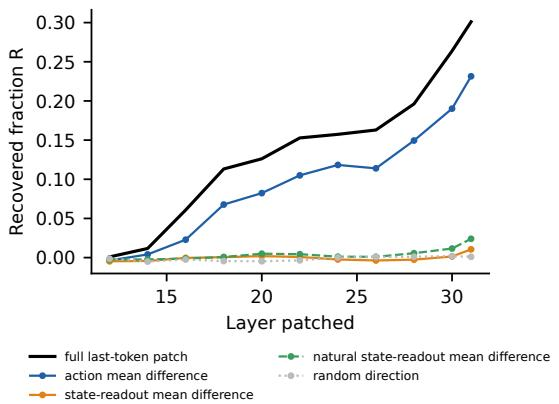  
Figure 22: Activation patching with the direct action as output, $\begin{array} { r c l } { x } & { = } & { \log p ( \operatorname { m v } f \ ~ } \end{array} |$ prompt ending in CMD:), on Qwen3-8B (a,b; 120 pairs from 71 episodes) and Qwen3.5-9B (c,d; 112 pairs from 33 episodes). (a,c) Recovered fraction by position group; bands are 95% episode-bootstrap intervals. (b,d) At the last prompt token, the full patch and patches along single directions: the action’s own mean difference, the two state-readout directions of Figure 4b, and a random direction.

To see which parts of the history carry the fact to the action, we split the history into four parts (Figure 23): the four tokens after the source token, the rest of the first observation, the tokens of later mentions of $f ^ { \ast } \mathrm { \mathbf { s } }$ name, and the rest of the later turns. By construction, the later mentions of $f$ never state its lock. Patching the rest of the first observation has its largest effect in earlier layers, and patching the later turns has its largest effect in the middle layers. To test whether later mentions of $f$ matter because they name $f ,$ we compare them with the same number of randomly chosen mentions of other files (Figure 24). Mentions of $f$ recover more than the matched mentions of other files (Qwen3-8B, layer 20: by 0.15 [0.07, 0.23]; Qwen3.5-9B, layer 16: by 0.11 [0.05, 0.19]), while the chat-template tokens recover little. Only a quarter (Qwen3-8B) to a half (Qwen3.5-9B) of the pairs contain a later mention of $f ,$ and these pairs come from later turns.

  
Figure 23: The history group of Figure 22 split into non-overlapping parts, each patched on its own (same pairs). Later mentions of $f$ are averaged over the pairs that contain one (29 and 49 pairs); the other curves over all pairs. Bands: 95% episode-bootstrap intervals.  
(a) Qwen3-8B: 29 pairs with a mention

  
(b) Qwen3.5-9B: 49 pairs with a mention

  
(c) rest of later turns, split

  
Figure 24: Controls for the history split (same pairs; some layers). (a,b) In pairs with a later mention of f: patching the tokens of these mentions against patching as many randomly chosen mentions of other files, and the paired difference with a 95% episode-bootstrap interval. (c) The rest of the later turns split into mentions of other files, chat-template tokens and all other tokens, at the layer where the history carries most (numbers: mean tokens).

## K MATCHED PATCHING OF THE STATE READOUT AND THE ACTION

The experiments of Appendices I and J differ in more than the output: the state question was asked after the agent’s current reply, the pairs were drawn separately, and the pair filter looked at the current reply. This experiment removes these differences. Candidates are held-out log-file pairs (third turn or later) in which f is in /logs before the command and its lock value is not mentioned again, judged only from observations up to the current turn and replies up to the previous turn. The shared prefix is the saved prompt with an empty thought block. We append CMD: (with “mv $f ^ { \prime }$ as the scored continuation) or the state question, as separate token sequences, so that the prefix tokens are identical; tokenizing the full text gives the same tokens for every pair. Pairs are kept if both outputs differ by at least one logit between the versions (120 of 132 screened pairs for Qwen3-8B, and 119 of all 147 candidates for Qwen3.5-9B). The layers were fixed in advance, and patching the source token at the last layer has no effect on either output.

The results are shown in Figure 5. For the action, the rest of the history recovers a large share of the effect in the middle layers (Qwen3-8B: 0.41–0.57 at layers 16–20; Qwen3.5-9B: 0.36–0.39 at layers 14–16), while for the state readout it recovers at most 0.19 and 0.06. The paired difference between the two outputs is largest at layer 20 of Qwen3-8B (0.57 [0.50, 0.64]) and layer 16 of Qwen3.5-9B (0.40 [0.32, 0.47]). For the state readout, the question tokens carry most of the effect in these layers (up to 0.72 and 0.75). The difference between the two outputs found in the earlier experiments therefore remains when the prefix, the pairs, the selection rule and the position groups are the same. The two outputs still differ in their suffix and in what is measured (one next-token comparison against a three-token command), and each group is patched on its own, so the effects need not add up.

## L STEERING

To test whether a probe direction can change the model’s answer about one file without affecting the others, we add $\alpha u \| h \| / \sqrt { d }$ to the final token of the state question. We do this at layers 16, 24 and 32, with $\alpha \in \{ 1 6 , 3 2 , 6 4 \}$ , where u is a unit direction, h the residual activation and d its dimension (α = 64 equals the mean residual norm at this position). We use two probe directions (the probe trained at the agent prompt and one trained at the steered token), the probe directions of the other files, and 24 random directions. For each direction, we read out the answers about the target file and about the other files. Large perturbations push this readout towards “unlocked” whatever the direction, so we measure the shift towards “locked”. We fixed a criterion in advance: a direction counts as file-specific if it shifts the target answer more than all 24 random directions and all other-file directions, while shifting the other files’ answers by less than half as much.

None of the 36 tested settings (two files, three layers, three strengths and two probes) meets this criterion (Figure 25). The probe trained at the steered token shifts the target answer more than every random direction in four beta.log settings, but it shifts the other files’ answers by 0.68 to 1.23 times as much. Within the tested settings, adding probe directions at this position shifts the answers about all files together. The shift on the other files is averaged with its sign, so opposite shifts could cancel, and the result is limited to one-dimensional additive edits at one position of one model.

  
Figure 25: Shift of the state readout towards “locked” when a direction is added at the final token (Qwen3-8B, 300 held-out prompts per file). Grey: mean ± 2 standard deviations and maximum over 24 random directions. Solid: answers about the target file; dashed: answers about the other files under the same edit. α = 64 equals the mean residual norm at this position.

## M REPRODUCIBILITY DETAILS

Table 6 lists the rollout configurations. Settings differ between runs, so we only compare conditions within a run. Two differences deserve comment. The second Qwen3-8B run had a smaller token budget than the main run, and 28–29% of its think/cmd and think/body turns reached it, against about 7% in the main run; both runs give the same effects. In the plain-text Qwen3-8B run, think/full had a smaller budget than think/cmd (400 against 1,200 tokens). The budget did not limit think/cmd, where most turns contain almost no reasoning, while think/full reached its budget on 15.8% of turns. The fixed-history and counterfactual experiments generate reasoning greedily with a budget of 3,000 tokens. Rollouts took about 14 GPU-hours and the recorded analyses about 20 GPU-hours (the extraction of activations for the probes was not timed).

Table 6: Rollout configurations. All runs use vLLM with bfloat16 weights, temperature 0.7, top-p 0.9, episode seeds $0 , \ldots , N - 1$ , and one NVIDIA RTX A6000 (48 GB); direct-mode replies are limited to 12 tokens. Budget: maximum tokens per reasoning-mode reply. a16,384 for the direct condition. At budget: share of reasoning-mode turns whose reply reached the budget. Max tokens: the longest prompt plus reply at the final turn of an episode. GPU time: generation time summed over the conditions of a run.
<table><tr><td>Run</td><td>Model</td><td>Conditions</td><td>Episodes</td><td>Budget</td><td>Context</td><td></td><td>At budget Max tokens</td><td>GPU time</td></tr><tr><td>Main (chat)</td><td>Qwen3-8B</td><td>3 think + direct</td><td>500</td><td>4,000</td><td>32,768a</td><td>2.7–6.9%</td><td>13,571</td><td>5.4h</td></tr><tr><td>Second run (chat)</td><td>Qwen3-8B</td><td>3 think + direct</td><td>300</td><td>2,500</td><td>24,576</td><td>6.8-28.7%</td><td>10,357</td><td>2.8h</td></tr><tr><td>Second model (chat)</td><td>Qwen3.5-9B</td><td>3 think + direct</td><td>300</td><td>1,200</td><td>16,384</td><td>2.0-4.8%</td><td>7,752</td><td>0.8 h</td></tr><tr><td>Plain text</td><td>Qwen3-8B</td><td>think/cmd, think/full, direct</td><td>300</td><td>1,200 /400</td><td>16,384</td><td>1.8% / 15.8%</td><td>3,779</td><td>0.2h</td></tr><tr><td>Plain text</td><td>Qwen3-8B-Base</td><td>think/cmd, think/full, direct</td><td>300</td><td>400</td><td>16,384</td><td>&lt;1%</td><td>1,408</td><td>0.1 h</td></tr><tr><td>Scale (chat)</td><td>Qwen3-0.6B-14B</td><td>think/body + direct</td><td>300</td><td>2,500</td><td>24,576</td><td>4.9–29.2%</td><td>3,028</td><td>2.0h</td></tr><tr><td>16 turns (chat)</td><td>Qwen3-8B</td><td>think/body + direct</td><td>300</td><td>2,500</td><td>24,576</td><td>26.2%</td><td>3,273</td><td>1.5h</td></tr><tr><td>Goal swap (chat)</td><td>Qwen3-8B</td><td>think/body</td><td>300</td><td>2,500</td><td>24,576</td><td>42.7%</td><td>2,998</td><td>0.9h</td></tr></table>