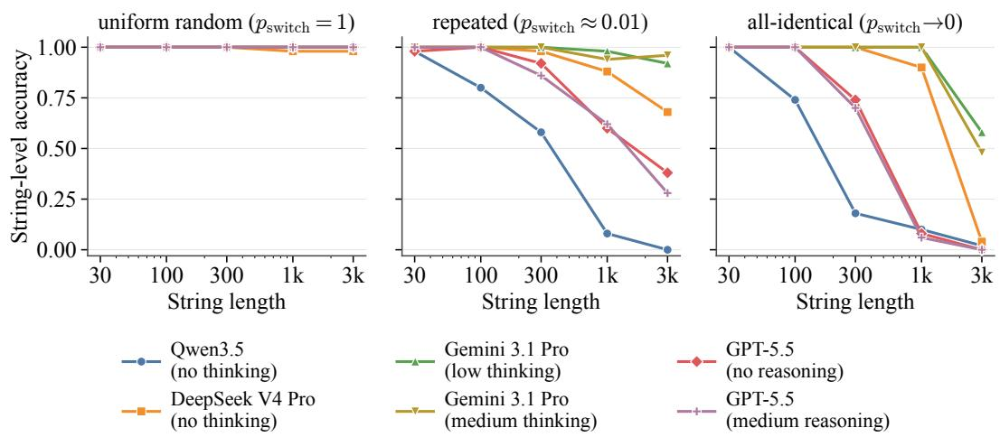
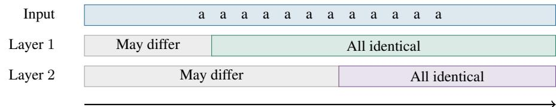
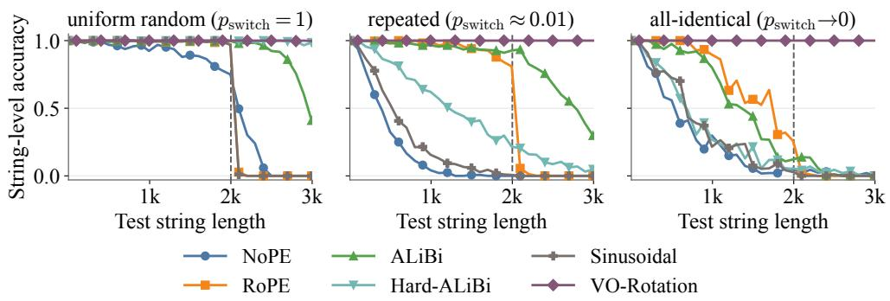
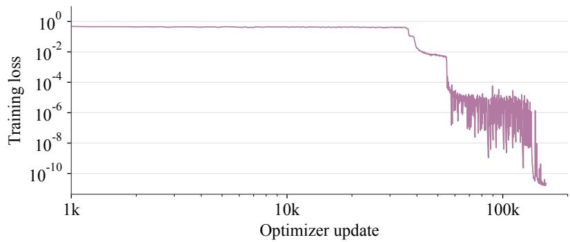
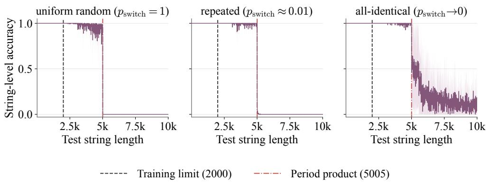
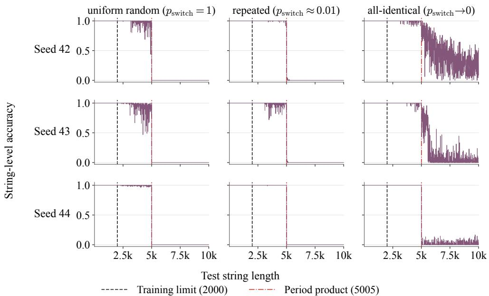

# COPYING UNDER REPETITION: FROM PREFIX MATCHING TO POSITION HASHING

Anxin Guo Northwestern University anxinbguo@gmail.com

Chenxiao Yang   
Toyota Technological Institute at Chicago   
chenxiao@ttic.edu   
Tianlong Huang   
Duke University∗   
tianlong.huang@duke.edu

Zhiyuan Li Toyota Technological Institute at Chicago zhiyuanli@ttic.edu

## ABSTRACT

Frontier LLMs can copy random text almost flawlessly, yet they often overrun or truncate long blocks of repeated characters. In repeated strings, matching local content no longer reliably identifies where copying should continue or when it should stop. Nevertheless, we show that a two-layer transformer with O(log log N)- bit precision and O(log N/ log log N) width can copy every string up to a chosen design horizon N and terminate correctly under arbitrary repetition. We use RoPEstyle rotations of attention values and outputs (VO-rotations) with small prime periods to encode distances from delimiter anchors modulo those primes. By the Chinese Remainder Theorem, these periodic encodings jointly distinguish all required distances, allowing one retrieval rule to select either the next source token or the end marker. In contrast, we prove a width-independent impossibility result for copying under sequential finite-precision softmax accumulation. It applies to transformers whose only positional input is an additive attention bias that eventually becomes constant, including NoPE and a recursive implementation of ALiBi. Once an identical-token run exceeds the resulting saturation threshold, further repetitions leave the logits unchanged. If this threshold grows sublinearly with N, these models cannot both complete a long all-identical copy and stop correctly, a pattern resembling the termination errors of frontier LLMs. In synthetic copying experiments, baseline transformer models fail on long repeated strings even within the training range. Trained VO models, by contrast, generalize beyond the training lengths with near-perfect accuracy up to length ∼ 5005, the selected primes’ period product.

## 1 INTRODUCTION

Autoregressively copying text is a fundamental primitive for modern large language models (LLMs). LLMs copy when they reuse retrieved documents, quote code or data, or transfer a specific answer from a chain of thought into the final response. Historically, this copying task has motivated explicit pointer or copy mechanisms in sequence models (Vinyals et al., 2015; Gu et al., 2016; See et al., 2017). Meanwhile, transformers seem to learn to copy easily, often through the “induction head” mechanism (Olsson et al., 2022): they match the already-copied prefix to its earlier occurrence in the prompt and retrieve the subsequent token. For random sequences, short local contexts uniquely identify the occurrence. Jelassi et al. (2024) formalized this content-addressed mechanism, showing that a two-layer transformer (with a particular position encoding) can copy strings of length ≤ L with O(log log L) precision—provided the input contains no repeated n-grams.

Surprisingly, however, removing this non-repetition assumption seems to change the difficulty of copying qualitatively. As shown in Figure 1, frontier LLMs that copy random strings near-perfectly sometimes fail catastrophically on strings with long repeated runs of letters, either overgenerating severely or stopping early. Repetition changes what the task demands: when many positions carry the same local content, matching the already-copied prefix no longer picks out which occurrence to continue from, so the model must tell these occurrences apart by other means.

To make this problem concrete, consider one step of autoregressive copying, with current context

$$
\langle \mathrm { B o S } \rangle , \ s _ { 1 } , \ldots , s _ { L } , \ \langle \mathrm { E o I } \rangle , \ \langle \mathrm { C o P Y } \rangle , \ s _ { 1 } , \ldots , s _ { k } ,
$$

for some $k \leq L$ . The task is to output $s _ { k + 1 }$ if $k < L ,$ or output $\langle \mathrm { E O S } \rangle$ if $k = L . ^ { 1 }$ An all-identical source, with $s _ { i } = \sigma$ for every $i ,$ isolates the termination problem: continuing requires only another $\sigma ,$ but stopping at the right point requires distinguishing progress that local content windows cannot reveal. This raises the question: Can a shallow, low-precision transformer copy reliably under arbitrary repetition and terminate correctly?

The answer is yes: for any fixed finite vocabulary and each sufficiently large design horizon $N$ , a single two-layer transformer can copy every source of length at most N under arbitrary repetition and terminate correctly, using O(log log N)-bit precision and O(log N/ log log N) width. Our construction uses its first layer to encode each position’s offset relative to delimiters—specifically, its distance to the preceding delimiter (⟨BOS⟩ in the source or ⟨COPY⟩ in the copy segment)—so that tokens can be retrieved by position rather than by matching their content. The need for a delimiter anchor arises because on an all-identical source, attention cannot extract positional signals from the source tokens themselves. RoPE’s query/key rotations (Su et al., 2024) and ALiBi’s logit biases (Press et al., 2022) change attention weights but leave the source value vectors identical: redistributing a fixed total attention weight among these tokens does not change their contribution to the output. Position can still affect the output through the weights assigned to special delimiters, such as the beginning-of-source token ⟨BOS⟩, but only by changing how much of each delimiter’s fixed value enters the output. By contrast, value/output rotations (VO-RoPE; Su, 2025) let position act on the returned vector itself: even when two queries attend entirely to ⟨BOS⟩, the returned vectors can differ because the rotation encodes each query’s distance from it.

Our first layer applies these rotations with small prime periods $( \mathrm { e . g . , 2 , 3 , \ldots } )$ to encode delimiterrelative offsets. For each prime period, the rotation encodes the offset modulo that prime, using a few well-separated phases that remain distinguishable at very low precision. By the Chinese Remainder Theorem, the periods jointly distinguish every offset below their product, so the first layer resolves a long range of offsets with low precision and width. The second layer then uses these representations to retrieve either the next source token or the end marker, handling copying and termination with one rule.

## 1.1 OUR CONTRIBUTIONS

We formalize the expressivity question in a horizon-uniform framework: one model must copy every source of length $L  \leq N$ with the same parameters. Its width, depth, and precision may grow with the design horizon $N$ , but its parameters cannot specialize to the realized length. This captures a natural requirement for a model designed for a finite context window, and lies between length-specific circuit expressivity (Li et al., 2024; Merrill & Sabharwal, 2023) and fixed-resource expressivity over unbounded lengths (Yang et al., 2025; 2026). Copying, for instance, is easy in the circuit model (the next-token map admits linear-size uniform $\mathrm { A C } ^ { \mathrm { 0 } }$ circuits; see Appendix C), but fixed models also cannot copy inputs of unbounded lengths (Huang et al., 2025; Li & Cotterell, 2025). By bridging these two regimes, our framework provides a fine-grained lens to quantify the positional representations, bit precision, and width needed for a transformer to copy reliably across all lengths within the horizon.

Copying and termination with VO-rotation. For any fixed finite vocabulary and all sufficiently large design horizons N, we construct a two-layer transformer that copies every string of length $L \leq N$ and terminates correctly under arbitrary repetition. Our VO-rotation instantiates the VO-RoPE operation with a prime-number period per head, using Θ(log N/ log log N) heads in total. The construction uses O(log log N)-bit precision and O(log N/ log log N) width (Theorem 3.8). We use small periodic counters to index the rounded rotation tables.

A width-independent copying obstruction. We also prove a width-independent impossibility result for eventually-constant bias-only (ECB) transformers, whose only positional information enters through a pre-softmax additive attention bias that becomes constant beyond some distance. Under our finite-precision execution model, the analysis covers NoPE (Kazemnejad et al., 2023), a recursive implementation of ALiBi (Press et al., 2022), and bounded-window Hard-ALiBi (Jelassi et al., 2024) within this class. The proof tracks identical-token runs after an arbitrary fixed prefix, layer by layer. Beyond a certain length, appending another identical token no longer changes the next-token logits. In copying, a model that emits the required repeated letters then keeps repeating them for as long as the context remains in its domain, a failure pattern resembling the overruns observed in LLMs. Increasing width does not remove this obstruction: for the instances in Corollary 3.5, models of depth $D ( N )$ and precision $p ( N )$ fail whenever $D ( N ) 2 ^ { p ( N ) } = o ( N )$ . At the O(log log N)-bit precision of our construction, this rules out NoPE models of any width and depth $\bar { O ( N ^ { 1 - \epsilon } ) }$ for each fixed $\epsilon \in ( 0 , 1 )$ , whereas the VO construction uses just two layers.

  
Figure 1: Long repeated strings reduce LLM copying accuracy. Accuracy is the fraction of all 50 trials per length and condition whose extracted answer matches the source perfectly. For a fixed switch probability $p _ { \mathrm { s w i t c h } }$ , a source string is generated by concatenating latent constant-letter runs: each run chooses a letter uniformly from the 26 lowercase English letters and has length $R \sim \mathrm { G e o m } ( p _ { \mathrm { s w i t c h } } )$ The three plotted distributions are uniform-random strings, $p _ { \mathrm { s w i t c h } } = 1 ;$ repeated strings, pswitch ≈ 0.01; and all-identical strings, the limit $p _ { \mathrm { s w i t c h } }  0$ . Output extraction and experimental details are in Appendix A.

Learning to copy under repetition. In synthetic experiments, all evaluated standard positional baselines lose accuracy under repetition near the training limit, while a shallower, narrower VO model learns to copy across all three evaluated distributions (Section 4). VO copies perfectly at all evaluated lengths within the training range and generalizes with near-perfect accuracy up to the period product 5005. The models appear to have learned to utilize the periodic value-side positions, as accuracy on uniform-random and moderately repeated strings drops sharply just beyond 5005 (Figure 5).

## 2 RELATED WORK

Copying under repetition requires distinguishing occurrences with the same content. Jelassi et al. (2024) construct a two-layer transformer that copies exponentially long strings by content-based ngram hashing, assuming no repeated n-grams; their copying error measures the first L output tokens. Our two-layer construction retrieves by anchor-relative position, allowing arbitrary repetition and including correct termination in the guarantee. Repetition also distinguishes easy and difficult copying tasks in studies of length generalization (Zhou et al., 2024). Huang et al. (2025) prove that Limit Transformers satisfying their Periodic and Local conditions cannot copy arbitrary strings. Our ECB lower bound instead quantifies layerwise saturation under finite-precision execution, independently of width.

Positional encodings differ both in where they enter the computation and in how they represent position. Value-side representations include the additive relative embeddings of Shaw et al. (2018)

and the geometric transformations of GTA (Miyato et al., 2024). Su (2025) gives the VO-RoPE mechanism used here, applying opposite position-dependent rotations to values before aggregation and to outputs afterward to encode relative offsets. RoVE (García-Castellanos et al., 2026) combines the same value/output rotation with query/key RoPE and studies it through an attentive-convolution interpretation and language-modeling experiments. ConveRT (Henderson et al., 2020) uses learned absolute-position embeddings indexed by two coprime moduli. Our focus is on prime-period value rotations that encode anchor-relative offsets as modular residues, with explicit precision and headcount bounds for reliable copying (Theorem 3.8).

Expressivity results depend on which resources may grow with input length. Circuit complexity bounds characterize transformer computation (Merrill & Sabharwal, 2023; Strobl et al., 2024), but the fixed-context next-token copy map already lies in DLOGTIME-uniform $\mathrm { A C ^ { 0 } }$ (Appendix C). Temporal-logic analyses characterize fixed-precision NoPE transformers and the effect of local attention (Li & Cotterell, 2025; 2026), while length-generalization theory studies when boundedlength training suffices for unbounded-length correctness (Chen et al., 2025; Yang et al., 2026). Our horizon-uniform framework asks how positional and computational resources must scale with a finite design horizon, requiring the same parameters to work across all source lengths within it.

Sequential depth and explicit identifiers provide alternative routes to copying. Fan et al. (2025) implement copying by iterating a fixed block for n steps, and Kraus et al. (2026) use a growing signpost alphabet to address copying and retrieval barriers in chain-of-thought reasoning. Our construction uses a fixed vocabulary and two layers, without intermediate reasoning or indexing tokens.

## 3 THEORETICAL FRAMEWORK

Under repetition, content matching need not distinguish the occurrence to copy next. We study two ways positional information can reach the output: through attention weights over value vectors, or through position-dependent transformations of the values themselves. The results establish failure for eventually-constant bias-only models under a specified finite-precision execution model, and sufficiency of a modular value-side construction for two-layer copying. Appendix D gives the full execution model, architecture definitions, and proofs.

## 3.1 HORIZON-UNIFORM COPYING

Fix a design horizon $N \in \mathbb N$ . Let $\Gamma = \mathcal { V } \cup \{ \langle \mathrm { B o S } \rangle , \langle \mathrm { E o I } \rangle , \langle \mathrm { C o P Y } \rangle , \langle \mathrm { E o S } \rangle \}$ be the token alphabet for the copy task. For a transformer T, write $g _ { T }$ for its deterministic greedy next-token map, under a fixed tie-breaking rule, on contexts in its model domain, i.e., the contexts that fit within its context window. We consider transformers $T _ { N }$ with context window at least $2 N + 3$ . For any source length $L \leq N$ , the input prompt has the form

$$
P ( s ) : = \underbrace { \langle \mathrm { B o S } \rangle , \ s _ { 1 } , \ldots , s _ { L } } _ { \mathrm { s o u r c e \ s e g m e n t } } , \ \langle \mathrm { E o I } \rangle , \ \langle \mathrm { C o P Y } \rangle ,
$$

where $s _ { 1 } , \ldots , s _ { L } \in \mathcal { V }$ and there is no restriction on repetition. After seeing $\langle \mathrm { C O P Y } \rangle$ , the model must autoregressively output $s _ { 1 } , \ldots , s _ { L } , \langle \mathrm { E O S } \rangle$

Definition 3.1 (Horizon-uniform copying). Fix a design horizon N. A model $T _ { N }$ solves $\mathrm { C o p y } _ { \leq N }$ if the same parameters, execution convention, and readout satisfy the following condition for every source string $s \in \mathcal V ^ { L }$ with $L \leq N$ . Starting from the prompt $P ( s )$ , recursively define

$$
y _ { r } = g _ { T _ { N } } \bigl ( P ( s ) , y _ { 1 } , \ldots , y _ { r - 1 } \bigr ) , \qquad 1 \leq r \leq L + 1 .
$$

Then

$$
( y _ { 1 } , \dots , y _ { L } , y _ { L + 1 } ) = ( s _ { 1 } , \dots , s _ { L } , \langle \mathrm { E O S } \rangle ) .
$$

Afamily ofmodels $\left\{ T _ { N } \right\}$ solves horizon-uniform copying ifeach $T _ { N }$ solves $\mathrm { C o p y } _ { \leq N }$

Finite precision. Both our results assume deterministic finite-precision floating-point execution with finite arithmetic intermediates, as detailed in Appendix D.1. Throughout this section, $p = p ( N )$ is a resource that may scale with the design horizon N. For the softmax numerator and denominator,

(a) Each attention head: softmax sums from left to right
<table><tr><td>Earlier positions same fixed context</td><td>Identical contributions</td><td>Nearby positions same distances every time</td></tr><tr><td colspan="2">Same states in the previous layer</td><td>Current token</td></tr><tr><td colspan="3">Summation order</td></tr></table>

(b) Each layer has a long tail of identical states  
  
Position in a run of the same token  
Eventually, one more repeated token leaves the next-token prediction unchanged.  
Figure 2: How ECB transformers lose track of repetition through rounded accumulation. Panel (a) shows the left-to-right accumulation order. In panel (b), colored tails indicate guaranteed identical states within each layer; gray states may differ (schematic).

we use the left-to-right chain of rounded binary additions from Li et al. (2024, Definition 3.1). This execution model lets us track how repeated contributions lose length information through rounding, and how value-side offsets remain usable under the same numerical arithmetic.

The proofs rely on the following two facts about finite-precision arithmetic:

• When intermediates remain finite, repeated addition and rounding of an identical summand reaches a fixed point after at most $2 ^ { p }$ states: the sequence $a , \mathsf { f l } ( a + b ) , \mathsf { f l } ( \mathsf { f l } ( a + b ) + b ) , . .$ . is eventually constant.

• With the max-shifted softmax convention, sufficiently large post-shift logit gaps yield one-hot attention, which is used in our VO construction.

## 3.2 LOWER BOUND FOR EVENTUALLY-CONSTANT BIAS-ONLY TRANSFORMERS

Definition 3.2 (Eventually-constant bias-only transformer class). Afamily $\{ T _ { N } \} _ { N \in \mathbb { N } }$ is in $\tau _ { \mathrm { E C B } }$ if, for each horizon N, $T _ { N }$ is a depth-D(N) causal transformer with arbitrary number of attention heads and hidden dimensions, using deterministic p(N)-bit execution. Its only positional dependence is a distance-dependent additive bias on the attention logits. For head h in layer ℓ, the attention logit from query position i to key position j is defined as:

$$
e _ { i , j } ^ { ( \ell , h ) } = \mathsf { f l } \big ( ( q _ { i } ^ { ( \ell , h ) } ) ^ { \top } k _ { j } ^ { ( \ell , h ) } - b _ { h } ^ { ( \ell ) } ( i - j ) \big ) ,
$$

where each $b _ { h } ^ { ( \ell ) }$ is an eventually constant function: for some $n _ { h } ^ { ( \ell ) } , b _ { h } ^ { ( \ell ) } ( d + 1 ) = b _ { h } ^ { ( \ell ) } ( d )$ for all $d \geq n _ { h } ^ { ( \ell ) }$ . Here ECB stands for eventually-constant bias-only. The full formal definition is in Definition D.5.

Write $( x , \sigma ^ { k } )$ for a fixed prefix x followed by k copies of σ. The proof tracks where the hidden states become identical within each layer. Write $\bar { n } _ { \ell } = \operatorname* { m a x } _ { h } n _ { h } ^ { ( \ell ) }$ and define $\kappa _ { 0 } = 0 , \kappa _ { \ell } = \kappa _ { \ell - 1 } + \bar { n } _ { \ell } + 2 ^ { p }$ Once the previous layer has identical states beyond $\kappa _ { \ell - 1 }$ , a sufficiently late query sees a fixed past, a block of identical softmax addends, and a near window with a fixed list of relative distances (Figure 2). The bias is constant on the far positions, and at least $2 ^ { p }$ middle-block additions make the accumulator independent of further repetitions. Allowing another $\bar { n } _ { \ell }$ positions for the near window gives the threshold $\kappa \ell$ at the next layer.

The following lemma is the main obstruction: after fixing an earlier prefix, the length of a long run at the end is forgotten.

Lemma 3.3 (Terminal-run saturation). Fix a horizon N and $T _ { N } \in \mathcal { T } _ { \mathrm { E C B } }$ with depth $D = D ( N )$ . Let

$$
\kappa _ { D } : = \sum _ { \ell = 1 } ^ { D } \left( \bar { n } _ { \ell } + 2 ^ { p ( N ) } \right) , \qquad \bar { n } _ { \ell } : = \operatorname* { m a x } _ { h } n _ { h } ^ { ( \ell ) } .
$$

For every fixed prefix $x \in \Gamma ^ { * }$ , every $\sigma \in \mathcal { V } ,$ , and every k, $k ^ { \prime } \geq \kappa _ { D }$ for which the contexts $( x , \sigma ^ { k } )$ and $( x , \sigma ^ { k ^ { \prime } } )$ are in the model domain, the next-token logits on these two contexts are identical.

It follows that, after a long enough terminal run of $\sigma ^ { \prime } \mathbf { s } ,$ the next-token map may still depend on the earlier prefix x, but it no longer depends on the length of that run.

Theorem 3.4 $( \mathcal { T } _ { \mathrm { E C B } }$ lower bound: correct copy implies a σ-loop). Assume the deterministic leftto-rightfinite-precision execution model of Section 3.1. Let $\{ T _ { N } \} \in \mathcal { T } _ { \mathrm { E C B } }$ have depth $D ( N )$ and precision $p ( N )$ at design horizon N. Let $\kappa _ { D } ( N )$ be the saturation thresholdfrom Lemma $3 . 3 f o r T _ { N }$ $\bar { { \cal I } } f \kappa _ { D } ( N ) \bar { = } \delta ( N )$ , thenfor all sufficiently large $N ,$ every $L \in [ N / 3 , N / 2 ]$ , and everyfixed $\sigma \in \mathcal { V }$ $T _ { N } f a i l s$ on the all-identical prompt

$$
\langle \mathbf { B } 0 \mathbf { S } \rangle , \sigma ^ { L } , \langle \mathbf { E } 0 \mathbf { I } \rangle , \langle \mathbf { C } 0 \mathbf { P } \mathbf { Y } \rangle .
$$

More precisely, it either:

1. Makes a mistake before completing the L-token copy, or,

2. if it outputs $y _ { 1 } = \cdot \cdot \cdot = y _ { L } = \sigma _ { \mathrm { { } } }$ , then $y _ { r } = \sigma f o r$ every $r > L$ for which the context remains in the model domain of $T _ { N }$

Proof idea. For the all-identical copy task, take

$$
x _ { L } : = \langle { \bf B O S } \rangle , \sigma ^ { L } , \langle { \bf E O I } \rangle , \langle { \bf C O P Y } \rangle .
$$

Since $\kappa _ { D } ( N ) = o ( N )$ , every $L \in [ N / 3 , N / 2 ]$ satisfies $L - 1 \ge \kappa _ { D } ( N )$ ) for sufficiently large $N$ . If the L-th copied token is correctly generated from $( x _ { L } , \sigma ^ { L - 1 } )$ , then the termination query $( x _ { L } , \sigma ^ { L } )$ has the same logits and hence also outputs σ, even though the correct token is ⟨EOS⟩. Repeating the same argument gives the loop.

For the recursive ALiBi case below, the eventual-constancy argument assumes that the bias recurrence does not overflow, as in Lemma D.8. This isolates stagnation from rounding rather than failure from exponent overflow.

Corollary 3.5. Consider the variants ofALiBi (Press et al., 2022) and Hard-ALiBi (Jelassi et al., 2024) as defined in Definition D.7. For depth- $D ( N )$ , arbitrary-width, deterministic $p ( N )$ -bit models satisfying $D ( N ) 2 ^ { p ( N ) } = o ( N )$ , Theorem 3.4 applies to:

• NoPE: no positional logit bias.

• Recursive implementation of ALiBi: the rounded slope recurrence $b _ { h } ( d + 1 ) = \mathsf { f l } ( b _ { h } ( d ) + m _ { h } )$

• Bounded-window Hard-ALiBi: hard-masked heads whose attention windows are at most $2 ^ { p ( N ) }$ with any remaining heads treated as NoPE heads.

In particular, this applies even when $D = N ^ { 0 . 0 1 }$ and $p \leq 0 . 9 \log _ { 2 } N$

Scope. Under exact accumulation, the attention mass assigned to a repeated run relative to the fixed prefix can continue to carry length information. The lower bound identifies how repeated rounding in the execution model of Section 3.1 makes this information stop changing. Beyond $\tau _ { \mathrm { E C B } }$ , we also observe copying failures on long all-identical strings within the training range for RoPE, sinusoidal embeddings, and directly computed ALiBi (Section 4.3).

## 3.3 UPPER BOUND VIA VO POSITION HASHING

The positive construction replaces “content hashin $\mathrm { l g } ^ { \dag }$ in Jelassi et al. (2024) by position hashing. Layer 1 selects a delimiter rather than a repeated source token and writes the query’s distance from that delimiter into the value stream. Layer 2 uses this representation to select the next source occurrence, without matching token content.

Anchors and offsets. We call ⟨BOS⟩ and ⟨COPY⟩ the anchors. The active anchor at position t is

$$
a ( t ) : = \left\{ \begin{array} { l l } { \mathrm { t h e ~ u n i q u e ~ } \langle \mathrm { C O P Y } \rangle \mathrm { ~ p o s i t i o n ~ i n ~ } [ 1 , t ] , } & { \mathrm { i f ~ } \langle \mathrm { C O P Y } \rangle \mathrm { ~ h a s ~ a p p e a r e d ~ b y ~ t i m e ~ } t , } \\ { \mathrm { t h e ~ } \langle \mathrm { B O S } \rangle \mathrm { ~ p o s i t i o n } , } & { \mathrm { o t h e r w i s e } . } \end{array} \right.
$$

Thus $a ( t )$ is the nearest anchor at or before t, and the active-anchor offset is $\delta ( t ) : = t - a ( t )$ . Source token $s _ { k }$ has offset $k ,$ and the source-side ⟨EOI⟩ has offset $L + 1$ . At a copy-region query of offset $k ,$ the desired source-side offset is $k + 1$ . All visible copy-region offsets are at most $k ,$ , so this target occurs only on the source side: it holds $s _ { k + 1 }$ $k < L$ and ⟨EOI⟩ $\mathrm { i f } \ k = L$ . The final readout maps vocabulary tokens to themselves and the retrieved ⟨EOI⟩ to ⟨EOS⟩.

Writing offsets into values. VO-rotation encodes the distance to the selected anchor modulo a head-specific period. For a period $q ,$ let $R _ { q }$ be the planar rotation by $2 \pi / q$ . In the two-dimensional case, one-hot attention to position j with rotary value $\mathbf { e } _ { 1 }$ returns $R _ { q } ^ { t - j } { \bf e } _ { 1 }$ , whose coordinates are $( \cos ( 2 \pi ( t - j ) / q )$ , sin $( 2 \pi ( t - j ) / q ) )$ , up to rounding. Thus the returned vector records the selected offset modulo $q .$ On an even-dimensional rotary value subspace, let $\mathsf { R } _ { q , m }$ denote block-diagonal copies of $R _ { q } ;$ powers are interpreted modulo $q .$

Definition 3.6 (VO-rotated attention head). A VO head is an ordinary NoPE causal attention head, except that a chosen value subspace is pre-rotated by the key position and post-rotated by the query position. For $\mathbf { v } _ { j } ^ { ( h ) } = ( \mathbf { v } _ { j } ^ { ( h ) , \mathrm { r o t } } , \mathbf { v } _ { j } ^ { ( h ) , \mathrm { r e s t } } )$ with $\mathbf { v } _ { j } ^ { ( h ) , \mathrm { r o t } } \in \bar { \mathbb { R } } ^ { m _ { h } }$ , its head-local pre-output before rounding satisfies

$$
\widetilde { \mathbf { o } } _ { t } ^ { ( h ) , \mathrm { r o t } } = \mathsf { R } _ { q _ { h } , m _ { h } } ^ { t } \sum _ { j \leq t } \alpha _ { t , j } ^ { ( h ) } \mathsf { R } _ { q _ { h } , m _ { h } } ^ { - j } \mathbf { v } _ { j } ^ { ( h ) , \mathrm { r o t } } , \qquad \widetilde { \mathbf { o } } _ { t } ^ { ( h ) , \mathrm { r e s t } } = \sum _ { j \leq t } \alpha _ { t , j } ^ { ( h ) } \mathbf { v } _ { j } ^ { ( h ) , \mathrm { r e s t } } .
$$

In exact arithmetic, one-hot attention on j gives rotary block $\mathsf { R } _ { q _ { h } , m _ { h } } ^ { t - j } \mathbf { v } _ { j } ^ { ( h ) , \mathrm { r o t } }$ , so the selected value carries the relative offset $t - j$ mod $q _ { h } .$ . Lemma D.13 bounds the errorfrom the two rounded rotations in the construction.

Although the definition allows general $m _ { h }$ , each Layer-1 VO head in our construction uses one two-dimensional block, with $m _ { h } = 2$ and ${ \bf v } _ { i } ^ { ( h ) , \mathrm { r o t } } = { \bf e } _ { 1 }$ . With distinct prime periods, the heads combined encodings form a unique fingerprint of the selected offset by CRT.

Definition 3.7 (VO positional transformer class $\tau _ { \mathrm { V O } } )$ . We write TVO for transformers equipped with such VO heads, where each position has exact access to its index modulo each chosen period to select rounded rotation-table entries; Appendix D.3 gives theformal instantiation.

Theorem 3.8 $( \mathcal { T } _ { \mathrm { V O } }$ upper bound with CRT-chosen periods). For every fixed finite vocabulary V, there exists a family $\{ T _ { N } \} \subset \mathcal { T } _ { \mathrm { V O } }$ of two-layer transformers such that, for all sufficiently large design horizons $N , { \dot { T } } _ { N }$ correctly copies every string of every length $L \leq { \dot { N } }$

$$
\langle \mathrm { B o S } \rangle , s _ { 1 } , \dotsc , s _ { L } , \langle \mathrm { E o I } \rangle , \langle \mathrm { C o P Y } \rangle \quad \mapsto \quad s _ { 1 } , \dotsc , s _ { L } , \langle \mathrm { E o S } \rangle .
$$

The model $T _ { N }$ uses:

$H = \Theta ( \log N /$ log log N) first-layer prime-period heads, each using $m _ { h } = 2 ,$

• floating-point precision $p = O ( \log \log N )$

• dimension d = O(|V| + log N/ log log N).

Proof sketch. Layer 1 attends one-hot to the active anchor: ⟨BOS⟩ before $\langle \mathrm { C O P Y } \rangle$ and $\langle \mathrm { C O P Y } \rangle$ afterward. VO writes $\delta ( t )$ mod $q _ { h }$ into head h. Since $\begin{array} { r } { \prod _ { h } q _ { h } > \dot { N } + 1 } \end{array}$ , CRT identifies every offset in the design horizon. At a copy-region query of offset $k ,$ Layer 2’s fixed query projection applies a one-step rotation to each fingerprint component (so the query can attend to the next token in the input string), while the keys retain the candidate positions’ fingerprints. Before scaling and rounding, their centered inner products sum to

$$
\sum _ { h = 1 } ^ { H } \left[ \cos \left( \frac { 2 \pi ( \delta ( j ) - \delta ( t ) - 1 ) } { q _ { h } } \right) - 1 \right] .
$$

The unique visible position at offset $k + 1$ matches every residue and has score zero; every other position mismatches in at least one component and has a negative score. The precision bound preserves this gap, and scaling makes the non-winning softmax weights underflow to zero. If $k = L$ this position is the source-side ⟨EOI⟩, and the final readout outputs ⟨EOS⟩. Appendix D gives the finite-precision gap and resource accounting.

The first H = Θ(log N/ log log N) primes have product $\begin{array} { r } { \Pi : = \prod _ { h } q _ { h } > N + 1 } \end{array}$ , while the largest period is only Θ(log N). Each head therefore separates O(log N) phases; the gap analysis shows that these distinctions survive at O(log log N)-bit precision. A position generator can maintain the phase index for period $q _ { h }$ with a cyclic counter $c _ { h , t + 1 } = ( c _ { h , t } + 1 )$ mod $q _ { h }$ . Each counter uses O(log log N) bits and selects rounded sine/cosine coordinates; attention then forms the anchorrelative fingerprint. Separating phase generation from activation arithmetic also occurs in practical RoPE implementations: Hugging Face Llama computes phases and trigonometric values in float32 before casting them to the activation dtype.2 Appendix D.4.4 accounts for the phase tables and counter state.

## 4 EXPERIMENTS

We first illustrate the repeated-content failures observed in frontier LLMs. Our synthetic experiments then examine three questions about learning to copy: how standard positional baselines respond to repetition under a shared training distribution, whether a shallow model can learn to exploit VO-rotation, and where extrapolation occurs and how it breaks down beyond the product of the supplied prime periods.

## 4.1 COPYING FAILURES IN FRONTIER LLMS

Figure 1 shows that frontier LLMs which copy random strings accurately fail on repeated strings. This contrast provides empirical evidence that repetition-sensitive copying extends beyond the ECB setting. Table 1 gives three recorded Qwen3.5 outputs for all-identical sources of length 300: an overrun, a truncation, and an empty output. The prompt asks for the string enclosed between \$ and ., with : as the copy cue. Appendix A gives the model variants, prompting, and scoring details.

Table 1: Recorded Qwen3.5 copying failures on all-identical sources of length 300. String excerpts reproduce the recorded text; ellipses mark omitted characters.
<table><tr><td>Failure type</td><td>Target string (excerpt)</td><td>Model reply (excerpt)</td></tr><tr><td>Extended repetition</td><td>bbbbbbbbbbbbbbbbbbbbbbb bbbbbbbbbbbbbbbbbbbbbbb bb... (Length: 300)</td><td>bbbbbbbbbbbbbbbbbbbbbbbbbbbbbb bbbbbbbbbbbbbbbbbbbbbbbbbbbbbb bbbb... (Length: 79,984)</td></tr><tr><td>Premature truncation</td><td>iiiiiiiiiiiiiiiiiiiiiii iiiiiiiiiiiiiiiiiiiiiii ii... (Length: 300)</td><td>iiiiiiiiiiiiiiiiiiiiiiiiiiiiii iiiiiiiiiiiiiiiiiiiiiiiiiiiiii iiii... (Length: 224)</td></tr><tr><td>Empty output</td><td>zzzzzzzzzzzzzzzzzzzzzzz ZZZZZZZZZZZZZZZZZZZZZZZ ZZ... (Length: 300)</td><td>Empty response (Length: 0)</td></tr></table>

## 4.2 SYNTHETIC SETUP

Each example uses the copying task of Section 3.1 over the 26 lowercase English letters; we write n for the source length, denoted L there. The loss is applied only to the generated answer, including the end marker. Our metric is string-level exact-copy accuracy: every next-token argmax in the answer region, including the end marker, must match. During training, the source length is drawn as n ∼ Unif{1, . . . , 2000}, and each string is drawn from a three-component mixture: an i.i.d. string with probability 0.1, an all-identical string with probability 0.1, and, with probability 0.8, a string of same-character blocks, whose repetition level is randomized by drawing $u \sim$ Unif[0, 300] and setting $p _ { \mathrm { s w i t c h } } = 1 / ( u + 1 )$ . We train each model with seeds 42, 43, and 44, using a shared configuration within each model family. Architectures and training budgets differ across model families. Appendix B records the configurations, block sampler, literal delimiter encoding, and evaluation details.

  
Figure 3: Exact-copy accuracy by source length and distribution, averaged over the three training seeds for every model. Standard-deviation bands are omitted for readability; Table 2 reports crossseed variation near the training limit. The dashed black line marks the maximum training source length, $n = 2 0 0 0 ;$ lengths to its right test extrapolation.

Table 2: String-level accuracy near the $n = 2 0 0 0$ training limit: mean ±1 sample standard deviation across the three training seeds. Baselines are evaluated at $n = 1 9 9 3$ and VO at $n = 1 9 9 2 .$
<table><tr><td>Model</td><td>Layers</td><td>Width</td><td> $p _ { \mathrm { s w i t c h } } = 1$ </td><td> $p _ { \mathrm { s w i t c h } } = 0 . 0 1$ </td><td> $p _ { \mathrm { s w i t c h } }  0$ </td></tr><tr><td>NoPE</td><td>6</td><td>512</td><td> $0 . 7 5 0 \pm 0 . 2 4 4$ </td><td> $0 . 0 0 0 \pm 0 . 0 0 0$ </td><td> $0 . 0 4 9 \pm 0 . 0 8 4$ </td></tr><tr><td>RoPE</td><td>6</td><td>512</td><td> $0 . 9 7 2 \pm 0 . 0 3 0$ </td><td> $0 . 8 0 9 \pm 0 . 0 7 1$ </td><td> $0 . 2 5 7 \pm 0 . 3 6 7$ </td></tr><tr><td>ALiBi</td><td>6</td><td>512</td><td> $0 . 9 9 7 \pm 0 . 0 0 6$ </td><td> $0 . 9 2 7 \pm 0 . 0 3 8$ </td><td> $0 . 1 2 2 \pm 0 . 0 8 0$ </td></tr><tr><td>Hard-ALiBi</td><td>6</td><td>512</td><td> $1 . 0 0 0 \pm 0 . 0 0 0$ </td><td> $0 . 2 1 5 \pm 0 . 1 2 9$ </td><td> $0 . 0 5 6 \pm 0 . 0 0 6$ </td></tr><tr><td>Sinusoidal</td><td>6</td><td>512</td><td> $0 . 9 6 9 \pm 0 . 0 2 1$ </td><td> $0 . 0 0 7 \pm 0 . 0 0 6$ </td><td> $0 . 0 2 8 \pm 0 . 0 3 9$ </td></tr><tr><td>VO-Rotation</td><td>2</td><td>256</td><td> $1 . 0 0 0 \pm 0 . 0 0 0$ </td><td> $1 . 0 0 0 \pm 0 . 0 0 0$ </td><td> $1 . 0 0 0 \pm 0 . 0 0 0$ </td></tr></table>

Evaluation uses i.i.d. uniform strings $( p _ { \mathrm { s w i t c h } } = 1 )$ , repeated strings $( p _ { \mathrm { s w i t c h } } \approx 0 . 0 1 )$ , and allidentical strings $( p _ { \mathrm { s w i t c h } }  0 )$

## 4.3 STANDARD POSITIONAL BASELINES

We first compare NoPE, RoPE, ALiBi, Hard-ALiBi, and Sinusoidal (Vaswani et al., 2017) using the same 6-layer, width-512, 8-head bf16 backbone. We compute the ALiBi bias directly $\mathfrak { a s } - m _ { h } ( i - j )$ not by the rounded recurrence in Corollary 3.5. Figure 3 shows how these baselines respond to the three repetition conditions. The contrast is sharpest near the training limit: every standard positional baseline has mean accuracy below 0.26 on the all-identical diagnostic, while the two-layer VO model reaches 1.000 in all three seeds (Table 2). Cross-seed variation is substantial for some baselines: RoPE’s all-identical accuracy is $0 . 2 5 7 \pm 0 . 3 6 7$ (mean ± sample standard deviation).

## 4.4 VO-ROTATION

We next test whether training can exploit the value-side positional encoding. The VO-Rotation models use a 2-layer, width-256, 4-head backbone with no score-side positional term. Following the construction’s layout, the first layer applies value/output rotation with one prime period per head (5, 7, 11, 13), and the second layer uses ordinary NoPE attention. The joint residue vector repeats every 5005 offsets. We simulate FP8 by rounding linear-layer inputs and weights; other operations use native PyTorch mixed precision (Appendix B).

  
Figure 4: Training loss of VO-Rotation with seed 42, with both axes logarithmic. The loss stays on a plateau for roughly the first 40k optimizer updates and then drops sharply.

  
Figure 5: VO-Rotation length generalization on the complete evaluation grid. The curve shows the mean across three seeds, and the band spans ±1 sample standard deviation clipped to [0, 1]. Dashed black: maximum training source length 2000; dash-dotted red: period product 5005. See Appendix B.1 for individual curves.

The models learn their weights while using the periodic value-side encoding of Theorem 3.8. These results show that training finds successful copying solutions in this shallow architecture. The training loss shown in Figure 4 stays on a long plateau before dropping sharply.

Generalization and the period product. Every seed achieves perfect accuracy at all evaluated lengths through 2000 in all three conditions (Figure 5). Over extrapolation lengths 2008–5000, mean accuracy across lengths and seeds is 0.980 for uniform-random, 0.996 for moderately repeated, and 0.998 for all-identical strings.

Uniform-random and moderately repeated accuracy drops sharply just beyond the period product 5 · 7 · 11 · 13 = 5005 in every seed. At 5008, the first evaluated length past the period product, mean accuracy falls to 0.0035 (uniform random) and 0.2500 (moderately repeated). Over the 625 lengths 5008–10,000, their means are below 0.00001 and 0.001, respectively. Offsets separated by 5005 share residues, so residue-only retrieval cannot distinguish them. We conclude that the models have likely learned to utilize the periodic value-side positions for copying.

All-identical behavior varies substantially (Figure 6 in Appendix B.1): seeds 42, 43, and 44 score 0.7292, 0.9063, and 0.0313 at 5008, with respective post-product means 0.4196, 0.1242, and 0.0162. All-identical strings can still be copied after residue collisions: confusing two letter positions preserves the copied character, whereas confusing a letter with the end delimiter can cause a termination error.

## 5 CONCLUSION

Repetition makes content-based occurrence matching ambiguous and motivates representing positions relative to delimiters. VO-rotation writes anchor-relative offsets into the value stream. With primeperiod phases and CRT, a two-layer model copies arbitrary strings throughout its design horizon, using the same retrieval rule for copying and termination at O(log log N)-bit precision. The TECB lower bound identifies a width-independent finite-precision obstruction: under the stated saturation condition, a model cannot both finish a sufficiently long identical copy and terminate correctly. In the synthetic experiments, two-layer VO models learn to copy with near-perfect accuracy up to length 5000, 2.5 times the maximum training length. On random and moderately repeated strings, their accuracy collapses just beyond the period product 5005, as expected when offset residues collide.

The broader design question is how positional information should reach later layers under repetition. Hybrid VO/RoPE training and the effect of value-side rotations on tasks that rely on value semantics remain to be tested. On the theory side, it remains open whether the saturation argument extends to other accumulation rules, and whether a score-side mechanism given the same residues can copy with comparable precision and depth.

## AI DISCLOSURE

We used GPT and Claude to assist with proof development, implementation, experimental analysis, figure preparation, and writing. The authors checked the proofs and references, ran the code, reviewed the results and final text, and take responsibility for the final manuscript.

## ACKNOWLEDGMENTS

Anxin Guo is supported by NSF grants ECCS-2216970 and CCF2154100 through Aravindan Vijayaraghavan. Zhiyuan Li is supported by DARPA AIQ Program and OpenAI superalignment award.

## REFERENCES

Thomas Chen, Tengyu Ma, and Zhiyuan Li. Non-asymptotic length generalization. In Forty-second International Conference on Machine Learning, ICML 2025, Vancouver, Canada, July 13-19, 2025, volume 267 of Proceedings ofMachine Learning Research, pp. 8621–8682. PMLR, 2025. URL https://proceedings.mlr.press/v267/chen25ar.html.

Ying Fan, Yilun Du, Kannan Ramchandran, and Kangwook Lee. Looped transformers for length generalization. In The Thirteenth International Conference on Learning Representations, ICLR 2025, Singapore, April 24-28, 2025. OpenReview.net, 2025. URL https://openreview. net/forum?id=2edigk8yoU.

Alejandro García-Castellanos, Maurice Weiler, and Erik J. Bekkers. RoVE: Rotary value embeddings attention for relative position-dependent value pathways. arXiv preprint arXiv:2606.11275, 2026. URL https://arxiv.org/abs/2606.11275.

Jiatao Gu, Zhengdong Lu, Hang Li, and Victor O. K. Li. Incorporating copying mechanism in sequence-to-sequence learning. In Proceedings of the 54th Annual Meeting of the Association for Computational Linguistics, ACL 2016, August 7-12, 2016, Berlin, Germany, Volume 1: Long Papers, pp. 1631–1640. Association for Computational Linguistics, 2016. doi: 10.18653/V1/ P16-1154. URL https://doi.org/10.18653/v1/p16-1154.

Matthew Henderson, Iñigo Casanueva, Nikola Mrkšic, Pei-Hao Su, Tsung-Hsien Wen, and Ivan Vuli´ c.´ ConveRT: Efficient and accurate conversational representations from transformers. In Findings of the Association for Computational Linguistics: EMNLP 2020, pp. 2161–2174. Association for Computational Linguistics, 2020. doi: 10.18653/v1/2020.findings-emnlp.196. URL https: //aclanthology.org/2020.findings-emnlp.196/.

Shengding Hu, Yuge Tu, Xu Han, Chaoqun He, Ganqu Cui, Xiang Long, Zhi Zheng, Yewei Fang, Yuxiang Huang, Weilin Zhao, Xinrong Zhang, Zheng Leng Thai, Kaihuo Zhang, Chongyi Wang, Yuan Yao, Chenyang Zhao, Jie Zhou, Jie Cai, Zhongwu Zhai, Ning Ding, Chao Jia, Guoyang Zeng, Dahai Li, Zhiyuan Liu, and Maosong Sun. MiniCPM: Unveiling the potential of small language models with scalable training strategies. In First Conference on Language Modeling, 2024. URL https://openreview.net/forum?id=3X2L2TFr0f.

Xinting Huang, Andy Yang, Satwik Bhattamishra, Yash Sarrof, Andreas Krebs, Hattie Zhou, Preetum Nakkiran, and Michael Hahn. A formal framework for understanding length generalization in transformers. In The Thirteenth International Conference on Learning Representations, ICLR 2025, Singapore, April 24-28, 2025. OpenReview.net, 2025. URL https://openreview. net/forum?id=U49N5V51rU.

Samy Jelassi, David Brandfonbrener, Sham M. Kakade, and Eran Malach. Repeat after me: Transformers are better than state space models at copying. In Ruslan Salakhutdinov, Zico Kolter, Katherine A. Heller, Adrian Weller, Nuria Oliver, Jonathan Scarlett, and Felix Berkenkamp (eds.), Forty-first International Conference on Machine Learning, ICML 2024, Vienna, Austria, July 21-27, 2024, volume 235 of Proceedings of Machine Learning Research, pp. 21502–21521. PMLR, 2024. URL https://proceedings.mlr.press/v235/jelassi24a.html.

Amirhossein Kazemnejad, Inkit Padhi, Karthikeyan Natesan Ramamurthy, Payel Das, and Siva Reddy. The impact of positional encoding on length generalization in transformers. In Alice Oh, Tristan Naumann, Amir Globerson, Kate Saenko, Moritz Hardt, and Sergey Levine (eds.), Advances in Neural Information Processing Systems 36: Annual Conference on Neural Information Processing Systems 2023, NeurIPS 2023, New Orleans, LA, USA, December 10 - 16, 2023, 2023. URL https://proceedings.neurips.cc/paper\_files/paper/2023/ hash/4e85362c02172c0c6567ce593122d31c-Abstract-Conference.html.

Oliver Kraus, Yash Sarrof, Yuekun Yao, Alexander Koller, and Michael Hahn. Barriers to universal reasoning with transformers (and how to overcome them). In Third Conference on Language Modeling, 2026. URL https://openreview.net/forum?id=PEC7ezuPEa.

Jiaoda Li and Ryan Cotterell. Characterizing the expressivity of fixed-precision transformer language models. In Advances in Neural Information Processing Systems, volume 38, pp. 159510–159554. Curran Associates, Inc., 2025. doi: 10.52202/085713-5329. URL https://proceedings.neurips.cc/paper\_files/paper/2025/hash/ e9e250537b0345111d50a5f8f392cffc-Abstract-Conference.html.

Jiaoda Li and Ryan Cotterell. Characterizing the expressivity of local attention in transformers. In Proceedings of the 64th Annual Meeting of the Association for Computational Linguistics (Volume 1: Long Papers), pp. 37485–37507, 2026. doi: 10.18653/v1/2026.acl-long.1739. URL https://aclanthology.org/2026.acl-long.1739/.

Zhiyuan Li, Hong Liu, Denny Zhou, and Tengyu Ma. Chain of thought empowers transformers to solve inherently serial problems. In The Twelfth International Conference on Learning Representations, ICLR 2024, Vienna, Austria, May 7-11, 2024. OpenReview.net, 2024. URL https://openreview.net/forum?id=3EWTEy9MTM.

William Merrill and Ashish Sabharwal. The parallelism tradeoff: Limitations of log-precision transformers. Trans. Assoc. Comput. Linguistics, 11:531–545, 2023. doi: 10.1162/TACL\_A\_00562. URL https://doi.org/10.1162/tacl\_a\_00562.

Takeru Miyato, Bernhard Jaeger, Max Welling, and Andreas Geiger. GTA: A geometry-aware attention mechanism for multi-view transformers. In International Conference on Learning Representations, 2024. URL https://openreview.net/forum?id=uJVHygNeSZ.

Catherine Olsson, Nelson Elhage, Neel Nanda, Nicholas Joseph, Nova DasSarma, Tom Henighan, Ben Mann, Amanda Askell, Yuntao Bai, Anna Chen, Tom Conerly, Dawn Drain, Deep Ganguli, Zac Hatfield-Dodds, Danny Hernandez, Scott Johnston, Andy Jones, Jackson Kernion, Liane Lovitt, Kamal Ndousse, Dario Amodei, Tom Brown, Jack Clark, Jared Kaplan, Sam McCandlish, and Chris Olah. In-context learning and induction heads. CoRR, abs/2209.11895, 2022. doi: 10. 48550/ARXIV.2209.11895. URL https://doi.org/10.48550/arXiv.2209.11895.

Ofir Press, Noah A. Smith, and Mike Lewis. Train short, test long: Attention with linear biases enables input length extrapolation. In The Tenth International Conference on Learning Representations, ICLR 2022, Virtual Event, April 25-29, 2022. OpenReview.net, 2022. URL https://openreview.net/forum?id=R8sQPpGCv0.

Abigail See, Peter J. Liu, and Christopher D. Manning. Get to the point: Summarization with pointergenerator networks. In Regina Barzilay and Min-Yen Kan (eds.), Proceedings ofthe 55th Annual Meeting of the Association for Computational Linguistics, ACL 2017, Vancouver, Canada, July 30 - August 4, Volume 1: Long Papers, pp. 1073–1083. Association for Computational Linguistics, 2017. doi: 10.18653/V1/P17-1099. URL https://doi.org/10.18653/v1/P17-1099.

Peter Shaw, Jakob Uszkoreit, and Ashish Vaswani. Self-attention with relative position representations. In Marilyn A. Walker, Heng Ji, and Amanda Stent (eds.), Proceedings ofthe 2018 Conference of the North American Chapter ofthe Associationfor Computational Linguistics: Human Language Technologies, NAACL-HLT, New Orleans, Louisiana, USA, June 1-6, 2018, Volume 2 (Short Papers), pp. 464–468. Association for Computational Linguistics, 2018. doi: 10.18653/V1/ N18-2074. URL https://doi.org/10.18653/v1/n18-2074.

Lena Strobl, William Merrill, Gail Weiss, David Chiang, and Dana Angluin. What formal languages can transformers express? A survey. Trans. Assoc. Comput. Linguistics, 12:543–561, 2024. doi: 10.1162/TACL\_A\_00663. URL https://doi.org/10.1162/tacl\_a\_00663.

Jianlin Su. The road to transformer upgrades: 19. the second type of rotary position encoding. Scientific Spaces blog, April 2025. URL https://www.spaces.ac.cn/archives/10862. April 18, 2025. In Chinese; title translated.

Jianlin Su, Murtadha H. M. Ahmed, Yu Lu, Shengfeng Pan, Wen Bo, and Yunfeng Liu. Roformer: Enhanced transformer with rotary position embedding. Neurocomputing, 568:127063, 2024. doi: 10.1016/J.NEUCOM.2023.127063. URL https://doi.org/10.1016/j.neucom.2023. 127063.

Ashish Vaswani, Noam Shazeer, Niki Parmar, Jakob Uszkoreit, Llion Jones, Aidan N. Gomez, Łukasz Kaiser, and Illia Polosukhin. Attention is all you need. In Isabelle Guyon, Ulrike von Luxburg, Samy Bengio, Hanna M. Wallach, Rob Fergus, S. V. N. Vishwanathan, and Roman Garnett (eds.), Advances in Neural Information Processing Systems 30: Annual Conference on Neural Information Processing Systems 2017, December 4-9, 2017, Long Beach, CA, USA, pp. 5998–6008, 2017. URL https://proceedings.neurips.cc/paper/2017/hash/ 3f5ee243547dee91fbd053c1c4a845aa-Abstract.html.

Oriol Vinyals, Meire Fortunato, and Navdeep Jaitly. Pointer networks. In Corinna Cortes, Neil D. Lawrence, Daniel D. Lee, Masashi Sugiyama, and Roman Garnett (eds.), Advances in Neural Information Processing Systems 28: Annual Conference on Neural Information Processing Systems 2015, December 7-12, 2015, Montreal, Quebec, Canada, pp. 2692–2700, 2015. URL https://proceedings.neurips.cc/paper/2015/hash/ 29921001f2f04bd3baee84a12e98098f-Abstract.html.

Andy Yang, Michaël Cadilhac, and David Chiang. Knee-deep in C-RASP: A transformer depth hierarchy. In Advances in Neural Information Processing Systems, volume 38, pp. 37184–37225. Curran Associates, Inc., 2025. doi: 10.52202/085713-1249. URL https://proceedings.neurips.cc/paper\_files/paper/2025/hash/ 354a6e7be4f1a35127746b8147a31bfe-Abstract-Conference.html.

Andy Yang, Pascal Bergsträßer, Georg Zetzsche, David Chiang, and Anthony Widjaja Lin. Length generalization bounds for transformers. In Proceedings ofthe 43rd International Conference on Machine Learning, volume 306 of Proceedings ofMachine Learning Research, pp. 144227–144248. PMLR, 2026. URL https://proceedings.mlr.press/v306/yang26c.html.

Hattie Zhou, Arwen Bradley, Etai Littwin, Noam Razin, Omid Saremi, Joshua M. Susskind, Samy Bengio, and Preetum Nakkiran. What algorithms can transformers learn? A study in length generalization. In The Twelfth International Conference on Learning Representations, ICLR 2024, Vienna, Austria, May 7-11, 2024. OpenReview.net, 2024. URL https://openreview.net/ forum?id=AssIuHnmHX.

## A DETAILS OF THE LLM COPYING EXPERIMENT

## A.1 PROMPT AND EXPERIMENTAL SETUP

Each model is instructed via the following system prompt:

“You are a precise string-copying assistant. You will see a string enclosed between ’\$’ and ’.’, followed by ’:’. Output ONLY the enclosed string, character by character, with absolutely nothing else – no spaces before or after, no explanation, no newline.”

The user prompt has the format

$$
\begin{array} { r l r l r } { \mathfrak { H } } & { { } \langle \mathrm { s t r i n g } \rangle } & { \ . } & { { } : } \end{array}
$$

where . is the prompt end delimiter and : is the copy cue. The model is tasked to output exactly the enclosed string, not the delimiters.

Output extraction and scoring. Accuracy is the fraction of all 50 trials per length and condition whose extracted prediction exactly matches the target. The extraction routine removes <think> blocks, splits the remaining response into nonempty lines, and removes answer prefixes, delimiter symbols, quotes, backticks, and spaces. Among cleaned lines containing only lowercase letters, it selects the one whose length is closest to the target length; if none exists, it uses the cleaned last line.

Copying failures. Empty outputs count as copying failures. Qwen3.5 returns 112 empty outputs: 43 on geometric-block strings and 69 on all-identical strings, with none on i.i.d. strings.

Model variants. Table 3 identifies the model IDs and reasoning settings for each evaluated variant.

Qwen uses Ollama’s chat API, GPT-5.5 uses the OpenAI Responses API, Gemini uses the Gemini API, and DeepSeek uses the DeepSeek API. The Qwen, Gemini, and DeepSeek requests set temperature to 0 and top-p to 1; Qwen additionally sets top-k to 1 and the repetition penalty to 1. OpenAI requests specify the reasoning effort and output budget but leave temperature and top-p unset.

Table 3: Frontier-model variants plotted in Figure 1. Each row uses 50 trials for each length and condition, a maximum generation budget of 20,000 output tokens, and the extraction policy described above.
<table><tr><td>Model</td><td>Model ID</td><td>Reasoning/thinking</td></tr><tr><td>Qwen3.5</td><td>qwen3.5:397b-cloud</td><td>thinking disabled</td></tr><tr><td>DeepSeek V4 Pro</td><td>deepseek-v4-pro</td><td>thinking disabled</td></tr><tr><td>Gemini 3.1 Pro</td><td>gemini-3.1-pro- preview</td><td>low thinking</td></tr><tr><td>Gemini 3.1 Pro</td><td>gemini-3.1-pro- preview</td><td>medium thinking</td></tr><tr><td>GPT-5.5</td><td>gpt-5.5</td><td>none</td></tr><tr><td>GPT-5.5</td><td>gpt-5.5</td><td>medium reasoning</td></tr></table>

Lengths and repetition conditions. We evaluate source strings of 30, 100, 300, 1000, and 3000 characters under three conditions: i.i.d. uniform lowercase strings, geometric same-character blocks, and all-identical strings. For each block, we independently sample a lowercase letter uniformly and a length from a geometric distribution on the positive integers with success probability $p _ { \mathrm { s w i t c h } } =$ 1/101 ≈ 0.01. We truncate the final block at the requested source length. Adjacent sampled blocks may share a character. The Qwen3.5 examples in Table 1 use the same thinking-disabled setting.

## A.2 REPETITION AS A POSITIONAL STRESS TEST

Frontier LLMs copy random strings accurately but fail on repeated strings, where local content no longer distinguishes occurrences. This contrast motivates horizon-uniform copying and makes repetition a positional stress test beyond the ECB class.

Subword tokenization connects these character-level prompts to repeated-token contexts. Identicalcharacter runs can yield repeated block tokens together with length-dependent boundary tokens. For example, under o200k\_base, a run of 300 b’s becomes 75 copies of the four-character token bbbb.

## B ADDITIONAL SYNTHETIC EXPERIMENT DETAILS

Task encoding and string generation. The synthetic implementation uses the literal tokens $\$ ,;$ :, and . for ⟨BOS⟩, ⟨EOI⟩, ⟨COPY⟩, and ⟨EOS⟩, respectively:

$$
\xi , x _ { 1 } , \ldots , x _ { n } , ; , : \ \mapsto \ x _ { 1 } , \ldots , x _ { n } , \ . \ .
$$

The loss and exact-copy metric cover the generated answer after :, including the final period token. Training draws $n \sim \mathrm { U n i f } \{ 1 , \dots , 2 0 0 0 \}$ and uses i.i.d., all-identical, and block-generated strings with probabilities $0 . 1 , 0 . 1$ , and $0 . 8 ,$ respectively. For the block component, we draw u ∼ Unif[0, 300] and set $p _ { \mathrm { s w i t c h } } = 1 / ( u + 1 )$ . For each block, we independently draw a character uniformly from the alphabet and a length from $\mathrm { G e o m } ( p _ { \mathrm { s w i t c h } } )$ on the positive integers, truncating the last block to reach source length n. Adjacent blocks share the same character with probability $1 / 2 6 .$ , so a maximal same-character run may span several sampled blocks. For repeated-string evaluation, we set $u = 1 0 0$ giving $p _ { \mathrm { s w i t c h } } = 1 / 1 0 1 \approx 0 . 0 1$

Training configurations. Tables 4 and 5 summarize the training configurations and optimizer updates used in Section 4. Every model uses training seeds 42, 43, and 44 with a shared configuration within its family. Optimization uses AdamW with $( \beta _ { 1 } , \beta _ { 2 } ) = ( 0 . 9 , 0 . 9 9 ) , \epsilon = 1 0 ^ { - 8 }$ , learning rate $1 0 ^ { - 4 }$ , and no weight decay.

All models use effective batch size 32 (microbatch 4 with gradient accumulation 8 for the bf16 baselines, microbatch 8 with gradient accumulation 4 for VO-Rotation), GELU MLPs, layer normalization, and warmup-stable-decay (WSD) learning-rate scheduling (Hu et al., 2024) with 2000 warmup optimizer updates, followed by a constant-learning-rate phase and a final linear decay to zero (cooldown). The standard positional baselines use 8 attention heads of dimension 64. The ALiBi baseline computes the distance bias directly, with slopes from the MPT-7B implementation: for 8 heads, the slopes are $m _ { h } = 2 ^ { - h } , h = 1 , \ldots , 8 .$ , so up to row-wise softmax constants the bias for query position i and key position $j \le i \mathrm { i s } - m _ { h } ( i - j )$ . Hard-ALiBi masks four heads: for head $h = 1 , \ldots , 4 ,$ , only keys with backward offset $i \stackrel { \cdot } { - } j \in \{ 0 , \ldots , h - 1 \}$ remain visible, while heads 5–8 keep the ordinary causal mask. The $\mathtt { f p 8 }$ models use a simulated FP8 forward pass implemented by rounding linear-layer inputs and weights. Each VO model uses one modified VO layer with four prime-period heads, one head per prime; the periods are the first four primes starting at 5, namely 5, 7, 11, 13. This follows the one-period-per-head structure of Theorem 3.8, but the rotary value subspace is wider than the $m _ { h } = 2$ the theorem uses (32 of the 64 coordinates per head, forming 16 two-dimensional blocks), and the vector written into it is learned rather than fixed to $\mathbf { e } _ { 1 }$ . All rotary blocks within a head share the single frequency $2 \pi / q _ { h }$ , so the extra width provides learned value components at that frequency rather than additional periods. All training budgets and completed step counts below are in optimizer updates, as in the optimization plots. We monitor training loss every 200 updates using an exponential moving average with decay 0.98. For VO, the average is applied to the loss, and cooldown starts when it falls below $1 0 ^ { - 4 }$ . For the standard baselines, it is applied to the base-10 log loss; from update 50,000 onward, cooldown starts if this average has not improved by at least 0.05 over 12,500 updates. If cooldown starts at update $t ,$ the learning rate decays linearly to zero over max{10,000, ⌊0.3t⌋} updates, after which training stops. Cooldown also starts when $t + \left\lfloor 0 . 3 t \right\rfloor$ reaches the configured update budget.

Precision simulation. We simulate FP8 forward passes by quantizing each linear layer’s input and weight, then returning both to their incoming storage dtypes before the linear operation. Quantization uses PyTorch’s float8\_e4m3fn cast without tensor-wise or channel-wise scaling or extra clipping, with fraction-bit truncation when the cast is unavailable.3 We use straight-through gradients and retain master parameters, linear biases, and optimizer states at their original precision. Accelerate selects CUDA autocast in bf16 when supported and $\tt f p 1 6$ otherwise. Attention matrix products,

Table 4: Training configurations shared by seeds 42, 43, and 44. Budgets are maximum optimizer updates. FP8 sim. denotes the linear-operand simulation described above. All models use learning rate $1 0 ^ { - 4 }$ and no weight decay.
<table><tr><td>Model</td><td>Layers</td><td>Width</td><td>Heads</td><td>Precision</td><td>Update budget</td></tr><tr><td>NoPE</td><td>6</td><td>512</td><td>8</td><td>bf16</td><td>320,000</td></tr><tr><td>RoPE</td><td>6</td><td>512</td><td>8</td><td>bf16</td><td>320,000</td></tr><tr><td>ALiBi</td><td>6</td><td>512</td><td>8</td><td>bf16</td><td>320,000</td></tr><tr><td>Hard-ALiBi</td><td>6</td><td>512</td><td>8</td><td>bf16</td><td>320,000</td></tr><tr><td>Sinusoidal</td><td>6</td><td>512</td><td>8</td><td>bf16</td><td>320,000</td></tr><tr><td>VO-Rotation</td><td>2</td><td>256</td><td>4</td><td>FP8 sim.</td><td>400,000</td></tr></table>

Table 5: Completed optimizer updates for each model and training seed, using the shared configurations in Table 4.
<table><tr><td>Model</td><td>Seed 42</td><td>Seed 43</td><td>Seed 44</td></tr><tr><td>NoPE</td><td>102,800</td><td>115,440</td><td>110,760</td></tr><tr><td>RoPE</td><td>144,800</td><td>112,580</td><td>119,080</td></tr><tr><td>ALiBi</td><td>81,200</td><td>81,120</td><td>118,560</td></tr><tr><td>Hard-ALiBi</td><td>110,200</td><td>96,980</td><td>114,140</td></tr><tr><td>Sinusoidal</td><td>113,800</td><td>119,080</td><td>104,520</td></tr><tr><td>VO-Rotation</td><td>158,200</td><td>150,020</td><td>148,200</td></tr></table>

softmax, residual updates, and layer normalization use native PyTorch mixed-precision arithmetic.   
Position indices are integers, while phase multiplication and sine/cosine evaluation use float32.

Evaluation metrics. Section 4 reports string-level exact-copy accuracy using the final checkpoint, averaged over 96 examples per length and training seed. The baseline evaluations use source lengths $1 , 9 , \bar { 1 7 } , \ldots , 2 9 9 3$ ; the VO length-generalization evaluation uses $8 , 1 6 , \ldots , 1 0 , 0 0 0$ . Figure 3 uses a sparse subset of baseline lengths. At each displayed length, it plots the accuracy at the nearest evaluated VO length, at most four tokens away, using the baseline length as the horizontal coordinate. The plotted accuracies are three-seed means for every model; overlapping standard-deviation bands are omitted for readability. Table 2 reports the means and sample standard deviations near the training limit. The VO length-generalization curves and shaded bands show the mean and pointwise sample standard deviation across the three training seeds, with bands clipped to [0, 1].

Compute. Each model was trained on one GPU. The standard positional-encoding baselines used NVIDIA RTX A6000 GPUs; all three VO-Rotation training runs used NVIDIA RTX A4000 GPUs.

## B.1 VO-ROTATION LENGTH GENERALIZATION UP TO 10,000 AND THE PERIOD PRODUCT

Each final VO checkpoint is evaluated at $n = 8 , 1 6 , \ldots , 1 0 , 0 0 0 .$ , with 96 examples per length and condition. Figure 6 shows the individual seed curves. All three seeds score 1.000 at every evaluated $n \leq 2 0 0 0$ in every condition. Over the 375 extrapolation lengths 2008–5000, per-seed length averages have across-seed mean and sample standard deviation $0 . { \dot { 9 } } 7 9 6 \pm 0 . 0 1 8 9$ (uniform random), $0 . 9 9 6 3 \pm 0 . 0 0 5 8 ( p _ { \mathrm { s w i t c h } } = 0 . 0 1 )$ , and $0 . 9 9 7 8 \pm 0 . 0 0 2 0$ (all-identical). Table 6 gives individual means and minima.

Table 6: VO exact-copy accuracy by training seed and distribution. Mean and minimum are over the 375 evaluated lengths 2008–5000; the final column gives accuracy at 5000.
<table><tr><td>Seed</td><td>Distribution</td><td>Mean</td><td>Minimum</td><td> $n = 5 0 0 0$ </td></tr><tr><td>42</td><td>Uniform random</td><td>0.9834</td><td>0.4375</td><td>0.9688</td></tr><tr><td>43</td><td>Uniform random</td><td>0.9591</td><td>0.4688</td><td>0.8854</td></tr><tr><td>44</td><td>Uniform random</td><td>0.9964</td><td>0.9583</td><td>1.0000</td></tr><tr><td>42</td><td> $p _ { \mathrm { s w i t c h } } = 0 . 0 1$ </td><td>0.9993</td><td>0.9167</td><td>1.0000</td></tr><tr><td>43</td><td> $p _ { \mathrm { s w i t c h } } = 0 . 0 1$ </td><td>0.9896</td><td>0.7188</td><td>0.9896</td></tr><tr><td>44</td><td> $p _ { \mathrm { s w i t c h } } = 0 . 0 1$ </td><td>0.99997</td><td>0.9896</td><td>1.0000</td></tr><tr><td>42</td><td>All-identical</td><td>0.9962</td><td>0.9063</td><td>1.0000</td></tr><tr><td>43</td><td>All-identical</td><td>0.9973</td><td>0.8542</td><td>1.0000</td></tr><tr><td>44</td><td>All-identical</td><td>1.0000</td><td>1.0000</td><td>1.0000</td></tr></table>

  
Figure 6: VO-Rotation accuracy by seed, with seeds 42, 43, and 44 in rows and distributions in columns. Dashed black and dash-dotted red lines mark the maximum training source length 2000 and the period product 5005.

## C NEXT-TOKEN COPYING AT FIXED CONTEXT LENGTH IS IN DLOGTIME-UNIFORM $\mathrm { A C ^ { 0 } }$

At fixed context length n, the next-token copy map is a delimiter-indexed multiplexer. This is the circuit fact used in Section 2; the input size fixes the current context length, not the source length.

Fix a finite source vocabulary V and let $\Gamma = \mathcal { V } \cup \{ \langle \mathrm { B o S } \rangle , \langle \mathrm { E o I } \rangle , \langle \mathrm { C o P Y } \rangle , \langle \mathrm { E o S } \rangle \}$ . Encode tokens by one-hot indicators $X _ { i , \sigma } .$ , where $X _ { i , \sigma } = 1$ means that the token at position i is σ. For a fixed context length $n ,$ consider reachable copy prefixes, i.e., contexts that arise during correct autoregressive copying (where every token generated after ⟨COPY⟩ matches the corresponding source token):

$$
\langle \mathrm { B o S } \rangle , \ s _ { 1 } , \dots , s _ { L } , \ \langle \mathrm { E o I } \rangle , \ \langle \mathrm { C o P Y } \rangle , \ s _ { 1 } , \dots , s _ { k } , \qquad 0 \le k \le L ,
$$

with total length $n = L + 3 + k .$ . If the ⟨COPY⟩ token is at position $c = L + 3 ,$ , then $k = n - c$ and the correct next token is obtained from the source-side position $n - c + 2$ . This position is $s _ { k + 1 }$ when $k < L$ and is ⟨EOI⟩ when $k = L$ . The output map τ sends vocabulary tokens to themselves and sends ⟨EOI⟩ to ⟨EOS⟩.

For each candidate delimiter position c, define $D _ { c } = X _ { c - 1 , \langle \mathrm { E o I } \rangle } \wedge X _ { c , \langle \mathrm { C o P Y } \rangle }$ . The term gate $T _ { c , \rho }$ tests both this delimiter boundary and the selected source token:

$$
T _ { c , \rho } : = D _ { c } \wedge X _ { n - c + 2 , \rho } , \qquad \rho \in \mathcal { V } \cup \{ \langle \mathrm { E o I } \rangle \} .
$$

For every output token $\sigma \in \Gamma$ , define

$$
\begin{array}{c} \begin{array} { r l } { Y _ { \sigma } = } & { \bigvee _ { \substack { \lceil ( n + 3 ) / 2 \rceil \leq c \leq n , } \atop \rho \in \mathcal { V } \cup \{ \langle \mathrm { E o I } \rangle \} : \tau ( \rho ) = \sigma } } \end{array} T _ { c , \rho } .  \end{array}
$$

The delimiter range is equivalently $2 \leq n - c + 2 \leq c - 1$ , which keeps the selected cell on the source side.

Proposition C.1 (Autoregressive copying at fixed context length is in DLOGTIME-uniform $\mathrm { A C } ^ { 0 } )$ The family of next-token maps on reachable copy prefixes, indexed by context length $n ,$ is computable by a DLOGTIME-uniform $\mathrm { \dot { A } C ^ { 0 } }$ circuitfamily ofdepth $O ( 1 )$ and size $O ( n | \Gamma | )$ ).

Proof. On this reachable-prefix domain, exactly one delimiter gate $D _ { c }$ is active, at the true ⟨EOI⟩, ⟨COPY⟩ boundary. Therefore, for each output token $\sigma ,$ the OR defining $Y _ { \sigma }$ reduces to the source-side indicator selected by $X _ { n - c + 2 , \rho }$ and then passed through the fixed output map τ . At the final copying step this selected position is the source-side ⟨EOI⟩, so termination is handled by the same multiplexer and the fixed map $\tau ( \langle { \mathrm { E O I } } \rangle ) = \langle { \mathrm { E O S } } \rangle$

Each $D _ { c }$ is a constant fan-in AND, each term $D _ { c } \land X _ { n - c + 2 , \rho }$ is a constant fan-in AND, and the final OR has fan-in $O ( n )$ . Thus the circuit has constant depth and size $O ( n | \Gamma | )$ . If tokens are represented by any fixed binary encoding rather than one-hot indicators, the predicates $X _ { i , \sigma }$ are constant-size equality tests because |Γ| is fixed, which changes only constant factors and constant depth. The direct-connection language is decidable in $O ( \log n )$ time. Gate indices specify one of four types: input gates $X _ { i , \sigma }$ , delimiter gates $D _ { c }$ , term gates $T _ { c , \rho } ,$ and output gates $Y _ { \sigma }$ . Given two gate indices, adjacency is determined by a constant number of comparisons and the affine relation $i = n - c + 2$ . Since these operations on $O ( \log n ) – \ b { \mathrm { b i t } }$ indices are decidable in $O ( \log n )$ time, the family is DLOGTIME-uniform $\mathrm { A C ^ { 0 } }$ □

Remark C.2 (Fixed-context circuits and horizon-uniform models). Ifthe source length and generation offset are fixed as well, the map degenerates to a single wire from the corresponding source coordinate. The next-token map above instead selects among source positions using the delimiterindexed table $c \mapsto n - c + 2$ compiled into the wiring. Theorem 3.4 concerns a different constraint: one transformer must copy throughout its design horizon under the specified ECB restrictions and finite-precision execution, with saturation threshold $o ( N )$

## D PROOFS FOR SECTION 3

We use the copying task of Section 3.1 and the anchor-relative offsets of Section 3.3.

## Proof dependencies.

<table><tr><td>ECB</td><td>Repeated-addition eventual constancy → constant-block invariance → terminal-run satu- ration → Theorem 3.4.</td></tr><tr><td>VO with CRT periods</td><td>Underflow threshold → Layer-1 anchor → CRT fingerprint → Layer-2 margin/logit gap → Layer-2 one-hot → Theorem 3.8.</td></tr></table>

Notation. We retain the main text’s notation for hidden states, anchors, offsets, and saturation thresholds. The additional symbols below distinguish exact phases, rounded fingerprints, and score errors.
<table><tr><td>Symbol</td><td>Meaning</td><td>Definition or convention</td></tr><tr><td colspan="3">Arithmetic and lower bound</td></tr><tr><td> $2 ^ { p }$ </td><td>upper bound on the number of scalar p-bit encodings</td><td>Section D.1</td></tr><tr><td> $U _ { p }$ </td><td>logit magnitude at which  $\exp ( - U _ { p } )$  rounds to zero</td><td>Definition D.1</td></tr><tr><td> $\bar { n } _ { \ell }$ </td><td>largest eventual-constancy index in layer l</td><td>Definition D.5</td></tr><tr><td> $\kappa _ { \ell }$ </td><td>terminal-run saturation threshold after layer l</td><td>Lemma D.6</td></tr><tr><td colspan="3">VO construction</td></tr><tr><td> $a ( t )$ </td><td>active anchor at position t</td><td>Section 3.3</td></tr><tr><td> $\delta ( t )$ </td><td>active-anchor offset  $t - a ( t )$ </td><td>Section 3.3</td></tr><tr><td> $q _ { h }$ </td><td>prime period of head h</td><td>Definition D.10</td></tr><tr><td>Ⅱ</td><td>product of prime periods</td><td>Definition D.11</td></tr><tr><td> $q _ { \mathrm { m a x } }$ </td><td>largest prime period</td><td>Definition D.11</td></tr><tr><td> ${ \bf u } _ { q } ( r )$ </td><td>ideal unit vector for residue r modulo  $q$ </td><td>Section D.3</td></tr><tr><td> $\widehat { R } _ { q } ( r )$ </td><td>rounded period-q rotation table</td><td>Section D.3</td></tr><tr><td> $\mathbf f ( t )$ </td><td>computed CRT fingerprint at position t</td><td>Section D.3</td></tr><tr><td> $\varepsilon _ { \mathrm { s c o r e } }$ </td><td>score-error bound in units of  ${ \bf \hat { A } } ^ { 2 }$ </td><td>Equation (5)</td></tr><tr><td> $\Delta$ </td><td>remaining mismatch penalty in units of  $A ^ { 2 }$ </td><td>Equation (5)</td></tr><tr><td> $A$ </td><td>rotary-vector scale; logits are scaled by  $A ^ { 2 }$ </td><td>Equation (5)</td></tr></table>

## D.1 FINITE-PRECISION PRIMITIVES

Fix a p-bit floating-point format with 1 sign bit, $p _ { e }$ exponent bits, and $p _ { m }$ mantissa bits $( 1 + p _ { e } + p _ { m } =$ p). Write fl(·) for round-to-nearest-even. Let ${ \mathcal { F } } _ { p }$ be the finite set of representable floats, including signed zero. There are at most $2 ^ { p }$ possible $p \cdot$ -bit encodings, and we write $\varepsilon _ { \mathrm { m a c h } } : = 2 ^ { - p _ { m } }$ . For lower-bound executions, we assume all arithmetic intermediates remain finite and representable. In particular, the recursive ALiBi case uses a bias recurrence without overflow (Lemma D.8).

Definition D.1 (Underflow threshold). When the set below is nonempty, define

$$
U _ { p } : = \operatorname* { m i n } \{ m \in { \mathcal { F } } _ { p } : m > 0 a n d \mathfrak { f l } ( \exp ( - m ) ) = 0 \} .
$$

Thus $U _ { p }$ is itself representable.

Floating-point format for the VO construction. We use a binary format with gradual underflow and normal exponents from $2 \ : - \ : 2 ^ { p _ { e } - 1 }$ through $2 ^ { p _ { e } - 1 } - 1$ . Its smallest positive subnormal is $2 ^ { 2 - 2 ^ { p _ { e } - 1 } - p _ { m } }$ . Under round-to-nearest-even, $\exp ( - m )$ rounds to zero exactly when $m \geq ( 2 ^ { p _ { e } - 1 } +$ $p _ { m } - 1 )$ ln 2. The threshold $U _ { p }$ is the least representable number at or above this value. For the bit allocations in Definition $\mathrm { D . 1 1 \dot { ( B 4 ) } }$ below, $p _ { m } = { O } ( 2 ^ { p _ { e } } )$ , so this number exists for all sufficiently large N and $U _ { p } = \Theta ( 2 ^ { p _ { e } } )$ . Rounding the real threshold upward to a representable number changes it by at most a constant factor; the exponent range also contains $U _ { p } , - U _ { p }$ , and $- 2 U _ { p }$

Fact D.2 (Repeated-addition eventual constancy). Let u be a p-bitfloat, $S _ { 0 }$ an arbitrary p-bitfloat, and $S _ { n + 1 } = \mathsf { f l } ( S _ { n } + u )$ . If every $S _ { n }$ remains finite, then $S _ { n + 1 } = S _ { n }$ for all $n \geq n ^ { * }$ for some $n ^ { * } \leq 2 ^ { p }$

Proof. For $u = 0$ the claim is immediate. For $u > 0$ , round-to-nearest-even satisfies $\mathsf { f l } ( x + u ) \geq x$ for every finite representable $x ,$ so $( S _ { n } )$ is non-decreasing. A non-decreasing sequence in the finite set $\mathcal { F } _ { p }$ becomes constant after at most $2 ^ { p }$ distinct $p \cdot$ bit states. The case $u < 0$ follows by applying the positive-increment case to $\left( - S _ { n } \right)$ □

Corollary D.3 (Componentwise eventual constancy). Let $\mathbf { u } \in \mathcal { F } _ { p } ^ { m }$ befixed and $( \mathbf { S } _ { n + 1 } ) _ { c } = \mathsf { f l } ( ( \mathbf { S } _ { n } ) _ { c } +$ $u _ { c } )$ . Then $\mathbf { S } _ { n }$ is eventually constant, with eventual-constancy index $n ^ { * } = \operatorname* { m a x } _ { c } n _ { c } ^ { * } \leq 2 ^ { p }$

Proof. Apply Fact D.2 to each coordinate and take the maximum of the coordinatewise eventualconstancy indices. □

Attention execution model. Each head at layer ℓ computes, for query position $i ,$ logits $e _ { i , j }$ for $j \leq i ,$ maximum logit $e _ { \mathrm { m a x } }$ , shifted weights $\hat { w } _ { j } = \mathsf { f l } ( \exp ( e _ { i , j } - e _ { \mathrm { m a x } } ) )$ , and a left-to-right accumulation of the softmax denominator $Z$ and numerator N:

$$
Z _ { j } = \mathsf { f l } ( Z _ { j - 1 } + \hat { w } _ { j } ) , \qquad ( \mathbf { N } _ { j } ) _ { c } = \mathsf { f l } \bigl ( ( \mathbf { N } _ { j - 1 } ) _ { c } + \mathsf { f l } ( \hat { w } _ { j } ( v _ { j } ) _ { c } ) \bigr ) .
$$

The head-local pre-output is $\widetilde { \mathbf { o } } _ { i } = \mathbf { N } _ { i } / Z _ { i }$ . Write $\mathbf { o } _ { i } ^ { ( \ell ) } : = W _ { O } ^ { ( \ell ) } \mathrm { C o n c a t } ( \widetilde { \mathbf { o } } _ { i } ^ { ( \ell , 1 ) } , \dots , \widetilde { \mathbf { o } } _ { i } ^ { ( \ell , H ) } )$ for the projected attention output. The layer update is

$$
h _ { i } ^ { ( \ell ) } : = h _ { i } ^ { ( \ell - 1 ) } + \mathbf { o } _ { i } ^ { ( \ell ) } + \mathrm { M L P } ^ { ( \ell ) } \big ( h _ { i } ^ { ( \ell - 1 ) } , \mathbf { o } _ { i } ^ { ( \ell ) } \big ) .\tag{1}
$$

Here $\mathrm { M L P ^ { ( \ell ) } }$ is a fixed deterministic position-wise feed-forward map of the incoming state and local attention output; this notation includes an MLP applied to their sum. All operations are deterministic in p-bit arithmetic.

Lemma D.4 (Constant-block invariance). Consider a left-to-right softmax accumulation that processes a contiguous block ofat least $2 ^ { p }$ positions, each contributing the same shifted weight w and weighted value w · v. After thefirst $2 ^ { p }$ positions in this block, the accumulator state isfixed. Inserting or removing additional copies ofthe same addend inside this constant repeated block does not change the state upon exitfrom the block.

Proof. Apply Fact D.2 to the scalar denominator $Z .$ For the numerator, apply Corollary D.3 coordinatewise to the fixed vector addend $w \cdot { \bf v } .$ . After at most $2 ^ { p }$ identical addends, both the denominator and every numerator coordinate have reached a fixed point for this repeated addition. Any additional copies of the same addend therefore leave the accumulator unchanged. □

How these primitives are used. The $2 ^ { p }$ state bound is used only to guarantee eventual constancy after repeated identical addends. The underflow threshold $U _ { p }$ is used only to force exact one-hot attention when all non-winners have shifted logits at most $- U _ { p } . $ . The machine precision $\varepsilon _ { \mathrm { m a c h } }$ is used only to bound rounding errors in the CRT fingerprint and Layer-2 logit-gap argument.

## D.2 TECB LOWER BOUND

Throughout this subsection, fix the horizon N and write $p = p ( N )$ for the precision at that horizon. All contexts considered below lie in the model domain of $T _ { N }$

Terminal-run contexts. For a fixed prefix $x \in \Gamma ^ { * }$ , token $\sigma \in \mathcal { V }$ , and $k \geq 0 ,$ , consider the context $( x , \sigma ^ { k } )$ . We write $h _ { \mathrm { l a s t } } ^ { ( \ell ) } ( x , \sigma ^ { k } )$ for its last-token hidden state. By causality, $h _ { \mathrm { l a s t } } ^ { ( \ell ) } ( x , \sigma ^ { j } )$ is also the state of the j-th terminal-run token inside $( x , \sigma ^ { k } )$ for any $k \geq j \geq 1$

Definition D.5 (Formal $\tau _ { \mathrm { E C B } }$ model). Fix a horizon N and write D for the depth of $\mathit { T } _ { N }$ . The class T consists ofmodels satisfying:

(A0) Initial hidden states are position-independent token embeddings: $h _ { i } ^ { ( 0 ) } = E ( x _ { i } )$ , with no absolute positional embeddings, index features, counters, or other access to i. The only positional dependence in the model is the distance-bias term in (A4).

(A1) The model is a depth-D causal transformer-style model with arbitrary width and skip connections as in (1).

(A2) Execution is deterministic p-bit execution as in Appendix D, including the left-to-right softmax accumulation described above.

(A3) At layer ℓ and head h, queries, keys, and values are functions only of layer-(ℓ − 1) hidden states.

(A4) Positional information enters only through a distance-dependent bias. For visible keys, the numerical logit is

$$
e _ { i , j } ^ { ( \ell , h ) } = \mathsf { f l } \big ( ( q _ { i } ^ { ( \ell , h ) } ) ^ { \top } k _ { j } ^ { ( \ell , h ) } - b _ { h } ^ { ( \ell ) } ( i - j ) \big ) .
$$

A hard-mask value $b _ { h } ^ { ( \ell ) } ( d ) = + \infty$ means that the key is removed before numerical evaluation, with shifted weight exactly zero; it is not an infinite arithmetic intermediate. Visible-key biases and all numerical arithmetic intermediates arefinite.

(A5) Each $b _ { h } ^ { ( \ell ) }$ is eventually constant: there is $n _ { h } ^ { ( \ell ) }$ such that $b _ { h } ^ { ( \ell ) } ( d + 1 ) = b _ { h } ^ { ( \ell ) } ( d )$ for all $d \geq n _ { h } ^ { ( \ell ) }$ We write $\bar { n } _ { \ell } : = \operatorname* { m a x } _ { h } n _ { h } ^ { ( \ell ) }$

(A6) The readout is deterministic and position-freefrom thefinal hidden state.

## D.2.1 TERMINAL-RUN SATURATION AND THE COPYING LOWER BOUND

Throughout the lower-bound proof, fix a prefix x and a token σ. We compare $( x , \sigma ^ { k } )$ and $( x , \sigma ^ { k + 1 } )$ once the terminal run is sufficiently long, another copy of σ no longer changes the next-token logits. The threshold at each layer allows $\bar { n } _ { \ell }$ positions for the distance biases to become constant and $2 ^ { p }$ identical contributions for the softmax accumulators to stop changing. The following layerwise statement proves the terminal-run saturation lemma in the main text (Lemma 3.3).

Lemma D.6 (Layerwise terminal-run saturation). Fix $x \in \Gamma ^ { * }$ and $\sigma \in \nu$ . Define

$$
\kappa _ { 0 } : = 0 , \qquad \kappa _ { \ell } : = \kappa _ { \ell - 1 } + \bar { n } _ { \ell } + 2 ^ { p } .
$$

For every layer $\ell ,$ the state $h _ { \mathrm { l a s t } } ^ { ( \ell ) } ( x , \sigma ^ { j } )$ is independent of $j f o r j \ge \operatorname* { m a x } \{ 1 , \kappa \ell \}$ . Consequently, for $k , k ^ { \prime } \geq \kappa _ { D }$

$$
h _ { \mathrm { l a s t } } ^ { ( D ) } ( x , \sigma ^ { k } ) = h _ { \mathrm { l a s t } } ^ { ( D ) } ( x , \sigma ^ { k ^ { \prime } } )
$$

bit-for-bit. Hence

$$
\mathrm { L o g i t s } _ { N } ( x , \sigma ^ { k } ) = \mathrm { L o g i t s } _ { N } ( x , \sigma ^ { k ^ { \prime } } ) .
$$

Proof. We induct on ℓ. The case $\ell = 0$ follows from position-independent token embeddings, since every terminal-run token is σ. Assume the claim at layer $\ell - 1$ , and consider the query at index j within the terminal run, with

$$
j \ge \kappa _ { \ell } = \kappa _ { \ell - 1 } + \bar { n } _ { \ell } + 2 ^ { p } .
$$

By the induction hypothesis and causality, all terminal-run tokens with index at least max $\{ 1 , \kappa \ell - 1 \}$ have the same previous-layer state, hence the same query, key, and value. For any head h, split its causal scan into the following blocks, with indices measured from the start of the terminal run:

prefix and early run tokens

$$
\mathrm { m a x } \{ 1 , \kappa _ { \ell - 1 } \} , \ldots , j - n _ { h } ^ { ( \ell ) } \quad | \quad j - n _ { h } ^ { ( \ell ) } + 1 , \ldots , j .
$$

The last part is empty $\mathrm { i f } n _ { h } ^ { ( \ell ) } = 0 .$ . The first part is independent of $j \colon$ its hidden states are fixed by causality, and its distances from the query are already beyond the eventual-constancy threshold. The middle part contains at least $2 ^ { p }$ positions with equal hidden states, all at distances at least $n _ { h } ^ { ( \ell ) }$ from the query, so the constant distance bias gives identical softmax contributions, or zero contributions if this block is masked. The last part always has $n _ { h } ^ { ( \ell ) }$ positions, at distances $n _ { h } ^ { ( \ell ) } - 1 , \ldots , 0$ from the query. The max-shift is therefore independent of $j$ . By constant-block invariance, changing the length of the middle block does not change the accumulator state after leaving it. Thus every head output, and hence the layer-ℓ hidden state after the deterministic layer update, is independent of $j .$ This proves the induction. The final hidden-state equality follows by taking $\ell = D$ , and the logit equality follows from the position-free deterministic readout (A6). □

ProofofTheorem 3.4. We show that a correct all-identical copy cannot be followed by correct termination once $\kappa _ { D } ~ = ~ o ( N )$ . Since $\kappa _ { D } ~ = ~ o ( N )$ , for all sufficiently large N and every $L \in$ $[ N / 3 , N / 2 ]$ we have $L - 1 \geq \kappa _ { D }$ . Let

$$
x _ { L } : = \langle { \bf B O S } \rangle , \sigma ^ { L } , \langle { \bf E O I } \rangle , \langle { \bf C O P Y } \rangle .
$$

If the first L generated tokens are not all σ, the model has already failed. Otherwise, the L-th token σ was generated from $( x _ { L } , \sigma ^ { L - 1 } )$ . By Lemma D.6, all contexts $( x _ { L } , \sigma ^ { k } )$ with $k \geq L - 1$ have identical logits. Deterministic greedy decoding therefore outputs σ at $( x _ { L } , \sigma ^ { L } )$ , where the correct token is ⟨EOS⟩, and then continues outputting σ for as long as the context remains in the model domain.

Definition D.7 (ALiBi and Hard-ALiBi distance biases). For a query position i and key position $j \leq i ,$ write $d = i - j$ . In our sign convention, the attention logit is q $k _ { j } - b _ { h } ( d )$

Following Press et al. (2022), an ALiBi head with slope $m _ { h } \ge 0$ uses the distance penalty

$$
b _ { h } ^ { \mathrm { A L i B i } } ( d ) = m _ { h } d .
$$

This exact-real bias is not eventually constant when $m _ { h } > 0 ,$ ; the same is true ifone computes $m _ { h } d$ directly and rounds each value independently. The recursive implementation ofALiBi mentioned in Corollary 3.5 is computed by the rounded recurrence

$$
b _ { h } ( 0 ) = 0 , \qquad b _ { h } ( d + 1 ) = \mathsf { f l } ( b _ { h } ( d ) + m _ { h } ) .
$$

Following Jelassi et al. (2024), an ideal Hard-ALiBi head with window length $w _ { h } \in \mathbb { N }$ masks all positions outside the window:

$$
\begin{array} { r } { b _ { h } ^ { \mathrm { H - A L i B i } } ( d ) = \left\{ \begin{array} { l l } { 0 , } & { 0 \leq d < w _ { h } , } \\ { + \infty , } & { d \geq w _ { h } . } \end{array} \right. } \end{array}
$$

Thus the head has an unpenalized causal window oflength $w _ { h }$ . Infinite-precision execution, hardmasked keys are removed before the softmax and receive shifted weight zero. Replacing the mask by a representable constant penalty $B _ { h }$ also gives an eventually constant bias (Lemma $D . 9 )$ , so both versions satisfy the bias condition. Unmasked Hard-ALiBi heads are NoPE heads, $b _ { h } \equiv 0 .$

Bias thresholds for the corollary. To apply the lower bound to the three cases in Corollary 3.5, it remains to bound their eventual-constancy indices.

Lemma D.8 (Recursive implementation of ALiBi is eventually constant). Let $m _ { h } \ge 0$ be a p-bitfloat and define $b _ { h } ( 0 ) = 0 , b _ { h } ( \bar { d } + 1 ) = \mathsf { f } \mathsf { I } ( b _ { h } ( d ) + m _ { h } )$ . Assumingfinite intermediates do not overflow, there exists $n _ { h } \le 2 ^ { p }$ such that $b _ { h } ( d + 1 ) = b _ { h } ( d )$ for all $d \geq n _ { h }$

Proof. If $m _ { h } \ge 0$ and x is finite and representable, then $x + m _ { h } \ge x$ and round-to-nearest-even cannot round the result to a representable value below x. Hence $b _ { h } ( d { + } 1 ) = \mathrm { f } ( b _ { h } ( d ) { + } m _ { h } ) \geq b _ { h } ( d )$ $( b _ { h } ( d ) ) _ { d \geq 0 }$ can make at most $2 ^ { p }$ strict increases among p-bit states, so it becomes constant after at most $2 ^ { p }$ distinct representable values. Thus there exists $n _ { h } \leq 2 ^ { p }$ such that $b _ { h } ( d + 1 ) = b _ { h } ( d )$ for all $d \geq n _ { h }$ □

Lemma D.9 (Hard-ALiBi is eventually constant). Afinite-window Hard-ALiBi head with window length $w _ { h }$ as in Definition $D . 7$ is constant outside the window: either the masked contribution is zero in the ideal hard-mask implementation, or $b _ { h } ( d + 1 ) = b _ { h } ( d )$ for all $d \geq w _ { h }$ in the finite-penalty implementation. Thus its eventual-constancy index is at most $w _ { h }$

Proof. For every $d \ge w _ { h }$ , both d and $d + 1$ fall outside the unpenalized window. In the ideal hard-mask version, both positions are removed from the softmax, equivalently both shifted weights are fixed at 0. In a finite-penalty version, both distances receive the same outside-window penalty $B _ { h }$ so $b _ { h } ( d ) = b _ { h } ( d + 1 ) = B _ { h }$ □

General Hard-ALiBi window condition. For a Hard-ALiBi family, let $\bar { w } _ { \ell } : = \operatorname* { m a x } _ { h } w _ { h } ^ { ( \ell ) }$ over the hard-masked heads in layer ℓ, treating unmasked NoPE heads as having index 0. Theorem 3.4 applies whenever

$$
\sum _ { \ell = 1 } ^ { D } ( \bar { w } _ { \ell } + 2 ^ { p } ) = o ( N ) .
$$

The main-text corollary uses the simpler sufficient condition $\bar { w } _ { \ell } \le 2 ^ { p }$ for every layer.

Proof of Corollary 3.5. We bound $\kappa _ { D }$ by $2 D 2 ^ { p }$ in each of the three cases, under the stated nooverflow assumption for recursive ALiBi. For NoPE, $b _ { h } ^ { ( \ell ) } \equiv 0$ for every layer and head, so $\bar { n } _ { \ell } = 0$ and $\kappa _ { D } = D 2 ^ { p }$ . For the recursive implementation of ALiBi with finite intermediates, Lemma D.8 gives $n _ { h } ^ { ( \ell ) } \le 2 ^ { p }$ for every head, so $\bar { n } _ { \ell } \leq 2 ^ { p }$ and $\kappa _ { D } \leq 2 D 2 ^ { p }$ . For bounded-window Hard-ALiBi with all windows at most $2 ^ { p }$ , Lemma D.9 gives $n _ { h } ^ { ( \ell ) } \le 2 ^ { p }$ for every hard-masked head; unmasked heads have $n _ { h } ^ { ( \ell ) } = 0$ . Hence again $\bar { n } \ell \leq 2 ^ { p }$ and $\kappa _ { D } \leq 2 D 2 ^ { p }$ . Since $D ( N ) 2 ^ { p ( N ) } = o ( N )$

$$
\begin{array} { r } { \kappa _ { D } \leq 2 D ( N ) 2 ^ { p ( N ) } = o ( N ) . } \end{array}
$$

Theorem 3.4 applies in all cases. In particular, $D = N ^ { 0 . 0 1 }$ and $p \ \leq \ 0 . 9 \log _ { 2 } N$ give $D 2 ^ { p } \leq$ $N ^ { 0 . 9 1 } = o ( N )$ . If $p = \log _ { 2 } N - C$ log log N, then the same sufficient condition requires $D =$ $o \big ( ( \log N ) ^ { C } \big )$ □

## D.3 FORMAL VO CONSTRUCTION WITH CRT PERIODS

This subsection gives the fully formal instantiation of the main-body VO-rotated head in Definition 3.6 and the class $\mathcal { T } _ { \mathrm { V O } }$ in Definition 3.7. Recall that $a ( t )$ is the ⟨BOS⟩ position until ⟨COPY⟩ appears, and the ⟨COPY⟩ position thereafter; $\delta ( t ) = t - a ( t )$ is the offset from that anchor. The source tokens have offsets $1 , \ldots , L$ , the source-side ⟨EOI⟩ has offset $L + 1$ , and the copy region starts at offset 0. Throughout this subsection, $R _ { q }$ denotes the fixed two-dimensional period-q rotation

$$
\begin{array} { r } { R _ { q } : = \left( \begin{array} { c c } { \cos ( 2 \pi / q ) } & { - \sin ( 2 \pi / q ) } \\ { \sin ( 2 \pi / q ) } & { \cos ( 2 \pi / q ) } \end{array} \right) , } \end{array}
$$

with powers interpreted modulo $q .$ The ideal unit vector for residue $r$ is $\mathbf { u } _ { q } ( r ) : = R _ { q } ^ { r } \mathbf { e } _ { 1 } ~ =$ $( \cos ( 2 \pi r / q ) , \sin ( 2 \pi r / q ) ) ^ { \top }$ . We store rounded rotations as $\widehat { R } _ { q } ( r ) : = \mathsf { f l } ( R _ { q } ^ { r } )$ , indexed by the exact residue r mod q and rounded entrywise. Let $\mathsf { m } \mathsf { v } _ { p } ( B , \mathbf { v } )$ denote a matrix-vector product with each multiplication and addition rounded to p bits. Layer 1 stores one computed rotary vector $\mathbf f _ { h } ( t )$ per prime period. Together they form the fingerprint $\mathbf { \check { f } } ( t ) : = ( \mathbf { f } _ { h } ( t ) ) _ { h = 1 } ^ { H }$ . The ideal counterpart of $\mathbf f _ { h } ( t )$ is ${ \bf u } _ { q _ { h } } ( \delta ( t ) )$ ; Lemma D.13 bounds the error between them.

The construction below specifies the positional encoding and both layers before verifying their routing and precision guarantees.

VO-rotated attention heads. We use the VO head of Definition 3.6, with integer period $q _ { h } \ge 2$ and even rotary value dimension $m _ { h }$ . Its attention weights use ordinary unrotated query/key logits; only the rotary value subspace undergoes the position-indexed pre- and post-rotations. In p-bit execution, these rotations use exact table indices and rounded arithmetic as specified below.

Definition D.10 (Prime- $\cdot q _ { h }$ VO head). A prime- $- q _ { h }$ VO head is a NoPE causal attention head with one-dimensional query/key coordinates, ordinary logits $\boldsymbol { e } _ { i , j } = \mathsf { f l } ( q _ { i } \boldsymbol { k } _ { j } )$ , a two-dimensional rotary value subspace, and prime period $q _ { h }$ . Before rounding, its rotary head-local pre-output is

$$
\widetilde { \mathbf { o } } _ { t } ^ { \mathrm { r o t } } = R _ { q _ { h } } ^ { t } \sum _ { j \leq t } \alpha _ { t , j } R _ { q _ { h } } ^ { - j } { \mathbf { v } } _ { j } ^ { \mathrm { r o t } } ,
$$

where powers of the fixed two-dimensional rotation $R _ { q _ { h } }$ are interpreted modulo $q _ { h }$ . If this head attends one-hot to position $j$ and ${ \bf v } _ { j } ^ { \mathrm { r o t } } = { \bf e } _ { 1 }$ , its ideal rotary output is ${ \bf u } _ { q _ { h } } ( t - j ) ;$ the computed output uses the rounded rotation tables.

Definition D.11 (Formal $\mathcal { T } _ { \mathrm { V O } }$ instantiation with CRT periods). For the construction theorem, $\mathcal { T } _ { \mathrm { V O } }$ is instantiated with prime periods asfollows. The modular position indices in (B5) select the rotation tables; the remaining conditions specify the two layers, resource parameters, and token readout.

(B1) Layer 1 has H prime-qh VO heads for the first H primes, each with $m _ { h } = 2$ . The output projection writes their 2H head-local pre-output coordinates into a fingerprint subspace and leaves the token-embedding subspace untouched; $\mathrm { M L P ^ { ( 1 ) } = 0 }$

(B2) Layer 2 is a single readout attention head whose query and key vectors are partitioned into H prime blocks. The index h in $\mathbf { q } _ { t } ^ { ( 2 , h ) }$ and $\mathbf { k } _ { j } ^ { ( 2 , h ) }$ denotes a block within this head. Its logit is the sequential p-bit sum

$$
e _ { t , j } ^ { ( 2 ) } = \sum _ { h = 1 } ^ { H } \langle \mathbf { q } _ { t } ^ { ( 2 , h ) } , \mathbf { k } _ { j } ^ { ( 2 , h ) } \rangle _ { p } .\tag{2}
$$

Here $\sum ^ { \mathsf { f } \mathsf { I } }$ denotes left-to-right rounded summation, and $\langle \cdot , \cdot \rangle _ { p }$ denotes an inner product evaluated in p-bit arithmetic. Its value vector is the preserved token embedding at position $j ,$ and its output projection writes only to the token-readout block used by thefinal decoder; $\mathrm { M L P ^ { ( 2 ) } = 0 }$

(B3) H = Θ(log N/ log log N), so the largest prime period is $q _ { \operatorname* { m a x } } : = \operatorname* { m a x } _ { h } q _ { h } = \Theta ( \log N )$ and the product of the periods is Π $\begin{array} { r } { : = \bar { \prod _ { h } q _ { h } } > \bar { N } + 1 } \end{array}$

(B4) $p _ { m } = c _ { m } \lceil \log _ { 2 } \log _ { 2 } \Pi \rceil$ with $c _ { m } \geq$ 4 and $p _ { e } = c _ { e } \lceil \log _ { 2 } \log _ { 2 } \Pi \rceil$ with $c _ { e }$ a sufficiently large absolute constant.

(B5) Each position has exact access to its index modulo $q _ { h } ,$ , which selects the corresponding rounded rotation-table entry. The construction uses $m _ { h } = 2 ,$ , so its value rotations apply $\widehat { R } _ { q _ { h } } ( r )$ using $\mathsf { m v } _ { p } .$ . Implementation and storage costs are given in Section $D . 4 . 4 .$

(B6) For any fixed finite vocabulary V, choose $\begin{array} { r c l } { d _ { \mathrm { t o k } } } & { = } & { d _ { \mathrm { t o k } } ( | \mathcal { V } | ) } \end{array}$ large enough for disjoint token-embedding and token-readout blocks. Token embeddings for $\nu \cup$ {⟨BOS⟩, ⟨EOI⟩, ⟨COPY⟩, ⟨EOS⟩} occupy thefirst block; thefingerprint and token-readout blocks are initialized to zero. Thefinal linear readout reads only the token-readout block. The greedy argmax recovers vocabulary tokensfrom the returned token vector and maps the returned ⟨EOI⟩ embedding to ⟨EOS⟩. One may take one-hot token embeddings with identity rowsfor V, an ⟨EOS⟩ row that scores the ⟨EOI⟩ coordinate, and zero readout weights on the other coordinates.

Layer-1 instantiation. For each prime head $h ,$

$$
( q _ { t } ^ { ( 1 ) } , k _ { t } ^ { ( 1 ) } ) = \left\{ \begin{array} { l l } { ( 0 , - U _ { p } ) , } & { x _ { t } = \langle \mathrm { B o S } \rangle , } \\ { ( 1 , 0 ) , } & { x _ { t } = \langle \mathrm { C o P Y } \rangle , } \\ { ( 1 , - 2 U _ { p } ) , } & { \mathrm { o t h e r w i s e } , } \end{array} \right.\tag{3}
$$

where $x _ { t }$ is the token at position t, with value vector ${ \bf v } _ { t } ^ { ( 1 ) } = { \bf e } _ { 1 }$ in the two-dimensional rotary subspace. The resulting computed component $\mathbf f _ { h } ( t )$ approximates ${ \bf u } _ { q _ { h } } ( \delta ( t ) )$ through two rounded rotations, as shown in Lemma D.13.

Layer-2 instantiation. At a copy-region query t, the next source-side position has offset $\delta ( t ) + 1$ Layer 2 rotates the query fingerprint by one step and compares it with each stored key fingerprint. For each prime block h, choose

$$
\mathbf { q } _ { t } ^ { ( 2 , h ) } = \big [ A \mathsf { m } \mathsf { v } _ { p } ( \widehat { R } _ { q _ { h } } ( 1 ) , \mathbf { f } _ { h } ( t ) ) , \ - A ^ { 2 } \big ] , \qquad \mathbf { k } _ { j } ^ { ( 2 , h ) } = \big [ A \mathbf { f } _ { h } ( j ) , \ 1 \big ] ,\tag{4}
$$

where $\widehat { R } _ { q _ { h } } ( 1 )$ is the rounded one-step rotation and A is a power-of-two scale chosen below. With ideal fingerprints and exact arithmetic, the centered dot product is

$$
A ^ { 2 } \left( \langle { \bf u } _ { q _ { h } } ( \delta ( t ) + 1 ) , { \bf u } _ { q _ { h } } ( \delta ( j ) ) \rangle - 1 \right) .
$$

A key with offset $\delta ( t ) + 1$ gives ideal centered inner product 0. Any wrong position mismatches in at least one prime coordinate, producing a negative cosine gap. Scaling by $\ { \hat { A } } ^ { 2 }$ , with rounding error controlled by the choice of precision, pushes all wrong logits below the softmax underflow threshold. Let $C _ { \mathrm { b l o c k } }$ be a universal error constant for one prime block, including the stored fingerprints, the one-step query rotation, and the rounded inner product. Choose $C _ { \mathrm { s u m } }$ large enough to cover both the aggregate block errors and the left-to-right summation error from Lemma D.16. These constants depend only on the fixed arithmetic format and constant-dimensional block operations, not on N, H, $q _ { h }$ , or the input length. Define the score-error budget $\varepsilon _ { \mathrm { s c o r e } } .$ , the remaining mismatch penalty $\Delta ,$ , and the scale A by

$$
\varepsilon _ { \mathrm { s c o r e } } : = C _ { \mathrm { s u m } } H ^ { 2 } \varepsilon _ { \mathrm { m a c h } } , \qquad \Delta : = 8 / q _ { \mathrm { m a x } } ^ { 2 } - \varepsilon _ { \mathrm { s c o r e } } , \qquad A : = 2 ^ { \left\lceil { \frac { 1 } { 2 } } \log _ { 2 } ( 4 U _ { p } / \Delta ) \right\rceil } .\tag{5}
$$

The target logit will lie within $A ^ { 2 } \varepsilon _ { \mathrm { s c o r e } }$ of zero, while every wrong logit will be at most $- A ^ { 2 } \Delta$ Their separation is therefore at least $A ^ { 2 } ( \Delta - \varepsilon _ { \mathrm { s c o r e } } )$ , which must exceed the underflow threshold $U _ { p }$ With $p _ { m } = c _ { m } \lceil \log _ { 2 } \log _ { 2 } \Pi \rceil$ and $c _ { m } \geq 4 .$ , we have $\varepsilon _ { \mathrm { s c o r e } } = o ( 1 / q _ { \mathrm { m a x } } ^ { 2 } )$ , so $\Delta > 0$ for all sufficiently large N. Since A is a power of two, both A and $A ^ { 2 }$ are exactly representable binary floating-point numbers whenever the exponent range contains their exponents. Throughout the Layer-2 proof, take N large enough that $\varepsilon _ { \mathrm { s c o r e } } \leq 2 / q _ { \mathrm { m a x } } ^ { 2 }$ . Then $\Delta \ge 6 / q _ { \mathrm { m a x } } ^ { 2 } > 0$ and $\bar { \varepsilon _ { \mathrm { s c o r e } } } \leq \Delta / 3$

## D.4 PROOFS FOR THE VO CONSTRUCTION WITH CRT PERIODS

We first verify anchor selection, then bound the error in the stored fingerprints and the Layer-2 logits.

## D.4.1 LAYER-1 ANCHOR SELECTION AND FINGERPRINTS

Lemma D.12 (Layer-1 exact one-hot). Under (3), Layer 1 satisfies $\alpha _ { t , a ( t ) } ^ { ( 1 ) } = 1$ bit-for-bit for every non-⟨BOS⟩ position.

Proof. For every non-⟨BOS⟩ query position, $q _ { t } ^ { ( 1 ) } = 1$ , so the ordinary attention logit to candidate j is simply $k _ { j } ^ { ( 1 ) }$

If ⟨COPY⟩ has not appeared in the causal prefix up to t, the visible ⟨BOS⟩ key is $- U _ { p }$ , while every other visible key $\mathrm { i s \mathrm { \Omega - 2 } } U _ { p }$ . Hence the ⟨BOS⟩ position $a ( t )$ is the unique maximizer. After max-shift, the ⟨BOS⟩ weight is $\mathrm { H } ( \dot { \exp } ( 0 ) ) = 1$ , and every other shifted logit is at most $- U _ { p }$ , so its exponential rounds to 0 by Definition D.1.

If ⟨COPY⟩ has appeared, the unique ⟨COPY⟩ position has key $0 , \langle \mathrm { B o S } \rangle$ has key $- U _ { p } ,$ , and all other visible positions have key $- 2 U _ { p }$ . Thus the $\langle \mathrm { C O P Y } \rangle$ position $a ( t )$ is the unique maximizer. Again the winner contributes weight 1 and every non-winner is at least $U _ { p }$ below the maximum after max-shift, so all non-winner weights round to 0. In both cases the denominator is exactly 1 and the attention is bit-for-bit one-hot on $a ( t )$ □

With this one-hot attention, the denominator is 1 and all non-anchor numerator contributions are zero. Pre-rotation of $\mathbf { e } _ { 1 }$ selects the first column of the rounded table exactly, and accumulation preserves that column. The computed rotary output is therefore

$$
\mathbf { f } _ { h } ( t ) = \mathsf { m } \mathsf { v } _ { p } \Bigl ( \widehat { R } _ { q _ { h } } ( t ) , \widehat { R } _ { q _ { h } } ( - a ( t ) ) \mathbf { e } _ { 1 } \Bigr ) .\tag{6}
$$

The same expression holds at ⟨BOS⟩, whose causal attention contains only itself.

Lemma D.13 (Fingerprint). For all sufficiently large N, the computed Layer-1 outputs satisfy:

(i) $\mathbf f _ { h } ( t )$ depends only on the pair (t mod $q _ { h } , a ( t )$ mod $q _ { h } )$ .

(ii) $\| \mathbf { f } _ { h } ( t ) - \mathbf { u } _ { q _ { h } } ( \delta ( t ) ) \| _ { \infty } \leq 8 \varepsilon _ { \mathrm { m a c h } } .$

(iii) f(t) uniquely identifies $\delta ( t ) f o r \delta ( t ) \leq N + 1 < \Pi .$

Proof. Part (i) follows from (6) and exact table indexing. For part (ii), fix a head, abbreviate $q = q _ { h }$ and $a = a ( t )$ , and put $v = R _ { q } ^ { - a } \mathbf { e } _ { 1 }$ and $\widehat { \boldsymbol { v } } = \widehat { R } _ { q } ( - \boldsymbol { a } ) \mathbf { e } _ { 1 }$ . Every rounded table entry has magnitude at most 1 and absolute error at most $\varepsilon _ { \mathrm { m a c h } }$ . Thus $\| \widehat { v } - v \| _ { \infty } \leq \varepsilon _ { \mathrm { m a c h } }$ and $\| \widehat { v } \| _ { \infty } \leq 1$ . Using the matrix row-sum norm and $\| R _ { q } ^ { t } \| _ { \infty } \leq \sqrt { 2 }$ , we obtain

$$
\| \widehat { R } _ { q } ( t ) \widehat { v } - R _ { q } ^ { t } v \| _ { \infty } \leq ( 2 + \sqrt { 2 } ) \varepsilon _ { \mathrm { m a c h } } .
$$

Each coordinate of $\mathsf { m } \mathsf { v } _ { p } ( \widehat { R } _ { q } ( t ) , \widehat { v } )$ requires two products of magnitude at most 1 and one sum of magnitude at most 2. For sufficiently large $N$ , rounding these operations introduces at most $\varepsilon _ { \mathrm { m a c h } }$ per product and $2 \varepsilon _ { \mathrm { m a c h } }$ for the sum, including underflow; the exponent range in (B4) contains these bounded intermediates without overflow. The arithmetic error is therefore at most $4 \varepsilon _ { \mathrm { m a c h } }$ per coordinate. Since $R _ { a } ^ { t } v = { \mathbf { u } } _ { q } ( t - a )$ in exact arithmetic, the total error is at most $( 6 + \sqrt { 2 } ) \varepsilon _ { \mathrm { m a c h } } <$ $8 \varepsilon _ { \mathrm { m a c h } }$ , independently of $t , a ,$ , and q.

For part (iii), two distinct offsets $\delta , \delta ^ { \prime } \in \{ 0 , \ldots , N + 1 \}$ differ modulo some prime $q _ { h }$ by CRT, since $| \delta - \delta ^ { \prime } | < \Pi$ . For their distinct residues $r , r ^ { \prime }$ in this head,

$$
\| \mathbf { u } _ { \boldsymbol { q } _ { h } } ( \boldsymbol { r } ) - \mathbf { u } _ { \boldsymbol { q } _ { h } } ( \boldsymbol { r } ^ { \prime } ) \| _ { 2 } ^ { 2 } = 2 \big ( 1 - \cos ( 2 \pi ( \boldsymbol { r } - \boldsymbol { r } ^ { \prime } ) / q _ { h } ) \big ) \geq 1 6 / q _ { h } ^ { 2 }
$$

by Fact D.14. Hence the $\ell _ { \infty }$ separation is at least $4 / ( q _ { h } \sqrt { 2 } ) ~ > ~ 2 / q _ { h }$ . The two computation errors subtract at most $1 6 \varepsilon _ { \mathrm { m a c h } }$ , which is smaller for sufficiently large N, since $c _ { m } \geq 4$ and $q _ { h } \le q _ { \operatorname* { m a x } } = \Theta ( \log N )$ . Thus computed fingerprints belonging to distinct offsets remain distinct, even when their absolute positions and anchors differ. □

The Layer-2 margin argument needs only that different residues are separated by a cosine gap. The closest two different residues are one step apart on a period-q circle.

Fact D.14 (Cosine gap). For integer $q \ge 2 , 1 - \cos ( 2 \pi / q ) \ge 8 / q ^ { 2 }$

Proof. For $\theta \in [ 0 , \pi ] , 1 - \cos \theta = 2 \sin ^ { 2 } ( \theta / 2 )$ , and sin $x \geq 2 x / \pi$ on $[ 0 , \pi / 2 ]$ . Thus $1 - \cos \theta \geq$ $2 \theta ^ { 2 } / \pi ^ { 2 }$ . Substituting $\theta = 2 \pi / q$ gives $1 - \cos ( 2 \pi / q ) \geq 8 / q ^ { 2 } .$ □

## D.4.2 LAYER-2 MATCHING AND FINITE PRECISION

For one prime block, the centered inner product is near zero when the shifted query residue matches the key residue. A mismatch costs at least the cosine gap, up to rounding error.

Lemma D.15 (Per-prime-block logit bounds). Let $r _ { \mathrm { q u e r y } } = ( \delta ( t ) + 1 )$ mod $q _ { h }$ be the residue sought by the query and $r _ { \mathrm { k e y } } = \delta ( j )$ mod $q _ { h }$ the residue stored at the candidate key. For all sufficiently large ${ \bar { N , } }$ , we have

$$
\left. \langle \mathbf { q } _ { t } ^ { ( 2 , h ) } , \mathbf { k } _ { j } ^ { ( 2 , h ) } \rangle _ { p } - A ^ { 2 } \big ( \cos ( 2 \pi ( r _ { \mathrm { q u e r y } } - r _ { \mathrm { k e y } } ) / q _ { h } ) - 1 \big ) \right. \leq C _ { \mathrm { b l o c k } } A ^ { 2 } \varepsilon _ { \mathrm { m a c h } } .
$$

In particular, matching residues give an absolute value at most $C _ { \mathrm { b l o c k } } A ^ { 2 } \varepsilon _ { \mathrm { m a c h } } ,$ , while mismatched residues give

$$
\begin{array} { r } { \langle \mathbf { q } _ { t } ^ { ( 2 , h ) } , \mathbf { k } _ { j } ^ { ( 2 , h ) } \rangle _ { p } \leq - A ^ { 2 } \big ( 8 / q _ { h } ^ { 2 } - C _ { \mathrm { b l o c k } } \varepsilon _ { \mathrm { m a c h } } \big ) . } \end{array}
$$

Proof. Write $\mathbf { q } _ { \mathrm { r o t } } : = \mathsf { m v } _ { p } ( \widehat { R } _ { q _ { h } } ( 1 ) , \mathbf { f } _ { h } ( t ) )$ ) and $\mathbf { k } _ { \mathrm { r o t } } : = \mathbf { f } _ { h } ( j )$ for the unscaled rotary query and key components. Lemma D.13 gives a uniform $8 \varepsilon _ { \mathrm { m a c h } }$ error for each stored component. The additional one-step query rotation has bounded entries and a fixed number of rounded operations, so it adds only $O ( \varepsilon _ { \mathrm { m a c h } } )$ error. Consequently,

$$
{ \bf q } _ { \mathrm { r o t } } = { \bf u } _ { q _ { h } } ( r _ { \mathrm { q u e r y } } ) + O ( \varepsilon _ { \mathrm { m a c h } } ) , \qquad { \bf k } _ { \mathrm { r o t } } = { \bf u } _ { q _ { h } } ( r _ { \mathrm { k e y } } ) + O ( \varepsilon _ { \mathrm { m a c h } } ) .
$$

The exact inner product of the unrounded unit vectors is

$$
\langle { \bf u } _ { q _ { h } } ( r _ { \mathrm { q u e r y } } ) , { \bf u } _ { q _ { h } } ( r _ { \mathrm { k e y } } ) \rangle = \cos ( 2 \pi ( r _ { \mathrm { q u e r y } } - r _ { \mathrm { k e y } } ) / q _ { h } ) .
$$

Scaling by $A ,$ multiplying coordinates, summing the two coordinates, and adding the centering term $- A ^ { 2 }$ introduce only $\dot { O } ( \bar { A } ^ { 2 } \varepsilon _ { \mathrm { m a c h } } )$ error. The universal constant $C _ { \mathrm { b l o c k } }$ absorbs the Layer-1 errors from Lemma D.13, the rounded one-step query rotation, scaling by the representable power of two $A .$ the two rounded products, and the rounded addition and centering by $- A ^ { 2 }$ . If $r _ { \mathrm { q u e r y } } = r _ { \mathrm { k e y } }$ , the exact centered value is 0. If $r _ { \mathrm { q u e r y } } \neq r _ { \mathrm { k e y } }$ , Fact D.14 gives cos $( 2 \pi ( r _ { \mathrm { q u e r y } } - r _ { \mathrm { k e y } } ) / \bar { q _ { h } } ) - 1 \le - 8 / q _ { h } ^ { 2 }$ which gives the stated upper bound after rounding. □

To combine the per-block bounds, we must also control rounding in the sum over prime blocks.

Lemma D.16 (Left-to-right summation error). Let $z _ { 1 } , \dots , z _ { H }$ be finite p-bit numbers with $| z _ { h } | \leq$ $C _ { z } A ^ { 2 }$ . Assume no overflow occurs during the deterministic left-to-right p-bit summation and $H \varepsilon _ { \mathrm { m a c h } }$ is sufficiently small. Then, for a constant $C _ { \mathrm { s u m } }$ depending only on $C _ { z }$ and fixed arithmetic-format constants,

$$
\left| \sum _ { h = 1 } ^ { H } z _ { h } - \sum _ { h = 1 } ^ { H } z _ { h } \right| \leq C _ { \mathrm { s u m } } H ^ { 2 } A ^ { 2 } \varepsilon _ { \mathrm { m a c h } } .
$$

Proof. Let $\widehat { S } _ { m }$ be the rounded left-to-right partial sum and $\begin{array} { r } { S _ { m } = \sum _ { h = 1 } ^ { m } z _ { h } } \end{array}$ the exact real partial sum. Inductively, as long as $H \varepsilon _ { \mathrm { m a c h } }$ is small, $| \widehat { S } _ { m } | = O ( H A ^ { 2 } )$ , with constants depending only on $C _ { z }$ and the fixed arithmetic format. Thus the m-th rounded addition has absolute rounding error $O ( H A ^ { 2 } \varepsilon _ { \mathrm { m a c h } } )$ . Summing this bound over the H additions gives

$$
| \widehat { S } _ { H } - S _ { H } | \leq C _ { \mathrm { s u m } } H ^ { 2 } A ^ { 2 } \varepsilon _ { \mathrm { m a c h } } ,
$$

after increasing $C _ { \mathrm { s u m } }$ by a fixed constant factor.

At a copy-region query of offset $k ,$ all visible copy-region offsets are at most $k .$ The source side contains exactly one position of offset $k + 1$ for $\bar { 0 } \le \bar { k } \le L$ , so the target is unique among visible positions. The next lemma compares its logit with those of all other visible positions.

Lemma D.17 (Layer-2 logit bounds). Let copy position t have offset $k ,$ and let $j ^ { \star }$ be the unique position with $\delta ( j ^ { \star } ) = k + \bar { 1 }$ . For all sufficiently large N, provided $k + 1 \le N + 1 < \Pi$

(i) $| e _ { t , j ^ { \star } } ^ { ( 2 ) } | \leq A ^ { 2 } \varepsilon _ { \mathrm { s c o r e } } .$

(ii) $e _ { t , j } ^ { ( 2 ) } \leq - A ^ { 2 } \Delta$ for every $j \neq j ^ { \star }$ with $j \leq t .$

Proof. For the correct match $j ^ { \star }$ , every prime block has $\delta ( j ^ { \star } ) \equiv k + 1$ (mod $q _ { h } )$ , so the residues match at every prime. Lemma D.15 bounds the exact sum of the H rounded block contributions by $O ( H A ^ { 2 } \varepsilon _ { \mathrm { m a c h } } )$ in absolute value. Lemma D.16, with $C _ { \mathrm { s u m } }$ chosen large enough to absorb both errors, then gives part (i).

For a wrong position $j \neq j ^ { \star }$ , CRT uniqueness implies that at least one prime $h ^ { \star }$ has

$$
\delta ( j ) \not \equiv k + 1 { \pmod { q _ { h ^ { \star } } } } .
$$

For this mismatched block, Lemma D.15 gives

$$
\langle \mathbf { q } _ { t } ^ { ( 2 , h ^ { \star } ) } , \mathbf { k } _ { j } ^ { ( 2 , h ^ { \star } ) } \rangle _ { p } \leq - A ^ { 2 } ( 8 / q _ { \operatorname* { m a x } } ^ { 2 } - C _ { \mathrm { b l o c k } } \varepsilon _ { \mathrm { m a c h } } ) .
$$

Every matched block can contribute at most $+ C _ { \mathrm { b l o c k } } A ^ { 2 } \varepsilon _ { \mathrm { m a c h } } .$ , and every other mismatched block can only decrease the upper bound for all sufficiently large N. The score-error budget satisfies $\varepsilon _ { \mathrm { s c o r e } } \leq 2 / q _ { \mathrm { m a x } } ^ { 2 } , \mathrm { s o } \Delta \geq \overline { { 6 } } / q _ { \mathrm { m a x } } ^ { 2 } > 0$ and a mismatch remains negative after rounding. Summing over all prime blocks and applying Lemma D.16, with $C _ { \mathrm { s u m } }$ absorbing the aggregate per-block errors,

$$
e _ { t , j } ^ { ( 2 ) } \leq - A ^ { 2 } \big ( 8 / q _ { \mathrm { m a x } } ^ { 2 } - \varepsilon _ { \mathrm { s c o r e } } \big ) = - A ^ { 2 } \Delta .
$$

Once the wrong logits are at least $U _ { p }$ below the maximum, their exponentials underflow to zero. The softmax is therefore exactly one-hot on the matching offset.

Lemma D.18 (Layer-2 exact one-hot). Let copy position t have offset k, and let $j ^ { \star }$ be the unique visible position with $\delta ( j ^ { \star } ) = k + 1 .$ . Provided $k + 1 \le N + 1 < \Pi$ , Layer 2 satisfies $\alpha _ { t , j ^ { \star } } ^ { ( 2 ) } = 1$ bit-for-bit.

Proof. Lemma D.17 shows that $j ^ { \star }$ achieves the maximum logit. After max-shift, its shifted logit is 0 and its weight is $\mathrm { H } ( \exp ( 0 ) ) = 1$ . For every wrong position,

$$
\begin{array} { r l } & { e _ { t , j } ^ { ( 2 ) } - e _ { t , j ^ { \star } } ^ { ( 2 ) } \leq - A ^ { 2 } ( \Delta - \varepsilon _ { \mathrm { s c o r e } } ) } \\ & { \qquad \leq - ( 2 / 3 ) A ^ { 2 } \Delta \leq - U _ { p } , } \end{array}
$$

using the standing Layer-2 condition $\varepsilon _ { \mathrm { s c o r e } } \leq \Delta / 3$ and the power-of-two choice $A ^ { 2 } \geq 4 U _ { p } / \Delta$ . Thus every wrong exponential underflows to 0, the softmax denominator is 1, and $\alpha _ { t , j ^ { \star } } ^ { ( 2 ) } = 1 \mathrm { b i t \ – f o r \ – b i t }$ □

## D.4.3 COPYING AND RESOURCE BOUNDS

Lemma D.19 (VO copying lemma with CRT periods). For the formal instantiation in Definition D.11:

(i) Layer 1 attends bit-for-bit one-hot to the active anchor $a ( t )$

(ii) The H VO outputsform a CRTfingerprint that uniquely determines $\delta ( t )$ whenever $\delta ( t ) \leq$ $N + 1 < \Pi$

(iii) At any copy-region query of offset k, Layer 2 attends bit-for-bit one-hot to the unique visible position with offset $k + 1$

Proof of Lemma D.19. Part (i) is Lemma D.12. Part (ii) is Lemma D.13. For part (iii), at a copyregion query of offset k, the visible position with offset $k + 1$ is unique whenever $\dot { k } + 1 \le N + 1 < \mathbf { \dot { \Pi } } .$ Lemma D.18 then gives exact one-hot attention to that position. □

ProofofTheorem 3.8. We use the copying lemma to obtain the required outputs, then account for precision and dimension. Fix a sufficiently large design horizon N, a finite vocabulary V, arbitrary $\bar { L } \leq N$ , and arbitrary source tokens $s _ { 1 } , \ldots , s _ { L } \in \mathcal { V }$ . At a copy-region query t of offset $0 \leq k \leq \dot { L }$ Lemma D.19(iii) gives bit-for-bit one-hot attention to the unique visible position $j ^ { \star }$ of offset $k + 1$ This position holds $s _ { k + 1 } \mathrm { i f } k < L$ and ⟨EOI⟩ if $k = L$ . Since $W _ { O } ^ { ( 1 ) }$ writes only to the fingerprint subspace and $\mathrm { M L P ^ { ( 1 ) } } = 0 .$ , the Layer-1 skip connection preserves the token embedding at position $j ^ { \star }$ The token-readout block remains zero through Layer 1. Layer 2 writes its returned value into that block; its zero MLP and the residual connection therefore leave exactly the retrieved token vector there. The fixed linear readout from (B6) and greedy argmax output the correct vocabulary token, or output ⟨EOS⟩ when the returned token is ⟨EOI⟩.

It remains to account for resources. The first H primes satisfy $q _ { \operatorname* { m a x } } = \Theta ( H \log H )$ and $\Pi _ { h < H } q _ { h } >$ $N + 1$ for $H = \Theta ( \log N /$ log log N), by the prime number theorem. Hence $q _ { \operatorname* { m a x } } = \Theta ( \log { \bar { N } } )$ . With $p _ { m } = c _ { m } \lceil \log _ { 2 } \log _ { 2 } \Pi \rceil$ and $c _ { m } \geq 4 .$

$$
H ^ { 2 } \varepsilon _ { \mathrm { m a c h } } = O \left( \frac { ( \log N ) ^ { 2 } } { ( \log \log N ) ^ { 2 } } \right) ( \log N ) ^ { - c _ { m } } = o ( 1 / \log ^ { 2 } N ) ,
$$

so $\varepsilon _ { \mathrm { s c o r e } } ~ = ~ o ( 1 / q _ { \mathrm { m a x } } ^ { 2 } ) , ~ \Delta ~ > ~ 0 ,$ , and the cosine gap survives rounding. The exponent in $A = 2 ^ { \lceil \frac { 1 } { 2 } \log _ { 2 } ( 4 U _ { p } / \Delta ) \rceil }$ is O(log log N) because $U _ { p } = \Theta ( 2 ^ { p _ { e } } )$ and $\Delta ^ { - 1 } = ( \log N ) ^ { O ( 1 ) }$ . Hence a sufficiently large constant $c _ { e }$ in $p _ { e } = c _ { e } \lceil \log _ { 2 } \log _ { 2 } ^ { \prime } \Pi \rceil$ gives enough exponent range to represent A and $A ^ { 2 }$ exactly. Since $A ^ { 2 } \geq 4 U _ { p } \bar { / } \Delta$ by construction, the underflow inequalities above remain valid. Thus all calculations above use $\begin{array} { r } { \dot { p } = O ( \log \log N ) } \end{array}$ bits. The added fingerprint subspace has dimension $2 H = \Theta ( \log N / \log \log N )$ . The total residual dimension can be taken as $d = d _ { \mathrm { t o k } } ^ { \bullet } ( | \mathcal { V } | ) + 2 H + 1$ As in (B5), exact residues select the rounded rotation tables; Lemma D.13 and the Layer-2 bounds account for all subsequent rotation errors. □

## D.4.4 IMPLEMENTATION AND RESOURCE CONVENTIONS

Modular phase tables and counters. We use a sequential position generator to maintain each head’s rotation-table index with a cyclic counter $c _ { h , 0 } = 0 , c _ { h , t + 1 } = ( c _ { h , t } + 1 )$ mod $q _ { h }$ . Since $q _ { h } = O ( \log N )$ , each counter uses O(log log N) bits, within the construction’s precision scale; total counter state is O(log N) bits across heads. The counter supplies the exact residue t mod $q _ { h }$ for phase selection, as required by Definition 3.7. The phase values and rotation arithmetic are rounded to p bits: Lemma D.13 bounds the total Layer-1 error by $8 \varepsilon _ { \mathrm { m a c h } } .$ , and the Layer-2 gap analysis in (5) carries it through to the logits. Head h needs $q _ { h }$ sine/cosine pairs, giving $O ( \log ^ { 2 } N /$ log log N) stored scalars across heads, each rounded to $p$ bits. The counters index these tables and depend only on position, while the attention computation selects the active anchor and forms its relative-offset fingerprint. Table storage and counter state are accounted for separately from the precision of each stored coordinate.

In exact arithmetic, both RoPE and VO use the composition identity $R ^ { t } R ^ { - j } = R ^ { t - j }$ , but in different computations: RoPE uses rotations in query/key inner products, whereas this construction returns offset representations for the next layer to match. The VO guarantee requires distinct residues to remain distinguishable after rounding. Small periods keep the cosine gap in Fact D.14 at least $8 / q ^ { 2 }$ which the Layer-2 precision analysis controls.

Remark on head-wise periods. Definition D.10 assigns one period per head, but distributing the residues across heads is a presentational choice, not a resource requirement. Allowing different periods in different two-dimensional blocks of a single head implements the same computation: every prime head attends one-hot to the same active anchor, so a single head with the block-diagonal rotation diag $( R _ { q _ { 1 } } , \dots , R _ { q _ { H } } )$ reproduces all H rotary outputs under the shared attention pattern, and Layer 2 already combines all prime blocks inside a single head via (2). The resources can therefore equivalently be counted as a total rotary dimension of 2H rather than a head count.