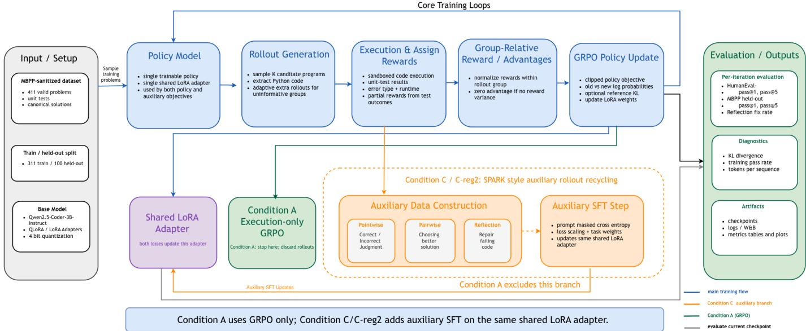
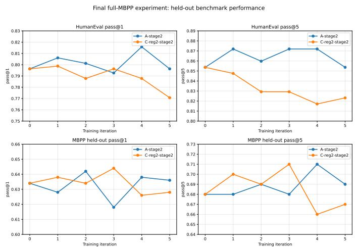
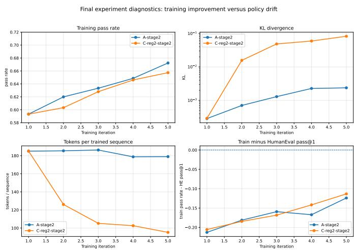

# Co-Evolving Policy and Reward for Code Generation: A Mechanistic Study of Single-Adapter Drift

Amarsaikhan Batjargal

Jarvis College of Computing and Digital Media

DePaul University

Chicago, IL, USA

abatjarg@depaul.edu

Noriko Tomuro

Jarvis College of Computing and Digital Media

DePaul University

Chicago, IL, USA

tomuro@cs.depaul.edu

Abstract—Reinforcement learning with verifiable rewards (RLVR) is particularly well suited to code generation because generated programs can be objectively evaluated through execution. Execution also provides behavioral information that can be reused as additional supervision. The Synergistic Policy and Reward Co-Evolving Framework (SPARK), originally proposed for reasoning tasks, exploits this idea by recycling training rollouts and their evaluation results to train a model not only to generate solutions but also to evaluate and improve them. We investigate whether this policy–reward co-evolution approach transfers effectively to code generation and whether execution-grounded reflection provides an additional source of self-improvement. We compare SPARK-style rollout recycling with execution-only Group Relative Policy Optimization (GRPO) using Qwen2.5- Coder-3B-Instruct. Our results do not support either hypothesis under the configuration tested. Although co-evolution improves training performance, these gains do not generalize to heldout problems. Compared at the same stage of training, rollout recycling produces roughly 34× greater KL divergence from the reference policy than execution-only GRPO. Over training, trained tokens per GRPO sequence fall from 185 to 86 as training pass rate increases, while held-out performance declines or fails to sustain early gains. We characterize these patterns as single-adapter policy drift: the shared trainable parameters increasingly depart from pretrained code-generation behavior without corresponding gains in generalization. The results show that higher training reward alone is not evidence of generalizable code self-improvement and highlight the importance of held-out evaluation and drift diagnostics.

Index Terms—code generation, reinforcement learning, verifiable rewards, GRPO, policy–reward co-evolution, self-correction, large language models, LoRA

## I. INTRODUCTION

Large language models (LLMs) have become increasingly capable of code generation, but functional correctness remains challenging. A generated program may be syntactically valid yet fail edge cases, implement an incorrect algorithm, or crash at runtime. Because generated programs can be objectively evaluated through execution, code generation provides a natural setting for reinforcement learning with verifiable rewards (RLVR), unlike many natural-language tasks that require subjective judgments of response quality. Moreover, execution provides information about program behavior that can serve as additional supervision.

This work investigates whether such information can be exploited through policy–reward co-evolution. We build on the Synergistic Policy and Reward Co-Evolving Framework (SPARK) [1], a self-improvement framework originally developed for reasoning tasks. In conventional RLVR, modelgenerated solutions, or rollouts, are used to compute rewards and update the policy, but are not typically reused for further training. SPARK instead recycles these rollouts and their evaluation results to train the model to evaluate and improve its own outputs. These capabilities co-evolve with the policy within a single model. We investigate whether this approach transfers effectively to code generation.

We test two hypotheses. First, we hypothesize that SPARKstyle co-evolution can improve code generation beyond an execution-only RLVR baseline based on Group Relative Policy Optimization (GRPO) [2], including its ability to generalize to problems not seen during training. Second, we hypothesize that execution-grounded reflection, in which the model learns to revise failing code using unit-test feedback, can provide an additional source of self-improvement.

We evaluate these hypotheses using the Mostly Basic Python Problems (MBPP) [3] and HumanEval [4] datasets. We train on a subset of MBPP and evaluate generalization both on held-out MBPP problems and on HumanEval as a separate, fully held-out benchmark. This design allows us to distinguish improvements on the training problems from indistribution generalization within MBPP and cross-benchmark generalization to HumanEval.

Our experiments do not support either hypothesis under the configuration tested. Although co-evolution improves performance on the training problems, these gains do not generalize to unseen problems. At the same time, the model increasingly departs from its pretrained behavior, as measured by KL divergence. The model also produces progressively shorter outputs during training. We characterize these patterns as single-adapter policy drift, arising when the same trainable parameters are used both to generate code and to learn to evaluate it.

This paper makes three contributions. First, we adapt SPARK-style policy–reward co-evolution to code generation by using information from program execution as additional supervision. Second, we evaluate whether this approach improves code-generation performance and generalization beyond execution-only GRPO. Third, we analyze policy drift to examine the relationship between training improvement and held-out generalization. Our findings highlight limitations of the single-adapter co-evolution design studied here and motivate further investigation of alternative designs for code generation.

## II. BACKGROUND

## A. RLVR and GRPO

Code-generation LLMs are typically built through largescale pretraining on code corpora [5], [6] followed by instruction tuning and reinforcement learning from human feedback, which optimizes the model against a reward model learned from human preferences [7]. RLVR replaces that learned reward model with an executable or rule-based verifier. DeepSeekMath introduced GRPO in this setting, and DeepSeek-R1 showed that RLVR can produce strong reasoning behavior [2], [8]. Related work also improves models at inference time rather than training time, for example by spending more computation on difficult problems [9].

GRPO samples several candidate solutions for the same problem and compares their rewards within that group. For a task $x ,$ the model samples K solutions $y _ { 1 } , \ldots , y _ { K }$ , each receiving an execution reward $r _ { i }$ , and the group-relative advantage is

$$
A _ { i } = \frac { r _ { i } - \mu _ { r } } { \sigma _ { r } + \epsilon } ,\tag{1}
$$

where $\mu _ { r }$ and $\sigma _ { r }$ are the mean and standard deviation of rewards in the group and ϵ is a small constant for numerical stability. A solution that scores above its group’s average is reinforced, and one below it is discouraged. Groups in which every solution receives the same reward carry no learning signal and are skipped. Because ranking several candidate programs for the same problem is exactly what a unit-test verifier provides, GRPO fits execution feedback naturally; it is also the optimizer SPARK uses [1].

## B. Self-Correction and SCoRe

In this paper, reflection means training the model to repair its own failing code: given a program that failed its unit tests and the resulting error message, the model learns to produce a corrected program. Self-Correction via Reinforcement Learning (SCoRe) [10] motivates this part of our work. SCoRe trains a model in a multi-turn setting: the model first produces an initial answer and then, conditioned on its own first answer, produces a revised answer. SCoRe identifies two failure modes directly relevant to execution-grounded code repair: distribution shift, when correction examples do not match the model’s own current mistakes, and behavior collapse, when the model learns conservative or minimal edits instead of meaningful repairs. These ideas help interpret our reflection results: although we use execution traces and onpolicy rollouts, reflection is still trained as auxiliary supervised fine-tuning (SFT) rather than as a dedicated multi-turn repair objective optimized with reinforcement learning.

## C. SPARK-Style Rollout Recycling

For each generated program, execution provides correctness, the fraction of tests passed, the error type, and the error message. SPARK [1] turns these into three auxiliary objectives for the same model: pointwise judgment (predict whether a candidate is correct), pairwise comparison (choose the better of two candidates), and reflection (repair failing code). Related approaches that train a policy together with its own reward signal include Cooper [11], CURE [12], and self-rewarding language models [13].

In our implementation, pointwise judgment is not used (weight 0.00), because its one-word targets such as “Correct” or “Incorrect” differ sharply from the full programs the same model must generate. For pairwise comparison, each failing rollout of a problem is paired with a randomly chosen passing rollout of the same problem, with the order in which the two are shown randomized. Reflection is the dominant auxiliary objective, since learning to repair code from execution feedback is the main adaptation from reasoning tasks to code. For reflection, the model is shown its failing program and the error message, and is trained to output a correct program for the same problem: a passing rollout from the same batch when one exists, and otherwise the canonical solution provided with MBPP.

TABLE I  
THE THREE SPARK-STYLE AUXILIARY OBJECTIVES IN OUR FINALCO-EVOLUTION CONFIGURATION. POINTWISE JUDGMENT IS NOT USED,TO AVOID SHORT-TARGET INTERFERENCE WITH FULL CODE GENERATION.
<table><tr><td>Objective</td><td>Weight</td><td>Input</td><td>Supervised target</td></tr><tr><td>Pointwise</td><td>0.00</td><td>one candidate so- lution</td><td>correctness label (not used)</td></tr><tr><td>Pairwise</td><td>0.05</td><td>two candidate so- lutions</td><td>the better candi- date</td></tr><tr><td>Reflection</td><td>1.00</td><td>failing code + ex- ecution trace</td><td>correct rollout, else canonical solution</td></tr></table>

Table I summarizes the three objectives and their weights in our final co-evolution configuration. The weights are not normalized to sum to one; they multiply each example’s loss before training. Setting reflection to 1.0 keeps it on the same scale as the GRPO loss, while pairwise at 0.05 keeps it a small auxiliary signal.

## D. Policy Drift as a Central Risk

We fine-tune with low-rank adaptation (LoRA) [14], which trains a small set of added weights, an adapter, while the pretrained model stays frozen. A central risk in co-evolutionary training is that the auxiliary objectives update the same adapter used for code generation. Their targets look very different from ordinary code completions: a pairwise answer is a single token, and a reflection target is a program written in response to a different prompt. Training on this mixture can shift the adapter away from how the pretrained model writes code. Such a shift can raise training reward without improving, and possibly while harming, performance on unseen problems. We track two signals of this drift. The first is the KL divergence between the trained model and the frozen pretrained model, which measures how far its output distribution has moved. The second is the trained tokens per GRPO sequence: the average length, in generated tokens, of the solutions used in each GRPO update. Shorter outputs are not harmful in themselves, but a sharp drop suggests the adapter is being pulled toward the short auxiliary targets. Following SPARK [1], we also add the KL divergence to the training loss as a penalty; if KL still grows substantially, the penalty is not preventing drift.

## III. METHODOLOGY

## A. Model and Fine-Tuning Setup

All experiments fine-tune Qwen2.5-Coder-3B-Instruct with QLoRA [15], which loads the pretrained weights in compressed 4-bit form and keeps them frozen, so that only the LoRA adapter is trained. Following the QLoRA recommendation, the adapter is applied to all attention and feed-forward projection layers, giving 29.9M trainable parameters out of 3.1B (about 0.96%). We chose the 3B model so that repeated rounds of generation, execution, and training fit within our available hardware.

The KL penalty is computed with a standard non-negative estimator, weighted by a coefficient $\beta ,$ and not capped: the model is discouraged from drifting away from the frozen pretrained model, but is not prevented from doing so. This is deliberate, since a hard limit on drift would hide the very effect we want to measure. Stronger constraints and early stopping are left to future work.

## B. Training Objective

Each training iteration of the co-evolution condition updates the same adapter in two phases. The first is a standard GRPO update [2], which increases the probability of solutions with positive advantage in (1) and decreases it for those with negative advantage. Each update is clipped so the model cannot change too much in a single step, and the KL penalty with weight $\beta$ discourages drift from the frozen pretrained model. The second phase is auxiliary supervised fine-tuning on the recycled rollouts, minimizing

$$
\begin{array} { r } { \mathcal { L } _ { \mathrm { a u x } } ( \theta ) = \lambda _ { \mathrm { a u x } } \big ( w _ { \mathrm { p a i r } } \mathcal { L } _ { \mathrm { p a i r } } ( \theta ) + w _ { \mathrm { r e f l } } \mathcal { L } _ { \mathrm { r e f l } } ( \theta ) \big ) , } \end{array}\tag{2}
$$

where $\theta$ are the adapter parameters, $\mathcal { L } _ { \mathrm { p a i r } }$ and $\mathcal { L } _ { \mathrm { r e f l } }$ are the standard next-token prediction losses on the pairwise and reflection targets, computed on the target response only and not on the prompt, and $w _ { \mathrm { p a i r } }$ and $w _ { \mathrm { r e f } }$ are the weights in Table I. The overall scale $\lambda _ { \mathrm { a u x } }$ controls how strongly the auxiliary phase moves the adapter relative to the GRPO phase, since both share one optimizer. The execution-only baseline runs the GRPO phase alone; the co-evolution condition runs both, so both update the same shared adapter, which is the design choice under test. The values of $\beta$ and $\lambda _ { \mathrm { a u x } }$ for each configuration are given in Section IV.

## C. Datasets, Execution, and Reward

We use the MBPP-sanitized subset [3], a hand-verified version of MBPP curated by its original authors to remove ambiguous task descriptions, poorly specified requirements, and broken test assertions. We keep the 411 problems whose unit tests can be parsed automatically and randomly split them, with a fixed seed, into 311 training and 100 held-out problems. HumanEval [4] (164 problems) serves as a second, fully heldout benchmark.

To score a solution, we extract the Python code from the model’s response and run it with the problem’s unit tests in a separate, isolated process. Each run is limited to 10 seconds and 2 GB of memory, enough for even naive brute-force solutions on these small problems while stopping infinite loops and runaway memory use. During training, each unit test is run separately, and a solution’s reward is the proportion of its unit tests that pass, reduced by a penalty if the code has a syntax error, raises a runtime error, or times out.

These rewards are the $r _ { i }$ in (1), computed for the K candidate solutions in each GRPO group. We start with K = 4 solutions per problem. If all of them receive the same reward, the group carries no learning signal, so we sample more, up to $K = 8 ,$ until the rewards differ or the cap is reached.

## D. Experimental Design

We compare two conditions, depicted in Figure 1, where the blue path is shared by both. Condition A (green box) is the execution-only baseline: it runs GRPO alone and discards its rollouts after each update. Condition C (dashed orange box) adds rollout recycling: the same rollouts are turned into auxiliary judgment and reflection examples, and both phases update the same shared adapter. Condition A therefore measures what execution-only GRPO can achieve, and Condition C tests whether recycling improves on it. We evaluate several settings of Condition C that differ in how strongly the auxiliary phase and the KL penalty are weighted; Section IV introduces them as C-light, C-reg, and C-reg2.

## E. Evaluation Metrics

We evaluate each checkpoint on two held-out sets. The 100 held-out MBPP problems measure generalization to unseen problems from the benchmark used in training. HumanEval, which is never used in training, measures whether training generalizes to entirely unseen data from a separate benchmark. For each problem, we generate five solutions at temperature 0.2 and report pass@1 and pass@5, where pass@k is the probability that at least one of k solutions passes all tests; pass@1 is thus the average fraction of the five that pass, and pass@5 whether any of them does. HumanEval pass@1 is our primary metric, since it measures single-attempt quality on fully unseen problems. We also track training pass rate and mean reward (progress on the training problems), KL divergence (policy drift), trained tokens per GRPO sequence (length drift), and reflection fix rate (repair ability). Because all experiments use a single seed and HumanEval has 164 problems, we do not claim statistical significance for small pass@k differences and interpret them together with the drift diagnostics.

  
Fig. 1. Execution-only GRPO vs. single-adapter rollout recycling. The blue path shows the shared execution-grounded GRPO loop used by both conditions: MBPP problems are sampled, the policy generates candidate programs, programs are executed in a sandbox, execution rewards are assigned, group-relative advantages are computed, and the GRPO policy update is applied. Condition A stops after the GRPO update and discards rollouts. Condition C adds the orange auxiliary branch, where execution-labeled rollouts are recycled into pointwise, pairwise, and reflection supervision. Both the GRPO policy update and the auxiliary SFT step update the same shared LoRA adapter. The right-hand boxes show per-iteration evaluation, diagnostics, and artifacts.

TABLE II  
PRELIMINARY HYPERPARAMETER STUDY. HE = HUMANEVAL; MBPP = HELD-OUT MBPP; @1 AND @5 DENOTE PASS@1 AND PASS@5; TRAIN PASS = TRAINING PASS RATE; REFL. FIX = REFLECTION FIX RATE. ITERATION 0 IS THE SHARED PRETRAINED BASELINE; METRICS SHOWN ARE FINAL-ITERATION VALUES. BOLD MARKS THE BEST NON-BASELINE VALUE IN EACH COLUMN.
<table><tr><td>Condition</td><td>HE@1</td><td>HE@5</td><td>MBPP@1</td><td>MBPP@5</td><td>Train Pass</td><td>Mean Reward</td><td>KL</td><td>Refl. Fix</td></tr><tr><td>Baseline</td><td>0.7963</td><td>0.8537</td><td>0.6340</td><td>0.6800</td><td></td><td></td><td></td><td>0.1176</td></tr><tr><td>A: Exec-only GRPO</td><td>0.8049</td><td>0.8537</td><td>0.6360</td><td>0.6900</td><td>0.6385</td><td>0.6713</td><td>0.0011</td><td></td></tr><tr><td>C-light: Naive Co-Evolve</td><td>0.7732</td><td>0.8232</td><td>0.6580</td><td>0.6800</td><td>0.6577</td><td>0.6930</td><td>0.0941</td><td>0.1389</td></tr><tr><td>C-reg: Regularized Co-Evolve</td><td>0.8000</td><td>0.8537</td><td>0.6300</td><td>0.7200</td><td>0.6288</td><td>0.6578</td><td>0.0136</td><td>0.0968</td></tr></table>

## IV. RESULTS AND ANALYSIS

## A. Preliminary Hyperparameter Study

To choose the auxiliary loss scale and KL coefficient affordably, we first ran a shorter preliminary study: three iterations on 200 of the 311 training problems, evaluated on the same held-out MBPP problems and on HumanEval. The study compared Condition $\mathbf { A } ,$ execution-only GRPO with no auxiliary phase, against two co-evolution configurations: naive (C-light, $\beta ~ = ~ 0 . 0 1 , ~ \lambda _ { \mathrm { a u x } } ~ = ~ 0 . 1 0 )$ and regularized (C-reg, $\beta = 0 . 0 2 , \lambda _ { \mathrm { a u x } } = 0 . 0 3 )$ . Table II summarizes the results.

Three patterns emerge. Execution-only GRPO scores highest on HumanEval pass@1, narrowly ahead of C-reg. Naive co-evolution (C-light) improves MBPP held-out pass@1 and training pass rate but degrades HumanEval, showing the characteristic divergence pattern where HumanEval falls and KL grows. The C-reg configuration, with a lower auxiliary loss scale $( \lambda _ { \mathrm { a u x } } = 0 . 0 3 )$ and a stronger KL penalty $( \beta = 0 . 0 2 )$ recovers performance on HumanEval to close to baseline and achieves the best MBPP pass@5.

These results motivate the more conservative configuration used in the main experiment of the next section, which we call C-reg2: $\lambda _ { \mathrm { a u x } }$ lowered from 0.03 to 0.02, the pairwise weight from 0.1 to 0.05, and $\beta$ raised from 0.02 to 0.03. The two changes work together: a smaller $\lambda _ { \mathrm { a u x } }$ weakens how strongly auxiliary SFT pulls the shared adapter, while a larger $\beta$ restrains drift from the frozen pretrained model.

## B. Main Experiment: HumanEval and MBPP

Of the three co-evolution settings, we carry only C-reg2 forward, since C-light and C-reg were used to select it. The main experiment runs two conditions for up to six iterations on all 311 MBPP training problems, longer and on more data than the preliminary study; we call these runs A-long and Creg2-long. A-long is Condition A with $\beta = 0 . 0 2$ . C-reg2-long is the conservative co-evolution configuration, with $\beta = 0 . 0 3$ $\lambda _ { \mathrm { a u x } } = 0 . 0 2$ , and the objective parameter weights in Table I. A-long completed five iterations; the sixth-iteration update did not complete due to a transient server interruption during the GRPO backward pass. C-reg2-long completed six iterations. We use iteration 5 as the matched-iteration comparison point because both runs have completed checkpoints there. Table III summarizes the results.

TABLE III  
MAIN EXPERIMENT SUMMARY, WITH COLUMNS AS IN TABLE II. THE TABLE INCLUDES BEST-CHECKPOINT ROWS, MATCHED ITERATION 5 ROWS, AND THE FINAL C-REG2 CHECKPOINT. BOLD MARKS THE BEST VALUE IN EACH COLUMN.
<table><tr><td>Model / Checkpoint</td><td>HE@1</td><td>HE@5</td><td>MBPP@1</td><td>MBPP@5</td><td>Train Pass</td><td>Mean Reward</td><td>KL</td><td>Refl. Fix</td></tr><tr><td>Baseline</td><td>0.7963</td><td>0.8537</td><td>0.6340</td><td>0.6800</td><td></td><td></td><td></td><td>0.1176</td></tr><tr><td>A-long best (iter 4)</td><td>0.8159</td><td>0.8720</td><td>0.6380</td><td>0.7100</td><td>0.6486</td><td>0.6844</td><td>0.0023</td><td></td></tr><tr><td>A-long matched (iter 5)</td><td>0.7963</td><td>0.8537</td><td>0.6360</td><td>0.6900</td><td>0.6723</td><td>0.7086</td><td>0.0024</td><td></td></tr><tr><td>C-reg2 best HE@1 (iter 1)</td><td>0.7988</td><td>0.8476</td><td>0.6380</td><td>0.7000</td><td>0.5933</td><td>0.6237</td><td>0.0003</td><td>0.0606</td></tr><tr><td>C-reg2 matched (iter 5)</td><td>0.7707</td><td>0.8232</td><td>0.6280</td><td>0.6700</td><td>0.6574</td><td>0.6857</td><td>0.0822</td><td>0.0811</td></tr><tr><td>C-reg2 final (iter 6)</td><td>0.7744</td><td>0.8232</td><td>0.6320</td><td>0.6800</td><td>0.6962</td><td>0.7274</td><td>0.0957</td><td>0.0833</td></tr></table>

Condition A produces the best held-out HumanEval performance: pass@1 of 0.8159 and pass@5 of 0.8720 at iteration 4, with KL of 0.0023. At the matched iteration 5 comparison point, A-long has HumanEval pass@1 of 0.7963 and KL of 0.0024, while C-reg2 has pass@1 of 0.7707 and KL of 0.0822. C-reg2 continues to iteration 6, where training pass rate reaches 0.6962 and KL rises to 0.0957, while HumanEval pass@1 remains below baseline at 0.7744. The selected Along iteration 4 checkpoint improves HumanEval pass@1 by 1.96 percentage points (pp) and pass@5 by 1.83 pp over the pretrained baseline, and improves MBPP held-out pass@5 by 3.00 pp, all at very low KL drift.

To avoid a misleading best-vs-final comparison, we also compare the runs at the matched iteration. Best checkpoint to best checkpoint, A-long exceeds C-reg2-long by only 1.7 pp on HumanEval pass@1 (0.8159 vs 0.7988); at the matched iteration 5, A-long is back at baseline (0.7963) while C-reg2- long is below it (0.7707). Notably, C-reg2-long achieves its highest training pass rate (0.6962) over the same interval that HumanEval pass@1 falls. Training pass rate alone is therefore not sufficient evidence of self-improvement: the model gets better at the training loop, not at the held-out distribution.

Two factors limit how much weight we place on the pass@k comparisons. First, HumanEval contains 164 problems and our experiments use a single random seed, so a 2–4 percentagepoint gap represents only 3–7 individual problems changing between passing and failing, which is within the range of expected variation across seeds and too small for a significance claim. Second, the pretrained baseline already achieves 0.7963 on HumanEval pass@1, leaving limited room for measurable improvement. For these reasons we treat the KL divergence and trained-token-length diagnostics, both of which show large and monotonic differences between conditions, as the more informative signals, and treat pass@k gaps as supporting evidence rather than the central finding.

Figure 2 shows the held-out benchmark trajectories. Under HumanEval pass@1, A-long is the strongest condition, peaking at iteration 4; C-reg2-long peaks at 0.7988 in iteration 1 and declines thereafter. The MBPP held-out curves provide a complementary view: C-reg2 briefly improves MBPP performance, but the improvement is not durable. Both conditions reach MBPP pass@5 of 0.7100 at their best checkpoints, and C-reg2 returns to baseline by iteration 6. Co-evolution can therefore temporarily improve in-distribution MBPP metrics, but these gains coincide with policy drift and do not transfer to cross-benchmark HumanEval.

  
Fig. 2. Held-out benchmark trajectories. Condition A achieves the strongest HumanEval pass@1, while C-reg2 does not improve cross-benchmark generalization. Dashed lines mark the pretrained iteration-0 baseline. Comparison is across iterations 0–5 where both conditions have completed checkpoints. In all figures, the runs are labeled A-stage2 and $\mathsf { C } - \mathtt { r e g } 2 - \mathtt { s t }$ tage2 in the plots, from the internal naming of the second experiment stage; these are Along and C-reg2-long.

## C. Mechanism: Training Improvement Versus Policy Drift

Figure 3 shows the central divergence across iterations 1–5; as in Figure 2, the plotted series labeled A-stage2 and $\mathtt { C - r e g } 2 \mathtt { - s t a g e } 2$ are A-long and C-reg2-long. C-reg2- long and A-long both improve training pass rate, but the gap with held-out HumanEval evolves differently: for A-long, training pass rate rises while HumanEval stays near baseline, whereas for C-reg2-long, training rises as HumanEval falls. By iteration 5, A-long’s KL is 0.0024 while C-reg2-long’s is 0.0822, about 34× larger, and the number of trained tokens per sequence falls from 185 at iteration 1 to 95 by iteration 5 in C-reg2-long while A-long holds near 180. By iteration 6 the trend is more extreme (KL 0.0957, tokens 86), but the same mechanism is already visible by iteration 5.

  
Fig. 3. Mechanism diagnostics. Both conditions improve training pass rate, A slightly more than C-reg2, but C-reg2 shows much larger KL drift and a sharp decline in tokens per trained sequence. In the train-minus-HumanEval panel, both gaps narrow because training pass rate rises; the difference is that A’s HumanEval holds near baseline while C-reg2’s falls.

This large drift is consistent with the HumanEval regression: even though only 0.96% of parameters are trainable through LoRA, the auxiliary objective is strong enough to move the model far from its pretrained behavior. The pattern also matches recent studies of reinforcement learning for code. For example, a study of self-improving code agents [16] found that in 73.8% of GPU-kernel optimization trajectories and 46.8% of algorithmic-optimization trajectories, the agent’s reward improved without corresponding improvement on held-out evaluation, with the gap widening as optimization continued; similar over-optimization appears in code-repair self-play [17]. We observe the same widening pattern in our training regime.

We identify four failure signatures consistent with the observed divergence. The first three concern the sharedadapter design itself. (1) Auxiliary target heterogeneity: pairwise outputs (single-token A/B) and reflection outputs (full programs) differ in length and structure from normal code completions, so when the same adapter is updated by all loss signals it is pulled toward a compromise distribution that fits none of the objectives well. (2) Length collapse: trained tokens per sequence fall from 185 to 86, consistent with the adapter shifting toward the shorter auxiliary targets. (3) Singleadapter entanglement: because policy and auxiliary objectives share the same LoRA weights, the training pressure from each cannot be balanced through architectural separation alone, even with reduced auxiliary loss scale and increased KL regularization. The fourth reflects how we constructed reflection targets, as discussed in the next section. (4) Weak reflection supervision: the trained reflection fix rate remains below the pretrained baseline at every iteration. The baseline repairs 4 of 34 failing programs (0.1176); C-reg2-long falls to 2/33 at iteration 1 and recovers only to 3/36 (0.0833) by iteration 6. These counts are small enough that we read the metric as directionally consistent with the other diagnostics rather than as an independent result.

The progression across configurations (C-light → C-reg → C-reg2) strengthens this reading. Naive C-light caused immediate HumanEval degradation and large KL growth; Creg reduced the damage and improved MBPP pass@5; and the more conservative C-reg2 still drifted under more data and longer training. All three showed drift away from the pretrained distribution. In the preliminary study, C-light, with a stronger auxiliary loss and a weaker KL penalty than Creg, drifted far more; C-reg2 still drifted substantially despite the weakest auxiliary loss of the three, though it was also trained longer and on more data. This consistency across regularization regimes suggests the divergence is intrinsic to single-adapter co-evolution under these objectives, not an artifact of a single poorly chosen configuration.

## V. DISCUSSION AND CONCLUSION

SPARK-style co-evolution is applicable to code generation, but it does not outperform execution-only GRPO on crossbenchmark HumanEval. At the matched iteration 5, C-reg2 trails A-long on HumanEval pass@1 (0.7707 versus 0.7963) while its KL divergence is about 34× larger. The co-evolution branch receives strictly more information than Condition A, including paired comparisons and repair targets, yet because all objectives update the same shared adapter, auxiliary learning interferes with the generation policy. Training pass rate should therefore be treated as a diagnostic, not a final quality metric. These pass@k magnitudes are single-seed trends rather than significance claims; the KL and length-collapse diagnostics, which are large and monotonic, are the more robust signal.

Single-adapter co-evolution may be too architecturally entangled for the code setting. Code generation breaks the structural symmetry SPARK relies on in reasoning tasks: in math and visual reasoning, rollout, judgment, and reflection outputs all resemble a reasoning trace followed by an answer, whereas in code, policy rollouts are full programs, pairwise targets are single tokens, and reflection targets are full code conditioned on a different prompt. Training one shared adapter on this heterogeneous mixture is a harder distribution-balancing problem, and the observed length collapse is consistent with that mismatch.

A caveat applies to how strongly this speaks to co-evolution in general. Our auxiliary mixture is reflection-dominated, and reflection uses canonical or correct-rollout targets rather than verified self-fix trajectories. The length collapse and belowbaseline reflection fix rate are therefore partially entangled: we cannot fully separate heterogeneous-target drift from weak reflection construction. The failure we document is for a reflection-heavy, canonical-target mixture co-updating a single adapter, not for all co-evolution weightings. Our result aligns with SCoRe’s distribution-shift and behavior-collapse predictions [10], and with the pattern reported concurrently by Choi et al. [17] in code-repair self-play, where generatorfixer training improves repair on self-generated bugs while degrading repair on human-authored bugs.

Several prior approaches give code-generation models a reasoning or explanation channel without SPARK-style coevolution. Chain-of-thought, Self-Debug, and Reflexion use prompting, execution feedback, or verbal reflection at inference time or in separate training formats [18]–[20]. Concurrent code self-improvement methods factor the policy and auxiliary roles differently. ACE [21] trains the model both to solve problems and to generate adversarial unit tests that expose flaws in its own solutions, while GASP (Guided Asymmetric Self-Play) uses a teacher-student setup in which one role poses problems and the other solves them [22]. Both report improved code-generation performance from self-improvement, which is consistent with our interpretation that the limitation lies not in self-improvement on code in general, but in the design choices studied here, particularly co-updating a single shared adapter with heterogeneous objectives.

Within co-evolution, separating the policy adapter from a dedicated auxiliary adapter on a shared base model is the most promising direction we see, and we are not aware of prior work testing it for code generation. Methods that avoid co-evolution entirely, such as preference optimization from execution-labeled pairs, are a separate direction. Better reflection may also require verified repair trajectories and referenceanchored fixer training [17], together with held-out monitoring to avoid proxy-reward over-optimization [16]. More broadly, even when feedback comes from executable unit tests rather than a learned reward model, co-evolving generation and evaluation within one adapter can produce training gains that do not transfer. Stronger supervision alone may therefore not be sufficient; architectural separation between generator and evaluator may also be needed.

## LIMITATIONS

This study evaluates a single model at a single scale using a single random seed over six iterations, so the pass@k differences we report are trends rather than significant effects. HumanEval is also a widely used benchmark, so we cannot rule out that some of its problems appeared in the pretraining data of the model we fine-tune.

Because the co-evolution condition adds an auxiliary update phase, it takes more optimizer steps than the baseline. We did not run a step-matched comparison, in which the baseline receives the same number of updates, so we cannot separate the effect of additional training from that of the auxiliary objectives. We also do not compare against ACE [21] or GASP [22], which factor the policy and auxiliary roles differently. Finally, our auxiliary mixture is dominated by reflection, whose weight is twenty times that of pairwise comparison. The results therefore do not speak to co-evolution under other weightings.

## REFERENCES

[1] Z. Liu, Y. Zang, S. Ding, Y. Cao, X. Dong, H. Duan, D. Lin, and J. Wang, “SPARK: Synergistic policy and reward co-evolving framework,” arXiv preprint arXiv:2509.22624, 2025.

[2] Z. Shao, P. Wang, Q. Zhu et al., “DeepSeekMath: Pushing the Limits of Mathematical Reasoning in Open Language Models,” 2024.

[3] J. Austin, A. Odena, M. Nye et al., “Program Synthesis with Large Language Models,” 2021.

[4] M. Chen, J. Tworek, H. Jun et al., “Evaluating Large Language Models Trained on Code,” 2021.

[5] B. Roziere, J. Gehring, F. Gloeckle\` et al., “Code Llama: Open foundation models for code,” 2023.

[6] D. Guo, Q. Zhu, D. Yang et al., “DeepSeek-Coder: When the large language model meets programming – the rise of code intelligence,” 2024.

[7] L. Ouyang et al., “Training language models to follow instructions with human feedback,” in Advances in Neural Information Processing Systems (NeurIPS), 2022.

[8] D. Guo, D. Yang, H. Zhang et al., “DeepSeek-R1 incentivizes reasoning in LLMs through reinforcement learning,” Nature, vol. 645, pp. 633– 638, 2025.

[9] C. V. Snell, J. Lee, K. Xu, and A. Kumar, “Scaling LLM test-time compute optimally can be more effective than scaling parameters for reasoning,” in The Thirteenth International Conference on Learning Representations, 2025. [Online]. Available: https: //openreview.net/forum?id=4FWAwZtd2n

[10] A. Kumar, V. Zhuang, R. Agarwal et al., “Training language models to self-correct via reinforcement learning,” in The Thirteenth International Conference on Learning Representations (ICLR), 2025.

[11] H. Hong, Y. Yan, X. Wu, G. Hou, W. Zhang, W. Lu, Y. Shen, and J. Xiao, “Cooper: Co-Optimizing Policy and Reward Models in Reinforcement Learning for Large Language Models,” 2025.

[12] Y. Wang, L. Yang, Y. Tian, K. Shen, and M. Wang, “Co-evolving llm coder and unit tester via reinforcement learning,” 2025.

[13] W. Yuan, R. Y. Pang, K. Cho, X. Li, S. Sukhbaatar, J. Xu, and J. Weston, “Self-rewarding language models,” in Proceedings of the 41st International Conference on Machine Learning (ICML), 2024.

[14] E. J. Hu, Y. Shen, P. Wallis, Z. Allen-Zhu, Y. Li, S. Wang, L. Wang, and W. Chen, “LoRA: Low-rank adaptation of large language models,” in International Conference on Learning Representations (ICLR), 2022.

[15] T. Dettmers, A. Pagnoni, A. Holtzman, and L. Zettlemoyer, “QLoRA: Efficient finetuning of quantized LLMs,” in Advances in Neural Information Processing Systems (NeurIPS), 2023.

[16] B. Zhao, D. Srikanth, Y. Wu, and Z. Jiang, “Reward Hacking in Self-Improving Code Agents,” ICLR 2026 Workshop on Recursive Self-Improvement (RSI), 2026, openReview ikrQWGgxYg.

[17] C. Choi, Z. N. Kaya, S. Wu, T. Ma, T. Hashimoto, and L. Schmidt, “Anchored Self-Play for Code Repair,” ICLR 2026 Workshop on Recursive Self-Improvement (RSI), 2026, openReview lTbBFAoPSA.

[18] J. Wei, X. Wang, D. Schuurmans, M. Bosma, B. Ichter, F. Xia, E. H. Chi, Q. V. Le, and D. Zhou, “Chain-of-thought prompting elicits reasoning in large language models,” in Advances in Neural Information Processing Systems (NeurIPS), 2022.

[19] X. Chen, M. Lin, N. Scharli, and D. Zhou, “Teaching large language¨ models to self-debug,” in International Conference on Learning Representations (ICLR), 2024.

[20] N. Shinn, F. Cassano, A. Gopinath, K. Narasimhan, and S. Yao, “Reflexion: Language Agents with Verbal Reinforcement Learning,” in Advances in Neural Information Processing Systems (NeurIPS), 2023.

[21] Y. Huang, X. Yu, and Z. Wei, “ACE: Self-evolving llm coding framework via adversarial unit test generation and preference optimization,” 2026, iCLR 2026 Workshop on Recursive Self-Improvement (RSI).

[22] S. Jana, C. Sancaktar, T. Danis, G. Martius, A. Orvieto, and P. Kolev,ˇ “GASP: Guided asymmetric self-play for coding llms,” 2026, iCLR 2026 Workshop on Recursive Self-Improvement (RSI).