# Cognitive Maps in Large Language Models

Albert Qin,1, ∗ Jonathan Cohen,2 and Gautam Reddy1, †

1Department of Physics, Princeton University, Princeton, New Jersey

2Princeton Neuroscience Institute, Princeton University, Princeton, New Jersey

It has long been proposed that animals construct cognitive maps to support flexible behavior in novel environments. We tested whether large language models form similar representations using relational reasoning tasks and causal “mosaic experiments” that manipulate internal activations in open-weight language models. Models beyond the ten-billion-parameter scale successfully inferred unstated relationships between entities and generalized to synthetic entity names. Across model and task families, models generated abstract representations of relational structure and combined them additively with representations of entity identity, binding entities to roles within that structure. Models stored observed relationships as pairwise links that they composed retrospectively when queried, rather than prospectively positioning each entity in a global coordinate system. Binding was mediated by a sparse, distributed set of key–value pairs; by perturbing these pairs, we implanted “false memories” that altered model behavior in predictable ways. Overall, our findings reveal an internal organization analogous to a cognitive map that explains how language models reason with limited information.

## I. INTRODUCTION

A hallmark of cognition is the ability to identify structure and make inferences from limited experience. A classic example of this ability is observed during spatial navigation: with suficient experience in a maze, animals can plan a novel route to reach a goal [1]. In hu mans, this ability is observed across virtually all domains that involve relational reasoning. For example, if we are told that Alice’s daughter is Beth and Beth’s daughter is Carol, we can infer that Carol is Alice’s granddaughter, even when this relationship is not directly stated. These abilities are made possible by the fact that the same relational structures recur across many contexts: navigation on a flat terrain must obey the rules of two-dimensional geometry, and all human families share similar structure even though the identities of family members difer from family to family. It has long been proposed that animals construct internal representations—variously referred to as schemata [2], mental models [3], or cognitive maps [1, 4]—that capture such underlying structure to support flexible behavior beyond what has been directly experienced.

To construct such a representation, a learner must combine previously acquired knowledge about the relevant relational structure (e.g., the abstract structure of a family tree) with information specific to the current experience (e.g., the names “Alice”, “Beth”, and “Carol”). Several lines of theoretical work, spanning memory [5–7], structure learning [8–11], and abstract reasoning [12–14], can be understood as addressing complementary aspects of this problem. Although their details difer, many of these theoretical models share the feature that information specific to the current context is bound to a separable and reusable (i.e., abstract) representation of relational structure. This organization allows previously acquired structural knowledge to be rapidly applied to the particulars of a new context. Therefore, to the extent that these theories account for aspects of human cognition and patterns in neural and behavioral data, they suggest that animal brains construct cognitive maps whose organization reflects the recurrence of relational structures across contexts.

This hypothesis immediately raises the question of whether analogous representational strategies can arise in a diferent system that learns from data with sim ilar statistical features. Modern large language models provide a clear example of such a system. These models exhibit strikingly broad capabilities that arise through training on large natural language corpora [15– 17]. Crucially, these corpora contain recurring semantic structures that are instantiated by diferent entities [18, 19], which in turn may arise from the relational structures that recur across the situations that language describes. Therefore, learning from these corpora using objectives that favor generalization across contexts (e.g., next-token prediction) may promote representational strategies that capture recurring relational structure. Importantly, such strategies are not prescribed in advance but rather must emerge through training; their particular form must therefore be characterized empirically.

Here, we studied the behavior and internal representations of trained large language models when asked to perform a set of relational-reasoning tasks. We found that models could infer unstated relationships and retained this ability when familiar entity names were replaced with novel ones (Fig. 1). By perturbing the models’ internal states, we found evidence for an abstract representation of relational structure that is separable from entity identity (Fig. 2). Representations of structure and identity combined additively (Fig. 3). Multi-step inference relied primarily on separately represented relationships that were composed when required by a query (Fig. 4). Finally, two separate, sparse sets of key–value pairs supported retrieval of structural information from entity names and vice versa (Fig. 5). Together, our findings reveal how language models organize information in their internal states to support flexible relational reasoning.

## II. RESULTS

## A. Large language models infer unstated relationships and generalize to novel entity names

To study how language models use structural knowledge to organize newly presented information for inference, we designed a set of relational-reasoning tasks that require models to answer questions about relationships implied by a short prompt. On each trial, models received a context stating two relationships among three entities, then were asked a question about a relationship determined by that context (Fig. 1A). We evaluated models across 14 relational-reasoning settings spanning four task families: family trees, ordering relations (e.g., age comparisons), signed interactions (e.g., biological interaction networks), and equivalence relations (Fig. 1B; SI Sec. VIII).

We studied the behavior of a collection of 11 openweight transformer models spanning multiple model families (Gemma-3, Llama-3.1, Qwen-3) and scales (∼600M to ∼70B parameters) on these tasks. Models were evaluated without task-specific fine-tuning or in-context demonstrations. Across most relational reasoning settings, suficiently large models reliably answered questions about unstated relationships implied by the context (Figs. 1C; S8–S21). Furthermore, performance was preserved when the entity names were replaced with synthetic names that lacked domain-appropriate semantic associations (Figs. 1D; S8–S21). Together, these observations demonstrate a capacity for inference that exhibits a form of systematicity [20]: the models’ abilities extended immediately to novel instantiations of familiar relational structures.

## B. Probing internal representations in transformer models

We next asked about the structure of the internal representations that support these abilities. We begin by identifying the relevant internal states in a transformerbased language model [21] that carry information about the stated relationships, then describe our approach to probing their organization.

To process text, these models divide the text into tokens, associate an initial vector with each token, then update these vectors through a sequence of layers (Fig. 2A). We collect the vectors associated with the relationship statements into an object we call the activation tensor:

$$
\mathbf { A } = \left\{ \mathbf { h } _ { t l } \right\} _ { t = t _ { \mathrm { s t a r t } } , \ldots , t _ { \mathrm { e n d } } } ,\tag{1}
$$

where $\mathbf { h } _ { t l }$ denotes the vector generated at token position t and layer $l ,$ and $t _ { \mathrm { s t a r t } }$ and $t _ { \mathrm { e n d } }$ delimit the relevant segment of the prompt.

Within each layer, the self-attention mechanism permits the retrieval of information from earlier token positions. This is mediated by key–value pairs generated from each vector by learned linear projections: the keys guide retrieval, while the values supply the retrieved information. We collect the key–value pairs associated with the relationship statements into an object we call the key–value memory:

$$
\begin{array} { r } { \mathbf { M } = \Big \{ ( \mathbf { k } _ { t l } ^ { ( i ) } , \mathbf { v } _ { t l } ^ { ( i ) } ) \Big \} _ { l = t _ { \mathrm { s t a r t } } , \dots , t _ { \mathrm { e n d } } , } } \\ { i = 1 , \dots , N _ { \mathrm { l a y e r s } } } \end{array}\tag{2}
$$

where $( \mathbf { k } _ { t l } ^ { ( i ) } , \mathbf { v } _ { t l } ^ { ( i ) } )$ denotes the ith key–value pair at token position t and layer l, and $N _ { \mathrm { K V } }$ is the number of key– value pairs generated per vector.

Crucially, the dependence of the models’ responses on the stated relationships is mediated entirely through A and M. Specifically, information about the relationships is encoded in A, then made available for retrieval through the key–value memory M:

$$
\mathrm { r e l a t i o n s h i p s \longrightarrow \bf A } \longrightarrow \bf M \xrightarrow { \mathrm { q u e r y } } \mathrm { r e s p o n s e } .\tag{3}
$$

Questions about the structure of the cognitive map can therefore be operationalized as questions about the organization of information in A and M.

To probe the structure of these representations, we designed a family of in silico experiments—here termed mosaic experiments—based on the approach described in [22]. In each experiment, we constructed a “mosaic” activation tensor by recombining parts of “source” activation tensors generated as the model processed two or more diferent prompts. Mosaic key–value memories were constructed in the same way. For example, in Fig. 2B, we recorded activation tensors for two prompts describing the same relational structure using diferent entity names, then constructed $\mathbf { A } _ { \mathrm { m o s a i c } }$ by replacing the row of $\mathbf { A } _ { \mathrm { c o n t r o l } }$ corresponding to the first “Beth” token with the corresponding row for $^ { 6 6 } \mathrm { E v e } ^ { 9 5 }$ in $\mathbf { A } _ { \mathrm { d o n o r } }$ . We then presented the model with a query while holding the internal states corresponding to A or M fixed at the values specified by the mosaic representation; all other internal states were computed normally. The model’s responses under such a manipulation provide a behavioral readout of the relationships supported by the mosaic representation. As we show next, diferent hypotheses about the organization of information in A or M make diferent predictions about the outcomes of such experiments.

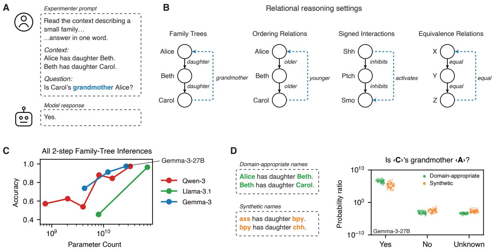  
FIG. 1. Behavioral task, model performance, and generalization. A, Task structure. B, Relational reasoning settings. Solid black arrows denote examples of stated relationships; dashed blue arrows denote an implied relationship. C, Model performance in the family-tree setting. Colors denote model families; points denote individual models. Gemma-3-27B, indicated here, is shown as an example in subsequent main-text figures; corresponding results across models and relational reasoning settings are reported in the SI. D, Generalization to synthetic names. Green denotes domain-appropriate names (here, common English names); orange denotes synthetic names (here, random three-letter strings). For each condition, 50 trials are shown; a new set of entity names is sampled for each trial. ‹A› and ‹C› denote the first and third entity names on each trial. Each trial contributes one point for each of the three plotted tokens. Probability ratios are token probabilities divided by the geometric mean across the plotted answer tokens.

## C. Relational structure is represented separately from entity identity

We first asked how a single relationship (e.g., “Alice has daughter Beth”) is encoded in the activation tensor A. We considered two hypotheses:

Under the attribute tagging hypothesis, models encode relationships as an attribute of one of the participating entities (Fig. 2C, left). This hypothesis is motivated by empirical evidence indicating that language models express facts learned during training by tagging representations at entity tokens with features that encode attributes of those entities [23–25]. Analogously, relationships introduced in the prompt could be encoded by constructing such features on the fly. For example, the models could encode the relationship “Alice has daughter Beth” by adding to the representations at “Beth” a feature corresponding to the attribute “has mother Alice” (e.g., using a conjunctive code [26, 27] for “has mother”

and “Alice”). Because the complete relationship is not available until the latter entity (e.g., “Beth”) is processed, such a feature is constrained to appear in the row of A corresponding to the latter entity token.

An alternative hypothesis, the identity–structure binding hypothesis, is that models carry an abstract, nameindependent representation of the relationship, then bind the names to that representation (Fig. 2C, right). This hypothesis is related to recent proposals that language models develop internal mechanisms that can sup port computations associated with symbolic processing [22, 28–32]. Under this hypothesis, changing the entity names should leave the abstract representation of the relationship intact while altering the name-specific information bound to that representation.

The mosaic experiment illustrated in Fig. 2B was designed to distinguish between the two hypotheses. In this experiment, $\mathbf { A } _ { \mathrm { m o s a i c } }$ was constructed from two source tensors, $\mathbf { A } _ { \mathrm { c o n t r o l } }$ and $\mathbf { A } _ { \mathrm { d o n o r } }$ , recorded as models processed contexts with the same relational structure but diferent entity names. For example, the control and donor contexts could read “Alice has daughter Beth; Beth has daughter Carol” and “Daisy has daughter Eve; Eve has daughter Fiona”, respectively. In this example, the mosaic would be constructed by replacing the row in $\mathbf { A } _ { \mathrm { c o n t r o l } }$ corresponding to the first occurrence of “Beth” with the row in $\mathbf { A } _ { \mathrm { d o n o r } }$ corresponding to the first occurrence of “Eve”.

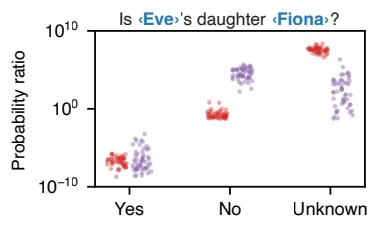

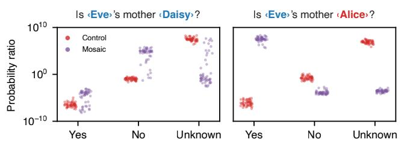

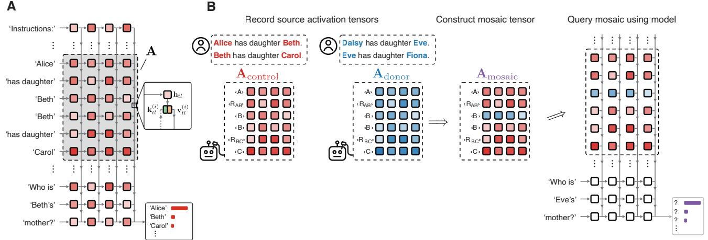

C  
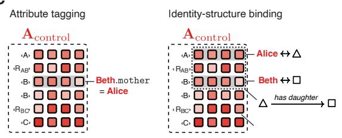

E  
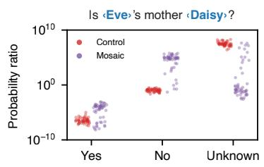

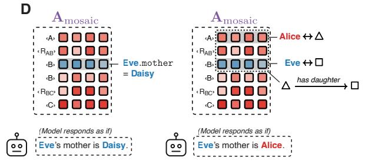

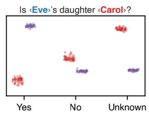

F  
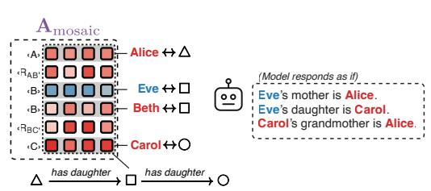

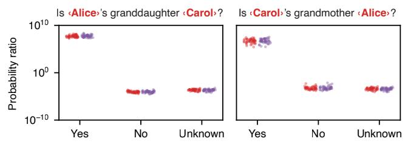  
FIG. 2. Mosaic experiments probe the organization of information within the activation tensor. A, Information flow through a transformer. Each square represents a vector at one layer and token position; arrows indicate the direction of causal dependence. Tokenization is schematic in this and subsequent diagrams. Later vectors retrieve information through keys (green) and values (orange) generated from earlier vectors (inset). The vector at the most recent token position of the last layer determines the probability distribution over the next token. The activation tensor A comprises the set of intermediate vectors in the segment of the prompt containing the relationships (dashed box). The key–value memory M is diagrammed separately in Fig. 5A. B, Schematic of a mosaic experiment. (1) Source tensors are recorded. (2) Selected activations are recombined into a mosaic tensor. (3) The model processes a query while activations in the mosaic region remain fixed at their mosaic values. Activations at subsequent token positions (unfilled squares) are computed normally; next-token probabilities provide a behavioral readout of the relationships supported by the mosaic. C, Competing hypotheses for the organization of information in the activation tensor. Labels indicate the information carried by each highlighted region under each hypothesis. D, Predictions for the outcome of the experiment in B. E, Outcome of the experiment. Each plot compares model responses for the control (red) and mosaic (purple) activation tensors. Probability ratios are defined as in Fig. 1D. Fifty trials are shown per condition. Names in the query headings are illustrative. Results are shown for Gemma-3-27B in the family-tree setting; corresponding analyses for other models and relational-reasoning settings are reported in the SI. F, Inferred organization of the mosaic. Shapes denote the three structural roles in the relational structure. Entity names are bound to these roles at the corresponding token rows. “Beth” and “Eve” are both bound to the middle role.

The two hypotheses make diferent predictions for the outcome of this experiment. The attribute tagging hypothesis predicts that the substituted row in Amosaic carries the feature “has mother Daisy”. Models should therefore behave as if Eve’s mother were Daisy (Fig. 2D, left). In contrast, the identity-structure binding hypothesis predicts that replacing Beth’s row in $\mathbf { A } _ { \mathrm { c o n t r o l } }$ with the corresponding row from $\mathbf { A } _ { \mathrm { d o n o r } }$ leaves a nameindependent representation of the relationship intact while changing the name bound to that representation from “Beth” to “Eve”. Models should therefore behave as if Eve’s mother were Alice (Fig. 2D, right). Note that we use the names “Alice”, “Beth”, . . . , and the family tree setting for illustrative purposes; for each mosaic experiment, names were resampled on each trial and analogous experiments were performed for all relational reasoning tasks.

Consistent with the identity-structure binding hypothesis, we found that models could recover the relationship “Eve has mother $\mathrm { A l i c e } ^ { \mathrm { \ ' } }$ , but not “Eve has mother Daisy”, from $\mathbf { A } _ { \mathrm { m o s a i c } }$ (Fig. 2E, top). Unexpectedly, we also found that models could recover the relationship “Eve’s daugh ter is Carol” (Fig. 2E, middle), and the two-step relationship “Alice’s granddaughter is Carol” and its inverse (Fig. 2E, bottom). We observed similar results when models answered queries requiring an entity name, such as “Who is Eve’s mother?” (Fig. S6). Thus, models recovered relationships from $\mathbf { A } _ { \mathrm { m o s a i c } }$ as if Eve’s name had become associated with Beth’s place in the full control family tree. This pattern suggests a more general version of the identity–structure binding hypothesis, where the activation tensor binds a representation of each entity name to some component—common to $\mathbf { A } _ { \mathrm { c o n t r o l } }$ and $\mathbf { A } _ { \mathrm { d o n o r } }$ representing some feature of the prompt that is independent of entity identity.

What feature of the prompt does this component represent? We consider three possibilities. One possibility is that it represents the sequential structure of the prompt. Specifically, A could bind tokens to a sequence of position codes:

$$
\begin{array} { r l r } & { } & { \mathcal { P } _ { 1 } , \mathcal { P } _ { 2 } , \mathcal { P } _ { 3 } , \mathcal { P } _ { 4 } , \mathcal { P } _ { 5 } , \mathcal { P } _ { 6 } } \\ & { } & { ( \mathcal { P } _ { 1 }  \mathrm { A l i c e } ) , ( \mathcal { P } _ { 2 }  \mathrm { h a s ~ d a u g h t e r } ) , \dots . } \end{array}\tag{4}
$$

Under this account, $\mathbf { A } _ { \mathrm { m o s a i c } }$ would encode the sequence “Alice has daughter Eve; Beth has daughter Carol.” This would explain why models treated Alice as Eve’s mother (Fig. 2E, top); however, it is inconsistent with the models’ belief that Carol is Eve’s daughter or Alice’s granddaughter (Fig. 2E, middle and bottom). As an additional test, we evaluated models on mosaic tensors designed to permute either the positional signals supplied by the transformer architecture or any internally constructed codes for global token position. Neither manipulation appreciably changed the models’ behavior (Figs. S1, S2).

A second possibility is that the name-independent component of A represents two abstract mother– daughter relationships. Entity names could then be bound to the mother and daughter roles in each relationship:

$$
\begin{array} { r l } & { \mathcal { M } _ { 1 } \xrightarrow { \mathrm { h a s ~ d a u g h t e r } } \mathcal { D } _ { 1 } , \ \mathcal { M } _ { 2 } \xrightarrow { \mathrm { h a s ~ d a u g h t e r } } \mathcal { D } _ { 2 } } \\ & { \qquad ( \mathcal { M } _ { 1 }  \mathrm { A l i c e } ) , \ ( \mathcal { D } _ { 1 }  \mathrm { B e t h } ) , } \\ & { \qquad ( \mathcal { M } _ { 2 }  \mathrm { B e t h } ) , \ ( \mathcal { D } _ { 2 }  \mathrm { C a r o l } ) . } \end{array}\tag{5}
$$

Because the two relationships are linked only through the shared name “Beth”, the account likewise cannot explain the middle or bottom observations in Fig. 2E.

A third possibility is that the name-independent component of A represents the full relational structure of the prompt, including the fact that the daughter in the first clause and the mother in the second clause correspond to the same entity. The abstract structure represented in A could then be depicted as a three-node structure in which the two relationships share a middle node:

$$
\begin{array} { r l } & { \triangle \xrightarrow { \mathrm { h a s ~ d a u g h t e r } } \bigcup , \bigstar \bigstar \bigstar \xrightarrow { \mathrm { h a s ~ d a u g h t e r } } \bigstar \bigcirc } \\ & { \qquad ( \triangle  \mathrm { A l i c e } ) , ( \bigstar \bigstar \mathrm { B e t h } ) , } \\ & { \qquad ( \bigstar \bigstar \mathrm { B e t h } ) , ( \bigcirc  \mathrm { C a r o l } ) . } \end{array}\tag{6}
$$

This account explains all three of our observations (Fig. 2F). Hereafter, we use the term structural role to refer to an entity’s position within the overall relational structure.

To test the generality of this representational organization, we performed analogous mosaic experiments across relational reasoning settings and models. Similar patterns held across every setting (Figs. S22–S35) and model (Figs. S78–S88) tested, provided the model could perform the underlying relational reasoning task.

## D. Representations of entity identity and relational structure combine additively.

We next asked how an entity name is bound to its corresponding structural role. One natural hypothesis is that the binding is mediated by the co-occurrence, within the same row of A, of a pattern of activity representing an entity’s name and a pattern of activity representing its structural role. Under the simplest version of this hypothesis, which we call the parallelogram hypothesis, A can be written as the sum of a name-independent component carrying the relational structure and a namedependent component carrying entity identity (Fig. 3A, left). A row of A containing name n bound to structural role $s ,$ denoted $\mathbf { a } ( n , s )$ , would decompose as:

$$
\mathbf { a } ( n , s ) \approx \phi _ { \mathrm { n a m e } } ( n ) + \phi _ { \mathrm { r o l e } } ( s ) ,\tag{7}
$$

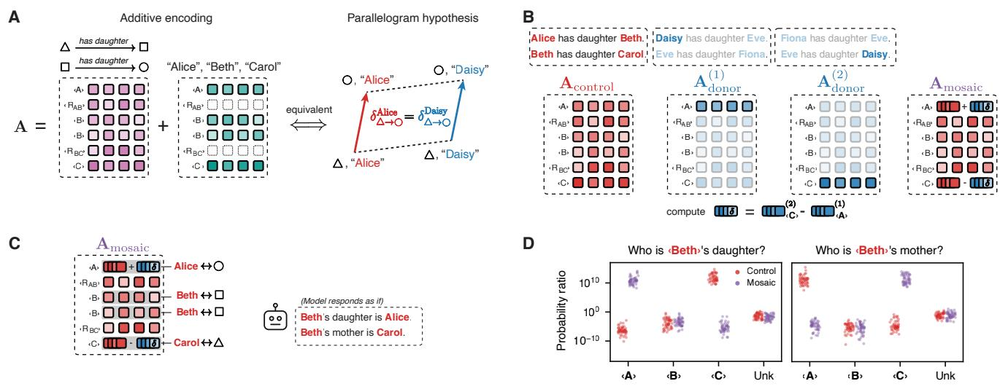  
FIG. 3. Entity identity and structural role combine additively. A, Additive encoding hypothesis. The activation tensor decomposes into a name-independent component (pink) carrying the relational structure and a name-dependent component (teal) carrying entity identity (left). Geometrically, the representations obtained by pairing any two entity names with any two structural roles form a parallelogram (right). B, Schematic of a mosaic experiment to test this hypothesis. Two donor tensors place the same entity name in diferent structural roles; subtracting the corresponding rows provides an estimate of the role-swap vector δ. Adding this vector to one entity row and subtracting it from another in a control tensor produces the mosaic. C, Predicted outcome under additive encoding. The mosaic should exchange the roles of two control entities. D, Outcome of the experiment. Each plot compares model responses for the control (red) and mosaic (purple) activation tensors. Probability ratios are defined as in Fig. 1D. Fifty trials are shown per condition. Names in the query headings are illustrative. ‹A›, ‹B›, and ‹C› denote the three entity names in the control context in order of first appearance. Results are shown for Gemma-3-27B in the family-tree setting; corresponding analyses for other models and relational-reasoning settings are reported in the SI.

where $\phi _ { \mathrm { n a m e } }$ and $\phi _ { \mathrm { r o l e } }$ map entity names and structural roles, respectively, to their corresponding patterns of activity. This hypothesis is equivalent to the geometric statement that the four representations corresponding to any two structural roles and two entity names form a parallelogram (Fig. 3A, right). Analogous representational geometries underlie classical models of analogical reasoning [33] and have been observed in learned word embeddings [34]. The parallelogram hypothesis predicts that the change in activity associated with changing an entity’s structural role should not depend on the name of that entity:

$$
\mathbf { a } ( n , s _ { 2 } ) - \mathbf { a } ( n , s _ { 1 } ) \approx \phi _ { \mathrm { r o l e } } ( s _ { 2 } ) - \phi _ { \mathrm { r o l e } } ( s _ { 1 } ) \equiv \delta _ { s _ { 1 } \to s _ { 2 } } .\tag{8}
$$

We refer to $\delta _ { s _ { 1 }  s _ { 2 } }$ as a role-swap vector, because adding and subtracting $\delta _ { s _ { 1 }  s _ { 2 } }$ to and from the representations of two entities with roles $s _ { 1 }$ and $s _ { 2 }$ is predicted to make models behave as if the two entities had exchanged roles.

Fig. 3B illustrates the design of a mosaic experiment that tests this prediction. We first recorded two donor tensors, $\mathbf { A } _ { \mathrm { d o n o r } } ^ { ( 1 ) }$ and $\mathbf { A } _ { \mathrm { d o n o r } } ^ { ( 2 ) } ,$ from two prompts that placed the same entity in two diferent structural roles. If name and role combine additively, subtracting the corresponding entity rows in $\mathbf { A } _ { \mathrm { d o n o r } } ^ { ( 1 ) }$ and $\mathbf { A } _ { \mathrm { d o n o r } } ^ { ( 2 ) }$ cancels their shared name component, yielding an estimate of the role-swap vector. To build the mosaic tensor $\mathbf { A } _ { \mathrm { m o s a i c } } .$ we added and subtracted the estimated roleswap vector to and from the relevant rows of a control tensor, Acontrol, recorded from a prompt containing a different set of entity names. The parallelogram hypothesis predicts that this operation should exchange the roledependent components of the two rows while leaving their name-dependent components unchanged, causing models to recover relationships from $\mathbf { A } _ { \mathrm { m o s a i c } }$ as if the two control entities had exchanged roles (Fig. 3C).

Models’ responses were consistent with this prediction (Fig. 3D). Similar patterns held across most relational-reasoning settings (Figs. S36–S49) and mod els (Figs. S89–S99) that we tested. These observations demonstrate that the activation tensor decomposes lin early into a name-independent component carrying the relational structure and a name-dependent component carrying the names of the entities that instantiate it.

## E. Multi-step inference relies primarily on a graph representation of observed relationships.

We next asked how relational information is organized within the name-independent component of A. We considered two hypotheses:

Under the retrospective–composition hypothesis, the name-independent component of A represents the relational structure as a labeled, directed graph (Fig. 4A, left). Structural roles correspond to nodes in this graph, and each observed relationship corresponds to an edge between two nodes. Because multi-step relationships are represented implicitly as paths through the graph, this representational strategy requires models to retrospectively compose the relevant relationships once a query is asked. This computation is related to classical accounts of model-based planning over an internal world model [35–37].

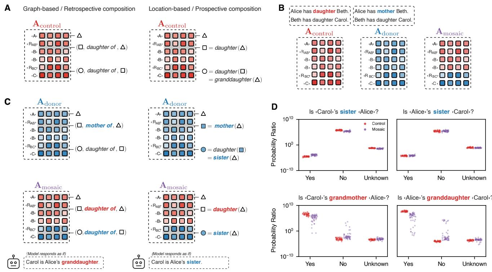  
FIG. 4. A mosaic experiment distinguishes retrospective and prospective composition of relationships. A, Competing hypotheses for the representation of relational structure in the activation tensor. Relational structure could be represented as a graph of observed relations that are composed retrospectively when a query is asked (left), or as a set of relational “locations” that reflect prospective composition of relationships (right). B, Schematic of a mosaic experiment that tests these hypotheses. The control and donor prompts difer only in the identity of the first relationship. Rows from the start of the second relationship phrase through the final entity in the control tensor are replaced with the corresponding donor rows. C, Predicted outcome under each hypothesis. D, Outcome of the experiment. Each plot compares model responses for the control (red) and mosaic (purple) activation tensors. Probability ratios are defined as in Fig. 1D. Fifty trials are shown per condition. Names in the query headings are illustrative. Results are shown for Gemma-3-27B in the family-tree setting; corresponding analyses for other models and relational-reasoning settings are reported in the SI.

An alternative hypothesis, the prospective–composition hypothesis, is that models prospectively compose relationships as they are encountered so that the nameindependent activity in A associated with each entity reflects the full sequence of relationships leading to it (Fig. 4A, right). One implementation would represent structural roles as locations in an internal coordinate system and relationships as transformations between those locations. Successively applying these transformations as relationships are encountered would determine the location of each new entity. If the transformations compose in the same way as the corresponding relationships, then multi-step relationships would be automatically reflected in the locations and would be recoverable at query time without retracing the intermediate relationships. This computation is directly analogous to path integration in models of animal spatial navigation [5, 38]; related schemes have also been proposed for representing small family trees [39].

To distinguish between these possibilities, we designed a mosaic experiment to test whether or not the taskrelevant name-independent activity associated with the final entity is dependent on the full history of preced ing relationships (Fig. 4B). In this experiment, $\mathbf { A } _ { \mathrm { m o s a i c } }$ was constructed from two source tensors, $\mathbf { A } _ { \mathrm { c o n t r o l } }$ and $\mathbf { A } _ { \mathrm { d o n o r } } ,$ recorded as models processed two prompts that difered only in the identity of the first relationship. For example, the control and donor contexts could read “Alice has daughter Beth; Beth has daughter Carol” and “Alice has mother Beth; Beth has daughter Carol”, respectively. We then constructed $\mathbf { A } _ { \mathrm { m o s a i c } }$ by replacing the rows associated with the final entity in $\mathbf { A } _ { \mathrm { c o n t r o l } }$ with the corresponding rows from $\mathbf { A } _ { \mathrm { d o n o r } } \ ( \mathrm { F i g . \ 4 B } )$ .

Under the retrospective–composition hypothesis, the substituted rows encode only the relationship that directly introduces the final entity. Thus, at query time, models should compose the first relationship from the control prompt with the second relationship from the donor prompt; the multi-step relationships supported by $\mathbf { A } _ { \mathrm { m o s a i c } }$ should therefore match those implied by the control prompt (Fig. 4C, left). In contrast, under the prospective–composition hypothesis, the substituted rows reflect the full history of preceding relationships and encode the final entity’s location as specified by the donor prompt. The multi-step relationships supported by $\mathbf { A } _ { \mathrm { m o s a i c } }$ should therefore match those implied by the donor prompt (Fig. 4C, right).

Consistent with the retrospective–composition hypothesis, we found that the multi-step relationships that models recovered from $\mathbf { A } _ { \mathrm { m o s a i c } }$ generally matched those implied by the control prompt (Fig. 4D). Similar patterns held across relational reasoning tasks (Figs. S50–S63) and models (Figs. S100–S110). However, in a subset of conditions, the models’ responses deviated systematically from this pattern, shifting toward—and in some cases closely matching—the responses implied by the donor prompt (Figs. S3, S104D). These deviations were most apparent in the family-tree setting.

Overall, these observations suggest that models rely primarily on a graph-like representation of the observed relationships in A and compose the relevant relationships retrospectively when a query is asked. However, in certain settings, models may also rely on other sources of information in A that reflect the prospective composition of observed relationships. Consistent with this possibility, directly visualizing representations at diferent token positions revealed a history-dependent component at relation tokens (Fig. S4). Why models rely on such information for certain queries but not others remains unclear. One possibility is that this variation across queries reflects some statistical feature of the training data, as suggested for other behavioral idiosyncrasies in language models [40].

## F. Separate sets of key–value pairs support name-to-role and role-to-name retrieval.

Our preceding findings suggested that A decomposes into two components, one representing entity identity and the other structural role. We next asked how models use each kind of information to access the other. To address this question, we studied the organization of information in the key–value memory M, from which the models directly retrieve information (Fig. 5A).

Recall that M consists of a large set of key–value pairs constructed from A via linear projection. Together with our finding that representations of name and role combine linearly in A, this suggests a natural hypothesis for how information is organized in M to support retrieval of an entity’s role from its name and vice versa. Specifically, certain linear projections could produce key–value pairs in M for which the key carries information about an entity’s name and the value carries information about its role, supporting retrieval of an entity’s role from its name. We refer to these hypothesized key–value pairs as name-to-role pairs. A separate set of role-to-name pairs with role information in the keys and name information in the values could support retrieval in the reverse direction (Fig. 5B).

The hypothesis that the model relies on these two kinds of key–value pairs to answer queries makes two key predictions. First, only certain entries in M should need to carry information about the names in the prompt. Specifically, name-dependent information is required in the keys but not in the values of name-to-role pairs; the reverse is true of role-to-name pairs. Second, name-torole pairs should be accessed before role-to-name pairs. For example, to answer “Who is Beth’s mother?”, models must first retrieve Beth’s role from her name, then identify her mother’s role and retrieve the name bound to it.

To test these predictions, we constructed mosaic key–value memories designed to restrict where namedependent information was available to the model. To do this, we replaced selected keys or values with their averages across prompts where the names had been resampled. In $\mathbf { M } _ { \mathrm { k e y s - f i r s t } }$ , name-dependent information was available only in the keys from the first half of M and in the values from the second half of M; $\mathbf { M } _ { \mathrm { v a l u e s - f i r s t } }$ used the reverse arrangement (Fig. 5C). Our hypothesis predicts that models should be able to answer queries using $\mathbf { M } _ { \mathrm { k e y s - f i r s t } } ,$ but not $\mathbf { M } _ { \mathrm { v a l u e s - f i r s t } } .$

Consistent with this prediction, substituting $\mathbf { M } _ { \mathrm { k e y s - f i r s t } }$ for the models’ key–value memory preserved performance, whereas substituting $\mathbf { M } _ { \mathrm { v a l u e s } }$ −first did not (Fig. 5D). Similar patterns held across relational reasoning tasks (Figs. S64A–S77A) and models (Figs. S111A–S121A). These observations establish the existence of a set of name-to-role and role-to-name pairs suficient to support the models’ behavior.

We next sought to localize these pairs within M. Starting from $\mathbf { M } _ { \mathrm { k e y s - f i r s t } }$ , we greedily averaged out namedependent information from the remaining keys and values, selecting at each step the replacement estimated to have the smallest efect on behavior (Fig. S5A,B). The resulting mosaic preserved the models’ behavior while confining name dependence to a very sparse subset of key– value pairs (Fig. 5E,F), distributed broadly across layers (Fig. S5C). By construction, the surviving pairs retained name-dependent information only in their keys or only in their values, making them candidates for name-to-role pairs and role-to-name pairs, respectively.

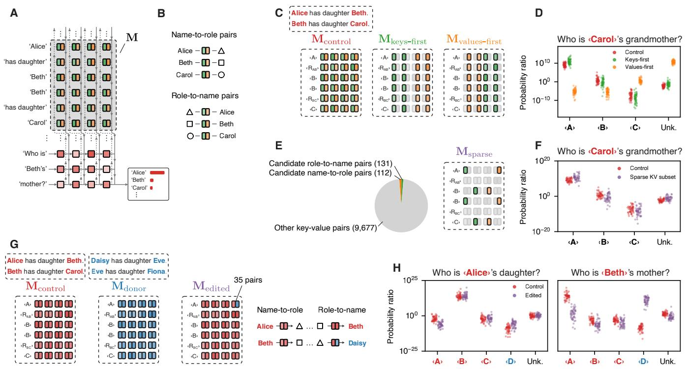  
FIG. 5. Identifying and editing key–value pairs that link entity names and structural roles. A, Key–value memory and information flow in a transformer. Linear projections transform vectors in the activation tensor into keys (green) and values (orange), which together form the key–value memory M. For simplicity, only one key–value pair is shown at each layer and token position. Vectors at subsequent token positions generate queries that are compared with the keys (upward dotted arrows) to determine which values are retrieved (downward solid arrows). B, Hypothesized key–value pairs supporting name-to-role and role-to-name retrieval. C, Keys-first and values-first mosaic memories. Grey boxes indicate keys or values replaced with averages across prompts with the same relational structure but resampled entity names. D, Model behavior with the control memory (red), the keys-first (green), and the values-first (orange) mosaics. E, Mosaic memory retaining name-dependent information in a sparse set of candidate key–value pairs identified by iterative pruning. F, Model behavior with the control memory (red) and sparse mosaic memory (purple). G, Selective editing of a role-to-name association. Values of candidate role-to-name pairs associated with a particular entity in the control memory are replaced with their counterparts from a donor memory (left). This is predicted to change the model’s answer to a query about a relationship while preserving its answer to the inverse query (right). H, Model behavior with the control memory (red) and edited mosaic memory (purple). In D, F, and H, results are shown for Gemma-3-27B in the family-tree setting. Fifty trials are shown per condition. Names in the query headings are illustrative. $\langle \mathrm { A } \rangle , \langle \mathrm { B } \rangle ,$ and ‹C› denote the three entity names in the control context in order of first appearance; ‹D› denotes the first name in the donor context. Probability ratios are defined as in Fig. 1D. Corresponding analyses for other models and relational-reasoning settings are reported in the SI.

Finally we asked if, by modifying these candidate pairs, we could plant specific “false memories” in M. If the candidate pairs mediate name–role binding as we have proposed, then answering a particular query (e.g., “Who is Alice’s daughter?”) and its inverse $( \mathrm { e . g . }$ , “Who is Beth’s mother?”) should rely on disjoint subsets of the candidate pairs. It should therefore be possible to plant a “unidirectional false memory” in M that is expressed only when a relationship is queried in a particular direction.

We demonstrated this phenomenon in the control– donor paradigm from Fig. 2. We began by recording two source memories, $\mathbf { M } _ { \mathrm { c o n t r o l } }$ and $\mathbf { M } _ { \mathrm { d o n o r } }$ , as models processed two prompts with the same relational structure but diferent entity names. We then edited the candidate role-to-name pairs associated with “Alice” by replacing their values in $\mathbf { M } _ { \mathrm { c o n t r o l } }$ with the corresponding values from $\mathbf { M } _ { \mathrm { d o n o r } } ,$ leaving all other entries unchanged (Fig. 5G). We found that under this manipulation, models continued to identify Beth as Alice’s daughter, but identified Daisy, rather than Alice, as Beth’s mother (Fig. 5H). Thus, we were able to plant “unidirectional false memories” in M: the relationships recovered by the models under these manipulations could not be reconciled with a single, logically consistent family tree. Related experiments showed that editing candidate nameto-role pairs altered models’ responses across relational reasoning tasks (Figs. S64–S77, panels D,E) and models (Figs. S111–S121, panels D,E).

## III. DISCUSSION

Taken together, our results demonstrate that relational information in the model’s internal state is organized into linearly separable components representing relational structure and entity identity. The structural component encodes the observed relationships as a graph; edges of this graph are composed at query time to infer unstated relationships. A set of key–value pairs binds the structural component to representations of the entity names in the current context, allowing the same computations to be reused across diferent sets of entities.

This representational organization provides one realization of the longstanding idea that knowledge can be organized into reusable structures that are later instantiated with the particulars of current experience [1– 3, 41]. In our setting, such knowledge may be acquired during training through repeated exposure to examples that share the same relational structures, then instantiated in the name-independent component of the activation tensor when an appropriate prompt is presented. The separation of this structural component from namedependent information accounts for the systematicity of inference [20] that we observed here. More generally, our results add to a growing body of evidence [22, 28–32, 42] indicating that neural networks can learn to carry out abstract computations commensurate with the capacity for symbolic processing. Crucially, in contrast to certain neuro-symbolic approaches that achieve abstract reasoning by building in symbolic structure by design [43–45], the representational organization we describe arises without the need to prespecify any primitive operations or representations that are recognizably symbolic.

What conditions, then, favor the emergence of this organization? Given the minimal set of operations built into the transformer architecture, our findings suggest that the following ingredients may be suficient: first, a data distribution exhibiting certain symmetries (e.g., regularities in language that hold across changes in entity identity); second, a mechanism for flexibly binding together otherwise distinct representations to form associations relevant to the current context (e.g., the key– value structure of self-attention); and third, a learning mechanism driven by prediction error on these data (e.g., gradient descent on a next-token prediction objective).

In the mammalian hippocampus and nearby structures, striking patterns of neural activity observed during spatial navigation [4, 46, 47] and related tasks [48, 49] have long been interpreted as signatures of a cognitive map. It has been proposed that these patterns of activity are consistent with a map that separates the representation of structural and sensory information [5–7]. Similar ingredients may be at work here as in language models: spatial navigation involves exploiting geometric regularities that recur across environments, and the hippocam pus has been proposed to supply a mechanism for rapidly and flexibly binding together information from distinct processing systems [50–52]. Taken together, these parallels may provide another example of how artificial and biological systems, despite profound diferences in their physical substrates, nonetheless converge on similar computational principles.

Like many other capabilities of language models [16, 17], performance on our relational reasoning tasks improved markedly with model size. Beyond increasing model size, reasoning performance can also be improved by allowing models to generate intermediate reasoning tokens [53, 54]. What accounts for these improvements? If inference resembles retrospective search over a graph-like representation, both could provide greater capacity for the intermediate computations required for such a search. Beyond this, reasoning may also change the representation over which inference is performed. Here, we have treated the intermediate states produced as the model processes the prompt as the substrate of the cognitive map, because these states make information in the context available to influence later processing. Crucially, the same is true of the intermediate states produced as the model generates reasoning tokens. Therefore, once models are allowed to reason, the distinction between constructing a cognitive map and performing inference over it becomes blurred: models may dynamically refine and restructure the cognitive map as inference unfolds.

## CODE AVAILABILITY

Code and data for reproducing the results presented in this article are available at https://github.com/ albertqin8221/cognitive-maps-in-llms/releases.

## ACKNOWLEDGMENTS

We thank Tim Buschman, Tim Lin, Keith Murray, and the members of the Reddy Lab for helpful discussions. AQ was supported by a fellowship from the Fannie and John Hertz Foundation. GR was partially supported by a joint research agreement between NTT Research Inc. and Princeton University, a grant from Coeficient Giving, and a seed grant from the Princeton AI Lab. The analyses presented in this article were performed on Della, a computing cluster managed and supported by Princeton Research Computing, a consortium of groups including the Princeton Institute for Computational Science and Engineering (PICSciE) and Research Computing at Princeton University.

[1] E. C. Tolman, Psychological Review 55, 189 (1948).

[2] F. C. Bartlett, Remembering: A Study in Experimental and Social Psychology (Cambridge University Press, Cambridge, UK, 1932).

[3] K. J. W. Craik, The Nature of Explanation (Cambridge University Press, Cambridge, UK, 1943).

[4] J. O’Keefe and L. Nadel, The Hippocampus as a Cognitive Map (Clarendon Press, Oxford, 1978).

[5] J. C. R. Whittington, T. H. Muller, S. Mark, G. Chen, C. Barry, N. Burgess, and T. E. J. Behrens, Cell 183, 1249 (2020).

[6] S. Chandra, S. Sharma, R. Chaudhuri, and I. Fiete, Nature 638, 739 (2025).

[7] C. J. Kymn, S. Mazelet, A. Thomas, D. Kleyko, E. P. Frady, F. T. Sommer, and B. A. Olshausen, in Advances in Neural Information Processing Systems, Vol. 37 (2024) pp. 39128–39157.

[8] C. Kemp and J. B. Tenenbaum, Proceedings of the National Academy of Sciences 105, 10687 (2008).

[9] D. E. Rumelhart and P. M. Todd, in Attention and Performance XIV: Synergies in Experimental Psychology, Artificial Intelligence, and Cognitive Neuroscience, edited by D. E. Meyer and S. Kornblum (MIT Press, Cambridge, MA, 1993) pp. 3–30.

[10] D. E. Rumelhart, in Theoretical Issues in Reading Comprehension: Perspectives from Cognitive Psychology, Linguistics, Artificial Intelligence, and Education, edited by R. J. Spiro, B. C. Bruce, and W. F. Brewer (Lawrence Erlbaum Associates, Hillsdale, NJ, 1980) pp. 33–58.

[11] D. George, R. V. Rikhye, N. Gothoskar, J. S. Guntupalli, A. Dedieu, and M. Lázaro-Gredilla, Nature Communications 12, 2392 (2021).

[12] T. W. Webb, I. Sinha, and J. D. Cohen, in International Conference on Learning Representations (2021) arXiv:2012.14601 [cs.AI].

[13] T. W. Webb, S. M. Frankland, A. Altabaa, S. Segert, K. Krishnamurthy, D. Campbell, J. Russin, T. Giallanza, R. O’Reilly, J. Laferty, and J. D. Cohen, Trends in Cognitive Sciences 28, 829 (2024).

[14] T. L. Grifiths, B. M. Lake, R. T. McCoy, E. Pavlick, and T. W. Webb, Trends in Cognitive Sciences 10.1016/j.tics.2026.02.003 (2026), in press.

[15] T. B. Brown, B. Mann, N. Ryder, M. Subbiah, J. D. Kaplan, P. Dhariwal, A. Neelakantan, P. Shyam, G. Sastry, A. Askell, S. Agarwal, A. Herbert-Voss, G. Krueger, T. Henighan, R. Child, A. Ramesh, D. M. Ziegler, J. Wu, C. Winter, C. Hesse, M. Chen, E. Sigler, M. Litwin, S. Gray, B. Chess, J. Clark, C. Berner, S. McCandlish, A. Radford, I. Sutskever, and D. Amodei, in Advances in Neural Information Processing Systems, Vol. 33 (Curran Associates, Inc., 2020) pp. 1877–1901, arXiv:2005.14165 [cs.CL].

[16] J. Wei, Y. Tay, R. Bommasani, C. Rafel, B. Zoph, S. Borgeaud, D. Yogatama, M. Bosma, D. Zhou, D. Metzler, E. H. Chi, T. Hashimoto, O. Vinyals, P. Liang, J. Dean, and W. Fedus, Transactions on Machine Learning Research (2022).

[17] A. Srivastava, A. Rastogi, A. Rao, et al., Transactions on Machine Learning Research (2023).

[18] C. F. Baker, C. J. Fillmore, and J. B. Lowe, in 36th Annual Meeting of the Association for Computational Lin-

guistics and 17th International Conference on Computational Linguistics, Volume 1 (Association for Computational Linguistics, Montreal, Quebec, Canada, 1998) pp. 86–90.

[19] N. Chambers and D. Jurafsky, in Proceedings of the Joint Conference of the 47th Annual Meeting of the ACL and the 4th International Joint Conference on Natural Language Processing of the AFNLP, edited by K.-Y. Su, J. Su, J. Wiebe, and H. Li (Association for Computational Linguistics, Suntec, Singapore, 2009) pp. 602–610.

[20] J. A. Fodor and Z. W. Pylyshyn, Cognition 28, 3 (1988).

[21] A. Vaswani, N. Shazeer, N. Parmar, J. Uszkoreit, L. Jones, A. N. Gomez, Ł. Kaiser, and I. Polosukhin, in Advances in Neural Information Processing Systems, Vol. 30, edited by I. Guyon, U. von Luxburg, S. Bengio, H. Wallach, R. Fergus, S. V. N. Vishwanathan, and R. Garnett (Curran Associates, Inc., 2017) pp. 5998– 6008, arXiv:1706.03762 [cs.CL].

[22] J. Feng and J. Steinhardt, in International Conference on Learning Representations, Vol. 2024 (2024) pp. 36391– 36413.

[23] K. Meng, D. Bau, A. Andonian, and Y. Belinkov, in Advances in Neural Information Processing Systems, Vol. 35 (Curran Associates, Inc., 2022) pp. 17359–17372.

[24] E. Hernandez, A. S. Sharma, T. Haklay, K. Meng, M. Wattenberg, J. Andreas, Y. Belinkov, and D. Bau, Linearity of relation decoding in transformer language models (2023), arXiv:2308.09124 [cs.CL].

[25] M. Geva, J. Bastings, K. Filippova, and A. Globerson, in Proceedings ofthe 2023 Conference on Empirical Methods in Natural Language Processing (Association for Computational Linguistics, Singapore, 2023) pp. 12216–12235.

[26] O. Barak, M. Rigotti, and S. Fusi, Journal of Neuroscience 33, 3844 (2013).

[27] S. M. Frankland, R. Marjieh, M. Nurisso, J. Fluegemann, T. W. Webb, G. Petri, R. L. Lewis, and J. D. Cohen, PsyArXiv (2026), preprint, version 5.

[28] N. Prakash, T. Shaham, T. Haklay, Y. Belinkov, and D. Bau, in International Conference on Learning Representations, Vol. 2024 (2024) pp. 8057–8082.

[29] Y. Yang, D. I. Campbell, K. Huang, M. Wang, J. D. Cohen, and T. W. Webb, in Proceedings of the 42nd International Conference on Machine Learning, Proceedings of Machine Learning Research, Vol. 267 (PMLR, 2025) pp. 70515–70549.

[30] R. Assouel, D. Campbell, Y. Bengio, and T. Webb, Visual symbolic mechanisms: Emergent symbol processing in vision language models (2025), arXiv:2506.15871 [cs.CV].

[31] K. Cui, N. Prakash, S. Messica, A. Raina, D. Bau, A. Torralba, and T. Rott Shaham, The dual mechanisms of spatial variable binding in vision-language models (2026), arXiv:2603.22278 [cs.CV].

[32] N. Prakash, N. Shapira, A. S. Sharma, C. Riedl, Y. Belinkov, T. Rott Shaham, D. Bau, and A. Geiger, Language models use lookbacks to track beliefs (2025), arXiv:2505.14685 [cs.CL].

[33] D. E. Rumelhart and A. A. Abrahamson, Cognitive Psychology 5, 1 (1973).

[34] T. Mikolov, W.-t. Yih, and G. Zweig, in Proceedings of the 2013 Conference of the North American Chapter of the Association for Computational Linguistics: Human Language Technologies (Association for Computational Linguistics, Atlanta, Georgia, 2013) pp. 746–751.

[35] C. E. Shannon, The London, Edinburgh, and Dublin Philosophical Magazine and Journal of Science 41, 256 (1950).

[36] A. D. de Groot, Thought and Choice in Chess (Mouton, The Hague, 1965) originally published in Dutch as Het denken van den schaker in 1946.

[37] M. G. Mattar and N. D. Daw, Annual Review of Neuroscience 49, 435 (2026).

[38] Y. Burak and I. R. Fiete, PLoS Computational Biology 5, e1000291 (2009).

[39] A. Paccanaro and G. E. Hinton, in Advances in Neural Information Processing Systems, Vol. 14, edited by T. G. Dietterich, S. Becker, and Z. Ghahramani (MIT Press, 2001) pp. 857–864.

[40] R. T. McCoy, S. Yao, D. Friedman, M. D. Hardy, and T. L. Grifiths, Proceedings of the National Academy of Sciences 121, e2322420121 (2024).

[41] T. E. J. Behrens, T. H. Muller, J. C. R. Whittington, S. Mark, A. B. Baram, K. L. Stachenfeld, and Z. Kurth-Nelson, Neuron 100, 490 (2018).

[42] D. Campbell, S. Kumar, T. Giallanza, T. L. Grifiths, and J. D. Cohen, Human-like geometric abstraction in large pre-trained neural networks (2024), arXiv:2402.04203 [cs.AI].

[43] J. Mao, C. Gan, P. Kohli, J. B. Tenenbaum, and J. Wu, in International Conference on Learning Representations (2019).

[44] K. Ellis, C. Wong, M. Nye, M. Sablé-Meyer, L. Morales, L. Hewitt, L. Cary, A. Solar-Lezama, and J. B. Tenenbaum, in Proceedings of the 42nd ACM SIGPLAN Inter-

national Conference on Programming Language Design and Implementation (Association for Computing Machinery, 2021) pp. 835–850.

[45] R. Manhaeve, S. Dumančić, A. Kimmig, T. Demeester, and L. De Raedt, in Advances in Neural Information Processing Systems, Vol. 31 (Curran Associates, Inc., 2018).

[46] J. O’Keefe and J. Dostrovsky, Brain Research 34, 171 (1971).

[47] T. Hafting, M. Fyhn, S. Molden, M.-B. Moser, and E. I. Moser, Nature 436, 801 (2005).

[48] S. Neupane, I. Fiete, and M. Jazayeri, Nature 630, 704 (2024).

[49] A. O. Constantinescu, J. X. O’Reilly, and T. E. J. Behrens, Science 352, 1464 (2016).

[50] N. J. Cohen and H. Eichenbaum, Memory, Amnesia, and the Hippocampal System (MIT Press, Cambridge, MA, 1993).

[51] T. J. Teyler and P. DiScenna, Behavioral Neuroscience 100, 147 (1986).

[52] S. J. Gershman, I. Fiete, and K. Irie, Neuron 113, 1694 (2025).

[53] M. Nye, A. J. Andreassen, G. Gur-Ari, H. Michalewski, J. Austin, D. Bieber, D. Dohan, A. Lewkowycz, M. Bosma, D. Luan, C. Sutton, and A. Odena, in ICLR 2022 Workshops: DL4C (2022).

[54] J. Wei, X. Wang, D. Schuurmans, M. Bosma, B. Ichter, F. Xia, E. H. Chi, Q. V. Le, and D. Zhou, in Advances in Neural Information Processing Systems, Vol. 35 (Curran Associates, Inc., 2022) pp. 24824–24837.

## Supplementary Information

## CONTENTS

I. Transformer Architecture and Notation 14   
II. Mosaic Experiments 16   
III. Detailed Methods 18   
IV. Tests of Position-Code Hypotheses 22   
V. Evidence for Prospective Composition of Relationships 24   
VI. Identifying Name-to-Role and Role-to-Name Pairs 26   
VII. Efects of Query Format 27   
VIII. Prompt Templates 30   
IX. Analogous Experiments Across Relational Reasoning Tasks 35   
X. Analogous Experiments Across Model Families and Scales 65   
References 85

## I. TRANSFORMER ARCHITECTURE AND NOTATION

Expanding on the discussion in the main text, we begin with a formal account of information flow through an autoregressive transformer [1] and introduce notation used throughout the Supplementary Information.

## A. General organization of a transformer

A transformer represents and processes text as a sequence of tokens. We denote the one-hot representation of a token at position t by $\mathbf { e } _ { t } \in \{ 0 , 1 \} ^ { N _ { \mathrm { v o c a b } } }$ , where $N _ { \mathrm { v o c a b } }$ is the vocabulary size. Tokens are mapped to vectors via an embedding matrix $\breve { W } _ { \mathrm { e m b e d } } \stackrel { \sim } { \in } \mathbb { R } ^ { \tilde { D } _ { \mathrm { m o d e l } } \times N _ { \mathrm { v o c a b } } } . ^ { 1 }$ Applying this matrix to a sequence of tokens produces an initial sequence of hidden vectors:

$$
\{ \mathbf { h } _ { t , 1 } \} _ { t = 1 } ^ { N _ { \mathrm { t o k e n s } } } = \{ W _ { \mathrm { e m b e d } } \mathbf { e } _ { t } \} _ { t = 1 } ^ { N _ { \mathrm { t o k e n s } } } .\tag{1}
$$

In general, we use $\mathbf { h } _ { t , l } \in \mathbb { R } ^ { D }$ model to denote the hidden vector at token position t and layer l.

Information processing in a transformer occurs by successively updating the sequence of hidden vectors through a stack of layers. Each layer applies two operations in succession.2 The first operation is self-attention:

$$
\tilde { \mathbf { h } } _ { t , l } = \mathbf { h } _ { t , l } + \mathrm { S e l f A t t e n t i o n } _ { l } \left( \{ \mathbf { h } _ { s , l } \} _ { s = 1 } ^ { N _ { \mathrm { t o k e n s } } } \right) _ { t } .\tag{2}
$$

As we discuss below, self-attention permits the hidden vector at position t to retrieve information from hidden vectors at positions $s \leq t .$ The second operation is the feedforward operation:

$$
\mathbf { h } _ { t , l + 1 } = \tilde { \mathbf { h } } _ { t , l } + \mathrm { F e e d f o r w a r d } _ { l } ( \tilde { \mathbf { h } } _ { t , l } ) .\tag{3}
$$

The feedforward operation acts on the hidden vector at each token position independently. As these two operations are repeated across the stack of layers, the resulting hidden vectors $\mathbf { h } _ { t , l }$ become context-sensitive representations of the tokens at their corresponding positions t.

After the hidden vectors have passed through the final layer, the sequence of vectors is mapped back to the vocabulary via an unembedding matrix $W _ { \mathrm { u n e m b e d } } \in \mathbb { R } ^ { N _ { \mathrm { v o c a b } } \times D _ { \mathrm { m o d e l } } }$ . This produces a sequence of logit vectors:

$$
\left\{ \ell _ { t } \right\} _ { t = 1 } ^ { N _ { \mathrm { t o k e n s } } } = \left\{ W _ { \mathrm { u n e m b e d } } \mathbf { h } _ { t , N _ { \mathrm { l a y e r s } } + 1 } \right\} _ { t = 1 } ^ { N _ { \mathrm { t o k e n s } } } .\tag{4}
$$

Each logit vector $\boldsymbol { \ell } _ { t } \in \mathbb { R } ^ { N _ { \mathrm { v o c a b } } }$ determines the model’s predicted distribution over the next token:

$$
p _ { t } ( a ) = \frac { \exp ( \ell _ { t , a } ) } { \sum _ { b = 1 } ^ { N _ { \mathrm { v o c a b } } } \exp ( \ell _ { t , b } ) } ,\tag{5}
$$

where $p _ { t } ( a )$ is the predicted probability of token a following position t. Consequently, diferences between logits equal log probability ratios.

## B. Self-attention

We next define the self-attention operation. Self-attention operates on a sequence of hidden vectors $\{ \mathbf { h } _ { t } \} _ { t = 1 } ^ { N _ { \mathrm { t o k e n s } } }$ and allows each vector to retrieve information from preceding vectors. Its output is:3

$$
\mathrm { S e l f A t t e n t i o n } ( \{ { \bf h } _ { s } \} ) _ { t } = \sum _ { i = 1 } ^ { N _ { \mathrm { h e a d s } } } \sum _ { s \leq t } \underbrace { A _ { t  s } ^ { ( i ) } } _ { \mathrm { { r e t r i e v a l } } } \cdot \underbrace { W _ { O } ^ { ( i ) } W _ { V } ^ { ( i ) } { \bf h } _ { s } } _ { \mathrm { { r e t r i e v e d } } } .\tag{6}
$$

As observed in prior work [2], self-attention can be viewed as a set of parallel key–value memory systems, each associated with an “attention head” (here indexed by $i = 1 , \dots , N _ { \mathrm { h e a d s } } )$ . The characteristic feature of a key–value memory system is a separation between what information is retrieved and where that information is retrieved from. Here, the product of the two matrices $W _ { O } ^ { ( i ) } \in \mathbb { R } ^ { D _ { \mathrm { m o d e l } } \times D _ { \mathrm { h e a d } } }$ and $W _ { V } ^ { ( i ) } \in \mathbb { R } ^ { D _ { \mathrm { h e a d } } \times D _ { \mathrm { m o d e l } } }$ determines what information can be retrieved from each position.4 The source of the retrieved information is determined by the lower-triangular entries of the attention weight matrix $A _ { t  s } ^ { ( i ) }$ , which specify, for each position t, how strongly each previous position s is accessed.

Each entry of $A _ { t  s } ^ { ( i ) }$ is computed from the hidden vectors $\mathbf { h } _ { s }$ and $\mathbf { h } _ { t }$ by applying separate linear transformations to generate a key from $\mathbf { h } _ { s }$ and a query from $\mathbf { h } _ { t } ,$ taking their dot product, and applying a nonlinearity:

$$
A _ { t  s } ^ { ( i ) } = \sigma (  { \underset { \mathrm { k e y } } { \underbrace { W _ { K } ^ { ( i ) } \mathbf { h } _ { s } } } , \underset { \mathrm { q u e r y } } { \underbrace { W _ { Q } ^ { ( i ) } \mathbf { h } _ { t } } } }  ) .\tag{7}
$$

Here, $W _ { K } ^ { \left( i \right) } , W _ { Q } ^ { \left( i \right) } \in \mathbb { R } ^ { D _ { \mathrm { h e a d } } \times D _ { \mathrm { m o d e l } } }$ . Transformers use a scaled softmax for the nonlinearity:

$$
\sigma ( z _ { t s } ) = \frac { \exp ( { z _ { t s } / \xi } ) } { \sum _ { s ^ { \prime } \leq t } \exp ( { z _ { t s ^ { \prime } } / \xi } ) } ,\tag{8}
$$

where $\xi$ is a scaling factor of order $\sqrt { D _ { \mathrm { h e a d } } }$

Notice that the information retrieved from previous token positions depends on the hidden vectors $h _ { t }$ only through the $D _ { \mathrm { h e a d } }$ -dimensional keys and values:

$$
\mathbf { k } _ { t } ^ { ( i ) } = W _ { K } ^ { ( i ) } \mathbf { h } _ { t } , \qquad \mathbf { v } _ { t } ^ { ( i ) } = W _ { V } ^ { ( i ) } \mathbf { h } _ { t } .\tag{9}
$$

In practice, when sampling autoregressively from a transformer, the state retained between successive token-generation steps is the complete collection of keys and values, referred to as the key–value cache. In the main text, we call this object the key–value memory to emphasize its functional role as the stored information that later tokens can access through attention.

## C. Feedforward processing

For our purposes, only two aspects of the feedforward operation are salient: (1) it acts independently at each token position, and (2) it implements a highly nonlinear transformation containing a large fraction of the model’s parameters. For the models we studied here [3–5], the feedforward operation happens to be a gated multilayer perceptron:

$$
\mathrm { F e e d f o r w a r d } ( \mathbf { h } _ { t } ) = { W } _ { \mathrm { d o w n } } \left[ \phi ( { W } _ { \mathrm { g a t e } } \mathbf { h } _ { t } ) \odot ( { W } _ { \mathrm { u p } } \mathbf { h } _ { t } ) \right] ,\tag{10}
$$

where $W _ { \mathrm { g a t e } } , W _ { \mathrm { u p } } \in \mathbb R ^ { D _ { \mathrm { f e e d f o r w a r d } } \times D _ { \mathrm { m o d e l } } }$ and $W _ { \mathrm { d o w n } } \in \mathbb { R } ^ { D _ { \mathrm { m o d e l } } \times D _ { \mathrm { f e e d f o r w a r d } } } . ^ { 5 }$ Here, ⊙ denotes element-wise multiplication and $\phi$ is a gating nonlinearity.

## D. Architectural variations

Our description above omits several architectural details of the models we studied [3–5]. For completeness, we briefly describe some of these details, though they are not central to the analyses presented in this study.

First, in the models we study, positional information is supplied by rotary positional embeddings [6], which apply position-dependent rotations to the queries and keys:

$$
\widetilde { \mathbf { q } } _ { t } ^ { ( i ) } = R _ { t } \mathbf { q } _ { t } ^ { ( i ) } , \qquad \widetilde { \mathbf { k } } _ { t } ^ { ( i ) } = R _ { t } \mathbf { k } _ { t } ^ { ( i ) } .\tag{11}
$$

Here, each $R _ { t } \in \mathbb { R } ^ { D _ { \mathrm { h e a d } } \times D _ { \mathrm { h e a d } } }$ is a block diagonal rotation matrix. Attention weights are then computed from the rotated queries and keys.

Second, the self-attention and feedforward operations are interleaved with normalization steps that rescale the inputs to these operations. In some of the models we study, additional normalization is applied to the outputs of these operations, and/or to the query and key vectors before attention weights are computed.

Third, the models we study use grouped-query attention [7]. In this architecture, attention heads are divided into groups whose members share the same keys and values but generate distinct queries.

Fourth, some models use local attention in some layers, restricting information flow to a fixed window of preceding positions. Because all prompts we use in this study are shorter than this window, this detail does not afect our analyses.

## II. MOSAIC EXPERIMENTS

In this section, we describe the basic logic and structure of a mosaic experiment. We begin by re-defining the two objects of study introduced in the main text: the activation tensor A and the key–value memory M. We then formalize the account of information flow through these two objects developed in the main text by expressing the model’s computation as a composition of encoding, projection, and readout operations. We next explain how mosaic experiments allow us to study the organization of information in A and M. Finally, we describe some advantages of experiments of this form.

## A. Gross structure of information flow

We now give a perspective on the gross structure of information flow through an autoregressive transformer as it processes the prompts used in this study. To develop this perspective, we consider how information flows through the representations generated by the three segments of each prompt: the instructions, the relationship statements, and the query. Each segment generates a distinct subset of the hidden vectors $\mathbf { h } _ { t l }$ and key–value pairs $( \mathbf { k } _ { t l } ^ { ( i ) } , \mathbf { v } _ { t l } ^ { ( i ) } )$ , whose dependence on the other segments is constrained by the model’s causal architecture. These constraints allow us to associate each subset with a distinct computational role:

1. Hidden vectors and key–value pairs generated by the instruction segment (e.g., Read the context describing a series of relationships...) can depend on the instructions themselves, but not on the specific instance of the task introduced later in the prompt. Therefore, their natural computational role is to store information about the task and condition how subsequently presented information is processed.

2. Hidden vectors and key–value pairs generated by the relationship statements (e.g., Alice has daughter Beth. Beth has daughter Carol.) incorporate information about the specific task instance presented in the prompt. Their natural computational role is to carry this instance-specific information forward for use in subsequent computation. As in the main text, we refer to these collections of hidden vectors and key–value pairs as the activation tensor and key–value memory, respectively, and define them formally below.

3. Hidden vectors generated by the query segment (e.g., Question: Who is Carol’s grandmother? Answer:) depend on the query itself and, through the representations described above, on the preceding relationship statements. Their natural computational role is therefore to integrate information from the query with information retrieved from the relational context to compute an answer.

To formalize these ideas, we now write the model’s input–output map as the composition of encoding, projection, and readout operations. To begin, as in the main text, we define the activation tensor, A, as the collection of hidden vectors generated by the relationship statements:

$$
\mathbf { A } = \left\{ \mathbf { h } _ { t , l } \right\} _ { { t = t _ { \mathrm { s t a r t } } } , \ldots , { t _ { \mathrm { e n d } } } } \in \mathbb { R } ^ { T _ { \mathrm { r e l } } \times N _ { \mathrm { l a y e r s } } \times D _ { \mathrm { m o d e l } } } ,\tag{12}
$$

and we define the key–value memory, M, as the associated collection of key–value pairs6:

$$
{ \bf M } = \left\{ ( { \bf k } _ { t , l } ^ { ( i ) } , { \bf v } _ { t , l } ^ { ( i ) } ) \right\} _ { { t = t _ { \mathrm { s t a r t } } } , \dots , { t _ { \mathrm { e n d } } } \atop { i = 1 , \dots , N _ { \mathrm { l a y e r s } } } } \in \left( { \mathbb { R } } ^ { T _ { \mathrm { r e l } } \times N _ { \mathrm { l a y e r s } } \times N _ { \mathrm { h e a d s } } \times D _ { \mathrm { m o d e l } } } \right) ^ { 2 } .\tag{13}
$$

Here, $t _ { \mathrm { s t a r t } }$ and $t _ { \mathrm { e n d } }$ denote token positions corresponding to the beginning and end of the relationship statements7, respectively, and $T _ { \mathrm { r e l } } = t _ { \mathrm { e n d } } - t _ { \mathrm { s t a r t } } + 1$

The activation tensor and key–value memory serve as intermediate representations in a factorization of the model’s computation into encoding, projection, and readout operations. The activation tensor is a function only of the names $\mathcal { N } _ { A } , \mathcal { N } _ { B } , \mathcal { N } _ { C }$ and the relationships $\mathcal { R } _ { A B } , \mathcal { R } _ { B C }$ described by the context:

$$
\mathbf { A } = \Phi ( \mathcal { N } _ { A } , \mathcal { N } _ { B } , \mathcal { N } _ { C } , \mathcal { R } _ { A B } , \mathcal { R } _ { B C } ) ,
$$

$$
\Phi : \mathrm { N a m e s } ^ { 3 } \times \mathrm { R e l a t i o n s } ^ { 2 } \longrightarrow \mathbb { R } ^ { T _ { \mathrm { c o n t e x t } } \times N _ { \mathrm { l a y e r s } } \times D _ { \mathrm { m o d e l } } } .\tag{14}
$$

Here, Φ can be interpreted as an encoder that maps the relationship statements to an activation tensor.8

The key–value memory, M, is in turn a function of the activation tensor, A:

$$
\begin{array} { r l } & { \mathbf { M } = \Pi ( \mathbf { A } ) , } \\ & { \Pi : \mathbb { R } ^ { T _ { \mathrm { c o n t e x t } } \times N _ { \mathrm { l a y e r s } } \times D _ { \mathrm { m o d e l } } } \longrightarrow ( \mathbb { R } ^ { T _ { \mathrm { c o n t e x t } } \times N _ { \mathrm { l a y e r s } } \times N _ { \mathrm { h e a d s } } \times D _ { \mathrm { h e a d } } } ) ^ { 2 } , } \\ & { \mathbf { A } \mapsto \mathbf { M } = \Big \{ ( \mathbf { k } _ { t , l } ^ { ( i ) } , \mathbf { v } _ { t , l } ^ { ( i ) } ) \Big \} , \quad \mathbf { k } _ { t , l } ^ { ( i ) } = R _ { t } W _ { K } ^ { ( i , l ) } \mathbf { h } _ { t , l } , \ \mathbf { v } _ { t , l } ^ { ( i ) } = W _ { V } ^ { ( i , l ) } \mathbf { h } _ { t , l } . } \end{array}\tag{15}
$$

Here, Π can be interpreted as a projector that generates a key–value memory from the activation tensor. Π acts by applying the projection matrices ${ \cal W } _ { K } ^ { ( i , l ) }$ and $W _ { V } ^ { ( i , l ) }$ to generate key–value pairs, then applying the rotation matrices $R _ { t }$ to the keys to supply positional information.

Finally, the models’ response is a function of both the query segment and the relationship statements. The dependence on the latter is mediated entirely through M:

$$
\begin{array} { r l } & { \ell _ { a n s } = \Psi ( \boldsymbol { \mathcal { Q } } , \mathbf { M } ) , } \\ & { \quad \Psi : \mathrm { Q u e r i e s } \times ( \mathbb { R } ^ { T _ { \mathrm { c o n t e x t } } \times N _ { \mathrm { l a y e r s } } \times N _ { \mathrm { h e a d s } } \times D _ { \mathrm { h e a d } } } ) ^ { 2 } \longrightarrow \mathbb { R } ^ { N _ { \mathrm { v o c a b } } } . } \end{array}\tag{16}
$$

Here, Ψ can be interpreted as a readout operation that uses the key-value memory M to answer the query Q.

In summary, the models’ computation can be expressed as a composition of three operations: (1) encoding the relationship statements into the activation tensor $\mathbf { A } ; \mathbf { \Gamma } ( 2 )$ constructing the key–value memory M from A; and (3) using M to answer the query. More formally, writing the context as $\mathcal { C } = ( \mathcal { N } _ { A } , \mathcal { N } _ { B } , \mathcal { N } _ { C } , \mathcal { R } _ { A B } , \mathcal { R } _ { B C } )$ and the query as $\mathcal { Q } ,$ the model’s input–output map can be written in the form:

$$
F ( \mathcal { Q } , \mathcal { C } ) = \Psi \left( \mathcal { Q } , \Pi \left( \Phi ( \mathcal { C } ) \right) \right) .\tag{17}
$$

## B. Structure of a mosaic experiment

We now describe the structure of a mosaic experiment, the experimental approach used in this study to probe the organization of information in A and M. The basic logic of these experiments is to construct modified representations from those generated by the model, then use the model to read out information from the modified representations. Our approach builds on similar causal interventions used to study “binding $\mathrm { I D s } ^ { \mathrm { v } }$ [8]. For each experiment, we performed the following three steps:

1. We first recorded the representations generated by a set of source contexts $\mathcal { C } _ { 1 } , \mathcal { C } _ { 2 } , \ldots$ . Depending on the experiment, we recorded either activation tensors or key–value memories:

$$
\begin{array} { r l } & { \mathbf { A } _ { 1 } , \mathbf { A } _ { 2 } , \ldots = \Phi ( \mathcal { C } _ { 1 } ) , \Phi ( \mathcal { C } _ { 2 } ) , \ldots } \\ & { \mathbf { M } _ { 1 } , \mathbf { M } _ { 2 } , \ldots = \Pi ( \Phi ( \mathcal { C } _ { 1 } ) ) , \Pi ( \Phi ( \mathcal { C } _ { 2 } ) ) , \ldots . } \end{array}\tag{18}
$$

In practice, we evaluated $\Phi ( \cdot )$ by generating a prompt that instantiates each source context, then running a forward pass while recording the inputs to each layer at the relevant token positions. Similarly, we evaluated $\Pi ( \Phi ( \cdot ) )$ by running a forward pass, then recording the relevant entries of the key–value cache.

2. Next, we constructed a “mosaic representation” by recombining the recorded source representations:

$$
\begin{array} { r } { \mathbf { A } _ { \mathrm { m o s a i c } } = f ( \mathbf { A } _ { 1 } , \mathbf { A } _ { 2 } , \dots ) } \\ { \mathbf { M } _ { \mathrm { m o s a i c } } = f ( \mathbf { M } _ { 1 } , \mathbf { M } _ { 2 } , \dots ) . } \end{array}\tag{19}
$$

The specific transformation $f ( \dots )$ is chosen to test a hypothesis about how information is organized within A or M.

3. Finally, we used the model to answer a query using the modified representation:

$$
\begin{array} { r l } & { \ell _ { \mathrm { a n s } } ^ { \prime } = \Psi ( \mathcal { Q } , \Pi ( \mathbf { A } _ { \mathrm { m o s a i c } } ) ) } \\ & { \ell _ { \mathrm { a n s } } ^ { \prime } = \Psi ( \mathcal { Q } , \mathbf { M } _ { \mathrm { m o s a i c } } ) . } \end{array}\tag{20}
$$

In practice, we evaluated $\Psi ( \cdot , \Pi ( \mathbf { A } ) )$ by running a forward pass on a prompt containing the query, while replacing the inputs to each layer at positions corresponding to the relationship statements with the hidden vectors h from A. Similarly, we evaluated Ψ(·, M) by appending M to the key–value cache for the instruction segment, then running the model on the query using the resulting cache.

## C. Advantages of experiments of this form

We wish to emphasize three advantages of experiments of this general form.

First, our approach is causal rather than correlational. Specifically, we directly manipulate the internal representations of the model, then use the model to read out the efect of these manipulations. Because the model itself is used as the “decoder”, the representational features identified by our experiments are task-relevant by construction. In comparison, fitting external encoding or decoding models to predict neural representations from task variables or vice versa can reveal the existence of certain representational features [9, 10], but does not directly demonstrate the causal relevance of these features for behavior.

Second, our approach is well suited to studying representational features distributed across many model components. In particular, because our manipulations extend across attention heads, token positions, and layers, we can test hypotheses about representational format without first isolating a sparse sub-circuit in the model specific to our task.

Third, our approach facilitates the study of representational format without the reconstruction of the circuits that produce or use it. Although we use the model both to produce source representations and to read out from mosaic representations, we need not understand how it implements these operations to study the organization of A and M. In practice, we have found that our approach is well suited to formulating specific hypotheses about representationa format, then designing experiments whose outcomes distinguish between those hypotheses.

## III. DETAILED METHODS

## A. General experimental procedures

For each model, prompt template, and experiment, we evaluated 50 randomly sampled entity assignments. Entity names were drawn from domain-appropriate pools, except in the experiments shown in Fig. 1, where we used random three-letter strings selected to tokenize as a single token when preceded by a space. Where source contexts required distinct control and donor entities, we sampled their names jointly without replacement. On each trial, we recorded the source representations, combined them to construct the mosaic, then read out responses to all queries specified by the task template. The figures show an informative subset of these queries; complete query results are provided in the accompanying data. We measured responses by extracting the probabilities (normalized over the full vocabulary) of the task’s answer tokens from the model’s next-token distribution. Each answer occupied a single token.

## B. Models and prompts

The models we studied are listed in Table I. The Hugging Face Transformers library was used to load and run the models in PyTorch. Models were loaded in bfloat16 precision.

<table><tr><td>Model</td><td>Hugging Face repository</td><td>Recorded revision</td></tr><tr><td>Gemma 3 4B</td><td>google/gemma-3-4b-it</td><td>093f9f388b31de276ce2de164bdc2081324b9767</td></tr><tr><td>Gemma 3 12B</td><td>google/gemma-3-12b-it</td><td>96b6f1eccf38110c56df3a15bffe176da04bfd80</td></tr><tr><td>Gemma 3 27B</td><td>google/gemma-3-27b-it</td><td>005ad3404e59d6023443cb575daa05336842228a</td></tr><tr><td></td><td></td><td>Llama 3.1 8B Instruct meta-1lama/Llama-3.1-8B-Instruct 0e9e39f249a16976918f6564b8830bc894c89659</td></tr><tr><td></td><td></td><td>Llama 3.1 70B Instruct meta-1lama/Llama-3.1-70B-Instruct 1605565b47bb9346c5515c34102e054115b4f98b</td></tr><tr><td>Qwen3 0.6B</td><td>Qwen/Qwen3-0.6B</td><td>c1899de289a04d12100db370d81485cdf75e47ca</td></tr><tr><td>Qwen3 1.7B</td><td>Qwen/Qwen3-1.7B</td><td>70d244cc86ccca08cf5af4e1e306ecf908b1ad5e</td></tr><tr><td>Qwen3 4B</td><td>Qwen/Qwen3-4B</td><td>1cfa9a7208912126459214e8b04321603b3df60c</td></tr><tr><td>Qwen3 8B</td><td>Qwen/Qwen3-8B</td><td>b968826d9c46dd6066d109eabc6255188de91218</td></tr><tr><td>Qwen314B</td><td>Qwen/Qwen3-14B</td><td>40c069824f4251a91eefaf281ebe4c544efd3e18</td></tr><tr><td>Qwen3 32B</td><td>Qwen/Qwen3-32B</td><td>9216db5781bf21249d130ec9da846c4624c16137</td></tr></table>

TABLE I. Models used in the study.

For each relational reasoning setting, we defined a prompt template containing an instruction segment, relationship statements, and a query segment. The complete templates are provided in Section VIII. Concrete prompts were generated by substituting entity names and relationships into slots of fixed token length. To preserve token positions across instances of a given template, we used single-token entity names and padded relationship substitutions with trailing space tokens to fill their allotted slots. Prompts were then formatted using each model’s chat template. Fo Qwen3 models, thinking mode was disabled.

## C. Recording and readout

To record a source activation tensor $\mathbf { A } = \Phi ( { \mathcal { C } } )$ , we generated a prompt instantiating C and ran a forward pass, using PyTorch forward pre-hooks to record the inputs to each transformer decoder block at positions corresponding to the relationship statements. The recorded span extended from the first entity name through the punctuation terminating the final relationship statement. We stacked these inputs along the layer axis to form A. Similarly, to record a source key–value memory $\mathbf { M } = \Pi ( \Phi ( { \boldsymbol { \mathcal { C } } } ) )$ , we recorded and assembled the key–value cache entries over the same token span.

To read out from an activation tensor A, we evaluated $\Psi ( \mathcal { Q } , \Pi ( \mathbf { A } ) ) ,$ ) using a prompt containing the instruction segment, dummy relationship statements, and the query Q. During the forward pass, we used PyTorch forward prehooks to replace the inputs to each transformer decoder block within the relationship span with the hidden vectors from A, leaving inputs at other positions unmodified.9 To read out from a key–value memory M, we initialized a key–value cache using the prompt prefix preceding the relationship statements and appended M. We then generated the query segment corresponding to Q and ran the model on this segment using the resulting cache.

## D. Mosaics

Here, we give the exact mosaic constructions used to generate each figure. Because the mosaic experiments defined by the constructions below can be performed for any model and/or prompt template, we give the constructions using the mathematical language developed in section II. We will write $\mathbf { A } _ { t }$ for the slice of the activation tensor corresponding to token position t (each $\mathbf { \bar { A } } _ { t } \in \mathbb { R } ^ { \tilde { N _ { \mathrm { l a y e r s } } } \times D _ { \mathrm { m o d e l } } } )$ , and ${ \bf K } _ { t l i }$ and $\mathbf { V } _ { t l i }$ for the key and value vector, respectively, at position $t ,$ layer l, and key–value head i (each $\mathbf { K } _ { t l i } , \mathbf { V } _ { t l i } \in \mathbb { R } ^ { D _ { \mathrm { h e a d } } } )$ . Token positions are identified by their slots in the prompt template: for example, $t _ { \langle \mathrm { B 1 } }$ and $t _ { \langle \mathrm { B 2 } }$ denote the first and second occurrences of entity $B .$

## Figure 1.

For the behavioral measurements in Fig. 1, we ran ordinary forward passes without recording or modifying interna representations. This is equivalent to reading out from an unmodified activation tensor:

$$
\begin{array} { r l } & { \mathbf { A } = \Phi ( \mathcal { N } _ { A } , \mathcal { N } _ { B } , \mathcal { N } _ { C } , \mathcal { R } _ { A B } , \mathcal { R } _ { B C } ) , } \\ & { \mathbf { A } _ { \mathrm { m o s a i c } } = \mathbf { A } . } \end{array}\tag{21}
$$

(22)

## Figure 2.

We recorded activation tensors from two source contexts:

$$
\begin{array} { r } { \mathbf { A } _ { \mathrm { c o n t r o l } } = \Phi ( \mathcal { N } _ { A } , \mathcal { N } _ { B } , \mathcal { N } _ { C } , \mathcal { R } _ { A B } , \mathcal { R } _ { B C } ) } \\ { \mathbf { A } _ { \mathrm { d o n o r } } = \Phi ( \mathcal { N } _ { D } , \mathcal { N } _ { E } , \mathcal { N } _ { F } , \mathcal { R } _ { A B } , \mathcal { R } _ { B C } ) . } \end{array}\tag{23}
$$

The names $\mathcal { N } _ { A } , \mathcal { N } _ { B } , \mathcal { N } _ { C } , \mathcal { N } _ { D } , \mathcal { N } _ { E } , \mathcal { N } _ { F }$ were sampled without replacement. For the mosaic shown in Fig. 2, the re placement was done at the token position corresponding to the first occurrence of the second entity:

$$
( \mathbf { A } _ { \mathrm { m o s a i c } } ) _ { t } = \left\{ { \begin{array} { l l } { ( \mathbf { A } _ { \mathrm { d o n o r } } ) _ { t } , } & { t = t _ { < \mathrm { B } 1 } , } \\ { ( \mathbf { A } _ { \mathrm { c o n t r o l } } ) _ { t } , } & { \mathrm { o t h e r w i s e } } \end{array} } \right. .\tag{24}
$$

Results for analogous substitutions at other entity positions are included in the accompanying data.

## Figure 3.

We recorded activation tensors from three source contexts:

$$
\begin{array} { r } { { \bf A } _ { \mathrm { c o n t r o l } } = \Phi ( \mathcal { N } _ { A } , \mathcal { N } _ { B } , \mathcal { N } _ { C } , \mathcal { R } _ { A B } , \mathcal { R } _ { B C } ) } \\ { \bf A _ { \mathrm { d o n o r } } ^ { ( 1 ) } = \Phi ( \mathcal { N } _ { D } , \mathcal { N } _ { E } , \mathcal { N } _ { F } , \mathcal { R } _ { A B } , \mathcal { R } _ { B C } ) } \\ { \bf A _ { \mathrm { d o n o r } } ^ { ( 2 ) } = \Phi ( \mathcal { N } _ { F } , \mathcal { N } _ { E } , \mathcal { N } _ { D } , \mathcal { R } _ { A B } , \mathcal { R } _ { B C } ) . } \end{array}\tag{25}
$$

The names $\mathcal { N } _ { A } , \mathcal { N } _ { B } , \mathcal { N } _ { C } , \mathcal { N } _ { D } , \mathcal { N } _ { E } , \mathcal { N } _ { F }$ were sampled without replacement. We constructed a diference tensor by subtracting the slice corresponding to $\mathcal { N } _ { D }$ in the first position from the slice corresponding to the same name in the final position:

$$
\delta = ( \mathbf { A } _ { \mathrm { d o n o r } } ^ { ( 2 ) } ) _ { t _ { \mathrm { < T 1 } } } - ( \mathbf { A } _ { \mathrm { d o n o r } } ^ { ( 1 ) } ) _ { t _ { \mathrm { < A 1 } } , } .\tag{26}
$$

We then added and subtracted δ to and from diferent slices of the control tensor to generate the mosaic:

$$
( \mathbf { A } _ { \mathrm { m o s a i c } } ) _ { t } = \left\{ { \begin{array} { l l } { ( \mathbf { A } _ { \mathrm { c o n t r o l } } ) _ { t } + \delta , } & { t = t _ { \langle \mathbf { A 1 } \rangle } } \\ { ( \mathbf { A } _ { \mathrm { c o n t r o l } } ) _ { t } - \delta , } & { t = t _ { \langle \mathbf { C 1 } \rangle } } \\ { ( \mathbf { A } _ { \mathrm { c o n t r o l } } ) _ { t } , } & { { \mathrm { o t h e r w i s e } } } \end{array} } \right. .\tag{27}
$$

$$
F i g u r e \ 4 .
$$

We recorded activation tensors from two source contexts that difered in the first relationship:

$$
\begin{array} { r } { \mathbf { A } _ { \mathrm { c o n t r o l } } = \Phi ( \mathcal { N } _ { A } , \mathcal { N } _ { B } , \mathcal { N } _ { C } , \mathcal { R } _ { A B } , \mathcal { R } _ { B C } ) } \\ { \mathbf { A } _ { \mathrm { d o n o r } } = \Phi ( \mathcal { N } _ { A } , \mathcal { N } _ { B } , \mathcal { N } _ { C } , \mathcal { R } _ { A B } ^ { - 1 } , \mathcal { R } _ { B C } ) , } \end{array}\tag{28}
$$

where $\mathcal { R } _ { A B } ^ { - 1 }$ denotes the inverse relationship of $\mathcal { R } _ { A B }$ . To generate the mosaic, we replaced control slices corresponding to the second relationship phrase and the final entity with the corresponding donor slices:10

$$
( \mathbf { A } _ { \mathrm { m o s a i c } } ) _ { t } = \left\{ { \begin{array} { l l } { ( \mathbf { A } _ { \mathrm { d o n o r } } ) _ { t } , } & { t = t _ { \mathrm { \cdot R \cdot B C \mathrm { \cdot } } } , \ldots , t _ { \mathrm { \cdot C 1 \mathrm { \cdot } } } } \\ { ( \mathbf { A } _ { \mathrm { c o n t r o l } } ) _ { t } , } & { \mathrm { o t h e r w i s e } } \end{array} } \right. .\tag{29}
$$

Here, $t _ { \mathrm { < R - B C } } ,$ denotes the first token of the second relationship phrase.

## Figure 5.

We constructed key–value mosaics by replacing vectors in a control memory with corresponding vectors from an “average memory”. The average memory was computed over $N _ { \mathrm { t r i a l s } } = 1 0 0$ separately sampled entity assignments, with the relationships held fixed. Formally, we evaluated:

$$
\left( \mathbf { K _ { \mathrm { a v e r a g e } } } , \mathbf { V _ { \mathrm { a v e r a g e } } } \right) = \frac { 1 } { N _ { \mathrm { t r i a l s } } } \sum _ { n = 1 } ^ { N _ { \mathrm { t r i a l s } } } \Pi \left( \Phi \left( \mathcal { N } _ { A } ^ { ( n ) } , \mathcal { N } _ { B } ^ { ( n ) } , \mathcal { N } _ { C } ^ { ( n ) } , \mathcal { R } _ { A B } , \mathcal { R } _ { B C } \right) \right) .\tag{30}
$$

Keys-first and values-first mosaics. This experiment was partially inspired by [11]. We recorded key-value memories from one source context:

$$
( \mathbf { K _ { \mathrm { c o n t r o l } } } , \mathbf { V _ { \mathrm { c o n t r o l } } } ) = \Pi \big ( \Phi ( \mathcal { N } _ { A } , \mathcal { N } _ { B } , \mathcal { N } _ { C } , \mathcal { R } _ { A B } , \mathcal { R } _ { B C } ) \big ) .\tag{31}
$$

We generated the mosaic by replacing selected key and value vectors in the control memory with the corresponding vectors from the average memory. We took $L _ { \mathrm { s p l i t } } ~ = ~ \lfloor N _ { \mathrm { l a y e r s } } / 2 \rfloor$ for all models except Qwen, for which we used $L _ { \mathrm { s p l i t } } = \lfloor 2 N _ { \mathrm { l a y e r s } } / 3 \rfloor . ^ { 1 1 }$ For the keys-first mosaic, we replaced values at layers $l \le L _ { \mathrm { s p l i t } }$ and keys at layers $l > L _ { \mathrm { s p l i t } } \mathrm { . }$

$$
( \mathbf { K } _ { \mathrm { k e y s f i r s t } } ) _ { t l i } = \left\{ \begin{array} { l l } { ( \mathbf { K } _ { \mathrm { c o n t r o l } } ) _ { t l i } , } & { l \leq L _ { \mathrm { s p l i t } } } \\ { ( \mathbf { K } _ { \mathrm { a v e r a g e } } ) _ { t l i } , } & { l > L _ { \mathrm { s p l i t } } } \end{array} \right. , \ ( \mathbf { V } _ { \mathrm { k e y s f i r s t } } ) _ { t l i } = \left\{ \begin{array} { l l } { ( \mathbf { V } _ { \mathrm { a v e r a g e } } ) _ { t l i } , } & { l \leq L _ { \mathrm { s p l i t } } } \\ { ( \mathbf { V } _ { \mathrm { c o n t r o l } } ) _ { t l i } , } & { l > L _ { \mathrm { s p l i t } } } \end{array} \right. .\tag{32}
$$

For the values-first mosaic, we reversed this assignment:

$$
( \mathbf { K } _ { \mathrm { v a l u e s - f r e s t } } ) _ { t l i } = \left\{ \begin{array} { l l } { ( \mathbf { K } _ { \mathrm { a v e r a g e } } ) _ { t l i } , } & { l \leq L _ { \mathrm { s p l i t } } } \\ { ( \mathbf { K } _ { \mathrm { c o n t r o l } } ) _ { t l i } , } & { l > L _ { \mathrm { s p l i t } } } \end{array} \right. , \quad ( \mathbf { V } _ { \mathrm { v a l u e s - f r e s t } } ) _ { t l i } = \left\{ \begin{array} { l l } { ( \mathbf { V } _ { \mathrm { c o n t r o l } } ) _ { t l i } , } & { l \leq L _ { \mathrm { s p l i t } } } \\ { ( \mathbf { V } _ { \mathrm { a v e r a g e } } ) _ { t l i } , } & { l > L _ { \mathrm { s p l i t } } } \end{array} \right. .\tag{33}
$$

Sparse mosaics. We retained control keys and values at selected sites and replaced all other vectors with their averages. We denote the sets of sites retained by the iterative pruning procedure by $K _ { \mathrm { r e m } }$ and $V _ { \mathrm { r e m } } ;$ the pruning procedure is described in Section VI.

$$
( \mathbf { K } _ { \mathrm { s p a r s e } } ) _ { t l i } = \left\{ \begin{array} { l l } { ( \mathbf { K } _ { \mathrm { c o n t r o l } } ) _ { t l i } , } & { ( t , l , i ) \in K _ { \mathrm { r e m } } } \\ { ( \mathbf { K } _ { \mathrm { a v e r a g e } } ) _ { t l i } , } & { \mathrm { o t h e r w i s e } } \end{array} \right. , \quad ( \mathbf { V } _ { \mathrm { s p a r s e } } ) _ { t l i } = \left\{ \begin{array} { l l } { ( \mathbf { V } _ { \mathrm { c o n t r o l } } ) _ { t l i } , } & { ( t , l , i ) \in V _ { \mathrm { r e m } } } \\ { ( \mathbf { V } _ { \mathrm { a v e r a g e } } ) _ { t l i } , } & { \mathrm { o t h e r w i s e } } \end{array} \right. .\tag{34}
$$

Edited mosaics. We recorded control and donor memories from two source contexts:

$$
( \mathbf { K _ { \mathrm { c o n t r o l } } } , \mathbf { V _ { \mathrm { c o n t r o l } } } ) = \Pi \big ( \Phi ( \mathcal { N } _ { A } , \mathcal { N } _ { B } , \mathcal { N } _ { C } , \mathcal { R } _ { A B } , \mathcal { R } _ { B C } ) \big )\tag{35}
$$

The names $\mathcal { N } _ { A } , \mathcal { N } _ { B } , \mathcal { N } _ { C } , \mathcal { N } _ { D } , \mathcal { N } _ { E } , \mathcal { N } _ { F }$ were sampled without replacement. To edit the values associated with the first entity, we replaced control values at sites in $V _ { \mathrm { r e m } }$ at position $t _ { \langle \mathrm { A 1 } }$ with the corresponding donor values. All keys and all other values were retained from the control memory:

$$
\begin{array} { r l } & { ( \mathbf { K } _ { \mathrm { e d i t e d } } ) _ { t l i } = ( \mathbf { K } _ { \mathrm { c o n t r o l } } ) _ { t l i } , } \\ & { ( \mathbf { V } _ { \mathrm { e d i t e d } } ) _ { t l i } = \left\{ ( \mathbf { V } _ { \mathrm { d o n o r } } ) _ { t l i } , \quad ( t , l , i ) \in V _ { \mathrm { r e m } } \mathrm { a n d } t = t _ { \mathrm { < A l } } \right\} } \\ & { ( \mathbf { V } _ { \mathrm { c o n t r o l } } ) _ { t l i } , \quad \mathrm { o t h e r w i s e } } \end{array} .\tag{36}
$$

Other edits were defined similarly.

$$
F i g u r e \ S I .
$$

We recorded an activation tensor from a single source context:

$$
\mathbf { A } _ { \mathrm { c o n t r o l } } = \Phi ( \mathcal { N } _ { A } , \mathcal { N } _ { B } , \mathcal { N } _ { C } , \mathcal { R } _ { A B } , \mathcal { R } _ { B C } ) .\tag{37}
$$

We constructed the mosaic by exchanging the slices at the first occurrences of the first and second entities, leaving all other slices unchanged:

$$
( \mathbf { A } _ { \mathrm { m o s a i c } } ) _ { t } = \left\{ { \begin{array} { l l } { ( \mathbf { A } _ { \mathrm { c o n t r o l } } ) _ { t _ { \langle \mathbf { B } 1 \rangle } } , } & { t = t _ { \langle \mathbf { A } 1 \rangle } } \\ { ( \mathbf { A } _ { \mathrm { c o n t r o l } } ) _ { t _ { \langle \mathbf { A } 1 \rangle } } , } & { t = t _ { \langle \mathbf { B } 1 \rangle } } \\ { ( \mathbf { A } _ { \mathrm { c o n t r o l } } ) _ { t } , } & { { \mathrm { o t h e r w i s e } } } \end{array} } \right. .\tag{38}
$$

During readout, Π applies the rotation matrices associated with the destination positions, so each exchanged slice receives the positional information associated with the other’s original position.

## Figure S2.

We recorded activation tensors from three prompts containing the same entity names and relationships but difering in the number of space tokens inserted immediately before the relationship statements. We defined $\Delta = t _ { \langle \mathrm { B } 1 \rangle } - t _ { \langle \mathrm { A } 1 }$ and inserted $0 , \Delta ,$ or $2 \Delta$ space tokens. Writing $\Phi _ { + s }$ for recording with s inserted tokens, we obtained:

$$
\begin{array} { r } { { \bf A } _ { - \Delta } = \Phi ( \mathcal { N } _ { A } , \mathcal { N } _ { B } , \mathcal { N } _ { C } , \mathcal { R } _ { A B } , \mathcal { R } _ { B C } ) \qquad } \\ { { \bf A } _ { \mathrm { c o n t r o l } } = \Phi _ { + \Delta } ( \mathcal { N } _ { A } , \mathcal { N } _ { B } , \mathcal { N } _ { C } , \mathcal { R } _ { A B } , \mathcal { R } _ { B C } ) \qquad } \\ { { \bf A } _ { + \Delta } = \Phi _ { + 2 \Delta } ( \mathcal { N } _ { A } , \mathcal { N } _ { B } , \mathcal { N } _ { C } , \mathcal { R } _ { A B } , \mathcal { R } _ { B C } ) . \qquad } \end{array}\tag{39}
$$

The subscripts $- \Delta$ and $+ \Delta$ denote shifts relative to the control prompt. In the equations below, token indices identify positions within the relationship span, so a given index refers to the same template slot across the three tensors.

We replaced the control slice at $\langle \mathrm { A } 1 \rangle$ with the corresponding slice from $\mathbf { A } _ { + \Delta }$ , and the control slice at ‹B1› with the corresponding slice from $\mathbf { A } _ { - \Delta }$

$$
( \mathbf { A } _ { \mathrm { m o s a i c } } ) _ { t } = \left\{ \begin{array} { l l } { ( \mathbf { A } _ { + \Delta } ) _ { t _ { \mathrm { < A 1 } } \mathrm { , } } , } & { t = t _ { \mathrm { < A 1 } \mathrm { , } } } \\ { ( \mathbf { A } _ { - \Delta } ) _ { t _ { \mathrm { < B 1 } } \mathrm { , } } , } & { t = t _ { \mathrm { < B 1 } \mathrm { , } } } \\ { ( \mathbf { A } _ { \mathrm { c o n t r o l } } ) _ { t } , } & { \mathrm { o t h e r w i s e } } \end{array} \right. .\tag{40}
$$

With this choice of $\Delta$ , the donor slice inserted at ‹A1› was recorded at the absolute token position occupied by ‹B1 in the control prompt, and vice versa. We read out from the mosaic using the control prompt’s padding:

$$
\ell _ { \mathrm { a n s } } ^ { \prime } = \Psi _ { + \Delta } \mathopen { } \mathclose \bgroup \mathopen { } \mathclose \bgroup \mathopen { } \mathclose \bgroup \mathopen { } \mathclose \bgroup \mathopen { } \mathclose \bgroup \mathopen { } \mathclose \bgroup \mathopen { } \mathclose \bgroup \mathopen { } \mathclose \bgroup \mathopen { } \mathclose \bgroup \mathopen { } \mathclose \bgroup \left( \mathcal { Q } , \Pi _ { + \Delta } \mathopen { } \mathclose \bgroup \mathopen { } \mathclose \bgroup \mathopen { } \mathclose \bgroup \left( \mathbf { A } _ { \mathrm { m o s a i c } } \aftergroup \egroup \aftergroup \egroup \aftergroup \egroup \aftergroup \egroup \aftergroup \egroup \aftergroup \egroup \aftergroup \egroup \aftergroup \egroup \aftergroup \egroup \aftergroup \egroup \aftergroup \egroup \aftergroup \egroup \right) \aftergroup \egroup \aftergroup \egroup \aftergroup \egroup \right) .\tag{41}
$$

## IV. TESTS OF POSITION-CODE HYPOTHESES

In this section, we present the results of two mosaic experiments designed to test whether the putative representation of abstract relational structure in the activation tensor instead corresponds to a sequence of positional codes. Specifically, we considered the hypothesis that the activation tensor associates information about token identity with positional codes,

$$
\begin{array} { r l } & { \phantom { \frac { 1 } { 2 } } \cdots \cdot \phantom { \frac { 1 } { 2 } } \mathcal { P } _ { 1 2 8 } , \mathcal { P } _ { 1 2 9 } , \mathcal { P } _ { 1 3 0 } , \mathcal { P } _ { 1 3 1 } , \phantom { \frac { 1 } { 2 } } \cdot \cdot \cdot } \\ & { \phantom { \frac { 1 } { 2 } } \cdot \phantom { \frac { 1 } { 2 } } \cdot \cdot \cdot , ( \mathcal { P } _ { 1 2 8 }  \mathrm { A l i c e } ) , ( \mathcal { P } _ { 1 2 9 }  \mathrm { h a s } ) , ( \mathcal { P } _ { 1 3 0 }  \mathrm { d a u g h t e r } ) , ( \mathcal { P } _ { 1 3 1 }  \mathrm { B e t h } ) , \phantom { \frac { 1 } { 2 } } \cdot \cdot \cdot , } \end{array}\tag{42}
$$

and that the model uses these associations to answer queries. Note that under this account, the task-relevant information retained after context presentation is nothing more than the ordered sequence of tokens in the prompt; the interpretation of that sequence as a set of relationships is deferred until a query is presented.

In principle, positional information could either be supplied by the rotary positional embeddings applied when constructing M from A or could already be present in A as learned codes for global token position. We designed one mosaic experiment to test each possibility.

In the first experiment, we exchanged the slices of the activation tensor corresponding to the first occurrences of the first and second entities (Eq. 38). Recall that when constructing the key–value memory, Π applies position-dependent rotations determined by each slice’s position (Eq. 15). Therefore, this manipulation exchanges the externally supplied positional information associated with the two entity representations. If the model reconstructs relationships at query time using this positional information, this manipulation should cause it to behave as if the relationship between the first two entities had been reversed. Instead, the models’ responses were largely unchanged (Fig. S1).

A  
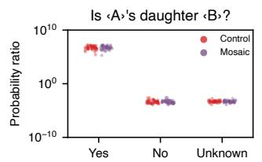

B  
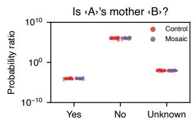

C  
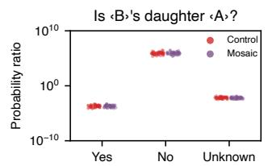

D  
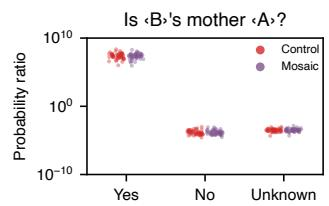  
FIG. S1. Exchanging externally supplied positional information does not appreciably change model responses. Data is shown for Gemma-3-27B. A–D, Responses to the queries indicated above each plot for control (red) and mosaic (purple) activation tensors. Probability ratios are defined as in the main text. Fifty trials are shown per condition.

This result may initially seem surprising: the manipulation appears to exchange the order of two tokens without appreciably changing the model’s responses. However, note that we exchange rows of A after the model has processed the context. Therefore, if during context processing the model assigns patterns of activity to the relevant entity tokens that track either their relational role or their original token position, those patterns of activity would travel with the corresponding rows and remain associated with the same entity names.

Those activity patterns could still reflect learned codes for global token positions. We therefore designed a second experiment to exchange these codes, if present, between the two entity representations by changing the token positions at which entity representations were computed. Specifically, we inserted space tokens before the relationship statements to record representations of entities at diferent absolute token positions. Table II gives an example of three prompts used to record source activation tensors on a particular trial. The middle $( + \Delta )$ prompt was used to record $\mathbf { A } _ { \mathrm { c o n t r o l } } ;$ ; this allowed us to obtain “Alice” and “Beth” representations from prompts where the names occurred later and earlier, respectively, than in the control prompt.

The ofsets were chosen so that “Alice” in the +2∆ prompt occurs at “Beth”’s position in the control prompt, and $\mathrm { \Delta ^ { 6 } b 6 t h } ^ { \mathrm { 7 } }$ in the +0 prompt occurs at “Alice”’s position in the control prompt. We constructed $\mathbf { A } _ { \mathrm { m o s a i c } }$ by replacing Alice’s row in $\mathbf { A } _ { \mathrm { c o n t r o l } }$ with the corresponding row from the +2∆ prompt, and Beth’s row with the corresponding row from the +0 prompt (Eq. (40)). In the example shown in Table II, the “Alice” representation in $\mathbf { A } _ { \mathrm { m o s a i c } }$ should carry the 134th positional embedding, and the “Beth” representation should carry the 131st positional embedding. In general, this manipulation should exchange any learned positional codes associated with the two entities while preserving information about their identities and relational roles. Under the hypothesis that the model reconstructs relationships from the token–position associations at query time, it should recover the reversed first relationship, “Beth has daughter Alice”. Instead, the model’s responses were largely unchanged (Fig. S2).

A  
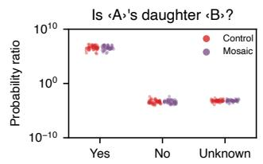

B  
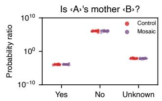

C  
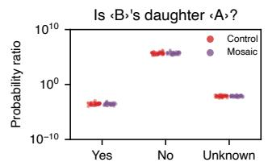

D  
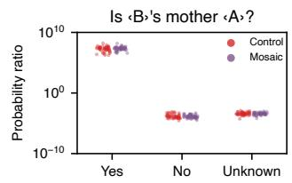  
FIG. S2. Exchanging any global positional codes carried by the activation tensor does not appreciably change model responses. Data is shown for Gemma-3-27B. A–D, Responses to the queries indicated above each plot for control (red) and mosaic (purple) activation tensors. Probability ratios are defined as in the main text. Fifty trials are shown per condition.

<table><tr><td>Token index</td><td>+0 prompt</td><td>+∆ prompt</td><td>+2∆ prompt</td></tr><tr><td></td><td></td><td></td><td></td></tr><tr><td></td><td></td><td></td><td></td></tr><tr><td></td><td></td><td></td><td></td></tr><tr><td>126</td><td>Context</td><td>Context</td><td>Context</td></tr><tr><td>127</td><td>:</td><td>:</td><td>:</td></tr><tr><td>128</td><td>Alice</td><td>U</td><td>U</td></tr><tr><td>129</td><td>has</td><td>U</td><td>U</td></tr><tr><td>130</td><td>daughter</td><td>U</td><td>U</td></tr><tr><td>131</td><td>Beth</td><td>Alice</td><td>U</td></tr><tr><td>132</td><td></td><td>has</td><td>U</td></tr><tr><td>133</td><td>Beth</td><td>daughter</td><td>U</td></tr><tr><td>134</td><td>has</td><td>Beth</td><td>Alice</td></tr><tr><td>135</td><td>daughter</td><td></td><td>has</td></tr><tr><td>136</td><td>Carol</td><td>Beth</td><td>daughter</td></tr><tr><td>137</td><td></td><td>has</td><td>Beth</td></tr><tr><td>138</td><td>\n\n</td><td>daughter</td><td></td></tr><tr><td></td><td></td><td></td><td></td></tr><tr><td>•</td><td></td><td></td><td>•</td></tr><tr><td></td><td>•</td><td>·</td><td></td></tr></table>

TABLE II. Example of prompts used to construct the global-position control. The three prompts contain identical relationship statements, preceded by 0, ∆, or 2∆ inserted space tokens, where $\Delta$ is the token distance between the first and second entities. The +∆ prompt serves as the control; the other two supply representations of ${ } ^ { 6 6 } \mathrm { A l i c e } ^ { 3 }$ and “Beth” recorded at the other’s absolute positions in the control prompt. The symbol $\sqcup$ denotes a space.

## V. EVIDENCE FOR PROSPECTIVE COMPOSITION OF RELATIONSHIPS

Recall that in the main text, we presented two hypotheses for the form of the representation of abstract relational structure in the activation tensor:

1. Graph-based representation. Observed relationships are represented as “edges” in A, then composed retrospectively when a query is asked.

2. Location-based representation. As relationships are encountered, models compose them prospectively to assign each entity a “location” in a shared coordinate system.

Recall further that the mosaic experiment presented in Fig. 4 and eqs. (28), (29) was designed to distinguish between these two hypotheses. As we argued in the main text, the former hypothesis predicts that $\mathbf { A } _ { \mathrm { m o s a i c } }$ supports the same responses to two-step queries as $\mathbf { A } _ { \mathrm { c o n t r o l } } ;$ the latter predicts that it supports the same responses as $\mathbf { A } _ { \mathrm { d o n o r } }$ . We found that responses typically matched those obtained from the control tensor (Fig. 4).

Here, we present an exception to this tendency. Figure S3 shows the models’ responses to four queries given a mosaic activation tensor constructed using the same procedure as in Fig. 4B, but with the donor and control contexts exchanged. An additional exception, obtained with Llama-3.1-70B using the original donor and control assignment, is shown in Fig. S104D.

A  
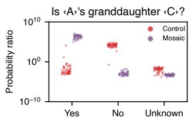

B  
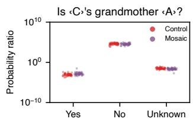

C  
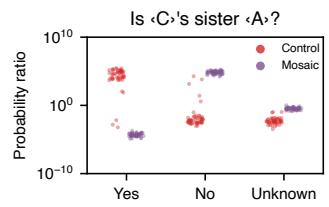

D  
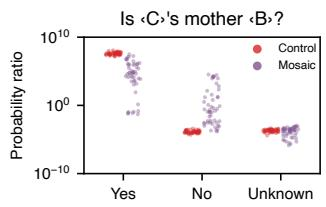  
FIG. S3. Evidence for a location-based representation in the family-tree setting. In all four panels, the donor context was $^ { 6 6 } \langle \mathrm { A } \rangle$ has daughter ⟨B⟩. ⟨B⟩ has daughter $\langle \mathrm { C } \rangle ^ { \mathfrak { N } }$ , the control context was $^ { 6 6 } \langle \mathrm { A } \rangle$ has mother ⟨B⟩. ⟨B⟩ has daughter $\langle \mathrm { C } \rangle ^ { \eta } ,$ and the mosaic was constructed as in main-text Fig. 4. Data is shown for Gemma-3-27B. A–D, Responses to the queries indicated above each plot for control (red) and mosaic (purple) activation tensors. Probability ratios are defined as in the main text. Fifty trials are shown per condition.

In panels S3A and S3C above, the model’s responses follow the two-hop relationship implied by the donor, rather than the control context. The entries of $\mathbf { A } _ { \mathrm { d o n o r } }$ that were transferred into $\mathbf { A } _ { \mathrm { c o n t r o l } }$ to construct $\mathbf { A } _ { \mathrm { m o s a i c } } \ ( \mathrm { i . e . }$ ., the rows of $\mathbf { A } _ { \mathrm { d o n o r } }$ corresponding to the “has daughter” and “Carol” tokens) must therefore supply some information beyond the relationship between “Beth” and “Carol” that is responsible for this change in behavior.

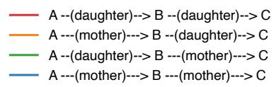

One possibility is that the transferred entries carry a copy of the “edge” between “Alice” and “Beth”. The results in panels S3A and S3C could then be explained if the model sometimes uses this copy—which in $\mathbf { A } _ { \mathrm { m o s a i c } }$ encodes the relationship between “Alice” and “Beth” in the donor context—when retrospectively composing relationships. However, this account does not readily explain the disrupted response to the one-hop relationship shared by the control and donor contexts (Fig. S3D).

A second possibility is that the transferred entries carry information reflecting the prospective composition of the two relationships in the donor context (i.e., the transferred entries carry the information “Carol is Alice’s granddaughter”). Such a “location-based” account naturally explains the observation in Fig. S3D: the location assigned to “Carol” in the donor context, combined with the location assigned to “Beth” in the control context, would no longer encode the relationship “Beth is Carol’s mother”.

Notably, when provided with the same mosaic tensor, the model’s responses to other queries follow the twohop relationship implied by the control context (Fig. S3B), as predicted by the graph-based hypothesis. Therefore, both location-based information (reflecting prospective composition of relationships) and graph-based information (requiring retrospective composition of relationships) may be available in the activation tensor. We do not yet understand what factors cause the model to rely on one type of information or the other at query time.

Consistent with this possibility, direct visualizations of A suggest that activity within some entries of A depends primarily on the most recent relationship, whereas activity at others depends on the full history of relationships. At each token position, the sequence of hidden vectors in A across successive layers traces a trajectory through activity space $\mathbb { R } ^ { D _ { \mathrm { m o d e l } } }$ . We visualized these trajectories by projecting them onto the first two principal components computed from hidden vectors collected across prompts at the model’s midpoint. We found that at the second relationship token (e.g., “daughter”), the trajectories depend on both relationships in the context (Fig. S4A). In contrast, at the final entity token (e.g., “Carol”), they appear to depend primarily on the most recently encountered relationship (Fig. S4B). This contrast is suggestive of the coexistence of graph-based and location-based information in the activation tensor.

A  
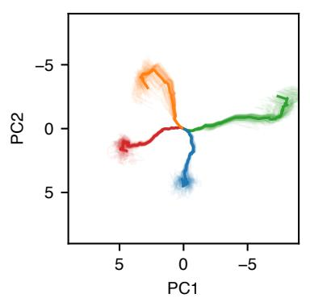

B  
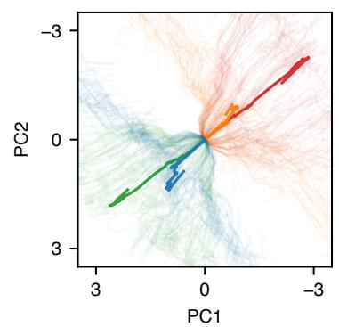  
FIG. S4. PCA visualizations of activation trajectories in the family-tree setting. Each trajectory follows the hidden vector at a fixed token position across successive layers. Trajectories were centered by subtracting the layer-wise mean across relational structures and name resamplings, then projected onto the first two principal components computed from population activity halfway through the model. Faint lines show individual trajectories; solid lines show averages over prompts with the same relational structure but diferent entity names. Visualizations are shown for Llama-3.1-70B; the corresponding Gemma-3-27B projections were harder to interpret, possibly because the activation norm grew more rapidly across layers. $\mathbf { A } ,$ Activations at the second relationship token. B, Activations at the final entity token.

The exceptions that we describe here are easiest to find in the family-tree setting. We also observed occasiona shifts from control-like toward donor-like responses in some transitive inference settings (not shown). However, these cases are harder to interpret because the models do not reliably answer “Unknown” when asked about a relationship that the control context leaves undetermined—for example, whether Alice is taller than Carol given “Alice is taller than Beth; Beth is shorter than Carol”.

## VI. IDENTIFYING NAME-TO-ROLE AND ROLE-TO-NAME PAIRS

In this section, we describe the iterative pruning procedure used to find candidate name–to–role and role–to–name key–value pairs. Briefly, we iteratively “erased” name-dependent information from keys and values by replacing them with their averages across prompts with resampled names. At each iteration, we used the gradient of a scalar measure of task performance to estimate the keys or values whose erasure would least afect the models’ behavior.

We represented the retained vectors using two binary masks, $m ^ { ( K ) } , m ^ { ( V ) } \in \{ 0 , 1 \} ^ { T _ { \mathrm { c o n t e x t } } \times N _ { \mathrm { l a y e r s } } \times N _ { \mathrm { h e a d s } } }$ . To facilitate diferentiation with respect to the mask entries, we expressed the replacement rule as a linear interpolation between control and average key–value memories, treating the mask entries as continuous variables:

$$
\begin{array} { r l } & { \quad ( \mathbf { K } _ { \mathrm { i n t e r p } } ) _ { t l i } = ( \mathbf { K } _ { \mathrm { a v e r a g e } } ) _ { t l i } + m _ { t l i } ^ { ( K ) } \big ( ( \mathbf { K } _ { \mathrm { c o n t r o l } } ) _ { t l i } - ( \mathbf { K } _ { \mathrm { a v e r a g e } } ) _ { t l i } \big ) , } \\ & { \quad \quad ( \mathbf { V } _ { \mathrm { i n t e r p } } ) _ { t l i } = ( \mathbf { V } _ { \mathrm { a v e r a g e } } ) _ { t l i } + m _ { t l i } ^ { ( V ) } \big ( ( \mathbf { V } _ { \mathrm { c o n t r o l } } ) _ { t l i } - ( \mathbf { V } _ { \mathrm { a v e r a g e } } ) _ { t l i } \big ) , } \\ & { \mathbf { M } _ { \mathrm { i n t e r p } } ( m ^ { ( K ) } , m ^ { ( V ) } ) = ( \mathbf { K } _ { \mathrm { i n t e r p } } , \mathbf { V } _ { \mathrm { i n t e r p } } ) . } \end{array}\tag{43}
$$

We measured task performance by computing the average diference between the correct answer logit and the mean logit of the other candidate answers over a predefined collection of queries:

$$
\mathrm { S c o r e } ( f ( \cdot ) ) = \frac { 1 } { N _ { \mathrm { q u e r i e s } } } \sum _ { Q \in \mathrm { Q u e r i e s } } \left( f _ { a ^ { * } ( Q ) } ( Q ) - \operatorname* { m e a n } _ { a \neq a ^ { * } ( Q ) } f _ { a } ( Q ) \right) .\tag{44}
$$

Here, $f _ { a } ( \mathcal { Q } )$ denotes the logit for answer $^ { a , }$ and $a ^ { * } ( \mathfrak { Q } )$ is the correct answer.

On each iteration, the marginal efect of pruning each remaining key or value was estimated by evaluating the derivative of the scalar score with respect to each entry of either mask:

$$
\begin{array} { r l } & { \frac { \partial } { \partial m _ { t l i } ^ { ( K ) } } \mathrm { S c o r e } \left( \boldsymbol { \Psi } \left( \cdot , \mathbf { M } _ { \mathrm { i n t e r p } } ( m ^ { ( K ) } , m ^ { ( V ) } ) \right) \right) , } \\ & { \frac { \partial } { \partial m _ { t l i } ^ { ( V ) } } \mathrm { S c o r e } \left( \boldsymbol { \Psi } \left( \cdot , \mathbf { M } _ { \mathrm { i n t e r p } } ( m ^ { ( K ) } , m ^ { ( V ) } ) \right) \right) . } \end{array}\tag{45}
$$

Note that derivatives with respect to each entry of $m ^ { ( K ) }$ and $m ^ { ( V ) }$ can be evaluated simultaneously in a single backward pass.

In practice, most key and value vectors could be erased with little efect on the score. We therefore began with a coarse schedule that erased a fixed fraction of the remaining vectors at each iteration. Once the score fell below a threshold, we rewound to an earlier point in the trajectory and continued erasing vectors one at a time, providing finer resolution around the decline in performance (Algorithm 1). Finally, in practice, we averaged the score over queries from several prompts with independently sampled entity names and used the gradient of this mean score to guide pruning.

Algorithm 1 Iterative erasure of key–value vectors   
Require: Initial keys-first mask m0; score S(m); coarse fraction η; threshold τ ; rewind factor $\rho$   
1: m ← m   
2: Sinitial ← S(m0); Serased ← S(0)   
3: while N(m) > 0 do ▷ Coarse erasure   
4: s ← S(m); g ← ∇mS(m)   
5: Set to zero the ⌈ηN(m)⌉ retained mask entries with the smallest |g|   
s − Serased   
6: if < τ then   
Sinitial − Serased   
7: Ntarget ← min(N(m0), ⌈ρN(m)⌉)   
8: Rewind to the most recent mask with at least $N _ { \mathrm { t a r g e t } }$ retained entries   
9: break   
10: end if   
11: end while   
12: while N(m) > 0 do ▷ Fine erasure   
13: g ← ∇mS(m)   
14: Set to zero the retained mask entry with the smallest |g|   
15: end while   
16: return the pruning trajectory, excluding steps undone by rewinding

Figure S5 shows the pruning trajectory and the distribution of retained keys and values for the sparse mask used in Fig. 5 of the main text. Several features of these results are of note:

1. Name-dependent information could be “erased” from the vast majority of key and value vectors with little efect on the score.

2. The score began to decline significantly when name information in roughly 200 keys or values remained, corresponding to approximately 1% of the total number of keys and values. Therefore, a small subset of sites was suficient to support retrieval. The subsequent decline in score was gradual, consistent with the relevant information being distributed across the retained sites.

3. The candidate name-to-role and role-to-name pairs were distributed across depth.12

4. Candidate name-to-role pairs were concentrated at entity-name tokens and the tokens immediately following them. This may reflect the copying of information from entity-token positions to subsequent positions by previous-token heads [12].

5. At some points along the pruning trajectory, both the retained set of keys and values and its complement could support retrieval when tested separately (data not shown). This suggests that the candidate key–value pairs we identified are suficient, but not necessary, for retrieval.

A  
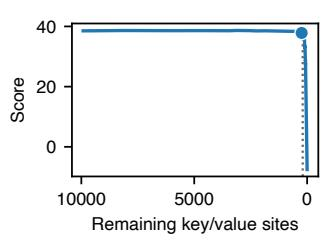

B  
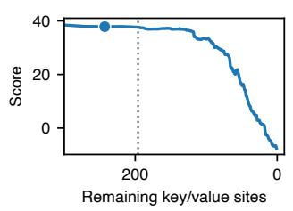

C  
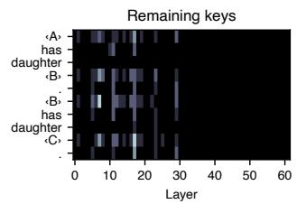

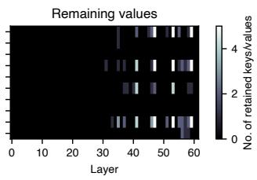  
FIG. S5. Iterative erasure of key and value vectors. Results are shown for Gemma-3-27B in the family-tree setting with “who is” queries. A, Full erasure trajectory. Scores were evaluated on the same prompts used to guide pruning. B, Expanded view of the trajectory. The vertical dashed line marks the transition to single-site erasure; the marker identifies the mask used for the main-text figure. C, Distribution of keys and values retained by the mask used for the main-text figure.

## VII. EFFECTS OF QUERY FORMAT

In the main text, we presented results using both yes-or-no queries (e.g., “Is Carol’s grandmother Alice?”) and queries requiring retrieval of a name (e.g., “Who is Carol’s grandmother?”).13,14 We later tested both query formats for each experiment and found that, in all cases, the results were consistent with the account developed in the main text. Here, we present selected experiments using the alternative query format, and describe how the results of the experiment change with the alternative format.

Figure S6 shows the results of the mosaic experiment in main-text Fig. 2 using queries that require the model to retrieve a name. Three aspects of these data deserve comment:

1. The query “Who is Eve’s mother?” cleanly diferentiates between the two hypotheses illustrated in the main text—under the attribute-tagging hypothesis, the model should respond “Daisy”; under the identity–structure binding hypothesis, it should respond “Alice”. The model responds “Alice” and assigns almost no additional probability to “Daisy” under the mosaic compared with the control (Fig. S6A).15

2. The model responds “Carol” to the question “Who is Eve’s daughter?” and remains capable of answering the two-hop questions “Who is Carol’s grandmother?” and “Who is Alice’s granddaughter?” (Fig. S6B, E, F). These observations parallel those in the main text that support the conclusion that the name-independent component of the activation tensor represents the complete relational structure instantiated by the prompt.

3. When asked about Alice’s daughter or Carol’s mother, the model splits probability mass between “Beth” and “Eve”. This is consistent with the schematic presented in the main text, where both “Beth” and “Eve” are bound to the same structural role.

A  
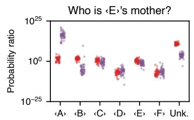

C  
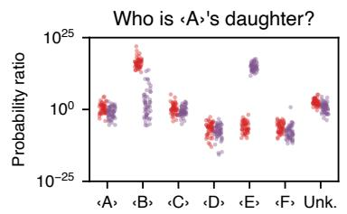

E  
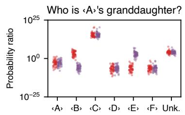

B  
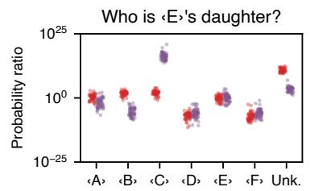

D  
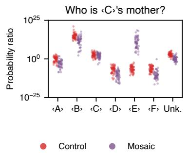

F  
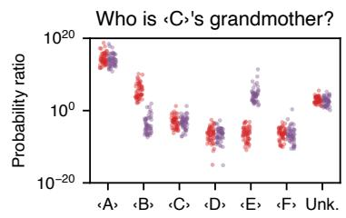  
FIG. S6. Results under the who-is query format are consistent with identity-structure separation. Responses are plotted for control (red) and mosaic (purple) activation tensors. The mosaic was constructed as in main-text Fig. 2. Results are shown for Gemma-3-27B in the family-tree setting. Probability ratios are defined as in the main text. Fifty trials are shown per condition, with entity names independently resampled on each trial. The labels ‹A›, ‹B›, and ‹C› denote the control names in order of first appearance; ‹D›, ‹E›, and ‹F› denote the corresponding donor names.

Figure S7 shows the results of the experiments involved in main text Fig. 5 using yes-or-no queries. We note that to answer a yes-or-no question (e.g., “Is Beth’s mother Alice?”), models can use at least two strategies. First, they can retrieve the information “Beth’s mother is Alice” using the mechanism we described in the main text, compare the retrieved name with the “Alice” in the query, then respond “yes”. Alternatively, they can retrieve the structural roles corresponding to “Alice” and “Beth”, compare them, and respond “yes”. Note that the second strategy does not require role-to-name pairs.

The following observations support the suficiency of the second strategy for answering yes-or-no questions:

1. We constructed an additional keys-only mosaic, which is similar to the keys-first mosaic, except that values after the layer split are also replaced with their averages across prompts with resampled names:

$$
\begin{array} { r l } & { ( \mathbf { K } _ { \mathrm { k e y s - o n l y } } ) _ { t l i } = \left\{ ( \mathbf { K } _ { \mathrm { c o n t r o l } } ) _ { t l i } , \quad l \leq L _ { \mathrm { s p l i t } } , \right. } \\ & { \left. ( \mathbf { K } _ { \mathrm { k e y s - o n l y } } ) _ { t l i } , \quad l > L _ { \mathrm { s p l i t } } , \right. } \\ & { \left. ( \mathbf { V } _ { \mathrm { k e y s - o n l y } } ) _ { t l i } = ( \mathbf { V } _ { \mathrm { a v e r a g e } } ) _ { t l i } . \right. } \end{array}\tag{46}
$$

This mosaic removes name-dependent information from all values, including those of candidate role-to-name pairs.16 We found that the model tolerated this manipulation with no major drop in performance (Fig. S7A).

2. When we applied the iterative pruning procedure starting from the keys-first mosaic, the resulting sparse mosaic retained name-dependent information in 143 keys and 16 values while largely preserving performance (Fig. S7B– E). The much smaller number of retained values is consistent with a greater reliance on name-to-role pairs for these queries.

3. We edited the key–value memory using a procedure analogous to that described in the main text. In Fig. S7F and G, we replaced the keys of candidate name-to-role pairs associated with the first entity with the corresponding donor keys. This intervention caused the model to answer yes to both “Is Beth’s mother Daisy?” and “Is Daisy’s daughter Beth?”. Thus, editing keys associated with an entity altered responses to yes-or-no queries in both directions.

A  
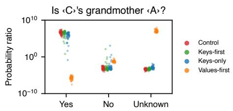

B  
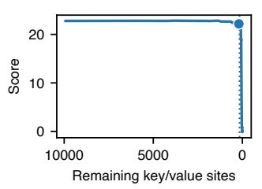

C  
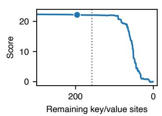

D  
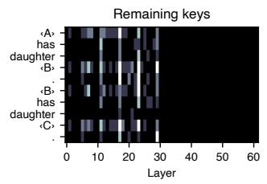

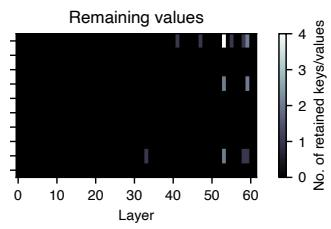

E  
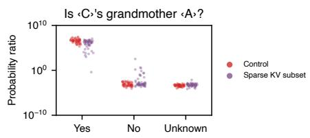

F  
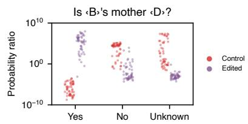

G  
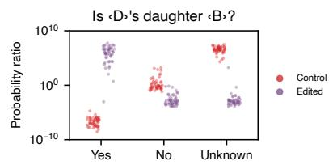  
FIG. S7. Retrieval under the yes-or-no query format involves a sparse set of name-to-role pairs. Results are shown for Gemma-3-27B in the family-tree setting. In all mosaic experiments, probability ratios are defined as in the main text and fifty trials are shown per condition. The labels $\langle \mathrm { A } \rangle ,$ ‹B›, and ‹C› denote the control names in order of first appearance, and ‹D› denotes the first donor name; these names are resampled on each trial. A, Restricting name-dependent information to keys before the layer split preserves performance. B, Full pruning trajectory starting from the keys-first mosaic. Scores were evaluated on the same prompts used to guide pruning. C, Expanded view of the trajectory. The vertical dashed line marks the transition to single-site pruning; the marker identifies the mask used in the subsequent panels. D, Distribution of the 143 keys and 16 values retained by this mask across token positions and layers. E, Performance is largely preserved when name-dependent information is restricted to the 143 keys and 16 values identified by iterative pruning. F,G, Editing candidate name-to-role pairs changes the model’s responses in both query directions.

## VIII. PROMPT TEMPLATES

In this section, we provide prompt templates for the fourteen relational reasoning tasks used in this study. The set of tasks was chosen to span four task families17: family trees (“family trees”, “family trees (name-retrieval queries)”, “ancestor–descendant relationships”); ordinal relationships (“company hierarchies”, “age comparisons”, “height comparisons”, “speed comparisons”, “east–west relationships”, “north–south relationships”, “ahead–behind relationships”, “exact age diferences”); signed interactions (“gene regulatory networks”, “neural circuits”); and equivalence (“propositional equivalence”, “variable equality”). In several of these task families, queries are most naturally phrased as yes-or-no questions, so we use this query format for all tasks and additionally include a name-retrieval format for the family-tree task.

## A. Family Trees

Instructions:

1) Read the context describing a series of relationships between people in a family.

2) Keep track of who is related to whom as you read.

3) You may assume that everyone who appears in the context is female.

4) At the end, answer the question. You may use:

(a) Information stated in the context.

(b) Any facts that follow from the context by valid logical inference.

5) If the statement is true, output 'Yes'.

6) If the statement is false, output 'No'.

7) If the context does not uniquely determine an answer, output 'Unknown'. Do not guess.

8) Output exactly one word (no punctuation or extra text).

Context: ‹Alice› has ‹daughter/mother› ‹Beth›. ‹Beth› has ‹daughter/mother› ‹Carol›.

Question: Is ‹Carol›'s ‹grandmother› ‹Alice›?

Answer:

## B. Family Trees (Name-Retrieval Queries)

Instructions:

1) Read the context describing a series of relationships between people in a family.

2) Keep track of who is related to whom as you read.

3) You may assume that everyone who appears in the context is female.

4) At the end, answer the question. You may use:

(a) Information stated in the context.

(b) Any facts that follow from the context by valid logical inference.

5) If the context does not uniquely determine an answer, output 'Unknown'. Do not guess.

6) Output exactly one word (no punctuation or extra text).

Context: ‹Alice› has ‹daughter/mother› ‹Beth›. ‹Beth› has ‹daughter/mother› ‹Carol›.

Question: Who is ‹Carol›'s ‹grandmother›?

Answer:

Instructions:   
1) Read the context describing a series of relationships between people in a family.   
2) Keep track of who is related to whom as you read.   
3) You may assume that everyone who appears in the context is female.   
4) At the end, answer the question. You may use:   
(a) Information stated in the context.   
(b) Any facts that follow from the context by valid logical inference.   
5) If the statement is true, output 'Yes'.   
6) If the statement is false, output 'No'.   
7) If the context does not uniquely determine an answer, output 'Unknown'. Do not guess.   
8) Output exactly one word (no punctuation or extra text).   
Context: ‹Alice› has ‹daughter/mother› ‹Beth›. ‹Beth› has ‹daughter/mother› ‹Carol›.   
Question: Is ‹Carol› ‹a descendant› of ‹Alice›?   
Answer:

## C. Ancestor–Descendant Relationships

## D. Company Hierarchies

Instructions:

1) Read the context describing the organizational structure in a company.

2) At the end, determine whether the statement in the question is true. You may use:

(a) Information stated in the context.

(b) Any facts that follow from the context by valid logical inference.

3) If the statement is true, output 'Yes'.

4) If the statement is false, output 'No'.

5) If the context does not uniquely determine an answer, output 'Unknown'. Do not guess.

6) Output exactly one word (no punctuation or extra text).

Context: ‹Alice›'s ‹boss/employee› is ‹Beth›. ‹Beth›'s ‹boss/employee› is ‹Carol›.

Question: Is ‹Carol› ‹senior› to ‹Alice›?

Answer:

## E. Age Comparisons

Instructions:

1) Read the context describing a series of comparisons between people.

2) At the end, determine whether the statement in the question is true. You may use:

(a) Information stated in the context.

(b) Any facts that follow from the context by valid logical inference.

3) If the statement is true, output 'Yes'.

4) If the statement is false, output 'No'.

5) If the context does not uniquely determine an answer, output 'Unknown'. Do not guess.

6) Output exactly one word (no punctuation or extra text).

Context: ‹Alice› is ‹older/younger› than ‹Beth›. ‹Beth› is ‹older/younger› than ‹Carol›.

Question: Is ‹Carol› ‹younger› than ‹Alice›?

Answer:

## F. Height Comparisons

Instructions:

1) Read the context describing a series of comparisons between people.

2) At the end, determine whether the statement in the question is true. You may use:

(a) Information stated in the context.

(b) Any facts that follow from the context by valid logical inference.

3) If the statement is true, output 'Yes'.

4) If the statement is false, output 'No'.

5) If the context does not uniquely determine an answer, output 'Unknown'. Do not guess.

6) Output exactly one word (no punctuation or extra text).

Context: ‹Alice› is ‹taller/shorter› than ‹Beth›. ‹Beth› is ‹taller/shorter› than ‹Carol›.

Question: Is ‹Carol› ‹shorter› than ‹Alice›?

Answer:

## G. Speed Comparisons

Instructions:

1) Read the context describing a series of comparisons between people.

2) At the end, determine whether the statement in the question is true. You may use:

(a) Information stated in the context.

(b) Any facts that follow from the context by valid logical inference.

3) If the statement is true, output 'Yes'.

4) If the statement is false, output 'No'.

5) If the context does not uniquely determine an answer, output 'Unknown'. Do not guess.

6) Output exactly one word (no punctuation or extra text).

Context: ‹Alice› is ‹faster/slower› than ‹Beth›. ‹Beth› is ‹faster/slower› than ‹Carol›.

Question: Is ‹Carol› ‹slower› than ‹Alice›?

Answer:

## H. East–West Relationships

Instructions:

1) Read the context describing a series of spatial relationships between locations.

2) At the end, determine whether the statement in the question is true. You may use:

(a) Information stated in the context.

(b) Any facts that follow from the context by valid logical inference.

3) If the statement is true, output 'Yes'.

4) If the statement is false, output 'No'.

5) If the context does not uniquely determine an answer, output 'Unknown'. Do not guess.

6) Output exactly one word (no punctuation or extra text).

Context: The ‹library› is ‹east/west› of the ‹museum›. The ‹museum› is ‹east/west› of the ‹station›.

Question: Is the ‹station› ‹west› of the ‹library›?

Answer:

## I. North–South Relationships

Instructions:

1) Read the context describing a series of spatial relationships between locations.

2) At the end, determine whether the statement in the question is true. You may use:

(a) Information stated in the context.

(b) Any facts that follow from the context by valid logical inference.

3) If the statement is true, output 'Yes'.

4) If the statement is false, output 'No'.

5) If the context does not uniquely determine an answer, output 'Unknown'. Do not guess.

6) Output exactly one word (no punctuation or extra text).

Context: The ‹library› is ‹north/south› of the ‹museum›. The ‹museum› is ‹north/south› of the ‹station›.

Question: Is the ‹station› ‹south› of the ‹library›?

Answer:

## J. Ahead–Behind Relationships18

Instructions:

1) Read the context describing a series of spatial relationships between locations.

2) At the end, determine whether the statement in the question is true. You may use:

(a) Information stated in the context.

(b) Any facts that follow from the context by valid logical inference.

3) If the statement is true, output 'Yes'.

4) If the statement is false, output 'No'.

5) If the context does not uniquely determine an answer, output 'Unknown'. Do not guess.

6) Output exactly one word (no punctuation or extra text).

Context: The ‹library› is ‹ahead/behind› of the ‹museum›. The ‹museum› is ‹ahead/behind› of the ‹station›.

Question: Is the ‹station› ‹behind› of the ‹library›?

Answer:

## K. Exact Age Diferences19

Instructions:

1) Read the context describing a series of comparisons between people.

2) At the end, determine whether the statement in the question is true. You may use:

(a) Information stated in the context.

(b) Any facts that follow from the context by valid logical inference.

3) If the statement is true, output 'Yes'.

4) If the statement is false, output 'No'.

5) If the context does not uniquely determine an answer, output 'Unknown'. Do not guess.

6) Output exactly one word (no punctuation or extra text).

Context: ‹Alice› is ‹one year older/one year younger› than ‹Beth›. ‹Beth› is ‹one year older/one year ,→ younger› than ‹Carol›.

Question: Is ‹Carol› ‹two years younger› than ‹Alice›?

Answer:

## L. Gene Regulatory Networks

Instructions:

1) Read the context describing a simple gene regulatory network.

2) For this task, genes are identified by three-letter strings.

3) At the end, determine whether the statement in the question is true. You may use:

(a) Information stated in the context.

(b) Any facts that follow from the context by valid logical inference.

4) If the statement is true, output 'Yes'.

5) If the statement is false, output 'No'.

6) If the context does not uniquely determine an answer, output 'Unknown'. Do not guess.

7) Output exactly one word (no punctuation or extra text).

Context: ‹axs› ‹activates/represses› ‹bpy›. ‹bpy› ‹activates/represses› ‹chh›.

Question: Does ‹axs› ‹repress› ‹chh›?

Answer:

## M. Neural Circuits

Instructions:

1) Read the context describing a simple vertebrate neural circuit.

2) For this task, neurons are identified by three-letter strings.

3) At the end, determine whether the statement in the question is true. You may use:

(a) Information stated in the context.

(b) Any facts that follow from the context by valid logical inference.

4) If the statement is true, output 'Yes'.

5) If the statement is false, output 'No'.

6) If the context does not uniquely determine an answer, output 'Unknown'. Do not guess.

7) Output exactly one word (no punctuation or extra text).

Context: ‹axs› makes ‹glutamatergic/GABAergic› projections to ‹bpy›. ‹bpy› makes ‹glutamatergic/GABAergic› ,→ projections to ‹chh›.

Question: Does ‹axs› ‹inhibit› ‹chh›?

Answer:

## N. Propositional Equivalence

Instructions:

1) Read the context describing a series of relationships between propositions.

2) For this task, propositions are numbered by a roman numeral.

3) At the end, determine whether the statement in the question is true. You may use:

(a) Information stated in the context.

(b) Any facts that follow from the context by valid logical inference.

4) If the statement is true, output 'Yes'.

5) If the statement is false, output 'No'.

6) If the context does not uniquely determine an answer, output 'Unknown'. Do not guess.

7) Output exactly one word (no punctuation or extra text).

Context: ‹I› is ‹equivalent to/incompatible with› ‹II›. ‹II› is ‹equivalent to/incompatible with› ‹III›.

Question: Is ‹III› ‹equivalent to› ‹I›?

Answer:

## O. Variable Equality

Instructions:

1) Read the context describing a series of relationships between variables.

2) For this task, variables are identified by a single letter.

3) At the end, determine whether the statement in the question is true. You may use:

(a) Information stated in the context.

(b) Any facts that follow from the context by valid logical inference.

4) If the statement is true, output 'Yes'.

5) If the statement is false, output 'No'.

6) If the context does not uniquely determine an answer, output 'Unknown'. Do not guess.

7) Output exactly one word (no punctuation or extra text).

Context: ‹x› is ‹equal/not equal› to ‹y›. ‹y› is ‹equal/not equal› to ‹z›.

Question: Is ‹z› ‹equal› to ‹x›?

Answer:

## IX. ANALOGOUS EXPERIMENTS ACROSS RELATIONAL REASONING TASKS

To assess the generality of the representational strategies we describe in the main text, we performed analogous experiments across various combinations of relational reasoning tasks (Section VIII) and models (Table I). Here, we present the results of these experiments for Gemma-3-27B on all relational reasoning tasks; in the next section, we present results for all models on the “family trees” task. The accompanying code can be used to generate analogous plots for model–task combinations not shown here.

Across models and tasks, the qualitative results were broadly similar to those presented in the main text, with the following notable exceptions:

1. Exceptions in settings with poor baseline task performance (e.g., Figs. S32E, S46B,D, and S81). When the model cannot reliably perform the underlying task, mosaic experiments may yield unexpected results. Because mosaic experiments use the models themselves to assess what information is available in the manipulated activation tensor, poor task performance makes these results dificult to interpret.

2. Exceptions in the additivity experiments (e.g., Figs. S42, S43, and S44). These exceptions were limited to the ordinal relationships task family. We speculate that they arise from redundant information in rows of A that follow entity-token rows. Such redundancy could arise if information from entity-token positions propagates to later positions (e.g., through previous-token heads [12]). Because the manipulation in Eq. (27) leaves these later rows unchanged, they may contain information that conflicts with the modified entity-token rows. Unexpected behavior could arise if the model retrieves information from both sets of rows at query time. Consistent with this idea, pruning experiments retain candidate name-to-role pairs at both entity-token positions and later positions (e.g., Fig. S70C).

3. Exceptions in the prospective–retrospective experiments (Fig. S104D). As discussed in Section V, such exceptions suggest that the activation tensor may contain information reflecting the prospective composition of relation ships.

4. Exceptions in the editing experiments (e.g., Figs. S68E, S69D, and S70D). We speculate that these exceptions arise from redundancy in the key–value memory. Specifically, the pruning procedure described in Section VI is designed to identify a set of key–value pairs for which retaining name-dependent information is suficient to mediate retrieval of all relationships. However, key–value pairs outside this subset may carry redundant information that influences behavior when the identified pairs are perturbed (see [14] for evidence of redundant mechanisms in another setting). If this is the case, editing only the key–value pairs identified by the pruning procedure could leave conflicting information in unedited pairs, potentially accounting for some of the unexpected responses.

## A. Behavior and generalization across tasks

A  
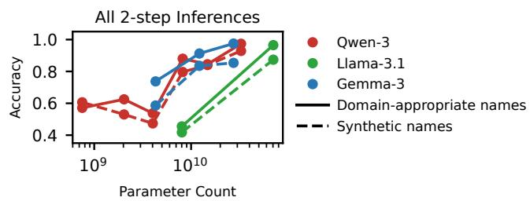

B  
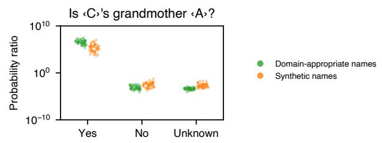  
FIG. S8. Behavior and generalization: family trees. A, Accuracy on a selected set of two-hop queries plotted against model parameter count for all models studied. B, Gemma-3-27B responses to the indicated query. The context is $^ { 6 6 } \langle \mathrm { A } \rangle$ has daughter ‹B›. ‹B› has daughter $\langle \mathrm { C } \rangle ^ { \mathfrak { n } } .$ . Responses are shown for both domain-appropriate (green) and synthetic (orange) names.

A  
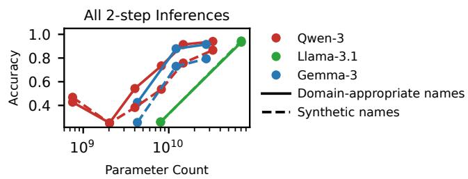

B  
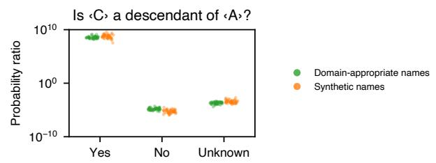  
FIG. S9. Behavior and generalization: ancestor–descendant relationships. A, Accuracy on a selected set of two-hop queries plotted against model parameter count for all models studied. B, Gemma-3-27B responses to the indicated query. The context is $^ { 6 6 } \langle \mathrm { A } \rangle$ has daughter ‹B›. ‹B› has daughter $\langle \mathrm { C } \rangle ^ { \mathfrak { s } }$ . Responses are shown for both domain-appropriate (green) and synthetic (orange) names.

A  

B  
  
FIG. S10. Behavior and generalization: company hierarchies. A, Accuracy on a selected set of two-hop queries plotted against model parameter count for all models studied. B, Gemma-3-27B responses to the indicated query. The context $\mathrm { i s } \ ^ { 6 6 } \langle \mathrm { A } \rangle _ { \mathrm { { s } } } ^ { \prime }$ boss is ‹B›. ‹B›’s boss is $\langle \mathrm { C } \rangle ^ { \mathfrak { s } }$ . Responses are shown for both domain-appropriate (green) and synthetic (orange) names.

A  

B  
  
FIG. S11. Behavior and generalization: age comparisons. A, Accuracy on a selected set of two-hop queries plotted against model parameter count for all models studied. B, Gemma-3-27B responses to the indicated query. The context is $^ { 6 6 } \langle \mathrm { A } \rangle$ is older than ‹B›. ‹B› is older than $\langle \mathrm { C } \rangle ^ { \mathfrak { n } } .$ . Responses are shown for both domain-appropriate (green) and synthetic (orange) names.

A  

B  
  
FIG. S12. Behavior and generalization: height comparisons. A, Accuracy on a selected set of two-hop queries plotted against model parameter count for all models studied. B, Gemma-3-27B responses to the indicated query. The context is $^ { 6 6 } \langle \mathrm { A } \rangle$ is taller than ‹B›. ‹B› is taller than $\langle \mathrm { C } \rangle ^ { 5 9 } .$ . Responses are shown for both domain-appropriate (green) and synthetic (orange) names.

A  

B  
  
FIG. S13. Behavior and generalization: speed comparisons. A, Accuracy on a selected set of two-hop queries plotted against model parameter count for all models studied. B, Gemma-3-27B responses to the indicated query. The context is $^ { 6 6 } \langle \mathrm { A } \rangle$ is faster than ‹B›. ‹B› is faster than $\langle \mathrm { C } \rangle ^ { \mathfrak { N } }$ . Responses are shown for both domain-appropriate (green) and synthetic (orange) names.

A  

B  
  
FIG. S14. Behavior and generalization: east–west relationships. A, Accuracy on a selected set of two-hop queries plotted against model parameter count for all models studied. B, Gemma-3-27B responses to the indicated query. The context is “The $\langle \mathrm { A } \rangle$ is east of the ‹B›. The ‹B› is east of the ‹C›”. Responses are shown for both domain-appropriate (green) and synthetic (orange) names.

A  

B  
  
FIG. S15. Behavior and generalization: north–south relationships. A, Accuracy on a selected set of two-hop queries plotted against model parameter count for all models studied. B, Gemma-3-27B responses to the indicated query. The context is “The ‹A› is north of the ‹B›. The ‹B› is north of the ‹C›”. Responses are shown for both domain-appropriate (green) and synthetic (orange) names.

A  

B  
  
FIG. S16. Behavior and generalization: ahead–behind relationships. A, Accuracy on a selected set of two-hop queries plotted against model parameter count for all models studied. B, Gemma-3-27B responses to the indicated query. The context is “The ‹A› is ahead of the ‹B›. The ‹B› is ahead of the ‹C›”. The wording “behind $\mathrm { o f } ^ { \prime \prime }$ is a grammatical error in the prompt template; the intended wording is “behind”. It is retained here to match the prompts presented to the model. Responses are shown for both domain-appropriate (green) and synthetic (orange) names.

A  

B  

FIG. S17. Behavior and generalization: exact age diferences. A, Accuracy on a selected set of two-hop queries plotted against model parameter count for all models studied. B, Gemma-3-27B responses to the indicated query. The context $\mathrm { i s } \ ^ { 6 6 } \langle \mathrm { A } \rangle$ is one year older than ‹B›. ‹B› is one year older than $\langle \mathrm { C } \rangle ^ { \mathfrak { s } }$ . Responses are shown for both domain-appropriate (green) and synthetic (orange) names.  
A  

B  
  
FIG. S18. Behavior: gene regulatory networks. A, Accuracy on a selected set of two-hop queries plotted against model parameter count for all models studied. B, Gemma-3-27B responses to the indicated query. The context is $^ { 6 6 } \langle \mathrm { A } \rangle$ activates $\langle \mathrm { B } \rangle .$ ‹B› activates $\langle \mathrm { C } \rangle ^ { 5 9 } .$ . For this setting, we did not compare domain-appropriate and synthetic names because we used synthetic names for the names of genes.

A  

B  
  
FIG. S19. Behavior: neural circuits. A, Accuracy on a selected set of two-hop queries plotted against model parameter count for all models studied. B, Gemma-3-27B responses to the indicated query. The context is $^ { 6 6 } \langle \mathrm { A } \rangle$ makes glutamatergic projections to ‹B›. ‹B› makes glutamatergic projections to $\langle \mathrm { C } \rangle ^ { \mathfrak { n } } .$ . For this setting, we did not compare domain-appropriate and synthetic names because we used synthetic names for the names of neurons.

A  

B  
  
FIG. S20. Behavior and generalization: propositional equivalence. A, Accuracy on a selected set of two-hop queries plotted against model parameter count for all models studied. B, Gemma-3-27B responses to the indicated query. The context is $^ { 6 6 } \langle \mathrm { A } \rangle$ is equivalent to ‹B›. ‹B› is equivalent to $\langle \mathrm { C } \rangle ^ { 5 9 } .$ . Responses are shown for both domain-appropriate (green) and synthetic (orange) names.

A  

B  
  
FIG. S21. Behavior and generalization: variable equality. A, Accuracy on a selected set of two-hop queries plotted against model parameter count for all models studied. B, Gemma-3-27B responses to the indicated query. The context is $^ { 6 6 } \langle \mathrm { A } \rangle$ is equal to ‹B›. ‹B› is equal to ‹C›”. Responses are shown for both domain-appropriate (green) and synthetic (orange) names.

## B. Identity–structure separability across tasks

A  

C  

E  

B  

D  

F  

FIG. S22. Identity–structure separability: family trees. Results are shown for Gemma-3-27B. The control context is $^ { 6 6 } \langle \mathrm { A } \rangle$ › has daughter ‹B›. ‹B› has daughter $\langle \mathrm { C } \rangle ^ { \mathfrak { N } } ;$ the donor context is $^ { 6 6 } \langle \mathrm { D } \rangle$ has daughter ‹E›. ‹E› has daughter $\langle \mathrm { F } \rangle ^ { \mathfrak { s } } .$ . The mosaic was constructed as in main-text Fig. 2.  
A  

C  

E  

B  

D  

F  
  
FIG. S23. Identity–structure separability: ancestor–descendant relationships. Results are shown for Gemma-3-27B. The control context is $^ { 6 6 } \langle \mathrm { A } \rangle$ has daughter ‹B›. ‹B› has daughter $\langle \mathrm { C } \rangle ^ { \mathfrak { N } } ;$ the donor context is $^ { 6 6 } \langle \mathrm { D } \rangle$ has daughter ‹E›. ‹E› has daughter $\langle \mathrm { F } \rangle ^ { \mathfrak { n } } .$ . The mosaic was constructed as in main-text Fig. 2.

A  

C  

  
B  
D

E  

F  

FIG. S24. Identity–structure separability: company hierarchies. Results are shown for Gemma-3-27B. The control context is $^ { 6 6 } \langle \mathrm { A } \rangle \mathrm { \bar { s } }$ boss is ‹B›. ‹B›’s boss is $\langle \mathrm { C } \rangle ^ { \mathfrak { N } } ;$ the donor context is $^ { 6 } \langle \mathrm { D } \rangle \mathrm { \dot { s } }$ boss is ‹E›. ‹E›’s boss is $\langle \mathrm { F } \rangle ^ { , \mathfrak { s } }$ . The mosaic was constructed as in main-text Fig. 2.  
A  

C  

E  

B  

D  

F  
  
FIG. S25. Identity–structure separability: age comparisons. Results are shown for Gemma-3-27B. The control context $\mathrm { i s } \ ^ { 6 6 } < \mathrm { A } >$ is older than ‹B›. ‹B› is older than $\langle \mathrm { C } \rangle ^ { \mathfrak { N } } ;$ the donor context is $^ { 6 6 } \langle \mathrm { D } \rangle$ › is older than $\langle \mathrm { E } \rangle$ . ‹E› is older than $\langle \mathrm { F } \rangle ^ { \mathfrak { n } } .$ . The mosaic was constructed as in main-text Fig. 2.

A  

C  
  
E

B  
  
D

F  

FIG. S26. Identity–structure separability: height comparisons. Results are shown for Gemma-3-27B. The contro context is $^ { 6 6 } \langle \mathrm { A } \rangle$ is taller than ‹B›. ‹B› is taller than $\langle \mathrm { C } \rangle ^ { \flat } ;$ the donor context is $^ { 6 6 } \langle \mathrm { D } \rangle$ is taller than ‹E›. ‹E› is taller than $\langle \mathrm { F } \rangle ^ { \mathfrak { n } } .$ The mosaic was constructed as in main-text Fig. 2.  
A  

C  

E  

B  

D  

F  
  
FIG. S27. Identity–structure separability: speed comparisons. Results are shown for Gemma-3-27B. The control context is “‹A› is faster than ‹B›. ‹B› is faster than $\langle \mathrm { C } \rangle ^ { \mathfrak { N } } ;$ the donor context is $^ { 6 6 } \langle \mathrm { D } \rangle$ › is faster than ‹E›. ‹E› is faster than $\langle \mathrm { F } \rangle ^ { \mathfrak { s } } .$ The mosaic was constructed as in main-text Fig. 2.

A  

C  
  
E  
D

B  

F  

FIG. S28. Identity–structure separability: east–west relationships. Results are shown for Gemma-3-27B. The control context is “The ‹A› is east of the ‹B›. The ‹B› is east of the $\langle \mathrm { C } \rangle ^ { \mathfrak { N } } ;$ the donor context is “The ‹D› is east of the ‹E›. The ‹E› is east of the ‹F›”. The mosaic was constructed as in main-text Fig. 2.  
A  

C  

E  

B  

D  

F  
  
FIG. S29. Identity–structure separability: north–south relationships. Results are shown for Gemma-3-27B. The control context is “The ‹A› is north of the ‹B›. The ‹B› is north of the $\langle \mathrm { C } \rangle ^ { \mathfrak { N } } ;$ the donor context is “The ‹D› is north of the ‹E›. The ‹E› is north of the $\langle \mathrm { F } \rangle ^ { \mathfrak { s } }$ . The mosaic was constructed as in main-text Fig. 2.

A  

C  
  
B  
D

E  

F  

FIG. S30. Identity–structure separability: ahead–behind relationships. Results are shown for Gemma-3-27B. The control context is “The ‹A› is ahead of the ‹B›. The ‹B› is ahead of the $\langle \mathrm { C } \rangle ^ { \mathfrak { N } } ;$ the donor context is “The ‹D› is ahead of the ‹E› The ‹E› is ahead of the $\langle \mathrm { F } \rangle ^ { , \mathfrak { s } }$ . The mosaic was constructed as in main-text Fig. 2. The wording ‘behind $\mathrm { o f } ^ { \prime }$ is a grammatical error in the prompt template; the intended wording is ‘behind’. It is retained here to match the prompts presented to the model.  
A  

C  

E  

B  

D  

F  
  
FIG. S31. Identity–structure separability: exact age diferences. Results are shown for Gemma-3-27B. The control context is $^ { 6 6 } \langle \mathrm { A } \rangle$ is one year older than ‹B›. ‹B› is one year older than $\langle \mathrm { C } \rangle ^ { \mathfrak { N } } ;$ the donor context is $^ { 6 6 } \langle \mathrm { D } \rangle$ is one year older than ‹E›. ‹E› is one year older than $\langle \mathrm { F } \rangle ^ { \mathfrak { n } } .$ . The mosaic was constructed as in main-text Fig. 2.

A  

C  

  
B  
D

E  

  
FIG. S32. Identity–structure separability: gene regulatory networks. Results are shown for Gemma-3-27B. The control context is $^ { 6 6 } \langle \mathrm { A } \rangle$ activates ‹B›. ‹B› activates $\langle \mathrm { C } \rangle ^ { \mathfrak { N } } ;$ the donor context is “‹D› activates ‹E›. ‹E› activates $\langle \mathrm { F } \rangle ^ { \mathfrak { s } } .$ The mosaic was constructed as in main-text Fig. 2.

A  

C  

E  

B  

D  
  
FIG. S33. Identity–structure separability: neural circuits. Results are shown for Gemma-3-27B. The control context $\mathrm { i s } \ ^ { 6 6 } \langle \mathrm { A } \rangle$ makes glutamatergic projections to ‹B›. ‹B› makes glutamatergic projections to $\langle \mathrm { C } \rangle ^ { \mathfrak { N } } ;$ the donor context is $^ { 6 6 } \langle \mathrm { D } \rangle$ makes glutamatergic projections to ‹E›. ‹E› makes glutamatergic projections to $\langle \mathrm { F } \rangle ^ { \mathfrak { s } } .$ The mosaic was constructed as in main-text Fig. 2.

A  
  
C

  
B  
D

E  

F  

FIG. S34. Identity–structure separability: propositional equivalence. Results are shown for Gemma-3-27B. The control context is $^ { 6 6 } \langle \mathrm { A } \rangle$ is equivalent to ‹B›. ‹B› is equivalent to $\langle \mathrm { C } \rangle ^ { \mathfrak { N } } ;$ the donor context is $^ { 6 6 } \langle \mathrm { D } \rangle$ is equivalent to ‹E›. ‹E› is equivalent to $\langle \mathrm { F } \rangle ^ { \mathfrak { s } }$ . The mosaic was constructed as in main-text Fig. 2.  
A  

C  

E  

B  

D  

F  
  
FIG. S35. Identity–structure separability: variable equality. Results are shown for Gemma-3-27B. The control context $\mathrm { i s } \ ^ { 6 6 } \langle \mathrm { A } \rangle$ is equal to ‹B›. ‹B› is equal to $\langle \mathrm { C } \rangle ^ { \mathfrak { N } } ;$ the donor context $\mathrm { i s } \ ^ { 6 6 } < \mathrm { D } \rangle$ is equal to ‹E›. ‹E› is equal to $\langle \mathrm { F } \rangle ^ { \mathfrak { n } } .$ The mosaic was constructed as in main-text Fig. 2.

C. Additivity of representations of identity and structure across tasks

A  

B  

C  

D  

FIG. S36. Additivity: family trees. Results are shown for Gemma-3-27B. The control context is $^ { 6 6 } \langle \mathrm { A } \rangle$ has daughter $\langle \mathrm { B } \rangle$ ‹B› has daughter $\langle \mathrm { C } \rangle ^ { \flat } ;$ the donor contexts are $^ { 6 6 } \langle \mathrm { D } \rangle$ has daughter ‹E›. ‹E› has daughter $\langle \mathrm { F } \rangle ^ { \mathfrak { s } }$ and $^ { 6 6 } \langle \mathrm { F } \rangle$ has daughter ‹E›. ‹E› has daughter $\left. \mathrm { D } \right. ^ { \mathfrak { n } } .$ . The mosaic was constructed as in main-text Fig. 3.  
A  

B  

C  

D  

FIG. S37. Additivity: ancestor–descendant relationships. Results are shown for Gemma-3-27B. The control context is $^ { 6 6 } \langle \mathrm { A } \rangle$ has daughter ‹B›. ‹B› has daughter $\langle \mathrm { C } \rangle ^ { \flat } ;$ the donor contexts $\mathrm { a r e } \ ^ { 6 6 } \langle \mathrm { D } \rangle$ has daughter ‹E›. ‹E› has daughter $\langle \mathrm { F } \rangle ^ { \mathfrak { s } }$ and $^ { 6 6 } \langle \mathrm { F } \rangle$ has daughter $\langle \mathrm { E } \rangle$ . ‹E› has daughter $\left. \mathrm { D } \right. ^ { \mathfrak { n } } .$ The mosaic was constructed as in main-text Fig. 3.  
A  

B  

C  

D  
  
FIG. S38. Additivity: company hierarchies. Results are shown for Gemma-3-27B. The control context is $^ { 6 6 } \langle \mathrm { A } \rangle \mathrm { \dot { s } }$ boss is ‹B›. ‹B›’s boss is $\langle \mathrm { C } \rangle ^ { \mathfrak { N } } ;$ the donor contexts are $^ { 6 6 } \langle D \rangle \mathrm { \bar { s } }$ boss is $\langle \mathrm { E } \rangle$ . ‹E›’s boss is $\langle \mathrm { F } \rangle ^ { \mathfrak { s } }$ and $^ { 6 6 } \langle \mathrm { F } \rangle \mathrm { \bar { s } }$ boss is ‹E›. $\langle \mathrm { E } \rangle \mathrm { \bar { s } }$ boss is $\left. \mathrm { D } \right. ^ { \mathfrak { n } } .$ The mosaic was constructed as in main-text Fig. 3.

A  

B  

C  

D  

FIG. S39. Additivity: age comparisons. Results are shown for Gemma-3-27B. The control context is $^ { 6 6 } \langle \mathrm { A } \rangle$ is older than ‹B›. ‹B› is older than $\langle \mathrm { C } \rangle ^ { \mathfrak { N } } ;$ the donor contexts are $^ { 6 6 } \langle \mathrm { D } \rangle$ is older than ‹E›. ‹E› is older than $\langle \mathrm { F } \rangle ^ { \mathfrak { s } }$ and $^ { 6 6 } \langle \mathrm { F } \rangle$ is older than ‹E›. ‹E› is older than $\langle \mathrm { D } \rangle ^ { \mathfrak { n } }$ . The mosaic was constructed as in main-text Fig. 3.  
A  

B  

C  

D  

FIG. S40. Additivity: height comparisons. Results are shown for Gemma-3-27B. The control context is $^ { 6 6 } \langle \mathrm { A } \rangle$ is taller than ‹B›. ‹B› is taller than $\langle \mathrm { C } \rangle ^ { \mathfrak { N } } ;$ the donor contexts are $^ { 6 6 } \langle \mathrm { D } \rangle$ is taller than ‹E›. ‹E› is taller than $\langle \mathrm { F } \rangle ^ { \mathfrak { s } }$ and $^ { 6 6 } \langle \mathrm { F } \rangle$ is taller than ‹E›. ‹E› is taller than $\left. \mathrm { D } \right. ^ { \mathfrak { n } } .$ The mosaic was constructed as in main-text Fig. 3.  
A  

B  

C  

D  
  
FIG. S41. Additivity: speed comparisons. Results are shown for Gemma-3-27B. The control context is $^ { 6 6 } \langle \mathrm { A } \rangle$ is faster than ‹B›. ‹B› is faster than $\langle \mathrm { C } \rangle ^ { \mathfrak { N } } ;$ the donor contexts are $^ { 6 6 } \langle \mathrm { D } \rangle$ is faster than ‹E›. ‹E› is faster than $\langle \mathrm { F } \rangle ^ { \mathfrak { s } }$ and $^ { 6 6 } \langle \mathrm { F } \rangle$ is faster than ‹E›. ‹E› is faster than $\left. \mathrm { D } \right. ^ { \mathfrak { n } } ,$ . The mosaic was constructed as in main-text Fig. 3.

A  

B  

C  

D  

FIG. S42. Additivity: east–west relationships. Results are shown for Gemma-3-27B. The control context is “The $\langle \mathrm { A } \rangle$ is east of the ‹B›. The ‹B› is east of the $\langle \mathrm { C } \rangle ^ { \flat } ;$ the donor contexts are “The ‹D› is east of the ‹E›. The ‹E› is east of the $\langle \mathrm { F } \rangle ^ { , \mathfrak { s } }$ and “The ‹F› is east of the ‹E›. The ‹E› is east of the $\left. \mathrm { D } \right. ^ { \mathfrak { n } } .$ . The mosaic was constructed as in main-text Fig. 3.  
A  

B  

C  

D  

FIG. S43. Additivity: north–south relationships. Results are shown for Gemma-3-27B. The control context is “The ‹A› is north of the ‹B›. The ‹B› is north of the $\langle \mathrm { C } \rangle ^ { \mathfrak { N } } ;$ the donor contexts are “The ‹D› is north of the ‹E›. The ‹E› is north of the $\langle \mathrm { F } \rangle ^ { , \mathfrak { s } }$ and “The ‹F› is north of the ‹E›. The ‹E› is north of the $\left. \mathrm { D } \right. ^ { \mathfrak { n } } .$ The mosaic was constructed as in main-text Fig. 3.  
A  

B  

C  

D  
  
FIG. S44. Additivity: ahead–behind relationships. Results are shown for Gemma-3-27B. The control context is $^ { \mathrm { \mathfrak { s o r } } } \mathrm { T h e }$ $\langle \mathrm { A } \rangle$ is ahead of the ‹B›. The ‹B› is ahead of the $\langle \mathrm { C } \rangle ^ { \mathfrak { N } } ;$ the donor contexts are “The ‹D› is ahead of the ‹E›. The ‹E› is ahead of the $\langle \mathrm { F } \rangle ^ { \mathfrak { s } }$ and “The ‹F› is ahead of the ‹E›. The ‹E› is ahead of the $\left. \mathrm { D } \right. ^ { \mathfrak { n } } ,$ . The mosaic was constructed as in main-text Fig. 3. The wording “behind $\mathrm { o f } ^ { \prime \prime }$ is a grammatical error in the prompt template; the intended wording is “behind”. It is retained here to match the prompts presented to the model.

A  

B  

C  

D  

FIG. S45. Additivity: exact age diferences. Results are shown for Gemma-3-27B. The control context is $^ { 6 6 } \langle \mathrm { A } \rangle$ is one year older than $\langle \mathrm { B } \rangle$ . ‹B› is one year older than $\langle \mathrm { C } \rangle ^ { \mathfrak { N } } ;$ the donor contexts are $^ { 6 6 } \langle \mathrm { D } \rangle$ is one year older than $\langle \mathrm { E } \rangle$ . ‹E› is one year older than $\langle \mathrm { F } \rangle ^ { , \mathfrak { s } }$ and $^ { 6 6 } \langle \mathrm { F } \rangle$ is one year older than ‹E›. ‹E› is one year older than $\left. \mathrm { D } \right. ^ { \mathfrak { n } } .$ . The mosaic was constructed as in main-text Fig. 3.  
A  

B  

C  

D  

FIG. S46. Additivity: gene regulatory networks. Results are shown for Gemma-3-27B. The control context is $^ { 6 6 } \langle \mathrm { A } \rangle$ activates ‹B›. ‹B› activates $\langle \mathrm { C } \rangle ^ { \mathfrak { N } } ;$ the donor contexts are $^ { 6 6 } \langle \mathrm { D } \rangle$ › activates ‹E›. ‹E› activates $\langle \mathrm { F } \rangle ^ { , \mathfrak { s } }$ and $^ { 6 6 } \langle \mathrm { F } \rangle$ activates ‹E›. ‹E› activates $\langle \mathrm { D } \rangle ^ { \mathfrak { n } }$ . The mosaic was constructed as in main-text Fig. 3.  
A  

B  

C  

D  
  
FIG. S47. Additivity: neural circuits. Results are shown for Gemma-3-27B. The control context is $^ { 6 6 } \langle \mathrm { A } \rangle$ makes glutamatergic projections to $\langle \mathrm { B } \rangle$ . ‹B› makes glutamatergic projections to $\langle \mathrm { C } \rangle ^ { \mathfrak { N } } ;$ the donor contexts are $^ { 6 6 } \langle \mathrm { D } \rangle$ makes glutamatergic projections to ‹E›. ‹E› makes glutamatergic projections to $\langle \mathrm { F } \rangle ^ { , \mathfrak { s } }$ and $^ { 6 6 } \langle \mathrm { F } \rangle$ makes glutamatergic projections to $\langle \mathrm { E } \rangle$ . ‹E› makes glutamatergic projections to $\left. \mathrm { D } \right. ^ { \mathfrak { n } } ,$ . The mosaic was constructed as in main-text $\mathrm { F i g . 3 } .$

FIG. S48. Additivity: propositional equivalence. Results are shown for Gemma-3-27B. The control context is $^ { 6 6 } \langle \mathrm { A } \rangle$ is equivalent to ‹B›. ‹B› is equivalent to $\langle \mathrm { C } \rangle ^ { \mathfrak { n } } ;$ the donor contexts $\mathrm { a r e } ^ { 6 6 } \langle \mathrm { D } \rangle$ is equivalent to ‹E›. ‹E› is equivalent to $\langle \mathrm { F } \rangle ^ { , \mathfrak { s } }$ and $^ { 6 6 } \langle \mathrm { F } \rangle$ is equivalent to $\langle \mathrm { E } \rangle$ . ‹E› is equivalent to $\langle \mathrm { D } \rangle ^ { \mathfrak { n } } .$ . The mosaic was constructed as in main-text Fig. 3. Because exchanging entities $^ { 6 6 } \langle \mathrm { A } \rangle ^ { , 3 }$ and $\mathrm { ^ { 6 6 } C O } ^ { 5 5 }$ leaves the equivalence relationships unchanged, these panels cannot distinguish whether the two entities have swapped roles. We nevertheless include them for completeness.  
A  
B  
  
FIG. S49. Additivity: variable equality. Results are shown for Gemma-3-27B. The control context is $^ { 6 6 } \langle \mathrm { A } \rangle$ is equal to $\langle \mathrm { B } \rangle .$ ‹B› is equal to $\langle \mathrm { C } \rangle ^ { \flat } ;$ the donor contexts are $^ { 6 6 } \langle \mathrm { D } \rangle$ is equal to ‹E›. ‹E› is equal to $\langle \mathrm { F } \rangle ^ { \mathfrak { s } }$ and $^ { 6 6 } \langle \mathrm { F } \rangle$ is equal to ‹E›. ‹E› is equal to $\left. \mathrm { D } \right. ^ { \mathfrak { n } } .$ . The mosaic was constructed as in main-text Fig. 3. Because exchanging entities $^ { 6 6 } < \mathrm { A } > ^ { 5 }$ and $^ { 6 6 } < C > ^ { 5 }$ leaves the equivalence relationships unchanged, these panels cannot distinguish whether the two entities have swapped roles. We nevertheless include them for completeness.

D. Retrospective and prospective information across tasks

A  

B  

C  

D  

FIG. S50. Retrospective and prospective information: family trees. Results are shown for Gemma-3-27B. The control context is $^ { 6 6 } \langle \mathrm { A } \rangle$ › has daughter ‹B›. ‹B› has daughter $\langle \mathrm { C } \rangle ^ { \mathfrak { N } } ;$ the donor context is $^ { 6 6 } \langle \mathrm { A } \rangle$ has mother ‹B›. ‹B› has daughter ‹C›”. The mosaic was constructed as in main-text Fig. 4.  
A  

B  

C  

D  

FIG. S51. Retrospective and prospective information: ancestor–descendant relationships. Results are shown for Gemma-3-27B. The control context is $^ { 6 6 } \langle \mathrm { A } \rangle$ has daughter ‹B›. ‹B› has daughter $\langle \mathrm { C } \rangle ^ { \mathfrak { N } } ;$ the donor context is $^ { 6 6 } \langle \mathrm { A } \rangle$ › has mother ‹B›. ‹B› has daughter $\langle \mathrm { C } \rangle ^ { \mathfrak { n } } .$ . The mosaic was constructed as in main-text Fig. 4.  
A  

B  

C  

D  
  
FIG. S52. Retrospective and prospective information: company hierarchies. Results are shown for Gemma-3-27B. The control context is $^ { 6 6 } \langle \mathrm { A } \rangle \mathrm { \bar { s } }$ boss is ‹B›. $\langle \mathrm { B } \rangle \mathrm { \bar { s } }$ boss is $\langle \mathrm { C } \rangle ^ { \mathfrak { N } } ;$ the donor context is $^ { 6 6 } \langle \mathrm { A } \rangle ^ { \prime }$ s employee is ‹B›. $\langle \mathrm { B } \rangle \mathrm { \bar { s } }$ boss is $\langle \mathrm { C } \rangle ^ { \mathfrak { s } }$ The mosaic was constructed as in main-text Fig. 4.

A  

B  

C  

D  

FIG. S53. Retrospective and prospective information: age comparisons. Results are shown for Gemma-3-27B. The control context $\mathrm { i s } \ ^ { 6 6 } < \mathrm { A } \rangle$ is older than ‹B›. ‹B› is older than $\langle \mathrm { C } \rangle ^ { \mathfrak { N } } ;$ the donor context is $^ { 6 6 } \langle \mathrm { A } \rangle$ is younger than ‹B›. ‹B› is older than $\langle \mathrm { C } \rangle ^ { \mathfrak { N } } .$ The mosaic was constructed as in main-text Fig. 4.  
A  

B  

C  

D  

FIG. S54. Retrospective and prospective information: height comparisons. Results are shown for Gemma-3-27B. The control context is $^ { 6 6 } \langle \mathrm { A } \rangle$ is taller than ‹B›. ‹B› is taller than $\langle \mathrm { C } \rangle ^ { \mathfrak { N } } ;$ the donor context is $^ { 6 6 } \langle \mathrm { A } \rangle$ is shorter than ‹B›. ‹B› is taller than $\langle \mathrm { C } \rangle ^ { \mathfrak { s } } .$ The mosaic was constructed as in main-text Fig. 4.  
A  

B  

C  

D  
  
FIG. S55. Retrospective and prospective information: speed comparisons. Results are shown for Gemma-3-27B. The control context is $^ { 6 6 } \langle \mathrm { A } \rangle$ is faster than ‹B›. ‹B› is faster than $\langle \mathrm { C } \rangle ^ { \mathfrak { N } } ;$ the donor context is $^ { 6 6 } \langle \mathrm { A } \rangle$ is slower than ‹B›. ‹B› is faster than $\langle \mathrm { C } \rangle ^ { \mathfrak { n } } .$ The mosaic was constructed as in main-text Fig. 4.

A  

B  

C  

D  

FIG. S56. Retrospective and prospective information: east–west relationships. Results are shown for Gemma-3-27B. The control context is “The ‹A› is east of the ‹B›. The ‹B› is east of the ‹C›”; the donor context is “The $\langle \mathrm { A } \rangle$ is west of the ‹B›. The ‹B› is east of the $\langle \mathrm { C } \rangle ^ { \mathfrak { n } } .$ The mosaic was constructed as in main-text Fig. 4.  
A  

B  

C  

D  

FIG. S57. Retrospective and prospective information: north–south relationships. Results are shown for Gemma-3- 27B. The control context is “The ‹A› is north of the ‹B›. The ‹B› is north of the $\langle \mathrm { C } \rangle ^ { \mathfrak { N } } ;$ the donor context is “The ‹A› is south of the ‹B›. The ‹B› is north of the $\langle \mathrm { C } \rangle ^ { \mathfrak { n } } .$ . The mosaic was constructed as in main-text Fig. 4.  
A  

B  

C  

D  
  
FIG. S58. Retrospective and prospective information: ahead–behind relationships. Results are shown for Gemma 3-27B. The control context is “The ‹A› is ahead of the ‹B›. The ‹B› is ahead of the $\langle \mathrm { C } \rangle ^ { \mathfrak { N } } ;$ the donor context is “The $\langle \mathrm { A } \rangle$ is behind of the ‹B›. The ‹B› is ahead of the $\langle \mathrm { C } \rangle ^ { \mathfrak { n } } .$ The mosaic was constructed as in main-text Fig. 4. The wording “behind $\mathrm { o f } ^ { \prime \prime }$ is a grammatical error in the prompt template; the intended wording is “behind”. It is retained here to match the prompts presented to the model.

A  

B  

C  

D  

FIG. S59. Retrospective and prospective information: exact age diferences. Results are shown for Gemma-3-27B. The control context is $^ { 6 6 } \langle \mathrm { A } \rangle$ is one year older than ‹B›. ‹B› is one year older than $\langle \mathrm { C } \rangle ^ { \mathfrak { N } } ;$ the donor context is $^ { 6 6 } \langle \mathrm { A } \rangle$ › is one year younger than ‹B›. ‹B› is one year older than $\langle \mathrm { C } \rangle ^ { \mathfrak { n } } .$ . The mosaic was constructed as in main-text Fig. 4.  
A  

B  

FIG. S60. Retrospective and prospective information: gene regulatory networks. Results are shown for Gemma-3-27B. The control context is $^ { 6 6 } \langle \mathrm { A } \rangle$ activates ‹B›. ‹B› activates $\langle \mathrm { C } \rangle ^ { \mathfrak { N } } ;$ the donor context is $^ { 6 6 } \langle \mathrm { A } \rangle$ represses ‹B›. ‹B› activates $\langle \mathrm { C } \rangle ^ { \mathfrak { N } }$ . The mosaic was constructed as in main-text Fig. 4.  
A  

B  
  
FIG. S61. Retrospective and prospective information: neural circuits. Results are shown for Gemma-3-27B. The control context is $^ { 6 6 } \langle \mathrm { A } \rangle$ makes glutamatergic projections to ‹B›. ‹B› makes glutamatergic projections to $\langle \mathrm { C } \rangle ^ { \flat } ;$ the donor context is $^ { 6 6 } \langle \mathrm { A } \rangle$ makes GABAergic projections to ‹B›. ‹B› makes glutamatergic projections to $\langle \mathrm { C } \rangle ^ { \mathfrak { s } } .$ The mosaic was constructed as in main-text Fig. 4.

A  

B  

FIG. S62. Retrospective and prospective information: propositional equivalence. Results are shown for Gemma-3- 27B. The control context is $^ { 6 6 } \langle \mathrm { A } \rangle$ is equivalent to ‹B›. ‹B› is equivalent to $\langle \mathrm { C } \rangle ^ { \mathfrak { N } } ;$ the donor context is $^ { 6 6 } \langle \mathrm { A } \rangle$ is incompatible with ‹B›. ‹B› is equivalent to $\langle \mathrm { C } \rangle ^ { \mathfrak { s } } .$ The mosaic was constructed as in main-text Fig. 4.  
A  

B  
  
FIG. S63. Retrospective and prospective information: variable equality. Results are shown for Gemma-3-27B. The control context is $^ { 6 6 } \langle \mathrm { A } \rangle$ is equal to $ { \langle \mathrm { B } \rangle }$ . ‹B› is equal to $\langle \mathrm { C } \rangle ^ { \mathfrak { N } } ;$ the donor context is $^ { 6 6 } \langle \mathrm { A } \rangle$ is not equal to ‹B›. ‹B› is equal to $\langle \mathrm { C } \rangle ^ { \mathfrak { s } } .$ The mosaic was constructed as in main-text Fig. 4.

## E. Key–value erasure and editing across tasks

A  
  
D  
B

C  

E  

  
FIG. S64. Key–value erasure and editing: family trees. Results are shown for Gemma-3-27B. Procedures follow main text Fig. 5. The control context is $^ { 6 6 } \langle \mathrm { A } \rangle$ has daughter ‹B›. ‹B› has daughter $\langle \mathrm { C } \rangle ^ { \mathfrak { N } } ;$ the donor context is $^ { 6 6 } \langle \mathrm { D } \rangle$ has daughter ‹E›. $\langle \mathrm { E } \rangle$ has daughter $\langle \mathrm { F } \rangle ^ { \mathfrak { s } } .$ A, Responses for the keys-first, keys-only, and values-first memories. B, Final portion of the pruning trajectory. C, Distribution of the 176 keys and 20 values retained by this mask, together comprising 0.99% of all key/value sites. D, E, Responses before and after replacing selected keys associated with the first entity in the control memory with the corresponding donor keys.

A  
  
B

C  
  
D

E  

  
FIG. S65. Key–value erasure and editing: company hierarchies. Results are shown for Gemma-3-27B. Procedures follow main-text Fig. 5. The control context is $^ { 6 6 } \langle \mathrm { A } \rangle \mathrm { \dot { s } }$ boss is ‹B›. $\langle \mathrm { B } \rangle \mathrm { \bar { s } }$ boss is $\langle \mathrm { C } \rangle ^ { \mathfrak { N } } ;$ the donor context is $^ { 6 } \langle \mathrm { D } \rangle \mathrm { \dot { s } }$ boss is ‹E›. ‹E›’s boss is $\langle \mathrm { F } \rangle ^ { \mathfrak { n } } .$ . A, Responses for the keys-first, keys-only, and values-first memories. B, Final portion of the pruning trajectory. C, Distribution of the 193 keys and 30 values retained by this mask, together comprising 0.80% of all key/value sites. D, E, Responses before and after replacing selected keys associated with the first entity in the control memory with the corresponding donor keys.

A  
  
B  
D

C  

E  
  
FIG. S66. Key–value erasure and editing: age comparisons. Results are shown for Gemma-3-27B. Procedures follow main-text Fig. 5. The control context is $^ { 6 6 } \langle \mathrm { A } \rangle$ is older than ‹B›. ‹B› is older than $\langle \mathrm { C } \rangle ^ { \mathfrak { N } } ;$ the donor context is $^ { 6 6 } \langle \mathrm { D } \rangle$ is older than ‹E›. ‹E› is older than ‹F›”. A, Responses for the keys-first, keys-only, and values-first memories. B, Final portion of the pruning trajectory. C, Distribution of the 833 keys and 112 values retained by this mask, together comprising 3.97% of all key/value sites. D, E, Responses before and after replacing selected keys associated with the first entity in the control memory with the corresponding donor keys.

A  
  
D  
B

C  

E  

  
FIG. S67. Key–value erasure and editing: height comparisons. Results are shown for Gemma-3-27B. Procedures follow main-text Fig. 5. The control context is $^ { 6 6 } \langle \mathrm { A } \rangle$ is taller than ‹B›. ‹B› is taller than $\langle \mathrm { C } \rangle ^ { \mathfrak { N } } ;$ the donor context is $^ { 6 6 } \langle \mathrm { D } \rangle$ is taller than ‹E›. ‹E› is taller than $\langle \mathrm { F } \rangle ^ { \mathfrak { s } } .$ . A, Responses for the keys-first, keys-only, and values-first memories. B, Final portion of the pruning trajectory. C, Distribution of the 1,034 keys and 263 values retained by this mask, together comprising 5.45% of all key/value sites. D, E, Responses before and after replacing selected keys associated with the first entity in the control memory with the corresponding donor keys.

A  
  
B  
D

C  

E  
  
FIG. S68. Key–value erasure and editing: speed comparisons. Results are shown for Gemma-3-27B. Procedures follow main-text Fig. 5. The control context is $^ { 6 6 } \langle \mathrm { A } \rangle$ is faster than ‹B›. ‹B› is faster than $\langle \mathrm { C } \rangle ^ { \mathfrak { N } } ;$ the donor context is $^ { 6 6 } \langle \mathrm { D } \rangle$ › is faster than ‹E›. ‹E› is faster than $\langle \mathrm { F } \rangle ^ { \mathfrak { n } } .$ . A, Responses for the keys-first, keys-only, and values-first memories. B, Final portion of the pruning trajectory. C, Distribution of the 307 keys and 29 values retained by this mask, together comprising 1.41% of all key/value sites. D, E, Responses before and after replacing selected keys associated with the first entity in the control memory with the corresponding donor keys.

A  
  
B

  
D

C  

E  

  
FIG. S69. Key–value erasure and editing: east–west relationships. Results are shown for Gemma-3-27B. Procedures follow main-text Fig. 5. The control context is “The ‹A› is east of the ‹B›. The ‹B› is east of the $\langle \mathrm { C } \rangle ^ { \mathfrak { N } } ;$ the donor context is “The ‹D› is east of the ‹E›. The ‹E› is east of the ‹F›”. A, Responses for the keys-first, keys-only, and values-first memories. B, Final portion of the pruning trajectory. C, Distribution of the 585 keys and 41 values retained by this mask, together comprising 2.10% of all key/value sites. D, E, Responses before and after replacing selected keys associated with the first entity in the control memory with the corresponding donor keys.

A  
  
B  
D

C  

E  
  
FIG. S70. Key–value erasure and editing: north–south relationships. Results are shown for Gemma-3-27B. Procedures follow main-text Fig. 5. The control context is “The ‹A› is north of the ‹B›. The ‹B› is north of the $\langle \mathrm { C } \rangle ^ { \mathfrak { N } } ;$ the donor context is “The ‹D› is north of the ‹E›. The ‹E› is north of the $\langle \mathrm { F } \rangle ^ { , \mathfrak { s } }$ . A, Responses for the keys-first, keys-only, and values-first memories. B, Final portion of the pruning trajectory. C, Distribution of the 485 keys and 21 values retained by this mask together comprising 1.70% of all key/value sites. D, E, Responses before and after replacing selected keys associated with the first entity in the control memory with the corresponding donor keys.

A  
  
D  
B

C  

E  

  
FIG. S71. Key–value erasure and editing: ahead–behind relationships. Results are shown for Gemma-3-27B. Proce dures follow main-text Fig. 5. The control context is “The ‹A› is ahead of the ‹B›. The ‹B› is ahead of the ‹C›”; the donor context is “The ‹D› is ahead of the ‹E›. The ‹E› is ahead of the $\langle \mathrm { F } \rangle ^ { \mathfrak { n } } .$ . A, Responses for the keys-first, keys-only, and values-first memories. B, Final portion of the pruning trajectory. C, Distribution of the 1104 keys and 79 values retained by this mask, together comprising 3.98% of all key/value sites. D, E, Responses before and after replacing selected keys associated with the first entity in the control memory with the corresponding donor keys. The wording “behind of” is a grammatical error in the prompt template; the intended wording is “behind”. It is retained here to match the prompts presented to the model.

A  
  
D  
B

C  

E  
  
FIG. S72. Key–value erasure and editing: ancestor–descendant relationships. Results are shown for Gemma-3-27B. Procedures follow main-text Fig. 5. The control context is $^ { 6 6 } \langle \mathrm { A } \rangle$ has daughter ‹B›. ‹B› has daughter $\langle \mathrm { C } \rangle ^ { \mathfrak { N } } ;$ the donor context is $^ { 6 6 } \langle \mathrm { D } \rangle$ has daughter ‹E›. ‹E› has daughter $\langle \mathrm { F } \rangle ^ { \mathfrak { s } } .$ . A, Responses for the keys-first, keys-only, and values-first memories. B, Final portion of the pruning trajectory. C, Distribution of the 188 keys and 30 values retained by this mask, together comprising 1.10% of all key/value sites. D, E, Responses before and after replacing selected keys associated with the first entity in the control memory with the corresponding donor keys.

A  
  
B  
D

C  

E  

  
FIG. S73. Key–value erasure and editing: exact age diferences. Results are shown for Gemma-3-27B. Procedures follow main-text Fig. 5. The control context is $^ { 6 6 } \langle \mathrm { A } \rangle$ is one year older than ‹B›. ‹B› is one year older than $\langle \mathrm { C } \rangle ^ { \mathfrak { N } } ;$ the donor context is $^ { 6 6 } \langle \mathrm { D } \rangle$ is one year older than ‹E›. ‹E› is one year older than ‹F›”. A, Responses for the keys-first, keys-only, and values-first memories. B, Final portion of the pruning trajectory. C, Distribution of the 449 keys and 91 values retained by this mask, together comprising 1.70% of all key/value sites. D, E, Responses before and after replacing selected keys associated with the first entity in the control memory with the corresponding donor keys.

A  
  
D  
B

C  
  
E

  
FIG. S74. Key–value erasure and editing: gene regulatory networks. Results are shown for Gemma-3-27B. Procedures follow main-text Fig. 5. The control context $\mathrm { i s } \ ^ { 6 6 } < \mathrm { A } >$ activates ‹B›. ‹B› activates $\langle \mathrm { C } \rangle ^ { \mathfrak { N } } ;$ the donor context is $^ { 6 6 } \langle \mathrm { D } \rangle$ activates $\langle \mathrm { E } \rangle$ . ‹E› activates $\langle \mathrm { F } \rangle ^ { , \mathfrak { s } }$ . A, Responses for the keys-first, keys-only, and values-first memories. B, Final portion of the pruning trajectory. C, Distribution of the 2,333 keys and 386 values retained by this mask, together comprising 11.42% of all key/value sites. D, E, Responses before and after replacing selected keys associated with the first entity in the control memory with the corresponding donor keys.

A  
  
D  
B

C  

E  

  
FIG. S75. Key–value erasure and editing: neural circuits. Results are shown for Gemma-3-27B. Procedures follow main-text Fig. 5. The control context is $^ { 6 6 } \langle \mathrm { A } \rangle$ makes glutamatergic projections to ‹B›. ‹B› makes glutamatergic projections to $\langle \mathrm { C } \rangle ^ { \mathfrak { N } } ;$ the donor context is $^ { 6 6 } \langle \mathrm { D } \rangle$ makes glutamatergic projections to ‹E›. ‹E› makes glutamatergic projections to $\langle \mathrm { F } \rangle ^ { \mathfrak { s } } .$ A, Responses for the keys-first, keys-only, and values-first memories. B, Final portion of the pruning trajectory. $\mathbf { C } ,$ Distribution of the 292 keys and 26 values retained by this mask, together comprising 0.73% of all key/value sites. D, E, Responses before and after replacing selected keys associated with the first entity in the control memory with the corresponding donor keys.

A  
  
D  
B

C  

E  

  
FIG. S76. Key–value erasure and editing: propositional equivalence. Results are shown for Gemma- $\mathrm { ^ { - 3 - 2 7 B } }$ . Procedures follow main-text Fig. 5. The control context is $^ { 6 6 } \langle \mathrm { A } \rangle$ is equivalent to ‹B›. ‹B› is equivalent to $\langle \mathrm { C } \rangle ^ { \mathfrak { N } } ;$ the donor context $\mathrm { i s } \ ^ { 6 6 } < \mathrm { D }$ › is equivalent to ‹E›. ‹E› is equivalent to $\langle \mathrm { F } \rangle ^ { \mathfrak { n } } .$ . A, Responses for the keys-first, keys-only, and values-first memories. $\mathbf { B } ,$ Final portion of the pruning trajectory. C, Distribution of the 381 keys and 24 values retained by this mask, together comprising 1.70% of all key/value sites. D, E, Responses before and after replacing selected keys associated with the first entity in the control memory with the corresponding donor keys.

A  
  
D  
B

C  

E  

  
FIG. S77. Key–value erasure and editing: variable equality. Results are shown for Gemma-3-27B. Procedures follow main-text Fig. 5. The control context is $^ { 6 6 } \langle \mathrm { A } \rangle$ is equal to ‹B›. ‹B› is equal to $\langle \mathrm { C } \rangle ^ { \mathfrak { N } } ;$ the donor context is $^ { 6 6 } \langle \mathrm { D } \rangle$ is equal to $\langle \mathrm { E } \rangle$ ‹E› is equal to ‹F›”. A, Responses for the keys-first, keys-only, and values-first memories. B, Final portion of the pruning trajectory. C, Distribution of the 275 keys and $3 2$ values retained by this mask, together comprising 1.11% of all key/value sites. D, E, Responses before and after replacing selected keys associated with the first entity in the control memory with the corresponding donor keys.

## X. ANALOGOUS EXPERIMENTS ACROSS MODEL FAMILIES AND SCALES

## A. Identity–structure separability across models

A  

C  

E  

B  

D  

F  

FIG. S78. Identity–structure separability: Gemma-3-4B. Results are shown for the “family-trees” setting. The control context is “‹A› has daughter ‹B›. ‹B› has daughter $\langle \mathrm { C } \rangle ^ { \mathfrak { N } } ;$ the donor context is $^ { 6 6 } \langle \mathrm { D } \rangle$ has daughter ‹E›. ‹E› has daughter $\langle \mathrm { F } \rangle ^ { \mathfrak { s } } .$ The mosaic was constructed as in main-text Fig. 2.  
A  

C  

E  

B  

D  

F  
  
FIG. S79. Identity–structure separability: Gemma-3-12B. Results are shown for the “family-trees” setting. The control context is $^ { 6 6 } \langle \mathrm { A } \rangle$ has daughter ‹B›. ‹B› has daughter $\langle \mathrm { C } \rangle ^ { \mathfrak { N } } ;$ the donor context is $^ { 6 6 } \langle \mathrm { D } \rangle$ › has daughter ‹E›. ‹E› has daughter $\langle \mathrm { F } \rangle ^ { \mathfrak { s } } .$ The mosaic was constructed as in main-text Fig. 2.

A  

C  
  
E

B  
  
D

F  

FIG. S80. Identity–structure separability: Gemma-3-27B. Results are shown for the “family-trees” setting. The control context is $^ { 6 6 } \langle \mathrm { A } \rangle$ has daughter ‹B›. ‹B› has daughter $\langle \mathrm { C } \rangle ^ { \flat } ;$ the donor context is $^ { 6 6 } \langle \mathrm { D } \rangle$ has daughter ‹E›. ‹E› has daughter $\langle \mathrm { F } \rangle ^ { \mathfrak { s } }$ The mosaic was constructed as in main-text Fig. 2.  
A  

C  

E  

B  

D  

F  
  
FIG. S81. Identity–structure separability: Llama-3.1-8B. Results are shown for the “family-trees” setting. The contro context is $^ { 6 6 } \langle \mathrm { A } \rangle$ › has daughter ‹B›. ‹B› has daughter $\langle \mathrm { C } \rangle ^ { \mathfrak { N } } ;$ the donor context is $^ { 6 6 } \langle \mathrm { D } \rangle$ › has daughter $\langle \mathrm { E } \rangle$ . ‹E› has daughter $\langle \mathrm { F } \rangle ^ { \mathfrak { s } } .$ The mosaic was constructed as in main-text Fig. 2.

A  

C  
  
E  
D

B  

F  

FIG. S82. Identity–structure separability: Llama-3.1-70B. Results are shown for the “family-trees” setting. The control context is $^ { 6 6 } \langle \mathrm { A } \rangle$ has daughter ‹B›. ‹B› has daughter $\langle \mathrm { C } \rangle ^ { \mathfrak { N } } ;$ the donor context is $^ { 6 6 } \langle \mathrm { D } \rangle$ › has daughter ‹E›. ‹E› has daughter $\langle \mathrm { F } \rangle ^ { \mathfrak { n } } .$ The mosaic was constructed as in main-text Fig. 2.  
A  

C  

E  

B  

D  

F  
  
FIG. S83. Identity–structure separability: Qwen-3-0.6B. Results are shown for the “family-trees” setting. The control context is $^ { 6 6 } \langle \mathrm { A } \rangle$ has daughter ‹B›. ‹B› has daughter $\langle \mathrm { C } \rangle ^ { \mathfrak { N } } ;$ the donor context is $^ { 6 6 } \langle \mathrm { D } \rangle$ › has daughter ‹E›. ‹E› has daughter $\therefore \mathrm { F } \rangle ^ { \mathfrak { s } } .$ The mosaic was constructed as in main-text Fig. 2.

A  

C  
  
E  
D

B  

F  

FIG. S84. Identity–structure separability: Qwen-3-1.7B. Results are shown for the “family-trees” setting. The control context is “‹A› has daughter ‹B›. ‹B› has daughter $\langle \mathrm { C } \rangle ^ { \mathfrak { N } } ;$ the donor context is $^ { 6 6 } \langle \mathrm { D } \rangle$ has daughter ‹E›. ‹E› has daughter $\langle \mathrm { F } \rangle ^ { \mathfrak { s } }$ The mosaic was constructed as in main-text Fig. 2.  
A  

C  

E  

B  

D  

F  
  
FIG. S85. Identity–structure separability: Qwen-3-4B. Results are shown for the “family-trees” setting. The contro context is $^ { 6 6 } \langle \mathrm { A } \rangle$ has daughter ‹B›. ‹B› has daughter $\langle \mathrm { C } \rangle ^ { \flat } ;$ the donor context is $^ { 6 6 } \langle \mathrm { D } \rangle$ has daughter ‹E›. ‹E› has daughter $\langle \mathrm { F } \rangle ^ { \mathfrak { n } } .$ The mosaic was constructed as in main-text Fig. 2.

A  

C  
  
E

B  
  
D

F  

FIG. S86. Identity–structure separability: Qwen-3-8B. Results are shown for the “family-trees” setting. The contro context is “‹A› has daughter ‹B›. ‹B› has daughter $\langle \mathrm { C } \rangle ^ { \mathfrak { N } } ;$ the donor context is $^ { 6 6 } \langle \mathrm { D } \rangle$ has daughter ‹E›. ‹E› has daughter $\langle \mathrm { F } \rangle ^ { \mathfrak { s } }$ The mosaic was constructed as in main-text Fig. 2.  
A  

C  

E  

B  

D  

F  
  
FIG. S87. Identity–structure separability: Qwen-3-14B. Results are shown for the “family-trees” setting. The contro context is $^ { 6 6 } \langle \mathrm { A } \rangle$ has daughter ‹B›. ‹B› has daughter $\langle \mathrm { C } \rangle ^ { \flat } ;$ the donor context is $^ { 6 6 } \langle \mathrm { D } \rangle$ has daughter ‹E›. ‹E› has daughter $\langle \mathrm { F } \rangle ^ { \mathfrak { n } } .$ The mosaic was constructed as in main-text Fig. 2.

A  

C  
  
B

E  

D  

F  
  
FIG. S88. Identity–structure separability: Qwen-3-32B. Results are shown for the “family-trees” setting. The control context is $^ { 6 6 } \langle \mathrm { A } \rangle$ has daughter ‹B›. ‹B› has daughter $\langle \mathrm { C } \rangle ^ { \mathfrak { N } } ;$ the donor context $\mathrm { i s } \ ^ { 6 6 } < \mathrm { D } \rangle$ has daughter ‹E›. ‹E› has daughter $\langle \mathrm { F } \rangle ^ { \mathfrak { n } } .$ The mosaic was constructed as in main-text Fig. 2.

B. Additivity of representations of identity and structure across models

A  

B  

C  

D  

FIG. S89. Additivity: Gemma-3-4B. Results are shown for the “family-trees” setting. The control context is $^ { 6 6 } \langle \mathrm { A } \rangle$ has daughter ‹B›. ‹B› has daughter $\langle \mathrm { C } \rangle ^ { \mathfrak { N } } ;$ the donor contexts are “‹D› has daughter ‹E›. ‹E› has daughter $\langle \mathrm { F } \rangle ^ { , \mathfrak { s } }$ and $^ { 6 6 } \langle \mathrm { F } \rangle$ has daughter ‹E›. ‹E› has daughter $\left. \mathrm { D } \right. ^ { \mathfrak { n } } .$ The mosaic was constructed as in main-text Fig. 3.  
A  

B  

C  
D  

FIG. S90. Additivity: Gemma-3-12B. Results are shown for the “family-trees” setting. The control context is $^ { 6 6 } \langle \mathrm { A } \rangle$ has daughter ‹B›. ‹B› has daughter $\langle \mathrm { C } \rangle ^ { \mathfrak { N } } ;$ the donor contexts $\mathrm { a r e } \ ^ { 6 6 } \langle \mathrm { D } \rangle$ has daughter ‹E›. ‹E› has daughter $\langle \mathrm { F } \rangle ^ { , \mathfrak { s } }$ and $^ { 6 6 } \langle \mathrm { F } \rangle$ has daughter ‹E›. ‹E› has daughter $\left. \mathrm { D } \right. ^ { \mathfrak { n } } .$ The mosaic was constructed as in main-text Fig. 3.  
A  

B  

C  

D  
  
FIG. S91. Additivity: Gemma-3-27B. Results are shown for the ${ } ^ { \mathrm { * } } \mathrm { f a m i l y - t r e e s } ^ { \mathrm { 3 } }$ setting. The control context is $^ { 6 6 } \langle \mathrm { A } \rangle$ has daughter $ { \langle \mathrm { B } \rangle }$ . ‹B› has daughter $\langle \mathrm { C } \rangle ^ { \mathfrak { N } } ;$ the donor contexts are $^ { 6 6 } \langle \mathrm { D } \rangle$ has daughter ‹E›. $\langle \mathrm { E } \rangle$ has daughter $\langle \mathrm { F } \rangle ^ { , \mathfrak { s } }$ and $^ { 6 6 } \langle \mathrm { F } \rangle$ has daughter $\langle \mathrm { E } \rangle$ . ‹E› has daughter $\left. \mathrm { D } \right. ^ { \mathfrak { n } } ,$ . The mosaic was constructed as in main-text Fig. 3.

A  

B  

C  

D  

FIG. S92. Additivity: Llama-3.1-8B. Results are shown for the “family-trees” setting. The control context is $^ { 6 6 } \langle \mathrm { A } \rangle$ has daughter ‹B›. ‹B› has daughter $\langle \mathrm { C } \rangle ^ { \mathfrak { N } } ;$ the donor contexts are “‹D› has daughter ‹E›. ‹E› has daughter $\langle \mathrm { F } \rangle ^ { , \mathfrak { s } }$ and $^ { 6 6 } \langle \mathrm { F } \rangle$ has daughter ‹E›. ‹E› has daughter $\left. \mathrm { D } \right. ^ { \mathfrak { n } } .$ The mosaic was constructed as in main-text Fig. 3.  
A  

B  

C  
D  

FIG. S93. Additivity: Llama-3.1-70B. Results are shown for the “family-trees” setting. The control context is $^ { 6 6 } \langle \mathrm { A } \rangle$ › has daughter ‹B›. ‹B› has daughter $\langle \mathrm { C } \rangle ^ { \mathfrak { N } } ;$ the donor contexts are $^ { 6 6 } \langle \mathrm { D } \rangle$ has daughter ‹E›. ‹E› has daughter $\langle \mathrm { F } \rangle ^ { , \mathfrak { s } }$ and $^ { 6 6 } \langle \mathrm { F } \rangle$ has daughter ‹E›. ‹E› has daughter ‹D›”. The mosaic was constructed as in main-text ${ \mathrm { F i g . ~ } } 3 .$  
A  

B  

C  

D  
  
FIG. S94. Additivity: Qwen-3-0.6B. Results are shown for the “family-trees” setting. The control context is $^ { 6 6 } \langle \mathrm { A } \rangle$ has daughter ‹B›. ‹B› has daughter $\langle \mathrm { C } \rangle ^ { \mathfrak { N } } ;$ the donor contexts are $^ { 6 6 } \langle \mathrm { D } \rangle$ has daughter ‹E›. ‹E› has daughter $\langle \mathrm { F } \rangle ^ { , \mathfrak { s } }$ and $^ { 6 6 } \langle \mathrm { F } \rangle$ has daughter ‹E›. ‹E› has daughter $\left. \mathrm { D } \right. ^ { \mathfrak { n } } .$ The mosaic was constructed as in main-text Fig. 3.

A  

B  

C  

D  

FIG. S95. Additivity: Qwen-3-1.7B. Results are shown for the “family-trees” setting. The control context is $^ { 6 6 } \langle \mathrm { A } \rangle$ has daughter ‹B›. ‹B› has daughter ‹C›”; the donor contexts are $^ { 6 6 } \langle \mathrm { D } \rangle$ has daughter ‹E›. ‹E› has daughter $\langle \mathrm { F } \rangle ^ { , \mathfrak { s } }$ and $^ { 6 6 } \langle \mathrm { F } \rangle$ has daughter ‹E›. ‹E› has daughter $\left. \mathrm { D } \right. ^ { \mathfrak { n } } .$ The mosaic was constructed as in main-text Fig. 3.  
A  

B  

C  
D  

FIG. S96. Additivity: Qwen-3-4B. Results are shown for the “family-trees” setting. The control context is $^ { 6 6 } \langle \mathrm { A } \rangle$ has daughter ‹B›. ‹B› has daughter $\langle \mathrm { C } \rangle ^ { \mathfrak { N } } ;$ ; the donor contexts are $^ { 6 6 } \langle \mathrm { D } \rangle$ has daughter ‹E›. ‹E› has daughter $\langle \mathrm { F } \rangle ^ { , \mathfrak { s } }$ and $^ { 6 6 } \langle \mathrm { F } \rangle$ has daughter ‹E›. ‹E› has daughter $\langle \mathrm { D } \rangle ^ { \mathfrak { n } } .$ The mosaic was constructed as in main-text Fig. 3.  
A  

B  

C  

D  
  
FIG. S97. Additivity: Qwen-3-8B. Results are shown for the “family-trees” setting. The control context is $^ { 6 6 } \langle \mathrm { A } \rangle$ has daughter ‹B›. ‹B› has daughter $\langle \mathrm { C } \rangle ^ { \mathfrak { N } } ;$ the donor contexts are $^ { 6 6 } \langle \mathrm { D } \rangle$ has daughter ‹E›. ‹E› has daughter $\langle \mathrm { F } \rangle ^ { , \mathfrak { s } }$ and $^ { 6 6 } \langle \mathrm { F } \rangle$ has daughter ‹E›. ‹E› has daughter $\left. \mathrm { D } \right. ^ { \mathfrak { n } } .$ The mosaic was constructed as in main-text Fig. 3.

A  

B  

C  

D  

FIG. S98. Additivity: Qwen-3-14B. Results are shown for the “family-trees” setting. The control context is $^ { 6 6 } \langle \mathrm { A } \rangle$ has daughter ‹B›. ‹B› has daughter $\langle \mathrm { C } \rangle ^ { \mathfrak { N } } ;$ the donor contexts are $^ { 6 6 } \langle \mathrm { D } \rangle$ has daughter ‹E›. ‹E› has daughter $\langle \mathrm { F } \rangle ^ { , \mathfrak { s } }$ and $^ { 6 6 } \langle \mathrm { F } \rangle$ has daughter ‹E›. ‹E› has daughter $\left. \mathrm { D } \right. ^ { \mathfrak { n } } .$ The mosaic was constructed as in main-text Fig. 3.  
A  

B  

C  

D  
  
FIG. S99. Additivity: Qwen-3-32B. Results are shown for the “family-trees” setting. The control context is $^ { 6 6 } \langle \mathrm { A } \rangle$ has daughter $ { \langle \mathrm { B } \rangle }$ . ‹B› has daughter $\langle \mathrm { C } \rangle ^ { \mathfrak { N } } ;$ ; the donor contexts are $^ { 6 6 } \langle \mathrm { D } \rangle$ has daughter ‹E›. ‹E› has daughter $\langle \mathrm { F } \rangle ^ { , \mathfrak { s } }$ and $^ { 6 6 } \langle \mathrm { F } \rangle$ has daughter ‹E›. ‹E› has daughter $\langle \mathrm { D } \rangle ^ { \mathfrak { n } } .$ The mosaic was constructed as in main-text Fig. 3.

C. Retrospective and prospective information across models

A  

B  

C  

D  

FIG. S100. Retrospective and prospective information: Gemma-3-4B. Results are shown for the “family-trees” setting. The control context is $^ { 6 6 } \langle \mathrm { A } \rangle$ has daughter ‹B›. ‹B› has daughter $\langle \mathrm { C } \rangle ^ { \flat } ;$ the donor context is $^ { 6 6 } \langle \mathrm { A } \rangle$ has mother ‹B›. ‹B› has daughter $\langle \mathrm { C } \rangle ^ { \mathfrak { s } }$ . The mosaic was constructed as in main-text Fig. 4.  
A  

B  

C  

D  

FIG. S101. Retrospective and prospective information: Gemma-3-12B. Results are shown for the “family-trees” setting. The control context is $^ { 6 6 } \langle \mathrm { A } \rangle$ has daughter ‹B›. ‹B› has daughter $\langle \mathrm { C } \rangle ^ { \flat } ;$ the donor context is $^ { 6 6 } \langle \mathrm { A } \rangle$ has mother $\langle \mathrm { B } \rangle$ . ‹B› has daughter $\langle \mathrm { C } \rangle ^ { \mathfrak { s } } .$ The mosaic was constructed as in main-text Fig. 4.  
A  

B  

C  

D  
  
FIG. S102. Retrospective and prospective information: Gemma-3-27B. Results are shown for the “family-trees” setting. The control context is $^ { 6 6 } \langle \mathrm { A } \rangle$ has daughter ‹B›. ‹B› has daughter $\langle \mathrm { C } \rangle ^ { \flat } ;$ the donor context is $^ { 6 6 } \langle \mathrm { A } \rangle$ has mother ‹B›. ‹B› has daughter $\langle \mathrm { C } \rangle ^ { \mathfrak { n } } .$ . The mosaic was constructed as in main-text Fig. 4.

A  

B  

C  

D  

FIG. S103. Retrospective and prospective information: Llama-3.1-8B. Results are shown for the “family-trees” setting. The control context is $^ { 6 6 } \langle \mathrm { A } \rangle$ has daughter ‹B›. ‹B› has daughter $\langle \mathrm { C } \rangle ^ { \flat } ;$ the donor context is $^ { 6 6 } \langle \mathrm { A } \rangle$ has mother ‹B›. ‹B› has daughter ‹C›”. The mosaic was constructed as in main-text Fig. 4.  
A  

B  

C  

D  

FIG. S104. Retrospective and prospective information: Llama-3.1-70B. Results are shown for the “family-trees” setting. The control context is “‹A› has daughter ‹B›. ‹B› has daughter $\langle \mathrm { C } \rangle ^ { \flat } ;$ the donor context is $^ { 6 6 } \langle \mathrm { A } \rangle$ has mother ‹B›. ‹B› has daughter $\langle \mathrm { C } \rangle ^ { \mathfrak { n } } .$ . The mosaic was constructed as in main-text Fig. 4.  
A  

B  

C  

D  
  
FIG. S105. Retrospective and prospective information: Qwen-3-0.6B. Results are shown for the “family-trees” setting. The control context is $^ { 6 6 } \langle \mathrm { A } \rangle$ › has daughter ‹B›. ‹B› has daughter ‹C›”; the donor context is $^ { 6 6 } \langle \mathrm { A } \rangle$ has mother ‹B›. ‹B› has daughter $\langle \mathrm { C } \rangle ^ { \mathfrak { s } } .$ The mosaic was constructed as in main-text Fig. 4.

A  

B  

C  

D  

FIG. S106. Retrospective and prospective information: Qwen-3-1.7B. Results are shown for the “family-trees” setting. The control context is $^ { 6 6 } \langle \mathrm { A } \rangle$ › has daughter ‹B›. ‹B› has daughter ‹C›”; the donor context is $^ { 6 6 } \langle \mathrm { A } \rangle$ has mother ‹B›. ‹B› has daughter $\langle \mathrm { C } \rangle ^ { \mathfrak { s } } .$ The mosaic was constructed as in main-text Fig. 4.  
A  

B  

C  

D  

FIG. S107. Retrospective and prospective information: Qwen-3-4B. Results are shown for the “family-trees” setting. The control context is $^ { 6 6 } \langle \mathrm { A } \rangle$ has daughter ‹B›. ‹B› has daughter $\langle \mathrm { C } \rangle ^ { \flat } ;$ the donor context is $^ { 6 6 } \langle \mathrm { A } \rangle$ has mother ‹B›. ‹B› has daughter $\langle \mathrm { C } \rangle ^ { \mathfrak { n } } .$ . The mosaic was constructed as in main-text Fig. 4.  
A  

B  

C  

D  
  
FIG. S108. Retrospective and prospective information: Qwen-3-8B. Results are shown for the “family-trees” setting. The control context is $^ { 6 6 } \langle \mathrm { A } \rangle$ has daughter ‹B›. ‹B› has daughter $\langle \mathrm { C } \rangle ^ { \flat } ;$ the donor context is $^ { 6 6 } \langle \mathrm { A } \rangle$ has mother ‹B›. ‹B› has daughter $\langle \mathrm { C } \rangle ^ { \mathfrak { n } } .$ . The mosaic was constructed as in main-text Fig. 4.

A  

B  

C  

D  

FIG. S109. Retrospective and prospective information: Qwen-3-14B. Results are shown for the “family-trees” setting. The control context is $^ { 6 6 } \langle \mathrm { A } \rangle$ has daughter ‹B›. ‹B› has daughter $\langle \mathrm { C } \rangle ^ { \flat } ;$ the donor context is $^ { 6 6 } \langle \mathrm { A } \rangle$ has mother ‹B›. ‹B› has daughter $\langle \mathrm { C } \rangle ^ { \mathfrak { s } } .$ The mosaic was constructed as in main-text Fig. 4.  
A  

B  

C  

D  
  
FIG. S110. Retrospective and prospective information: Qwen-3-32B. Results are shown for the “family-trees” setting. The control context is $^ { 6 6 } \langle \mathrm { A } \rangle$ has daughter ‹B›. ‹B› has daughter $\langle \mathrm { C } \rangle ^ { \flat } ;$ the donor context is $^ { 6 6 } \langle \mathrm { A } \rangle$ has mother ‹B›. ‹B› has daughter $\langle \mathrm { C } \rangle ^ { \mathfrak { s } }$ . The mosaic was constructed as in main-text Fig. 4.

D. Key–value erasure and editing across models

A  
  
D  
B

C  
  
E

  
FIG. S111. Key–value erasure and editing: Gemma-3-4B. Results are shown for the “family-trees” setting. Procedures follow main-text Fig. 5. The control context is $^ { 6 6 } \langle \mathrm { A } \rangle$ has daughter ‹B›. ‹B› has daughter $\langle \mathrm { C } \rangle ^ { \mathfrak { N } } ;$ the donor context $\mathrm { i s } \ ^ { 6 6 } < \mathrm { D } \rangle$ has daughter $\langle \mathrm { E } \rangle . \langle \mathrm { E } \rangle$ has daughter $\langle \mathrm { F } \rangle ^ { \mathfrak { s } } .$ . A, Responses for the keys-first, keys-only, and values-first memories. B, Final portion of the pruning trajectory. C, Distribution of the 47 keys and 1 value retained by this mask, together comprising 1.76% of all key/value sites. D, E, Responses before and after replacing selected keys associated with the first entity in the control memory with the corresponding donor keys.

A  
  
B

C  
  
D

E  
  
FIG. S112. Key–value erasure and editing: Gemma-3-12B. Results are shown for the “family-trees” setting. Procedures follow main-text Fig. 5. The control context is $^ { 6 6 } \langle \mathrm { A } \rangle$ has daughter ‹B›. ‹B› has daughter $\langle \mathrm { C } \rangle ^ { \mathfrak { N } } ;$ the donor context is $^ { 6 6 } \langle \mathrm { D } \rangle$ has daughter ‹E›. ‹E› has daughter $\langle \mathrm { F } \rangle ^ { \mathfrak { s } } .$ . A, Responses for the keys-first, keys-only, and values-first memories. B, Final portion of the pruning trajectory. $\mathbf { C } ,$ Distribution of the 92 keys and 10 values retained by this mask, together comprising 1.33% of al key/value sites. D, E, Responses before and after replacing selected keys associated with the first entity in the control memory with the corresponding donor keys.

A  
  
D  
B

C  
  
E

  
FIG. S113. Key–value erasure and editing: Gemma-3-27B. Results are shown for the “family-trees” setting. Procedures follow main-text Fig. 5. The control context is $^ { 6 6 } \langle \mathrm { A } \rangle$ has daughter ‹B›. ‹B› has daughter $\langle \mathrm { C } \rangle ^ { \mathfrak { N } } ;$ the donor context $\mathrm { i s } \ ^ { 6 6 } < \mathrm { D } \rangle$ has daughter ‹E›. ‹E› has daughter ‹F›”. A, Responses for the keys-first, keys-only, and values-first memories. B, Final portion of the pruning trajectory. C, Distribution of the 176 keys and 20 values retained by this mask, together comprising 0.99% of all key/value sites. D, E, Responses before and after replacing selected keys associated with the first entity in the control memory with the corresponding donor keys.

A  
  
B

  
D

C  

E  

  
FIG. S114. Key–value erasure and editing: Llama-3.1-8B. Results are shown for the “family-trees” setting. Procedures follow main-text Fig. 5. The control context is $^ { 6 6 } \langle \mathrm { A } \rangle$ has daughter ‹B›. ‹B› has daughter $\langle \mathrm { C } \rangle ^ { \mathfrak { N } } ;$ the donor context $\mathrm { i s } \ ^ { 6 6 } < \mathrm { D } \rangle$ has daughter ‹E›. ‹E› has daughter ‹F›”. A, Responses for the keys-first, keys-only, and values-first memories. B, Final portion of the pruning trajectory. C, Distribution of the 616 keys and 104 values retained by this mask, together comprising 14.06% of all key/value sites. D, E, Responses before and after replacing selected keys associated with the first entity in the contro memory with the corresponding donor keys.

A  
  
D  
B

C  

E  

  
FIG. S115. Key–value erasure and editing: Llama-3.1-70B. Results are shown for the “family-trees” setting. Procedures follow main-text Fig. 5. The control context is $^ { 6 6 } \langle \mathrm { A } \rangle$ has daughter ‹B›. ‹B› has daughter $\langle \mathrm { C } \rangle ^ { \mathfrak { N } } ;$ the donor context is $^ { 6 6 } \langle \mathrm { D } \rangle$ has daughter ‹E›. ‹E› has daughter ‹F›”. A, Responses for the keys-first, keys-only, and values-first memories. B, Final portion of the pruning trajectory. C, Distribution of the 104 keys and 9 values retained by this mask, together comprising 0.88% of al key/value sites. D, E, Responses before and after replacing selected keys associated with the first entity in the control memory with the corresponding donor keys.

A  
  
B  
D

C  

E  

  
FIG. S116. Key–value erasure and editing: Qwen-3-0.6B. Results are shown for the “family-trees” setting. Procedures follow main-text Fig. 5. The control context is $^ { 6 6 } \langle \mathrm { A } \rangle$ › has daughter ‹B›. ‹B› has daughter $\langle \mathrm { C } \rangle ^ { \mathfrak { N } } ;$ the donor context is “‹D› has daughter $\langle \mathrm { E } \rangle$ . ‹E› has daughter $\langle \mathrm { F } \rangle ^ { \mathfrak { s } } .$ . A, Responses for the keys-first, keys-only, and values-first memories. B, Final portion of the pruning trajectory. C, Distribution of the 194 keys and 1 value retained by this mask, together comprising 4.35% of all key/value sites. D, E, Responses before and after replacing selected keys associated with the first entity in the control memory with the corresponding donor keys.

A  
  
B  
D

C  

E  
  
FIG. S117. Key–value erasure and editing: Qwen-3-1.7B. Results are shown for the “family-trees” setting. Procedures follow main-text Fig. 5. The control context is $^ { 6 6 } \langle \mathrm { A } \rangle$ › has daughter ‹B›. ‹B› has daughter $\langle \mathrm { C } \rangle ^ { \mathfrak { N } } ;$ the donor context is $^ { 6 6 } \langle \mathrm { D } \rangle$ has daughter $\langle \mathrm { E } \rangle$ . ‹E› has daughter ‹F›”. A, Responses for the keys-first, keys-only, and values-first memories. B, Final portion of the pruning trajectory. C, Distribution of the 90 keys and 0 values retained by this mask, together comprising 2.01% of all key/value sites. D, E, Responses before and after replacing selected keys associated with the first entity in the control memory with the corresponding donor keys.

A  
  
D  
B

C  

E  

  
FIG. S118. Key–value erasure and editing: Qwen-3-4B. Results are shown for the “family-trees” setting. Procedures follow main-text Fig. 5. The control context is $^ { 6 6 } \langle \mathrm { A } \rangle$ has daughter ‹B›. ‹B› has daughter $\langle \mathrm { C } \rangle ^ { \mathfrak { N } } ;$ the donor context is $^ { 6 6 } \langle \mathrm { D } \rangle$ has daughter ‹E›. ‹E› has daughter $\langle \mathrm { F } \rangle ^ { \mathfrak { s } }$ . A, Responses for the keys-first, keys-only, and values-first memories. B, Final portion of the pruning trajectory. C, Distribution of the 456 keys and 21 values retained by this mask, together comprising 8.28% of all key/value sites. D, E, Responses before and after replacing selected keys associated with the first entity in the control memory with the corresponding donor keys.

A  
  
B  
D

C  

E  
  
FIG. S119. Key–value erasure and editing: Qwen-3-8B. Results are shown for the “family-trees” setting. Procedures follow main-text Fig. 5. The control context is $^ { 6 6 } \langle \mathrm { A } \rangle$ › has daughter ‹B›. ‹B› has daughter $\langle \mathrm { C } \rangle ^ { \mathfrak { N } } ;$ the donor context is $^ { 6 6 } \langle \mathrm { D } \rangle$ has daughter $\langle \mathrm { E } \rangle$ . ‹E› has daughter ‹F›”. A, Responses for the keys-first, keys-only, and values-first memories. B, Final portion of the pruning trajectory. C, Distribution of the 162 keys and 1 value retained by this mask, together comprising 2.83% of all key/value sites. D, E, Responses before and after replacing selected keys associated with the first entity in the control memory with the corresponding donor keys.

A  
  
D  
B

C  

E  

  
FIG. S120. Key–value erasure and editing: Qwen-3-14B. Results are shown for the “family-trees” setting. Procedures follow main-text Fig. 5. The control context is $^ { 6 6 } \langle \mathrm { A } \rangle$ has daughter ‹B›. ‹B› has daughter $\langle \mathrm { C } \rangle ^ { \mathfrak { N } } ;$ the donor context is $^ { 6 6 } \langle \mathrm { D } \rangle$ has daughter ‹E›. ‹E› has daughter $\langle \mathrm { F } \rangle ^ { \mathfrak { s } }$ . A, Responses for the keys-first, keys-only, and values-first memories. B, Final portion of the pruning trajectory. C, Distribution of the 237 keys and 15 values retained by this mask, together comprising 3.94% of al key/value sites. D, E, Responses before and after replacing selected keys associated with the first entity in the control memory with the corresponding donor keys.

A  
  
D  
B

C  

E  
FIG. S121. Key–value erasure and editing: Qwen-3-32B. Results are shown for the “family-trees” setting. Procedures follow main-text Fig. 5. The control context is $^ { 6 6 } \langle \mathrm { A } \rangle$ has daughter ‹B›. ‹B› has daughter $\langle \mathrm { C } \rangle ^ { \mathfrak { N } } ;$ the donor context $\mathrm { i s } \ ^ { 6 6 } < \mathrm { D } \rangle$ has daughter ‹E›. ‹E› has daughter ‹F›”. A, Responses for the keys-first, keys-only, and values-first memories. B, Final portion of the pruning trajectory. C, Distribution of the 183 keys and 30 values retained by this mask, together comprising 2.08% of all key/value sites. D, E, Responses before and after replacing selected keys associated with the first entity in the control memory with the corresponding donor keys.  

## REFERENCES

[1] A. Vaswani, N. Shazeer, N. Parmar, J. Uszkoreit, L. Jones, A. N. Gomez, Ł. Kaiser, and I. Polosukhin, in Advances in Neural Information Processing Systems, Vol. 30 (Curran Associates, Inc., 2017).

[2] S. J. Gershman, I. Fiete, and K. Irie, Neuron 113, 1694 (2025).

[3] Gemma Team, Gemma 3 technical report (2025), arXiv:2503.19786.

[4] A. Grattafiori, A. Dubey, A. Jauhri, et al., The Llama 3 herd of models (2024), arXiv:2407.21783.

[5] A. Yang, A. Li, B. Yang, et al., Qwen3 technical report (2025), arXiv:2505.09388.

[6] J. Su, M. Ahmed, Y. Lu, S. Pan, B. Wen, and Y. Liu, Neurocomputing 568, 127063 (2024).

[7] J. Ainslie, J. Lee-Thorp, M. de Jong, Y. Zemlyanskiy, F. Lebron, and S. Sanghai, in Proceedings of the 2023 Conference on Empirical Methods in Natural Language Processing (Association for Computational Linguistics, 2023) pp. 4895–4901.

[8] J. Feng and J. Steinhardt, in International Conference on Learning Representations (2024).

[9] K. A. Norman, S. M. Polyn, G. J. Detre, and J. V. Haxby, Trends in Cognitive Sciences 10, 424 (2006).

[10] L. Paninski, J. Pillow, and J. Lewi, in Computational Neuroscience: Theoretical Insights into Brain Function, Progress in Brain Research, Vol. 165, edited by P. Cisek, T. Drew, and J. F. Kalaska (Elsevier, 2007) pp. 493–507.

[11] J. Jarvik and D. Botstein, Proceedings of the National Academy of Sciences 70, 2046 (1973).

[12] C. Olsson, N. Elhage, N. Nanda, N. Joseph, N. DasSarma, T. Henighan, B. Mann, A. Askell, Y. Bai, A. Chen, T. Conerly, D. Drain, D. Ganguli, Z. Hatfield-Dodds, D. Hernandez, S. Johnston, A. Jones, J. Kernion, L. Lovitt, K. Ndousse, D. Amodei, T. Brown, J. Clark, J. Kaplan, S. McCandlish, and C. Olah, In-context learning and induction heads (2022), arXiv:2209.11895 [cs.LG].

[13] T. W. Webb, I. Sinha, and J. D. Cohen, in International Conference on Learning Representations (2021).

[14] K. R. Wang, A. Variengien, A. Conmy, B. Shlegeris, and J. Steinhardt, in The Eleventh International Conference on Learning Representations (2023).