# Correctness-Dependent Asymmetric Target Distributions for Self-Distillation Policy Optimization

Suwan Yoon1\*, Seongryong Jung2\*, Changhee Lee1†

1Korea University, Seoul, Korea, 2Chung-Ang University, Seoul, Korea {suwanyoon, changheelee}@korea.ac.kr jungsr1116@cau.ac.kr

## Abstract

Self-distillation policy optimization provides dense token-level supervision for LLM posttraining through feedback-conditioned selfteachers. However, directly matching the self-teacher can disrupt successful behaviors on correct rollouts while providing insufficient correction on incorrect ones. We propose Asymmetric Policy Optimization via Self-Distillation (APSD), which constructs correctness-dependent targets by mixing student and self-teacher distributions: interpolation preserves successful behaviors on correct rollouts, while extrapolation beyond the self-teacher strengthens correction on incorrect ones. We analyze APSD through divergence decomposition, reverse-KL barycentric geometry, and gradient analysis, highlighting the importance of gradient flow through studentdependent targets. Experiments under reinforcement learning with verifiable rewards and rich feedback show that APSD achieves strong overall performance against reinforcementlearning and self-distillation baselines and matches SDPO performance with 2.6× fewer training steps on average across Qwen3 model scales. Code is available here.

## 1 Introduction

Reinforcement learning with verifiable rewards (RLVR) has emerged as a prominent post-training paradigm for enhancing the reasoning and problemsolving capabilities of LLMs (Shao et al., 2024; Guo et al., 2025; Team et al., 2025). However, RLVR typically relies on scalar outcome-level rewards, providing limited, coarse-grained guidance for assigning credit to individual tokens in a generated response. To address this limitation, recent self-distillation approaches leverage privileged information to provide fine-grained, token-level supervision beyond scalar rewards (Ye et al., 2026;

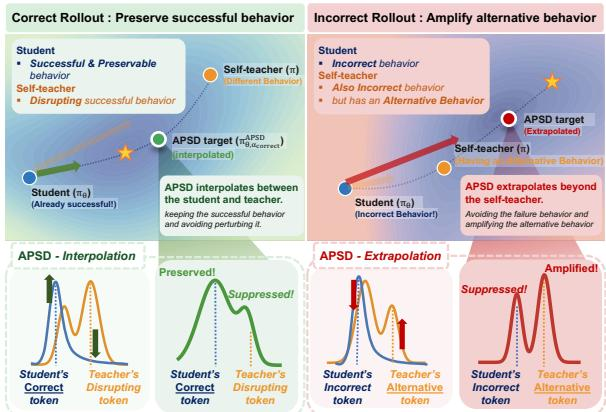  
Figure 1: Correctness-dependent target construction in APSD. Directly matching the self-teacher can disrupt successful behaviors in correct rollouts while providing insufficient correction for incorrect ones. APSD addresses this asymmetry by adapting the distillation target according to rollout correctness.

Shenfeld et al., 2026; Zhao et al., 2026; Hübotter et al., 2026; Song et al., 2026). This paradigm naturally extends to reinforcement learning with rich feedback (RLRF), where textual environment feedback provides additional learning signals beyond outcome rewards. These approaches construct a self-teacher by conditioning the same underlying policy on privileged information and distill its token-level distributions into the student policy.

Building on this paradigm, recent studies have incorporated rollout correctness into self-distillation to regulate teacher-guided supervision for successful and unsuccessful trajectories (Yang et al., 2026a; Li et al., 2026a; Kim et al., 2026). Meanwhile, research on knowledge distillation has explored alternative target distributions that combine teacher and student distributions to improve knowledge transfer (Ko et al., 2024; Shing et al., 2025; Shin et al., 2026; Yang et al., 2026b). Despite these advances, how rollout correctness should determine the construction of distillation targets relative to the student and self-teacher distributions remains largely underexplored.

To address this blind spot, we analyze the tokenlevel discrepancies between the student and its feedback-conditioned self-teacher across correct and incorrect rollouts. Our analysis reveals contrasting patterns: for correct rollouts, the self-teacher can substantially deviate from the student’s already successful token preferences, potentially disrupting desirable behaviors. For incorrect rollouts, however, the self-teacher can remain close to the student distribution, providing insufficient separation to correct failed behaviors effectively. These observations reveal a mismatch between the teacher–student discrepancy and the degree of correction required by the student, as conceptually illustrated in Figure 1. This motivates a correctnessaware strategy that preserves successful student behaviors while providing stronger and precise corrective guidance for unsuccessful ones.

To address this correctness-dependent asymmetry, we propose Asymmetric Policy Optimization via Self-Distillation (APSD), which constructs asymmetric distillation targets according to rollout correctness. Specifically, APSD constructs a target distribution by reweighting the student distribution using the teacher-to-student probability ratio, with a correctness-dependent coefficient controlling the relative influence of teacher- and student-preferred tokens. As illustrated in Figure 1, APSD interpolates between the student and self-teacher distributions for correct rollouts, incorporating teacher feedback while preserving the student’s successful token preferences. For incorrect rollouts, APSD instead extrapolates beyond the self-teacher distribution, shifting the target further away from the student and toward alternatives favored by the teacher.

Our theoretical analyses show that the APSD objective decomposes into a reverse-KL (RKL) term and a counterbalancing Rényi-divergence term, while the asymmetric coefficient controls target interpolation and extrapolation along a generalized RKL barycentric path. Crucially, we show that preserving gradient flow through the studentdependent target retains an additional coupling term, whereas fully detaching the target reduces each token-level gradient to a scaled SDPO gradient. Experiments across RLVR and RLRF demonstrate that APSD consistently outperforms state-ofthe-art reinforcement-learning and self-distillation baselines while improving training efficiency. Further controlled sampling experiments and ablation studies support the effectiveness of correctnessdependent target construction and highlight the importance of preserving gradient flow.

## 2 Related Work

Self-Distillation for LLM Post-Training. Selfdistillation has emerged as an effective approach to LLM post-training, where privileged self-teachers constructed from the same underlying policy provide fine-grained supervision using additional context or environment feedback (Ye et al., 2026; Shenfeld et al., 2026; Zhao et al., 2026; Hübotter et al., 2026; Song et al., 2026). In particular, SDPO (Hübotter et al., 2026) conditions the self-teacher on textual environment feedback, converting rich feedback into token-level supervision beyond scalar rewards. Subsequent work incorporates rollout rewards or correctness to regulate selfteacher supervision, highlighting the importance of distinguishing successful and failed rollouts (Yang et al., 2026a; Li et al., 2026a; Kim et al., 2026).

Distribution Mixing for Distillation. Standard knowledge distillation transfers knowledge from a teacher to a student by using the teacher’s output distribution as supervision (Hinton et al., 2015; Gu et al., 2024; Jung et al., 2025). Recent work has extended this paradigm by constructing alternative distillation targets from the student and teacher distributions to improve distillation effectiveness (Ko et al., 2024; Shing et al., 2025; Shin et al., 2026; Yang et al., 2026b). Similar ideas have been explored in self-distillation for LLM post-training by combining the student or reference policy with a privileged self-teacher (Xu et al., 2026; Li et al., 2026b).

Our Work. While prior work has explored correctness-aware supervision strategies and teacher–student distribution mixing, how rollout correctness should govern the direction and geometry of distillation target construction remains underexplored. APSD bridges this gap by using rollout correctness to determine whether the target interpolates between or extrapolates beyond the student and self-teacher distributions. In addition, APSD preserves gradient flow through its studentdependent target, preventing the APSD gradient from collapsing onto the SDPO update direction.

## 3 Correctness-Dependency in SDPO

Notations. Let x denote the input prompt and $\pi _ { \theta }$ denote the current student policy. Given $x ,$ we sample a group of $G$ rollouts from $\pi _ { \theta } ,$ denoted by $\{ y ^ { i } \} _ { i = 1 } ^ { G }$ . Each rollout is a token sequence $y ^ { i } = ( y _ { 1 } ^ { i } , \ldots , y _ { T } ^ { i } )$ , where $y _ { t } ^ { i }$ is the t-th token and $\boldsymbol y _ { < t } ^ { i }$ denotes the preceding prefix. Let $f ^ { i }$ denote the textual environment feedback associated with rollout $y ^ { i }$ for input x (e.g., a successful rollout from the same rollout group and a code execution error log). We use V to denote the vocabulary.

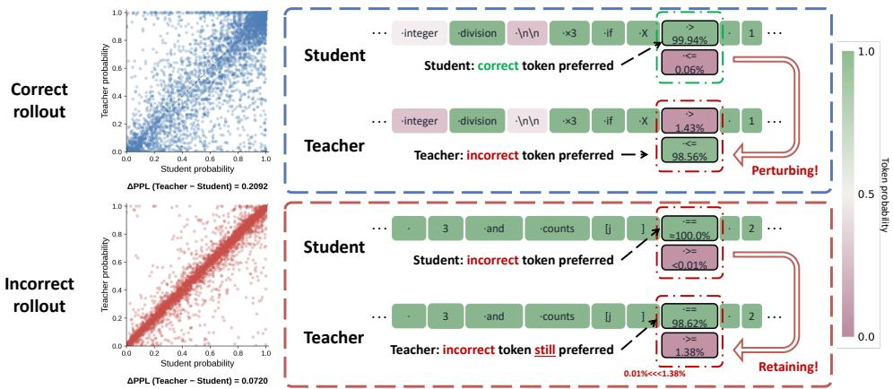  
Figure 2: Teacher–student discrepancy in SDPO on LiveCodeBench v6. The left panels show token-probability discrepancies for correct and incorrect rollouts, while the right panels provide representative examples of perturbing a correct choice and retaining an incorrect choice.

SDPO. For each rollout $y ^ { i }$ , the student distribution at decoding step t is denoted by $\pi _ { \theta } ( y _ { t } ^ { i } \mid x , y _ { < t } ^ { i } )$ SDPO constructs a corresponding self-teacher distribution by conditioning on the feedback $f ^ { i }$ as π $\cdot ( y _ { t } ^ { i } \mid x , y _ { < t } ^ { i } ) \ { \stackrel { \mathrm { d e f } } { = } } \ s g [ \pi _ { \theta } ( y _ { t } ^ { i } \mid x , f ^ { i } , y _ { < t } ^ { i } ) ]$ , where $s \mathsf { g } [ \cdot ]$ denotes the stop-gradient operator. For notational simplicity, we henceforth omit the conditioning variables and denote the student and selfteacher distributions by $\pi \theta$ and π, respectively.

Under this formulation, SDPO directly adopts the self-teacher distribution as the distillation target, i.e., $\pi _ { \mathrm { t a r g e t } } = \pi$ , and minimizes the reverse KL (RKL) divergence (Gu et al., 2024) between the student and target distributions:

$$
\mathcal { L } _ { \mathrm { S D P O } } ( \theta ) = \sum _ { t } D _ { \mathrm { K L } } \left( \pi _ { \theta } \| \pi _ { \mathrm { t a r g e t } } \right) ,\tag{1}
$$

where $\begin{array} { r } { D _ { \mathrm { K L } } ( p \| q ) = \sum _ { i } p ( i ) \frac { p ( i ) } { q ( i ) } } \end{array}$ . By conditioning the self-teacher on textual feedback $f ^ { i }$ , SDPO converts rich environmental feedback into fine-grained, token-level supervision. This provides a more informative learning signal than the trajectory-level reward, and has proven effective in settings with verifiable rewards and rich feedback.

Challenges. Although SDPO provides dense supervision by distilling toward a feedbackconditioned self-teacher, using the self-teacher distribution as a uniform target across rollouts may overlook an important distinction that the desired policy update should depend on rollout correctness. As illustrated in Figure 2, we observe two contrasting failure cases:

• Disrupting successful behaviors. For correct rollouts, the self-teacher may deviate from the student’s successful token preferences, potentially disrupting desirable behavior.

• Insufficient correction of failed behaviors. For incorrect rollouts, the self-teacher may remain close to the student’s erroneous preferences, providing insufficient guidance toward better alternatives.

These observations motivate an asymmetric adaptation of the distillation target based on rollout correctness. For correct rollouts, the target should remain closer to the student distribution, preserving successful behaviors while incorporating feedback from the self-teacher. For incorrect rollouts, the target should move beyond the self-teacher distribution away from the student, placing greater emphasis on alternatives relatively favored by the selfteacher. This interpolation–extrapolation mechanism allows the target to preserve successful behaviors while providing stronger corrective guidance for unsuccessful ones.1

## 4 Method: APSD

To operationalize this correctness-dependent asymmetry, we propose Asymmetric Policy Optimization via Self-Distillation (APSD). In this section, we describe how APSD constructs asymmetric distillation targets to preserve the student’s behavior on successful rollouts while providing stronger corrective guidance on failed ones. We then provide theoretical analyses to characterize this correctnessdependent behavior through divergence decomposition and gradient dynamics.

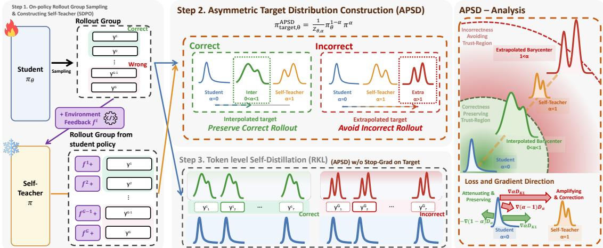  
Figure 3: Overview of APSD. Step 1: Sample on-policy rollout groups and construct the self-teacher. Step 2: Interpolate student–self-teacher targets for correct rollouts $( 0 < \alpha < 1 )$ and extrapolate beyond the self-teacher for incorrect rollouts $( \alpha > 1 )$ . Step 3: Token-level RKL self-distillation with gradients through the targets. Analysis: The right panel shows target geometry and gradient directions.

## 4.1 Constructing Asymmetric Target Distribution

For each rollout $y ^ { i }$ in a group $\{ y ^ { i } \} _ { i = 1 } ^ { G }$ sampled from the current student policy πθ given prompt x, we construct the self-distillation target $\mathcal { \bar { \pi } } _ { \theta , \alpha } ^ { \mathrm { A P S D } }$ by reweighting the student distribution according to the teacher-to-student probability ratio:

$$
\pi _ { \theta , \alpha } ^ { \mathrm { A P S D } } ( v ) \propto \pi _ { \theta } ( v ) \left( \frac { \pi ( v ) } { \pi _ { \theta } ( v ) } \right) ^ { \alpha } \ \mathrm { f o r } v \in \mathcal V .\tag{2}
$$

Here, $\alpha \in \mathbb { R } ^ { + }$ is a correctness-dependent scalar that controls the asymmetry of the target. The ratio $\pi ( v ) / \pi _ { \theta } ( v )$ serves as an importance weight, adjusting each token’s probability according to its relative preference under the self-teacher and student. As α increases, the target places greater emphasis on tokens favored by the self-teacher relative to the student and suppresses those for which the selfteacher assigns lower relative probability.

Normalizing Eq. (2), we express the APSD target as a generalized product-of-experts distribution over the student and self-teacher (Qiu et al., 2025):

$$
\pi _ { \theta , \alpha } ^ { \mathrm { A P S D } } ( v ) = \frac { 1 } { Z _ { \theta , \alpha } } \pi _ { \theta } ( v ) ^ { 1 - \alpha } \pi ( v ) ^ { \alpha } \ \mathrm { f o r } v \in \mathcal V ,\tag{3}
$$

where $\begin{array} { r } { Z _ { \theta , \alpha } = \sum _ { u \in \mathcal { V } } \pi _ { \theta } ( u ) ^ { 1 - \alpha } \pi ( u ) ^ { \alpha } } \end{array}$ is the normalizing constant. Here, α controls their relative contributions, inducing distinct target regimes:

• Interpolation $( 0 < \alpha < 1 )$ : The target lies between the student and self-teacher distributions, preserving the student’s preference while integrating feedback from the self-teacher.

• Extrapolation $( \alpha > 1 ) \colon$ The target extrapolates beyond the self-teacher distribution relative to the student, further amplifying tokens relatively favored by the self-teacher over the student.

As reference cases, $\alpha = 0$ recovers the student distribution, $\pi _ { \theta , 0 } ^ { \mathrm { A P S D } } = \pi _ { \theta }$ , while $\alpha = 1$ recovers the self-teacher distribution, $\pi _ { \theta , 1 } ^ { \mathrm { A P S D } } = \pi$

To address the correctness-dependent discrepancies identified in Section 3, we operationalize this asymmetric target by conditioning the choice of α according to rollout correctness:

$$
\pi _ { \mathrm { t a r g e t } , \theta } ^ { \mathrm { A P S D } } = \left\{ \begin{array} { l l } { \pi _ { \theta , \alpha _ { \mathrm { c o r r } } } ^ { \mathrm { A P S D } } , } & { \mathrm { i f ~ } y ^ { i } \mathrm { ~ i s ~ c o r r e c t } , } \\ { \pi _ { \theta , \alpha _ { \mathrm { i n c o r r } } } ^ { \mathrm { A P S D } } , } & { \mathrm { o t h e r w i s e } . } \end{array} \right.\tag{4}
$$

where $\alpha _ { \mathrm { c o r r } } ~ \in ~ ( 0 , 1 )$ and $\alpha _ { \mathrm { i n c o r r } } > 1$ . This correctness-dependent target allows APSD to preserve successful student behaviors on correct rollouts while providing stronger corrective guidance on incorrect ones. APSD then uses the SDPO distillation objective, replacing the self-teacher target with this correctness-dependent target:

$$
\mathcal { L } _ { \mathrm { A P S D } } ( \boldsymbol { \theta } ) = \sum _ { t } D _ { \mathrm { K L } } \left( \pi _ { \theta } \big | \big | \pi _ { \mathrm { t a r g e t } , \theta } ^ { \mathrm { A P S D } } \right) .\tag{5}
$$

Here, we maintain the dependence of $\pi _ { \theta , \alpha } ^ { \mathrm { A P S D } }$ on the current student $\pi _ { \theta }$ , allowing gradients to flow through the student-dependent target. This gradientpreserving formulation is essential to $\mathrm { \ A P S D ^ { \prime } s }$ asymmetric optimization behavior, which we analyze in Proposition 3.

## 4.2 Theoretical Analysis

In this subsection, we analyze APSD from three different perspectives: (i) decomposition of ${ \mathcal { L } } _ { \mathrm { A P S D } } ( \theta )$ , (ii) geometry of $\pi _ { \theta , \alpha } ^ { \mathrm { A P S D } }$ , and (iii) dynamics of $\nabla _ { \theta } \mathcal { L } _ { \mathrm { A P S D } } ( \theta )$ . Together, these analyses characterize how α shapes the optimization objective, determines the target’s position within the student– self-teacher RKL geometry, and influences gradient propagation through the student-dependent target.

Perspective 1: Loss Decomposition. To analyze how α shapes the APSD objective in Eq. (5), we first decompose the loss into RKL and Rényi divergence terms. The following proposition establishes this decomposition, making explicit how α governs their relative contributions.

Proposition 1 (α Balances RKL and Rényi Divergences) $F o r \pi _ { \theta , \alpha } ^ { \mathrm { A P S D } }$ in Eq. (4), the APSD loss in Eq. (5) can be decomposed as:

$$
\mathcal { L } _ { \mathrm { A P S D } } = \alpha D _ { \mathrm { K L } } ( \pi _ { \theta } \Vert \pi ) - ( 1 - \alpha ) D _ { \alpha } ( \pi \Vert \pi _ { \theta } ) ,\tag{6}
$$

where the latter term is the Rényi divergence of order α (Van Erven and Harremos, 2014):

$$
D _ { \alpha } ( \pi \| \pi _ { \theta } ) = \frac { 1 } { \alpha - 1 } \log \sum _ { v \in \mathcal { V } } \pi ( v ) \left( \frac { \pi ( v ) } { \pi _ { \theta } ( v ) } \right) ^ { \alpha - 1 } .
$$

Hence, α controls both the weight of the RKL term from SDPO in Eq. (1) and the sign and magnitude of the additional Rényi divergence term. See Appendix B.1 for proof.

Proposition 1 shows how the two terms contribute differently depending on rollout correctness. For correct rollouts, $\alpha _ { \mathrm { c o r r } } \in \left( 0 , 1 \right)$ , so the Rényi term has a negative coefficient in Eq. (6). In this regime, the factor $( \pi ( v ) / \pi _ { \theta } ( v ) ) ^ { \alpha _ { \mathrm { c o r r } } - 1 }$ places greater relative emphasis on tokens with low teacher-to-student probability ratios, i.e., tokens relatively favored by the student. The negatively weighted Rényi term thus counteracts the RKL pressure toward high-ratio regions, helping preserve successful student behavior from being overly displaced by teacher guidance.

In contrast, for incorrect rollouts, $\alpha _ { \mathrm { i n c o r r } } > 1$ the Rényi term in Eq. (6) has a positive coefficient. In this regime, the ratio-dependent factor increases with the teacher-to-student probability ratio, emphasizing regions favored by the self-teacher but under-covered by the student. Minimizing the positive Rényi term, together with the RKL term, encourages the student to shift probability mass toward these teacher-preferred alternatives, reducing their under-coverage in the student distribution.

Perspective 2: Target Position in RKL Geometry. To characterize the position of $\pi _ { \theta , \alpha } ^ { \mathrm { A P S D } }$ relative to the student and self-teacher, we examine its geometry using RKL divergence. The proposition shows that the APSD target is a generalized RKL barycenter connecting the two distributions.

Proposition 2 (α Governs the Target Position in RKL Geometry) For any $\alpha \in \mathbb { R } ^ { + }$ , the APSD target in Eq. (4) satisfies

$$
\pi _ { \boldsymbol { \theta } , \alpha } ^ { \mathrm { A P S D } } = \underset { r \in \Delta ( \mathcal { V } ) } { \operatorname { a r g m i n } } ( 1 - \alpha ) D _ { \mathrm { K L } } ( r \Vert \pi _ { \boldsymbol { \theta } } ) + \alpha D _ { \mathrm { K L } } ( r \Vert \pi ) ,
$$

where $\Delta ( \nu )$ is the probability simplex over the vocabulary V. Thus, α parameterizes the target along the generalized RKL barycentric path connecting πθ and π (Qiu et al., 2025).

Furthermore, when $\pi _ { \boldsymbol { \theta } } \neq \pi ,$ , the induced studentcentered trust-region radius (Schulman et al., 2015), defined as $\epsilon _ { \theta } ( \alpha ) = D _ { \mathrm { K L } } ( \pi _ { \theta , \alpha } ^ { \mathrm { A P S D } } | \pi _ { \theta } )$ , is strictly increasing in α for $\alpha > 0 .$ . That is, increasing α pushes the target distribution monotonically farther from the current student along this barycentric path. See Appendix B.2 for proof.

Proposition 2 provides a geometric interpretation of APSD’s correctness-dependent target construction. For correct rollouts, $\alpha _ { \mathrm { c o r r } } \in ( 0 , 1 )$ , both barycentric coefficients, $1 - \alpha _ { \mathrm { c o r r } } \ \mathrm { a n d } \ \alpha _ { \mathrm { c o r r } } ,$ are positive. The target therefore interpolates between the student and self-teacher distributions, preserving the student’s contribution while incorporating teacher feedback. Moreover, the monotonicity of $\epsilon _ { \theta } ( \alpha )$ ensures that the target remains closer to the student than the self-teacher does, i.e., $\epsilon _ { \theta } ( \alpha _ { \mathrm { c o r r } } ) <$ $D _ { \mathrm { K L } } ( \pi \parallel \pi _ { \theta } )$ . This helps preserve successful reasoning behaviors while allowing the student to incorporate feedback without excessive deviation from its current policy.

In contrast, for incorrect rollouts, $\alpha _ { \mathrm { i n c o r r } } > 1$ the student coefficient becomes negative, while the self-teacher coefficient is greater than one. The target thus extrapolates beyond the self-teacher along the generalized RKL barycentric path, moving farther from the student. Correspondingly, its studentcentered KL divergence exceeds that of the selfteacher, i.e., $\epsilon _ { \theta } ( \alpha _ { \mathrm { i n c o r r } } ) ~ > ~ D _ { \mathrm { K L } } ( \pi ~ \parallel ~ \pi _ { \theta } )$ . This allows a larger divergence from the current policy, enabling stronger corrective updates to move the student away from unsuccessful behaviors.

<table><tr><td>Methods</td><td>Chemistry</td><td>Physics</td><td>Biology</td><td>Materials</td><td>Tool use</td><td>Average</td></tr><tr><td>Olmo3-7B-Instruct</td><td>24.02</td><td>38.20</td><td>16.13</td><td>33.91</td><td>38.88</td><td>30.23</td></tr><tr><td>+ GRPO (off-policy)</td><td>59.70</td><td>62.81</td><td>54.75</td><td>78.52</td><td>64.34</td><td>64.03</td></tr><tr><td>+ GRPO</td><td>60.15</td><td>67.50</td><td>54.38</td><td>73.60</td><td>61.31</td><td>63.39</td></tr><tr><td>+ SDPO</td><td>80.51</td><td>72.34</td><td>52.00</td><td>77.59</td><td>62.68</td><td>69.03</td></tr><tr><td>+ SRPO</td><td>75.57</td><td>72.27</td><td>64.12</td><td>73.60</td><td>60.94</td><td>69.30</td></tr><tr><td>+ RLSD</td><td>74.20</td><td>70.47</td><td>58.00</td><td>74.34</td><td>64.89</td><td>68.38</td></tr><tr><td>+ APSD (Ours)</td><td>80.54</td><td>70.94</td><td>60.00</td><td>79.32</td><td>65.44</td><td>71.25</td></tr><tr><td>Qwen3-8B</td><td>41.46</td><td>60.55</td><td>32.88</td><td>59.64</td><td>58.18</td><td>50.54</td></tr><tr><td>+ GRPO (off-policy)</td><td>77.02</td><td>74.69</td><td>57.38</td><td>77.92</td><td>66.82</td><td>70.77</td></tr><tr><td>+ GRPO</td><td>65.18</td><td>75.55</td><td>59.00</td><td>71.01</td><td>63.42</td><td>66.83</td></tr><tr><td>+ SDPO</td><td>79.79</td><td>74.38</td><td>55.25</td><td>76.00</td><td>67.83</td><td>70.65</td></tr><tr><td>+ SRPO</td><td>81.31</td><td>73.98</td><td>60.75</td><td>72.27</td><td>64.89</td><td>70.64</td></tr><tr><td>+ RLSD</td><td>71.40</td><td>72.58</td><td>62.38</td><td>78.79</td><td>61.67</td><td>69.36</td></tr><tr><td>+ APSD (Ours)</td><td>82.05</td><td>77.11</td><td>71.63</td><td>78.46</td><td>69.12</td><td>75.67</td></tr></table>

Table 1: RLVR performance on five benchmarks. We report the highest Avg@16 accuracy (%) achieved within a 5-hour wall-clock training budget. Average denotes the mean across all five benchmarks. The best and second-best results within each base model are highlighted in dark yellow and light yellow, respectively.

Perspective 3: Gradient Dynamics. Unlike prior methods that detach the entire target distribution (Shing et al., 2025; Li et al., 2026b), APSD preserves the dependence of $\pi _ { \theta , \alpha } ^ { \mathrm { A P S D } }$ on the student distribution. This distinction is crucial for allowing the asymmetric gradient dynamics induced by α.

Proposition 3 (Target Detachment Collapses to Scaled SDPO) With α and the self-teacher π fixed during differentiation, applying a stop-gradient operator to the entire target $\pi _ { \theta , \alpha } ^ { \mathrm { A P S D } }$ provides

$$
\begin{array} { r l } & { \nabla _ { \boldsymbol { \theta } } \mathcal { L } _ { \mathrm { A P S D } } ^ { \mathrm { s g } } = \nabla _ { \boldsymbol { \theta } } D _ { \mathrm { K L } } \big ( \pi _ { \boldsymbol { \theta } } \big \| s \mathrm { g } \big [ \pi _ { \boldsymbol { \theta } , \alpha } ^ { \mathrm { A P S D } } \big ] \big ) } \\ & { \qquad = \alpha \nabla _ { \boldsymbol { \theta } } D _ { \mathrm { K L } } \left( \pi _ { \boldsymbol { \theta } } \big \| \boldsymbol { \pi } \right) } \\ & { \qquad = \alpha \nabla _ { \boldsymbol { \theta } } \mathcal { L } _ { \mathrm { S D P O } } ( \boldsymbol { \theta } ) . } \end{array}\tag{7}
$$

Consequently, full-target detachment degenerates the optimization into a uniformly rescaled SDPO update, completely discarding the Rényi-induced coupling term $- ( 1 - \alpha ) \nabla _ { \theta } D _ { \alpha } ( \pi \parallel \pi _ { \theta } )$ . See $A p \mathrm { - }$ pendix B.3 for the proof.

Proposition 3 shows that detaching the entire target removes the geometric asymmetry established in Propositions 1 and 2, reducing α to rescaling the teacher-directed gradient rather than reshaping the optimization trajectory. To understand the role of the discarded gradient component, consider its contribution at the logit level, which is proportional to $( 1 - \alpha ) [ \pi _ { \theta , \alpha } ^ { \mathrm { A P S D } } ( v ) - \pi _ { \theta } ( v ) ]$ . For correct rollouts, where $\alpha _ { \mathrm { c o r r } } ~ \in ~ ( 0 , 1 )$ , this contribution counteracts shifts toward the interpolated target. Under gradient descent, it raises the logits of tokens where $\pi _ { \theta , \alpha } ^ { \mathrm { A P S D } } ( v ) < \pi _ { \theta } ( v )$ and lowers those where $\pi _ { \theta , \alpha } ^ { \mathrm { A P S D } } ( \boldsymbol { v } ) > \pi _ { \theta } ( \boldsymbol { v } )$ . This counteracting effect helps preserve successful student behaviors and prevents excessive changes induced by teacher. In contrast, for incorrect rollouts, where $\alpha _ { \mathrm { i n c o r r } } > 1$ , the sign of this contribution reverses. Gradient descent raises the logits of tokens for which $\pi _ { \theta , \alpha } ^ { \mathrm { A P S D } } ( v ) > \pi _ { \theta } ( v )$ and lowers those for which $\pi _ { \theta , \alpha } ^ { \mathrm { A P S D } } ( v ) < \pi _ { \theta } ( v )$ , reinforcing shifts toward the extrapolated target. This strengthens correction away from unsuccessful behaviors rather than merely rescaling the SDPO update.

These observations motivate APSD’s selective stop-gradient design: detaching only the selfteacher preserves the target’s dependence on the student and the resulting gradient contribution $( 1 - \alpha ) \nabla _ { \theta } D _ { \alpha } ( \pi \parallel \pi _ { \theta } )$ . Maintaining this gradient flow is essential to APSD, allowing α to shape not only the magnitude but also the direction of policy updates according to rollout correctness.

## 5 Experiment

## 5.1 Experimental Setup

We evaluate APSD under two complementary reinforcement learning settings following prior selfdistillation work (Hübotter et al., 2026): reinforcement learning with verifiable rewards (RLVR) and reinforcement learning with rich feedback (RLRF). RLVR provides scalar outcome-level rewards, whereas RLRF additionally provides textual environment feedback that offers more detailed information about the generated solution.

RLVR. Following prior work (Hübotter et al., 2026), we evaluate APSD on five different benchmarks covering scientific reasoning and tool use. For scientific reasoning, we use the Chemistry, Physics, Biology, and Materials Science subsets of SciKnowEval (Feng et al., 2025); for tool use, we use ToolAlpaca (Tang et al., 2023). In RLVR, where only scalar rewards are available, the selfteacher is conditioned on a successful rollout from the same rollout group when available, following SDPO. Our experiments use Olmo3-7B-Instruct (Olmo et al., 2026) and Qwen3-8B (Yang et al., 2025) as base models. Following the reporting protocol of prior work (Hübotter et al., 2026), we report the highest Avg@16 accuracy achieved within the 5-hour wall-clock training budget.

<table><tr><td rowspan="2">Methods</td><td colspan="2">Qwen3-1.7B</td><td colspan="2">Qwen3-4B</td><td colspan="2">Qwen3-8B</td></tr><tr><td>Avg@4</td><td>Pass@4</td><td>Avg@4</td><td>Pass@4</td><td>Avg@4</td><td>Pass@4</td></tr><tr><td>Base</td><td>15.84</td><td>20.61</td><td>25.00</td><td>32.82</td><td>25.57</td><td>35.11</td></tr><tr><td>+ GRPO</td><td>30.34</td><td>33.59</td><td>37.98</td><td>41.22</td><td>40.27</td><td>45.80</td></tr><tr><td>+ SDPO</td><td>32.06</td><td>32.06</td><td>42.56</td><td>42.75</td><td>45.04</td><td>47.33</td></tr><tr><td>+ SRPO</td><td>33.78</td><td>35.11</td><td>45.42</td><td>46.56</td><td>45.99</td><td>46.56</td></tr><tr><td>+ RLSD</td><td>28.24</td><td>32.06</td><td>38.36</td><td>41.98</td><td>41.79</td><td>45.04</td></tr><tr><td>+ DistiLLM</td><td>30.34</td><td>31.30</td><td>44.85</td><td>45.80</td><td>45.99</td><td>48.09</td></tr><tr><td>+ TAID</td><td>31.30</td><td>32.06</td><td>43.89</td><td>44.27</td><td>47.71</td><td>48.85</td></tr><tr><td>+ DemoPSD</td><td>31.49</td><td>32.06</td><td>45.80</td><td>47.33</td><td>45.99</td><td>47.33</td></tr><tr><td>+ APSD (Ours)</td><td>34.16</td><td>34.35</td><td>47.71</td><td>48.85</td><td>49.62</td><td>51.15</td></tr></table>

Table 2: RLRF performance on LCBv6 across Qwen3 model scales. Avg@4 denotes the average success rate over four sampled solutions and Pass@4 denotes the fraction of problems solved by at least one of them. The best and second-best results in each column are highlighted in dark pink and light pink, respectively.

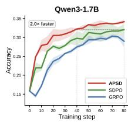

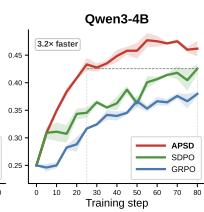  
(a) Training dynamics

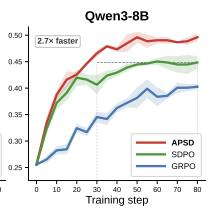

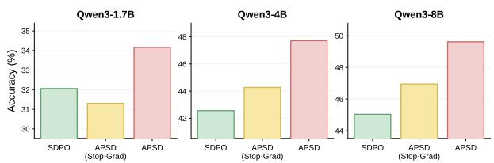  
(b) Effect of target gradient flow  
Figure 4: Training dynamics and target gradient-flow ablation on LCBv6 across Qwen3 model scales under RLRF. (a) Accuracy of APSD, SDPO, and GRPO over training steps. Shaded regions indicate the standard deviation across three random seeds. (b) Accuracy of SDPO, APSD with a detached target (APSD Stop-Grad), and full APSD.

RLRF. Following the RLRF setup of SDPO (Hübotter et al., 2026), we evaluate APSD on LiveCodeBench v6 (LCBv6) (Jain et al., 2025) with Qwen3-1.7B, Qwen3-4B, and Qwen3-8B. In RLRF, code execution feedback, including runtime errors and failed test cases, additionally conditions the self-teacher during training. We train all methods for 80 optimization steps and evaluate performance using Avg@4 and Pass@4.

Baselines. We compare APSD with reinforcement learning and self-distillation baselines. Our common baselines include GRPO (Shao et al., 2024), SDPO (Hübotter et al., 2026), SRPO (Li et al., 2026a), and RLSD (Yang et al., 2026a). For RLVR, we evaluate both off- and on-policy variants of GRPO. For RLRF, we additionally consider DistiLLM (Ko et al., 2024), TAID (Shing et al., 2025), and DemoPSD (Li et al., 2026b), adapting their distribution-mixing strategies to the self-distillation setting. Additional configurations and implementation details are provided in Appendix C.

## 5.2 Main Results

We first evaluate APSD on five RLVR benchmarks. As shown in Table 1, APSD achieves the highest average performance, while remaining competitive across individual tasks. Importantly, APSD consistently outperforms SRPO and RLSD, which also optimize policy asymmetrically using rollout correctness. These results suggest that constructing asymmetric distributions based on rollout correctness provides a more effective policy optimization signal than other asymmetric formulations.

Under RLRF, we evaluate APSD on LCBv6 against correctness-guided self-distillation and distribution-mixing baselines across model scales. Consistent with the RLVR results, Table 2 shows that APSD achieves the strongest overall performance, consistently outperforming SRPO and RLSD and further supporting the effectiveness of correctness-dependent interpolation and extrapolation under RLRF. APSD also outperforms DistiLLM, TAID, and DemoPSD, whose distributionmixing strategies are adapted to the SDPO. These results highlight the benefit of incorporating rollout correctness into distillation target construction, beyond conventional distribution-mixing strategies.

<table><tr><td>Sampling Distribution</td><td>Correct rollout Acc.</td><td>Δ</td><td>Incorrect rollout Acc.</td><td>Δ</td></tr><tr><td>Student</td><td>78.57</td><td></td><td>1.79</td><td>一</td></tr><tr><td>Inter.  $( \pi _ { \theta , 0 . 5 } ^ { \mathrm { A P S D } } )$ </td><td>83.93</td><td>+5.36</td><td>5.36</td><td> $+ 3 . 5 7$ </td></tr><tr><td>Teacher</td><td>78.57</td><td>+0.00</td><td>19.64</td><td>+17.85</td></tr><tr><td>Extra.  $( \pi _ { \theta , 1 . 5 } ^ { \mathrm { A P S D } } )$ </td><td>75.00</td><td>-3.57</td><td>23.21</td><td>+21.42</td></tr></table>

Table 3: Execution accuracy (%) under different sampling distributions. $\Delta$ denotes the percentage-point change relative to the student distribution.
<table><tr><td>Method</td><td>Qwen3-1.7B</td><td>Qwen3-4B</td><td>Qwen3-8B</td></tr><tr><td>GRPO</td><td>30.34</td><td>37.98</td><td>40.27</td></tr><tr><td>SDPO</td><td>32.06</td><td>42.56</td><td>45.04</td></tr><tr><td>APSD-C</td><td>33.59</td><td>46.18</td><td>48.85</td></tr><tr><td>APSD-I</td><td>32.82</td><td>45.61</td><td>48.47</td></tr><tr><td>APSD</td><td>34.16</td><td>47.71</td><td>49.62</td></tr></table>

Table 4: Ablation of the correctness-specific components of APSD on LCBv6 (Avg@4).

## 5.3 Training Efficiency

We analyze the training dynamics of APSD across Qwen3 model scales. Figure 4a shows that, compared with SDPO, APSD achieves a 2.6× average reduction in the number of training steps required to reach the same performance level across model scales. This improvement is consistent with APSD’s target construction, which uses a student trust region to adjust the target’s position relative to the student: targets remain closer to the student for correct rollouts and move farther away for incorrect ones. APSD thus achieves both higher final performance and greater training-step efficiency.

## 5.4 Correctness-Dependent α Control

We conduct an additional experiment on LCBv6 to examine the preferred APSD coefficient α by rollout correctness. With a frozen Qwen3-8B student and self-teacher, we fix the first half of each response and regenerate the suffix using APSD targets: α = 0 (student), $0 < \alpha < 1$ (interpolation), $\alpha = 1$ (self-teacher), and $\alpha > 1$ (extrapolation).

Table 3 shows contrasts between correct and incorrect rollouts. For correct rollouts, interpolation improves execution accuracy over the already effective student distribution, whereas the self-teacher alone provides no gain and extrapolation reduces performance. This suggests successful student behavior should be preserved rather than aggressively overwritten. For incorrect rollouts, the student rarely recovers a correct solution, while the self-teacher substantially improves accuracy. Extrapolation further improves performance beyond the self-teacher, achieving the highest accuracy. These results support APSD’s correctnessdependent α selection.

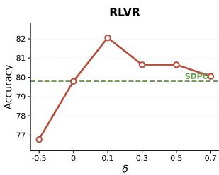

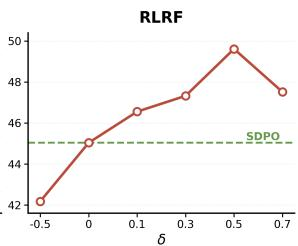  
Figure 5: Sensitivity of APSD to the asymmetry strength δ under RLVR and RLRF.

## 5.5 Ablation Study

Effect of Target Gradient Flow. To examine the role of gradient flow through the target, we construct a stop-gradient variant of APSD. As shown in Figure 4b, the stop-gradient variant performs worse than the original APSD across all Qwen3 model scales. This result demonstrates the importance of preserving gradient flow through the studentdependent target and is consistent with the analysis in Section 4.2, which identifies an additional gradient contribution from the student–target coupling.

Effects of Interpolation and Extrapolation. We further assess the contribution of each correctnessspecific operation in APSD. Table 4 reports two partial variants: APSD-C applies interpolation only to correct rollouts, while APSD-I applies extrapolation only to incorrect rollouts. Both variants improve over SDPO across all model scales, but neither matches the performance of the full APSD. These results indicate that the two operations are complementary, with interpolation preserving successful behavior and extrapolation providing stronger correction for unsuccessful rollouts.

## 6 Sensitivity Study

We examine APSD’s sensitivity to asymmetry strength δ by setting $\alpha _ { \mathrm { c o r r } } = 1 - \delta$ and $\alpha _ { \mathrm { i n c o r r } } =$ $1 + \delta$ around the SDPO configuration $( \delta = 0 )$ . As shown in Figure 5, reversing the proposed asymmetry $( \delta < 0 )$ , such that correct rollouts are extrapolated while incorrect rollouts are interpolated, degrades performance below SDPO in both RLVR and RLRF. This result further confirms that the direction of the asymmetric adjustment is critical. For positive $\delta ,$ the preferred degree of asymmetry differs across feedback settings: RLVR favors relatively mild asymmetry, whereas RLRF favors stronger asymmetry. Nevertheless, APSD consistently outperforms SDPO across a broad range of positive δ values, demonstrating robustness to the degree of asymmetry.

## 7 Conclusion

We present APSD, a self-distillation method that constructs asymmetric targets based on rollout correctness. APSD interpolates between student and self-teacher distributions to preserve successful behaviors and extrapolates beyond the self-teacher to strengthen correction of unsuccessful ones. Our analyses characterize APSD through divergence decomposition, reverse-KL barycentric geometry, and gradient flow through student-dependent targets. Experiments across RLVR and RLRF show strong overall performance against reinforcementlearning and self-distillation baselines , supporting the need for correctness-dependent student–selfteacher distribution mixing.

## Limitations

Although APSD demonstrates consistent improvements across RLVR and RLRF settings, our study has a few limitations. Our experiments cover diverse tasks, including scientific reasoning, tool use, and code generation, while evaluation on additional language generation tasks is left for future work. Furthermore, due to computational resource constraints, we evaluate APSD on models with up to 8B parameters, and its effectiveness on substantially larger models remains to be investigated. Nevertheless, the consistent improvements across multiple model scales and feedback settings suggest the potential of correctness-dependent target construction for LLM post-training.

## References

S.P. Boyd and L. Vandenberghe. 2004. Convex Optimization. Number pt. 1 in Berichte über verteilte messysteme. Cambridge University Press.

Kehua Feng, Xinyi Shen, Weijie Wang, Xiang Zhuang, Yuqi Tang, Qiang Zhang, and Keyan Ding. 2025. Sciknoweval: Evaluating multi-level scientific knowledge of large language models. Preprint, arXiv:2406.09098.

Yuxian Gu, Li Dong, Furu Wei, and Minlie Huang. 2024. MiniLLM: Knowledge distillation of large language

models. In The Twelfth International Conference on Learning Representations.

Daya Guo, Dejian Yang, Haowei Zhang, Junxiao Song, Peiyi Wang, Qihao Zhu, Runxin Xu, Ruoyu Zhang, Shirong Ma, Xiao Bi, Xiaokang Zhang, Xingkai Yu, Yu Wu, Z. F. Wu, Zhibin Gou, Zhihong Shao, Zhuoshu Li, Ziyi Gao, Aixin Liu, and 175 others. 2025. Deepseek-r1 incentivizes reasoning in llms through reinforcement learning. Nature, 645(8081):633–638.

Geoffrey Hinton, Oriol Vinyals, and Jeff Dean. 2015. Distilling the knowledge in a neural network. Preprint, arXiv:1503.02531.

Jonas Hübotter, Frederike Lübeck, Lejs Deen Behric, Anton Baumann, Marco Bagatella, Daniel Marta, Ido Hakimi, Idan Shenfeld, Thomas Kleine Buening, Carlos Guestrin, and Andreas Krause. 2026. Reinforcement learning via self-distillation. In Forty-third International Conference on Machine Learning.

Naman Jain, King Han, Alex Gu, Wen-Ding Li, Fanjia Yan, Tianjun Zhang, Sida Wang, Armando Solar-Lezama, Koushik Sen, and Ion Stoica. 2025. Livecodebench: Holistic and contamination free evaluation of large language models for code. In The Thirteenth International Conference on Learning Representations.

Seongryong Jung, Suwan Yoon, DongGeon Kim, and Hwanhee Lee. 2025. ToDi: Token-wise distillation via fine-grained divergence control. In Proceedings ofthe 2025 Conference on Empirical Methods in Natural Language Processing, pages 8078–8091, Suzhou, China. Association for Computational Linguistics.

Jeonghye Kim, Jiwon Jeon, Dongsheng Li, and Yuqing Yang. 2026. Rebellious student: Reversing teacher signals for reasoning exploration with self-distilled RLVR. In COLM 2026 Workshop on Efficient Reasoning.

Jongwoo Ko, Sungnyun Kim, Tianyi Chen, and Se-Young Yun. 2024. DistiLLM: Towards streamlined distillation for large language models. In Forty-first International Conference on Machine Learning.

Gengsheng Li, Tianyu Yang, Junfeng Fang, Mingyang Song, Mao Zheng, Haiyun Guo, Dan Zhang, Jinqiao Wang, and Tat-Seng Chua. 2026a. Unifying grouprelative and self-distillation policy optimization via sample routing. In Third Conference on Language Modeling.

Yunhe Li, Hao Shi, Wenhao Liu, Mengzhe Ruan, Hanxu Hou, Zhongxiang Dai, Shuang Qiu, and Linqi Song. 2026b. Demopsd: Disagreement-modulated policy self-distillation. Preprint, arXiv:2607.02502.

Team Olmo, :, Allyson Ettinger, Amanda Bertsch, Bailey Kuehl, David Graham, David Heineman, Dirk Groeneveld, Faeze Brahman, Finbarr Timbers, Hamish Ivison, Jacob Morrison, Jake Poznanski, Kyle Lo, Luca Soldaini, Matt Jordan, Mayee Chen,

Michael Noukhovitch, Nathan Lambert, and 50 others. 2026. Olmo 3. Preprint, arXiv:2512.13961.

Peijie Qiu, Wenhui Zhu, Sayantan Kumar, Xiwen Chen, Jin Yang, Xiaotong Sun, Abolfazl Razi, Yalin Wang, and Aristeidis Sotiras. 2025. Multimodal variational autoencoder: A barycentric view. In Proceedings of the AAAI Conference on Artificial Intelligence, volume 39, pages 20060–20068.

John Schulman, Sergey Levine, Pieter Abbeel, Michael Jordan, and Philipp Moritz. 2015. Trust region policy optimization. In International conference on machine learning, pages 1889–1897. Pmlr.

Zhihong Shao, Peiyi Wang, Qihao Zhu, Runxin Xu, Junxiao Song, Xiao Bi, Haowei Zhang, Mingchuan Zhang, Y. K. Li, Y. Wu, and Daya Guo. 2024. Deepseekmath: Pushing the limits of mathematical reasoning in open language models. Preprint, arXiv:2402.03300.

Idan Shenfeld, Mehul Damani, Jonas Hübotter, and Pulkit Agrawal. 2026. Self-distillation enables continual learning. In Forty-third International Conference on Machine Learning.

Donghyeok Shin, Yeongmin Kim, Suhyeon Jo, Byeonghu Na, and Il chul Moon. 2026. AMid: Knowledge distillation for LLMs with \$\alpha\$- mixture assistant distribution. In The Fourteenth International Conference on Learning Representations.

Makoto Shing, Kou Misaki, Han Bao, Sho Yokoi, and Takuya Akiba. 2025. Taid: Temporally adaptive interpolated distillation for efficient knowledge transfer in language models. In International Conference on Learning Representations, volume 2025, pages 92233–92256.

Yuda Song, Lili Chen, Fahim Tajwar, Rémi Munos, Deepak Pathak, Drew Bagnell, Aarti Singh, and Andrea Zanette. 2026. Expanding the capabilities of reinforcement learning via text feedback. In Fortythird International Conference on Machine Learning.

Qiaoyu Tang, Ziliang Deng, Hongyu Lin, Xianpei Han, Qiao Liang, Boxi Cao, and Le Sun. 2023. Toolalpaca: Generalized tool learning for language models with 3000 simulated cases. Preprint, arXiv:2306.05301.

Kimi Team, Angang Du, Bofei Gao, Bowei Xing, Changjiu Jiang, Cheng Chen, Cheng Li, Chenjun Xiao, Chenzhuang Du, Chonghua Liao, Chuning Tang, Congcong Wang, Dehao Zhang, Enming Yuan, Enzhe Lu, Fengxiang Tang, Flood Sung, Guangda Wei, Guokun Lai, and 77 others. 2025. Kimi k1.5: Scaling reinforcement learning with llms. Preprint, arXiv:2501.12599.

Tim Van Erven and Peter Harremos. 2014. Rényi divergence and kullback-leibler divergence. IEEE transactions on information theory, 60(7):3797–3820.

Xingrun Xing, Haoqing Wang, Boyan Gao, Ziheng Li, and Yehui Tang. 2026. Trust region on-policy distillation. Preprint, arXiv:2606.01249.

Jiawei Xu, Minghui Liu, Juzheng Zhang, Tom Goldstein, and Furong Huang. 2026. β-opsd: Deriving with policy optimization, training with self-distillation. Preprint, arXiv:2607.28582.

An Yang, Anfeng Li, Baosong Yang, Beichen Zhang, Binyuan Hui, Bo Zheng, Bowen Yu, Chang Gao, Chengen Huang, Chenxu Lv, Chujie Zheng, Dayiheng Liu, Fan Zhou, Fei Huang, Feng Hu, Hao Ge, Haoran Wei, Huan Lin, Jialong Tang, and 41 others. 2025. Qwen3 technical report. Preprint, arXiv:2505.09388.

Chenxu Yang, Chuanyu Qin, Qingyi Si, Minghui Chen, Naibin Gu, Dingyu Yao, Zheng Lin, Weiping Wang, Jiaqi Wang, and Nan Duan. 2026a. Self-distilled rlvr. Preprint, arXiv:2604.03128.

Wenkai Yang, Weijie Liu, Ruobing Xie, Kai Yang, Saiyong Yang, and Yankai Lin. 2026b. Learning beyond teacher: Generalized on-policy distillation with reward extrapolation. Preprint, arXiv:2602.12125.

Tianzhu Ye, Li Dong, Xun Wu, Shaohan Huang, and Furu Wei. 2026. On-policy context distillation for language models. Preprint, arXiv:2602.12275.

Siyan Zhao, Zhihui Xie, Mengchen Liu, Jing Huang, Guan Pang, Feiyu Chen, and Aditya Grover. 2026. Self-distilled reasoner: On-policy self-distillation for large language models. In Forty-third International Conference on Machine Learning.

The Use Of Large Language Model Assistants We drafted the manuscript ourselves, and GPT-5.6 Sol and GPT-6 Astra were used only for overall language refinement.

## A Additional Analysis of Teacher–Student Discrepancy

Comparison with an External OPD Teacher. To examine whether the behavior observed in Figure 2 is specific to self-distillation, we additionally compare the Qwen3-8B student with a larger Qwen3-32B OPD teacher. Unlike the SDPO selfteacher, the OPD teacher is a separate model and receives the same original prompt as the student.

As shown in Figure 6(a), the external teacher exhibits a different correctness-dependent pattern. The teacher–student perplexity gap is larger for incorrect rollouts than for correct rollouts. In contrast, for the SDPO self-teacher in Figure 2, the gap is smaller on incorrect rollouts than on correct rollouts. This comparison highlights a characteristic difficulty of self-distillation, as even after conditioning on feedback, the self-teacher can remain close to the student distribution on failed trajectories, limiting the strength of corrective supervision.

Effect of Correctness-Dependent Asymmetry. We next visualize how the proposed correctnessdependent transformation changes the relationship between the student and self-teacher distributions. For correct rollouts, we interpolate between the student and self-teacher, while for incorrect rollouts, we extrapolate toward the self-teacher relative to the student.

As shown in Figure 6(b), these two operations adjust the discrepancy in opposite directions. For correct rollouts, interpolation reduces the perplexity gap from 0.2092 for the original self-teacher to 0.1004, keeping the target closer to the already successful student behavior. For incorrect rollouts, extrapolation increases the gap from 0.0720 to 0.1123, moving the target further away from the failed student trajectory. This behavior matches the intended role of APSD by applying conservative distillation after success and stronger corrective separation after failure.

Qualitative Case Study of Asymmetric Targets Figure 7 illustrates how APSD modifies the selfteacher distribution in the representative cases shown in Figure 2. For the correct rollout, interpolation moves the target back toward the student’s successful token choice. For the incorrect rollout, extrapolation amplifies the teacher’s corrective direction and shifts probability toward the alternative associated with the correct behavior.

## B Proofs

For readability, we omit all conditioning variables and token indices throughout the appendix, and denote the student, self-teacher, and PoE target distributions by $\pi \theta , \pi ,$ , and $\pi _ { \theta , \alpha } ^ { \mathrm { A P S D } }$ , respectively.

## B.1 Proof of Proposition 1

Asymmetric divergence decomposition. Recall that $\pi _ { \theta , \alpha } ^ { \mathrm { A P S D } }$ is defined as

$$
\pi _ { \theta , \alpha } ^ { \mathrm { A P S D } } ( v ) = \frac { \pi _ { \theta } ( v ) ^ { 1 - \alpha } \pi ( v ) ^ { \alpha } } { Z _ { \theta , \alpha } } .\tag{8}
$$

The normalizing term is

$$
Z _ { \theta , \alpha } = \sum _ { v \in V } \pi _ { \theta } ( v ) ^ { 1 - \alpha } \pi ( v ) ^ { \alpha } .\tag{9}
$$

The APSD objective for a single decoding step is

$$
\begin{array} { r l } { \mathcal { L } _ { \mathrm { A P S D } } = D _ { \mathrm { K L } } \left( \pi _ { \theta } \big \| \pi _ { \theta , \alpha } ^ { \mathrm { A P S D } } \right) } & { } \\ { \quad } & { = \displaystyle \sum _ { v \in V } \pi _ { \theta } ( v ) \log \frac { \pi _ { \theta } ( v ) } { \pi _ { \theta , \alpha } ^ { \mathrm { A P S D } } ( v ) } . } \end{array}\tag{10}
$$

Substituting Eq. (8) gives

$$
\begin{array} { r l } {  { \mathcal { L } _ { \mathrm { A P S D } } = \sum _ { v \in V } \pi _ { \theta } ( v ) [ \alpha \log \frac { \pi _ { \theta } ( v ) } { \pi ( v ) } + \log Z _ { \theta , \alpha } ] } } \\ & { = \alpha D _ { \mathrm { K L } } ( \pi _ { \theta } \| \pi ) + \log Z _ { \theta , \alpha } . } \end{array}\tag{11}
$$

For $\alpha ~ \neq ~ 1$ , the Rényi divergence of order α (Van Erven and Harremos, 2014) is defined as

$$
D _ { \alpha } ( P \| Q ) = { \frac { 1 } { \alpha - 1 } } \log \sum _ { v \in V } P ( v ) ^ { \alpha } Q ( v ) ^ { 1 - \alpha } .\tag{12}
$$

Setting $P = \pi$ and $Q = \pi _ { \theta }$ yields

$$
\begin{array} { r l } & { \log Z _ { \theta , \alpha } = ( \alpha - 1 ) D _ { \alpha } \left( \pi \| \pi _ { \theta } \right) } \\ & { \qquad = - ( 1 - \alpha ) D _ { \alpha } \left( \pi \| \pi _ { \theta } \right) . } \end{array}\tag{13}
$$

Therefore,

$$
\begin{array} { r } { \mathcal { L } _ { \mathrm { A P S D } } = \alpha D _ { \mathrm { K L } } \left( \pi _ { \theta } \| \pi \right) } \\ { - ( 1 - \alpha ) D _ { \alpha } \left( \pi \| \pi _ { \theta } \right) . } \end{array}\tag{14}
$$

When $\alpha = 1 , \pi _ { \theta , \alpha } ^ { \mathrm { A P S D } }$ reduces to the self-teacher distribution π, yielding ${ \mathcal { L } } _ { \mathrm { A P S D } } = D _ { \mathrm { K L } } ( \pi _ { \theta } \| \pi )$ . □

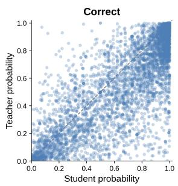  
∆PPL (Teacher – Student) = 0.1987

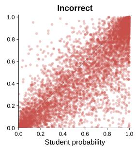  
(a) External OPD teacher.  
∆PPL (Teacher – Student) = 0.2730

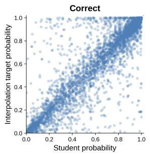  
ΔPPL (Target – Student) = 0.1004

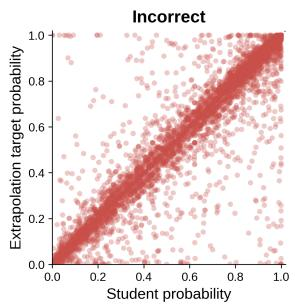  
ΔPPL (Target – Student) = 0.1123  
(b) Correctness-dependent APSD target.  
Figure 6: Additional analysis of teacher–student discrepancy on LiveCodeBench v6. (a) Qwen3-8B student versus a separate Qwen3-32B OPD teacher. The teacher–student perplexity gap is larger for incorrect rollouts than for correct rollouts. (b) Correctness-dependent APSD targets constructed from the SDPO self-teacher. Interpolation reduces the discrepancy for correct rollouts, whereas extrapolation increases it for incorrect rollouts. Each panel contains $1 0 { , } 0 0 0$ sampled tokens. ∆PPL denotes the mean perplexity difference over the corresponding rollouts.

## B.2 Proof of Proposition 2

Characterization of $\pi _ { \theta , \alpha } ^ { \mathrm { A P S D } }$ as a reverse-KL barycenter. Following the derivation in Qiu et al. (2025), we rewrite the generalized reverse-KL barycentric objective using $( 1 - \alpha ) + \alpha = 1$ , we have as

$$
\begin{array} { r l } & { \sqrt { \frac { \lambda _ { 1 } \lambda _ { 2 } ^ { 2 } } { \lambda _ { 3 } ^ { 2 } } } \left( - \eta _ { \mathrm { e } } \eta _ { \mathrm { e } } \right) \frac { \lambda _ { 1 } } { \gamma _ { 3 } ^ { 2 } } \left( 1 - \lambda \right) \hat { \psi } _ { \mathrm { e } } \left( \hat { \psi } _ { \mathrm { e } } \right) \left( - \lambda \right) \hat { \psi } _ { \mathrm { e } } } \\ & { = \frac { \lambda _ { 2 } \sqrt { \lambda _ { 3 } \lambda _ { 3 } } } { \gamma _ { 3 } ^ { 2 } \sqrt { \lambda _ { 3 } \lambda _ { 3 } } } \left( \mathrm { i d } \lambda _ { 3 } ^ { 2 } \gamma \left( \boldsymbol { \mathcal { O } } _ { \mathrm { e } } \right) \right) } \\ & { - \frac { \lambda _ { 3 } \sqrt { \lambda _ { 3 } \lambda _ { 3 } } } { \gamma _ { 3 } ^ { 2 } \sqrt { \lambda _ { 3 } \lambda _ { 3 } } } \left( \mathrm { i d } \lambda _ { 3 } ^ { 2 } \gamma \left( \boldsymbol { \mathcal { O } } _ { \mathrm { e } } \right) \right) } \\ & { - \frac { \lambda _ { 3 } \sqrt { \lambda _ { 3 } \lambda _ { 3 } } } { \gamma _ { 3 } ^ { 2 } \sqrt { \lambda _ { 3 } \lambda _ { 3 } } } \exp \left( \mathrm { i d } \lambda _ { 3 } ^ { 2 } \gamma \left( \boldsymbol { \mathcal { O } } _ { \mathrm { e } } \right) \right) } \\ & { + \frac { \lambda _ { 3 } \sqrt { \lambda _ { 3 } \lambda _ { 3 } } } { \gamma _ { 3 } ^ { 2 } \sqrt { \lambda _ { 3 } \lambda _ { 3 } } } \exp \left( - \mathrm { i d } \lambda _ { 3 } ^ { 2 } \gamma \left( \boldsymbol { \mathcal { O } } _ { \mathrm { e } } \right) \right) } \\ &  - \frac { \lambda _ { 3 } \sqrt { \lambda _ { 3 } \lambda _ { 3 } } } { \gamma _ { 3 } ^ { 2 } \sqrt { \lambda _ { 3 } \lambda _ { 3 } } } \sum _  i \in \mathcal { N } \end{array}\tag{15}
$$

Since the KL divergence is minimized at equality, the unique minimizer is

$$
r ( v ) = \frac { \pi _ { \theta } ( v ) ^ { 1 - \alpha } \pi ( v ) ^ { \alpha } } { Z _ { \theta , \alpha } } = \pi _ { \theta , \alpha } ^ { \mathrm { A P S D } } ( v ) .\tag{16}
$$

Thus, α directly determines the relative weighting of the student and self-teacher in the generalized reverse-KL barycentric target. For $0 ~ <$ $\alpha < 1$ , this corresponds to interpolation between the two distributions, while $\alpha > 1$ extrapolates along the same normalized product form. Unlike this reverse-KL barycenter, which takes a normalized product-of-experts (PoE) form, the forward-KL barycenter takes the mixture-of-experts (MoE) form $( 1 - \alpha ) \pi _ { \theta } + \alpha \pi$ . For $\alpha > 1$ , the negative student coefficient can yield negative probabilities, so this mixture does not generally define a valid distribution. In contrast, under the strict positivity assumption, the normalized PoE form remains a valid distribution and supports extrapolation beyond the self-teacher.

Monotonic growth of the student-centered trustregion radius with $\alpha .$ Using the derivation in (Hübotter et al., 2026; Xing et al., 2026), we fix the student and self-teacher distributions π and π, and assume that both have full support over the finite vocabulary V and that $\pi _ { \boldsymbol { \theta } } \neq \pi$ . Consider

$$
r _ { \epsilon } ^ { \star } \in \underset { r \in \Delta ( \mathcal { V } ) } { \arg \operatorname* { m a x } } \quad \mathbb { E } _ { v \sim r } \left[ \log \frac { \pi ( v ) } { \pi _ { \theta } ( v ) } \right]\tag{17}
$$

Assume that $\epsilon > 0$ is small enough that no unconstrained maximizer of the objective is feasible. Slater’s condition holds because $\pi _ { \theta }$ is strictly feasible and the KKT conditions therefore apply, and the optimal trust-region multiplier ${ \lambda } _ { \epsilon } ^ { \star }$ is strictly positive (Boyd and Vandenberghe, 2004).

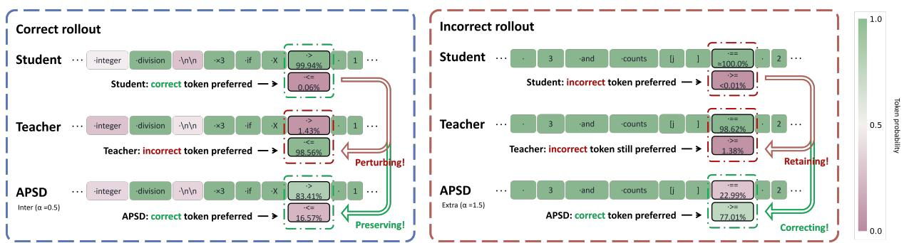  
Figure 7: Token-level effect of APSD on representative correct and incorrect rollouts. For the correct rollout, interpolation shifts the target toward the student’s successful choice, while for the incorrect rollout, extrapolation increases the probability of the corrective alternative.

The Lagrangian is

$$
\begin{array} { l } { \mathcal { T } _ { \mathrm { T R } } ( r , \lambda , \nu ) = \displaystyle \sum _ { v \in \mathcal { V } } r ( v ) \log \frac { \pi ( v ) } { \pi _ { \theta } ( v ) } } \\ { \displaystyle - \lambda \big ( D _ { \mathrm { K L } } ( r \| \pi _ { \theta } ) - \epsilon \big ) } \\ { \displaystyle \phantom { \frac { 1 } { \pi } } + \nu \left( \sum _ { v \in \mathcal { V } } r ( v ) - 1 \right) . } \end{array}\tag{18}
$$

For ${ \lambda } _ { \epsilon } ^ { \star } > 0$ , its maximizer has full support, and stationarity gives

$$
0 = \log \frac { \pi ( v ) } { \pi _ { \theta } ( v ) } - \lambda _ { \epsilon } ^ { \star } \left( \log \frac { r _ { \epsilon } ^ { \star } ( v ) } { \pi _ { \theta } ( v ) } + 1 \right) + \nu _ { \epsilon } ^ { \star } .\tag{19}
$$

Rearranging and normalizing yields

$$
r _ { \epsilon } ^ { \star } ( v ) = \frac { \pi _ { \theta } ( v ) ^ { 1 - 1 / \lambda _ { \epsilon } ^ { \star } } \pi ( v ) ^ { 1 / \lambda _ { \epsilon } ^ { \star } } } { \sum _ { u \in \mathcal { V } } \pi _ { \theta } ( u ) ^ { 1 - 1 / \lambda _ { \epsilon } ^ { \star } } \pi ( u ) ^ { 1 / \lambda _ { \epsilon } ^ { \star } } } .\tag{20}
$$

Thus, setting $\alpha = 1 / \lambda _ { \epsilon } ^ { \star }$ gives

$$
r _ { \epsilon } ^ { \star } ( v ) = \frac { \pi _ { \theta } ( v ) ^ { 1 - \alpha } \pi ( v ) ^ { \alpha } } { Z _ { \theta , \alpha } ( \alpha ) } = \pi _ { \theta , \alpha } ^ { \mathrm { A P S D } } ( v ) .\tag{21}
$$

This identifies APSD with the trust-region solution, with α acting as the inverse optimal multiplier. We now parameterize this solution family by α, rather than by the prescribed radius ϵ. Since ${ \lambda } _ { \epsilon } ^ { \star } > 0$ , complementary slackness gives

$$
D _ { \mathrm { K L } } ( r _ { \epsilon } ^ { \star } \| \pi _ { \theta } ) = \epsilon .\tag{22}
$$

Accordingly, the radius associated with a chosen α is

$$
\epsilon _ { \theta } ( \alpha ) : = D _ { \mathrm { K L } } \big ( \pi _ { \theta , \alpha } ^ { \mathrm { A P S D } } \| \pi _ { \theta } \big ) .\tag{23}
$$

To characterize this induced radius, define

$$
A _ { \theta } ( v ) = \log { \frac { \pi ( v ) } { \pi _ { \theta } ( v ) } } , \qquad \psi _ { \theta } ( \alpha ) = \log Z _ { \theta , \alpha } .\tag{24}
$$

Using

$$
\pi _ { \theta , \alpha } ^ { \mathrm { A P S D } } ( v ) = \pi _ { \theta } ( v ) \exp \bigl ( \alpha A _ { \theta } ( v ) - \psi _ { \theta } ( \alpha ) \bigr ) ,\tag{25}
$$

we obtain

$$
\epsilon _ { \theta } ( \alpha ) = \alpha \psi _ { \theta } ^ { \prime } ( \alpha ) - \psi _ { \theta } ( \alpha ) .\tag{26}
$$

Therefore,

$$
\begin{array} { r l r } & { \frac { d \epsilon _ { \theta } ( \alpha ) } { d \alpha } = \alpha \psi _ { \theta } ^ { \prime \prime } ( \alpha ) } & \\ & { } & { \quad = \alpha \operatorname { V a r } _ { v \sim \pi _ { \theta , \alpha } ^ { \mathrm { A P S D } } } \left[ \log \frac { \pi ( v ) } { \pi _ { \theta } ( v ) } \right] > 0 , } \end{array}\tag{27}
$$

where strict positivity follows from $\alpha > 0 .$ , full support, and $\pi _ { \boldsymbol { \theta } } \neq \pi$ . Hence, increasing α strictly increases the induced student-centered trust-region radius. □

## B.3 Proof of Proposition 3

Setup. Fix a decoding context and a coefficient $\alpha > 0$ . Assume that $\pi _ { \theta }$ and π are strictly positive distributions over the finite vocabulary V , and that $\pi _ { \theta }$ is differentiable in θ. The self-teacher π, the sampled context, and α are held fixed throughout differentiation. All gradients below are computed from the exact vocabulary-level KL divergence.

Gradient under full-target stop-gradient. Let $\pi ^ { \mathrm { A P S D } } : = \mathrm { S G } [ \pi _ { \theta , \alpha } ^ { \mathrm { A P S D } } ]$ denote the detached target, which is held fixed during differentiation, so that $\nabla _ { \theta } \pi ^ { \mathrm { A P S D } } ( v ) = 0$ . With α and the self-teacher π also held fixed, the detached-target objective is

$$
\begin{array} { r l } {  { \mathcal { L } _ { \mathrm { A P S D } } ^ { \mathrm { S G } } = D _ { \mathrm { K L } } \bigl ( \pi _ { \theta } \big \| \pi ^ { \mathrm { A P S D } } \bigr ) } \quad } & { } \\ & { = \sum _ { v \in V } \pi _ { \theta } ( v ) \log \frac { \pi _ { \theta } ( v ) } { \pi ^ { \mathrm { A P S D } } ( v ) } . } \end{array}\tag{28}
$$

Differentiating with respect to $\theta$ while keeping $\pi ^ { \mathrm { A P S D } }$ fixed gives

$$
\begin{array} { l } { { \nabla _ { \theta } \mathcal { L } _ { \mathrm { A P S D } } ^ { \mathrm { S G } } = \displaystyle \sum _ { v \in V } \nabla _ { \theta } \pi _ { \theta } ( v ) \log \frac { \pi _ { \theta } ( v ) } { \pi ^ { \mathrm { A P S D } } ( v ) } } } \\ { { \displaystyle \qquad + \sum _ { v \in V } \pi _ { \theta } ( v ) \nabla _ { \theta } \log \pi _ { \theta } ( v ) } } \\ { { \displaystyle \qquad = \sum _ { v \in V } \nabla _ { \theta } \pi _ { \theta } ( v ) \left[ \log \frac { \pi _ { \theta } ( v ) } { \pi ^ { \mathrm { A P S D } } ( v ) } + 1 \right] . } } \end{array}\tag{29}
$$

At the current parameter value, $\pi ^ { \mathrm { A P S D } }$ has the same numerical values as $\pi _ { \theta , \alpha } ^ { \mathrm { A P S D } }$ . We therefore substitute the APSD expression into the alreadycomputed gradient using

$$
\begin{array} { r } { \log \frac { \pi _ { \theta } ( v ) } { \pi ^ { \mathrm { A P S D } } ( v ) } = \log \frac { Z _ { \theta , \alpha } \pi _ { \theta } ( v ) } { \pi _ { \theta } ( v ) ^ { 1 - \alpha } \pi ( v ) ^ { \alpha } } } \\ { = \alpha \log \frac { \pi _ { \theta } ( v ) } { \pi ( v ) } + \log Z _ { \theta , \alpha } . } \end{array}\tag{30}
$$

Consequently,

$$
\begin{array} { r l } {  { \nabla _ { \theta } \mathcal { L } _ { \mathrm { A P S D } } ^ { \mathrm { S G } } = \alpha \sum _ { v \in V } \nabla _ { \theta } \pi _ { \theta } ( v ) \log \frac { \pi _ { \theta } ( v ) } { \pi ( v ) } } } \\ & { \quad \ + ( \log Z _ { \theta , \alpha } + 1 ) \sum _ { v \in V } \nabla _ { \theta } \pi _ { \theta } ( v ) } \\ & { = \alpha \nabla _ { \theta } D _ { \mathrm { K L } } ( \pi _ { \theta } \| \pi ) } \\ & { = \alpha \nabla _ { \theta } \mathcal { L } _ { \mathrm { S D P O } } , } \end{array}\tag{31}
$$

where the terms independent of v vanish because $\begin{array} { r } { \sum _ { v \in V } \nabla _ { \theta } \pi _ { \theta } ( v ) = \nabla _ { \theta } \sum _ { v \in V } \pi _ { \theta } ( v ) = \nabla _ { \theta } 1 = 0 . } \end{array}$ Thus, full-target detachment reduces the single-step APSD gradient to an α-scaled SDPO gradient.

Identifying the discarded Rényi contribution. With $\pi$ and α fixed, we choose the gradientequivalent scalar potential associated with Eq. (31) as

$$
\widetilde { \mathcal { L } } _ { \mathrm { A P S D } } ^ { \mathrm { S G } } ( \theta ) : = \alpha \mathcal { L } _ { \mathrm { S D P O } } ( \theta ) .\tag{32}
$$

This potential reproduces the detached-target gradient but should not be confused with the forward value of $\mathcal { L } _ { \mathrm { A P S D } } ^ { \mathrm { S G } }$ , since stop-gradient preserves numerical values while changing the derivatives used for optimization.

By Proposition 1, subtracting this potential from the original objective gives

$$
\begin{array} { r l } & { \mathcal { L } _ { \mathrm { A P S D } } - \tilde { \mathcal { L } } _ { \mathrm { A P S D } } ^ { \mathrm { S G } } = \log Z _ { \theta , \alpha } } \\ & { \qquad = - ( 1 - \alpha ) D _ { \alpha } ( \pi \| \pi _ { \theta } ) , } \end{array}\tag{33}
$$

where the second equality holds for $\alpha \neq 1$ . Differentiating identifies the exact contribution discarded

by full-target stop-gradient:

$$
\begin{array} { r l } { \nabla _ { \theta } \mathcal { L } _ { \mathrm { A P S D } } - \nabla _ { \theta } \mathcal { L } _ { \mathrm { A P S D } } ^ { \mathrm { S G } } = \nabla _ { \theta } \log Z _ { \theta , \alpha } } & { } \\ { = - ( 1 - \alpha ) \nabla _ { \theta } D _ { \alpha } ( \pi \| \pi _ { \theta } ) . } & { } \\ { ( 3 4 ) } \end{array}
$$

Direct differentiation of the normalizer gives

$$
\begin{array} { r l } & { \nabla _ { \theta } \log Z _ { \theta , \alpha } = \frac { 1 } { Z _ { \theta , \alpha } } \nabla _ { \theta } \displaystyle \sum _ { v \in V } \pi _ { \theta } ( v ) ^ { 1 - \alpha } \pi ( v ) ^ { \alpha } } \\ & { \qquad = ( 1 - \alpha ) \displaystyle \sum _ { v \in V } \pi _ { \theta , \alpha } ^ { \mathrm { A P S D } } ( v ) \nabla _ { \theta } \log \pi _ { \theta } ( v ) . } \end{array}\tag{35}
$$

Consequently, the exact APSD gradient is

$$
\begin{array} { r l } & { \nabla _ { \theta } \mathcal { L } _ { \mathrm { A P S D } } = \alpha \nabla _ { \theta } \mathcal { L } _ { \mathrm { S D P O } } } \\ & { \qquad + \left( 1 - \alpha \right) \displaystyle \sum _ { v \in V } \pi _ { \theta , \alpha } ^ { \mathrm { A P S D } } ( v ) \nabla _ { \theta } \log \pi _ { \theta } ( v ) . } \end{array}\tag{36}
$$

The additional term need not be collinear with the SDPO gradient. Retaining it can therefore change the gradient direction rather than merely rescaling the detached-target update.

Behavior induced by the asymmetric coupling. To characterize this contribution, let $z ( v )$ denote the student logits, with $\pi _ { \boldsymbol { \theta } } ( v ) \ =$ $\textstyle \exp ( z ( v ) ) / \sum _ { u \in V } \exp ( z ( u ) )$ . Holding the selfteacher and α fixed, the softmax identity $\partial \log \pi _ { \boldsymbol { \theta } } ( u ) / \partial z ( v ) = \delta _ { u v } - \pi _ { \boldsymbol { \theta } } ( v )$ yields

$$
\begin{array} { r l r } {  { \frac { \partial \log Z _ { \theta , \alpha } } { \partial z ( \boldsymbol { v } ) } = ( 1 - \alpha ) \sum _ { u \in V } \pi _ { \theta , \alpha } ^ { \mathrm { A P S D } } ( u ) [ \delta _ { u v } - \pi _ { \theta } ( v ) ] } } \\ & { } & { = ( 1 - \alpha ) [ \pi _ { \theta , \alpha } ^ { \mathrm { A P S D } } ( v ) - \pi _ { \theta } ( v ) ] , \quad \mathrm { ~ } } \\ & { } & { = [ \boldsymbol { 1 } - \alpha ) [ \pi _ { \theta , \alpha } ^ { \mathrm { A P S D } } ( v ) - \pi _ { \theta } ( v ) ] , \quad \mathrm { ~ } } \end{array}\tag{37}
$$

where $\delta _ { u v }$ is the Kronecker delta. Thus, the additional descent direction in logit space is

$$
- \frac { \partial \log Z _ { \theta , \alpha } } { \partial z ( v ) } = ( \alpha - 1 ) \left[ \pi _ { \theta , \alpha } ^ { \mathrm { A P S D } } ( v ) - \pi _ { \theta } ( v ) \right] .\tag{38}
$$

For correct rollouts, $0 < \alpha < 1$ , so this correction decreases logits where the interpolated target $\pi _ { \theta , \alpha _ { \mathrm { c o r r e c } } } ^ { \mathrm { A P S D } }$ assigns more probability than the student and increases logits where it assigns less. It therefore counteracts target-directed shifts, providing a conservative correction consistent with preserving already successful student preferences. This correction complements, rather than replaces, the SDPO term in the full gradient.

For incorrect rollouts, $\alpha > 1$ , and the correction reverses direction: it increases logits where the extrapolated target $\pi _ { \theta , \alpha _ { \mathrm { i n c o r r e c t } } } ^ { \mathrm { A P S D } }$ exceeds the student and decreases logits where the target falls below the student. The relevant discrepancy is determined by

$$
{ \frac { \pi _ { \theta , \alpha } ^ { \mathrm { A P S D } } ( v ) } { \pi _ { \theta } ( v ) } } = { \frac { 1 } { Z _ { \theta , \alpha } } } \left( { \frac { \pi ( v ) } { \pi _ { \theta } ( v ) } } \right) ^ { \alpha } .\tag{39}
$$

In particular, $\pi _ { \theta , \alpha } ^ { \mathrm { A P S D } } ( v ) > \pi _ { \theta } ( v )$ precisely when $\pi ( v ) / \pi _ { \theta } ( v ) > Z _ { \theta , \alpha } ^ { 1 / \alpha }$ . The additional correction therefore favors alternatives with sufficiently high teacher-to-student probability ratios, rather than tokens with high teacher probability alone. A token jointly assigned high probability by the student and self-teacher is not automatically reinforced: its logit receives a negative correction whenever its ratio falls below this threshold.

The asymmetric coefficient thus switches the coupling from counteracting movement toward the interpolated target on correct rollouts to reinforcing movement toward the extrapolated target on incorrect rollouts. This provides a mechanism for conservative feedback integration after success and stronger correction after failure, provided that the self-teacher identifies useful alternatives. These statements characterize the additional logit-gradient component, not a guarantee of improved task correctness or of every token’s probability change under the complete parameter update.

When α = 1, or when $\pi _ { \boldsymbol { \theta } } = \pi$ , the coupling contribution vanishes. Finally, the scaled-SDPO identity holds per decoding step and for a rollout with a common α; across rollouts with different coefficients, full-target stop-gradient yields a weighted sum of SDPO gradients rather than a single scalar multiple of the batch gradient.

Differentiability of the APSD target. The trustregion and generalized barycentric formulations both recover the same explicit target,

$$
\pi _ { \theta , \alpha } ^ { \mathrm { A P S D } } ( v ) = \frac { \pi _ { \theta } ( v ) ^ { 1 - \alpha } \pi ( v ) ^ { \alpha } } { Z _ { \theta , \alpha } ( \alpha ) } .\tag{40}
$$

For fixed α and self-teacher distribution π, this map is differentiable with respect to the strictly positive student probabilities, with coordinate derivatives

$$
\frac { \partial \pi _ { \theta , \alpha } ^ { \mathrm { A P S D } } ( v ) } { \partial \pi _ { \theta } ( u ) } = ( 1 - \alpha ) \frac { \pi _ { \theta , \alpha } ^ { \mathrm { A P S D } } ( v ) } { \pi _ { \theta } ( u ) } \left[ \delta _ { u v } - \pi _ { \theta , \alpha } ^ { \mathrm { A P S D } } ( u ) \right]\tag{41}
$$

where $\delta _ { u v }$ is the Kronecker delta. Thus, characterizing the target as the solution to an auxiliary optimization does not eliminate its dependence on the student. Full-target stop-gradient explicitly suppresses this dependence by setting the target Jacobian to zero during differentiation. Throughout, α is held fixed, while $\epsilon _ { \theta } ( \alpha )$ is induced by the target and may vary with $\theta ;$ the radius is not held fixed as the student changes.

Why the envelope theorem does not justify detachment. The trust-region and barycentric problems are auxiliary optimizations used to construct $\pi _ { \theta , \alpha } ^ { \mathrm { A P S D } }$ , whereas APSD minimizes the distinct outer objective $D _ { \mathrm { K L } } ( \pi _ { \theta } \| \pi _ { \theta , \alpha } ^ { \mathrm { A P S D } } )$ . The envelope theorem characterizes derivatives of the auxiliary problems’ optimal values; it does not justify omitting the optimizer dependence when that optimizer is reused in a different outer loss. In particular, their stationarity conditions do not cancel the targetside contribution $\nabla _ { \theta }$ log $Z _ { \theta , \alpha }$ identified in Eq. (34). Full-target stop-gradient therefore leaves the forward trust-region and barycentric target unchanged, but removes its student-dependent contribution from the APSD optimization dynamics. □

## C Experimental Details

## C.1 RLVR Training Details

We follow the RLVR training setup of Hübotter et al. (2026) and summarize our training and evaluation configurations in Table 5. Each training run uses four NVIDIA H200 GPUs with a wall-clock time budget of five hours.

We use a maximum prompt length of 2,048 tokens and a maximum response length of 8,192 tokens. Each training batch contains 32 prompts with eight rollouts per prompt. For evaluation, we sample 16 responses per example using a temperature of 0.6 and top-p of 0.95. All methods are optimized with AdamW, weight decay of 0.01, and gradient clipping at 1.0.

For off-policy GRPO, we use a learning rate of $1 \times 1 0 ^ { - 6 }$ , whereas the remaining methods use $1 \times 1 0 ^ { - 5 }$ . Following the corresponding training protocols, off-policy GRPO performs multiple minibatch updates per generation batch, while on-policy methods perform a single policy update using the newly generated rollouts. Additional methodspecific configurations are listed in Table 5.

## C.2 RLRF Training Details

We follow the RLRF training setup of Hübotter et al. (2026) and summarize the training and evaluation configurations in Table 6. All methods are trained for 80 optimization steps with 32 prompts per batch and eight rollouts per prompt. Training rollouts are generated with a temperature of 1.0, while evaluation uses a temperature of 0.6 and topp of 0.95. We use maximum prompt and response lengths of 2,048 and 8,192 tokens, respectively.

<table><tr><td>Category</td><td>Parameter</td><td>Value</td></tr><tr><td colspan="2">Common (shared by all methods)</td><td></td></tr><tr><td>Data</td><td>Max. prompt length Max. response length</td><td>2048 8192</td></tr><tr><td>Batching</td><td>Question batch size</td><td>32</td></tr><tr><td>Rollout</td><td>Number of rollouts Inference engine</td><td>8 vLLM</td></tr><tr><td></td><td>Temperature</td><td>1.0</td></tr><tr><td>Validation</td><td>Number of rollouts Temperature</td><td>16 0.6</td></tr><tr><td></td><td>Top-p</td><td>0.95</td></tr><tr><td></td><td></td><td></td></tr><tr><td>Training</td><td>Optimizer</td><td>AdamW</td></tr><tr><td></td><td>Warmup steps</td><td>10</td></tr><tr><td></td><td>Weight decay</td><td>0.01</td></tr><tr><td></td><td>Gradient clip norm</td><td>1.0</td></tr><tr><td>Learning rate</td><td>GRPO (off-policy)</td><td> $1 \times 1 0 ^ { - 6 }$ </td></tr><tr><td></td><td>GRPO / SDPO / SRPO / RLSD / APSD</td><td> $1 \times 1 0 ^ { - 5 }$ </td></tr><tr><td colspan="2">GRPO / SRPO / RLSD</td><td></td></tr><tr><td></td><td>€-high (asymmetric clip)</td><td>0.28</td></tr><tr><td>GRPO objective</td><td>KL coefficient</td><td>0.0</td></tr><tr><td></td><td>Rollout IS clip (ρ)</td><td>2</td></tr><tr><td colspan="2">APSD</td><td></td></tr><tr><td>Asymmetric PoE</td><td> $\alpha _ { \mathrm { c o r r } } / \alpha _ { \mathrm { i n c o r r } }$ </td><td>0.9 / 1.1</td></tr></table>

Table 5: Training and evaluation hyperparameters for the five-hour RLVR experiments with Olmo3-7B-Instruct and Qwen3-8B. Shared configurations are listed first, followed by method-specific settings.

All methods are optimized with AdamW using a learning rate of $1 \times 1 0 ^ { - 6 }$ , weight decay of 0.01, and gradient clipping at 1.0. The distribution-mixing coefficients and other method-specific hyperparameters are reported in Table 6.

<table><tr><td>Category</td><td>Parameter</td><td>Value</td></tr><tr><td colspan="3">Common (shared by all methods)</td></tr><tr><td>Data</td><td>Max. prompt length Max. response length</td><td>2048 8192</td></tr><tr><td></td><td>Question batch size</td><td>32</td></tr><tr><td>Batching Rollout</td><td>Training rollouts per question Inference engine</td><td>8 vLLM</td></tr><tr><td>Validation</td><td>Temperature Evaluation interval Rollouts per question Temperature</td><td>1.0 5 steps 4 0.6</td></tr><tr><td>Training</td><td>Top-p Training steps Optimizer Learning rate Weight decay Gradient clip norm</td><td>0.95 80 AdamW  $1 \times 1 0 ^ { - 6 }$  0.01</td></tr><tr><td>Warmup steps</td><td>GRPO / RLSD All other methods</td><td>1.0 10 0</td></tr><tr><td>GRPO / SRPO / RLSD</td><td></td><td></td></tr><tr><td colspan="3">€-high (asymmetric clip) Policy objective</td></tr><tr><td>Distribution-mixing parameters</td><td>Reference-policy KL coefficient</td><td>0.0</td></tr><tr><td colspan="3">DistiLLM</td></tr><tr><td>TAID</td><td>Student weight, w  $( t _ { \mathrm { s t a r t } } , t _ { \mathrm { e n d } } , \alpha , \beta )$ </td><td>0.5 (0.4, 1.0, 0.0005, 0.99)</td></tr><tr><td>DemoPSD</td><td></td><td></td></tr><tr><td>APSD</td><td> $( \beta , w _ { \mathrm { m a x } } )$   $\alpha _ { \mathrm { c o r r } } / \alpha _ { \mathrm { i n c o r r } }$ </td><td>(50, 0.15) 0.5/1.5</td></tr></table>

Table 6: Training and evaluation hyperparameters for the RLRF experiments on LiveCodeBench with Qwen3-1.7B, Qwen3-4B, and Qwen3-8B. Shared configurations are listed first, followed by method-specific policy-optimization, distillation, and distribution-mixing settings.