# Cross-Pollination Retrieval: Finding Transferable Ideas Across Fields in Scientific Literature

Seokwon Jung<sup>1</sup>, Yerang Kim<sup>1</sup>, Yejin Kim<sup>1</sup>, Alexander Rubinstein<sup>2</sup>, Arnas Uselis<sup>2,\*</sup>, Sangwoo Park<sup>1,\*</sup>, Seong Joon Oh<sup>1</sup> and Sangdoo Yun<sup>3</sup>

<sup>1</sup>KAIST<sub>,</sub> <sup>2</sup>Tübin<sub>g</sub>en AI Center<sub>,</sub> Universit<sub>y</sub> of Tübin<sub>g</sub>en<sub>,</sub> <sup>3</sup>NAVER AI Lab \*Equal Contribution

M<sub>an sc</sub>i<sub>en</sub>tifi<sub>c a</sub>d<sub>vances come</sub> f<sub>rom cross- o</sub>lli<sub>na</sub>ti<sub>on, carr</sub> i<sub>n an</sub> id<sub>ea</sub> f<sub>rom one</sub> fi<sub>e</sub>ld <sub>over</sub> t<sub>o a ro</sub>bl<sub>em</sub> i<sub>n</sub> <sub>ano</sub>th<sub>er.</sub> Y<sub>e</sub>t <sub>re</sub>t<sub>r</sub>i<sub>ev</sub>i<sub>n a ers across</sub> fi<sub>e</sub>ld<sub>s rema</sub>i<sub>ns un</sub>d<sub>erex</sub> l<sub>ore</sub>d<sub>, w</sub>ith <sub>ex</sub>i<sub>s</sub>ti<sub>n</sub> b<sub>enc</sub>h<sub>mar</sub>k<sub>s con</sub>fi<sub>ne</sub>d t<sub>o</sub> <sub>a narrow range o</sub>f fi<sub>e</sub>ld<sub>s.</sub> W<sub>e s</sub>t<sub>u</sub>d<sub>y cross-po</sub>lli<sub>na</sub>ti<sub>on re</sub>t<sub>r</sub>i<sub>eva</sub>l<sub>,</sub> th<sub>e pro</sub>bl<sub>em o</sub>f id<sub>en</sub>tif<sub>y</sub>i<sub>ng</sub> t<sub>rans</sub>f<sub>era</sub>bl<sub>e</sub> id<sub>eas</sub> <sub>across researc</sub>h fi<sub>e</sub>ld<sub>s, an</sub>d i<sub>n</sub>t<sub>ro</sub>d<sub>uce</sub> CPR<sub>-</sub>D<sub>a</sub>t<sub>ase</sub>t<sub>, a</sub> l<sub>arge-sca</sub>l<sub>e</sub> d<sub>a</sub>t<sub>ase</sub>t <sub>cons</sub>t<sub>ruc</sub>t<sub>e</sub>d b<sub>y m</sub>i<sub>n</sub>i<sub>ng cross-</sub>t<sub>op</sub>i<sub>c</sub> <sub>c</sub>it<sub>a</sub>ti<sub>ons.</sub> It<sub>s eva</sub>l<sub>ua</sub>ti<sub>on sp</sub>lit CPR<sub>-eva</sub>l h<sub>as</sub> 1<sub>,</sub>300 <sub>quer</sub>i<sub>es</sub> i<sub>n</sub> 26 fi<sub>e</sub>ld<sub>s, an</sub>d it<sub>s</sub> t<sub>ra</sub>i<sub>n</sub>i<sub>ng sp</sub>lit CPR<sub>-</sub>t<sub>ra</sub>i<sub>n</sub> h<sub>as</sub> 10,573 <sub>p</sub>airs. On CPR-eval, the best of eleven existin<sub>g</sub> retrievers reaches a Recall@10 of onl<sub>y</sub> 0.26, whereas an LLM reranker reaches 0.81. Standard contrastive fine-tunin<sub>g</sub> on CPR-train raises Recall@10 to as hi<sub>g</sub>h <sub>as</sub> 0<sub>.</sub>70<sub>.</sub> Th<sub>e ga</sub>i<sub>n carr</sub>i<sub>es over</sub> t<sub>o</sub> d<sub>oma</sub>i<sub>ns</sub> h<sub>e</sub>ld <sub>ou</sub>t f<sub>rom</sub> t<sub>ra</sub>i<sub>n</sub>i<sub>ng an</sub>d t<sub>o ana</sub>l<sub>ogy an</sub>d <sub>reason</sub>i<sub>ng-</sub>i<sub>n</sub>t<sub>ens</sub>i<sub>ve</sub> retrieval. On AnaloBench, it raises nDCG@10 b<sub>y</sub> u<sub>p</sub> to 33% over the untrained retriever, whereas trainin<sub>g</sub> on three existin<sub>g</sub> retrieval datasets lowers it. On BRIGHT, it raises nDCG@10 b<sub>y</sub> u<sub>p</sub> to 70%, more than twice t<sup>h</sup>e ga<sup>i</sup>n <sup>f</sup>rom t<sup>h</sup>ose <sup>d</sup>atasets. CPR-Dataset <sup>i</sup>s ava<sup>il</sup>a<sup>bl</sup>e at huggingface.co/CPR-Dataset, an<sup>d</sup> t<sup>h</sup>e co<sup>d</sup>e at github.com/SeokwonJung-Jay/Cross-Pollination-Retrieval.

## 1. Introduction

Many impactful scientific discoveries come from cross-pollination: transferring a research idea from one field to <sub>ano</sub>th<sub>er.</sub> A<sub>n ana</sub>l<sub>ys</sub>i<sub>s o</sub>f 9<sub>.</sub>2 <sub>m</sub>illi<sub>on papers across</sub> 13 fi<sub>e</sub>ld<sub>s</sub> f<sub>oun</sub>d th<sub>a</sub>t <sub>papers co-c</sub>iti<sub>ng</sub> th<sub>e</sub> l<sub>eas</sub>t <sub>re</sub>l<sub>a</sub>t<sub>e</sub>d <sub>areas o</sub>f research received 72% more citations than avera<sub>g</sub>e (Larivière et al., 2015). Similarl<sub>y</sub>, an anal<sub>y</sub>sis of 17.9 million <sub>papers</sub> f<sub>oun</sub>d th<sub>a</sub>t <sub>papers com</sub>bi<sub>n</sub>i<sub>ng conven</sub>ti<sub>ona</sub>l <sub>pr</sub>i<sub>or wor</sub>k <sub>w</sub>ith <sub>a</sub> f<sub>ew rare</sub>l<sub>y com</sub>bi<sub>ne</sub>d <sub>areas o</sub>f <sub>researc</sub>h <sub>were</sub> nearl<sub>y</sub> twice as likel<sub>y</sub> to be hi<sub>g</sub>hl<sub>y</sub> cited (Uzzi et al., 2013). However, as knowled<sub>g</sub>e accumulates, researchers s<sub>p</sub>ecialize in increasin<sub>g</sub>l<sub>y</sub> narrow areas of ex<sub>p</sub>ertise (Jones, 2009). Retrieval s<sub>y</sub>stems that surface cross-field <sub>connec</sub>ti<sub>ons cou</sub>ld th<sub>us expose researc</sub>h<sub>ers</sub> t<sub>o use</sub>f<sub>u</sub>l <sub>so</sub>l<sub>u</sub>ti<sub>ons</sub> f<sub>rom o</sub>th<sub>er</sub> fi<sub>e</sub>ld<sub>s.</sub>

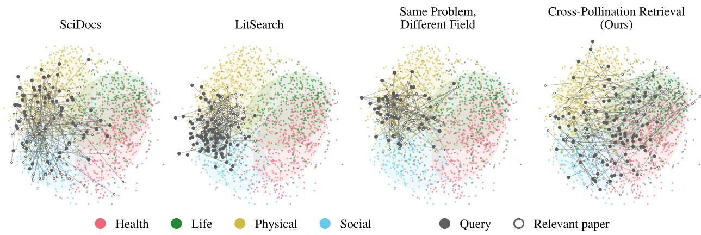  
Figure 1: Queries and their relevant papers stay in a narrow region of science in existing benchmarks, whereas those of our Cross-Pollination Retrieval benchmark span all four domains. Each anel shows the 100 airs farthest a<sub>p</sub>art on a PCA ma<sub>p</sub> of <sub>p</sub>a<sub>p</sub>er embeddin<sub>g</sub>s (E5-base-v2 (Wan<sub>g</sub> et al., 2024)) in SciDocs (Cohan et al., 2020), LitSearch (Ajith et al., 2024), Same Problem, Diferent Field (Kulikowski, 2026), or ours, with back<sub>g</sub>round <sub>p</sub>a<sub>p</sub>ers and elli<sub>p</sub>ses colored b<sub>y</sub> O<sub>p</sub>enAlex domain. Lines join each <sub>q</sub>uer<sub>y</sub> (filled dot) to its relevant <sub>p</sub>a<sub>p</sub>er (o<sub>p</sub>en circle).

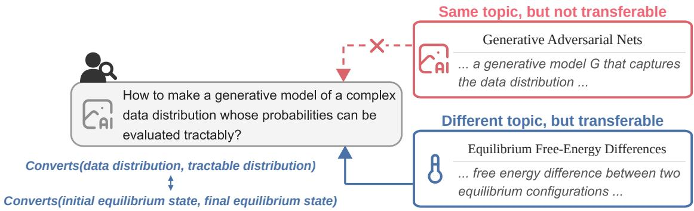  
Figure 2: Example of a cross-pollination pair. The query describes the problem of Sohl-Dickstein et al. (2015), which introduced difusion models. A same-to<sub>p</sub>ic <sub>p</sub>a<sub>p</sub>er, <sub>g</sub>enerative adversarial nets (Goodfellow et al., 2014), cannot be transferred to it. A <sub>p</sub>a<sub>p</sub>er from none<sub>q</sub>uilibrium statistical <sub>p</sub>h<sub>y</sub>sics (Jarz<sub>y</sub>nski, 1997) can: it moves a s<sub>y</sub>stem from an initial to a final <sub>equ</sub>ilib<sub>r</sub>i<sub>um s</sub>t<sub>a</sub>t<sub>e, as</sub> th<sub>e</sub> b<sub>ase paper</sub> t<sub>urns</sub> th<sub>e</sub> d<sub>a</sub>t<sub>a</sub> di<sub>s</sub>t<sub>r</sub>ib<sub>u</sub>ti<sub>on</sub> i<sub>n</sub>t<sub>o a</sub> t<sub>rac</sub>t<sub>a</sub>bl<sub>e one.</sub> Th<sub>e query an</sub>d titl<sub>es are s</sub>h<sub>or</sub>t<sub>ene</sub>d<sub>.</sub>

Y<sub>e</sub>t <sub>re</sub>t<sub>r</sub>i<sub>ev</sub>i<sub>ng suc</sub>h <sub>connec</sub>ti<sub>ons across</sub> fi<sub>e</sub>ld<sub>s re-</sub> <sub>ma</sub>i<sub>ns</sub> <sub>un</sub>d<sub>erexp</sub>l<sub>ore</sub>d<sub>.</sub> C<sub>urren</sub>t <sub>au</sub>t<sub>oma</sub>t<sub>e</sub>d <sub>approac</sub>h<sub>es</sub> <sub>re</sub>l<sub>y on re</sub>t<sub>r</sub>i<sub>evers</sub> t<sub>o</sub> fi<sub>n</sub>d <sub>wor</sub>k th<sub>a</sub>t <sub>may</sub> b<sub>e app</sub>li<sub>ca-</sub> ble to a <sub>g</sub>iven <sub>p</sub>roblem (Liu et al., 2026; Yan<sub>g</sub> et al., 2025<sub>;</sub> Kim et al.<sub>,</sub> 2026<sub>;</sub> Pande<sub>y</sub> et al.<sub>,</sub> 2026<sub>;</sub> Asai et al.<sub>,</sub> 2026). However, the benchmarks used to evaluate th<sub>ese</sub> <sub>re</sub>t<sub>r</sub>i<sub>evers</sub> <sub>pa</sub>i<sub>r</sub> <sub>quer</sub>i<sub>es</sub> <sub>w</sub>ith <sub>re</sub>l<sub>evan</sub>t <sub>papers</sub> th<sub>a</sub>t <sub>are seman</sub>ti<sub>ca</sub>ll<sub>y s</sub>i<sub>m</sub>il<sub>ar an</sub>d li<sub>m</sub>it<sub>e</sub>d i<sub>n</sub> fi<sub>e</sub>ld <sub>coverage</sub> (Fi<sub>g</sub>ure 1). In this work, we extend the field covera<sub>g</sub>e <sub>an</sub>d <sub>as</sub>k <sub>w</sub>h<sub>e</sub>th<sub>er curren</sub>t <sub>re</sub>t<sub>r</sub>i<sub>evers can suppor</sub>t <sub>suc</sub>h cross-pollination retrieval: finding papers across fields <sub>w</sub>h<sub>ose</sub> id<sub>eas can</sub> b<sub>e</sub> t<sub>rans</sub>f<sub>erre</sub>d<sub>.</sub> T<sub>o s</sub>t<sub>u</sub>d<sub>y</sub> thi<sub>s ques-</sub> ti<sub>on, we</sub> b<sub>u</sub>ild <sub>a</sub> C<sub>ross-</sub>P<sub>o</sub>lli<sub>na</sub>ti<sub>on</sub> R<sub>e</sub>t<sub>r</sub>i<sub>eva</sub>l b<sub>enc</sub>h<sub>mar</sub>k (CPR-eval, Fi<sub>g</sub>ure 2) with a <sub>p</sub>i<sub>p</sub>eline that mines citati<sub>ons</sub> th<sub>roug</sub>h <sub>w</sub>hi<sub>c</sub>h <sub>a paper</sub> t<sub>rans</sub>f<sub>erre</sub>d <sub>an</sub> id<sub>ea</sub> f<sub>rom</sub> another to<sub>p</sub>ic. The <sub>p</sub>i<sub>p</sub>eline scales CPR-eval to 1<sub>,</sub>300 queries across 26 fields, 14× more queries and 1.9× more fields than the closest <sub>p</sub>rior work (A<sub>pp</sub>endix E).

E<sub>va</sub>l<sub>ua</sub>ti<sub>ng ex</sub>i<sub>s</sub>ti<sub>ng re</sub>t<sub>r</sub>i<sub>evers on</sub> CPR<sub>-eva</sub>l<sub>, we</sub> fi<sub>n</sub>d that the<sub>y</sub> fail at cross-<sub>p</sub>ollination retrieval (Fi<sub>g</sub>ure 3a). O<sub>n</sub> <sub>average,</sub> <sub>ex</sub>i<sub>s</sub>ti<sub>ng</sub> <sub>re</sub>t<sub>r</sub>i<sub>evers</sub> <sub>reac</sub>h <sub>on</sub>l<sub>y</sub> <sub>a</sub>b<sub>ou</sub>t t<sub>w</sub>i<sub>ce</sub> the Recall@10 of random rankin<sub>g</sub>. Sur<sub>p</sub>risin<sub>g</sub>l<sub>y</sub>, ret<sub>r</sub>i<sub>evers</sub> b<sub>u</sub>ilt <sub>spec</sub>ifi<sub>ca</sub>ll<sub>y</sub> f<sub>or sc</sub>i<sub>en</sub>tifi<sub>c</sub> lit<sub>era</sub>t<sub>ure re-</sub> tr<sup>i</sup>eva<sup>l</sup> <sub>p</sub>er<sup>f</sup>orm worse on avera<sub>g</sub>e t<sup>h</sup>an <sub>g</sub>enera<sup>l</sup>-<sub>p</sub>ur<sub>p</sub>ose ones.

W<sub>e</sub> h<sub>ypo</sub>th<sub>es</sub>i<sub>ze</sub> th<sub>a</sub>t <sub>re</sub>t<sub>r</sub>i<sub>evers</sub> f<sub>a</sub>il <sub>on cross-</sub> <sub>po</sub>lli<sub>na</sub>ti<sub>on re</sub>t<sub>r</sub>i<sub>eva</sub>l b<sub>ecause</sub> th<sub>ey</sub> l<sub>ac</sub>k t<sub>ra</sub>i<sub>n</sub>i<sub>ng</sub> d<sub>a</sub>t<sub>a</sub> f<sub>or</sub> it<sub>.</sub> W<sub>e</sub> th<sub>ere</sub>f<sub>ore cons</sub>t<sub>ruc</sub>t CPR<sub>-</sub>t<sub>ra</sub>i<sub>n, a</sub> l<sub>arge</sub> t<sub>ra</sub>i<sub>n-</sub> in<sub>g</sub> cor<sub>p</sub>us of 10<sub>,</sub>573 <sub>p</sub>airs<sub>,</sub> each linkin<sub>g</sub> a research <sub>pro</sub>bl<sub>em</sub> t<sub>o a paper on ano</sub>th<sub>er</sub> t<sub>op</sub>i<sub>c w</sub>h<sub>ose</sub> id<sub>ea was</sub> transferred to it. Fine-tuning three retrievers, Qwen3-

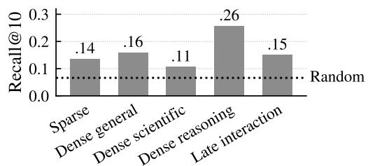  
(a) Existing retrievers on CPR-eval

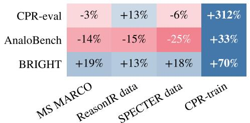  
(b) Relative gain from training Qwen3-Emb-4B

Figure 3: Existing retrievers fail at cross-pollination retrieval, and training on CPR-train helps beyond CPR-eval. (a) Recall@10 on CPR-eval, avera<sub>g</sub>ed within each retriever family; the dotted line marks random ranking. Dense scientific and Dense reasoning denote retrievers trained for <sub>sc</sub>i<sub>en</sub>tifi<sub>c</sub> lit<sub>era</sub>t<sub>ure searc</sub>h <sub>an</sub>d f<sub>or reason</sub>i<sub>ng-</sub>i<sub>n</sub>t<sub>ens</sub>i<sub>ve re-</sub> trieval. (b) Relative <sub>g</sub>ain of Qwen3-Embeddin<sub>g</sub>-4B over its <sub>un</sub>t<sub>ra</sub>i<sub>ne</sub>d <sub>vers</sub>i<sub>on a</sub>ft<sub>er one epoc</sub>h <sub>on</sub> th<sub>e same num</sub>b<sub>er o</sub>f <sub>p</sub>airs from each dataset (Recall@10 on CPR-eval, nDCG@10 on AnaloBench and BRIGHT); for existin<sub>g</sub> datasets, the <sub>mean over</sub> th<sub>ree ran</sub>d<sub>om samp</sub>l<sub>es.</sub> C<sub>o</sub>l<sub>ors are sca</sub>l<sub>e</sub>d <sub>w</sub>ithi<sub>n</sub> <sub>eac</sub>h <sub>row.</sub>

Emb<sub>e</sub>ddin<sub>g</sub>-0<sub>.</sub>6B <sub>a</sub>nd 4B <sub>a</sub>nd ll<sub>a</sub>m<sub>a</sub>-<sub>e</sub>mb<sub>e</sub>d-n<sub>e</sub>m<sub>o</sub>tr<sub>o</sub>n-8b<sub>, o</sub>n CPR-tr<sub>a</sub>in <sub>su</sub>b<sub>s</sub>t<sub>a</sub>nti<sub>a</sub>ll<sub>y</sub> im<sub>p</sub>r<sub>o</sub>v<sub>es a</sub>ll thr<sub>ee o</sub>n CPR-eval, whereas trainin<sub>g</sub> them on existin<sub>g</sub> retrieval datasets brin<sub>g</sub>s little <sub>g</sub>ain (Fi<sub>g</sub>ure 3b). CPR-train also generalizes beyond its own distribution. Qwen3-Embedding-0.6B and 4B trained without one of the four domains, the to<sub>p</sub> level of the O<sub>p</sub>enAlex taxonom<sub>y</sub> (O<sub>p</sub>enAlex, 2026) (health, life, <sub>p</sub>h<sub>y</sub>sical, and social sciences), still im<sub>p</sub>rove on the held-out domain. Im<sub>p</sub>ortantl<sub>y</sub>, the trained retrievers im<sub>p</sub>rove on AnaloBench (Ye et al., 2024) and BRIGHT (Su et al., 2025) more than the same retrievers trained on existin<sub>g</sub> data: web search <sub>q</sub>ueries (MS MARCO (Bajaj et al., 2018)), scientific citations (SPECTER data (Cohan et al., 2020)), or data built for reasonin -intensive retrieval (ReasonIR data (Shao et al., 2025)). We note that these ains come from standard <sub>con</sub>t<sub>ras</sub>ti<sub>ve</sub> fi<sub>ne-</sub>t<sub>un</sub>i<sub>ng w</sub>ith<sub>ou</sub>t <sub>arc</sub>hit<sub>ec</sub>t<sub>ura</sub>l <sub>mo</sub>difi<sub>ca</sub>ti<sub>ons, w</sub>hi<sub>c</sub>h hi<sub>g</sub>hli<sub>g</sub>ht<sub>s</sub> th<sub>e va</sub>l<sub>ue o</sub>f CPR<sub>-</sub>t<sub>ra</sub>i<sub>n as</sub> t<sub>ra</sub>i<sub>n</sub>i<sub>ng</sub> d<sub>a</sub>t<sub>a.</sub>

I<sub>n summary, our con</sub>t<sub>r</sub>ib<sub>u</sub>ti<sub>ons are as</sub> f<sub>o</sub>ll<sub>ows:</sub>

• W<sub>e</sub> i<sub>n</sub>t<sub>ro</sub>d<sub>uce cross-po</sub>lli<sub>na</sub>ti<sub>on re</sub>t<sub>r</sub>i<sub>eva</sub>l <sub>an</sub>d <sub>re</sub>l<sub>ease</sub> CPR<sub>-</sub>D<sub>a</sub>t<sub>ase</sub>t<sub>,</sub> b<sub>u</sub>ilt <sub>sca</sub>l<sub>a</sub>bl<sub>y</sub> f<sub>rom c</sub>it<sub>a</sub>ti<sub>ons:</sub> CPR<sub>-eva</sub>l with 1<sub>,</sub>300 <sub>q</sub>ueries across 26 fields<sub>,</sub> and CPR-train with 10<sub>,</sub>573 <sub>p</sub>airs.

• W<sub>e s</sub>h<sub>ow</sub> th<sub>a</sub>t <sub>ex</sub>i<sub>s</sub>ti<sub>ng re</sub>t<sub>r</sub>i<sub>evers</sub> f<sub>a</sub>il <sub>a</sub>t <sub>cross-po</sub>lli<sub>na</sub>ti<sub>on re</sub>t<sub>r</sub>i<sub>eva</sub>l<sub>, an</sub>d <sub>re</sub>t<sub>r</sub>i<sub>evers</sub> b<sub>u</sub>ilt f<sub>or sc</sub>i<sub>en</sub>tifi<sub>c</sub> lit<sub>era</sub>t<sub>ure per</sub>f<sub>orm wors</sub>t <sub>on average.</sub>

• W<sub>e s</sub>h<sub>ow</sub> th<sub>a</sub>t t<sub>ra</sub>i<sub>n</sub>i<sub>ng on</sub> CPR<sub>-</sub>t<sub>ra</sub>i<sub>n</sub> i<sub>mproves re</sub>t<sub>r</sub>i<sub>evers more</sub> th<sub>an</sub> t<sub>ra</sub>i<sub>n</sub>i<sub>ng on ex</sub>i<sub>s</sub>ti<sub>ng</sub> d<sub>a</sub>t<sub>a, on</sub> CPR<sub>-eva</sub>l<sub>,</sub> h<sub>e</sub>ld<sub>-ou</sub>t d<sub>oma</sub>i<sub>ns,</sub> A<sub>na</sub>l<sub>o</sub>B<sub>enc</sub>h<sub>, an</sub>d BRIGHT<sub>.</sub> Thi<sub>s es</sub>t<sub>a</sub>bli<sub>s</sub>h<sub>es</sub> CPR<sub>-</sub>t<sub>ra</sub>i<sub>n as an e</sub>f<sub>ec</sub>ti<sub>ve resource</sub> f<sub>or</sub> t<sub>ra</sub>i<sub>n</sub>i<sub>ng re</sub>t<sub>r</sub>i<sub>evers</sub> b<sub>eyon</sub>d t<sub>op</sub>i<sub>ca</sub>l <sub>s</sub>i<sub>m</sub>il<sub>ar</sub>it<sub>y.</sub>

We release CPR-Dataset and the pipeline that collects it. We will release the Qwen3-Embedding retrievers t<sub>ra</sub>i<sub>ne</sub>d <sub>on</sub> CPR<sub>-</sub>t<sub>ra</sub>i<sub>n upon pu</sub>bli<sub>ca</sub>ti<sub>on, an</sub>d h<sub>ope</sub> th<sub>a</sub>t th<sub>ese resources</sub> d<sub>r</sub>i<sub>ve new researc</sub>h <sub>on cross-po</sub>lli<sub>na</sub>ti<sub>on</sub> <sub>re</sub>t<sub>r</sub>i<sub>eva</sub>l<sub>.</sub>

## 2. Related Work

Inspiration retrieval for scientific discovery. In scientific literature retrieval, inspiration retrieval is the task of findin rior a ers that can ins ire new research ideas. ScholarCatal st (Kim et al. 2026) defines an inspiration as a prior paper that, according to the authors of a project, helped or could have helped advance it. MUSES (Pande<sub>y</sub> et al., 2026) defines it as a <sub>p</sub>rior <sub>p</sub>a<sub>p</sub>er that the authors cite in their next <sub>p</sub>a<sub>p</sub>er. MOOSE-Chem (Yan<sub>g</sub> et al., 2025) and ResearchBench (Liu et al., 2026) define it as a reference that domain ex<sub>p</sub>erts or an LLM, respectively, judge necessary to form the main hypothesis of a paper. None of these definitions <sub>requ</sub>i<sub>res an</sub> i<sub>nsp</sub>i<sub>ra</sub>ti<sub>on</sub> t<sub>o come</sub> f<sub>rom a</sub> fi<sub>e</sub>ld <sub>o</sub>th<sub>er</sub> th<sub>an</sub> th<sub>a</sub>t <sub>o</sub>f th<sub>e query.</sub> S<sub>ome wor</sub>k d<sub>oes</sub> l<sub>oo</sub>k f<sub>or papers</sub> i<sub>n</sub> other fields: SOLVENT (Chan et al., 2018) finds analo<sub>g</sub>ies between <sub>p</sub>a<sub>p</sub>ers across domains, and Same Problem, Diferent Field (Kulikowski, 2026) finds <sub>p</sub>a<sub>p</sub>ers in other fields that solve the same com<sub>p</sub>utational <sub>p</sub>roblem. B<sub>ecause</sub> fi<sub>n</sub>di<sub>ng suc</sub>h <sub>ma</sub>t<sub>c</sub>h<sub>es</sub> b<sub>y</sub> h<sub>an</sub>d i<sub>s cos</sub>tl<sub>y,</sub> b<sub>o</sub>th <sub>are eva</sub>l<sub>ua</sub>t<sub>e</sub>d <sub>on sma</sub>ll <sub>cura</sub>t<sub>e</sub>d <sub>se</sub>t<sub>s o</sub>f <sub>a</sub>t <sub>mos</sub>t 109 <sub>papers.</sub> I<sub>n con</sub>t<sub>ras</sub>t<sub>,</sub> CPR<sub>-</sub>D<sub>a</sub>t<sub>ase</sub>t <sub>requ</sub>i<sub>res every pos</sub>iti<sub>ve</sub> t<sub>o come</sub> f<sub>rom ano</sub>th<sub>er</sub> t<sub>op</sub>i<sub>c an</sub>d b<sub>u</sub>ild<sub>s suc</sub>h <sub>pa</sub>i<sub>rs a</sub>t <sub>sca</sub>l<sub>e</sub> f<sub>rom</sub> <sub>c</sub>it<sub>a</sub>ti<sub>ons.</sub>

Scientific literature retrievers. Most retrievers for scientific literature learn relevance from citations. SPECTER (Cohan et al., 2020) treats a <sub>p</sub>a<sub>p</sub>er that the <sub>q</sub>uer<sub>y</sub> <sub>p</sub>a<sub>p</sub>er cites as a <sub>p</sub>ositive and an uncited <sub>p</sub>a-<sub>p</sub>er as a ne<sub>g</sub>ative, SciNCL (Ostendorf et al., 2022) sam<sub>p</sub>les <sub>p</sub>ositives and ne<sub>g</sub>atives from nei<sub>g</sub>hborhoods in a citation embeddin<sub>g</sub> s<sub>p</sub>ace, and SPECTER2 (Sin<sub>g</sub>h et al., 2023) extends this trainin<sub>g</sub> to multi<sub>p</sub>le task formats. The O<sub>p</sub>enScholar retriever (Asai et al., 2026) instead ada<sub>p</sub>ts to scientific text without relevance labels, continuin<sub>g</sub> the unsu<sub>p</sub>ervised contrastive <sub>p</sub>re-trainin<sub>g</sub> of Contriever (Izacard et al., 2022) on scientific <sub>p</sub>a<sub>p</sub>ers. N<sub>one o</sub>f th<sub>ese re</sub>t<sub>r</sub>i<sub>evers</sub> i<sub>s</sub> d<sub>es</sub>i<sub>gne</sub>d f<sub>or cross-po</sub>lli<sub>na</sub>ti<sub>on re</sub>t<sub>r</sub>i<sub>eva</sub>l<sub>,</sub> f<sub>or w</sub>hi<sub>c</sub>h <sub>we</sub> b<sub>u</sub>ild CPR<sub>-eva</sub>l <sub>as an eva</sub>l<sub>ua</sub>ti<sub>on</sub> set and CPR-train as a trainin<sub>g</sub> set.

Retrieval beyond semantic similarity. Several lines of work define relevance beyond the semantic similarity of content. Reasonin<sub>g</sub>-intensive retrieval benchmarks (Su et al., 2025; Zhao et al., 2026) are desi<sub>g</sub>ned so that th<sub>e re</sub>l<sub>evan</sub>t d<sub>ocumen</sub>t<sub>s</sub> f<sub>or a query can</sub> b<sub>e</sub> id<sub>en</sub>tifi<sub>e</sub>d <sub>on</sub>l<sub>y</sub> th<sub>roug</sub>h <sub>a</sub>dditi<sub>ona</sub>l <sub>reason</sub>i<sub>ng s</sub>t<sub>eps.</sub> S<sub>pec</sub>ifi<sub>ca</sub>ll<sub>y,</sub> BRIGHT <sub>pa</sub>i<sub>rs na</sub>t<sub>ura</sub>l<sub>-</sub>l<sub>anguage ques</sub>ti<sub>ons</sub> f<sub>rom seven</sub> St<sub>ac</sub>kE<sub>xc</sub>h<sub>ange s</sub>it<sub>es w</sub>ith th<sub>e we</sub>b <sub>pages c</sub>it<sub>e</sub>d i<sub>n</sub> th<sub>e</sub>i<sub>r</sub> answers, alon<sub>g</sub>side codin<sub>g</sub> and mathematics subsets that rel<sub>y</sub> on domain-s<sub>p</sub>ecific notation (Zhao et al., 2026). Analo<sub>gy</sub> datasets (Ye et al., 2024; Jia<sub>y</sub>an<sub>g</sub> et al., 2023) instead <sub>p</sub>air texts that share the same underl<sub>y</sub>in<sub>g</sub> <sub>re</sub>l<sub>a</sub>ti<sub>ona</sub>l <sub>s</sub>t<sub>ruc</sub>t<sub>ure.</sub> I<sub>n</sub> A<sub>na</sub>l<sub>o</sub>B<sub>enc</sub>h<sub>,</sub> th<sub>e au</sub>th<sub>ors wr</sub>it<sub>e pa</sub>i<sub>rs o</sub>f <sub>ana</sub>l<sub>ogous sen</sub>t<sub>ences on</sub> dif<sub>eren</sub>t t<sub>op</sub>i<sub>cs, an</sub>d GPT<sub>-</sub>4 <sub>expan</sub>d<sub>s eac</sub>h <sub>sen</sub>t<sub>ence</sub> i<sub>n</sub>t<sub>o s</sub>t<sub>or</sub>i<sub>es o</sub>f 10 <sub>an</sub>d 30 <sub>sen</sub>t<sub>ences.</sub> W<sub>e</sub> d<sub>e</sub>fi<sub>ne cross-po</sub>lli<sub>na</sub>ti<sub>on re</sub>t<sub>r</sub>i<sub>eva</sub>l <sub>as</sub> <sub>ano</sub>th<sub>er</sub> li<sub>ne,</sub> i<sub>n w</sub>hi<sub>c</sub>h <sub>re</sub>l<sub>evan</sub>t <sub>papers come</sub> f<sub>rom a</sub> dif<sub>eren</sub>t t<sub>op</sub>i<sub>c ye</sub>t <sub>o</sub>f<sub>er</sub> i<sub>ns</sub>i<sub>g</sub>ht<sub>s</sub> t<sub>rans</sub>f<sub>era</sub>bl<sub>e</sub> t<sub>o</sub> th<sub>e researc</sub>h <sub>pro</sub>bl<sub>em</sub> <sub>o</sub>f th<sub>e</sub> <sub>query.</sub> W<sub>e</sub> <sub>a</sub>l<sub>so</sub> t<sub>es</sub>t <sub>w</sub>h<sub>e</sub>th<sub>er</sub> <sub>w</sub>h<sub>a</sub>t <sub>re</sub>t<sub>r</sub>i<sub>evers</sub> l<sub>earn</sub> f<sub>rom</sub> CPR<sub>-</sub>t<sub>ra</sub>i<sub>n</sub> <sub>ex</sub>t<sub>en</sub>d<sub>s</sub> t<sub>o</sub> th<sub>e</sub> <sub>o</sub>th<sub>er</sub> t<sub>wo</sub> li<sub>nes.</sub>

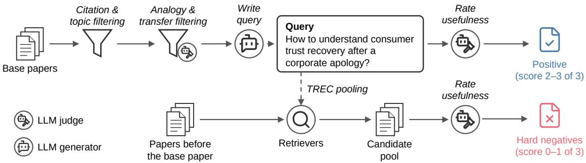  
Figure 4: Construction pipeline of CPR-Dataset. Top: cited papers on other topics are filtered for analogy and transfer, and those rated useful for the <sub>g</sub>enerated <sub>q</sub>uer<sub>y</sub> become <sub>p</sub>ositives (Section 3.2). Bottom: hard ne<sub>g</sub>atives are candidates <sub>p</sub>ooled b<sub>y</sub> three retrievers and rated not useful (Section 3.3).

## 3. Cross-Pollination Retrieval

We build CPR-Dataset in three sta<sub>g</sub>es (Fi<sub>g</sub>ure 4): we define relevance throu<sub>g</sub>h analo<sub>gy</sub> to <sub>g</sub>o be<sub>y</sub>ond semantic similarit<sub>y</sub> (Section 3.1), mine <sub>p</sub>ositives from citations to <sub>g</sub>round them in transfers that authors actuall<sub>y</sub> made (Section 3.2), and collect same-to ic hard ne atives so that to ic alone does not sufice (Section 3.3).

## 3.1. Definition of the Cross-Pollination Retrieval Task

Gi<sub>ven a researc</sub>h <sub>pro</sub>bl<sub>em, cross-po</sub>lli<sub>na</sub>ti<sub>on re</sub>t<sub>r</sub>i<sub>eva</sub>l i<sub>s</sub> th<sub>e</sub> t<sub>as</sub>k <sub>o</sub>f fi<sub>n</sub>di<sub>ng papers on o</sub>th<sub>er</sub> t<sub>op</sub>i<sub>cs w</sub>h<sub>ose</sub> id<sub>eas</sub> can be transferred to that problem. We denote as � a base paper addressing a research problem $p _ { q } .$ <sub>,</sub> <sub>an</sub>d l<sub>e</sub>t $x _ { q }$ be a natural-language query describing this problem. We aim to retrieve a paper � addressing another research <sub>pro</sub>bl<sub>em</sub> $p _ { d } .$ <sub>, w</sub>h<sub>ose</sub> id<sub>eas can</sub> h<sub>e</sub>l<sub>p so</sub>l<sub>ve</sub> $p _ { q }$

Findin<sub>g</sub> transferable ideas across fields means that: (1) The retrieved <sub>p</sub>a<sub>p</sub>er has to come from outside the <sub>or</sub>i<sub>g</sub>i<sub>na</sub>l <sub>pro</sub>bl<sub>em</sub>’<sub>s</sub> fi<sub>e</sub>ld<sub>.</sub> W<sub>e argue</sub> th<sub>a</sub>t <sub>a goo</sub>d <sub>proxy</sub> f<sub>or quan</sub>tif<sub>y</sub>i<sub>ng</sub> thi<sub>s</sub> i<sub>s requ</sub>i<sub>r</sub>i<sub>ng</sub> th<sub>a</sub>t <sub>no</sub> t<sub>op</sub>i<sub>cs</sub> d<sub>escr</sub>ibi<sub>ng</sub> the two <sub>p</sub>a<sub>p</sub>ers are shared. (2) However, bein<sub>g</sub> from diferent to<sub>p</sub>ics does not tell us how an idea develo<sub>p</sub>ed for <sub>one pro</sub>bl<sub>em cou</sub>ld b<sub>e app</sub>li<sub>e</sub>d t<sub>o ano</sub>th<sub>er.</sub> W<sub>e</sub> f<sub>ocus on cases w</sub>h<sub>ere</sub> th<sub>e</sub> t<sub>wo pro</sub>bl<sub>ems s</sub>h<sub>are some un</sub>d<sub>er</sub>l<sub>y</sub>i<sub>ng</sub> <sub>s</sub>t<sub>ruc</sub>t<sub>ure, a</sub>ll<sub>ow</sub>i<sub>ng us</sub> t<sub>o</sub> id<sub>en</sub>tif<sub>y correspon</sub>d<sub>ences</sub> b<sub>e</sub>t<sub>ween</sub> th<sub>em an</sub>d <sub>exp</sub>l<sub>a</sub>i<sub>n</sub> h<sub>ow a so</sub>l<sub>u</sub>ti<sub>on</sub> d<sub>eve</sub>l<sub>ope</sub>d f<sub>or</sub> one could be transferred to the other. We characterize such connections throu<sub>g</sub>h structural analo<sub>gy</sub>. (3) Fi<sub>na</sub>ll<sub>y,</sub> <sub>a</sub> <sub>correspon</sub>d<sub>ence</sub> d<sub>oes</sub> <sub>no</sub>t <sub>guaran</sub>t<sub>ee</sub> th<sub>a</sub>t th<sub>e</sub> t<sub>rans</sub>f<sub>er</sub> i<sub>s</sub> <sub>use</sub>f<sub>u</sub>l<sub>.</sub> E<sub>ven</sub> if t<sub>wo</sub> <sub>pro</sub>bl<sub>ems</sub> <sub>are</sub> <sub>ana</sub>l<sub>ogous,</sub> th<sub>e so</sub>l<sub>u</sub>ti<sub>on</sub> d<sub>eve</sub>l<sub>ope</sub>d f<sub>or one m</sub>i<sub>g</sub>ht <sub>no</sub>t h<sub>e</sub>l<sub>p so</sub>l<sub>ve</sub> th<sub>e o</sub>th<sub>er.</sub> W<sub>e</sub> th<sub>ere</sub>f<sub>ore a</sub>l<sub>so requ</sub>i<sub>re</sub> th<sub>a</sub>t th<sub>e re</sub>t<sub>r</sub>i<sub>eve</sub>d <sub>paper</sub>’<sub>s con</sub>t<sub>r</sub>ib<sub>u</sub>ti<sub>on, carr</sub>i<sub>e</sub>d th<sub>roug</sub>h thi<sub>s correspon</sub>d<sub>ence,</sub> h<sub>e</sub>l<sub>ps so</sub>l<sub>ve</sub> th<sub>e or</sub>i<sub>g</sub>i<sub>na</sub>l <sub>pro</sub>bl<sub>em.</sub> W<sub>e</sub> f<sub>orma</sub>li<sub>ze</sub> th<sub>ese</sub> <sub>con</sub>diti<sub>ons</sub> b<sub>e</sub>l<sub>ow.</sub>

1) Cross-topic. � shares no assigned topic with �, $T ( q ) \cap T ( d ) = \emptyset$ <sub>, w</sub>h<sub>ere</sub> $T ( \cdot )$ d<sub>eno</sub>t<sub>es</sub> th<sub>e se</sub>t <sub>o</sub>f t<sub>op</sub>i<sub>cs</sub> th<sub>a</sub>t <sub>a</sub> t<sub>op</sub>i<sub>c c</sub>l<sub>ass</sub>ifi<sub>er ass</sub>i<sub>gns</sub> t<sub>o a paper</sub> $( \mathrm { e . g . }$ , Gaussian Processes and Bayesian Inference for the base paper in Figure 2 and Advanced Thermodynamics and Statistical Mechanics for the relevant paper; more examples in Table 5).

2) Analogous. Following Shen et al. (2026) and structure-mapping theory (Gentner, 1983), we represent the research problem of � as $p _ { q } = ( O _ { q } , R _ { q } )$ <sub>, an</sub>d lik<sub>ew</sub>i<sub>se</sub> $p _ { d } = ( O _ { d } , R _ { d } )$ for �. $O _ { q }$ is the set of objects the problem i<sub>nvo</sub>l<sub>ves an</sub>d $R _ { q }$ i<sub>s</sub> th<sub>e se</sub>t <sub>o</sub>f <sub>re</sub>l<sub>a</sub>ti<sub>ons among</sub> th<sub>em, eac</sub>h <sub>o</sub>f th<sub>e</sub> f<sub>orm</sub> $r ( o _ { 1 } , \ldots , o _ { k } )$ <sub>w</sub>ith <sub>a re</sub>l<sub>a</sub>ti<sub>on</sub> t<sub>ype</sub> $r , k \geq 2 ,$ <sub>an</sub>d $o _ { i } \in O _ { q }$

An ana<sup>l</sup>ogy $\mathcal { A } = ( M , S )$ consists of an object mapping $M : O _ { q }  O _ { d } .$ , which gives each object of $p _ { q }$ at most one counter<sub>p</sub>art <sup>i</sup>n $p _ { d }$ <sub>,</sub> <sub>an</sub>d th<sub>e</sub> <sub>se</sub>t <sub>o</sub>f <sub>re</sub>l<sub>a</sub>ti<sub>ons</sub> <sub>o</sub>f $p _ { q }$ that also hold in �<sub>�</sub> under �:

$$
S = \{ r ( \mathbf { o } ) \in R _ { q } : r ( M ( \mathbf { o } ) ) \in R _ { d } \} ,
$$

<sub>w</sub>h<sub>ere</sub> $M ( \mathbf { o } )$ applies � to each argument of $\mathbf { o } = \left( o _ { 1 } , \ldots , o _ { k } \right)$ . � is analogous to $q$ if th<sub>ere</sub> i<sub>s</sub> <sub>an</sub> <sub>ana</sub>l<sub>ogy</sub> <sub>w</sub>ith $| M | \geq 2$ <sub>an</sub>d $S \neq \emptyset$

F<sub>or</sub> <sub>examp</sub>l<sub>e,</sub> th<sub>e</sub> b<sub>ase</sub> <sub>paper</sub> i<sub>n</sub> Fi<sub>gure</sub> 2 l<sub>earns</sub> <sub>a</sub> <sub>genera</sub>ti<sub>ve</sub> <sub>mo</sub>d<sub>e</sub>l b<sub>y</sub> <sub>gra</sub>d<sub>ua</sub>ll<sub>y</sub> <sub>conver</sub>ti<sub>ng</sub> <sub>a</sub> <sub>comp</sub>l<sub>ex</sub> d<sub>a</sub>t<sub>a</sub> di<sub>s</sub>t<sub>r</sub>ib<sub>u</sub>ti<sub>on</sub> i<sub>n</sub>t<sub>o</sub> <sub>a</sub> t<sub>rac</sub>t<sub>a</sub>bl<sub>e</sub> <sub>one,</sub> <sub>an</sub>d th<sub>e</sub> <sub>re</sub>l<sub>evan</sub>t <sub>paper</sub> d<sub>r</sub>i<sub>ves</sub> <sub>a</sub> <sub>p</sub>h<sub>ys</sub>i<sub>ca</sub>l <sub>sys</sub>t<sub>em</sub> f<sub>rom</sub> <sub>one</sub> <sub>equ</sub>ilib<sub>r</sub>i<sub>um</sub> <sub>s</sub>t<sub>a</sub>t<sub>e</sub> t<sub>o</sub> <sub>ano</sub>th<sub>er.</sub> Th<sub>e</sub> b<sub>o</sub>tt<sub>om</sub> l<sub>e</sub>ft <sub>o</sub>f th<sub>e</sub> fi<sub>gure s</sub>h<sub>ows</sub> th<sub>e</sub>i<sub>r ana</sub>l<sub>ogy:</sub> th<sub>e same re</sub>l<sub>a</sub>ti<sub>on,</sub> C<sub>onverts,</sub> h<sub>o</sub>ld<sub>s</sub> b<sub>e</sub>t<sub>ween</sub> th<sub>e</sub> t<sub>wo</sub> di<sub>s</sub>t<sub>r</sub>ib<sub>u</sub>ti<sub>ons</sub> <sub>an</sub>d b<sub>e</sub>t<sub>ween</sub> th<sub>e</sub> t<sub>wo</sub> <sub>equ</sub>ilib<sub>r</sub>i<sub>um</sub> <sub>s</sub>t<sub>a</sub>t<sub>es.</sub> F<sub>orma</sub>ll<sub>y,</sub>

� = {data dist. ↦→ initial equilibrium state, tractable dist. ↦→ final equilibrium state},

� = {Converts(data dist., tractable dist.)}.

See A<sub>pp</sub>endix A for more exam<sub>p</sub>les.

3) Useful. � is useful to $q$ if it<sub>s con</sub>t<sub>r</sub>ib<sub>u</sub>ti<sub>on, a me</sub>th<sub>o</sub>d<sub>,</sub> fi<sub>n</sub>di<sub>ng, or</sub> f<sub>ormu</sub>l<sub>a</sub>ti<sub>on, carr</sub>i<sub>e</sub>d th<sub>roug</sub>h ${ \mathcal { A } } ,$ <sub>can</sub> b<sub>e</sub> <sub>use</sub>d t<sub>o so</sub>l<sub>ve</sub> $p _ { q }$

## 3.2. Positive Collection

W<sub>e</sub> <sub>co</sub>ll<sub>ec</sub>t <sub>pos</sub>iti<sub>ve</sub> <sub>pa</sub>i<sub>rs</sub> i<sub>n</sub> th<sub>e</sub> f<sub>o</sub>ll<sub>ow</sub>i<sub>ng</sub> th<sub>ree</sub> <sub>s</sub>t<sub>eps:</sub>

Step P1: Cross-topic citation mining. We take the topics of each paper from OpenAlex (2026), which <sub>organ</sub>i<sub>zes researc</sub>h i<sub>n</sub>t<sub>o</sub> 4 d<sub>oma</sub>i<sub>ns,</sub> 26 fi<sub>e</sub>ld<sub>s,</sub> 252 <sub>su</sub>bfi<sub>e</sub>ld<sub>s, an</sub>d <sub>a</sub>b<sub>ou</sub>t 4<sub>,</sub>500 t<sub>op</sub>i<sub>cs.</sub> It <sub>ass</sub>i<sub>gns up</sub> t<sub>o</sub> th<sub>ree</sub> t<sub>op</sub>i<sub>cs</sub> t<sub>o eac</sub>h <sub>paper us</sub>i<sub>ng a c</sub>l<sub>ass</sub>ifi<sub>er</sub> th<sub>a</sub>t <sub>com</sub>bi<sub>nes a</sub> fi<sub>ne-</sub>t<sub>une</sub>d <sub>mu</sub>ltili<sub>ngua</sub>l BERT <sub>enco</sub>d<sub>er o</sub>f it<sub>s</sub> titl<sub>e an</sub>d abstract with its journal name and citations. We collect the papers for dataset construction from Semantic Scholar (Kinne<sub>y</sub> et al., 2025), which <sub>p</sub>rovides both their full text and citation information. For each of the 26 O<sub>pen</sub>Al<sub>ex</sub> fi<sub>e</sub>ld<sub>s, we</sub> t<sub>a</sub>k<sub>e</sub> th<sub>e venues</sub> i<sub>n</sub> th<sub>e</sub> t<sub>op</sub> 20% b<sub>y</sub> i<sub>mpac</sub>t f<sub>ac</sub>t<sub>or an</sub>d <sub>samp</sub>l<sub>e</sub> th<sub>e same num</sub>b<sub>er o</sub>f b<sub>ase</sub> papers from their 2010–2025 publications. Among the papers � cited by each base paper $q ,$ <sub>we ex</sub>t<sub>rac</sub>t th<sub>e</sub> <sub>pa</sub>i<sub>rs</sub> <sub>w</sub>h<sub>ose</sub> t<sub>op</sub>i<sub>cs</sub> d<sub>o</sub> <sub>no</sub>t <sub>over</sub>l<sub>ap.</sub>

Step P2: Analogy judgment. An LLM reads the titles and abstracts of � and � and the sentences in $q$ th<sub>a</sub>t cite �. It extracts the object mapping � and shared relations � of Section 3.1 and keeps the pair only if they f<sub>orm</sub> <sub>an</sub> <sub>ana</sub>l<sub>ogy</sub> <sub>an</sub>d $q$ uses, or could use, the contribution of � through it (Appendix B.1). This judgment discards about 91% of the cross-topic citation pairs, mostly because � cites � only as background. A second LLM <sub>ca</sub>ll <sub>c</sub>h<sub>ec</sub>k<sub>s</sub> th<sub>a</sub>t $q$ <sub>ac</sub>t<sub>ua</sub>ll<sub>y uses</sub> th<sub>e con</sub>t<sub>r</sub>ib<sub>u</sub>ti<sub>on o</sub>f $d ,$ rejecting pairs that address the same problem, cite � onl<sub>y</sub> as back<sub>g</sub>round, or rest on unsu<sub>pp</sub>orted ma<sub>pp</sub>in<sub>g</sub>s (A<sub>pp</sub>endix B.2). This verification a<sub>g</sub>rees with a human <sub>anno</sub>t<sub>a</sub>t<sub>or a</sub>t C<sub>o</sub>h<sub>en</sub>’<sub>s</sub> $\kappa = 0 . 8 4$ (A<sub>pp</sub>endix C).

Step P3: Query generation and verification. For each remaining pair, an LLM writes a query $x _ { q }$ th<sub>a</sub>t <sub>s</sub>t<sub>a</sub>t<sub>es</sub> onl<sub>y</sub> the <sub>p</sub>roblem of � (A<sub>pp</sub>endix B.3). It reads the abstract of $q$ <sub>an</sub>d th<sub>e sen</sub>t<sub>ences c</sub>iti<sub>ng</sub> $d ,$ <sub>w</sub>ith th<sub>e c</sub>it<sub>a</sub>ti<sub>on</sub> masked, and leaves out the contribution of �. When several queries from the same � ask about the same problem, an LLM keeps the pair with the strongest analogy, carrying over most of �’s method, formulation, or finding (A<sub>pp</sub>endix B.4). Finall<sub>y</sub>, since the <sub>q</sub>uer<sub>y</sub> omits the citation context, an LLM rates on a 0–3 scale how well � <sub>can</sub> <sub>so</sub>l<sub>ve</sub> th<sub>e</sub> <sub>pro</sub>bl<sub>em</sub> <sub>s</sub>t<sub>a</sub>t<sub>e</sub>d i<sub>n</sub> $x _ { q } ,$ <sub>g</sub><sup>i</sup>v<sup>i</sup>n<sub>g</sub> $u ( q , d )$ <sub>,</sub> <sub>an</sub>d <sub>we</sub> k<sub>eep</sub> <sub>on</sub>l<sub>y</sub> <sub>pa</sub>i<sub>rs</sub> <sub>w</sub>ith $u ( q , d ) \geq 2$ (A<sub>pp</sub>endix B.5). Bi<sub>nar</sub>i<sub>ze</sub>d <sub>a</sub>t 2<sub>,</sub> th<sub>ese</sub> <sub>scores</sub> <sub>agree</sub> <sub>w</sub>ith <sub>a</sub> h<sub>uman</sub> <sub>anno</sub>t<sub>a</sub>t<sub>or</sub> <sub>a</sub>t C<sub>o</sub>h<sub>en</sub>’<sub>s</sub> $\kappa = 0 . 8 4$ (A<sub>pp</sub>endix C).

## 3.3. Hard Negative Collection

H<sub>ar</sub>d <sub>nega</sub>ti<sub>ves are papers</sub> th<sub>a</sub>t l<sub>oo</sub>k <sub>re</sub>l<sub>evan</sub>t t<sub>o</sub> th<sub>e query</sub> b<sub>u</sub>t <sub>canno</sub>t b<sub>e use</sub>d t<sub>o so</sub>l<sub>ve</sub> th<sub>e pro</sub>bl<sub>em o</sub>f $q .$ . The<sub>y</sub> <sub>serve</sub> t<sub>wo</sub> <sub>purposes.</sub> I<sub>n</sub> <sub>eva</sub>l<sub>ua</sub>ti<sub>on,</sub> th<sub>ey</sub> k<sub>eep</sub> <sub>a</sub> <sub>re</sub>t<sub>r</sub>i<sub>ever</sub> f<sub>rom</sub> <sub>succee</sub>di<sub>ng</sub> th<sub>roug</sub>h t<sub>op</sub>i<sub>ca</sub>l <sub>s</sub>i<sub>m</sub>il<sub>ar</sub>it<sub>y</sub> <sub>a</sub>l<sub>one;</sub> b<sub>enc</sub>h<sub>mar</sub>k<sub>s</sub> f<sub>or reason</sub>i<sub>ng-</sub>i<sub>n</sub>t<sub>ens</sub>i<sub>ve re</sub>t<sub>r</sub>i<sub>eva</sub>l <sub>an</sub>d i<sub>nsp</sub>i<sub>ra</sub>ti<sub>on re</sub>t<sub>r</sub>i<sub>eva</sub>l lik<sub>ew</sub>i<sub>se a</sub>dd <sub>can</sub>did<sub>a</sub>t<sub>es</sub> th<sub>a</sub>t <sub>are re</sub>l<sub>a</sub>t<sub>e</sub>d to the <sub>q</sub>uer<sub>y</sub> but do not meet its need (Kim et al., 2026; Su et al., 2025; Liu et al., 2026). In trainin<sub>g</sub>, the<sub>y</sub> k<sub>eep a re</sub>t<sub>r</sub>i<sub>ever</sub> f<sub>rom</sub> l<sub>earn</sub>i<sub>ng</sub> th<sub>e s</sub>h<sub>or</sub>t<sub>cu</sub>t <sub>o</sub>f <sub>ran</sub>ki<sub>ng</sub> b<sub>y sur</sub>f<sub>ace s</sub>i<sub>m</sub>il<sub>ar</sub>it<sub>y: re</sub>t<sub>r</sub>i<sub>evers</sub> f<sub>or reason</sub>i<sub>ng-</sub>i<sub>n</sub>t<sub>ens</sub>i<sub>ve</sub> retrieval are likewise trained with ne<sub>g</sub>atives that look relevant to the <sub>q</sub>uer<sub>y</sub> but do not hel<sub>p</sub> answer it (Shao et al., 2025; Sun et al., 2026). To collect such ne<sub>g</sub>atives, we first <sub>p</sub>ool candidates that look relevant to the <sub>q</sub>uer<sub>y</sub> (Ste<sub>p</sub> N1), and then we jud<sub>g</sub>e ever<sub>y</sub> candidate before usin<sub>g</sub> it as a ne<sub>g</sub>ative (Ste<sub>p</sub> N2).

Step N1: Candidate pooling. We draw candidates from the a ers in the to 20% venues of Section 3.2 <sub>an</sub>d th<sub>e</sub> <sub>papers</sub> th<sub>ey</sub> <sub>c</sub>it<sub>e,</sub> k<sub>eep</sub>i<sub>ng</sub> th<sub>ose</sub> <sub>w</sub>ith <sub>an</sub> <sub>a</sub>b<sub>s</sub>t<sub>rac</sub>t<sub>.</sub> F<sub>or</sub> <sub>eac</sub>h <sub>query,</sub> <sub>we</sub> <sub>cons</sub>id<sub>er</sub> <sub>on</sub>l<sub>y</sub> <sub>papers</sub> <sub>pu</sub>bli<sub>s</sub>h<sub>e</sub>d b<sub>e</sub>f<sub>ore</sub> $q ,$ <sub>s</sub>i<sub>nce</sub> th<sub>ese were</sub> th<sub>e a ers ava</sub>il<sub>a</sub>bl<sub>e w</sub>h<sub>en</sub> it<sub>s au</sub>th<sub>ors</sub> f<sub>ace</sub>d th<sub>e ro</sub>bl<sub>em.</sub> W<sub>e</sub> th<sub>en s</sub> lit th<sub>em</sub> i<sub>n</sub>t<sub>o</sub> t<sup>h</sup>ree <sub>g</sub>rou<sub>p</sub>s <sup>b</sup><sub>y</sub> to<sub>p</sub><sup>i</sup>c: <sub>p</sub>a<sub>p</sub>ers s<sup>h</sup>ar<sup>i</sup>n<sub>g</sub> a to<sub>p</sub><sup>i</sup>c w<sup>i</sup>t<sup>h</sup> $q ,$ <sub>papers</sub> <sub>s</sub>h<sub>ar</sub>i<sub>ng</sub> <sub>a</sub> t<sub>op</sub>i<sub>c</sub> <sub>on</sub>l<sub>y</sub> <sub>w</sub>ith th<sub>e</sub> <sub>pos</sub>iti<sub>ve</sub> $d ^ { + }$ <sub>,</sub> <sub>an</sub>d th<sub>e</sub> <sub>res</sub>t<sub>.</sub> E<sub>ac</sub>h <sub>group</sub> fi<sub>rs</sub>t t<sub>a</sub>k<sub>es</sub> th<sub>e</sub> <sub>papers</sub> th<sub>a</sub>t $q$ cites but that the analogy judgment of Section 3.2 rejected. The rest of the <sub>g</sub>rou<sub>p</sub> is filled b<sub>y</sub> TREC-st<sub>y</sub>le <sub>p</sub>oolin<sub>g</sub> (Voorhees and Harman, 2005): we mer<sub>g</sub>e the to<sub>p</sub> 300 <sub>p</sub>a<sub>p</sub>ers retrieved b<sub>y</sub> E5 (Wan<sub>g</sub> et al., 2024), SPLADE-v3 (Lassance et al., 2024), and SciNCL (Ostendorf et al., 2022) in round-robin order (the to<sub>p</sub> 1,000 for 19 <sub>q</sub>ueries whose <sub>g</sub>rou<sub>p</sub>s were not filled otherwise).

Step N2: Negative judgment. Each candidate is rated with $u ( q , d )$ <sub>on</sub> th<sub>e same</sub> 0<sub>–</sub>3 <sub>sca</sub>l<sub>e as</sub> th<sub>e pos</sub>iti<sub>ves</sub> (Ste<sub>p</sub> P3), but without an analo<sub>gy</sub>, since a candidate has none (A<sub>pp</sub>endix B.6). Onl<sub>y p</sub>a<sub>p</sub>ers with $u ( q , d ) \leq 1$ b<sub>ecome</sub> h<sub>ar</sub>d <sub>nega</sub>ti<sub>ves:</sub> <sub>go</sub>i<sub>ng</sub> d<sub>own</sub> <sub>eac</sub>h <sub>group</sub> i<sub>n</sub> thi<sub>s</sub> <sub>or</sub>d<sub>er,</sub> <sub>we</sub> k<sub>eep</sub> th<sub>e</sub> fi<sub>rs</sub>t 50 <sub>suc</sub>h <sub>papers</sub> <sub>per</sub> <sub>group</sub> i<sub>n</sub> CPR-eval (150 <sub>p</sub>er <sub>q</sub>uer<sub>y</sub>) and the first 3 <sub>p</sub>er <sub>g</sub>rou<sub>p</sub> in CPR-train (9 <sub>p</sub>er <sub>p</sub>air). Binarized at $^ { 2 , }$ t<sup>h</sup>ese scores a<sub>g</sub>ree <sub>w</sub>ith <sub>a</sub> h<sub>uman anno</sub>t<sub>a</sub>t<sub>or a</sub>t C<sub>o</sub>h<sub>en</sub>’<sub>s</sub> $\kappa = 0 . 9 2$ (A<sub>pp</sub>endix C).

## 3.4. Dataset Statistics

Table 1 summarizes CPR-Dataset. CPR-eval has 50 <sub>quer</sub>i<sub>es</sub> f<sub>rom</sub> <sub>eac</sub>h <sub>o</sub>f th<sub>e</sub> 26 fi<sub>e</sub>ld<sub>s,</sub> <sub>an</sub>d CPR<sub>-</sub>t<sub>ra</sub>i<sub>n</sub> t<sub>a</sub>k<sub>es</sub> the remainin<sub>g</sub> <sub>p</sub>airs. No base <sub>p</sub>a<sub>p</sub>er or <sub>p</sub>ositive of CPReval appears in CPR-train, even as a negative. Queries <sub>average</sub> 20<sub>.</sub>4 <sub>wor</sub>d<sub>s.</sub> P<sub>os</sub>iti<sub>ves</sub> li<sub>e</sub> f<sub>ar</sub> f<sub>rom</sub> th<sub>e</sub>i<sub>r</sub> b<sub>ase pa-</sub> <sub>pers:</sub> 79<sub>.</sub>9% <sub>come</sub> f<sub>rom</sub> <sub>a</sub> dif<sub>eren</sub>t O<sub>pen</sub>Al<sub>ex</sub> fi<sub>e</sub>ld<sub>,</sub> <sub>an</sub>d 45.3% from a diferent O<sub>p</sub>enAlex domain (A<sub>pp</sub>endix $\mathrm { D } ,$ Table 6).

<table><tr><td>Split</td><td>Queries</td><td>Base papers</td><td>Pos.</td><td>Neg.</td></tr><tr><td>CPR-eval</td><td>1,300</td><td>1,080</td><td>1</td><td>150</td></tr><tr><td>CPR-train</td><td>10,573</td><td>8,137</td><td>1</td><td>9</td></tr></table>

Table 1: Split sizes of CPR-Dataset. Number of queries and <sub>o</sub>f th<sub>e</sub> di<sub>s</sub>ti<sub>nc</sub>t b<sub>ase papers</sub> th<sub>ey come</sub> f<sub>rom, w</sub>ith <sub>pos</sub>iti<sub>ves</sub> (Pos.) and hard ne<sub>g</sub>atives (Ne<sub>g</sub>.) <sub>p</sub>er <sub>q</sub>uer<sub>y</sub>.

## 4. Evaluation and Analysis

We evaluate eleven retrievers from five families (s<sub>p</sub>arse, <sub>g</sub>eneral dense, scientific dense, reasonin<sub>g</sub> dense, and late interaction) on CPR-eval and com<sub>p</sub>are them with an LLM reranker (Section 4.2). We ask whether thi<sub>s</sub> difi<sub>cu</sub>lt<sub>y</sub> d<sub>epen</sub>d<sub>s on same-</sub>t<sub>op</sub>i<sub>c can</sub>did<sub>a</sub>t<sub>es, on</sub> th<sub>e poo</sub>li<sub>ng re</sub>t<sub>r</sub>i<sub>evers, or on</sub> th<sub>e wor</sub>di<sub>ng o</sub>f th<sub>e query</sub> (Section 4.3). Trainin<sub>g</sub> on CPR-train <sub>p</sub>artl<sub>y</sub> closes the <sub>g</sub>a<sub>p</sub>, and we ask how far this im<sub>p</sub>rovement <sub>g</sub>eneralizes (Section 4.4).

## 4.1. Experimental Setup

Evaluation. Each query is ranked against its 151 candidates: the positive and 150 hard negatives (Section 3.3). Followin<sub>g p</sub>rior benchmarks (Ye et al., 2024; Liu et al., 2026), we rank onl<sub>y</sub> these candidates instead of the whole corpus. Every candidate here has been judged, whereas the corpus may contain unjudged relevant <sub>p</sub>a<sub>p</sub>ers. We re<sub>p</sub>ort Recall@10 as the main metric, and Recall@1, Recall@5, MRR@10, and the in<sub>p</sub>ut len<sub>g</sub>th of <sub>eac</sub>h <sub>re</sub>t<sub>r</sub>i<sub>ever</sub> i<sub>n</sub> A<sub>ppen</sub>di<sub>x</sub> G<sub>.</sub>

Retrievers. We evaluate eleven retrievers from five families (Table 2). Sparse retrievers score a paper by the wei<sub>g</sub>hted overla<sub>p</sub> of its terms with the <sub>q</sub>uer<sub>y</sub>: BM25 (Robertson and Zara<sub>g</sub>oza, 2009) and BGE-M3 (Chen et al., 2024) in s<sub>p</sub>arse mode. General dense retrievers encode the <sub>q</sub>uer<sub>y</sub> and each <sub>p</sub>a<sub>p</sub>er into a sin<sub>g</sub>le vector and are not s<sub>p</sub>ecialized to a domain or task: Qwen3-Embeddin<sub>g</sub>-0.6B and 4B (Zhan<sub>g</sub> et al., 2025), Gemini Embeddin<sub>g</sub> (gemini-embedding-001; Lee et a<sup>l</sup>., 2025), an<sup>d</sup> BGE-M3 <sup>i</sup>n <sup>d</sup>ense mo<sup>d</sup>e. Sc<sup>i</sup>ent<sup>ifi</sup>c <sup>d</sup>ense retr<sup>i</sup>evers are trained on scientific a ers: SPECTER2 (Sin h et al. 2023) and the O enScholar retriever (Asai et al. 2026). The reasonin<sub>g</sub> dense retriever, inf-retriever-v1-<sub>p</sub>ro (Yao et al., 2025), is desi<sub>g</sub>ned for reasonin<sub>g</sub>-intensive <sub>q</sub>ueries. Late-interaction retrievers match the <sub>q</sub>uer<sub>y</sub> and the <sub>p</sub>a<sub>p</sub>er token b<sub>y</sub> token: LateOn (Sourt<sub>y</sub> et al., 2026) and BGE-M3 in multi-vector mode. As an LLM reranker MiMo-V2.6-Pro (Xiaomi MiMo Team 2026) follows tournament-st<sub>y</sub>le rerankin<sub>g</sub> (Chen et al., 2025; Tchuindjo et al., 2026): it narrows the 151 candidates to ten in two elimination rounds and scores the ten one b<sub>y</sub> one (A<sub>pp</sub>endix H).

<table><tr><td rowspan="2">Method</td><td colspan="7">Domain</td><td rowspan="2">Avg.</td></tr><tr><td>Health</td><td></td><td>Life</td><td>Physical</td><td></td><td>Social R@1</td><td>R@10 R@1</td></tr><tr><td colspan="8">R@1 R@10 R@1 R@10 R@1 R@10</td></tr><tr><td>MiMo-V2.6-Pro</td><td>0.60</td><td>0.86</td><td>LLM reranker† 0.80</td><td>0.56</td><td>0.77</td><td></td><td></td><td>0.58 0.81</td></tr><tr><td colspan="9">0.60 0.58 0.86</td></tr><tr><td></td><td></td><td></td><td>Sparse</td><td></td><td></td><td></td><td></td><td></td></tr><tr><td>BM25 BGE-M3 (sparse)</td><td>0.03 0.04</td><td>0.16 0.11</td><td>0.04 0.16 0.01 0.10</td><td>0.04 0.03</td><td>0.16 0.11</td><td>0.07 0.05</td><td>0.19 0.11</td><td>0.04 0.16 0.03 0.11</td></tr><tr><td colspan="9"></td></tr><tr><td>Qwen3-Emb-0.6B</td><td>0.05</td><td>0.12</td><td>Dense (general) 0.04 0.10</td><td>0.03</td><td>0.12</td><td>0.04</td><td>0.13</td><td>0.04 0.12</td></tr><tr><td>BGE-M3 (dense)</td><td>0.04</td><td>0.11 0.03</td><td>0.08</td><td>0.03</td><td>0.09</td><td>0.05</td><td>0.11</td><td>0.03 0.10</td></tr><tr><td>Qwen3-Emb-4B</td><td>0.06</td><td>0.18 0.07</td><td>0.17</td><td>0.04</td><td>0.16</td><td>0.07</td><td>0.18</td><td>0.06 0.17</td></tr><tr><td>Gemini Embedding</td><td>0.10</td><td>0.25 0.12</td><td>0.26</td><td>0.09</td><td>0.24</td><td>0.11</td><td>0.29</td><td>0.10 0.26</td></tr><tr><td colspan="9">Dense (scientific)</td></tr><tr><td>SPECTER2</td><td>0.02</td><td>0.11</td><td>0.03 0.10</td><td>0.02</td><td>0.09</td><td>0.01</td><td>0.07</td><td>0.02 0.09</td></tr><tr><td>OpenScholar retriever</td><td>0.02</td><td>0.11</td><td>0.03 0.10</td><td>0.04</td><td>0.13</td><td>0.05</td><td>0.14</td><td>0.04 0.12</td></tr><tr><td colspan="9">Dense (reasoning)</td></tr><tr><td>inf-retriever-v1-pro</td><td>0.13</td><td>0.28</td><td>0.13 0.28</td><td>0.11</td><td>0.23</td><td>0.11</td><td>0.27</td><td>0.12 0.26</td></tr><tr><td colspan="9">Late interaction</td></tr><tr><td>LateOn BGE-M3 (multi-vector)</td><td>0.10</td><td>0.19</td><td>0.08 0.18</td><td>0.09</td><td>0.19</td><td>0.09</td><td>0.21</td><td>0.09 0.19</td></tr><tr><td></td><td>0.05</td><td>0.14 0.02</td><td>0.11</td><td>0.03</td><td>0.08</td><td>0.05</td><td>0.12</td><td>0.03 0.11</td></tr></table>

Table 2: Recall@1 and Recall@10 of retrievers and an LLM reranker on CPR-eval. Columns show each OpenAlex d<sub>oma</sub>i<sub>n o</sub>f th<sub>e</sub> b<sub>ase paper an</sub>d <sub>a</sub>ll <sub>quer</sub>i<sub>es.</sub> B<sub>o</sub>ld <sub>mar</sub>k<sub>s</sub> th<sub>e</sub> b<sub>es</sub>t <sub>re</sub>t<sub>r</sub>i<sub>ever per co</sub>l<sub>umn.</sub> R<sub>an</sub>d<sub>om ran</sub>ki<sub>ng g</sub>i<sub>ves</sub> 0<sub>.</sub>01 <sub>an</sub>d 0<sub>.</sub>07<sub>.</sub> <sup>†</sup>F<sub>or re</sub>f<sub>erence:</sub> th<sub>e</sub> LLM <sub>reran</sub>k<sub>er reor</sub>d<sub>ers</sub> th<sub>e same</sub> 151 <sub>can</sub>did<sub>a</sub>t<sub>es</sub> i<sub>n a</sub> t<sub>ournamen</sub>t<sub>.</sub>

Training. We fine-tune Qwen3-Embedding-0.6B, Qwen3-Embedding-4B, and llama-embed-nemotron-8b (Babakhin et al., 2025) on CPR-train (Section 3.4) with the InfoNCE loss (van den Oord et al., 2019) over hard and in-batch ne<sub>g</sub>atives (Kar<sub>p</sub>ukhin et al., 2020) (A<sub>pp</sub>endix F). For com<sub>p</sub>arison, we train the same models on the same number of <sub>p</sub>airs (10,573), randoml<sub>y</sub> sam<sub>p</sub>led from each of three existin<sub>g</sub> trainin<sub>g</sub> sets; we draw three sam<sub>p</sub>les <sub>p</sub>er set and re<sub>p</sub>ort the mean (A<sub>pp</sub>endix J). MS MARCO (Bajaj et al., 2018) <sub>p</sub>airs web search <sub>q</sub>ueries with <sub>p</sub>assa<sub>g</sub>es that answer them, ReasonIR data (Shao et al., 2025) <sub>p</sub>airs documents with LLM-<sub>g</sub>enerated <sub>q</sub>ueries and unhel<sub>p</sub>ful hard ne<sub>g</sub>atives, and SPECTER data (Cohan et al., 2020; Sin<sub>g</sub>h et al., 2023) <sub>p</sub>airs a <sub>p</sub>a<sub>p</sub>er with a <sub>p</sub>a<sub>p</sub>er it cites and one it does not. We train ever<sub>y</sub> model for one e<sub>p</sub>och and evaluate it<sub>s</sub> fi<sub>na</sub>l <sub>c</sub>h<sub>ec</sub>k<sub>po</sub>i<sub>n</sub>t<sub>.</sub> H<sub>yperparame</sub>t<sub>ers are</sub> i<sub>n</sub> A<sub>ppen</sub>di<sub>x</sub> I<sub>.</sub>

## 4.2. Main Results

The task is solvable, but existing retrievers struggle. The LLM reranker places the positive in its top 10 for 0<sub>.</sub>81 <sub>o</sub>f th<sub>e quer</sub>i<sub>es.</sub> Th<sub>e pos</sub>iti<sub>ves are</sub> th<sub>us recogn</sub>i<sub>za</sub>bl<sub>e once among</sub> th<sub>e can</sub>did<sub>a</sub>t<sub>es.</sub> R<sub>e</sub>t<sub>r</sub>i<sub>evers</sub> fi<sub>n</sub>d f<sub>ar</sub> f<sub>ewer</sub> of them (Table 2). The best, Gemini Embeddin<sub>g</sub> and inf-retriever-v1-<sub>p</sub>ro, reach 0.26 a<sub>g</sub>ainst 0.07 b<sub>y</sub> chance. Retrievers trained on scientific <sub>p</sub>a<sub>p</sub>ers do no better<sub>,</sub> with SPECTER2 at 0.09. The <sub>g</sub>a<sub>p</sub> holds in ever<sub>y</sub> domain.

Training on CPR-train substantially improves retrievers. Training on CPR-train raises the Recall@10 of Qwen3-Embeddin<sub>g</sub>-0.6B from 0.12 to 0.50 (Fi<sub>g</sub>ure 5), above ever<sub>y</sub> of-the-shelf retriever. Trainin<sub>g</sub> on the same number of pairs from MS MARCO, ReasonIR data, or SPECTER data gives at most 0.13. Qwen3-Embedding-4B <sub>a</sub>l<sub>so</sub> im<sub>p</sub>r<sub>o</sub>v<sub>es,</sub> fr<sub>o</sub>m 0<sub>.</sub>17 t<sub>o</sub> 0<sub>.</sub>69<sub>, a</sub>nd ll<sub>a</sub>m<sub>a</sub>-<sub>e</sub>mb<sub>e</sub>d-n<sub>e</sub>m<sub>o</sub>tr<sub>o</sub>n-8b fr<sub>o</sub>m 0<sub>.</sub>25 t<sub>o</sub> 0<sub>.</sub>70<sub>.</sub> Th<sub>e</sub> b<sub>es</sub>t tr<sub>a</sub>in<sub>e</sub>d r<sub>e</sub>tri<sub>e</sub>v<sub>e</sub>r reaches 0.70<sub>,</sub> a<sub>pp</sub>roachin<sub>g</sub> the LLM reranker at 0.81.

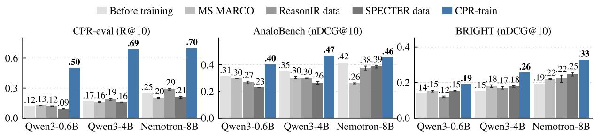  
Figure 5: Retrievers trained on diferent data. Each retriever is evaluated before training and after training for one e<sub>p</sub>och on the same number of <sub>p</sub>airs (10,573), randoml<sub>y</sub> sam<sub>p</sub>led from each existin<sub>g</sub> dataset; for the existin<sub>g</sub> datasets, bars show the mean over three random samples and whiskers one standard deviation. Qwen3-0.6B and Qwen3-4B denote Qwen3-Embedding-0.6B and 4B, and Nemotron-8B denotes llama-embed-nemotron-8b. BRIGHT covers its StackExchange subsets<sub>,</sub> and AnaloBench avera<sub>g</sub>es stories of 1<sub>,</sub> 10<sub>,</sub> and 30 sentences.

## 4.3. Robustness Analysis

Removing same-topic candidates does not make the task easier. A search system could simply drop papers <sub>on</sub> th<sub>e</sub> <sub>query</sub>’<sub>s</sub> <sub>own</sub> t<sub>op</sub>i<sub>c.</sub> W<sub>e</sub> <sub>s</sub>i<sub>mu</sub>l<sub>a</sub>t<sub>e</sub> thi<sub>s</sub> b<sub>y</sub> <sub>remov</sub>i<sub>ng</sub> th<sub>e</sub> 50 <sub>same-</sub>t<sub>op</sub>i<sub>c</sub> <sub>can</sub>did<sub>a</sub>t<sub>es</sub> <sub>o</sub>f <sub>eac</sub>h <sub>query.</sub> B<sub>ecause</sub> <sub>a</sub> smaller <sub>p</sub>ool also raises Recall@10 b<sub>y</sub> chance, we re<sub>p</sub>ort Recall@10 relative to random rankin<sub>g</sub> in each <sub>p</sub>ool (10/151 and 10/101; Fi ure 6a). After the removal, retrievers reach at most 3.6 times the random rate, far b<sub>e</sub>l<sub>ow</sub> th<sub>e</sub> LLM <sub>reran</sub>k<sub>er a</sub>t 8<sub>.</sub>5 ti<sub>mes, compu</sub>t<sub>e</sub>d b<sub>y remov</sub>i<sub>ng</sub> th<sub>e same can</sub>did<sub>a</sub>t<sub>es</sub> f<sub>rom</sub> it<sub>s ran</sub>ki<sub>ng.</sub>

The dificulty does not depend on one single pooling retriever. Since the candidate pools come from three retrievers, E5, SPLADE-v3, and SciNCL (Section 3.3), the dificult<sub>y</sub> of CPR-eval could be an artifact of these retrievers. Followin the leave-one-out test of Zobel (1998), we rebuild the ools with each oolin retriever left out and judge the new candidates in the same way. Across the four pools, every retriever’s Recall@10 changes by at most 0.04, and the order of retrievers is largely preserved (Kendall’s � ≥ 0.83; Figure 6b).

Query rewriting cannot fully close the gap. We apply HyDE (Gao et al., 2023), Query2doc (Wang et al., 2023), and RAG-Fusion (Rackauckas, 2024) with GLM-5.3 (GLM-5-Team et al., 2026) as the <sub>g</sub>enerator, and retrieve with BM25 and Gemini Embeddin<sub>g</sub> (Fi<sub>g</sub>ure 6c; <sub>p</sub>rom<sub>p</sub>ts in A<sub>pp</sub>endix K). The best combination, H<sub>y</sub>DE with BM25, raises Recall@10 from 0.16 to 0.44. This stays below Qwen3-Embedding-4B trained on CPR-train

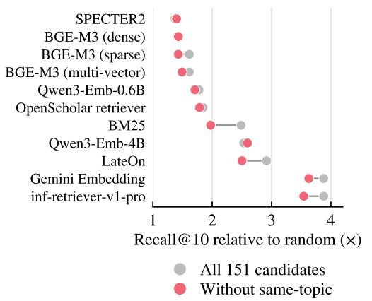  
(a) Removing same-topic candidates

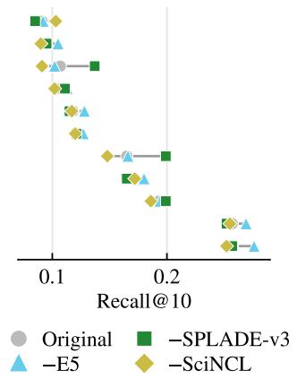  
(b) Leave-one-out pooling

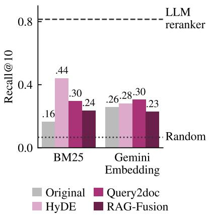  
(c) Query rewriting  
Figure 6: Robustness of the dificulty of CPR-eval. (a) Recall@10 divided by its random expectation in the same pool: 10/151 with all candidat<sub>es,</sub> and 10/101 aft<sub>e</sub>r r<sub>e</sub>m<sub>o</sub>vin<sub>g</sub> th<sub>e</sub> 50 candidat<sub>es</sub> that <sub>s</sub>har<sub>e</sub> an O<sub>pe</sub>nAl<sub>e</sub>x t<sub>op</sub>ic with th<sub>e</sub> ba<sub>se</sub> <sub>p</sub>a<sub>pe</sub>r<sub>.</sub> (b) Recall@10 on the ori<sub>g</sub>inal <sub>p</sub>ools and on <sub>p</sub>ools rebuilt with one of the three <sub>p</sub>oolin<sub>g</sub> retrievers left out. (c) Recall@10 of BM25 <sub>an</sub>d G<sub>em</sub>i<sub>n</sub>i E<sub>m</sub>b<sub>e</sub>ddi<sub>ng w</sub>ith th<sub>e or</sub>i<sub>g</sub>i<sub>na</sub>l <sub>query an</sub>d <sub>w</sub>ith <sub>quer</sub>i<sub>es rewr</sub>itt<sub>en</sub> b<sub>y</sub> GLM<sub>-</sub>5<sub>.</sub>3<sub>;</sub> th<sub>e</sub> d<sub>as</sub>h<sub>e</sub>d li<sub>ne mar</sub>k<sub>s</sub> th<sub>e</sub> LLM <sub>reran</sub>k<sub>er on a</sub>ll 151 <sub>can</sub>did<sub>a</sub>t<sub>es, an</sub>d th<sub>e</sub> d<sub>o</sub>tt<sub>e</sub>d li<sub>ne mar</sub>k<sub>s ran</sub>d<sub>om ran</sub>ki<sub>ng.</sub>

at 0.69 and far below the LLM reranker at 0.81.

## 4.4. How Far Training Generalizes

W<sub>e</sub> t<sub>es</sub>t <sub>w</sub>h<sub>e</sub>th<sub>er</sub> th<sub>e ga</sub>i<sub>n</sub> f<sub>rom</sub> t<sub>ra</sub>i<sub>n</sub>i<sub>ng on</sub> CPR<sub>-</sub>t<sub>ra</sub>i<sub>n carr</sub>i<sub>es over</sub> t<sub>o unseen</sub> d<sub>oma</sub>i<sub>ns an</sub>d t<sub>o ana</sub>l<sub>ogy an</sub>d <sub>reason</sub>i<sub>ng-</sub>i<sub>n</sub>t<sub>ens</sub>i<sub>ve</sub> <sub>re</sub>t<sub>r</sub>i<sub>eva</sub>l<sub>.</sub>

Unseen domains. We hold out one of the four OpenAlex domains at a time. Queries and positives of the h<sub>e</sub>ld<sub>-ou</sub>t d<sub>oma</sub>i<sub>n are remove</sub>d f<sub>rom</sub> t<sub>ra</sub>i<sub>n</sub>i<sub>ng, an</sub>d th<sub>e</sub> retriever is evaluated on that domain (A<sub>pp</sub>endix L). Qwen3-Embedding-0.6B and 4B trained without the h<sub>e</sub>ld<sub>-ou</sub>t d<sub>oma</sub>i<sub>n s</sub>till i<sub>mprove</sub> i<sub>n every</sub> d<sub>oma</sub>i<sub>n, ra</sub>i<sub>s</sub>i<sub>ng</sub> Recall@10 b<sub>y</sub> 0.21 to 0.36 and b<sub>y</sub> 0.38 to 0.54 (Fi<sub>g</sub>- ure 7). The <sub>g</sub>ain thus needs no trainin<sub>g</sub> data from the <sub>same</sub> d<sub>oma</sub>i<sub>n.</sub>

Analogy and reasoning-intensive retrieval. We also evaluate the trained retrievers on AnaloBench (Ye et al., 2024), which asks for the stor<sub>y</sub> analo<sub>g</sub>ous to <sub>a</sub> <sub>g</sub>i<sub>ven</sub> <sub>one,</sub> <sub>an</sub>d <sub>on</sub> th<sub>e</sub> <sub>seven</sub> St<sub>ac</sub>kE<sub>xc</sub>h<sub>ange</sub> <sub>su</sub>b<sub>se</sub>t<sub>s</sub> of BRIGHT (Su et al., 2025), a reasonin<sub>g</sub>-intensive benchmark. Followin<sub>g</sub> Zhao et al. (2026), we leave

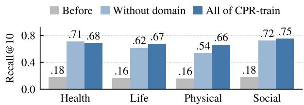  
Figure 7: Recall@10 of Qwen3-Embedding-4B on domains unseen in training. The retriever is evaluated on <sub>one</sub> O<sub>pen</sub>Al<sub>ex</sub> d<sub>oma</sub>i<sub>n</sub> b<sub>e</sub>f<sub>ore</sub> t<sub>ra</sub>i<sub>n</sub>i<sub>ng,</sub> <sub>a</sub>ft<sub>er</sub> t<sub>ra</sub>i<sub>n</sub>i<sub>ng</sub> <sub>on</sub> CPR-train without that domain (5,896 <sub>p</sub>airs), and after trainin<sub>g</sub> on all of CPR-train (10,573 <sub>p</sub>airs). Details and results for Qwen3-Embedding-0.6B are in Appendix L.

out its codin<sub>g</sub> and mathematics subsets, which rel<sub>y</sub> on domain-s<sub>p</sub>ecific s<sub>y</sub>ntax or formal lo<sub>g</sub>ic (Fi<sub>g</sub>ure 5; <sub>p</sub>er-subset results in Table 11). On AnaloBench, trainin<sub>g</sub> on CPR-train raises nDCG@10 over the untrained retriever b<sub>y</sub> 0.04 to 0.12<sub>,</sub> whereas trainin<sub>g</sub> on MS MARCO<sub>,</sub> ReasonIR data<sub>,</sub> or SPECTER data lowers it. On BRIGHT, the gain from training on CPR-train grows with model size, from 0.05 for Qwen3-Embedding-0.6B to 0.13 for llama-embed-nemotron-8b, whereas trainin<sub>g</sub> on the existin<sub>g</sub> datasets raises nDCG@10 b<sub>y</sub> at most 0.05. I<sub>n examp</sub>l<sub>es w</sub>h<sub>ere on</sub>l<sub>y</sub> th<sub>e re</sub>t<sub>r</sub>i<sub>ever</sub> t<sub>ra</sub>i<sub>ne</sub>d <sub>on</sub> CPR<sub>-</sub>t<sub>ra</sub>i<sub>n</sub> fi<sub>n</sub>d<sub>s</sub> th<sub>e re</sub>l<sub>evan</sub>t d<sub>ocumen</sub>t<sub>,</sub> th<sub>e o</sub>th<sub>er re</sub>t<sub>r</sub>i<sub>evers</sub> <sub>ran</sub>k fi<sub>rs</sub>t d<sub>ocumen</sub>t<sub>s</sub> th<sub>a</sub>t <sub>s</sub>h<sub>are wor</sub>d<sub>s w</sub>ith th<sub>e query, w</sub>h<sub>ereas</sub> th<sub>e re</sub>l<sub>evan</sub>t d<sub>ocumen</sub>t <sub>s</sub>h<sub>ares</sub> th<sub>e un</sub>d<sub>er</sub>l<sub>y</sub>i<sub>ng</sub> mechanism (A<sub>pp</sub>endix N). Without hard ne<sub>g</sub>atives, most of the <sub>g</sub>ain on AnaloBench disa<sub>pp</sub>ears for the two Qwen3-Embeddin<sub>g</sub> retrievers, while the <sub>g</sub>ain on BRIGHT remains (A<sub>pp</sub>endix M).

## 5. Conclusion

W<sub>e</sub> i<sub>n</sub>t<sub>ro</sub>d<sub>uce cross-po</sub>lli<sub>na</sub>ti<sub>on re</sub>t<sub>r</sub>i<sub>eva</sub>l<sub>: g</sub>i<sub>ven a researc</sub>h <sub>pro</sub>bl<sub>em,</sub> fi<sub>n</sub>d <sub>papers on o</sub>th<sub>er</sub> t<sub>op</sub>i<sub>cs w</sub>h<sub>ose</sub> id<sub>eas</sub> <sub>can</sub> b<sub>e</sub> t<sub>rans</sub>f<sub>erre</sub>d t<sub>o</sub> it<sub>.</sub> W<sub>e a</sub>l<sub>so re</sub>l<sub>ease</sub> CPR<sub>-</sub>D<sub>a</sub>t<sub>ase</sub>t<sub>,</sub> b<sub>u</sub>ilt f<sub>rom c</sub>it<sub>a</sub>ti<sub>ons</sub> b<sub>y a sca</sub>l<sub>a</sub>bl<sub>e p</sub>i<sub>pe</sub>li<sub>ne.</sub> O<sub>n</sub> CPR<sub>-eva</sub>l<sub>,</sub> <sub>ex</sub>i<sub>s</sub>ti<sub>ng sparse,</sub> d<sub>ense, an</sub>d l<sub>a</sub>t<sub>e-</sub>i<sub>n</sub>t<sub>erac</sub>ti<sub>on re</sub>t<sub>r</sub>i<sub>evers rare</sub>l<sub>y</sub> fi<sub>n</sub>d <sub>suc</sub>h <sub>papers.</sub> St<sub>an</sub>d<sub>ar</sub>d <sub>con</sub>t<sub>ras</sub>ti<sub>ve</sub> fi<sub>ne-</sub>t<sub>un</sub>i<sub>ng</sub> <sub>on</sub> CPR<sub>-</sub>t<sub>ra</sub>i<sub>n su</sub>b<sub>s</sub>t<sub>an</sub>ti<sub>a</sub>ll<sub>y</sub> i<sub>mproves re</sub>t<sub>r</sub>i<sub>eva</sub>l<sub>.</sub> Th<sub>e ga</sub>i<sub>n carr</sub>i<sub>es over</sub> t<sub>o</sub> h<sub>e</sub>ld<sub>-ou</sub>t d<sub>oma</sub>i<sub>ns an</sub>d t<sub>o ana</sub>l<sub>ogy</sub> <sub>an</sub>d <sub>reason</sub>i<sub>ng-</sub>i<sub>n</sub>t<sub>ens</sub>i<sub>ve re</sub>t<sub>r</sub>i<sub>eva</sub>l<sub>, sugges</sub>ti<sub>ng</sub> th<sub>a</sub>t <sub>re</sub>t<sub>r</sub>i<sub>evers</sub> l<sub>earn re</sub>l<sub>evance</sub> b<sub>eyon</sub>d t<sub>op</sub>i<sub>ca</sub>l <sub>s</sub>i<sub>m</sub>il<sub>ar</sub>it<sub>y.</sub> W<sub>e</sub> b<sub>e</sub>li<sub>eve</sub> th<sub>a</sub>t <sub>ana</sub>l<sub>yz</sub>i<sub>ng w</sub>h<sub>a</sub>t th<sub>e</sub> t<sub>ra</sub>i<sub>ne</sub>d <sub>re</sub>t<sub>r</sub>i<sub>evers</sub> l<sub>earn an</sub>d <sub>us</sub>i<sub>ng</sub> th<sub>em</sub> t<sub>o supp</sub>l<sub>y cross-</sub>fi<sub>e</sub>ld i<sub>nsp</sub>i<sub>ra</sub>ti<sub>on</sub> t<sub>o</sub> <sub>researc</sub>h<sub>-ass</sub>i<sub>s</sub>t<sub>an</sub>t <sub>sys</sub>t<sub>ems are prom</sub>i<sub>s</sub>i<sub>ng</sub> di<sub>rec</sub>ti<sub>ons</sub> f<sub>or</sub> f<sub>u</sub>t<sub>ure wor</sub>k<sub>.</sub> W<sub>e</sub> h<sub>ope</sub> th<sub>a</sub>t CPR<sub>-</sub>D<sub>a</sub>t<sub>ase</sub>t h<sub>e</sub>l<sub>ps re</sub>t<sub>r</sub>i<sub>eva</sub>l <sub>sys</sub>t<sub>ems</sub> b<sub>r</sub>i<sub>ng</sub> id<sub>eas</sub> f<sub>rom o</sub>th<sub>er</sub> fi<sub>e</sub>ld<sub>s</sub> t<sub>o researc</sub>h<sub>ers an</sub>d<sub>,</sub> i<sub>n</sub> t<sub>urn, con</sub>t<sub>r</sub>ib<sub>u</sub>t<sub>es</sub> t<sub>o sc</sub>i<sub>en</sub>tifi<sub>c progress</sub> th<sub>roug</sub>h <sub>cross-po</sub>lli<sub>na</sub>ti<sub>on.</sub>

## Limitations

S<sub>evera</sub>l li<sub>m</sub>it<sub>a</sub>ti<sub>ons come</sub> f<sub>rom</sub> h<sub>ow we</sub> b<sub>u</sub>ild CPR<sub>-</sub>D<sub>a</sub>t<sub>ase</sub>t<sub>.</sub> Fi<sub>rs</sub>t<sub>, pos</sub>iti<sub>ves come on</sub>l<sub>y</sub> f<sub>rom papers</sub> th<sub>a</sub>t th<sub>e</sub> b<sub>ase</sub> <sub>paper c</sub>it<sub>es, so a paper w</sub>h<sub>ose</sub> id<sub>ea cou</sub>ld b<sub>e</sub> t<sub>rans</sub>f<sub>erre</sub>d b<sub>u</sub>t <sub>was never c</sub>it<sub>e</sub>d <sub>canno</sub>t b<sub>ecome a pos</sub>iti<sub>ve.</sub> S<sub>econ</sub>d<sub>,</sub> our pipeline relies on LLMs to judge analogy, transfer, and negatives; the transfer and usefulness judgments a<sub>g</sub>ree with a human annotator at Cohen’s � of 0.84 to 0.92 (A<sub>pp</sub>endix C), but the<sub>y</sub> ma<sub>y</sub> still contain errors or <sub>sys</sub>t<sub>ema</sub>ti<sub>c</sub> bi<sub>ases.</sub> E<sub>ac</sub>h <sub>query</sub> i<sub>s a</sub>l<sub>so wr</sub>itt<sub>en</sub> b<sub>y an</sub> LLM f<sub>rom</sub> it<sub>s</sub> b<sub>ase paper an</sub>d <sub>may</sub> dif<sub>er</sub> f<sub>rom</sub> th<sub>e ques</sub>ti<sub>ons</sub> th<sub>a</sub>t <sub>researc</sub>h<sub>ers wou</sub>ld <sub>as</sub>k<sub>.</sub> Thi<sub>r</sub>d<sub>, w</sub>h<sub>e</sub>th<sub>er</sub> t<sub>wo papers are on</sub> dif<sub>eren</sub>t t<sub>op</sub>i<sub>cs</sub> i<sub>s</sub> d<sub>ec</sub>id<sub>e</sub>d b<sub>y</sub> th<sub>e</sub> O<sub>pen</sub>Al<sub>ex</sub> t<sub>op</sub>i<sub>c c</sub>l<sub>ass</sub>ifi<sub>ca</sub>ti<sub>on, so a</sub> dif<sub>eren</sub>t t<sub>axonomy wou</sub>ld <sub>y</sub>i<sub>e</sub>ld <sub>a</sub> dif<sub>eren</sub>t <sub>se</sub>t <sub>o</sub>f <sub>cross-</sub>t<sub>op</sub>i<sub>c pa</sub>i<sub>rs.</sub> Fi<sub>na</sub>ll<sub>y, we</sub> b<sub>u</sub>ild CPR-Dataset from Semantic Scholar (Kinne<sub>y</sub> et al., 2025) <sub>p</sub>a<sub>p</sub>ers that meet our selection criteria, such as havin<sub>g</sub> f<sub>u</sub>ll t<sub>ex</sub>t <sub>ava</sub>il<sub>a</sub>bl<sub>e, an</sub>d th<sub>e</sub> fi<sub>e</sub>ld<sub>s, venues, an</sub>d <sub>years</sub> it <sub>represen</sub>t<sub>s may</sub> b<sub>e</sub> bi<sub>ase</sub>d t<sub>owar</sub>d <sub>suc</sub>h <sub>papers.</sub>

O<sub>ur eva</sub>l<sub>ua</sub>ti<sub>on uses a</sub> fi<sub>xe</sub>d <sub>poo</sub>l <sub>o</sub>f 151 <sub>can</sub>did<sub>a</sub>t<sub>es per query ra</sub>th<sub>er</sub> th<sub>an a</sub> f<sub>u</sub>ll <sub>corpus.</sub> R<sub>e</sub>t<sub>r</sub>i<sub>eva</sub>l <sub>over a</sub> f<sub>u</sub>ll cor<sub>p</sub>us is likel<sub>y</sub> harder, and the Recall@10 of the LLM reranker likewise assumes a <sub>p</sub>ool that alread<sub>y</sub> contains th<sub>e</sub> <sub>pos</sub>iti<sub>ve.</sub> O<sub>ur</sub> <sub>eva</sub>l<sub>ua</sub>ti<sub>on</sub> <sub>a</sub>l<sub>so</sub> l<sub>eaves</sub> <sub>ou</sub>t <sub>genera</sub>l <sub>re</sub>t<sub>r</sub>i<sub>eva</sub>l b<sub>enc</sub>h<sub>mar</sub>k<sub>s,</sub> <sub>s</sub>i<sub>nce</sub> <sub>re</sub>t<sub>r</sub>i<sub>eva</sub>l b<sub>y</sub> t<sub>op</sub>i<sub>ca</sub>l <sub>s</sub>i<sub>m</sub>il<sub>ar</sub>it<sub>y</sub> i<sub>s</sub> <sub>ou</sub>t<sub>s</sub>id<sub>e</sub> th<sub>e</sub> <sub>scope</sub> <sub>o</sub>f thi<sub>s</sub> <sub>wor</sub>k<sub>;</sub> <sub>w</sub>h<sub>e</sub>th<sub>er</sub> t<sub>ra</sub>i<sub>n</sub>i<sub>ng</sub> <sub>on</sub> CPR<sub>-</sub>t<sub>ra</sub>i<sub>n</sub> <sub>a</sub>f<sub>ec</sub>t<sub>s</sub> it <sub>rema</sub>i<sub>ns</sub> <sub>open.</sub>

Our training experiments cover three retrievers, Qwen3-Embedding-0.6B and 4B and llama-embednemotron-8b, trained with a single contrastive objective. Larger retrievers and other training methods may b<sub>ene</sub>fit f<sub>rom</sub> CPR<sub>-</sub>t<sub>ra</sub>i<sub>n</sub> dif<sub>eren</sub>tl<sub>y.</sub>

## Ethical Considerations

R<sub>e</sub>t<sub>r</sub>i<sub>evers</sub> t<sub>ra</sub>i<sub>ne</sub>d <sub>on</sub> CPR<sub>-</sub>t<sub>ra</sub>i<sub>n may re</sub>t<sub>urn papers w</sub>h<sub>ose</sub> id<sub>eas appear</sub> t<sub>rans</sub>f<sub>era</sub>bl<sub>e</sub> b<sub>u</sub>t d<sub>o no</sub>t <sub>ac</sub>t<sub>ua</sub>ll<sub>y</sub> h<sub>e</sub>l<sub>p</sub> <sub>so</sub>l<sub>ve</sub> th<sub>e g</sub>i<sub>ven pro</sub>bl<sub>em, so researc</sub>h<sub>ers s</sub>h<sub>ou</sub>ld <sub>ver</sub>if<sub>y re</sub>t<sub>r</sub>i<sub>eve</sub>d <sub>papers</sub> b<sub>e</sub>f<sub>ore</sub> b<sub>u</sub>ildi<sub>ng on</sub> th<sub>em.</sub> B<sub>ecause</sub> CPR<sub>-</sub>D<sub>a</sub>t<sub>ase</sub>t i<sub>s</sub> b<sub>u</sub>ilt f<sub>rom papers w</sub>h<sub>ose</sub> f<sub>u</sub>ll t<sub>ex</sub>t i<sub>s ava</sub>il<sub>a</sub>bl<sub>e,</sub> fi<sub>e</sub>ld<sub>s an</sub>d <sub>venues w</sub>ith l<sub>ess ava</sub>il<sub>a</sub>bl<sub>e</sub> f<sub>u</sub>ll t<sub>ex</sub>t <sub>are un</sub>d<sub>errepresen</sub>t<sub>e</sub>d<sub>, an</sub>d <sub>re</sub>t<sub>r</sub>i<sub>evers</sub> t<sub>ra</sub>i<sub>ne</sub>d <sub>on</sub> it <sub>may serve researc</sub>h<sub>ers</sub> i<sub>n</sub> th<sub>ose</sub> fi<sub>e</sub>ld<sub>s</sub> l<sub>ess we</sub>ll<sub>.</sub> B<sub>u</sub>ildi<sub>ng</sub> CPR<sub>-</sub>D<sub>a</sub>t<sub>ase</sub>t <sub>an</sub>d t<sub>ra</sub>i<sub>n</sub>i<sub>ng re</sub>t<sub>r</sub>i<sub>evers requ</sub>i<sub>re</sub>d LLM <sub>ca</sub>ll<sub>s an</sub>d GPU t<sub>ra</sub>i<sub>n</sub>i<sub>ng, w</sub>hi<sub>c</sub>h <sub>consume energy;</sub> t<sub>o avo</sub>id <sub>repea</sub>ti<sub>ng</sub> thi<sub>s compu</sub>t<sub>a</sub>ti<sub>on, we re</sub>l<sub>ease</sub> CPR<sub>-</sub>D<sub>a</sub>t<sub>ase</sub>t <sub>an</sub>d th<sub>e p</sub>i<sub>pe</sub>li<sub>ne</sub> th<sub>a</sub>t <sub>co</sub>ll<sub>ec</sub>t<sub>s</sub> it<sub>, an</sub>d <sub>w</sub>ill <sub>re</sub>l<sub>ease</sub> th<sub>e</sub> t<sub>ra</sub>i<sub>ne</sub>d Qwen3-Embedding retrievers upon publication. CPR-Dataset is released under ODC-BY as Semantic Scholar <sub>paper</sub> id<sub>en</sub>tifi<sub>ers,</sub> titl<sub>es,</sub> l<sub>a</sub>b<sub>e</sub>l<sub>s, an</sub>d <sub>genera</sub>t<sub>e</sub>d <sub>quer</sub>i<sub>es; a</sub>b<sub>s</sub>t<sub>rac</sub>t<sub>s are</sub> i<sub>nc</sub>l<sub>u</sub>d<sub>e</sub>d <sub>on</sub>l<sub>y</sub> f<sub>or papers w</sub>h<sub>ose open-access</sub> li<sub>cense</sub> i<sub>s</sub> CC<sub>-</sub>BY<sub>,</sub> CC0<sub>, or pu</sub>bli<sub>c</sub> d<sub>oma</sub>i<sub>n, an</sub>d <sub>a scr</sub>i<sub>p</sub>t <sub>re</sub>t<sub>r</sub>i<sub>eves</sub> th<sub>e o</sub>th<sub>ers</sub> f<sub>rom</sub> S<sub>eman</sub>ti<sub>c</sub> S<sub>c</sub>h<sub>o</sub>l<sub>ar.</sub> W<sub>e use</sub>d AI <sub>ass</sub>i<sub>s</sub>t<sub>an</sub>t<sub>s</sub> t<sub>o</sub> h<sub>e</sub>l<sub>p wr</sub>it<sub>e an</sub>d d<sub>e</sub>b<sub>ug co</sub>d<sub>e</sub> f<sub>or</sub> d<sub>a</sub>t<sub>a process</sub>i<sub>ng, eva</sub>l<sub>ua</sub>ti<sub>on, an</sub>d fi<sub>gures, an</sub>d t<sub>o e</sub>dit th<sub>e wor</sub>di<sub>ng o</sub>f th<sub>e paper;</sub> th<sub>e au</sub>th<sub>ors</sub> d<sub>es</sub>i<sub>gne</sub>d th<sub>e researc</sub>h <sub>an</sub>d <sub>c</sub>h<sub>ec</sub>k<sub>e</sub>d <sub>a</sub>ll <sub>co</sub>d<sub>e, resu</sub>lt<sub>s, an</sub>d t<sub>ex</sub>t<sub>.</sub>

## References

Anirudh Ajith, Mengzhou Xia, Alexis Chevalier, Tanya Goyal, Danqi Chen, and Tianyu Gao. LitSearch: A <sub>re</sub>t<sub>r</sub>i<sub>eva</sub>l b<sub>enc</sub>h<sub>mar</sub>k f<sub>or sc</sub>i<sub>en</sub>tifi<sub>c</sub> lit<sub>era</sub>t<sub>ure searc</sub>h<sub>.</sub> I<sub>n</sub> Y<sub>aser</sub> Al<sub>-</sub>O<sub>na</sub>i<sub>zan,</sub> M<sub>o</sub>hit B<sub>ansa</sub>l<sub>, an</sub>d Y<sub>un-</sub>N<sub>ung</sub> Chen, editors, Proceedings of the 2024 Conference on Empirical Methods in Natural Language Processing, <sub>p</sub>a<sub>g</sub>es 15068–15083<sub>,</sub> Miami<sub>,</sub> Florida<sub>,</sub> USA<sub>,</sub> November 2024. Association for Com<sub>p</sub>utational Lin<sub>g</sub>uistics. doi: 10.18653/v1/2024.emn<sup>l</sup>p-main.840. URL https://aclanthology.org/2024.emnlp-main.840/.

Akari Asai, Jacqueline He, Rulin Shao, Weijia Shi, Amanpreet Singh, Joseph Chee Chang, Kyle Lo, Luca Soldaini<sub>,</sub> Ser<sub>g</sub>e<sub>y</sub> Feldman<sub>,</sub> Mike D’Arc<sub>y,</sub> David Wadden<sub>,</sub> Matt Latzke<sub>,</sub> Jenna S<sub>p</sub>arks<sub>,</sub> Jena D. Hwan<sub>g,</sub> Varsha Kishore<sub>,</sub> Min<sub>y</sub>an<sub>g</sub> Tian<sub>,</sub> Pan Ji<sub>,</sub> Shen<sub>gy</sub>an Liu<sub>,</sub> Hao Ton<sub>g,</sub> Bohao Wu<sub>,</sub> Yan<sub>y</sub>u Xion<sub>g,</sub> Luke Zettlemo<sub>y</sub>er<sub>,</sub> Graham Neubig, Daniel S. Weld, Doug Downey, Wen-tau Yih, Pang Wei Koh, and Hannaneh Hajishirzi. Synthesizing scientific literature with retrieval-augmented language models. Nature, 650(8103):857–863, 2026. doi: 10.1038/s41586-025-10072-4. URL https://doi.org/10.1038/s41586-025-10072-4.

Y<sub>au</sub>h<sub>en</sub> B<sub>a</sub>b<sub>a</sub>khi<sub>n</sub> R<sub>a</sub>d<sub>e</sub>k O<sub>smu</sub>l<sub>s</sub>ki R<sub>ona</sub> Ak G<sub>a</sub>b<sub>r</sub>i<sub>e</sub>l M<sub>ore</sub>i<sub>ra</sub> M<sub>en ao</sub> X<sub>u</sub> B<sub>ene</sub>dikt S<sub>c</sub>hif<sub>erer</sub> B<sub>o</sub> Li<sub>u</sub> <sub>an</sub>d E<sub>ven</sub> Old<sub>r</sub>id<sub>ge.</sub> Ll<sub>ama-em</sub>b<sub>e</sub>d<sub>-nemo</sub>t<sub>ron-</sub>8b<sub>:</sub> A <sub>un</sub>i<sub>versa</sub>l t<sub>ex</sub>t <sub>em</sub>b<sub>e</sub>ddi<sub>ng mo</sub>d<sub>e</sub>l f<sub>or mu</sub>ltili<sub>ngua</sub>l <sub>an</sub>d cross-<sup>l</sup>ingua<sup>l</sup> tas<sup>k</sup>s, 2025. URL https://arxiv.org/abs/2511.07025.

Payal Bajaj, Daniel Campos, Nick Craswell, Li Deng, Jianfeng Gao, Xiaodong Liu, Rangan Majumder, Andrew McNamara<sub>,</sub> Bhaskar Mitra<sub>,</sub> Tri N<sub>g</sub>u<sub>y</sub>en<sub>,</sub> Mir Rosenber<sub>g,</sub> Xia Son<sub>g,</sub> Alina Stoica<sub>,</sub> Saurabh Tiwar<sub>y,</sub> and Ton<sub>g</sub> Wang. MS MARCO: A <sup>h</sup>uman generate<sup>d</sup> mac<sup>hi</sup>ne rea<sup>di</sup>ng compre<sup>h</sup>ens<sup>i</sup>on <sup>d</sup>ataset, 2018. URL https: //arxiv.org/abs/1611.09268.

Joel Chan<sub>,</sub> Jose<sub>p</sub>h Chee Chan<sub>g,</sub> Tom Ho<sub>p</sub>e<sub>,</sub> Dafna Shahaf<sub>,</sub> and Aniket Kittur. SOLVENT: A mixed initiative s<sub>y</sub>stem for finding analogies between research papers. Proc. ACM Hum.-Comput. Interact., 2(CSCW), November 2018. <sup>d</sup>oi: 10.1145/3274300. URL https://doi.org/10.1145/3274300.

Ji<sub>an</sub>l<sub>yu</sub> Ch<sub>en,</sub> Shit<sub>ao</sub> Xi<sub>ao,</sub> P<sub>e</sub>iti<sub>an</sub> Zh<sub>ang,</sub> K<sub>un</sub> L<sub>uo,</sub> D<sub>e</sub>f<sub>u</sub> Li<sub>an,</sub> <sub>an</sub>d Zh<sub>eng</sub> Li<sub>u.</sub> M3<sub>-em</sub>b<sub>e</sub>ddi<sub>ng:</sub> M<sub>u</sub>lti<sub>-</sub>li<sub>ngua</sub>lit<sub>y,</sub> <sub>mu</sub>lti<sub>-</sub>f<sub>unc</sub>ti<sub>ona</sub>lit<sub>y, mu</sub>lti<sub>-granu</sub>l<sub>ar</sub>it<sub>y</sub> t<sub>ex</sub>t <sub>em</sub>b<sub>e</sub>ddi<sub>ngs</sub> th<sub>roug</sub>h <sub>se</sub>lf<sub>-</sub>k<sub>now</sub>l<sub>e</sub>d<sub>ge</sub> di<sub>s</sub>till<sub>a</sub>ti<sub>on.</sub> I<sub>n</sub> L<sub>un-</sub>W<sub>e</sub>i K<sub>u,</sub>

Andre Martins, and Vivek Srikumar, editors, Findings of the Associationfor Computational Linguistics: ACL 2024, pages 2318–2335, Bangkok, Thailand, August 2024. Association for Computational Linguistics. doi: 10.18653/v1/2024.<sup>fi</sup>n<sup>di</sup>n s-ac<sup>l</sup>.137. URL https://aclanthology.org/2024.findings-acl.137/.

Yiqun Chen, Qi Liu, Yi Zhang, Weiwei Sun, Xinyu Ma, Wei Yang, Daiting Shi, Jiaxin Mao, and Dawei Yin. T<sub>our</sub>R<sub>an</sub>k<sub>:</sub> Utili<sub>z</sub>i<sub>ng</sub> l<sub>arge</sub> l<sub>anguage mo</sub>d<sub>e</sub>l<sub>s</sub> f<sub>or</sub> d<sub>ocumen</sub>t<sub>s ran</sub>ki<sub>ng w</sub>ith <sub>a</sub> t<sub>ournamen</sub>t<sub>-</sub>i<sub>nsp</sub>i<sub>re</sub>d <sub>s</sub>t<sub>ra</sub>t<sub>egy.</sub> I<sub>n</sub> Proceedings of the ACM on Web Conference 2025, WWW ’25, page 1638–1652, New York, NY, USA, 2025. Association for Com<sub>p</sub>utin<sub>g</sub> Machiner<sub>y</sub>. ISBN 9798400712746. doi: 10.1145/3696410.3714863. URL https://doi.org/10.1145/3696410.3714863.

Arman Cohan<sub>,</sub> Ser<sub>g</sub>e<sub>y</sub> Feldman<sub>,</sub> Iz Belta<sub>gy,</sub> Dou<sub>g</sub> Downe<sub>y,</sub> and Daniel Weld. SPECTER: Document-level <sub>represen</sub>t<sub>a</sub>ti<sub>on</sub> l<sub>earn</sub>i<sub>ng us</sub>i<sub>ng c</sub>it<sub>a</sub>ti<sub>on-</sub>i<sub>n</sub>f<sub>orme</sub>d t<sub>rans</sub>f<sub>ormers.</sub> I<sub>n</sub> D<sub>an</sub> J<sub>ura</sub>f<sub>s</sub>k<sub>y,</sub> J<sub>oyce</sub> Ch<sub>a</sub>i<sub>,</sub> N<sub>a</sub>t<sub>a</sub>li<sub>e</sub> S<sub>c</sub>hl<sub>u</sub>t<sub>er,</sub> and Joel Tetreault, editors, Proceedings of the 58th Annual Meeting of the Association for Computational Linguistics, pages 2270–2282, Online, July 2020. Association for Computational Linguistics. doi: 10.18653/ v1/2020.ac<sup>l</sup>-main.207. URL https://aclanthology.org/2020.acl-main.207/.

G<sub>or</sub>d<sub>on</sub> V<sub>.</sub> C<sub>ormac</sub>k<sub>,</sub> Ch<sub>ar</sub>l<sub>es</sub> L<sub>.</sub> A<sub>.</sub> Cl<sub>ar</sub>k<sub>e, an</sub>d St<sub>e</sub>f<sub>an</sub> Bütt<sub>c</sub>h<sub>er.</sub> R<sub>ec</sub>i <sub>roca</sub>l <sub>ran</sub>k f<sub>us</sub>i<sub>on ou</sub>t <sub>er</sub>f<sub>orms</sub> C<sub>on</sub>d<sub>orce</sub>t and individual rank learning methods. In Proceedings of the 32nd International ACM SIGIR Conference on Research and Development in Information Retrieval, pages 758–759, 2009. doi: 10.1145/1571941.1572114.

L<sub>uyu</sub> G<sub>ao,</sub> X<sub>ueguang</sub> M<sub>a,</sub> Ji<sub>mmy</sub> Li<sub>n, an</sub>d J<sub>am</sub>i<sub>e</sub> C<sub>a</sub>ll<sub>an.</sub> P<sub>rec</sub>i<sub>se zero-s</sub>h<sub>o</sub>t d<sub>ense re</sub>t<sub>r</sub>i<sub>eva</sub>l <sub>w</sub>ith<sub>ou</sub>t <sub>re</sub>l<sub>evance</sub> labels. In Anna Rogers, Jordan Boyd-Graber, and Naoaki Okazaki, editors, Proceedings of the 61st Annual Meeting of the Association for Computational Linguistics (Volume 1: Long Papers), pages 1762–1777, Toronto, Canada<sub>,</sub> Jul<sub>y</sub> 2023. Association for Com<sub>p</sub>utational Lin<sub>g</sub>uistics. doi: 10.18653/v1/2023.acl-lon<sub>g</sub>.99. URL https://aclanthology.org/2023.acl-long.99/.

Dedre Gentner. Structure-mapping: A theoretical framework for analogy. Cognitive Science, 7(2):155–170, 1983. <sup>d</sup>o<sup>i</sup>: 10.1207/s1551<sup>6</sup>709cog0702\_3. URL https://onlinelibrary.wiley.com/doi/abs/10. 1207/s15516709cog0702\_3.

GLM-5-Team Aohan Zen Xin Lv Zhen u Hou Zhen xiao Du Qinkai Zhen Bin Chen Da Yin Chendi Ge Chen<sub>g</sub>hua Huan<sub>g,</sub> Chen<sub>g</sub>xin<sub>g</sub> Xie<sub>,</sub> Chenzhen<sub>g</sub> Zhu<sub>,</sub> Con<sub>g</sub>fen<sub>g</sub> Yin<sub>,</sub> Cunxian<sub>g</sub> Wan<sub>g,</sub> Gen<sub>g</sub>zhen<sub>g</sub> Pan<sub>,</sub> Hao Zeng, Haoke Zhang, Haoran Wang, Huilong Chen, Jiajie Zhang, Jian Jiao, Jiaqi Guo, Jingsen Wang, Jingzhao Du<sub>,</sub> Jinzhu Wu<sub>,</sub> Kedon<sub>g</sub> Wan<sub>g,</sub> Lei Li<sub>,</sub> Lin Fan<sub>,</sub> Lucen Zhon<sub>g,</sub> Min<sub>g</sub>dao Liu<sub>,</sub> Min<sub>g</sub>min<sub>g</sub> Zhao<sub>,</sub> Pen<sub>g</sub>fan Du<sub>,</sub> Qian Dong, Rui Lu, Shuang-Li, Shulin Cao, Song Liu, Ting Jiang, Xiaodong Chen, Xiaohan Zhang, Xuancheng Huan<sub>g,</sub> Xuezhen Don<sub>g,</sub> Yabo Xu<sub>,</sub> Yao Wei<sub>,</sub> Yifan An<sub>,</sub> Yilin Niu<sub>,</sub> Yiton<sub>g</sub> Zhu<sub>,</sub> Yuanhao Wen<sub>,</sub> Yukuo Cen<sub>,</sub> Yushi Bai, Zhongpei Qiao, Zihan Wang, Zikang Wang, Zilin Zhu, Ziqiang Liu, Zixuan Li, Bojie Wang, Bosi Wen, Can Huan<sub>g,</sub> Chan<sub>gp</sub>en<sub>g</sub> Cai<sub>,</sub> Chao Yu<sub>,</sub> Chen Li<sub>,</sub> Chen<sub>g</sub>wei Hu<sub>,</sub> Chenhui Zhan<sub>g,</sub> Dan Zhan<sub>g,</sub> Dao<sub>y</sub>an Lin<sub>,</sub> Da<sub>y</sub>on<sub>g</sub> Yan<sub>g,</sub> Di Wan<sub>g,</sub> Din<sub>g</sub> Ai<sub>,</sub> Erle Zhu<sub>,</sub> Fan<sub>g</sub>zhou Yi<sub>,</sub> Fei<sub>y</sub>u Chen<sub>,</sub> Guohon<sub>g</sub> Wen<sub>,</sub> Hailon<sub>g</sub> Sun<sub>,</sub> Haisha Zhao<sub>,</sub> Hai<sub>y</sub>i Hu<sub>,</sub> Hanchen Zhan<sub>g,</sub> Hanrui Liu<sub>,</sub> Han<sub>y</sub>u Zhan<sub>g,</sub> Hao Pen<sub>g,</sub> Hao Tai<sub>,</sub> Haobo Zhan<sub>g,</sub> He Liu<sub>,</sub> Hongwei Wang, Hongxi Yan, Hongyu Ge, Huan Liu, Huanpeng Chu, Jia’ni Zhao, Jiachen Wang, Jiajing Zhao, Jiamin Ren, Jiapeng Wang, Jiaxin Zhang, Jiayi Gui, Jiayue Zhao, Jijie Li, Jing An, Jing Li, Jingwei Yuan, Jinhua Du, Jinxin Liu, Junkai Zhi, Junwen Duan, Kaiyue Zhou, Kangjian Wei, Ke Wang, Keyun Luo, Lai<sub>q</sub>ian<sub>g</sub> Zhan<sub>g,</sub> Lei<sub>g</sub>an<sub>g</sub> Sha<sub>,</sub> Lian<sub>g</sub> Xu<sub>,</sub> Lindon<sub>g</sub> Wu<sub>,</sub> Lintao Din<sub>g,</sub> Lu Chen<sub>,</sub> Min<sub>g</sub>hao Li<sub>,</sub> Nian<sub>y</sub>i Lin<sub>,</sub> Pan Ta<sub>,</sub> Qiang Zou, Rongjun Song, Ruiqi Yang, Shangqing Tu, Shangtong Yang, Shaoxiang Wu, Shengyan Zhang, Shijie Li, Shuang Li, Shuyi Fan, Wei Qin, Wei Tian, Weining Zhang, Wenbo Yu, Wenjie Liang, Xiang Kuang, Xian<sub>g</sub>men<sub>g</sub> Chen<sub>g,</sub> Xian<sub>gy</sub>an<sub>g</sub> Li<sub>,</sub> Xiao<sub>q</sub>uan Yan<sub>,</sub> Xiaowei Hu<sub>,</sub> Xiao<sub>y</sub>in<sub>g</sub> Lin<sub>g,</sub> Xin<sub>g</sub> Fan<sub>,</sub> Xin<sub>gy</sub>e Xia<sub>,</sub> Xin<sub>y</sub>uan Zhan<sub>g,</sub> Xinze Zhan<sub>g,</sub> Xirui Pan<sub>,</sub> Xu Zou<sub>,</sub> Xunkai Zhan<sub>g,</sub> Yadi Liu<sub>,</sub> Yandon<sub>g</sub> Wu<sub>,</sub> Yanfu Li<sub>,</sub> Yidon<sub>g</sub> Wan<sub>g,</sub> Yifan Zhu, Yijun Tan, Yilin Zhou, Yiming Pan, Ying Zhang, Yinpei Su, Yipeng Geng, Yong Yan, Yonglin Tan, Yuean Bi, Yuhan Shen, Yuhao Yang, Yujiang Li, Yunan Liu, Yunqing Wang, Yuntao Li, Yurong Wu, Yutao Zhang, Yuxi Duan<sub>,</sub> Yuxuan Zhan<sub>g,</sub> Zezhen Liu<sub>,</sub> Zhen<sub>g</sub>tao Jian<sub>g,</sub> Zhenhe Yan<sub>,</sub> Zhe<sub>y</sub>u Zhan<sub>g,</sub> Zhixian<sub>g</sub> Wei<sub>,</sub> Zhuo Chen, Zhuoer Feng, Zijun Yao, Ziwei Chai, Ziyuan Wang, Zuzhou Zhang, Bin Xu, Minlie Huang, Hongning Wan<sub>g,</sub> Juanzi Li<sub>,</sub> Yuxiao Don<sub>g,</sub> and Jie Tan<sub>g</sub>. GLM-5: From vibe codin<sub>g</sub> to a<sub>g</sub>entic en<sub>g</sub>ineerin<sub>g,</sub> 2026. URL https://arxiv.org/abs/2602.15763.

Ian J. Goodfellow, Jean Pouget-Abadie, Mehdi Mirza, Bing Xu, David Warde-Farley, Sherjil Ozair, Aaron Courville, and Yoshua Bengio. Generative adversarial nets. In Advances in Neural Information Processing Systems, volume 27. Curran Associates, Inc., 2014. URL https://proceedings.neurips.cc/paper\_ files/paper/2014/file/f033ed80deb0234979a61f95710dbe25-Paper.pdf.

Gautier Izacard, Mathilde Caron, Lucas Hosseini, Sebastian Riedel, Piotr Bojanowski, Armand Joulin, and Edouard Grave. Unsupervised dense information retrieval with contrastive learning. Transactions on Machine Learning Research, 2022. ISSN 2835-8856. URL https://openreview.net/forum?id=jKN1pXi7b0.

C<sub>.</sub> J<sub>arzyns</sub>ki<sub>.</sub> E<sub>qu</sub>ilib<sub>r</sub>i<sub>um</sub> f<sub>ree-energy</sub> dif<sub>erences</sub> f<sub>rom nonequ</sub>ilib<sub>r</sub>i<sub>um measuremen</sub>t<sub>s:</sub> A <sub>mas</sub>t<sub>er-equa</sub>ti<sub>on</sub> approach. Phys. Rev. E, 56:5018–5035, Nov 1997. doi: 10.1103/PhysRevE.56.5018. URL https://link. aps.org/doi/10.1103/PhysRevE.56.5018.

Cheng Jiayang, Lin Qiu, Tsz Chan, Tianqing Fang, Weiqi Wang, Chunkit Chan, Dongyu Ru, Qipeng Guo, Hon<sub>g</sub>min<sub>g</sub> Zhan<sub>g,</sub> Yan<sub>gq</sub>iu Son<sub>g,</sub> Yue Zhan<sub>g,</sub> and Zhen<sub>g</sub> Zhan<sub>g</sub>. Stor<sub>y</sub>Analo<sub>gy</sub>: Derivin<sub>g</sub> stor<sub>y</sub>-level analo<sub>g</sub>ies f<sub>rom</sub> l<sub>arge</sub> l<sub>anguage mo</sub>d<sub>e</sub>l<sub>s</sub> t<sub>o un</sub>l<sub>oc</sub>k <sub>ana</sub>l<sub>og</sub>i<sub>ca</sub>l <sub>un</sub>d<sub>ers</sub>t<sub>an</sub>di<sub>ng.</sub> I<sub>n</sub> H<sub>ou</sub>d<sub>a</sub> B<sub>ouamor,</sub> J<sub>uan</sub> Pi<sub>no, an</sub>d K<sub>a</sub>lik<sub>a</sub> Bali, editors, Proceedings of the 2023 Conference on Empirical Methods in Natural Language Processing, pages 11518–11537<sub>,</sub> Sin<sub>g</sub>a<sub>p</sub>ore<sub>,</sub> December 2023. Association for Com<sub>p</sub>utational Lin<sub>g</sub>uistics. doi: 10.18653/v1/ 2023.emn<sup>l</sup>p-main.706. URL https://aclanthology.org/2023.emnlp-main.706/.

Benjamin F. Jones. The burden of knowledge and the “death of the renaissance man”: Is innovation getting harder? The Review of Economic Studies, 76(1):283–317, 2009. doi: 10.1111/j.1467-937X.2008.00531.x.

Vladimir Kar<sub>p</sub>ukhin<sub>,</sub> Barlas O<sub>g</sub>uz<sub>,</sub> Sewon Min<sub>,</sub> Patrick Lewis<sub>,</sub> Ledell Wu<sub>,</sub> Ser<sub>g</sub>e<sub>y</sub> Edunov<sub>,</sub> Dan<sub>q</sub>i Chen<sub>,</sub> and Went<sub>au</sub> Yih<sub>.</sub> D<sub>ense passage re</sub>t<sub>r</sub>i<sub>eva</sub>l f<sub>or open-</sub>d<sub>oma</sub>i<sub>n ques</sub>ti<sub>on answer</sub>i<sub>ng.</sub> I<sub>n</sub> B<sub>onn</sub>i<sub>e</sub> W<sub>e</sub>bb<sub>er,</sub> T<sub>revor</sub> C<sub>o</sub>h<sub>n,</sub> Y<sub>u</sub>l<sub>an</sub> He, and Yang Liu, editors, Proceedings of the 2020 Conference on Empirical Methods in Natural Language Processing (EMNLP), pages 6769–6781, Online, November 2020. Association for Computational Linguistics. doi: 10.18<sup>6</sup>53/v1/2020.emn<sup>l</sup>p-ma<sup>i</sup>n.550. URL https://aclanthology.org/2020.emnlp-main.550/.

Soh<sub>y</sub>eon Kim<sub>,</sub> Yoonho Lee<sub>,</sub> Bo Liu<sub>,</sub> Da<sub>y</sub>oon Ko<sub>,</sub> Rulin Shao<sub>,</sub> Seun<sub>g</sub>one Kim<sub>,</sub> Graham Neubi<sub>g,</sub> Pan<sub>g</sub> Wei Koh<sub>,</sub> Aakanksha Chowdhery, Akari Asai, Omar Khattab, Yejin Choi, Gunhee Kim, and Chelsea Finn. ScholarCatalyst: A <sup>b</sup>enc<sup>h</sup>mar<sup>k f</sup>or retrieving papers t<sup>h</sup>at inspire new researc<sup>h</sup>, 2026. URL https://arxiv.org/abs/2610. 02202.

Rodne<sub>y</sub> Kinne<sub>y,</sub> Chloe Anastasiades<sub>,</sub> Russell Authur<sub>,</sub> Iz Belta<sub>gy,</sub> Jonathan Bra<sub>gg,</sub> Alexandra Buracz<sub>y</sub>nski<sub>,</sub> Isabel Cachola<sub>,</sub> Stefan Candra<sub>,</sub> Yo<sub>g</sub>anand Chandrasekhar<sub>,</sub> Arman Cohan<sub>,</sub> Miles Crawford<sub>,</sub> Dou<sub>g</sub> Downe<sub>y,</sub> Jason Dunkelber<sub>g</sub>er<sub>,</sub> Oren Etzioni<sub>,</sub> Rob Evans<sub>,</sub> Ser<sub>g</sub>e<sub>y</sub> Feldman<sub>,</sub> Jose<sub>p</sub>h Gorne<sub>y,</sub> David Graham<sub>,</sub> Fan<sub>g</sub>zhou Hu<sub>,</sub> R<sub>egan</sub> H<sub>u</sub>f<sub>,</sub> D<sub>an</sub>i<sub>e</sub>l Ki<sub>ng,</sub> S<sub>e</sub>b<sub>as</sub>ti<sub>an</sub> K<sub>o</sub>hl<sub>me</sub>i<sub>er,</sub> B<sub>a</sub>il<sub>ey</sub> K<sub>ue</sub>hl<sub>,</sub> Mi<sub>c</sub>h<sub>ae</sub>l L<sub>angan,</sub> D<sub>an</sub>i<sub>e</sub>l Li<sub>n,</sub> H<sub>ao</sub>k<sub>un</sub> Li<sub>u,</sub> K<sub>y</sub>le Lo<sub>,</sub> Jaron Lochner<sub>,</sub> Kelse<sub>y</sub> MacMillan<sub>,</sub> T<sub>y</sub>ler Murra<sub>y,</sub> Chris Newell<sub>,</sub> Smita Rao<sub>,</sub> Shaur<sub>y</sub>a Rohat<sub>g</sub>i<sub>,</sub> Paul Sayre, Zejiang Shen, Amanpreet Singh, Luca Soldaini, Shivashankar Subramanian, Amber Tanaka, Alex D. Wade, Linda Wagner, Lucy Lu Wang, Chris Wilhelm, Caroline Wu, Jiangjiang Yang, Angele Zamarron, Ma<sup>d</sup>e<sup>l</sup>e<sup>i</sup>ne Van Zuy<sup>l</sup>en, an<sup>d</sup> Dan<sup>i</sup>e<sup>l</sup> S. We<sup>ld</sup>. T<sup>h</sup>e semant<sup>i</sup>c sc<sup>h</sup>o<sup>l</sup>ar open <sup>d</sup>ata p<sup>l</sup>at<sup>f</sup>orm, 2025. URL https: //arxiv.org/abs/2301.10140.

E<sub>ry</sub>k K<sub>u</sub>lik<sub>ows</sub>ki<sub>.</sub> S<sub>ame pro</sub>bl<sub>em,</sub> dif<sub>eren</sub>t fi<sub>e</sub>ld<sub>:</sub> C<sub>ross-</sub>d<sub>oma</sub>i<sub>n so</sub>l<sub>u</sub>ti<sub>on</sub> i<sub>mpor</sub>t <sub>v</sub>i<sub>a</sub> d<sub>oma</sub>i<sub>n-s</sub>t<sub>r</sub>i<sub>ppe</sub>d <sub>compu</sub>t<sub>a-</sub> tional fingerprints. In Proceedings of the 2026 ACM/IEEE Joint Conference on Digital Libraries (JCDL), Frisco, TX, USA, 2026. URL https://arxiv.org/abs/2609.07595.

Vi<sub>ncen</sub>t L<sub>ar</sub>i<sub>v</sub>iè<sub>re,</sub> St<sub>e</sub>f<sub>an</sub>i<sub>e</sub> H<sub>aus</sub>t<sub>e</sub>i<sub>n, an</sub>d K<sub>a</sub>t<sub>y</sub> Bö<sub>rner.</sub> L<sub>ong-</sub>di<sub>s</sub>t<sub>ance</sub> i<sub>n</sub>t<sub>er</sub>di<sub>sc</sub>i<sub>p</sub>li<sub>nar</sub>it<sub>y</sub> l<sub>ea</sub>d<sub>s</sub> t<sub>o</sub> hi<sub>g</sub>h<sub>er</sub> scientific impact. PLoS ONE, 10(3):e0122565, 2015. doi: 10.1371/journal.pone.0122565. URL https: //doi.org/10.1371/journal.pone.0122565.

Carlos Lassance, Hervé Déjean, Thibault Formal, and Stéphane Clinchant. SPLADE-v3: New baselines for SPLADE, 2024. URL https://arxiv.org/abs/2403.06789.

Ji<sub>n</sub>h <sub>u</sub>k L<sub>ee,</sub> F<sub>e</sub>i <sub>an</sub> Ch<sub>en,</sub> S<sub>a</sub>hil D<sub>ua,</sub> D<sub>an</sub>i<sub>e</sub>l C<sub>er,</sub> M<sub>a</sub>dh<sub>ur</sub>i Sh<sub>an</sub>bh<sub>o ue,</sub> Ift<sub>e</sub>kh<sub>ar</sub> N<sub>a</sub>i<sub>m,</sub> G<sub>us</sub>t<sub>avo</sub> H<sub>ern</sub>á<sub>n</sub>d<sub>ez</sub> Áb<sub>rego,</sub> Zh<sub>e</sub> Li<sub>,</sub> K<sub>a</sub>if<sub>eng</sub> Ch<sub>en,</sub> H<sub>enr</sub>i<sub>que</sub> S<sub>c</sub>h<sub>ec</sub>h<sub>ter</sub> V<sub>era,</sub> Xi<sub>aoq</sub>i R<sub>en,</sub> Sh<sub>an</sub>f<sub>eng</sub> Zh<sub>ang,</sub> D<sub>an</sub>i<sub>e</sub>l S<sub>a</sub>l<sub>z,</sub> Mi<sub>c</sub>h<sub>ae</sub>l Boratko<sub>,</sub> Ja<sub>y</sub> Han<sub>,</sub> Blair Chen<sub>,</sub> Shuo Huan<sub>g,</sub> Vikram Rao<sub>,</sub> Paul Su<sub>g</sub>anthan<sub>,</sub> Fen<sub>g</sub> Han<sub>,</sub> Andreas Doumano<sub>g</sub>lou<sub>,</sub> Nithi G<sub>up</sub>t<sub>a,</sub> F<sub>e</sub>d<sub>or</sub> M<sub>o</sub>i<sub>seev,</sub> C<sub>a</sub>th<sub>y</sub> Yi<sub>p,</sub> A<sub>as</sub>hi J<sub>a</sub>i<sub>n,</sub> Si<sub>mon</sub> B<sub>aumgar</sub>t<sub>ner,</sub> Sh<sub>a</sub>h<sub>ro</sub>kh Sh<sub>a</sub>hi<sub>,</sub> F<sub>ran</sub>k P<sub>a</sub>l<sub>ma</sub> Gomez<sub>,</sub> Sandee<sub>p</sub> Mariserla<sub>,</sub> Min Choi<sub>,</sub> Parashar Shah<sub>,</sub> Sonam Goenka<sub>,</sub> Ke Chen<sub>,</sub> Ye Xia<sub>,</sub> Koert Chen<sub>,</sub> Sai M<sub>e</sub>h<sub>er</sub> K<sub>ar</sub>thik D<sub>u</sub>dd<sub>u,</sub> Yi<sub>c</sub>h<sub>ang</sub> Ch<sub>en,</sub> T<sub>revor</sub> W<sub>a</sub>lk<sub>er,</sub> W<sub>en</sub>l<sub>e</sub>i Zh<sub>ou,</sub> R<sub>a</sub>k<sub>es</sub>h Ghi<sub>ya,</sub> Z<sub>ac</sub>h Gl<sub>e</sub>i<sub>c</sub>h<sub>er,</sub> K<sub>aran</sub> Gill<sub>,</sub> Zhe Dong, Mojtaba Seyedhosseini, Yunhsuan Sung, Raphael Hofmann, and Tom Duerig. Gemini embedding: Genera<sup>l</sup>iza<sup>bl</sup>e em<sup>b</sup>e<sup>dd</sup>ings <sup>f</sup>rom gemini, 2025. URL https://arxiv.org/abs/2503.07891.

Yujie Liu, Zonglin Yang, Tong Xie, Jinjie Ni, Ben Gao, Yuqiang Li, Shixiang Tang, Wanli Ouyang, Erik Cambria, <sub>an</sub>d D<sub>on z</sub>h<sub>an</sub> Zh<sub>ou.</sub> R<sub>esearc</sub>hB<sub>enc</sub>h<sub>:</sub> B<sub>enc</sub>h<sub>mar</sub>ki<sub>n</sub> LLM<sub>s</sub> i<sub>n sc</sub>i<sub>en</sub>tifi<sub>c</sub> di<sub>scover v</sub>i<sub>a</sub> i<sub>ns</sub> i<sub>ra</sub>ti<sub>on-</sub>b<sub>ase</sub>d t<sub>as</sub>k decom osition. In Maria Liakata, Viviane P. Moreira, Jiajun Zhan , and David Jur ens, editors, Findings of the Association for Computational Linguistics: ACL 2026, pages 13187–13207, San Diego, California, United States<sub>,</sub> Jul<sub>y</sub> 2026. Association for Com<sub>p</sub>utational Lin<sub>g</sub>uistics. ISBN 979-8-89176-395-1. doi: 10.18653/v1/ 2026.<sup>fi</sup>n<sup>di</sup>n s-ac<sup>l</sup>.644. URL https://aclanthology.org/2026.findings-acl.644/.

X<sup>i</sup>ng Han L<sup>ù</sup>. BM25S: Or<sup>d</sup>ers o<sup>f</sup> magn<sup>i</sup>tu<sup>d</sup>e <sup>f</sup>aster <sup>l</sup>ex<sup>i</sup>ca<sup>l</sup> searc<sup>h</sup> v<sup>i</sup>a eager sparse scor<sup>i</sup>ng, 2024. URL https: //arxiv.org/abs/2407.03618.

O<sub>p</sub>enAlex. O<sub>p</sub>enAlex to<sub>p</sub>ics. https://help.openalex.org/hc/en-us/articles/ 24736129405719-Topics, 2026. Accesse<sup>d</sup>: 2026-09-23.

M<sub>a</sub>lt<sub>e</sub> O<sub>s</sub>t<sub>en</sub>d<sub>or</sub>f<sub>,</sub> Nil<sub>s</sub> R<sub>e</sub>th<sub>me</sub>i<sub>er,</sub> I<sub>sa</sub>b<sub>e</sub>ll<sub>e</sub> A<sub>ugens</sub>t<sub>e</sub>i<sub>n,</sub> B<sub>e</sub>l<sub>a</sub> Gi<sub>pp, an</sub>d G<sub>eorg</sub> R<sub>e</sub>h<sub>m.</sub> N<sub>e</sub>i<sub>g</sub>hb<sub>or</sub>h<sub>oo</sub>d <sub>con</sub>t<sub>ras</sub>ti<sub>ve</sub> l<sub>earn</sub>i<sub>ng</sub> f<sub>or sc</sub>i<sub>en</sub>tifi<sub>c</sub> d<sub>ocumen</sub>t <sub>represen</sub>t<sub>a</sub>ti<sub>ons w</sub>ith <sub>c</sub>it<sub>a</sub>ti<sub>on em</sub>b<sub>e</sub>ddi<sub>ngs.</sub> I<sub>n</sub> Y<sub>oav</sub> G<sub>o</sub>ldb<sub>erg,</sub> Z<sub>orn</sub>it<sub>sa</sub> Kozareva and Yue Zhan editors Proceedings of the 2022 Conference on Empirical Methods in Natural Language Processing, pages 11670–11688, Abu Dhabi, United Arab Emirates, December 2022. Association <sup>f</sup>or Computat<sup>i</sup>ona<sup>l</sup> L<sup>i</sup>ngu<sup>i</sup>st<sup>i</sup>cs. <sup>d</sup>o<sup>i</sup>: 10.18<sup>6</sup>53/v1/2022.emn<sup>l</sup>p-ma<sup>i</sup>n.802. URL https://aclanthology. org/2022.emnlp-main.802/.

Rohan Pandey, Sunjae Kwon, and Hong Yu. MUSES: A benchmark for prospective intellectual-roots retrieval, 2026. URL https://arxiv.org/abs/2609.00313.

Zackar Rackauckas. RAG-Fusion: A new take on retrieval au mented eneration. International Journal on Natural Language Computing, 13(1):37–47, February 2024. ISSN 2319-4111. doi: 10.5121/ijnlc.2024.13103. URL http://dx.doi.org/10.5121/ijnlc.2024.13103.

Stephen Robertson and Hugo Zaragoza. The probabilistic relevance framework: BM25 and beyond. Found. Trends Inf. Retr., 3(4):333–389, April 2009. ISSN 1554-0669. doi: 10.1561/1500000019. URL https: //doi.org/10.1561/1500000019.

Rulin Shao, Rui Qiao, Varsha Kishore, Niklas Muennighof, Xi Victoria Lin, Daniela Rus, Bryan Kian Hsiang Low, Sewon Min<sub>,</sub> Wen-tau Yih<sub>,</sub> Pan<sub>g</sub> Wei Koh<sub>,</sub> and Luke Zettlemo<sub>y</sub>er. ReasonIR: Trainin<sub>g</sub> retrievers for reasonin<sub>g</sub> tasks. In Second Conference on Language Modeling, 2025. URL https://openreview.net/forum?id= kkBCNLMbGj.

A<sub>n</sub>d<sub>rew</sub> Sh<sub>en,</sub> Sh<sub>au</sub>l D<sub>ruc</sub>k<sub>mann, an</sub>d J<sub>ames</sub> Z<sub>ou.</sub> U<sub>n</sub>l<sub>oc</sub>ki<sub>ng</sub> LLM <sub>crea</sub>ti<sub>v</sub>it<sub>y</sub> i<sub>n sc</sub>i<sub>ence</sub> th<sub>roug</sub>h <sub>ana</sub>l<sub>og</sub>i<sub>ca</sub>l reasoning, 2026. URL https://arxiv.org/abs/2605.11258.

Aman<sub>p</sub>reet Sin<sub>g</sub>h<sub>,</sub> Mike D’Arc<sub>y,</sub> Arman Cohan<sub>,</sub> Dou<sub>g</sub> Downe<sub>y,</sub> and Ser<sub>g</sub>e<sub>y</sub> Feldman. SciRe<sub>p</sub>Eval: A multi-format b<sub>enc</sub>h<sub>mar</sub>k f<sub>or sc</sub>i<sub>en</sub>tifi<sub>c</sub> d<sub>ocumen</sub>t <sub>represen</sub>t<sub>a</sub>ti<sub>ons.</sub> I<sub>n</sub> H<sub>ou</sub>d<sub>a</sub> B<sub>ouamor,</sub> J<sub>uan</sub> Pi<sub>no, an</sub>d K<sub>a</sub>lik<sub>a</sub> B<sub>a</sub>li<sub>, e</sub>dit<sub>ors,</sub> Proceedings of the 2023 Conference on Empirical Methods in Natural Language Processing, pages 5548–5566, Sin<sub>g</sub>a<sub>p</sub>ore<sub>,</sub> December 2023. Association for Com<sub>p</sub>utational Lin<sub>g</sub>uistics. doi: 10.18653/v1/2023.emnl<sub>p</sub>-main. 338. URL https://aclanthology.org/2023.emnlp-main.338/.

J<sub>asc</sub>h<sub>a</sub> S<sub>o</sub>hl<sub>-</sub>Di<sub>c</sub>k<sub>s</sub>t<sub>e</sub>i<sub>n,</sub> E<sub>r</sub>i<sub>c</sub> W<sub>e</sub>i<sub>ss,</sub> Ni<sub>ru</sub> M<sub>a</sub>h<sub>eswarana</sub>th<sub>an, an</sub>d S<sub>urya</sub> G<sub>angu</sub>li<sub>.</sub> D<sub>eep unsuperv</sub>i<sub>se</sub>d l<sub>earn</sub>i<sub>ng</sub> using nonequilibrium thermodynamics. In Francis Bach and David Blei, editors, Proceedings of the 32nd International Conference on Machine Learning, volume 37 of Proceedings of Machine Learning Research, pages 2256–2265, Li<sup>ll</sup>e, France, 07–09 Ju<sup>l</sup> 2015. PMLR. URL https://proceedings.mlr.press/v37/ sohl-dickstein15.html.

R<sub>a</sub> h<sub>a</sub>ël S<sub>our</sub>t A<sub>n</sub>t<sub>o</sub>i<sub>ne</sub> Ch<sub>a</sub>fi<sub>n</sub> P<sub>au</sub>l<sub>o</sub> R<sub>o</sub>b<sub>er</sub>t<sub>o</sub> M<sub>oura</sub> J<sub>un</sub>i<sub>or an</sub>d A<sub>m</sub>éli<sub>e</sub> Ch<sub>a</sub>t<sub>e</sub>l<sub>a</sub>i<sub>n.</sub> D<sub>ense</sub>O<sub>n w</sub>ith th<sub>e</sub> L<sub>a</sub>t<sub>e</sub>O<sub>n:</sub> F<sub>u</sub>ll<sub>y ope</sub>n d<sub>e</sub>n<sub>se a</sub>nd l<sub>a</sub>t<sub>e</sub>-int<sub>e</sub>r<sub>ac</sub>ti<sub>o</sub>n m<sub>o</sub>d<sub>e</sub>l<sub>s</sub> f<sub>o</sub>r m<sub>u</sub>ltilin<sub>gua</sub>l<sub>,</sub> l<sub>o</sub>n<sub>g</sub>-<sub>co</sub>nt<sub>e</sub>xt<sub>, a</sub>nd <sub>co</sub>d<sub>e sea</sub>r<sub>c</sub>h<sub>,</sub> 2026<sub>.</sub> URL https://arxiv.org/abs/2607.27178.

Hongjin Su, Howard Yen, Mengzhou Xia, Weijia Shi, Niklas Muennighof, Han-yu Wang, Liu Haisu, Quan Shi, Zachar<sub>y</sub> S Sie<sub>g</sub>el<sub>,</sub> Michael Tan<sub>g,</sub> Ruoxi Sun<sub>,</sub> Jinsun<sub>g</sub> Yoon<sub>,</sub> Sercan O Arik<sub>,</sub> Dan<sub>q</sub>i Chen<sub>,</sub> and Tao Yu. BRIGHT: A realistic and challenging benchmark for reasoning-intensive retrieval. In The Thirteenth International Conference on Learning Representations, 2025. URL https://openreview.net/forum?id=ykuc5q381b.

Duolin Sun, Meixiu Long, Dan Yang, Junjie Wang, Yecheng Luo, Yue Shen, Jian Wang, Hualei Zhou, Chunxiao Guo, Peng Wei, Jiahai Wang, and Jinjie Gu. DIVER: A multi-stage approach for reasoning-intensive information retrieva<sup>l</sup>, 2026. URL https://arxiv.org/abs/2508.07995.

Diane Tchuindjo, Devavrat Shah, and Omar Khattab. OBLIQ-Bench: Exposing overlooked bottlenecks in modern retrievers wit<sup>h</sup> <sup>l</sup>atent an<sup>d</sup> imp<sup>l</sup>icit queries, 2026. URL https://arxiv.org/abs/2605.06235.

Shivani U<sub>p</sub>adh<sub>y</sub>a<sub>y,</sub> Ronak Pradee<sub>p,</sub> Nandan Thakur<sub>,</sub> Nick Craswell<sub>,</sub> and Jimm<sub>y</sub> Lin. UMBRELA: UMbrela is the (open-source repro<sup>d</sup>uction o<sup>f</sup> t<sup>h</sup>e) Bing RELevance assessor, 2024. URL https://arxiv.org/abs/2406. 06519.

Brian Uzzi, Satyam Mukherjee, Michael Stringer, and Ben Jones. Atypical combinations and scientific impact. Science, 342(6157):468–472, 2013. doi: 10.1126/science.1240474. URL https://www.science.org/ doi/abs/10.1126/science.1240474.

A<sub>aron van</sub> d<sub>en</sub> O<sub>or</sub>d<sub>,</sub> Y<sub>az</sub>h<sub>e</sub> Li<sub>, an</sub>d O<sub>r</sub>i<sub>o</sub>l Vi<sub>nya</sub>l<sub>s.</sub> R<sub>epresen</sub>t<sub>a</sub>ti<sub>on</sub> l<sub>earn</sub>i<sub>ng w</sub>ith <sub>con</sub>t<sub>ras</sub>ti<sub>ve pre</sub>di<sub>c</sub>ti<sub>ve co</sub>di<sub>ng,</sub> 2019. URL https://arxiv.org/abs/1807.03748.

Ellen M. Voorhees and Donna K. Harman, editors. TREC: Experiment and Evaluation in Information Retrieval. Di<sub>g</sub>ital Libraries and Electronic Publishin<sub>g</sub>. MIT Press<sub>,</sub> Cambrid<sub>g</sub>e<sub>,</sub> MA<sub>,</sub> 2005. ISBN 9780262220736. URL https://mitpress.mit.edu/9780262220736/trec/.

Liang Wang, Nan Yang, and Furu Wei. Query2doc: Query expansion with large language models. In Houda Bouamor, Juan Pino, and Kalika Bali, editors, Proceedings of the 2023 Conference on Empirical Methods in Natural Language Processing, pages 9414–9423, Singapore, December 2023. Association for Computationa<sup>l</sup> Linguistics. <sup>d</sup>oi: 10.18653/v1/2023.emn<sup>l</sup>p-main.585. URL https://aclanthology.org/2023. emnlp-main.585/.

Liang Wang, Nan Yang, Xiaolong Huang, Binxing Jiao, Linjun Yang, Daxin Jiang, Rangan Majumder, and Furu Wei. Text embeddings by weakly-supervised contrastive pre-training, 2024. URL https://arxiv.org/ abs/2212.03533.

X<sup>i</sup>aom<sup>i</sup> M<sup>i</sup>Mo Team. M<sup>i</sup>mo-v2.<sup>6</sup>-pro-r<sup>l</sup>. https://huggingface.co/XiaomiMiMo/MiMo-V2.6-Pro-RL, 2026.

Zon lin Yan Wanhao Liu Ben Gao Ton Xie Yu ian Li Wanli Ou an Soujan a Poria Erik Cambria <sub>an</sub>d D<sub>ongz</sub>h<sub>an</sub> Zh<sub>ou.</sub> MOOSE<sub>-c</sub>h<sub>em:</sub> L<sub>arge</sub> l<sub>anguage mo</sub>d<sub>e</sub>l<sub>s</sub> f<sub>or re</sub>di<sub>scover</sub>i<sub>ng unseen c</sub>h<sub>em</sub>i<sub>s</sub>t<sub>ry sc</sub>i<sub>en</sub>tifi<sub>c</sub> h otheses. In The Thirteenth International Conference on Learning Representations, 2025. URL https: //openreview.net/forum?id=X9OfMNNepI.

Yichen Yao, Jiahe Wan, Yuxin Hong, Mengna Zhang, Junhan Yang, Zhouyu Jiang, Qing Xu, Kuan Lu, Y<sup>i</sup>ng<sup>h</sup>u<sup>i</sup> Xu, We<sup>i</sup> C<sup>h</sup>u, Emma Wang, an<sup>d</sup> Yuan Q<sup>i</sup>. INF-X-Retr<sup>i</sup>ever. https://yaoyichen.github.io/ INF-X-Retriever, 2025.

Xiao Ye, Andrew Wang, Jacob Choi, Yining Lu, Shreya Sharma, Lingfeng Shen, Vijay Murari Tiyyala, Nicholas A<sub>n</sub>d<sub>rews, an</sub>d D<sub>an</sub>i<sub>e</sub>l Kh<sub>as</sub>h<sub>a</sub>bi<sub>.</sub> A<sub>na</sub>l<sub>o</sub>B<sub>enc</sub>h<sub>:</sub> B<sub>enc</sub>h<sub>mar</sub>ki<sub>ng</sub> th<sub>e</sub> id<sub>en</sub>tifi<sub>ca</sub>ti<sub>on o</sub>f <sub>a</sub>b<sub>s</sub>t<sub>rac</sub>t <sub>an</sub>d l<sub>ong-con</sub>t<sub>ex</sub>t analogies. In Yaser Al-Onaizan, Mohit Bansal, and Yun-Nung Chen, editors, Proceedings ofthe 2024 Conference on Empirical Methods in Natural Language Processing, pages 13060–13082, Miami, Florida, USA, November 2024. Assoc<sup>i</sup>at<sup>i</sup>on <sup>f</sup>or Computat<sup>i</sup>ona<sup>l</sup> L<sup>i</sup>ngu<sup>i</sup>st<sup>i</sup>cs. <sup>d</sup>o<sup>i</sup>: 10.18<sup>6</sup>53/v1/2024.emn<sup>l</sup>p-ma<sup>i</sup>n.725. URL https: //aclanthology.org/2024.emnlp-main.725/.

Yanzhao Zhang, Mingxin Li, Dingkun Long, Xin Zhang, Huan Lin, Baosong Yang, Pengjun Xie, An Yang, Dayiheng Liu, Junyang Lin, Fei Huang, and Jingren Zhou. Qwen3 embedding: Advancing text embedding an<sup>d</sup> reran<sup>k</sup>ing t<sup>h</sup>roug<sup>h f</sup>oun<sup>d</sup>ation mo<sup>d</sup>e<sup>l</sup>s, 2025. URL https://arxiv.org/abs/2506.05176.

Yilun Zhao<sub>,</sub> Jinbiao Wei<sub>,</sub> Tin<sub>gy</sub>u Son<sub>g,</sub> Si<sub>y</sub>ue Zhan<sub>g,</sub> Chen Zhao<sub>,</sub> and Arman Cohan. Rethinkin<sub>g</sub> reasonin<sub>g</sub>- i<sub>n</sub>t<sub>ens</sub>i<sub>ve re</sub>t<sub>r</sub>i<sub>eva</sub>l<sub>:</sub> E<sub>va</sub>l<sub>ua</sub>ti<sub>ng an</sub>d <sub>a</sub>d<sub>vanc</sub>i<sub>ng re</sub>t<sub>r</sub>i<sub>evers</sub> i<sub>n agen</sub>ti<sub>c searc</sub>h <sub>sys</sub>t<sub>ems.</sub> I<sub>n</sub> M<sub>ar</sub>i<sub>a</sub> Li<sub>a</sub>k<sub>a</sub>t<sub>a,</sub> Vi<sub>v</sub>i<sub>ane</sub> P<sub>.</sub> Moreira, Jiajun Zhang, and David Jurgens, editors, Proceedings of the 64th Annual Meeting of the Association for Computational Linguistics (Volume 1: Long Papers), pages 36776–36806, San Diego, California, United States<sub>,</sub> Jul<sub>y</sub> 2026. Association for Com<sub>p</sub>utational Lin<sub>g</sub>uistics. ISBN 979-8-89176-390-6. doi: 10.18653/v1/ 2026.ac<sup>l</sup>-<sup>l</sup>ong.1705. URL https://aclanthology.org/2026.acl-long.1705/.

Justin Zobel. How reliable are the results of large-scale information retrieval experiments? In Proceedings of the 21st Annual International ACM SIGIR Conference on Research and Development in Information Retrieval, SIGIR ’98<sub>, p</sub>a<sub>g</sub>e 307–314<sub>,</sub> New York<sub>,</sub> NY<sub>,</sub> USA<sub>,</sub> 1998. Association for Com<sub>p</sub>utin<sub>g</sub> Machiner<sub>y</sub>. ISBN 1581130155. <sup>d</sup>oi: 10.1145/290941.291014. URL https://doi.org/10.1145/290941.291014.

## A. Examples of Analogous Pairs

Fi<sub>g</sub>ure 8 shows an analo<sub>g</sub>ous <sub>p</sub>air mined b<sub>y</sub> our <sub>p</sub>i<sub>p</sub>eline, re<sub>p</sub>resented followin<sub>g</sub> Shen et al. (2026): the objects of each problem, the mappings between objects that play the same role, and the relations that hold among them in both problems. The base paper � completes a partially filled Latin square, and the cited paper � extends a precoloring of a graph. Four objects of � map to four objects of $d ,$ <sub>an</sub>d th<sub>ree re</sub>l<sub>a</sub>ti<sub>ons</sub> h<sub>o</sub>ld <sub>among</sub> th<sub>e mappe</sub>d objects in both problems.

Analogy: Completing a partial Latin square is like extending a precoloring of a graph.

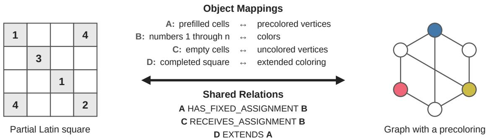  
Figure 8: An analogous pair mined by our pipeline. �: Solving the Latin Square Completion Problem by Memetic Graph Coloring. �: Precoloring Extension. I. Interval Graphs. Object mappings and shared relations are those extracted by the analogy judge (Appendix B.1), with object names shortened.

T<sub>a</sub>bl<sub>e</sub> 3 <sub>s</sub>h<sub>ows</sub> f<sub>our more ana</sub>l<sub>ogous pa</sub>i<sub>rs m</sub>i<sub>ne</sub>d b<sub>y our p</sub>i<sub>pe</sub>li<sub>ne, eac</sub>h <sub>w</sub>ith <sub>one</sub> h<sub>ar</sub>d <sub>nega</sub>ti<sub>ve an</sub>d t<sub>wo o</sub>f the object mappings extracted by the analogy judge.

## B. Prompts

The LLM ste<sub>p</sub>s of the <sub>p</sub>i<sub>p</sub>eline use GPT-5.6 Sol<sub>,</sub> GPT-6.1 Sol<sub>,</sub> and GPT-6 Astra<sub>,</sub> all accessed throu<sub>g</sub>h the O<sub>p</sub>enAI API in October 2026.

## B.1. Analogy Judgment

We use GPT-5.6 Sol (reasonin<sub>g</sub> of) for the analo<sub>gy</sub> jud<sub>g</sub>ment. For each candidate <sub>p</sub>air, the in<sub>p</sub>ut consists of the title and abstract of the problem paper �, the title and abstract of the cited paper �, the sentences in � that cite � (the relevance text), and the hi<sub>g</sub>hest-ranked O<sub>p</sub>enAlex to<sub>p</sub>ic of each <sub>p</sub>a<sub>p</sub>er (the domains in the <sub>p</sub>rom<sub>p</sub>t). A pa<sup>i</sup>r passes w<sup>h</sup>en t<sup>h</sup>e <sup>d</sup>ec<sup>i</sup>s<sup>i</sup>on <sup>i</sup>s observed\_analogy or potential\_analogy. T<sup>h</sup>e <sup>f</sup>u<sup>ll</sup> prompt <sup>i</sup>s s<sup>h</sup>own b<sub>e</sub>l<sub>ow; p</sub>l<sub>ace</sub>h<sub>o</sub>ld<sub>ers</sub> i<sub>n</sub> b<sub>races are</sub> fill<sub>e</sub>d <sub>per pa</sub>i<sub>r.</sub>

You are judging whether a cited solution D forms a useful cross-domain analogy for a problem paper   
q.   
Your task combines two formerly separate checks:   
1. Extract and validate the structural analogy between q and D.   
2. Decide whether q actually transfers D's contribution and, separately, whether the analogy could   
plausibly help q even when actual transfer is not evidenced.   
Use only the supplied problem, solution, and relevance text as evidence. Domain labels are   
screening metadata, not sufficient evidence by themselves. Do not rely on outside knowledge. Do not   
invent mappings, relations, uses, or benefits.   
Definitions   
- q / problem domain: the paper or task seeking help. This is the source side of every object   
mapping.   
- D / solution domain: the cited paper whose structure or contribution may be transferred. This is   
the target side of every object mapping.

C<sub>ross-</sub>P<sub>o</sub>lli<sub>na</sub>ti<sub>on</sub> R<sub>e</sub>t<sub>r</sub>i<sub>eva</sub>l<sub>:</sub> Fi<sub>n</sub>di<sub>ng</sub> T<sub>rans</sub>f<sub>era</sub>bl<sub>e</sub> Id<sub>eas</sub> A<sub>cross</sub> Fi<sub>e</sub>ld<sub>s</sub> i<sub>n</sub> S<sub>c</sub>i<sub>en</sub>tifi<sub>c</sub> Lit<sub>era</sub>t<sub>ure</sub>
<table><tr><td>Query</td><td>Positive</td><td>Hard negative</td><td>Object mappings (query side → positive)</td></tr><tr><td>How to define a representative conformation tensor average for turbulent viscoelastic flows that respects the non-Euclidean geometry of positive-definite tensors</td><td>A Differential Geometric Approach to the Geometric Mean of Symmetric Positive-Definite Matrices</td><td>Numerical Simulation of the Planar Extrudate Swell of Pseudoplastic and Viscoelastic Fluids</td><td>conformation tensors → symmetric positive-definite matrices; geometric mean conformation tensor → Riemannian geometric mean</td></tr><tr><td>How to understand the role of personal and social factors in the development of social entrepreneurship in Pakistan</td><td>Economic Action and Social Structure: The Problem of Embeddedness</td><td>Shaker A. Zahra: Pioneering Entrepreneurship Scholar</td><td>social entrepreneurs in Pakistan → individuals undertaking economic action; social capital and networks → structures of social relations</td></tr><tr><td>How to cost-effectively obtain large-scale sequence information for upland cotton flower development when the genome sequence is unavailable</td><td>An EST Resource for Tilapia Based on 17 Normalized Libraries</td><td>Improvement of Cotton Fiber Quality by Rabbit Keratin Gene Transformation</td><td>cotton normalized cDNA library → tilapia normalized cDNA libraries; cotton EST reads → tilapia EST reads</td></tr><tr><td>How to understand positive and negative responses to death portrayed in animated Disney films</td><td>The Development of Coping</td><td>Frozen in Time: How Disney Gender-Stereotypes Its Most Powerful Princess</td><td>film characters facing death → children facing real-life stressors; coping portrayed in the films → families of coping strategies</td></tr></table>

Table 3: More analogous pairs mined by our pipeline. Each hard negative shares an OpenAlex topic with the base paper and was rated 1 (related but not usable) by the judge of Step N2. Two of the object mappings extracted by the analogy judge (Appendix B.1) are shown for each pair; queries, titles, and object names are shortened.

```yaml
- This rule does not permit outside knowledge or invented correspondences. The Relevance text must
identify a concrete connection between q and D rather than merely cite D in a background list. For
observed_analogy, the Relevance text must still evidence actual use, adaptation, or building on D's
contribution through the validated correspondence. If actual transfer is not evidenced, a positive
decision is limited to potential_analogy and still requires a concrete, evidence-grounded
transfer_path that addresses q's stated goal.
Apply these exclusions before accepting an analogy
1. Same problem: Set same_problem to true when D is prior work on the same task as q, judged by
what the two papers set out to do and by D's role in the relevance text. Different terminology or
domain labels do not by themselves make the pair cross-domain. A same-problem pair is not an
analogy.
2. Background or narrative only: A citation used only for motivation, a literature list, historical
context, contrast, or evidence is not an analogy unless q transfers a relational structure from D.
3. Tool or data as-is: Using D only as an unchanged dataset, benchmark, software package,
pretrained resource, measurement tool, or lookup source is not an analogy. Adaptation of the
resource counts only when the adaptation itself is grounded through the mappings and addresses q's
goal.
4. Term borrowing: Reusing a name or metaphor without a functional relational correspondence is not
an analogy.
5. Surface similarity: Shared topics, nouns, attributes, or broad statements such as "both involve
networks" are insufficient.
6. Unsupported possibility: The fact that D could conceivably inspire q is insufficient. Potential
requires a specific, evidence-grounded transfer path from a contribution of D, through the mappings,
to a difficulty or objective in q.
7. Unconnected mapping: A plausible mapping that does not address what q is trying to achieve is
neither actual transfer nor useful potential.
8. Adoption without relational transfer: The fact that q adopts, imports, applies, or modifies
something from D does not by itself establish an analogy. Reject the pair unless the supplied
evidence grounds how D's relational structure corresponds to a different problem structure in q and
is transferred through that correspondence.
Judge in this order
A. Determine whether q and D address the same problem. If they do, reject the analogy.
B. Propose only functional object mappings explicitly stated or jointly and strongly implied by the
Problem q text, the Cited Solution D's Description, and the Relevance text. Prefer 4-8 mappings
when the evidence supports them, but never add mappings merely to reach a count.
C. Test each shared relation. Use predicate form and the same predicate name on both sides. Confirm
that every predicate argument appears in object_mappings.
D. Try to falsify the analogy using the exclusions above. In particular, distinguish relational
transfer from background citation, unchanged tool/data use, term borrowing, and surface
resemblance.
E. Judge actual transfer from the relevance text. transfer_holds is true only when q demonstrably
uses, adapts, or builds on D's method, formulation, evaluation design, data construction, or
finding to address q's problem through the validated cross-domain relational correspondence. Mere
adoption from D does not establish transfer_holds. Statements about what q could do do not
establish actual transfer.
F. Judge potential independently. transferable is true only when there is a concrete transfer_path
explaining: (i) what contribution comes from D, (ii) how the validated mappings carry it into q,
and (iii) how that transfer could help q's stated goal. transfer_holds=true requires
transferable=true.
G. Assign the final decision by the deterministic rules below.
Final decision rules
- "observed analogy": structural analogy=true and transfer holds=true.
- "potential_analogy": structural_analogy=true, transfer_holds=false, and transferable=true.
- "not_analogy": every other case.
If same_problem=true, or if the pair is only background, narrative, tool/data as-is, term borrowing,
or surface similarity, return empty object_mappings and shared_relations, set structural_analogy,
transfer_holds, and transferable to false, use an empty transfer_path, and choose not_analogy.
transfer_type must be exactly one of:
- "method"
- "problem_formulation"
- "evaluation_design"
"data_construction"
- "finding_or_evidence"
```

"narrative\_only"   
"tool\_as\_is"   
"same\_problem"   
- "none"   
Use narrative\_only for a list/background/motivation mention with nothing structurally transferred;   
tool\_as\_is for unchanged resource use; same\_problem when same\_problem is true; and none when no   
more specific type applies. For observed\_analogy or potential\_analogy, choose the contribution type   
that would be transferred.   
Return exactly one JSON object matching this schema and no other text:   
{   
"target\_domain": "the supplied solution domain",   
"same\_problem": false,   
"object\_mappings": [   
{   
"source": "q-side problem object",   
"target": "D-side solution object",   
"mapping\_rationale": "brief evidence-grounded functional correspondence"   
}   
],   
"shared\_relations": [   
{   
"relation": "PREDICATE\_NAME",   
"problem": "PREDICATE\_NAME(q\_object\_A, q\_object\_B)",   
"solution": "PREDICATE\_NAME(D\_object\_A, D\_object\_B)"   
}   
],   
"structural\_analogy": true,   
"transfer\_holds": false,   
"transferable": true,   
"transfer\_type": "method",   
"transfer\_path": "D contribution -> mapped q structure -> expected help for q's goal",   
"critic": {   
"background\_only": false,   
"tool\_or\_data\_as\_is": false,   
"term\_borrowing\_only": false,   
"surface\_similarity\_only": false,   
"mappings\_grounded": true,   
"relations\_grounded": true,   
"relation\_arguments\_mapped": true,   
"addresses\_problem\_goal": true   
},   
"decision": "potential\_analogy",   
"reason": "one or two concise sentences citing or closely paraphrasing the decisive supplied   
evidence"   
}   
Boolean fields must be JSON booleans, not strings. Do not include markdown fences. Do not reveal   
hidden reasoning; provide only the requested concise rationales and final JSON fields.   
Problem Domain: {source\_domain}   
Solution Domain: {target\_domain}   
Problem q:   
{problem}   
Cited Solution D:   
- Title: {solution\_title}   
Description: {description}   
Relevance: {relevance}

## B.2. Transfer Judgment

Pairs that <sub>p</sub>ass the analo<sub>gy</sub> jud<sub>g</sub>ment are checked a<sub>g</sub>ain b<sub>y</sub> a se<sub>p</sub>arate LLM, GPT-6.1 Sol (low reasonin<sub>g</sub> efort). The input consists of the titles and abstracts of � and $d ,$ th<sub>e sen</sub>t<sub>ences</sub> i<sub>n</sub> $q$ th<sub>a</sub>t <sub>c</sub>it<sub>e</sub> $d ,$ <sub>an</sub>d th<sub>e ou</sub>t<sub>pu</sub>t <sub>o</sub>f th<sub>e</sub> analogy judgment (decision, object mappings, shared relations, transfer type, transfer path, and reason). A pa<sup>i</sup>r <sup>i</sup>s <sup>k</sup>ept w<sup>h</sup>en t<sup>h</sup>e ver<sup>di</sup>ct <sup>i</sup>s transfer.

You are checking a candidate analogy between a problem paper q and a cited paper D.   
A first-pass judge has already proposed object mappings, shared relations and a transfer path   
between them.   
Decide whether something carried over from D actually helps solve q's problem.   
The pair passes (transfer) when all of these hold:   
1. q and D address different problems. D is not prior work on the same task as q.   
2. q actually uses, adapts or builds on a contribution of D (a method, formulation, component,   
measure,   
finding, design or resource) for its own problem, as shown by the supplied texts.   
3. The proposed mappings that connect D's contribution to q's problem are supported by the supplied   
texts.   
4. What is carried over serves what q is trying to achieve.   
It does not matter whether the contribution is general-purpose or already common practice: a widely   
used   
technique still counts if it was carried over from D's different problem and helps q.   
Reject the pair if any of these holds:   
- same\_problem: D already addresses q's problem (same task, or the same problem line in another   
dataset,   
population, language or setting).   
- background\_only: q cites D only for motivation, related work, contrast or history, without using   
it.   
- unsupported\_mappings: the proposed mappings or transfer are not supported by the supplied texts.   
Use only the supplied texts. Do not rely on outside knowledge.   
Problem paper q   
Title: {q\_title}   
Abstract: {q\_abstract}   
Cited paper D   
Title: {d\_title}   
Abstract: {d\_abstract}   
Sentences in q that cite D:   
{citing\_sentences}   
First-pass judgment   
Decision: {decision}   
Object mappings (q -> D): {mappings}   
Shared relations (q <-> D): {relations}   
Transfer type: {transfer\_type}   
Transfer path: {transfer\_path}   
Reason: {reason}   
Return JSON only:   
{"verdict": "transfer" | "reject",   
"reject\_reason": "same\_problem" | "background\_only" | "unsupported\_mappings" | null,   
"reason": "one or two sentences citing the decisive evidence"}

## B.3. Query Generation

Queries are generated by GPT-6 Astra in three steps. (1) Problem extraction. From the title and abstract of � and t<sup>h</sup>e sentences in � t<sup>h</sup>at cite � (wit<sup>h</sup> t<sup>h</sup>e citation rep<sup>l</sup>ace<sup>d b</sup>y [CITATION]), t<sup>h</sup>e mo<sup>d</sup>e<sup>l</sup> states t<sup>h</sup>e pro<sup>bl</sup>em t<sup>h</sup>at � is solving at the point of the citation. The prompt also gives what � took from � (the first part of the transfer path from the analogy judgment, Appendix B.1) and tells the model not to mention it. (2) Rewriting. The <sub>p</sub>roblem is rewritten as a “How to . . . ” <sub>q</sub>uer<sub>y</sub> that kee<sub>p</sub>s onl<sub>y</sub> the <sub>g</sub>oal and removes the terminolo<sub>gy</sub> of �’s field(s), which fill the placeholder {base\_domain}. (3) Review. A separate call checks the query (problem\_only, grounded, well\_formed), an<sup>d</sup> s<sup>i</sup>mp<sup>l</sup>e ru<sup>l</sup>es <sup>fl</sup>ag c<sup>i</sup>tat<sup>i</sup>on mar<sup>k</sup>ers, uppercase to<sup>k</sup>ens, meta-<sup>l</sup>anguage (e.g., “analo<sub>gy</sub>”, “ma<sub>pp</sub>in<sub>g</sub>”), method <sub>p</sub>hrases (e.<sub>g</sub>., “b<sub>y</sub> usin<sub>g</sub>”), <sub>q</sub>ueries that do not start with “How to”, and <sub>q</sub>ueries longer than 45 words. A query that fails any check is regenerated with the reviewer’s objection, up to two ti<sub>mes; pa</sub>i<sub>rs</sub> th<sub>a</sub>t <sub>s</sub>till f<sub>a</sub>il <sub>are</sub> d<sub>roppe</sub>d<sub>.</sub>

## Problem extraction.

You are given the title and abstract of a research paper, and the sentences in which this paper   
cites a specific prior work (the citation is marked [CITATION]).   
Title: {title}   
Abstract: {abstract}   
Citation context:   
{citation\_context}   
Task: state the problem the authors are trying to solve AT THE POINT of the citation context, in   
1-2 sentences. Describe only the problem (what is difficult or missing and why), not the paper's   
method, contribution, or results. If the context is a background or related-work remark, state the   
problem that remark is motivating.   
If the citation context describes a component of the paper's own method, do not state that   
component: state the need it serves, that is, the difficulty that existed before the paper's   
approach and that the component is meant to overcome.   
State the problem only: do not describe the paper's method, model, contribution, or results, and do   
not use "by", "through" or "using" phrases that name a technique. Everything you write must be   
supported by the supplied text.   
What the authors took from the cited work: {contribution}   
State the problem as it stood before they had this: what they needed and why it was hard. Do not   
name or describe this contribution, or the way the authors applied it.   
Return only the problem statement:

## Rewriting.

Rewrite this problem as a concise search query - stating ONLY the goal, with NO hints about   
mechanisms or methods.   
Original Problem:   
{problem}   
Solution domain to hide: {base\_domain}   
Rules:   
1. State only what needs to be achieved, not the method, contribution, or result   
2. Remove all terminology from the solution domain ({base\_domain}) and anything that hints at how   
the problem is solved   
3. Use only what the original problem states; add nothing   
4. Keep the conditions and constraints that define this particular problem (what is studied, what   
is limited or required), so that a solution from another field could be recognized as fitting it;   
drop incidental details   
5. Remove all "by...", "through...", "using..." phrases   
6. Format: "How to [goal]"   
Return only the rewritten problem:

## Review.

You are checking a search query that is supposed to state a research PROBLEM (what must be   
achieved), written from the paper below. Judge the query strictly.   
Paper title: {title}   
Paper abstract: {abstract}   
Sentences from the paper that cite the work the query was written for (citation markers masked as   
[CITATION]):   
{citation\_context}   
Query: {query}   
Answer in JSON with these fields:   
- "problem\_only": true if the query states only what must be achieved; false if it describes a   
method, model, algorithm, training procedure, or the paper's contribution or result.   
- "grounded": true if everything in the query is supported by the title, abstract, or the cited   
sentences: false if it introduces information not in them.   
- "well\_formed": true if it is one natural-language question in the form "How to ...", in plain   
lowercase English apart from proper names, with no uppercase predicate tokens or mathematical   
variables, no citation markers, and no meta-language about analogies, mappings, graphs, or   
instructions (technical uses of words such as "domain adaptation" or "multi-domain dialogue" are   
fine).   
- "issue": one short sentence naming the problem if any field is false, else "".   
Return only the JSON.

Regeneration. The problem-extraction prompt is reused with one added line, “Write in plain prose without <sub>ma</sub>th<sub>ema</sub>ti<sub>ca</sub>l <sub>var</sub>i<sub>a</sub>bl<sub>es or s m</sub>b<sub>o</sub>l<sub>s.</sub>”<sub>,</sub> l<sub>ace</sub>d b<sub>e</sub>f<sub>ore</sub> th<sub>e</sub> li<sub>ne a</sub>b<sub>ou</sub>t <sub>w</sub>h<sub>a</sub>t th<sub>e au</sub>th<sub>ors</sub> t<sub>oo</sub>k f<sub>rom</sub> th<sub>e c</sub>it<sub>e</sub>d <sub>wor</sub>k<sub>.</sub> Th<sub>e</sub> f<sub>o</sub>ll<sub>ow</sub>i<sub>ng</sub> t<sub>ex</sub>t i<sub>s appen</sub>d<sub>e</sub>d t<sub>o</sub> it<sub>:</sub>

A previous attempt was rejected. Previous problem statement: {previous\_problem}   
Reviewer's objection: {issue}   
Write a corrected problem statement that resolves the objection.

<sub>an</sub>d th<sub>e</sub> f<sub>o</sub>ll<sub>ow</sub>i<sub>ng</sub> t<sub>ex</sub>t i<sub>s appen</sub>d<sub>e</sub>d t<sub>o</sub> th<sub>e rewr</sub>iti<sub>ng promp</sub>t<sub>:</sub>

A previous rewrite was rejected because: {issue} Keep the conditions of the problem that this   
objection names, while still stating only the goal.

## B.4. Deduplication of Queries

When several queries are written from the same base paper �, GPT-6 Astra first compares every two queries and judges whether they ask about the same problem. Among queries judged to ask about the same problem, it then picks the cited paper that forms the strongest analogy with �, and only that pair is kept. This step runs before usefulness scoring, so it does not use �(�, �).

## Same-problem check.

Two search queries were written from the same research paper, each for a different place where the   
paper cites prior work.   
Query A: {query\_a}   
Query B: {query\_b}   
Do the two queries ask about essentially the same problem, so that a paper answering one would   
answer the other? Differences in wording alone do not make them different problems.   
Answer in JSON only: {"same\_problem": true|false, "reason": "<one sentence>"}

## Strongest analogy.

A research paper (the problem paper) cites several prior works for the same need. For each cited   
work you are given its title and abstract, the sentences of the problem paper that cite it, and the   
analogical mapping extracted between the two papers.   
Problem paper title: {q title}   
Problem paper abstract: {q\_abstract}   
{candidates}   
Which cited work forms the strongest analogy with the problem paper? A stronger analogy transfers   
more of the cited work's own structure (its method, formulation or finding) to a problem in a   
different setting, through mappings that are central to what the problem paper does, rather than a   
surface resemblance or a generic tool.   
Answer in JSON only: {"strongest": <number>, "reason": "<one sentence>"}

## B.5. Usefulness Scoring for Positives

We score each remaining pair (�, �) with GPT-6 Astra, using a modified version of the UMBRELA relevance <sub>p</sub>rom<sub>p</sub>t (U<sub>p</sub>adh<sub>y</sub>a<sub>y</sub> et al., 2024) that asks whether the <sub>p</sub>assa<sub>g</sub>e could be used to solve the <sub>p</sub>roblem in the <sub>q</sub>uer<sub>y</sub> rather than whether it is on the same to<sub>p</sub>ic. The <sub>q</sub>uer<sub>y</sub> is the <sub>g</sub>enerated <sub>q</sub>uer<sub>y</sub> of � (A<sub>pp</sub>endix B.3), and the <sub>p</sub>assa<sub>g</sub>e is the title and abstract of � (abstract truncated to 2,000 characters). The <sub>p</sub>rom<sub>p</sub>t also includes the object mappings and shared relations from the analogy judgment (Appendix B.1) as optional reference. We k<sub>eep a pa</sub>i<sub>r on</sub>l<sub>y</sub> if it<sub>s</sub> fi<sub>na</sub>l <sub>score</sub> i<sub>s</sub> 2 <sub>or</sub> hi<sub>g</sub>h<sub>er.</sub>

Given a query and a passage, you must provide a score on an integer scale of 0 to 3 with the following meanings: 0 = represent that the passage has nothing to do with the query, 1 = represents that the passage seems related to the query but does not provide anything that could be used to solve its problem, 2 = represents that the passage has a method, formulation or finding that could be used to solve the problem in the query, but it is partial, unclear, or has to be carried over from a different problem or setting and 3 = represents that the passage is dedicated to the problem in the query and contains a method, formulation or finding that directly solves it. Important Instruction: Judge whether the passage could be used to solve the problem, not how similar its topic is: a passage from a different field can deserve category 2 or 3, and a passage on the same topic that does not help solve the problem deserves category 1. If none of the above satisfies give it category 0. Query: {query} Passage: {passage} For reference, here is a candidate analogical correspondence between two sets of objects and relations. Object mappings (left -> right): {mappings} Shared relations (left <-> right): {relations} Use it only if it applies: check whether the left-side objects and relations are present in the query's problem and the right-side ones in the passage. If they are not, ignore the correspondence. Split this problem into steps: Consider the underlying intent of the search. Measure how well the content matches a likely intent of the query (M). Measure how trustworthy the passage is (T). Consider the aspects above and the relative importance of each, and decide on a final score (O). Final score must be an integer value only. Do not provide any code in result. Provide each score in the format of: ##final score: score without providing any reasoning.

## B.6. Usefulness Scoring for Hard Negatives

H<sub>ar</sub>d<sub>-nega</sub>ti<sub>ve can</sub>did<sub>a</sub>t<sub>es are score</sub>d <sub>on</sub> th<sub>e same</sub> 0<sub>–</sub>3 <sub>sca</sub>l<sub>e w</sub>ith th<sub>e same promp</sub>t <sub>as</sub> i<sub>n</sub> A<sub>ppen</sub>di<sub>x</sub> B<sub>.</sub>5<sub>, excep</sub>t that no object mappings or shared relations are given. We use GPT-6.1 Sol for this step. The query is the generated query of �, and the passage is the title and abstract of the candidate (abstract truncated to 2,000 characters). Onl<sub>y</sub> candidates with a score of 1 or lower are used as hard ne<sub>g</sub>atives; candidates scored 2 or hi<sub>g</sub>h<sub>er are</sub> di<sub>scar</sub>d<sub>e</sub>d<sub>.</sub>

Given a query and a passage, you must provide a score on an integer scale of 0 to 3 with the   
following meanings: 0 = represent that the passage has nothing to do with the query, 1 = represents   
that the passage seems related to the query but does not provide anything that could be used to   
solve its problem, 2 = represents that the passage has a method, formulation or finding that could   
be used to solve the problem in the query, but it is partial, unclear, or has to be carried over   
from a different problem or setting and 3 = represents that the passage is dedicated to the problem   
in the query and contains a method, formulation or finding that directly solves it. Important   
Instruction: Judge whether the passage could be used to solve the problem, not how similar its   
topic is: a passage from a different field can deserve category 2 or 3, and a passage on the same   
topic that does not help solve the problem deserves category 1. If none of the above satisfies give   
it category 0. Query: {query} Passage: {passage} Split this problem into steps: Consider the   
underlying intent of the search. Measure how well the content matches a likely intent of the query   
(M). Measure how trustworthy the passage is (T). Consider the aspects above and the relative   
importance of each, and decide on a final score (O). Final score must be an integer value only. Do   
not provide any code in result. Provide each score in the format of: ##final score: score without   
providing any reasoning.

## C. Human Agreement

We measure the agreement between the LLM judges <sub>an</sub>d <sub>a</sub> h<sub>uman anno</sub>t<sub>a</sub>t<sub>or, one o</sub>f th<sub>e au</sub>th<sub>ors, on</sub> t<sub>wo</sub> tasks of 50 items each. Task 1 covers the transfer <sub>ver</sub>ifi<sub>ca</sub>ti<sub>on o</sub>f St<sub>ep</sub> P2<sub>: pa</sub>i<sub>rs</sub> th<sub>a</sub>t <sub>passe</sub>d th<sub>e ana</sub>l<sub>ogy</sub> judgment, half accepted and half rejected by the verifi<sub>ca</sub>ti<sub>on.</sub> Th<sub>e anno</sub>t<sub>a</sub>t<sub>or sees</sub> th<sub>e</sub> titl<sub>es an</sub>d <sub>a</sub>b<sub>s</sub>t<sub>rac</sub>t<sub>s o</sub>f � and $d ,$ th<sub>e sen</sub>t<sub>ences o</sub>f $q$ citing �, and the extracted analogy, and answers yes or no. Task 2 covers usefulness scorin<sub>g</sub>: 25 <sub>q</sub>uer<sub>y</sub>–<sub>p</sub>ositive <sub>p</sub>airs scored b<sub>y</sub> GPT-6

<table><tr><td>Task</td><td></td><td>Items Agreement</td><td>Cohen&#x27;s κ</td></tr><tr><td>1. Transfer verification (P2)</td><td>50</td><td>0.92</td><td>0.84</td></tr><tr><td>2. Usefulness of positives (P3)</td><td>25</td><td>0.92</td><td>0.84</td></tr><tr><td>3. Usefulness of candidates (N2)</td><td>25</td><td>0.96</td><td>0.92</td></tr></table>

Table 4: Agreement between the LLM judges and a human annotator. Usefulness scores are binarized at 2.

Astra in Ste<sub>p</sub> P3 and 25 <sub>q</sub>uer<sub>y</sub>–candidate <sub>p</sub>airs scored b<sub>y</sub> GPT-6.1 Sol in Ste<sub>p</sub> N2<sub>,</sub> each set s<sub>p</sub>lit about evenl<sub>y</sub> between scores of 2 or above and 1 or below (13 and 12 for P3, 12 and 13 for N2). The annotator sees the <sub>query an</sub>d th<sub>e</sub> titl<sub>e an</sub>d <sub>a</sub>b<sub>s</sub>t<sub>rac</sub>t <sub>o</sub>f th<sub>e paper,</sub> t<sub>oge</sub>th<sub>er w</sub>ith th<sub>e ex</sub>t<sub>rac</sub>t<sub>e</sub>d <sub>ana</sub>l<sub>ogy w</sub>h<sub>en</sub> th<sub>e pa</sub>i<sub>r</sub> h<sub>as one, an</sub>d <sub>g</sub>ives a score from 0 to 3. Each item has a diferent base <sub>p</sub>a<sub>p</sub>er (Task 1) or <sub>q</sub>uer<sub>y</sub> (Task 2). Scores are binarized at 2, and Table 4 reports the agreement for each LLM judge. The annotator followed the guidelines below.

Guidelines for Task 1.

You see a problem paper q, a paper D that q cites, the sentences in q that cite D, and a first-pass   
judgment that already proposes object mappings, shared relations and a transfer path between them.   
Decide whether q carries over something from D to solve its own, different problem.   
The first-pass judgment is a proposal to check, not an answer to follow: it is often wrong, and   
your job includes deciding whether the texts support it.   
Yes (transfer) when all of these hold:   
- q and D address different problems. D is not prior work on the same task as q.   
- q actually uses, adapts or builds on a contribution of D (a method, formulation, component,   
measure, finding, design or resource) for its own problem, as shown by the texts.   
- The proposed mappings that connect D's contribution to q's problem are supported by the texts.   
- What is carried over serves what q is trying to achieve.   
It does not matter whether the contribution is general-purpose or already common practice: a widely   
used technique still counts if it was carried over from D's different problem and helps q.   
No (reject) if any of these holds:   
- Same problem: D already addresses q's problem (same task, or the same problem line in another   
dataset, population, language or setting).   
- Background only: q cites D only for motivation, related work, contrast or history, without using   
it.   
- Unsupported: the proposed mappings or transfer are not supported by the texts.   
Use only the texts shown. Do not rely on outside knowledge.

## Guidelines for Task 2.

You see a query (a research problem) and a passage (a paper's title and abstract). Rate on 0-3   
whether the passage could be used to solve the problem in the query:   
- 0 = the passage has nothing to do with the query.   
- 1 = the passage seems related to the query but does not provide anything that could be used to   
solve its problem.   
- 2 = the passage has a method, formulation or finding that could be used to solve the problem in   
the query, but it is partial, unclear, or has to be carried over from a different problem or   
setting.   
- 3 = the passage is dedicated to the problem in the query and contains a method, formulation or   
finding that directly solves it.   
Important: judge whether the passage could be used to solve the problem, not how similar its topic   
is. A passage from a different field can deserve 2 or 3, and a passage on the same topic that does   
not help solve the problem deserves 1.   
Some items also show a first-pass judgment: a candidate correspondence between two sets of objects   
and relations. Use it only if it applies -- check whether the left-side objects and relations are   
present in the query's problem and the right-side ones in the passage. If they are not, ignore it.   
Items without this block are judged on the query and passage alone.

## D. OpenAlex

We use the O<sub>p</sub>enAlex sna<sub>p</sub>shot of 2026-09-23. Table 5 shows exam<sub>p</sub>les of the four levels of the O<sub>p</sub>enAlex hi<sub>erarc</sub>h<sub>y.</sub>

T<sub>a</sub>bl<sub>e</sub> 6 <sub>s</sub>h<sub>ows</sub> h<sub>ow</sub> f<sub>ar</sub> th<sub>e</sub> <sub>pos</sub>iti<sub>ves</sub> <sub>o</sub>f CPR<sub>-</sub>D<sub>a</sub>t<sub>ase</sub>t li<sub>e</sub> f<sub>rom</sub> th<sub>e</sub>i<sub>r</sub> b<sub>ase</sub> <sub>papers</sub> <sub>a</sub>t <sub>eac</sub>h l<sub>eve</sub>l <sub>o</sub>f th<sub>e</sub> O<sub>pen</sub>Al<sub>ex</sub> hi<sub>erarc</sub>h<sub>y.</sub>

## E. Comparison with Existing Datasets

T<sub>a</sub>bl<sub>e</sub> 7 <sub>com ares</sub> CPR<sub>-</sub>D<sub>a</sub>t<sub>ase</sub>t <sub>w</sub>ith <sub>ex</sub>i<sub>s</sub>ti<sub>n</sub> d<sub>a</sub>t<sub>ase</sub>t<sub>s</sub> f<sub>or sc</sub>i<sub>en</sub>tifi<sub>c a er re</sub>t<sub>r</sub>i<sub>eva</sub>l<sub>.</sub> Fi <sub>ure</sub> 9 <sub>re ea</sub>t<sub>s</sub> Fi <sub>ure</sub> 1 <sub>w</sub>ith <sub>every pa</sub>i<sub>r o</sub>f <sub>eac</sub>h b<sub>enc</sub>h<sub>mar</sub>k i<sub>ns</sub>t<sub>ea</sub>d <sub>o</sub>f th<sub>e</sub> 100 <sub>w</sub>ith th<sub>e</sub> l<sub>onges</sub>t li<sub>nes:</sub> 4<sub>,</sub>741 <sub>pa</sub>i<sub>rs</sub> f<sub>or</sub> S<sub>c</sub>iD<sub>ocs,</sub> 633 f<sub>or</sub> LitSearch<sub>,</sub> 177 for Same Problem<sub>,</sub> Diferent Field<sub>,</sub> and 1<sub>,</sub>300 for CPR-eval.

<table><tr><td>Domain</td><td>Field</td><td>Subfield</td><td>Topic</td></tr><tr><td>Health Sciences</td><td>Dentistry</td><td>Periodontics</td><td>Oral microbiology and periodontitis research</td></tr><tr><td></td><td>Nursing</td><td>Nutrition and Dietetics</td><td>Child Nutrition and Water Access</td></tr><tr><td>Life Sciences</td><td>Biochemistry, Genetics and Molecular Biology</td><td>Genetics</td><td>Genetic Associations and Epidemiology</td></tr><tr><td></td><td>Immunology and Microbiology</td><td>Immunology</td><td>Immunotherapy and Immune Responses</td></tr><tr><td>Physical Sciences</td><td>Computer Science</td><td>Computer Vision and Pattern Recognition</td><td>Advanced Neural Network Applications</td></tr><tr><td></td><td>Mathematics</td><td>Statistics and Probability</td><td>Advanced Causal Inference Techniques</td></tr><tr><td></td><td>Chemical Engineering</td><td>Catalysis</td><td>Ammonia Synthesis and Nitrogen Reduction</td></tr><tr><td>Social Sciences</td><td>Decision Sciences</td><td>Statistics, Probability and</td><td>Meta-analysis and systematic</td></tr><tr><td></td><td>Economics, Econometrics and</td><td>Uncertainty Economics and Econometrics</td><td>reviews Market Dynamics and Volatility</td></tr><tr><td></td><td>Finance Business, Management and</td><td>Strategy and Management</td><td>Innovation and Knowledge</td></tr></table>

Table 5: Examples of the OpenAlex hierarchy. Each row is a topic assigned to papers in CPR-eval, with the subfield, field, <sub>a</sub>nd d<sub>o</sub>m<sub>a</sub>in it b<sub>e</sub>l<sub>o</sub>n<sub>gs</sub> t<sub>o.</sub> O<sub>pe</sub>nAl<sub>e</sub>x h<sub>as</sub> 4 d<sub>o</sub>m<sub>a</sub>in<sub>s,</sub> 26 fi<sub>e</sub>ld<sub>s,</sub> 252 <sub>su</sub>bfi<sub>e</sub>ld<sub>s, a</sub>nd <sub>a</sub>b<sub>ou</sub>t 4<sub>,</sub>500 t<sub>op</sub>i<sub>cs.</sub>

## F. Metric and Loss Definitions

Metrics. For a query, let rank(�) be the rank of a document � in the retriever’s ranking of the candidates, $d _ { i }$ th<sub>e</sub> d<sub>ocumen</sub>t <sub>a</sub>t <sub>ran</sub>k $i ,$ and � the set of relevant documents. In CPR-eval, � contains only the positive $d ^ { + }$ , so

$$
\begin{array} { r l r } & { } & { \mathrm { R e c a l l @ } k = { \bf 1 } \left[ \mathrm { r a n k } ( d ^ { + } ) \leq k \right] , } \\ & { } & { \mathrm { M R R @ 1 0 } = \frac { { \bf 1 } \left[ \mathrm { r a n k } ( d ^ { + } ) \leq 1 0 \right] } { \mathrm { r a n k } ( d ^ { + } ) } . } \end{array}
$$

BRIGHT and AnaloBench have several relevant documents <sub>p</sub>er <sub>q</sub>uer<sub>y</sub>, and we use nDCG@10 with binar<sub>y</sub> <sub>g</sub>ains:

$$
\mathrm { n D C G @ 1 0 } = \frac { \sum _ { i = 1 } ^ { 1 0 } \mathbf { 1 } \big [ d _ { i } \in G \big ] / \log _ { 2 } ( i + 1 ) } { \sum _ { i = 1 } ^ { \operatorname* { m i n } ( | G | , 1 0 ) } 1 / \log _ { 2 } ( i + 1 ) } .
$$

E<sub>ac</sub>h <sub>me</sub>t<sub>r</sub>i<sub>c</sub> i<sub>s average</sub>d <sub>over quer</sub>i<sub>es.</sub> O<sub>n</sub> BRIGHT<sub>, we average w</sub>ithi<sub>n eac</sub>h <sub>o</sub>f th<sub>e seven su</sub>b<sub>se</sub>t<sub>s an</sub>d th<sub>en over</sub> th<sub>e su</sub>b<sub>se</sub>t<sub>s; on</sub> A<sub>na</sub>l<sub>o</sub>B<sub>enc</sub>h<sub>, we average w</sub>ithi<sub>n eac</sub>h <sub>s</sub>t<sub>ory</sub> l<sub>eng</sub>th <sub>an</sub>d th<sub>en over</sub> th<sub>e</sub> th<sub>ree</sub> l<sub>eng</sub>th<sub>s.</sub>

Training loss. A training pair consists of a query $x ,$ it<sub>s pos</sub>iti<sub>ve</sub> $d ^ { + }$ , and its hard ne<sub>g</sub>atives � (nine in CPR-train). Let $s ( x , d )$ be the cosine similarity between the embeddings of � and $d ,$ and � the positives and hard negatives of the other <sub>q</sub>ueries encoded to<sub>g</sub>ether with � (in-batch ne<sub>g</sub>atives): 31 other <sub>q</sub>ueries for Qwen3-Embeddin<sub>g</sub> $( 8 \mathrm { \ G P U s \times 4 ) }$ <sub>an</sub>d 7 f<sub>or</sub> ll<sub>ama-em</sub>b<sub>e</sub>d<sub>-nemo</sub>t<sub>ron-</sub>8b $( 8 \ \mathrm { G P U s } \times 1 )$ <sub>, s</sub>i<sub>nce</sub> th<sub>e</sub> b<sub>a</sub>t<sub>c</sub>h <sub>o</sub>f 128 <sub>quer</sub>i<sub>es</sub> i<sub>s</sub> b<sub>u</sub>ilt b<sub>y</sub> <sub>g</sub>radient accumulation (Table 13). The InfoNCE loss (van den Oord et al., 2019) of the <sub>p</sub>air is

$$
\mathcal { L } ( x ) = - \log \frac { \exp { ( s ( x , d ^ { + } ) / T ) } } { \sum _ { d \in \{ d ^ { + } \} \cup N \cup B } \exp { ( s ( x , d ) / T ) } } ,
$$

<sub>average</sub>d <sub>over</sub> th<sub>e</sub> <sub>quer</sub>i<sub>es</sub> <sub>o</sub>f <sub>a</sub> b<sub>a</sub>t<sub>c</sub>h<sub>,</sub> <sub>w</sub>ith t<sub>empera</sub>t<sub>ure</sub> $T = 0 . 1$ for Qwen3-Embedding and 0.02 for llamaembed-nemotron-8b (Table 13). Trainin<sub>g</sub> without hard ne<sub>g</sub>atives (A<sub>pp</sub>endix M) uses the same loss with $N = \emptyset$

<table><tr><td>Level</td><td>Count</td><td>First divergence (%)</td></tr><tr><td>Domain</td><td>4</td><td>45.3</td></tr><tr><td>Field</td><td>26</td><td>34.6</td></tr><tr><td>Subfield</td><td>233</td><td>12.4</td></tr><tr><td>Topic</td><td>2,724</td><td>7.7</td></tr></table>

Table 6: Topical spread of CPR-Dataset pairs. F<sub>or eac</sub>h O<sub>pen</sub>Al<sub>ex</sub> l<sub>eve</sub>l<sub>, over</sub> b<sub>o</sub>th <sub>sp</sub>lit<sub>s:</sub> th<sub>e</sub> <sub>num</sub>b<sub>er o</sub>f di<sub>s</sub>ti<sub>nc</sub>t <sub>un</sub>it<sub>s among</sub> b<sub>ase papers an</sub>d positives (Count), and the share of pairs whose b<sub>ase</sub> <sub>paper</sub> <sub>an</sub>d <sub>pos</sub>iti<sub>ve</sub> fi<sub>rs</sub>t dif<sub>er</sub> <sub>a</sub>t th<sub>a</sub>t l<sub>eve</sub>l (First divergence).

<table><tr><td>Dataset</td><td>Cross- topic</td><td>Fields</td><td>Size</td></tr><tr><td>SPECTER (Cohan et al., 2020)</td><td>X</td><td>26</td><td>684K</td></tr><tr><td>SciDocs (Cohan et al., 2020)</td><td>X</td><td>20</td><td>1,000</td></tr><tr><td>LitSearch (Ajith et al., 2024)</td><td>X</td><td>10</td><td>597</td></tr><tr><td>ScholarCatalyst (Kim et al., 2026)</td><td>X</td><td>16</td><td>894</td></tr><tr><td>MOOSE-Chem (Yang et al., 2025)</td><td>X</td><td>7</td><td>51</td></tr><tr><td>ResearchBench (Liu et al., 2026)</td><td>X</td><td>25</td><td>1,386</td></tr><tr><td>SPDF (Kulikowski, 2026)</td><td>√</td><td>14</td><td>92</td></tr><tr><td>CPR-Dataset</td><td>V</td><td>26</td><td>11.9K</td></tr></table>

Table 7: Comparison between CPR-Dataset and existing scientific paper retrieval datasets. Cross-topic marks whether positives must come from a topic other than the query’s. Fields counts the OpenAlex fi<sub>e</sub>ld<sub>s o</sub>f th<sub>e papers</sub> th<sub>a</sub>t <sub>quer</sub>i<sub>es come</sub> f<sub>rom, a</sub>ft<sub>er we rec</sub>l<sub>ass</sub>if<sub>y</sub> th<sub>ese</sub> papers into OpenAlex fields. Size counts evaluation queries, except f<sub>or</sub> SPECTER<sub>, w</sub>h<sub>ere</sub> it <sub>coun</sub>t<sub>s</sub> th<sub>e c</sub>it<sub>a</sub>ti<sub>on-</sub>b<sub>ase</sub>d t<sub>r</sub>i<sub>p</sub>l<sub>e</sub>t<sub>s use</sub>d t<sub>o</sub> train the SPECTER model<sub>,</sub> and for CPR-Dataset<sub>,</sub> where it counts the 1<sub>,</sub>300 evaluation <sub>q</sub>ueries and 10<sub>,</sub>573 trainin<sub>g p</sub>airs. SPDF denotes S<sub>ame</sub> P<sub>ro</sub>bl<sub>em,</sub> Dif<sub>eren</sub>t Fi<sub>e</sub>ld<sub>.</sub>

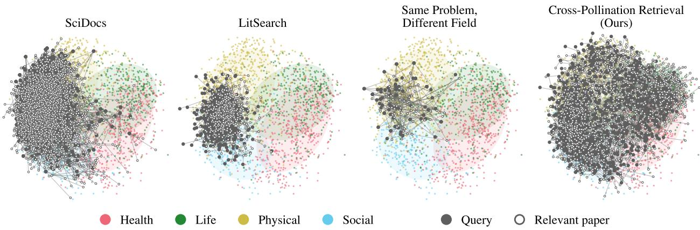  
Figure 9: All query and relevant paper pairs of each benchmark. The same map as Figure 1, with every pair instead of th<sub>e</sub> 100 <sub>w</sub>ith th<sub>e</sub> l<sub>onges</sub>t li<sub>nes.</sub>

## G. Full Evaluation Results

Table 2 re<sub>p</sub>orts Recall@1 and Recall@10. Table 8 <sub>g</sub>ives Recall@5 and MRR@10 in the same la<sub>y</sub>out, and Table 9 <sub>g</sub>i<sub>ves</sub> 95% <sub>con</sub>fid<sub>ence</sub> i<sub>n</sub>t<sub>erva</sub>l<sub>s</sub> f<sub>or a</sub>ll f<sub>our me</sub>t<sub>r</sub>i<sub>cs over a</sub>ll <sub>quer</sub>i<sub>es.</sub> T<sub>a</sub>bl<sub>e</sub> 10 <sub>g</sub>i<sub>ves</sub> th<sub>e same</sub> f<sub>our me</sub>t<sub>r</sub>i<sub>cs</sub> f<sub>or</sub> th<sub>e re</sub>t<sub>r</sub>i<sub>evers</sub> t<sub>ra</sub>i<sub>ne</sub>d <sub>on eac</sub>h t<sub>ra</sub>i<sub>n</sub>i<sub>ng se</sub>t<sub>.</sub> T<sub>a</sub>bl<sub>es</sub> 11 <sub>an</sub>d 12 <sub>g</sub>i<sub>ve</sub> th<sub>e resu</sub>lt<sub>s o</sub>f th<sub>e same</sub> t<sub>ra</sub>i<sub>ne</sub>d <sub>re</sub>t<sub>r</sub>i<sub>evers on</sub> <sub>eac</sub>h <sub>su</sub>b<sub>se</sub>t <sub>o</sub>f BRIGHT <sub>an</sub>d A<sub>na</sub>l<sub>o</sub>B<sub>enc</sub>h<sub>.</sub> Th<sub>e conc</sub>l<sub>us</sub>i<sub>ons</sub> d<sub>o no</sub>t d<sub>epen</sub>d <sub>on</sub> th<sub>e me</sub>t<sub>r</sub>i<sub>c: on every me</sub>t<sub>r</sub>i<sub>c over</sub> <sub>a</sub>ll <sub>quer</sub>i<sub>es,</sub> i<sub>n</sub>f<sub>-re</sub>t<sub>r</sub>i<sub>ever-v</sub>1<sub>-pro,</sub> G<sub>em</sub>i<sub>n</sub>i E<sub>m</sub>b<sub>e</sub>ddi<sub>ng, an</sub>d L<sub>a</sub>t<sub>e</sub>O<sub>n are</sub> th<sub>e</sub> th<sub>ree</sub> b<sub>es</sub>t <sub>re</sub>t<sub>r</sub>i<sub>evers, an</sub>d th<sub>e</sub> LLM <sub>reran</sub>k<sub>er</sub> i<sub>s</sub> f<sub>ar a</sub>b<sub>ove a</sub>ll <sub>re</sub>t<sub>r</sub>i<sub>evers.</sub>

Input length. The of-the-shelf dense retrievers with a length limit (Qwen3-Embedding-0.6B and 4B, SPECTER2, the O<sub>p</sub>enScholar retriever, and inf-retriever-v1-<sub>p</sub>ro) encode at most 512 tokens in Tables 2, 8, and 9. The trained retrievers and their before-trainin<sub>g</sub> baselines (Fi<sub>g</sub>ures 5 and 7, Tables 10 and 17) encode at most 1,024 tokens, the len<sub>g</sub>th used in trainin<sub>g</sub> (A<sub>pp</sub>endix I), so the before-trainin<sub>g</sub> values difer sli<sub>g</sub>htl<sub>y</sub> from th<sub>ose</sub> i<sub>n</sub> T<sub>a</sub>bl<sub>e</sub> 2<sub>.</sub>

<table><tr><td rowspan="2"></td><td colspan="7">Domain</td><td rowspan="2">Avg.</td></tr><tr><td>Health</td><td></td><td>Life</td><td>Physical</td><td></td><td>Social</td><td></td></tr><tr><td>Method</td><td>R@5</td><td>MRR</td><td>R@5 MRR</td><td>R@5</td><td>MRR</td><td>R@5</td><td>MRR</td><td>R@5 MRR</td></tr><tr><td colspan="9">LLM reranker†</td></tr><tr><td>MiMo-V2.6-Pro</td><td>0.80</td><td>0.68</td><td>0.76 0.67</td><td>0.73</td><td>0.63</td><td>0.81</td><td>0.67</td><td>0.77 0.66</td></tr><tr><td></td><td></td><td></td><td>Sparse</td><td></td><td></td><td></td><td></td><td></td></tr><tr><td>BM25</td><td>0.09</td><td>0.06</td><td>0.12 0.07</td><td>0.12</td><td>0.07</td><td>0.12</td><td>0.10</td><td>0.11 0.07</td></tr><tr><td>BGE-M3 (sparse)</td><td>0.08</td><td>0.06</td><td>0.07 0.04</td><td>0.08</td><td>0.05</td><td>0.09</td><td>0.07</td><td>0.08 0.05</td></tr><tr><td colspan="9">Dense (general)</td></tr><tr><td>Qwen3-Emb-0.6B</td><td>0.09</td><td>0.07 0.07</td><td>0.05</td><td>0.07</td><td>0.05</td><td>0.09</td><td>0.07</td><td>0.08 0.06</td></tr><tr><td>BGE-M3 (dense)</td><td>0.08</td><td>0.06 0.06</td><td>0.04</td><td>0.06</td><td>0.04</td><td>0.08</td><td>0.06</td><td>0.07 0.05</td></tr><tr><td>Qwen3-Emb-4B</td><td>0.13</td><td>0.09 0.14</td><td>0.10</td><td>0.11</td><td>0.07</td><td>0.14</td><td>0.10</td><td>0.13 0.09</td></tr><tr><td>Gemini Embedding</td><td>0.17</td><td>0.13 0.22</td><td>0.16</td><td>0.18</td><td>0.13</td><td>0.20</td><td>0.16</td><td>0.19 0.14</td></tr><tr><td colspan="9">Dense (scientific)</td></tr><tr><td>SPECTER2</td><td>0.05</td><td>0.04</td><td>0.06 0.05</td><td>0.06</td><td>0.04</td><td>0.03</td><td>0.02</td><td>0.05 0.04</td></tr><tr><td>OpenScholar retriever</td><td>0.09</td><td>0.05 0.08</td><td>0.05</td><td>0.08</td><td>0.06</td><td>0.10</td><td>0.07</td><td>0.09 0.06</td></tr><tr><td colspan="9">Dense (reasoning)</td></tr><tr><td>inf-retriever-v1-pro</td><td>0.21</td><td>0.17</td><td>0.21 0.17</td><td>0.17</td><td>0.14</td><td>0.22</td><td>0.16</td><td>0.20 0.15</td></tr><tr><td colspan="9">Late interaction</td></tr><tr><td>LateOn BGE-M3 (multi-vector)</td><td>0.16 0.11</td><td>0.12</td><td>0.14 0.10</td><td>0.15</td><td>0.11</td><td>0.17</td><td>0.12</td><td>0.15 0.12</td></tr><tr><td></td><td></td><td>0.07 0.07</td><td>0.04</td><td>0.05</td><td>0.04</td><td>0.10</td><td>0.06</td><td>0.08 0.05</td></tr></table>

Table 8: Recall@5 and MRR@10 of retrievers and an LLM reranker on CPR-eval. Columns show results by the OpenAlex d<sub>oma</sub>i<sub>n o</sub>f th<sub>e</sub> b<sub>ase paper an</sub>d th<sub>e average over a</sub>ll <sub>quer</sub>i<sub>es.</sub> Th<sub>e</sub> b<sub>es</sub>t <sub>re</sub>t<sub>r</sub>i<sub>ever</sub> i<sub>n eac</sub>h <sub>co</sub>l<sub>umn</sub> i<sub>s</sub> i<sub>n</sub> b<sub>o</sub>ld<sub>.</sub> MRR d<sub>eno</sub>t<sub>es</sub> MRR@10. Random rankin<sub>g g</sub>ives 0.03 and 0.02. <sup>†</sup>Shown for reference: the LLM reranker reorders the same 151 candidates i<sub>n a</sub> t<sub>ournamen</sub>t<sub>.</sub>

## H. LLM Reranker Details

The LLM reranker in Table 2 reorders the same 151 candidates of each <sub>q</sub>uer<sub>y</sub> with MiMo-V2.6-Pro (Xiaomi MiMo Team, 2026) in a tournament similar to those of TourRank (Chen et al., 2025) and OBLIQ-Bench (Tchuindjo et al., 2026). The candidates are shufled with a fixed seed <sub>p</sub>er <sub>q</sub>uer<sub>y</sub> and shown with their title and abstract. I<sub>n</sub> th<sub>e</sub> fi<sub>rs</sub>t <sub>roun</sub>d<sub>,</sub> th<sub>e</sub> 151 <sub>can</sub>did<sub>a</sub>t<sub>es are sp</sub>lit i<sub>n</sub>t<sub>o e</sub>i<sub>g</sub>ht <sub>groups o</sub>f 18<sub>–</sub>19<sub>, an</sub>d th<sub>e mo</sub>d<sub>e</sub>l <sub>se</sub>l<sub>ec</sub>t<sub>s</sub> f<sub>rom eac</sub>h <sub>group, w</sub>ith <sub>a</sub> li<sub>s</sub>t<sub>w</sub>i<sub>se promp</sub>t<sub>,</sub> th<sub>e</sub> fi<sub>ve can</sub>did<sub>a</sub>t<sub>es w</sub>h<sub>ose me</sub>th<sub>o</sub>d<sub>s are mos</sub>t lik<sub>e</sub>l<sub>y</sub> t<sub>o so</sub>l<sub>ve</sub> th<sub>e pro</sub>bl<sub>em,</sub> l<sub>eav</sub>i<sub>ng</sub> 40<sub>.</sub> I<sub>n</sub> th<sub>e secon</sub>d <sub>roun</sub>d<sub>,</sub> th<sub>ese</sub> 40 <sub>are sp</sub>lit i<sub>n</sub>t<sub>o</sub> t<sub>wo groups o</sub>f 20<sub>, an</sub>d th<sub>e mo</sub>d<sub>e</sub>l <sub>aga</sub>i<sub>n se</sub>l<sub>ec</sub>t<sub>s</sub> fi<sub>ve</sub> f<sub>rom eac</sub>h <sub>group,</sub> l<sub>eav</sub>i<sub>ng</sub> t<sub>en</sub> fi<sub>na</sub>li<sub>s</sub>t<sub>s.</sub> E<sub>ac</sub>h fi<sub>na</sub>li<sub>s</sub>t i<sub>s</sub> th<sub>en score</sub>d <sub>separa</sub>t<sub>e</sub>l<sub>y</sub> f<sub>rom</sub> 0 t<sub>o</sub> 10 <sub>w</sub>ith <sub>a po</sub>i<sub>n</sub>t<sub>w</sub>i<sub>se promp</sub>t<sub>.</sub> Th<sub>e</sub> fi<sub>na</sub>li<sub>s</sub>t<sub>s are ran</sub>k<sub>e</sub>d b<sub>y score; w</sub>h<sub>en severa</sub>l fi<sub>na</sub>li<sub>s</sub>t<sub>s s</sub>h<sub>are</sub> th<sub>e</sub> t<sub>op score, one more</sub> li<sub>s</sub>t<sub>w</sub>i<sub>se ca</sub>ll <sub>or</sub>d<sub>ers</sub> th<sub>em.</sub> C<sub>an</sub>did<sub>a</sub>t<sub>es e</sub>li<sub>m</sub>i<sub>na</sub>t<sub>e</sub>d i<sub>n</sub> th<sub>e secon</sub>d <sub>roun</sub>d <sub>are ran</sub>k<sub>e</sub>d <sub>a</sub>ft<sub>er</sub> th<sub>e</sub> fi<sub>na</sub>li<sub>s</sub>t<sub>s,</sub> f<sub>o</sub>ll<sub>owe</sub>d b<sub>y</sub> th<sub>ose e</sub>li<sub>m</sub>i<sub>na</sub>t<sub>e</sub>d i<sub>n</sub> th<sub>e</sub> fi<sub>rs</sub>t <sub>roun</sub>d<sub>.</sub> Th<sub>e</sub> t<sub>wo se</sub>l<sub>ec</sub>ti<sub>on roun</sub>d<sub>s use</sub> l<sub>ow reason</sub>i<sub>ng e</sub>f<sub>or</sub>t<sub>, an</sub>d th<sub>e po</sub>i<sub>n</sub>t<sub>w</sub>i<sub>se scor</sub>i<sub>ng an</sub>d th<sub>e</sub> ti<sub>e-</sub>b<sub>rea</sub>ki<sub>ng</sub> call use the model’s default. Over the 1,300 <sub>q</sub>ueries, the reranker made 20.2 calls <sub>p</sub>er <sub>q</sub>uer<sub>y</sub> on avera<sub>g</sub>e (usuall<sub>y</sub> 8 + 2 <sub>se</sub>l<sub>ec</sub>ti<sub>on ca</sub>ll<sub>s,</sub> 10 <sub>scor</sub>i<sub>ng ca</sub>ll<sub>s, an</sub>d <sub>one</sub> ti<sub>e-</sub>b<sub>rea</sub>ki<sub>ng ca</sub>ll <sub>w</sub>h<sub>en nee</sub>d<sub>e</sub>d<sub>;</sub> ti<sub>es a</sub>t th<sub>e</sub> t<sub>op occurre</sub>d f<sub>or</sub> 362 <sub>q</sub>ueries), and the whole run cost \$91.78 (\$0.071 <sub>p</sub>er <sub>q</sub>uer<sub>y</sub>). The <sub>p</sub>ositive reached the final ten for 1,058 <sub>quer</sub>i<sub>es an</sub>d <sub>was e</sub>li<sub>m</sub>i<sub>na</sub>t<sub>e</sub>d i<sub>n</sub> th<sub>e secon</sub>d <sub>an</sub>d fi<sub>rs</sub>t <sub>roun</sub>d f<sub>or</sub> 134 <sub>an</sub>d 108 <sub>quer</sub>i<sub>es, respec</sub>ti<sub>ve</sub>l<sub>y.</sub> F<sub>or</sub> 17 <sub>quer</sub>i<sub>es,</sub> a selection call could not be <sub>p</sub>arsed, so onl<sub>y</sub> five finalists were scored (15 or 16 calls); in one of them, a <sub>p</sub>ositive eliminated in the second round still ranks ei<sub>g</sub>hth, which is wh<sub>y</sub> Recall@10 counts 1,059 <sub>q</sub>ueries. The two prompts are shown below; {k} is 5 in the selection rounds and the number of tied finalists in the tie-breaking <sub>ca</sub>ll<sub>.</sub>

## Listwise selection.

<table><tr><td>Method</td><td>R@1</td><td>R@5</td><td>R@10</td><td>MRR@10</td></tr><tr><td colspan="5">LLM reranker†</td></tr><tr><td>MiMo-V2.6-Pro</td><td>0.58 [0.55, 0.61]</td><td>0.77 [0.74, 0.79]</td><td>0.81 [0.79, 0.84]</td><td>0.66 [0.63, 0.68]</td></tr><tr><td colspan="5">Sparse</td></tr><tr><td>BM25</td><td>0.04 [0.03, 0.05]</td><td>0.11 [0.10, 0.13]</td><td>0.16 [0.14, 0.19]</td><td>0.07 [0.06, 0.09]</td></tr><tr><td>BGE-M3 (sparse)</td><td>0.03 [0.02, 0.04]</td><td>0.08 [0.06, 0.09]</td><td>0.11 [0.09, 0.12]</td><td>0.05 [0.04, 0.06]</td></tr><tr><td colspan="5">Dense (general)</td></tr><tr><td>Qwen3-Emb-0.6B</td><td>0.04 [0.03, 0.05]</td><td>0.08 [0.06, 0.09]</td><td>0.12 [0.10, 0.13]</td><td>0.06 [0.05, 0.07]</td></tr><tr><td>BGE-M3 (dense)</td><td>0.03 [0.02, 0.04]</td><td>0.07 [0.05, 0.08]</td><td>0.10 [0.08, 0.11]</td><td>0.05 [0.04, 0.06]</td></tr><tr><td>Qwen3-Emb-4B</td><td>0.06 [0.04, 0.07]</td><td>0.13 [0.11, 0.15]</td><td>0.17 [0.15, 0.19]</td><td>0.09 [0.07, 0.10]</td></tr><tr><td>Gemini Embedding</td><td>0.10 [0.08, 0.12]</td><td>0.19 [0.17, 0.21]</td><td>0.26 [0.23, 0.28]</td><td>0.14 [0.13, 0.16]</td></tr><tr><td colspan="5">Dense (scientific)</td></tr><tr><td>SPECTER2</td><td>0.02 [0.01, 0.02]</td><td>0.05 [0.04, 0.07]</td><td>0.09 [0.08, 0.11]</td><td>0.04 [0.03, 0.04]</td></tr><tr><td>OpenScholar retriever</td><td>0.04 [0.03, 0.05]</td><td>0.09 [0.07, 0.10]</td><td>0.12 [0.10, 0.14]</td><td>0.06 [0.05, 0.07]</td></tr><tr><td colspan="5">Dense (reasoning)</td></tr><tr><td>inf-retriever-v1-pro</td><td>0.12 [0.10, 0.13]</td><td>0.20 [0.17, 0.22]</td><td>0.26 [0.23, 0.28]</td><td>0.15 [0.14, 0.17]</td></tr><tr><td colspan="5">Late interaction</td></tr><tr><td>LateOn</td><td>0.09 [0.07, 0.10]</td><td>0.15 [0.13, 0.17]</td><td>0.19 [0.17, 0.21]</td><td>0.12 [0.10, 0.13]</td></tr><tr><td>BGE-M3 (multi-vector)</td><td>0.03 [0.03, 0.05]</td><td>0.08 [0.06, 0.09]</td><td>0.11 [0.09, 0.12]</td><td>0.05 [0.04, 0.06]</td></tr></table>

Table 9: Results on CPR-eval over all 1,300 queries with 95% confidence intervals. Brackets ive the 2.5th and 97.5th <sub>p</sub>ercentiles over 2<sub>,</sub>000 bootstra<sub>p</sub> resam<sub>p</sub>les of the <sub>q</sub>ueries. <sup>†</sup>Shown for reference: the LLM reranker reorders the same 151 <sub>can</sub>did<sub>a</sub>t<sub>es</sub> i<sub>n a</sub> t<sub>ournamen</sub>t<sub>.</sub>

Research problem:   
{query}   
Candidates:   
{candidates}   
Before answering, briefly review the candidates: for the promising ones, note which part of the   
problem the paper's method could address and how.   
Then end your answer with JSON giving the IDs of the {k} papers whose methods are most likely to   
solve the problem, best first:   
{"top": [id, id, ...]}

## Pointwise scoring.

Below is a research problem and one candidate paper with its title and abstract.   
Judge how likely the method or technique proposed in the paper could be used to solve the problem.   
Research problem:   
{query}   
Candidate paper:   
{candidate}   
Before answering, briefly note which part of the problem the paper's method could address and how,   
if any.   
Then end your answer with JSON giving a score from 0 to 10, where 10 means the method could very   
likely be used to solve the problem and 0 means it could not:   
{"score": n}

<table><tr><td>Model</td><td>Training data</td><td>R@1</td><td>R@5</td><td>R@10</td><td>MRR@10</td></tr><tr><td rowspan="4">Qwen3-Emb-0.6B</td><td>Before training</td><td>0.04 [0.03, 0.05]</td><td>0.08 [0.06, 0.09]</td><td>0.12 [0.10, 0.14]</td><td>0.06 [0.05, 0.07]</td></tr><tr><td>CPR-train</td><td>0.24 [0.21, 0.26]</td><td>0.41 [0.39, 0.44]</td><td>0.50 [0.47, 0.53]</td><td>0.31 [0.29, 0.33]</td></tr><tr><td>MS MARCO</td><td>0.05 [0.03, 0.06]</td><td>0.09 [0.08, 0.11]</td><td>0.12 [0.11, 0.14]</td><td>0.07 [0.05, 0.08]</td></tr><tr><td>ReasonIR data SPECTER data</td><td>0.03 [0.02, 0.04]</td><td>0.07 [0.06, 0.09]</td><td>0.11 [0.10, 0.13]</td><td>0.05 [0.04, 0.06]</td></tr><tr><td rowspan="5">Qwen3-Emb-4B</td><td>Before training</td><td>0.02 [0.01, 0.03]</td><td>0.06 [0.05, 0.07]</td><td>0.09 [0.08, 0.11]</td><td>0.04 [0.03, 0.05] 0.09 [0.07, 0.10]</td></tr><tr><td>CPR-train</td><td>0.06 [0.04, 0.07]</td><td>0.13 [0.11, 0.15]</td><td>0.17 [0.15, 0.19]</td><td></td></tr><tr><td>MS MARCO</td><td>0.41 [0.38, 0.43]</td><td>0.60 [0.57, 0.62]</td><td>0.69 [0.66, 0.71]</td><td>0.49 [0.47, 0.52]</td></tr><tr><td>ReasonIR data</td><td>0.06 [0.05, 0.07]</td><td>0.11 [0.10, 0.13]</td><td>0.16 [0.14, 0.18]</td><td>0.08 [0.07, 0.10]</td></tr><tr><td>SPECTER data</td><td>0.06 [0.05, 0.08] 0.04 [0.03, 0.05]</td><td>0.13 [0.12, 0.15] 0.11 [0.09, 0.13]</td><td>0.18 [0.16, 0.20]</td><td>0.09 [0.08, 0.11]</td></tr><tr><td rowspan="5">llama-embed-nemotron-8b</td><td>Before training</td><td>0.09 [0.07, 0.11]</td><td>0.18 [0.16, 0.20]</td><td>0.15 [0.13, 0.17] 0.25 [0.23, 0.27]</td><td>0.07 [0.06, 0.08] 0.13 [0.12, 0.15]</td></tr><tr><td>CPR-train</td><td>0.43 [0.40, 0.46]</td><td>0.62 [0.60, 0.65]</td><td>0.70 [0.68, 0.73]</td><td>0.51 [0.49, 0.54]</td></tr><tr><td>MS MARCO</td><td>0.07 [0.05, 0.08]</td><td>0.14 [0.12, 0.15]</td><td>0.20 [0.18, 0.23]</td><td>0.10 [0.09, 0.11]</td></tr><tr><td>ReasonIR data</td><td>0.11 [0.09, 0.13]</td><td>0.23 [0.21, 0.26]</td><td>0.29 [0.26, 0.31]</td><td>0.16 [0.14, 0.18]</td></tr><tr><td>SPECTER data</td><td>0.05 [0.04, 0.07]</td><td>0.15 [0.13, 0.17]</td><td>0.20 [0.18, 0.22]</td><td>0.09 [0.08, 0.11]</td></tr></table>

Table 10: Retrievers trained on each training set, evaluated on CPR-eval over all 1,300 queries. Each model is trained f<sub>or</sub> <sub>one</sub> <sub>epoc</sub>h <sub>on</sub> 10<sub>,</sub>573 <sub>pa</sub>i<sub>rs</sub> <sub>w</sub>ith h<sub>ar</sub>d <sub>nega</sub>ti<sub>ves</sub> <sub>an</sub>d <sub>eva</sub>l<sub>ua</sub>t<sub>e</sub>d <sub>w</sub>ith <sub>a</sub> <sub>max</sub>i<sub>mum</sub> l<sub>eng</sub>th <sub>o</sub>f 1<sub>,</sub>024 t<sub>o</sub>k<sub>ens.</sub> B<sub>rac</sub>k<sub>e</sub>t<sub>s</sub> <sub>g</sub>i<sub>ve</sub> 95% b<sub>oo</sub>t<sub>s</sub>t<sub>rap con</sub>fid<sub>ence</sub> i<sub>n</sub>t<sub>erva</sub>l<sub>s.</sub> B<sub>o</sub>ld <sub>mar</sub>k<sub>s</sub> th<sub>e</sub> b<sub>es</sub>t <sub>va</sub>l<sub>ue</sub> f<sub>or eac</sub>h <sub>mo</sub>d<sub>e</sub>l<sub>,</sub> i<sub>nc</sub>l<sub>u</sub>di<sub>ng</sub> th<sub>e mo</sub>d<sub>e</sub>l b<sub>e</sub>f<sub>ore</sub> t<sub>ra</sub>i<sub>n</sub>i<sub>ng.</sub> F<sub>or</sub> MS MARCO ReasonIR data and SPECTER data the values are from one sam le (seed 42) Table 15 ives the means over th<sub>ree samp</sub>l<sub>es.</sub>

## I. Training Hyperparameters

We fine-tune Qwen3-Embeddin<sub>g</sub>-0.6B and 4B (Zhan<sub>g</sub> et al., 2025) and llama-embed-nemotron-8b (Babakhin et al., 2025) on CPR-train and on the three com<sub>p</sub>arison trainin<sub>g</sub> sets with the settin<sub>g</sub>s in Table 13. For each model, all four training sets use the same settings; only the training data difer. Qwen3-Embedding follows the oficial fine-tunin<sub>g</sub> reci<sub>p</sub>e of Qwen3-Embeddin<sub>g</sub> (ms-swift), and llama-embed-nemotron-8b follows the oficial NeMo AutoModel reci<sub>p</sub>e, exce<sub>p</sub>t for the maximum len<sub>g</sub>th (1,024 instead of 512), the number of hard ne<sub>g</sub>atives (nine instead of four), in-batch ne<sub>g</sub>atives across GPUs, the <sub>q</sub>uer<sub>y p</sub>rom<sub>p</sub>t, and the seed. There is no <sub>va</sub>lid<sub>a</sub>ti<sub>on se</sub>t<sub>: every mo</sub>d<sub>e</sub>l i<sub>s</sub> t<sub>ra</sub>i<sub>ne</sub>d f<sub>or one epoc</sub>h <sub>on a</sub>ll t<sub>ra</sub>i<sub>n</sub>i<sub>ng pa</sub>i<sub>rs, an</sub>d th<sub>e</sub> fi<sub>na</sub>l <sub>c</sub>h<sub>ec</sub>k<sub>po</sub>i<sub>n</sub>t i<sub>s eva</sub>l<sub>ua</sub>t<sub>e</sub>d<sub>.</sub> A<sup>ll</sup> mo<sup>d</sup>e<sup>l</sup>s are tra<sup>i</sup>ne<sup>d</sup> on e<sup>i</sup>g<sup>h</sup>t NVIDIA A100 80GB GPUs. For BM25, we use t<sup>h</sup>e bm25s <sup>lib</sup>rary (L<sup>ù</sup>, 2024) with th<sub>e</sub> L<sub>u</sub>c<sub>e</sub>n<sub>e</sub> variant <sub>o</sub>f BM25 $( k _ { 1 } = 1 . 5 , b = 0 . 7 5 )$

Comparison training sets. Each comparison traini<sub>ng se</sub>t h<sub>as</sub> th<sub>e same num</sub>b<sub>er o</sub>f <sub>pa</sub>i<sub>rs as</sub> CPR<sub>-</sub>t<sub>ra</sub>i<sub>n</sub> (10,573), sam<sub>p</sub>led at random (seed 42) from the source in Table 14<sub>;</sub> A<sub>pp</sub>endix J re<sub>p</sub>eats the sam<sub>p</sub>lin<sub>g</sub> with two more seeds. MS MARCO (Bajaj et al., 2018) li<sub>s</sub>t<sub>s a</sub> dif<sub>eren</sub>t <sub>num</sub>b<sub>er o</sub>f <sub>re</sub>t<sub>r</sub>i<sub>eve</sub>d <sub>passages</sub> f<sub>or eac</sub>h <sub>q</sub>uer<sub>y</sub>. To <sub>g</sub>ive its <sub>p</sub>airs the same form as CPR-train (one <sub>p</sub>ositive and nine hard ne<sub>g</sub>atives), we kee<sub>p q</sub>ueries <sub>w</sub>ith <sub>exac</sub>tl<sub>y one se</sub>l<sub>ec</sub>t<sub>e</sub>d <sub>passage an</sub>d <sub>a</sub>t l<sub>eas</sub>t <sub>n</sub>i<sub>ne uns-</sub> <sub>e</sub>l<sub>ec</sub>t<sub>e</sub>d <sub>passages, an</sub>d <sub>use</sub> th<sub>e</sub> fi<sub>rs</sub>t <sub>n</sub>i<sub>ne unse</sub>l<sub>ec</sub>t<sub>e</sub>d <sub>pas-</sub> sa<sub>g</sub>es (retrieved for the <sub>q</sub>uer<sub>y</sub> but not selected b<sub>y</sub> the annotators) as hard ne<sub>g</sub>atives. ReasonIR and SPECTER <sub>prov</sub>id<sub>e</sub> <sub>one</sub> h<sub>ar</sub>d <sub>nega</sub>ti<sub>ve</sub> <sub>per</sub> <sub>pa</sub>i<sub>r,</sub> <sub>w</sub>hi<sub>c</sub>h <sub>we</sub> <sub>use</sub> <sub>as</sub> i<sub>s.</sub>

<table><tr><td>Training set</td><td>Source Hard neg.</td></tr><tr><td>CPR-train</td><td>ours 9</td></tr><tr><td>MS MARCO</td><td>microsoft/ms_marco 9</td></tr><tr><td>ReasonIR data</td><td>(v1.1, train) reasonir/reasonir-data1</td></tr><tr><td>(HQ, VL) SPECTER data</td><td>allenai/scirepeval 1 (cite_prediction)</td></tr></table>

Table 14: Training sets. Each set has 10,573 pairs. Hard neg. is the number of hard negatives per pair.

For ReasonIR (Shao et al., 2025), we <sub>p</sub>ool the HQ and VL subsets; the <sub>p</sub>ositives of HQ are BRIGHT document IDs, which we fill in with the BRIGHT documents. For SPECTER<sub>,</sub> we use the citation tri<sub>p</sub>lets of the ori<sub>g</sub>inal SPECTER trainin<sub>g</sub> data (Cohan et al., 2020) (<sub>q</sub>uer<sub>y</sub> <sub>p</sub>a<sub>p</sub>er, cited <sub>p</sub>a<sub>p</sub>er, and one <sub>p</sub>a<sub>p</sub>er not cited b<sub>y</sub> the <sub>q</sub>uer<sub>y</sub> <sub>p</sub>a<sub>p</sub>er), as re<sup>l</sup>ease<sup>d i</sup>n t<sup>h</sup>e cite\_prediction su<sup>b</sup>set o<sup>f</sup> Sc<sup>i</sup>RepEva<sup>l</sup> (S<sup>i</sup>ng<sup>h</sup> et a<sup>l</sup>., 2023), w<sup>i</sup>t<sup>h</sup> eac<sup>h</sup> paper represente<sup>d</sup> <sub>as</sub> “titl<sub>e.</sub> <sub>a</sub>b<sub>s</sub>t<sub>rac</sub>t”<sub>.</sub> I<sub>n</sub> <sub>a</sub>ll <sub>se</sub>t<sub>s,</sub> <sub>we</sub> k<sub>eep</sub> <sub>on</sub>l<sub>y</sub> <sub>pa</sub>i<sub>rs</sub> <sub>w</sub>h<sub>ose</sub> <sub>query,</sub> <sub>pos</sub>iti<sub>ve,</sub> <sub>an</sub>d <sub>nega</sub>ti<sub>ves</sub> <sub>are</sub> <sub>non-emp</sub>t<sub>y,</sub> <sub>w</sub>h<sub>ose</sub> <sub>pos</sub>iti<sub>ve</sub> i<sub>s no</sub>t <sub>among</sub> it<sub>s nega</sub>ti<sub>ves, an</sub>d <sub>w</sub>h<sub>ose nega</sub>ti<sub>ves are</sub> di<sub>s</sub>ti<sub>nc</sub>t<sub>.</sub> B<sub>ecause</sub> th<sub>e num</sub>b<sub>er o</sub>f h<sub>ar</sub>d <sub>nega</sub>ti<sub>ves</sub> dif<sub>ers</sub> <sub>across</sub> t<sub>ra</sub>i<sub>n</sub>i<sub>ng</sub> <sub>se</sub>t<sub>s,</sub> <sub>we</sub> <sub>a</sub>l<sub>so</sub> t<sub>ra</sub>i<sub>n</sub> <sub>every</sub> <sub>mo</sub>d<sub>e</sub>l <sub>on</sub> th<sub>e</sub> <sub>same</sub> <sub>pa</sub>i<sub>rs</sub> <sub>w</sub>ith <sub>a</sub>ll h<sub>ar</sub>d <sub>nega</sub>ti<sub>ves</sub> <sub>remove</sub>d (A<sub>pp</sub>endix M), so that the trainin<sub>g</sub> sets can also be com<sub>p</sub>ared with in-batch ne<sub>g</sub>atives onl<sub>y</sub>.

<table><tr><td>Model</td><td>Training data</td><td>Bio.</td><td>Earth</td><td>Econ.</td><td>Psy.</td><td>Rob.</td><td>Stack.</td><td>Sus.</td><td>Avg.</td></tr><tr><td rowspan="5">Qwen3-Emb-0.6B</td><td>Before training</td><td>0.113</td><td>0.211</td><td>0.158</td><td>0.136</td><td>0.111</td><td>0.120</td><td>0.116</td><td>0.138</td></tr><tr><td>CPR-train</td><td>0.233</td><td>0.222</td><td>0.215</td><td>0.248</td><td>0.094</td><td>0.177</td><td>0.141</td><td>0.190</td></tr><tr><td>MS MARCO</td><td>0.103</td><td>0.234</td><td>0.185</td><td>0.172</td><td>0.123</td><td>0.118</td><td>0.109</td><td>0.149</td></tr><tr><td>ReasonIR data</td><td>0.129</td><td>0.130</td><td>0.148</td><td>0.114</td><td>0.050</td><td>0.147</td><td>0.083</td><td>0.114</td></tr><tr><td>SPECTER data</td><td>0.131</td><td>0.192</td><td>0.183</td><td>0.170</td><td>0.098</td><td>0.187</td><td>0.107</td><td>0.153</td></tr><tr><td rowspan="5">Qwen3-Emb-4B</td><td>Before training</td><td>0.125</td><td>0.246</td><td>0.136</td><td>0.181</td><td>0.109</td><td>0.148</td><td>0.111</td><td>0.151</td></tr><tr><td>CPR-train</td><td>0.357</td><td>0.336</td><td>0.265</td><td>0.361</td><td>0.077</td><td>0.227</td><td>0.172</td><td>0.256</td></tr><tr><td>MS MARCO</td><td>0.114</td><td>0.285</td><td>0.163</td><td>0.240</td><td>0.104</td><td>0.155</td><td>0.133</td><td>0.171</td></tr><tr><td>ReasonIR data</td><td>0.220</td><td>0.204</td><td>0.182</td><td>0.204</td><td>0.115</td><td>0.190</td><td>0.136</td><td>0.179</td></tr><tr><td>SPECTER data</td><td>0.175</td><td>0.244</td><td>0.173</td><td>0.197</td><td>0.142</td><td>0.190</td><td>0.139</td><td>0.180</td></tr><tr><td rowspan="5">llama-embed-nemotron-8b</td><td>Before training</td><td>0.140</td><td>0.299</td><td>0.182</td><td>0.235</td><td>0.168</td><td>0.165</td><td>0.172</td><td>0.194</td></tr><tr><td>CPR-train</td><td>0.471</td><td>0.424</td><td>0.319</td><td>0.380</td><td>0.164</td><td>0.298</td><td>0.242</td><td>0.328</td></tr><tr><td>MS MARCO</td><td>0.153</td><td>0.328</td><td>0.227</td><td>0.303</td><td>0.171</td><td>0.205</td><td>0.167</td><td>0.222</td></tr><tr><td>ReasonIR data</td><td>0.179</td><td>0.293</td><td>0.182</td><td>0.270</td><td>0.239</td><td>0.263</td><td>0.231</td><td>0.237</td></tr><tr><td>SPECTER data</td><td>0.259</td><td>0.263</td><td>0.175</td><td>0.296</td><td>0.227</td><td>0.269</td><td>0.270</td><td>0.251</td></tr></table>

Table 11: nDCG@10 on the seven StackExchange subsets of BRIGHT (all 749 queries; each subset is searched over its own cor<sub>p</sub>us). Bio.: biolo<sub>gy</sub>, Earth: earth science, Econ.: economics, Ps<sub>y</sub>.: <sub>p</sub>s<sub>y</sub>cholo<sub>gy</sub>, Rob.: robotics, Stack.: Stack Overflow, S<sub>us.: sus</sub>t<sub>a</sub>i<sub>na</sub>bl<sub>e</sub> li<sub>v</sub>i<sub>ng.</sub> A<sub>vg.</sub> i<sub>s</sub> th<sub>e mean over</sub> th<sub>e seven su</sub>b<sub>se</sub>t<sub>s.</sub> B<sub>o</sub>ld <sub>mar</sub>k<sub>s</sub> th<sub>e</sub> b<sub>es</sub>t <sub>va</sub>l<sub>ue</sub> f<sub>or eac</sub>h <sub>mo</sub>d<sub>e</sub>l<sub>,</sub> i<sub>nc</sub>l<sub>u</sub>di<sub>ng</sub> th<sub>e</sub> model before trainin<sub>g</sub>. For MS MARCO, ReasonIR data, and SPECTER data, the values are from one sam<sub>p</sub>le (seed 42); T<sub>a</sub>bl<sub>e</sub> 15 <sub>g</sub>i<sub>ves</sub> th<sub>e means over</sub> th<sub>ree samp</sub>l<sub>es.</sub>

## J. Resampling the Comparison Training Sets

E<sub>ac</sub>h <sub>compar</sub>i<sub>son</sub> t<sub>ra</sub>i<sub>n</sub>i<sub>ng se</sub>t i<sub>s a ran</sub>d<sub>om samp</sub>l<sub>e</sub> f<sub>rom</sub> it<sub>s source, so</sub> it<sub>s resu</sub>lt<sub>s may</sub> d<sub>epen</sub>d <sub>on</sub> th<sub>e samp</sub>l<sub>e.</sub> W<sub>e</sub> therefore draw two more sam<sub>p</sub>les of 10,573 <sub>p</sub>airs from each source (seeds 1 and 2, in addition to seed 42) with th<sub>e same roce</sub>d<sub>ure an</sub>d t<sub>ra</sub>i<sub>n an</sub>d <sub>eva</sub>l<sub>ua</sub>t<sub>e eac</sub>h <sub>mo</sub>d<sub>e</sub>l <sub>on</sub> th<sub>em w</sub>ith th<sub>e same se</sub>tti<sub>n s.</sub> T<sub>a</sub>bl<sub>e</sub> 15 i<sub>ves</sub> th<sub>e</sub> <sub>mean an</sub>d th<sub>e samp</sub>l<sub>e s</sub>t<sub>an</sub>d<sub>ar</sub>d d<sub>ev</sub>i<sub>a</sub>ti<sub>on over</sub> th<sub>e</sub> th<sub>ree samp</sub>l<sub>es, w</sub>hi<sub>c</sub>h Fi<sub>gure</sub> 5 <sub>s</sub>h<sub>ows.</sub> Th<sub>e s</sub>t<sub>an</sub>d<sub>ar</sub>d d<sub>ev</sub>i<sub>a</sub>ti<sub>on</sub> is at most 0.021, below the smallest <sub>g</sub>a<sub>p</sub> between CPR-train and an existin<sub>g</sub> trainin<sub>g</sub> set (0.036, on BRIGHT with Qwen3-Embeddin<sub>g</sub>-0.6B). For MS MARCO, onl<sub>y</sub> 12,291 <sub>q</sub>ueries meet the conditions in A<sub>pp</sub>endix I, so its three sam<sub>p</sub>les share about 86% of their <sub>p</sub>airs<sub>;</sub> the sam<sub>p</sub>les of ReasonIR and SPECTER share 1–3%.

## K. Query Rewriting Details

W<sub>e app</sub>l<sub>y</sub> th<sub>ree query rewr</sub>iti<sub>ng me</sub>th<sub>o</sub>d<sub>s w</sub>ith th<sub>e promp</sub>t<sub>s o</sub>f th<sub>e</sub>i<sub>r or</sub>i<sub>g</sub>i<sub>na</sub>l <sub>papers.</sub> All <sub>rewr</sub>iti<sub>ngs are genera</sub>t<sub>e</sub>d b<sub>y</sub> GLM-5.3 (GLM-5-Team et al., 2026), an o<sub>p</sub>en-wei<sub>g</sub>ht model, throu<sub>g</sub>h O<sub>p</sub>enRouter with low reasonin<sub>g</sub> efort and at most 4,000 output tokens including reasoning. HyDE (Gao et al., 2023) generates eight hypothetical passages at tem<sub>p</sub>erature 0.7. For BM25<sub>,</sub> the <sub>q</sub>uer<sub>y</sub> and the ei<sub>g</sub>ht <sub>p</sub>assa<sub>g</sub>es are concatenated into one <sub>q</sub>uer<sub>y;</sub> for Gemini Embedding, the query embedding and the embeddings of the eight passages are averaged. Query2doc (Wang et al., 2023) <sub>g</sub>enerates one <sub>p</sub>assa<sub>g</sub>e at tem<sub>p</sub>erature 1.0 with four in-context exam<sub>p</sub>les. Each exam<sub>p</sub>le <sub>p</sub>airs <sub>a query w</sub>ith th<sub>e a</sub>b<sub>s</sub>t<sub>rac</sub>t <sub>o</sub>f it<sub>s pos</sub>iti<sub>ve;</sub> th<sub>e</sub> f<sub>our pa</sub>i<sub>rs come</sub> f<sub>rom our p</sub>il<sub>o</sub>t d<sub>a</sub>t<sub>a an</sub>d d<sub>o no</sub>t <sub>appear</sub> i<sub>n</sub> CPR<sub>-</sub> <sub>eva</sub>l<sub>.</sub> F<sub>o</sub>ll<sub>ow</sub>i<sub>ng</sub> th<sub>e</sub> <sub>or</sub>i<sub>g</sub>i<sub>na</sub>l <sub>paper,</sub> th<sub>e</sub> BM25 <sub>query</sub> i<sub>s</sub> th<sub>e</sub> <sub>query</sub> <sub>repea</sub>t<sub>e</sub>d fi<sub>ve</sub> ti<sub>mes</sub> f<sub>o</sub>ll<sub>owe</sub>d b<sub>y</sub> th<sub>e</sub> <sub>passage;</sub> for Gemini Embedding, the query and the passage are joined with [SEP]. RAG-Fusion (Rackauckas, 2024) <sub>genera</sub>t<sub>es</sub> f<sub>our</sub> <sub>a</sub>dditi<sub>ona</sub>l <sub>quer</sub>i<sub>es</sub> <sub>a</sub>t t<sub>empera</sub>t<sub>ure</sub> 0<sub>.</sub>7<sub>.</sub> Th<sub>e</sub> <sub>or</sub>i<sub>g</sub>i<sub>na</sub>l <sub>query</sub> <sub>an</sub>d th<sub>e</sub> f<sub>our</sub> <sub>genera</sub>t<sub>e</sub>d <sub>quer</sub>i<sub>es</sub> <sub>are</sub> each used for retrieval, and the five rankin<sub>g</sub>s are combined with reci<sub>p</sub>rocal rank fusion (Cormack et al., 2009) (� = 60). All methods rank the same 151 candidates as the other retrievers.

<table><tr><td rowspan="2">Model</td><td rowspan="2">Training data</td><td colspan="4">T2 nDCG@10</td><td colspan="4">T1 accuracy</td></tr><tr><td>S1</td><td>S10</td><td>S30</td><td>Avg.</td><td>S1</td><td>S10</td><td>S30</td><td>Avg.</td></tr><tr><td rowspan="4">Qwen3-Emb-0.6B</td><td>Before training</td><td>0.336</td><td>0.307</td><td>0.298</td><td>0.314</td><td>0.631</td><td>0.582</td><td>0.573</td><td>0.595</td></tr><tr><td>CPR-train</td><td>0.450</td><td>0.393</td><td>0.364</td><td>0.402</td><td>0.686</td><td>0.644</td><td>0.627</td><td>0.652</td></tr><tr><td>MS MARCO</td><td>0.369</td><td>0.264</td><td>0.259</td><td>0.297</td><td>0.653</td><td>0.541</td><td>0.546</td><td>0.580</td></tr><tr><td>ReasonIR data</td><td>0.265</td><td>0.257</td><td>0.264</td><td>0.262</td><td>0.553</td><td>0.502</td><td>0.522</td><td>0.526</td></tr><tr><td rowspan="5">Qwen3-Emb-4B</td><td>SPECTER data</td><td>0.209</td><td>0.235</td><td>0.238</td><td>0.227</td><td>0.480</td><td>0.504</td><td>0.517</td><td>0.501</td></tr><tr><td>Before training</td><td>0.382</td><td>0.349</td><td>0.326</td><td>0.352</td><td>0.659</td><td>0.599</td><td>0.572</td><td>0.610</td></tr><tr><td>CPR-train</td><td>0.506</td><td>0.478</td><td>0.420</td><td>0.468</td><td>0.729</td><td>0.701</td><td>0.662</td><td>0.697</td></tr><tr><td>MS MARCO</td><td>0.367</td><td>0.264</td><td>0.258</td><td>0.296</td><td>0.663</td><td>0.554</td><td>0.552</td><td>0.590</td></tr><tr><td>ReasonIR data SPECTER data</td><td>0.332 0.253</td><td>0.297 0.263</td><td>0.262 0.246</td><td>0.297 0.254</td><td>0.593 0.548</td><td>0.548 0.533</td><td>0.531 0.529</td><td>0.557</td></tr><tr><td rowspan="5">llama-embed-nemotron-8b</td><td>Before training</td><td>0.514</td><td>0.374</td><td>0.362</td><td>0.417</td><td>0.702</td><td>0.616</td><td>0.622</td><td>0.537 0.647</td></tr><tr><td>CPR-train</td><td>0.513</td><td>0.433</td><td>0.421</td><td>0.455</td><td>0.693</td><td>0.650</td><td>0.634</td><td>0.659</td></tr><tr><td>MS MARCO</td><td>0.126</td><td>0.319</td><td>0.323</td><td>0.256</td><td>0.478</td><td>0.581</td><td>0.598</td><td>0.553</td></tr><tr><td>ReasonIR data</td><td>0.469</td><td>0.325</td><td>0.282</td><td>0.359</td><td>0.678</td><td>0.565</td><td>0.559</td><td>0.601</td></tr><tr><td>SPECTER data</td><td>0.449</td><td>0.343</td><td>0.332</td><td>0.375</td><td>0.663</td><td>0.582</td><td>0.585</td><td>0.610</td></tr><tr><td></td><td></td><td></td><td></td><td></td><td></td><td></td><td></td><td></td><td></td></tr></table>

Table 12: Results on AnaloBench. T2: retrieving analogous stories from a pool of stories (nDCG@10); T1: choosing the analo ous stor amon four o tions (accurac ). S1 S10 and S30 are the stor len ths in sentences Av . is their <sub>mean.</sub> B<sub>o</sub>ld <sub>mar</sub>k<sub>s</sub> th<sub>e</sub> b<sub>es</sub>t <sub>va</sub>l<sub>ue</sub> f<sub>or eac</sub>h <sub>mo</sub>d<sub>e</sub>l<sub>,</sub> i<sub>nc</sub>l<sub>u</sub>di<sub>ng</sub> th<sub>e mo</sub>d<sub>e</sub>l b<sub>e</sub>f<sub>ore</sub> t<sub>ra</sub>i<sub>n</sub>i<sub>ng.</sub> F<sub>or</sub> MS MARCO<sub>,</sub> R<sub>eason</sub>IR d<sub>a</sub>t<sub>a, an</sub>d SPECTER data, the values are from one sam<sub>p</sub>le (seed 42); Table 15 <sub>g</sub>ives the means over three sam<sub>p</sub>les.

Example. For the Psychology query “How to capture the complex interrelationships between occupational stress and job satisfaction without including unnecessary connections”, the positive is a statistics paper, “E<sub>x</sub>t<sub>en</sub>d<sub>e</sub>d B<sub>ayes</sub>i<sub>an</sub> I<sub>n</sub>f<sub>orma</sub>ti<sub>on</sub> C<sub>r</sub>it<sub>er</sub>i<sub>a</sub> f<sub>or</sub> G<sub>auss</sub>i<sub>an</sub> G<sub>rap</sub>hi<sub>ca</sub>l M<sub>o</sub>d<sub>e</sub>l<sub>s</sub>”<sub>.</sub> BM25 <sub>ran</sub>k<sub>s</sub> it 148th <sub>o</sub>f 151 <sub>w</sub>ith th<sub>e</sub> <sub>query a</sub>l<sub>one,</sub> b<sub>ecause</sub> th<sub>e query s</sub>h<sub>ares a</sub>l<sub>mos</sub>t <sub>no wor</sub>d<sub>s w</sub>ith th<sub>e paper.</sub> Th<sub>e</sub> h<sub>ypo</sub>th<sub>e</sub>ti<sub>ca</sub>l <sub>passages genera</sub>t<sub>e</sub>d b<sub>y</sub> H<sub>y</sub>DE f<sub>rame</sub> th<sub>e pro</sub>bl<sub>em as sparse ne</sub>t<sub>wor</sub>k <sub>es</sub>ti<sub>ma</sub>ti<sub>on an</sub>d <sub>use</sub> th<sub>e voca</sub>b<sub>u</sub>l<sub>ary o</sub>f th<sub>a</sub>t fi<sub>e</sub>ld<sub>:</sub> fi<sub>ve o</sub>f th<sub>e</sub> <sub>e</sub>i<sub>g</sub>ht <sub>passages men</sub>ti<sub>on</sub> G<sub>auss</sub>i<sub>an grap</sub>hi<sub>ca</sub>l <sub>mo</sub>d<sub>e</sub>l<sub>s, an</sub>d <sub>s</sub>i<sub>x men</sub>ti<sub>on</sub> th<sub>e ex</sub>t<sub>en</sub>d<sub>e</sub>d B<sub>ayes</sub>i<sub>an</sub> i<sub>n</sub>f<sub>orma</sub>ti<sub>on</sub> criterion (EBIC). For exam<sub>p</sub>le, one <sub>p</sub>assa<sub>g</sub>e reads: “we <sub>p</sub>ro<sub>p</sub>ose em<sub>p</sub>lo<sub>y</sub>in<sub>g</sub> s<sub>p</sub>arse inverse covariance estimation, s<sub>p</sub>ecificall<sub>y</sub> the <sub>g</sub>ra<sub>p</sub>hical lasso (<sub>g</sub>lasso) <sub>p</sub>rocedure, which a<sub>pp</sub>lies an L1 <sub>p</sub>enalt<sub>y</sub> to the inverse covariance matrix <sub>. . .</sub> th<sub>e resu</sub>lti<sub>ng</sub> G<sub>auss</sub>i<sub>an grap</sub>hi<sub>ca</sub>l <sub>mo</sub>d<sub>e</sub>l <sub>cap</sub>t<sub>ures</sub> th<sub>e essen</sub>ti<sub>a</sub>l <sub>s</sub>t<sub>ruc</sub>t<sub>ure o</sub>f th<sub>e s</sub>t<sub>ress–sa</sub>ti<sub>s</sub>f<sub>ac</sub>ti<sub>on sys</sub>t<sub>em.</sub>” With th<sub>ese passages,</sub> BM25 <sub>ran</sub>k<sub>s</sub> th<sub>e pos</sub>iti<sub>ve</sub> fi<sub>rs</sub>t<sub>.</sub> H<sub>ere,</sub> th<sub>e genera</sub>t<sub>or</sub> it<sub>se</sub>lf <sub>supp</sub>li<sub>es</sub> th<sub>e cross-</sub>fi<sub>e</sub>ld <sub>connec</sub>ti<sub>on</sub> th<sub>a</sub>t th<sub>e re</sub>t<sub>r</sub>i<sub>ever wou</sub>ld <sub>o</sub>th<sub>erw</sub>i<sub>se</sub> h<sub>ave</sub> t<sub>o ma</sub>k<sub>e.</sub>

HyDE.

## Query2doc.

Query: How to perform sentiment sequence tagging accurately while requiring less supervision?

<table><tr><td></td><td>Qwen3-Embedding-0.6B / 4B</td><td>llama-embed-nemotron-8b</td></tr><tr><td>Framework</td><td>ms-swift, full fine-tuning</td><td>NeMo AutoModel 0.8.0, full fine-tuning</td></tr><tr><td>Batch size</td><td>128 queries  $( 8 \mathrm { \ G P U s } \times 4 \times 4$  accumulation)</td><td>128 queries  $( 8 \mathrm { \ G P U s } \times 1 \times 1 6$  accumulation)</td></tr><tr><td>Steps</td><td>83 (1 epoch)</td><td>83 (1 epoch)</td></tr><tr><td>Learning rate</td><td> $6 \times 1 0 ^ { - 6 } ,$  cosine, no warmup</td><td> $2 \times 1 0 ^ { - 6 } ,$  2 warmup steps, cosine to 1%</td></tr><tr><td>Optimizer</td><td>AdamW  $( \beta = 0 . 9 , 0 . 9 5 )$  , weight decay 0.1</td><td>AdamW  $( \beta = 0 . 9 , 0 . 9 9 9 )$  , weight decay</td></tr><tr><td>Gradient clipping</td><td>1.0</td><td>0.01 1.0</td></tr><tr><td>Loss</td><td>InfoNCE, temperature 0.1</td><td>InfoNCE, temperature 0.02</td></tr><tr><td>Negatives</td><td>all hard negatives of the pair + in-batch</td><td>all hard negatives of the pair + in-batch</td></tr><tr><td>Max length</td><td>1,024 tokens (query and document)</td><td>(across 8 GPUs) 1,024 tokens (query and document)</td></tr><tr><td>Pooling</td><td>last token, L2-normalized</td><td>mean, L2-normalized</td></tr><tr><td>Precision</td><td>bf16</td><td>fp32 weights, bf16 computation</td></tr><tr><td>Query / document prompt</td><td>Query: /none</td><td>Query:/none</td></tr><tr><td>Seed</td><td>42</td><td>42</td></tr></table>

Table 13: Training hyperparameters. The same settings are used for every training set. Evaluation uses the same maximum len<sub>g</sub>th (1,024 tokens) and <sub>q</sub>uer<sub>y p</sub>rom<sub>p</sub>t, for the trained models and for the models before trainin<sub>g</sub>.
<table><tr><td>Training set</td><td>CPR-eval AnaloBench</td><td>BRIGHT</td></tr><tr><td>Qwen3-Embedding-0.6B MS MARCO  $. 1 2 7 \pm . 0 0 4$   $. 2 9 7 \pm . 0 0 1$   $. 1 5 1 \pm . 0 0 6$  ReasonIR data  $. 1 1 9 \pm . 0 0 4$   $. 2 6 8 \pm . 0 1 0$   $. 1 1 9 \pm . 0 0 5$  SPECTER data  $. 0 9 2 \pm . 0 0 2$   $. 2 2 8 \pm . 0 0 1$   $. 1 5 4 \pm . 0 0 1$ </td></tr><tr><td>Qwen3-Embedding-4B MS MARCO  $. 1 6 2 \pm . 0 0 5$   $. 3 0 4 \pm . 0 0 8$   $. 1 8 0 \pm . 0 0 8$  ReasonIR data  $. 1 8 8 \pm . 0 1 0$   $. 2 9 9 \pm . 0 0 4$   $. 1 7 1 \pm . 0 0 7$  SPECTER data  $. 1 5 7 \pm . 0 0 3$   $. 2 6 4 \pm . 0 1 0$   $. 1 7 8 \pm . 0 0 5$ </td></tr><tr><td>llama-embed-nemotron-8b MS MARCO  $. 2 0 2 \pm . 0 0 5$   $. 2 6 1 \pm . 0 0 4$   $. 2 1 9 \pm . 0 0 3$ </td></tr><tr><td>ReasonIR data  $. 2 8 8 \pm . 0 0 8$   $. 3 7 5 \pm . 0 1 5$   $. 2 2 1 \pm . 0 2 1$  SPECTER data  $. 2 0 7 \pm . 0 0 9$   $. 3 8 6 \pm . 0 0 9$   $. 2 4 7 \pm . 0 1 0$ </td></tr></table>

Table 15: Retrievers trained on three random samples of each comparison training set. Mean ± sample standard deviation over seeds 42, 1, and 2, without leadin<sub>g</sub> zeros. CPR-eval: Recall@10 over all 1,300 <sub>q</sub>ueries. AnaloBench: T2 nDCG@10 avera<sub>g</sub>ed over S1, S10, and S30. BRIGHT: nDCG@10 avera<sub>g</sub>ed over the seven StackExchan<sub>g</sub>e subsets (all 749 <sub>q</sub>ueries).

Passage: In the primate visual system. the identification of obiects and the processing of spatial information are accomplished by different cortical pathways. The computational properties of this two-systems design were explored by constructing simplifying connectionist models. The models were designed to simultaneously classify and locate shapes that could appear in multiple positions in a matrix, and the ease of forming representations of the two kinds of information was measured. Some networks were designed so that all hidden nodes projected to all output nodes, whereas others had the hidden nodes split into two groups, with some projecting to the output nodes that registered shape identity and the remainder projecting to the output nodes that registered location. The simulations revealed that splitting processing into separate streams for identifying and locating a shape led to better performance only under some circumstances. Provided that enough computational resources were available in both streams, split networks were able to develop more efficient internal representations, as revealed by detailed analyses of the patterns of weights between connections.

Query: How to reliably determine which characteristics of analysts' questions during earnings calls genuinely relate to those analysts' prior stock recommendations, without mistaking chance associations for real ones?

Passage: Mental illnesses, such as depression and post traumatic stress disorder (PTSD), are highly underdiagnosed globally. Populations sharing similar demographics and personality traits are known to be more at risk than others. In this study, we characterise the language use of users disclosing their mental illness on Twitter. Language-derived personality and demographic estimates show surprisingly strong performance in distinguishing users that tweet a diagnosis of depression or PTSD from random controls, reaching an area under the receiveroperating characteristic curve - AUC - of around .8 in all our binary classification tasks. In fact, when distinguishing users disclosing depression from those disclosing PTSD, the single feature of estimated age shows nearly as strong performance (AUC = .806) as using thousands of topics (AUC = .819) or tens of thousands of n-grams (AUC = .812). We also find that differential language analyses, controlled for demographics, recover many symptoms associated with the mental illnesses in the clinical literature.

words relate to one another?   
Passage: In this work, we explore finite-dimensional linear representations of nonlinear dynamical systems by restricting the Koopman operator to an invariant subspace spanned by specially chosen observable functions. The Koopman operator is an infinite-dimensional linear operator that evolves functions of the state of a dynamical system. Dominant terms in the Koopman expansion are typically computed using dynamic mode decomposition (DMD). DMD uses linear measurements of the state variables, and it has recently been shown that this may be too restrictive for nonlinear systems. Choosing the right nonlinear observable functions to form an invariant subspace where it is possible to obtain linear reduced-order models, especially those that are useful for control, is an open challenge. Here, we investigate the choice of observable functions for Koopman analysis that enable the use of optimal linear control techniques on nonlinear problems. First, to include a cost on the state of the system, as in linear quadratic regulator (LQR) control, it is helpful to include these states in the observable subspace, as in DMD. However, we find that this is only possible when there is a single isolated fixed point, as systems with multiple fixed points or more complicated attractors are not globally topologically conjugate to a finite-dimensional linear system, and cannot be represented by a finite-dimensional linear Koopman subspace that includes the state. We then present a data-driven strategy to identify relevant observable functions for Koopman analysis by leveraging a new algorithm to determine relevant terms in a dynamical system by ℓ1-regularized regression of the data in a nonlinear function space; we also show how this algorithm is related to DMD. Finally, we demonstrate the usefulness of nonlinear observable subspaces in the design of Koopman operator optimal control laws for fully nonlinear systems using techniques from linear optimal control.

Query: How to determine how a question's wording affects the number of answers it receives. independent of when the question was asked. Passage: Video dissemination through sites such as YouTube can have widespread impacts on opinions, thoughts, and cultures. Not all videos will reach the same popularity and have the same impact. Popularity differences arise not only because of differences in video content, but also because of other "content-agnostic" factors. The latter factors are of considerable interest but it has been difficult to accurately study them. For example, videos uploaded by users with large social networks may tend to be more popular because they tend to have more interesting content, not because social network size has a substantial direct impact on popularity. In this paper, we develop and apply a methodology that is able to accurately assess, both qualitatively and quantitatively, the impacts of various content-agnostic factors on video popularity. When controlling for video content, we observe a strong linear "rich-get-richer" behavior, with the total number of previous views as the most important factor except for very young videos. The second most important factor is found to be video age. We analyze a number of phenomena that may contribute to rich-get-richer, including the first-mover advantage, and search bias towards popular videos. For young videos we find that factors other than the total number of previous views, such as uploader characteristics and number of keywords, become relatively more important. Our findings also confirm that inaccurate conclusions can be reached when not controlling for content.

## RAG-Fusion.

<table><tr><td>Held-out</td><td>Query</td><td>Positive</td><td>Remaining</td><td>Used</td></tr><tr><td>Health</td><td>2,137</td><td>1,126</td><td>7,240</td><td>5,896</td></tr><tr><td>Life</td><td>2,963</td><td>1,217</td><td>6,323</td><td>5,896</td></tr><tr><td>Physical</td><td>2,957</td><td>1,650</td><td>5,896</td><td>5,896</td></tr><tr><td>Social</td><td>2,446</td><td>692</td><td>7,365</td><td>5,896</td></tr></table>

Table 16: Training pairs per held-out domain. Starting from 10,503 pairs, Query pairs are removed because the query is in the held-out domain and Positive pairs because only the positive is. Used is a random sample of the remaini<sub>ng pa</sub>i<sub>rs o</sub>f th<sub>e s</sub>i<sub>ze o</sub>f th<sub>e sma</sub>ll<sub>es</sub>t f<sub>o</sub>ld<sub>.</sub>

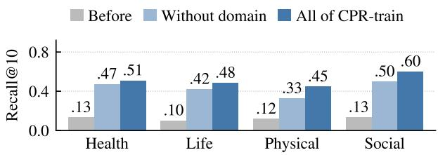

Figure 10: Recall@10 of Qwen3-Embedding-0.6B on domains unseen in training. The same setting as Figure 7.
<table><tr><td>Model</td><td>Training data</td><td>Health (250)</td><td>Life (250)</td><td>Physical (500)</td><td>Social (300)</td></tr><tr><td>Qwen3-Emb-0.6B</td><td>Before training</td><td>0.13 [0.09, 0.18]</td><td>0.10 [0.06, 0.14]</td><td>0.12 [0.09, 0.14]</td><td>0.13 [0.10, 0.17]</td></tr><tr><td></td><td>Without the domain</td><td>0.47 [0.41, 0.54]</td><td>0.42 [0.36, 0.48]</td><td>0.33 [0.28, 0.37]</td><td>0.50 [0.44, 0.56]</td></tr><tr><td></td><td>All domains</td><td>0.51 [0.45, 0.57]</td><td>0.48 [0.42, 0.54]</td><td>0.45 [0.40, 0.49]</td><td>0.60 [0.54, 0.66]</td></tr><tr><td>Qwen3-Emb-4B</td><td>Before training</td><td>0.18 [0.13, 0.22]</td><td>0.16 [0.12, 0.21]</td><td>0.16 [0.13, 0.19]</td><td>0.18 [0.14, 0.22]</td></tr><tr><td></td><td>Without the domain</td><td>0.71 [0.65, 0.76]</td><td>0.62 [0.56, 0.67]</td><td>0.54 [0.49, 0.58]</td><td>0.72 [0.67, 0.77]</td></tr><tr><td></td><td>All domains</td><td>0.68 [0.63, 0.74]</td><td>0.67 [0.61, 0.73]</td><td>0.66 [0.62, 0.70]</td><td>0.75 [0.70, 0.80]</td></tr></table>

Table 17: Recall@10 on each held-out domain. Without the domain: trained on 5,896 airs without the evaluated domain. All domains: trained on all 10,573 training pairs, including the evaluated domain. Brackets give 95% bootstrap confidence i<sub>n</sub>t<sub>erva</sub>l<sub>s;</sub> th<sub>e num</sub>b<sub>er o</sub>f <sub>uer</sub>i<sub>es</sub> i<sub>s s</sub>h<sub>own nex</sub>t t<sub>o eac</sub>h d<sub>oma</sub>i<sub>n.</sub>

## L. Held-out Domain Setup

F<sub>or eac</sub>h <sub>o</sub>f th<sub>e</sub> f<sub>our</sub> O<sub>pen</sub>Al<sub>ex</sub> d<sub>oma</sub>i<sub>ns, we</sub> t<sub>ra</sub>i<sub>n a re</sub>t<sub>r</sub>i<sub>ever w</sub>ith<sub>ou</sub>t th<sub>a</sub>t d<sub>oma</sub>i<sub>n an</sub>d <sub>eva</sub>l<sub>ua</sub>t<sub>e</sub> it <sub>on</sub> th<sub>e quer</sub>i<sub>es</sub> <sub>o</sub>f th<sub>a</sub>t d<sub>oma</sub>i<sub>n.</sub> Th<sub>e</sub> d<sub>oma</sub>i<sub>n o</sub>f <sub>a query</sub> i<sub>s</sub> th<sub>e</sub> d<sub>oma</sub>i<sub>n o</sub>f it<sub>s</sub> b<sub>ase paper</sub>’<sub>s</sub> fi<sub>e</sub>ld<sub>, an</sub>d th<sub>e</sub> d<sub>oma</sub>i<sub>n o</sub>f <sub>a pos</sub>iti<sub>ve</sub> i<sub>s</sub> th<sub>e</sub> d<sub>oma</sub>i<sub>n o</sub>f it<sub>s pr</sub>i<sub>mary</sub> O<sub>pen</sub>Al<sub>ex</sub> t<sub>op</sub>i<sub>c.</sub> W<sub>e</sub> d<sub>rop</sub> th<sub>e</sub> 70 t<sub>ra</sub>i<sub>n</sub>i<sub>ng pa</sub>i<sub>rs w</sub>h<sub>ose pos</sub>iti<sub>ve cou</sub>ld <sub>no</sub>t b<sub>e ma</sub>t<sub>c</sub>h<sub>e</sub>d to an O<sub>p</sub>enAlex work b<sub>y</sub> DOI<sub>,</sub> PubMed<sub>,</sub> or MAG identifier<sub>,</sub> leavin<sub>g</sub> 10<sub>,</sub>503 <sub>p</sub>airs. To <sub>p</sub>revent leaka<sub>g</sub>e<sub>,</sub> a trainin<sub>g</sub> <sub>pa</sub>i<sub>r</sub> i<sub>s remove</sub>d <sub>w</sub>h<sub>en</sub> it<sub>s query or</sub> it<sub>s pos</sub>iti<sub>ve</sub> b<sub>e</sub>l<sub>ongs</sub> t<sub>o</sub> th<sub>e</sub> h<sub>e</sub>ld<sub>-ou</sub>t d<sub>oma</sub>i<sub>n;</sub> th<sub>e</sub> d<sub>oma</sub>i<sub>ns o</sub>f h<sub>ar</sub>d <sub>nega</sub>ti<sub>ves</sub> <sub>are no</sub>t <sub>c</sub>h<sub>ec</sub>k<sub>e</sub>d<sub>.</sub> W<sub>e a</sub>l<sub>so con</sub>fi<sub>rm</sub> th<sub>a</sub>t <sub>no</sub> t<sub>ra</sub>i<sub>n</sub>i<sub>ng query or pos</sub>iti<sub>ve</sub> i<sub>s a query or pos</sub>iti<sub>ve o</sub>f th<sub>e eva</sub>l<sub>ua</sub>ti<sub>on se</sub>t<sub>.</sub> Because the folds difer in size after this removal, we randoml<sub>y</sub> sam<sub>p</sub>le 5,896 <sub>p</sub>airs <sub>p</sub>er fold (the size of the smallest fold, seed 42) so that all folds use the same amount of trainin<sub>g</sub> data (Table 16). Each fold is trained for one e<sub>p</sub>och with the same settin<sub>g</sub>s as the main trainin<sub>g</sub> runs (A<sub>pp</sub>endix I), and the final check<sub>p</sub>oint is evaluated. E<sub>va</sub>l<sub>ua</sub>ti<sub>on uses</sub> th<sub>e</sub> CPR<sub>-eva</sub>l <sub>quer</sub>i<sub>es o</sub>f th<sub>e</sub> h<sub>e</sub>ld<sub>-ou</sub>t d<sub>oma</sub>i<sub>n w</sub>ith th<sub>e same</sub> 151 <sub>can</sub>did<sub>a</sub>t<sub>es.</sub> T<sub>a</sub>bl<sub>e</sub> 17 li<sub>s</sub>t<sub>s</sub> Recall@10 with 95% confidence intervals.

## M. Training without Hard Negatives

T<sub>o</sub> i<sub>so</sub>l<sub>a</sub>t<sub>e</sub> th<sub>e con</sub>t<sub>r</sub>ib<sub>u</sub>ti<sub>on o</sub>f th<sub>e</sub> h<sub>ar</sub>d <sub>nega</sub>ti<sub>ves</sub> i<sub>n</sub> CPR<sub>-</sub>t<sub>ra</sub>i<sub>n, we</sub> t<sub>ra</sub>i<sub>n every mo</sub>d<sub>e</sub>l <sub>on</sub> th<sub>e same pa</sub>i<sub>rs o</sub>f <sub>eac</sub>h t<sub>ra</sub>i<sub>n</sub>i<sub>ng se</sub>t <sub>w</sub>ith <sub>a</sub>ll h<sub>ar</sub>d <sub>nega</sub>ti<sub>ves remove</sub>d<sub>, so</sub> th<sub>a</sub>t <sub>on</sub>l<sub>y</sub> i<sub>n-</sub>b<sub>a</sub>t<sub>c</sub>h <sub>nega</sub>ti<sub>ves are use</sub>d<sub>; a</sub>ll <sub>o</sub>th<sub>er se</sub>tti<sub>ngs are as</sub> i<sub>n</sub> A<sub>ppen</sub>di<sub>x</sub> I<sub>.</sub> Fi<sub>gure</sub> 11 <sub>compares</sub> th<sub>ese re</sub>t<sub>r</sub>i<sub>evers, an</sub>d T<sub>a</sub>bl<sub>e</sub> 18 li<sub>s</sub>t<sub>s</sub> th<sub>e va</sub>l<sub>ues nex</sub>t t<sub>o</sub> th<sub>ose o</sub>f th<sub>e re</sub>t<sub>r</sub>i<sub>evers</sub> t<sub>ra</sub>i<sub>ne</sub>d <sub>w</sub>ith h<sub>ar</sub>d <sub>nega</sub>ti<sub>ves.</sub>

## N. Qualitative Examples

We com are five versions of Qwen3-Embeddin -4B: before trainin and after trainin on CPR-train MS MARCO, ReasonIR data, or SPECTER data (one sam<sub>p</sub>le of each, seed 42, as in Table 10). A retriever solves a <sub>q</sub>uer<sub>y</sub> when it ranks a relevant document in its to<sub>p</sub> 10 on BRIGHT or in its to<sub>p</sub> 5 on AnaloBench. Onl<sub>y</sub> the retriever trained on CPR-train solves 75 of the 749 BRIGHT <sub>q</sub>ueries<sub>,</sub> and 12<sub>,</sub> 15<sub>,</sub> and 20 AnaloBench <sub>q</sub>ueries for <sub>s</sub>t<sub>o</sub>ri<sub>es o</sub>f 1<sub>,</sub> 10<sub>, a</sub>nd 30 <sub>se</sub>nt<sub>e</sub>n<sub>ces.</sub> T<sub>a</sub>bl<sub>e</sub> 19 <sub>s</sub>h<sub>o</sub>w<sub>s</sub> fiv<sub>e o</sub>f th<sub>ese que</sub>ri<sub>es, c</sub>h<sub>ose</sub>n <sub>a</sub>m<sub>o</sub>n<sub>g</sub> th<sub>ose</sub> wh<sub>e</sub>r<sub>e</sub> thi<sub>s</sub> r<sub>e</sub>tri<sub>e</sub>v<sub>e</sub>r <sub>ran</sub>k<sub>s a re</sub>l<sub>evan</sub>t d<sub>ocumen</sub>t fi<sub>rs</sub>t <sub>or secon</sub>d <sub>an</sub>d <sub>none o</sub>f th<sub>e o</sub>th<sub>er</sub> f<sub>our ran</sub>k<sub>s one</sub> i<sub>n</sub> it<sub>s</sub> t<sub>op</sub> 10<sub>.</sub> O<sub>n</sub> BRIGHT<sub>,</sub> th<sub>e o</sub>th<sub>er re</sub>t<sub>r</sub>i<sub>evers ran</sub>k fi<sub>rs</sub>t d<sub>ocumen</sub>t<sub>s</sub> th<sub>a</sub>t <sub>s</sub>h<sub>are wor</sub>d<sub>s w</sub>ith th<sub>e query, w</sub>h<sub>ereas</sub> th<sub>e re</sub>l<sub>evan</sub>t d<sub>ocumen</sub>t <sub>uses none o</sub>f th<sub>ese wor</sub>d<sub>s an</sub>d <sub>exp</sub>l<sub>a</sub>i<sub>ns</sub> th<sub>e un</sub>d<sub>er</sub>l<sub>y</sub>i<sub>ng mec</sub>h<sub>an</sub>i<sub>sm.</sub> F<sub>or</sub> i<sub>ns</sub>t<sub>ance,</sub> th<sub>e ques</sub>ti<sub>on w</sub>h<sub>e</sub>th<sub>er w</sub>i<sub>n</sub>d i<sub>s n</sub>it<sub>rogen par</sub>ti<sub>c</sub>l<sub>es mov</sub>i<sub>ng</sub> i<sub>n one</sub> di<sub>rec</sub>ti<sub>on nee</sub>d<sub>s</sub> th<sub>e</sub> id<sub>ea o</sub>f <sub>a ne</sub>t d<sub>r</sub>ift <sub>on</sub> t<sub>op o</sub>f <sub>ran</sub>d<sub>om</sub> th<sub>erma</sub>l <sub>mo</sub>ti<sub>on,</sub> <sub>w</sub>hi<sub>c</sub>h th<sub>e ar</sub>ti<sub>c</sub>l<sub>e on</sub> B<sub>rown</sub>i<sub>an mo</sub>ti<sub>on g</sub>i<sub>ves an</sub>d th<sub>e ar</sub>ti<sub>c</sub>l<sub>e on w</sub>i<sub>n</sub>d d<sub>oes no</sub>t<sub>.</sub> O<sub>n</sub> A<sub>na</sub>l<sub>o</sub>B<sub>enc</sub>h<sub>,</sub> th<sub>e query an</sub>d it<sub>s re</sub>l<sub>evan</sub>t <sub>s</sub>t<sub>or</sub>i<sub>es s</sub>h<sub>are on</sub>l<sub>y</sub> th<sub>e</sub>i<sub>r re</sub>l<sub>a</sub>ti<sub>ona</sub>l <sub>s</sub>t<sub>ruc</sub>t<sub>ure, no</sub>t th<sub>e</sub>i<sub>r se</sub>tti<sub>ng.</sub>

<table><tr><td colspan="2"></td><td colspan="2">CPR-eval (R@10)</td><td colspan="2">AnaloBench (nDCG@10)</td><td colspan="2">BRIGHT (nDCG@10)</td></tr><tr><td>Model</td><td>Training data</td><td>HN</td><td>IB</td><td>HN</td><td>IB</td><td>HN</td><td>IB</td></tr><tr><td rowspan="4">Qwen3-Emb-0.6B</td><td>Before training</td><td>0.120</td><td></td><td></td><td>0.314</td><td>0.138</td><td></td></tr><tr><td>CPR-train</td><td>0.501</td><td>0.323</td><td>0.402</td><td>0.330</td><td>0.190</td><td>0.176</td></tr><tr><td>MS MARCO</td><td>0.124</td><td>0.093</td><td>0.297</td><td>0.224</td><td>0.149</td><td>0.131</td></tr><tr><td>ReasonIR data SPECTER data</td><td>0.115 0.094</td><td>0.115</td><td>0.262</td><td>0.249</td><td>0.114</td><td>0.082 0.155</td></tr><tr><td rowspan="5">Qwen3-Emb-4B</td><td>Before training</td><td>0.167</td><td>0.094</td><td>0.227</td><td>0.224</td><td>0.153</td><td>0.151</td></tr><tr><td>CPR-train</td><td>0.689</td><td>0.487</td><td>0.468</td><td>0.352 0.376</td><td>0.256</td><td>0.212</td></tr><tr><td>MS MARCO</td><td>0.158</td><td>0.117</td><td>0.296</td><td>0.221</td><td>0.171</td><td>0.135</td></tr><tr><td>ReasonIR data</td><td>0.181</td><td>0.171</td><td>0.297</td><td>0.297</td><td>0.179</td><td>0.156</td></tr><tr><td>SPECTER data</td><td>0.153</td><td>0.150</td><td>0.254</td><td>0.248</td><td>0.180</td><td>0.180</td></tr><tr><td rowspan="5">llama-embed-nemotron-8b</td><td>Before training</td><td>0.249</td><td></td><td>0.417</td><td></td><td></td><td>0.194</td></tr><tr><td>CPR-train</td><td>0.700</td><td>0.444</td><td>0.455</td><td>0.441</td><td>0.328</td><td>0.293</td></tr><tr><td>MS MARCO</td><td>0.203</td><td>0.218</td><td>0.256</td><td>0.419</td><td>0.222</td><td>0.211</td></tr><tr><td>ReasonIR data</td><td>0.288</td><td>0.272</td><td>0.359</td><td>0.379</td><td>0.237</td><td>0.222</td></tr><tr><td>SPECTER data</td><td>0.198</td><td>0.195</td><td>0.375</td><td>0.373</td><td>0.251</td><td>0.232</td></tr></table>

Table 18: Retrievers trained with hard negatives (HN) and with in-batch negatives only (IB). CPR-eval: Recall@10 over all 1,300 <sub>q</sub>ueries. AnaloBench: T2 nDCG@10 avera<sub>g</sub>ed over S1, S10, and S30. BRIGHT: nDCG@10 avera<sub>g</sub>ed over the seven StackExchan e subsets (all 749 ueries). The same airs are used in both settin s; IB removes their hard ne atives. For MS MARCO, ReasonIR data, and SPECTER data, the values are from one sam<sub>p</sub>le (seed 42).  
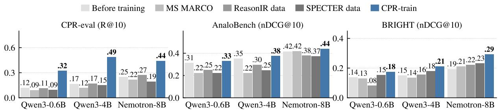  
Figure 11: Retrievers trained with in-batch negatives only. The same comparison as Figure 5, but each retriever is t<sub>ra</sub>i<sub>ne</sub>d <sub>w</sub>ith<sub>ou</sub>t h<sub>ar</sub>d <sub>nega</sub>ti<sub>ves.</sub> B<sub>e</sub>f<sub>ore-</sub>t<sub>ra</sub>i<sub>n</sub>i<sub>ng va</sub>l<sub>ues are</sub> th<sub>e same as</sub> i<sub>n</sub> Fi<sub>gure</sub> 5<sub>.</sub>

<table><tr><td>Query (shortened)</td><td>Relevant document</td><td>Idea that links them</td><td>Ranked first by the other retrievers</td><td>Rank</td></tr><tr><td>BRIGHT, earth science Is wind just mainly</td><td>Wikipedia article on</td><td>a net drift on top of</td><td>Wikipedia article on wind; a page on air</td><td>1/636</td></tr><tr><td>nitrogen particles moving in one direction? Why were temperature</td><td>Brownian motion Wikipedia article on</td><td>random thermal motion aerosols from air</td><td>molecules hitting a moving car Pages on temperature</td><td>2/220</td></tr><tr><td>anomalies negative between 1950 and 1980, although oil consumption had been massive since 1880?</td><td>global dimming</td><td>pollution blocked sunlight</td><td>anomalies and on climate change</td><td></td></tr><tr><td>BRIGHT, robotics In ROS2, do I need to rebuild the package after each change to a Python launch file?</td><td>A forum answer on symlink-install</td><td>linking the installed files to the source, so that edits take effect without compiling again</td><td>A page on the ros2 launch command; a tutorial that reruns colcon after adding a launch file</td><td>1/ &gt;1000</td></tr><tr><td>AnaloBench, stories of 10 sentences</td><td>A quiet student who is</td><td>what people do shows</td><td>A practical husband tells</td><td></td></tr><tr><td>Two parents say they are not good parents, yet never miss any of their children&#x27;s events</td><td>underrated ranks second in her class, among other stories</td><td>the truth that their words deny</td><td>his excited wife that a sudden work project means they must move their Hawaii vacation,</td><td>1/14</td></tr><tr><td>A student with nothing left to do during a break keeps thinking about his former girlfriend</td><td>A girl torments her grandmother on afternoons with nothing to do, among other stories</td><td>idle time leads to trouble</td><td>and she accepts the change A woman who expects her boyfriend of several years to propose daydreams about a Paris honeymoon and wants to book it before he has</td><td>1/11</td></tr></table>

Table 19: Queries solved only by the retriever trained on CPR-train. All retrievers are Qwen3-Embedding-4B. Rank: <sub>ran</sub>k <sub>o</sub>f th<sub>e</sub> b<sub>es</sub>t <sub>re</sub>l<sub>evan</sub>t d<sub>ocumen</sub>t f<sub>or</sub> th<sub>e re</sub>t<sub>r</sub>i<sub>ever</sub> t<sub>ra</sub>i<sub>ne</sub>d <sub>on</sub> CPR<sub>-</sub>t<sub>ra</sub>i<sub>n</sub> / th<sub>e</sub> b<sub>es</sub>t <sub>o</sub>f th<sub>e same re</sub>t<sub>r</sub>i<sub>ever</sub> t<sub>ra</sub>i<sub>ne</sub>d <sub>on</sub> MS MARCO, ReasonIR data, or SPECTER data (one sam<sub>p</sub>le each, seed 42) or before trainin<sub>g</sub>. BRIGHT ranks the documents of it<sub>s su</sub>b<sub>se</sub>t<sub>;</sub> “>1000” <sub>means</sub> th<sub>a</sub>t th<sub>e re</sub>l<sub>evan</sub>t d<sub>ocumen</sub>t i<sub>s no</sub>t i<sub>n</sub> th<sub>e</sub> t<sub>op</sub> 1<sub>,</sub>000<sub>.</sub> A<sub>na</sub>l<sub>o</sub>B<sub>enc</sub>h <sub>ran</sub>k<sub>s a poo</sub>l <sub>o</sub>f 200 <sub>s</sub>t<sub>or</sub>i<sub>es.</sub>