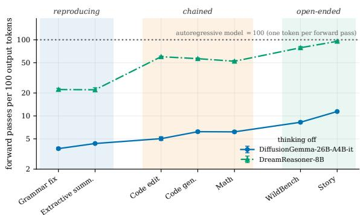
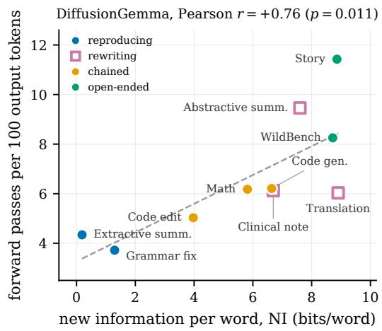
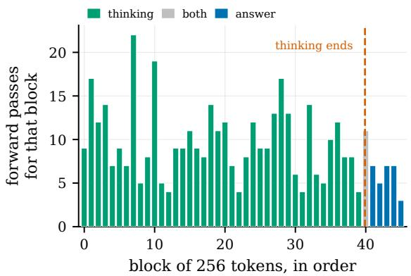
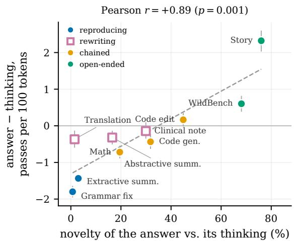
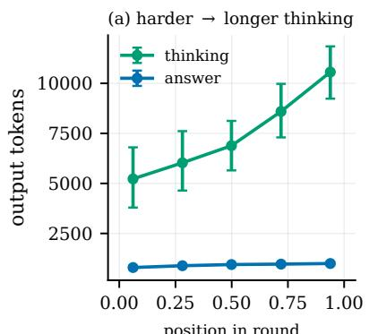
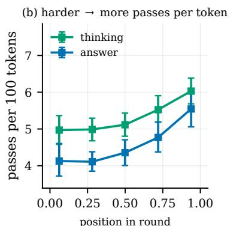
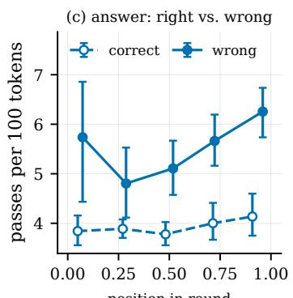
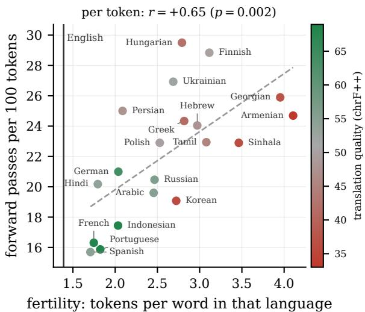
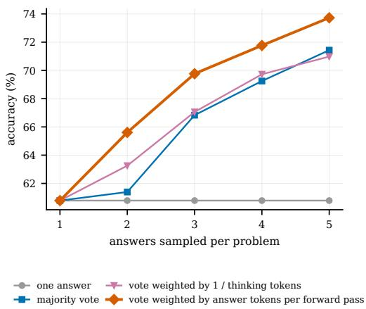
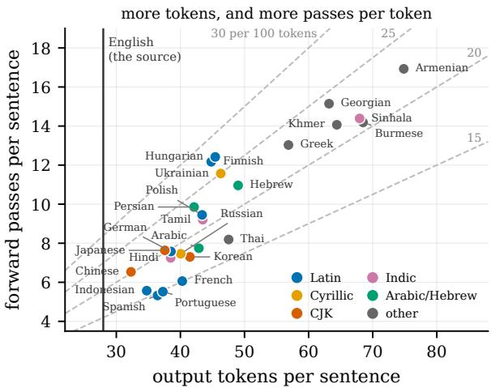

# Diffusion Language Models Change Speed Across Tasks and Languages

Mohsen Fayyaz1 Ali Modarressi2,3 Daniel Israel1 Lucas Bandarkar1 Nanyun Peng1

1 University of California, Los Angeles

2 CIS, LMU Munich 3 Munich Center for Machine Learning

mohsenfayyaz@cs.ucla.edu

## Abstract

Diffusion language models can write several tokens in one forward pass, and they decide during generation how many passes to spend. Two outputs of the same token length can therefore vary a lot in cost. To understand the underlying factors of this cost variation, we analyze two diffusion models across 10 tasks. We find that the number of forward passes per token depends heavily on the task. Text copied or lightly edited from the input is cheap, while openended writing is costly. In DiffusionGemma, generating a token for story writing requires more than three times as many forward passes as for grammar correction. Two output properties explain much of this gap: how much of it is new relative to the input, and how rare its words are within the task. The same holds within a single response when thinking is involved. The final answer is cheap when it repeats the model’s reasoning trace and costly when it adds something new. In multilingual generation, we find that highly tokenized languages also require more passes per token, adding to the cost they already pay with more tokens. Finally, cost tracks correctness: on the same math problem, wrong answers take more passes per token than correct ones, and weighting candidate answers by decoding speed beats majority voting by up to 4.2 points at no extra cost. Taken together, our results show that diffusion’s computational advantage depends on how much of the output is already determined, while its decoding effort offers a practical signal for making inference more efficient and reliable.

## 1 Introduction

Diffusion language models are an increasingly promising alternative to autoregressive language models, offering the potential for substantial inference speedups through parallel token generation (Nie et al., 2025; Ye et al., 2025; Team et al., 2026). While diffusion language models share essentially the same underlying Transformer architecture as autoregressive models (Team et al., 2026), they differ in their decoding process. Rather than generating one token per forward pass, diffusion models iteratively refine groups of tokens, often "committing" a variable number of tokens at each step. For outputs of the same length, the number of forward passes required for decoding can vary substantially, introducing an additional axis for scaling computation (Wang et al., 2025). Understanding diffusion decoding effort is therefore important both for characterizing the computational advantages of diffusion models and for achieving maximal efficacy with them in practice.

  
Figure 1: Forward passes per 100 output tokens, for seven tasks and two diffusion models (thinking off). Lower is cheaper. An autoregressive model is always at 100 (dotted line). Error bars are 95% bootstrap intervals. While architectural differences affect absolute throughput, both models follow the same monotonic cost progression from reproducing to open-ended tasks. Per-task numbers are in Table C.1.

We systematically study decoding efficiency across tasks and models by measuring the number of forward passes required per generated token. We find that diffusion models are substantially more efficient when generating text constrained by the input or by recurring task patterns, but require considerably more decoding effort on open-ended tasks, such as creative story writing.

Interestingly, we also find that decoding effort is associated with the correctness of mathematical solutions. Incorrect answers require more forward passes per token, even after controlling for problem difficulty and generation length. To better understand how computational effort is distributed within a diffusion model generation, we separately examine reasoning traces and final answers. We find that final answers often require fewer decoding steps, particularly when they reproduce information already established in the reasoning trace. Together, these findings suggest that decoding effort is strongly linked to the remaining uncertainty in the outputs of a diffusion model. We additionally investigate multilingual generation and find that languages requiring more tokens also tend to require more decoding passes per token. This compounds the existing tokenization disadvantage (Petrov et al., 2023; Ahia et al., 2023; Perry et al., 2026) of some languages, producing a double multilingual tax on inference efficiency.

Finally, we show in practice that decoding effort is a useful quantity of interest. When sampling multiple candidate solutions for a math problem, weighting each answer’s vote by how quickly it was decoded improves accuracy over a plain majority vote (Wang et al., 2023; Brown et al., 2024) by 4.2 points with two answers and 2.3 points with five, with zero additional overhead.

In summary, our findings characterize when diffusion decoding is most computationally efficient, provide insight into how decoding effort is distributed across tasks and within generations, and motivate inference strategies guided by task structure and denoising signals.

## 2 Setup

Models. We use two diffusion language models: DiffusionGemma-26B-A4B-it (Team et al., 2026), a 26B mixture-of-experts model trained with uniform diffusion that generates blocks of 256 tokens at a time, and DreamReasoner-8B (Wu et al., 2026b), an 8B dense model based on masked diffusion that generates blocks of 32 tokens. Both employ semi-autoregressive block diffusion (Arriola et al., 2025) and dynamically determine step counts by committing only tokens that meet a target confidence threshold. Adaptive step counts are the basis of decoding effort, which we aim to measure. Full settings are in Appendix A.

Cost. An autoregressive model computes a forward pass once for every token. A diffusion model runs the network once per step, and in one step it can output many tokens. For a diffusion output $y ,$ we count the number of forward passes (P) used to generate $y$ and divide by the number of tokens y contains (T):

$$
\cot ( y ) = 1 0 0 \cdot { \frac { P } { T } } ,\tag{1}
$$

theforward passes per 100 output tokens. This is the inverse of the tokens per forward pass (TPF) that diffusion decoding typically reports as its speed (Wu et al., 2026a). We count only meaningful generated tokens up to the first <eos>, excluding any trailing <eos> or padding tokens, and normalize by generated tokens $T$ rather than block capacity to account for early stopping within blocks and keep cost directly comparable across different block sizes (e.g., 32 vs. 256 tokens). We then compute the cost for each output and average over the prompts of a task. An autoregressive model always has a cost of 100. A diffusion model that writes 20 tokens per step has cost 5.

Tasks. Diffusion decoding speed is generally reported on a few benchmarks, mostly math and code, as tokens per forward pass or per second (Nie et al., 2025; Ye et al., 2025; Bie et al., 2025; Wu et al., 2026a; Ben-Hamu et al., 2025; Liu et al., 2026b). Much less is known about how decoding cost behaves on other kinds of text, and in particular how it depends on the state of the context before the model generates the answer. We select tasks that constrain the answer differently: via the input, the answer’s own earlier steps, or very little at all. This gives seven tasks in three groups (Appendix B):

• Reproducing: most of the answer is copied from the input, with a few corrections or selected sentences. We use grammar correction on W&I+LOCNESS (Bryant et al., 2019) and extractive summarization on GovReport (Huang et al., 2021).

• Chained: later parts of the answer build on earlier ones, as in code or a step-by-step solution. We use code editing on HumanEvalFix (Muennighoff et al., 2024), code generation on LiveCodeBench (Jain et al., 2025), and competition math from MathArena (Balunovic et al., 2025).

• Open-ended: the prompt imposes loose specifications, leaving the output space largely underdetermined. We use user queries from WildBench v2 (Lin et al., 2025) and story generation from WritingPrompts (Fan et al., 2018).

Starting in Section 3.1, we additionally conduct experiments on three rewriting tasks, where the answer draws on information in the input but expresses it in new words: German-to-English translation on WMT23 (Kocmi et al., 2023), clinical notes from doctor–patient conversations on ACI-BENCH (Yim et al., 2023), and abstractive chapter summaries on BookSum (Kryscinski et al., 2022).

## 3 Task Dependent Cost

As previously discussed, a diffusion model does not apply a fixed amount of effort for every task. In Figure 1, we observe that a model with fixed decoding settings utilizes a different number of forward passes per token depending on the task.

Effort across tasks. For DiffusionGemma, the average decoding cost increases across task groups: 4.0 forward passes per 100 tokens for reproducing tasks, 5.8 for chained tasks, and 9.8 for openended tasks. At the extremes, grammar correction requires 3.72 passes, whereas story generation requires 11.43 passes, making story tokens 3.1 times as expensive as grammar correction tokens. Between reproducing, chained, and open-ended tasks, a clear hierarchy of decoding effort emerges.

Cross-model agreement on task effort. Dream-Reasoner exhibits a similar monotonic trend across categories, requiring 22.1, 56.2, and 87.0 passes per 100 tokens (a 4.3× spread from cheapest to most expensive). While DreamReasoner incurs higher overall decoding costs due to its smaller block size (32 tokens versus 256), the relative cost ranking remains identical. Two diffusion language models with differing architectures, sizes, and training recipes exhibit agreement on which tasks demand more forward passes. Figure 1 shows that decoding effort depends strongly on the task; tasks that copy or lightly edit the input need far fewer forward passes per token than open-ended writing. This raises the following question: which properties of the output make a token cheap or costly to decode? We study these properties next in more detail.

## 3.1 What Makes an Output Cheap to Decode

To understand why certain outputs require fewer decoding steps, we hypothesize two properties of the output text: (1) how much of it is new relative to the input (novelty), and (2) how rare its words are within the task (surprisal). Both are computed per output and averaged within each of the ten tasks (Table 1). Unlike cost, which depends on how a model tokenizes, these concepts do not depend on the tokenizer. We split the input x and the output $y = ( y _ { 1 } , \dots , y _ { | y | } )$ into words rather than model tokens.

Dimension 1: Novelty. We segment y into contiguous runs copied directly from x (matched fragments) and isolated novel words (unmatched words). Processing left to right, each fragment is greedily selected as the longest match in x (Grusky et al., 2018). We measure output novelty as the number of resulting segments per output word:

$$
\mathrm { n o v e l t y } ( y ) = \frac { \# \mathrm { m a t c h e d } } { | y | } + \# \mathrm { w o r d s } ^ { \mathrm { u n m a t c h e d } }  .\tag{2}
$$

Novelty approaches 0 when the output consists of a few long copied contiguous fragments, and reaches 1 when the output is generated entirely from scratch (one segment per word). For example, a 10-word output consisting of two matched fragments of 4 and 3 words plus 3 unmatched words contains 5 segments in total, yielding novelty = $5 / 1 0 \ : = \ : 0 . 5$ . Novelty is closely related to copy length in summarization benchmarks, which measures the average length of copied source fragments (Chen et al., 2020; Ma et al., 2024). However, while copy length averages strictly over matched fragments, novelty additionally treats every uncopied word as an unmatched segment of length 1. For DiffusionGemma, novelty is 2% for extractive summarization compared to 99% for story generation. On its own, novelty correlates strongly with decoding cost (r = +0.72 for DiffusionGemma, r = +0.79 for DreamReasoner; Table 1).

Dimension 2: Surprisal. A word may be novel with respect to a specific input yet highly predictable within the broader task. For example, code frequently reuses keywords like def and return, boilerplate syntax, and common identifier names; mathematical reasoning repeatedly employs symbols such as \frac and =. To quantify this tasklevel regularity, we aggregate each model’s generations for a given task t and compute empirical word frequencies. Letting $c _ { t } ( w )$ denote the count of word $w , N _ { t }$ the total word count, and $V _ { t }$ the vocabulary size of unique words, we define the add-one smoothed word distribution:

<table><tr><td></td><td colspan="4">DiffusionGemma</td><td colspan="4">DreamReasoner</td></tr><tr><td>task</td><td></td><td></td><td>cost novelty surprisal</td><td>NI</td><td></td><td></td><td>cost novelty surprisal</td><td>NI</td></tr><tr><td>● Grammar fix</td><td>3.7</td><td>14%</td><td>9.1</td><td>1.30</td><td>22.2</td><td>9%</td><td>9.1</td><td>0.82</td></tr><tr><td> Extractive summ.</td><td>4.3</td><td>2%</td><td>9.7</td><td>0.19</td><td>21.6</td><td>13%</td><td>9.7</td><td>1.25</td></tr><tr><td>Code edit</td><td>5.0</td><td>52%</td><td>7.6</td><td>3.97</td><td>59.9</td><td>81%</td><td>7.5</td><td>6.01</td></tr><tr><td> Translation</td><td>6.0</td><td>95%</td><td>9.3</td><td>8.90</td><td>80.5</td><td>92%</td><td>9.5</td><td>8.68</td></tr><tr><td>Clinical note</td><td>6.1</td><td>77%</td><td>8.7</td><td>6.69</td><td>83.8</td><td>89%</td><td>7.6</td><td>6.77</td></tr><tr><td>●Math</td><td>6.2</td><td>83%</td><td>7.0</td><td>5.82</td><td>52.2</td><td>91%</td><td>7.4</td><td>6.77</td></tr><tr><td> Code gen.</td><td>6.2</td><td>85%</td><td>7.9</td><td>6.64</td><td>56.5</td><td>90%</td><td>7.5</td><td>6.78</td></tr><tr><td>WildBench</td><td>8.3</td><td>90%</td><td>9.7</td><td>8.72</td><td>77.6</td><td>89%</td><td>9.1</td><td>7.98</td></tr><tr><td> Abstractive summ.</td><td>9.5</td><td>83%</td><td>9.2</td><td>7.60</td><td>101.0</td><td>75%</td><td>8.9</td><td>6.70</td></tr><tr><td>● Story</td><td>11.4</td><td>99%</td><td>9.0</td><td>8.86</td><td>95.5</td><td>95%</td><td>8.8</td><td>8.35</td></tr><tr><td>Pearson r</td><td></td><td>+0.72</td><td>+0.18</td><td>+0.76</td><td></td><td>+0.79</td><td>-0.09</td><td>+0.85</td></tr><tr><td>p-value</td><td></td><td>0.020</td><td>0.623</td><td>0.011</td><td></td><td>0.007</td><td>0.800</td><td>0.002</td></tr></table>

Table 1: Decoding cost $( \mathrm { E q . }$ . 1), novelty (Eq. 2), surprisal $( \mathrm { E q . }$ 4) and new information (NI, Eq. 5) per task, for DiffusionGemma and DreamReasoner. Task type: • reproducing, rewriting, • chained, • open-ended. For both models, cost correlates most strongly with NI. Rows are sorted by DiffusionGemma’s cost. All measures are computed on each model’s own outputs, excluding items that hit the token limit. The bottom rows give each measure’s Pearson correlation with cost across the ten tasks, within each model (strongest in bold), and its two-sided p-value (underlined when below 0.05; uncorrected, and indicative only with ten tasks).

$$
P _ { t } ( w ) = \frac { c _ { t } ( w ) + 1 } { N _ { t } + V _ { t } } .\tag{3}
$$

Following information theory, the surprisal of a word is defined as its self-information $- \log _ { 2 } P _ { t } ( w )$ (Shannon, 1948; Hale, 2001; Levy, 2008). A word that makes up half of all words in a task’s outputs costs 1 bit $( - \log _ { 2 } { 0 . 5 } = 1 ) \colon$ a word seen once in a million costs about 20 bits. The surprisal of an output is the average over its words, so it measures word rarity within the task:

$$
\operatorname { s u r p r i s a l } ( y ) = - { \frac { 1 } { | y | } } \sum _ { j = 1 } ^ { | y | } \log _ { 2 } P _ { t } ( y _ { j } ) .\tag{4}
$$

Across tasks, novelty and surprisal capture largely separate properties. For example, the clearest contrast is math and code generation against abstractive summarization. For DiffusionGemma, all three are mostly new text (novelty 83%, 85% and 83%), but for math and code, the words are much less surprising (7.0 and 7.9 bits, vs. 9.2), and generation costs much less (6.2 and 6.2 forward passes per 100 tokens, vs. 9.5).

New information (NI). Because novelty and surprisal capture separate properties, we combine them into a single measure, the bits of new infor-

  
Figure 2: Decoding cost against new information (NI) for DiffusionGemma. Each point is one task (values in Table 1); the dashed line shows a least-squares fit. Tasks that produce more new information cost more to decode.

mation per output word:

$$
{ \mathrm { N I } } ( y ) = { \mathrm { n o v e l t y } } ( y ) \times { \mathrm { s u r p r i s a l } } ( y )\tag{5}
$$

Copying long sequences verbatim lowers NI through novelty, and using words that are common in the task lowers it through surprisal. Weighting words by rarity follows the NIST machine translation metric (Doddington, 2002), which scores ngrams by their rarity in the reference translations.

We find that this new metric is justified, as it demonstrates strong predictive power. Cost rises with NI across tasks (Figure 2), and NI tracks it better than either dimension independently (Table 1), with r rising from +0.72 for novelty to +0.76 for NI $( p = 0 . 0 1 1 )$ for DiffusionGemma, and from +0.79 to +0.85 $( p = 0 . 0 0 2 )$ for DreamReasoner.

  
Figure 3: One generation with thinking on: forward passes spent on each block of 256 tokens. DiffusionGemma on AIME 2025 problem 2 (answered correctly). Green blocks are thinking, blue blocks the final answer, and the grey block holds the point where the thinking ends. Thinking blocks take 9.8 passes on average, answer blocks 5.8.

Where it does not fit. As shown in Figure 2, three tasks deviate from the fit. Translation falls below the line: its NI matches that of story generation (8.90 vs. 8.86 for DiffusionGemma), yet it costs 6.0 vs. 11.4. Novelty is designed to capture surface copying, so it misses copying across languages: translation reuses the input’s content but not its words. Story generation and abstractive summarization show the reverse: their unpredictability lies largely at the discourse level rather than in their words (e.g., narrative surprise in stories), which word-level surprisal cannot capture and which remains hard to measure without human judgment (Bissell et al., 2025).

## 4 Analysis: Copying from One’s Own Thinking

Reasoning models, which think before they answer, are now common among autoregressive language models (OpenAI et al., 2026; Guo et al., 2025) and have begun to appear among diffusion language models as well (Wu et al., 2026b; Team et al., 2026). While Section 3 turned thinking mode off, turning it on provides a new view and interpretation of the previous findings. Once a model has thought, its final answer can copy from its own thinking, much as a reproducing task copies from its input. We examine this in a case study on DiffusionGemma. It decodes its thinking and its final answer in the same way, in blocks of 256 tokens, so the cost of each can be measured directly.

  
Figure 4: The answer is cheap when it copies the thinking. Each point is one task. We plot how novel the answer is relative to the model’s own thinking (Eq. 2) against how much more an answer token costs than a thinking token. Negative values mean answer tokens are cheaper. Error bars are 95% bootstrap intervals. All runs use DiffusionGemma with thinking on and its default released settings.

An example. Figure 3 follows one competition math problem. The model thinks for 10,339 tokens (40 blocks, plus one block shared with the answer) and then writes a 1,241-token answer (5 more blocks). Thinking blocks are expensive and uneven, taking from 4 to 22 forward passes (cost 3.81), while final-answer blocks are cheap and even (cost 2.88). In this example, the thinking process has contributed significantly more decoding effort than the final answer. The final answer largely rewords parts of the thinking, reflected in its novelty of 87% against the question but only 15% against the thinking.

## 4.1 Across Tasks

The example suggests that, once the thinking is done, the final answer behaves like a reproducing task with the thinking as its input. We test this hypothesis on the ten tasks of Table 1, now with thinking on, measuring the final answer’s novelty against the thinking rather than the question. Where the final answer copies most, it is clearly cheaper than the thinking. In grammar correction and extractive summarization, the final answers have a novelty of only 1% and 3%, but it costs 3.52 against 5.32 and 2.07 against 3.50. Translation, abstractive summarization, math, and code generation show the same pattern, albeit by a smaller margin.

position in round  
  
(0 = easiest, 1 = hardest)

  
(0 = easiest, 1 = hardest)

  
(0 = easiest, 1 = hardest)  
Figure 5: Harder problems cost more, and wrong answers cost the most. We run DiffusionGemma with thinking on over 160 problems from 5 math contests, five seeds each, and place each problem by its position in the contest round, which runs from easy to hard. (a) On harder problems the model thinks much longer, while its answer stays about the same length. (b) Tokens also become more expensive toward the hard end, in both the thinking and the answer. (c) Looking at the answer alone, wrong answers cost more per token than correct ones at every level of difficulty. Correct answers stay equally cheap as problems get harder, so the rise in (b) comes mostly from wrong answers. Error bars are 95% bootstrap intervals over problems.

More generally, we observe that the less novel the final answer is relative to the thinking, the cheaper it is compared with the thinking (r = +0.89, $p ~ = ~ 0 . 0 0 1$ ; Figure 4). The same holds within each task, across its generations, where the Pearson correlation between novelty and the gap is positive in all 10 tasks (+0.06 to +0.90) and significant in 7. Thus, it is not only that some tasks have cheaper final answers. Within a task, answers that copy more from their own thinking tend to be cheaper relative to that thinking.

As novelty rises, the gap closes and then reverses. For code edit and clinical notes (novelty 45% and 30%), the two parts cost about the same. On Wild-Bench and story writing, the final answer is largely new relative to the thinking (novelty 68% and 76%), and it costs more than the thinking (+0.60 and +2.32). The thinking can plan the content, but the sentences are still written for the first time.

## 4.2 Across Difficulty

A final answer can also remain unsettled when the thinking fails to solve the problem. To vary how often this happens, we use competition-math problems spanning a range of difficulties, drawn from AIME I and II, HMMT, and CMIMC (Balunovic et al., 2025). We take a problem’s position within its contest round as a rough difficulty proxy.1 We split each contest round into thirds, labeled easy, middle, and hard, and run each problem with five seeds. Consistent with this proxy, accuracy decreases from 79% on the easy third to 57% on the middle third and 44% on the hard third.

On harder problems, the model thinks much longer. Similar to autoregressive reasoning models, the median thinking grows from 4,416 to 9,710 tokens from the easy to the hard third, while the final answer grows only slightly (Figure 5a). Unlike in an autoregressive model, however, where every token costs one forward pass, tokens of both parts also become more expensive (Figure 5b): the cost of the thinking rises from 5.00 to 5.89, and that of the final answer from 4.15 to 5.21. The final answer stays cheaper than the thinking at every difficulty, as in Section 4.1, but it rises more steeply, so the gap narrows toward the hard end.

Figure 5c shows that this rise is driven primarily by wrong answers. Correct final answers stay equally cheap at every difficulty (3.88 on the easy third, 4.02 on the hard third), while wrong ones cost more and more (5.16 to 6.13). Incorrect final answers also become more prevalent on hard problems (137 of 244 runs on the hard third, against 62 of 297 on the easy third).

Problem difficulty increases the computational cost of generating a final answer, but this effect is driven entirely by incorrect answers. Correct answers remain computationally cheap across all difficulty levels. This disparity is not explained by output length. Controlling for contest, problem position, and token counts across both stages, incorrect answers require +1.20 additional forward passes per 100 tokens. Even when holding the problem and output length fixed across different random seeds, incorrect runs still require +0.83 more passes. A qualitative look, as shown in Figure F.1, suggests that when the thinking solves the problem, the final answer retraces the solution. However, when it does not, the model seems to keep working while it outputs the final answer, and wrong final answers stop to correct themselves (“wait”, “let me re-check”) about five times as often as right ones.

  
Figure 6: Languages that the tokenizer splits into more pieces also cost more per token. Each point is one target language, translated from the same 200 English FLO-RES sentences by DiffusionGemma. We show the 20 languages that separate words with spaces, where tokens per word is well defined; color indicates translation quality. Results for all 25 languages are in Fig. D.1.

## 5 Multilingual Effort

It is well known that the same text costs more tokens in some languages than in others, because tokenizers split their words into more pieces (Petrov et al., 2023; Ahia et al., 2023; Perry et al., 2026). Because autoregressive models always cost one forward pass per token, the additional cost incurred by different languages could be attributed entirely to the tokenizer. In contrast, a diffusion model can also spend a different number of forward passes on each token, so a relevant question is whether forward passes per token can differ across languages.

We translate the same 200 English FLORES (NLLB Team et al., 2024) sentences into 25 languages with DiffusionGemma with thinking off and default settings. The total cost of a sentence varies substantially across languages (Figure D.1). For example, Armenian needs 3.2× as many forward passes as Spanish (16.9 against 5.3 per sentence). The difference can partly be attributed to token count (75 against 36 tokens, 2.1×), but passes per token also play a significant role (24.7 against 15.7 per 100 tokens). Languages whose words are split into more tokens also cost more per token (Figure 6; r = +0.65, p = 0.002, over the 20 languages written with spaces between words). These languages need more tokens, and each token needs more passes. Languages that are split more are also translated worse (r = −0.81 between tokens per word and chrF++). These findings reveal a double multilingual tax in diffusion decoding: languages already disadvantaged by longer token sequences also require more computation per token, compounding disparities in inference efficiency.

  
Figure 7: Weighting each answer by how fast it was decoded beats the plain majority vote. (255 math problems with 5 runs each, DiffusionGemma, thinking on, shipped settings).

## 6 Decoding Cost as a Measure of Certainty

Section 4.2 showed that a wrong answer takes more forward passes per token than a right one. This gives a free signal for choosing between answers. A common way to raise accuracy is to sample several answers and keep the most frequent one (majority vote; Wang et al., 2023; Brown et al., 2024). We instead weight each answer’s vote by how fast the model decoded it.2 The weight is the number of answer tokens per forward pass spent on the answer, and costs nothing extra, since the passes are counted while decoding.

We test this on all 255 competition math problems, with 5 runs per problem under the shipped settings (Figure 7). The weighted vote beats the plain majority vote at every number of answers, by 4.2 points with two answers and 2.3 with five. The gain is largest with two answers, where majority vote cannot break a tie, and our weight decides it. With five answers, accuracy rises from 71.4% to 73.7%; across 10,000 bootstrap resamples, the gain remains strictly positive (95% CI: [0.3, 4.5 ] points). Furthermore, this gain is not merely a preference for short reasoning. Weighting by 1 divided by the number of thinking tokens performs similarly to a plain majority vote (71.0% with five answers). Thus, answer decoding speed serves as a reliable, cost-free measure of model certainty that can directly improve answer selection.

## 7 Related Work

Diffusion LLM interpretability. A growing body of work seeks greater understanding and interpretability of diffusion language model decoding. Work in a similar vein to ours shows that the final answer can be extracted before decoding terminates (Li et al., 2026b), and correct answers appear at intermediate steps only to be overwritten later (Wang et al., 2026). Other papers show that contrary to their design, masked diffusion LLMs tend to decode approximately left to right (Li et al., 2026a). Uniform diffusion models, such as DiffusionGemma, have been found to exhibit non-chronological reasoning and retroactive self-correction (Engels et al., 2026). Analyses of diffusion model latent spaces show that diffusion language models are able to perform induction bidirectionally (Catruna and Radoi, 2026) and commit to higher-level concepts with different schedules, such as topic before sentiment (Zhou et al., 2026). While these works explain aspects of diffusion decoding, they do not address the computational question of how diffusion language models allocate their forward passes.

Data-dependent parallelism. In our work, we study diffusion language models, which are instances of models capable of parallel decoding. Speculative decoding is another instance of parallel decoding (Leviathan et al., 2023). In speculative decoding, it is established that parallelism, and therefore speed, depends on the data. Speculative decoding benchmarks therefore include a variety of tasks to measure speedup in each domain (Li et al., 2024; Abramovich et al., 2026; Liu et al., 2026a). Similar to our work, Sandler et al. (2025) analyze the implications of task-dependent speedup in speculative decoding for fairness between different languages. The same data-dependent phenomenon naturally applies to speculative decoding with a diffusion drafter (Chen et al., 2026). In the context of self-speculative diffusion, Fu et al. (2026) perform a "speed of light" acceptance rate analysis on different domains and find disparate acceptance rates for each. In pure diffusion decoding, ParallelBench (Kang et al., 2026) argues that masked diffusion adaptive samplers fail to adjust well to task difficulty; however, it does not study more recent uniform diffusion models, such as DiffusionGemma.

## 8 Conclusions and Future Work

We studied where diffusion language models spend their forward passes. Across two models, copying and lightly editing text costs less per token than open-ended writing, with a 3.1-fold gap between grammar correction and story generation in DiffusionGemma. The amount of copies the output has and how common its words are within the task explain part of this difference. The same pattern appears within a response: final answers tend to be cheaper when the thinking has already established what to say. We also find that lowerresource languages pay twice, requiring both more tokens and more passes per token. Finally, wrong math answers cost more to decode than correct ones, even on the same problem. Using this difference to weight votes by final-answer decoding speed improves accuracy by +2.3 percentage points over five-sample majority voting without additional cost.

Future work could use decoding effort to guide verification, additional sampling, and early stopping, or adapt block sizes and stopping rules to task structure and reuse of earlier text. These findings also motivate hybrid models that selectively use autoregressive or diffusion decoding according to what remains to be generated. Taken together, our results show when diffusion can generate efficiently and how its decoding effort can guide inference, opening a path toward models that adapt their decoding strategy and computational budget to the demands of each task and each part of a response.

## Limitations

Few suitable models. We study two models because few others fit our question. We need diffusion models that are trained to decode adaptively, deciding at each step how many tokens they are confident enough to commit, and that are strong enough to handle reasoning, translation, and long-form writing. Such models are very new. DreamReasoner appeared in June 2026 and DiffusionGemma in August 2026. Most earlier open models were trained with a fixed number of steps, and adaptive decoding was added to them later as an inference trick (Wu et al., 2026a). As more such models are released, our findings can be extended across wider model scales and training recipes.

## References

Talor Abramovich, Maor Ashkenazi, Izzy Putterman, Benjamin Chislett, Tiyasa Mitra, Bita Darvish Rouhani, Ran Zilberstein, and Yonatan Geif man. 2026. SPEED-bench: A unified and diverse benchmark for speculative decoding. In Proceedings of the 43rd International Conference on Machine Learning, volume 306 of Proceedings of Machine Learning Research, pages 240–267. PMLR.

Orevaoghene Ahia, Sachin Kumar, Hila Gonen, Jungo Kasai, David Mortensen, Noah Smith, and Yulia Tsvetkov. 2023. Do all languages cost the same? tokenization in the era of commercial language models. In Proceedings ofthe 2023 Conference on Empirical Methods in Natural Language Processing, pages 9904–9923, Singapore. Association for Computational Linguistics.

AoPS Wiki contributors. AoPS Wiki: Competition ratings. https://artofproblemsolving.com/wiki/ index.php/AoPS\_Wiki:Competition\_ratings. Accessed October 12, 2026.

Marianne Arriola, Aaron Gokaslan, Justin Chiu, Zhihan Yang, Zhixuan Qi, Jiaqi Han, Subham Sahoo, and Volodymyr Kuleshov. 2025. Block diffusion: Interpolating between autoregressive and diffusion language models. In International Conference on Learning Representations, volume 2025, pages 50726–50753.

Mislav Balunovic, Jasper Dekoninck, Ivo Petrov, Nikola Jovanovic, and Martin Vechev. 2025.´ MathArena: Evaluating LLMs on uncontaminated math competitions. In Advances in Neural Information Processing Systems, volume 38, Main Conference. Curran Associates, Inc.

Heli Ben-Hamu, Itai Gat, Daniel Severo, Niklas S Nolte, and Brian Karrer. 2025. Accelerated sampling from masked diffusion models via entropy bounded unmasking. In Advances in Neural Information Processing Systems, volume 38, Main Conference, pages 55981–56007. Curran Associates, Inc.

Tiwei Bie, Maosong Cao, Kun Chen, Lun Du, Mingliang Gong, Zhuochen Gong, Yanmei Gu, Jiaqi Hu, Zenan Huang, Zhenzhong Lan, Chengxi Li, Chongxuan Li, Jianguo Li, Zehuan Li, Huabin Liu, Lin Liu, Guoshan Lu, Xiaocheng Lu, Yuxin Ma, and 12 others. 2025. LLaDA2.0: Scaling up diffusion language models to 100B. Preprint, arXiv:2512.15745.

Annaliese Bissell, Ella Paulin, and Andrew Piper. 2025. A theoretical framework for evaluating narrative surprise in large language models. In Proceedings of the 7th Workshop on Narrative Understanding, pages 26–35, Albuquerque, New Mexico. Association for Computational Linguistics.

Bradley Brown, Jordan Juravsky, Ryan Ehrlich, Ronald Clark, Quoc V. Le, Christopher Ré, and Azalia Mirhoseini. 2024. Large language monkeys: Scaling inference compute with repeated sampling. Preprint, arXiv:2407.21787.

Christopher Bryant, Mariano Felice, Øistein E. Andersen, and Ted Briscoe. 2019. The BEA-2019 shared task on grammatical error correction. In Proceedings ofthe Fourteenth Workshop on Innovative Use ofNLP for Building Educational Applications, pages 52–75, Florence, Italy. Association for Computational Linguistics.

Andy Catruna and Emilian Radoi. 2026. Induction in both directions: A mechanistic analysis of incontext learning in masked diffusion language models. Preprint, arXiv:2607.15893.

Jian Chen, Yesheng Liang, and Zhijian Liu. 2026. DFlash: Block diffusion for flash speculative decoding. In Proceedings of the 43rd International Conference on Machine Learning, volume 306 of Proceedings ofMachine Learning Research, pages 15343–15355. PMLR.

Yiran Chen, Pengfei Liu, Ming Zhong, Zi-Yi Dou, Danqing Wang, Xipeng Qiu, and Xuanjing Huang. 2020. CDEvalSumm: An empirical study of cross-dataset evaluation for neural summarization systems. In Findings ofthe Associationfor Computational Linguistics: EMNLP 2020, pages 3679–3691, Online. Association for Computational Linguistics.

George Doddington. 2002. Automatic evaluation of machine translation quality using n-gram co-occurrence statistics. In Proceedings of the second international conference on Human Language Technology Research, page 138. Association for Computational Linguistics.

Joshua Engels, Callum McDougall, Bilal Chughtai, Janos Kramar, Senthooran Rajamanoharan, Cindy Wu, Arthur Conmy, Asic Q Chen, Jean Tarbouriech, Min Ma, Brendan O’Donoghue, João Gabriel Lopes de Oliveira, Rohin Shah, and Neel Nanda. 2026. How transparent is DiffusionGemma? Preprint, arXiv:2606.20560.

Angela Fan, Mike Lewis, and Yann Dauphin. 2018. Hierarchical neural story generation. In Proceedings

of the 56th Annual Meeting of the Association for Computational Linguistics (Volume 1: Long Papers), pages 889–898, Melbourne, Australia. Association for Computational Linguistics.

Yonggan Fu, Lexington Whalen, Abhinav Garg, Chengyue Wu, Maksim Khadkevich, Nicolai Oswald, Enze Xie, Daniel Egert, Sharath Turuvekere Sreenivas, Shizhe Diao, Chenhan Yu, Ye Yu, Weijia Chen, Sajad Norouzi, Jingyu Liu, Shiyi Lan, Ligeng Zhu, Jin Wang, Jindong Jiang, and 7 others. 2026. Nemotron-Labs-Diffusion: A tri-mode language model unifying autoregressive, diffusion, and selfspeculation decoding. Preprint, arXiv:2607.05722.

Max Grusky, Mor Naaman, and Yoav Artzi. 2018. Newsroom: A dataset of 1.3 million summaries with diverse extractive strategies. In Proceedings of the 2018 Conference ofthe North American Chapter of the Associationfor Computational Linguistics: Human Language Technologies, Volume 1 (Long Papers), pages 708–719, New Orleans, Louisiana. Association for Computational Linguistics.

Daya Guo, Dejian Yang, Haowei Zhang, Junxiao Song, Peiyi Wang, Qihao Zhu, Runxin Xu, Ruoyu Zhang, Shirong Ma, Xiao Bi, Xiaokang Zhang, Xingkai Yu, Yu Wu, Z. F. Wu, Zhibin Gou, Zhihong Shao, Zhuoshu Li, Ziyi Gao, Aixin Liu, and 175 others. 2025. DeepSeek-R1 incentivizes reasoning in LLMs through reinforcement learning. Nature, 645(8081):633–638.

John Hale. 2001. A probabilistic Earley parser as a psycholinguistic model. In Second Meeting ofthe North American Chapter of the Association for Computational Linguistics.

Luyang Huang, Shuyang Cao, Nikolaus Parulian, Heng Ji, and Lu Wang. 2021. Efficient attentions for long document summarization. In Proceedings ofthe 2021 Conference of the North American Chapter of the Associationfor Computational Linguistics: Human Language Technologies, pages 1419–1436, Online. Association for Computational Linguistics.

Naman Jain, King Han, Alex Gu, Wen-Ding Li, Fanjia Yan, Tianjun Zhang, Sida Wang, Armando Solar-Lezama, Koushik Sen, and Ion Stoica. 2025. Live-CodeBench: Holistic and contamination free evaluation of large language models for code. In International Conference on Learning Representations, volume 2025, pages 58791–58831.

Wonjun Kang, Kevin Galim, Seunghyuk Oh, Minjae Lee, Yuchen Zeng, Shuibai Zhang, Coleman Hooper, Yuezhou Hu, Hyung Koo, Nam Ik Cho, and Kangwook Lee. 2026. ParallelBench: Understanding the trade-offs of parallel decoding in diffusion LLMs. In International Conference on Learning Representations, volume 2026, pages 89900–89938.

Tom Kocmi, Eleftherios Avramidis, Rachel Bawden, Ondˇrej Bojar, Anton Dvorkovich, Christian Federmann, Mark Fishel, Markus Freitag, Thamme

Gowda, Roman Grundkiewicz, Barry Haddow, Philipp Koehn, Benjamin Marie, Christof Monz, Makoto Morishita, Kenton Murray, Masaaki Nagata, Toshiaki Nakazawa, Martin Popel, and 3 others. 2023. Findings of the 2023 conference on machine translation (WMT23): LLMs are here but not quite there yet. In Proceedings ofthe Eighth Conference on Machine Translation, pages 1–42, Singapore. Association for Computational Linguistics.

Wojciech Kryscinski, Nazneen Rajani, Divyansh Agarwal, Caiming Xiong, and Dragomir Radev. 2022. BOOKSUM: A collection of datasets for long-form narrative summarization. In Findings ofthe Associationfor Computational Linguistics: EMNLP 2022, pages 6536–6558, Abu Dhabi, United Arab Emirates. Association for Computational Linguistics.

Yaniv Leviathan, Matan Kalman, and Yossi Matias. 2023. Fast inference from transformers via speculative decoding. In Proceedings of the 40th International Conference on Machine Learning, volume 202 of Proceedings ofMachine Learning Research, pages 19274–19286. PMLR.

Roger Levy. 2008. Expectation-based syntactic comprehension. Cognition, 106(3):1126–1177.

Pengxiang Li, Dilxat Muhtar, Tianlong Chen, Lu Yin, and Shiwei Liu. 2026a. Why diffusion language models struggle with truly parallel (non-autoregressive) decoding? Preprint, arXiv:2602.23225.

Pengxiang Li, Yefan Zhou, Dilxat Muhtar, Lu Yin, Shilin Yan, Li Shen, Yi Liang, Soroush Vosoughi, and Shiwei Liu. 2026b. Diffusion language model knows the answer before it decodes. In International Conference on Learning Representations, volume 2026, pages 135235–135253.

Yuhui Li, Fangyun Wei, Chao Zhang, and Hongyang Zhang. 2024. EAGLE-2: Faster inference of language models with dynamic draft trees. In Proceedings ofthe 2024 Conference on Empirical Methods in Natural Language Processing, pages 7421–7432, Miami, Florida, USA. Association for Computational Linguistics.

Bill Yuchen Lin, Yuntian Deng, Khyathi Chandu, Abhilasha Ravichander, Valentina Pyatkin, Nouha Dziri, Ronan Le Bras, and Yejin Choi. 2025. WildBench: Benchmarking LLMs with challenging tasks from real users in the wild. In International Conference on Learning Representations, volume 2025, pages 47852–47870.

Xiaoxuan Liu, Jiaxiang Yu, Jongseok Park, Ion Stoica, and Alvin Cheung. 2026a. Speculative decoding: Performance or illusion? In Proceedings of Machine Learning and Systems, volume 8, pages 1719–1741. MLSys.

Zhiyuan Liu, Yicun Yang, Yaojie Zhang, Junjie Chen, Chang Zou, Qingyan Wei, Shaobo Wang, Yichen

Zhu, and Linfeng Zhang. 2026b. dLLM-cache: Accelerating diffusion large language models with adaptive caching. In Proceedings of the 43rd International Conference on Machine Learning, volume 306 of Proceedings of Machine Learning Research, pages 79377–79393. PMLR.

Xinbei Ma, Yeyun Gong, Pengcheng He, Hai Zhao, and Nan Duan. 2024. PROM: A phrase-level copying mechanism with pre-training for abstractive summarization. In Proceedings of the 2024 Joint International Conference on Computational Linguistics, Language Resources and Evaluation (LREC-COLING 2024), pages 13103–13119, Torino, Italia. ELRA and ICCL.

Niklas Muennighoff, Qian Liu, Armel Zebaze, Qinkai Zheng, Binyuan Hui, Terry Yue Zhuo, Swayam Singh, Xiangru Tang, Leandro Von Werra, and Shayne Longpre. 2024. OctoPack: Instruction tuning code large language models. In International Conference on Learning Representations, volume 2024, pages 7604–7623.

Shen Nie, Fengqi Zhu, Zebin You, Xiaolu Zhang, Jingyang Ou, Jun Hu, Jun Zhou, Yankai Lin, Ji-Rong Wen, and Chongxuan LI. 2025. Large language diffusion models. In Advances in Neural Information Processing Systems, volume 38, Main Conference, pages 50608–50646. Curran Associates, Inc.

NLLB Team, Marta R. Costa-jussà, James Cross, Onur Çelebi, Maha Elbayad, Kenneth Heafield, Kevin Heffernan, Elahe Kalbassi, Janice Lam, Daniel Licht, Jean Maillard, Anna Sun, Skyler Wang, Guillaume Wenzek, Al Youngblood, Bapi Akula, Loic Barrault, Gabriel Mejia Gonzalez, Prangthip Hansanti, and 20 others. 2024. Scaling neural machine translation to 200 languages. Nature, 630(8018):841–846.

OpenAI, Aaron Jaech, Adam Kalai, Adam Lerer, Adam Richardson, Ahmed El-Kishky, Aiden Low, Alec Helyar, Aleksander Madry, Alex Beutel, Alex Carney, Alex Iftimie, Alex Karpenko, Alex Tachard Passos, Alexander Neitz, Alexander Prokofiev, Alexander Wei, Allison Tam, Ally Bennett, and 245 others. 2026. OpenAI o1 system card. Preprint, arXiv:2412.16720.

Noah Perry, Anjali Kantharuban, Sarah Luger, and Francisco Guzmán. 2026. The tokenizer tax. https://clear-languages.org/blog/ the-tokenizer-tax. CLEAR (Coalition for Language Equity in AI Research) blog post, published 29 September 2026. Accessed 12 October 2026.

Aleksandar Petrov, Emanuele La Malfa, Philip Torr, and Adel Bibi. 2023. Language model tokenizers introduce unfairness between languages. In Advances in Neural Information Processing Systems, volume 36, pages 36963–36990. Curran Associates, Inc.

Jameson Sandler, Ahmet Üstün, Marco Romanelli, Sara Hooker, and Ferdinando Fioretto. 2025. The disparate impacts of speculative decoding. Preprint, arXiv:2510.02128.

C. E. Shannon. 1948. A mathematical theory of communication. Bell System Technical Journal, 27(3):379– 423.

DiffusionGemma Team, Adrien Ali Taïga, James Assiene, Daniele Calandriello, Rahma Chaabouni, João Gante, Tamara von Glehn, Nate Keating, Chris Knutsen, Martin Kukla, Tianlin Liu, Ivan Lobov, Ofir Nabati, João Gabriel Oliveira, Nicolas Perez-Nieves, Nastasia Prutianova, Bobak Shahriari, Jean Tarbouriech, Pavel Tyletski, and 25 others. 2026. DiffusionGemma technical report. Preprint, arXiv:2608.00146.

Guanghan Wang, Yair Schiff, Subham Sahoo, and Volodymyr Kuleshov. 2025. Remasking discrete diffusion models with inference-time scaling. In Advances in Neural Information Processing Systems, volume 38, Main Conference, pages 147282–147339. Curran Associates, Inc.

Wen Wang, Bozhen Fang, Chenchen Jing, Yongliang Shen, Yangyi Shen, Qiuyu Wang, Hao Ouyang, Hao Chen, and Chunhua Shen. 2026. Time is a feature: Exploiting temporal dynamics in diffusion language models. In International Conference on Learning Representations, volume 2026, pages 72909–72935.

Xuezhi Wang, Jason Wei, Dale Schuurmans, Quoc V Le, Ed H. Chi, Sharan Narang, Aakanksha Chowdhery, and Denny Zhou. 2023. Self-consistency improves chain of thought reasoning in language models. In The Eleventh International Conference on Learning Representations.

Chengyue Wu, Hao Zhang, Shuchen Xue, Zhijian Liu, Shizhe Diao, Ligeng Zhu, Ping Luo, Song Han, and Enze Xie. 2026a. Fast-dLLM: Training-free acceleration of diffusion LLM by enabling KV cache and parallel decoding. In The Fourteenth International Conference on Learning Representations.

Zirui Wu, Lin Zheng, Jiacheng Ye, Shansan Gong, Xueliang Zhao, Yansong Feng, Wei Bi, and Lingpeng Kong. 2026b. DreamReasoner-8B: Block-size curriculum learning for diffusion reasoning models. Preprint, arXiv:2606.19257.

Jiacheng Ye, Zhihui Xie, Lin Zheng, Jiahui Gao, Zirui Wu, Xin Jiang, Zhenguo Li, and Lingpeng Kong. 2025. Dream 7B: Diffusion large language models. Preprint, arXiv:2508.15487.

Wen-wai Yim, Yujuan Fu, Asma Ben Abacha, Neal Snider, Thomas Lin, and Meliha Yetisgen. 2023. Acibench: a novel ambient clinical intelligence dataset for benchmarking automatic visit note generation. Scientific Data, 10(1):586.

Albert S. Yue, Lovish Madaan, Ted Moskovitz, DJ Strouse, and Aaditya K. Singh. 2024. HARP: A challenging human-annotated math reasoning benchmark. Preprint, arXiv:2412.08819.

Hanhan Zhou, Shamik Roy, and Rashmi Gangadharaiah. 2026. Steering without breaking: Mechanistically informed interventions for discrete diffusion language models. Preprint, arXiv:2605.10971.

## A Models and Settings

Both models run with their published decoding settings (Table A.1). We count one forward pass for each denoising step on a block, which is 256 positions for DiffusionGemma and 32 for Dream-Reasoner. The pass that reads the context is not counted, in the same way that we do not count prompt processing for an autoregressive model. Output tokens are the model’s own tokens up to the first <eos>, not counting special tokens. With thinking off, DiffusionGemma’s count includes the 2 tokens of its empty thinking header. We compute cost (Eq. 1) for each output and average it over the outputs of a task. Error bars are 95% bootstrap intervals over items with 10,000 resamples, and the value for a group of tasks is the average of its task means.

## B Tasks and Data

Table B.1 describes the data. We fixed every item with a selection seed before running any model. To make sure the reproducing tasks really copy from the input, we looked at their gold answers: 96.2% of the words in a corrected essay and 95.2% of the words in an extractive summary also appear in the input. To keep output length from varying too much, the extractive summarization prompt asks for as many sentences as the gold summary has (23 at the median), and the story prompt asks for 700–900 words. The three rewriting tasks were run in exactly the same way as the other seven.

## B.1 Prompts

For code editing, code generation and math we use each benchmark’s official prompt. WildBench items are given to the model as the user’s message, with nothing added. We wrote the remaining prompts ourselves. Text in braces is filled in from the item.

## Grammar correction.

Correct all spelling, grammar, and punctuation errors in the essay below. Rewrite the entire essay. Change nothing that is already correct. Do not rephrase for style, do not add or remove content. Output only the corrected essay.

Essay: {text}

## Extractive summarization.

Below is a government report. Produce an EXTRACTIVE summary of it.

<table><tr><td></td><td>DiffusionGemma-26B-A4B-it</td><td>DreamReasoner-8B</td></tr><tr><td>Weights</td><td>google/diffusiongemma-26B-A4B-it</td><td>Dream-org/DreamReasoner-8B</td></tr><tr><td>Size</td><td>25.8B total, about 3.8B used per token (mix- ture of experts)</td><td>8.2B (dense)</td></tr><tr><td>Tokens written at a time</td><td>256 48</td><td>32</td></tr><tr><td>Most steps allowed per 256 / 32 tokens</td><td></td><td>32</td></tr><tr><td>How it picks tokens to write</td><td>lowest entropy first, up to a total entropy of 0.1</td><td>every token with confidence ≥ 0.9</td></tr></table>

Table A.1: Model settings

{n\_sentences} sentences from the report and reproduce them verbatim, word for word, in the order they appear in the report. Do not paraphrase, do not rewrite, do not merge or split sentences, and do not write any sentence of your own.

Choose the {n\_sentences} sentences that together best cover the report's findings, recommendations, and conclusions.

Output only the {n\_sentences} selected sentences, one per line, and nothing else.

Report: {text}

## Code editing (HumanEvalFix, official).

{prompt\_base}{buggy\_solution} Fix bugs in {entry\_point}.

{prompt\_base}

## Code generation (LiveCodeBench, official).

\### Question: {question\_content}

### Format: {format\_message}   
\`\`\`python   
{code\_stub}

\### Answer: (use the provided format with backticks)

## Math (MathArena, official). The last line changes with the competition. For AIME it is: {problem}

Put your final answer within \boxed{}. The answer is an integer between 0 and 999 inclusive.

## Story.

Write a complete short story based on the premise below. Write roughly 700-900 words. Output only the story.

Premise: {prompt}

## Translation.

Translate the following German text into English. Translate the whole text. Output only the English translation.

German: {text}

## Clinical note.

Below is a transcript of a conversation between a doctor and a patient. Write the clinical note for this encounter, using the standard section headings (CHIEF COMPLAINT, HISTORY OF PRESENT ILLNESS, REVIEW OF SYSTEMS, PHYSICAL EXAM, RESULTS, ASSESSMENT AND PLAN), each on its own line in capitals. Output only the note.

Transcript: {text}

## Abstractive summarization.

Write a summary of the chapter below. Describe what happens and why it matters to the story. Output only the summary.

Chapter: {text}

## C Runs and Exclusions

Each model produced one generation per item with seed 1, one item at a time, on NVIDIA H100 GPUs, for 3,860 generations in total. When a generation hit the 16,384-token limit we ran it again with a limit of 32,768 and the same seed, and when one came back empty we ran it again with a new seed. Table C.1 gives the counts.

Two kinds of output are left out of the averages. The first are generations that still hit the limit, since their length then reflects the limit and not the task. DiffusionGemma has 5 of these, all in code generation. DreamReasoner has 143 stories, 56 Wild-Bench answers, 40 extractive summaries and 5 math solutions. The second are outputs shorter than 5 tokens, which only happened for 2 Dream-Reasoner stories. Almost all of the long outputs are repetition loops, and loops are cheap to decode. Had we kept them, DreamReasoner’s stories would drop from 95.47 to 54.7 and look cheaper than its code. For DiffusionGemma it makes little difference, as code generation only moves from 6.21 to 6.4.

## D Multilingual Runs

We gave DiffusionGemma the first 200 English sentences of FLORES-200 (NLLB Team et al., 2024) and asked it to translate each one into 25 languages written in 16 scripts, with thinking off, seed 1 and a 4,096-token limit. This gave 5,000 generations, all of which finished, so nothing was left out. Fertility (tokens per word) and length relative to English are measured on the reference translations with the model’s tokenizer, which means they are fixed before the model runs. We do not compute fertility for the five languages written without spaces between words (Chinese, Japanese, Thai, Khmer and Burmese). Translation quality is measured with chrF++ against the reference.

<table><tr><td>task</td><td>data</td><td>items</td><td>n</td></tr><tr><td>reproducing</td><td></td><td></td><td></td></tr><tr><td>Grammar fix</td><td>W&amp;I+LOCNESS v2.1, BEA-2019 dev set (Bryant et al., 2019)</td><td>whole essays of 80–1,200 words</td><td>317</td></tr><tr><td>Extractive summ.</td><td>GovReport, test set (Huang et al., 2021)</td><td>300 of the 824 reports with 1,500–12,000 words</td><td>300</td></tr><tr><td>chained</td><td></td><td></td><td></td></tr><tr><td>Code edit</td><td>HumanEvalFix, Python (Muennighoff et al., 2024)</td><td>the full set</td><td>164</td></tr><tr><td>Code gen.</td><td>LiveCodeBench code_generation_lite v5+v6 (Jain</td><td>the 300 newest by contest date</td><td>300</td></tr><tr><td>Math</td><td>et al., 2025) MathArena (Balunovic et al., 2025): AIME 2025, AIME 2026, HMMT Feb 2025, HMMT Nov 2025, BRUMO 2025. SMT 2025, CMIMC 2025, APEX 2025</td><td>all problems with a final answer, excluding image and proof problems</td><td>255</td></tr><tr><td>open-ended WildBench</td><td>WildBench v2 (Lin et al., 2025)</td><td>single-turn creative writing, brainstorming,</td><td>294</td></tr><tr><td>Story</td><td></td><td>advice seeking, editing, and information seeking</td><td></td></tr><tr><td></td><td>WritingPrompts, test set (Fan et al., 2018)</td><td>300 sampled rows (280 distinct premises)</td><td>300</td></tr><tr><td>rewriting (from Section 3.1 on) Translation</td><td>WMT23 general test set, German to En-</td><td>all documents of 40 words or more (118 of</td><td>118</td></tr><tr><td>Clinical note</td><td>glish (Kocmi et al., 2023), grouped into documents ACI-Bench (Yim et al., 2023): MEDIQA-</td><td>210) the full set</td><td></td></tr><tr><td></td><td>Chat 2023 Task B test 1, Task C test 2, CLEF Task C test 3</td><td></td><td>120</td></tr><tr><td>Abstractive summ.</td><td>BookSum, chapter level, test set (Kryscin- ski et al., 2022)</td><td>300 of the 669 chapters with 600–8,000 words and a 120–900-word summary</td><td>300</td></tr><tr><td>total per model</td><td></td><td></td><td>2,468</td></tr></table>

Table B.1: Data for all ten tasks. The first seven appear in Figure 1; the three rewriting tasks are added from Section 3.1 on.

## E An Example of Self-Correction

Figure F.1 shows two answers to the same competition math problem that differ only in the random seed.

## F E1 elaboration: Use of AI Assistants

We used AI assistants to polish manuscript text, find relevant citations and related work, and assist with code generation and plotting.

  
Figure D.1: Some languages cost more twice: more tokens, and more passes per token. DiffusionGemma translates the same 200 English FLORES sentences into 25 languages. Each point is one language, coloured by script, with tokens per sentence on the x-axis and forward passes per sentence on the y-axis. Dashed lines mark constant cost, so a point on a higher line needs more passes per token. The vertical line shows English for reference (28 tokens per sentence); it is the source language, so it has no cost. All values are in Table D.1.

<table><tr><td></td><td></td><td colspan="4">items</td><td colspan="3">cost</td><td colspan="2">output tokens</td><td></td></tr><tr><td>model</td><td>task</td><td>total</td><td>used</td><td>hit limit empty</td><td>mean</td><td></td><td>95% CI</td><td>median</td><td>mean</td><td></td><td>median tokens/pass</td></tr><tr><td rowspan="7">DiffusionGemma</td><td>Grammar fix</td><td>317</td><td>317</td><td>0</td><td>0 3.72</td><td></td><td>[3.58, 3.86]</td><td>3.49</td><td>282</td><td>237</td><td>28.8</td></tr><tr><td>Extractive summ.</td><td>300</td><td>300</td><td>0</td><td>0 4.34</td><td></td><td>[4.21, 4.47]</td><td>4.18</td><td>874</td><td>798</td><td>24.4</td></tr><tr><td>Code edit</td><td>164</td><td>164</td><td>0</td><td>0</td><td>5.03</td><td>[4.76, 5.33]</td><td>4.73</td><td>405</td><td>416</td><td>20.3</td></tr><tr><td>Math</td><td>255</td><td>255</td><td>0</td><td>0</td><td>6.18</td><td>[5.94, 6.41]</td><td>6.00</td><td>1,340</td><td>1,130</td><td>15.0</td></tr><tr><td>Code gen.</td><td>300</td><td>295</td><td>5</td><td>0</td><td>6.21</td><td>[5.96, 6.45]</td><td>5.75</td><td>1,733</td><td>675</td><td>12.1</td></tr><tr><td>WildBench</td><td>294</td><td>294</td><td>0</td><td>0</td><td>8.25</td><td>[7.96, 8.57]</td><td>7.66</td><td>874</td><td>847</td><td>12.4</td></tr><tr><td>Story</td><td>300</td><td>300</td><td>0</td><td>0</td><td>11.43</td><td>[11.30, 11.55]</td><td>11.42</td><td>1,041</td><td>1,058</td><td>8.7</td></tr><tr><td rowspan="7">DreamReasoner</td><td>Extractive summ.</td><td>300</td><td>260</td><td>40</td><td></td><td>022.05</td><td>[20.85, 23.44]</td><td>19.76</td><td>4,802</td><td>4,716</td><td>4.7</td></tr><tr><td>Grammar fix</td><td>317</td><td>317</td><td>0</td><td>022.21</td><td></td><td>[21.41, 23.05]</td><td>20.76</td><td>288</td><td>242</td><td>4.7</td></tr><tr><td>Math</td><td>255</td><td>250</td><td>5</td><td>052.24</td><td></td><td>[50.76, 53.72]</td><td>50.74</td><td>5,050</td><td>3,185</td><td>1.9</td></tr><tr><td>Code gen.</td><td>300</td><td>300</td><td>0</td><td></td><td>0 56.50</td><td>[55.15, 57.79]</td><td>59.78</td><td>2,088</td><td>1,778</td><td>1.6</td></tr><tr><td>Code edit</td><td>164</td><td>164</td><td>0</td><td></td><td>0 59.94</td><td>[58.65, 61.21]</td><td>60.38</td><td>783</td><td>780</td><td>1.7</td></tr><tr><td>WildBench</td><td>294</td><td>238</td><td>56</td><td></td><td>0 78.57</td><td>[75.45, 81.63]</td><td>85.19</td><td>2,118</td><td>1,522</td><td>1.6</td></tr><tr><td>Story</td><td>300</td><td>155</td><td>143</td><td></td><td>295.47</td><td>[93.69, 96.99]</td><td>98.50</td><td>1,605</td><td>1,420</td><td>1.1</td></tr></table>

Table C.1: The numbers behind Figure 1. Cost is forward passes per 100 output tokens (Eq. 1), averaged over the items we used. We leave out items that were still writing when they reached the token limit, and items with fewer than 5 output tokens, where a per-token cost is not meaningful. The last column divides all output tokens by all forward passes over the items used. Within each model, rows are sorted by mean cost.

Seed 1: correct (4529), 3.8 passes per 100 tokens To compute the sum $\begin{array} { r } { A = \sum _ { a = 1 } ^ { 9 6 } \sum _ { n = 1 } ^ { 9 6 } \left\{ \frac { a ^ { n } } { 9 7 } \right\} } \end{array}$ , we note that $\textstyle \left\{ { \frac { a ^ { n } } { 9 7 } } \right\} = { \frac { a ^ { n } \ { \mathrm { ~ ( m o d ~ 9 7 ) } } } { 9 7 } } . \operatorname { T h u s } , \longleftrightarrow \ldots \overleftarrow { \mathrm { T h e n } } ,$ ${ \begin{array} { r } { { \dot { A } } = { \dot { \overline { { 9 7 } } } } = { \frac { 9 6 } { 9 7 } } + 4 5 2 8 = 4 5 2 8 . 9 8 9 6 . . .  } \end{array} }$ Rounding to the nearest integer, we get 4529. ←- 4529

Seed 2: wrong (4584), 7.0 passes per 100 tokens To compute the sum $\begin{array} { r } { A = \sum _ { a = 1 } ^ { 9 6 } \sum _ { n = 1 } ^ { 9 6 } \left\{ \frac { a ^ { n } } { 9 7 } \right\} } \end{array}$ , we let $p = 9 7 .$ . The fractional part $\left\{ { \frac { a ^ { n } } { p } } \right\}$ is equal to $\frac { a ^ { n } \left( { \mathrm { m o d } } \ p \right) } { p }$ Thus, $ \dots $ Wait, the previous definition was $V _ { d }$ as the set of $( p - 1 ) / d \cdot$ -th powers. Let’s re-evaluate: . . . ←- For $p = 9 7 , A$ ≈ 4608 − 48 = 4560. ←- Actually, the sum $\begin{array} { r } { S = \sum _ { a = 1 } ^ { p - 1 } \sum _ { n = 1 } ^ { p - 1 } ( a ^ { n } } \end{array}$ (mod p)) is known to be $\textstyle { \frac { p ( p - 1 ) ^ { 2 } } { 2 } } - { \frac { p ( p - 1 ) } { 4 } }$ in certain cases. . . . ←- For p = 97, $A \approx 4 6 0 8 - 2 4 = 4 5 8 4 .  \underline { { [ 4 5 8 4  } }$

Figure F.1: One problem, answered correctly with one seed and incorrectly with another. DiffusionGemma with thinking on, on brumo\_2025-15. We show the start and end of each final answer and the passages around its first self-correction phrases (highlighted); . . . marks omitted text and ←- a line break. The correct answer restates what the thinking found. The wrong one keeps working on the problem as it writes, and costs almost twice as many passes per token.

<table><tr><td>language</td><td>tokens</td><td>passes</td><td></td><td>cost fertility</td><td>vs. En chrF++</td><td></td></tr><tr><td>Spanish</td><td>36.4</td><td>5.33</td><td>15.7</td><td>1.71</td><td>1.29</td><td>54.5</td></tr><tr><td>Portuguese</td><td>37.3</td><td>5.52</td><td>15.9</td><td>1.82</td><td>1.26</td><td>69.0</td></tr><tr><td>Indonesian</td><td>34.7</td><td>5.57</td><td>17.4</td><td>2.03</td><td>1.16</td><td>68.4</td></tr><tr><td>French</td><td>40.3</td><td>6.06</td><td>16.3</td><td>1.75</td><td>1.41</td><td>68.2</td></tr><tr><td>Chinese</td><td>32.3</td><td>6.5421.9</td><td></td><td></td><td>1.12</td><td>32.0</td></tr><tr><td>Hindi</td><td>38.5</td><td>7.25 20.2</td><td></td><td>1.79</td><td>1.31</td><td>54.0</td></tr><tr><td>Korean</td><td>41.5</td><td>7.30</td><td>19.1</td><td>2.72</td><td>1.39</td><td>36.2</td></tr><tr><td>Russian</td><td>40.0</td><td>7.46</td><td>20.5</td><td>2.47</td><td>1.40</td><td>56.1</td></tr><tr><td>German</td><td>38.5</td><td>7.58</td><td>21.0</td><td>2.04</td><td>1.34</td><td>63.7</td></tr><tr><td>Japanese</td><td>37.6</td><td>7.63</td><td>21.7</td><td></td><td>1.24</td><td>35.9</td></tr><tr><td>Arabic</td><td>42.9</td><td>7.75</td><td>19.6</td><td>2.46</td><td>1.48</td><td>55.3</td></tr><tr><td>Thai</td><td>47.5</td><td>8.19</td><td>19.0</td><td></td><td>1.65</td><td>46.6</td></tr><tr><td>Tamil</td><td>43.5</td><td>9.21</td><td>22.9</td><td>3.08</td><td>1.49</td><td>45.3</td></tr><tr><td>Polish</td><td>43.4</td><td>9.45</td><td>22.9</td><td>2.53</td><td>1.52</td><td>50.0</td></tr><tr><td>Persian</td><td>42.1</td><td>9.86</td><td>25.0</td><td>2.09</td><td>1.45</td><td>47.7</td></tr><tr><td>Hebrew</td><td>49.0</td><td>10.96</td><td>24.0</td><td>2.97</td><td>1.73</td><td>47.8</td></tr><tr><td>Ukrainian</td><td>46.3</td><td>11.57</td><td>26.9</td><td>2.69</td><td>1.64</td><td>52.6</td></tr><tr><td>Finnish</td><td>44.8</td><td>12.17</td><td>28.8</td><td>3.11</td><td>1.67</td><td>49.8</td></tr><tr><td>Hungarian</td><td>45.4</td><td>12.42</td><td>29.5</td><td>2.79</td><td>1.70</td><td>42.0</td></tr><tr><td>Greek</td><td>56.9</td><td>13.03</td><td>24.3</td><td>2.82</td><td>2.22</td><td>41.3</td></tr><tr><td>Khmer</td><td>64.4</td><td>14.06</td><td>23.5</td><td></td><td>2.85</td><td>32.1</td></tr><tr><td>Burmese</td><td>68.5</td><td>14.19</td><td>22.6</td><td></td><td>2.42</td><td>36.8</td></tr><tr><td>Sinhala</td><td>68.0</td><td>14.39</td><td>22.9</td><td>3.46</td><td>2.35</td><td>36.5</td></tr><tr><td>Georgian</td><td>63.2</td><td>15.14</td><td>25.9</td><td>3.95</td><td>2.32</td><td>37.4</td></tr><tr><td>Armenian</td><td>74.8</td><td>16.9324.7</td><td></td><td>4.11</td><td>2.89</td><td>33.0</td></tr><tr><td></td><td></td><td></td><td></td><td></td><td></td><td></td></tr></table>

Table D.1: Results for each language, averaged over the same 200 FLORES sentences and sorted by forward passes per sentence. Tokens and passes are per sentence, and cost is forward passes per 100 tokens. Fertility (tokens per word) and length relative to English are measured on the reference translations; fertility is not defined for languages written without spaces.