# EpiLens: Lightweight RAG for Epidemiological Knowledge Acquisition

Vincenzo Perri1\*, Ciro Cattuto1 and Daniela Paolotti1 1\*ISI Foundation, Turin, Italy.

\*Corresponding author(s). E-mail(s): vincenzo.perri@isi.it; Contributing authors: ciro.cattuto@isi.it; daniela.paolotti@isi.it;

## Abstract

To prepare for future outbreaks, researchers need to know what studies have been done and what data they use. Mapping a large literature by hand is slow, while large language models alone can misstate or conflate sources. We present EpiLens, a lightweight, open-source retrieval-augmented generation package that applies a fixed retrieval template and output schema to every paper in a corpus and links outputs to source passages. We build a corpus of 2,297 papers from the sources of a multi-pathogen parameter study and evaluate EpiLens’s paperclassification workflow against 214 manually labelled papers. Without task-specific training data, the classifier matches or exceeds the tested supervised and zeroshot baselines across four tasks. The study’s early extraction sheets cite published sources for 327 estimates. We link each estimate to a cited document or to corpus studies included by a review. Then, we use the classifier’s labels to compare the papers associated with diferent parameters and pathogens. EpiLens labels more papers linked to reproduction numbers than fatality risks as model-based (54% versus 22%, compared with 62% versus 24% in the manual labels). The gap is consistent with the frequent use of transmission models to estimate reproduction numbers and persists within each of five pathogens compared. Beyond the contrast between parameters, the model-based share of papers linked to incubation-period estimates difers by pathogen: 55% for SARS-CoV-2 versus 6% for mpox.

Keywords: Retrieval-augmented generation, Large language models, Digital epidemiology, Knowledge acquisition, Literature analysis, Zero-shot classification, Meta-research

## 1 Introduction

If a new pandemic started tomorrow, we would again face basic questions. Which data streams are available and where? How have they been used in past outbreaks? Which analyses depended on non-traditional data such as mobility traces, economic signals, or social media activity, and under what conditions were those data shared? What kinds of papers lie behind the parameter estimates we would reach for, such as reproduction numbers or fatality risks, and how often are they model-based or present simulated data? Recent work in digital epidemiology and non-traditional data has shown both the potential and the limitations of these sources for crisis response [1–3]. Yet, answering such questions still requires the manual screening of hundreds (if not thousands) of papers.

At the same time, large language models (LLMs) have advanced to the point where they can support a wide range of knowledge-intensive tasks, including search-like question answering, summarisation, and information extraction across scientific and technical domains [4–6]. Nevertheless, these models remain prone to hallucination: they produce fluent but non-factual statements or conflate sources, which undermines their reliability as stand-alone knowledge repositories [7]. Retrieval-augmented generation (RAG) addresses this issue by coupling LLMs with explicit document retrieval, so that generation is conditioned on retrieved evidence and not just on the model’s parameters [8, 9]. For epidemiology, where provenance, transparency, and reviewability are essential, such architectures provide a natural way to exploit the strengths of LLMs while maintaining stricter epistemic standards.

This paper’s aim is not to automate epidemiological judgment. Instead, we focus on reallocating human efort. RAG-based tooling can handle the mechanical processing of research literature at scale (search, extraction, structured labelling), while researchers focus on intentionality, domain expertise, and interpretation. This assistance can be particularly relevant during emergencies, when time pressure makes it dificult to maintain both breadth and depth in literature surveillance. Figure 1 summarises this division of labour as a design principle.

We argue that epidemiology can benefit from AI-assisted knowledge acquisition, and we develop EpiLens, an open-source RAG package designed to support this shift. Prior work already establishes the strengths of retrieval-augmented generation (RAG) in grounding model outputs, as well as its vulnerabilities to low-quality corpora, retrieval errors, and context misuse [8–10]. Therefore, we do not seek to re-establish these findings, but focus on the design of workflows that apply retrieval-augmented generation systematically across a corpus. EpiLens provides structured workflows: reusable analyses that fix the retrieval template and constrain the model’s output with an explicit schema, then apply that same template identically to every paper in a corpus. Constraining the task in this way is what makes the analysis scalable and trustworthy: every paper is interrogated the same way, the output is validated against the schema, and the result is machine-readable rather than free-form. We then use a multi-pathogen corpus as a case study to show what becomes possible when such workflows are applied to questions of data use, availability, and geographic coverage, and to the source literature associated with compiled parameter estimates.

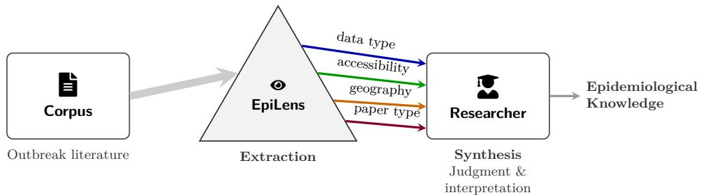  
Fig. 1 Division of labour between EpiLens and the researcher. Large-scale, unstructured outbreak literature (left) is systematically processed by EpiLens to resolve a corpus into distinct, structured dimensions. The dimensions shown (data type, accessibility, geography, and paper type) are the examples we carry through this paper. They are not fixed by the system, which the user configures for their own questions. By handling the mechanical extraction and provenance of these variables, the system provides filtered evidence to the researcher (right). This separation lets the researcher move from labour-intensive sorting of documents to higher-level work: defining label vocabularies, auditing edge cases, and interpreting the resulting patterns.

## 1.1 Contributions

The contributions of this paper are:

• A Python package for structured, reusable analysis workflows over epidemiological corpora. EpiLens turns an analyst-defined retrieval template and output schema into a workflow that applies consistently across papers and adapts to new tasks. It supports local or remote inference and links each output to its supporting passages.

• A reliable, reusable worked example: the Paper Classifier. We develop and evaluate a classification workflow across four label axes with diferent evidence demands, showing the accuracy attainable without task-specific training labels and where body-text retrieval is most useful.

• A corpus-scale case study in digital epidemiology. We provide a multiaxis description of the review-seeded corpus of 2,297 papers and a source-level comparison of the papers associated with parameter estimates from the seed study by Ward et al. [11], by parameter and pathogen.

Section 2 positions the work, and Section 3 describes EpiLens, its two workflows, and the evaluation setup. Section 4 evaluates the Paper Classifier on a manually labelled sample, applies it to the full corpus, and links the corpus papers to the parameter estimates of the seed study. Section 5 discusses how retrieval-grounded workflows might fit into the knowledge-acquisition toolkit of digital epidemiology, in light of our results and of recent work applying RAG in general scientific settings [5] and in healthcare [12], and sets out the limitations. The appendices hold the detail behind each step: system components, an extraction workflow, and inference cost (Section A), corpus construction (Section B), the labelling protocol (Section C), full metrics, the fully local deployment and error diagnostics (Section D), the baselines and statistical tests (Section E), and the linkage of estimates to corpus papers (Section F).

## 2 Background

This work sits at the intersection of digital epidemiology, retrieval-augmented generation, and automated literature processing. From digital epidemiology it takes the motivation to understand how diverse data sources and methods have been used across outbreaks and to turn that understanding into a component of preparedness. From RAG it takes the architectural pattern of grounding LLM outputs in retrieved evidence and the associated evaluation concerns. From literature processing tools it inherits an emphasis on machine-readable and extensible corpora and references. By combining these elements in an open, lightweight package focused on epidemiological corpora, EpiLens aims to make AI-assisted knowledge acquisition a part of digital epidemiology.

## 2.1 Digital Epidemiology and Data-Centric Preparedness

Digital epidemiology emerged as a response to the increasing availability of digital data describing human behaviour, mobility, and health, and to the need for more timely and granular information on disease dynamics. Early work framed digital epidemiology as the use of digitally collected data and tools to study patterns of health and disease, emphasising both its potential and the technical and computational challenges it introduces [13]. Subsequent reviews have documented how digital epidemiology expanded in scope, driven by mobile devices, online platforms, and novel sensing technologies, and how it began to complement traditional surveillance by filling gaps in timeliness or spatial coverage [3, 14]. The COVID–19 pandemic accelerated the use of varied data sources in epidemiology, including structured and unstructured data collected inside and outside health systems [15].

Alongside this expansion came a need to better understand not only which data exist but also how they have been used across pathogens, regions, and modelling tasks. Work on non-traditional data during COVID–19 illustrates this point. The Data4COVID19 Review [1] and related eforts [2] catalogued the ways in which mobility, financial transactions, social media activity, and other unconventional sources were used to support decision making, while also highlighting dificulties around integration, governance, and sustainability. More broadly, recent assessments argue that digital epidemiology will only fulfil its promise if the biases and limitations of new data sources are explicitly recognised and if methods and data practices are adapted accordingly [15]. In this context, being able to quickly map which data have been used for which analyses, under which assumptions, becomes a component of preparedness in its own right.

## 2.2 Large Language Models and Retrieval-Augmented Generation

Large language models can summarise, answer questions, and extract information at scale [16], but remain prone to hallucinating plausible but incorrect statements when used as stand-alone knowledge sources [7]. Grounding conclusions in verifiable evidence is a basic requirement across the empirical sciences. In epidemiology and public health, the cost of failing to do so is especially high. A fabricated or misattributed finding can propagate into surveillance summaries, resource allocation, and clinical or policy decisions. During an outbreak, these decisions are made under time pressure, with little opportunity to catch an error before it has consequences. An unverifiable model output is therefore not merely an inconvenience in this setting but a direct risk. Retrievalaugmented generation (RAG) addresses this by conditioning generation on passages retrieved from an external corpus rather than on parametric memory alone [8].

RAG has also been used to work with scientific literature [5]. Recent surveys of RAG architectures describe how retrieval and generation are combined for knowledgeintensive tasks such as open-domain question answering and summarisation, and they analyse common design choices and trade-ofs in these workflows [9, 10]. PaperQA2 and OpenScholar use RAG to synthesise cited answers to questions over scientific literature [17, 18]. Our focus is repeatable corpus analysis: EpiLens applies the same retrieval template and output schema to every paper, producing comparable records for aggregation and inspection. Ease of use is also a design goal: researchers can start from a predefined workflow and adapt its retrieval template and output schema without assembling the underlying RAG pipeline.

RAG has also begun to be adopted in healthcare and biomedicine, where factual accuracy and provenance are critical. Surveys document applications in medical question answering, guideline querying, and electronic health record summarisation [12, 19, 20]. The challenge is to adapt these ideas to the specific needs of epidemiology, where questions often concern data availability, study design, and modelling assumptions rather than only clinical recommendations.

## 2.3 Approaches to classifying a literature at scale

Classification is our main example of an EpiLens workflow. In this context, it tackles the need to organise a body of literature too large to screen by hand into analytically useful categories, without turning each new research question into a new annotation project. Methods for this difer along two requirements that are easy to conflate: i) whether the category scheme is specified by the analyst or discovered from the corpus, and ii) whether the method needs manually labelled training examples before it can be applied. The Paper Classifier provides an analyst-specified scheme, revisable as text, applied with no task-specific training labels, and grounded in full-document evidence through retrieval. Supervised classifiers share the category control but pay for it in labels. Of-the-shelf zero-shot classifiers likewise apply analyst-specified categories without task-specific training labels; the NLI and prototype baselines tested here score the supplied title and abstract without retrieving passages from the paper’s body. Topic models need neither but cannot be told the scheme. Recent general-purpose decision models such as Jev [21, 22] extend the zero-shot family: given analyst-written options and their descriptions, they return a probability for each without task-specific training. They decide from the text they are given, so they complement evidence retrieval rather than replace it. We lay out this design space, instantiate each family with standard methods, and summarise the head-to-head comparison in Section 4.2.3, developing it in full in Section E.

## 3 Methods

This section describes the system design of EpiLens, our Retrieval-Augmented Generation (RAG) package for epidemiological literature analysis. The system is intended to ofload mechanical text-processing work (retrieval, evidence filtering, extraction, and coarse categorisation) while keeping domain judgment and interpretation with the researcher. EpiLens’s orchestration supports a family of structured workflows in which the user defines the label vocabulary or extraction target and the shape of the output. In this paper, we develop one such workflow, the Paper Classifier, as a worked example and as the target of our quantitative evaluation.

## 3.1 System overview

EpiLens implements a standard three-stage RAG pipeline: ingestion and indexing, retrieval, and generation. Ingestion parses papers, segments them into chunks, embeds them, and stores them in a searchable index. Retrieval selects the most relevant chunks for a query or template, optionally filtered by paper metadata. Generation prompts an LLM to produce an output that is grounded in the retrieved evidence. We accompany every output with structured provenance that links each extracted fact or label back to the source paper and the specific text snippets used as evidence. EpiLens is local-first in its orchestration. In the evaluated configuration, parsing, vector storage, retrieval, and task logic run under the analyst’s control, while embedding and generation can run locally or through external APIs. The package also permits a remotely hosted vector database. This local layer governs what is sent to the model by selecting and structuring relevant chunks, and by enforcing schemas before and after generation. In this sense, we treat the LLM as a stateless computation step: it receives a locally assembled prompt and returns a structured output, with no ability to query the corpus or influence what context it receives.

Figure 2 illustrates the ingestion (indexing) and interrogation (querying) branches of this pipeline. Additional implementation detail, including component interfaces and backend choices, is provided in Section A.

EpiLens is deliberately lightweight, by which we mean three things. First, it depends only on standard, swappable libraries rather than on a general-purpose RAG framework. Document parsing uses unstructured [23] and pypdf, or GROBID [24] for richer section structure. Embeddings use a sentence-transformers model [25] or a provider embedding API (we use Gemini embeddings in our experiments). Vector storage uses a local file index, FAISS [26], or a Qdrant server [27]. Schema definition and validation use pydantic [28], and generation uses a provider API (OpenAI, Google, Anthropic, OpenRouter) or a local model. Any layer can be swapped without touching the others. Second, the core orchestration can run on commodity hardware such as a laptop. External embedding, generation, or vector-database services are optional deployment choices rather than architectural requirements. Setup is minimal: local-first defaults run out of the box, with optional upgrades (GROBID parsing, a Qdrant server, a Streamlit UI) for users who want to scale up. Third, cost is bounded: because each prompt carries a fixed retrieval budget regardless of document length, per-paper token usage is nearly flat in the length of the paper, which keeps corpus-scale application afordable (Section A.3). General RAG toolkits such as LangChain [29], LlamaIndex [30], and Haystack [31] expose low-level primitives for assembling arbitrary pipelines and maximise flexibility. EpiLens ofers higher-level building blocks, from ad-hoc retrieval-augmented question answering to the structured workflows, trading breadth of customisation for out-of-the-box usability.

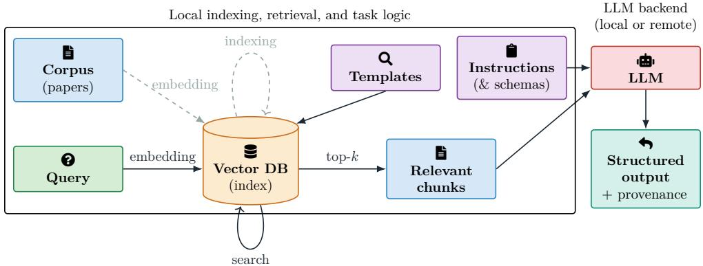  
Fig. 2 RAG workflow used in EpiLens. Dashed arrows indicate one-time ingestion and indexing of the corpus. Solid arrows indicate per-task interrogation (query embedding, search, and generation) with structured outputs linked to source chunks.

## 3.2 Structured workflows for systematic corpus characterisation

Beyond answering one-of questions, EpiLens supports structured workflows: automated analyses that produce structured, machine-readable outputs rather than free-text answers. Running RAG over each document of a corpus raises two problems that oneof question answering does not. First, the analysis must be identical across papers so that the per-paper results are comparable and can be aggregated. Second, the outputs must be structured and validated so that results can be computed across thousands of papers. Our workflow resolves both through two artefacts that the user writes once: a template and a schema.

The template fixes how every paper is interrogated, through two parts with distinct jobs. Its retrieval queries fix what evidence is gathered: a fixed set of search phrases (or per-category exemplars) is run against each paper, so the same kind of passage is surfaced from every document rather than left to whatever a one-of query happens to return. Its prompt instructions fix what is done with that evidence: the task to perform and the criteria for performing it, such as the operational definition of each label, held identical across papers so that the same judgement is applied everywhere. Together they guarantee that every paper is asked the same question over the same kind of evidence.

The schema fixes the shape of the answer: the allowed fields, their types, and their permitted values, expressed as a constrained JSON structure. It also acts as a validation gate, since every generated output is checked against it and rejected if it does not conform. This is what makes the results usable at scale: each one is guaranteed to be well-formed structured data ready for aggregation, not prose to be re-read and re-parsed by hand. As shown in Figure 2, the template governs the query and instruction components of the interrogation branch and the schema governs the structure of what the generator returns, turning an interactive RAG session into a pipeline that can run unattended over an entire corpus.

The workflows reuse the same ingestion, retriever, generator, validation, and provenance components, but configure them diferently for their tasks. The Paper Classifier performs category-specific evidence aggregation and returns labels from a fixed vocabulary. The Precision Miner pools evidence from flat queries, can filter by section, and returns a variable-length list of items. We evaluate the classifier quantitatively and show the miner’s output on four corpus papers in Section A.2.

## 3.2.1 Paper Classifier

In this study, we configure the Paper Classifier to label each paper by data type, data accessibility, geographical coverage, and paper type (Section C). The dificulty is that the category scheme is a moving target: it is specific to the question and changes as the question evolves, with new pathogens, a shifting geographic focus, or a revised coding scheme. This is the setting that the usual tools handle poorly (Section 2.3): supervised classifiers need hundreds of labelled examples per scheme version, and re-labelling whenever it changes, while unsupervised methods cannot be told which scheme to recover and instead surface what the vocabulary signals rather than what the question requires. A RAG-based classifier sidesteps both: the analyst specifies each category in natural language and revises it by editing text, with no task-specific training labels, and retrieval grounds each decision in the paper’s own evidence. The trade-of becomes an engineering one (retrieval quality, prompt design, model choice) rather than a dataavailability one. Mechanically, the classifier retrieves evidence for each candidate label using exemplar-guided queries and asks the LLM to discriminate among the competing categories, producing a standardised classification that supports a bird’s-eye view of a literature. Component and workflow details are provided in Section A.

## 3.2.2 Precision Miner

Some questions need the concrete items themselves rather than a label: the datasets and repositories a field uses, or the sources behind its parameter values. The Precision Miner is the extraction workflow for such questions: it pools evidence from several retrieval queries per paper and returns a variable-length list of items, each with a name, an optional URL or identifier, a short explanation, and the source sentence as provenance. Its output is a per-paper worklist to verify rather than a distribution to tally. Section A.2 describes it and shows its output on four corpus papers.

## 3.3 Evaluation setup

We evaluate the Paper Classifier on four axes: data type, data accessibility, geographical coverage, and paper type (Section C). The first three are set-based (multi-label), whereas paper type is a single primary label. Retrieval has a fixed budget of k = 15 chunks per label axis: for each axis, the system embeds every template paragraph, retrieves its k nearest chunks from the target paper, pools these candidates across paragraphs, removes duplicates, and keeps the k highest-scoring unique chunks as the evidence context passed to the generator with the task instructions.

We compare four generator backends, with configurations that difer by model, serving mode (local or remote), temperature, and, for the local generator, retrieval index. Three models are accessed through remotely served inference: Google’s proprietary gemini-2.5-flash and gemini-2.5-pro, each evaluated at T=0 and T=1, and NVIDIA’s open-weight Nemotron (nemotron-3-super-120b-a12b, a mixture-ofexperts model with about 12B active parameters, served free through OpenRouter), evaluated at T=0 only. We self-host the open-weight qwen2.5:32b-instruct on our own hardware and evaluate it at $T = 0$ and T = 1. For each configuration, we repeat the classification task R = 5 times, holding the prompts and post-processing fixed throughout. All remotely served configurations retrieve with gemini-embedding-001. For the self-hosted Qwen configurations, we evaluate two retrieval settings. In the partially local setting, generation runs on our hardware while retrieval uses the same Gemini-embedded index as the remotely served configurations, improving comparabil ity across models. In the fully local setting, both generation and retrieval are local, with the corpus embedded on-device using BAAI/bge-m3.

## 4 Results

After describing the corpus (Section 4.1), we evaluate the Paper Classifier on a manually labelled sample (Section 4.2) using the settings of Section 3.3. We report accuracy and run-to-run stability, test the contribution of retrieval by ablation, and compare the classifier with external baselines. We then use the classifier to describe the full corpus and the papers associated with the seed study’s parameter estimates (Sections 4.3 and 4.4). Section D.4 additionally compares the error sets of gemini-2.5-pro and gemini-2.5-flash.

## 4.1 Case-study corpus

We evaluate EpiLens on a purpose-built corpus of epidemiological literature. The corpus was seeded from the sources of a recent review of epidemiological parameters for pathogens with pandemic potential [11], which we refer to as the seed study. Its authors shared the data extraction sheets of an early version of the study (close to its first preprint) with us [32].

Once identifiers are resolved, the sheets name 138 published sources: reviews, studies, and other documents (Section F). We retained the directly cited studies and other documents, then added the retrieved studies included in the source reviews. The final corpus contains 2,297 papers and excludes the source reviews themselves. A separate, semi-automated pipeline identified included studies with LLM assistance, resolved bibliographic records and DOIs, retrieved documents, and ingested them. Its archived records show what entered the corpus and what remained unresolved or unretrieved, although reconstructing the exact document collection still depends on access to the documents (Section B). We retain the links between corpus papers and the seed study’s sources to define the labelled-sample strata (Section 4.2) and to analyse the papers associated with its parameter estimates (Section 4.4).

## 4.2 Classification on the manually labelled sample

We evaluate the classifier on 214 papers sampled from the 2,297-paper corpus. The sampling groups are the source reviews that contributed papers to the corpus and, as one additional group, the corpus documents cited directly by the seed study (Section 4.1). From each group of n papers, we randomly select max(⌊0.1n⌋, 1) papers. The one-paper minimum samples the smallest reviews at a higher rate than larger ones. Only 14 sampled papers come from reviews with fewer than ten papers.

One annotator labelled each sampled paper on all four axes using a written protocol that defines the labels and sets rules for ambiguous cases (Section C). We discuss the limitation of relying on a single annotator in Section 5.2. The annotations were completed before the annotator saw any model output. The classifier prompts use the same label definitions, aligning the instructions given to the model with those followed by the annotator.

We specified the classifier prompts, retrieval templates, and configuration from the protocol before evaluating on the 214 papers and made no changes in response to results on this set. The sample therefore serves as a held-out evaluation set for EpiLens. Where a baseline required tuning of NLI wording, topic count, or supervised model configuration, we report the strongest setting observed on these same papers (Sections E.2.1, E.2.2 and E.5), which favours the baselines.

We report the unweighted mean per-paper Jaccard similarity (J) on each axis, with a 95% bootstrap interval over papers. For each paper, J is the number of labels shared by the prediction and manual annotation divided by the number in either set. For paper type, which has one label per paper, this is ordinary accuracy. We report microand macro-averaged precision, recall, $\mathrm { F _ { 1 } }$ , and subset accuracy in Section D. Because papers from the smallest reviews were sampled at a higher rate, we checked whether unequal sampling afects the reported averages. Weighting each paper by the inverse of its selection probability changes the mean J of EpiLens with gemini-2.5-flash at $T { = } 0$ by at most 0.005 on any axis (efective sample size 207).

## 4.2.1 Performance and stability of EpiLens

Table 1 reports the agreement of the served backends with the manual labels.

The served models perform well on geography and paper type: at $T = 0$ , all three reach $J \ge 0 . 8 4$ , against majority baselines of 0.353 and 0.593, and both Gemini models exceed 0.87. Data type scores are also high (0.950 for Pro and 0.916 for Flash at $T { = } 0 )$ but should be read against a majority baseline of 0.843. The manual sample has too few examples of several data-type labels to establish their individual accuracy (Section D.2). Data accessibility is the most dificult axis: at $T = 0 ,$ Pro reaches 0.802, against 0.670 for Flash, 0.660 for Nemotron, and a majority baseline of 0.472, and its Pro–Flash gap (0.132) is the largest of any axis, so this task benefits most from the stronger model. Temperature has little systematic efect: moving from $T = 0$ to $T = 1$ changes mean Jaccard by less than 0.03 in every case, in no consistent direction. The open-weight Nemotron-120B is competitive with Flash, within 0.04 on every axis. Pro has the highest mean of the served models on all four axes.

Table 1 Accuracy of the served backends.
<table><tr><td rowspan="2">Task</td><td>Floor</td><td colspan="2">gemini-2.5-pro</td><td colspan="2">gemini-2.5-flash</td><td rowspan="2">Nemotron</td></tr><tr><td>Majority |</td><td>T=0</td><td> $T { = } 1$ </td><td> $T { = } 0$ </td><td> $T { = } 1$ </td></tr><tr><td>Geography</td><td>0.353</td><td> $0 . 9 2 8 _ { 0 . 8 9 - 0 . 9 5 }$ </td><td> $0 . 9 2 5 _ { 0 . 8 9 - 0 . 9 5 }$ </td><td> $0 . 8 7 5 _ { 0 . 8 3 - 0 . 9 1 }$ </td><td> $0 . 8 7 1 _ { 0 . 8 3 - 0 . 9 0 }$ </td><td> $0 . 8 8 6 _ { 0 . 8 4 - 0 . 9 2 }$ </td></tr><tr><td>Data access.</td><td>0.472</td><td>0.8020.76-0.84</td><td> $0 . 7 7 5 \substack { 0 . 7 3 - 0 . 8 1 }$ </td><td> $0 . 6 7 0 _ { 0 . 6 2 - 0 . 7 2 }$ </td><td> $0 . 6 8 4 _ { 0 . 6 5 - 0 . 7 2 }$ </td><td> $0 . 6 6 0 _ { 0 . 6 2 - 0 . 7 0 }$ </td></tr><tr><td>Data type</td><td>0.843</td><td> $0 . 9 5 0 _ { 0 . 9 2 - 0 . 9 7 }$ </td><td> $0 . 9 4 1 _ { 0 . 9 1 - 0 . 9 6 }$ </td><td> $0 . 9 1 6 _ { 0 . 8 8 - 0 . 9 4 }$ </td><td> $0 . 9 1 3 _ { 0 . 8 8 - 0 . 9 4 }$ </td><td> $0 . 8 7 7 _ { 0 . 8 4 - 0 . 9 1 }$ </td></tr><tr><td>Paper type</td><td>0.593</td><td> $0 . 9 0 3 _ { 0 . 8 6 - 0 . 9 3 }$ </td><td> $0 . 9 0 1 _ { 0 . 8 6 - 0 . 9 3 }$ </td><td> $0 . 8 7 7 _ { 0 . 8 3 - 0 . 9 1 }$ </td><td> $0 . 8 8 0 _ { 0 . 8 4 - 0 . 9 1 }$ </td><td> $0 . 8 4 8 _ { 0 . 8 0 - 0 . 8 9 }$ </td></tr></table>

Mean Jaccard similarity on the 214-paper evaluation set over R=5 runs per configuration. The subscript is a 95% bootstrap interval over papers (BCa, B=10 000), computed after averaging each paper’s score over the runs: it shows how precisely these papers determine the score. Each interval describes one configuration; methods are compared with the paired tests of Section E.4. Run-to-run standard deviations are in Table D1. The Floor column (set of on the left) is the majority-class baseline, a single deterministic value included as a reference point for reading the scores. Nemotron is an open-weight backend (NVIDIA Nemotron-120B) run through the identical pipeline at T =0. Paper type is a single-label task. The remaining tasks are multi-label.

The self-hosted qwen2.5:32b-instruct configurations also score above the majority baseline on every axis, though only slightly on data type (0.861–0.879 against 0.843). They come close to Flash on geography (0.869 against 0.875 when fully local), and lose most on data accessibility (0.539 against 0.670). At T=0, moving the embedding step on-device changes J by at most 0.024 on any axis (Section D.3).

Mean agreement with the manual labels does not show whether repeated runs assign each paper the same labels. We measure stability as the share of papers whose complete label set is identical across all five runs.

Temperature afects paper-level stability much more than mean J (Table 2). At T=0, the Gemini models are stable on 87–95% of papers on geography, data type, and paper type, but only 63.6–66.8% on data accessibility, which is also the least stable axis for Nemotron. Both local Qwen configurations return identical labels on every axis at T=0. At T=1, however, stability on data accessibility falls to 32.2% for Flash and below 21% for Qwen. Mean J nevertheless varies little between runs (standard deviation at most 0.027 in any configuration; Tables D1 and D5): within a run, papers that gain and lose agreement largely ofset each other, and a change often alters only part of a label set.

Table 2 Label stability across repeated runs.
<table><tr><td rowspan="3"></td><td colspan="4">Qwen2.5-32B (local)</td><td rowspan="2" colspan="2">Gemini pro</td><td rowspan="2" colspan="2">Gemini flash Nemotron</td><td rowspan="2"></td></tr><tr><td colspan="2">fully local</td><td colspan="2">partially local</td></tr><tr><td>T=0</td><td> $T { = } 1$ </td><td> $T { = } 0$ </td><td> $T { = } 1$ </td><td> $T { = } 0$ </td><td> $T { = } 1$ </td><td> $T { = } 0$ </td><td> $T { = } 1$ </td><td>T=0</td></tr><tr><td>Geography</td><td>100.0</td><td>80.4</td><td>100.0</td><td>78.5</td><td>94.9</td><td>93.0</td><td>92.1</td><td>81.3</td><td>86.9</td></tr><tr><td>Data access.</td><td>100.0</td><td>17.8</td><td>100.0</td><td>20.6</td><td>63.6</td><td>51.4</td><td>66.8</td><td>32.2</td><td>44.9</td></tr><tr><td>Data type</td><td>100.0</td><td>79.4</td><td>100.0</td><td>83.6</td><td>89.3</td><td>90.2</td><td>94.9</td><td>89.3</td><td>86.9</td></tr><tr><td>Paper type</td><td>100.0</td><td>87.4</td><td>100.0</td><td>86.9</td><td>87.9</td><td>86.0</td><td>89.7</td><td>76.2</td><td>82.7</td></tr></table>

Percentage of papers whose predicted label set was identical across five repeated runs under each configuration. A prediction is considered stable if the full label set is unchanged across runs. The Qwen2.5-32B columns are the self-hosted backend of Section D.3: fully local embeds the index locally with BAAI/bge-m3, while partially local reuses the Geminiembedded index. Both are perfectly stable at $T { = } 0$ , returning an identical label set for every paper across all five repeats. Gemini pro and Gemini flash are gemini-2.5-pro and gemini-2.5-flash. Nemotron is the open-weight backend (NVIDIA Nemotron-120B) at T =0. The majority floor is omitted here because it is deterministic.

Notice all three served backends change some labels even at $T { = } 0$ . Variation under nominally deterministic settings has also been observed elsewhere [33]. Changes in batching and floating-point reductions can alter outputs under greedy decoding [34– 36]. We did not vary batching or numerical precision while holding the model fixed, so these mechanisms remain possible explanations for the served systems’ label changes.

## 4.2.2 Ablation of body-text access and selection

Aggregate performance does not reveal which components of the workflow are driving its gains. Therefore, we compare conditions that, within each generator, use the same model, prompt, and post-processing and difer only in the evidence supplied:

1. No body text (metadata\_llm): the model receives only the paper’s title and abstract.

2. Random body retrieval (random\_chunk\_llm): the prompt additionally receives k body-text chunks sampled uniformly at random from the paper.

3. Targeted retrieval (full EpiLens): the same number of body-text chunks is selected by semantic similarity to the template paragraphs.

4. Whole body (full\_body\_llm): the prompt receives every body-text chunk of the paper, in document order, with no selection.

The contrast from step 1 to step 2 measures the contribution of access to body text, while step 2 to step 3 measures the additional contribution of semantic targeting at a fixed evidence budget. Step 4 tests whether selecting passages improves on supplying the whole parsed body.

The ablation shows the same qualitative decomposition for both generators (Figure 3). The largest and most consistent gain comes from access to body text, even when the passages are selected at random. For gemini-2.5-flash, moving from title and abstract alone to random body-text retrieval increases J by +0.06 on geography, +0.26 on data accessibility, +0.09 on data type, and +0.16 on paper type. The corresponding gains for qwen2.5:32b-instruct are +0.06, +0.20, +0.12, and +0.15. Papers in this corpus have 33 chunks on average (Section A.3), so the 15 randomly selected chunks already expose the model to much of the body. The starting point nevertheless difers by task. With Flash, title and abstract alone already give J=0.826 on geography, 0.816 on data type, and 0.713 on paper type, but only 0.241 on data accessibility, indicating that the latter depends much more strongly on information beyond the abstract.

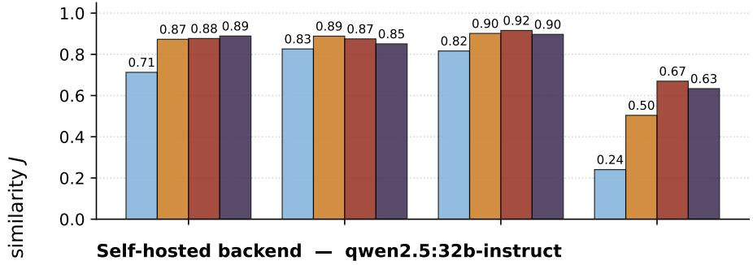

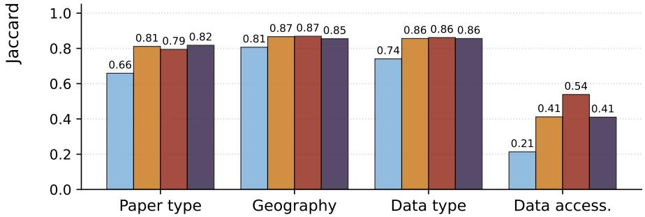  
Fig. 3 Ablation results for two generators. The upper panel uses the served gemini-2.5-flash model and the lower panel the self-hosted qwen2.5:32b-instruct, both at T=0. Within each panel, the model, prompt, and post-processing are fixed. The four conditions are title and abstract only, title and abstract plus k=15 randomly selected body-text chunks, title and abstract plus k=15 semantically retrieved chunks, and title, abstract, and the whole parsed body. Comparing conditions 1 and 2 shows the efect of adding body text. Comparing conditions 2 and 3 shows the efect of targeted selection with the same number of chunks.

Semantic targeting contributes additional value more selectively. Its largest efect is on data accessibility, where replacing random chunks with targeted ones raises J by +0.17 for Flash (0.504→0.670) and by +0.13 for Qwen (0.412→0.539). On the other three axes, the efect is small or absent. In the paired paper-level resampling check of Section E.4, the gain from adding random body-text chunks to title and abstract meets the within-task Holm-adjusted threshold on every axis for both generators. The gain from replacing random chunks with targeted ones meets it only on data accessibility.

Under the same check, the whole-body condition shows no clear accuracy advantage over the 15 targeted chunks on any axis, despite using about twice the input tokens (Figure 3 and Section A.3).

On data accessibility, Qwen falls from J=0.539 with targeted chunks to 0.410 with the whole body (pointwise 95% BCa interval for the diference, 0.05–0.20). This is the only one of the eight targeted-versus-whole-body comparisons that meets the withintask Holm-adjusted threshold. The result suggests that selecting passages can help on this task even when the whole parsed body fits in the model’s context window.

## 4.2.3 Comparison with classification baselines

We compare EpiLens with alternative workflows that a practitioner might use to organise a literature corpus. Standard supervised classifiers pair a paper representation with a classifier head trained on labelled examples. Here, we use TF-IDF + linear SVM for a lexical setup and frozen ModernBERT with an MLP head for a long-context setup. Zero-shot NLI instead uses a pretrained language encoder to score how strongly a paper supports each verbalised category, without task-specific fitting. Guided and semi-supervised BERTopic discover corpus-specific clusters rather than applying a fixed taxonomy, so their topics require subsequent interpretation and alignment. SetFit provides a distinct supervised route, contrastively fine-tuning an MPNet encoder on pairs of labelled examples before fitting a classification head. We also include two prototype approaches, which encode each category description (or, for geography, its name) in sparse TF-IDF or dense SPECTER space and assign papers by similarity, with label-free and threshold-calibrated variants. Finally, as in the preceding results, a majority prior that always predicts the most prevalent label set provides a notext reference floor. The abstract-only metadata\_llm row is retained only as the scope-matched EpiLens condition analysed in the ablation above.

The methods also difer in practical text scope, recorded by Body? in Table 3. The prototype, NLI, and SetFit baselines use title and abstract, whereas BERTopic, ModernBERT, and full EpiLens use parsed body text. The broader supervised grid tests both scopes wherever possible. Body text is not uniformly beneficial: some representation–head combinations decline slightly, perhaps because additional text dilutes task-relevant cues already concentrated in the abstract, although the best full-body configuration raises the supervised ceiling on every axis.

Creating a suficiently broad labelled set is a substantial additional step for a large or diverse corpus, and a changed coding scheme generally requires renewed labelling and model fitting. All rows are scored on the same papers with the same metric. Where a baseline needs tuning, we report its strongest setting, which favours the baselines because EpiLens was fixed before evaluation (Section 4.2). The notes to Table 3 define its columns and its upper-bound rows, and Section E gives the configurations, tuning, complete supervised grid, and statistical comparisons.

Against this deliberately favourable comparison, full EpiLens with Flash has the highest point estimate on every axis, including the retrospective supervised ceiling, without task-specific training labels. In a paired paper-level resampling check, the higher mean J of Flash than TF-IDF + SVM, SetFit, and ModernBERT meets the within-task Holm-adjusted threshold on all four axes (Section E.4 and Table E1). Pro scores higher still.

Table 3 Performance and requirements of the baseline approaches.
<table><tr><td rowspan="2">Method</td><td colspan="2">Requirements</td><td colspan="4">Jaccard by task</td></tr><tr><td>Body?</td><td>Task sup.</td><td>Paper type</td><td>Geo- graphy</td><td>Data type</td><td>Data access.</td></tr><tr><td colspan="7">Reference</td></tr><tr><td>Majority prior (floor)</td><td>No</td><td>Weak</td><td>0.593</td><td>0.353</td><td>0.843</td><td>0.472</td></tr><tr><td colspan="7">Zero-shot (no training labels)</td></tr><tr><td>Prototype (TF-IDF)</td><td>No</td><td>None</td><td>0.407</td><td>0.283</td><td>0.315</td><td>0.217</td></tr><tr><td>Prototype (SPECTER)</td><td>No</td><td>None</td><td>0.126</td><td>0.165</td><td>0.515</td><td>0.360</td></tr><tr><td>Zero-shot NLI (DeBERTa)</td><td>No</td><td>None</td><td>0.565</td><td>0.709</td><td>0.018</td><td>0.354</td></tr><tr><td colspan="7">Topic models (corpus-derived, label-guided)</td></tr><tr><td>Guided BERTopic</td><td>Yes</td><td>Weak</td><td>0.621</td><td>0.576</td><td>0.843</td><td>0.472</td></tr><tr><td>Semi-supervised BERTopic</td><td>Yes</td><td>Weak</td><td>0.626</td><td>0.581</td><td>0.843</td><td>0.477</td></tr><tr><td colspan="7">Supervised (title + abstract)</td></tr><tr><td>TF-IDF + Linear SVM</td><td>No</td><td>Manual</td><td>0.713</td><td>0.592</td><td>0.854</td><td>0.533</td></tr><tr><td>SetFit (MPNet)</td><td>No</td><td>Manual</td><td>0.734</td><td>0.599</td><td>0.864</td><td>0.574</td></tr><tr><td>Prototype (TF-IDF)</td><td>No</td><td>Manual</td><td>0.407</td><td>0.339</td><td>0.315</td><td>0.247</td></tr><tr><td>Prototype (SPECTER)</td><td>No</td><td>Manual</td><td>0.126</td><td>0.179</td><td>0.672</td><td>0.363</td></tr><tr><td colspan="7">Supervised (full body)</td></tr><tr><td>ModernBERT (MLP head)</td><td>Yes</td><td>Manual</td><td>0.785</td><td>0.652</td><td>0.864</td><td>0.577</td></tr><tr><td>Best supervised (ceiling)</td><td>Yes</td><td>Manual</td><td>0.785</td><td>0.771</td><td>0.898</td><td>0.619</td></tr><tr><td colspan="7">LLM (abstract-only ablation and full EpiLens)</td></tr><tr><td>Abstract only (metadata_1lm)</td><td>No</td><td>None</td><td>0.713</td><td>0.826</td><td>0.816</td><td>0.241</td></tr><tr><td>EpiLens (gemini-2.5-flash)</td><td></td><td></td><td></td><td></td><td></td><td></td></tr><tr><td></td><td>Yes</td><td>None</td><td>0.877 0.83-0.91</td><td>0.875 0.83-0.91</td><td>0.916 0.88-0.94</td><td>0.670 0.62–0.72</td></tr><tr><td>EpiLens (gemini-2.5-pro)</td><td>Yes</td><td>None</td><td>0.903</td><td>0.928</td><td>0.950</td><td>0.802</td></tr><tr><td></td><td></td><td></td><td>0.86-0.93</td><td>0.89–0.95</td><td>0.92-0.97</td><td>0.76-0.84</td></tr><tr><td></td><td></td><td></td><td></td><td></td><td></td><td></td></tr></table>

Sample-averaged Jaccard similarity J on the fixed 214-paper evaluation set. Body? indicates whether parsed body text is required. No generally means title and abstract, while the majority floor uses no text. Task sup. records the task-specific input used to construct or fit the method: None uses no labelled papers, Weak uses a class prior, seeds, or partial paper labels, and Manual uses a fully manually labelled training set. All scores use the same manual labels. Prototype rows contrast uncalibrated similarity with threshold calibration. BERTopic uses the best topic count and oracle cluster-to-label alignment. Best supervised is the per-task maximum over the supervised grid. Both are favourable descriptive upper bounds rather than single deployable configurations. For EpiLens, the mean is over R=5 runs at T=0, with its 95% bootstrap interval over papers beneath it, as in Table 1. Other rows are deterministic evaluations or cross-validated estimates. Scores are rounded to three decimals. Paired tests are reported in Table E1. Full method specifications are given in Section E.

## 4.3 Corpus-level analysis

As mentioned in Section 4.1, the corpus was assembled from sources cited for epidemiological parameter estimates across several pathogens. Having evaluated the classifier on a manually labelled sample, we turn to the literature those sources brought together. The overall distribution of labels across 2,297 papers provides a reference for comparing the papers associated with diferent parameters and pathogens. Both analyses use gemini-2.5-flash at T=0, chosen for its lower cost and strong agreement with manual labels on paper type, geography, and data type (Section 4.2.1). We report corpus shares only for those three axes.

Across the full corpus, the model labels 57.7% of papers as empirical and 25.0% as inference, with 46.1% covering Asia and 37.9% Africa. It labels 96.3% as using traditional data and 18.5% as presenting simulated data. Detailed distributions and a fully local sensitivity check appear in Figure D1 and Section D.3.4.

## 4.4 Papers associated with parameter estimates

We now turn from the full corpus to the papers associated with the seed study’s parameter estimates. We make these comparisons using the source links retained during corpus construction (Section 4.1). The privately shared early extraction sheets contain 346 estimate rows; our source-link audit finds that 327 cite a published source (Section F). The other 19 do not enter this analysis. For each of the 327, we link the estimate to its cited corpus document or, if it cites a review, to the retrieved studies included in that review. We refer to these as the papers behind an estimate. When an estimate cites a review, the link does not identify which of the retrieved included studies informed the particular value. We describe those studies as a group associated with the estimate, without attributing the value to any one study (Section F). Of those estimates, 180 cite reviews and 147 cite single studies or other documents (Figure 4).

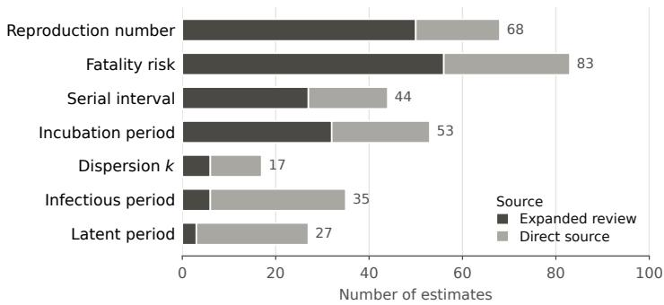  
Fig. 4 Sources of parameter estimates. Estimates of each parameter, by source: a review whose included studies are in our corpus, or a single study or other document in our corpus. Parameters are ordered by the share of their estimates taken from reviews.

## 4.4.1 Parameter

Figure 5 compares the profiles of papers associated with each parameter. Its first row shows all 2,297 corpus papers for reference. The profiles use the same paper-type, data-type, and geographic labels as the corpus overview. For this comparison, we group papers labelled inference or forecast under model-based, including statistical distribution fitting and transmission modelling, and use the synthetic-data label for simulated data (Section C). The model-based and simulated-data shares are tabulated in Table F1.

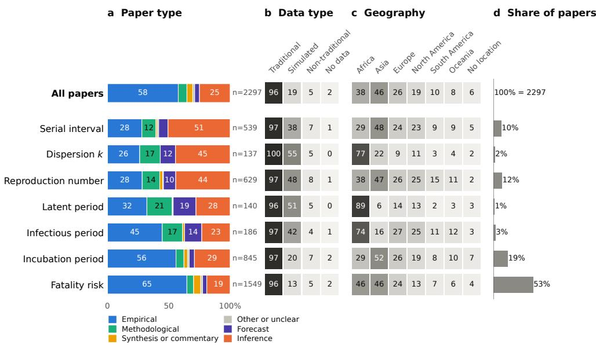  
Fig. 5 Profiles of associated papers by parameter. The first row describes all 2,297 corpus papers, and each other row the papers behind the estimates of one parameter, as labelled by EpiLens (model outputs, not estimates). Rows are ordered by the share of model-based papers, and n is the number of papers. (a) Percentage of the papers with each paper type. Each paper has one, and modelbased papers are those labelled forecast or inference. (b, c) Percentage of the papers with each data type and each continent. A paper can have several. “No data” means no empirical data, and “no location” means irrelevant or unclear. (d) Fractional allocation of the corpus: each paper has total weight one, divided equally among the pathogen–parameter pairs whose estimates it lies behind, so that the row weights sum to 100%.

We focus first on reproduction numbers and fatality risks, the parameters with the most estimates (68 and 83). The model labels 54% of the 629 papers behind reproduction numbers as model-based, against 22% of the 1,549 behind fatality risks. These shares cover all associated papers but depend on model-assigned labels. We therefore check the contrast on the manually labelled sample, where 62% of 61 reproduction-number papers and 24% of 144 fatality-risk papers are model-based. A higher model-based share for reproduction numbers is plausible given the role of model fitting in their estimation.

The papers linked to reproduction-number estimates and fatality-risk estimates cover diferent mixes of pathogens, which could contribute to the overall gap. We therefore compare their model-based shares within pathogens. In each of the five with at least 20 papers behind both parameters, the reproduction-number papers still have a higher model-based share, although the gap narrows to 4–25 percentage points (Table F2). The direction also holds under the fully local model and when any one source review is omitted (Section F). The simulated-data label shows a related contrast (48% versus 13%), although it often overlaps with the model-based label.

## 4.4.2 Pathogen

We now compare the corpus papers linked to the seed study’s cited sources across pathogens. Figure 6 shows their paper-type, data-type, and geographic profiles, pooling papers across parameters for each pathogen.

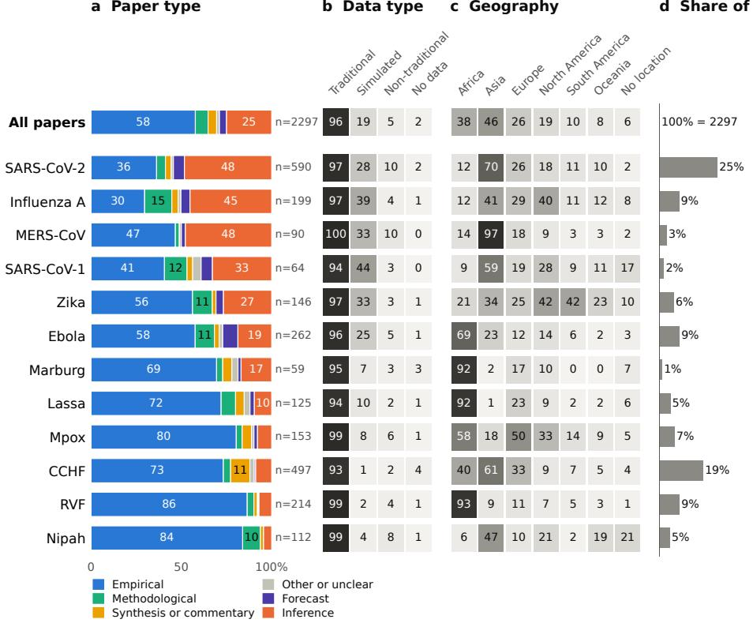  
Fig. 6 Papers linked to cited sources by pathogen. The first row describes all 2,297 corpus papers. Each other row describes papers linked to sources cited for that pathogen across all parameters in the seed study. The panels show the same measures as in Figure 5. Pathogens with at least 10 associated papers are shown. Influenza A subtypes are merged here and listed separately in Table F1. CCHF: Crimean–Congo haemorrhagic fever. RVF: Rift Valley fever.

In the model’s labels, the SARS-CoV-2 and influenza A source sets contain larger shares of inference papers and papers using simulated data than are found in the corpus as a whole. The mpox, RVF, and Nipah sets are predominantly empirical. In the geography panel, nearly all papers linked to MERS-CoV cover Asia, and nearly all those linked to Marburg and RVF cover Africa.

We also compare pathogens within a single parameter. Among papers linked to incubation-period estimates, 55% of the 334 behind SARS-CoV-2 are labelled modelbased, compared with 6% of the 115 behind mpox (Table F2). The manual labels show the same ordering (61% of 31 versus 9% of 11). These papers come from six and five source reviews or directly cited documents, respectively, so the manual check supports the direction more than a precise magnitude. Excluding papers also linked to reproduction numbers or fatality risks leaves a similar contrast (54% of 201 versus 6% of 70). It is not driven by one review (Section F). Fatality-risk papers also difer by pathogen: 52% of those linked to SARS-CoV-2 are model-based, against 5–26% for CCHF, Ebola, Lassa, Nipah, and RVF (Table F2).

## 5 Discussion

In this work we present EpiLens, a Retrieval-Augmented Generation (RAG) package for organising epidemiological literature at a scale that manual review cannot reach. It treats the generator model as a linguistic engine over retrieved passages and retains the intermediate artefacts behind each output (the retrieved passages, the prompt, and the schema-validated label or extraction with a back-link to its source chunks), so that any aggregate result can be traced to the evidence that produced it rather than discarded once the answer is returned.

Our evaluation shows both the efectiveness of the retrieval-augmented workflow and how its performance depends on the target analytical task. In the broad corpusorganising axes of geography, data type, and paper type, the full RAG workflow achieves strong agreement with the manual annotations and matches or exceeds the tested supervised classifiers without requiring task-specific training labels (Section E). Performance is lower on data accessibility, which emerges consistently as the most dificult of the four axes, although it remains substantially above the majority baseline and improves with the stronger served model.

The ablation analysis clarifies where these gains come from (Section 4.2.2). Across both the served gemini-2.5-flash model and the self-hosted qwen2.5:32b-instruct, access to body text provides the largest and most consistent improvement over title and abstract only classification. Semantic targeting adds a further, task-dependent gain: it matters most for data accessibility and little for geography. This pattern is consistent with access-related evidence being comparatively sparse or localised and place-related cues being more widespread through a paper. Supplying the whole body showed no clear accuracy advantage over selected passages despite about twice the input tokens. On data accessibility, it reduced accuracy for the self-hosted generator. The pattern recurs across two generators, while the overall performance level remains model-dependent.

More broadly, the workflow fills a diferent role from standard supervised classification. An analyst can define or revise a coding scheme in natural language, apply it directly to full document evidence, and retain provenance for each classification. This makes the approach particularly useful when taxonomies are evolving, labelled examples are limited, or the relevant evidence is not consistently available in titles and abstracts. It also makes the workflow complementary to existing approaches: an annotation-free pass can map a corpus, identify dificult cases for expert inspection, or provide candidate labels for subsequent supervised modelling or manual curation. Once an axis has been validated on a labelled sample, the same specification can then be applied across the full corpus to produce structured distributions while preserving a path back to the papers and passages that support them. Applied to our corpus, the labels describe both the literature as a whole and the paper sets linked to the seed study’s parameter estimates (Sections 4.3 and 4.4). In this setting, domain expertise shifts from manually coding every document toward defining operational categories, validating their reliability, and auditing the evidence behind decisions.

## 5.1 Implications for Digital Epidemiology and Preparedness

Pandemic preparedness depends in part on having a transparent, up-to-date map of what has been studied, on which data, and in which settings. EpiLens helps maintain such a map, while retaining the link between high-level summaries and the underlying documents that support them. However, a concern in digital epidemiology is not only whether data exist, but how they have been used across pathogens, regions, and modelling tasks. The corpus-level analyses outlined in Section 4.3 begin to make this usage legible in a structured, updateable form. The four dimensions describe complementary features of the literature. Data type records the kinds of evidence used. Data accessibility records stated access routes or whether printed values permit limited reconstruction. Geographical coverage locates the evidence, and paper type records the principal contribution. Together they support retrospective assessment and prospective planning by making the corpus’s mix of study types, data sources, and geographic settings explicit. Aggregate agreement with manual labels on three of these four dimensions (Section 4.2.1) suggests that such a characterisation can be obtained with limited manual coding and updated as new studies appear. The fourth dimension, data accessibility, is both the hardest for the workflow and arguably the most directly preparedness-relevant: knowing whether the data behind past analyses was made available and reusable is a prerequisite for any rapid re-analysis when a new threat emerges. Because this axis has lower agreement and stability, improving it is a priority. We examine why it is hard, and how to address it, in Section 5.2.

## 5.2 Limitations and Future Work

RAG reduces unsupported generations by conditioning outputs on retrieved passages, but errors can still occur when relevant evidence is missed, incomplete, or incorrectly interpreted.

## Evaluation scope.

The present evaluation assumes that the coding scheme can be specified independently of the corpus being evaluated. Our four axes were defined in advance using explicit operational criteria and externally anchored distinctions, including the United Nations M49 standard for geography [37] and the traditional/non-traditional data distinction from previous work [1]. This makes it possible to evaluate the resulting fixed scheme directly on the annotated sample. Other applications may instead derive or refine their categories after inspecting the corpus or preliminary outputs. In that setting, the workflow’s ability to revise categories in natural language remains useful, but the evaluation design should separate a development set used to refine the scheme from a held-out set used only for final performance estimation.

## Corpus and annotation.

Some limitations arise from the case-study corpus rather than from EpiLens itself. The corpus was assembled through a semi-automated pipeline (Sections B and 4.1). This process is explicitly best-efort and logs exceptions such as inaccessible PDFs, incomplete references, and non-machine-readable supplements, but downstream retrieval and classification can only operate on material that has been successfully identified, parsed, and indexed. At the same time, EpiLens can provide useful downstream warning signals, for example when an unexpected paper-type label suggests that a spurious document has entered the corpus. A further limitation is that the evaluation labels were produced by a single annotator following the explicit coding protocol in Section C. Operational definitions and tie-breaking rules reduce ambiguity, but they do not allow us to report inter-annotator agreement. A multi-annotator evaluation with adjudicated labels is therefore an important next step.

## Tracing estimates to papers.

Our analysis links estimates to their cited sources. For an estimate citing a review, the associated set contains its retrieved included studies, which may cover related infections. The link does not identify which studies contributed to the reported value. Parameter-specific study lists, where reviews provide them, would allow more precise links, as the epireview data illustrate [38].

The corpus contains 61% of the reported inclusions in expanded source reviews with available counts, with coverage varying across reviews (Section F). Restricting the reproduction-number–fatality-risk comparison to better-covered reviews preserves its direction but changes the individual label shares. The profiles also use model-assigned labels. The manual labels show the same ordering for the main contrasts, while the small labelled sets behind some pathogen–parameter comparisons limit how precisely their diferences can be assessed.

## Evidence retrieval and verification.

The ablation points to evidence selection as one important target for improvement. Relevant statements may be missed because chunking separates them from their context, the retrieval query does not match the terminology used in the paper, or ranking places the decisive passage below the cut-of. This is most visible for data accessibility, which gains the most from targeted retrieval and also benefits most from the stronger generator (Section 4.2.2). Improving this axis therefore calls for attention to both evidence selection and subsequent interpretation. Promising directions include hybrid lexical and dense retrieval, section-aware retrieval targeting locations such as Methods and Data Availability, stronger reranking, and direct measurement of retrieval recall separately from downstream classification performance. The accessibility axis also illustrates an important scope distinction: our protocol evaluates what the paper reports about access to its data, not whether the stated access mechanism still works. A natural extension is therefore to add a verification stage that checks resolvable links, accession identifiers, repositories, or request mechanisms after the reported access condition has been extracted.

## Reliability and repeatability.

Repeated runs provide an additional signal for identifying dificult cases. Most configurations are highly stable on the three stronger axes, while disagreements concentrate more heavily on data accessibility. These disagreements can be surfaced automatically for inspection and could support future consensus or abstention strategies, provided they are not interpreted as calibrated confidence without further validation. Agreement across models provides a complementary signal: on three of the four tasks, the stronger model’s errors largely fall within the weaker model’s error set (76–80% containment at T=0, Section D.4), identifying a shared subset of dificult papers.

## Extensions.

Finally, a package like EpiLens benefits from the continuing improvements in language models and retrieval components. Stronger locally runnable models may narrow the remaining gap to the served models, while task-specific fine-tuning of smaller models could provide an attractive option when labelled examples are available and a classification scheme has stabilised. Better embedding models, rerankers, and structured decoding methods can likewise be incorporated. More agentic approaches could also be useful when kept deliberately constrained, for example by triggering a second retrieval step, checking an external identifier, or requesting additional evidence only for papers whose initial classification is ambiguous or unstable. Such selective escalation is preferable here to long autonomous agent chains, since it preserves the predictable cost, provenance, and inspectability that motivate the framework in the first place.

## 5.3 Ethical Considerations

Epidemiological evidence informs surveillance, resource allocation, and public-health policy. Errors in how it is organised or interpreted may therefore have serious consequences, particularly during emergencies. We therefore state the intended role of EpiLens, the risks associated with its use, and the safeguards needed to mitigate them. As with any analytical tool used in a consequential setting, its outputs should be interpreted within clearly defined conditions of use and by people able to assess them.

EpiLens acts as a filter through which evidence is viewed. Its classifications can afect which studies are surfaced, inspected, prioritised, or treated as absent, so systematic classification errors could distort the resulting map of the literature. Their practical consequences depend on how the labels are used. When labels only prioritise papers for expert review, false positives mainly add verification work.

When labels are used to exclude papers or stop screening, false negatives can alter the apparent evidence base by removing relevant studies from view. Work on MLassisted screening therefore treats the risk of missed studies as something that must be assessed and communicated [39]. Such omissions are harder to detect and correct during outbreaks, when decisions are urgent, scientific information is uncertain and changing, and time and resources are limited. If they are also unevenly distributed across regions or languages, the resulting map may reinforce existing under-representation. WHO raises a related distributional concern for scientific research supported by large multimodal models [40].

Accordingly, EpiLens should support evidence triage and corpus mapping rather than replace systematic screening, critical appraisal, or expert judgement. In this study, the manually labelled evaluation and repeated runs quantify performance and stability for the case-study corpus, while provenance supports inspection of individual outputs. Applications to a new corpus or coding scheme should therefore be validated on relevant labelled examples, with closer review of unstable outputs and of performance across relevant corpus strata where sample sizes permit. Domain experts should verify outputs before they inform consequential research or preparedness decisions, and the level of review should reflect the intended downstream use. Performance should be reassessed after material changes to the corpus, taxonomy, retrieval pipeline, or underlying model.

## 6 Conclusions

We presented EpiLens, a retrieval-augmented generation package that applies analystdefined questions identically across a corpus of epidemiological papers, returns structured, validated outputs, and keeps a path from each output back to its evidence. Without task-specific training labels, the Paper Classifier matches or exceeds the supervised and zero-shot approaches tested for geography, data type, paper type, and data accessibility. Agreement with manual labels is strongest for the first three, while data accessibility remains more dificult. The ablations show that finding relevant evidence in full texts is an important part of this performance.

We also applied the classifier to 2,297 outbreak-related papers assembled from the cited sources of a multi-pathogen study of epidemiological parameters. The labels describe this corpus as a whole. Linking them to the study’s cited sources shows that the kinds of papers associated with its parameter estimates difer across parameters and pathogens.

More broadly, we argue for treating tools such as EpiLens as part of epidemiology’s analytical infrastructure. Their role is not to replace expert review, but to shift expert efort from manually processing every paper toward defining meaningful questions, validating how reliably they can be answered, and interrogating the evidence behind the resulting map of the literature. Because the analytical scheme, retrieval components, and language model remain separable, the same package can incorporate improvements in models and retrieval without sacrificing provenance or inspectability. As corpora grow and models improve, such tools can help ensure that the knowledge accumulated across past epidemics remains accessible and actionable when the next threat emerges.

Abbreviations. AI: artificial intelligence. API: application programming interface. BCa: bias-corrected and accelerated. CCHF: Crimean–Congo haemorrhagic fever. COVID-19: coronavirus disease 2019. DOI: digital object identifier. JSON: JavaScript Object Notation. LDA: latent Dirichlet allocation. LLM: large language model. LSA: latent semantic analysis. MERS(-CoV): Middle East respiratory syndrome (coronavirus). MLP: multilayer perceptron. NLI: natural language inference.

NMF: non-negative matrix factorisation. NTD: non-traditional data. PCR: polymerase chain reaction. PDF: Portable Document Format. PLSA: probabilistic latent semantic analysis. RAG: retrieval-augmented generation. RVF: Rift Valley fever. SARS: severe acute respiratory syndrome. SARS-CoV-1, SARS-CoV-2: severe acute respiratory syndrome coronavirus 1 and 2. SD: standard deviation. SVM: support vector machine. TEI: Text Encoding Initiative. TF-IDF: term frequency–inverse document frequency. URL: uniform resource locator. WHO: World Health Organization. XML: Extensible Markup Language.

## Declarations

Availability of data and materials. EpiLens is available on GitHub [41] and PyPI. The datasets supporting the conclusions of this article are available in the Zenodo repository at https://doi.org/10.5281/zenodo.22747111. The reproduction package [42] contains the corpus bibliography, the 214-paper manually labelled evaluation set, perpaper and aggregate outputs, and a per-estimate file recording pathogen, parameter, source author, year and DOI, and links to corpus papers. Its scripts regenerate the reported tables and figures from the released inputs.

The article PDFs and full-text index cannot be redistributed because of publisher copyright. The seed study’s extraction sheets [32] were shared privately and are not redistributed. The released source links contain no parameter values.

Competing interests. The authors declare that they have no competing interests.

Funding. This project has received funding from the European Union’s Horizon Europe research and innovation programme under grant agreement No 101095619 (ESCAPE).

Authors’ contributions. VP designed and implemented EpiLens, built the corpus, produced the manual labels, ran the experiments, and wrote the manuscript. CC and DP supervised the study. All authors approved the manuscript.

Acknowledgements. We thank Jack Ward and W. John Edmunds for sharing the seed study’s early data extraction sheets and approving release of the derived source links.

Ethics approval and consent to participate. Not applicable.

Consent for publication. Not applicable.

## Appendix A System and workflow details

This appendix adds component-level detail to the system summarised in Section 3.   
Here we specify the components and backends used at each stage of that pipeline.

## A.1 Pipeline components and backends

Each stage of the pipeline is handled by distinct, interchangeable components, which a researcher can swap to suit their setup.

## A.1.1 Phase 1: Ingestion and Indexing

This phase transforms a collection of scientific papers into a searchable index. It involves parsing, chunking, embedding, and storing the content.

## Document Parsing.

The workflow begins by parsing PDF documents into structured text. EpiLens uses GROBID [24] for this task, which is optimized for academic papers and can extract not only plain text but also rich metadata (title, authors, journal), structured sections (abstract, methods, results), and a bibliography. For non-PDF files or as a fallback, the Unstructured [23] library is used. The parsed metadata and structured content are stored in MongoDB or in memory.

## Text Chunking.

To create focused, contextually relevant units for retrieval, the parsed text sections are segmented into smaller chunks. EpiLens provides many of the standard strategies, including splitting by paragraph, sentence, or fixed-size overlapping windows. When not specified otherwise, in our experiments we split by paragraph.

## Embedding.

Each text chunk is mapped to a high-dimensional vector using an embedding model. EpiLens is model-agnostic and supports a range of providers, including open-source sentence-transformer models from Hugging Face, as well as API-based models from OpenAI, Google (Gemini), and local models served via Ollama. This allows for flexibility in balancing performance, computational cost, and privacy.

## Vector Storage.

The generated embeddings and their associated metadata (e.g., paper ID, section title, original text) are stored in a vector database. This database provides the core functionality for eficient similarity search. EpiLens includes swappable backends for Qdrant, FAISS, and a simple file-based storage system, enabling deployment in various environments from local machines to server-based setups.

## A.1.2 Phase 2: Retrieval

The retrieval phase calls the vector database to find the most relevant indexed text chunks in response to a user query.

## Query Processing.

EpiLens supports multiple retrieval modes. The primary mode is semantic search, where a user query is embedded using the same model as the document chunks, and the vector database is searched for the "nearest" chunk embeddings. For the experiments in the main text we used Qdrant. A keyword search is also available for simple term matching.

## Similarity Search and Filtering.

The core retrieval operation is a nearest-neighbor search performed by the vector database. Results can be filtered by metadata, for instance by restricting the search to a specific paper ID or a set of paper sections (e.g., methods). For the experiments presented in the main text we used cosine similarity as distance metric. The standard RAG approach uses the user query as reference for finding similar chunks. We additionally use a template-based approach (see Section A.2).

## A.1.3 Phase 3: Generation

In the final phase, an LLM synthesizes a coherent answer from the retrieved evidence.

## Prompt Engineering.

The retrieved text chunks are compiled into a carefully structured prompt, along with the original user query. The prompt explicitly instructs the LLM to formulate its answer strictly based on the provided evidence and to refrain from using its internal knowledge. For the workflows discussed in Section A.2, we provide a schema to guide the model toward generating a JSON output with specific characteristics.

## Answer Synthesis.

EpiLens’s Generator component sends the prompt to a local or remote LLM through a provider client. This allows users to select a model that fits their requirements for performance, privacy, and cost.

## Provenance and Inspectability.

A core principle of EpiLens is to ensure transparency. Every generated answer is accompanied by a list of evidence items, each tracing back to a specific text chunk from a source paper and containing the original snippet, the paper ID, and the section. This makes it possible to inspect the path from query to answer and check the output against the cited source passages.

## A.2 High-Level Analytical Workflows in EpiLens

The structured-workflow contract (a fixed retrieval template plus a validating JSON schema, implemented with Pydantic [28] and applied identically across a corpus) is defined in Section 3. Here we record the implementation specifics of the two instantiations used in this paper, the Precision Miner (extraction) and the Paper Classifier (classification). They reuse the same ingestion, retriever, generator, validation, and provenance components, but use workflow-specific evidence aggregation, prompts, schemas, and parsing.

## A.2.1 The Precision Miner for Structured Extraction

The Precision Miner is the extraction instantiation of the pattern. It finds and lists specific, concrete pieces of information in a paper, such as the data sources used, links to supplementary materials, or key bibliographic references.

## Methodology.

The miner’s implementation of the pattern is geared towards maximising the discovery of relevant facts within a document.

• Retrieval phase (multi-query aggregation): The miner is configured with several queries designed to find relevant passages (for example, “What datasets were used in this study?” or “Where can supplementary data be found?”). It searches each paper separately for every query, can restrict candidates by section, and combines the results into one deduplicated, score-ranked evidence pool. The multi-query strategy is intended to broaden candidate coverage without guaranteeing recall.

• Generation phase (the LLM as an extractor): The consolidated evidence pool is formatted into a prompt and sent to the LLM, which is given the role of an information extractor: it scans the snippets, identifies every instance of the target information (for example, dataset names and URLs), and organises them into a list. The JSON schema requires an object containing this list, where each item has fields such as name, url, and explanation, with the source sentence retained as provenance.

## Worked outputs.

We ran the find\_data\_sources variant of the miner over the corpus index on four corpus papers, one per pathogen family, to show what an extraction workflow returns rather than to benchmark its accuracy. Table A1 lists the result: for each paper, a variable-length list of concrete data sources, each with a link or accession where the paper supplies one. The recovered sources are heterogeneous, from public code and data repositories (GitHub, Zenodo, GenBank) to surveillance systems, reference datasets (WHO, NOAA, a national soil survey), and the cited studies behind model parameters. Other variants ship with the package to find supplementary materials or key references. The table is limited to paper identifiers, source names, and links or accessions: the miner also returns source sentences and model explanations for auditing a run, but these can reproduce publisher text and are not redistributed.

## A.2.2 The Paper Classifier for Automated Categorization

The Paper Classifier instantiates this pattern for classification. It is designed to automatically assign categorical labels to an entire paper along predefined axes, such as study design, data accessibility, or geographic focus.

## Methodology.

The classifier’s implementation is tailored to gather comparative evidence and facilitate a judgment.

• Retrieval Phase (Evidence Gathering by Category): Unlike the miner, the classifier’s templates are exemplars: canonical text snippets that represent each of the possible categories in a classification scheme (e.g., a sentence describing open data access is an exemplar for the ’Open Data’ category). Each exemplar retrieves its nearest chunks from the paper, and each distinct chunk is assigned to the category whose exemplar it matches best. The k highest-scoring chunks across all categories are passed to the model grouped by category, as a structured “dossier” of evidence for the competing labels. A label whose exemplars match only weakly may receive no chunk.

Table A1 A second structured workflow composed with the classifier: the data-source Precision Miner.
<table><tr><td>Paper</td><td>Data sources extracted (name and link or accession where given)</td></tr><tr><td>Lauer et al. [43] COVID-19</td><td>• News and public health reports • Johns Hopkins Center for Systems Science and Engineering</td></tr><tr><td>incubation</td><td>• HopkinsIDD/ncov_incubation GitHub repository (https://github.com/ HopkinsIDD/ncov_incubation)</td></tr><tr><td></td><td>• Zenodo record 3692048 (https://zenodo.org/record/3692048)</td></tr><tr><td>Althaus [44] Ebola Ro</td><td>• World Health Organisation (WHO)</td></tr><tr><td>Nguku et al. [45]</td><td>• Chowell et al. (study)</td></tr><tr><td>Rift Valley fever,</td><td>• International Livestock Research Institute (ILRI) GIS site (http://www.ilri.</td></tr><tr><td>Kenya</td><td>org/gis)</td></tr><tr><td></td><td>• Kenya Soil Survey, Report E1, 1982 • LANDSAT images obtained in 1987 by JICA for the Kenya National Water</td></tr><tr><td></td><td>Master Plan</td></tr><tr><td></td><td>• National Oceanic and Atmospheric Administration&#x27;s (NOAA) Surface</td></tr><tr><td></td><td>Data Global Summary of the Day file (http://www.cdo.ncdc.noaa.gov/cdo/ dataproduct)</td></tr><tr><td></td><td>• 1999 Kenya Census</td></tr><tr><td></td><td>• Genbank</td></tr><tr><td>Nakoune et al. [46]</td><td></td></tr><tr><td></td><td></td></tr><tr><td>Monkeypox, CAR</td><td>• DDBJ/EMBL/GenBank database</td></tr><tr><td></td><td>• KP849469, A27L gene (reference sequence)</td></tr><tr><td></td><td>• Standardized tools for data collection (Ministry of Health and World Health</td></tr><tr><td></td><td></td></tr><tr><td></td><td>Organization)</td></tr><tr><td></td><td>• Consultation registers, health records, and hospitalization forms</td></tr></table>

Rights-safe output of the find\_data\_sources miner on four corpus papers, one per pathogen family. The released summary contains identifiers, data-source names, and links or accessions. It deliberately omits source sentences, retrieved text, prompts, and model traces.

• Generation Phase (The LLM as a Classifier): This comparative dossier is presented to the LLM. Its task is not to extract items, but to weigh the evidence for the competing categories and make a final, reasoned decision about which label (or labels) best applies to the paper as a whole. The JSON schema requires one or more valid labels and a textual justification. A confidence score is optional. Schema validation makes the output structured, while the retained passages make the decision inspectable.

Table A2 Mean token usage per classification case in the cost proxy.
<table><tr><td></td><td colspan="3">Output (billable)</td><td></td></tr><tr><td>Axis</td><td>Input</td><td>Reasoning</td><td>Visible</td><td>Total</td></tr><tr><td>Paper type</td><td>4172</td><td>1552</td><td>151</td><td>5875</td></tr><tr><td>Geography</td><td>3356</td><td>913</td><td>169</td><td>4437</td></tr><tr><td>Data type</td><td>3213</td><td>926</td><td>123</td><td>4261</td></tr><tr><td>Data accessibility</td><td>3568</td><td>1514</td><td>155</td><td>5237</td></tr><tr><td>All axes (mean)</td><td>3577</td><td>1226</td><td>149</td><td>4952</td></tr></table>

Measured on the random-chunk ablation with gemini-2.5-flash, $T { \ = } 0 ,$ and $k { = } 1 5 .$ The targeted workflow uses the same prompts, schemas, generator, retrieval budget, and repair path but diferent evidence selection. Totals include repair invocations.

## A.3 Token usage and projected inference cost

This section estimates the token cost of running the EpiLens Paper Classifier over a corpus. A classification pass has two components: (i) a one-time embedding stage that indexes the corpus for retrieval, and (ii) a per-call generation stage that classifies each paper on each axis. We report token usage rather than monetary cost, allowing readers to convert these figures using the pricing model of their chosen provider. Embedding costs were estimated from corpus statistics, as described below.

## Generation: token usage per call.

Table A2 reports the mean token usage of one EpiLens classification call (one paper, one axis). Input is dominated by the fifteen retrieved chunks (mean 760 characters, approximately 190 tokens each) together with the task instructions. The visible JSON output is small (about 150 tokens), but gemini-2.5-flash is a reasoning model, so most billable output consists of internal reasoning tokens (about 1,200 tokens). Overall, a call averages approximately 3,600 input and 1,400 output tokens. About 7% of cases require a second model invocation to repair a non-conforming output. The token counts reported here already include this overhead. The whole-body ablation used 7498 input tokens per call, against 3577 for the fixed-chunk proxy, a factor of 2.1 (Section 4.2.2).

## Generation at corpus scale.

EpiLens performs one classification case per paper for each of the four axes, with an additional invocation when repair is needed. Averaged across all axes, classifying a single paper requires approximately 20,000 tokens (roughly 14,000 input and 5,500 output tokens). Scaling the proxy per-case averages to the full corpus of 2,297 papers (9188 classification cases) gives approximately 33M input and 13M output tokens, or about 46M generation tokens in total (Table A3). The 214-paper evaluation corpus corresponds to approximately 4.3M generation tokens. Alternative backends, particularly non-reasoning models, would substantially reduce output-token usage but may exhibit diferent classification accuracy.

Table A3 Projected token usage of one EpiLens classification pass over the four axes.
<table><tr><td>Scope</td><td>Cases</td><td>Gen. in</td><td>Gen. out</td><td>Embed (1×)</td></tr><tr><td>Evaluation sample (214 papers)</td><td>856</td><td>3.1M</td><td>1.2M</td><td>1.3M</td></tr><tr><td>Full corpus (2297 papers)</td><td>9188</td><td>32.9M</td><td>12.6M</td><td>14.5M</td></tr></table>

Projected from the ablation-based per-case proxy in Table A2. Generation is incurred per pass. Corpus embedding is a one-time estimate.

## Retrieval: one-time embedding cost.

Generation is only one component of the overall token budget. Retrieval additionally requires embedding the corpus, although this cost is incurred only once when constructing the index. Unlike generation, embedding usage was not metered directly. Instead, we estimate it from corpus statistics. Using the observed mean of 33 retained chunks of about 190 tokens each gives approximately 6300 embedded tokens per paper, or roughly 14M tokens for the complete corpus. This is an approximation because chunking can overlap text and can omit short fragments. The cost is amortised across subsequent workflows that reuse the same index. The queries, a fixed set of short exemplar paragraphs (one for each candidate label), are embedded once and reused for every paper, so their cost is negligible. Overall, corpus indexing contributes an estimated one-time cost of about 14M embedding tokens, compared with approximately 46M generation tokens for each complete classification pass (Table A3).

## Appendix B Corpus construction pipeline details

This appendix documents the four-stage corpus construction pipeline summarised in Section 4.1. Exact reconstruction of the document collection remains access-dependent. Figure B1 illustrates the pipeline.

## B.1 Stage 1: LLM-Assisted Review Expansion

The first stage identifies the papers reported as included evidence by each seed source selected for review expansion. Parsing the complete reference section is insuficient because a review can cite many papers that were not included in its analysis. We therefore target the subset of references that are explicitly described as included studies in the review text, tables, or appendices.

## Methodology.

Stage 1 uses LLM-assisted reference extraction followed by rule-based matching to identify included evidence for each source review. The extraction and matching code is maintained separately from EpiLens. For each source review selected for expansion, we execute the following steps.

1. Candidate extraction. An LLM reads the review PDF and extracts spans that enumerate included studies. This includes narrative “study characteristics”

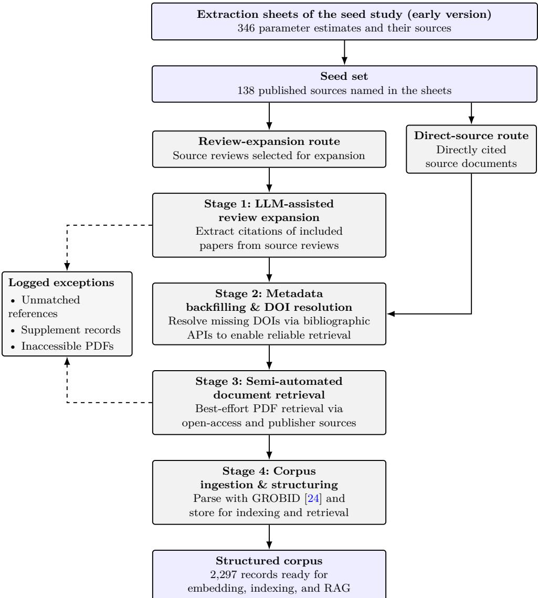  
Fig. B1 Corpus construction pipeline. Source reviews are expanded to included papers, after which identifiers are resolved, documents are retrieved, and records are ingested. Directly cited source documents bypass review expansion and join the flow at identifier resolution. Unmatched references, supplement-only cases, and inaccessible documents are retained in the audit records.

descriptions and tables listing included trials or observational studies. We use Gemini’s document understanding [47, 48], prompting the model to output the included studies as full bibliographic citations exactly as reported in the review’s reference list. When the included studies are listed in a supplementary file rather than the main text, the model returns the supplement’s label (e.g., “Supplementary Table S1”) and URL instead, and the supplement is processed case by case.

2. Bibliographic parsing and normalization. In parallel, the review PDF is processed with GROBID to extract structured bibliographic records and reference strings [24].

3. Candidate–bibliography matching. We index bibliography entries by the normalised surname of the first author and link each LLM-extracted candidate to one entry. A unique exact surname match is selected directly. When several entries share that surname, the implementation compares the normalised candidate with each entry’s title plus raw reference string using RapidFuzz’s fuzz.ratio similarity [49]. A score of at least 65 is recorded as title-based disambiguation. Below that threshold, the highest-scoring same-surname entry is retained and explicitly marked as an ambiguous best guess. If there is no exact surname token, surnames are compared fuzzily and accepted at a threshold of 70. Candidates with no accepted surname match are marked unmatched and excluded from downstream stages. This constrains candidates to bibliography entries parsed independently from the source PDF and records the match score and reason for audit.

4. Storage. We store the extracted candidate text, the matched bibliographic record, and the matching confidence in a relational SQLite database. The database also records run metadata and versioned pipeline settings to support reproducibility and error analysis.

## B.2 Stage 2: Metadata Backfilling and DOI Resolution

Matched references can lack a DOI or carry incomplete metadata. Stage 2 retains a DOI parsed by GROBID when present and otherwise attempts to resolve one through Crossref [50]. Directly cited source documents enter the pipeline at this stage.

## Methodology.

For each matched reference without a DOI, the implementation:

1. Bibliographic query. Queries Crossref with the title, up to two author strings, journal, and, where available, a publication-year filter.

2. Candidate scoring. Ranks the returned records by title similarity using RapidFuzz token\_set\_ratio, dividing its score by 100 to place it on a 0–1 scale.

3. Database update. Writes the DOI of the best candidate when title similarity is at least 0.85. Otherwise it retains the unresolved status or query error.

## B.3 Stage 3: Semi-Automated Document Retrieval

Stage 3 attempted to obtain the documents identified in Stage 2. The collection that can be recovered depends on access to those documents at the time of retrieval.

## Methodology.

We ran a DOI-driven PDF harvester over the resolved identifiers. It searched online for full-text copies of each paper, downloaded candidate PDFs, and logged successes and failures. For unresolved cases, a fallback script searched DOI and PubMed landing pages for PDF links. We then examined failures and suspect files manually, recovered papers where possible, and checked that the retained files were valid PDFs. The archived download records also identify documents already obtained through another review. The released corpus manifest lists the papers retained for analysis [42], with identifiers that readers can use to attempt retrieval under their own access conditions. Files of directly cited sources were named by year, first author, and parameter.

## B.4 Stage 4: Corpus Ingestion and Structuring

Stage 4 converts the retrieved documents into the structured representation used by EpiLens for downstream indexing and RAG workflows.

Methodology.

We process each document as follows.

1. Deep parsing. Each PDF is parsed with GROBID into structured TEI XML, including section boundaries, metadata, and a parsed bibliography [24].

2. Corpus database population. We insert the parsed representation into the corpus database (MongoDB) as the source of truth for retrieval and provenance.

The frozen manifest contains 2,297 corpus records used by every downstream analysis. The resulting records are then available for embedding, vector indexing, and querydependent retrieval.

## Appendix C Labeling protocol

This appendix defines four classification axes: the geography, accessibility, and type of the data used, and the paper’s main research contribution. The first three describe the datasets a paper uses. The fourth describes the paper as a whole. Making these principles explicit is essential both for defining the labels used as ground truth and for ensuring consistency between these criteria and the instructions provided in the LLM prompts, which would otherwise default to unknown and potentially inconsistent standards. Specifically, some documents may plausibly fall into more than one category, depending on interpretation, or may be sensitive to where boundaries are drawn between categories in the context of our specific classification task. Potentially ambiguous cases include unclear data availability statements (e.g., claims that data are in the public domain, which may apply only under specific emergency conditions), the appropriate geographic labelling of analyses of contagion events originating in one country but detected in another, and the classification of paper types consistently with the practices of the relevant scientific community (in this case, epidemiology).

For the three data axes (geography, data accessibility, and data type), classification applies to the individual datasets within a paper, not to the paper itself. Each dataset used to obtain results via the described methodology is assigned a label. This excludes datasets that, e.g., are only mentioned in a background section. The final output for each axis is the union of these per-dataset labels, so duplicates are automatically collapsed: if three datasets are assigned labels A, A, and B, the resulting set is {A, B}.

The fourth axis, paper type, is instead assigned at the level of the whole paper, as described in its own section below.

## C.1 Label set

We assign labels along four axes, the first three abbreviated GEO, DAVAIL, and DTYPE below:

1. Geography. A set-valued label capturing the continents associated with the epidemiological evidence used in the paper, or whether this information is irrelevant, e.g., in the case of laboratory settings.

2. Data accessibility. A set-valued label recording the access mechanisms stated for the data used in the paper, or whether printed values permit limited in-paper reconstruction.

3. Data type. A multi-valued label capturing whether the contribution uses data and the nature of the data used for the contribution, i.e., whether it uses traditional data, non-traditional data [1], or synthetic data.

4. Paper type. One primary label used in evaluation, with optional secondary labels retained in the stored output, capturing the paper’s research-contribution type with respect to epidemiological parameter estimation.

Labels are assigned exclusively based on information provided within the document, disregarding external knowledge or verification. For instance, if a paper states that its data are available in an online repository, we use that statement regardless of whether the repository is still accessible. This is motivated by the fact that we focus on extraction fidelity, not on, for example, verifying data accessibility. The only exception is the mapping of geographic locations to continents. Here we allow the model to map a location to its geographic label using its internal knowledge, e.g., mapping a nation to its continent, providing guidance only for the ambiguous cases discussed below.

Geography, data type, and paper type include an UNCLEAR fallback for insuficient evidence, distinct from IRRELEVANT (geography) and OTHER (paper type).

## C.2 Geographic labelling

This pipeline is intended as a first-stage, high-recall filter for identifying subsets of papers that merit subsequent, more specialized analyses. Accordingly, we adopt an intentionally inclusive definition of geographic information: we include all locations that are explicitly tied to the epidemiological evidence used in the paper, even when multiple plausible “geographic perspectives” coexist (e.g., location of exposure vs. location of detection/ascertainment). For instance, when infections are acquired in one country but cases are detected, diagnosed, or reported in another, we include both locations in the multi-label GEO output. We do not include a location mentioned only incidentally: if a paper analyses an outbreak in continent A and merely notes similar patterns in continent B, the correct label is A alone. More granular labelling (e.g., separating exposure from ascertainment into distinct labels) is feasible, but is beyond our current aim.

There are, however, cases in which location information is considered irrelevant. If the analysis is conducted entirely in controlled laboratory settings such that geographic or ecological variation is not meaningful (e.g., laboratory-bred animals or strictly controlled experimental conditions), the GEO axis is marked as IRRELEVANT. The same label applies when the paper relies on purely synthetic or otherwise non-geographic data that is not meaningfully tied to any real-world location. By contrast, wildlife, farm, market, household, and other field-like settings are treated as geographically meaningful and are labeled using the corresponding locations stated by the authors.

Consistent with our general principle of relying only on stated information, we do not infer geographic origin from strain identifiers, sample naming conventions, or external domain knowledge unless the paper explicitly states the geographic origin in the text.

The continent label set is Africa, Asia, Europe, North America, South America, and Oceania (together with IRRELEVANT and UNCLEAR). Some countries straddle two continents and are intrinsically ambiguous under informal conventions. For these transcontinental cases we fix a single, reproducible country-to-continent assignment using the United Nations Statistics Division M49 standard (“Standard Country or Area Codes for Statistical Use”, Series M, No. 49) [37], rather than ad hoc geopolitical or cultural criteria. For transcontinental countries where the pathogens in scope, those with pandemic potential, have been reported, the annotation prompt uses fixed assignments: Russia to Europe, Egypt to Africa, and Turkey, Kazakhstan, Azerbaijan, Georgia, Armenia, and Cyprus to Asia.

Other sources of ambiguity, such as no-longer-existing political entities (e.g., USSR, Yugoslavia) or politically disputed/recognition-dependent territories (e.g., Kosovo), are largely avoided in this setting because our evaluation targets continent-level labels. By collapsing geographic mentions onto continents, we anchor the GEO axis to relatively stable, predominantly geographic reference entities, reducing sensitivity to changes in statehood, naming, or recognition. Finally, for papers mentioning a global scope, we list all continents.

## C.3 Data accessibility labelling

DAVAIL records what the paper states about access to each dataset and whether the paper prints enough values to meet the REPORTED re-aggregation rule. It measures reported accessibility and in-paper reconstructability, not verified access or general dataset reusability.

OPEN. The data are publicly available via a persistent identifier (e.g., DOI, accession number), a stable link to a repository, or by being fully released within the paper package (e.g., full line-lists or complete contingency tables) in a form suficient for a third party to reconstruct the dataset for new analyses. Mentions of supplementary material only qualify if they contain the specific, extractable data used for the work (the link/identifier must point to the underlying data supporting the results, not just be a “supplementary information exists” pointer).

REPORTED. The dataset is not fully released, but the paper provides granular, extractable data values (e.g., detailed frequency tables, stratified counts, or partial time-series) that allow a third party to independently recompute at least one primary summary statistic used in the analysis (e.g., a frequency, proportion, or rate) from the reported values alone, without requiring access to unreported data or relying on the authors’ interpretive conclusions. This label applies based on the richness of the in-paper reporting, regardless of whether the data source is internal or a third party. It does not imply access to the underlying dataset or the ability to reproduce the full analysis.

REFERENCED. The data are attributed to a specifically identifiable third-party source (e.g., public health authorities, institutional databases, emergency dashboards, named public sources, other papers), but the paper provides neither a stable retrieval path for the source data nor suficient detail to re-aggregate the data or re-use them as inputs for other analyses without relying on the author’s interpretation (i.e., fails the REPORTED re-aggregation criterion). This data-thin reporting (limited to derived outputs like efect sizes, coeficients, or fitted model curves) prevents independent verification. Vague attributions (e.g., "government data") do not qualify (lean towards NOT\_STATED).

AVAILABLE\_UPON\_REQUEST. The paper explicitly provides a request-based mechanism, such as contacting the author, a data access committee, or a specific institutional process.

CLOSED. The paper explicitly states that the data cannot be shared or are restricted due to legal, ethical, or licensing constraints, without providing an actionable access mechanism.

NOT\_STATED. The paper provides no data access statement, no repository link, no request mechanism, and no identifiable third-party attribution, while also failing to provide extractable values suficient for REPORTED. Statements that data were collected/generated, without an access mechanism and without re-aggregatable values, should be labeled NOT\_STATED.

Precedence is applied within each dataset, after which the paper-level output is the union of the per-dataset labels. For one dataset, use OPEN when a qualifying public route is stated. Otherwise use AVAILABLE\_UPON\_REQUEST when an actionable request route exists, and CLOSED for an explicit restriction without such a route. If none applies, distinguish REPORTED from REFERENCED by the re-aggregation criterion, and use NOT\_STATED when neither applies.

## C.3.1 Operational scope

The protocol is descriptive rather than a compliance assessment: it classifies what a paper states or prints, using categories adapted to the heterogeneous availability statements encountered across journals and communities. Two rules make the categories operational for both annotation and prompting: OPEN requires a stable retrieval route or a reconstructable in-paper release, and REPORTED requires enough printed values to recompute at least one primary summary statistic.

## C.4 Data type labelling

The DTYPE labels identify the nature of the data used to support a paper’s contribution. DTYPE is set-valued because a paper can use several data types. The operational NO\_EMPIRICAL\_DATA output is exclusive and is used only when the contribution relies on neither empirical nor simulated data. The traditional, health, mobility, economic, and sentiment categories build on the #Data4COVID19 Review [1]. SYNTHETIC and NO\_EMPIRICAL\_DATA are extensions introduced for this corpus. In a nutshell, NTD refers to information that is digitally captured, mediated, or observed through new instrumentation mechanisms, which is often privately held and repurposed for uses unrelated to its initial collection.

TRADITIONAL when a paper relies on standard epidemiological and public-health data sources collected through established surveillance infrastructure, regardless of digital vs analog collection methods. Examples include daily or weekly case counts from a national surveillance system, hospital admissions and deaths, and PCRor antigen-confirmed test line lists.

NON\_TRADITIONAL\_HEALTH novel or non-standard health data sources that emerged outside traditional public-health surveillance systems, such as: (i) digital patient data from large-scale electronic-health-record repositories, (ii) platform-facilitated self-reports and symptom proxies collected through apps or web platforms, (iii) wastewater surveillance as a community-level proxy for spread, and (iv) wearable or biometric signals.

NON\_TRADITIONAL\_MOBILITY when the paper uses mobility data, understood as data describing the location of a device relative to people/landmarks in the physical world or to other devices. This includes mobility signals derived from telecommunications (e.g., call detail records), location data from software development kits embedded in smartphone apps, GPS and vehicle traces, and proximity technologies (e.g., Bluetooth), when used as epidemiological proxies (e.g., population movement patterns, contact opportunities).

NON\_TRADITIONAL\_SENTIMENT when the paper uses NTD intended to capture how individuals or groups perceive and interpret epidemic-related developments and interventions. This category includes social-media, crowdsourced, app-based, and online-panel data used to track behaviour or perceptions rather than clinical infections. Conventional epidemiological surveys remain TRADITIONAL.

NON\_TRADITIONAL\_ECONOMIC when a paper uses digitally captured or platformmediated data describing the economic activity of individuals, groups, or organisations. This category includes credit and debit card transaction data, open procurement/contracting data, and supply chain data.

SYNTHETIC when simulated data is presented as evidence and support for claims. We do not assign SYNTHETIC when simulations are used solely to illustrate model fit or calibration. Examples include simulation-based evaluation of policy scenarios, model-based counterfactual projections, and sensitivity analyses where simulated outcomes support the main claim (versus a purely illustrative fit plot, for which we do not assign the label). The distinction is based on whether what is produced there is considered data at all, rather than on whether it is synthetic.

NO\_EMPIRICAL\_DATA when the paper relies on neither an empirical dataset nor simulated data as evidence. Examples include a conceptual commentary on containment strategies without data and a theoretical derivation of a model without fitting or empirical evaluation.

## C.5 Paper type labelling

PAPER\_TYPE classifies each document by the kind of scientific contribution it makes to epidemiological parameter estimation. Epidemiological research often integrates multiple tasks (collecting data, inferring parameters, and making forecasts) within a single workflow. While usually focused around a main contribution, papers combine diferent types of contributions. We address this by distinguishing between a paper’s primary contribution (the main scientific claim or deliverable) and any secondary contributions (supporting tasks that enable or accompany the primary contribution). We therefore assign one primary label and may assign additional secondary labels as needed. The same label set is used for both primary and secondary contributions.

EMPIRICAL. The contribution is based on original empirical data collection, where claims rely on direct measurement from a clearly defined study population or sample. Examples: observational cohort studies, case–control studies, cross-sectional surveys, randomized trials, surveillance reports, or data papers describing new datasets.

INFERENCE. The contribution involves estimating parameters or reconstructing unobserved epidemic processes by fitting explicit statistical or mechanistic models to observed data. Results depend on model structure and assumptions, not on direct measurement alone. Examples: papers estimating R or generation time from case data, reconstructing transmission chains, performing phylodynamic inference, or estimating seroconversion rates from serological surveys.

FORECAST. The contribution is prediction or scenario analysis: forward projections of epidemic trajectories, comparisons of intervention scenarios, or counterfactual simulations. The outputs are projected future outcomes or policy comparisons under stated assumptions. Examples: epidemic projections for policy planning, intervention scenario comparisons, or real-time forecasting submissions.

SYNTHESIS. The contribution is a systematic synthesis of existing evidence using predefined search, selection, and appraisal criteria (e.g., meta-analyses or PRISMA-compliant systematic reviews). Examples: quantitative meta-analyses pooling estimates across studies, or systematic reviews synthesizing evidence on transmission parameters or intervention efectiveness.

METHODOLOGICAL. The contribution is the development, evaluation, or comparison of methods: new estimators, inference frameworks, identifiability analyses, software tools, or theoretical results about epidemic processes. Examples: papers introducing novel inference algorithms, proving identifiability results, developing software packages, or deriving analytical results on epidemic thresholds.

COMMENTARY. The contribution is discussion or interpretation without presenting new empirical estimates, model-based inference, or systematic evidence synthesis.

Examples include narrative literature reviews, perspective pieces on research priorities, and policy commentaries.

We use OTHER when a paper does not fit any of the categories above. In our analysis we focus on the primary contribution, making this a single-label classification task. Secondary contributions are recorded but not used in the evaluation.

## Appendix D Supplementary results and diagnostics

This appendix provides the detailed quantitative results that support Section 4. All metrics are computed on the fixed manually annotated evaluation set of 214 papers. Unless stated otherwise, values are mean ± SD across R=5 repeated runs.

## D.1 Aggregate metrics for served configurations

Table D1 reports the full set of agreement metrics for each task and served configuration, including the open-weight Nemotron-120B model at T=0 alongside the two Gemini models. The local Qwen configurations are reported separately in Section D.3. These results complement the Jaccard and stability summaries in Tables 1 and 2. For the single-label paper-type task, micro-averaged scores coincide with subset accuracy. The macro-averaged scores are lower than the corresponding micro-averaged scores, showing that aggregate performance is sensitive to uneven class support. Table D2 shows which labels account for the diference.

Table D1: Aggregate agreement metrics by task and configuration.
<table><tr><td rowspan="2">Metric</td><td colspan="2">gemini-2.5-pro</td><td colspan="2">gemini-2.5-flash</td><td>Nemotron</td></tr><tr><td>T=0.0</td><td>T=1.0</td><td>T=0.0</td><td>T=1.0</td><td>T=0.0</td></tr><tr><td colspan="6">Geography</td></tr><tr><td>Jaccard</td><td>0.9283±0.0044</td><td>0.9248±0.0049</td><td>0.8748±0.0069</td><td>0.8709±0.0044</td><td>0.886±0.011</td></tr><tr><td>Micro precision</td><td>0.8816±0.0091</td><td>0.8845±0.0082</td><td>0.794±0.011</td><td>0.780±0.016</td><td>0.816±0.014</td></tr><tr><td>Micro recall</td><td>0.9457±0.0027</td><td> $0 . 9 4 3 4 { \scriptstyle \pm 0 . 0 0 2 1 }$ </td><td>0.9279±0.0044</td><td>0.9240±0.0044</td><td>0.930±0.012</td></tr><tr><td>Micro F1</td><td>0.9125±0.0058</td><td>0.9130±0.0051</td><td>0.8559±0.0073</td><td>0.8461±0.0099</td><td>0.870±0.012</td></tr><tr><td>Macro precision</td><td>0.810±0.013</td><td>0.812±0.014</td><td>0.715±0.013</td><td>0.688±0.024</td><td>0.754±0.096</td></tr><tr><td>Macro recall</td><td>0.8742±0.0064</td><td>0.8747±0.0052</td><td>0.8013±0.0099</td><td>0.792±0.010</td><td>0.782±0.033</td></tr><tr><td>Macro F1</td><td>0.8383±0.0089</td><td>0.839±0.010</td><td>0.7430±0.0097</td><td>0.724±0.017</td><td>0.717±0.046</td></tr><tr><td>Subset accuracy</td><td>0.9028±0.0069</td><td>0.8981±0.0069</td><td>0.8206±0.0097</td><td>0.8196±0.0026</td><td>0.854±0.014</td></tr><tr><td colspan="6">Data Accessibility</td></tr><tr><td>Jaccard</td><td>0.802±0.023</td><td>0.775±0.013</td><td>0.670±0.022</td><td>0.684±0.016</td><td>0.660±0.014</td></tr><tr><td>Micro precision</td><td>0.834±0.019</td><td>0.810±0.013</td><td>0.687±0.018</td><td>0.697±0.013</td><td>0.757±0.016</td></tr><tr><td>Micro recall</td><td>0.819±0.021</td><td> $0 . 7 9 5 1 { \scriptstyle \pm 0 . 0 0 9 3 }$ </td><td> $0 . 7 4 5 { \scriptstyle \pm 0 . 0 2 0 }$ </td><td>0.763±0.024</td><td>0.646±0.011</td></tr><tr><td>Micro F1</td><td>0.826±0.020</td><td> $0 . 8 0 2 _ { \pm 0 . 0 1 1 }$ </td><td> $0 . 7 1 5 { \scriptstyle \pm 0 . 0 1 9 }$ </td><td> $0 . 7 2 8 { \scriptstyle \pm 0 . 0 1 6 }$ </td><td> $0 . 6 9 7 { \scriptstyle \pm 0 . 0 1 3 }$ </td></tr><tr><td>Macro precision</td><td>0.775±0.030</td><td> $0 . 7 4 3 { \scriptstyle \pm 0 . 0 2 1 }$ </td><td> $0 . 6 5 3 { \scriptstyle \pm 0 . 0 1 3 }$ </td><td>0.633±0.016</td><td>0.746±0.070</td></tr><tr><td>Macro recall</td><td>0.803±0.013</td><td> $0 . 7 7 8 3 { \scriptstyle \pm 0 . 0 1 0 0 }$ </td><td> $0 . 7 8 7 5 { \scriptstyle \pm 0 . 0 0 9 9 }$ </td><td>0.773±0.037</td><td>0.574±0.037</td></tr><tr><td>Macro F1</td><td>0.779±0.020</td><td> $0 . 7 5 0 8 { \scriptstyle \pm 0 . 0 1 0 0 }$ </td><td> $0 . 6 9 8 { \scriptstyle \pm 0 . 0 1 3 }$ </td><td>0.678±0.012</td><td>0.622±0.043</td></tr><tr><td>Subset accuracy</td><td>0.709±0.027</td><td> $0 . 6 7 9 { \scriptstyle \pm 0 . 0 1 3 }$ </td><td> $0 . 5 2 3 { \scriptstyle \pm 0 . 0 2 2 }$ </td><td> $0 . 5 2 6 _ { \pm 0 . 0 1 9 }$ </td><td> $0 . 5 3 2 _ { \pm 0 . 0 1 2 }$ </td></tr><tr><td colspan="6">Data Type</td></tr><tr><td>Jaccard</td><td> $0 . 9 5 0 { \scriptstyle \pm 0 . 0 1 8 }$ </td><td> $0 . 9 4 1 4 { \scriptstyle \pm 0 . 0 0 5 4 }$ </td><td> $0 . 9 1 5 8 { \scriptstyle \pm 0 . 0 0 6 3 }$ </td><td> $0 . 9 1 3 2 { \scriptstyle \pm 0 . 0 0 9 1 }$ </td><td> $0 . 8 7 6 7 _ { \pm 0 . 0 0 8 6 }$ </td></tr></table>

(continued on next page)

<table><tr><td rowspan="2">Metric</td><td colspan="2">gemini-2.5-pro</td><td colspan="2">gemini-2.5-flash</td><td>Nemotron</td></tr><tr><td> $T { = } 0 . 0$ </td><td> $T { = } 1 . 0$ </td><td> $T { = } 0 . 0$ </td><td> $T { = } 1 . 0$ </td><td> $T { = } 0 . 0$ </td></tr><tr><td>Micro precision</td><td> $0 . 9 5 4 { \scriptstyle \pm 0 . 0 1 3 }$ </td><td> $0 . 9 4 5 8 { \scriptstyle \pm 0 . 0 0 4 6 }$ </td><td> $0 . 9 0 8 1 _ { \pm 0 . 0 0 6 5 }$ </td><td> $0 . 9 1 0 9 _ { \pm 0 . 0 0 9 4 }$ </td><td> $0 . 9 3 3 { \scriptstyle \pm 0 . 0 1 3 }$ </td></tr><tr><td>Micro recall</td><td> $0 . 9 6 1 { \scriptstyle \pm 0 . 0 1 8 }$ </td><td> $0 . 9 5 4 7 { \scriptstyle \pm 0 . 0 0 7 1 }$ </td><td> $0 . 9 4 9 2 { \scriptstyle \pm 0 . 0 0 4 8 }$ </td><td> $0 . 9 4 1 4 { \scriptstyle \pm 0 . 0 1 0 0 }$ </td><td> $0 . 8 4 2 2 { \scriptstyle \pm 0 . 0 0 5 9 }$ </td></tr><tr><td>Micro  $\mathrm { F } _ { 1 }$ </td><td> $0 . 9 5 8 { \scriptstyle \pm 0 . 0 1 5 }$ </td><td> $0 . 9 5 0 2 _ { \pm 0 . 0 0 4 8 }$ </td><td> $0 . 9 2 8 2 _ { \pm 0 . 0 0 5 4 }$ </td><td> $0 . 9 2 5 9 { \scriptstyle \pm 0 . 0 0 7 3 }$ </td><td> $0 . 8 8 5 1 { \scriptstyle \pm 0 . 0 0 8 9 }$ </td></tr><tr><td>Macro precision</td><td> $0 . 7 1 9 { \scriptstyle \pm 0 . 0 6 2 }$ </td><td> $0 . 7 2 6 { \scriptstyle \pm 0 . 0 7 8 }$ </td><td> $0 . 6 9 8 _ { \pm 0 . 0 1 8 }$ </td><td> $0 . 6 5 { \scriptstyle \pm 0 . 1 1 }$ </td><td> $0 . 7 0 { \scriptstyle \pm 0 . 1 2 }$ </td></tr><tr><td>Macro recall</td><td> $0 . 7 2 { \scriptstyle \pm 0 . 1 4 }$ </td><td> $0 . 6 8 2 _ { \pm 0 . 0 7 1 }$ </td><td> $0 . 7 2 1 { \scriptstyle \pm 0 . 0 3 5 }$ </td><td> $0 . 6 1 6 { \scriptstyle \pm 0 . 0 8 9 }$ </td><td> $0 . 4 7 5 { \scriptstyle \pm 0 . 0 8 9 }$ </td></tr><tr><td>Macro  $\mathrm { F _ { 1 } }$ </td><td> $0 . 7 0 5 { \scriptstyle \pm 0 . 0 9 7 }$ </td><td> $0 . 6 8 4 { \scriptstyle \pm 0 . 0 6 5 }$ </td><td> $0 . 6 5 2 _ { \pm 0 . 0 3 3 }$ </td><td> $0 . 5 9 2 _ { \pm 0 . 0 8 1 }$ </td><td> $0 . 5 0 { \scriptstyle \pm 0 . 1 0 }$ </td></tr><tr><td>Subset accuracy</td><td> $0 . 9 2 4 { \scriptstyle \pm 0 . 0 2 7 }$ </td><td> $0 . 9 1 4 0 { \scriptstyle \pm 0 . 0 0 7 8 }$ </td><td> $0 . 8 7 3 8 { \scriptstyle \pm 0 . 0 0 8 1 }$ </td><td> $0 . 8 7 0 { \scriptstyle \pm 0 . 0 1 3 }$ </td><td> $0 . 8 0 1 9 { \scriptstyle \pm 0 . 0 0 9 7 }$ </td></tr><tr><td>Paper  $\mathbf { T y p e }$ </td><td></td><td></td><td></td><td></td><td></td></tr><tr><td>Jaccard</td><td> $0 . 9 0 2 8 { \scriptstyle \pm 0 . 0 0 8 4 }$ </td><td> $0 . 9 0 1 { \scriptstyle \pm 0 . 0 1 1 }$ </td><td> $0 . 8 7 6 6 { \scriptstyle \pm 0 . 0 0 9 7 }$ </td><td> $0 . 8 8 0 { \scriptstyle \pm 0 . 0 1 9 }$ </td><td> $0 . 8 4 8 { \scriptstyle \pm 0 . 0 1 1 }$ </td></tr><tr><td>Micro precision</td><td> $0 . 9 0 2 8 { \scriptstyle \pm 0 . 0 0 8 4 }$ </td><td> $0 . 9 0 1 { \scriptstyle \pm 0 . 0 1 1 }$ </td><td> $0 . 8 7 6 6 { \scriptstyle \pm 0 . 0 0 9 7 }$ </td><td> $0 . 8 8 0 { \scriptstyle \pm 0 . 0 1 9 }$ </td><td> $0 . 8 4 8 { \scriptstyle \pm 0 . 0 1 1 }$ </td></tr><tr><td>Micro recall</td><td> $0 . 9 0 2 8 { \scriptstyle \pm 0 . 0 0 8 4 }$ </td><td> $0 . 9 0 1 { \scriptstyle \pm 0 . 0 1 1 }$ </td><td> $0 . 8 7 6 6 { \scriptstyle \pm 0 . 0 0 9 7 }$ </td><td> $0 . 8 8 0 { \scriptstyle \pm 0 . 0 1 9 }$ </td><td> $0 . 8 4 8 { \scriptstyle \pm 0 . 0 1 1 }$ </td></tr><tr><td>Micro  $\mathrm { F } _ { 1 }$ </td><td> $0 . 9 0 2 8 { \scriptstyle \pm 0 . 0 0 8 4 }$ </td><td> $0 . 9 0 1 { \scriptstyle \pm 0 . 0 1 1 }$ </td><td> $0 . 8 7 6 6 { \scriptstyle \pm 0 . 0 0 9 7 }$ </td><td> $0 . 8 8 0 { \scriptstyle \pm 0 . 0 1 9 }$ </td><td> $0 . 8 4 8 { \scriptstyle \pm 0 . 0 1 1 }$ </td></tr><tr><td>Macro precision</td><td> $0 . 9 2 6 { \scriptstyle \pm 0 . 0 1 3 }$ </td><td> $0 . 9 0 0 { \scriptstyle \pm 0 . 0 2 5 }$ </td><td> $0 . 6 7 9 { \scriptstyle \pm 0 . 0 2 5 }$ </td><td> $0 . 7 4 0 { \scriptstyle \pm 0 . 0 5 4 }$ </td><td> $0 . 7 1 { \scriptstyle \pm 0 . 1 1 }$ </td></tr><tr><td>Macro recall</td><td> $0 . 9 2 2 _ { \pm 0 . 0 1 5 }$ </td><td> $0 . 9 0 2 _ { \pm 0 . 0 4 2 }$ </td><td> $0 . 7 0 2 { \scriptstyle \pm 0 . 0 1 8 }$ </td><td> $0 . 7 4 7 _ { \pm 0 . 0 9 0 }$ </td><td> $0 . 6 0 0 { \scriptstyle \pm 0 . 0 7 7 }$ </td></tr><tr><td> $\operatorname { M a c r o } \ F _ { 1 }$ </td><td> $0 . 9 2 0 { \scriptstyle \pm 0 . 0 1 3 }$ </td><td> $0 . 8 9 0 { \scriptstyle \pm 0 . 0 2 0 }$ </td><td> $0 . 6 7 7 { \scriptstyle \pm 0 . 0 1 9 }$ </td><td> $0 . 7 3 2 { \scriptstyle \pm 0 . 0 6 8 }$ </td><td> $0 . 6 3 1 { \scriptstyle \pm 0 . 0 8 6 }$ </td></tr><tr><td>Subset accuracy</td><td> $0 . 9 0 2 8 { \scriptstyle \pm 0 . 0 0 8 4 }$ </td><td> $0 . 9 0 1 { \scriptstyle \pm 0 . 0 1 1 }$ </td><td> $0 . 8 7 6 6 { \scriptstyle \pm 0 . 0 0 9 7 }$ </td><td> $0 . 8 8 0 { \scriptstyle \pm 0 . 0 1 9 }$ </td><td> $0 . 8 4 8 { \scriptstyle \pm 0 . 0 1 1 }$ </td></tr></table>

Computed on the fixed evaluation set (214 papers). Values are mean with the standard deviation as a subscript, across $R { = } 5$ repeated runs. The open-weight Nemotron backend (NVIDIA Nemotron-120B) is reported at $T { = } 0$ alongside the two Gemini backends.

## D.2 Per-label $\mathbf { F _ { 1 } }$

Table D2 gives the $\mathrm { F _ { 1 } }$ of each label at $T { = } 0$ , with the number of papers that carry it. On data type, the Jaccard similarity is dominated by Traditional (200 of the 214 papers), which every backend labels with an $\mathrm { F _ { 1 } }$ of at least 0.955, whereas Synthetic ranges from 0.437 (Nemotron) to 0.945 (Pro), and the non-traditional categories, carried by one to three papers each, cannot be assessed reliably. On data accessibility, no backend exceeds 0.58 on Not stated.

## D.3 A fully local deployment

The Nemotron results show that the workflow does not depend on a proprietary model, but Nemotron is still accessed through a third-party serving API. We therefore test a stronger deployment claim: whether the classification workflow can run entirely on hardware controlled by the analyst once the corpus has been assembled. We run the Paper Classifier with qwen2.5:32b-instruct, served locally through Ollama [51], in two configurations.

In the partially local configuration, generation runs locally while retrieval reuses the Gemini-embedded index used by the served models. This holds the retrieval index fixed. Diferences from the served configuration combine the generator, provider, and serving-stack efects. In the fully local configuration, the same generator instead uses an index built locally with BAAI/bge-m3, so parsing, embedding, retrieval, and generation in the classification workflow require no remote service. Because the two indices use diferent encoders, they can retrieve diferent evidence, so we treat their comparison primarily as a comparison between deployment configurations rather than as a direct measurement of embedding quality.

Table D2 Per-label $\mathbf { F } _ { 1 }$ of EpiLens against the manual labels.
<table><tr><td>Label</td><td>n</td><td> $\mathbf { P r o }$ </td><td>Flash</td><td>Nemotron</td><td>Qwen (local)</td></tr><tr><td>Geography</td><td></td><td></td><td></td><td></td><td></td></tr><tr><td>Asia</td><td>85</td><td> $0 . 9 7 1 4 { \scriptstyle \pm 0 . 0 0 3 9 }$ </td><td> $0 . 9 3 8 2 _ { \pm 0 . 0 0 4 3 }$ </td><td> $0 . 9 4 3 4 { \scriptstyle \pm 0 . 0 0 5 7 }$ </td><td> $0 . 9 2 7 { \scriptstyle \pm 0 . 0 0 0 }$ </td></tr><tr><td>Africa</td><td>67</td><td> $0 . 9 5 9 2 { \scriptstyle \pm 0 . 0 0 8 2 }$ </td><td> $0 . 9 3 6 2 _ { \pm 0 . 0 0 4 7 }$ </td><td> $0 . 9 4 6 0 { \scriptstyle \pm 0 . 0 0 8 0 }$ </td><td> $0 . 9 1 3 { \scriptstyle \pm 0 . 0 0 0 }$ </td></tr><tr><td>Europe</td><td>42</td><td> $0 . 8 8 2 5 { \scriptstyle \pm 0 . 0 0 6 0 }$ </td><td> $0 . 8 0 4 9 { \scriptstyle \pm 0 . 0 0 9 2 }$ </td><td> $0 . 8 7 6 _ { \pm 0 . 0 1 2 }$ </td><td> $0 . 8 1 2 _ { \pm 0 . 0 0 0 }$ </td></tr><tr><td>North America</td><td>24</td><td> $0 . 7 7 8 3 { \scriptstyle \pm 0 . 0 0 8 3 }$ </td><td> $0 . 6 8 3 { \scriptstyle \pm 0 . 0 2 4 }$ </td><td> $0 . 7 0 9 { \scriptstyle \pm 0 . 0 3 3 }$ </td><td> $0 . 7 3 1 { \scriptstyle \pm 0 . 0 0 0 }$ </td></tr><tr><td>Irrelevant</td><td>15</td><td> $0 . 8 6 4 { \scriptstyle \pm 0 . 0 2 6 }$ </td><td> $0 . 6 3 6 { \scriptstyle \pm 0 . 0 6 5 }$ </td><td> $0 . 3 0 { \scriptstyle \pm 0 . 1 1 }$ </td><td> $0 . 6 4 0 { \scriptstyle \pm 0 . 0 0 0 }$ </td></tr><tr><td>Oceania</td><td></td><td> $1 1 \phantom { 0 0 0 } 0 . 8 1 0 { \scriptstyle \pm 0 . 0 4 0 }$ </td><td> $0 . 8 5 3 { \scriptstyle \pm 0 . 0 5 5 }$ </td><td> $0 . 8 1 9 _ { \pm 0 . 0 4 5 }$ </td><td> $0 . 6 9 2 _ { \pm 0 . 0 0 0 }$ </td></tr><tr><td>South America</td><td></td><td> $1 1 \phantom { - } 0 . 8 7 0 { \scriptstyle \pm 0 . 0 0 0 }$ </td><td> $0 . 7 5 8 { \scriptstyle \pm 0 . 0 2 5 }$ </td><td> $0 . 8 3 7 { \scriptstyle \pm 0 . 0 3 1 }$ </td><td> $0 . 7 4 1 { \scriptstyle \pm 0 . 0 0 0 }$ </td></tr><tr><td>Unclear</td><td></td><td> $3 0 . 5 7 1 { \scriptstyle \pm 0 . 0 0 0 }$ </td><td> $0 . 3 3 3 { \scriptstyle \pm 0 . 0 0 0 }$ </td><td> $0 . 3 0 { \scriptstyle \pm 0 . 2 7 }$ </td><td> $0 . 0 0 0 { \scriptstyle \pm 0 . 0 0 0 }$ </td></tr><tr><td>Data accessibility</td><td></td><td></td><td></td><td></td><td></td></tr><tr><td>Reported</td><td>127</td><td> $0 . 8 9 3 0 { \scriptstyle \pm 0 . 0 0 8 7 }$ </td><td> $0 . 7 7 7 { \scriptstyle \pm 0 . 0 2 3 }$ </td><td> $0 . 8 0 7 { \scriptstyle \pm 0 . 0 1 3 }$ </td><td> $0 . 7 3 5 { \scriptstyle \pm 0 . 0 0 0 }$ </td></tr><tr><td>Referenced</td><td>74</td><td> $0 . 8 0 5 { \scriptstyle \pm 0 . 0 3 5 }$ </td><td> $0 . 7 1 3 { \scriptstyle \pm 0 . 0 2 6 }$ </td><td> $0 . 5 9 4 { \scriptstyle \pm 0 . 0 1 9 }$ </td><td> $0 . 5 6 8 _ { \pm 0 . 0 0 0 }$ </td></tr><tr><td>Open</td><td>48</td><td> $0 . 8 3 8 { \scriptstyle \pm 0 . 0 3 2 }$ </td><td> $0 . 7 6 0 { \scriptstyle \pm 0 . 0 1 3 }$ </td><td> $0 . 6 4 1 { \scriptstyle \pm 0 . 0 2 1 }$ </td><td> $0 . 6 2 3 { \scriptstyle \pm 0 . 0 0 0 }$ </td></tr><tr><td>Not stated</td><td>19</td><td> $0 . 5 7 4 { \scriptstyle \pm 0 . 0 2 8 }$ </td><td> $0 . 4 1 1 { \scriptstyle \pm 0 . 0 2 3 }$ </td><td> $0 . 4 6 3 _ { \pm 0 . 0 3 1 }$ </td><td> $0 . 1 7 6 { \scriptstyle \pm 0 . 0 0 0 }$ </td></tr><tr><td>Upon request</td><td>10</td><td> $0 . 8 3 5 { \scriptstyle \pm 0 . 0 4 6 }$ </td><td> $0 . 6 9 1 _ { \pm 0 . 0 3 2 }$ </td><td> $0 . 8 8 0 { \scriptstyle \pm 0 . 0 2 1 }$ </td><td> $0 . 3 1 8 { \scriptstyle \pm 0 . 0 0 0 }$ </td></tr><tr><td>Closed</td><td>5</td><td> $0 . 7 2 7 { \scriptstyle \pm 0 . 0 0 0 }$ </td><td> $0 . 8 3 3 { \scriptstyle \pm 0 . 0 0 0 }$ </td><td> $0 . 3 5 { \scriptstyle \pm 0 . 2 7 }$ </td><td> $0 . 1 6 7 _ { \pm 0 . 0 0 0 }$ </td></tr><tr><td>Data type</td><td></td><td></td><td></td><td></td><td></td></tr><tr><td>Traditional</td><td>200</td><td> $0 . 9 8 5 2 { \scriptstyle \pm 0 . 0 0 5 5 }$ </td><td> $0 . 9 7 3 2 { \scriptstyle \pm 0 . 0 0 2 4 }$ </td><td> $0 . 9 7 1 7 { \scriptstyle \pm 0 . 0 0 3 3 }$ </td><td> $0 . 9 5 5 { \scriptstyle \pm 0 . 0 0 0 }$ </td></tr><tr><td>Synthetic</td><td>37</td><td> $0 . 9 4 5 { \scriptstyle \pm 0 . 0 2 6 }$ </td><td> $0 . 9 1 3 4 { \scriptstyle \pm 0 . 0 0 7 1 }$ </td><td> $0 . 4 3 7 { \scriptstyle \pm 0 . 0 2 0 }$ </td><td> $0 . 6 8 9 { \scriptstyle \pm 0 . 0 0 0 }$ </td></tr><tr><td>No empirical data</td><td>11</td><td> $0 . 7 3 { \scriptstyle \pm 0 . 1 0 }$ </td><td> $0 . 3 7 { \scriptstyle \pm 0 . 1 4 }$ </td><td> $0 . 3 0 4 { \scriptstyle \pm 0 . 0 9 3 }$ </td><td> $0 . 1 5 4 { \scriptstyle \pm 0 . 0 0 0 }$ </td></tr><tr><td>Non-trad. mobility</td><td>•</td><td> $3 0 . 6 6 { \scriptstyle \pm 0 . 2 0 }$ </td><td> $0 . 4 6 2 _ { \pm 0 . 0 7 6 }$ </td><td> $0 . 5 2 1 { \scriptstyle \pm 0 . 0 7 0 }$ </td><td> $0 . 0 0 0 { \scriptstyle \pm 0 . 0 0 0 }$ </td></tr><tr><td>Non-trad. health</td><td>2</td><td> $0 . 5 2 { \scriptstyle \pm 0 . 1 6 }$ </td><td> $0 . 4 0 0 { \scriptstyle \pm 0 . 0 0 0 }$ </td><td> $0 . 5 3 { \scriptstyle \pm 0 . 3 0 }$ </td><td> $0 . 0 0 0 { \scriptstyle \pm 0 . 0 0 0 }$ </td></tr><tr><td>Non-trad. sentiment</td><td>2</td><td> $0 . 1 6 { \scriptstyle \pm 0 . 3 6 }$ </td><td> $0 . 4 4 0 { \scriptstyle \pm 0 . 0 5 5 }$ </td><td> $0 . 5 3 { \scriptstyle \pm 0 . 1 3 }$ </td><td> $0 . 5 7 1 { \scriptstyle \pm 0 . 0 0 0 }$ </td></tr><tr><td>Non-trad. economic</td><td>1</td><td> $0 . 9 3 _ { \pm 0 . 1 5 }$ </td><td> $1 . 0 0 0 { \scriptstyle \pm 0 . 0 0 0 }$ </td><td> $0 . 2 0 { \scriptstyle \pm 0 . 4 5 }$ </td><td> $0 . 0 0 0 { \scriptstyle \pm 0 . 0 0 0 }$ </td></tr><tr><td>Paper type</td><td></td><td></td><td></td><td></td><td></td></tr><tr><td>Empirical</td><td>127</td><td> $0 . 9 2 4 7 { \scriptstyle \pm 0 . 0 0 7 1 }$ </td><td> $0 . 9 2 9 9 { \scriptstyle \pm 0 . 0 0 9 3 }$ </td><td> $0 . 9 2 6 0 { \scriptstyle \pm 0 . 0 0 9 2 }$ </td><td> $0 . 8 9 1 { \scriptstyle \pm 0 . 0 0 0 }$ </td></tr><tr><td>Inference</td><td>56</td><td> $0 . 8 5 2 1 { \scriptstyle \pm 0 . 0 0 8 8 }$ </td><td> $0 . 8 5 1 { \scriptstyle \pm 0 . 0 1 1 }$ </td><td> $0 . 8 0 7 { \scriptstyle \pm 0 . 0 1 1 }$ </td><td> $0 . 6 7 3 { \scriptstyle \pm 0 . 0 0 0 }$ </td></tr><tr><td>Forecast</td><td>12</td><td> $0 . 9 2 1 { \scriptstyle \pm 0 . 0 2 8 }$ </td><td> $0 . 8 2 9 { \scriptstyle \pm 0 . 0 3 5 }$ </td><td> $0 . 5 5 4 { \scriptstyle \pm 0 . 0 5 7 }$ </td><td> $0 . 5 0 0 { \scriptstyle \pm 0 . 0 0 0 }$ </td></tr><tr><td>Methodological</td><td>11</td><td> $0 . 8 9 7 { \scriptstyle \pm 0 . 0 2 3 }$ </td><td> $0 . 6 6 6 _ { \pm 0 . 0 4 5 }$ </td><td> $0 . 4 0 { \scriptstyle \pm 0 . 1 6 }$ </td><td> $0 . 4 0 0 { \scriptstyle \pm 0 . 0 0 0 }$ </td></tr><tr><td>Commentary</td><td>6</td><td> $0 . 9 2 7 { \scriptstyle \pm 0 . 0 4 1 }$ </td><td> $0 . 6 2 5 { \scriptstyle \pm 0 . 0 5 7 }$ </td><td> $0 . 7 1 { \scriptstyle \pm 0 . 1 4 }$ </td><td> $0 . 7 2 7 { \scriptstyle \pm 0 . 0 0 0 }$ </td></tr><tr><td>Synthesis</td><td>2</td><td> $1 . 0 0 0 { \scriptstyle \pm 0 . 0 0 0 }$ </td><td> $0 . 8 4 0 { \scriptstyle \pm 0 . 0 8 9 }$ </td><td> $0 . 7 3 { \scriptstyle \pm 0 . 1 9 }$ </td><td> $0 . 5 0 0 { \scriptstyle \pm 0 . 0 0 0 }$ </td></tr></table>

$\mathrm { F } _ { 1 }$ of each label against the manual labels on the 214 evaluation papers at $T { = } 0 { : }$ the mean over five runs, with the standard deviation as a subscript. n is the number of papers that carry the label in the manual labels. Labels that never occur there are not shown. Pro and Flash are gemini-2.5-pro and gemini-2.5-flash, Nemotron is nemotron-3-super-120b-a12b, and Qwen (local) is the fully local qwen2.5:32b-instruct configuration, whose repeats are identical. For labels carried by few papers, $\mathrm { F _ { 1 } }$ rests on a handful of decisions.

All other components are held fixed: the same GROBID parses, dense retrieval with workflow\_top\_k=15, prompts, schema-constrained decoding, and $R { = } 5$ repeats over the same 214 papers. No prompt reached Qwen’s context window of 32,768 tokens: the recorded prompts are at most 12,090 tokens long on the evaluation set, 18,464 in the corpus-scale run of Section D.3.4, and 22,771 in the whole-body condition of Section 4.2.2. At 32B parameters, Qwen is also smaller in total size than Nemotron (120B), although Nemotron, a mixture-of-experts model, activates only about 12B parameters per token. Table D3 compares its Jaccard scores at $T { = } 0$ with the served models, Table D4 adds $T { = } 1$ , and Table D5 reports the full metric profile.

Table D3 A fully local, fully open-weight deployment of the same workflow.
<table><tr><td rowspan="2">Task</td><td></td><td colspan="2">Floor |Qwen2.5-32B (self-hosted)</td><td colspan="3">Served backends</td></tr><tr><td></td><td>Majority | fully local</td><td>l partially local</td><td>Nemotron</td><td>flash</td><td>pro</td></tr><tr><td>Geography</td><td>0.353</td><td> $0 . 8 6 9 { \scriptstyle \pm 0 . 0 0 0 }$ </td><td> $0 . 8 5 4 { \scriptstyle \pm 0 . 0 0 0 }$ </td><td> $0 . 8 8 6 { \scriptstyle \pm 0 . 0 1 1 }$ </td><td> $0 . 8 7 4 8 { \scriptstyle \pm 0 . 0 0 6 9 }$ </td><td> $0 . 9 2 8 3 { \scriptstyle \pm 0 . 0 0 4 4 }$ </td></tr><tr><td>Data access.</td><td>0.472</td><td> $0 . 5 3 9 { \scriptstyle \pm 0 . 0 0 0 }$ </td><td> $0 . 5 6 3 _ { \pm 0 . 0 0 0 }$ </td><td> $0 . 6 6 0 { \scriptstyle \pm 0 . 0 1 4 }$ </td><td> $0 . 6 7 0 { \scriptstyle \pm 0 . 0 2 2 }$ </td><td> $0 . 8 0 2 _ { \pm 0 . 0 2 3 }$ </td></tr><tr><td>Data type</td><td>0.843</td><td> $0 . 8 6 1 _ { \pm 0 . 0 0 0 }$ </td><td> $0 . 8 7 5 { \scriptstyle \pm 0 . 0 0 0 }$ </td><td> $0 . 8 7 6 7 _ { \pm 0 . 0 0 8 6 }$ </td><td> $0 . 9 1 5 8 { \scriptstyle \pm 0 . 0 0 6 3 }$ </td><td> $0 . 9 5 0 { \scriptstyle \pm 0 . 0 1 8 }$ </td></tr><tr><td>Paper type</td><td>0.593</td><td> $0 . 7 9 4 { \scriptstyle \pm 0 . 0 0 0 }$ </td><td> $0 . 7 8 5 { \scriptstyle \pm 0 . 0 0 0 }$ </td><td> $0 . 8 4 8 { \scriptstyle \pm 0 . 0 1 1 }$ </td><td> $0 . 8 7 6 6 { \scriptstyle \pm 0 . 0 0 9 7 }$ </td><td> $0 . 9 0 2 8 { \scriptstyle \pm 0 . 0 0 8 4 }$ </td></tr></table>

Sample-averaged Jaccard on the 214-paper evaluation set, as mean with the standard deviation across $R { = } 5$ repeated runs shown as a subscript. Every column is at $T { = } 0 ,$ Table D4 and Table D5 report the same configurations at $T { = } 1$ as well. Both Qwen2.5-32B columns generate with qwen2.5:32b-instruct run locally through Ollama on our own hardware, and difer only in how the retrieval index is embedded: fully local embeds with BAAI/bge-m3 on the same machine, so no stage of the pipeline contacts a remote service, whereas partially local reuses the Gemini-embedded index shared with the served-backend runs. Everything else is held fixed across all columns (dense retrieval, workflow\_top $\mathtt { - k = } 1 5 ,$ grobid parses, identical prompts, schema-constrained decoding). The Floor column is the deterministic majority-class baseline. Nemotron (NVIDIA Nemotron-120B) and the two Gemini backends, flash and pro, are reproduced from Table 1 for reference. Both self-hosted configurations return identical predictions on all four axes across all five repeats, so their SD is exactly zero (Section D.3).

Table D4 Accuracy of the self-hosted configurations.
<table><tr><td rowspan="3"></td><td rowspan="2">Floor</td><td colspan="4">Qwen2.5-32B (open weight, self-hosted generation)</td></tr><tr><td colspan="2">fully local  $\mathrm { ( b g e { - } m 3 ) }$ </td><td colspan="2">partially local (Gemini index)</td></tr><tr><td>Majority </td><td> $T { = } 0$ </td><td> $T { = } 1$ </td><td> $T { = } 0$ </td><td> $T { = } 1$ </td></tr><tr><td>Geography</td><td>0.353</td><td> $0 . 8 6 9 _ { \pm 0 . 0 0 0 }$ </td><td> $0 . 8 6 9 _ { \pm 0 . 0 1 4 }$ </td><td> $0 . 8 5 4 { \scriptstyle \pm 0 . 0 0 0 }$ </td><td> $0 . 8 6 7 7 { \scriptstyle \pm 0 . 0 0 6 2 }$ </td></tr><tr><td>Data access.</td><td> $\it 0 . 4 7 2$ </td><td> $0 . 5 3 9 { \scriptstyle \pm 0 . 0 0 0 }$ </td><td> $0 . 5 1 6 { \scriptstyle \pm 0 . 0 2 7 }$ </td><td> $0 . 5 6 3 _ { \pm 0 . 0 0 0 }$ </td><td> $0 . 5 4 2 _ { \pm 0 . 0 2 1 }$ </td></tr><tr><td>Data type</td><td> $\it 0 . 8 4 3$ </td><td> $0 . 8 6 1 _ { \pm 0 . 0 0 0 }$ </td><td> $0 . 8 6 6 1 _ { \pm 0 . 0 0 6 1 }$ </td><td> $0 . 8 7 5 { \scriptstyle \pm 0 . 0 0 0 }$ </td><td> $0 . 8 7 8 5 { \scriptstyle \pm 0 . 0 0 5 9 }$ </td></tr><tr><td>Paper type</td><td>0.593</td><td> $0 . 7 9 4 { \scriptstyle \pm 0 . 0 0 0 }$ </td><td> $0 . 7 7 5 { \scriptstyle \pm 0 . 0 1 3 }$ </td><td> $0 . 7 8 5 { \scriptstyle \pm 0 . 0 0 0 }$ </td><td> $0 . 7 7 9 { \scriptstyle \pm 0 . 0 1 2 }$ </td></tr></table>

Sample-averaged Jaccard as mean with the standard deviation across $R { = } 5$ repeated runs shown as a subscript, on the 214-paper evaluation set. Both blocks generate with qwen2.5:32b-instruct run locally through Ollama on our own hardware. Fully local additionally embeds the retrieval index locally with BAAI/bge-m3, so no stage of the pipeline contacts a remote service. Partially local reuses the Gemini-embedded index built for the served-backend runs, and so remains partially remote. The Floor column is the deterministic majority-class baseline. All $T { = } 0$ standard deviations are exactly zero: the five repeats return identical label sets for every paper (Section D.3). Table 1 reports the served backends on the same tasks.

## D.3.1 Task-level performance

The efect of moving to the fully local stack is strongly task dependent rather than uniform. Performance remains close to Flash on geography (0.869 versus 0.875) and remains high on data type (0.861 versus 0.916), although the majority baseline there is already 0.843. The largest gap occurs on data accessibility, where the fully local configuration reaches 0.539, compared with 0.670 for Flash and 0.802 for Pro. This is consistent with the earlier results identifying accessibility as the axis that places the greatest demands on both locating and interpreting evidence.

The comparison with the supervised grid is similarly diferentiated (Table 3 and Section E.5). Without using training labels, the fully local configuration exceeds the grid’s best per-task score on geography (0.869 versus 0.771), matches it on paper type (0.794 versus 0.785), and remains below it on data type (0.861 versus 0.898) and data accessibility (0.539 versus 0.619). These maxima are an oracle ceiling assembled from diferent supervised configurations by task, not one deployable model. Thus, a midsized local model retains much of the classification performance of the served workflow, with the largest cost concentrated on the axis that is already the most dificult in the main evaluation.

## D.3.2 Efect of local embedding

Moving the remaining embedding step on-device has only a small efect on downstream classification in this experiment. Across the four axes, the partially and fully local configurations difer in Jaccard by at most 0.024, and the direction is not consistently negative. The fully local configuration scores higher on geography (0.869 versus 0.854) and paper type (0.794 versus 0.785), and lower on data type (0.861 versus 0.875) and data accessibility (0.539 versus 0.563). In these experiments, replacing the Geminiembedded index with a locally constructed one therefore contributes little to the downstream performance diference between the local and served configurations. This does not establish that the two embedding models have equivalent retrieval quality, but it shows that removing the remote embedding dependency has little efect on the classification metrics considered here.

## D.3.3 Run-to-run repeatability

Both self-hosted configurations were exactly repeatable at T=0 in our experiments. Across five independent executions, they returned identical label sets for every paper on all four axes, giving exactly zero standard deviation in Tables D3 and D5. For the fully local configuration, the repeats also agree on the generated text, retrieved evidence, and recorded prompt and completion token counts.

This difers from the API-served configurations, all of which retain non-zero runto-run variation at T=0 (Table D1 and Section D.4). Exact repeatability disappears when the temperature is raised to $T { = } 1$ , without a consistent gain in accuracy: data type improves slightly and geography is essentially unchanged, while paper type and data accessibility decline. The repeatability observed at $T { = } 0$ should nevertheless be understood as a property of the specific deployment tested here rather than as a general guarantee of self-hosting. Kernel choice, numerical precision, parallelism, and tensor reductions can all introduce variation even under greedy decoding. What the experiment establishes is that controlling sampling and serving end to end was suficient to obtain exact repeatability on this hardware and software stack, which is useful for an audit trail that may need to be regenerated later.

## D.3.4 Corpus-scale classification

Performance on the 214-paper evaluation set establishes what the local deployment can recover where manual labels are available. A separate deployment question is how its aggregate label distributions compare when the analysis is scaled to the complete corpus. We therefore reran the three axes used for corpus-scale characterisation over all 2,297 papers with the fully local configuration at T=0. Once the corpus had been assembled, no stage of this classification pass contacted a remote service.

Figures D1 and D2 compare the served and fully local distributions. The served distributions come from one corpus run. Across five runs on the 214-paper evaluation set, the largest spread in any label’s share was 2.3 percentage points (1.4 for paper type), although about one paper in ten changed its paper-type label.

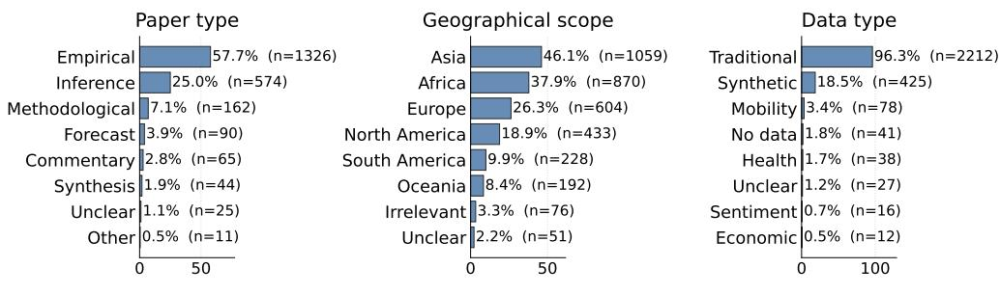  
Fig. D1 Label distributions across all 2,297 corpus papers. Panels show paper type, geography, and data type as labelled by gemini-2.5-flash at T=0. Bar lengths give percentages and the adjacent numbers give paper counts. Paper type is single-label. Geography and data type are multi-label, so their percentages can sum to more than 100%. Mobility, health, sentiment, and economic data are the non-traditional categories.

The two deployments produce similar aggregate distributions for geography and data type. This comparison of marginals does not establish paper-level agreement. Every regional share difers by at most 7 percentage points and most difer by less than 3, while the dominant Traditional share difers by less than 2 points (96.3% served versus 94.5% local). The main divergence is paper type: the served model assigns Empirical to 57.7% of the corpus, compared with 69.4% under the local model.

There are no manual labels for the full corpus, so this disagreement cannot be resolved directly at corpus scale. The labelled evaluation sample nevertheless provides an informative diagnostic because it is drawn from the same corpus. On that sample, the manual-label share of Empirical papers is 59.3%, compared with 57.5% for the served model and 68.7% for the local model. The corpus-scale diference therefore has the same direction and approximately the same magnitude as the diference observed where manual labels are available. This is consistent with the corpus-scale shift reflecting the local model’s lower paper-type accuracy rather than a substantive diference in the underlying corpus.

Table D5 Full agreement-metric profile of the self-hosted open-weight backend.
<table><tr><td rowspan="2"></td><td colspan="4">Qwen2.5-32B (open weight, self-hosted generation)</td></tr><tr><td>fully local</td><td> $\mathrm { ( b g e – m 3 ) }$ </td><td>partially local (Gemini index)</td><td></td></tr><tr><td>Metric</td><td> $T { = } 0 . 0$ </td><td> $T { = } 1 . 0$ </td><td> $T { = } 0 . 0$ </td><td> $T { = } 1 . 0$ </td></tr><tr><td>Geography</td><td></td><td></td><td></td><td></td></tr><tr><td>Jaccard</td><td> $0 . 8 6 9 _ { \pm 0 . 0 0 0 }$ </td><td> $0 . 8 6 9 _ { \pm 0 . 0 1 4 }$ </td><td> $0 . 8 5 4 { \scriptstyle \pm 0 . 0 0 0 }$ </td><td> $0 . 8 6 7 7 { \scriptstyle \pm 0 . 0 0 6 2 }$ </td></tr><tr><td>Micro precision</td><td> $0 . 8 0 4 { \scriptstyle \pm 0 . 0 0 0 }$ </td><td> $0 . 8 2 2 2 _ { \pm 0 . 0 0 7 5 }$ </td><td> $0 . 7 8 5 { \scriptstyle \pm 0 . 0 0 0 }$ </td><td> $0 . 8 2 1 4 { \scriptstyle \pm 0 . 0 0 6 6 }$ </td></tr><tr><td>Micro recall</td><td> $0 . 8 9 1 { \scriptstyle \pm 0 . 0 0 0 }$ </td><td> $0 . 8 8 9 { \scriptstyle \pm 0 . 0 1 4 }$ </td><td> $0 . 8 7 6 _ { \pm 0 . 0 0 0 }$ </td><td> $0 . 8 8 1 { \scriptstyle \pm 0 . 0 1 3 }$ </td></tr><tr><td>Micro F1</td><td> $0 . 8 4 6 _ { \pm 0 . 0 0 0 }$ </td><td> $0 . 8 5 4 3 { \scriptstyle \pm 0 . 0 0 8 6 }$ </td><td> $0 . 8 2 8 _ { \pm 0 . 0 0 0 }$ </td><td> $0 . 8 5 0 0 { \scriptstyle \pm 0 . 0 0 9 6 }$ </td></tr><tr><td>Macro precision</td><td> $0 . 6 5 1 { \scriptstyle \pm 0 . 0 0 0 }$ </td><td> $0 . 6 7 6 2 _ { \pm 0 . 0 0 8 9 }$ </td><td> $0 . 6 2 8 { \scriptstyle \pm 0 . 0 0 0 }$ </td><td> $0 . 6 7 8 { \scriptstyle \pm 0 . 0 2 3 }$ </td></tr><tr><td>Macro recall</td><td> $0 . 7 3 6 { \scriptstyle \pm 0 . 0 0 0 }$ </td><td> $0 . 7 3 1 { \scriptstyle \pm 0 . 0 2 6 }$ </td><td> $0 . 7 0 8 { \scriptstyle \pm 0 . 0 0 0 }$ </td><td> $0 . 7 1 4 { \scriptstyle \pm 0 . 0 2 3 }$ </td></tr><tr><td>Macro F1</td><td> $0 . 6 8 2 { \scriptstyle \pm 0 . 0 0 0 }$ </td><td> $0 . 6 9 4 { \scriptstyle \pm 0 . 0 1 6 }$ </td><td> $0 . 6 5 7 { \scriptstyle \pm 0 . 0 0 0 }$ </td><td> $0 . 6 8 8 { \scriptstyle \pm 0 . 0 2 2 }$ </td></tr><tr><td>Subset accuracy</td><td> $0 . 8 2 7 { \scriptstyle \pm 0 . 0 0 0 }$ </td><td> $0 . 8 3 3 { \scriptstyle \pm 0 . 0 1 3 }$ </td><td> $0 . 8 1 3 { \scriptstyle \pm 0 . 0 0 0 }$ </td><td> $0 . 8 2 9 9 { \scriptstyle \pm 0 . 0 0 2 6 }$ </td></tr><tr><td>Data access.</td><td></td><td></td><td></td><td></td></tr><tr><td>Jaccard</td><td> $0 . 5 3 9 { \scriptstyle \pm 0 . 0 0 0 }$ </td><td> $0 . 5 1 6 { \scriptstyle \pm 0 . 0 2 7 }$ </td><td> $0 . 5 6 3 { \scriptstyle \pm 0 . 0 0 0 }$ </td><td> $0 . 5 4 2 { \scriptstyle \pm 0 . 0 2 1 }$ </td></tr><tr><td>Micro precision</td><td> $0 . 5 7 4 { \scriptstyle \pm 0 . 0 0 0 }$ </td><td> $0 . 5 5 2 _ { \pm 0 . 0 2 3 }$ </td><td> $0 . 5 9 4 { \scriptstyle \pm 0 . 0 0 0 }$ </td><td> $0 . 5 8 2 _ { \pm 0 . 0 2 1 }$ </td></tr><tr><td>Micro recall</td><td> $0 . 6 2 9 { \scriptstyle \pm 0 . 0 0 0 }$ </td><td> $0 . 6 1 1 { \scriptstyle \pm 0 . 0 1 9 }$ </td><td> $0 . 6 6 1 { \scriptstyle \pm 0 . 0 0 0 }$ </td><td> $0 . 6 2 7 { \scriptstyle \pm 0 . 0 1 7 }$ </td></tr><tr><td>Micro F1</td><td>0.600±0.000</td><td> $0 . 5 8 0 { \scriptstyle \pm 0 . 0 2 0 }$ </td><td> $0 . 6 2 5 { \scriptstyle \pm 0 . 0 0 0 }$ </td><td> $0 . 6 0 3 { \scriptstyle \pm 0 . 0 1 8 }$ </td></tr><tr><td>Macro precision</td><td> $0 . 4 3 5 { \scriptstyle \pm 0 . 0 0 0 }$ </td><td> $0 . 4 3 8 { \scriptstyle \pm 0 . 0 1 6 }$ </td><td> $0 . 4 6 9 { \scriptstyle \pm 0 . 0 0 0 }$ </td><td> $0 . 4 7 2 { \scriptstyle \pm 0 . 0 3 2 }$ </td></tr><tr><td>Macro recall</td><td> $0 . 4 9 1 { \scriptstyle \pm 0 . 0 0 0 }$ </td><td> $0 . 5 1 2 _ { \pm 0 . 0 1 1 }$ </td><td> $0 . 4 9 5 { \scriptstyle \pm 0 . 0 0 0 }$ </td><td> $0 . 4 9 8 _ { \pm 0 . 0 3 2 }$ </td></tr><tr><td>Macro F1</td><td> $0 . 4 3 1 { \scriptstyle \pm 0 . 0 0 0 }$ </td><td> $0 . 4 4 2 _ { \pm 0 . 0 1 6 }$ </td><td> $0 . 4 5 3 { \scriptstyle \pm 0 . 0 0 0 }$ </td><td> $0 . 4 5 7 { \scriptstyle \pm 0 . 0 2 5 }$ </td></tr><tr><td>Subset accuracy</td><td> $0 . 3 6 4 { \scriptstyle \pm 0 . 0 0 0 }$ </td><td> $0 . 3 2 8 { \scriptstyle \pm 0 . 0 4 4 }$ </td><td> $0 . 3 8 3 { \scriptstyle \pm 0 . 0 0 0 }$ </td><td> $0 . 3 5 5 { \scriptstyle \pm 0 . 0 2 9 }$ </td></tr><tr><td>Data type</td><td></td><td></td><td></td><td></td></tr><tr><td>Jaccard</td><td> $0 . 8 6 1 { \scriptstyle \pm 0 . 0 0 0 }$ </td><td> $0 . 8 6 6 1 _ { \pm 0 . 0 0 6 1 }$ </td><td> $0 . 8 7 5 { \scriptstyle \pm 0 . 0 0 0 }$ </td><td> $0 . 8 7 8 5 { \scriptstyle \pm 0 . 0 0 5 9 }$ </td></tr><tr><td>Micro precision</td><td> $0 . 8 9 7 { \scriptstyle \pm 0 . 0 0 0 }$ </td><td> $0 . 8 9 7 1 { \scriptstyle \pm 0 . 0 0 8 6 }$ </td><td> $0 . 9 1 0 { \scriptstyle \pm 0 . 0 0 0 }$ </td><td> $0 . 9 1 2 5 { \scriptstyle \pm 0 . 0 0 2 4 }$ </td></tr><tr><td>Micro recall</td><td> $0 . 8 4 8 { \scriptstyle \pm 0 . 0 0 0 }$ </td><td> $0 . 8 5 7 8 { \scriptstyle \pm 0 . 0 0 8 1 }$ </td><td> $0 . 8 6 7 { \scriptstyle \pm 0 . 0 0 0 }$ </td><td> $0 . 8 7 1 { \scriptstyle \pm 0 . 0 1 1 }$ </td></tr><tr><td>Micro F1</td><td> $0 . 8 7 1 { \scriptstyle \pm 0 . 0 0 0 }$ </td><td> $0 . 8 7 7 0 { \scriptstyle \pm 0 . 0 0 7 0 }$ </td><td> $0 . 8 8 8 { \scriptstyle \pm 0 . 0 0 0 }$ </td><td> $0 . 8 9 1 3 { \scriptstyle \pm 0 . 0 0 5 0 }$ </td></tr><tr><td>Macro precision</td><td> $\stackrel { 0 . 3 8 9 \pm 0 . 0 0 0 } { \sim }$ </td><td> $0 . 4 7 9 { \scriptstyle \pm 0 . 0 3 4 }$ </td><td> $0 . 5 0 1 { \scriptstyle \pm 0 . 0 0 0 }$ </td><td> $0 . 4 0 4 { \scriptstyle \pm 0 . 0 4 5 }$ </td></tr><tr><td>Macro recall</td><td> $0 . 3 7 5 { \scriptstyle \pm 0 . 0 0 0 }$ </td><td> $0 . 4 6 4 { \scriptstyle \pm 0 . 0 6 0 }$ </td><td> $0 . 4 2 9 { \scriptstyle \pm 0 . 0 0 0 }$ </td><td> $0 . 4 0 1 { \scriptstyle \pm 0 . 0 3 7 }$ </td></tr><tr><td>Macro F1</td><td> $0 . 3 3 8 { \scriptstyle \pm 0 . 0 0 0 }$ </td><td> $0 . 3 9 0 { \scriptstyle \pm 0 . 0 3 5 }$ </td><td> $0 . 4 3 4 { \scriptstyle \pm 0 . 0 0 0 }$ </td><td> $0 . 3 8 0 { \scriptstyle \pm 0 . 0 2 5 }$ </td></tr><tr><td>Subset accuracy</td><td> $0 . 7 9 0 { \scriptstyle \pm 0 . 0 0 0 }$ </td><td> $0 . 7 9 2 5 { \scriptstyle \pm 0 . 0 0 8 5 }$ </td><td> $0 . 8 1 3 { \scriptstyle \pm 0 . 0 0 0 }$ </td><td> $0 . 8 1 3 { \scriptstyle \pm 0 . 0 1 1 }$ </td></tr><tr><td>Paper type</td><td></td><td></td><td></td><td></td></tr><tr><td>Jaccard</td><td> $0 . 7 9 4 { \scriptstyle \pm 0 . 0 0 0 }$ </td><td> $0 . 7 7 5 { \scriptstyle \pm 0 . 0 1 3 }$ </td><td> $0 . 7 8 5 { \scriptstyle \pm 0 . 0 0 0 }$ </td><td> $0 . 7 7 9 { \scriptstyle \pm 0 . 0 1 2 }$ </td></tr><tr><td>Micro precision</td><td> $0 . 7 9 4 { \scriptstyle \pm 0 . 0 0 0 }$ </td><td> $0 . 7 7 5 { \scriptstyle \pm 0 . 0 1 3 }$ </td><td> $0 . 7 8 5 { \scriptstyle \pm 0 . 0 0 0 }$ </td><td> $0 . 7 7 9 { \scriptstyle \pm 0 . 0 1 2 }$ </td></tr><tr><td>Micro recall</td><td> $0 . 7 9 4 { \scriptstyle \pm 0 . 0 0 0 }$ </td><td> $0 . 7 7 5 { \scriptstyle \pm 0 . 0 1 3 }$ </td><td> $0 . 7 8 5 { \scriptstyle \pm 0 . 0 0 0 }$ </td><td> $0 . 7 7 9 { \scriptstyle \pm 0 . 0 1 2 }$ </td></tr><tr><td>Micro F1</td><td> $0 . 7 9 4 { \scriptstyle \pm 0 . 0 0 0 }$ </td><td> $0 . 7 7 5 { \scriptstyle \pm 0 . 0 1 3 }$ </td><td> $0 . 7 8 5 { \scriptstyle \pm 0 . 0 0 0 }$ </td><td> $0 . 7 7 9 { \scriptstyle \pm 0 . 0 1 2 }$ </td></tr><tr><td>Macro precision</td><td> $0 . 7 4 0 { \scriptstyle \pm 0 . 0 0 0 }$ </td><td> $0 . 6 3 1 { \scriptstyle \pm 0 . 0 3 3 }$ </td><td> $0 . 6 8 6 _ { \pm 0 . 0 0 0 }$ </td><td> $0 . 6 2 8 { \scriptstyle \pm 0 . 0 3 1 }$ </td></tr><tr><td>Macro recall</td><td> $0 . 6 4 3 { \scriptstyle \pm 0 . 0 0 0 }$ </td><td> $0 . 5 1 4 { \scriptstyle \pm 0 . 0 5 5 }$ </td><td> $0 . 5 9 4 { \scriptstyle \pm 0 . 0 0 0 }$ </td><td> $0 . 5 0 1 { \scriptstyle \pm 0 . 0 1 7 }$ </td></tr><tr><td>Macro  $\mathrm { F _ { 1 } }$ </td><td> $0 . 6 1 5 { \scriptstyle \pm 0 . 0 0 0 }$ </td><td> $0 . 5 2 0 { \scriptstyle \pm 0 . 0 4 3 }$ </td><td> $0 . 5 9 5 { \scriptstyle \pm 0 . 0 0 0 }$ </td><td> $0 . 5 3 1 { \scriptstyle \pm 0 . 0 1 6 }$ </td></tr><tr><td>Subset accuracy</td><td> $0 . 7 9 4 { \scriptstyle \pm 0 . 0 0 0 }$ </td><td> $0 . 7 7 5 { \scriptstyle \pm 0 . 0 1 3 }$ </td><td> $0 . 7 8 5 { \scriptstyle \pm 0 . 0 0 0 }$ </td><td> $0 . 7 7 9 { \scriptstyle \pm 0 . 0 1 2 }$ </td></tr></table>

Mean with the standard deviation across $R { = } 5$ repeated runs shown as a subscript, on the fixed 214-paper evaluation set. All four columns generate with qwen2.5:32b-instruct run locally through Ollama under the identical workflow, and use schema-constrained decoding. The fully local pair embeds the retrieval index with ${ \tt B A A I / b g e } – { \tt m } 3$ on the same machine, so the pipeline makes no remote call at any stage. The partially local pair reuses the Gemini-embedded index shared with the served-backend runs. Within each pair the columns difer only in sampling temperature. For the single-label paper-type task, micro-averaged scores coincide with subset accuracy. ${ \mathrm { A l l ~ } } T { = } 0$ standard deviations are exactly zero: the five repeats return identical label sets for every paper.

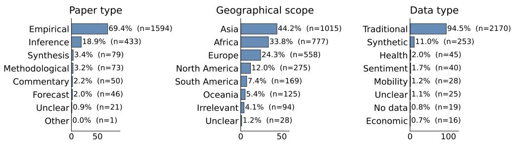  
Fig. D2 Corpus-scale label distributions from the fully local deployment. The figure reports the same three axes and the same 2,297 papers as Figure D1, produced on local hardware with qwen2.5:32b-instruct and a BAAI/bge-m3 index at T=0. Paper type is single-label, whereas geography and data type are multi-label, so their percentages can sum to more than 100%.

The local model predicts somewhat fewer geographic labels than the served model at corpus scale. On the labelled sample, some of those lower frequencies are closer to the shares in the manually labelled sample. Therefore, the diference between the two corpus-scale distributions should not automatically be interpreted as an error of the local model.

The labelled sample therefore helps interpret the direction of aggregate diferences, but only the evaluation-set accuracy metrics support model comparisons at paper level.

## D.4 Stability and error diagnostics

These diagnostics complement the aggregate performance summaries in Section 4 and use the same fixed evaluation set of 214 papers. Aggregate scores alone do not show whether diferent models fail on the same papers.

For a fixed task and temperature, we define the ever-wrong set E for a model as the papers for which at least one of the R=5 runs difers from the complete manual label set. This diagnostic is conditional on five repeats: with more repeats, a paper has more opportunities to enter E. We then quantify the overlap and containment of the ever-wrong sets for gemini-2.5-pro and gemini-2.5-flash.

Tables D6 and D7 show that the ever-wrong sets overlap substantially. For geography, data type, and data accessibility, most papers that are ever misclassified by Pro also appear in Flash’s ever-wrong set. The two models therefore tend to share a subset of dificult papers on these axes. Containment is substantially lower for paper type, indicating that disagreement on this task is more model specific. These patterns motivate using persistent errors or cross-model disagreement as additional signals for identifying papers that merit targeted retrieval, prompt refinement, or manual inspection.

Table D6 Containment of ever-wrong sets at $T { = } 0 . 0 .$
<table><tr><td>Task</td><td> $| E _ { \mathrm { p r o } } |$ </td><td> $\lvert E _ { \mathrm { f l a s h } } \rvert$ </td><td> $| E _ { \cap } |$ </td><td> $| E _ { \cap } | / | E _ { \mathrm { p r o } } |$ </td><td> $| E _ { \cap } | / | E _ { \mathrm { f l a s h } } |$ </td></tr><tr><td>Geography</td><td>25</td><td>45</td><td>20</td><td>80.0%</td><td>44.4%</td></tr><tr><td>Data type</td><td>25</td><td>32</td><td>20</td><td>80.0%</td><td>62.5%</td></tr><tr><td>Data accessibility</td><td>95</td><td>123</td><td>72</td><td>75.8%</td><td>58.5%</td></tr><tr><td>Paper type</td><td>34</td><td>37</td><td>15</td><td>44.1%</td><td>40.5%</td></tr></table>

For each task, E is the set of papers that are incorrectly labeled in at least one of the R=5 runs. For multi-label tasks, incorrect means that the predicted label set is not an exact match to the manual label set. $| E _ { \mathrm { p r o } } |$ and $\lvert E _ { \mathrm { f l a s h } } \rvert$ report ever-wrong set sizes for the two backends. |E∩| reports overlap. The last two columns divide it by the corresponding backend’s ever-wrong set size.

Table D7 Containment of ever-wrong sets at $T { = } 1 . 0 .$
<table><tr><td>Task</td><td> $| E _ { \mathrm { p r o } } |$ </td><td> $\lvert E _ { \mathrm { f l a s h } } \rvert$ </td><td> $| E _ { \cap } |$ </td><td> $| E _ { \cap } | / | E _ { \mathrm { p r o } } |$ </td><td> $| E _ { \cap } | / | E _ { \mathrm { f l a s h } } |$ </td></tr><tr><td>Geography</td><td>28</td><td>59</td><td>25</td><td>89.3%</td><td>42.4%</td></tr><tr><td>Data type</td><td>30</td><td>40</td><td>26</td><td>86.7%</td><td>65.0%</td></tr><tr><td>Data accessibility</td><td>116</td><td>163</td><td>106</td><td>91.4%</td><td>65.0%</td></tr><tr><td>Paper type</td><td>37</td><td>54</td><td>23</td><td>62.2%</td><td>42.6%</td></tr></table>

Definitions as in Table D6.

## Appendix E Comparison baselines

This appendix details the methods, configurations, and statistical comparisons behind the baseline results in Section 4.2.3 and Table 3. The families difer fundamentally in what they require and what they measure, so they are read here not as a homogeneous leaderboard but as a map of what each kind of method can and cannot do on this task.

The bottom line is this: across the four axes, EpiLens matches or exceeds the tested baselines while requiring no labelled training data. The advantage is largest where the relevant evidence lies outside the title and abstract, indicating that the main contribution is not simply model choice but access to body-text evidence, with targeted retrieval mattering most for data accessibility (Section 4.2.2). On geography, whose signal is largely in the title and abstract, the advantage over the abstract-only LLM is small, although the margins over the supervised baselines are the largest of any axis (Table E1).

## E.1 The design space and the methods we compare

Classifying a literature into analytically useful categories admits methods that difer along two requirements that are easy to conflate (Figure E1): whether the category scheme is specified by the analyst or discovered from the corpus, and whether the method needs manually labelled training examples before it can be applied.

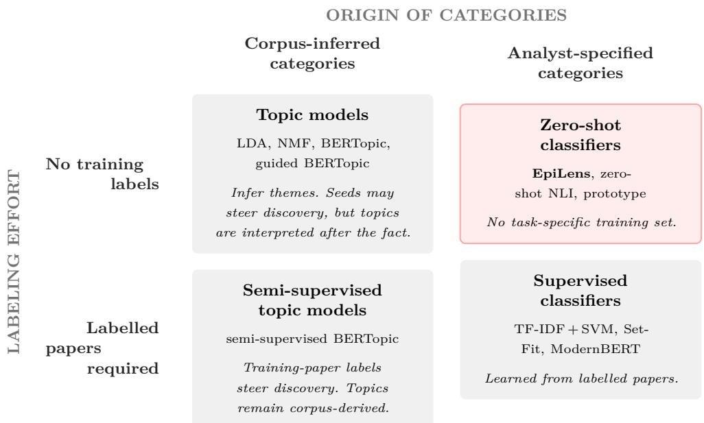  
Fig. E1 The design space of methods for classifying scientific literature. The map separates two choices: where the categories come from, and whether a labelled training set is required before the method can be used. EpiLens occupies the analyst-specified, annotation-free cell: categories are written as natural-language descriptions and applied without task-specific training labels, and retrieval then grounds those decisions in paper evidence.

Unsupervised and guided topic models (latent semantic analysis (LSA) [52], probabilistic latent semantic analysis (PLSA) [53], latent Dirichlet allocation (LDA) [54], non-negative matrix factorisation (NMF) [55], standard BERTopic [56], and seedguided variants) need no labelled papers but infer themes from the corpus rather than applying a predefined scheme. They answer what structure a literature happens to exhibit, not how its papers fall under a fixed scheme. Semi-supervised topic-model variants occupy a diferent position: they can use labelled papers to steer topic discovery, but their output remains corpus-inferred topics rather than direct predictions under the analyst’s coding scheme.

Supervised classifiers learn an analyst-specified scheme from labelled papers by pairing a representation of the text with a trained classifier head. Rather than designate a single representative, we name three points in that space. TF-IDF + SVM, a termfrequency–inverse-document-frequency representation [57] (each word weighted by how distinctive it is to a document) fed to a linear support vector machine [58], is the classic lexical anchor. SetFit [59], which fine-tunes a sentence-embedding model on the labelled examples, is the fine-tuned neural representative. ModernBERT [60], an 8192-token long-context encoder applied to the parsed body text (overflow handled by window pooling), is the long-context body-text representative. A calibrated prototype, which tunes only a single decision threshold, is the most minimal use of labels. The full representation × text-scope × classifier-head grid behind these named points is swept in Section E.5.

Of-the-shelf zero-shot classifiers apply analyst-specified category descriptions without task-specific training labels. In the NLI formulation, the input text is treated as a premise and each candidate label is verbalised as a hypothesis. The model then scores whether the premise entails the hypothesis [61]. In our runs, the premise is the paper title and abstract. This aligns with the standard usage mode for zeroshot NLI classifiers. We do not use the full-paper as premise because standard NLI models have a finite input window for scoring premise-hypothesis pairs which scientific papers often exceed. We also evaluate a prototype similarity approach for zero-shot classification, which represents each label by a single prototype vector (the embedding of its description) and assigns the labels whose prototypes are closest to the paper’s own embedding.

EpiLens’s Paper Classifier occupies the position the others leave awkward: analystspecified categories, revisable as text, applied with no training labels, and grounded in full-document evidence through retrieval. A majority prior (always predicting the most common label set) provides a reference floor. Figure E1 maps these families and EpiLens’s place among them. The next section records how each method is configured and the role it plays. We then position them by what each requires against the accuracy it reaches.

## E.2 Configuration and role of each method

Having placed each family in the design space (Section E.1), we now give the configuration and role of each method, grouped by family, so the comparisons that follow can be read against a fully specified set of baselines. The majority prior sits outside these families as a reference floor rather than a method: it always predicts the most frequent label set (estimated leave-one-out to avoid leakage from the target paper’s own label), takes no text as input, and marks how much apparent performance follows from label skew alone.

## E.2.1 Zero-shot baselines

Zero-shot classifier baselines assign papers to an analyst-specified label set without training on manually annotated examples from the task. Here we use the term for two retrieval-free, annotation-free classifiers: a prototype-similarity classifier whose label representations are built from the coding protocol, and an of-the-shelf NLI classifier that scores verbalised label hypotheses against the paper metadata. Both operate on title and abstract only. Calibrated variants that tune thresholds on manual labels are reported with the supervised baselines.

## Prototype similarity.

Each label is represented by a prototype vector: the embedding of its definition text where the coding protocol provides one (paper type, data type, data accessibility), and of the label name otherwise (geography). At inference the paper’s title and abstract are embedded in the same space and scored by cosine similarity to each prototype. We use two representations: a sparse TF-IDF space and a dense one from allenai-specter, a sentence transformer trained on scientific-paper pairs. The choice of representation matters for what “similarity” means. With TF-IDF the label prototype is essentially its own words, so the method reduces to lexical overlap between the abstract and the label text. For geography, where the prototype is just the continent name, this is close to detecting whether the abstract literally mentions that region. The dense SPECTER prototype relaxes this to semantic similarity, which is why it helps on the axes with descriptive definitions more than on the name-only geography axis. Assignment uses a relative rule rather than a single absolute cutof: a label is kept if its similarity is at least a fraction $\tau _ { \mathrm { r e l } }$ =0.92 of the top-scoring label’s similarity, above an absolute floor $\tau { \geq } 0 . 0 3$ , and among the top three. The uncalibrated regime uses these defaults and needs no labels, so it is a genuinely annotation-free zero-shot baseline. The calibrated regime instead selects the absolute floor τ per fold by 5-fold cross-validation (maximising mean Jaccard on the other folds, over a grid of score quantiles that includes the default), holding the relative rule fixed. This uses labels, so it counts as a minimal supervised method reported with the supervised baselines. Because the default is among the candidates, calibration cannot underperform it on the selection folds, though held-out performance may still be lower. Calibration recovers part of the gap on the multi-label tasks (Table 3). Paper type, single-label and decided by arg-max, has no threshold to tune. Even calibrated, the prototype stays below the discriminative supervised classifiers, because a single global acceptance rule cannot capture per-label decision boundaries.

## Zero-shot NLI entailment.

Following the standard zero-shot text-classification recipe [61], each candidate label is framed as a natural-language-inference hypothesis (“This paper is about {label}.”), and an NLI-fine-tuned DeBERTa-v3-base checkpoint (MoritzLaurer/DeBERTa-v3- base-mnli-fever-anli [62, 63]) scores the entailment of each hypothesis against the paper’s title and abstract. Labels clearing an entailment threshold are kept (the highestscoring label for the single-label paper type task). This is the most direct of-the-shelf occupant of EpiLens’s design-space quadrant (analyst-specified yet annotation-free), but, as we run it, it reads only the title and abstract and reasons one label at a time. Its behaviour is highly uneven across axes. We analyse why in Section E.3.1. This unevenness does not appear to be caused by an obviously weak hypothesis template. We tested a task-specific template (“This paper uses label data”), but it did not recover Traditional and increased over-prediction of non-traditional labels. Replacing label names with one-sentence definitions from the coding protocol (Section C) also lowered scores on most tasks, suggesting that the NLI model is sensitive to hypothesis wording and does not reliably apply the full coding protocol from metadata alone. We therefore report the stronger label-name variant.

## E.2.2 Guided and semi-supervised topic-model baselines

## Guided and semi-supervised BERTopic.

BERTopic represents documents with transformer embeddings, clusters them in a reduced space, and labels each cluster with class-based TF–IDF descriptors [56]. Its native output is a set of corpus-inferred topics, not assignments to an analyst-defined taxonomy. In its plain, unlabelled form it is therefore a pure corpus-structure probe:

it asks how far each axis separates from corpus-level vocabulary structure with no label information at all. In that form BERTopic is one of the topic models in the corpus-structure audit (Section E.6), which is where we report that recoverability question.

The guided and semi-supervised variants difer in the kind of analyst input they consume. The guided variant supplies seed terms drawn from each label definition, biasing topic discovery toward the target concepts while leaving the discovered topics free to merge, split, or ignore the labels. It therefore uses analyst guidance but not labelled training papers. The semi-supervised variant instead passes the manual labels of the training papers, using partial document-level supervision to steer the clustering.

For this reason the two variants occupy diferent rows of Figure E1. Guided BERTopic remains annotation-free with respect to paper labels and belongs with the topic-model family: the analyst supplies seeds, but the emitted topics remain corpusinferred and must be interpreted or aligned after the fact. Semi-supervised BERTopic belongs in the labelled-papers row, because it consumes manual labels for training papers, but it still remains in the corpus-inferred column rather than the analystspecified classifier column: labels steer the clustering, whereas the output is still a set of topics that need not correspond one-to-one to the coding scheme. The contrast with supervised classifiers is therefore not whether labels can influence the method, but how they enter: a supervised head learns a decision boundary that maps text directly onto the fixed label set, whereas guided or semi-supervised topic modelling uses seeds or labels to bias topic discovery.

These topic-model variants answer a diferent question from EpiLens: not whether a fixed coding protocol can be applied directly to each paper, but whether the label axes align with separable corpus structure once discovery is nudged toward the target concepts. We report these guided and semi-supervised topic-model variants in Table 3. To avoid tying the comparison to a single topic granularity, we sweep the requested number of topics over $K \in \{ 0 . 5 , 1 , 2 , 4 \} \times | \mathcal { L } |$ and report the best-aligned configuration.

## E.2.3 Supervised baselines

Supervised baselines all follow one recipe: pair a representation of the text with a trained classifier head, fit on the manual labels under cross-validation. Within that recipe they difer in one methodologically important way, where the label signal enters. In most of them the representation is fixed independently of the labels, either unsupervised (the sparse TF-IDF space) or a frozen pretrained encoder whose weights are never updated, and the labels train only the head on top: there is no gradient path from the head’s loss back into the representation, which reaches the head as a fixed feature matrix. SetFit is the sole exception, letting the labels also reshape the representation by contrastively fine-tuning the encoder before a head is fit on the adapted embeddings. Even there the encoder and head are fit in separate stages, not by one joint objective, so no baseline here is end-to-end fine-tuned in the sense of gradients flowing through encoder and classifier together. Jointly training and tuning a full encoder and classifier across four tasks would be disproportionate to an evaluation with only 214 manually labelled papers and would also carry a high risk of overfitting. We surface three named points, and Section E.5 sweeps the full representation × scope × head grid behind them: TF-IDF+ SVM (classic lexical, head-only supervision), SetFit (the one representation-adapting encoder), and ModernBERT (frozen long-context bodytext encoder). All are trained and evaluated by cross-validation over the N=214 papers (using iterative multi-label stratification for the set-valued axes where feasible, to balance label prevalence across folds), on the title+abstract scope shared with the other abstract-scoped methods. ModernBERT is the exception, applied to the parsed body text. We additionally report TF-IDF under leave-one-out as a robustness variant. Together they establish how far label-supervised text classification reaches, as a reference for the contribution of retrieval-grounded reasoning.

## TF-IDF + SVM.

The classical anchor and simplest instance of the recipe, and a pure case of headonly supervision: a sparse TF-IDF representation of the title and abstract (each term weighted by how distinctive it is to a document), built from corpus term statistics without ever seeing the labels, is fed to a linear support vector machine that is the only trained component, under stratified 5-fold cross-validation with leave-one-out as a robustness variant (Table 3). It is the strongest non-neural reference and, on the lexically regular axes, the closest baseline to EpiLens.

## SetFit.

SetFit [59] is a supervised, label-eficient text-classification method that first fine-tunes a sentence-transformer on pairs of labelled examples with a contrastive objective, then trains a classification head on the resulting embeddings. It is thus the one supervised baseline here in which the labels reach the representation itself, not only the head, though the contrastive fine-tuning and the head are still fit in separate stages rather than by a single joint objective. We use sentence-transformers/all-mpnet-base-v2 as the base encoder and evaluate it under stratified 5-fold cross-validation across the N=214 evaluation papers. We do not use leave-one-out here, since it would need a separate fine-tuning run for each held-out paper. To cap the number of contrastive pairs drawn from our relatively large cross-validation folds, we set num\_iterations=2 instead of the default sampling strategy. Text scope is restricted to title and abstract. This is also the natural scope for the chosen sentence-transformer: all-mpnet-base-v2 is intended for sentence- and short-paragraph embeddings, and its default sentencetransformers configuration truncates inputs longer than a few hundred word pieces. Applying it to the full body would therefore require either truncation or a separate chunk-level pooling rule to aggregate window embeddings into a paper-level prediction.

## ModernBERT (body text, long-context encoder).

ModernBERT [60] is a bidirectional encoder trained with a native 8192-token sequence length, substantially longer than the few-hundred-token windows of the other dense encoders. We apply it as a frozen feature extractor under the same stratified 5-fold protocol as the other supervised baselines, with its weights never updated (as for the other dense encoders here): each body window is encoded with the encoder held fixed, token embeddings are mean-pooled to obtain a window representation, and these fixed representations are passed to a separately trained MLP classification head. For papers whose parsed body fits within the 8192-token window, this gives a single bodylevel representation. For longer papers, we encode multiple windows and mean-pool their representations rather than truncating the body (Section E.5). ModernBERT is therefore the supervised baseline with the widest body-text scope, testing how far a frozen long-context encoder’s features, with only the head trained, can go without label-targeted retrieval.

## E.2.4 RAG ablation baselines

Three variants of the same workflow (metadata only, random chunks, and the whole body) join full EpiLens in the four-condition ablation of Section 4.2.2.

## Metadata-only LLM (metadata\_llm).

Runs the same language model with the same classification prompts as EpiLens, but replaces retrieved full-text evidence with only the paper’s title and abstract. This directly isolates the contribution of retrieval: any performance gap between this baseline and the full system is attributable to the retrieved body-text passages. It is given the raw parsed metadata (title and abstract) and never any body text, keeping it a clean ablation of retrieval. For the 32 papers with no machine-readable abstract it therefore sees the title alone, exactly as the other abstract-scoped baselines do. The paper is not skipped, so all 214 are scored on the same set as the full-text system.

## Random-chunk LLM (random\_chunk\_llm).

Runs the same model and prompts as the full system, but selects k body-text passages by uniform random sampling from the per-paper document pool in the vector index rather than by semantic similarity to the template paragraphs. This holds body-text access fixed while ablating retrieval quality, thereby isolating the contribution of targeted retrieval from the contribution of body-text access per se.

## Whole-body LLM (full\_body\_llm).

Runs the same model and prompts, with the same per-paper chunk pool, but passes every body chunk of the paper in document order instead of k of them, so the prompt holds the whole parsed body (the longest prompts have 22451 and 22771 tokens for the two generators, within their context windows). It tests whether selecting passages is needed at all. We ran this condition at T=0 five times with gemini-2.5-flash and once with the fully local qwen2.5:32b-instruct, whose full-workflow outputs were identical across five repeats (Section D.3).

## E.3 Method requirements and performance trade-ofs

This comparison is not a leaderboard, but a map of what each approach requires in order to reach a given level of agreement. The relevant trade-of is between annotation efort, text scope, and task flexibility: EpiLens uses analyst-specified categories that can be edited as text, requires no task-specific training labels, and grounds each decision in retrieved body-text evidence. The baseline scores therefore measure not only modelling accuracy, but also what is lost or gained when one removes retrieval, restricts the text scope, or introduces labelled supervision.

Table 3 collects the head-to-head results. The next two subsections compare methods first at title-and-abstract scope and then with access to body text.

To separate model efects from evidence access, we use metadata\_llm as the pivot comparison. This baseline keeps EpiLens’s generator and task instructions but restricts the evidence to paper metadata, i.e. the title and abstract. It therefore answers two questions in sequence: first, at title-and-abstract scope, what does an instructionfollowing LLM buy relative to classical, neural, and zero-shot baselines? Second, what does targeted body-text retrieval add on top?

## E.3.1 Comparison at title-and-abstract scope

At title-and-abstract scope, metadata\_llm is the cleanest comparison because it uses the same instruction-following backend as EpiLens without targeted body-text retrieval. Its performance (0.713 paper type, 0.826 geography, 0.816 data type, 0.241 data accessibility) shows that the benefit of the LLM at fixed evidence scope is task-dependent rather than uniform.

Where the relevant signal is usually present in the abstract, the metadata-only LLM matches or exceeds the standard abstract-scoped baselines. This is clearest for geography (0.826 vs. TF-IDF + SVM 0.592, SetFit 0.599, NLI 0.709), and roughly tied for paper type (0.713 vs. 0.713 for TF-IDF + SVM and 0.734 for SetFit). But the labelled baselines are not dominated everywhere. On data type, the bag-of-words and embedding classifiers perform better (0.854 and 0.864 vs. 0.816), consistent with a lexically regular task dominated by the near-universal Traditional label. The clearest failure is data accessibility: metadata\_llm reaches only 0.241, far below the supervised abstract baselines (0.533–0.574), because the decisive access statement is rarely available in the abstract. This marks the limit of metadata-only reasoning and identifies where retrieval should matter most.

When compared against the strongest tuned abstract-scope supervised configuration rather than the standard representative rows (Table E2), the metadata-only LLM’s advantage is narrower: it remains ahead only on geography (0.826 vs. 0.750), while tuned encoders overtake it elsewhere. Thus, EpiLens’s consistent advantage is not simply instruction-following at fixed scope: it comes from adding body-text evidence.

The weakest baseline scores should be read as diagnostics of default method–task mismatch, not as ceilings on the corresponding model families. Zero-shot NLI on data type is the clearest case (J=0.018): it almost never predicts the dominant Traditional class. This appears to reflect a lexical-anchoring asymmetry rather than a residualcategory efect: in our protocol Traditional is defined positively (standard surveillance case counts, hospital admissions, PCR/antigen-confirmed test line lists), but it is a broad, heterogeneous category that papers signal only implicitly, since a paper reporting national surveillance counts rarely states in so many words that it uses “traditional” data. The non-traditional categories, by contrast, each name a specific kind of source (mobility, health, sentiment, economic) that papers typically do state explicitly, giving an entailment hypothesis built from the label name a much stronger lexical anchor to key on than Traditional ofers.

Prototype similarity shows a diferent failure mode: its uncalibrated version is a minimal annotation-free semantic-matching baseline, while threshold calibration uses labels to recover part of the gap. For example, calibration improves SPECTER on data type from 0.52 to 0.67, and TF-IDF on data accessibility from 0.22 to 0.25 (Table 3). We therefore treat the calibrated prototype as a minimal supervised method and the uncalibrated prototype as a zero-shot diagnostic.

## E.3.2 Comparison with body-text access

Moving from metadata\_llm to full EpiLens holds the generator and task instructions fixed while replacing metadata-only evidence with targeted body-text retrieval. The resulting diference estimates the contribution of evidence access and evidence selection, and it tracks where the discriminative signal lies. On geography, where the abstract already carries much of the signal, retrieval adds little: EpiLens (0.875) is only slightly ahead of the metadata-only LLM (0.826), and the paired diference does not meet the adjusted threshold (Section E.4). This is the only comparison in which EpiLens does not clearly lead. On the other three axes, EpiLens is ahead of every tested abstractscoped baseline under the paired tests reported in Table E1. The margin is largest where decisive evidence is distributed through the body or concentrated in a local statement: paper type improves from 0.713 to 0.877, and data accessibility from 0.241 to 0.670. On data type, the margin is narrower (0.916 vs. TF-IDF + SVM 0.854, Holmadjusted p=0.0008), and full-document TF-IDF recovers much of the diference (0.881, Table E2), suggesting that this axis is driven more by broad lexical evidence than by label-targeted retrieval.

This body-text access is not an information advantage withheld from the baselines. Title and abstract are the natural scope for short-window encoders and of-the-shelf zero-shot classifiers, but we also evaluate supervised methods with body-text access in the configuration grid: full-document vectorisation for TF-IDF, chunk-and-pool variants for short-window encoders, and ModernBERT’s 8192-token long-context window for the dense long-context setting (Table E2). The distinction is therefore not whether baselines are allowed to read the body, but how it is used: the language model applies the coding protocol to body-text passages, and selecting those passages by the labels adds most for data accessibility. The component ablation (Section 4.2.2) decomposes this retrieval contribution directly, while the supervised grid and saturation analysis (Section E.5) make an under-powered baseline or small-label artefact unlikely as the main explanation.

## E.4 Statistical methodology

The baseline comparison in Section 4.2.3 uses the mean per-paper Jaccard score defined in Section 4.2 on the same 214 manually labelled papers. We use paired resampling to check how sensitive the observed baseline diferences and the ablation diferences in Section 4.2.2 are to the papers evaluated. For EpiLens with gemini-2.5-flash, each paper’s score is averaged over five runs. The supervised baselines use out-offold predictions: within each configuration, each paper is predicted by a model fitted without that paper.

For each comparison, we resample the per-paper Jaccard diferences with replacement $\scriptstyle \left( B = 1 0 0 0 0 \right)$ and calculate a bias-corrected and accelerated (BCa) interval for their mean. This keeps both methods’ scores paired on each paper; BCa adjusts the interval for bias and skewness [64]. We report pointwise 95% intervals; each two-sided p-value is the smallest significance level at which the corresponding BCa interval excludes zero. We apply Holm–Bonferroni correction within each task, separately for the baseline comparisons and each generator’s ablation comparisons. Holm’s step-down adjustment limits the chance of at least one false rejection within each comparison family [65]. Tables 1 and 3 give the same BCa interval for one configuration’s mean J, resampling papers in the same way. This resampling holds the manual labels, model predictions, and selected configurations fixed. It does not reproduce the review-stratified sampling design or model fitting, so the intervals describe sensitivity to these papers rather than uncertainty about performance across corpora.

In Table E1, all twelve gaps to the three named supervised baselines meet the adjusted threshold. This supports the observed lead over those baselines under resampling of the labelled papers. The smaller geography gap against the abstract-only metadata\_llm $( \Delta J { = } + 0 . 0 4 9 )$ does not meet the threshold, leaving the extra gain from the full workflow over metadata alone uncertain on that axis.

Table E1 Paired comparisons of EpiLens (gemini-2.5-flash, T =0) with selected baselines.
<table><tr><td>Baseline</td><td>Paper type</td><td>Geography</td><td>Data type</td><td>Data access.</td></tr><tr><td>Majority prior (floor)</td><td>+0.283*</td><td>+0.521*</td><td>+0.073*</td><td>+0.198*</td></tr><tr><td>Zero-shot NLI</td><td>+0.311*</td><td>+0.166*</td><td>+0.898*</td><td>+0.315*</td></tr><tr><td>TF-IDF + SVM</td><td>+0.164*</td><td>+0.283*</td><td>+0.062*</td><td>+0.137*</td></tr><tr><td>SetFit</td><td>+0.143*</td><td>+0.275*</td><td>+0.052*</td><td>+0.096*</td></tr><tr><td>ModernBERT (full body)</td><td>+0.092*</td><td>+0.222*</td><td>+0.051*</td><td>+0.093*</td></tr><tr><td>metadata_llm</td><td>+0.164*</td><td>+0.049</td><td>+0.100*</td><td>+0.429*</td></tr></table>

Each cell is the mean per-paper Jaccard diference (EpiLens minus the baseline) on the N=214 evaluation papers. A marker (∗) denotes a Holm-adjusted p-value below 0.05 across eight comparisons per task. Six are shown here. The full-body and leave-one-out TF-IDF variants also enter the correction. Tests use B=10 000 paired BCa resamples (Section E.4). They hold the manual labels, predictions, and configurations fixed. The topic-model and Best supervised rows of Table 3 are descriptive because their alignment or configuration was selected using the evaluation papers. Prototype rows are reported as diagnostics and are not tested here.

## E.5 Comprehensive supervised configuration grid and saturation

To position EpiLens against a wider range of supervised approaches than the named representatives of Section E.3, Table E2 crosses three choices. The representations are sparse TF-IDF, frozen all-mpnet-base-v2 [25, 66], frozen SPECTER [67], and the frozen 8192-token long-context ModernBERT-base. Text scope is either title and abstract or full body, ingested by chunk-and-pool for the short-window encoders and within ModernBERT’s 8192-token window, with overflow mean-pooled across windows. The classifier heads are linear SVM, logistic regression, gradient-boosted trees, and MLP. Each combination follows the same stratified 5-fold protocol over the same N=214 papers, with leave-one-out additionally reported for the linear heads. The MPNet embedding uses the sentence-transformers/all-mpnet-base-v2 checkpoint [68]. Every cell is head-only supervision (Section E.2.3): the representation is fixed (unsupervised TF-IDF or a frozen encoder) and only the head is trained, so the grid isolates representation family, text scope, and head choice without the confound of end-to-end fine-tuning. The heads use fixed settings, not tuned in an inner crossvalidation loop, and all configurations share one fold partition. The Best supervised row ofsets this in the baselines’ favour: it picks the best configuration for each axis on the evaluation papers themselves, which overstates what a configuration chosen in advance would reach. Full-body access and dense encoders both raise the best score reached in the grid, and non-linear heads edge the linear ones on dense representations, but no cell reaches EpiLens on any axis (Table E2). The long-context ModernBERT, whose 8192-token window holds the full body of 182 of the 214 papers in a single window (the 32 longer papers, up to ∼16k tokens, are mean-pooled across a few windows, as the short-window encoders always are), lands in the same band, suggesting that short input windows alone do not explain the gap to EpiLens.

One possible concern is that the supervised baselines have too few training examples. Within the observed range, every learning curve in Figure E2 remains below the EpiLens reference and most flatten before the full sample. The 5-fold and leave-one-out scores in Table E2 also difer by only a few points. This does not establish a ceiling for supervised learning, but it suggests that modest increases in labels alone would not close the observed gap under the tested configurations.

## E.6 Corpus-structure audit

The topic models of Section E.1 are run not as classifiers but as a corpus-structure audit: a check of how separable each axis’s categories are by vocabulary alone, which bounds how much of the task a purely lexical, retrieval-free method could solve in principle. Table E3 reports the best J each model reaches across the K sweep under an oracle cluster-to-label alignment, an upper bound on that structural signal. Even so, topic models only partly recover the lexically regular axes (paper type, data type) and sit near the majority floor on data accessibility: the categories that demand reading and reasoning are exactly the ones vocabulary structure cannot separate, which is where retrieval-grounded reading is decisive.

Table E2 Comprehensive supervised configuration grid.
<table><tr><td>Configuration</td><td>Paper type</td><td>Geog.</td><td>Data type</td><td>Data access.</td></tr><tr><td colspan="5">TF-IDF (title+abstract)</td></tr><tr><td>Linear SVM</td><td>0.713/ /0.713</td><td>0.592 / 0.607</td><td>0.854 /0.871</td><td>0.533 /0.538</td></tr><tr><td>Logistic Reg.</td><td>0.706 / 0.696</td><td>0.593 /0.575</td><td>0.881 /0.871</td><td>0.528 /0.514</td></tr><tr><td>GB trees</td><td>0.595 /-</td><td>0.453 /-</td><td>0.814/-</td><td>0.467 /-</td></tr><tr><td>MLP</td><td>0.696/-</td><td>0.599/–</td><td>0.856/-</td><td>0.558/-</td></tr><tr><td>TF-IDF (full body)</td><td></td><td></td><td></td><td></td></tr><tr><td>Linear SVM</td><td>0.724/0.741</td><td>0.615 / 0.627</td><td>0.881 / 0.890</td><td>0.590 / 0.583</td></tr><tr><td>Logistic Reg.</td><td>0.694 /0.712</td><td>0.600 / 0.589</td><td>0.862 / 0.850</td><td>0.555 /0.566</td></tr><tr><td>GB trees</td><td>0.764/−</td><td>0.596 / -</td><td>0.883 / -</td><td>0.586 / -</td></tr><tr><td>MLP</td><td>0.748 /-</td><td>0.651 /-</td><td>0.888/-</td><td>0.619/-</td></tr><tr><td>Frozen mpnet (title+abstract)</td><td></td><td></td><td></td><td></td></tr><tr><td>Linear SVM</td><td>0.672 / 0.693</td><td>0.703 / 0.686</td><td>0.822 /0.817</td><td>0.461 / 0.453</td></tr><tr><td>Logistic Reg.</td><td>0.661 /0.681</td><td>0.685 /0.683</td><td>0.770 / 0.783</td><td>0.459/0.464</td></tr><tr><td>GB trees</td><td>0.738 /-</td><td>0.694/−</td><td>0.875 /-</td><td>0.593 / −</td></tr><tr><td>MLP</td><td>0.780/-</td><td>0.750/-</td><td>0.873/-</td><td>0.588/-</td></tr><tr><td>Frozen mpnet (full body)</td><td></td><td></td><td></td><td></td></tr><tr><td>Linear SVM</td><td>0.661 /0.676</td><td>0.736 / 0.726</td><td>0.836 / 0.815</td><td>0.539 / 0.475</td></tr><tr><td>Logistic Reg.</td><td>0.641 / 0.664</td><td>0.752 /0.734</td><td>0.787 / 0.807</td><td>0.521 / 0.489</td></tr><tr><td>GB trees</td><td>0.750 /-</td><td>0.724/-</td><td>0.898 / -</td><td>0.612/-</td></tr><tr><td>MLP</td><td>0.757/-</td><td>0.771/-</td><td>0.883/-</td><td>0.577/-</td></tr><tr><td colspan="3">Frozen SPECTER (title+abstract)</td><td></td><td></td></tr><tr><td>Linear SVM</td><td>0.686 / 0.719</td><td>0.551 / 0.545</td><td>0.822 /0.854</td><td>0.494 /0.507</td></tr><tr><td>Logistic Reg.</td><td>0.667 / 0.681</td><td>0.526 / 0.543</td><td>0.787 /0.815</td><td>0.469 / 0.488</td></tr><tr><td>GB trees</td><td>0.720 / −</td><td>0.555 /-</td><td>0.861 /-</td><td>0.574/-</td></tr><tr><td>MLP</td><td>0.742 /-</td><td>0.633/–</td><td>0.881 /-</td><td>0.558/-</td></tr><tr><td colspan="3">Frozen SPECTER (full body)</td><td></td><td></td></tr><tr><td>Linear SVM</td><td>0.663 / 0.720</td><td>0.622 / 0.628</td><td>0.839 / 0.846</td><td>0.533 /0.530</td></tr><tr><td>Logistic Reg.</td><td>0.663 / 0.716</td><td>0.619 /0.631</td><td>0.804/0.835</td><td>0.512/0.525</td></tr><tr><td>GB trees</td><td>0.778 /-</td><td>0.627 / -</td><td>0.887 /-</td><td>0.593 / -</td></tr><tr><td>MLP</td><td>0.741/−</td><td>0.683/-</td><td>0.893/-</td><td>0.588/-</td></tr><tr><td colspan="3">ModernBERT (8k) (title+abstract)</td><td></td><td></td></tr><tr><td>Linear SVM</td><td>0.726 /0.693</td><td>0.507 / 0.543</td><td>0.826 / 0.834</td><td>0.482 /0.511</td></tr><tr><td>Logistic Reg.</td><td>0.688 / 0.678</td><td>0.494 /0.538</td><td>0.782 /0.827</td><td>0.482 /0.504</td></tr><tr><td>GB trees</td><td>0.720 / −</td><td>0.485 / −</td><td>0.863 /-</td><td>0.565 / -</td></tr><tr><td>MLP</td><td>0.731/-</td><td>0.581/-</td><td>0.878/-</td><td>0.583/-</td></tr><tr><td colspan="3">ModernBERT (8k) (full body)</td><td></td><td></td></tr><tr><td>Linear SVM</td><td>0.702 /0.706</td><td>0.591 / 0.605</td><td>0.829 / 0.875</td><td>0.495 /0.524</td></tr><tr><td>Logistic Reg.</td><td>0.700 / 0.718</td><td>0.595 /0.627</td><td>0.822 / 0.840</td><td>0.472 /0.504</td></tr><tr><td>GB trees</td><td>0.734/-</td><td>0.534/−</td><td>0.871 /-</td><td>0.572 /-</td></tr><tr><td>MLP</td><td>0.785/-</td><td>0.652/–</td><td>0.864/-</td><td>0.577/-</td></tr></table>

Sample-averaged Jaccard for every representation × text scope × classifier head combination, all at stratified 5-fold CV over the same N=214 papers. Each cell is shown as “5-fold / LOO”. The gradient-boosted-tree and MLP heads show “–” for the leave-one-out score, because a LOO sweep would refit the head once per held-out paper, which is prohibitively expensive for these non-linear heads, so only the 5-fold score is computed for them. The grid positions EpiLens (Table 3) against the full space of reasonable supervised approaches rather than a single representative. The small 5-fold-to-LOO gaps and the saturation curves (Figure E2) show the baselines are near data-saturated at this sample size.

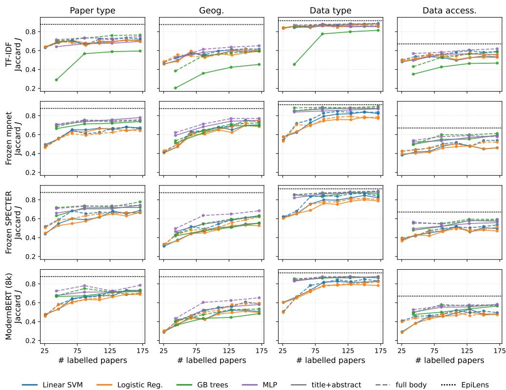  
Fig. E2 Saturation of the supervised configuration grid. Learning curves (held-out Jaccard vs. number of labelled training papers) grouped by representation (rows) and task (columns). Within each panel, colour encodes the classifier head (linear SVM, logistic regression, gradient-boosted trees, MLP) and line style the text scope (solid = title+abstract, dashed = full body). The black dotted line is EpiLens (flash, T =0). Every curve remains below EpiLens within the observed training range, and most curves flatten before the full sample, suggesting that the gap is unlikely to be closed merely by small increases in labelled data.

Table E3 Corpus-structure audit: how separable each axis is by vocabulary alone.
<table><tr><td>Method</td><td>Paper type Geography Data type Data access.</td><td></td><td></td><td></td></tr><tr><td colspan="5">Reference</td></tr><tr><td>Majority prior (floor)</td><td>0.593</td><td>0.353</td><td>0.843</td><td>0.472</td></tr><tr><td colspan="5">Unsupervised topic models (best K across sweep, oracle label alignment)</td></tr><tr><td>LSA</td><td>0.593</td><td>0.501</td><td>0.843</td><td>0.489</td></tr><tr><td>LDA</td><td>0.757</td><td>0.489</td><td>0.880</td><td>0.484</td></tr><tr><td>NMF</td><td>0.682</td><td>0.576</td><td>0.874</td><td>0.516</td></tr><tr><td>PLSA</td><td>0.748</td><td>0.539</td><td>0.875</td><td>0.562</td></tr><tr><td>BERTopic</td><td>0.626</td><td>0.581</td><td>0.843</td><td>0.477</td></tr><tr><td colspan="5">Reference</td></tr><tr><td>EpiLens (gemini-2.5-flash, T=0)</td><td>0.877</td><td>0.875</td><td>0.916</td><td>0.670</td></tr></table>

Sample-averaged Jaccard J for unsupervised topic models on the same 214-paper evaluation set, reported as the best J across the K sweep $( K \in \{ 0 . 5 , 1 , 2 , 4 \} \times | \mathcal { L } | )$ under an oracle cluster-to-label alignment, in their original full-text, leave-one-out configuration. These are not classifiers (they discover themes rather than apply the analyst’s scheme), and the best-K, oracle-aligned figures are an upper bound on what vocabulary structure alone recovers. The majority floor and EpiLens are shown for reference. Topic models partly recover the lexically regular axes (paper type, data type) but sit near the floor on data accessibility, the axis whose signal is a single buried statement.

## Appendix F Linking estimates to corpus papers

As described in Section 4.1, the corpus was assembled from sources named in the seed study’s early extraction sheets [32]. Here we describe how the estimates in those sheets were linked to corpus papers for the comparisons in Section 4.4, and check how review coverage and classification choices afect the main contrasts.

## F.1 Scope and inputs

We use the data extraction sheets shared by the authors of the seed study. The sheets are not redistributed. They contain 346 estimate rows and, after identifiers are resolved, 138 distinct published sources. The sheets are a working version and do not exactly match either the first preprint or the published article. The first preprint reports 342 estimates [32]. Five sources behind eight sheet rows do not appear in its references. The published article [11] reports a revised set of 302 estimates from 154 articles. All counts below refer to the early sheets.

We group the parameters into seven categories: reproduction number (basic, efective, or controlled), serial interval, incubation period, latent period, infectious period (including efective infectious periods), dispersion parameter k, and fatality risk (case or infection). These groups combine related quantities for describing their cited papers.

We call a review cited by an estimate a source review. An expanded source review is one whose included studies are linked to corpus records, whether through corpus construction or a published study list.

## F.2 Matching cited sources

Nineteen sheet rows have no published source to link, mostly because they relate to the seed study’s own incubation-period calculations. We link the other 327 to their cited sources, as illustrated in Figure F1. For a directly cited study or other document, we analyse that source itself. A source review links to its included studies present in the corpus.

The corpus-building records group included studies under the source review’s first author and year. We use these identifiers to connect a sheet citation to the appropriate group and check the DOI for reviews sharing an author and year. We match individual documents chiefly by DOI, with author and year or verified manual matching where needed. Where an identifier is malformed, takes a diferent form, or identifies another document, we apply a declared replacement checked against Crossref [50].

## F.3 Associated paper sets and labels

The corpus records links between its papers and the sources named in the sheets. We use those links to define the paper set associated with each estimate row $r ,$ denoted $B _ { r }$ For a directly cited study or other document, $B _ { r }$ contains that document. For a source review, Br contains its included studies that are present in the corpus (Section B). These are studies the review identifies as evidence for its analysis, rather than every item in its bibliography. The sheets cite the review for a particular estimate without naming the contributing studies. For example, a review reporting both serial-interval and incubation-period estimates may use diferent subsets of its included studies for each. Thus $B _ { r }$ reflects the review’s included evidence, which may be broader than the studies used for one value. Then, a paper can be included in several reviews even if it was first retrieved for just one. We retain every documented membership. For each parameter, pathogen, or combination of the two, we take the union of the corresponding $B _ { r }$ sets. Each paper contributes once to a group’s paper count and label shares, regardless of how many estimates link to it. The same paper may appear in several groups, so their paper counts are not additive.

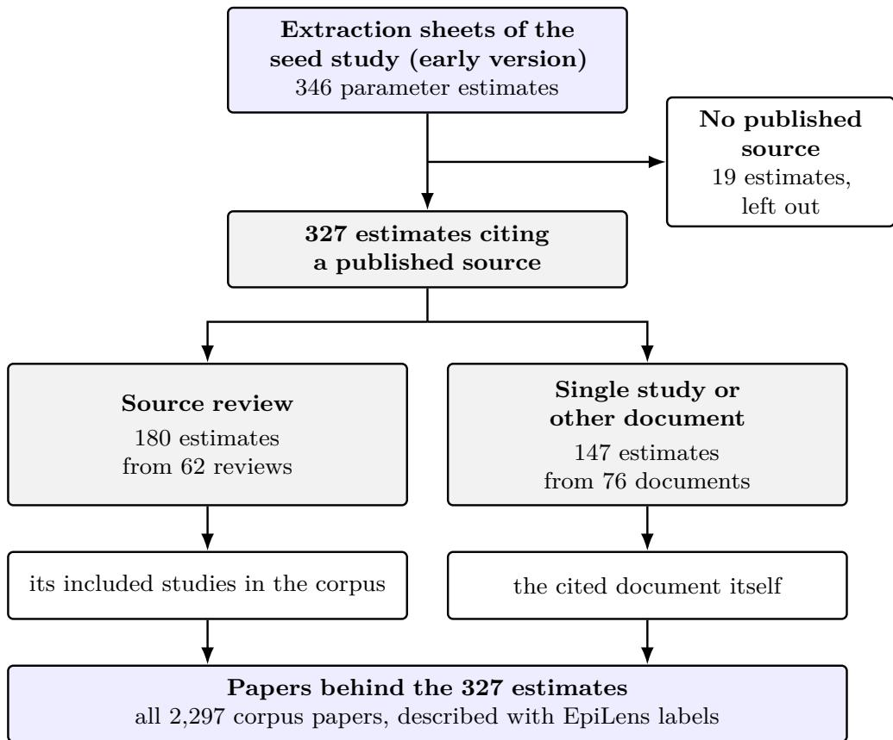  
Fig. F1 Linking parameter estimates to corpus papers. The 327 sheet rows citing a published source divide into reviews and single studies or other documents. A review principally links to its retrieved included studies in the corpus, while a directly cited document is itself analysed. The review and document counts are distinct sources after identifiers are resolved.

Table F1 tabulates model-based and simulated-data shares for the paper sets plotted in Figures 5 and 6. It also lists the influenza A subtypes pooled in the pathogen figure. These percentages use the frozen gemini-2.5-flash labels at T=0 over all associated corpus papers, so they are model outputs without sampling intervals. The figures do not separate pathogens within each parameter. Table F2 provides that breakdown for the comparisons discussed in Section 4.4.

Table F1 Labels of the papers behind the estimates, by parameter and by pathogen.
<table><tr><td></td><td>Papers</td><td>Model-based (%)</td><td>Simulated data (%)</td></tr><tr><td></td><td></td><td></td><td></td></tr><tr><td>By parameter Reproduction number</td><td>629</td><td>54</td><td>48</td></tr><tr><td>Fatality risk</td><td>1549</td><td>22</td><td>13</td></tr><tr><td>Serial interval</td><td>539</td><td>58</td><td>38</td></tr><tr><td>Incubation period</td><td>845</td><td>33</td><td>20</td></tr><tr><td>Dispersion k</td><td>137</td><td>57</td><td>55</td></tr><tr><td>Infectious period</td><td>186</td><td>37</td><td>42</td></tr><tr><td>Latent period</td><td>140</td><td>46</td><td>51</td></tr><tr><td></td><td></td><td></td><td></td></tr><tr><td>By pathogen SARS-CoV-2</td><td>590</td><td>54</td><td>28</td></tr><tr><td>Influenza</td><td></td><td></td><td></td></tr><tr><td>A/H1N1</td><td>109</td><td>72</td><td>65</td></tr><tr><td>A/H1N1pdm09</td><td>121</td><td>68</td><td>55</td></tr><tr><td>A/H2N2</td><td>127</td><td>60</td><td>53</td></tr><tr><td>A/H3N2</td><td>121</td><td>68</td><td>56</td></tr><tr><td>A/H1N1 and A/H3N2</td><td>1</td><td></td><td></td></tr><tr><td>A/H5N1</td><td>146</td><td>58</td><td>47</td></tr><tr><td>SARS and MERS</td><td></td><td></td><td></td></tr><tr><td>MERS-CoV</td><td>90</td><td>50</td><td>33</td></tr><tr><td>SARS-CoV-1</td><td>64</td><td>39</td><td>44</td></tr><tr><td>Ebola and Marburg</td><td></td><td></td><td></td></tr><tr><td>Ebola virus</td><td>262</td><td>27</td><td>25</td></tr><tr><td>Marburg virus</td><td>59</td><td>19</td><td>7</td></tr><tr><td>Bunyavirales</td><td></td><td></td><td></td></tr><tr><td>CČHF virus</td><td>497</td><td>10</td><td>1</td></tr><tr><td>Lassa virus</td><td>125</td><td>12</td><td>10</td></tr><tr><td>RVF virus</td><td>214</td><td>7</td><td>2</td></tr><tr><td>Mpox virus</td><td>153</td><td>10</td><td>8</td></tr><tr><td>Nipah virus</td><td>112</td><td>4</td><td>4</td></tr><tr><td>Zika virus</td><td>146</td><td>31</td><td>33</td></tr><tr><td>All</td><td>2297</td><td>29</td><td>19</td></tr></table>

Each row counts distinct corpus records associated with estimates of one parameter or pathogen. A record associated with several parameters or pathogens counts for each, so the rows add up to more than All. Model-based and Simulated data: percentage of these papers to which EpiLens assigns the label with gemini-2.5-flash (model outputs, not estimates). Model-based means paper type INFERENCE or FORECAST, and simulated data means data type SYNTHETIC. Shares are not shown for rows with fewer than 10 papers. Section 4.4 compares these labels with the manual labels for the comparisons it draws. Parameters are ordered as in Figure 4. Bold headings name the pathogen groups in the early extraction sheets shared by the authors of Ward et al. [32] that cover several pathogens. A/H1N1: estimates not specific to the 2009 pandemic virus. A/H1N1pdm09: the 2009 pandemic virus. A/H1N1 and A/H3N2: estimates reported for both subtypes together. CCHF: Crimean–Congo haemorrhagic fever. RVF: Rift Valley fever. Fatality risk: case or infection fatality risk.

Table F2 Model-based shares in the pathogen–parameter comparisons.
<table><tr><td>Pathogen</td><td>Parameter</td><td></td><td>Model-based (%)</td></tr><tr><td></td><td></td><td>Papers</td><td></td></tr><tr><td>Reproduction number and fatality risk</td><td></td><td>204</td><td>62</td></tr><tr><td>SARS-CoV-2</td><td>2 Reproduction number Fatality risk</td><td>335</td><td>52</td></tr><tr><td>MERS-CoV</td><td>Reproduction number</td><td>55</td><td>40</td></tr><tr><td></td><td>Fatality risk</td><td>67</td><td>36</td></tr><tr><td>Ebola virus</td><td>Reproduction number</td><td>117</td><td>47</td></tr><tr><td></td><td>Fatality risk</td><td>237</td><td>26</td></tr><tr><td>Lassa virus</td><td>Reproduction number</td><td>22</td><td>36</td></tr><tr><td></td><td>Fatality risk</td><td>124</td><td>11</td></tr><tr><td>Mpox virus</td><td>Reproduction number</td><td>61</td><td>11</td></tr><tr><td></td><td>Fatality risk</td><td>55</td><td>7</td></tr><tr><td colspan="4">Other fatality-risk comparisons</td></tr><tr><td>CCHF virus</td><td>Fatality risk</td><td>497</td><td>10</td></tr><tr><td>Nipah virus</td><td>Fatality risk</td><td>111</td><td>5</td></tr><tr><td>RVF virus</td><td>Fatality risk</td><td>185</td><td>8</td></tr><tr><td></td><td></td><td></td><td></td></tr><tr><td colspan="4">Incubation period</td></tr><tr><td></td><td>SARS-CoV-2 Incubation period</td><td>334</td><td>55</td></tr><tr><td>Mpox virus</td><td>Incubation period</td><td>115</td><td>6</td></tr></table>

Each row counts distinct corpus papers associated with estimates of the named parameter for that pathogen. A paper can appear in several rows. Model-based is the share labelled INFERENCE or FORECAST by EpiLens with gemini-2.5-flash at T=0 (model outputs, not parameter estimates). Rows show the comparisons discussed in Section 4.4. The full breakdown is in the reproduction package [42]. CCHF: Crimean–Congo haemorrhagic fever. RVF: Rift Valley fever.

## F.4 Manual-label check

The shares reported for all associated papers in Section 4.4 depend on model-assigned labels. We therefore check whether the contrast also appears under manual labels among the associated papers in the 214-paper evaluation sample. The manual labels show the same ordering, with a 38-percentage-point diference in model-based shares. We examine how this diference varies across the cited sources represented in that sample.

The paired bootstrap in Section E.4 resamples individual papers to assess diferences in classifier accuracy. Here, several labelled papers can come from one cited review, so we resample source reviews and directly cited documents as groups. This asks whether the manual-label contrast depends heavily on a few cited sources.

The resampling pool contains 45 sources represented by at least one labelled paper behind either parameter. In each of 4000 draws, we select 45 sources with replacement, keep each selected source’s labelled papers together, and recalculate the diference between the two manual-label shares. A source shared by both parameters contributes to both shares in the same draw. Within each parameter set, a paper linked to m sources receives weight 1/m through each source, so that it counts once in the observed share. The central 95% of resampled diferences is 19–57 percentage points, preserving the direction under this source resampling. This check concerns the manually labelled subset: the papers labelled within each review stay fixed, and the interval does not estimate what manual labels would show across the full associated paper sets.

## F.5 Sensitivity of the paper profiles

We now check whether the model-assigned reproduction-number–fatality-risk contrast across all associated papers changes with review coverage, model choice, or the removal of individual source reviews.

## Review coverage.

Incomplete matching of a review’s included studies could change the paper profiles. We linked corpus papers to 62 cited reviews, of which 60 report how many studies they included. The other two are an analytic perspective and a narrative review without a defined set of included studies. Counting a paper once for each review that includes it, corpus records match 2706 of 4467 reported inclusions (61%). These are shares of reported review inclusions, not shares of the corpus. Matching varies from 14 to 100% across reviews and is 47% for those associated with reproduction numbers, against 56% for fatality risks.

Removing reviews below the median matching rate, while retaining directly cited documents and reviews without reported totals, changes the model-based diference from 32 to 39 percentage points. Hence, the direction persists.

## Model choice and individual reviews.

Under the fully local qwen2.5:32b-instruct configuration, the model-based shares are 53% for reproduction numbers and 15% for fatality risks, compared with 54% and 22% under Flash. The simulated-data diference is smaller with the local configuration (31% versus 8%, compared with 48% versus 13% under Flash).

With the Flash labels, omitting each of the 42 source reviews in turn leaves the model-based diference at 28–36 percentage points. The model-based ordering therefore holds under both configurations and after the removal of any one review.

## Incubation periods across pathogens.

In Section 4.4, 55% of the 334 SARS-CoV-2 papers associated with incubation-period estimates are labelled model-based, compared with 6% of the 115 mpox papers. We check whether this diference depends on one source review or on papers also linked to other parameters. The manual comparison covers only 31 and 11 papers, so these checks use the full model-assigned sets.

The model-based share is at least 24% in each of seven SARS-CoV-2 source reviews and at most 11% in each of four mpox source reviews. The ordering therefore appears across the cited reviews, rather than arising only when their papers are pooled. Excluding papers also linked to reproduction-number or fatality-risk estimates for the same pathogen leaves shares of 54% of 201 SARS-CoV-2 papers and 6% of 70 mpox papers. These shares are close to those in the full associated sets (55% and 6%), so papers shared with those other parameter sets do not account for the diference.

## References

[1] Chafetz H, Zahuranec AJ, Marcucci S, et al (2022) The #Data4COVID19 Review: Assessing the Use of Non-Traditional Data During a Pandemic Crisis. https: //review.data4covid19.org, The GovLab, New York University. Accessed 20 March 2025

[2] Bolt K, Gil-González D, Oliver N (2024) Unconventional data, unprecedented insights: leveraging non-traditional data during a pandemic. Frontiers in Public Health 12:1350743

[3] Fallatah DI, Adekola HA (2024) Digital epidemiology: harnessing big data for early detection and monitoring of viral outbreaks. Infection prevention in practice 6(3):100382

[4] Chen Q, Yang M, Qin L, et al (2025) AI4Research: A survey of artificial intelligence for scientific research. arXiv:2507.01903

[5] Gokdemir O, Siebenschuh C, Brace A, et al (2025) HiPerRAG: High-performance retrieval augmented generation for scientific insights. In: Proceedings of the Platform for Advanced Scientific Computing Conference, pp 1–13

[6] Annepaka Y, Pakray P (2025) Large language models: a survey of their development, capabilities, and applications. Knowledge and Information Systems 67(3):2967–3022

[7] Huang L, Yu W, Ma W, et al (2025) A survey on hallucination in large language models: Principles, taxonomy, challenges, and open questions. ACM Transactions on Information Systems 43(2):1–55

[8] Lewis P, Perez E, Piktus A, et al (2020) Retrieval-augmented generation for knowledge-intensive nlp tasks. Advances in neural information processing systems 33:9459–9474

[9] Arslan M, Ghanem H, Munawar S, et al (2024) A survey on RAG with LLMs. Procedia computer science 246:3781–3790

[10] Fan W, Ding Y, Ning L, et al (2024) A survey on rag meeting llms: Towards retrieval-augmented large language models. In: Proceedings of the 30th ACM SIGKDD conference on knowledge discovery and data mining, pp 6491–6501

[11] Ward J, Gressani O, Kim S, et al (2026) The epidemiology of pathogens with pandemic potential: a review of key parameters and clustering analysis. Epidemics 54:100882. https://doi.org/10.1016/j.epidem.2025.100882

[12] Abo El-Enen M, Saad S, Nazmy T (2025) A survey on retrieval-augmentation generation (RAG) models for healthcare applications. Neural Computing and

[13] Salathé M, Bengtsson L, Bodnar TJ, et al (2012) Digital epidemiology. PLoS Computational Biology 8(7)

[14] Park HA, Jung H, On J, et al (2018) Digital epidemiology: use of digital data collected for non-epidemiological purposes in epidemiological studies. Healthcare informatics research 24(4):253–262

[15] Mesquita S, Perfeito L, Paolotti D, et al (2025) Epidemiological methods in transition: Minimizing biases in classical and digital approaches. PLOS Digital Health 4(1):e0000670. https://doi.org/10.1371/journal.pdig.0000670

[16] Zhao WX, Zhou K, Li J, et al (2023) A survey of large language models. arXiv:2303.18223

[17] Skarlinski MD, Cox S, Laurent JM, et al (2024) Language agents achieve superhuman synthesis of scientific knowledge. arXiv:2409.13740

[18] Asai A, He J, Shao R, et al (2024) OpenScholar: Synthesizing scientific literature with retrieval-augmented LMs. arXiv:2411.14199

[19] Gargari OK, Habibi G (2025) Enhancing medical AI with retrieval-augmented generation: A mini narrative review. Digital health 11:20552076251337177

[20] Liu S, McCoy AB, Wright A (2025) Improving large language model applications in biomedicine with retrieval-augmented generation: a systematic review, metaanalysis, and clinical development guidelines. Journal of the American Medical Informatics Association 32(4):605–615

[21] TypeSafe AI (2026) Introducing System One models & Jev. https://typesafe.ai/ blog/introducing-system-one-models-and-jev, archived at https://web.archive. org/web/20260930032358/https://typesafe.ai/blog/introducing-system-onemodels-and-jev. Accessed 2 October 2026

[22] Deußer T, Sparrenberg L, Sifa R (2026) Evaluating and benchmarking the System One model Jev. arXiv:2609.37647

[23] (2026) Unstructured: Open-source pre-processing tools for unstructured data. https://github.com/Unstructured-IO/unstructured, accessed 5 October 2026

[24] (2008–2025) GROBID. https://github.com/grobidOrg/grobid, Software Heritage ID swh:1:dir:dab86b296e3c3216e2241968f0d63b68e8209d3c. Accessed 15 September 2026

[25] Reimers N, Gurevych I (2019) Sentence-bert: Sentence embeddings using siamese bert-networks. In: Proceedings of the 2019 conference on empirical methods in natural language processing and the 9th international joint conference on natural

language processing (EMNLP-IJCNLP), pp 3982–3992

[26] Johnson J, Douze M, Jégou H (2019) Billion-scale similarity search with GPUs. IEEE Transactions on Big Data 7(3):535–547

[27] (2020) Qdrant: Vector search engine. https://github.com/qdrant/qdrant, GitHub repository. Accessed 15 September 2026

[28] Colvin S, Jolibois E, Ramezani H, et al (2024) Pydantic. Zenodo

[29] (2022) LangChain. https://github.com/langchain-ai/langchain, GitHub repository. Accessed 15 September 2026

[30] (2022) LlamaIndex. https: / / github.com / run - llama /llama\_ index, GitHub repository. Accessed 15 September 2026

[31] deepset (2019) Haystack: An open-source LLM framework. https://github.com/ deepset-ai/haystack, GitHub repository. Accessed 15 September 2026

[32] Ward J, Gressani O, Kim S, et al (2025) The epidemiology of pathogens with pandemic potential: a review of key parameters and clustering analysis. medRxiv preprint, version 1, https://doi.org/10.1101/2025.03.13.25323659, version 1: https://www.medrxiv.org/content/10.1101/2025.03.13.25323659v1

[33] Atil B, Aykent S, Chittams A, et al (2024) Non-determinism of “deterministic” LLM settings. arXiv:2408.04667

[34] PyTorch Documentation (2026) Numerical accuracy. https://docs.pytorch.org/ docs/main/notes/numerical\_accuracy.html, accessed 29 September 2026

[35] Yuan J, Li H, Ding X, et al (2025) Understanding and mitigating numerical sources of nondeterminism in LLM inference. arXiv:2506.09501

[36] Gond R, Kamath AK, Ramjee R, et al (2026) LLM-42: Enabling determinism in LLM inference with verified speculation. arXiv:2601.17768

[37] United Nations Statistics Division (2026) Standard country or area codes for statistical use (M49). https://unstats.un.org/unsd/methodology/m49/overview/, accessed 5 October 2026

[38] Naidoo T, Nash R, Morgenstern C, et al (2025) epireview: Tools to update and summarise the latest pathogen data from the Pathogen Epidemiology Review Group (PERG). https://github.com/mrc-ide/epireview, r package. Accessed 23 September 2026

[39] Callaghan M, Müller-Hansen F, Bond M, et al (2024) Computer-assisted screening in systematic evidence synthesis requires robust and well-evaluated stopping criteria. Systematic Reviews 13(1):284

[40] Organization WH (2024) Ethics and governance of artificial intelligence for health: large multi-modal models. WHO guidance. World Health Organization

[41] Perri V (2026) EpiLens: Local-first, evidence-grounded RAG workflows for scientific literature analysis. https://github.com/VinsRR/EpiLens, Python package, version 0.1.0, https://pypi.org/project/epilens/. Accessed 14 September 2026

[42] Perri V, Cattuto C, Paolotti D (2026) EpiLens: Lightweight RAG for epidemiological knowledge acquisition. Results, code, and corpus references. Zenodo, https://doi.org/10.5281/zenodo.22747111

[43] Lauer SA, Grantz KH, Bi Q, et al (2020) The incubation period of coronavirus disease 2019 (COVID-19) from publicly reported confirmed cases: estimation and application. Annals of internal medicine 172(9):577–582. https://doi.org/10.7326/ M20-0504

[44] Althaus CL (2014) Estimating the reproduction number of Ebola virus (EBOV) during the 2014 outbreak in West Africa. PLoS currents 6. https://doi.org/10. 1371/currents.outbreaks.91afb5e0f279e7f29e7056095255b288

[45] Nguku PM, Sharif S, Mutonga D, et al (2010) An investigation of a major outbreak of Rift Valley fever in Kenya: 2006–2007. The American journal of tropical medicine and hygiene 83(2 Suppl):5–13. https://doi.org/10.4269/ajtmh.2010.09-0288

[46] Nakoune E, Lampaert E, Ndjapou SG, et al (2017) A nosocomial outbreak of human monkeypox in the Central African Republic. Open Forum Infectious Diseases 4(4):ofx168. https://doi.org/10.1093/ofid/ofx168

[47] (2026) Gemini API: Files API documentation. https://ai.google.dev/gemini-api/ docs/files, Accessed 10 February 2026

[48] (2026) Gemini API: Document processing. https://ai.google.dev/gemini-api/docs/ document-processing, Accessed 10 February 2026

[49] (2020) RapidFuzz: Rapid fuzzy string matching in Python and C++. URL https://github.com/rapidfuzz/RapidFuzz, Accessed 5 March 2026

[50] Hendricks G, Tkaczyk D, Lin J, et al (2020) Crossref: The sustainable source of community-owned scholarly metadata. Quantitative Science Studies 1(1):414–427

[51] (2023) Ollama. https://ollama.com, Accessed 15 September 2026

[52] Deerwester S, Dumais ST, Furnas GW, et al (1990) Indexing by latent semantic analysis. Journal of the American society for information science 41(6):391–407

[53] Hofmann T (1999) Probabilistic latent semantic indexing. In: Proceedings of the 22nd annual international ACM SIGIR conference on Research and development in information retrieval, pp 50–57

[54] Blei DM, Ng AY, Jordan MI (2003) Latent Dirichlet allocation. Journal of Machine Learning Research 3:993–1022

[55] Lee DD, Seung HS (1999) Learning the parts of objects by non-negative matrix factorization. nature 401(6755):788–791

[56] Grootendorst M (2022) BERTopic: Neural topic modeling with a class-based TF-IDF procedure. arXiv:2203.05794

[57] Sparck Jones K (1972) A statistical interpretation of term specificity and its application in retrieval. Journal of documentation 28(1):11–21

[58] Cortes C, Vapnik V (1995) Support-vector networks. Machine learning 20(3):273– 297

[59] Tunstall L, Reimers N, Jo UES, et al (2022) Eficient few-shot learning without prompts. arXiv:2209.11055

[60] Warner B, Chafin A, Clavié B, et al (2025) Smarter, better, faster, longer: A modern bidirectional encoder for fast, memory eficient, and long context finetuning and inference. In: Proceedings of the 63rd Annual Meeting of the Association for Computational Linguistics (Volume 1: Long Papers), pp 2526–2547

[61] Yin W, Hay J, Roth D (2019) Benchmarking zero-shot text classification: Datasets, evaluation and entailment approach. In: Proceedings of the 2019 conference on empirical methods in natural language processing and the 9th international joint conference on natural language processing (EMNLP-IJCNLP), pp 3914–3923

[62] He P, Gao J, Chen W (2023) DeBERTaV3: Improving DeBERTa using ELECTRAstyle pre-training with gradient-disentangled embedding sharing. In: The Eleventh International Conference on Learning Representations

[63] Laurer M (2026) DeBERTa-v3-base-mnli-fever-anli: Model card. Hugging Face, https://huggingface.co/MoritzLaurer/DeBERTa-v3-base-mnli-fever-anli, accessed 5 October 2026

[64] Efron B (1987) Better Bootstrap Confidence Intervals. Journal of the American Statistical Association 82(397):171–185. https://doi.org/10.1080/01621459.1987. 10478410

[65] Holm S (1979) A Simple Sequentially Rejective Multiple Test Procedure. Scandinavian Journal of Statistics 6(2):65–70. https://doi.org/10.2307/4615733

[66] Song K, Tan X, Qin T, et al (2020) Mpnet: Masked and permuted pre-training for language understanding. Advances in neural information processing systems 33:16857–16867

[67] Cohan A, Feldman S, Beltagy I, et al (2020) Specter: Document-level representation learning using citation-informed transformers. In: Proceedings of the 58th annual meeting of the association for computational linguistics, pp 2270–2282

[68] Sentence Transformers (2026) all-mpnet-base-v2: Model card. Hugging Face, https://huggingface.co/sentence-transformers/all-mpnet-base-v2, accessed 5 October 2026