# FISHEREDIT: FISHER INFORMATION GUIDED KNOWL-EDGE EDITING FOR LARGE LANGUAGE MODELS

Yizhou Yang1,\* Jiahong Fu1,\* Zhiwu Wang1 Kailong Fan2 Haokun Lin3,† Yichen Wu4,† Zhenan Sun5 Renzhen Wang1,† Deyu Meng1

1Xi’an Jiaotong University 2Zhejiang University 3City University of Hong Kong 4Harvard University 5Institute of Automation, Chinese Academy of Sciences \*Equal contribution. †Corresponding author.

## ABSTRACT

Sequential knowledge editing in Large Language Models (LLMs) often leads to a degradation of general capabilities due to cumulative parameter interference. In this paper, we revisit prominent projection-based methods like AlphaEdit and reveal a surprising mismatch: their robustness is primarily driven by update regularization rather than the intended null-space projection. Based on this insight, we propose FisherEdit, a theoretically grounded method built on Fisher geometry, which replaces coarse activation-space projections with importance-aware regularization in parameter space. It penalizes changes to sensitive parameters more strongly while retaining flexibility for new facts, and admits an efficient row-wise closedform solution. Experiments on Llama-3, Qwen2.5, and Olmo-3 across multiple benchmarks demonstrate that FisherEdit achieves state-of-the-art performance while better preserving model stability and downstream task accuracy.

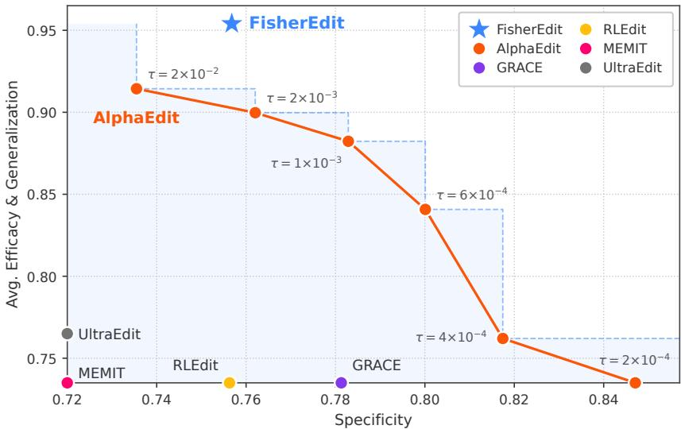  
Figure 1: Efficacy–locality trade-off on Llama-3-8B-Instruct. Sweeping AlphaEdit’s truncation threshold τ traces a monotone Pareto curve. FisherEdit lands strictly above the curve.

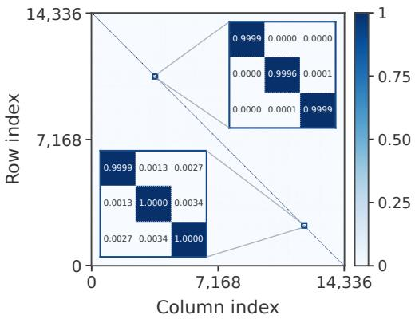  
(a)

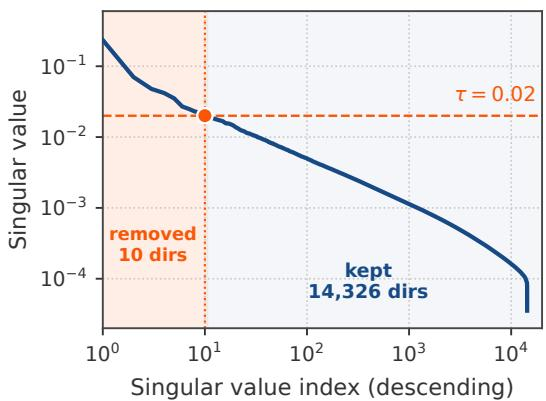  
(b)  
Figure 2: (a) AlphaEdit’s null-space projector Pτ on Llama-3-8B-Instruct is close to the identity matrix, indicating that most edit directions are only weakly affected by the projection. (b) Singular spectrum of ${ \bf K } _ { 0 } { \bf K } _ { 0 } ^ { \top }$ on the same layer. Only a few dozen directions exceed the truncation threshold τ.

## 1 INTRODUCTION

Large language models (LLMs) encode extensive factual knowledge during pretraining, and this knowledge must often be revised as facts become outdated, incorrect, or inconsistent with new evidence (Petroni et al., 2019; Roberts et al., 2020; Geva et al., 2021; Xia et al., 2026; Shi et al., 2025). Knowledge editing addresses this need by updating specific facts without full retraining, while aiming to preserve unrelated behavior (Yao et al., 2023; Wang et al., 2024b). This goal is especially difficult in sequential editing, where repeated weight changes can accumulate, interfere with one another, and degrade the model’s general abilities (Yang et al., 2024; Wu et al., 2024c). Maintaining reliable behavior under repeated edits, therefore, remains a central challenge for knowledge editing.

A prominent approach is direct weight editing. Locate-then-edit methods (Meng et al., 2022a;b) identify where factual associations are stored and update the corresponding weights. Because repeated updates can interfere with previously edited or preserved knowledge, recent methods add preservation constraints to restrict how the model changes. AlphaEdit (Fang et al., 2025) is a representative example: it uses a null-space projection to steer edits away from activation directions associated with prior knowledge. This projection-based view has become influential in sequential editing and has motivated several follow-up methods (Xu et al., 2025; Ikram et al., 2026).

Given AlphaEdit’s influence, we revisit it to examine what its null-space projection actually contributes. AlphaEdit offers a clean geometric intuition: edits are projected away from activation directions associated with prior knowledge, so the corresponding knowledge should be preserved. However, this intuition only partially explains its empirical behavior. As illustrated in Fig. 2, the default projector remains close to the identity and removes only a small portion of the activation space, leaving most update directions largely unchanged. Our more systematic analysis further shows that preservation in AlphaEdit is strongly shaped by update regularization, not projection alone. This motivates us to rethink preservation in sequential editing as a problem of designing more precise update regularization.

The key issue is how to constrain edits without removing the flexibility needed to encode new facts. Existing preservation mechanisms often operate at a coarse level: hard subspace constraints remove entire directions (Lyu et al., 2025; Xu et al., 2025; Ikram et al., 2026), while regularizationbased methods typically constrain the update through global magnitude, complexity, or spectral properties (Gupta et al., 2025; Liu et al., 2025; Zhang et al., 2026). While effective, these constraints do not directly distinguish parameters by their importance to general behavior. Parameter sensitivity in LLMs is highly uneven: some weight perturbations strongly affect general predictions, while others have limited impact (Frantar & Alistarh, 2023; Lin et al., 2024). Effective preservation should therefore be importance-aware, imposing stronger constraints on sensitive parameters while leaving less critical parameters available for editing. Following this principle, we propose FisherEdit, a

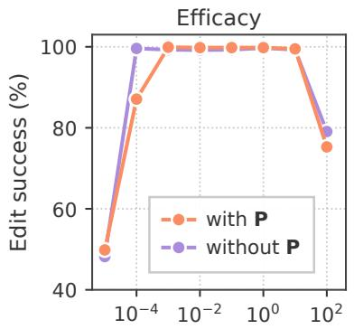

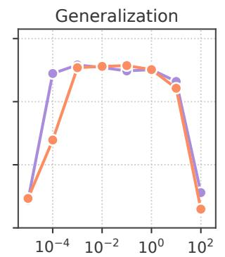  
L2 regularization strength λ

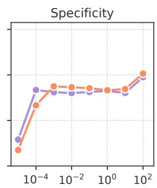  
Figure 3: Edit success for AlphaEdit and projector-disabled variant on Llama-3-8B. Across most of the regularization range, the w/ and w/o P curves almost overlap on all three edit-quality metrics.

Fisher-guided regularization method for sequential knowledge editing. It uses a diagonal Fisher estimate to measure parameter sensitivity and weight the update penalties accordingly. This constrains sensitive weights more strongly while allowing less sensitive weights to adapt to new facts. Our contributions are as follows:

• We re-examine AlphaEdit and find that its preservation benefit comes mainly from update regularization, with little contribution from the default null-space projection. Strengthening the projection trades edit efficacy for locality.

• Based on our analysis, we rethink preservation in sequential editing as regularization and introduce FisherEdit, a theoretically motivated method that uses Fisher geometry to derive an importanceaware, element-wise update penalty, together with a specialized row-wise closed-form solver.

• Across backbones and benchmarks, FisherEdit achieves state-of-the-art performance while better preserving general abilities on downstream tasks and reducing representation- and parameter-space drift relative to prior methods.

## 2 RELATED WORK

Knowledge editing (KE) updates factual associations in LLMs or reroutes queries to corrected knowledge, without full retraining or broad degradation of unrelated behavior (Yao et al., 2023; Wang et al., 2024b). Existing methods can be broadly grouped into learning-based editors and direct weight-editing methods.

Learning-based editors train auxiliary modules to produce, route, or store edits for a frozen base model. Representative methods include KnowledgeEditor (De Cao et al., 2021), MEND (Mitchell et al., 2022a), MALMEN (Tan et al., 2024), SERAC (Mitchell et al., 2022b) and RLEdit (Li et al., 2025). These methods require additional training, and their effectiveness depends on the editor’s capacity and training distribution.

Direct weight-editing methods modify target-model weights directly. Knowledge Neurons (Dai et al., 2022) and ROME (Meng et al., 2022a) localize factual associations in transformer MLPs, while MEMIT (Meng et al., 2022b) extends this to batched least-squares editing. Subsequent work adds constraints to preserve prior knowledge (Gu et al., 2024; Ma et al., 2025; Zhang et al., 2025). Among projection-based methods, AlphaEdit (Fang et al., 2025) uses the null space of preserved activation keys; EvoEdit (Lyu et al., 2025) evolves it during editing; and KDE (Xu et al., 2025) decouples past and current knowledge through orthogonal projection. CrispEdit (Ikram et al., 2026) instead hard-thresholds a K-FAC curvature spectrum, restricting edits to the approximate null space of capability curvature. Such hard projections can remove both prior-knowledge and edit-relevant signals, trading efficacy for locality. FisherEdit instead uses a soft, element-wise Fisher penalty, retaining all update directions while constraining important parameters more strongly.

Connection to continual-learning regularization. Importance-weighted regularization is classical in continual learning: EWC (Kirkpatrick et al., 2017) penalizes movement of parameters with large diagonal Fisher, and SI (Zenke et al., 2017), MAS (Aljundi et al., 2018), and Meta-CL (Wu et al., 2024b) derive related online importance estimates. FisherEdit adapts this principle to least-squares editing, where updates are computed in closed form rather than through SGD. Its Fisher penalty is motivated by a local second-order approximation to predictive KL divergence (Sec. 4.4).

## 3 RETHINKING NULL-SPACE PROJECTION

We now examine what drives preservation in AlphaEdit (Fang et al., 2025). After introducing its editing objective, we use controlled ablations to separate the effects of null-space projection and update regularization.

## 3.1 PRELIMINARIES

Following (Meng et al., 2022a;b), we edit the MLP down-projection matrix $\mathbf { W } \in \mathbb { R } ^ { d \times m }$ . For a batch of n edits, let $\bar { \mathbf { K } } \in \mathbb { R } ^ { m \times n }$ denote the edit keys, $\mathbf { V } \in \mathbb { R } ^ { d \times n }$ the target values. The goal is to find an update $\Delta \in \mathbb { R } ^ { d \times m }$ such that the edited weights map edit keys to the target values:

$$
( \mathbf { W } + \Delta ) \mathbf { K } \approx \mathbf { V } .\tag{1}
$$

Equivalently, $\Delta$ should fit the residual left by the current weights:

$$
\Delta { \bf K } \approx { \bf E } , \qquad { \bf E } \triangleq { \bf V } - { \bf W } { \bf K } .\tag{2}
$$

In sequential editing, the update should also avoid changing previous edits and unrelated knowledge. Let $\dot { \bf K } _ { p } \in \mathbb { R } ^ { m \times n _ { p } }$ denote historical edit keys from previous batches, $\mathbf { K } _ { 1 } \in \mathbb { R } ^ { m \times n _ { 1 } }$ denote current edit keys, and $\mathbf { K } _ { 0 } \in \mathbb { R } ^ { m \times n _ { 0 } }$ denote preserved keys sampled from a background corpus. A standard locate-then-edit objective is

$$
\begin{array} { r } { \Delta = \underbrace { \arg \operatorname* { m i n } \big \| \tilde { \Delta } \mathbf { K } _ { 1 } - \mathbf { E } \big \| ^ { 2 } } _ { \tilde { \Delta } } + \underbrace { \big \| \tilde { \Delta } \mathbf { K } _ { p } \big \| ^ { 2 } } _ { ( a ) } + \underbrace { \big \| \tilde { \Delta } \mathbf { K } _ { 0 } \big \| ^ { 2 } } _ { ( c ) } . } \end{array}\tag{3}
$$

Term (a) fits the new edits, while terms (b) and (c) penalize changes along historical-edit and preserved-knowledge directions, respectively.

AlphaEdit (Fang et al., 2025) replaces the penalty on ${ \bf K } _ { 0 }$ with a null-space projector $\mathbf { P } _ { \tau }$ . Specifically, Pτ is computed from the eigenspectrum of ${ \bf K } _ { 0 } { \bf K } _ { 0 } ^ { \top }$ : directions whose eigenvalues exceed a threshold τ are treated as occupied, and the remaining subspace is used for editing. AlphaEdit solves

$$
\begin{array} { r } { \Delta = \underset { \tilde { \Delta } } { \arg \operatorname* { m i n } } \| \tilde { \Delta } \mathbf { P } _ { \tau } \mathbf { K } _ { 1 } - \mathbf { E } \| ^ { 2 } + \| \tilde { \Delta } \mathbf { P } _ { \tau } \mathbf { K } _ { p } \| ^ { 2 } + \lambda \| \tilde { \Delta } \mathbf { P } _ { \tau } \| ^ { 2 } . } \end{array}\tag{4}
$$

The following analysis asks whether the projection $\mathbf { P } _ { \tau }$ , the regularization strength λ, or the threshold τ is responsible for AlphaEdit’s empirical preservation behavior.

## 3.2 WHAT ACTUALLY DRIVES PRESERVATION?

Finding 1: The Projector P is near-identity. If the null-space mechanism is the main source of preservation, the projector should remove a substantial set of directions associated with prior knowledge. We first inspect the projector used by AlphaEdit under its default setting. As shown in Fig. 2(a), the matrix is almost identical to the identity: its diagonal entries are close to one, and its off-diagonal entries are negligible. This behavior comes from the spectrum of ${ \bf K } _ { 0 } { \bf K } _ { 0 } ^ { \top }$ . Fig. 2(b) shows that only a small number of singular directions exceed the default threshold τ, while the vast majority fall below it and are kept for editing. Thus, the projected-out subspace covers only a tiny fraction of the activation space. In practice, P leaves most update directions unchanged.

We then ask whether this near-identity projector affects editing outcomes. We compare AlphaEdit with a variant that disables the projector while keeping the same regularization strength. As shown in Fig. 3, the two variants largely overlap across Efficacy, Generalization, and Specificity metrics over the working range of λ. This suggests that, under the default setting, AlphaEdit’s projector contributes little to its empirical preservation behavior.

Finding 2: Regularization is the main control knob. If the projector changes little, the remaining candidate explanation is the update regularizer. To isolate its effect, we keep the projector fixed and vary only the regularization strength λ. Fig. 4 shows that this single change produces large shifts across all edit-success metrics. With weak regularization, the update becomes unstable and performance collapses; with stronger regularization, performance is substantially restored. These results suggest that much of AlphaEdit’s robustness comes from controlling update magnitude through regularization, with limited contribution from the default projection.

Finding 3: Stronger projection only moves along a trade-off. One possible explanation is that the default threshold τ makes the projector too weak. We therefore lower $\tau ,$ forcing P to remove more activation directions. If the null-space interpretation were sufficient, a stronger projection should improve preservation without harming edit success. The results show a different pattern. As τ decreases, specificity improves, but efficacy and generalization drop sharply (Fig. 1). Thus, stronger projection does not recover a better protected subspace; it simply trades editing success for locality. This happens because the removed directions are not purely preserved-knowledge directions. They can also contain information needed to realize the edit. Removing them therefore protects some unrelated behavior, but weakens the edit itself.

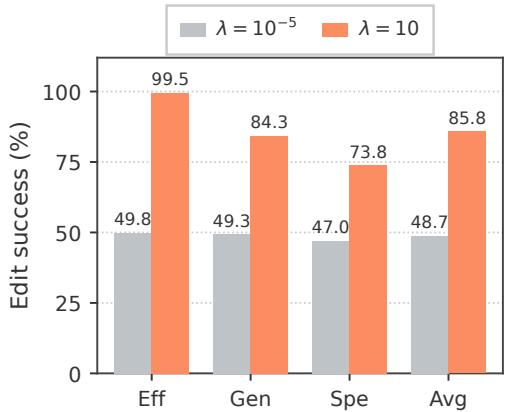  
Figure 4: Within AlphaEdit on Llama-3-8B-Instruct, changing λ from $1 0 ^ { - 5 }$ to 10 produces a large jump in all three metrics.

Takeaway. These findings suggest a different design principle for sequential editing: preservation should act on parameters, not entire activation directions. Hard projection can remove directions needed for the new edit, while uniform shrinkage ignores which weights matter most for general behavior. A better constraint should distinguish sensitive weights from safer ones. This motivates FisherEdit, which applies a Fisher-weighted, element-wise penalty directly to the update.

## 4 METHOD

## 4.1 FISHER-GUIDED EDITING OBJECTIVE

Motivated by the analysis above, our FisherEdit shifts preservation from activation-space projection to parameter-space regularization. We keep the standard edit-fitting objective, but penalize each parameter update according to its Fisher importance:

$$
\Delta = \underset { \tilde { \Delta } } { \arg \operatorname* { m i n } } \ : \| \tilde { \Delta } \mathbf { K } _ { 1 } - \mathbf { E } \| ^ { 2 } + \| \tilde { \Delta } \mathbf { K } _ { p } \| ^ { 2 } + \lambda \| \sqrt { \mathbf { F } } \odot \tilde { \Delta } \| ^ { 2 } ,\tag{5}
$$

Here, $\mathbf { F } \in \mathbb { R } ^ { d \times m }$ is the diagonal Fisher Information matrix and ⊙ denotes element-wise multiplication. This term makes changes to high-Fisher parameters more costly while leaving low-Fisher parameters more flexible for encoding new facts. Compared with the objectives in Eqns. (3)(4), FisherEdit keeps the edit-fitting and historical-edit terms, but replaces the preserved-key penalty with a Fisher-weighted penalty on the update itself.

## 4.2 SOLVING THE FISHER-WEIGHTED OBJECTIVE

Eqn. (5) is a quadratic objective that admits a closed-form solution. Because the Fisher penalty is element-wise, we can solve for each row of the update independently. Let $\mathbf { G } = \mathbf { K } _ { 1 } \mathbf { K } _ { 1 } ^ { \top } + \mathbf { K } _ { p } \dot { \mathbf { K } } _ { p } ^ { \top }$ and let $\delta _ { i } , e _ { i }$ , and $f _ { i }$ denote the i-th rows of ∆, E, and F, respectively. With $\mathbf { D } _ { i } = \mathrm { d i a g } ( f _ { i } )$ , setting the gradient of Eqn. (5) to zero gives $\delta _ { i } ( \mathbf { G } + \lambda \mathbf { D } _ { i } ) = e _ { i } \mathbf { K } _ { 1 } ^ { \top }$ for each row, yielding

$$
\delta _ { i } = e _ { i } \mathbf { K } _ { 1 } ^ { \top } ( \mathbf { G } + \lambda \mathbf { D } _ { i } ) ^ { - 1 } .\tag{6}
$$

The shared matrix G captures the constraints from current and historical edit keys, while the rowspecific $\mathbf { D } _ { i }$ weights the update according to parameter importance.

Directly evaluating Eqn. (6) requires an $m \times m$ matrix inverse for each row. Since m is the MLP intermediate dimension, this becomes expensive at LLM scale. We therefore exploit the low-rank structure $\mathbf { G } = \mathbf { U } \mathbf { U } ^ { \top }$ , where $\mathbf { U } = [ \mathbf { K } _ { 1 } \ | \ \mathbf { \hat { K } } _ { p } ] \in \mathbb { R } ^ { m \times r }$ and $r = n _ { 1 } + n _ { p }$ . Applying the Woodbury identity (Golub & Van Loan, 2013) gives the equivalent update

$$
\begin{array} { r } { \boxed { \delta _ { i } = e _ { i } \mathbf { K } _ { 1 } ^ { \top } \left[ ( \lambda \mathbf { D } _ { i } ) ^ { - 1 } - ( \lambda \mathbf { D } _ { i } ) ^ { - 1 } \mathbf { U } \right. } } \\ { \left. \left( \mathbf { I } _ { r } + \mathbf { U } ^ { \top } ( \lambda \mathbf { D } _ { i } ) ^ { - 1 } \mathbf { U } \right) ^ { - 1 } \mathbf { U } ^ { \top } ( \lambda \mathbf { D } _ { i } ) ^ { - 1 } \right] . } \end{array}\tag{7}
$$

Since $\mathbf { D } _ { i }$ is diagonal, $( \lambda \mathbf { D } _ { i } ) ^ { - 1 }$ is computed by element-wise division. The remaining linear system has size $r \times r ,$ reducing the cost when the number of edit keys is much smaller than the MLP dimension $( r \ll m )$ . All d row-wise systems can be solved using batched linear algebra, with an overall complexity of $O ( d m r ^ { 2 } + d r ^ { 3 } )$ ). The full derivation is provided in Appendix G.

## 4.3 ESTIMATING THE FISHER DIAGONAL

The solver above assumes to the Fisher diagonal F for the edited weight block. We estimate this quantity once before editing and reuse it throughout the edit sequence. This keeps the editing procedure efficient while giving each parameter a fixed importance score measured from the model’s original predictive behavior.

We use the empirical Fisher diagonal. Given a held-out calibration set $\mathcal { D } = \{ ( x _ { t } , y _ { t } ) \} _ { t = 1 } ^ { N }$ , the Fisher value for parameter $W _ { i j } ^ { ( \ell ) }$ in layer ℓ is estimated as

$$
\mathbf { F } _ { i j } ^ { ( \ell ) } = \frac { 1 } { N } \sum _ { t = 1 } ^ { N } \left( \frac { \partial \mathcal { L } ( x _ { t } , y _ { t } ) } { \partial W _ { i j } ^ { ( \ell ) } } \right) ^ { 2 } ,\tag{8}
$$

where L is the cross-entropy loss. We compute this estimate only for the MLP down-projection matrices that are later edited, rather than for all model parameters.

For calibration, we follow Šliogeris et al. (2025) and use N=1,000 examples sampled from MMLU (Hendrycks et al., 2020). The calibration data is separate from the edit requests and is used only to estimate parameter sensitivity. Each example is processed individually, so the squared gradients correspond to per-example empirical Fisher estimates rather than gradients averaged over a batch.

## 4.4 THEORETICAL INTERPRETATION

In this section, we explain why the element-wise Fisher regularizer in Eqn. (5) provides an effective regularization principle for model editing. Specifically, we relate it to the locality cost of an update $\Delta .$ , measured by the KL divergence between the pre-edit and post-edit predictive distributions on a reference set $\mathcal { D } _ { \mathrm { r e f } } \mathbf { \cdot }$

$$
\begin{array} { r } { \mathcal { L } _ { \mathrm { l o c } } ( \Delta ) = \mathbb { E } _ { \boldsymbol { x } \sim \mathcal { D } _ { \mathrm { r e f } } } \Big [ \mathrm { K L } \big ( p _ { \mathbf { W } } ( \cdot | \boldsymbol { x } ) \| p _ { \mathbf { W } + \Delta } ( \cdot | \boldsymbol { x } ) \big ) \Big ] . } \end{array}\tag{9}
$$

To establish this connection, we consider a second-order expansion of $\mathcal { L } _ { \mathrm { l o c } }$ around $\Delta = 0$ . Under the regularity conditions in Appendix H.2, its value and gradient vanish at this point, and its Hessian equals the Fisher matrix $\mathbf { F } ^ { ( S ) }$ restricted to the edited parameters. Writing $u = \mathrm { v e c } ( \Delta )$ , we obtain

$$
\begin{array} { r } { \mathcal { L } _ { \mathrm { l o c } } ( \Delta ) = \frac { 1 } { 2 } u ^ { \top } \mathbf { F } ^ { ( S ) } u + o ( \| u \| ^ { 2 } ) . } \end{array}\tag{10}
$$

The full md × md Fisher is intractable at LLM scale. Following Kirkpatrick et al. (2017), we use a diagonal approximation, estimated in practice by the empirical Fisher in Eqn. (8):

$$
\scriptstyle { \frac { 1 } { 2 } } u ^ { \intercal } \mathbf { F } ^ { ( S ) } u \approx \frac { 1 } { 2 } \sum _ { i , j } F _ { i j } \Delta _ { i j } ^ { 2 } ,\tag{11}
$$

which recovers the form of the regularizer in Eqn. (5), with the constant absorbed into λ. FisherEdit therefore uses empirical parameter sensitivities to approximate the local cost of changing the pre-edit distribution, providing a tractable regularization principle for preserving model behavior. The full Taylor expansion and derivation are provided in Appendix H.

Table 1: CounterFact results across three backbones under sequential editing. Best per column in bold; second best underlined.
<table><tr><td rowspan="2">Method</td><td colspan="4">Llama-3-8B-Instruct</td><td colspan="4">Qwen2.5-7B-Instruct</td><td colspan="4">Olmo-3-7B-Instruct</td></tr><tr><td>Eff</td><td>Gen</td><td>Spe</td><td>Avg</td><td>Eff</td><td>Gen</td><td>Spe</td><td>Avg</td><td>Eff</td><td>Gen</td><td>Spe</td><td>Avg</td></tr><tr><td>FT</td><td>65.02</td><td>58.05</td><td>41.63</td><td>54.90</td><td>73.23</td><td>62.76</td><td>40.52</td><td>58.84</td><td>95.17</td><td>70.87</td><td>56.12</td><td>74.05</td></tr><tr><td>ROME</td><td>33.84</td><td>36.51</td><td>68.16</td><td>46.17</td><td>37.33</td><td>40.92 65.52</td><td></td><td>47.92</td><td>36.10</td><td>39.12</td><td>69.32</td><td>48.18</td></tr><tr><td>MEMIT</td><td>48.00</td><td>47.64</td><td>52.52</td><td>49.39</td><td>64.20</td><td>62.41</td><td>55.88</td><td>60.83</td><td>71.38</td><td>69.53</td><td>55.45</td><td>65.45</td></tr><tr><td>MEND</td><td>48.41</td><td>48.41</td><td>51.05</td><td>49.29</td><td>1.13</td><td>0.67</td><td>1.15</td><td>0.98</td><td>38.97</td><td>43.13</td><td>62.18</td><td>48.09</td></tr><tr><td>GRACE</td><td>21.84</td><td>26.15</td><td>78.13</td><td>42.04</td><td>37.23</td><td>41.94</td><td>64.55</td><td>47.91</td><td>39.17</td><td>42.00</td><td>64.09</td><td>48.42</td></tr><tr><td>RECT</td><td>33.94</td><td>36.87</td><td>70.05</td><td>46.95</td><td>36.20</td><td>40.61</td><td>65.87</td><td>47.56</td><td>36.71</td><td>39.89</td><td>68.39</td><td>48.33</td></tr><tr><td>PRUNE</td><td>35.48</td><td>37.48</td><td>67.88</td><td>46.95</td><td>37.33</td><td>40.92</td><td>65.52</td><td>47.92</td><td>36.00</td><td>38.71</td><td>69.47</td><td>48.06</td></tr><tr><td>WISE</td><td>43.59</td><td>42.31</td><td>61.55</td><td>49.15</td><td>44.21</td><td>45.23</td><td>61.76</td><td>50.40</td><td>39.28</td><td>42.10</td><td>63.80</td><td>48.39</td></tr><tr><td>AnyEdit</td><td>52.00</td><td>47.33</td><td>51.72</td><td>50.35</td><td>69.53</td><td>48.05</td><td>56.34</td><td>57.97</td><td>63.48</td><td>51.28</td><td>48.29</td><td>54.35</td></tr><tr><td>RLEdit</td><td>24.20</td><td>27.43</td><td>75.63</td><td>42.42</td><td>35.79</td><td>38.20</td><td>66.42</td><td>46.80</td><td>22.25</td><td></td><td>29.94 75.63</td><td>42.61</td></tr><tr><td>UltraEdit</td><td>52.41</td><td>53.12</td><td>46.77</td><td>50.77</td><td>60.61</td><td>42.05</td><td>69.57</td><td>57.41</td><td>43.38</td><td>45.33</td><td>57.57</td><td>48.76</td></tr><tr><td>AlphaEdit</td><td>99.79</td><td>90.15</td><td>73.25</td><td>87.73</td><td>100.00</td><td>64.15</td><td>66.36</td><td>76.84</td><td>99.48</td><td>75.84</td><td>72.76</td><td>82.69</td></tr><tr><td>FisherEdit (ours)</td><td>99.90</td><td>90.92</td><td>75.68</td><td>88.83</td><td>99.90</td><td>71.08</td><td>66.66</td><td>79.21</td><td>99.38</td><td>79.53</td><td>73.33</td><td>84.08</td></tr></table>

Table 2: Main results across CounterFact, Ripple, and EVOKE on Olmo-3-7B-Instruct under sequential editing. Best per column in bold; second best underlined.
<table><tr><td rowspan="2">Method</td><td colspan="4">COUNTERFACT</td><td colspan="4">RIPPLE</td><td colspan="4">EVOKE</td></tr><tr><td>Eff</td><td>Gen</td><td>Spe</td><td>Avg</td><td>Eff</td><td>Gen</td><td>Spe</td><td>Avg</td><td>Eff</td><td>Gen</td><td>Spe</td><td>Avg</td></tr><tr><td>FT</td><td>95.17</td><td>70.87</td><td>56.12</td><td>74.05</td><td>76.10</td><td>59.87</td><td>63.79</td><td>66.59</td><td>94.10</td><td>79.48</td><td>47.70</td><td>73.76</td></tr><tr><td>ROME</td><td>36.10</td><td>39.12</td><td>69.32</td><td>48.18</td><td>42.60</td><td>44.01</td><td>67.30</td><td>51.30</td><td>33.50</td><td>34.22</td><td>65.58</td><td>44.43</td></tr><tr><td>MEMIT</td><td>71.38</td><td>69.53</td><td>55.45</td><td>65.45</td><td>48.40</td><td>45.99</td><td>69.85</td><td>54.75</td><td>64.80</td><td>63.81</td><td>51.16</td><td>59.92</td></tr><tr><td>MEND</td><td>38.97</td><td>43.13</td><td>62.18</td><td>48.09</td><td>32.90</td><td>34.94</td><td>74.62</td><td>47.48</td><td>37.20</td><td>37.32</td><td>63.73</td><td>46.08</td></tr><tr><td>GRACE</td><td>39.17</td><td>42.00</td><td>64.09</td><td>48.42</td><td>50.20</td><td>48.39</td><td>60.89</td><td>53.16</td><td>35.40</td><td>35.80</td><td>63.52</td><td>44.91</td></tr><tr><td>RECT</td><td>36.71</td><td>39.89</td><td>68.39</td><td>48.33</td><td>41.00</td><td>41.91</td><td>68.93</td><td>50.61</td><td>34.00</td><td>34.42</td><td>65.66</td><td>44.69</td></tr><tr><td>PRUNE</td><td>36.00</td><td>38.71</td><td>69.47</td><td>48.06</td><td>43.80</td><td>43.93</td><td>67.17</td><td>51.63</td><td>33.30</td><td>34.21</td><td>65.59</td><td>44.37</td></tr><tr><td>WISE</td><td>39.28</td><td>42.10</td><td>63.80</td><td>48.39</td><td>56.20</td><td>56.71</td><td>55.06</td><td>55.99</td><td>36.00</td><td>35.96</td><td>62.77</td><td>44.91</td></tr><tr><td>AnyEdit</td><td>63.48</td><td>51.28</td><td>48.29</td><td>54.35</td><td>50.80</td><td>49.85</td><td>82.60</td><td>61.08</td><td>68.10</td><td>58.90</td><td>40.54</td><td>55.85</td></tr><tr><td>RLEdit</td><td>22.25</td><td></td><td>29.94 75.63</td><td>42.61</td><td>6.90</td><td>10.03</td><td>82.55</td><td>33.16</td><td>17.10</td><td>18.83</td><td>78.51</td><td>38.15</td></tr><tr><td>UltraEdit</td><td>43.38</td><td>45.33</td><td>57.57</td><td>48.76</td><td>48.00</td><td>49.04</td><td>57.03</td><td>51.36</td><td>48.90</td><td>48.88</td><td>51.19</td><td>49.66</td></tr><tr><td>AlphaEdit</td><td>99.48</td><td>75.84</td><td>72.76</td><td>82.69</td><td>96.70</td><td>75.10</td><td>33.39</td><td>68.40</td><td>99.90</td><td>92.47</td><td>70.14</td><td>87.50</td></tr><tr><td>FisherEdit (ours)</td><td>99.38</td><td>79.53</td><td>73.33</td><td>84.08</td><td>97.30</td><td>74.66</td><td>42.28</td><td>71.41</td><td>99.90</td><td>92.94</td><td>71.08</td><td>87.97</td></tr></table>

## 5 EXPERIMENTS

We conduct comprehensive experiments to answer two core questions: (1) How does FisherEdit improve the overall performance of editing? (2) Does FisherEdit protect the general performance?

## 5.1 EXPERIMENT SETUP

Datasets and Models. We evaluate FisherEdit on three widely used model editing benchmarks: CounterFact (Meng et al., 2022a), Ripple (Cohen et al., 2024), and EVOKE (Zhang et al., 2025). Experiments are conducted under a sequential editing setting with 1,000 edits, using three representative backbones: Llama-3-8B-Instruct (Grattafiori et al., 2024), Qwen2.5-7B-Instruct (Qwen et al., 2025), and Olmo-3-7B-Instruct (Olmo et al., 2025). To assess the impact on general capabilities, we further evaluate the edited models on HumanEval (Chen et al., 2021), ARC-Challenge/Easy (Clark et al., 2018), IFEval (Zhou et al., 2023), WinoGrande (Sakaguchi et al., 2021) and GPQA (Rein et al., 2023), and report WikiText (Merity et al., 2016) perplexity after sequential editing on CounterFact.

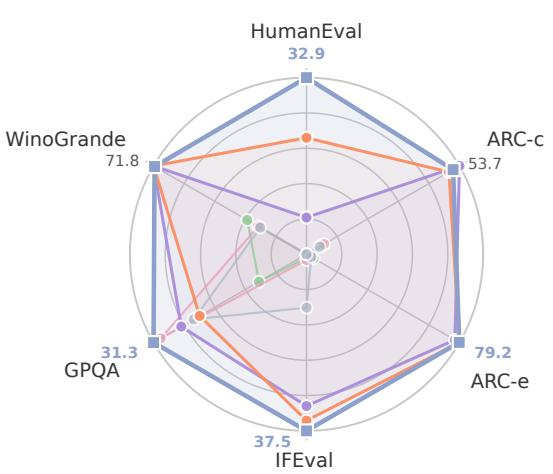  
(a)

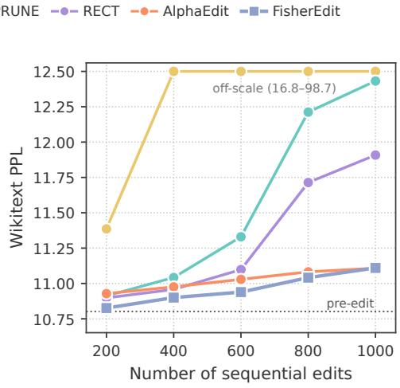  
(b)  
Figure 5: (a) Downstream task scores of Llama-3-8B-Instruct on HumanEval, ARC-c, ARC-e, IFEval, WinoGrande and GPQA. (b) Wikitext perplexity of Llama-3-8B-Instruct after applying N ∈ {200, 400, 600, 800, 1000} CounterFact edits.

Baselines and Metrics. We compare FisherEdit with twelve baselines, including the learningbased and direct weight-editing methods discussed in Section 2, as well as FT (Zhu et al., 2020), GRACE (Hartvigsen et al., 2023), WISE (Wang et al., 2024a), AnyEdit (Jiang et al., 2025), and UltraEdit (Gu et al., 2025). For editing performance, we report efficacy (Eff), generalization (Gen), specificity (Spe), and their unweighted average (Avg). For general performance, we report task accuracy and WikiText perplexity.

## 5.2 EDITING PERFORMANCE

Table 1 reports CounterFact results across three backbones. FisherEdit achieves the highest Avg in all three settings, with gains over AlphaEdit of +1.10 on Llama, +2.37 on Qwen, and +1.39 on Olmo. Since Efficacy is already close to saturated for both AlphaEdit and FisherEdit, the main differences appear in Gen and Spe. This indicates that FisherEdit improves the quality of the update primarily by better balancing paraphrase transfer and neighborhood preservation.

Table 2 further evaluates whether the same trend holds across datasets on a fixed backbone. On Olmo-3-7B-Instruct, FisherEdit obtains the best Avg on CounterFact, Ripple, and EVOKE. The improvements over AlphaEdit are consistent: +1.39, +3.01, and +0.47 points, respectively. These results support the claim that Fisher-weighted regularization provides a robust preservation mechanism across both model and benchmark variations.

We also evaluate FisherEdit’s computational efficiency by measuring wall-clock time and peak GPU memory across the editing pipeline, with a detailed comparison to AlphaEdit in Appendix C.5. The results show that FisherEdit substantially reduces preprocessing time and overall runtime including preprocessing, while using nearly the same peak GPU memory.

## 5.3 GENERAL PERFORMANCE

General domains. Preserving general capabilities beyond the edited facts is crucial, yet is often overlooked by prior editing methods. From Figure 5(a), FisherEdit maintains stable performance across all six downstream tasks, covering code generation, science, commonsense reasoning, instruction fol lowing, and challenging knowledge-intensive question answering. In contrast, AlphaEdit and RECT exhibit noticeable drops on HumanEval and GPQA. These results suggest that the Fisher-diagonal regularizer helps mitigate collateral damage while still enabling effective edits.

Language modeling. We further evaluate the impact of editing on general language modeling by reporting WikiText perplexity after sequentially editing $N \in \{ 2 0 \bar { 0 } , 4 0 \bar { 0 } , 6 0 0 , 8 0 0 , \bar { 1 } 0 0 0 \}$ CounterFact samples. As shown in Figure 5(b), FisherEdit better preserves general text modeling ability than competing methods during sequential editing. Its WikiText perplexity remains consistently low across all edit counts, increasing only mildly from 10.826 after 200 edits to 11.110 after 1,000 edits. By contrast, AlphaEdit, RECT, and PRUNE show larger increases. These results indicate that FisherEdit maintains the most stable general-language perplexity throughout the editing process.

## 5.4 ABLATION STUDY

Fisher Matrix. To examine whether the Fisher diagonal captures model-specific information, we replace F in Eq. (5) with an all-ones matrix (Uniform), which reduces the objective to $\ell _ { 2 }$ regularization, or i.i.d. samples from Uniform[0, 1] (Random), while keeping all other hyperparameters fixed. From Table 3, replacing F with Uniform largely preserves rewrite and paraphrase performance, which are mainly controlled by λ as discussed in §3, but substantially weakens neighborhood locality. Meanwhile, Random degrades all three metrics. These results indicate that FisherEdit

Table 3: Fisher-matrix ablation on Counter-Fact with Llama-3-8B-Instruct under sequential editing. Fisher diagonal F is replaced with an all-ones matrix (Uniform) or with i.i.d. uniform random values (Random).
<table><tr><td></td><td>Eff</td><td>Gen</td><td>Spe</td><td>Avg</td></tr><tr><td>Fisher</td><td>99.58</td><td>91.28</td><td>75.13</td><td>88.66</td></tr><tr><td>Uniform</td><td>99.28</td><td>91.48</td><td>72.22</td><td>87.66</td></tr><tr><td>Random</td><td>95.89</td><td>85.74</td><td>69.94</td><td>83.86</td></tr></table>

benefits from the structured information encoded in the Fisher diagonal, rather than from generic non-uniform reweighting.

Top-Fisher masking. The Fisher diagonal is heavy-tailed and model-dependent: in layer 4, its largest 1% of cached entries carry 16.8%, 52.6%, and 30.4% of the total mass for Llama-3-8B-Instruct, Qwen2.5-7B-Instruct, and Olmo-3-7B-Instruct, respectively (a uniform matrix would carry 1%). To test whether the high-Fisher coordinates are important for preservation, we rerun the Llama-3-8B-Instruct/CounterFact setting with 1,000 sequential edits while selectively removing or retaining the highest-Fisher coordinates. For mask-top, entries at the top q percent are replaced by that layer’s median; for keep-top, only those entries are retained and all others are replaced by the median. As shown in Table 4, masking the top 1% decreases Specificity by 1.65 points, eliminating approximately 48% of the Full-Fisher–Uniform Specificity gap and 63% of the Average gap. Conversely, keeping only the top 10% recovers approximately 60% of the Specificity advantage and 70% of the Average advantage, while the full diagonal remains strongest. These results provide direct evidence that the proposed Fisher diagonal plays a fundamental role in FisherEdit’s gains, beyond uniform $\ell _ { 2 }$ regularization alone.

Table 4: Effect of masking or retaining high-Fisher coordinates.
<table><tr><td></td><td>Eff</td><td>Gen</td><td>Spe</td><td>Avg</td></tr><tr><td>Full Fisher</td><td>99.90</td><td>90.92</td><td>75.68</td><td>88.83</td></tr><tr><td>Mask top 1%</td><td>99.49</td><td>90.87</td><td>74.03</td><td>88.13</td></tr><tr><td>Mask top 10%</td><td>99.38</td><td>91.03</td><td>73.50</td><td>87.97</td></tr><tr><td>Mask top 30%</td><td>99.49</td><td>89.54</td><td>74.33</td><td>87.79</td></tr><tr><td>Keep top 10%</td><td>99.69</td><td>91.49</td><td>74.29</td><td>88.49</td></tr><tr><td>Uniform</td><td>99.90</td><td>91.02</td><td>72.22</td><td>87.71</td></tr></table>

Table 5: Ablation on the number of MMLU examples n used to estimate the Fisher diagonal.
<table><tr><td>n</td><td>Eff</td><td>Gen</td><td>Spe</td><td>Avg</td></tr><tr><td>50</td><td>99.79</td><td>89.84</td><td>74.18</td><td>87.94</td></tr><tr><td>100</td><td>99.69</td><td>92.15</td><td>73.48</td><td>88.44</td></tr><tr><td>500</td><td>99.79</td><td>91.12</td><td>75.10</td><td>88.67</td></tr><tr><td>1000</td><td>99.58</td><td>91.28</td><td>75.13</td><td>88.66</td></tr><tr><td>2000</td><td>99.79</td><td>90.76</td><td>74.66</td><td>88.40</td></tr></table>

Number of Calibration Examples. We vary the number of examples n used to estimate the Fisher diagonal while keeping the editing configuration fixed. As shown in Table 5, FisherEdit is largely insensitive to the estimation sample size: the average score remains within a narrow range, from 87.94 to 88.67, and the neighborhood score changes only mildly. Even with only n=50 examples, the Fisher constraint retains most of its benefit, suggesting that the regularizer does not require a large reference set to provide effective protection.

## 6 CONCLUSION

In this work, we addressed parameter interference and capability degradation in sequential knowledge editing with FisherEdit, a Fisher-guided framework that replaces coarse activation-space projection with importance-aware parameter regularization and computes updates through an efficient rowwise closed-form solver. Theoretical analysis and empirical results show that FisherEdit reduces distributional drift and achieves state-of-the-art editing performance while better preserving general capabilities across backbones and benchmarks.

## AI USE STATEMENT

AI assistants were used only for language polishing, LATEX checking, and coding/debugging assistance. All scientific claims, experiments, analyses, and final writing were verified and controlled by the authors.

## REPRODUCIBILITY STATEMENT

The editing algorithm, datasets, evaluation metrics, and hyperparameters are specified in Appendices A and B. Appendices G and H provide the derivations, and Appendix C.1 reports results across random seeds.

## REFERENCES

Rahaf Aljundi, Francesca Babiloni, Mohamed Elhoseiny, Marcus Rohrbach, and Tinne Tuytelaars. Memory aware synapses: Learning what (not) to forget. In European conference on computer vision, pp. 144–161. Springer, 2018.

Shun-Ichi Amari. Natural gradient works efficiently in learning. Neural computation, 10(2):251–276, 1998.

Mark Chen, Jerry Tworek, Heewoo Jun, Qiming Yuan, Henrique Ponde De Oliveira Pinto, Jared Kaplan, Harri Edwards, Yuri Burda, Nicholas Joseph, Greg Brockman, et al. Evaluating large language models trained on code. arXiv preprint arXiv:2107.03374, 2021.

Peter Clark, Isaac Cowhey, Oren Etzioni, Tushar Khot, Ashish Sabharwal, Carissa Schoenick, and Oyvind Tafjord. Think you have solved question answering? try arc, the ai2 reasoning challenge. arXiv preprint arXiv:1803.05457, 2018.

Roi Cohen, Eden Biran, Ori Yoran, Amir Globerson, and Mor Geva. Evaluating the ripple effects of knowledge editing in language models. Transactions of the Association for Computational Linguistics, 12:283–298, 2024.

Damai Dai, Li Dong, Yaru Hao, Zhifang Sui, Baobao Chang, and Furu Wei. Knowledge neurons in pretrained transformers. In Proceedings of the 60th Annual Meeting of the Association for Computational Linguistics (Volume 1: Long Papers), pp. 8493–8502, 2022.

Nicola De Cao, Wilker Aziz, and Ivan Titov. Editing factual knowledge in language models. In Proceedings of the 2021 conference on empirical methods in natural language processing, pp. 6491–6506, 2021.

Junfeng Fang, Houcheng Jiang, Kun Wang, Yunshan Ma, Jie Shi, Xiang Wang, Xiangnan He, and Tat-Seng Chua. Alphaedit: Null-space constrained knowledge editing for language models. In International Conference on Learning Representations, volume 2025, pp. 16366–16396, 2025.

Elias Frantar and Dan Alistarh. Sparsegpt: Massive language models can be accurately pruned in one-shot. In International conference on machine learning, pp. 10323–10337. PMLR, 2023.

Mor Geva, Roei Schuster, Jonathan Berant, and Omer Levy. Transformer feed-forward layers are key-value memories. In Proceedings ofthe 2021 Conference on Empirical Methods in Natural Language Processing, pp. 5484–5495, 2021.

Gene H Golub and Charles F Van Loan. Matrix computations. JHU press, 2013.

Aaron Grattafiori, Abhimanyu Dubey, Abhinav Jauhri, Abhinav Pandey, Abhishek Kadian, Ahmad Al-Dahle, Aiesha Letman, Akhil Mathur, Alan Schelten, Alex Vaughan, et al. The llama 3 herd of models. arXiv preprint arXiv:2407.21783, 2024.

Jia-Chen Gu, Hao-Xiang Xu, Jun-Yu Ma, Pan Lu, Zhen-Hua Ling, Kai-Wei Chang, and Nanyun Peng. Model editing harms general abilities of large language models: Regularization to the rescue. In Proceedings of the 2024 Conference on Empirical Methods in Natural Language Processing, pp. 16801–16819, 2024.

Xiaojie Gu, Guangxu Chen, Jungang Li, Jia-Chen Gu, Xuming Hu, and Kai Zhang. Ultraedit: Training-, subject-, and memory-free lifelong editing in large language models. arXiv e-prints, pp. arXiv–2505, 2025.

Akshat Gupta, Phudish Prateepamornkul, Maochuan Lu, Ahmed Alaa, Thomas Hartvigsen, and Gopala Anumanchipalli. Lifelong knowledge editing requires better regularization. arXiv preprint arXiv:2502.01636, 2025.

Tom Hartvigsen, Swami Sankaranarayanan, Hamid Palangi, Yoon Kim, and Marzyeh Ghassemi. Aging with grace: Lifelong model editing with discrete key-value adaptors. Advances in Neural Information Processing Systems, 36:47934–47959, 2023.

Dan Hendrycks, Collin Burns, Steven Basart, Andy Zou, Mantas Mazeika, Dawn Song, and Jacob Steinhardt. Measuring massive multitask language understanding. arXiv preprint arXiv:2009.03300, 2020.

Zarif Ikram, Arad Firouzkouhi, Stephen Tu, Mahdi Soltanolkotabi, and Paria Rashidinejad. Crispedit: Low-curvature projections for scalable non-destructive llm editing. arXiv preprint arXiv:2602.15823, 2026.

Houcheng Jiang, Junfeng Fang, Ningyu Zhang, Mingyang Wan, Guojun Ma, Xiang Wang, Xiangnan He, and Tat-Seng Chua. Anyedit: Edit any knowledge encoded in language models. In International Conference on Machine Learning, pp. 27510–27533. PMLR, 2025.

James Kirkpatrick, Razvan Pascanu, Neil Rabinowitz, Joel Veness, Guillaume Desjardins, Andrei A Rusu, Kieran Milan, John Quan, Tiago Ramalho, Agnieszka Grabska-Barwinska, et al. Overcoming catastrophic forgetting in neural networks. Proceedings ofthe national academy ofsciences, 114 (13):3521–3526, 2017.

Zherui Li, Houcheng Jiang, Hao Chen, Baolong Bi, Zhenhong Zhou, Fei Sun, Junfeng Fang, and Xiang Wang. Reinforced lifelong editing for language models. In International Conference on Machine Learning, pp. 34920–34942. PMLR, 2025.

Ji Lin, Jiaming Tang, Haotian Tang, Shang Yang, Wei-Ming Chen, Wei-Chen Wang, Guangxuan Xiao, Xingyu Dang, Chuang Gan, and Song Han. Awq: Activation-aware weight quantization for on-device llm compression and acceleration. Proceedings of machine learning and systems, 6: 87–100, 2024.

Qingyuan Liu, Jia-Chen Gu, Yunzhi Yao, Hong Wang, and Nanyun Peng. Energy-regularized sequential model editing on hyperspheres. arXiv preprint arXiv:2510.01172, 2025.

Shayne Longpre, Kartik Perisetla, Anthony Chen, Nikhil Ramesh, Chris DuBois, and Sameer Singh. Entity-based knowledge conflicts in question answering. In Proceedings of the 2021 conference on empirical methods in natural language processing, pp. 7052–7063, 2021.

Sicheng Lyu, Yu Gu, Xinyu Wang, Jerry Huang, Sitao Luan, Yufei Cui, Xiao-Wen Chang, and Peng Lu. Evoedit: Evolving null-space alignment for robust and efficient knowledge editing. arXiv preprint arXiv:2510.13851, 2025.

Jun-Yu Ma, Hong Wang, Hao-Xiang Xu, Zhen-Hua Ling, and Jia-Chen Gu. Perturbation-restrained sequential model editing. In International Conference on Learning Representations, volume 2025, pp. 17302–17329, 2025.

Kevin Meng, David Bau, Alex Andonian, and Yonatan Belinkov. Locating and editing factual associations in gpt. Advances in neural information processing systems, 35:17359–17372, 2022a.

Kevin Meng, Arnab Sen Sharma, Alex Andonian, Yonatan Belinkov, and David Bau. Mass-editing memory in a transformer. arXiv preprint arXiv:2210.07229, 2022b.

Stephen Merity, Caiming Xiong, James Bradbury, and Richard Socher. Pointer sentinel mixture models. arXiv preprint arXiv:1609.07843, 2016.

Eric Mitchell, Charles Lin, Antoine Bosselut, Chelsea Finn, and Christopher D Manning. Fast model editing at scale. In International Conference on Learning Representations, 2022a.

Eric Mitchell, Charles Lin, Antoine Bosselut, Christopher D Manning, and Chelsea Finn. Memorybased model editing at scale. In International Conference on Machine Learning, pp. 15817–15831. PMLR, 2022b.

Team Olmo, Allyson Ettinger, Amanda Bertsch, Bailey Kuehl, David Graham, David Heineman, Dirk Groeneveld, Faeze Brahman, Finbarr Timbers, Hamish Ivison, et al. Olmo 3. arXiv preprint arXiv:2512.13961, 2025.

Fabio Petroni, Tim Rocktäschel, Sebastian Riedel, Patrick Lewis, Anton Bakhtin, Yuxiang Wu, and Alexander Miller. Language models as knowledge bases? In Proceedings ofthe 2019 conference on empirical methods in natural language processing and the 9th international joint conference on natural language processing (EMNLP-IJCNLP), pp. 2463–2473, 2019.

Qwen, :, An Yang, Baosong Yang, Beichen Zhang, Binyuan Hui, Bo Zheng, Bowen Yu, Chengyuan Li, Dayiheng Liu, Fei Huang, Haoran Wei, Huan Lin, Jian Yang, Jianhong Tu, Jianwei Zhang, Jianxin Yang, Jiaxi Yang, Jingren Zhou, Junyang Lin, Kai Dang, Keming Lu, Keqin Bao, Kexin Yang, Le Yu, Mei Li, Mingfeng Xue, Pei Zhang, Qin Zhu, Rui Men, Runji Lin, Tianhao Li, Tianyi Tang, Tingyu Xia, Xingzhang Ren, Xuancheng Ren, Yang Fan, Yang Su, Yichang Zhang, Yu Wan, Yuqiong Liu, Zeyu Cui, Zhenru Zhang, and Zihan Qiu. Qwen2.5 technical report, 2025. URL https://arxiv.org/abs/2412.15115.

David Rein, Betty Li Hou, Asa Cooper Stickland, Jackson Petty, Richard Yuanzhe Pang, Julien Dirani, Julian Michael, and Samuel R Bowman. Gpqa: A graduate-level google-proof q&a benchmark. arXiv preprint arXiv:2311.12022, 2023.

Adam Roberts, Colin Raffel, and Noam Shazeer. How much knowledge can you pack into the parameters of a language model? In Proceedings ofthe 2020 conference on empirical methods in natural language processing (EMNLP), pp. 5418–5426, 2020.

Keisuke Sakaguchi, Ronan Le Bras, Chandra Bhagavatula, and Yejin Choi. Winogrande: An adversarial winograd schema challenge at scale. Communications of the ACM, 64(9):99–106, 2021.

Zhiyi Shi, Binjie Wang, Chongjie Si, Yichen Wu, Junsik Kim, and Hanspeter Pfister. Dualedit: Dual editing for knowledge updating in vision-language models. arXiv preprint arXiv:2506.13638, 2025.

Vytenis Šliogeris, Povilas Daniušis, and Arturas Nakvosas. Full-parameter continual pretraining of¯ gemma2: Insights into fluency and domain knowledge. arXiv preprint arXiv:2505.05946, 2025.

Chenmien Tan, Ge Zhang, and Jie Fu. Massive editing for large language models via meta learning. In International Conference on Learning Representations, volume 2024, pp. 54676–54690, 2024.

Peng Wang, Zexi Li, Ningyu Zhang, Ziwen Xu, Yunzhi Yao, Yong Jiang, Pengjun Xie, Fei Huang, and Huajun Chen. Wise: Rethinking the knowledge memory for lifelong model editing of large language models. Advances in Neural Information Processing Systems, 37:53764–53797, 2024a.

Song Wang, Yaochen Zhu, Haochen Liu, Zaiyi Zheng, Chen Chen, and Jundong Li. Knowledge editing for large language models: A survey. ACM Computing Surveys, 57(3):1–37, 2024b.

Xiaobao Wu, Liangming Pan, William Yang Wang, and Luu Anh Tuan. Akew: Assessing knowledge editing in the wild. In Proceedings of the 2024 Conference on Empirical Methods in Natural Language Processing, pp. 15118–15133, 2024a.

Yichen Wu, Long-Kai Huang, Renzhen Wang, Deyu Meng, and Ying Wei. Meta continual learning revisited: Implicitly enhancing online hessian approximation via variance reduction. In International Conference on Learning Representations, volume 2024, pp. 2689–2718, 2024b.

Yichen Wu, Hong Wang, Peilin Zhao, Yefeng Zheng, Ying Wei, and Long-Kai Huang. Mitigating catastrophic forgetting in online continual learning by modeling previous task interrelations via pareto optimization. In Forty-first international conference on machine learning, 2024c.

Shujun Xia, Haokun Lin, Yichen Wu, Yinan Zhou, Zixuan Li, Zhongwei Wan, Xingrun Xing, Yefeng Zheng, Xiang Li, Caifeng Shan, et al. Medrek: Retrieval-based editing for medical llms with key-aware prompts. In International Conference on Machine Learning, 2026.

Jian Xie, Kai Zhang, Jiangjie Chen, Renze Lou, and Yu Su. Adaptive chameleon or stubborn sloth: Revealing the behavior of large language models in knowledge conflicts. In International Conference on Learning Representations, volume 2024, pp. 35623–35646, 2024.

Haoyu Xu, Pengxiang Lan, Enneng Yang, Guibing Guo, Jianzhe Zhao, Linying Jiang, and Xingwei Wang. Knowledge decoupling via orthogonal projection for lifelong editing of large language models. In Proceedings of the 63rd Annual Meeting of the Association for Computational Linguistics (Volume 1: Long Papers), pp. 13194–13213, 2025.

Wanli Yang, Fei Sun, Xinyu Ma, Xun Liu, Dawei Yin, and Xueqi Cheng. The butterfly effect of model editing: Few edits can trigger large language models collapse. In Findings of the Association for Computational Linguistics: ACL 2024, pp. 5419–5437, 2024.

Yunzhi Yao, Peng Wang, Bozhong Tian, Siyuan Cheng, Zhoubo Li, Shumin Deng, Huajun Chen, and Ningyu Zhang. Editing large language models: Problems, methods, and opportunities. In Proceedings of the 2023 Conference on Empirical Methods in Natural Language Processing, pp. 10222–10240, 2023.

Friedemann Zenke, Ben Poole, and Surya Ganguli. Continual learning through synaptic intelligence. In International conference on machine learning, pp. 3987–3995. Pmlr, 2017.

Chi Zhang, Mengqi Zhang, Xiaotian Ye, Runxi Cheng, Zisheng Zhou, Ying Zhou, Pengjie Ren, and Zhumin Chen. Spectral characterization and mitigation of sequential knowledge editing collapse. arXiv preprint arXiv:2601.11042, 2026.

Mengqi Zhang, Xiaotian Ye, Qiang Liu, Pengjie Ren, Zhumin Chen, et al. Uncovering overfitting in large language model editing. In International Conference on Learning Representations, volume 2025, pp. 79550–79568, 2025.

Jeffrey Zhou, Tianjian Lu, Swaroop Mishra, Siddhartha Brahma, Sujoy Basu, Yi Luan, Denny Zhou, and Le Hou. Instruction-following evaluation for large language models. arXiv preprint arXiv:2311.07911, 2023.

Chen Zhu, Ankit Singh Rawat, Manzil Zaheer, Srinadh Bhojanapalli, Daliang Li, Felix Yu, and Sanjiv Kumar. Modifying memories in transformer models. arXiv preprint arXiv:2012.00363, 2020.

## A FISHEREDIT ALGORITHM FLOW

Algorithm 1 FisherEdit sequential editing   
Require: pretrained model W, edited layers ${ \mathcal { L } } ,$ edit stream $\{ B _ { t } \} _ { t = 1 } ^ { T }$ , diagonal Fisher $\mathbf { F } ,$ regulariza  
tion strength λ   
1: Initialize historical key memory $\mathbf { K } _ { p } ^ { ( \ell ) } \gets \emptyset$ for each layer $\ell \in { \mathcal { L } }$   
2: for $t = 1$ to T do   
3: Format the current batch prompts and compute the target representation $z ^ { \star }$ for each edit request   
4: for each layer $\ell \in { \mathcal { L } }$ do   
5: Trace the current lookup keys ${ \bf K } _ { 1 } ^ { ( \ell ) }$ and compute the remaining residual $\mathbf { E } ^ { ( \ell ) }$   
6: Retrieve historical keys $\mathbf { \bar { K } } _ { p } ^ { ( \ell ) }$ from memory   
7: Form $\mathbf { U } ^ { ( \ell ) } = [ \mathbf { K } _ { 1 } ^ { ( \ell ) } , \mathbf { K } _ { p } ^ { ( \ell ) } ]$ and $\mathbf { E } ^ { \prime ( \ell ) } = [ \mathbf { E } ^ { ( \ell ) } , \mathbf { 0 } ]$   
8: Solve the Fisher-weighted row-wise update $\Delta ^ { ( \ell ) }$ by Eqn. (7)   
9: Update the layer weights: $\mathbf { W } ^ { ( \ell ) } \gets \dot { \mathbf { W } } ^ { ( \ell ) } + \Delta ^ { ( \ell ) }$   
10: Append the current batch keys to memory: $\mathbf { K } _ { p } ^ { ( \ell ) } \gets [ \mathbf { K } _ { p } ^ { ( \ell ) } , \mathbf { K } _ { 1 } ^ { ( \ell ) } ]$   
11: end for   
12: end for   
13: return the edited model

## B EXPERIMENTAL DETAILS

## B.1 EVALUATION METRICS

For an edit request $( s _ { i } , o _ { i } ) \to o _ { i } ^ { * }$ , where $s _ { i }$ is the subject, $o _ { i }$ is the original object, and $o _ { i } ^ { * }$ is the edited target object, let $q _ { i } ^ { \mathrm { e d i t } }$ denote the rewrite prompt used to state the edited fact, $\mathcal { Q } _ { i } ^ { \mathrm { p a r a } }$ the set of paraphrase prompts that express the same edited fact, and $\mathcal { Q } _ { i } ^ { \mathrm { l o c } }$ the set of neighborhood prompts used to test preserved knowledge. After applying the edit sequence, we evaluate all metrics with the post-edit model $p _ { W + \Delta }$

For a prompt q and a candidate answer $a = ( a _ { 1 } , \dots , a _ { T } )$ , define the average target negative loglikelihood

$$
\ell _ { \Delta } ( a \mid q ) = - \frac { 1 } { T } \sum _ { t = 1 } ^ { T } \log p _ { \mathbf { W } + \Delta } ( a _ { t } \mid q , a _ { < t } ) .\tag{12}
$$

Lower $\ell _ { \Delta } ( a \mid q )$ means that the edited model assigns higher probability to answer a under prompt $q .$

Efficacy. Efficacy measures whether the edited model recalls the new target on the original rewrite prompt. A request is counted as successful when the new answer has lower average NLL than the original answer:

$$
\begin{array} { l } { { \displaystyle e _ { i } = { \bf 1 } \left[ \ell _ { \Delta } ( o _ { i } ^ { * } \mid q _ { i } ^ { \mathrm { e d i t } } ) < \ell _ { \Delta } ( o _ { i } \mid q _ { i } ^ { \mathrm { e d i t } } ) \right] , } } \\ { { \displaystyle \mathrm { E f f } = \frac { 1 } { n } \sum _ { i = 1 } ^ { n } e _ { i } . } } \end{array}\tag{13}
$$

Generalization. Generalization measures whether the same update transfers to paraphrased prompts. For each request, we average the same new-versus-original comparison over its paraphrase set:

$$
\begin{array} { l } { { g _ { i } ( q ) = { \bf 1 } [ \ell _ { \Delta } ( o _ { i } ^ { * } \mid q ) < \ell _ { \Delta } ( o _ { i } \mid q ) ] , } } \\ { { \displaystyle { \mathrm { G e n } } = \frac { 1 } { n } \sum _ { i = 1 } ^ { n } \frac { 1 } { | Q _ { i } ^ { \mathrm { p a r a } } | } \sum _ { q \in \mathcal { Q } _ { i } ^ { \mathrm { p a r a } } } g _ { i } ( q ) . } } \end{array}\tag{14}
$$

Specificity. Specificity measures whether unrelated or neighboring facts are preserved. Let $o _ { i } ^ { \mathrm { l o c } } ( q )$ be the correct preserved answer for a neighborhood prompt q. A neighborhood prompt is counted as

successful when the preserved answer remains more likely than the edit target:

$$
\begin{array} { l } { { \displaystyle s _ { i } ( q ) = { \bf 1 } \left[ \ell _ { \Delta } ( o _ { i } ^ { \mathrm { l o c } } ( q ) \mid q ) < \ell _ { \Delta } ( o _ { i } ^ { * } \mid q ) \right] , } } \\ { { \displaystyle \mathrm { S p e } = \frac { 1 } { n } \sum _ { i = 1 } ^ { n } \frac { 1 } { | { \cal Q } _ { i } ^ { \mathrm { l o c } } | } \sum _ { q \in { \cal Q } _ { i } ^ { \mathrm { l o c } } } s _ { i } ( q ) . } } \end{array}\tag{15}
$$

## B.2 DATASET DETAILS

Main editing datasets. CounterFact (Meng et al., 2022a) is a factual knowledge editing benchmark in which each request rewrites a subject–relation association from an original object to a counterfactual target object. Each record also provides paraphrase prompts for testing whether the edited fact generalizes beyond the original wording, as well as neighborhood prompts for testing whether unrelated facts are preserved. We use the AKEW (Wu et al., 2024a) version of CounterFact and remove records whose aligned AKEW annotations are unavailable, leaving 975 valid edit requests. RippleEdits (Cohen et al., 2024) evaluates whether an edit has appropriate ripple effects on related queries while preserving other relation-specific knowledge about the edited subject. In our experiments, we use the random subset of RippleEdits and evaluate the first 1,000 records. EVOKE (Zhang et al., 2025) is designed to evaluate overfitting in model editing by combining direct rewrite prompts with augmented paraphrase prompts and locality prompts. We use the main subset of EVOKE and evaluate the first 1,000 records. All main editing results are reported under sequential editing with 100 edit requests per batch. The edited model is not reset between batches; after processing the full edit stream, we evaluate the final edited model on all requests.

Downstream datasets. To measure whether editing damages general capabilities beyond the edited facts, we evaluate the edited models on five downstream benchmarks. HumanEval (Chen et al., 2021) evaluates code generation by asking models to complete Python programming problems, and we report pass@1. ARC-Challenge and ARC-Easy (Clark et al., 2018) evaluate multiple-choice science question answering, with ARC-Challenge containing the harder subset and ARC-Easy containing the easier subset; we report normalized accuracy. IFEval (Zhou et al., 2023) evaluates instruction-following behavior by checking whether model outputs satisfy verifiable prompt-level constraints, and we report strict prompt accuracy. WinoGrande (Sakaguchi et al., 2021) evaluates commonsense reasoning through adversarial Winograd-style pronoun resolution examples, and we report accuracy. GPQA (Rein et al., 2023) evaluates difficult graduate-level, Google-proof multiple-choice questions; we use the Diamond zero-shot setting and report normalized accuracy. We additionally report WikiText (Merity et al., 2016) perplexity to measure general language-modeling quality after sequentially applying CounterFact edits.

## B.3 HYPERPARAMETER CONFIGURATIONS

All experiments use instruction-tuned backbones: Llama-3-8B-Instruct, Qwen2.5-7B-Instruct, and Olmo-3-7B-Instruct. Models are loaded with HuggingFace AutoModelForCausalLM and evaluated with their corresponding tokenizers. Because the backbones are instruction-tuned, both editing prompts and evaluation prompts are serialized with each tokenizer’s chat template. We run the entire editing pipeline in fp32, including offline precomputation, and use bf16 for downstream inference. We edit the MLP down-projection matrices model.layers.{}.mlp.down\_proj at layers 4–8, use the last subject token as the fact lookup token, and optimize target values for 25 gradient steps with learning rate 0.1 and weight decay 0.5. The target loss layer to calculate V is 31 for Llama-3-8B-Instruct and Olmo-3-7B-Instruct, and 27 for Qwen2.5-7B-Instruct. We set $\lambda = 1 0 ^ { - 3 }$ across all benchmarks and backbones. For Fisher diagonal estimation, we estimates the empirical Fisher diagonal once from 1,000 MMLU examples, computing per-example squared cross-entropy gradients only for the edited MLP down-projection weights. The resulting Fisher tensors are cached and reused throughout the sequential edit stream.

## C ADDITIONAL EXPERIMENTAL RESULTS

## C.1 SEED VARIANCE AND SIGNIFICANCE TESTING

Table 1 reports single runs under the benchmark’s native edit order. To quantify run-to-run variability, we repeat the experiment with three random seeds for both FisherEdit and AlphaEdit. Each seed reshuffles the edit stream, i.e. the composition and ordering of the sequential batches, and reseeds all stochastic components including the target-value optimization. Both methods see exactly the same cases under matched seeds, so the comparison is paired.

Table 6: Three-seed comparison on CounterFact with Llama-3-8B-Instruct. Mean ± standard deviation over seeds; each seed reshuffles the sequential edit stream.
<table><tr><td>Method</td><td>Eff</td><td>Gen</td><td>Spe</td><td>Avg</td></tr><tr><td>AlphaEdit</td><td> $9 9 . 6 9 \pm 0 . 1 0$ </td><td> $9 0 . 1 7 \pm 0 . 7 5$ </td><td> $7 3 . 7 5 \pm 0 . 3 0$ </td><td> $8 7 . 8 7 \pm 0 . 2 8$ </td></tr><tr><td>FisherEdit</td><td> ${ \bf 9 9 . 7 9 \pm 0 . 2 1 }$ </td><td> ${ \bf 9 2 . 6 8 \pm 0 . 7 0 }$ </td><td> ${ \bf 7 3 . 9 1 \pm 0 . 1 6 }$ </td><td> ${ \bf 8 8 . 8 0 \pm 0 . 2 8 }$ </td></tr></table>

The largest gap is in Generalization, where FisherEdit leads by 2.51 points on average. A two-sided Welch’s t-test on the three seed-level Generalization scores gives $p = 0 . 0 1 3$ . The Average advantage is also consistent rather than seed-specific: FisherEdit is higher in all three paired runs, by +0.76 to +1.03 points (mean +0.93). Efficacy is near saturation for both methods and Specificity is comparable, so the seed-level picture matches the single-run trend in §5.2.

## C.2 RESULTS ON MISTRAL-7B-INSTRUCT

To check that the conclusion is not tied to the three backbones of $\ S 5 ,$ we extend the evaluation on Mistral-7B-Instruct-v0.3 on both CounterFact and Ripple, against the six baselines from Tables 1 and 2.

Table 7: Sequential editing on Mistral-7B-Instruct-v0.3.
<table><tr><td rowspan="2">Method</td><td colspan="4">COUNTERFACT</td><td colspan="4">RIPPLE</td></tr><tr><td>Eff</td><td>Gen</td><td>Spe</td><td>Avg</td><td>Eff</td><td>Gen</td><td>Spe</td><td>Avg</td></tr><tr><td>MEMIT</td><td>50.26</td><td>50.26</td><td>49.74</td><td>50.09</td><td>53.80</td><td>53.58</td><td>49.49</td><td>52.29</td></tr><tr><td>RECT</td><td>29.85</td><td>31.54</td><td>75.46</td><td>45.61</td><td>31.50</td><td>32.38</td><td>76.15</td><td>46.68</td></tr><tr><td>PRUNE</td><td>32.41</td><td>32.36</td><td>71.19</td><td>45.32</td><td>32.50</td><td>33.81</td><td>73.24</td><td>46.52</td></tr><tr><td>RLEdit</td><td>48.00</td><td>48.26</td><td>52.91</td><td>49.72</td><td>49.30</td><td>47.19</td><td>55.62</td><td>50.70</td></tr><tr><td>UltraEdit</td><td>54.26</td><td>54.15</td><td>45.83</td><td>51.41</td><td>67.60</td><td>69.38</td><td>34.58</td><td>57.19</td></tr><tr><td>AlphaEdit</td><td>99.90</td><td>89.18</td><td>76.91</td><td>88.66</td><td>96.40</td><td>76.36</td><td>45.67</td><td>72.81</td></tr><tr><td>FisherEdit (ours)</td><td>99.90</td><td>90.10</td><td>77.12</td><td>89.04</td><td>95.70</td><td>75.99</td><td>51.12</td><td>74.27</td></tr></table>

FisherEdit attains the best Average on both benchmarks. On CounterFact it matches AlphaEdit’s saturated Efficacy while improving Generalization and Specificity (88.66 → 89.04 Avg). On Ripple it trades a small amount of rewrite and paraphrase accuracy for a 5.45-point Specificity gain, giving +1.46 Avg. Overall, it extends the backbone-level consistency of our conclusion to four instructiontuned model families.

## C.3 ALPHAEDIT UNDER MATCHED REGULARIZATION STRENGTH

To verify that FisherEdit’s gain does not come merely from using a weaker regularization strength than AlphaEdit’s published $\ell _ { 2 } = 1$ , we sweep AlphaEdit over $\bar { \ell } _ { 2 } \in \{ 1 , 1 0 ^ { - 1 } , 1 0 ^ { - 2 } , 1 0 ^ { - 3 } \}$ on all three backbones in Table 8.

Three orders of magnitude in $\ell _ { 2 }$ move AlphaEdit’s Average by at most 0.81 points, and the best setting is model-dependent. FisherEdit stays ahead of every tested coefficient, by +0.29, +1.89, and +0.98 Average points on Llama, Qwen, and Olmo. Tuning a scalar strength therefore does not reproduce what the Fisher diagonal provides.

Table 8: AlphaEdit with swept $\ell _ { 2 }$ strength versus FisherEdit on CounterFact.
<table><tr><td>Backbone</td><td>Method</td><td> $\ell _ { 2 }$ </td><td>Eff</td><td>Gen</td><td>Spe</td><td> $\mathbf { A v } \mathbf { g }$ </td></tr><tr><td rowspan="5">Llama</td><td rowspan="5">AlphaEdit</td><td>1</td><td>99.79</td><td>90.15</td><td>73.25</td><td>87.73</td></tr><tr><td> $1 0 ^ { - 1 }$ </td><td>99.79</td><td>91.44</td><td>74.17</td><td>88.47</td></tr><tr><td> $1 0 ^ { - 2 }$ </td><td>99.79</td><td>91.18</td><td>74.56</td><td>88.51</td></tr><tr><td> $1 0 ^ { - 3 }$ </td><td>99.90</td><td>90.77</td><td>74.95</td><td>88.54</td></tr><tr><td>FisherEdit  $1 0 ^ { - 3 }$ </td><td>99.90</td><td>90.92</td><td>75.68</td><td>88.83</td></tr><tr><td rowspan="5">Qwen</td><td rowspan="5">AlphaEdit</td><td>1</td><td>100.00</td><td>64.15</td><td>66.36</td><td>76.84</td></tr><tr><td> $1 0 ^ { - 1 }$ </td><td>99.79</td><td>65.79</td><td>66.38</td><td>77.32</td></tr><tr><td> $1 0 ^ { - 2 }$ </td><td>100.00</td><td>65.08</td><td>66.19</td><td>77.09</td></tr><tr><td> $1 0 ^ { - 3 }$ </td><td>99.28</td><td>65.44</td><td>62.55</td><td>75.76</td></tr><tr><td>FisherEdit  $1 0 ^ { - 3 }$ </td><td>99.90</td><td>71.08</td><td>66.66</td><td>79.21</td></tr><tr><td rowspan="5">Olmo</td><td rowspan="5">AlphaEdit</td><td>1</td><td>99.48</td><td>75.84</td><td>72.76</td><td>82.69</td></tr><tr><td> $1 0 ^ { - 1 }$ </td><td>99.59</td><td>76.46</td><td>72.87</td><td>82.97</td></tr><tr><td> $1 0 ^ { - 2 }$ </td><td>99.59</td><td>76.41</td><td>72.95</td><td>82.98</td></tr><tr><td> $1 0 ^ { - 3 }$ </td><td>99.59</td><td>76.62</td><td>73.08</td><td>83.10</td></tr><tr><td>FisherEdit  $1 0 ^ { - 3 }$ </td><td>99.38</td><td>79.53</td><td>73.33</td><td>84.08</td></tr></table>

## C.4 FISHER DRIFT AND ONLINE FISHER UPDATING

FisherEdit estimates the Fisher diagonal once before editing and reuses it throughout the edit stream. Because the edited weights change during sequential editing, parameter importance could in principle drift, and re-estimating the Fisher online might then help. We examine both questions under the Llama-3-8B-Instruct / CounterFact setting of Table 1 with 1,000 sequential edits.

Parameter-importance drift. We save the model after 1,000 sequential edits and re-estimate its Fisher diagonal on the same held-out calibration set used before editing. We then compare the preand post-editing diagonals at each edited layer using log-Pearson and Spearman correlation, cosine similarity, and the overlap of the top-1% and top-10% coordinate sets.

Table 9: Agreement between the pre- and post-editing Fisher diagonals after 1,000 sequential edits, per edited layer.
<table><tr><td>Layer</td><td>Pearson (log)</td><td>Spearman</td><td>Cosine</td><td>Top-1% overlap</td><td>Top-10% overlap</td></tr><tr><td>4</td><td>0.878</td><td>0.874</td><td>0.824</td><td>0.61</td><td>0.73</td></tr><tr><td>5</td><td>0.871</td><td>0.859</td><td>0.947</td><td>0.61</td><td>0.72</td></tr><tr><td>6</td><td>0.883</td><td>0.864</td><td>0.979</td><td>0.65</td><td>0.72</td></tr><tr><td>7</td><td>0.911</td><td>0.893</td><td>0.981</td><td>0.71</td><td>0.75</td></tr><tr><td>8</td><td>0.913</td><td>0.897</td><td>0.919</td><td>0.71</td><td>0.75</td></tr></table>

As Table 9 shows, the importance structure remains strongly aligned after 1,000 edits: Spearman correlation is 0.86–0.90, log-Pearson correlation is 0.87–0.91, cosine similarity is 0.82–0.98, and 72–75% of the highest-Fisher 10% of parameters remain in that set. Both the ranking and the membership of the high-Fisher parameter sets are therefore largely stable under sequential editing with FisherEdit.

Online Fisher variant. To test whether online re-estimation nevertheless helps, we implement a variant that updates the Fisher after every edit batch. Let $\mathbf { F } _ { t }$ be the Fisher used for batch t. After applying the edits of batch t, we run the updated model on the just-edited prompt/target pairs, compute per-example squared cross-entropy gradients for the edited down-projection weights, and average them into a local diagonal $\mathbf { F } _ { \mathrm { l o c a l } , t }$ . The Fisher for the next batch is

$$
\mathbf { F } _ { t + 1 } = \gamma \mathbf { F } _ { t } + \left( 1 - \gamma \right) \mathbf { F } _ { \mathrm { l o c a l } , t } ,\tag{16}
$$

where $\gamma \in [ 0 , 1 ]$ controls how quickly the estimate adapts. Setting $\gamma = 1$ exactly recovers the fixed Fisher used in the paper, while smaller γ gives more weight to the newly computed local Fisher. All other editing settings are unchanged.

Table 10: Fixed versus online Fisher on CounterFact with Llama-3-8B-Instruct. Extra time is the additional wall-clock cost per 100-edit batch relative to the fixed Fisher.
<table><tr><td>Fisher</td><td>Eff</td><td>Gen</td><td>Spe</td><td>Avg</td><td>Extra time / batch</td></tr><tr><td>Fixed (γ = 1)</td><td>99.90</td><td>90.92</td><td>75.68</td><td>88.83</td><td>0</td></tr><tr><td>Online  $( \gamma = 0 . 9 9 )$ </td><td>99.59</td><td>90.21</td><td>75.14</td><td>88.31</td><td> ${ \sim } 9 5 \ \mathrm { s }$ </td></tr><tr><td>Online  $( \gamma = 0 . 9 )$ </td><td>99.79</td><td>90.56</td><td>74.87</td><td>88.41</td><td>~97 s</td></tr></table>

Table 10 shows that online updating provides no improvement: both online variants fall slightly below the fixed Fisher on all four metrics, with Average decreasing by 0.42–0.52 points. They also require an additional forward and backward pass over every edit batch, adding roughly 95–97 seconds per 100 edits, about 45% of the per-batch editing time reported in Table 11. Together with the limited drift in Table 9, these results support the fixed Fisher as the more effective and more efficient choice.

## C.5 COMPUTATIONAL COST

We instrument every phase of the pipeline and report wall-clock time and peak allocated GPU memory on a single RTX 6000 Ada, under the same setting of Table 1.

Table 11: Phase-wise computational cost relative to AlphaEdit.
<table><tr><td>Phase</td><td>AlphaEdit</td><td>FisherEdit</td><td>Diff.</td></tr><tr><td>Wall-clock time</td><td></td><td></td><td></td></tr><tr><td>Preprocessing (min)</td><td>648.0</td><td>17.7</td><td>-97.3%</td></tr><tr><td>Editing / 100 edits (s)</td><td>195.7</td><td>213.0</td><td>+8.9%</td></tr><tr><td>Evaluation (s)</td><td>328.4</td><td>318.7</td><td>-3.0%</td></tr><tr><td>End-to-end (min)</td><td>680.4</td><td>53.4</td><td>-92.1%</td></tr><tr><td>Peak memory</td><td></td><td></td><td></td></tr><tr><td>Peak GPU memory (GiB)</td><td>35.19</td><td>34.94</td><td>-0.7%</td></tr></table>

FisherEdit substantially lowers the cost of constructing the preservation constraint. AlphaEdit requires second-moment computation over 100k Wikipedia samples and layerwise SVD, taking 10.80 hours in our experiment. FisherEdit estimates a diagonal Fisher matrix once from 1,000 MMLU examples and completes preprocessing in 17.70 minutes. Thus, FisherEdit reduces preprocessing time by 36.6× and end-to-end runtime by 12.8× for 1,000 sequential edits, without introducing inference-time overhead.

The trade-off is an $8 . 9 \%$ increase in per-batch editing time (195.7 versus 213.0 seconds). This overhead is caused by the Fisher-weighted row-wise solve, while the Woodbury formulation keeps the computation efficient and peak GPU memory nearly unchanged.

## D HIDDEN-SPACE DRIFT ANALYSIS

To better understand how FisherEdit changes internal representations, we visualize the hidden-state movement induced by FisherEdit and AlphaEdit. We use the EVOKE sequential editing run on Olmo-3-7B-Instruct and select the first and last edited layers, layers 4 and 8. For each edit request, we record the last-token hidden state of the rewrite prompt and ten neighborhood prompts before and after editing. Each point in Figure 6 corresponds to one edit request: the x-axis measures the $\ell _ { 2 }$ movement of the rewrite prompt, while the y-axis measures the average $\ell _ { 2 }$ movement of its neighborhood prompts. Lower neighborhood movement indicates less collateral change in nearby but unrelated contexts.

At layer 4, FisherEdit produces a clearly smaller movement than AlphaEdit, indicating that the Fisher-weighted constraint already limits unintended representation drift at the first edited layer. At layer 8, the advantage becomes less pronounced but remains visible. This attenuation is expected, since later edited layers receive representations that have already been affected by preceding edited layers, making the hidden-space comparison noisier. Overall, the case study suggests that FisherEdit better controls hidden representation drift, especially at the early stage of the edited layer stack.

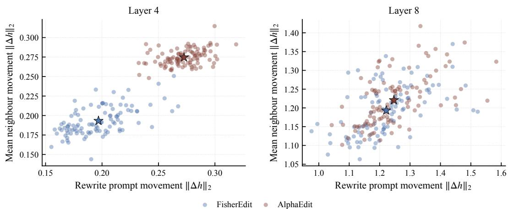  
Figure 6: Hidden-state movement of rewrite and neighborhood prompts at layers 4 and 8.

## E WEIGHT-SPACE VIEW OF REGULARIZATION

To complement the projection analysis in §3, we examine how AlphaEdit’s weight updates evolve during sequential editing. Figure 7 reports the total update magnitude per batch. For each edit batch, we aggregate the five edited layers by $\begin{array} { r } { \| \Delta _ { t } \| _ { F } = ( \sum _ { \ell } \| \Delta _ { t } ^ { ( \ell ) } \| _ { F } ^ { 2 } ) ^ { 1 / 2 } } \end{array}$ . It shows that AlphaEdit’s update scale is sharply controlled by λ during sequential editing. With extremely weak regularization $( \bar { \lambda } = 1 0 ^ { - 5 } )$ , the update magnitude grows by many orders of magnitude as editing proceeds. At $\lambda = 1 0 ^ { - 4 }$ , the trajectory no longer shows sustained exponential growth, but it exhibits large transient spikes, suggesting a near-unstable boundary. For $\lambda \geq 1 0 ^ { - 3 }$ , the update magnitude remains bounded throughout the edit stream. This weight-space view refines the main finding in §3 that AlphaEdit’s behavior is governed primarily by regularization strength, while the near-identity projector does not by itself prevent unstable updates.

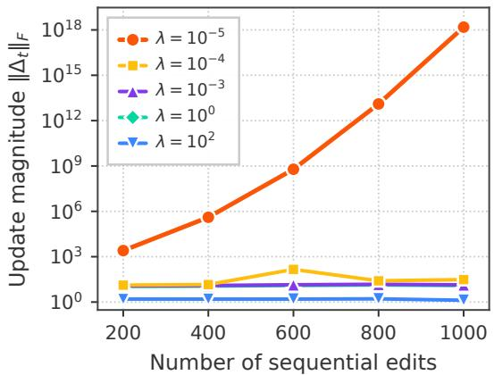  
Figure 7: AlphaEdit update magnitude during sequential editing under different λ.

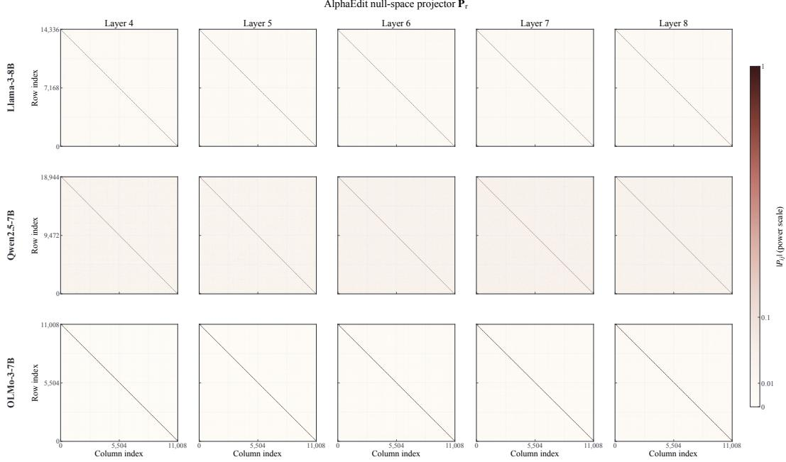  
Figure 8: Full-layer visualization of AlphaEdit’s null-space projector $\mathbf { P } _ { \tau }$ across edited backbones.

## F FULL-LAYER VISUALIZATION OF THE NULL-SPACE PROJECTOR

Figure 8 summarizes the full-layer projectors for the edited backbones. Across layers, Pτ remains nearly diagonal and close to identity, indicating that AlphaEdit removes only a limited part of the activation space.

## G DERIVATION OF EQN. (6)

For the Fisher-weighted objective in Eqn. (5), define

$$
\begin{array} { r l } & { L ( \tilde { \boldsymbol { \Delta } } ) = \| \tilde { \boldsymbol { \Delta } } \mathbf { K } _ { 1 } - \mathbf { E } \| ^ { 2 } + \| \tilde { \boldsymbol { \Delta } } \mathbf { K } _ { p } \| ^ { 2 } } \\ & { \quad \quad \quad + \lambda \| \sqrt { \mathbf { F } } \odot \tilde { \boldsymbol { \Delta } } \| ^ { 2 } . } \end{array}\tag{17}
$$

Taking the derivative with respect to $\tilde { \Delta }$ gives

$$
\begin{array} { r l } & { \nabla _ { \tilde { \Delta } } L = 2 ( \tilde { \Delta } \mathbf { K } _ { 1 } - \mathbf { E } ) \mathbf { K } _ { 1 } ^ { \top } + 2 \tilde { \Delta } \mathbf { K } _ { p } \mathbf { K } _ { p } ^ { \top } } \\ & { \qquad + ~ 2 \lambda ( \mathbf { F } \odot \tilde { \Delta } ) . } \end{array}\tag{18}
$$

Setting the derivative to zero and rearranging yields

$$
\tilde { \Delta } ( \mathbf { K } _ { 1 } \mathbf { K } _ { 1 } ^ { \top } + \mathbf { K } _ { p } \mathbf { K } _ { p } ^ { \top } ) + \lambda ( \mathbf { F } \odot \tilde { \Delta } ) = \mathbf { E } \mathbf { K } _ { 1 } ^ { \top } .\tag{19}
$$

Let $\mathbf { G } = \mathbf { K } _ { 1 } \mathbf { K } _ { 1 } ^ { \top } + \mathbf { K } _ { p } \mathbf { K } _ { p } ^ { \top }$ . Because the Fisher penalty is element-wise, this normal equation decomposes across rows. Let $\tilde { \delta } _ { i } , e _ { i } .$ , and $f _ { i }$ denote the i-th rows of $\tilde { \Delta } ,$ , E, and $\mathbf { F } ,$ , respectively, and define $\mathbf { \dot { D } } _ { i } = \mathrm { d i a g } ( f _ { i } )$ . The i-th row therefore satisfies

$$
\tilde { \delta } _ { i } ( \mathbf { G } + \lambda \mathbf { D } _ { i } ) = e _ { i } \mathbf { K } _ { 1 } ^ { \top } ,\tag{20}
$$

which gives the closed-form row-wise solution

$$
\tilde { \delta } _ { i } = e _ { i } \mathbf { K } _ { 1 } ^ { \top } ( \mathbf { G } + \lambda \mathbf { D } _ { i } ) ^ { - 1 } .\tag{21}
$$

At the optimum, $\tilde { \delta } _ { i } = \delta _ { i }$ , recovering Eqn. (6).

For the efficient implementation, concatenate the current and historical keys as $\mathbf { U } = [ \mathbf { K } _ { 1 } \mid \mathbf { K } _ { p } ] \in$ $\mathbb { R } ^ { m \times r }$ , with $r = n _ { 1 } + n _ { p } ,$ so that $\mathbf { G } = \mathbf { U } \mathbf { U } ^ { \top }$ . The Woodbury identity gives

$$
\begin{array} { r } { ( \mathbf { G } + \lambda \mathbf { D } _ { i } ) ^ { - 1 } = ( \lambda \mathbf { D } _ { i } ) ^ { - 1 } - ( \lambda \mathbf { D } _ { i } ) ^ { - 1 } \mathbf { U } \qquad } \\ { \left( \mathbf { I } _ { r } + \mathbf { U } ^ { \top } ( \lambda \mathbf { D } _ { i } ) ^ { - 1 } \mathbf { U } \right) ^ { - 1 } \mathbf { U } ^ { \top } ( \lambda \mathbf { D } _ { i } ) ^ { - 1 } . } \end{array}\tag{22}
$$

Substituting this expression into Eqn. (6) yields Eqn. (7), replacing the $m \times m$ inverse with diagonal scaling and an $r \times r$ linear solve.

## H FULL DERIVATION OF §4.4

In the following, we give the full derivation of the theoretical interpretation in §4.4. Specifically, we show that the element-wise Fisher regularizer in Eqn. (5) corresponds to a computable diagonal approximation of the second-order Taylor expansion of the locality KL objective around $\Delta = 0$ restricted to the edited parameter subspace.

## H.1 SETUP AND NOTATION

Let W denote the pre-edit value of the edited parameter block and ∆ the update. Following Eqn. (9), the single-sample locality cost is

$$
\ell _ { x } ( \Delta ) = \mathrm { K L } \big ( p _ { \mathbf { W } } ( \cdot \mid x ) \big | \big | p _ { \mathbf { W } + \Delta } ( \cdot \mid x ) \big ) ,\tag{23}
$$

and the reference-distribution objective is $\mathcal { L } _ { \mathrm { l o c } } ( \Delta ) = \mathbb { E } _ { x \sim \mathcal { D } _ { \mathrm { r e f } } } [ \ell _ { x } ( \Delta ) ]$

According to Eqn. (23), we have

$$
\begin{array} { l } { { \displaystyle \ell _ { x } ( \Delta ) = \mathrm { K L } \big ( p _ { \mathbf { W } } ( \cdot \mid x ) \| p _ { \mathbf { W } + \Delta } ( \cdot \mid x ) \big ) } \ ~ } \\ { { \displaystyle ~ = \sum _ { y } p _ { \mathbf { W } } ( y \mid x ) \log \frac { p _ { \mathbf { W } } ( y \mid x ) } { p _ { \mathbf { W } + \Delta } ( y \mid x ) } } \ ~ } \\ { { \displaystyle ~ = \sum _ { y } p _ { \mathbf { W } } ( y \mid x ) \log p _ { \mathbf { W } } ( y \mid x ) } \ ~ } \\ { { \displaystyle ~ - \sum _ { y } p _ { \mathbf { W } } ( y \mid x ) \log p _ { \mathbf { W } + \Delta } ( y \mid x ) } . } \end{array}\tag{24}
$$

The first term depends only on the pre-edit distribution $p _ { \mathbf { W } } ( \cdot )$ and is therefore constant with respect to $\Delta .$ . Thus, we can write

$$
\ell _ { x } ( \Delta ) { = } \mathrm { c o n s t } ( x ) - \sum _ { y } p \mathbf { w } ( y \mid x ) \log p \mathbf { w } { + } \Delta ( y \mid x ) ,\tag{25}
$$

where const $\begin{array} { r } { \mathbf { \sigma } _ { \mathbf { \mu } ^ { \prime } } ( \mathbf { \mathit { x } } ) = \sum _ { u } p _ { \mathbf { W } } ( y \mid x ) \log p _ { \mathbf { W } } ( y \mid x ) } \end{array}$ . Therefore, only the cross-entropy term contributes derivatives with respect to $\Delta$

## H.2 REGULARITY CONDITIONS

The derivation assumes the following standard regularity conditions on the model distribution:

• Smoothness. $p _ { \mathbf { W } } ( y \mid x )$ is twice continuously differentiable in the edited parameters W.

• Parameter-independent support. The support $\{ y : p \mathbf { w } ( y \mid x ) > 0 \}$ does not depend on W. This holds for softmax outputs since every token has positive probability.

• Interchange ofdifferentiation and summation/expectation. Derivatives with respect to w can be interchanged with the summation over y and the expectation over $x \sim \mathcal { D } _ { \mathrm { r e f } }$

• Finite Fisher moments. $\mathbb { E } _ { y \sim p { \mathbf { w } } ( \cdot | x ) } \| \nabla { \mathbf { w } }$ log pW $( y \mid x ) \parallel ^ { 2 } < \infty$ , and the corresponding Hessian expectation exists.

Under these conditions, the information equality between the KL Hessian and the Fisher information holds (Amari, 1998).

## H.3 THE TAYLOR EXPANSION OF SINGLE-SAMPLE LOCALITY COST

Next, we consider the Taylor expansion of Eqn. (25) around $\Delta = 0$ . Let $u = \mathrm { v e c } ( \Delta )$ ). We have,

$$
\begin{array} { r l } & { \ell _ { x } ( \Delta ) = \ell _ { x } ( 0 ) + \nabla _ { u } \ell _ { x } ( 0 ) ^ { \top } u } \\ & { \qquad + \frac { 1 } { 2 } u ^ { \top } \nabla _ { u } ^ { 2 } \ell _ { x } ( 0 ) u + o ( \| u \| ^ { 2 } ) . } \end{array}\tag{26}
$$

Zeroth order terms. Setting $\Delta = 0$ in Eqn. (23) gives $\ell _ { x } ( 0 ) = \mathrm { K L } ( p _ { \mathbf { W } } \parallel p _ { \mathbf { W } } ) = 0$

First order terms. Differentiating Eqn. (25) with respect to $\Delta$ gives

$$
\nabla _ { \Delta } \ell _ { x } ( \Delta ) = - \sum _ { y } p _ { \mathbf { W } } ( y \vert x ) \nabla _ { \Delta } \log p _ { \mathbf { W } + \Delta } ( y \vert x ) ,\tag{27}
$$

Let $\bar { \mathbf { W } } = \mathbf { W } + \boldsymbol { \Delta }$ . Since $\mathrm { v e c } ( \bar { \mathbf W } ) = \mathrm { v e c } ( \mathbf W ) + \mathrm { v e c } ( \Delta )$ , the Jacobian $\partial \mathrm { v e c } ( \bar { \mathbf { W } } ) / \partial \mathrm { v e c } ( \Delta )$ is the identity. Therefore,

$$
\begin{array} { c l } { \displaystyle \left. \nabla _ { \mathrm { v e c } ( \Delta ) } \log p _ { \mathbf { W } + \Delta } ( { \boldsymbol y } \mid { \boldsymbol x } ) \right. _ { \Delta = 0 } } \\ { \displaystyle = \frac { \partial \mathrm { v e c } ( \mathbf { W } + \Delta ) } { \partial \mathrm { v e c } ( \Delta ) } \nabla _ { \mathrm { v e c } ( \mathbf { W } + \Delta ) } \log p _ { \mathbf { W } + \Delta } ( { \boldsymbol y } \mid { \boldsymbol x } ) \bigg \vert _ { \Delta = 0 } } \\ { \displaystyle = \nabla _ { \mathrm { v e c } ( \mathbf { W } ) } \log p _ { \mathbf { W } } ( { \boldsymbol y } \mid { \boldsymbol x } ) . } \end{array}\tag{28}
$$

For $\Delta = 0$ , by Eqn. (27) and Eqn. (28), we have

$$
\nabla _ { \Delta } \ell _ { x } ( 0 ) = - \sum _ { y } p _ { \mathbf { W } } ( y \mid x ) \nabla _ { \mathbf { W } } \log p _ { \mathbf { W } } ( y \mid x ) .\tag{29}
$$

By swapping summation and differentiation, and using $\begin{array} { r } { \sum _ { y } p _ { \mathbf { W } } ( y \mid x ) = 1 } \end{array}$ , we can derive

$$
\begin{array} { l } { { \displaystyle \sum _ { y } p { \bf w } ( y \mid x ) \nabla { \bf w } \log p { \bf w } ( y \mid x ) } } \\ { ~ } \\ { { \displaystyle = \sum _ { y } \nabla { \bf w } p { \bf w } ( y \mid x ) } } \\ { { \displaystyle = \nabla { \bf w } \sum _ { y } p { \bf w } ( y \mid x ) } } \\ { { \displaystyle = 0 . } } \end{array}\tag{30}
$$

Therefore, we have $\nabla _ { \Delta } \ell _ { x } ( 0 ) = 0 .$

Second order terms. Let $u : = \mathrm { v e c } ( \Delta ) \in \mathbb { R } ^ { m d }$ for $\Delta \in \mathbb { R } ^ { d \times m }$ . Treat $\ell _ { x }$ as a scalar function of u and expand it around $u = 0$ . From the derivation above, both the zeroth-order and first-order terms vanish. Thus,

$$
\begin{array} { r } { \ell _ { x } ( \Delta ) = \frac { 1 } { 2 } u ^ { \top } { \bf H } _ { x } u + o ( \| u \| ^ { 2 } ) , } \end{array}\tag{31}
$$

where

$$
\mathbf { H } _ { x } : = \nabla _ { u } ^ { 2 } \ell _ { x } ( \Delta ) \big | _ { \Delta = 0 } .\tag{32}
$$

To compute $\mathbf { H } _ { x } ,$ we differentiate Eqn. (25) twice with respect to u. Since $p _ { \mathbf { W } } ( y \mid x )$ and const(x) do not depend on ∆, we have

$$
\nabla _ { u } ^ { 2 } \ell _ { x } ( \Delta ) = - \sum _ { y } p _ { \mathbf { W } } ( y | x ) \nabla _ { u } ^ { 2 } \log p _ { \mathbf { W } + \Delta } ( y | x ) .\tag{33}
$$

Let $\bar { \mathbf { W } } = \mathbf { W } + \boldsymbol { \Delta }$ . As shown in Eqn. (28), $\mathrm { v e c } ( \bar { \mathbf W } )$ depends on $u = \mathrm { v e c } ( \Delta )$ through an identity Jacobian. Therefore,

$$
\nabla _ { u } ^ { 2 } \log p _ { \mathbf { W } + \Delta } ( y | x ) \big | _ { \Delta = 0 } = \nabla _ { \mathrm { v e c } ( \mathbf { W } ) } ^ { 2 } \log p _ { \mathbf { W } } ( y | x ) .\tag{34}
$$

Substituting this into the Hessian gives

$$
\mathbf { H } _ { x } = - \sum _ { y } p _ { \mathbf { W } } ( y \mid x ) \nabla _ { \mathrm { v e c } ( \mathbf { W } ) } ^ { 2 } \log p _ { \mathbf { W } } ( y \mid x ) .\tag{35}
$$

Define the single-sample Fisher information matrix restricted to the edited block as

$$
\mathbf { F } _ { x } : = \sum _ { y } p \mathbf { w } ( y \mid x ) \mathbf { s } _ { \mathbf { W } } ( y , x ) \mathbf { s } _ { \mathbf { W } } ( y , x ) ^ { \top } ,\tag{36}
$$

where

$$
\mathbf { s } _ { \mathbf { W } } ( y , x ) : = \nabla _ { \mathbf { v e c } ( \mathbf { W } ) } \log p _ { \mathbf { W } } ( y \mid x ) .\tag{37}
$$

Under the conditions in Appendix H.2, ${ \bf H } _ { x } = { \bf F } _ { x }$ . To see this, we differentiate $\nabla _ { \mathbf { v e c } ( \mathbf { W } ) } \log { p _ { \mathbf { W } } } =$ $p _ { \mathbf { W } } ^ { - 1 } \nabla _ { \mathbf { v e c ( W ) } } p _ { \mathbf { W } }$ once more:

$$
\begin{array} { r l } & { \nabla _ { \mathrm { v e c } ( \mathbf { W } ) } ^ { 2 } \log p _ { \mathbf { W } } } \\ & { = \frac { \nabla _ { \mathrm { v e c } ( \mathbf { W } ) } ^ { 2 } p _ { \mathbf { W } } } { p _ { \mathbf { W } } } - \frac { \left( \nabla _ { \mathrm { v e c } ( \mathbf { W } ) } p _ { \mathbf { W } } \right) \left( \nabla _ { \mathrm { v e c } ( \mathbf { W } ) } p _ { \mathbf { W } } \right) ^ { \top } } { p _ { \mathbf { W } } ^ { 2 } } . } \end{array}\tag{38}
$$

Multiplying Eqn. (38) by $p _ { \mathbf { W } } ( y \mid x )$ and summing over y gives

$$
\begin{array} { l } { { \displaystyle \quad - \sum _ { y } p \mathbf { w } ( y \mid x ) \nabla _ { \mathbf { v e c } ( \mathbf { W } ) } ^ { 2 } \log p \mathbf { w } ( y \mid x ) } } \\ { { \displaystyle = - \sum _ { y } \nabla _ { \mathbf { v e c } ( \mathbf { W } ) } ^ { 2 } p \mathbf { w } ( y \mid x ) } } \\ { { \displaystyle \quad + \sum _ { y } \frac { \left( \nabla _ { \mathbf { v e c } ( \mathbf { W } ) } p _ { \mathbf { W } } ( y \mid x ) \right) \left( \nabla _ { \mathbf { v e c } ( \mathbf { W } ) } p _ { \mathbf { W } } ( y \mid x ) \right) ^ { \top } } { p _ { \mathbf { W } } ( y \mid x ) } . } } \end{array}\tag{39}
$$

The first term is zero because

$$
\begin{array} { r l } { \displaystyle \sum _ { y } \nabla _ { \mathrm { v e c } ( \mathbf { W } ) } ^ { 2 } p \mathbf { w } \big ( y \mid x \big ) = \nabla _ { \mathrm { v e c } ( \mathbf { W } ) } ^ { 2 } \sum _ { y } p \mathbf { w } \big ( y \mid x \big ) } & { } \\ { = \nabla _ { \mathrm { v e c } ( \mathbf { W } ) } ^ { 2 } 1 } & { } \\ { = 0 . } & { } \end{array}\tag{40}
$$

For the second term, using $\nabla p _ { \mathbf { W } } = p _ { \mathbf { W } } \nabla \log p _ { \mathbf { W } }$ , we obtain

$$
\begin{array} { r l } & { \underset { y } { \sum } \frac { \left( \nabla _ { \mathrm { v e c } } ( \mathbf { W } ) p \mathbf { w } \left( y \left| x \right. \right) \right) \left( \nabla _ { \mathrm { v e c } } ( \mathbf { W } ) p \mathbf { w } \left( y \left| x \right. \right) \right) ^ { \top } } { p \mathbf { w } \left( y \left| x \right. \right) } } \\ & { = \underset { y } { \sum } p \mathbf { w } \left( y \left| x \right. \right) \mathbf { s w } \left( y , x \right) \mathbf { s w } \left( y , x \right) ^ { \top } = \mathbf { F } _ { x } . } \end{array}\tag{41}
$$

Therefore,

$$
\mathbf { F } _ { x } = - \sum _ { y } p _ { \mathbf { W } } ( y | x ) \nabla _ { \mathrm { v e c } ( \mathbf { W } ) } ^ { 2 } \log p _ { \mathbf { W } } ( y | x ) = \mathbf { H } _ { x } ,\tag{42}
$$

which is the information equality.

## H.4 AVERAGING OVER THE REFERENCE DISTRIBUTION

Substituting $\mathbf { H } _ { x } = \mathbf { F } _ { x }$ into Eqn. (31) and taking the expectation over $x \sim \mathcal { D } _ { \mathrm { r e f } }$

$$
\begin{array} { r } { \mathcal { L } _ { \mathrm { l o c } } ( \Delta ) \approx \frac { 1 } { 2 } \mathrm { v e c } ( \Delta ) ^ { \top } \mathbf { F } ^ { ( S ) } \mathrm { v e c } ( \Delta ) , } \end{array}\tag{43}
$$

where

$$
\mathbf { F } ^ { ( S ) } : = \mathbb { E } _ { x \sim \mathcal { D } _ { \mathrm { r e f } } } [ \mathbf { F } _ { x } ]\tag{44}
$$

is the Fisher information matrix restricted to the edited parameter subspace. This restriction is not cosmetic: the edit only perturbs the weights of a single MLP down-projection block, so the Taylor expansion lives on that subspace and $\mathbf { F } ^ { ( S ) }$ is the corresponding Fisher block rather than the full-model Fisher.

## H.5 DIAGONAL APPROXIMATION AND RECOVERY OF EQN. (5)

For $\Delta \in \mathbb { R } ^ { d \times m }$ , the full block $\mathbf { F } ^ { ( S ) }$ has size $( m d ) \times ( m d )$ . At LLM scale (md on the order of $1 0 ^ { 7 } )$ storing $\mathbf { F } ^ { ( S ) }$ or solving the associated quadratic program in closed form is infeasible. We therefore adopt the standard diagonal approximation

$$
\mathbf { F } ^ { ( S ) } \approx \operatorname { D i a g } ( f ) , \qquad f \in \mathbb { R } ^ { m d } ,\tag{45}
$$

and reshape f into a matrix $\widetilde { \mathbf { F } } \in \mathbb { R } ^ { d \times m }$ of the same shape as $\Delta .$ . The quadratic form collapses to an element-wise penalty:

$$
\mathrm { v e c } ( \Delta ) ^ { \top } \mathrm { D i a g } ( f ) \mathrm { v e c } ( \Delta ) = \sum _ { i , j } F _ { i j } \Delta _ { i j } ^ { 2 } .\tag{46}
$$

Combining Eqns. (43) and (46),

$$
\mathcal { L } _ { \mathrm { l o c } } ( \Delta ) \approx \frac { _ { 1 } } { _ { 2 } } \sum _ { i , j } F _ { i j } \Delta _ { i j } ^ { 2 } ,\tag{47}
$$

which is exactly the regularizer appearing in Eqn. (5).

## I CASE STUDY

We present representative paired outputs from Ripple. Each example reports two prompts from the same edited sample: a paraphrase of the edited fact and a neighborhood prompt about a nearby fact that should remain unchanged. Across these paired examples, FisherEdit consistently produces the edited answer while preserving the unrelated local fact.

## Case 1

Edit / Neighborhood. John Masly: occupation researcher → unemployed; gender should remain male. Outputs. FisherEdit: unemployed / male. AlphaEdit: unknown / unknown. AnyEdit: “John Masly is a historian.” / “John P Masly is male.” MEMIT: unrelated edit continuation / “male and female farmers, also genderfarmersqueepea”.

## Case 2

Edit / Neighborhood. Sharifah Mazlina binti Syed Abdul Kadir: occupation explorer → music professor;   
citizenship should remain Malaysia.

Outputs. FisherEdit: music professor / Malaysia. AlphaEdit: “music teacher and calligrapher” / Iran. AnyEdit: “Minister of Women’s Empowerment and Family Development in” / “citizen of Malaysia.” MEMIT: corrupted text on both prompts.

## Case 3

Edit / Neighborhood. Anthony Deakin: occupation researcher → art dealer; alma mater should remain University ofLiverpool.

Outputs. FisherEdit: art dealer / University ofLiverpool. AlphaEdit: art dealer / “known only to a few”. AnyEdit: “Royal Navy officer and politician.” / University of Sheffield. MEMIT: degenerate continuations on both prompts.

## J FUTURE WORK

Scaling to longer edit streams. An important direction is to extend FisherEdit to substantially longer editing sequences by improving the scalability of its solver and historical-key memory. In Eqn. (7), $r = n _ { 1 } + n _ { p }$ counts both the current and accumulated historical edit keys, and the row-wise solve costs $O ( d m r ^ { 2 } + d r ^ { 3 } )$ per edited weight matrix. Since Algorithm 1 appends new keys after each batch, $n _ { p }$ grows throughout the stream even when the batch size is fixed. The computational advantage of the Woodbury formulation relies on $r \ll m$ , motivating further improvements to the row-wise solver as historical constraints accumulate. Future work could explore incremental updates to the row-wise factorizations and warm-started iterative solvers that reuse computations across successive edit batches, with the aim of reducing editing latency while preserving earlier edits.

Knowledge editing in reasoning models. FisherEdit’s parameter-importance regularization provides a natural basis for updating factual knowledge while protecting the reasoning processes that use it. The method requires locate-then-edit MLP locations and a Fisher diagonal estimated on a calibration set, without architectural modifications. The calibration set serves as an adaptable control knob: estimating the Fisher diagonal directly on complex reasoning traces, such as multi-step mathematical or logical trajectories, would penalize changes to parameters with high sensitivity on these traces. This offers a way to direct preservation toward reasoning-related behavior while allowing factual updates through less sensitive parameters. Future work can investigate this separation between factual recall and reasoning, and develop sequential-editing evaluations that jointly assess successful knowledge replacement, the use of updated facts in multi-step solutions, and preservation of reasoning ability.

Complementarity with retrieval and deployment scenarios. Parameter editing and retrievalbased approaches are complementary. When retrieved context conflicts with memorized knowledge, models may over-rely on stale parametric memory (Longpre et al., 2021), and their use of external evidence depends on its coherence and persuasiveness (Xie et al., 2024). Editing updates the fact at its source, so the correction can remain available when retrieval misses, ranks poorly, is only partially relevant, or is disabled. This motivates combining FisherEdit with retrieval-augmented generation or agentic search to improve consistency between parametric knowledge and external evidence. On-device, offline, and privacy-sensitive deployments also provide useful settings for exploration, particularly when maintaining a retrieval corpus and pipeline is impractical. Once applied, FisherEdit introduces no additional inference-time computation; latency- and cost-sensitive serving can therefore benefit from factual corrections that do not require a retrieval step on every query.