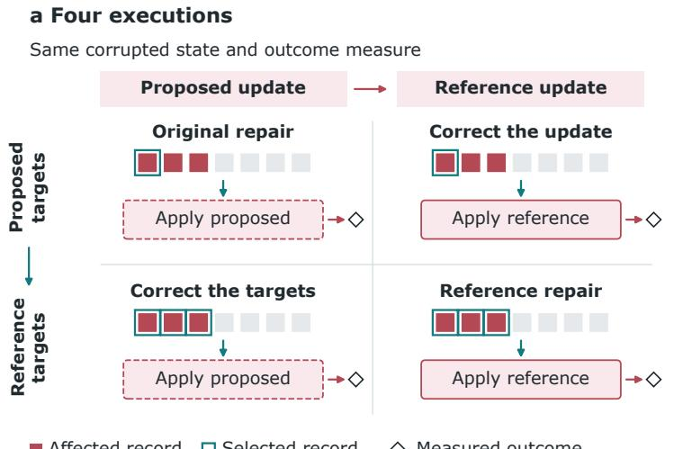
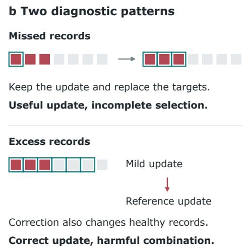
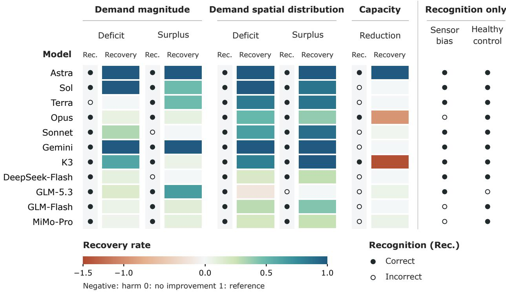
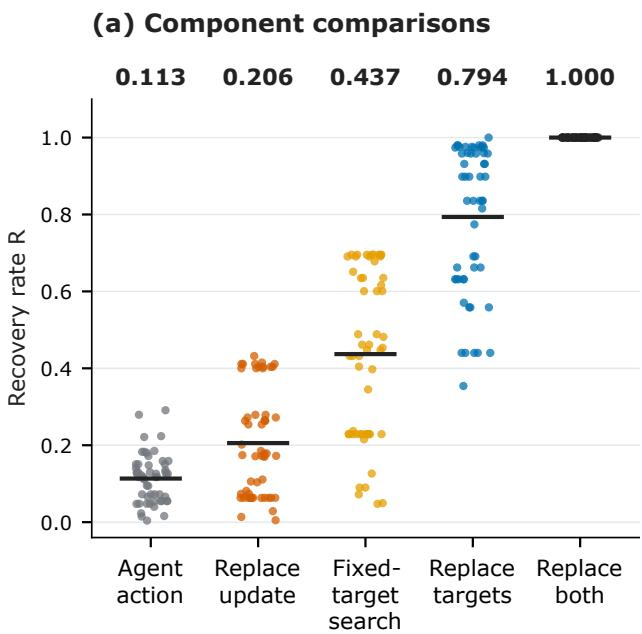
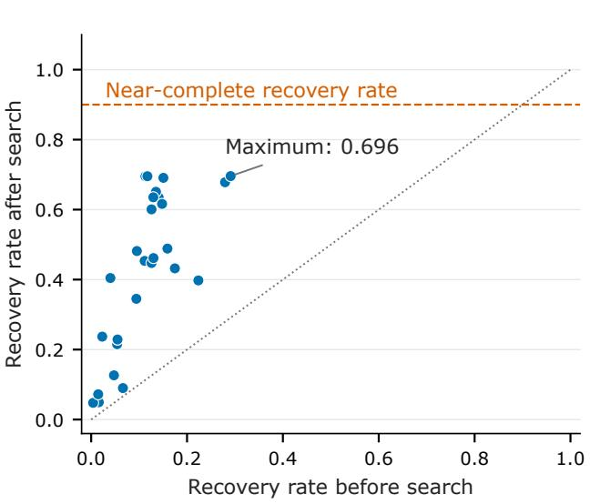
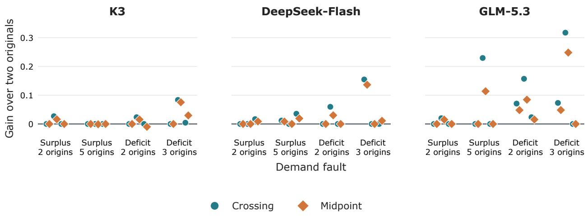
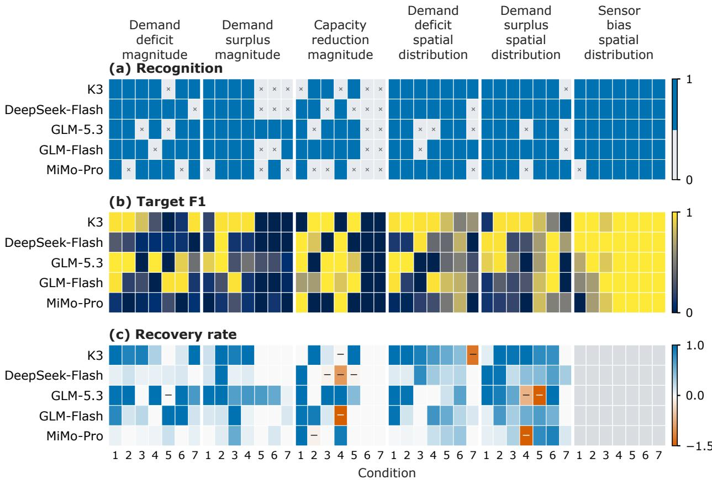

# From Outcomes to Components: A Counterfactual Evaluation Framework for LLM-Proposed Repairs∗

Hengyu Ye ShanghaiTech University

Songhua Hu† City University of Hong Kong

yehy2025@shanghaitech.edu.cn

Songhua.Hu@cityu.edu.hk

## Abstract

An LLM-generated repair action specifies which records to change and by how much. A failed action may still contain a useful target set or numerical update, depending on how the two are paired. We evaluate this problem in trafic networks and databases, where aggregate observations obscure the records that need correction. We examine the pairings by executing each combination from the same initial state, using a reference action that restores the afected records. In 76 of 114 trafic actions, the gain from correcting both parts exceeds the sum of the gains from correcting each part alone. Six of these actions become worse after either correction alone, but improve when both parts are corrected. In database repair, replacing only the proposed update with the reference update worsens 17 of 108 model actions, all of which select unafected records. We also test whether parts of two proposals can be reused. On held-out observations, selecting among the proposals and their recombined target–update pairs recovers 61.6% of the reference action’s loss reduction, compared with 58.0% from selecting between the proposals alone.

## 1 Introduction

Large language models (LLMs) use tools to inspect and modify external systems (Lu et al., 2025; Yao et al., 2025). Repair tasks require them to turn observed discrepancies into changes that restore the system’s behavior (Jha et al., 2025). For repairs that act on selected records, target selection identifies which records to change, and update selection specifies the change to their values. An unsuccessful repair may contain a useful update applied to the wrong targets. Improving the next repair requires deciding what to change and what to retain.

Existing evaluations measure task outcomes and locate failures (Lu et al., 2025; Zhang et al., 2025). Studies of reasoning separate finding an error from correcting it (Tyen et al., 2024), while counterfactual evaluations assess targeted interventions (Ma et al., 2026; Bonagiri et al., 2026). For a model-proposed repair, these perspectives motivate a more specific question: what is gained or lost by correcting one decision while retaining the other?

Missed targets can obscure a useful update. A model that selects too many records may limit collateral damage by proposing a mild update. Replacing it with the inverse of the fault can then repair afected records more fully while damaging unafected records. The efect of correcting one decision depends on its partner.

Aggregate observations make these choices dificult. A discrepancy can involve many records, and changing one record can afect several observations. Models must infer both where to intervene and how much to change from this indirect evidence. We examine this problem in trafic and database repair: road counts combine trips from many origin–destination (OD) pairs, while database reports combine rows with overlapping attributes.

We propose a framework for evaluating these decisions within an already generated repair (Figure 1). Component replacement exchanges either the proposed targets or the proposed update for its reference counterpart, leaving the other unchanged. Four executions from the same initial state measure the original action, each replacement, and their combination. The comparison asks both whether a proposed component is useful with the reference partner and whether correcting it helps with the proposed partner. We instantiate the framework with known faults, whose inverse actions provide the reference components.

The study makes three contributions:

• An evaluation framework that relates target accuracy to retained value and interaction through target–update replacements of a model action.

• Cross-domain diagnostic evidence that missed targets hide useful updates, while excessive targets can make update correction harmful. Numerical-search controls test how far update tuning can compensate for missed targets, while repeated database trials measure how often correcting the update harms repairs.

• A component-reuse study that exchanges decisions between proposals and selects repairs through execution preview. Held-out observations measure when the additional candidates help, how gains vary across generations, and the execution cost of obtaining them.

  
Figure 1: From a repair outcome to a diagnosis of its decisions. A submitted repair supplies selected records and a numerical update. Four executions combine proposed and reference components, changing the update horizontally and the targets vertically. The illustrated selection errors lead to diferent diagnoses: missed records can hide a useful update, while excess records can make a stronger correction harmful. Record diagrams are schematic. Reference components enter the evaluation after the model submits its action.

## 2 Related Work

Decisions within failed responses. The compositionality gap separates answering constituent questions from combining their answers (Press et al., 2023). Tyen et al. (2024) distinguish locating reasoning errors from correcting them through backtracking from a supplied correct location. Thought-ICS structures reasoning into discrete thoughts for self-localization and correction (Samanta et al., 2026). STOCKTAKE separates state estimation from control outcomes (Deb & Krishnan, 2026).

Outcome and counterfactual evaluation. ToolSandbox and τ-bench evaluate changes to persistent state, while AgentBoard measures progress over an episode (Lu et al., 2025; Yao et al., 2025; Ma et al., 2024). The Who&When dataset evaluates failure attribution by agent and trajectory step (Zhang et al., 2025). DoVer tests targeted changes, CausalFlow evaluates local repairs through execution or outcome prediction, and joint replay identifies combinations of supplied clean-message replacements that restore success (Ma et al., 2026; Bonagiri et al., 2026; Li et al., 2026a). ORACLE-SWE measures the efects of supplying correct information, including edit locations and tests, separately and in combination (Li et al., 2026b). ShapleyFlow attributes gains and interactions to model upgrades across workflow modules (Yang et al., 2026).

Structured repairs. QFix repairs constants in selection predicates and update expressions in query histories using reported record errors (Wang et al., 2017). Castle generates direct and cascading column updates from database schemas (Su et al., 2025). For model-generated actions, ReflecTool-Bench evaluates tool-error detection and correction, and Action Boundary Blindness examines action scope and completeness (Liu et al., 2026; Wang et al., 2026).

Candidate construction and selection. Execution-guided decoding filters SQL candidates using execution errors and empty results (Wang et al., 2018), and tree search uses executed web actions with a model-based value function (Koh et al., 2025). Simulation feedback supports physical-parameter inference in SimLM (Memery et al., 2024) and physical-law discovery in PhysGym (Chen et al., 2025). Mind Evolution combines evaluator-guided selection with model-generated recombination and refinement (Lee et al., 2025).

We execute all four target–update combinations of a submitted action to measure each decision’s efect and their interaction. Trafic and database faults supply reference components. A separate execution-preview experiment measures the additional value and cost of crossing or interpolating components of the same model-generated proposals.

## 3 Component-Replacement Framework

## 3.1 Problem setup

The controlled task starts from a healthy trafic or database state. An injected fault changes selected input records and produces a corrupted state $x _ { 0 }$ . The model observes aggregate discrepancies between the corrupted and healthy outcomes, then proposes a repair. We call the records chosen for editing targets: OD pairs or links in trafic and rows in the database. For numerical repairs, the injected fault specifies a reference action that reverses its changes. This reference is available to the evaluator after the proposal and defines the component comparisons.

## 3.2 Component interventions on a proposed repair

An action $\hat { a } = ( \hat { S } , \hat { u } )$ applies an update uˆ to targets ${ \hat { S } } .$ . Evaluation pairs it with the reference action $a ^ { \star } = ( S ^ { \star } , u ^ { \star } )$

Let $J _ { 0 }$ be the loss before repair, $J _ { p }$ the loss after the proposed action, and $J ^ { \star }$ the loss after the reference action. The recovery rate is

$$
R = \frac { J _ { 0 } - J _ { p } } { J _ { 0 } - J ^ { \star } } .\tag{1}
$$

A recovery rate of zero means no improvement, one matches the reference repair, and −1 adds as much loss as the reference removes. Values can fall below −1 when damage is larger, or exceed one when the proposed repair achieves a lower loss than the reference action.

The framework replays four actions from x0:

$$
( \hat { S } , \hat { u } ) , \quad ( \hat { S } , u ^ { \star } ) , \quad ( S ^ { \star } , \hat { u } ) , \quad ( S ^ { \star } , u ^ { \star } ) .\tag{2}
$$

The first action is the model proposal, the next two replace one component at a time, and the last is the reference action. Their recovery rates are $R _ { 0 0 } , R _ { 0 1 } , R _ { 1 0 }$ , and $R _ { 1 1 }$ , respectively. By normalization, $R _ { 1 1 } = 1$ Proposed and reference updates operate on the same type of editable record. The loss and observation panel remain fixed across executions. Holding the other proposed component fixed, the direct efects of target and update replacement are $R _ { 1 0 } - R _ { 0 0 }$ and $R _ { 0 1 } - R _ { 0 0 }$ , respectively. Their interaction is

$$
I = R _ { 1 1 } - R _ { 1 0 } - R _ { 0 1 } + R _ { 0 0 } .\tag{3}
$$

Positive I means that replacing one component increases the gain from replacing the other. Negative I means that it decreases that gain. Appendix A.1 gives the symmetric component allocation used for aggregate comparisons.

Reading the comparison. Target accuracy measures agreement with $S ^ { \star }$ . The contrast $R _ { 1 0 } - R _ { 0 0 }$ measures the efect of applying the proposed update to reference targets, and $R _ { 1 0 }$ measures the repair achieved while retaining that update. The contrast $R _ { 0 1 } - R _ { 0 0 }$ measures the efect of applying the reference update to the proposed targets. An update that works on reference targets can therefore be useful even when its origina action fails. We call a proposed update compensating when it limits harm from excess targets. On such targets, a negative $R _ { 0 1 } - R _ { 0 0 }$ is its observed signature: replacing that update worsens the repair.

Instantiation requirements. The target and update components must be independently executable, all four actions must start from the same state, and their outcomes must use the same loss. Reference components specify the comparison being made and can be chosen for a particular repair task.

## 3.3 Controlled settings

We use two settings in which aggregate observations must be translated into target-level changes. Trafic assignment couples OD pairs through shared routes, and database reports couple rows through overlapping aggregate queries.

## 3.3.1 Trafic repair

The trafic environment has two input tables. Each row of the demand table stores the demand for one OD pair: the number of trips from an origin to a destination. A capacity table stores the capacity of each directed road segment, or link. Trafic assignment routes trips through the network and returns link flows: the number of trips traversing each road segment. Link travel times rise with assigned flow, so changing OD demand also changes route choices and the flows generated by other OD pairs. The agent selects targets and multiplies their current values by a chosen factor.

The agent must trace discrepancies in road counts back to the OD pairs that need repair. The experiments use the Sioux Falls network (LeBlanc et al., 1975). Experiments using precomputed diagnostic reports, action feedback, and candidate construction replace identifiers with anonymous aliases and perturb healthy demand values. Appendix A.4 describes the simulator and construction.

Faults decrease or increase trip counts, reduce road capacity, or distort sensor readings. A healthy control preserves the original state. A demand or capacity fault multiplies the afected demand or capacity values by $m _ { : }$ , so its reference update is $1 / m$ . Sensor repair identifies biased observations for exclusion. Agents inspect demand summaries, road capacities, and residuals between current simulated flows and observed road counts. For demand and capacity repairs, agents receive road counts from the healthy assignment and summaries of the current inputs.

## 3.3.2 Database repair

In database repair, the agent identifies which rows cause discrepancies in aggregate reports and chooses how to update them. The environment uses DuckDB (Raasveldt & Mühleisen, 2019) and 600,572 transaction records generated from the Transaction Processing Performance Council’s decision-support benchmark (TPC-H) (Transaction Processing Performance Council, 2022). Each record contains an amount, an adjustment rate, and categorical attributes. Reports aggregate records by these attributes. The agent receives aggregate discrepancies relative to reports from the healthy database. Actions specify a row-selection predicate and a numerical update. A predicate combines categorical conditions, and an update multiplies or adds to one field on the selected rows. Healthy values are perturbed before fault injection, and identifiers are replaced with anonymous aliases. Appendix A.3.1 gives the construction, action grammar, and reporting workload.

## 4 Measurements

We evaluate repairs through three measures: recognition of the fault and repair operation, accuracy of the selected targets, and recovery rate after execution.

Recognition. In the trafic study, recognition requires an executable action that identifies the fault class, its direction, and the corresponding repair operation. Before execution, the validator checks that the action uses the expected JSON keys, references existing records or sensors, and supplies numerical values within the allowed ranges.

Target accuracy. Precision is the fraction of selected records that belong to the injected target set. Recall is the fraction of afected records selected, and target F1 is their harmonic mean. For demand repairs, positive-demand recall is the fraction of afected OD pairs with nonzero demand that are selected.

Outcome losses. Trafic loss uses the GEH statistic, which scales the diference between simulated and reference counts by their combined volume (Bagnall & Scott, 2008). For a set of observed links $P ,$ let $q _ { \ell }$ and $y _ { \ell }$ denote simulated and reference counts on link ℓ. The loss averages squared GEH:

$$
J _ { \mathrm { t r a f f i c } } = { \frac { 1 } { | P | } } \sum _ { \ell \in P } { \frac { 2 ( q _ { \ell } - y _ { \ell } ) ^ { 2 } } { q _ { \ell } + y _ { \ell } + \epsilon _ { \mathrm { t r a f f i c } } } } .\tag{4}
$$

Database reports aggregate amounts, adjustment rates, and adjusted amounts. An adjusted amount is a record’s amount multiplied by one minus its adjustment rate. Let $Q$ index the aggregate values used for scoring, with $z _ { k }$ and $y _ { k }$ denoting the current and healthy values of aggregate k. Loss averages squared relative errors:

$$
J _ { \mathrm { d a t a b a s e } } = { \frac { 1 } { | Q | } } \sum _ { k \in Q } { \frac { ( z _ { k } - y _ { k } ) ^ { 2 } } { ( | y _ { k } | + \epsilon _ { \mathrm { d a t a b a s e } } ) ^ { 2 } } } .\tag{5}
$$

Both constants provide numerical protection against zero denominators. Equation 1 normalizes improvement by the reference action in each domain. A trafic recovery rate is near-complete when an action achieves at least 90% of the reference action’s loss reduction $( R \geq 0 . 9 )$ , and harmful when it increases loss $( R < 0 )$ Sensor repair uses recognition and target accuracy. Appendices A.4 and A.3.1 specify the constants, simulator, and reporting workload.

## 5 Experimental Design

The experiments evaluate four questions about the framework:

1. Diagnostic need. What do fault recognition and target accuracy leave unresolved about repair outcomes?

2. Retained value. Can a failed action contain a useful update, and can tuning that update compensate for the proposed targets?

3. Partner dependence. When does correcting one component harm the action, and how does this depend on selection errors?

4. Component reuse. Can crossing decisions from two proposals improve held-out repair relative to selecting one complete proposal, and what is the execution cost?

Models. To compare recognition with efective repair, the trafic evaluation covers 11 models on seven conditions. They are GPT-6 Astra (Astra), GPT-5.6 Sol (Sol), and GPT-5.6 Terra (Terra) (OpenAI, 2026), Claude Opus 4.8 (Opus), Claude Sonnet 4.6 (Sonnet), and Gemini 3.8 Flash (Gemini) (Anthropic, 2026; Google, 2026), Kimi K3 (K3) (Kimi Team, 2026), DeepSeek-V4.1-Flash-1017 (DeepSeek-Flash) (DeepSeek, 2026), GLM-5.3 and GLM-5.3-Flash (GLM-Flash) (Z.ai, 2026), and MiMo-V2.5-Pro (MiMo-Pro) (Xiaom MiMo, 2026). Appendix A.7 records endpoint identifiers, dates, decoding settings, and provider routes.

Recognition and dificulty. In trafic, all 11 models inspect evidence through a common tool catalogue and return one final action for each of seven conditions: four demand faults, a capacity reduction, sensor bias, and a healthy control. The dificulty study evaluates K3, DeepSeek-Flash, GLM-5.3, GLM-Flash, and MiMo-Pro over six seven-level series and a healthy control. The series vary fault magnitude or how afected records are distributed. Appendix A.4.2 gives the instance construction and parameter values.

Component analysis across domains. We apply the four-action comparison in Section 3.2 to trafic and database repairs.

In trafic, the dificulty study’s 140 demand episodes produce 117 demand-scaling actions. Three have empty targets, leaving 114 actions for component analysis.

To measure the efect of update tuning on missed targets, we analyze 54 nonempty demand-scaling actions from eight fault cases. They cover few afected OD pairs (sparse-target actions). For each selected target set, fixed-target search varies the multiplier over its legal range and compares the best tested recovery rate with target replacement. This measures how much numerical tuning compensates for incomplete selection. Appendix A.1 specifies eligibility, sampling sources, and the search procedure. Appendix A.4 gives the solver settings.

The database study examines the same target–update interactions in repairs to rows contributing to aggregate reports. Six faults alter amounts or adjustment rates within intersections of categorical groups. K3, GLM-5.3, and DeepSeek-Flash each repair every fault under two evidence conditions in three generation rounds, yielding 108 actions. Each round requests a fresh action for every model–fault–evidence combination using the same inputs and generation settings. Direct evidence includes a report aggregated over the afected combination of categories. Time-grouped evidence replaces that report with one grouped by time, so the afected category intersection is no longer isolated in the displayed report. Repeated generations and evidence conditions share the same six underlying faults. Appendix A.3.1 specifies the report construction and gives all three rounds of component outcomes.

Component reuse with execution preview. To examine alternative combinations of existing proposals, K3, DeepSeek-Flash, and GLM-5.3 each generate two trafic repairs: one lists individual OD pairs and the other selects origin groups, which expand to all positive-demand OD pairs from those origins. Execution preview ranks the originals and candidates constructed by exchanging or interpolating their components. The experiment uses four demand faults and three independent generations per condition. The 76 observed links form fixed panels A and B of 38 sensors each. In one panel direction, A is the selection panel: it supplies generation evidence and ranks executed candidates. B is the evaluation panel and measures the selected repair. The reverse direction exchanges their roles and uses fresh proposals because the generation evidence changes. Section 6.4 reports the results, and Appendix A.8 gives the full protocol.

Table 1: Analysis sets and eligibility. Counts refer to actions unless stated otherwise.
<table><tr><td>Analysis</td><td>Included observations</td></tr><tr><td>Traffic survey</td><td>77 episodes from 11 models and seven conditions. Five numerical-repair conditions yield 55 actions. Sensor bias and the healthy control contribute</td></tr><tr><td>Traffic components</td><td>recognition outcomes. 140 demand episodes yield 117 demand-scaling actions. Three empty target sets leave 114 for component analysis. A sparse-target subset contains 54 actions and 28 distinct state-target combinations for search.</td></tr><tr><td>Database components</td><td>108 actions from three models, six faults, two evidence conditions, and three generations.</td></tr><tr><td>Traffic preview</td><td>72 directional evaluations from three models, four faults, three generations, and two panel directions. Averaging directions yields 36 paired results.</td></tr></table>

## 6 Results

## 6.1 Recognition and repair outcomes

Across 11 models, fault recognition is much more frequent than a near-complete recovery rate (Figure 2). The five demand and capacity conditions contribute 55 of the 77 episodes to the numerical-repair comparison. Of these 55 actions, 43 (78.2%) identify the fault, its direction, and the repair operation, and 12 (21.8%) achieve a near-complete recovery rate. On the same demand deficit, Astra and K3 select the same 161 OD pairs. Their multipliers of 1.620 and 2.000 yield recovery rates of 1.000 and 0.612, respectively. The larger multiplier overcorrects demand on those pairs. Changing demand also changes equilibrium route choices, so the same targets can produce diferent road flows and repair outcomes.

Action traces show the distinction between recognizing a discrepancy and selecting its source. In the fixedevidence study, four models receive the same precomputed diagnostic information for each condition. Facing a demand deficit, they select OD pairs that match road endpoints in the residual report. Those road counts aggregate trips from many OD pairs. Models must infer the afected pairs from the available identifiers and aggregate evidence (Appendix A.5).

  
Figure 2: Fault recognition coexists with widely varying recovery rates across 11 models. Each row shows one model across seven conditions. Filled and open circles denote correct and incorrect recognition on 77 interactive episodes. Adjacent colored tiles show recovery rates for all 55 numerical-repair episodes across recognition outcomes. Colors saturate outside [−1.5, 1]. Sensor bias and the healthy control show recognition only.

Recognition remains constant across some conditions as repair outcomes change. K3 recognizes every demanddeficit condition as the afected set shifts from seven contiguous origin zones to ten dispersed OD pairs at a fixed fault multiplier. Target F1 falls from 0.979 to 0.621, and the recovery rate falls from 1.000 to −1.276. Appendix A.2 reports the full profiles.

## 6.2 Failed repairs retain useful updates

In the component analysis of 114 demand-scaling actions from the dificulty study, target and update corrections have positive interaction (I > 0) in 76 actions. Correcting one component then increases the gain from correcting the other. In six actions, either single-component replacement lowers the recovery rate by more than 0.01, yet replacing both improves it. The errors in the original target and update decisions partly compensate for each other. We average each replacement efect over the proposed and reference partner settings. Target correction contributes more on average for low-F1 actions, while update correction contributes more when targets are nearly correct (Appendix A.1).

Fixed-target search tests whether a better multiplier can rescue a sparse-target action without adding missed OD pairs. It tests 28 legal multipliers per distinct state–target combination: 25 logarithmically spaced values and three local refinements. Selected OD pairs cover 9.0% of afected pairs with positive demand on average. Search raises the mean recovery rate from 0.113 to 0.437. Replacing the targets and preserving the model’s multiplier reaches 0.794 (Figure 3). The highest recovery rate reached by any fixed-target search is 0.696.

(b) Fixed-target search  

  
Figure 3: Component replacement and fixed-target search on sparse targets. Left: recovery rates across 54 actions. Horizontal bars and numbers above the groups show means. Right: recovery rates before and after search for 28 distinct state–target combinations. The before-search rate uses the first recorded action for each combination. Each search evaluates 28 multipliers while preserving the selected targets.

## 6.3 Excess targets can turn update correction into collateral damage

Sparse targets leave afected rows untouched, and excess targets expose unafected rows to the update. On excess targets, a milder proposed update can limit damage to unafected rows. Applying the reference update to the same targets can restore afected rows while damaging unafected rows. Across 108 database actions, 33 have inaccurate targets. Target replacement improves the recovery rate by more than 0.01 in 27 of them. Replacing only the update worsens 17 actions by more than 0.01. All 17 select unafected rows, and 16 also cover every afected row.

This pattern difers across models. DeepSeek-Flash has excess targets in 21 of 36 actions, and update replacement harms 15 of them, including seven, three, and five actions across the three repetitions. The corresponding counts are four and two for K3, and one and zero for GLM-5.3 (Table 2). Appendix A.3.1 reports the complete component outcomes.

Table 2: Database target errors and update-replacement harm. Each model contributes 36 actions: six faults, two evidence conditions, and three repetitions. Harm means that replacing only the update decreases the recovery rate by more than 0.01. Repetitions share the same faults.
<table><tr><td>Model</td><td>Excess targets</td><td>Harm among all actions</td><td>Harm with excess targets</td><td>Harm counts by repetition</td></tr><tr><td>DeepSeek-Flash</td><td>21/36</td><td>15/36</td><td>15/21</td><td>7, 3, 5</td></tr><tr><td>K3</td><td>4/36</td><td>2/36</td><td>2/4</td><td>1, 0, 1</td></tr><tr><td>GLM-5.3</td><td>1/36</td><td>0/36</td><td>0/1</td><td>0,0,0</td></tr></table>

The available evidence changes target selection. The two evidence conditions hold the corrupted database and action interface fixed and vary the report grouping. Across 54 model–fault–repetition comparisons, time-grouped evidence lowers target F1 in 19, raises it in four, and leaves it unchanged in 31. The median original-action recovery rate is 1.000 under direct evidence and 0.514 under time-grouped evidence.

Harm occurs with both matching and difering operators. All 17 harmed actions edit the same field as the reference repair. Ten also use the same operator, while seven use a diferent operator.

Table 3 illustrates these efects with two repairs. Using time-grouped evidence, DeepSeek-Flash selects an entire mode category for a fault confined to one mode–handling intersection. Its proposed update reduces amounts by 7.7%. The reference update reduces them by 25.4%, restoring afected rows and causing greater damage to unafected rows. GLM-5.3 selects exactly the afected rows in another case and proposes a harmful numerical update. Update replacement raises the recovery rate to 1.000. Appendix A.3.1 gives the action details and results by model and condition.

Table 3: Replacing the update can improve or worsen a repair. Recovery rates for two database repairs. DeepSeek-Flash selects a broad group (target F1 0.396), and GLM-5.3 selects the exact afected set. Each column compares four executions of one proposal. Appendix A.3.1 identifies the actions.
<table><tr><td>Action</td><td>DeepSeek-Flash</td><td>GLM-5.3</td></tr><tr><td>Agent action</td><td>0.427</td><td>-1.973</td></tr><tr><td>Replace targets</td><td>0.517</td><td>-1.973</td></tr><tr><td>Replace update</td><td>-1.032</td><td>1.000</td></tr><tr><td>Reference action</td><td>1.000</td><td>1.000</td></tr></table>

## 6.4 Reusing components through execution preview

Each model supplies two proposals for the same fault: a record-level proposal $( S _ { 1 } , u _ { 1 } )$ and a grouped proposal $( S _ { 2 } , u _ { 2 } )$ . Component crossing adds $( S _ { 1 } , u _ { 2 } )$ and $( S _ { 2 } , u _ { 1 } )$ . Update interpolation instead adds $( S _ { 1 } , \bar { u } )$ and $( S _ { 2 } , \bar { u } )$ , where $\bar { u } = \sqrt { u _ { 1 } u _ { 2 } }$ is the midpoint on a logarithmic scale. Each expanded set contains these two candidates and the two originals. Execution preview ranks candidates by selection-panel loss, and the selected repair is measured on the evaluation panel (Table 4). Each expanded set requires four candidate evaluations, two more than selection between the originals.

The mean recovery rate on the evaluation panels is 0.030 for the record-level proposal and 0.506 for the grouped proposal. Selecting between them reaches 0.580. The four-candidate midpoint set reaches 0.605, and the crossed-component set reaches 0.616 (Table 4). Crossing gains 0.036 over selection between the originals. It gains 0.011 over midpoint with the same two model generations and four candidate executions. The crossed-set gain over the originals is 0.026, 0.076, and 0.007 in the three repetitions, with a range of 0.007–0.076 and a standard deviation of 0.036 across repetition means.

Across the 72 directional evaluations, the crossed set improves on selection between the originals in 16 and ties in 56. The midpoint set improves in 19, ties in 51, and worsens in two.

Table 4: Execution preview. Mean evaluation-panel recovery rate across 36 model–fault–repetition results, each averaged over both panel directions.
<table><tr><td>Candidate set</td><td>Candidates</td><td>Mean recovery rate R</td></tr><tr><td>Original record-level proposal</td><td>1</td><td>0.030</td></tr><tr><td>Original grouped proposal</td><td>1</td><td>0.506</td></tr><tr><td>Two original proposals</td><td>2</td><td>0.580</td></tr><tr><td>Originals + midpoint updates</td><td>4</td><td>0.605</td></tr><tr><td>Originals + crossed components</td><td>4</td><td>0.616</td></tr></table>

Figure 4 resolves the aggregate into 36 model–fault–repetition comparisons, each averaged over both panel directions. Mean crossing gains are 0.012 for K3, 0.023 for DeepSeek-Flash, and 0.074 for GLM-5.3. The surplus faults afecting two and five origins yield mean gains of 0.007 and 0.031. The deficit faults afecting two and three origins yield 0.037 and 0.070. The largest paired gain is 0.317 for GLM-5.3 on the three-origin deficit in repetition 2.

  
Figure 4: Component-reuse gains by model and fault. Three points per model–fault cell show gain over selection between the originals. Each point averages both panel directions. Crossing and midpoint use two proposals and four candidate executions.

In the GLM-5.3 three-origin deficit example, the record-level proposal selects five OD pairs with multiplier 1.250. The grouped proposal selects five origins, expanding to 103 positive-demand OD pairs, with multiplier 1.450. Preview selects the record-level original over the grouped original on panel A. Crossing the grouped targets with the record-level update produces the lowest selection loss and raises held-out recovery rate to 0.680 (Table 5). The other panel direction ties the original selection, yielding the paired gain of 0.317 in Figure 4.

Table 5: Four combinations of two GLM-5.3 proposals. Three-origin demand deficit, repetition 2, selection panel A. Target counts are positive-demand OD pairs. The lowest selection loss determines the preview choice.
<table><tr><td>Candidate</td><td>Targets</td><td>Multiplier</td><td>Selection loss</td><td>Held-out R</td></tr><tr><td>Record targets, record update</td><td>5</td><td>1.250</td><td>40.224</td><td>0.046</td></tr><tr><td>Grouped targets, grouped update</td><td>103</td><td>1.450</td><td>71.762</td><td>0.218</td></tr><tr><td>Record targets, grouped update</td><td>5</td><td>1.450</td><td>35.856</td><td>0.079</td></tr><tr><td>Grouped targets, record update</td><td>103</td><td>1.250</td><td>13.749</td><td>0.680</td></tr></table>

## 7 Discussion

The component results reveal two forms of dependence between targets and updates. With missed targets, a useful update has little efect until it reaches the afected records. With excess targets, a mild update can limit damage to unafected records, so replacing only the update can worsen the repair. The value of either decision therefore depends on the other. Execution preview uses this dependence by testing target–update combinations from two proposals. Its gains concentrate in GLM-5.3 and the three-origin deficit, where the grouped targets and record-level update can work better together than either complete proposal.

## 8 Conclusion

Failed LLM repairs can contain useful decisions. In trafic, retaining the proposed update while replacing sparse targets raises the recovery rate beyond numerical tuning on the original targets. In database repair, update correction can worsen actions that select unafected records at diferent frequencies across models. The component-replacement framework measures what each decision contributes with either partner. Execution preview reuses decisions from two proposals and raises mean held-out recovery rate from 0.580 to 0.616 through crossing.

## Limitations

Settings and actions. The study uses one static trafic network and one generated relational database with planted faults. Numerical trafic repairs apply one multiplier across the selected records. Database repairs apply one multiplier or additive correction across the selected rows. Fixed-target search evaluates 28 multipliers over a specified range.

Sampling. The trafic model comparisons use one retained action per model and condition. The feedback study also includes revisions. The trafic component analysis contains 114 actions across 28 conditions. The database study contains 108 actions from six faults, three models, two evidence conditions, and three generation rounds. Repetitions measure generation variability on these faults. The preview experiment covers four trafic faults and three models with three repetitions. Its reported range and standard deviation summarize variation across three generations on these four faults. Panel directions and generations are nested within faults, so broader uncertainty remains unestimated.

Interfaces and preview. Grouped selection combines a shorter action representation with the origin structure of the trafic faults. Preview requires repeatable execution and an observable outcome before commitment. Here it compares fixed sets of two or four candidates. The database experiments focus on component efects, while the interface and preview experiments use trafic.

Reference-based evaluation. Component comparisons and recovery rates depend on the reference repair, specified here by fault injection. Alternative valid repairs may yield diferent component efects. Naturally occurring faults require a suitable reference for this comparison. Median and pooled-loss summaries supplement the mean recovery rate in Appendix A.1.

## References

Anthropic. Model System Cards. Oficial system-card catalogue, 2026. URL https://www.anthropic.com/ system-cards. May and February 2026 entries. Accessed October 19, 2026.

Andrew Bagnall and Gordon Scott. Transport Model for Scotland 05A: Highways Calibration and Validation Report. Technical report, MVA Consultancy, July 2008. URL https://www.transportscotland.gov. uk/media/5163/tmfs05a\_hcalvalreport\_05092008.pdf. Prepared for Transport Scotland.

Akash Bonagiri, Devang Borkar, Gerard Janno Anderias, Setareh Rafatirad, and Houman Homayoun. CausalFlow: Causal Attribution and Counterfactual Repair for LLM Agent Failures. arXiv preprint arXiv:2605.25338, 2026. URL https://arxiv.org/abs/2605.25338.

Yimeng Chen, Piotr Piękos, Mateusz Ostaszewski, Firas Laakom, and Jürgen Schmidhuber. PhysGym: Benchmarking LLMs in Interactive Physics Discovery with Controlled Priors. In Advances in Neural Information Processing Systems (Datasets and Benchmarks Track), volume 38. Curran Associates, Inc., 2025. URL https://doi.org/10.52202/085713-1556.

Sagar Deb and Ashwanth Krishnan. STOCKTAKE: Measuring the Gap Between Perception and Action in LLM Agents with a Fair Oracle. arXiv preprint arXiv:2607.13618, 2026. URL https://arxiv.org/abs/ 2607.13618.

DeepSeek. Change Log: DeepSeek-V4.1-Flash-1017 Update. Oficial API documentation, 2026. URL https://api-docs.deepseek.com/updates/. October 17. Accessed October 19, 2026.

Federal Highway Administration. Multiresolution Modeling for Trafic Analysis: Guidebook. Technical Report FHWA-HRT-22-055, U.S. Department of Transportation, 2022. URL https://www.fhwa.dot.gov/ publications/research/operations/22055/22055.pdf.

Google. Gemini 3.8 Flash. Oficial Gemini API model documentation, 2026. URL https://ai.google.dev/ gemini-api/docs/models/gemini-3.8-flash. Accessed October 19, 2026.

Saurabh Jha, Rohan R. Arora, Yuji Watanabe, Takumi Yanagawa, Yinfang Chen, Jackson Clark, Bhavya Bhavya, Mudit Verma, Harshit Kumar, Hirokuni Kitahara, Noah Zheutlin, Saki Takano, Divya Pathak, Felix George, Xinbo Wu, Bekir O. Turkkan, Gerard Vanloo, Michael Nidd, Ting Dai, Oishik Chatterjee, Pranjal Gupta, Suranjana Samanta, Pooja Aggarwal, Rong Lee, Jae-Wook Ahn, Debanjana Kar, Amit Paradkar, Yu Deng, Pratibha Moogi, Prateeti Mohapatra, Naoki Abe, Chandrasekhar Narayanaswami, Tianyin Xu, Lav R. Varshney, Ruchi Mahindru, Anca Sailer, Laura Shwartz, Daby Sow, Nicholas C. M. Fuller, and Ruchir Puri. ITBench: Evaluating AI Agents across Diverse Real-World IT Automation Tasks. In Proceedings of the 42nd International Conference on Machine Learning, volume 267 of Proceedings of Machine Learning Research, pp. 27134–27197. PMLR, 2025. URL https://proceedings.mlr.press/v267/jha25a.html.

Kimi Team. Kimi K3: Open Frontier Intelligence. arXiv preprint arXiv:2607.24653, 2026. URL https: //arxiv.org/abs/2607.24653.

Jing Yu Koh, Stephen McAleer, Daniel Fried, and Ruslan Salakhutdinov. Tree Search for Language Model Agents. Transactions on Machine Learning Research, 2025. URL https://openreview.net/forum?id= QF0N3x2XVm.

Larry J. LeBlanc, Edward K. Morlok, and William P. Pierskalla. An Eficient Approach to Solving the Road Network Equilibrium Trafic Assignment Problem. Transportation Research, 9(5):309–318, 1975. URL https://doi.org/10.1016/0041-1647(75)90030-1.

Kuang-Huei Lee, Ian Fischer, Yueh-Hua Wu, Dave Marwood, Shumeet Baluja, Dale Schuurmans, and Xinyun Chen. Evolving Deeper LLM Thinking. arXiv preprint arXiv:2501.09891, 2025. URL https: //arxiv.org/abs/2501.09891.

Bingjie Li, Yumeng Song, Zhongming Yao, and Tianyi Li. Localizing Emergent Failures in Agentic AI: Recovering Minimal Repair Families via Counterfactual Replay. arXiv preprint arXiv:2608.29228, 2026a. URL https://arxiv.org/abs/2608.29228.

Kenan Li, Qirui Jin, Liao Zhu, Xiaosong Huang, Yijia Wu, Yikai Zhang, Xin Zhang, Zijian Jin, Yufan Huang, Elsie Nallipogu, Chaoyun Zhang, Yu Kang, Saravan Rajmohan, Qingwei Lin, Wenke Lee, and Dongme Zhang. ORACLE-SWE: Quantifying the Contribution of Critical Information Signals on SWE Agents. arXiv preprint arXiv:2604.07789v3, 2026b. URL https://arxiv.org/abs/2604.07789v3.

Zheyuan Liu, Liqiang Xiao, Yang Li, Hyokun Yun, Lihong Li, Chao Zhang, and Meng Jiang. Do LLMs Catch Their Own Mistakes? A Comprehensive Benchmark for Reflective Tool Use LLMs. In Findings of the Association for Computational Linguistics: ACL 2026, pp. 1748–1773. Association for Computational Linguistics, 2026. URL https://doi.org/10.18653/v1/2026.findings-acl.86.

Jiarui Lu, Thomas Holleis, Yizhe Zhang, Bernhard Aumayer, Feng Nan, Haoping Bai, Shuang Ma, Shen Ma, Mengyu Li, Guoli Yin, Zirui Wang, and Ruoming Pang. ToolSandbox: A Stateful, Conversational, Interactive Evaluation Benchmark for LLM Tool Use Capabilities. In Findings of the Association for Computational Linguistics: NAACL 2025, pp. 1160–1183. Association for Computational Linguistics, 2025. URL https://doi.org/10.18653/v1/2025.findings-naacl.65.

Chang Ma, Junlei Zhang, Zhihao Zhu, Cheng Yang, Yujiu Yang, Yaohui Jin, Zhenzhong Lan, Lingpeng Kong, and Junxian He. AgentBoard: An Analytical Evaluation Board of Multi-turn LLM Agents. In Advances in Neural Information Processing Systems (Datasets and Benchmarks Track), volume 37, pp. 74325–74362. Curran Associates, Inc., 2024. URL https://doi.org/10.52202/079017-2365.

Ming Ma, Jue Zhang, Fangkai Yang, Yu Kang, Qingwei Lin, Saravan Rajmohan, and Dongmei Zhang. DoVer: Intervention-Driven Auto Debugging for LLM Multi-Agent Systems. In Proceedings of the Fourteenth International Conference on Learning Representations, 2026. URL https://openreview.net/forum?id= mrEK16Jy6h.

Sean Memery, Mirella Lapata, and Kartic Subr. SimLM: Can Language Models Infer Parameters of Physical Systems? arXiv preprint arXiv:2312.14215v2, 2024. URL https://arxiv.org/abs/2312.14215v2.

OpenAI. GPT-6 Astra, GPT-5.6 Sol, and GPT-5.6 Terra. Oficial API model documentation, 2026. URL https://developers.openai.com/api/docs/models/gpt-6-astra. Accessed October 19, 2026. Model pages: https://developers.openai.com/api/docs/models/gpt-5.6-sol and https://developers. openai.com/api/docs/models/gpt-5.6-terra.

Ofir Press, Muru Zhang, Sewon Min, Ludwig Schmidt, Noah A. Smith, and Mike Lewis. Measuring and Narrowing the Compositionality Gap in Language Models. In Findings of the Association for Computational Linguistics: EMNLP 2023, pp. 5687–5711. Association for Computational Linguistics, 2023. URL https://doi.org/10.18653/v1/2023.findings-emnlp.378.

Mark Raasveldt and Hannes Mühleisen. DuckDB: An Embeddable Analytical Database. In Proceedings of the 2019 International Conference on Management of Data, pp. 1981–1984. Association for Computing Machinery, 2019. URL https://doi.org/10.1145/3299869.3320212.

Ankur Samanta, Akshayaa Magesh, Ayush Jain, Kavosh Asadi, Youliang Yu, Daniel R. Jiang, Boris Vidolov, Kaveh Hassani, Paul Sajda, Jalaj Bhandari, and Yonathan Efroni. Structure Enables Efective Self-Localization of Errors in LLMs. In Proceedings of the 43rd International Conference on Machine Learning, volume 306 of Proceedings of Machine Learning Research, pp. 107412–107440, 2026. URL https://proceedings.mlr.press/v306/samanta26a.html.

Lloyd S. Shapley. A Value for n-Person Games. In Harold W. Kuhn and Albert W. Tucker (eds.), Contributions to the Theory of Games II, volume 28 of Annals of Mathematics Studies, pp. 307–318. Princeton University Press, 1953. URL https://doi.org/10.1515/9781400881970-018.

Yongye Su, Yucheng Zhang, Zeru Shi, Bruno Ribeiro, and Elisa Bertino. Castle: Causal Cascade Updates in Relational Databases with Large Language Models. In Proceedings of the 2025 Conference on Empirical Methods in Natural Language Processing, pp. 33513–33525. Association for Computational Linguistics, 2025. URL https://doi.org/10.18653/v1/2025.emnlp-main.1700.

Transaction Processing Performance Council. TPC Benchmark H Standard Specification, Revision 3.0.1, 2022. URL https://www.tpc.org/tpc\_documents\_current\_versions/pdf/tpc-h\_v3.0.1.pdf.

Gladys Tyen, Hassan Mansoor, Victor Cărbune, Peter Chen, and Tony Mak. LLMs Cannot Find Reasoning Errors, but Can Correct Them Given the Error Location. In Findings of the Association for Computational Linguistics: ACL 2024, pp. 13894–13908. Association for Computational Linguistics, 2024. URL https: //doi.org/10.18653/v1/2024.findings-acl.826.

Chenglong Wang, Kedar Tatwawadi, Marc Brockschmidt, Po-Sen Huang, Yi Mao, Oleksandr Polozov, and Rishabh Singh. Robust Text-to-SQL Generation with Execution-Guided Decoding. arXiv preprint arXiv:1807.03100, 2018. URL https://arxiv.org/abs/1807.03100.

Xiaolan Wang, Alexandra Meliou, and Eugene Wu. QFix: Diagnosing Errors through Query Histories. In Proceedings of the 2017 ACM International Conference on Management of Data, pp. 1369–1384. Association for Computing Machinery, 2017. URL https://doi.org/10.1145/3035918.3035925.

Zhangyi Wang, Bingnan Yu, Jiexiang Xu, and Zongze Li. Action Boundary Blindness: When LLM Agents Cannot Tell Where One Action Ends and Another Begins. In Proceedings of the 64th Annual Meeting of the Association for Computational Linguistics (Volume 1: Long Papers), pp. 36883–36899. Association for Computational Linguistics, 2026. URL https://aclanthology.org/2026.acl-long.1711/.

Xiaomi MiMo. MiMo-V2.5-Pro. Oficial model card, 2026. URL https://huggingface.co/XiaomiMiMo/ MiMo-V2.5-Pro. Accessed October 19, 2026.

Yingxuan Yang, Bo Huang, Siyuan Qi, Chao Feng, Haoyi Hu, Yuxuan Zhu, Jinbo Hu, Haoran Zhao, Ziy He, Xiao Liu, Zongyu Wang, Muning Wen, Lin Qiu, Xuezhi Cao, Xunliang Cai, Yong Yu, and Weinan Zhang. Attribution-Based Analysis and Optimization of Modular Agentic Workflows. In Findings of the Association for Computational Linguistics: ACL 2026, pp. 7247–7264. Association for Computational Linguistics, 2026. URL https://aclanthology.org/2026.findings-acl.359/.

Shunyu Yao, Noah Shinn, Pedram Razavi, and Karthik Narasimhan. τ-bench: A Benchmark for Tool-Agent-User Interaction in Real-World Domains. In Proceedings of the Thirteenth International Conference on Learning Representations, 2025. URL https://proceedings.iclr.cc/paper\_files/paper/2025/hash/ 1b126cc38b8638e07bef37e7b2bb72bf-Abstract-Conference.html.

Z.ai. GLM-5.3 and GLM-5.3-Flash. Oficial model cards, 2026. URL https://huggingface.co/zai-org/ GLM-5.3. Accessed October 19, 2026. Flash model card: https://huggingface.co/zai-org/GLM-5. 3-Flash.

Shaokun Zhang, Ming Yin, Jieyu Zhang, Jiale Liu, Zhiguang Han, Jingyang Zhang, Beibin Li, Chi Wang, Huazheng Wang, Yiran Chen, and Qingyun Wu. Which Agent Causes Task Failures and When? On Automated Failure Attribution of LLM Multi-Agent Systems. In Proceedings of the 42nd International Conference on Machine Learning, volume 267 of Proceedings of Machine Learning Research, pp. 76583–76599. PMLR, 2025. URL https://proceedings.mlr.press/v267/zhang25cq.html.

## A Supplementary Results and Experimental Details

The appendix supplies the construction and controls needed to reproduce the framework comparisons: action sampling and prompts, component eligibility and search, complete database outcomes, simulator details, and the held-out execution-preview protocol.

## A.1 Component eligibility, search, and scoring

Eligibility. The component analysis starts from all 140 demand episodes in the dificulty study. Of the 117 actions that choose demand scaling, three have empty target sets. The remaining 114 enter the two-factor comparison. The search study includes 11 fixed-evidence and 43 feedback actions from eight fault cases, comprising 28 distinct state–target combinations. In both studies, eligibility requires the demand-scaling operation and a nonempty target set and is determined before evaluating replacement outcomes.

Scoring. The recovery rate is computed from loss on the fixed set of observed links in Equation 4. In the overall numerical-repair evaluations, scoring includes no-ops and incorrect diagnoses. The recovery rate is unbounded below. Sensor exclusion changes the diagnostic panel and leaves the numerical recovery rate unchanged when it leaves simulated flow unchanged.

Exact target precision and recall compare selected and afected OD pairs. Positive-demand recall restricts this comparison to pairs with nonzero demand, for which scaling changes the state.

Symmetric component allocation. For summaries across actions, we average each replacement efect over the two possible settings of its partner component. The resulting Shapley allocation (Shapley, 1953) is

$$
\begin{array} { r } { \Delta _ { S } = \frac { 1 } { 2 } \{ ( R _ { 1 0 } - R _ { 0 0 } ) + ( R _ { 1 1 } - R _ { 0 1 } ) \} , } \\ { \Delta _ { u } = \frac { 1 } { 2 } \{ ( R _ { 0 1 } - R _ { 0 0 } ) + ( R _ { 1 1 } - R _ { 1 0 } ) \} . } \end{array}\tag{6}
$$

The efects sum to $R _ { 1 1 } - R _ { 0 0 }$ . Each combines the direct replacement efect with half the interaction in Equation 3. This allocation and the efect of replacement with proposed targets answer diferent questions. For one DeepSeek-Flash database action in Table A6, $( R _ { 0 0 } , R _ { 1 0 } , R _ { 0 1 } , R _ { 1 1 } ) = ( 0 . 0 5 5 , 0 . 0 5 1 , - 0 . 0 0 8 , 1 . 0 0 0 )$ Update replacement with proposed targets changes recovery by −0.063, while its symmetric allocation is $\Delta _ { u } = 0 . 4 4 3$ because the reference update helps after target correction.

Component efects across dificulty conditions. Table A1 groups the 114 actions by target accuracy to show how the remaining repair opportunity changes with selection quality. Table A2 reports the component efects for each model.

Table A1: Component efects by target accuracy across 114 demand actions.
<table><tr><td>Target F1</td><td>Actions</td><td> $\Delta _ { S }$ </td><td> $\Delta _ { u }$ </td></tr><tr><td>Below 0.5</td><td>60</td><td>0.583</td><td>0.247</td></tr><tr><td>0.5 to below 0.9</td><td>18</td><td>0.449</td><td>0.224</td></tr><tr><td>0.9 and above</td><td>36</td><td>0.000</td><td>0.063</td></tr></table>

Table A2: Component efects by model in the dificulty study. Efects are mean marginal changes in recovery rate under the full two-factor comparison.
<table><tr><td>Model</td><td>Eligible actions</td><td>Agent R</td><td> $\Delta _ { S }$ </td><td> $\Delta _ { u }$ </td></tr><tr><td>K3</td><td>23</td><td>0.664</td><td>0.274</td><td>0.062</td></tr><tr><td>DeepSeek-Flash</td><td>23</td><td>0.345</td><td>0.487</td><td>0.168</td></tr><tr><td>GLM-5.3</td><td>23</td><td>0.575</td><td>0.229</td><td>0.196</td></tr><tr><td>GLM-Flash</td><td>23</td><td>0.465</td><td>0.378</td><td>0.157</td></tr><tr><td>MiMo-Pro</td><td>22</td><td>0.122</td><td>0.527</td><td>0.351</td></tr></table>

Fixed-target search. Each search evaluates 25 logarithmically spaced multipliers over [0.200, 8.000] and three interior refinement points around the best grid point. All 784 executions reach the $1 0 ^ { - 5 }$ relative-gap criterion within a maximum of 200,000 iterations. The mean recovery rate is 0.437 when actions are weighted equally and 0.421 when the 28 distinct state–target combinations are weighted equally.

Table A3: Component replacements and fixed-target search. Each row specifies which components of the agent action are replaced. The search row holds agent-selected targets fixed and searches the legal multiplier range.
<table><tr><td>Execution</td><td>Mean R</td><td>Median R</td><td>Max R</td><td> $R \geq 0 . 9$ </td></tr><tr><td>Agent action</td><td>0.113</td><td>0.117</td><td>0.291</td><td>0/54</td></tr><tr><td>Replace update</td><td>0.206</td><td>0.176</td><td>0.432</td><td>0/54</td></tr><tr><td>Fixed-target search</td><td>0.437</td><td>0.450</td><td>0.696</td><td>0/54</td></tr><tr><td>Replace targets</td><td>0.794</td><td>0.867</td><td>1.000</td><td>22/54</td></tr><tr><td>Reference action</td><td>1.000</td><td>1.000</td><td>1.000</td><td>54/54</td></tr></table>

Target replacement has the larger efect across both evidence sources. In the 11 fixed-evidence actions, the mean recovery rate is 0.070 for the agent action, 0.790 with reference targets, and 0.110 with the reference update. The target-set efect exceeds the multiplier efect in 11/11 actions. In the 43 feedback-derived actions, the corresponding recovery rates are 0.124, 0.794, and 0.230, with the same ordering in $4 3 / 4 3$ actions. The ordering also holds separately for the initial, second-chance, scalar-feedback, and localized-feedback branches.

Compared with fixed-target search, target replacement achieves a higher recovery rate in 43 actions and a lower rate in 11, with diferences exceeding 0.01. All 11 come from the same two-origin demand-deficit state, across models and feedback branches.

Normalization sensitivity. Numerical route assignment can leave a small discrepancy after the trafic inputs are restored. The recovery-rate denominator retains this residual reference loss. The pooled recovery rate divides summed loss reductions by summed reference improvements. Across the sparse-target actions, it is 0.362 for fixed-target search and 0.801 for target replacement. Median recovery rates are 0.450 and 0.867.

Pooled component efects preserve the target-dominant ordering in the low-F1 group and the update-dominant ordering in the high-F1 group. Weighting matters in the intermediate group: equal-action target and update efects are 0.449 and 0.224, while pooled efects are 0.086 and 0.459. The mean recovery rate gives each action equal weight. The pooled recovery rate gives greater weight to larger reference loss reductions.

## A.2 Recognition, target accuracy, and outcome profiles

The profiles below show how recognition, target accuracy, and recovery rate vary with fault magnitude and spatial distribution. The four-action comparisons in the main text attribute repair outcomes to target and update decisions.

  
Figure A1: Recognition, target accuracy, and recovery rate form diferent dificulty profiles. Each block contains seven conditions varying fault magnitude, the number and arrangement of afected OD pairs, or the share of afected sensors. Panels show (a) recognition, with blue cells denoting correct recognition and crosses marking incorrect recognition, (b) target F1, and (c) recovery rate with colors saturated outside [−1.5, 1] and minus signs for harmful actions. The gray block in (c) denotes sensor repair, evaluated by target accuracy. Condition settings are listed in Appendix A.4. The figure shows 210 fault episodes. Five additional healthy controls bring the study total to 215.

## A.3 Instance specifications

## A.3.1 Database instances and evaluation

The database is generated at TPC-H scale factor 0.100. Before fault injection, product prices receive recordkey-dependent multipliers between 1.000 and 1.200, and transaction amounts are recomputed from prices and quantities. An adjustment rate d $\mathrm { b e c o m e s ~ 0 . 9 5 0 } d + 0 . 0 0 8 + \delta .$ where $\delta \in [ - 0 . 0 0 1 , 0 . 0 0 1 ]$ is determined by record keys. Rates are clipped to [0.001, 0.099]. For both amounts and adjustment rates, Pearson correlation between the original and perturbed values across corresponding records exceeds 0.994. Identifiers use opaque aliases, group sizes appear as rounded shares, and editable values retain ten decimal places.

Database requests use K3 (moonshotai/kimi-k3) and GLM-5.3 (z-ai/glm-5.3) through OpenRouter, and DeepSeek-Flash (deepseek-flash) through the native DeepSeek endpoint. Output limits are 49,152 tokens with a 1,800-second request deadline. GLM-5.3 uses low reasoning, and DeepSeek-Flash disables thinking. Both evidence conditions share each model’s settings. The three generations for each model–fault–evidence combination use identical model-visible messages. Every valid action enters the four component executions.

Table A5 separates replacement outcomes by model and round. Tables A6–A8 report every action.

The six faults afect intersections of shipping mode, handling instruction, and return status (Table A4). A target predicate joins categorical conditions by conjunction within each of up to two disjunctive clauses. An update selects a field and applies a shared multiplication or addition. The fault names in the complete results tables describe these changes.

Table A4: Database fault definitions. Each intersection selects one category of each named attribute. Amount changes are multiplicative, and adjustment-rate changes are additive.
<table><tr><td>Fault</td><td>Affected intersection</td><td>Injected change</td></tr><tr><td>Amount +27%</td><td>Shipping mode and return status</td><td>Multiply amount by 1.270</td></tr><tr><td>Rate +0.023</td><td>Shipping mode and return status</td><td>Add 0.023 to adjustment rate</td></tr><tr><td>Amount -21%</td><td>Handling instruction and return status</td><td>Multiply amount by 0.790</td></tr><tr><td>Rate -0.018</td><td>Handling instruction and return status</td><td>Subtract 0.018 from adjustment rate</td></tr><tr><td>Amount +34%</td><td>Shipping mode and handling instruction</td><td>Multiply amount by 1.340</td></tr><tr><td>Rate +0.017</td><td>Shipping mode and handling instruction</td><td>Add 0.017 to adjustment rate</td></tr></table>

Each observation panel reports total amount, $\textstyle \sum _ { i } a _ { i } ,$ the sum of adjustment rates, $\textstyle \sum _ { i } d _ { i }$ , and total adjusted amount, $\textstyle \sum _ { i } a _ { i } ( 1 - d _ { i } )$ , where $a _ { i }$ and $d _ { i }$ denote amount and adjustment rate. It contains the global residual and up to 35 groups with the largest residuals. Direct evidence includes aggregates for the afected combination of categories. Time-grouped evidence replaces that view with a temporal grouping, which also changes the groups entering the truncated panel. Both conditions share instructions, generation settings, action grammar, executor, and scoring queries.

Scoring workload. The scoring workload computes these three aggregates for every group. Groups comprise the full table, each category of shipping mode, handling instruction, return status, line status, and shipping year, and each observed combination of shipping mode with year, handling instruction with return status, shipping mode with return status, shipping mode with line status, and shipping mode with handling instruction and year. These queries produce 316 groups and 948 aggregate values indexed by $Q .$ Each aggregate contributes one equally weighted loss term. Both evidence conditions and all component executions use this complete workload.

For aggregate $k \in Q$ , let $z _ { k }$ be its current value and $y _ { k }$ its healthy value. Loss averages $( z _ { k } - y _ { k } ) ^ { 2 } / ( | y _ { k } | +$ $\epsilon _ { \mathrm { d a t a b a s e } } ) ^ { 2 }$ over $Q ,$ with $\epsilon _ { \mathrm { d a t a b a s e } } = 1 0 ^ { - 1 2 }$ . Every inverse repair restores the stored values and achieves zero loss. The recovery rate therefore equals the fraction of pre-repair loss removed. The complete action tables below report target accuracy alongside all four execution outcomes.

Actions in Table 3. The DeepSeek-Flash example concerns a 34% amount increase within the intersection of one shipping-mode category and one handling-instruction category. The model selects the entire shippingmode category and multiplies amounts by 0.923. The reference multiplier is 0.746. Its 85,988 selected rows include all 21,233 afected rows and 64,755 unafected rows. This is the time-grouped-evidence proposal in the first repetition of the amount-increase condition in Table A6. The GLM-5.3 example concerns a 21% amount decrease within a handling–return-status intersection, using time-grouped evidence in the first repetition. Its target set is exact. Its multiplier is 1.724, and the reference multiplier is 1.266 (Table A8). Displayed multipliers are rounded to three decimal places.

Table A5: Database replacement outcomes across three generation rounds. Each model contributes 12 actions per round (six faults, two evidence conditions). Excess means that selected rows include unafected rows. Harm means $R _ { 0 1 } - R _ { 0 0 } < - 0 . 0 1$ The final columns describe the recovery-rate efect of update replacement over all 12 actions.
<table><tr><td>Model</td><td>Round</td><td>Excess</td><td>Harm/all</td><td>Harm/excess</td><td>Mean  $\Delta R$ </td><td>Median ∆R</td></tr><tr><td rowspan="3">DeepSeek-Flash</td><td>1</td><td>8/12</td><td>7/12</td><td>7/8</td><td>-0.570</td><td>-0.042</td></tr><tr><td>2</td><td>6/12</td><td>3/12</td><td>3/6</td><td>0.137</td><td>0.001</td></tr><tr><td>3</td><td>7/12</td><td>5/12</td><td>5/7</td><td>7.192</td><td>0.000</td></tr><tr><td rowspan="4">K3</td><td>1</td><td>1/12</td><td>1/12</td><td>1/1</td><td>-0.112</td><td>0.000</td></tr><tr><td>2</td><td>2/12</td><td>0/12</td><td>0/2</td><td>0.449</td><td>0.000</td></tr><tr><td>3</td><td>1/12</td><td>1/12</td><td>1/1</td><td>0.034</td><td>0.000</td></tr><tr><td>1</td><td>1/12</td><td>0/12</td><td>0/1</td><td>0.682</td><td>0.170</td></tr><tr><td rowspan="2">GLM-5.3</td><td>2</td><td>0/12</td><td>0/12</td><td>—</td><td>1.037</td><td>0.000</td></tr><tr><td>3</td><td>0/12</td><td>0/12</td><td></td><td>9.013</td><td>0.000</td></tr></table>

Large positive mean efects can coexist with frequent harm because correcting an update can rescue a few actions with very large negative original recovery rates. The mean and harm count describe diferent aspects of the distribution.

Table A6: DeepSeek-Flash: all database component outcomes. Faults are named by the change to the amount or adjustment rate, as defined in Table A4. Excess counts selected unafected rows. Displayed values are rounded to three decimals. Classification uses unrounded values.
<table><tr><td>Repeat</td><td>Fault</td><td>Evidence</td><td>Target F1</td><td>Excess</td><td> $R _ { 0 0 }$ </td><td> $R _ { 1 0 }$ </td><td> $R _ { 0 1 }$ </td><td> $R _ { 1 1 }$ </td></tr><tr><td></td><td>Amount +27%</td><td>Direct</td><td>1.000</td><td>0</td><td>1.000</td><td>1.000</td><td>1.000</td><td>1.000</td></tr><tr><td></td><td>1 Amount +27%</td><td>Time-grouped</td><td>0.395</td><td>64572</td><td>0.341</td><td>0.760</td><td>-2.036</td><td>1.000</td></tr><tr><td>1</td><td>Rate +0.023</td><td>Direct</td><td>0.673</td><td>42266</td><td>0.055</td><td>0.051</td><td>-0.008</td><td>1.000</td></tr><tr><td></td><td>1 Rate +0.023</td><td>Time-grouped</td><td>0.941</td><td>5402</td><td>0.973</td><td>1.000</td><td>0.951</td><td>1.000</td></tr><tr><td></td><td>1 Amount -21%</td><td>Direct</td><td>1.000</td><td>0</td><td>1.000</td><td>1.000</td><td>1.000</td><td>1.000</td></tr><tr><td></td><td>1 Amount -21%</td><td>Time-grouped</td><td>0.393</td><td>113858</td><td>-3.507</td><td>-0.946</td><td>-6.873</td><td>1.000</td></tr><tr><td>1</td><td>Rate -0.018</td><td>Direct</td><td>0.399</td><td>112228</td><td>-9.737</td><td>-1.798</td><td>-3.770</td><td>1.000</td></tr><tr><td></td><td>1 Rate -0.018</td><td>Time-grouped</td><td>0.399</td><td>112228</td><td>-1.203</td><td>-0.362</td><td>-3.770</td><td>1.000</td></tr><tr><td></td><td>1 Amount +34%</td><td>Direct</td><td>1.000</td><td>0</td><td>1.000</td><td>1.000</td><td>1.000</td><td>1.000</td></tr><tr><td></td><td>1 Amount +34%</td><td>Time-grouped</td><td>0.396</td><td>64755</td><td>0.427</td><td>0.517</td><td>-1.032</td><td>1.000</td></tr><tr><td>1</td><td>Rate +0.017</td><td>Direct</td><td>1.000</td><td>0</td><td>0.906</td><td>0.906</td><td>1.000</td><td>1.000</td></tr><tr><td>1</td><td>Rate +0.017</td><td>Time-grouped</td><td>0.398</td><td>64532</td><td>0.422</td><td>0.525</td><td>-2.628</td><td>1.000</td></tr><tr><td>2</td><td>Amount +27%</td><td>Direct</td><td>1.000</td><td>0</td><td>1.000</td><td>1.000</td><td>1.000</td><td>1.000</td></tr><tr><td>2</td><td>Amount +27%</td><td>Time-grouped</td><td>0.395</td><td>64572</td><td>0.209</td><td>0.810</td><td>-2.036</td><td>1.000</td></tr><tr><td>2</td><td>Rate +0.023</td><td>Direct</td><td>0.673</td><td>42266</td><td>-6.206</td><td>-1.960</td><td>-0.008</td><td>1.000</td></tr><tr><td>2</td><td>Rate +0.023</td><td>Time-grouped</td><td>0.941</td><td>5402</td><td>0.773</td><td>0.864</td><td>0.951</td><td>1.000</td></tr><tr><td>2</td><td>Amount -21%</td><td>Direct</td><td>1.000</td><td>0</td><td>1.000</td><td>1.000</td><td>1.000</td><td>1.000</td></tr><tr><td>2</td><td>Amount -21%</td><td>Time-grouped</td><td>1.000</td><td>0</td><td>0.392</td><td>0.392</td><td>1.000</td><td>1.000</td></tr><tr><td>2</td><td>Rate -0.018</td><td>Direct</td><td>1.000</td><td>0</td><td>0.999</td><td>0.999</td><td>1.000</td><td>1.000</td></tr><tr><td>2</td><td>Rate -0.018</td><td>Time-grouped</td><td>0.399</td><td>112228</td><td>-5.133</td><td>0.988</td><td>-3.770</td><td>1.000</td></tr><tr><td>2</td><td>Amount +34%</td><td>Direct</td><td>1.000</td><td>0</td><td>1.000</td><td>1.000</td><td>1.000</td><td>1.000</td></tr><tr><td>2</td><td>Amount +34%</td><td>Time-grouped</td><td>0.396</td><td>64755</td><td>0.427</td><td>0.517</td><td>-1.032</td><td>1.000</td></tr><tr><td>2</td><td>Rate +0.017</td><td>Direct</td><td>1.000</td><td>0</td><td>0.955</td><td>0.955</td><td>1.000</td><td>1.000</td></tr><tr><td>2</td><td>Rate +0.017</td><td>Time-grouped</td><td>0.398</td><td>64532</td><td>0.422</td><td>0.525</td><td>-2.628</td><td>1.000</td></tr><tr><td>3</td><td>Amount +27%</td><td>Direct</td><td>1.000</td><td>0</td><td>1.000</td><td>1.000</td><td>1.000</td><td>1.000</td></tr><tr><td>3</td><td>Amount +27%</td><td>Time-grouped</td><td>0.395</td><td>64572</td><td>0.229</td><td>0.804</td><td>-2.036</td><td>1.000</td></tr><tr><td>3</td><td>Rate +0.023</td><td>Direct</td><td>0.673</td><td>42266</td><td>-4.222</td><td>-0.954</td><td>-0.008</td><td>1.000</td></tr><tr><td>3</td><td>Rate +0.023</td><td>Time-grouped</td><td>0.673</td><td>42266</td><td>-0.278</td><td>0.817</td><td>-0.008</td><td>1.000</td></tr><tr><td>3</td><td>Amount -21%</td><td>Direct</td><td>1.000</td><td>0</td><td>1.000</td><td>1.000</td><td>1.000</td><td>1.000</td></tr><tr><td>3</td><td>Amount -21%</td><td>Time-grouped</td><td>0.393</td><td>113858</td><td>0.431</td><td>0.372</td><td>-6.873</td><td>1.000</td></tr><tr><td>3</td><td>Rate -0.018</td><td>Direct</td><td>1.000</td><td>0</td><td>-101.235</td><td>-101.235</td><td>1.000</td><td>1.000</td></tr><tr><td>3</td><td>Rate -0.018</td><td>Time-grouped</td><td>0.250</td><td>223316</td><td>-1.733</td><td>-0.367</td><td>-8.073</td><td>1.000</td></tr><tr><td>3</td><td>Amount +34%</td><td>Direct</td><td>1.000</td><td>0</td><td>1.000</td><td>1.000</td><td>1.000</td><td>1.000</td></tr><tr><td>3</td><td>Amount +34%</td><td>Time-grouped</td><td>0.396</td><td>64755</td><td>0.427</td><td>0.516</td><td>-1.032</td><td>1.000</td></tr><tr><td>3</td><td>Rate +0.017</td><td>Direct</td><td>1.000</td><td>0</td><td>1.000</td><td>1.000</td><td>1.000</td><td>1.000</td></tr><tr><td>3</td><td>Rate +0.017</td><td>Time-grouped</td><td>0.398</td><td>64532</td><td>0.422</td><td>0.525</td><td>-2.628</td><td>1.000</td></tr></table>

Table A7: K3: all database component outcomes. Faults are named by the change to the amount or adjustment rate, as defined in Table A4. Excess counts selected unafected rows. Displayed values are rounded to three decimals. Classification uses unrounded values.
<table><tr><td>Repeat</td><td>Fault</td><td>Evidence</td><td>Target F1</td><td>Excess</td><td> $R _ { 0 0 }$ </td><td> $R _ { 1 0 }$ </td><td> $R _ { 0 1 }$ </td><td> $R _ { 1 1 }$ </td></tr><tr><td></td><td>1 Amount +27%</td><td>Direct</td><td>1.000</td><td>0</td><td>-0.828</td><td>-0.828</td><td>1.000</td><td>1.000</td></tr><tr><td></td><td>Amount +27%</td><td>Time-grouped</td><td>0.225</td><td>145540</td><td>-0.369</td><td>0.807</td><td>-3.844</td><td>1.000</td></tr><tr><td></td><td>1 Rate +0.023</td><td>Direct</td><td>1.000</td><td>0</td><td>1.000</td><td>1.000</td><td>1.000</td><td>1.000</td></tr><tr><td></td><td>1 Rate +0.023</td><td>Time-grouped</td><td>1.000</td><td>0</td><td>1.000</td><td>1.000</td><td>1.000</td><td>1.000</td></tr><tr><td></td><td>1 Amount -21%</td><td>Direct</td><td>1.000</td><td>0</td><td>1.000</td><td>1.000</td><td>1.000</td><td>1.000</td></tr><tr><td></td><td>1 Amount -21%</td><td>Time-grouped</td><td>0.931</td><td>0</td><td>0.646</td><td>0.691</td><td>0.953</td><td>1.000</td></tr><tr><td></td><td>1 Rate -0.018</td><td>Direct</td><td>1.000</td><td>0</td><td>1.000</td><td>1.000</td><td>1.000</td><td>1.000</td></tr><tr><td></td><td>1 Rate -0.018</td><td>Time-grouped</td><td>1.000</td><td>0</td><td>0.999</td><td>0.999</td><td>1.000</td><td>1.000</td></tr><tr><td></td><td>1 Amount +34%</td><td>Direct</td><td>1.000</td><td>0</td><td>1.000</td><td>1.000</td><td>1.000</td><td>1.000</td></tr><tr><td></td><td>1 Amount +34%</td><td>Time-grouped</td><td>1.000</td><td>0</td><td>1.000</td><td>1.000</td><td>1.000</td><td>1.000</td></tr><tr><td>1</td><td>Rate +0.017</td><td>Direct</td><td>1.000</td><td>0</td><td>1.000</td><td>1.000</td><td>1.000</td><td>1.000</td></tr><tr><td>1</td><td>Rate +0.017</td><td>Time-grouped</td><td>1.000</td><td>0</td><td>1.000</td><td>1.000</td><td>1.000</td><td>1.000</td></tr><tr><td></td><td>2 Amount +27%</td><td>Direct</td><td>1.000</td><td>0</td><td>1.000</td><td>1.000</td><td>1.000</td><td>1.000</td></tr><tr><td>2</td><td>Amount +27%</td><td>Time-grouped</td><td>1.000</td><td>0</td><td>-0.828</td><td>-0.828</td><td>1.000</td><td>1.000</td></tr><tr><td>2</td><td>Rate +0.023</td><td>Direct</td><td>0.994</td><td>0</td><td>0.999</td><td>1.000</td><td>1.000</td><td>1.000</td></tr><tr><td>2</td><td>Rate +0.023</td><td>Time-grouped</td><td>0.941</td><td>5402</td><td>-0.946</td><td>-0.378</td><td>0.951</td><td>1.000</td></tr><tr><td>2</td><td>Amount -21%</td><td>Direct</td><td>1.000</td><td>0</td><td>1.000</td><td>1.000</td><td>1.000</td><td>1.000</td></tr><tr><td>2</td><td>Amount -21%</td><td>Time-grouped</td><td>1.000</td><td>0</td><td>0.689</td><td>0.689</td><td>1.000</td><td>1.000</td></tr><tr><td>2</td><td>Rate -0.018</td><td>Direct</td><td>1.000</td><td>0</td><td>1.000</td><td>1.000</td><td>1.000</td><td>1.000</td></tr><tr><td>2</td><td>Rate -0.018</td><td>Time-grouped</td><td>0.327</td><td>128851</td><td>-4.957</td><td>0.988</td><td>-3.606</td><td>1.000</td></tr><tr><td>2</td><td>Amount +34%</td><td>Direct</td><td>1.000</td><td>0</td><td>1.000</td><td>1.000</td><td>1.000</td><td>1.000</td></tr><tr><td>2</td><td>Amount +34%</td><td>Time-grouped</td><td>1.000</td><td>0</td><td>1.000</td><td>1.000</td><td>1.000</td><td>1.000</td></tr><tr><td>2</td><td>Rate +0.017</td><td>Direct</td><td>1.000</td><td>0</td><td>1.000</td><td>1.000</td><td>1.000</td><td>1.000</td></tr><tr><td>2</td><td>Rate +0.017</td><td>Time-grouped</td><td>1.000</td><td>0</td><td>1.000</td><td>1.000</td><td>1.000</td><td>1.000</td></tr><tr><td>3</td><td>Amount +27%</td><td>Direct</td><td>1.000</td><td>0</td><td>1.000</td><td>1.000</td><td>1.000</td><td>1.000</td></tr><tr><td>3</td><td>Amount +27%</td><td>Time-grouped</td><td>1.000</td><td>0</td><td>0.807</td><td>0.807</td><td>1.000</td><td>1.000</td></tr><tr><td>3</td><td>Rate +0.023</td><td>Direct</td><td>1.000</td><td>0</td><td>1.000</td><td>1.000</td><td>1.000</td><td>1.000</td></tr><tr><td>3</td><td>Rate +0.023</td><td>Time-grouped</td><td>1.000</td><td>0</td><td>1.000</td><td>1.000</td><td>1.000</td><td>1.000</td></tr><tr><td>3</td><td>Amount -21%</td><td>Direct</td><td>1.000</td><td>0</td><td>1.000</td><td>1.000</td><td>1.000</td><td>1.000</td></tr><tr><td>3</td><td>Amount -21%</td><td>Time-grouped</td><td>1.000</td><td>0</td><td>0.688</td><td>0.688</td><td>1.000</td><td>1.000</td></tr><tr><td>3</td><td>Rate -0.018</td><td>Direct</td><td>0.931</td><td>0</td><td>0.717</td><td>0.765</td><td>0.954</td><td>1.000</td></tr><tr><td>3</td><td>Rate -0.018</td><td>Time-grouped</td><td>0.638</td><td>32070</td><td>0.822</td><td>0.646</td><td>0.074</td><td>1.000</td></tr><tr><td>3</td><td>Amount +34%</td><td>Direct</td><td>1.000</td><td>0</td><td>1.000</td><td>1.000</td><td>1.000</td><td>1.000</td></tr><tr><td>3</td><td>Amount +34%</td><td>Time-grouped</td><td>1.000</td><td>0</td><td>0.588</td><td>0.588</td><td>1.000</td><td>1.000</td></tr><tr><td>3</td><td>Rate +0.017</td><td>Direct</td><td>1.000</td><td>0</td><td>1.000</td><td>1.000</td><td>1.000</td><td>1.000</td></tr><tr><td>3</td><td>Rate +0.017</td><td>Time-grouped</td><td>1.000</td><td>0</td><td>1.000</td><td>1.000</td><td>1.000</td><td>1.000</td></tr></table>

Table A8: GLM-5.3: all database component outcomes. Faults are named by the change to the amount or adjustment rate, as defined in Table A4. Excess counts selected unafected rows. Displayed values are rounded to three decimals. Classification uses unrounded values.
<table><tr><td>Repeat</td><td>Fault</td><td>Evidence</td><td>Target F1</td><td>Excess</td><td> $R _ { 0 0 }$ </td><td> $R _ { 1 0 }$ </td><td> $R _ { 0 1 }$ </td><td> $R _ { 1 1 }$ </td></tr><tr><td></td><td>1 Amount +27%</td><td>Direct</td><td>0.932</td><td>0</td><td>0.949</td><td>0.996</td><td>0.955</td><td>1.000</td></tr><tr><td></td><td>Amount +27%</td><td>Time-grouped</td><td>1.000</td><td>0</td><td>0.589</td><td>0.589</td><td>1.000</td><td>1.000</td></tr><tr><td></td><td>1 Rate +0.023</td><td>Direct</td><td>1.000</td><td>0</td><td>0.907</td><td>0.907</td><td>1.000</td><td>1.000</td></tr><tr><td></td><td>1 Rate +0.023</td><td>Time-grouped</td><td>0.941</td><td>5402</td><td>0.766</td><td>0.904</td><td>0.951</td><td>1.000</td></tr><tr><td></td><td>1 Amount -21%</td><td>Direct</td><td>0.931</td><td>0</td><td>0.953</td><td>1.000</td><td>0.953</td><td>1.000</td></tr><tr><td></td><td>1 Amount -21%</td><td>Time-grouped</td><td>1.000</td><td>0</td><td>-1.973</td><td>-1.973</td><td>1.000</td><td>1.000</td></tr><tr><td></td><td>1 Rate -0.018</td><td>Direct</td><td>1.000</td><td>0</td><td>0.988</td><td>0.988</td><td>1.000</td><td>1.000</td></tr><tr><td></td><td>1 Rate -0.018</td><td>Time-grouped</td><td>1.000</td><td>0</td><td>-2.695</td><td>-2.695</td><td>1.000</td><td>1.000</td></tr><tr><td></td><td>1 Amount +34%</td><td>Direct</td><td>1.000</td><td>0</td><td>1.000</td><td>1.000</td><td>1.000</td><td>1.000</td></tr><tr><td></td><td>1 Amount +34%</td><td>Time-grouped</td><td>1.000</td><td>0</td><td>0.531</td><td>0.531</td><td>1.000</td><td>1.000</td></tr><tr><td>1</td><td>Rate +0.017</td><td>Direct</td><td>1.000</td><td>0</td><td>0.830</td><td>0.830</td><td>1.000</td><td>1.000</td></tr><tr><td>1</td><td>Rate +0.017</td><td>Time-grouped</td><td>1.000</td><td>0</td><td>0.830</td><td>0.830</td><td>1.000</td><td>1.000</td></tr><tr><td></td><td>2 Amount +27%</td><td>Direct</td><td>1.000</td><td>0</td><td>1.000</td><td>1.000</td><td>1.000</td><td>1.000</td></tr><tr><td>2</td><td>Amount +27%</td><td>Time-grouped</td><td>1.000</td><td>0</td><td>0.086</td><td>0.086</td><td>1.000</td><td>1.000</td></tr><tr><td>2</td><td>Rate +0.023</td><td>Direct</td><td>0.994</td><td>0</td><td>0.999</td><td>1.000</td><td>1.000</td><td>1.000</td></tr><tr><td>2</td><td>Rate +0.023</td><td>Time-grouped</td><td>0.994</td><td>0</td><td>-10.000</td><td>-10.208</td><td>1.000</td><td>1.000</td></tr><tr><td>2</td><td>Amount -21%</td><td>Direct</td><td>1.000</td><td>0</td><td>1.000</td><td>1.000</td><td>1.000</td><td>1.000</td></tr><tr><td>2</td><td>Amount -21%</td><td>Time-grouped</td><td>1.000</td><td>0</td><td>1.000</td><td>1.000</td><td>1.000</td><td>1.000</td></tr><tr><td>2</td><td>Rate -0.018</td><td>Direct</td><td>1.000</td><td>0</td><td>1.000</td><td>1.000</td><td>1.000</td><td>1.000</td></tr><tr><td>2</td><td>Rate -0.018</td><td>Time-grouped</td><td>1.000</td><td>0</td><td>0.988</td><td>0.988</td><td>1.000</td><td>1.000</td></tr><tr><td>2</td><td>Amount +34%</td><td>Direct</td><td>1.000</td><td>0</td><td>1.000</td><td>1.000</td><td>1.000</td><td>1.000</td></tr><tr><td>2</td><td>Amount +34%</td><td>Time-grouped</td><td>1.000</td><td>0</td><td>0.517</td><td>0.517</td><td>1.000</td><td>1.000</td></tr><tr><td>2</td><td>Rate +0.017</td><td>Direct</td><td>1.000</td><td>0</td><td>1.000</td><td>1.000</td><td>1.000</td><td>1.000</td></tr><tr><td>2</td><td>Rate +0.017</td><td>Time-grouped</td><td>1.000</td><td>0</td><td>0.969</td><td>0.969</td><td>1.000</td><td>1.000</td></tr><tr><td>3</td><td>Amount +27%</td><td>Direct</td><td>1.000</td><td>0</td><td>1.000</td><td>1.000</td><td>1.000</td><td>1.000</td></tr><tr><td>3</td><td>Amount +27%</td><td>Time-grouped</td><td>1.000</td><td>0</td><td>0.807</td><td>0.807</td><td>1.000</td><td>1.000</td></tr><tr><td>3</td><td>Rate +0.023</td><td>Direct</td><td>1.000</td><td>0</td><td>0.454</td><td>0.454</td><td>1.000</td><td>1.000</td></tr><tr><td>3</td><td>Rate +0.023</td><td>Time-grouped</td><td>1.000</td><td>0</td><td>1.000</td><td>1.000</td><td>1.000</td><td>1.000</td></tr><tr><td>3</td><td>Amount -21%</td><td>Direct</td><td>1.000</td><td>0</td><td>1.000</td><td>1.000</td><td>1.000</td><td>1.000</td></tr><tr><td>3</td><td>Amount -21%</td><td>Time-grouped</td><td>1.000</td><td></td><td>0-104.796</td><td>-104.796</td><td>1.000</td><td>1.000</td></tr><tr><td>3</td><td>Rate -0.018</td><td>Direct</td><td>1.000</td><td>0</td><td>1.000</td><td>1.000</td><td>1.000</td><td>1.000</td></tr><tr><td>3</td><td>Rate -0.018</td><td>Time-grouped</td><td>1.000</td><td>0</td><td>-0.130</td><td>-0.130</td><td>1.000</td><td>1.000</td></tr><tr><td>3</td><td>Amount +34%</td><td>Direct</td><td>1.000</td><td>0</td><td>1.000</td><td>1.000</td><td>1.000</td><td>1.000</td></tr><tr><td>3</td><td>Amount +34%</td><td>Time-grouped</td><td>1.000</td><td>0</td><td>1.000</td><td>1.000</td><td>1.000</td><td>1.000</td></tr><tr><td>3</td><td>Rate +0.017</td><td>Direct</td><td>1.000</td><td>0</td><td>1.000</td><td>1.000</td><td>1.000</td><td>1.000</td></tr><tr><td>3</td><td>Rate +0.017</td><td>Time-grouped</td><td>1.000</td><td>0</td><td>0.512</td><td>0.512</td><td>1.000</td><td>1.000</td></tr></table>

## A.3.2 Trafic instances

The targeted trafic probes and interface comparisons use the following instances:

• A 22% capacity reduction uses injected multiplier 0.781.

• The lower-baseline 22% capacity reduction uses the same multiplier. Target healthy capacities are first multiplied by 0.900.

• A 26% capacity reduction uses new links and injected multiplier 0.743.

• A 15% capacity reduction uses new links and injected multiplier 0.853.

• A 27% demand surplus uses injected multiplier 1.268.

• The two-origin surplus case is a 33% demand surplus with multiplier 1.330 and 48 planted rows across two origins.

• The five-origin surplus case is a 21% demand surplus with multiplier 1.210 and 120 planted rows across five origins.

• The two-origin deficit case is a 38% demand deficit with multiplier 0.620 and 48 planted rows across two origins.

• The three-origin deficit case is a 26% demand deficit with multiplier 0.740 and 72 planted rows across three origins.

Each reference action restores the generating demand or capacity parameters. The remaining post-repair discrepancy is at the healthy numerical floor. Each fault loss exceeds 100 times that floor. Afected OD-pair sets come from seeded candidates near the median total demand of those sets, subject to an origin-set Jaccard similarity threshold of 0.30 against other evaluated sets.

## A.4 Tool catalogue and testbed details

Network implementation. The simulator uses the Sioux Falls trafic-assignment benchmark (LeBlanc et al., 1975). It has 24 zones, 76 directed links, and a 24 × 24 OD matrix. Healthy reference flows define a fixed 76-link observation panel. Anonymous variants replace identifiers and perturb healthy demand before regenerating those observations.

Trafic notation and travel cost. An origin–destination (OD) pair specifies where trips start and end. A directed link is one road connection along a route. The OD matrix lists the demand for each pair. Assigned link flow $v _ { a }$ is the number of trips routed through link a. The volume-to-capacity ratio $v / c$ divides assigned flow by link capacity. The Bureau of Public Roads (BPR) function gives the travel time on link a (Federal Highway Administration, 2022):

$$
t _ { a } ( v _ { a } ) = t _ { a } ^ { 0 } \left[ 1 + 0 . 1 5 0 \left( \frac { v _ { a } } { c _ { a } } \right) ^ { 4 } \right] .\tag{7}
$$

Here $t _ { a } ^ { 0 }$ is free-flow travel time and $c _ { a }$ is capacity. Both start from the Sioux Falls network values. Instance transformations and repair actions determine the current capacities and demand.

Route assignment. User equilibrium means that every used route has minimum travel time for its OD pair under the resulting link flows. The Frank–Wolfe algorithm computes this assignment (LeBlanc et al., 1975). Each iteration assigns all demand for each OD pair to a shortest route at the current travel times. This all-or-nothing assignment supplies a search direction. A line search then blends it with the current flows by minimizing $\sum _ { a } \int _ { 0 } ^ { v _ { a } } t _ { a } ( w )$ dw. Shortest paths and tie handling are deterministic. The line-search tolerance is $1 0 ^ { - 1 2 }$

Let $d _ { o d }$ denote demand and $\ell _ { o d } ( v )$ the shortest-route travel time at flows v. The relative gap is

$$
g ( v ) = \frac { \sum _ { a } v _ { a } t _ { a } ( v _ { a } ) - \sum _ { o d } d _ { o d } \ell _ { o d } ( v ) } { \sum _ { a } v _ { a } t _ { a } ( v _ { a } ) } .\tag{8}
$$

The model’s observations are fixed before converged outcome scoring. Assignments after demand or capacity edits use $g \leq 1 0 ^ { - 5 }$ . Outcomes in the 11-model evaluation and dificulty study allow up to 100,000 iterations. Fixed-target search allows up to 200,000 where needed. Each action is applied to a fresh copy of its pre-action state before route assignment.

Observation loss. For simulated flow q and reference flow y, the implementation computes the GEH statistic (Bagnall & Scott, 2008) as

$$
\mathrm { G E H } ( q , y ) = \sqrt { \frac { 2 ( q - y ) ^ { 2 } } { q + y + \epsilon _ { \mathrm { t r a f f c } } } } ,\tag{9}
$$

where $\epsilon _ { \mathrm { t r a f f i c } } = 1 0 ^ { - 9 }$ prevents division by zero. The discrepancy is zero when both counts are zero. Loss J is the mean squared GEH over the fixed observation panel. The recovery rate in Equation 1 normalizes improvement in J by the reference action’s loss reduction.

## A.4.1 Tool catalogue

The interactive protocol ofers read-only tools that expose complementary projections of the system:

• demand\_profile: total demand, OD count, trip-length distribution, top origins, destinations, and OD pairs.

• sensor\_profile: count distributions and road-class summaries.

• road\_class\_mismatch: count-share and network-length discrepancies by road class.

• zone\_outliers: production or attraction tails by zone.

• demand\_sensor\_consistency: production-to-incident-count consistency and extreme zones.

• congestion\_scan: v/c and BPR time-ratio summaries.

• residual\_geh\_by\_class: per-sensor and per-class simulated-versus-observed residuals.

• link\_residual\_scan: capacity, assigned flow, v/c, observed count, simulated-to-observed ratio, and GEH.

• support\_coverage: the volume and count of OD pairs sensitive to integer rounding.

The interactive protocol returns complete tool results for the requested scope. Targeted probes either supply the correct class during interaction or present a fixed final evidence state. Capacity probes additionally supply target identifiers, leaving the agent to choose the multiplier.

## A.4.2 Dificulty grids and fault-class visibility

The dificulty-study instances use seed 42. Fault magnitude is parameterized by a = | ln m|, with larger values producing stronger faults. The spatial-distribution series vary the number and arrangement of afected OD pairs or the set of afected sensors. The evaluated cases include both demand directions, capacity reductions, sensor bias, and a healthy control.

A fault-class visibility test uses the same summaries available to the agent. These include directional residuals, high-GEH tails and their v/c values, demand–sensor consistency, spatial concentration, and similarity in simulated-to-observed flow ratios among high-residual sensors. A healthy system establishes the numerical solver noise. The test selects settings where the injected class is distinguishable within the benchmark’s finite hypothesis set. Exact target metrics quantify localization within the class.

The seven conditions in each series use the following settings. For demand-deficit magnitude, a takes values 1.28, 0.96, 0.64, 0.48, 0.32, 0.24, and 0.16. Demand-surplus and capacity-reduction magnitude use 1.28, 0.64, 0.32, 0.24, 0.16, 0.12, and 0.08. The demand spatial-distribution series use afected origins in contiguous groups of 7, 5, 3, and 2 zones, followed by 16-pair and 8-pair sets that share a single origin and a dispersed set of 10 OD pairs. The sensor-bias spatial-distribution series scales the afected share of sensors through 1, 0.75, 0.50, 0.25, 0.125, 0.08, and 0.04. The magnitude is fixed at a = 0.64 within each spatial-distribution series. Fifteen of 30 model–series recognition curves contain a failure followed by success at a later condition.

## A.5 Fixed-evidence evaluation

The fixed diagnostic state contains summaries of trips and sensor readings, discrepancies by road type, unusually large or small origin and destination totals, and comparisons between trip demand and road counts. It also includes trafic-load and solver checks, residuals for all 76 directed links, and information about trip counts sensitive to integer rounding. Outputs are produced once per case, anonymized, compacted, and reused across models. The model infers the fault class and targets. The action protocol uses JavaScript

Object Notation (JSON) objects for both tool calls and final actions. Appendix A.7 records the literal shared instruction.

Table A9: Conditions in the fixed-evidence evaluation. Each state is checked for fault-class visibility and recovery rate under the reference action before model execution.
<table><tr><td>Case</td><td>Condition</td><td>Injected multiplier</td><td>Planted targets</td></tr><tr><td>Broad deficit</td><td>Demand deficit</td><td>0.616</td><td>168 OD pairs</td></tr><tr><td>Broad surplus</td><td>Demand surplus</td><td>1.268</td><td>168 OD pairs</td></tr><tr><td>Capacity reduction</td><td>Capacity reduction</td><td>0.781</td><td>3 links</td></tr><tr><td>Localized deficit</td><td>Demand deficit</td><td>0.532</td><td>48 OD pairs</td></tr><tr><td>Localized surplus</td><td>Demand surplus</td><td>1.878</td><td>48 OD pairs</td></tr><tr><td>Sensor bias</td><td>Sensor bias</td><td>1.878</td><td>6 sensors</td></tr><tr><td>Healthy control</td><td>Healthy control</td><td></td><td>no targets</td></tr></table>

K3, GLM-Flash, DeepSeek-Flash, GLM-5.3, and MiMo-Pro each supply one final valid action for each of the seven conditions, yielding 35 actions. Requests are retried after request or output-format failures. All 35 actions enter recognition and validity results, and all 25 numerical actions enter recovery-rate results. Table A10 reports the model-level summary.

Table A10: Fixed-evidence results by model. Numerical recognition and recovery rate use the five numerical conditions. The mean recovery rate includes no-ops and incorrect diagnoses.
<table><tr><td colspan="6">Recognized</td></tr><tr><td>Model</td><td>Recognized</td><td>numerical cases</td><td>Mean R</td><td> $R \geq 0 . 9$ </td><td> $R < 0$ </td></tr><tr><td>K3</td><td>4/7</td><td>2/5</td><td>0.023</td><td>0/5</td><td>0/5</td></tr><tr><td>GLM-Flash</td><td>4/7</td><td>2/5</td><td>0.036</td><td>0/5</td><td>0/5</td></tr><tr><td>DeepSeek-Flash</td><td>2/7</td><td>0/5</td><td>0.000</td><td>0/5</td><td>0/5</td></tr><tr><td>GLM-5.3</td><td>6/7</td><td>4/5</td><td>0.083</td><td>0/5</td><td>0/5</td></tr><tr><td>MiMo-Pro</td><td>5/7</td><td>3/5</td><td>0.015</td><td>0/5</td><td>0/5</td></tr></table>

Observations and controls. In the fixed-evidence broad-deficit condition, MiMo-Pro, K3, GLM-Flash, and GLM-5.3 all choose multiplier 1.500. They select one, five, 14, and 20 OD pairs, respectively, with recovery rates of 0.004, 0.023, 0.141, and 0.224. All five evaluated models select exactly the six biased sensors and abstain on the healthy control.

Target visibility. Across four fixed demand conditions, every afected origin and both identifiers of every afected OD pair appear in the evidence. Explicitly displayed demand-table rows cover 1.8% of afected OD pairs on average. Across 140 interactive demand episodes, the evidence contains 99.9% of afected origin identifiers and both identifiers for 98.8% of afected pairs. Explicit demand-table row coverage is 11.1%. Agents can express the targets using visible identifiers, and complete selection requires inferring membership beyond the displayed rows. The interface experiment supplies the full positive-demand table.

## A.6 Feedback protocol

The feedback evaluation tests K3, GLM-Flash, and DeepSeek-Flash on four demand cases with fixed generation rules, prompts, branch conditions, and model settings. Each revision request includes the original evidence and the initial action. Scalar feedback gives the trafic loss before and after that action, indicates whether it decreased, and states that lower loss is better. Localized feedback adds post-action demand–sensor consistency summaries and a residual scan of the 20 highest-residual links. The second-chance condition asks the model to reconsider its initial action using the original evidence. All 12 model–fault cells contain a valid initial action and scalar-feedback revision. Ten also contain a localized-feedback revision. Nine contain a second-chance request for the same case using the original evidence.

All 12 scalar-feedback revisions retain the exact initial targets. Five improve the recovery rate, and seven leave it unchanged. Compared with a second chance using the original evidence, the nine complete comparisons yield two wins, three ties, and four losses. Seven of ten localized-feedback revisions retain the initial targets, and all ten preserve or improve the initial coverage of afected records.

## A.7 Prompts, endpoint identifiers, and decoding

Fixed-evidence requests use the shared final-action instruction below after receiving the standardized diagnostic state. A zone is a location at which trips start or end. A road class groups links of the same type. Congestion summaries describe trafic load relative to road capacity, including the volume-to-capacity ratio (v/c). Equilibrium refers to the route assignment reached when travelers have reached minimum travel time on their used routes. Request traces preserve the exact instructions and model-visible states.

## Prompt A1: Fixed-evidence trafic repair

You are a traffic-calibration diagnostician performing differential diagnosis on a   
planted-or-absent data fault. Reply with ONE JSON object matching the action schema   
-- no prose, no markdown.   
Actions:   
{"action": "attribute", "attribution": {<Attribution fields>}}   
Attribution fields: fault\_class, intervention\_type, intervention\_magnitude,   
confidence, rationale, target\_zones, target\_sensor\_ids, target\_od\_pairs, road\_class.   
Fault classes (use exactly):   
- demand\_deficit: A localized footprint of OD entries is too low. Look for   
simulation under-predicting observed counts around the affected origins; name the   
OD pairs and use scale\_od with a factor above 1.   
- demand\_surplus: A localized footprint of OD entries is too high. Look for   
simulation over-predicting observed counts around the affected origins; name the OD   
pairs and use scale\_od with a factor below 1.   
- sensor\_bias: One or more sensors' observed counts are systematically scaled. The   
affected scope may be a whole road class, a subset of one class, or an isolated   
sensor. Only sim-vs-observed residuals identify it -- data profiles cannot. Name   
the sensors to exclude with downweight\_sensors; its magnitude field is ignored.   
- capacity\_cut: Supply-side lane or capacity drop on a few high-flow links. Demand   
profiles stay healthy; identify via residuals plus v/c (congestion\_scan).   
- none: No planted fault. Healthy baselines can contain high-v/c links or small   
residuals; use none when no listed fault is supported.   
Intervention types (use exactly): scale\_od, downweight\_sensors, restore\_capacity,   
escalate, none   
intervention\_magnitude is the factor multiplied onto the named rows of the CURRENT   
demand or link table. Sensor exclusion ignores this field. The harness does not look   
up a hidden true table. Infer the factor from the observed residuals. For scaling   
actions, supply a finite number in [0.2, 8.0]. For none, escalate, and   
downweight\_sensors, use 1.0; missing/null magnitudes on these non-scale actions are   
normalized to 1.0. confidence is a finite number in [0, 1]; low/medium/high are   
accepted as representation aliases for 0.25/0.5/0.75, not calibrated probabilities.   
For scale\_od, set target\_od\_pairs to the affected [origin, dest] pairs (two-element   
lists of the identifiers returned by tools). target\_zones is descriptive only; it   
does not select OD rows. A healthy equilibrium may be congested; use none rather than   
treating congestion as a planted fault.   
Protocol:   
All residuals use the assignment under the current demand and network.

## Prompt A1: Fixed-evidence trafic repair (continued)

- Mild baseline anomalies exist even in healthy data. \`none\` is a legitimate answer   
-- do not force a fault when residuals are ordinary.   
- When you emit action=attribute, rationale MUST cite specific metric values from the   
observations (not generic impressions), including why you chose that   
intervention\_magnitude.   
- Each observation result is represented as {summary, flags, result\_preview}.   
summary, flags, and result\_preview are complete; result\_preview omits filesystem   
provenance.   
For this request, return exactly one textual JSON object containing exactly one   
top-level action. Do not append another action, an empty object, prose, or markdown.   
The request ends after that object.   
Before emitting the final action, independently check that every action field is   
supported by the available evidence and that the action is internally consistent. Do   
not assume unavailable values.   
Identifiers are anonymous aliases. Use only identifiers supplied by tools. Healthy   
numerical parameters vary legitimately between instances. All residuals use the   
current demand/network assignment.   
Private attribution field types: target\_zones and target\_sensor\_ids must be JSON   
arrays of integer identifiers, never prose strings. Use [] when a target field is   
unused. target\_od\_pairs must be an array of two-integer arrays [origin, destination].   
The phrase 'target\_zones is descriptive only' means this integer array is metadata   
and does not select demand rows; put all prose descriptions in rationale. road\_class   
is a string or null. For none, all three target arrays must be empty. For   
restore\_capacity or downweight\_sensors, target\_sensor\_ids names the affected sensors.   
For scale\_od, target\_od\_pairs names the affected demand rows.

Database instruction. The box below presents the fixed instruction using field meanings. The user message supplies the editable fields, allowed predicate values, aggregate residuals, and their definitions. Each request returns one repair action. Appendix A.3.1 specifies the evidence panels and scoring workload.

## Prompt A2: Database repair instructions (semantic rendering)

You repair a numerical inconsistency in an anonymous relational reporting table. A healthy reference reporting workload and the current database disagree. The user supplies aggregate relative errors but never supplies the planted row predicate or the correct inverse update. Table, field, category, and case names are opaque aliases; infer the repair only from the supplied evidence.

Select records through one or two clauses. A row qualifies if either clause holds; within a clause, all specified conditions must hold. Conditions concern shipping mode, handling instruction, return status, line status, and shipping year. Each condition lists allowed categories; an empty list leaves that attribute unrestricted. At least one attribute must be restricted in each clause. Use only supplied categories.

Prompt A2: Database repair instructions (semantic rendering) (continued)   
Specify the field (amount or adjustment rate), the operator (multiplication or   
addition), and the factor or signed increment applied to the current value. Infer an   
update that reverses the discrepancy. Multipliers must be in [0.2,5.0], additive   
updates in [-0.2,0.2].   
The executor applies the update once to every row selected by the predicate.   
Aggregate evidence can identify a conjunction even when its marginal groups also show   
residuals. Choose the complete affected support while avoiding unaffected rows.   
Return no markdown and no additional fields.

For the fixed-evidence study, Table A12 reports application programming interface (API) identifiers, evaluation dates, and decoding settings. DeepSeek-Flash requests used the deepseek-flash alias, JSON-object output, and provider-default temperature and top-p.

The interactive adapter executes the first parsed JSON action in each response, with one tool call per turn. Final repair actions undergo field, identifier, and range validation. Fixed-evidence requests use a single-object parser. The 11-model evaluation allows 25 tool calls and 49,152 output tokens per request, with high reasoning efort and episode limits of 900–3,600 seconds.

Table A11: Endpoint identifiers for the 11-model trafic evaluation.
<table><tr><td>Short name</td><td>Endpoint identifier</td><td>Evaluation date (2026)</td></tr><tr><td>Astra</td><td>openai/gpt-6-astra</td><td>Sep 12</td></tr><tr><td>Sol</td><td>openai/gpt-5.6-sol</td><td>Sep 12</td></tr><tr><td>Terra</td><td>openai/gpt-5.6-terra</td><td>Sep 12</td></tr><tr><td>Opus</td><td>anthropic/claude-opus-4.8</td><td>Sep 12</td></tr><tr><td>Sonnet</td><td>anthropic/claude-sonnet-4.6</td><td>Sep 12</td></tr><tr><td>Gemini</td><td>google/gemini-3.8-flash</td><td>Sep 12</td></tr><tr><td>K3</td><td>kimi-k3</td><td>Sep 12</td></tr><tr><td>DeepSeek-Flash</td><td>deepseek-flash</td><td>Oct 17</td></tr><tr><td>GLM-5.3</td><td>z-ai/glm-5.3</td><td>Sep 12</td></tr><tr><td>GLM-Flash</td><td>z-ai/glm-5.3-flash</td><td>Sep 12</td></tr><tr><td>MiMo-Pro</td><td>xiaomi/mimo-v2.5-pro</td><td>Sep 12</td></tr></table>

Table A12: Endpoint and decoding record for the fixed-evidence evaluation. †GLM-5.3’s broad surplus condition uses 8,192 tokens and low reasoning. All other GLM-5.3 cells use 16,384 tokens and high reasoning.
<table><tr><td>Model</td><td>Endpoint identifier</td><td>Date (2026)</td><td>Max tokens</td><td>Reasoning</td></tr><tr><td>K3</td><td>kimi-k3</td><td>Sep 14</td><td>16,384</td><td>unspecified</td></tr><tr><td>DeepSeek-Flash</td><td>deepseek-flash</td><td>Oct 17</td><td>8,192</td><td>disabled</td></tr><tr><td>GLM-Flash</td><td>z-ai/glm-5.3-flash</td><td>Sep 14</td><td>16,384</td><td>high</td></tr><tr><td>GLM-5.3</td><td>z-ai/glm-5.3</td><td>Sep 15</td><td>16,384†</td><td>high†</td></tr><tr><td>MiMo-Pro</td><td>xiaomi/mimo-v2.5-pro</td><td>Sep 15</td><td>16,384</td><td>unspecified</td></tr></table>

Table A13: Provider routes for the fixed-evidence evaluation.
<table><tr><td>Model</td><td>Conditions</td><td>Returned provider</td></tr><tr><td>K3</td><td>All</td><td>native endpoint</td></tr><tr><td>DeepSeek-Flash</td><td>All</td><td>native endpoint</td></tr><tr><td>GLM-Flash</td><td>All</td><td>StreamLake</td></tr><tr><td>GLM-5.3</td><td>Broad deficit, broad surplus</td><td>DeepInfra</td></tr><tr><td>GLM-5.3</td><td>Capacity reduction, localized deficit, sensor bias</td><td>Reka</td></tr><tr><td>GLM-5.3</td><td>Localized surplus, healthy</td><td>Morph</td></tr><tr><td>MiMo-Pro</td><td>Broad deficit, broad surplus</td><td>Xiaomi</td></tr><tr><td>MiMo-Pro</td><td>Capacity reduction, localized surplus, sensor bias</td><td>GMICloud</td></tr><tr><td>MiMo-Pro</td><td>Localized deficit, healthy</td><td>AtlasCloud</td></tr></table>

All five models in the dificulty study used JSON-object output, 25 tool calls, a 3,600-second request deadline, and a 14,400-second episode ceiling. DeepSeek-Flash used 65,536 output tokens, and the other models used 49,152. High reasoning was requested where supported. Table A14 records the model routes used uniformly across all 43 cells for each model.

Table A14: Endpoint and decoding record for the dificulty study. Each row uses one gateway and configuration over the complete 43-condition matrix.
<table><tr><td>Model</td><td>Endpoint identifier</td><td>Gateway</td><td>Max tokens</td><td>Reasoning</td></tr><tr><td>K3</td><td>moonshotai/kimi-k3</td><td>OpenRouter</td><td>49,152</td><td>high</td></tr><tr><td>DeepSeek-Flash</td><td>deepseek-flash</td><td>native endpoint</td><td>65,536</td><td>high</td></tr><tr><td>GLM-5.3</td><td>z-ai/glm-5.3</td><td>OpenRouter</td><td>49,152</td><td>high</td></tr><tr><td>GLM-Flash</td><td>z-ai/glm-5.3-flash</td><td>OpenRouter</td><td>49,152</td><td>high</td></tr><tr><td>MiMo-Pro</td><td>xiaomi/mimo-v2.5-pro</td><td>OpenRouter</td><td>49,152</td><td>provider default</td></tr></table>

## A.8 Execution-preview protocol

## A.8.1 Information and execution protocol

For each model, fault, and panel direction, both interfaces receive the same selection-panel diagnostic state and 528-row positive-demand table. Diagnostic summaries use the 38 selection-panel sensors. In the record-level interface, target\_od\_pairs selects OD pairs, and target\_zones is descriptive metadata. In the grouped interface, the executor expands target\_origins to the corresponding OD pairs with positive demand in the visible table. An empty selection produces no demand edit.

## Prompt A3: Target-selection instructions

OD-list condition suffix:   
For scale\_od, inside the attribution object set the target\_od\_pairs key to the   
affected [origin, dest] pairs (two-element lists of the identifiers returned by   
tools). The target\_zones key is descriptive only; it does not select OD rows.   
Origin-selector condition suffix:   
For scale\_od in this condition, inside the attribution object set the target\_origins   
key to an array of affected integer origin identifiers and set the target\_od\_pairs   
key to [] or omit it. The public executor expands each selected origin to every   
positive-demand OD row in visible\_demand\_table; select origins only, never   
destinations. The target\_zones key remains descriptive metadata.   
Shared output contract:

Prompt A3: Target-selection instructions (continued)   
Return exactly one JSON object and nothing else (no Markdown fences, preamble,   
trailing prose, or second JSON object). The envelope must be   
{"action":"attribute","attribution":{...}}; the representation-specific field is   
nested inside attribution. All target\_zones and target\_sensor\_ids are JSON arrays of   
integer identifiers, never prose; target\_od\_pairs is a JSON array of two-integer   
arrays (use [] when unused); road\_class is a string or null; put explanations in   
rationale. For intervention\_type none, all target arrays are [].

Generation and repetition. K3, DeepSeek-Flash, and GLM-5.3 generate actions on four demand faults. Requests use JSON-object output and high reasoning where supported, with initial output limits of 49,152 tokens for K3 and GLM-5.3 and 65,536 for DeepSeek-Flash. Request deadlines are 3,600 seconds. Failed or truncated requests may be retried, with increased output allowances for truncation. Three repetitions of each model–fault–panel–interface combination produce 144 valid proposals. Each proposal uses only its assigned observations.

Information separation. Selection and evaluation use a fixed split of the 76 sensors into two panels of 38. Panel membership is fixed before proposal generation and shared across models and repetitions. Observations and diagnostic summaries supplied to the model use the selection panel and current demand table. Reversing the panels uses a separately generated pair of proposals.

Candidate construction and scoring. Each pair of proposals defines a record-level candidate and a grouped candidate. Component crossing adds the two exchanged target–update combinations. Interpolation instead adds $( S _ { 1 } , \bar { u } )$ and $( S _ { 2 } , \bar { u } )$ , where $\bar { u } = \sqrt { u _ { 1 } u _ { 2 } }$ . Both expanded sets retain the originals and contain four candidates. Every candidate executes from the same pre-action state, using the same assignment solver and a $1 0 ^ { - 5 }$ relative-gap criterion. Selection-panel loss determines the candidate before evaluation-panel scoring. The 72 directional evaluations yield 36 model–fault–repetition means by averaging the two directions.