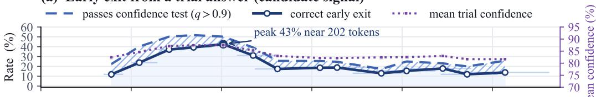
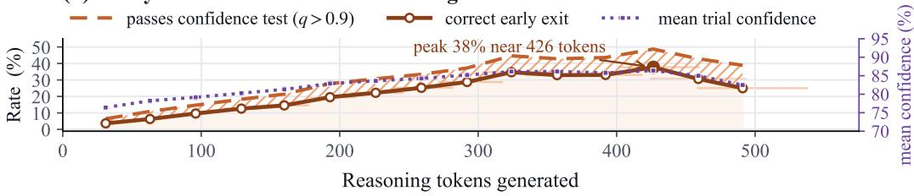
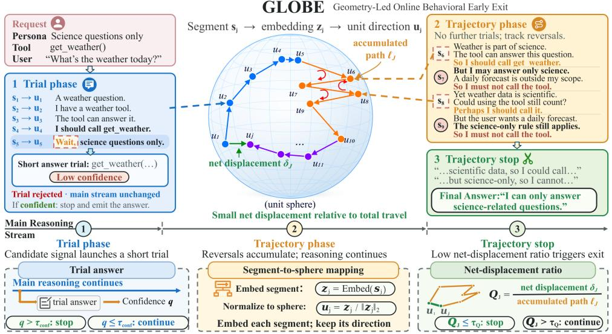
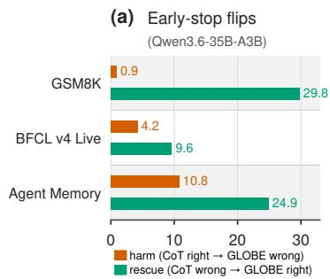
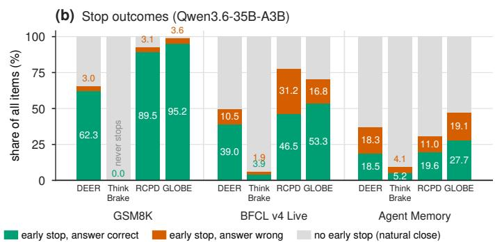
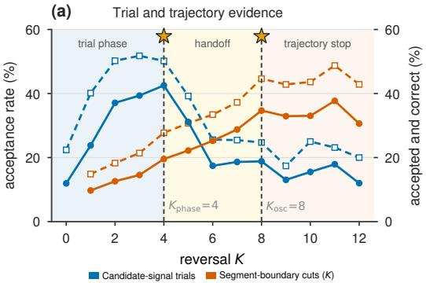
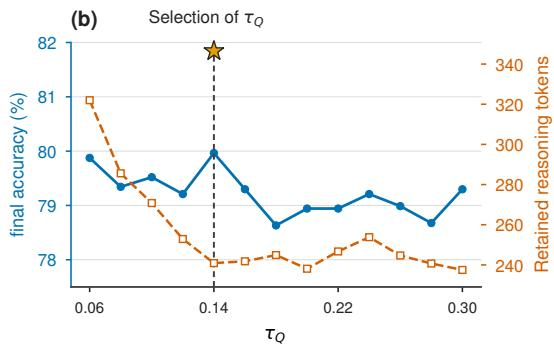
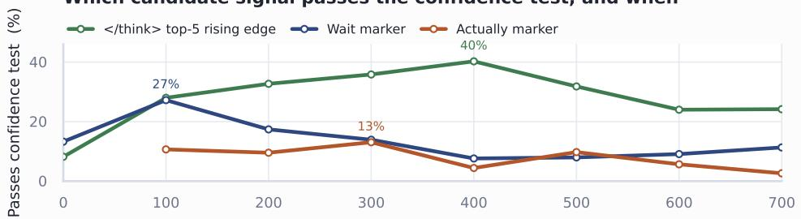
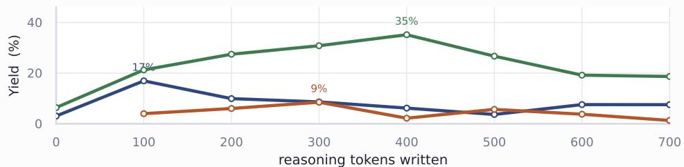
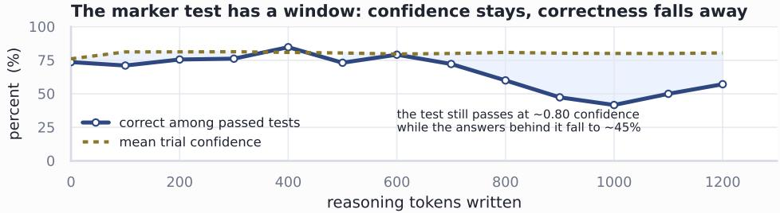

# GLOBE: GEOMETRY-LED ONLINE BEHAVIORAL EARLY EXIT VIA UNIT-SPHERE TRAJECTORIES

Xinyue Peng, Zhenlin Liang, Meng Cai, Hua Wang

Moore Threads

meilong@mthreads.com

## ABSTRACT

Chain-of-thought (CoT) reasoning can improve problem solving, but models often keep generating after the correct answer is already reachable; the extra steps raise serving costs and may replace a correct intermediate result with an incorrect one. We propose GLOBE (Geometry-Led Online Behavioral Early Exit), an online, training-free algorithm that terminates the model’s CoT process early. GLOBE embeds each completed reasoning segment as a point on a unit sphere and reads the shape of the resulting semantic trajectory. GLOBE first applies a trial phase that generates short trial answers in a separate branch, stopping the main stream on an accepted trial after checking confidence against a threshold. If generation continues, a trajectory phase stops the stream once this path repeatedly reverses direction with little net progress. On five benchmarks including mathematical reasoning, tool calling, and agent memory, GLOBE cuts output tokens by 49.7% and active end-to-end wall time (E2E) by 51.0% across two models, and achieves a five-task average of 80.58%, comparable to Full CoT.

## 1 INTRODUCTION

Allocating additional test-time computation to chain-of-thought reasoning can substantially improve complex decision making and problem solving in language models (Wei et al., 2022; Wang et al., 2023; Snell et al., 2025). However, longer traces have uncertain marginal value while imposing costs in token throughput, request concurrency, and end-to-end latency. Long-form reasoning models often keep generating after the correct answer is already reachable, and the extra steps can replace a correct intermediate result with an incorrect one, a behavior known as overthinking (Chen et al., 2025; Wu et al., 2026; Han et al., 2026; Sui et al., 2025). Early exit is therefore an online allocation decision: from the current prefix, an inference system must decide whether to stop or purchase more computation without observing the future continuation.

Early-exit methods monitor different signals. Reflection-marker methods trigger trial answers and stop when local confidence passes an acceptance test (Yang et al., 2026); output-distribution methods compare continuing with emitting a thinking-close token at syntactic boundaries (Song et al., 2026; Wei et al., 2026); answer-convergence methods wait for sampled answers to stabilize (Liu & Wang, 2025); and other work inspects step-level redundancy, confidence dynamics, sufficiency, or internal activations (Min et al., 2026; Hosseini et al., 2026; Sun et al., 2026; Xiang et al., 2026; Liu et al., 2026). A separate line of work shortens reasoning by training with length-aware objectives or by fixing a decoding budget (Arora & Zanette, 2025; Aggarwal & Welleck, 2025; Muennighoff et al., 2025). These signals are not interchangeable: a trial tests whether the current prefix is ready to answer, whereas a long trace can keep changing even after local confidence is already high.

We ground the comparison in measurements by replaying the full chain-of-thought traces of BFCL v4 Live (Patil et al., 2025) offline and reproducing two types of trigger points: trial answers launched at candidate signals, such as a reflection marker like Wait; and cuts of the reasoning stream, which is split into segments with a stop triggered at every cut. For each trigger point we record the same three quantities: whether the answer reaches high confidence (mean token probability q > 0.9), whether that answer is correct, and the average confidence over those points. Figure 1 shows that the two families are offset in time: trials at candidate signals peak early in the trace and then decay, whereas cuts of the reasoning stream keep improving until late in the trace. Confidence decides whether a trial answer is accepted, not when the trial signal stops being useful. The open question is therefore whether a controller can tell, during generation, whether the reasoning is still making progress or is looping back on itself.

(a) Early exit from a trial answer (candidate signal)  

(b) Early exit from a cut in the reasoning stream  
  
Figure 1: Two mechanisms for triggering an early exit: a trial answer at a candidate signal (a) and a cut of the reasoning stream (b).

To this end, we propose GLOBE, a training-free online algorithm over a single reasoning stream. It launches short trial answers at candidate signals and embeds each completed segment, so that generation traces a path on a unit sphere. Early in the trace, a confident trial answer ends generation; later, the trajectory decides, and the stream stops once it keeps retracing what it has already covered.

We make three contributions:

• We observe that trial-answer stopping and reasoning-stream-cut stopping are effective in different regions of the trace: trial answers work best early and decay with depth, whereas stream cuts improve later. GLOBE therefore introduces a phase switch rather than concatenating them: trial confidence asks whether the current prefix is answer-ready, while spherical trajectory geometry asks whether reasoning is still advancing.

• We introduce a spherical trajectory representation that transforms abstract semantic progress into measurable geometric properties. Each completed segment is embedded and normalized to a point on the unit sphere, where net displacement signals progress and repeated directional reversals with little net displacement indicate repetition. The trajectory criterion relies only on the angles between segment embeddings. It therefore requires neither complex semantic evaluation nor language-specific vocabulary or syntax.

• GLOBE cuts output tokens and E2E time by about half while keeping its frequent early exits reliable. Across two models and five benchmarks for tasks such as mathematical reasoning, tool calling, and agent memory, GLOBE averages 80.58% on the five-task score, comparable to 80.04% for Full CoT, while cutting output tokens by 49.7% and active E2E time by 51.0%. On Qwen’s GSM8K analysis runs, early exits correct 29.8% of Full CoT errors while making 0.94% of Full CoT-correct answers incorrect.

## 2 RELATED WORK

Efficient reasoning and test-time compute. Chain-of-thought and test-time scaling improve difficult reasoning by allocating more inference computation (Wei et al., 2022; Snell et al., 2025), but longer traces may repeat established conclusions or overturn a correct intermediate answer (Chen et al., 2025; Wu et al., 2026). One line of work intervenes at training time, using supervised or reinforcement learning with length-aware objectives so that the model itself emits shorter traces (Arora & Zanette, 2025; Aggarwal & Welleck, 2025; Han et al., 2026). Another leaves the weights untouched and controls length at inference time, through a fixed budget, budget forcing, concise prompts, or a non-thinking mode (Muennighoff et al., 2025; Ma et al., 2025); Sui et al. (2025) survey this space. These approaches control how much reasoning is generated, whereas we study a training-free online algorithm that decides, from the current instance’s evolving history, whether to purchase more computation.

Online early stopping from local evidence. Inference-time methods commonly inspect intermediate answers or decoding signals. Answer Convergence stops when predictions from partial traces stabilize (Liu & Wang, 2025). Certaindex estimates the stability and certainty of intermediate answers to adapt compute (Fu et al., 2025), and trained hidden-state probes predict answer correctness to support early exiting (Zhang et al., 2025a). DEER uses reflection markers to propose trial answers and exits when their token confidence is high (Yang et al., 2026); ThinkBrake instead monitors the margin between the best continuation token and the thinking-close token (Song et al., 2026), while RCPD tracks the rank of that token at sentence boundaries and force-closes the thinking segment once one of a few rules distilled from offline reasoning-dynamics analysis is satisfied (Wei et al., 2026). DTSR prompts the model to assess thought sufficiency at reflection points (Xiang et al., 2026), while CoDE-Stop and REFRAIN use confidence or redundancy dynamics over multiple checkpoints (Hosseini et al., 2026; Sun et al., 2026). GLOBE uses such pointwise local evidence only in its trial phase.

Trajectory-level and deployable controllers. Representation-level methods move beyond a single answer score. PUMA detects semantic redundancy between reasoning steps and verifies candidate exits with an answer probe (Min et al., 2026); NEAT monitors neuron activation dynamics without answer rollouts (Liu et al., 2026). Both compare representations locally, at a step or a pair of steps, rather than describing the shape of the accumulated trace. Latent-Trajectory signals summarize traces from the model’s hidden states, but select among sampled traces rather than stop a single one (Vilas et al., 2026). Deployment adds a second requirement: in tool-using and agentic settings a stop must preserve the parser-visible action and cross-turn state (Yao et al., 2023; Schick et al., 2023; Patil et al., 2025), and the cost of a controller includes the trial requests and repeated prefix computation it adds, not only the tokens it retains. GLOBE addresses both: it stops a single stream online from the geometry of its accumulated text-embedding trajectory, and it reports active E2E time alongside retained tokens under each task’s native protocol.

## 3 METHODOLOGY

## 3.1 GLOBE OVERVIEW

Figure 2 gives an overview of GLOBE, which embeds each completed reasoning segment as a point on a unit sphere and reads the shape of the resulting semantic trajectory. The trial phase generates short trial answers in a separate branch at candidate signals such as Wait and checks their confidence against a threshold. A highly confident trial answer is accepted and stops the main stream; otherwise, it is discarded and the main stream keeps generating. A reversal is a step of the trajectory that moves partly back along the previous step. Once reversals have accumulated, the stream enters the trajectory phase and stops launching trials. In this phase, the trajectory stop ends the stream once the trajectory repeatedly reverses direction with little net progress, that is, a small net displacement relative to its path length. The reasoning is then circling over content it has already covered. After an accepted trial or a trajectory stop, GLOBE generates the final answer from the retained prefix. If neither occurs, the model ends its reasoning naturally and then answers.

## 3.2 CANDIDATE-SIGNAL-TRIGGERED TRIAL ANSWERS

The trial phase aims to decide whether the current reasoning prefix $r _ { \le t }$ already suffices to answer. This prefix consists of the reasoning tokens generated up to step t. The decision is made before reasoning ends. For this purpose, GLOBE launches short trial answers at sparse candidate signals. It uses their confidence as the criterion.

The controller supports two types of candidate signals. The first type consists of the two most representative textual markers in the reasoning text. These markers are Wait and Actually. Wait marks a pause to check the current reasoning. Actually marks a re-verification of it. The second type is the task-native thinking-close marker </think>. The controller does not wait for this marker to be generated. Instead, it detects the marker as soon as it enters the top-5 next-token candidates.

  
Figure 2: Overview of GLOBE, a training-free online algorithm over a single reasoning stream, in three steps. The example is a tool-calling irrelevance case, as the persona permits only science questions and the weather tool should not be called. In the trial phase, a get\_weather trial answer at Wait is rejected for low confidence. In the trajectory phase, the reasoning wavers over calling the tool. Once reversals, marked by the red arrows, accumulate with little net displacement, further reasoning is redundant, so the trajectory stop ends the stream and the final answer declines the request.

Thus, the reasoning stream is not closed early. The fact that the model is ready to answer becomes available as a signal, and the reasoning can still continue.

Trial answers are generated in a separate branch, leaving the main reasoning stream uninterrupted. When a signal triggers, the controller freezes the exact prefix, appends a prompt g that elicits a direct answer, and issues one trial request. The request returns a trial answer y˜ of length $m \leq \tau _ { \mathrm { t r i a l } } ;$ the model’s predictions are sharply concentrated when the prefix suffices and more dispersed otherwise (Yang et al., 2026). Let x be the task input, V the vocabulary, and $\mathcal { H } _ { \theta }$ the LM head with parameters θ. The logits at position $~ ( 1 \leq i \leq m$ , with the preceding trial tokens $\scriptstyle { \tilde { y } } < _ { i } )$ and their largest entry are

$$
\pmb { o } _ { i } = \mathcal { H } _ { \theta } \big ( x , r \leq t , g , \tilde { y } _ { < i } \big ) , \qquad o _ { i } ^ { \star } = \operatorname* { m a x } _ { v \in \mathcal { V } } o _ { i , v } ,
$$

where $o _ { i } ^ { \star }$ corresponds to the token chosen by greedy decoding. The confidence of a trial is the mean over positions of the softmax probability of that token:

$$
q = \frac { 1 } { m } \sum _ { i = 1 } ^ { m } \frac { \exp \left( o _ { i } ^ { \star } \right) } { \sum _ { v \in \mathcal { V } } \exp \left( o _ { i , v } \right) } .\tag{1}
$$

A trial is accepted when q exceeds the confidence threshold $\tau _ { \mathrm { c o n f } }$ . In this case, the prefix is deemed sufficient to answer. The decision rests on the model’s own predictive distribution, not on the correctness of the answer.

After a trial is accepted, the system runs the continuation procedure. First, it cancels the main reasoning stream and discards everything after the frozen point. Second, it re-issues the retained prefix to the same serving endpoint. Thus, its prefix cache is reused. Third, it appends </think> and generates the final answer under the original prompt and native parsing rules. A rejected trial is discarded and leaves the main reasoning stream unaffected. Trial requests are accounted for separately. Appendices A.1 and A.3 give the exact prefix boundaries, edge cases, and cost accounting.

## 3.3 UNIT-SPHERE TRAJECTORY REPRESENTATION

Fewer trial answers are both confident and correct late in reasoning (Figure 1), so the next signal must come from the reasoning content itself: is the chain advancing, or is it returning to what it has covered? Prior work shows that embeddings encode semantics: the squared norm of a word embedding carries its information gain, a result extending to contextualized embeddings (Oyama et al., 2023), while semantic relations are reflected in the directions of their difference vectors (Mikolov et al., 2013; Ethayarajh et al., 2019). Since our decision concerns the relation between successive reasoning segments rather than the information gain carried by any one of them, and our encoder’s cosinesimilarity objective makes that relation angular (Zhang et al., 2025b), we normalize each segment embedding onto the unit sphere, so that advance and return are read from the angles alone.

The geometric observer runs alongside the main reasoning stream. The segmenter splits the reasoning text r into segments $s _ { 1 } , s _ { 2 } , \ldots .$ . at sentence-ending punctuation and newlines. It merges adjacent fragments until each completed segment has at least the minimum length $L _ { \mathrm { m i n } }$ (in characters). This prevents over-fragmentation. Each completed segment is then encoded into a semantic vector by the embedding model. Appendix A.2 describes the segmenter. Embedding overlaps with generation; its request time is at most 13.6% of per-item wall time in the profiled Qwen runs (Appendix D.2). Appendix D.9 gives encoder details and results with smaller encoders.

Let J be the number of completed segments and $z _ { j } ~ \in ~ \mathbb { R } ^ { d }$ the semantic vector of segment $s _ { j } .$ where d is the embedding dimension. We normalize this vector as $u _ { j } = z _ { j } / \lVert z _ { j } \rVert _ { 2 }$ , where $\| \cdot \| _ { 2 } ^ { \ j }$ denotes the Euclidean norm. The reasoning trajectory is the point sequence $( u _ { j } ) _ { j = 1 } ^ { J }$ on the unit sphere $\mathbb { S } ^ { d - 1 } = \left\{ u \in \mathbb { R } ^ { d } : \| u \| _ { 2 } = 1 \right\}$ . Its chordal displacements are $\xi _ { j } ~ = ~ u _ { j + 1 } - u _ { j }$ . The controller incrementally maintains the needed entries of the Gram matrix $\bar { S } = [ S _ { a , b } ^ { - } ]$ , with entries $S _ { a , b } = \langle u _ { a } , u _ { b } \rangle$ for $a , \dot { b } \in \{ 1 , \ldots , J \}$ , where $\langle \cdot , \cdot \rangle$ denotes the Euclidean inner product. The chord length $\| u _ { a } - u _ { b } \| _ { 2 } = \sqrt { 2 - 2 S _ { a , b } }$ depends only on the angle. Thus, the statistics below are functions of the Gram matrix $S$ alone. They are invariant under orthogonal transformations of the embedding space and under positive rescaling of the raw embeddings $z _ { j }$ . Each new segment therefore requires only $O ( d )$ time to update these quantities.

To detect changes of direction, we compute the inner products of consecutive chordal displacements:

$$
\begin{array} { r } { \kappa _ { j } = \langle \xi _ { j } , \xi _ { j + 1 } \rangle = \frac { 1 } { 2 } \big ( \| u _ { j + 2 } - u _ { j } \| _ { 2 } ^ { 2 } - \| \xi _ { j } \| _ { 2 } ^ { 2 } - \| \xi _ { j + 1 } \| _ { 2 } ^ { 2 } \big ) = S _ { j , j + 1 } + S _ { j + 1 , j + 2 } - S _ { j , j + 2 } - 1 . } \end{array}\tag{2}
$$

Here $\kappa _ { j }$ is defined for $1 \leq j \leq J - 2$ , and $\kappa _ { j } < 0$ means one directional reversal. $\mathtt { B y }$ the polarization identity, this is equivalent to the reasoning not continuing along its previous direction (Appendix B.2). We count reversals by $\begin{array} { r } { K _ { J } = \sum _ { j = 1 } ^ { J - 2 } \mathbf { 1 } [ \kappa _ { j } < 0 ] } \end{array}$ . Here, $\mathbf { 1 } [ \cdot ]$ is the indicator function.

Once the reversals have accumulated, we also need to decide whether the reasoning is going in circles instead of making progress. For this purpose, we first look at how far the trace has traveled and how far it has actually advanced. These distances are the path length and the start-to-end displacement:

$$
\ell _ { J } = \sum _ { j = 1 } ^ { J - 1 } \| \xi _ { j } \| _ { 2 } = \sum _ { j = 1 } ^ { J - 1 } \sqrt { 2 - 2 S _ { j , j + 1 } } , \qquad \delta _ { J } = \| u _ { J } - u _ { 1 } \| _ { 2 } = \sqrt { 2 - 2 S _ { 1 , J } } .\tag{3}
$$

We define the net-displacement ratio as $Q _ { J } = \delta _ { J } / \ell _ { J }$ when $\ell _ { J } > 0$ , and set $Q _ { J } = 1$ when $\ell _ { J } = 0 . \ : \mathrm { A }$ smaller value means that the trace returns more relative to the path it has traveled.

## 3.4 PHASE SWITCH AND TRAJECTORY STOP

Let $J ( t )$ be the number of segments completed by step $t ,$ and write $K _ { t } = K _ { J ( t ) }$ and $Q _ { t } = Q _ { J ( t ) }$ for the reversal count and the net-displacement ratio at that point. The constants $K _ { \mathrm { p h a s e } } , K _ { \mathrm { o s c } } ,$ , and $\tau _ { Q }$ are the phase-switch, oscillation, and net-displacement-ratio thresholds. The early-exit indicator at step t is

$$
e _ { t } = { \left\{ \begin{array} { l l } { \mathbf { 1 } [ q > \tau _ { \mathrm { c o n f } } ] , } & { K _ { t } < K _ { \mathrm { p h a s e } } { \mathrm { ~ a n d ~ a ~ s i g n a l ~ t r i g g e r s ~ a t } } t , } \\ { \mathbf { 1 } [ K _ { t } \geq K _ { \mathrm { o s c } } { \mathrm { ~ a n d ~ } } Q _ { t } \leq \tau _ { Q } ] , } & { K _ { t } \geq K _ { \mathrm { p h a s e } } , } \\ { 0 , } & { { \mathrm { o t h e r w i s e } } . } \end{array} \right. }\tag{4}
$$

GLOBE exits at the first step with $e _ { t } = 1$ . The first case is the trial phase. Here, the signal is a candidate signal of Section 3.2. Once $K _ { t }$ reaches the phase threshold $\bar { K } _ { \mathrm { p h a s e } } ,$ , the stream enters the trajectory phase of the second case. In this phase, no further trials are launched. Also, no exit is possible until $K _ { t }$ reaches the oscillation threshold $K _ { \mathrm { o s c } } . \mathrm { A }$ trajectory stop is placed at the boundary of the latest completed segment. $\mathrm { I f } e _ { t } = 0$ throughout, reasoning ends at the model’s own termination. Both early exits execute the continuation procedure of Section 3.2. Appendix A.5 lists the operating thresholds.

Table 1: Main results. Acc. (%), Tok. (average output tokens), and E2E (s) per task. Agent Memory Acc. averages KV, Vector, and Recursive Sum, and its E2E is their sum. Bold: best Acc., and lowest Tok/E2E among thinking methods.
<table><tr><td>Method</td><td colspan="2">CSQA Acc↑ Tok↓ E2E↓</td><td colspan="3">Character-LLM |Acc↑ Tok↓ E2E↓</td><td colspan="2">GSM8K [Acc↑ Tok↓ E2E↓</td><td colspan="2">BFCL v4 Live Acc↑ Tok↓ E2E↓</td><td colspan="2"></td><td colspan="2">Agent Memory |Acc↑ Tok↓ E2E↓</td><td colspan="2">Avg. Acc↑ Tok↓ E2E↓</td></tr><tr><td>Qwen3.6-35B-A3B</td><td></td><td></td><td></td><td></td><td></td><td></td><td></td><td></td><td></td><td></td><td></td><td></td><td></td><td></td><td></td></tr><tr><td>Nothink</td><td>83.8</td><td>601</td><td>1062 90.8</td><td>124</td><td>1323</td><td>96.3</td><td>189</td><td>575</td><td>77.9</td><td>103 1015</td><td>34.5</td><td>763</td><td>1556</td><td>|76.66356</td><td>1106</td></tr><tr><td>Full CoT</td><td></td><td>84.7 2065</td><td>5376</td><td>94.4 1368 7775</td><td></td><td></td><td>96.7 1761 3475</td><td></td><td>81.3 962</td><td>4888</td><td>55.0</td><td></td><td>9549 16304</td><td>82.42 31417564</td><td></td></tr><tr><td>DEER</td><td></td><td>81.4 1584 3090</td><td></td><td>95.2 1233 9515</td><td></td><td></td><td>96.1 1240 2631</td><td></td><td>77.3 581</td><td>4964</td><td></td><td></td><td>55.4 6839 14434</td><td>81.0822956927</td><td></td></tr><tr><td>ThinkBrake</td><td></td><td>82.6 2044 5719</td><td></td><td>94.4 355</td><td>6458</td><td></td><td>96.1 1779 5539</td><td></td><td>79.6</td><td>789 4818</td><td></td><td></td><td>52.97417 13673</td><td>81.1224777241</td><td></td></tr><tr><td>RCPD</td><td>85.1</td><td>514</td><td>1174 93.2</td><td>399</td><td>3424</td><td>96.4</td><td>570</td><td>1500</td><td>65.6</td><td>303 2547</td><td>51.9</td><td>2171</td><td>4656</td><td>78.44791</td><td>2660</td></tr><tr><td>GLOBE (ours)</td><td>86.4</td><td>525</td><td>1290</td><td>94.5 933</td><td>5389</td><td>96.5</td><td>784 1969</td><td></td><td>80.0371</td><td>3071</td><td></td><td>58.0 20405730</td><td></td><td>83.08 931 3490</td><td></td></tr><tr><td colspan="10">Gemma-4-12B-it</td><td></td><td></td><td></td><td></td><td></td><td></td></tr><tr><td>Nothink</td><td>81.2 342</td><td></td><td>837</td><td>91.7 117</td><td>497</td><td>94.0</td><td>160</td><td>635</td><td>77.1 51</td><td>888</td><td></td><td>31.8766</td><td>2683</td><td>|75.16287</td><td>1108</td></tr><tr><td>Full CoT</td><td>83.0 1939</td><td></td><td>5009 91.5</td><td>699</td><td>9893</td><td></td><td>94.3 1382 4047</td><td></td><td>77.6 601</td><td>5782</td><td>41.9</td><td>2308 7523</td><td></td><td>77.66 1386 6451</td><td></td></tr><tr><td>DEER</td><td>77.9</td><td>743</td><td>2053</td><td>94.3</td><td>646 2611</td><td></td><td>88.6 1414 4846</td><td></td><td>76.4 526</td><td>5600</td><td></td><td></td><td>38.7 1951 7286</td><td>75.18 10564479</td><td></td></tr><tr><td>ThinkBrake</td><td></td><td>82.1 1831 4792</td><td></td><td>92.8 500</td><td>7901</td><td></td><td>95.4 1424 4322</td><td></td><td>76.7</td><td>386 3693</td><td></td><td>38.32217</td><td>6671</td><td>77.0612725476</td><td></td></tr><tr><td>RCPD</td><td></td><td>82.2 12683624</td><td></td><td></td><td>93.911755458</td><td></td><td>89.7 1066 3865</td><td></td><td>77.6 466</td><td>4962</td><td></td><td></td><td>42.622107120</td><td>77.2012375006</td><td></td></tr><tr><td>GLOBE (ours)</td><td></td><td>82.0 689 2034</td><td></td><td></td><td>92.4 645 2478</td><td></td><td>95.1 717 2306</td><td></td><td></td><td>81.1 306 2744</td><td></td><td></td><td>39.8 1708 5442</td><td>78.08 813 3001</td><td></td></tr></table>

## 4 EXPERIMENTS

## 4.1 EXPERIMENTAL SETUP

Benchmarks and models. We evaluate five benchmarks: commonsense question answering on CSQA (Talmor et al., 2019), role-play character fidelity on Character-LLM (Shao et al., 2023), grade-school mathematics on GSM8K (Cobbe et al., 2021), tool calling on BFCL v4 Live (Patil et al., 2025), and long-horizon agent memory on BFCL v4 Agent Memory (Patil et al., 2025), whose KV, Vector, and Recursive Sum backends are scored separately. We use two instruction-tuned thinking models from different families and parameter scales, Qwen3.6- 35B-A3B (Qwen Team, 2026), a mixture-of-experts model with 35B total parameters, and Gemma-4-12B-it (Gemma Team et al., 2026), which we call Qwen and Gemma. Accuracy or exact match is the native metric of the four accuracy-style benchmarks; for Character-LLM, a fixed judge applies a four-aspect adaptation of the original rubric and we report the resulting normalized acting score (NAS), defined in Appendix C.1. We also report average retained output tokens and active task-level end-to-end wall time (E2E).

Baselines. Nothink disables the thinking channel and answers directly, bounding the cost of reasoning from below (Ma et al., 2025). Full CoT leaves thinking unconstrained and serves as the quality reference. DEER (Yang et al., 2026) watches reflection markers, issues a trial answer at each marker, and exits the stream once that trial answer is confident. ThinkBrake (Song et al., 2026) uses no trial answers: at sentence boundaries it compares the log probabilities of continuing and of emitting </think>, and stops on a margin criterion. RCPD (Wei et al., 2026) also uses no trial answers and tracks the rank of </think> at sentence boundaries, closing the thinking segment once one of a few rules distilled from an offline reasoning-dynamics analysis is satisfied. Each baseline follows its method-native contract.

## 4.2 MAIN RESULTS

Overall performance. Table 1 compares GLOBE with the Nothink and Full CoT controls and with the early-exit baselines of Section 4.1. GLOBE attains the highest five-task average on both models, reaching 83.08% on Qwen and 78.08% on Gemma against 82.42% and 77.66% for Full CoT. The reduction holds on every task: averaged over the ten model–task pairs, output tokens fall by 49.7% and E2E time by 51.0%, and the five-task average output-token count falls from 3141 to 931 on Qwen and from 1386 to 813 on Gemma.

Table 2: Component ablation: accuracy (%) and average output tokens, reporting changes against GLOBE (Table 1). Parentheses give accuracy differences in points and relative token changes (%), computed before rounding. The Average token column gives the geometric mean of the token ratios. red is worse than GLOBE, green better, and gray a tie.
<table><tr><td>Method</td><td colspan="2">GSM8K Accuracy↑ Avg Token↓</td><td colspan="2">BFCL v4 Live Accuracy↑ Avg Token↓</td><td colspan="2">Agent Memory Accuracy↑ Avg Token↓</td><td colspan="2">Average Accuracy↑ Avg Token↓</td></tr><tr><td colspan="9">Qwen3.6-35B-A3B</td></tr><tr><td>GLOBE (ours)</td><td>96.5</td><td>784</td><td>80.0</td><td>371</td><td>58.0</td><td>2040</td><td>78.2</td><td>1.00×</td></tr><tr><td>w/o trajectory stop</td><td> $9 6 . 1 \ ( - 0 . 5 )$ </td><td> $1 5 2 9 ( + 9 5 \% )$ </td><td> $8 0 . 0 \ ( + 0 . 0 )$ </td><td> $7 5 7 \ : ( + 1 0 4 \% )$ </td><td> $4 6 . 9 \ : ( - 1 1 . 1 )$ </td><td>9181 (+350%)</td><td> $7 4 . 3 \ : ( - 3 . 8 )$ </td><td>2.62×</td></tr><tr><td>w/o phase switch</td><td> $9 6 . 3 \ : ( - 0 . 2 )$ </td><td> $6 7 6 ~ ( - 1 4 \% )$ </td><td> $7 9 . 5 \ ( - 0 . 4 )$ </td><td> $3 3 6 ( - 9 \% )$ </td><td> $5 0 . 1 \ ( - 7 . 9 )$ </td><td> $2 5 5 1 \ ( + 2 5 \% )$ </td><td> $7 5 . 3 \ : ( - 2 . 9 )$ </td><td>0.99×</td></tr><tr><td>w/o trial answers</td><td> $9 5 . 8 \ ( - 0 . 8 )$ </td><td> $9 5 9 \ ( + 2 2 \% )$ </td><td> $7 9 . 7 \ ( - 0 . 3 )$ </td><td> $4 1 2 \left( + 1 1 \% \right)$ </td><td> $5 6 . 1 \ ( - 1 . 9 )$ </td><td> $2 5 1 8 \ ( + 2 3 \% )$ </td><td> $7 7 . 2 \ : ( - 1 . 0 )$ </td><td>1.19×</td></tr><tr><td>w/o τQ gate</td><td> $9 6 . 2 \ : ( - 0 . 3 )$ </td><td> $6 2 3 \ ( - 2 1 \% )$ </td><td> $7 9 . 1 \ ( - 0 . 9 )$ </td><td> $3 4 9 \ ( - 6 \% )$ </td><td> $5 5 . 7 \ : ( - 2 . 3 )$ </td><td> $2 2 2 4 \ : ( + 9 \% )$ </td><td> $7 7 . 0 ( - 1 . 2 ) $ </td><td>0.93×</td></tr><tr><td colspan="9">Gemma-4-12B-it</td></tr><tr><td>GLOBE (ours)</td><td>95.1</td><td>717</td><td>81.1</td><td>306</td><td>39.8</td><td>1708</td><td>72.0</td><td>1.00×</td></tr><tr><td>w/o trajectory stop</td><td> $6 2 . 2 \ ( - 3 2 . 9 )$ </td><td> $3 8 7 7 ( + 4 4 1 \% )$ </td><td> $7 5 . 5 \ ( - 5 . 6 )$ </td><td> $5 7 4 \ : ( + 8 8 \% )$ </td><td> $4 4 . 5 \ : ( + 4 . 7 ) $ </td><td> $2 0 4 4 \ ( + 2 0 \% )$ </td><td> $6 0 . 7 \ ( - 1 1 . 3 )$ </td><td>2.30×</td></tr><tr><td>w/o phase switch</td><td> $9 0 . 1 \ ( - 5 . 0 )$ </td><td> $1 0 6 5 \ : ( + 4 9 \% )$ </td><td> $7 5 . 7 \ ( - 5 . 4 )$ </td><td> $2 9 4 \ : ( - 4 \% )$ </td><td> $3 6 . 6 \ : ( - 3 . 2 )$ </td><td> $1 5 8 7 ( - 7 \% )$ </td><td> $6 7 . 5 \ : ( - 4 . 5 )$ </td><td>1.10×</td></tr><tr><td>w/o trial answers</td><td> $9 3 . 1 \ ( - 2 . 0 )$ </td><td> $8 3 2 \ : ( + 1 6 \% )$ </td><td> $7 7 . 0 ( - 4 . 1 )$ </td><td> $2 8 3 \ : ( - 8 \% )$ </td><td> $3 6 . 1 \ ( - 3 . 7 )$ </td><td> $1 5 5 1 ~ ( - 9 \% )$ </td><td> $6 8 . 8 \ ( - 3 . 2 )$ </td><td>0.99×</td></tr><tr><td>w/o τQ gate</td><td> $9 0 . 4 \ : ( - 4 . 6 )$ </td><td> $9 7 3 \ ( + 3 6 \% )$ </td><td> $7 6 . 0 \ : ( - 5 . 1 )$ </td><td> $2 8 9 ( - 6 \% )$ </td><td> $3 6 . 3 \ : ( - 3 . 4 )$ </td><td> $1 5 2 3 ( - 1 1 \% )$ </td><td> $6 7 . 6 \ ( - 4 . 4 )$ </td><td>1.05×</td></tr></table>

Comparison with early-exit baselines. DEER loses 5.7 accuracy points on GSM8K and 5.1 on CSQA in Gemma; its stop needs a reflection marker where the trial answer is already decidable, which is not guaranteed across models. ThinkBrake is the most conservative: no task’s accuracy deviates from Full CoT by more than 3.6 points, and it stays below Full CoT in both five-task averages. RCPD is the cheapest controller on Qwen in tokens and E2E, averaging 791 tokens and 2660 s, but it sacrifices accuracy: a 78.44% five-task average, 4.64 points below GLOBE and 15.7 points below Full CoT on BFCL v4 Live, suggesting its rank rule can trigger before the answer settles. No baseline reaches the Full CoT five-task average on either model, while GLOBE exceeds it on both.

GLOBE is stable across models and datasets. The Nothink–Full CoT gap shows that thinking matters most on Agent Memory, with gaps of 20.5% and 10.1% on the two models, while the gap is 0.4% and 0.3% on GSM8K and at most 3.6% on the other three tasks. GLOBE’s worst task is 2.1 points below Full CoT, and it spends fewer tokens and less E2E time than Full CoT in all ten model–task cells. The baselines diverge: on the five-task average, DEER falls 1.34 points below Full CoT on Qwen and 2.48 below it on Gemma, whereas ThinkBrake falls 1.30 and 0.60 points below, respectively. RCPD is the weakest baseline on Qwen yet the strongest on Gemma. RCPD’s savings are equally model-dependent, removing 71.9% of output tokens on Qwen but only 3.2% on Gemma.

## 4.3 ABLATION STUDY

Table 2 removes one component of GLOBE at a time and compares each variant with the GLOBE row of Table 1. Removing any component lowers the three-task average accuracy on both models, by up to 11.3 points. The three tasks span the difficulty tiers of Section 4.2: GSM8K depends on thinking least, Agent Memory most, and BFCL v4 Live in between; Appendix Tables 8 and 9 extend the sweep to CSQA and Character-LLM.

The trajectory stop controls token cost. Removing it is the most costly ablation: all six token cells rise, by a factor of 2.62 on Qwen and 2.30 on Gemma. Without it, the Agent Memory output on Qwen grows from 2040 to 9181 tokens. The largest observed accuracy gap is 32.9 points on GSM8K in Gemma, followed by 11.1 on Agent Memory in Qwen; Gemma Agent Memory gains 4.7 points, so the trajectory stop contributes more than any other component. Appendix D.5 shows that the Gemma GSM8K loss comes from traces that never close within the token budget. The criterion matters wherever the trace stalls: the stream closes once the trajectory reverses repeatedly with little net displacement. Geometry judges whether the trajectory still advances without certifying correctness, so dropping the stop lets generation continue into a post-retrieval restatement that resembles oscillation.

Removing the phase switch costs accuracy. The phase switch is one-way: once the cumulative reversal count reaches $K _ { \mathrm { p h a s e } } ,$ the controller permanently retires trial answers and only the trajectory stop can close the stream; removing it lets trial answers return in the trajectory phase. It costs an average of 2.9 accuracy points on Qwen and 4.5 on Gemma. On Qwen the loss concentrates on Agent Memory, which drops by 7.9 points, while GSM8K and BFCL v4 Live save at most 14% of tokens for at most 0.4 accuracy points; on Gemma every task loses accuracy, by 3.2 to 5.4 points. Removing it changes average token use by at most 10% yet consistently lowers the three-task average, so the savings cannot offset the accuracy loss.

  
Figure 3: Stop reliability on separate analysis runs. (a) Harm and rescue of GLOBE early stops versus Full CoT on GSM8K, BFCL v4 Live, and Agent Memory. (b) Stop outcomes per controller: stopped and correct (green), stopped and wrong (orange), and natural close (grey).

Trial answers and the $\tau _ { Q }$ gate are jointly required. Trial answers freeze the prefix at a candidate signal such as Wait and generate a short answer in a separate branch, accepted only when its confidence exceeds a threshold; the $\tau _ { Q }$ gate vetoes trajectory-stop candidates when $Q _ { t } \ > \ \tau _ { Q }$ Removing either component lowers accuracy in all twelve model–task combinations, by up to 5.1 points, and the three-task averages by up to 4.4. The cheapest Qwen variant drops the $\tau _ { Q }$ gate and uses 0.93× the tokens of GLOBE, but loses accuracy on all three tasks; on Gemma, dropping either component saves up to 11% of tokens on BFCL v4 Live and Agent Memory for up to 5.1 accuracy points. No cell is simultaneously cheaper and more accurate than GLOBE: the trials test whether the current prefix already supports an answer, and the gate vetoes stops that would come too early.

## 4.4 STOP RELIABILITY

Early stopping can recover some Full CoT errors. Figure 3a joins Full CoT with GLOBE by item: harm is the share of Full CoT-correct items that GLOBE stops early and answers incorrectly, and rescue is the share of Full CoT-wrong items that GLOBE stops early and answers correctly. GSM8K is the least thinking-dependent task, so answers are usually already determined: harm is rare at 0.94% and rescue reaches 29.8%. On BFCL v4 Live, a tool call must keep its choice, call structure and arguments consistent, so a settled-looking prefix can still become a different call; harm is 4.17% and rescue 9.56%. On Agent Memory the two rates are at 10.8% and 24.9%, because the stateful task also carries the run-to-run divergence of the memory contents into the join.

GLOBE converts the most early stops into correct answers. Figure 3b splits each Qwen task into correct early stops in green, incorrect early stops in orange and items left to close naturally in grey, so the green band is the share of items stopped early and answered correctly. GLOBE has the largest green band on all three tasks, at 95.2% on GSM8K, 53.3% on BFCL v4 Live and 27.7% on Agent Memory. DEER requires a reflection marker plus a confident trial, capping its green band at 62.3% on GSM8K and 39.0% on BFCL v4 Live. ThinkBrake triggers only when closing the segment comes within a fixed margin of continuing; on GSM8K the closing decision stays far behind continuing at every sentence boundary, so it is marked never stops. On BFCL v4 Live it reaches only 3.9%. RCPD stops more than DEER or ThinkBrake but converts less: on GSM8K and BFCL v4 Live its green bands are 89.5% and 46.5%, against 95.2% and 53.3% for GLOBE, and only 59.8% of its BFCL stops are correct. Under GLOBE, 16.8% of BFCL v4 Live items are stopped early with a wrong answer, against 31.2% under RCPD. On Agent Memory it stops only 30.5% of items for a 19.6% green band against 27.7%. RCPD thus shows both failure modes of a surface trigger: low conversion on BFCL v4 Live and rare stops on Agent Memory.

  
acceptance (trial conf > 0.9) accepted and correct selected setting  
Figure 4: Operating-point evidence. (a) Diagnostic trial and cut evidence used to locate the phase switch. (b) Selection of $\tau _ { Q }$

## 4.5 OPERATING-POINT EVIDENCE

Thresholds are selected using the Qwen BFCL v4 Live 2,251 items reported in Table 1. Excluding this model–task pair, the remaining nine pairs still reduce output tokens by 48.4% and E2E time by 52.5%.

The reversal-count thresholds are $K _ { \mathrm { p h a s e } } = 4$ and $K _ { \mathrm { o s c } } = 8 .$ . Figure 4a shows the two evidence lanes that delimit the phase switch. Trial conversion peaks at index 4 with 42.5% of trials accepted and correct, then falls to 17.4% at index 6, while the cut yield rises steadily with the reversal count and reaches 34.7% at $K = 8$ across 1,064 trajectories. Although K = 11 yields a nominally higher 37.7%, it relies on only 236 trajectories. We fix $K _ { \mathrm { p h a s e } } = 4$ as the phase-switch threshold, so that trials retire once the reversal count reaches four, and select $K _ { \mathrm { o s c } } = 8$ from the cut lane, where the trajectory evidence is strongest with adequate support.

The net-displacement-ratio threshold is set to $\tau _ { Q } = 0 . 1 4$ . Figure 4b plots accuracy and retained reasoning tokens against $\tau _ { Q }$ . We loosen the gate to enable more early stops while preserving accuracy. Raising the gate from 0.06 to 0.14 lifts trajectory stops from 699 to 1,067, a 52.6% increase, and cuts retained reasoning tokens from 322.0 to 240.9, a 25.2% reduction. At 0.14, we observe the highest accuracy of 79.96% with 1,800 correct items. Its token count is also within 1.5% of the lowest value in the sweep, so 0.14 is close to the best on both accuracy and cost. Beyond 0.14, tokens stay near their minimum while accuracy falls below the peak, yielding little additional saving. We therefore select 0.14 to balance quality and token savings.

## 5 CONCLUSION

Early-exit methods usually decide from local statistics, yet whether reasoning is still making progress is a property of the whole trace. We propose GLOBE, an online, training-free algorithm that embeds each completed reasoning segment as a point on a unit sphere and reads the shape of the resulting semantic trajectory. Its trial phase stops the main stream on an accepted trial, and its trajectory phase stops it once the trajectory repeatedly reverses direction with little net progress. Across two models and five benchmarks, GLOBE cuts output tokens by 49.7% and E2E time by 51.0% while achieving a five-task average of 80.58% against 80.04% for Full CoT. The ablations show that every component matters: removing any one lowers the three-task average on both models, by up to 11.3 points. On GSM8K with Qwen, GLOBE stops 98.9% of traces early and answers 96.3% of them correctly. Combining confident trial answers with trajectory geometry keeps aggregate quality comparable to Full CoT at about half the output tokens and E2E time.

## AI USE STATEMENT

In this work, we use generative AI tools to aid and polish writing, including drafting and editing prose, translation, and maintaining the LAT X source and bibliography. Generative AI tools also assist with implementing and debugging experiment code and providing feedback on experimental design. We have reviewed all AI-assisted work, and we take responsibility for the final content of this work, including text, claims, and artifacts produced with the aid of generative AI.

## REPRODUCIBILITY STATEMENT

The method, controller pseudocode, dataset contracts, and metric definitions are described in Sections 3–4 and the appendices.

## REFERENCES

Pranjal Aggarwal and Sean Welleck. L1: Controlling how long a reasoning model thinks with reinforcement learning. In Second Conference on Language Modeling, 2025. URL https: //openreview.net/forum?id=4jdIxXBNve.

Daman Arora and Andrea Zanette. Training language models to reason efficiently. In Advances in Neural Information Processing Systems, volume 38, pp. 60770–60808. Curran Associates, Inc., 2025. doi: 10.52202/085713-2032. URL https://proceedings.neurips.cc/paper\_files/paper/2025/file/ 579b5b84311e122584dedab1d3b7613f-Paper-Conference.pdf.

Arindam Banerjee, Inderjit S. Dhillon, Joydeep Ghosh, and Suvrit Sra. Clustering on the unit hypersphere using von Mises-Fisher distributions. Journal ofMachine Learning Research, 6(46): 1345–1382, 2005. URL https://jmlr.org/papers/v6/banerjee05a.html.

Xingyu Chen, Jiahao Xu, Tian Liang, Zhiwei He, Jianhui Pang, Dian Yu, Linfeng Song, Qiuzhi Liu, Mengfei Zhou, Zhuosheng Zhang, Rui Wang, Zhaopeng Tu, Haitao Mi, and Dong Yu. Do NOT think that much for 2+3=? on the overthinking of long reasoning models. In Proceedings of the 42nd International Conference on Machine Learning, volume 267 of Proceedings of Machine Learning Research, pp. 9487–9499. PMLR, 2025. URL https://proceedings. mlr.press/v267/chen25bx.html.

Karl Cobbe, Vineet Kosaraju, Mohammad Bavarian, Mark Chen, Heewoo Jun, Lukasz Kaiser, Matthias Plappert, Jerry Tworek, Jacob Hilton, Reiichiro Nakano, et al. Training verifiers to solve math word problems. arXiv preprint arXiv:2110.14168, 2021. URL https://arxiv.org/ abs/2110.14168.

C. F. Dunkl and K. S. Williams. A simple norm inequality. The American Mathematical Monthly, 71 (1):53–54, 1964. doi: 10.2307/2311304. URL https://doi.org/10.2307/2311304.

Kawin Ethayarajh, David Duvenaud, and Graeme Hirst. Towards understanding linear word analogies. In Anna Korhonen, David Traum, and Lluís Màrquez (eds.), Proceedings of the 57th Annual Meeting of the Association for Computational Linguistics, pp. 3253–3262, Florence, Italy, July 2019. Association for Computational Linguistics. doi: 10.18653/v1/P19-1315. URL https: //aclanthology.org/P19-1315/.

Werner Fenchel. Über Krümmung und Windung geschlossener Raumkurven. Mathematische Annalen, 101(1):238–252, 1929. doi: 10.1007/BF01454836. URL https://doi.org/10. 1007/bf01454836.

Yichao Fu, Junda Chen, Siqi Zhu, Zheyu Fu, Zhongdongming Dai, Yonghao Zhuang, Yian Ma, Aurick Qiao, Tajana Rosing, Ion Stoica, and Hao Zhang. Efficiently scaling LLM reasoning programs with Certaindex. In Advances in Neural Information Processing Systems, volume 38, pp. 141987–142025. Curran Associates, Inc., 2025. doi: 10.52202/ 085713-4751. URL https://proceedings.neurips.cc/paper\_files/paper/ 2025/file/d037fd021c9aace128b8ce25001cdb6c-Paper-Conference.pdf.

Gemma Team et al. Gemma 4 technical report. arXiv preprint arXiv:2607.02770, 2026. URL https://arxiv.org/abs/2607.02770.

Frank R. Hampel. The influence curve and its role in robust estimation. Journal of the American Statistical Association, 69(346):383–393, 1974. doi: 10.1080/01621459.1974.10482962. URL https://doi.org/10.1080/01621459.1974.10482962.

Jinyi Han, Ying Huang, Ying Liao, Haiquan Zhao, Zishang Jiang, Xinyi Wang, Xikun Lu, Guanghao Zhou, Sihang Jiang, Jiaqing Liang, et al. Your models have thought enough: Training large reasoning models to stop overthinking. In International Conference on Learning Representations, 2026. URL https://proceedings.iclr.cc/paper\_files/paper/2026/hash/ e4ebe9ad8be5a585d01e250716e81ded-Abstract-Conference.html.

Parsa Hosseini, Sumit Nawathe, Mahdi Salmani, Meisam Razaviyayn, and Soheil Feizi. Early stopping for large reasoning models via confidence dynamics. arXiv preprint arXiv:2604.04930, 2026. URL https://arxiv.org/abs/2604.04930.

A. N. Kolmogorov. Wienersche Spiralen und einige andere interessante Kurven im Hilbertschen Raum. C. R. (Doklady) Acad. Sci. URSS (N.S.), 26:115–118, 1940.

Kang Liu, YongKang Liu, Xiaocui Yang, Peidong Wang, Wen Zhang, Shi Feng, Yifei Zhang, and Daling Wang. NEAT: Neuron-based early exit for large reasoning models. In Findings of the Association for Computational Linguistics: ACL 2026, pp. 24616–24627. Association for Computational Linguistics, 2026. doi: 10.18653/v1/2026.findings-acl.1231. URL https: //aclanthology.org/2026.findings-acl.1231/.

Xin Liu and Lu Wang. Answer convergence as a signal for early stopping in reasoning. In Proceedings of the 2025 Conference on Empirical Methods in Natural Language Processing, pp. 17896–17907. Association for Computational Linguistics, 2025. doi: 10.18653/v1/2025.emnlp-main.904. URL https://aclanthology.org/2025.emnlp-main.904/.

Wenjie Ma, Jingxuan He, Charlie Snell, Tyler Griggs, Sewon Min, and Matei Zaharia. Reasoning models can be effective without thinking. arXiv preprint arXiv:2504.09858, 2025. URL https: //arxiv.org/abs/2504.09858.

Kanti V. Mardia and Peter E. Jupp. Directional Statistics. Wiley Series in Probability and Statistics. John Wiley & Sons, 2000. ISBN 978-0-471-95333-3. doi: 10.1002/9780470316979. URL https://doi.org/10.1002/9780470316979.

Tomas Mikolov, Wen-tau Yih, and Geoffrey Zweig. Linguistic regularities in continuous space word representations. In Lucy Vanderwende, Hal Daumé III, and Katrin Kirchhoff (eds.), Proceedings ofthe 2013 Conference ofthe North American Chapter ofthe Associationfor Computational Linguistics: Human Language Technologies, pp. 746–751, Atlanta, Georgia, June 2013. Association for Computational Linguistics. URL https://aclanthology.org/N13-1090/.

J. W. Milnor. On the total curvature of knots. Annals ofMathematics, 52(2):248–257, 1950. doi: 10.2307/1969467. URL https://doi.org/10.2307/1969467.

Dehai Min, Giovanni Vaccarino, Huiyi Chen, Yongliang Wu, Gal Yona, and Lu Cheng. Stop when reasoning converges: Semantic-preserving early exit for reasoning models. arXiv preprint arXiv:2605.17672, 2026. URL https://arxiv.org/abs/2605.17672.

Niklas Muennighoff, Zitong Yang, Weijia Shi, Xiang Lisa Li, Li Fei-Fei, Hannaneh Hajishirzi, Luke Zettlemoyer, Percy Liang, Emmanuel Candès, and Tatsunori Hashimoto. s1: Simple test-time scal ing. In Proceedings ofthe 2025 Conference on Empirical Methods in Natural Language Processing, pp. 20275–20321. Association for Computational Linguistics, 2025. doi: 10.18653/v1/2025. emnlp-main.1025. URL https://aclanthology.org/2025.emnlp-main.1025/.

Momose Oyama, Sho Yokoi, and Hidetoshi Shimodaira. Norm of word embedding encodes information gain. In Houda Bouamor, Juan Pino, and Kalika Bali (eds.), Proceedings of the 2023 Conference on Empirical Methods in Natural Language Processing, pp. 2108–2130, Singapore, December 2023. Association for Computational Linguistics. doi: 10.18653/v1/2023.emnlp-main.131. URL https://aclanthology.org/2023.emnlp-main.131/.

Shishir G. Patil, Huanzhi Mao, Fanjia Yan, Charlie Cheng-Jie Ji, Vishnu Suresh, Ion Stoica, and Joseph E. Gonzalez. The Berkeley Function Calling Leaderboard (BFCL): From tool use to agentic evaluation of large language models. In Proceedings of the 42nd International Conference on Machine Learning, volume 267 of Proceedings of Machine Learning Research, pp. 48371–48392. PMLR, 2025. URL https://proceedings.mlr.press/v267/patil25a.html.

Qwen Team. Qwen3.6-35B-A3B: Agentic coding power, now open to all, April 2026. URL https://qwen.ai/blog?id=qwen3.6-35b-a3b.

Timo Schick, Jane Dwivedi-Yu, Roberto Dessì, Roberta Raileanu, Maria Lomeli, Eric Hambro, Luke Zettlemoyer, Nicola Cancedda, and Thomas Scialom. Toolformer: Language models can teach themselves to use tools. In Advances in Neural Information Processing Systems, volume 36, pp. 68539–68551. Curran Associates, Inc., 2023. doi: 10.52202/ 075280-2997. URL https://proceedings.neurips.cc/paper\_files/paper/ 2023/file/d842425e4bf79ba039352da0f658a906-Paper-Conference.pdf.

Yunfan Shao, Linyang Li, Junqi Dai, and Xipeng Qiu. Character-LLM: A trainable agent for roleplaying. In Proceedings of the 2023 Conference on Empirical Methods in Natural Language Processing, pp. 13153–13187. Association for Computational Linguistics, 2023. doi: 10.18653/v1/ 2023.emnlp-main.814. URL https://aclanthology.org/2023.emnlp-main.814/.

Charlie Snell, Jaehoon Lee, Kelvin Xu, and Aviral Kumar. Scaling LLM test-time compute optimally can be more effective than scaling parameters for reasoning. In International Conference on Learning Representations, volume 2025, pp. 10131–10165, 2025. URL https://proceedings.iclr.cc/paper\_files/paper/2025/file/ 1b623663fd9b874366f3ce019fdfdd44-Paper-Conference.pdf.

Sangjun Song, Minjae Oh, Seungkyu Lee, Sungmin Jo, and Yohan Jo. ThinkBrake: Efficient reasoning via log-probability margin guided decoding. In Findings of the Association for Computational Linguistics: ACL 2026, pp. 21765–21790. Association for Computational Linguistics, 2026. doi: 10.18653/v1/2026.findings-acl.1095. URL https://aclanthology.org/2026. findings-acl.1095/.

Yang Sui, Yu-Neng Chuang, Guanchu Wang, Jiamu Zhang, Tianyi Zhang, Jiayi Yuan, Hongyi Liu, Andrew Wen, Shaochen Zhong, Na Zou, Hanjie Chen, and Xia Hu. Stop overthinking: A survey on efficient reasoning for large language models. Transactions on Machine Learning Research, 2025. URL https://openreview.net/forum?id=HvoG8SxggZ.

Renliang Sun, Wei Cheng, Dawei Li, Haifeng Chen, and Wei Wang. Stop when enough: Adaptive early-stopping for chain-of-thought reasoning. In Proceedings of the 64th Annual Meeting of the Associationfor Computational Linguistics (Volume 1: Long Papers), pp. 27250–27268. Association for Computational Linguistics, 2026. doi: 10.18653/v1/2026.acl-long.1256. URL https: //aclanthology.org/2026.acl-long.1256/.

Alon Talmor, Jonathan Herzig, Nicholas Lourie, and Jonathan Berant. CommonsenseQA: A question answering challenge targeting commonsense knowledge. In Proceedings ofthe 2019 Conference of the North American Chapter ofthe Associationfor Computational Linguistics: Human Language Technologies, pp. 4149–4158. Association for Computational Linguistics, 2019. doi: 10.18653/v1/ N19-1421. URL https://aclanthology.org/N19-1421/.

Martina G. Vilas, Safoora Yousefi, Besmira Nushi, Eric Horvitz, and Vidhisha Balachandran. Tracing the traces: Latent temporal signals for efficient and accurate reasoning. In The Fourteenth International Conference on Learning Representations, pp. 1776–1807, 2026. URL https://proceedings.iclr.cc/paper\_files/paper/2026/hash/ 03e81b3bdb6c0a61093defd319d12203-Abstract-Conference.html.

Xuezhi Wang, Jason Wei, Dale Schuurmans, Quoc V. Le, Ed H. Chi, Sharan Narang, Aakanksha Chowdhery, and Denny Zhou. Self-consistency improves chain of thought reasoning in language models. In International Conference on Learning Representations, 2023.

Jason Wei, Xuezhi Wang, Dale Schuurmans, Maarten Bosma, Brian Ichter, Fei Xia, Ed H. Chi, Quoc V. Le, and Denny Zhou. Chain-of-thought prompting elicits reasoning in large language

models. In Advances in Neural Information Processing Systems, volume 35, pp. 24824–24837, 2022. URL https://proceedings.neurips.cc/paper\_files/paper/2022/ hash/9d5609613524ecf4f15af0f7b31abca4-Abstract-Conference.html.

Zihao Wei, Liang Pang, Jiahao Liu, Wenjie Shi, Jingcheng Deng, Shicheng Xu, Zenghao Duan, Jingang Wang, Fei Sun, Huawei Shen, and Xueqi Cheng. The evolution of thought: Tracking LLM overthinking via reasoning dynamics analysis. In Proceedings ofthe 64th Annual Meeting of the Association for Computational Linguistics (Volume 1: Long Papers), pp. 26905–26920. Association for Computational Linguistics, 2026. doi: 10.18653/v1/2026.acl-long.1239. URL https://aclanthology.org/2026.acl-long.1239/.

Yuyang Wu, Yifei Wang, Ziyu Ye, Tianqi Du, Stefanie Jegelka, and Yisen Wang. When more is less: Understanding chain-of-thought length in LLMs. In International Conference on Learning Representations, volume 2026, pp. 127108–127138, 2026. URL https://proceedings.iclr.cc/paper\_files/paper/2026/file/ ce916251b4fe04f54f99c8d304d68877-Paper-Conference.pdf.

Yang Xiang, Yixin Ji, Ruotao Xu, Dan Qiao, Zheming Yang, Juntao Li, and Min Zhang. When is thinking enough? early exit via sufficiency assessment for efficient reasoning. In Proceedings of the 64th Annual Meeting of the Association for Computational Linguistics (Volume 1: Long Papers), pp. 23541–23556. Association for Computational Linguistics, 2026. doi: 10.18653/v1/ 2026.acl-long.1080. URL https://aclanthology.org/2026.acl-long.1080/.

Chenxu Yang, Qingyi Si, Yongjie Duan, Zheliang Zhu, Chenyu Zhu, Qiaowei Li, Minghui Chen, Zheng Lin, and Weiping Wang. Dynamic early exit in reasoning models. In International Conference on Learning Representations, volume 2026, pp. 88170–88210, 2026. URL https://proceedings.iclr.cc/paper\_files/paper/2026/file/ 8df90a1440ce782d1f5607b7a38f2531-Paper-Conference.pdf.

Shunyu Yao, Jeffrey Zhao, Dian Yu, Nan Du, Izhak Shafran, Karthik Narasimhan, and Yuan Cao. ReAct: Synergizing reasoning and acting in language models. In International Conference on Learning Representations, 2023.

Anqi Zhang, Yulin Chen, Jane Pan, Chen Zhao, Aurojit Panda, Jinyang Li, and He He. Reasoning models know when they’re right: Probing hidden states for self-verification. arXiv preprint arXiv:2504.05419, 2025a. URL https://arxiv.org/abs/2504.05419.

Yanzhao Zhang, Mingxin Li, Dingkun Long, Xin Zhang, Huan Lin, Baosong Yang, Pengjun Xie, An Yang, Dayiheng Liu, Junyang Lin, Fei Huang, and Jingren Zhou. Qwen3 Embedding: Advancing text embedding and reranking through foundation models. arXiv preprint arXiv:2506.05176, 2025b. URL https://arxiv.org/abs/2506.05176.

## A IMPLEMENTATION DETAILS

This appendix specifies the controller exactly as it runs: the execution contract and accounting $( \mathrm { A } . 1 )$ the segmenter and geometry updates (A.2), degenerate cases $( \mathsf { A } . 3 )$ , the per-increment control order with Algorithm $1 \ ( \mathrm { A } . 4 )$ , the reference configuration $( \mathsf { A } . 5 )$ , the per-model and per-task details of the trial branch $( \mathrm { A } . 6 )$ , and the analysis-only spherical diagnostics $( \mathrm { A } . 7 )$

## A.1 EXECUTION CONTRACT AND NOTATION

GLOBE uses the following notation and contracts for its online policy. The input x comprises the user instruction, dialogue history, and tool schemas. The task-native template produces $c ( x ) =$ Tok(Render(x)), and the autoregressive model defines $p _ { \theta }$ over V. The reasoning prefix is $r =$ $( r _ { 1 } , \dots , r _ { T } ) ; s _ { \mathrm { c l o s e } }$ is the task-native thinking-close marker, such as $< / \mathrm { t h i n k } > ;$ and $y$ is the visible continuation containing the final answer or structured tool call. At each streaming step $t \leq T$ , policy π observes $r _ { \le t }$ and decides what to do.

The system maintains one continuous main reasoning stream and may launch bounded independent auxiliary trial-answer requests. Retained output tokens, discarded trial tokens, repeated prefix computation, request count, and total active E2E time are accounted for separately. Token-count claims count only retained tokens rather than collapsing distinct overheads into one quantity. Rejected trial text is discarded from its independent branch and never written to the main reasoning stream. An exit taken by the controller cancels the main stream, re-issues the retained prefix to the same serving endpoint so that its cached key-value state is reused, appends the task-native thinking-close marker, and generates the final answer or tool call through task-native formatting and parsing. A natural close preserves the original main stream.

At most $B$ trial answers may be launched per sample. Trial answers are disabled permanently when either $K _ { J }$ reaches $K _ { \mathrm { p h a s e } }$ or the launched-trial count reaches B. Since the phase-switch check precedes candidate-signal evaluation on each increment, the increment causing the switch cannot launch another trial answer. Setting $B = 0$ disables trials for a task without a matching scaffold while retaining trajectory-level geometry.

## A.2 SEGMENTATION AND GEOMETRY UPDATES

The reference segmenter parses $R _ { t }$ online, placing boundaries at sentences and newlines $( s \mathtt { e n t } 8 0 )$ Adjacent fragments are merged until each completed segment has at least $L _ { \mathrm { m i n } } = 8 0$ characters. The unfinished tail is not embedded. Newly completed segments are batched and truncated to at most 1200 characters before embedding; requests occur only when a segment completes.

The main stream maintains a latch for the thinking-close marker. When $< / \mathrm { t h i n k } >$ is absent from the top-5, only the rising-edge latch resets; the growing prefix is not re-encoded. Re-encoding occurs only when an absent-to-present rising edge (Appendix A.3) satisfies the remaining candidate-signal conditions, avoiding quadratic recomputation while the marker is absent. The exact prefix of a $\mathbb { W } \mathtt { a i t }$ or Actually candidate signal ends immediately before the marker and excludes the marker itself; the exact prefix of a thinking-close rising edge contains all reasoning text generated through the current observation, because the delimiter has not been emitted.

## A.3 FORMULA BOUNDARIES AND DEGENERATE CASES

Reversal statistics require at least three completed segments. With too few completed segments, the controller conservatively sets $K _ { J } = 0$ and $Q _ { J } = 1$ , preventing a trajectory stop. The ratio is $Q _ { J } = \delta _ { J } / \ell _ { J }$ for $\ell _ { J } > 0$ and $Q _ { J } = 1$ for $\ell _ { J } = 0$

If $m _ { t } = 0$ , no token can be scored. The trial answer is rejected because confidence is undefined. Nonfinite values, dimension-incompatible vectors, or other embedding failures are handled fail-closed by permanently disabling the geometric observer for that sample. Any exception or error during a trial answer also rejects that trial.

The thinking-close marker has an absent-to-present rising edge when

$$
s _ { \mathrm { c l o s e } } \notin \mathrm { T o p } 5 _ { t - 1 } \quad \mathrm { a n d } \quad s _ { \mathrm { c l o s e } } \in \mathrm { T o p } 5 _ { t } .\tag{5}
$$

Algorithm 1 GLOBE online control loop (reference configuration)   
1: Initialize retained prefix $P  c ( x )$ , ϕ ← trial phase, $n _ { \mathrm { t r i a l } }  0 ,$ , empty segment history, and   
Gram state.   
2: Start one main reasoning stream (SSE) with top-5 log-probabilities.   
3: for each new reasoning-text increment $\Delta R _ { t }$ do   
4: Append $\Delta R _ { t }$ to $R _ { t }$ and record newly completed segments.   
5: if a segment completes then   
6: Request its embedding, normalize it, and incrementally update $S , K _ { J } .$ , and $Q _ { J }$   
7: end if   
8: if $K _ { J } \geq 4$ then   
9: Permanently set $\phi $ trajectory phase.   
10: end if   
11: if $\phi =$ trajectory phase and $K _ { J } \geq 8$ and $Q _ { J } \leq 0 . 1 4$ then   
12: Cut at boundary $J ( t ) ;$ cancel the main stream, re-encode the prefix, append $s _ { \mathrm { c l o s e } } ,$ generate   
$y ,$ and exit.   
13: end if   
14: if $\phi =$ trial phase and a candidate signal holds and $n _ { \mathrm { t r i a l } } < B$ then   
15: Re-encode the exact prefix; launch one serial trial of at most 20 tokens; increment $n _ { \mathrm { t r i a l } } .$   
16: if $q _ { t } > 0 . 9$ then   
17: Accept the snapshot; cancel the main stream, re-issue the retained prefix, append $s _ { \mathrm { c l o s e } } ,$   
generate y, and exit.   
18: else   
19: Discard the trial answer and retain the main stream.   
20: end if   
21: end if   
22: end for   
23: if the main stream emits $s _ { \mathrm { c l o s e } }$ then   
24: Close pending trial branches and side diagnostics, retain the reasoning, and decode $y .$   
25: end if

The task-specific scaffold elicits a direct answer. Acceptance runs no separate format or schema check: the confidence score covers every token the trial returns, complete or not, and downstream task-native parsers provide the final format safety.

## A.4 ONLINE CONTROL ORDER AND POLICY FORMALIZATION

For each streaming increment, the controller first commits completed segments and updates geometry, then applies the phase switch, evaluates the trajectory-stop condition, and finally evaluates at most one trial answer if still in the trial phase. Thus, the increment first reaching $K _ { \mathrm { p h a s e } }$ cannot launch another trial; a trajectory stop consumes no trial attempt; and rejected trial tokens never enter the retained prefix.

With J(t) denoting the latest completed segment, the policy is

$$
\pi ( t ) = \left\{ \begin{array} { l l } { \mathrm { t r a j e c t o r y ~ s t o p , } \quad } & { \phi _ { t } = \mathrm { t r a j e c t o r y ~ p h a s e } \ \wedge \ K _ { J ( t ) } \geq K _ { \mathrm { o s c } } \ \wedge \ Q _ { J ( t ) } \leq \tau _ { Q } , } \\ { \mathrm { t r i a l - a n s w e r ~ s t o p , } \quad } & { \phi _ { t } = \mathrm { t r i a l ~ p h a s e } \ \wedge \ \mathrm { c a n d i d a t e ~ s i g n a l ~ h o l d s } \ \wedge \ q _ { t } > \tau _ { \mathrm { c o n f } } , } \\ { \mathrm { n a t u r a l ~ c l o s e , } \quad } & { \mathrm { m a i n ~ s t r e a m ~ e m i t s ~ } s _ { \mathrm { c l o s e } } , } \\ { \mathrm { c o n t i n u e ~ g e n e r a t i o n , } \quad } & { \mathrm { o t h e r w i s e } . } \end{array} \right.\tag{6}
$$

Here $\phi _ { t } \in$ {trial phase, trajectory phase}. Candidate-signal conditions include a 32-token cooldown, the limit B, discourse transitions, and a deduplicated thinking-close-marker rising edge.

A natural close may occur in either phase. Actual emission of $s _ { \mathrm { c l o s e } }$ retains the original stream without truncation or re-encoding, closes pending trial branches and side diagnostics, and generates y with native task parameters. A top-5 rising edge only proposes a trial; it is not natural termination.

## A.5 REFERENCE CONFIGURATION AND VARIANT BOUNDARIES

The reference thresholds $K _ { \mathrm { p h a s e } } = 4 , K _ { \mathrm { o s c } } = 8$ , and $\tau _ { Q } = 0 . 1 4$ are the reference operating point. Table 3 lists the task-specific settings, budgets, and concurrency, including Character-LLM which uses no trials. The main stream uses temperature=0, enable\_thinking=true, stream=true, and $\scriptstyle { \mathrm { t o p } } \_ { \mathrm { l o g p r o b s } } = 5$ . BFCL v4 Live and Agent Memory run at concurrency 4 with a 16,384- token retained budget, and GSM8K and CSQA run at concurrency 8 with an 8,192-token budget; all methods use the same concurrency within each task. Every request allows two retries with a 0.5-second base interval and a 300-second timeout. These are serving controls, not stopping rules.

Each sample permits at most $B = 1 0$ trials of at most $\tau _ { \mathrm { t r i a l } } = 2 0$ tokens. The scaffold appended to the frozen prefix is $\backslash \mathrm { n } \star \star \mathrm { F } \colon$ inal Answer\*\*\n\boxed; trial generation ends at the first closing brace or after 20 tokens, and the confidence of Eq. (1) averages the chosen-token probability over every returned token, including the first one and a length-truncated tail, with $\tau _ { \mathrm { c o n f } } = 0 . 9$

The only textual markers are Wait and Actually, matched with and without a leading space. The minimum segment length is $L _ { \mathrm { m i n } } = 8 0$ , embedding input is capped at 1,200 characters, each completed segment permits one close-marker trial, and trials have a 32-token cooldown. Coincident textual and close-marker candidate signals are merged.

Trajectory representation uses Qwen3-Embedding-8B served on a separate vLLM instance. Without geometry, a sample cannot trajectory-stop. Empty trials, missing or misaligned log-probabilities, non-finite values, and zero-norm, non-finite, or dimension-incompatible embeddings are fail-closed: the trial is rejected or geometry is permanently disabled.

## A.6 MODEL- AND TASK-SPECIFIC DETAILS OF THE TRIAL BRANCH

Thinking-close marker. The close marker is the tokenizer’s own end-of-thinking token: $< / \mathrm { t h i n k } > ( \mathrm { I D } \ 2 \ 4 8 0 6 9 )$ for Qwen3.6-35B-A3B and <channel|> (ID 101) for Gemma-4-12Bit, whose reasoning is returned on a separate reasoning channel. The top-5 rising edge of Eq. (5) is evaluated on this token, and the continuation appends the same token before decoding the visible answer.

One scaffold for every task. GSM8K, CSQA, BFCL v4 Live, and Agent Memory share the boxed scaffold of Appendix A.5. The trial only has to reveal whether the prefix already commits to an answer, so acceptance never parses the trial text: a trial that starts a number, an option letter, or a function name inside the box is scored the same way. The accepted continuation, not the trial, produces the answer that the task parser reads, so the scaffold never changes the visible output format; for tool calls the continuation is parsed by the serving stack’s native tool-call parser.

Role-play harness. Character-LLM answers are free-form in-character utterances, so the roleplay harness has no trial phase: it embeds completed segments, applies the trajectory stop after a minimum number of completed segments, and answers from the retained reasoning, with a 2,048- token generation budget and a 512-token answer budget. Its thresholds are listed in Table 3.

Prefix reuse. Trials and continuations are sent to the endpoint that serves the main stream, with prefix caching enabled, so the frozen prefix is not recomputed from scratch. The repeated prefill that a trial or continuation would otherwise cost is recorded per item.

## A.7 INTRINSIC SPHERICAL DIAGNOSTICS (ANALYSIS ONLY)

Intrinsic Riemannian spherical diagnostics are used only in offline shadow analysis. For $x , y \in \mathbb { S } ^ { d - 1 }$

$$
\theta ( x , y ) = \operatorname { a r c c o s } \big ( \mathrm { c l i p } ( x ^ { \top } y , - 1 , 1 ) \big ) .\tag{7}
$$

For non-degenerate, non-antipodal vectors,

$$
\log _ { x } ( y ) = \frac { \theta ( x , y ) } { \sin \theta ( x , y ) } \left( y - \cos \theta ( x , y ) x \right) ,\tag{8}
$$

$$
\operatorname* { P T } _ { x \to y } ( w ) = w - { \frac { \langle w , y \rangle } { 1 + \langle x , y \rangle } } ( x + y ) , \qquad \langle w , x \rangle = 0 .\tag{9}
$$

Transporting $\log _ { u _ { i } } { u _ { j + 1 } }$ to the tangent space at $u _ { j + 1 }$ and comparing it with $\log _ { u _ { j + 1 } } u _ { j + 2 }$ yields intrinsic turning angle, tangential-velocity change, and acceleration norm; degenerate and antipodal cases are recorded separately. These diagnostics do not affect control. The deployed policy uses only the Gram/chordal-displacement statistics and net-displacement ratio from Section 3.3.

## B MATHEMATICAL CHARACTERIZATION OF THE STOPPING STATISTICS

This appendix provides the detailed mathematical characterizations and formal derivations for the properties of the two stopping signals used by our method. Every statement presented in this section concerns the statistics exactly as they are deployed in the system (as described in Appendix A.5). None of these formulations change the underlying controller logic, and none of them constitutes a statement about the correctness or truthfulness of a model’s generated answer.

## B.1 THE TRIAL-ANSWER SCORE

Let V be the discrete vocabulary of the language model, and let $\Delta ( \nu )$ denote the probability simplex over this vocabulary. The total variation distance between two probability distributions $P , Q \in \Delta ( \nu )$ is defined as $\begin{array} { r } { \mathrm { T V } ( \dot { P } , Q ) = \frac { 1 } { 2 } \| P - Q \| _ { 1 } = \operatorname* { s u p } _ { A \subset \mathcal { V } } | P ( A ) - \dot { Q } ( A ) } \end{array}$ |. For the next-token distribution at position i along the trial we write $P _ { t , i } ,$ , and we abbreviate the probability of the emitted token as $p _ { t , i } = P _ { t , i } ( \tilde { y } _ { i } )$ ). Because the trial is decoded at temperature 0, the emitted token is chosen greedily, $\tilde { y } _ { i } \in \arg \operatorname* { m a x } _ { v \in \mathcal { V } } P _ { t , i } ( v )$ , so that $\begin{array} { r } { p _ { t , i } = \operatorname* { m a x } _ { v \in \mathcal { V } } P _ { t , i } ( v ) = \| P _ { t , i } \| _ { \infty } } \end{array}$ is the largest probability of the distribution. If there are ties for the maximum probability, they are broken arbitrarily and do not affect any of the identities below. The deployed scorer then averages this confidence over every returned trial token. Note that an empty trial with $m _ { t } = 0$ is automatically rejected.

We now give the full derivation of the distance to point masses, which yields an equivalent totalvariation characterization of the trial score in Eq. (1). Fix any distribution $P \in \Delta ( \mathcal { V } )$ and let $p _ { \operatorname* { m a x } } = \| P \| _ { \infty }$ . For any deterministic point-mass distribution $\delta _ { u }$ concentrated at a single token $u ,$ the $\ell _ { 1 }$ distance is evaluated by separating the element u from the rest of the vocabulary:

$$
\begin{array} { l } { \displaystyle \| P - \delta _ { u } \| _ { 1 } = | P ( u ) - 1 | + \sum _ { v \neq u } | P ( v ) - 0 | } \\ { \displaystyle = ( 1 - P ( u ) ) + \sum _ { v \neq u } P ( v ) } \\ { \displaystyle = ( 1 - P ( u ) ) + ( 1 - P ( u ) ) = 2 ( 1 - P ( u ) ) . } \end{array}
$$

Dividing by 2, the total variation distance to this point mass is exactly $\mathrm { T V } ( P , \delta _ { u } ) = 1 - P ( u )$ . To find the closest point mass, we minimize over all tokens u $\in \mathcal { V }$ . The minimum distance is achieved exactly at the modes of $P ,$ yielding mi $\mathrm { l } _ { u } \mathrm { T V } ( P , \delta _ { u } ) = 1 - p _ { \mathrm { m a x } }$ . This minimum distance coincides with the Bayes 0–1 risk. If we make a randomised prediction $\ddot { Y } \sim \pi$ for a true label $Y \sim P$ , the probability of error is $\begin{array} { r } { 1 - \sum _ { v } \pi ( v ) P ( v ) } \end{array}$ . This error probability is bounded below by $\begin{array} { r } { 1 - p _ { \operatorname* { m a x } } \sum _ { v } \pi ( v ) = 1 - p _ { \operatorname* { m a x } } , } \end{array}$ with equality holding if and only if the prediction strategy π is fully supported on the modes of $P _ { - }$ Thus, the Bayes 0–1 risk is exactly $1 - p _ { \operatorname* { m a x } } ,$ , and it is attained by any decision rule supported on the modes of $P ,$ including the greedy rule. This risk concerns predicting the model’s own next token, not the correctness of the final answer. Furthermore, using the standard definition of the Rényi infinity entropy $H _ { \infty } ( P ) = - \log \| P \| _ { \infty } .$ , we have $p _ { \operatorname* { m a x } } = \mathrm { e x p } \bar { ( - { H _ { \infty } ( P ) } ) }$ , meaning the minimum distance can also be written as $1 - \exp ( { - H _ { \infty } ( P ) } )$ . Applying these identities at each trial position by setting $P = P _ { t , i }$ , the distance to the nearest deterministic distribution is $1 - p _ { t , i }$ . Averaging this quantity over the $m _ { t }$ trial positions yields exactly the complement of Eq. (1).

The total variation distance can equivalently be written using its dual formulation. For any two distributions $P$ and $\begin{array} { r } { Q , \operatorname { T V } ( P , Q ) = \frac { 1 } { 2 } \operatorname* { s u p } _ { \| f \| _ { \infty } < 1 } | \mathbb { E } _ { P } f - \mathbb { E } _ { Q } \overline { { f } } | } \end{array}$ , where the supremum is taken over all test functions bounded in magnitude by 1. Consequently, the complement of the confidence score at a given position, $1 - p _ { t , i }$ , is a dual-norm distance: it guarantees that no bounded test function evaluated on the next token can separate the predictive distribution $P _ { t , i }$ from the deterministic law $\delta _ { \tilde { y } _ { i } }$ by more than $2 ( 1 - p _ { t , i } )$

The single-step confidence can also be bounded via collision probabilities. For every distribution $P ,$ , the properties of the $\ell _ { p }$ norms dictate that $\| P \| _ { \infty } ^ { 2 } \leq \| P \| _ { 2 } ^ { 2 } \leq \| P \| _ { \infty } .$ , which can be equivalently restated in terms of Rényi entropies as $H _ { \infty } ( \cdot P ) \stackrel {  } { \leq } H _ { 2 } ( P ) \stackrel {  } { \leq } 2 \ddot { H _ { \infty } } ( P )$ . To see why this holds algebraically, observe that $P ( v ) \leq p _ { \mathrm { m a x } }$ for all $v ,$ so multiplying by $P ( v )$ and summing gives $\begin{array} { r } { \sum _ { v } P ( v ) ^ { 2 } \dot { \le } p _ { \mathrm { m a x } } \sum _ { v } P ( v ) \dot { = } \dot { p } _ { \mathrm { m a x } } } \end{array}$ . Conversely, since probabilities sum to 1, the sum of squares is bounded below by the square of the maximum, $\begin{array} { r } { \sum _ { v } P ( v ) ^ { 2 } \ge p _ { \mathrm { m a x } } ^ { 2 } } \end{array}$ . The quantity $\| \boldsymbol { P } \| _ { 2 } ^ { 2 }$ is exactly the probability that two independent draws from the distribution $P$ coincide. Therefore, at every trial position i, the probability that two independent samples agree lies in the interval $[ p _ { t , i } ^ { 2 } , p _ { t , i } ]$ . Note that this is a single-pass, per-position quantity; it is not the multi-sample answer agreement measured by self-consistency decoding (Wang et al., 2023).

Moving from single positions to the entire trial sequence, suppose $m = m _ { t } \ge 1$ and let the sequence $Y = ( { \bar { Y } } _ { 1 } , \dots , { \bar { Y _ { m } } } )$ be drawn position by position, with each coordinate $Y _ { i } \sim P _ { t , i }$ sampled from the next-token laws observed along the greedy trial. This product law is a surrogate that keeps the observed laws fixed; it is not the distribution of autoregressive sampling. Because the coordinates are drawn independently from these fixed laws, the probability that the entire sampled sequence matches the greedy trial exactly is the product of the individual probabilities: $\textstyle \operatorname* { P r } ( Y = { \dot { y } } ) = { \dot { \prod _ { i = 1 } ^ { m } } } p _ { t , i }$ . From this, we can establish bounds on the sequence-level error probability $\begin{array} { r } { \operatorname* { P r } ( Y \neq \tilde { y } ) = 1 - \tilde { \prod } _ { i = 1 } ^ { m } p _ { t , i } } \end{array}$ in terms of the average confidence $q _ { t } .$ . On the left side, the arithmetic-mean geometric-mean (AM–GM) inequality implies that $\begin{array} { r } { \prod _ { i = 1 } ^ { m } \tilde { p _ { t , i } } \le \big ( \frac { 1 } { m } \sum _ { i = 1 } ^ { m } p _ { t , i } \big ) ^ { m } = q _ { t } ^ { m } } \end{array}$ , which gives $1 - q _ { t } ^ { m } \leq \operatorname* { P r } ( Y \neq \tilde { y } )$ On the right side, a standard union bound over the positions at which Y might depart from y˜ takes the form of the Weierstrass product inequality. Setting $a _ { i } = 1 - p _ { t , i } \in [ 0 , 1 ]$ , we have $\begin{array} { r } { 1 - \prod _ { i = 1 } ^ { m } ( 1 - a _ { i } ) \leq \sum _ { i = 1 } ^ { m } a _ { i } } \end{array}$ , which implies $\begin{array} { r } { \bar { \mathrm { P r } } ( Y \ne \tilde { y } ) \le \bar { \sum } _ { i = 1 } ^ { m } ( 1 - p _ { t , i } ) = m \mathopen { } \mathclose \bgroup \left( 1 - q _ { t } \aftergroup \egroup \right) } \end{array}$ ). This establishes the two-sided inequality

$$
1 - q _ { t } ^ { m } \leq \operatorname* { P r } ( Y \neq \tilde { y } ) \leq m ( 1 - q _ { t } ) .\tag{10}
$$

The upper bound is practically informative only when it is strictly less than 1, meaning $m _ { t } ( 1 - q _ { t } ) < 1$ This occurs for short trials, such as generating boxed numerals. However, for a fully accepted 20- token trial, the upper bound is informative only if $q _ { t } > 0 . 9 5$ . Because of this looseness for longer sequences, the acceptance rule relies on interpreting the average confidence through the per-position identity of Eq. (1), rather than through the sequence-level bound of Eq. (10).

Finally, we address the algebraic choice of the aggregation function over the trial positions. The average confidence in Eq. (1) is the arithmetic member $M _ { 1 }$ of the generalized power means $M _ { \alpha } =$ $\textstyle \big ( \frac { 1 } { m } \sum _ { i = 1 } ^ { m } p _ { t , i } ^ { \alpha } \big ) ^ { 1 / \alpha }$ . The geometric mean $\begin{array} { r } { M _ { 0 } = \exp ( \frac { 1 } { m } \sum _ { i = 1 } ^ { m } \log p _ { t , i } ) } \end{array}$ , used by DEER (Yang et al., $2 0 2 6 )$ , and the minimum $M _ { - \infty } = \operatorname* { m i n } _ { i } p _ { t , i }$ are also valid choices. By the monotonicity of power means, they satisfy the ordering $M _ { - \infty } \leq M _ { 0 } \leq M _ { 1 }$ The arithmetic mean $M _ { 1 }$ has a distinct robustness property: changing a single position’s probability $p _ { t , i }$ moves $M _ { 1 }$ by at most $1 / m _ { t }$ . This constitutes a bounded influence in the sense of Hampel (1974). In contrast, one vanishing probability in the sequence sends the geometric mean $M _ { 0 }$ entirely to 0. Bounded influence cuts both ways. On the one hand, a single low-probability formatting token cannot unfairly veto a trial that is otherwise highly peaked. On the other hand, if the threshold is $\tau _ { \mathrm { c o n f } }$ , a single low-probability token cannot forcefully reject the trial either, provided the trial is long enough that $m _ { t } > 1 / ( 1 - \tau _ { \mathrm { c o n f } } )$

## B.2 THE UNIT-SPHERE TRAJECTORY STATISTICS

We now turn to the geometric properties of the trajectory on the unit sphere. Let the embedding space $\mathcal { E } = ( \mathbb { R } ^ { d } , \langle \cdot , \cdot \rangle )$ be a real Hilbert space. The normalized segment embeddings form a sequence $u _ { 1 } , \ldots , u _ { J } \in \mathbb { S } ^ { d - 1 }$ . Normalization removes the length of the raw embedding vectors and makes every statistic below invariant to their scale, in line with the motivation of Section 3.3. After normalisation, the geometric relationship between any two states $u _ { a }$ and $u _ { b }$ is entirely encapsulated by their inner product $S _ { a , b } = \langle u _ { a } , u _ { b } \rangle$ . The distance between them along the straight chord is $D _ { a , b } = \| u _ { a } - u _ { b } \|$ By expanding the squared norm, we see that $D _ { a , b } ^ { 2 } = \| u _ { a } \| ^ { 2 } + \| u _ { b } \| ^ { 2 } - 2 \langle u _ { a } , u _ { b } \rangle = 2 - 2 S _ { a , b } ,$ so the chord length $D _ { a , b } = \sqrt { 2 - 2 S _ { a , b } }$ depends only on the angle $\theta _ { a , b }$ between the vectors, and can be written as $2 \sin ( \theta _ { a , b } / 2 )$ . We denote the successive chordal displacements by $\xi _ { j } = u _ { j + 1 } - u _ { j }$ Whenever angles between chords are evaluated, we assume that $\xi _ { j } \neq 0$ , meaning that consecutive reasoning segments produce strictly distinct semantic embeddings.

The structural characteristics of the trajectory are fully determined by the inner products. In fact, if two families of points $\{ u _ { a } \}$ and $\{ u _ { a } ^ { \check { \prime } } \}$ have the exact same Gram matrix $S ,$ they describe the identical shape. To prove this full Gram determinacy, define a linear map $\begin{array} { r } { T : \sum _ { a } c _ { a } \dot { u _ { a } } \mapsto \sum _ { a } c _ { a } u _ { a } ^ { \prime } } \end{array}$ For any linear combination, its squared norm is $\begin{array} { r } { \Vert \sum _ { a } c _ { a } u _ { a } \Vert ^ { 2 } \ : = \ : \sum _ { a , b } c _ { a } \overline { { c } } _ { b } ^ { \infty } S _ { a , b } , } \end{array}$ which equals $\| \sum _ { a } c _ { a } u _ { a } ^ { \prime } \| ^ { 2 }$ since the Gram matrices match. Thus, T is well defined and isometric on span $\{ u _ { a } \}$ By standard linear algebra, this map extends to a global linear isometry of the full space $\mathcal { E }$ mapping the orthogonal complement of span $\{ \bar { u } _ { a } \}$ isometrically onto that of span $\{ u _ { a } ^ { \prime } \}$ , since both complements have the same dimension. Consequently, the Gram matrix $S$ determines the point sequence up to a global linear isometry, meaning our scalar statistics (which depend only on $S )$ are invariant to orthogonal transformations of the embedding space and to strictly positive scaling of the raw unnormalized vectors $z _ { j } \mapsto c _ { j } z _ { j }$ . Furthermore, this formulation allows for an $O ( d )$ streaming state update. When the new state $u _ { J }$ arrives, computing the latest reversal metric $\kappa J { - } 2$ requires $S _ { J - 2 , J - 1 }$ (computed and stored at the previous step), $S _ { J - 1 , J }$ , and $S _ { J - 2 , J }$ . The path length is updated as $\ell _ { J } = \ell _ { J - 1 } + \sqrt { 2 - 2 S _ { J - 1 , J } }$ , and the net displacement is updated as $\delta _ { J } = \sqrt { 2 - 2 S _ { 1 , J } }$ . All three quantities require only evaluating three new inner products in $\mathbb { R } ^ { d }$ . Thus, the controller’s state memory can be bounded to just the previous two normalized embeddings $u _ { J - 2 } , u _ { J - 1 }$ , the initial embedding $u _ { 1 }$ , and the running scalar accumulators $K _ { J - 1 } , \ell _ { J - 1 }$ , and $S _ { J - 2 , J - 1 }$

We can unpack the properties of the trajectory by examining the increments. Let Γ be the Gram matrix of the increments themselves, with entries $\bar { \Gamma } _ { i j } = \langle \xi _ { i } , \xi _ { j } \rangle$ ⟩ for $1 \leq i , j \leq J - 1$ . By expanding the bilinear inner product of $\xi _ { i } = u _ { i + 1 } - u _ { i }$ and $\xi _ { j } = u _ { j + 1 } - u _ { j }$ , we see that $\Gamma _ { i j }$ is a mixed second difference of the base Gram matrix S: $\Gamma _ { i j } \ = \ S _ { i + 1 , j + 1 } - S _ { i + 1 , j } - S _ { i , j + 1 } + S _ { i , j }$ . The diagonal entries are simply the squared step lengths $\Gamma _ { j j } = D _ { j , j + 1 } ^ { 2 } .$ . The adjacent off-diagonal entries define the reversal signal $\kappa _ { j } = \Gamma _ { j , j + 1 } = \langle \xi _ { j } , \xi _ { j + 1 } \rangle$ . By the polarization identity $2 \langle a , b \rangle =$ $\| a + b \| ^ { 2 } - \| a \| ^ { 2 } - \| b \| ^ { 2 }$ applied to $a = \xi _ { j }$ and $b = \xi _ { j + 1 }$ , noting that $a + b = u _ { j + 2 } - u _ { j }$ , we obtain $\kappa _ { j } = \textstyle { \frac { 1 } { 2 } } \big ( D _ { j , j + 2 } ^ { 2 } - D _ { j , j + 1 } ^ { 2 } - D _ { j + 1 , j + 2 } ^ { 2 } \big )$ . Substituting $D _ { a , b } ^ { 2 } = 2 - 2 S _ { a , b }$ into this polarization form algebraically recovers the expression in Eq. (2). A reversal occurs when $\kappa _ { j } < 0$ , and $K _ { J }$ counts the number of such reversals. The reversal count can also be read as $K _ { J } = ( J - 2 ) - \# \cdot$ {persistent turns}, where persistent turns are those with $\kappa _ { j } \geq 0$ . The overall squared net displacement is the sum of all elements in Γ, since $\begin{array} { r } { u _ { J } - u _ { 1 } = \sum _ { j = 1 } ^ { J - 1 } \xi _ { j } } \end{array}$ , meaning $\delta _ { J } ^ { 2 } = \mathbf { 1 } ^ { \top } \Gamma \mathbf { 1 }$ . Grouping these terms by their lag $| i - j |$ produces a clear displacement decomposition:

$$
\delta _ { J } ^ { 2 } = \mathbf { 1 } ^ { \top } \Gamma \mathbf { 1 } = \sum _ { j = 1 } ^ { J - 1 } \Vert \xi _ { j } \Vert ^ { 2 } + 2 \sum _ { j = 1 } ^ { J - 2 } \kappa _ { j } + 2 \sum _ { h = 2 } ^ { J - 2 } \sum _ { j = 1 } ^ { J - 1 - h } \langle \xi _ { j } , \xi _ { j + h } \rangle .\tag{11}
$$

This exact identity demonstrates the interaction between the net displacement and the local turns: every trajectory reversal $( \kappa _ { j } < 0 )$ contributes a negative lag-one term that actively reduces the squared net displacement, whereas persistent turns $( \kappa _ { j } \geq 0 )$ add positively to it.

To bound the net-displacement ratio $Q _ { J } = \delta _ { J } / \ell _ { J }$ of Section 3.3, consider paths with $\ell _ { J } > 0$ . First, the triangle inequality $\delta _ { J } \leq \ell _ { J }$ gives $Q _ { J } \leq 1$ . Second, the spatial diameter of the unit sphere limits the displacement to $\delta _ { J } \leq \| u _ { J } \| + \| u _ { 1 } \| = 2$ , yielding $Q _ { J } \leq 2 / \ell _ { J }$ . Together, these provide the bound $\mathsf { \bar { Q } } _ { J } \leq \operatorname* { m i n } \{ 1 , 2 / \ell _ { J } \} . \mathrm { \Delta A s }$ a direct consequence, the condition $Q _ { J } \leq \tau _ { Q }$ is implied by the path length alone once $\ell _ { J } \geq 2 / \tau _ { Q }$ , because then $Q _ { J } \leq 2 / \ell _ { J } \leq \tau _ { Q }$ . The converse does not hold: a short path whose endpoint returns close to its start satisfies $Q _ { J } \leq \tau _ { Q }$ as well. In this sense $\tau _ { Q }$ also acts as a path-length budget for long streams. Furthermore, $Q _ { J } < 1$ strictly as soon as the sequence visits three distinct points. The Hilbert space $\mathcal { E }$ is strictly convex. Equality in the triangle inequality $\begin{array} { r } { \delta { \bf { \Phi } } _ { J } = \sum _ { j = 1 } ^ { J - 1 } \| \xi _ { j } \| } \end{array}$ would force all nonzero step vectors $\xi _ { j }$ to be positive scalar multiples of one another. This condition would compel every point $u _ { j }$ to lie on a single ray emanating from $u _ { 1 }$ However, a straight ray can intersect the spherical surface in at most two points. Thus, any trajectory with three or more distinct states must strictly satisfy $Q _ { J } < 1$

We can relate the total turning of the trajectory to both the reversal count and the net displacement. Let the step directions be $e _ { j } = \xi _ { j } / \lVert \xi _ { j } \rVert \in \mathbb { S } ^ { d - 1 }$ , and let $\begin{array} { r } { \Theta _ { J } = \sum _ { i = 1 } ^ { J - 2 } \angle ( \xi _ { j } , \xi _ { j + 1 } ) } \end{array}$ be the total turning angle. Since a reversal is defined as a turn where $\kappa _ { j } < 0 ;$ , equivalent to $\angle ( \xi _ { j } , \xi _ { j + 1 } ) > \pi / 2$ , and all other turns have non-negative angles bounded by π, we immediately have $\bar { \Theta } _ { J } \overset { \cdot \mathrm { ~ \sum ~ } } { = } ( \pi / 2 ) K _ { J }$ . For the second bound involving $Q _ { J }$ , connect the consecutive unit direction vectors $e _ { 1 } , e _ { 2 } , \ldots , e _ { J - 1 }$ by minimizing great-circle arcs on $\mathbb { S } ^ { d - 1 }$ . This forms a spherical path known as the tangent indicatrix of the chordal polygon, and its exact arc length is $\Theta _ { J \cdot } \operatorname { I f } \Theta _ { J } \leq \pi$ , let c be the midpoint of this path by arc length. Every individual direction vector $e _ { j }$ must be within an arc length of $\Theta _ { J } / 2 \le \mathsf { \bar { \pi } } / 2$ from c along the path. Because the geodesic distance is bounded by the path distance, the spherical distance from any $e _ { j }$ to c is at most $\bar { \Theta } _ { J } / 2$ . Taking the cosine of this distance bounds the inner product: $\langle e _ { j } , c \rangle \geq \cos ( \Theta _ { J } / \bar { 2 } )$ . We then project the net displacement onto $c { \mathrm { : } }$

$$
\delta _ { J } = \Big \| \sum _ { j = 1 } ^ { J - 1 } \xi _ { j } \Big \| \geq \Big \langle \sum _ { j = 1 } ^ { J - 1 } \xi _ { j } , c \Big \rangle = \sum _ { j = 1 } ^ { J - 1 } \| \xi _ { j } \| \langle e _ { j } , c \rangle \geq \cos ( \Theta _ { J } / 2 ) \sum _ { j = 1 } ^ { J - 1 } \| \xi _ { j } \| = \cos ( \Theta _ { J } / 2 ) \ell _ { J } .\tag{12}
$$

Dividing by $\ell _ { J }$ shows that $Q _ { J } \geq \cos ( \Theta _ { J } / 2 )$ . Consequently, a small ratio $Q _ { J } \leq \tau _ { Q }$ forces the total turning to be large, $\Theta _ { J } \ge 2$ arccos τQ: if $\Theta _ { J } \le \pi$ , then cos $( \Theta _ { J } / 2 ) \le Q _ { J } \le \tau _ { Q }$ and the bound follows because the cosine is decreasing on $[ 0 , \pi / 2 ] ; \mathrm { i f } \Theta _ { J } > \pi ,$ , the bound holds trivially since 2 arccos $\tau _ { Q } \le \pi$ for $\tau _ { Q } \geq 0$ . This is a discrete form of the classical geometric comparison between chord length and arc length for curves of bounded total curvature (Fenchel, 1929; Milnor, 1950).

Although related, the trajectory reversal count $K _ { J }$ and the net-displacement ratio $Q _ { J }$ do not mathematically determine each other. We prove this using two explicit constructions on the sub-sphere $\mathbb { S } ^ { 2 } \subset \mathbb { S } ^ { d - 1 }$ parameterized by $\sigma ( \theta , \phi ) =$ (cos ϕ cos θ, cos ϕ sin θ, sin ϕ). The first construction is a $\tt { z i g - z a g }$ with drift: let $u _ { j } = \sigma \big ( ( j - 1 ) \alpha , ( - 1 ) ^ { j } \beta \big )$ with step parameters $\alpha = 1 / ( J - 1 )$ and $\beta = 0 . 6 \alpha$ In this trajectory, each step advances by a steady α in longitude, but alternates in latitude with a total swing of $2 \beta = 1 . 2 \alpha > \alpha$ . For small steps the chord $\xi _ { j }$ is approximately $( \alpha , \pm 2 \beta )$ in local longitude– latitude coordinates, so that $\langle \xi _ { j } , \xi _ { j + 1 } \rangle \approx \alpha ^ { 2 } - 4 \beta ^ { 2 } \stackrel { \circ } { = } - 0 . 4 4 \alpha ^ { 2 } < 0 \mathrm { . }$ : the latitude oscillation dominates, consecutive chords form an obtuse angle, and every turn is a reversal, $K _ { J } = J - 2$ . However, because the longitudinal drift is perfectly steady, the net displacement remains a fixed, large fraction of the path length. Specifically, setting $\dot { J } = 1 0$ gives $K _ { 1 0 } = 8 = K _ { \mathrm { o s c } }$ and $Q _ { 1 0 } = 0 . 6 1 9 > \tau _ { Q }$ . The reversal count condition is fully met, but no stop is issued. A direct computation verifies that for this construction, $K _ { J } = J - 2$ and $Q _ { J } \geq 0 . 6 0 5$ for all sequence lengths ${ \bar { 3 } } \leq J \leq 2 0 0 0$ . The second construction is a loop without reversals: let $u _ { j } = \sigma ( 2 \bar { \pi } ( j - 1 ) / ( \bar { J } - 1 ) , 0 )$ with $J - 1 \ge 5$ . This traverses the equator exactly once in equal angular steps of $\omega = 2 \pi / ( J - 1 ) < \pi / 2$ . The cosine of the step angle dictates $\kappa _ { j } = 2$ cos ω − cos $2 \omega - 1 = 2$ cos $\omega ( 1 - \cos \omega ) > 0 .$ , which means there are strictly zero reversals and $K _ { J } = 0$ . However, because the path completes a perfect closed circle, the final position matches the first $( u _ { J } = u _ { 1 } )$ , yielding a net displacement of exactly zero, so $Q _ { J } = 0$ Here the ratio condition is satisfied, but no stop is issued because there are no reversals.

We can gain intuition for these statistics through several canonical reference models. These are strictly interpretive and do not constitute assumptions made by the controller. For the first model, consider equicorrelated streams where $S _ { a , b } ~ = ~ \rho ~ < ~ 1$ for all distinct $a \neq b .$ By substitution, $\kappa _ { j } = \rho - 1 < 0$ everywhere, so reversals happen at every step and $K _ { J } = \dot { J } - 2$ . The path length evaluates to $\ell _ { J } = ( J - 1 ) \sqrt { 2 - 2 \rho }$ and the displacement is identically $\delta _ { J } = \sqrt { 2 - 2 \rho } .$ which yields $Q _ { J } = 1 / ( J - 1 )$ , remarkably independent of the correlation parameter $\rho .$ If we deploy the reference limits $( K _ { \mathrm { o s c } } , \tau _ { Q } ) = ( 8 , 0 . 1 4 )$ , such an equicorrelated stream first satisfies the trajectorystop condition exactly at $J = 1 0$ , because $K _ { 1 0 } = 8$ and $Q _ { 1 0 } = 1 / 9 < 0 . 1 4$ In this view, a stream with no coherent temporal structure is stopped at its very first admissible segment, and each persistent turn encountered postpones the stop. For a second model, consider stationary streams where $S _ { a , b } = \rho ( | a - b | )$ ) for some positive-definite correlation function $\rho$ with $\rho ( 0 ) = 1$ . The reversal metric evaluates to $\kappa _ { j } = 2 \rho ( 1 ) - \rho ( 2 ) - 1 = \gamma ( 2 ) - 2 \gamma ( 1 )$ , where $\begin{array} { r } { \gamma ( h ) = 1 - \rho ( h ) = \frac { 1 } { 2 } D _ { a , a + h } ^ { 2 } } \end{array}$ is the variogram of the process. A reversal thus corresponds to local sub-additivity of the variogram, $\gamma ( 2 ) < 2 \gamma ( 1 )$ . The critical boundary $\gamma ( 2 ) = 2 \gamma ( 1 )$ is attained by sequences with orthogonal consecutive increments, which serves as the discrete counterpart to Kolmogorov’s Wiener spiral in Hilbert space (Kolmogorov, 1940). Within stationary processes, mean-reverting streams such as the autoregressive $\rho ( h ) = { \overline { { e } } } ^ { - \lambda h }$ will reverse at every single turn because $\kappa _ { j } = - ( 1 { \stackrel { - } { - } } e ^ { - \lambda } ) ^ { 2 } < 0$ . In stark contrast, a steady rotating stream described by $\rho ( h ) = \cos ( \omega h )$ with angular step $0 < \omega < \pi / 2$ never reverses at all. On this interpretive reading, $K _ { J }$ measures the accumulated elapsed history restricted only to non-persistent turns. Persistent turns—where the stream maintains its prior direction—act as the events that continually hold the trajectory stop back.

The net-displacement ratio $Q _ { J }$ possesses a direct maximum-likelihood interpretation in directional statistics. Suppose we model the normalized directions of motion $e _ { j } = \xi _ { j } / \| \xi _ { j } \|$ as draws from a von Mises–Fisher distribution on $\mathbb { S } ^ { d - 1 }$ . The density is $f ( e ) \propto \exp ( \beta \langle \mu , e \rangle )$ , where $\mu$ is the mean direction and $\beta$ is the concentration parameter. We weight each observation by its spatial step size $\| \xi _ { j } \|$ , yielding an arc-length-weighted log-likelihood proportional to $\begin{array} { r } { \sum _ { j = 1 } ^ { J - 1 } \| \xi _ { j } \| \log f ( e _ { j } ) } \end{array}$ Expanding this sum gives $\ell _ { J }$ log $\begin{array} { r } { C _ { d } ( \beta ) + \beta \langle \mu , \sum _ { j = 1 } ^ { J - 1 } \xi _ { j } \rangle } \end{array}$ , which equals $\ell _ { J }$ log $C _ { d } ( \beta ) + \beta \langle \mu , u _ { J } - u _ { 1 } \rangle$ where $C _ { d } ( \beta )$ is the required normalizing constant. For any $\beta > 0$ this is maximized over unit vectors $\mu$ by aligning $\mu$ with the net displacement, $\hat { \mu } = ( u _ { J } - u _ { 1 } ) / \delta _ { J }$ , which leaves $\ell _ { J }$ log $C _ { d } ( \beta ) +$ $\beta \delta _ { J }$ . Since $C _ { d } ( \beta ) = \beta ^ { d / 2 - 1 } / \bigl ( ( 2 \pi ) ^ { d / 2 } I _ { d / 2 - 1 } ( \beta ) \bigr )$ and $I _ { \nu } ^ { \prime } ( \beta ) = I _ { \nu + 1 } ( \beta ) + ( \nu / \beta ) I _ { \nu } ( \beta )$ , one has $\frac { d } { d \beta }$ log $C _ { d } ( \beta ) = - I _ { d / 2 } ( \beta ) / I _ { d / 2 - 1 } ( \beta )$ . Setting the derivative $- \ell _ { J } I _ { d / 2 } ( \beta ) / I _ { d / 2 - 1 } ( \beta ) + \delta _ { J }$ to zero shows that the fitted concentration $\hat { \beta }$ is characterized by the ratio of modified Bessel functions $A _ { d } ( \hat { \beta } ) = I _ { d / 2 } ( \hat { \beta } ) / I _ { d / 2 - 1 } ( \hat { \beta } )$ must exactly equal $Q _ { J }$ (Mardia $\&$ Jupp, 2000; Banerjee et al., 2005). Since $A _ { d }$ increases strictly monotonically from 0 to 1, observing $Q _ { J }$ is mathematically equivalent to observing the fitted concentration of the directions of motion. Thresholding $Q _ { J }$ is therefore thresholding this concentration. For an embedding space of dimension $d = 4 0 9 6$ , the reference threshold $\tau _ { Q } = 0 . 1 4$ corresponds to a fitted concentration of $\hat { \beta } \approx 5 8 5$

Finally, we analyze the stability of these geometric quantities under small embedding perturbations, such as those caused by reduced-precision arithmetic or numerical batching in the embedding service. Let $z _ { j } , z _ { j } ^ { \prime } \in \mathbb { R } ^ { d } \setminus \{ 0 \}$ be two sets of raw unnormalized embeddings, which normalize to $u _ { j }$ and $u _ { j } ^ { \prime }$ respectively. Let $\eta = \operatorname* { m a x } _ { j } \| u _ { j } - u _ { j } ^ { \prime } \|$ be the maximum normalized perturbation. To bound η in terms of the raw vectors, let $\overset { \cdot } { a } = \overset { \cdot } { \| } z _ { j } \| , \ : b = \| z _ { i } ^ { \prime } \|$ , and $c = \langle z _ { j } , z _ { i } ^ { \prime } \rangle / ( a b )$ . Expanding the norms yields $\| u _ { j } - u _ { i } ^ { \prime } \| ^ { 2 } = 2 - 2 c$ and $\| z _ { j } - z _ { j } ^ { \prime } \| ^ { 2 } = a ^ { 2 } + b ^ { 2 } - 2 a b c$ . The non-negativity of the quadratic form $4 ( \check { a } ^ { 2 } + b ^ { 2 } - 2 a b c ) - ( 2 - 2 { \check { c } } ) ( a + b ) ^ { 2 } = 2 ( 1 + c ) ( a - b ) ^ { 2 } \geq 0$ implies that $( 2 - \dot { 2 } c ) \leq 4 ( a ^ { 2 } + b ^ { 2 } - 2 a b c ) / ( a + b ) ^ { 2 }$ . Taking the square root gives exactly the inner-product case of the Dunkl–Williams inequality (Dunkl & Williams, 1964): $\| u _ { j } ^ { \setminus } u _ { j } ^ { \prime } \| \le 2 \dot { \| } z _ { j } - z _ { j } ^ { \prime } \| \dot { / ( \| z _ { j } \| + \| z _ { j } ^ { \prime } \| ) }$ which bounds the normalized drift uniformly for every index j. We can now bound the differences in the trajectory statistics. Let $\xi _ { j } ^ { \prime } = u _ { j + 1 } ^ { \prime } - u _ { j } ^ { \prime }$ . Because $\| \xi _ { j } ^ { \prime } - \xi _ { j } ^ { \circ } \| \leq \| u _ { j + 1 } ^ { \prime } - u _ { j + 1 } \| + \| u _ { j } ^ { \prime } - u _ { j } \| \leq 2 \eta$ and any unit-sphere chord has norm bounded by 2, the difference in the reversal dot products is bounded by applying the triangle inequality:

$$
\begin{array} { r l } & { | \kappa _ { j } ^ { \prime } - \kappa _ { j } | = | \langle \xi _ { j } ^ { \prime } , \xi _ { j + 1 } ^ { \prime } \rangle - \langle \xi _ { j } , \xi _ { j + 1 } \rangle | } \\ & { \qquad \leq \| \xi _ { j } ^ { \prime } - \xi _ { j } \| \| \xi _ { j + 1 } ^ { \prime } \| + \| \xi _ { j } \| \| \xi _ { j + 1 } ^ { \prime } - \xi _ { j + 1 } \| } \\ & { \qquad \leq ( 2 \eta ) ( 2 ) + ( 2 ) ( 2 \eta ) = 8 \eta . } \end{array}
$$

By summing the perturbations over the segments, the absolute path length is disturbed by at most $| \bar { \ell _ { J } } - \ell _ { J } ^ { \prime } | \leq 2 ( J - 1 ) \eta$ , and the net displacement is perturbed by no more than the endpoints’ shifts, $\lvert \lvert \delta _ { J } - \delta _ { J } ^ { \prime } \rvert \rvert \stackrel { - } { \le } \lVert u _ { J } ^ { \prime } - u _ { J } \rVert + \lVert u _ { 1 } ^ { \prime } - u _ { 1 } \rVert \stackrel { \cdot } { \le } 2 \eta$ . Thus we have the rigorous stability bounds

$$
| \kappa _ { j } - \kappa _ { j } ^ { \prime } | \le 8 \eta , \qquad | \ell _ { J } - \ell _ { J } ^ { \prime } | \le 2 ( J - 1 ) \eta , \qquad | \delta _ { J } - \delta _ { J } ^ { \prime } | \le 2 \eta .\tag{13}
$$

As a direct consequence for the deployed controller, the categorical reversal count $K _ { J } ^ { \prime }$ exactly matches $K _ { J }$ whenever the margin strictly exceeds the noise bound, minj $| \kappa _ { j } | > 8 \eta$ . For the net-displacement ratio, provided the path is long enough such that $\ell _ { J } > 2 ( J - 1 ) \dot { \eta }$ , the disturbed path length $\dot { \ell } _ { J } ^ { \prime }$ satisfies $\ell _ { J } ^ { \prime } \geq \bar { \ell } _ { J } - 2 ( J - 1 ) \bar { \eta }$ . The difference in ratios expands as $Q _ { J } ^ { \prime } { - } \dot { Q } _ { J } = ( \delta _ { J } ^ { \prime } { - } \delta _ { J } ) { \bar { / } } \ell _ { J } ^ { \prime } { + } \bar { Q _ { J } } ( \ell _ { J } { - } \ell _ { J } ^ { \prime } ) / \ell _ { J } ^ { \prime }$ Applying the absolute bounds yields $| Q _ { J } ^ { \prime } - Q _ { J } | \leq \big ( 2 \eta + 2 ( J - 1 ) \eta Q _ { J } \big ) / \big ( \ell _ { J } - 2 ( J - 1 ) \eta \big )$ . Therefore, the critical decision threshold $Q _ { J } \leq \tau _ { Q }$ remains unchanged whenever the decision margin $| Q _ { J } - \tau _ { Q } |$ is strictly greater than this ratio bound.

## C EXPERIMENTAL DETAILS

## C.1 BENCHMARKS, METRICS, AND TASK CONTRACTS

CSQA. We use the 1,221 validation questions of CommonsenseQA (Talmor et al., 2019), each with five options. GLOBE answers zero-shot with the option letter in a box, decoded at temperature 0, and a fixed answer parser maps the visible answer to one of the five labels; the metric is accuracy.

GSM8K. We use the 1,319 test problems of GSM8K (Cobbe et al., 2021) with a fixed five-shot exemplar manifest, and score strict exact match of the final #### answer.

BFCL v4 Live. Because the live split of BFCL v4 (Patil et al., 2025) is revised upstream, we evaluate a frozen 2,251-item snapshot rather than following the live revision. The snapshot contains 1,335 AST items—258 simple, 1,037 multiple, 16 parallel, and 24 parallel-multiple calls—and 916 relevance- and irrelevance-detection items, namely 16 relevance questions and 900 irrelevance questions, 25 of which this snapshot stores in the relevance file. The upstream live files as of 2026- 09-26 regroup the same 2,251 items as 1,351 AST and 900 detection items, so absolute scores are comparable only within one snapshot. Tool schemas are rendered by the model’s chat template, calls are parsed by the serving stack’s native tool-call parser, and the score is the item-weighted accuracy over all live items under the official AST and detection checkers.

BFCL v4 Agent Memory. Each of the three memory backends (KV, Vector, Recursive Sum) has 192 tasks, of which 37 are prerequisite conversations that populate the memory and 155 are scored.

Every model step is one controlled request with a 16,384-token retained budget. Table 1 reports the equal-weight mean of the three official backend accuracies, the sum of the three backends’ active wall times, and the official per-task output tokens averaged over the backends.

Character-LLM. We use the 857 single-turn interview questions of Character-LLM (Shao et al., 2023), whose original evaluation rubric scores five aspects on a 1–7 Likert scale. We use a four-aspect adaptation of that rubric: an independent judge model scores memorization, personality, values, and hallucination and omits stability. We report the normalized acting score $\mathrm { N A S } \stackrel { \cdot } { = } 1 0 0 ( \bar { s } - 1 ) / 6$ for the mean aspect score s¯; NAS is our normalization of the mean judge score, not the metric defined in the original paper. The judge is cyankiwi/Qwen3.8-27B-AWQ-INT4 (4-bit AWQ weights, group size 32, ModelScope revision ffb29de) served with vLLM in non-thinking mode at temperature 0. All methods are judged by the same judge on the same 857 questions.

Table 3: Task contracts and GLOBE settings. Budget is the retained-token budget of a request; Conc. is the number of concurrent items, held fixed across all methods within each task. GLOBE thresholds are $( K _ { \mathrm { p h a s e } } , K _ { \mathrm { o s c } } , \tau _ { Q } )$ ; Character-LLM has no trial phase, and its first entry $n _ { \mathrm { m i n } }$ is the number of completed segments before the trajectory stop is armed.
<table><tr><td>Benchmark</td><td>Items</td><td>Metric</td><td>Budget</td><td>Conc.</td><td>GLOBE (Qwen)</td><td>GLOBE (Gemma)</td></tr><tr><td>CSQA</td><td>1,221</td><td>accuracy</td><td>8K</td><td>8</td><td>(4, 8, 0.14)</td><td>(4, 8,0.14)</td></tr><tr><td>GSM8K</td><td>1,319</td><td>strict EM</td><td>8K</td><td>8</td><td>(4, 8, 0.14)</td><td>(4, 8, 0.14)</td></tr><tr><td>BFCL v4 Live</td><td>2,251</td><td>All-live acc.</td><td>16K</td><td>4</td><td>(4, 8, 0.14)</td><td>(4, 8, 0.14)</td></tr><tr><td>Agent Memory</td><td>3 × 155</td><td>agent acc.</td><td>16K/step</td><td>4</td><td>(4, 8, 0.14)</td><td>(4, 8, 0.14)</td></tr><tr><td>Character-LLM</td><td>857</td><td>NAS</td><td>2K</td><td>1</td><td> $( n _ { \mathrm { m i n } } { = } 3 , 8 , 0 . 1 4 )$ </td><td> $( n _ { \mathrm { m i n } } { = } 1 0 , 8 , 0 . 1 4 )$ </td></tr></table>

Answer parsing and evaluation. Gemma and Qwen follow the same task-specific answer-parsing and evaluation protocol described above.

## C.2 BASELINES

All baselines use the same models, benchmark items, and vLLM serving stack as GLOBE and follow their method-native contracts. Nothink disables the thinking channel through the chat template and answers directly. Full CoT leaves thinking unconstrained up to the task’s budget. DEER (Yang et al., 2026) issues a short boxed trial answer at reflection markers such as Wait and exits once the trial’s confidence passes its threshold; it has neither a trajectory stop nor a phase switch. ThinkBrake (Song et al., 2026) compares, at every sentence boundary, the log-probability of the most likely continuation token with that of the thinking-close token, and closes thinking once the margin falls below a tasklevel threshold τ. RCPD (Wei et al., 2026) tracks the rank of the thinking-close token at sentence boundaries and force-closes thinking with its published reasoning-dynamics rules. ThinkBrake and RCPD issue no trial requests.

## C.3 COST ACCOUNTING

Output tokens. For GSM8K, CSQA, BFCL v4 Live, and Character-LLM the token column counts the retained output of the main stream—reasoning plus visible answer—re-encoded with the model’s own tokenizer from the stored strings, with the appended close marker included for early-exited items. Trial requests, discarded trial text, and prompts are excluded; the first two are reported separately in Appendix D.2. Main-stream tokens decoded after the frozen prefix of an accepted trial are discarded with the stream and excluded as well; their elapsed time is covered by active E2E. Agent Memory uses the official per-task output token counts.

Active E2E time. E2E is the wall time during which the run’s requests are active, including the main stream, trial requests, embedding requests, and continuations. For Agent Memory it is the sum over the three backends, and for Character-LLM, which runs one item at a time, the sum of per-item latencies. Overlapping generation and embedding work is counted once in wall time.

Aggregate reductions. The reductions quoted in Section 4 compare each GLOBE cell with the Full CoT cell of the same model and task and average the ten per-pair reductions with equal weight, rather than pooling token or time volumes; Appendix D.1 lists the ten pairs and the mean excluding Qwen BFCL v4 Live.

## C.4 SERVING AND COMPUTE

All generation runs on NVIDIA A100 80GB PCIe GPUs with vLLM 0.22.1. Qwen3.6-35B-A3B is served with tensor parallelism 4, a 200K context window, prefix caching, and raw log-probabilities for the top-5 candidates; Gemma-4-12B-it is served with tensor parallelism 2. The segment encoder Qwen3-Embedding-8B runs as a separate vLLM embedding service on one GPU. Trials and continuations go to the same generation endpoint as the main stream so that its prefix cache is reused.

## D ADDITIONAL RESULTS

This appendix extends the three experimental questions of Section 4. Appendices D.1 and D.2 break the cost savings down by model–task pair and by request type; Appendices D.3 and D.4 extend the stop-reliability analysis to CSQA and to Gemma; Appendices D.6 and D.7 extend the component ablation to CSQA and Character-LLM; Appendices D.8 and D.9 report the net-displacement-ratio threshold sweep and the sensitivity to the segment encoder; and Appendix D.10 compares the candidate signals of the trial phase.

## D.1 PER-PAIR ACCURACY AND COST CHANGES

Table 4: GLOBE against Full CoT on each model–task pair of Table 1. ∆Acc is the score difference in points (NAS for Character-LLM); token and E2E reductions are relative to Full CoT; the speed-up is the ratio of the two E2E times. The ten-pair mean gives the figures quoted in the abstract; the final row excludes Qwen BFCL v4 Live.

<table><tr><td>Model</td><td>Task</td><td>∆Acc (points)</td><td>Tok. reduction</td><td>E2E reduction</td><td>Speed-up</td></tr><tr><td rowspan="5">Qwen</td><td>CSQA</td><td>+1.7</td><td>74.6%</td><td>76.0%</td><td>4.17×</td></tr><tr><td>Character-LLM</td><td>+0.1</td><td>31.8%</td><td>30.7%</td><td>1.44×</td></tr><tr><td>GSM8K</td><td>-0.2</td><td>55.5%</td><td>43.3%</td><td>1.76×</td></tr><tr><td>BFCL v4 Live</td><td>-1.3</td><td>61.4%</td><td>37.2%</td><td>1.59×</td></tr><tr><td>Agent Memory</td><td>+3.0</td><td>78.6%</td><td>64.9%</td><td>2.85×</td></tr><tr><td rowspan="5">Gemma</td><td>CSQA</td><td>-1.0</td><td>64.5%</td><td>59.4%</td><td>2.46×</td></tr><tr><td>Character-LLM</td><td>+0.9</td><td>7.7%</td><td>75.0%</td><td>3.99×</td></tr><tr><td>GSM8K</td><td>+0.8</td><td>48.1%</td><td>43.0%</td><td>1.75×</td></tr><tr><td>BFCL v4 Live</td><td>+3.5</td><td>49.1%</td><td>52.5%</td><td>2.11×</td></tr><tr><td>Agent Memory</td><td>-2.1</td><td>26.0%</td><td>27.7%</td><td>1.38×</td></tr><tr><td colspan="2">Mean over the ten pairs</td><td>+0.54</td><td>49.7%</td><td>51.0%</td><td></td></tr><tr><td colspan="2">Mean excluding Qwen BFCL v4 Live</td><td>+0.74</td><td>48.4%</td><td>52.5%</td><td></td></tr></table>

Table 4 shows that the savings of Section 4.2 are not carried by a few favorable pairs. GLOBE shortens all ten pairs, with token reductions from 7.7% to 78.6% and E2E reductions from 27.7% to 76.0%; the E2E speed-up is at least 1.38× everywhere and reaches 4.17× on Qwen CSQA. Accuracy moves by at most 3.5 points: six of the ten pairs gain, led by Gemma BFCL v4 Live at +3.5 and Qwen Agent Memory at +3.0 points, and no pair loses more than 2.1 points. The largest token savings fall on the tasks where Full CoT writes the longest traces, namely Agent Memory and CSQA on Qwen, where the trajectory stop has the most repetition to remove.

## D.2 CONTROLLER OVERHEAD

Controller overhead in wall time. Trials are rare and short: at most 1.36 per item, with at most 20 discarded trial tokens per item, which is 0.04%, 0.5%, and 5.4% of the retained output on CSQA, GSM8K, and BFCL v4 Live. An item issues two to three requests in total, and each trial or continuation re-uses the prefix cache of the main stream, as detailed in Appendix A.6. Embedding requests take at most 13.6% of the per-item wall time and overlap with generation, so the E2E reductions of Table 4 already include the time overhead of trials, continuations, and the geometric observer.

Table 5: What the controller costs, per item, for the Qwen runs behind Figure 3b. Requests count the main stream, trials, and the continuation. The embedding share is the embedding time divided by the item’s wall time; because the observer runs alongside the main stream, it bounds the latency the observer can add.
<table><tr><td></td><td>CSQA</td><td>GSM8K</td><td>BFCL v4 Live</td></tr><tr><td>Trials launched per item</td><td>0.05</td><td>0.92</td><td>1.36</td></tr><tr><td>Trial acceptance rate (%)</td><td>41.3</td><td>24.2</td><td>20.4</td></tr><tr><td>Discarded trial tokens per item</td><td>0.2</td><td>4.1</td><td>20.0</td></tr><tr><td>Requests per item</td><td>2.04</td><td>2.91</td><td>3.06</td></tr><tr><td>Embedding requests per item</td><td>4.82</td><td>5.74</td><td>2.80</td></tr><tr><td>Embedding time share of item wall time (%)</td><td>13.6</td><td>10.1</td><td>10.5</td></tr></table>

The phase switch prunes trials. The one-way phase switch also bounds the trial budget. Relative to the full-GLOBE run of the same sweep, allowing trials in the trajectory phase on BFCL v4 Live with Qwen raises the number of trials launched over the split by 54%, from 3,108 to 4,781, and the active E2E time by 4.5%, from 3,197 to 3,342 seconds, while accuracy changes by less than 0.5%. Retiring these trials therefore saves requests.

## D.3 STOP COVERAGE VERSUS STOP QUALITY

Coverage alone cannot rank early-exit controllers, because stopping every trace would be reported as full coverage. Table 6 therefore pairs each controller’s stop rate with the accuracy among exactly those stopped items, and with their product, the share of all items that are stopped early and answered correctly, which is the green segment of Figure 3b. The stop rate is the share of items that the controller itself stops, so a natural close never counts as a stop. Besides the three tasks of Figure 3b, the table adds CSQA.

Table 6: Stop coverage versus stop quality on Qwen from separate analysis runs. Stop: stopped items over N (count in parentheses). Post-stop: accuracy among the stopped items. Yield: stopped and correct over N. N is 1,221 (CSQA), 1,319 (GSM8K), 2,251 (BFCL v4 Live), and 465 (Agent Memory). On Agent Memory an item counts as stopped when the request that ends it is stopped. Bold: best yield per task.
<table><tr><td>Task</td><td>Method</td><td>Stop (%)</td><td>Post-stop (%)</td><td>Yield (%)</td></tr><tr><td rowspan="4">CSQA</td><td>DEER</td><td>58.9 (719)</td><td>77.7</td><td>45.8</td></tr><tr><td>ThinkBrake</td><td>69.9 (853)</td><td>87.6</td><td>61.2</td></tr><tr><td>RCPD</td><td>95.7 (1,169)</td><td>85.5</td><td>81.9</td></tr><tr><td>GLOBE (ours)</td><td>98.6 (1,204)</td><td>86.2</td><td>85.0</td></tr><tr><td rowspan="4">GSM8K</td><td>DEER</td><td>65.4 (862)</td><td>95.4</td><td>62.3</td></tr><tr><td>ThinkBrake</td><td>0.0 (0)</td><td></td><td>0.0</td></tr><tr><td>RCPD</td><td>92.6 (1,222)</td><td>96.6</td><td>89.5</td></tr><tr><td>GLOBE (ours)</td><td>98.9 (1,304)</td><td>96.3</td><td>95.2</td></tr><tr><td rowspan="4">BFCL v4 Live</td><td>DEER</td><td>49.4 (1,113)</td><td>78.8</td><td>39.0</td></tr><tr><td>ThinkBrake</td><td>5.8 (130)</td><td>66.9</td><td>3.9</td></tr><tr><td>RCPD</td><td>77.7 (1,749)</td><td>59.8</td><td>46.5</td></tr><tr><td>GLOBE (ours)</td><td>70.1 (1,577)</td><td>76.0</td><td>53.3</td></tr><tr><td rowspan="3">Agent Memory</td><td>DEER</td><td>36.8 (171)</td><td>50.3</td><td>18.5</td></tr><tr><td>RCPD</td><td>30.5 (142)</td><td>64.1</td><td>19.6</td></tr><tr><td>GLOBE (ours)</td><td>46.9 (218)</td><td>59.2</td><td>27.7</td></tr></table>

GLOBE has the highest yield on all four tasks. GLOBE converts the largest share of items into correct early exits on every task: 85.0% on CSQA, 95.2% on GSM8K, 53.3% on BFCL v4 Live, and 27.7% on Agent Memory, ahead of the best baseline by 3.1, 5.7, 6.8, and 8.1 points. On CSQA and GSM8K it combines the highest coverage at 98.6% and 98.9% with diagnostic post-stop accuracies of 86.2% and 96.3%.

The baselines fail on different axes. ThinkBrake is the most accurate on the items it stops on CSQA at 87.6% but reaches only 69.9% coverage there, never triggers on GSM8K, and stops 5.8% of BFCL v4 Live. DEER needs a reflection marker followed by a confident trial, so its coverage stays between 36.8% and 65.4% and its post-stop accuracy on CSQA is 77.7%, 8.5% below GLOBE’s. RCPD covers the most items after GLOBE on CSQA and GSM8K, but on BFCL v4 Live the 77.7% of items it closes are only 59.8% correct, against 76.0% for GLOBE: coverage bought by closing the stream before the call structure settles is paid for in accuracy. On Agent Memory RCPD’s stopped items are slightly more accurate at 64.1% against 59.2%, but it stops only 30.5% of the items, so its yield is 19.6% against 27.7%. Read as a pair, no baseline reaches GLOBE’s coverage at GLOBE’s post-stop accuracy on any task.

## D.4 STOP RELIABILITY ON BOTH MODELS

Table 7: Harm and rescue of GLOBE early stops against Full CoT from separate analysis runs, joined item by item as in Figure 3a. Harm: share of Full CoT-correct items that GLOBE stops early and answers wrong. Rescue: share of Full CoT-wrong items that GLOBE stops early and answers right.
<table><tr><td>Model</td><td>Task</td><td>Harm (%)</td><td>Rescue (%)</td></tr><tr><td rowspan="3">Qwen</td><td>GSM8K</td><td>0.94</td><td>29.8</td></tr><tr><td>BFCL v4 Live</td><td>4.17</td><td>9.56</td></tr><tr><td>Agent Memory</td><td>10.8</td><td>24.9</td></tr><tr><td rowspan="2">Gemma</td><td>GSM8K</td><td>3.14</td><td>40.0</td></tr><tr><td>BFCL v4 Live</td><td>4.14</td><td>9.75</td></tr></table>

Table 7 repeats the harm–rescue analysis of Figure 3a on Gemma. The pattern transfers across model families. On GSM8K, Gemma’s early stops rescue 40.0% of the items that Full CoT gets wrong while harming 3.14% of those it gets right; on BFCL v4 Live its two rates, 4.14% and 9.75%, are within 0.2% of Qwen’s. On both models, successful early answers are observed even on items that Full CoT answers incorrectly.

## D.5 GEMMA GSM8K WITHOUT THE TRAJECTORY STOP

Table 2 reports 62.2% for Gemma on GSM8K without the trajectory stop. This run keeps the phase switch and the trial branch, and its items fall into three mutually exclusive outcomes:
<table><tr><td>Outcome</td><td>Items</td><td>Correct</td></tr><tr><td>Trial stop</td><td>111</td><td>92</td></tr><tr><td>Natural close without budget exhaustion</td><td>737</td><td>728</td></tr><tr><td>No trial stop, budget exhausted</td><td>471</td><td>0</td></tr><tr><td>Total</td><td>1,319</td><td>820</td></tr></table>

All 471 items that reach the 8,192-token budget without a trial stop are answered incorrectly, whereas 728 of the 737 natural closes are correct. The loss therefore comes from traces that keep reasoning until the budget runs out, which is the behavior the trajectory stop is designed to cut.

## D.6 CSQA REMOVE-ONE ABLATION

The trajectory stop is the load-bearing component on CSQA as well. Removing it costs 127 correct items on Qwen and 107 on Gemma, that is, 10.4 and 8.8 points, with $p = 2 \times \mathrm { 1 0 ^ { - 2 4 } }$ and $5 \times 1 0 ^ { - 1 1 }$ It also collapses the early-stop share from 97.0% and 76.7% to 1.9% and 8.0% and multiplies the retained reasoning by 6.8 and 7.7, consistent with a model that keeps re-examining options it has already ruled out and eventually talks itself out of the right one. The other three removals stay within noise on this task with $| \Delta | \leq \dot { 1 } 6$ items and $p \geq 0 . 1 2$ , and move the token count by at most 15%, so the trial phase and the τ gate act as safeguards rather than as the main exit.

Table 8: CSQA remove-one ablation $( N = 1 , 2 2 1 )$ . Every variant is a full run compared item by item with the full-GLOBE run of the same sweep. ∆: change in correct items; p: exact McNemar test; Stop: share of items stopped early; Tok: retained reasoning tokens relative to the full run.
<table><tr><td></td><td colspan="4">Qwen</td><td colspan="4">Gemma</td></tr><tr><td>Variant</td><td> $\Delta$ </td><td>p</td><td>Stop</td><td>Tok</td><td> $\Delta$ </td><td>p</td><td>Stop</td><td>Tok</td></tr><tr><td>GLOBE (full)</td><td>一</td><td>一</td><td>97.0%</td><td>1.00×</td><td></td><td></td><td>76.7%</td><td>1.00×</td></tr><tr><td>w/o trial answers</td><td> $^ { - 7 }$ </td><td>0.38</td><td>97.0%</td><td>1.01×</td><td>+1</td><td>1.00</td><td>77.0%</td><td>1.07×</td></tr><tr><td>w/o trajectory stop</td><td>-127</td><td> $2 \times 1 0 ^ { - 2 4 }$ </td><td>1.9%</td><td>6.84×</td><td>-107</td><td> $5 \times 1 0 ^ { - 1 1 }$ </td><td>8.0%</td><td>7.71×</td></tr><tr><td>w/o phase switch</td><td>-5</td><td>0.60</td><td>96.8%</td><td>0.96×</td><td>+1</td><td>1.00</td><td>77.5%</td><td>0.95×</td></tr><tr><td>w/o τQ gate</td><td>+7</td><td>0.41</td><td>98.8%</td><td>0.85×</td><td>-16</td><td>0.12</td><td>84.0%</td><td>0.93×</td></tr></table>

Table 9: Character-LLM remove-one ablation $( N = 8 5 7$ single-turn interviews). Each variant is a full run of the role-play harness compared item by item with the full-GLOBE run of the same sweep. ∆NAS in points with a paired bootstrap 95% interval; p: exact Wilcoxon signed-rank test; Tok: retained reasoning tokens relative to the full run. The role-play harness has no trial phase (Appendix A.6), so there is no w/o trial answers row.
<table><tr><td rowspan="2">Variant</td><td colspan="3">Qwen</td><td rowspan="2"></td><td colspan="3">Gemma</td></tr><tr><td>∆NAS [95% CI]</td><td>p</td><td>Tok</td><td>∆NAS [95% CI]</td><td>p</td><td>Tok</td></tr><tr><td>w/o trajectory stop</td><td> $+ 1 . 4 9 \ [ + 0 . 3 2 , + 2 . 6 6 ]$ </td><td></td><td>0.08 2.78×</td><td></td><td> $+ 1 . 8 3 \ : [ + 0 . 5 6 , + 3 . 0 7 ]$ </td><td> $6 \times 1 0 ^ { - 1 0 }$ </td><td>1.43×</td></tr><tr><td>w/o phase switch</td><td> $+ 0 . 1 6 [ - 1 . 0 3 , + 1 . 3 7 ]$ </td><td></td><td>0.97 1.00×</td><td> $- 0 . 0 2 \left[ - 1 . 2 0 , + 1 . 1 8 \right]$ </td><td></td><td></td><td>0.801.01×</td></tr><tr><td>w/o TQ gate</td><td> $- 0 . 3 3 \left[ - 1 . 5 8 , + 0 . 9 2 \right]$ </td><td></td><td>0.690.89×</td><td></td><td> $- 2 . 0 5 [ - 3 . 2 5 , - 0 . 8 6 ]$ </td><td> $8 . 5 { \times } 1 0 ^ { - 4 }$ </td><td>0.88×</td></tr></table>

## D.7 CHARACTER-LLM REMOVE-ONE ABLATION

On role-play the trajectory stop acts as a cost control rather than an accuracy control. Disabling it raises NAS by at most 1.8 points while the retained reasoning grows 2.78× on Qwen and 1.43× on Gemma, and on Gemma 14 of the 857 interviews then fail to return an answer inside the 2,048-token budget, so the stop is also what keeps role-play generation bounded. The $\tau _ { Q }$ gate is the component that protects answer quality here: removing it lowers NAS by 2.05 points on Gemma with $p = 8 . 5 \times 1 0 ^ { - 4 }$ consistent with the veto holding back stops while the character’s answer is still being developed. Because the role-play harness has no trial phase, the phase switch here only acts as the warm-up gate that keeps the trajectory stop from arming before $n _ { \mathrm { m i n } }$ completed segments. The first accepted stops already fall after this gate, so removing the switch is a negative control: NAS changes by at most 0.16% with $p \geq 0 . 8 0$ , and the token count stays at 1.00× and 1.01×. No removal yields a significant NAS gain without raising the cost.

## D.8 OPERATING-POINT SWEEPS ON BFCL V4 LIVE

Table 10 reports the net-displacement-ratio threshold sweep on all $N = 2 { , } 2 5 1$ BFCL v4 Live items with Qwen.

$\tau _ { Q } .$ Loosening the gate from 0.06 to 0.14 raises the number of trajectory stops by 368, from 699 to 1,067, and cuts the retained reasoning by 25% and the E2E time by 8%. At 0.14, we observe the highest accuracy in this threshold sweep. Beyond 0.14 the stop count saturates at 1,030–1,081 and the token count at 237–254, yielding at most modest extra token savings alongside 15–30 fewer correct items. We select 0.14 as the knee at which the saving saturates.

The default setting $( K _ { \mathrm { p h a s e } } , K _ { \mathrm { o s c } } , \tau _ { Q } ) = ( 4 , 8 , 0 . 1 4 )$ , already reported in Section 4.5, yields 1,800 correct answers out of 2,251, an accuracy of 79.96%, together with 240.9 retained reasoning tokens per item and 1,067 trajectory stops.

## D.9 SENSITIVITY TO THE SEGMENT ENCODER

GLOBE embeds every completed segment with Qwen3-Embedding-8B. To test whether the trajectory stop depends on this particular encoder, we run GLOBE on Qwen with the reference configuration, which uses sent80 segmentation, $( K _ { \mathrm { p h a s e } } , K _ { \mathrm { o s c } } , \tau _ { Q } ) = ( 4 , 8 , 0 . 1 4 )$ , and the trial settings of Appendix A.5. We replace only the encoder, by Qwen3-Embedding-4B or Qwen3-Embedding-0.6B, each served as its own vLLM embedding instance, on BFCL v4 Live and on GSM8K.

Table 10: $\tau _ { Q }$ sweep with $K _ { \mathrm { p h a s e } } = 4$ and $K _ { \mathrm { o s c } } = 8$ . Tok: retained reasoning tokens per item. Traj.: trajectory stops. Bold: the selected setting.
<table><tr><td> $\tau _ { Q }$ </td><td>Correct</td><td>Acc. (%)</td><td>Tok</td><td>E2E (s)</td><td>Traj.</td></tr><tr><td>0.06</td><td>1,798</td><td>79.88</td><td>322.0</td><td>3,332</td><td>699</td></tr><tr><td>0.08</td><td>1,786</td><td>79.34</td><td>285.6</td><td>3,253</td><td>835</td></tr><tr><td>0.10</td><td>1,790</td><td>79.52</td><td>270.8</td><td>3,325</td><td>966</td></tr><tr><td>0.12</td><td>1,783</td><td>79.21</td><td>252.9</td><td>3,105</td><td>1,019</td></tr><tr><td>0.14</td><td>1,800</td><td>79.96</td><td>240.9</td><td>3,071</td><td>1,067</td></tr><tr><td>0.16</td><td>1,785</td><td>79.30</td><td>241.8</td><td>2,878</td><td>1,070</td></tr><tr><td>0.18</td><td>1,770</td><td>78.63</td><td>244.9</td><td>3,027</td><td>1,030</td></tr><tr><td>0.20</td><td>1,777</td><td>78.94</td><td>238.1</td><td>3,010</td><td>1,040</td></tr><tr><td>0.22</td><td>1,777</td><td>78.94</td><td>246.7</td><td>3,112</td><td>1,050</td></tr><tr><td>0.24</td><td>1,783</td><td>79.21</td><td>253.8</td><td>3,191</td><td>1,060</td></tr><tr><td>0.26</td><td>1,778</td><td>78.99</td><td>244.7</td><td>3,086</td><td>1,061</td></tr><tr><td>0.28</td><td>1,771</td><td>78.68</td><td>240.7</td><td>2,987</td><td>1,081</td></tr><tr><td>0.30</td><td>1,785</td><td>79.30</td><td>237.5</td><td>2,994</td><td>1,047</td></tr></table>

Table 11: Sensitivity to the segment encoder (Qwen, reference configuration). The 8B rows use the default encoder; on BFCL v4 Live this is the run of Table 1. Tok: retained reasoning tokens per item. Traj.: items closed by the trajectory stop. Embed: embedding time per item.
<table><tr><td>Task</td><td>Encoder</td><td>Dim.</td><td>Acc. (%)</td><td>Tok</td><td>E2E (s)</td><td>Traj.</td><td>Embed (s)</td></tr><tr><td rowspan="3">BFCL v4 Live</td><td>8B</td><td>4,096</td><td>79.96</td><td>240.9</td><td>3,071</td><td>1,067</td><td>0.54</td></tr><tr><td>4B</td><td>2,560</td><td>79.61</td><td>236.2</td><td>3,081</td><td>1,063</td><td>0.43</td></tr><tr><td>0.6B</td><td>1,024</td><td>79.12</td><td>242.5</td><td>3,177</td><td>1,063</td><td>0.37</td></tr><tr><td rowspan="3">GSM8K</td><td>8B</td><td>4,096</td><td>95.91</td><td>358.3</td><td>1,751</td><td>1,032</td><td>0.95</td></tr><tr><td>4B</td><td>2,560</td><td>96.36</td><td>357.3</td><td>1,893</td><td>1,030</td><td>0.78</td></tr><tr><td>0.6B</td><td>1,024</td><td>95.91</td><td>362.7</td><td>1,762</td><td>1,035</td><td>0.58</td></tr></table>

Accuracy and stop counts are similar with a 13-fold smaller encoder. On BFCL v4 Live the trajectory stop closes 1,063 items with either smaller encoder against 1,067 with the default one, and on GSM8K 1,030 and 1,035 items against 1,032. The retained reasoning stays within 2% of the default encoder on both tasks, at 236–243 tokens on BFCL v4 Live and 357–363 on GSM8K. Accuracy changes by at most 0.84%, and no change is significant, with all $p > 0 . 0 5 ;$ on GSM8K the 4B encoder answers six more items than the default encoder and the 0.6B encoder the same number. Active E2E time does not vary systematically with encoder size. The robustness can be plausibly explained by the construction of Section 3.3: the stopping statistics depend only on the angles between segment embeddings, and the reversal test only on the sign of $\kappa _ { j } ,$ so the decisions can be insensitive to encoder changes if they preserve the coarse geometry of the trace. A smaller encoder also shortens the embedding time per item by up to 39%, from 0.95 to 0.58 seconds on GSM8K, which lowers the footprint of the geometric observer measured in Appendix D.2.

## D.10 WHICH CANDIDATE SIGNAL AUTHORIZES AN EARLY EXIT

Which candidate signal passes the confidence test, and when  

Which candidate signal authorises a correct stop  

  
Figure 5: Signal-specific analysis. Top: the share of candidate signals whose short trial passes the confidence test, split by signal type. Middle: the share that passes the test and is correct. The thinking-close signal keeps improving until 400 tokens (40% gate, 35% yield), while the two textual markers never exceed 27% and 17%; Wait peaks at 100–200 tokens and decays from there, and Actually is the weakest of the three throughout. Bottom, over a longer axis: the marker lane’s window. The share of passed confidence tests whose answer is correct falls from 78% to 45% beyond 800 tokens while the mean trial confidence stays flat at about 0.80. Bins are 100 tokens wide and hold at least 25 events.

For Figure 1a, trial events are binned by the completed-segment index J − 2, with each bin placed at its median reasoning-token count.

The marker lane of Figure 1 pools three candidate signals, and they are not interchangeable. Pooled over the deployment-conditioned population the thinking-close signal reaches a gate rate of 21.1% and a yield of 16.8%, Wait reaches 14.7% and 8.9%, and Actually reaches 7.9% and 4.5%. Figure 5 shows why pooling them hides the structure: the close signal’s gate rate and yield climb to 40% and 35% at 400 tokens, whereas Wait peaks at 27% and 17% around 100 tokens and then decays, and Actually stays below 13% and 9% at every position. A reflection marker is therefore associated with a weaker trial yield, while the thinking-close signal demonstrates a higher observed yield. This changing signal mixture partly explains why the pooled marker lane of Figure 1 decays: after 400 tokens its events are increasingly textual markers rather than close signals. The bottom panel of Figure 5 shows the second half of the window argument. Up to 700 tokens the marker lane loses yield because its confidence test passes less often, from 29% at 100–200 tokens down to 13% at 600–700, not because the answers get worse. Beyond 800 tokens both fail at once: the confidence test keeps passing and the mean trial confidence stays flat near 0.80, but the share of passed tests whose answer is correct collapses from 78% to 45%. This lower late pooled accepted-answer quality despite stable mean confidence motivates retiring trials.

## E CASE STUDIES

This appendix walks through five items. The four Qwen items come from the GLOBE runs behind Table 1, and the Gemma item from a GLOBE run on the same split. Reasoning excerpts are verbatim and trimmed with [. . . ]; the red marker shows where GLOBE ends the main stream and what it observes there. J is the number of completed segments, K the reversal count, and Q the net-displacement ratio at the stop.

E.1 TRIAL-ANSWER EXIT AT A THINKING-CLOSE SIGNAL   
BFCL v4 Live, Qwen (live\_multiple\_829-178-4). User: “Can you play ‘Bohemian Rhapsody’ in   
the kitchen for me?”   
GLOBE reasoning (109 retained tokens): The user wants to play the song ‘Bohemian Rhapsody’ in the   
kitchen. I need to use the Music\_3\_PlayMediafunction. Parameters required: track: “Bohemian   
Rhapsody”; device: “Kitchen”; artist: optional, default “any”; album: optional, default “any”. I will call   
Music\_3\_PlayMedia with track="Bohemian Rhapsody" and device="Kitchen". All   
[GLOBE stops: </think> enters the top-5 at J = 3; trial   
{Music\_3\_PlayMedia(track="Bohemian Rhapsody", device="Kitchen")},   
q = 0.945 > τconf]   
GLOBE answer: Music\_3\_PlayMedia(track="Bohemian Rhapsody",   
device="Kitchen") (correct)   
Full CoT: writes the same call in its first paragraph, then keeps confirming it: “[Final Output Generation] →   
{"name": "Music\_3\_PlayMedia", . . . } Done. Proceeds. (Self-Correction/Verification during thought) Wait, I   
should check ifthere are any other constraints. None. Proceeds. [. . . ]” The loop runs until the token budget   
is exhausted, and no call is emitted (wrong)

The model’s own thinking-close token enters the top-5 candidates after three segments, when the call and both arguments are already fixed; the trial branch confirms it with confidence 0.945 and the continuation emits exactly that call after 109 reasoning tokens. Full CoT has the same call in hand at the same point but never commits to it: it restates it until the budget runs out.

E.2 TRAJECTORY STOP ON AN ARGUMENT THAT KEEPS FLIPPING   
BFCL v4 Live, Qwen (live\_multiple\_455-145-6). User: “Search for free entry gardens suitable   
for a short trip in London, UK?”   
GLOBE reasoning (311 retained tokens; one trial, {London, UK} at q = 0.769, rejected): [. . . ]   
category: “Park” or “Nature Preserve” might be closest to “gardens”, but the user said “gardens”. [. . . ]   
I’ll use “Park” or “dontcare” andfilter byfree\_entry. Actually, “Park” is the best matchfor gardens. Or I   
can just leave category as “dontcare” and rely onfree\_entry. Let’s stick to “Park” or “dontcare”. I’ll use   
“dontcare” to be safe, or maybe “Park”. Actually, gardens are often categorized as Parks. I’ll use “Park”.   
Wait, the prompt says “gardens”. I’ll just use “dontcare”for category to be safe, or “Park”. Let’s use   
“Park”. [. . . ] Let’s check the parameters: [GLOBE stops: J = 10, K = 8, Q = 0.127 ≤ τQ]   
GLOBE answer: Travel\_1\_FindAttractions(location="London, UK",   
category="Park", free\_entry="True", good\_for\_kids="dontcare") (correct)   
Full CoT: settles on the same arguments early, then alternates between “[Output Generation] → Tool Call.”   
and “[Final Output Generation] → Tool Call. [. . . ] Done. Proceeds.” until the token budget is exhausted,   
and no call is emitted (wrong)

The trace has already collected every argument; what remains is a choice between two enum values that it revisits sentence after sentence. On the unit sphere these sentences alternate between two nearby directions, so every new segment reverses the previous step while the path makes almost no net progress: after ten segments the reversal count reaches $K _ { \mathrm { o s c } } = 8$ with a net-displacement ratio of 0.127, and GLOBE ends the stream after 311 reasoning tokens. The continuation commits to "Park" and returns a correct call. Full CoT resolves the same dilemma, but then loops on its own output and never closes; this is the failure that the trajectory stop is designed to cut.

## E.3 PHASE SWITCH AND A TRAJECTORY STOP THAT RESCUES AN ANSWER

GSM8K, Qwen (test item 100). Question: “Jerome had 4 friends who came to visit him on a certain day. The first friend pressed on the doorbell 20 times before Jerome opened, the second friend pressed on the

doorbell 1/4 times more than Jerome’s first friend. The third friend pressed on the doorbell 10 times more   
than the fourth friend. If the fourth friend pressed on the doorbell 60 times, how many doorbell rings did the   
doorbell make?” (gold: 175)   
Trial phase: three thinking-close trials at $J = 2 , 4 , 5$ return {10}, {135}, and {135} with confidence   
0.587, 0.709, and 0.755; all are rejected. The reversal count then passes $K _ { \mathrm { p h a s e } } = 4$ and trials are retired.   
GLOBE reasoning (659 retained tokens): $[ . . . . J S u m = 2 0 + 2 5 + 7 0 + 6 0 = I 7 5 . .$ 4. Checkfor   
Ambiguities/Traps: $I . . . J ^ { \ n } I O$ times more than” usually means original $+ ~ I0 .$ Wait, “10 times more than” can   
be ambiguous. It could mean $I O ^ { * } F 4 = 6 0 0 ,$ or $\cdot F 4 + I O = 7 0 . \ [ \dots J$ Actually, $^ { * } I O$ times more than” strictly   
means multiplication by 10 (or 11x depending on interpretation), but in elementary math problems, it’s often   
$a t y p o f o r \textsuperscript { * } l O$ more than”. Let’s check typical patterns in these datasets. Often, “X times more than” means   
addition ifX is small, but here it says “10 times more than”. [GLOBE stops: $J = 1 5 , K = 1 3 , Q = 0 . 0 9 6 ]$   
GLOBE answer: “The third friend pressed it 10 times more than the fourth friend: $6 0 + 1 0 = 7 0$ times. Total   
doorbell $r i n g s = 2 O + 2 5 + { \bar { 7 } } O + 6 { \dot { O } } = 1 7 5 . ^ { , }$ (correct)   
Full CoT answer: “The thirdfriend pressed 10 times more than thefourth, which is $1 0 \ast 6 0 = 6 0 0$ times. The   
total number ofdoorbell rings is $2 0 \dot { + } 2 5 + 6 0 0 + 6 0 = 7 0 5 . ^ { , }$ (wrong)

This item exercises all three components. The early trials are launched while the computation is unfinished and return wrong answers (10 and 135); their confidence stays below $\tau _ { \mathrm { c o n f } } ,$ so none of them ends the stream. Once the reversal count reaches $K _ { \mathrm { p h a s e } }$ , trials are retired, and the trajectory records the trace circling between two readings of $^ { 6 6 } 1 0$ times more than”. Thirteen reversals with a net-displacement ratio of 0.096 end the stream while the trace is still at its first, correct computation, and the continuation answers 175. Full CoT keeps deliberating, settles on the other reading, and answers 705: an instance of the rescue measured in Figure 3a.

E.4 TRAJECTORY STOP ON A MULTIPLE-CHOICE TRACE   
CSQA, Qwen (validation-000124). Question: “From where do aliens arrive $\because ( \mathrm { A } )$ outer space (B)   
weekly world news (C) roswell (D) universe (E) mars (gold: A)   
GLOBE reasoning (345 retained tokens, no trial): $\left[ \ldots \right] \left( A \right)$ outer space: This is the general location where   
extraterrestrial life is hypothesized to exist. $\left[ \ldots \right] \left( D \right)$ universe: While true in a broad sense, “outer space” is   
the specific medium through which they travel to Earth. $I . . . J$ While they might comefrom Mars (E) or the   
Universe (D), “outer space” (A) is the most encompassing and standard answer $I . . . J$ However, let’s look at   
the structure ofthe question. It looks like a common sense or trivia question. [GLOBE stops: $J = 1 0 ,$   
$K = 8 , Q = 0 . 1 3 5 \leq \tau _ { Q } ]$   
GLOBE answer: \boxed{A} (correct)

The trace reweighs options already ruled out, causing the reversal count to grow while net displacement stays small $( K = 8 , Q = 0 . 1 3 5$ after 10 segments). GLOBE stops after 345 reasoning tokens with the correct option.

E.5 AN EARLY TRIAL ON GEMMA   
GSM8K, Gemma (test item 298). Question: “Carmen goes to an auction to win an antique desk. She   
accepts the opening bid of \$200 and continues bidding until she wins. The bids on the desk rise by \$50 each   
time and 3 other people each bid once. Carmen bids after each of the 3 other people and eventually wins.   
How much money, in dollars, does the desk cost her?” (gold: 500)   
GLOBE reasoning (105 retained tokens): $I . . . J$ Opening bid: \$200 (Carmen accepts this). Bids rise by \$50   
each time. There are 3 other people who each bid once. Carmen bids $^ { * } a f t e r ^ { * }$ each ofthe 3 other people.   
Carmen eventually wins. Goal: Find the final cost of the desk. Initial state: Carmen accepts the opening bid   
of\$200. [GLOBE stops: Wait at $J = \mathrm { { 2 } } \mathbf { ; }$ trial $\{ 3 5 0 \} , q = 0 . 9 2 5 > \tau _ { \mathrm { c o n f } } ]$   
GLOBE answer (continuation from the retained prefix): $\cdots I . . . . I$ The second other person bids: $\$ 300+850=$   
\$350. Carmen bids after the second person: $\$ 350+850=8400$ . The third other person bids: \$400 + \$50 =   
\$450. Carmen bids after the third person to win: $\$ 450+850=8500.$ The desk costs her \$500.” (correct)   
Full CoT: exhausts its 8,192-token budget without a final answer (wrong)

The trial answers readiness, not the value of the final answer: its numeral {350} is only a probe and is not inherited by the continuation, which produces the visible answer afterwards from the retained prefix under the task’s own format. Here the prefix has already laid out every rule of the auction, and the continuation carries the computation through to \$500 in the visible answer, while Full CoT on the same item never reaches an answer inside its budget.