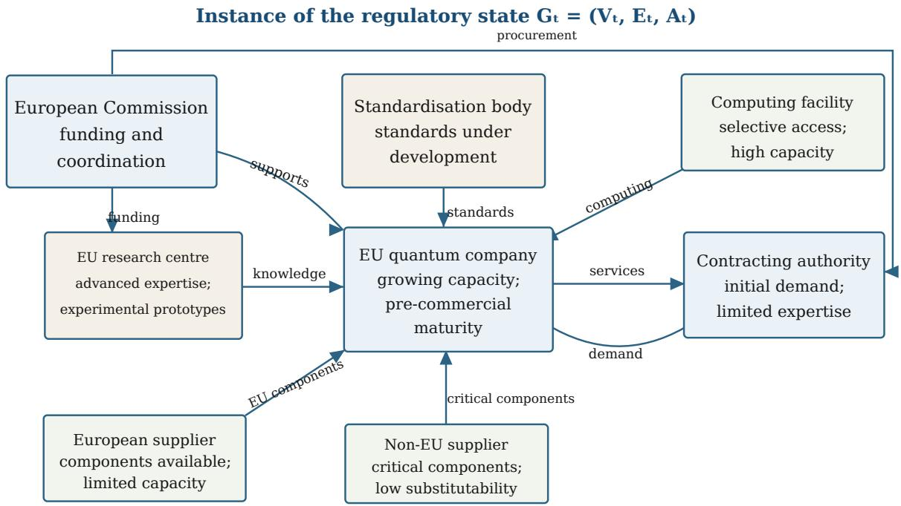
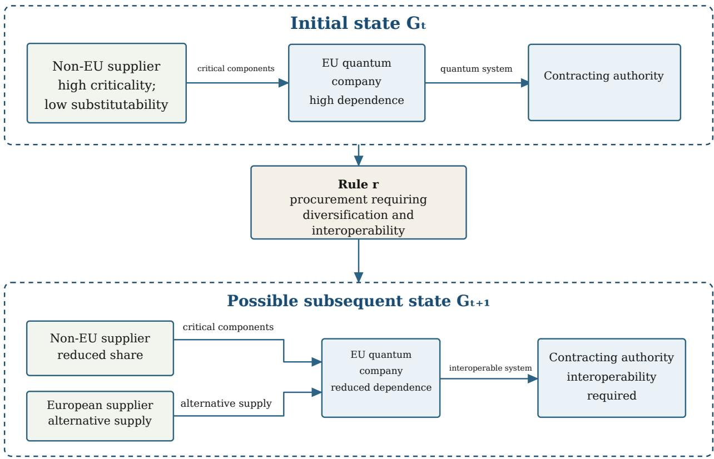
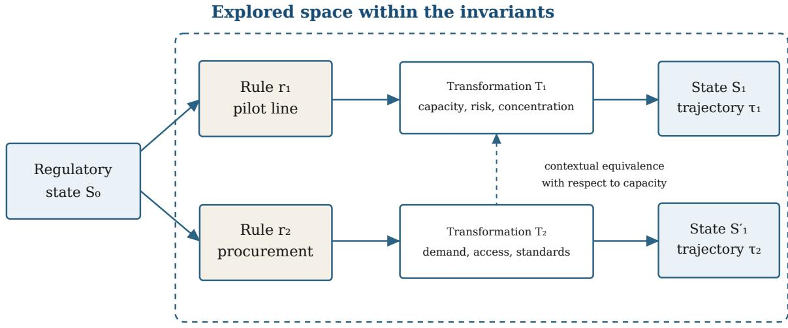
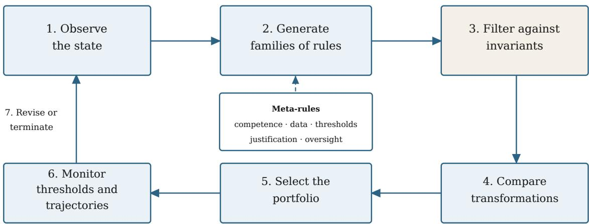

# Governing the Rule Space. Ruliology, Computational Irreducibility and Anticipatory Governance of Quantum Technologies

Antonio Felice Uricchio Francesco Scagliola

A. F. Uricchio is Full Professor of Tax Law at the University of Bari Aldo Moro, where he served as Rector (2013–2019). He is a former President of ANVUR and currently a member of the Board of AVEPRO (Holy See). F. Scagliola is Full Professor of Electroacoustic Music Composition at the “Niccolò Piccinni” Conservatoire in Bari and Coordinator of the PhD programme in Computational Electroacoustic Music Composition, Generative Algorithmic Models and Computational Complexity.

Original publication and permission. This paper is an English translation of the article ori ginally published as: Antonio Felice Uricchio and Francesco Scagliola, “Governare lo spazio delle regole. Ruliology, irriducibilità computazionale e governance anticipatoria delle tecnologie quantistiche,” Rivista della Corte dei conti, no. 4 (2026), pp. 27–41. The translation is distributed with the permission of the journal.

Attribution of sections. This article is the product of joint reflection by the authors. While responsibility for its overall approach and conclusions is shared, Sections 1, 2 and 8 are attributable to Antonio Felice Uricchio; the remaining sections to Francesco Scagliola.

CONTENTS: 1. Future law, political responsibility and new technologies. – 2. The limits of predictive rationality. – 3. From anticipation to exploration: a theoretical gap. – 4. The Ruliological Framework for Anticipatory Regulation. – 5. Governing the European quantum supply chain. – 6. Three stress tests: openness and security, standards, human capital. – 7. Meta-rules, safeguards and limits. – 8. Conclusions.

## Abstract

The regulation of emerging technologies is often conceived as a strategy of catching up, because legislators arrive too late. Yet gathering signals, constructing scenarios and adapting rules to an anticipated future are fundamental tasks for those entrusted with governance, including the governance of rules themselves. The literature on so-called future law has already shown that anticipation means building institutional capabilities rather than predicting outcomes precisely (anticipatory governance). Taking this premise as its starting point, this article proposes to understand regulation as an exploration of the transformations that may occur. The Ruliological Framework for Anticipatory Regulation distinguishes rules, transformations and trajectories, assessing alternatives and possible developments. Within this approach, computational irreducibility is adopted condi tionally, not as a demonstrated property of legal systems. The Quantum Europe Strategy provides a case study and further grounds for reflection.

Keywords: future law; ruliology; anticipatory governance; computational irreducibility; regulatory robustness; quantum technologies.

## 1. Future Law, Political Responsibility and New Technologies

The expression Future Law has appeared only recently in legal discourse, reflecting its traditional focus on positive law and legal history. Yet, in the face of the profound and rapid changes brought about by new technologies,1 legal systems and legal scholarship must move beyond a ‘defensive’ or reactive approach,2 ofering regulatory and interpretative responses capable of understanding, exploring and shaping the law of the future, making it living and relevant to the present.

For too long, the regulation of emerging technologies has appeared slow and unfocused, marked by a form of genuine double vision. Today, more than ever, law must open itself to worlds that are no longer distant but are forcefully entering socioeconomic reality: information technology, cybernetics, robotics, biotechnology, artificial intelligence and quantum technologies are not merely new and emerging scientific fields, but phenomena with legal significance that must be considered, interpreted and regulated from an evolutionary and forward-looking perspective. Rather than a discipline, future law3 appears to be a working methodology that ofers legislators and legal interpreters regulatory avenues, including experimental ones. Drawing on scientific evidence from outside law, it connects with the rights of future generations, recently recognised in the revised Articles 9 and 41 of the Italian Constitution.4 The breadth and comprehensiveness of these new constitutional provisions highlight not only the prescriptive force of the constitutional guarantee but also the responsibility placed on present generations—and above all on political decision-makers—for the benefit of future ones.

This entails an entirely new conception of the right to the future, hitherto addressed in legislation only in the limited sense of children’s right to development.5 The United Nations has adopted a considerably broader view through the so-called Pact for the Future (New York, 22 September 2024), which also includes the Declaration on Future Generations and a Global Digital Compact, laying, in the words of the President of the General Assembly, ‘the foundations for a sustainable, just and peaceful global order, for all peoples and nations’. Through this commitment, participating countries sought to accelerate progress on the major challenges of digital transition and sustainable development and, more generally, on the human rights of present and future generations. The close connection between the right to the future, social sustainability and technological revolution calls for a reconsideration of the scope of intergenerational duties of solidarity and, consequently, of individual and collective responsibilities.6 The new constitutional provisions, together with the case law of the European Court of Human Rights,7 give substance and practical efect to the rights of present and future generations and to the non-derogable duty of responsibility over time,8 now a new archetype to which legislation, the conduct of institutions and individuals, public policies, private lifestyles, production systems, businesses and workers must conform. Article 41 of the Constitution subjects economic initiative to respect for the environment, also in the interests of future generations, extending the social and environmental purposes towards which it must be directed.9

In this changed context, digital technologies, artificial intelligence systems and quantum computing appear to be fundamental instruments for giving practical efect to that responsibility and enabling a better future, particularly when inspired by value systems attentive to the person, including those not yet born, and oriented towards the common good.10 Political decision-makers and legislators themselves are called upon to promote innovation while also regulating it, anticipating its efects, identifying risks and selecting, from among possible options, those considered most suitable for pur suing shared values and directed towards the good.11 When outcomes diverge from expectations and perceptions of unfairness increase, responsibility is often attributed to political decision-makers; yet the choices adopted sometimes rest on insuficient data, imperfect models or untimely action. This gives rise to the need for complete, analysed data, more extensive and rigorous foresight, more sensitive indicators and a more informed legislative process capable of looking further ahead. In this regard, Luigi Einaudi,12 in his Prediche inutili, formulated the celebrated maxim ‘first acquire knowledge, then discuss, then decide’, emphasising that any financial, economic or political decision should be preceded by the acquisition of a rich, comprehensive and appropriate body of informa tion, avoiding hasty and insuficiently considered measures. The Turin economist, later the second President of the Italian Republic, also observed that ‘it is not the one who searches who knows, but the one who knows how to search’, highlighting the value of knowledge and research within the necessary relationship between institutions, businesses and civil society, also by drawing on the extraordinary potential of new technologies such as big data, artificial intelligence and quantum technologies.

The OECD report Governing with Artificial Intelligence, approved by the Public Governance Committee on 5 September 2025,13 also points in this direction. By examining two hundred uses of artificial intelligence across eleven core government functions, it shows that enhancing public decisionmakers’ knowledge capabilities—from forecasting fiscal risks to combating fraud—is now recognised as a decisive factor in the efectiveness and legitimacy of administrative action. No less significant is the finding in the OECD’s Tax Administration 202514 that the proportion of tax administrations using artificial intelligence rose from 9% in 2016 to 69% in 2023, further indicating that the traditional Italian intuition—knowing in order to tax, taxing in order to govern—is finding practical expression in contemporary technology, as the founding figures of the discipline had perceptively anticipated.

It follows that new technologies and complete, appropriate information resources can improve the quality of public action, foster better relationships between citizens and institutions through greater mutual trust, and pursue the common good and the public interest more efectively.

## 2. The Limits of Predictive Rationality

As the Report on Intelligence Policy for Security, submitted annually to Parliament by the Italian Government, points out, the capacity for ‘strategic anticipation’ depends on the quality of the State’s knowledge infrastructure,15 which is itself sustained by the capital of the new millennium: data made available, collected and processed.

The OECD, in The Path to Becoming a Data-Driven Public Sector (2019), likewise emphasised that governments must place the role and value of data at the centre of social and political transformation, recognising data as an integral strategic asset for policymaking, service delivery and institutional innovation.16 It should not be overlooked, however, that—as Michel Foucault cautioned—the relationship between knowledge and power, the celebrated pouvoir/savoir nexus, is never neutral: whoever controls flows of knowledge controls structures of power. It follows that decision-makers must have access to, and control over, data with full transparency, as a condition of democratic governance.

More generally, public decision-making models have historically developed around three fundamental poles: will, power and knowledge.17 Experience shows that these criteria alone are insuficient: public choices must also be capable of generating collective well-being, equity and inclusion.

From this perspective, law is not the crystallisation of a causal order but the normative expression of a purposive order inspired by the public interest and the common good. The capacity to act within the field of available choices depends on knowledge, understood not as contemplative learning but as an active function mediating between the complexity of reality and the urgency of choice. Einaudi’s injunction to ‘know’ is not a preparatory moment that ends before a decision; it is a permanent disposition, an institutional habitus that must permeate the entire deliberative cycle, from framing the problem to evaluating data and outcomes. Without this discipline of knowledge, public deliberation remains exposed to the dual risks of ideologism—deciding according to what one believes—and decisionism—deciding simply because one has the power to do so. The strength of an efective public decision lies instead in the network of values that inspires it and, consequently, in the interest that guides it. That interest cannot be individual: it must necessarily transcend the individual and thus be public, concerning both the present and the future. In this perspective, knowledge and data analysis are central, also through new technologies. In 1597, Francis Bacon coined the expression ipsa scientia potestas est, ‘knowledge itself is power’, in his Meditationes Sacrae,18 anticipating the centrality of knowledge as the foundation of public action. This insight must not be reduced to a logic of domination: the knowledge in question is not power for its own sake, nor power founded on force or will, but power deriving from data, analysis and reflection. Applied to the present, knowing in order to decide thus means acquiring data, but above all verifying them, because decision-making must be informed and grounded in self-determination—something now placed at risk when data are contaminated (data pollution).

The OECD’s Digital Government Index (2023) found that, although member countries had made significant progress towards data-driven public sectors, with South Korea, Estonia, Ireland, Norway and Denmark among the most advanced, maturity in data governance remained uneven and only 15.8% of countries had policy instruments (such as laws, standards and guidelines) to help public institutions explain how and why they use algorithmic tools.19 This finding shows how much remains to be done to achieve full algorithmic transparency in the public sector.

Against this background, several systemic challenges must be identified and addressed in decisionmaking processes. The first is uncertainty, concerning what is unknown or cannot be reliably estimated, including everything that has not been verified. The second is complexity, concerning not only the set of data but also the relationships among elements and the interactions among social groups, organisations and businesses, which are far from linear and often depend on the context in which they operate. The third is computational irreducibility, understood as a property of certain processes for which no general procedure is available to determine the outcome without following, at least in its essential steps, the process’s evolution.20 Determining the state reached by a system may require executing or simulating intermediate states. Computational irreducibility is equivalent neither to randomness nor to absolute unpredictability. Individual outcomes may be anticipated, some properties may be calculated, and particular classes of processes may admit simplifications. The claim concerns the absence of a general predictive shortcut applicable to the process’s entire evolution.

## 3. From Anticipation to Exploration: A Theoretical Gap

In light of the foregoing, more information may reduce uncertainty and provide valuable support for decision-making, but it does not necessarily eliminate complexity or guarantee that every dynamic can be compressed into a reliable prediction. As Israeli and Goldenfeld have shown with reference to cellular automata, processes that are computationally irreducible at a fine scale may admit predictive or computationally reducible descriptions through coarse-graining, that is, a representation that aggregates states and disregards microscopic details irrelevant to the property under observation.21 The irreducibility of an entire evolution does not therefore exclude the predictability of certain aggregate quantities. Within the RFAR, this caution is expressed by the function $\pi _ { P , S , c , h } ,$ introduced below, which selects a property �, a state, a context and a horizon. The framework does not call for abandoning prediction where an appropriate reduction is available; it requires the level of description to be specified, the properties that remain predictable to be identified, and regulatory exploration to be used when reduction loses information crucial to public choice.

Transferring this notion to law requires caution. One cannot maintain that a legal system is an automaton, that social behaviour is fully computable, or that the irreducibility of regulatory ecosystems has been demonstrated. The notion is adopted as a methodological hypothesis: if, for some sociotechnical transformations, there is no suficiently reliable predictive shortcut, a regulatory rationality based exclusively on prediction is fragile. Regulators must then be able to learn also from the controlled application of alternatives, the observation of transformations and the revision of rules.

This conclusion does not entail abandoning rationality. It requires changing its object. The question is no longer only ‘what future will materialise?’, but ‘which rules can we adopt, which transformations might they produce, which trajectories might they open or close, and which conditions must remain protected?’. The first question seeks a privileged description of the future. The second establishes a discipline of exploration. The distinction is particularly important for quantum technologies, whose components mature at diferent rates. Subsidies, procurement and standards jointly afect capacity, concentration, dependencies and skills. A rule acts upon a system that reacts.

Legal complexity theory has already challenged reductionist accounts of the relationship between law and society. Ruhl described the law–society system as dynamic, adaptive and characterised by emergent efects, inviting administrative law to recognise non-linearity and dependencies.22 In

Italian scholarship, Pastore linked the rapid development of technoscience to law lag and the need for open, diferentiated and flexible regulation, without excluding the structuring role of law.23 This article builds on these insights but proposes a generative formulation: not merely to describe the complex ecosystem, but to organise the rules capable of transforming it.

Anticipatory governance is not the same as prediction. Guston defines it as a distributed capacity to know, reflect upon and intervene in the implications of science and technology.24 The OECD’s 2024 framework articulates this capacity through a value-oriented approach, foresight and technology assessment, stakeholder engagement, agile and adaptive regulation, and international cooperation.25 Anticipation is thus an institutional practice that prepares for uncertainty, not a promise of precision. Adaptation likewise has an established literature. Schrepel connects monitoring and revision with complexity science while preserving legal certainty and accountability.26 Sabel and Zeitlin’s experimentalist governance organises framework goals, autonomy, reporting, peer review and revision.27 Sandboxes and experiments translate these principles into bounded environments but may undermine equality, legality and competition if exemptions, access and evaluation are not regulated.28

Robust decision-making (RDM) shifts the criterion from optimality to robustness: a strategy is evaluated across many plausible conditions and against the circumstances in which it fails.29 Scenario discovery identifies combinations of conditions relevant to a decision’s vulnerability,30 even without a complete formal model.31

Dynamic Adaptive Policy Pathways (DAPP) are the closest methodological precursor to the present proposal. They combine initial actions, alternative pathways, monitoring signals and thresholds indicating when a measure no longer meets its objectives and must be supplemented or replaced. They also make path dependence, decision sequences and the risk of lock-in visible, avoiding com mitment to a single expected future.32 The convergence with the RFAR is substantial in relation to adaptation over time. The diference concerns the primary analytical unit: DAPP organise sequences of actions across uncertain futures; the RFAR generates and compares families of rules, distinguishes transformations from the legal form of instruments, and constructs contextual equivalences with respect to specified properties. The two approaches can therefore be integrated: the RFAR structures the alternatives and their transformations, while DAPP organise their activation along adaptive pathways.

These theoretical traditions place limits on any claim to originality for the proposed framework. Feedback, foresight, revision, experimentation, trajectories and robustness are not inventions of ruliology. Its distinguishing feature lies not in the isolated presence of these elements but in their organisation through the relationship between rule space, transformation space, contextual equivalence and trajectories generated by applying rules. RDM primarily explores future conditions and strategic vulnerabilities. Adaptive regulation focuses on the capacity of an instrument to change over time. Experimentalist governance defines recursive learning procedures. DAPP organise actions and thresholds along alternative pathways. The Ruliological Framework for Anticipatory Regulation (RFAR) proposes a shared framework for representing and comparing what these approaches explore, sequence and modify.

The analytical diferences can be summarised as follows:

• anticipatory governance operates on collective capabilities through foresight, engagement and reflexivity, seeking institutional preparedness;

• adaptive regulation operates on rules subject to change through monitoring and updating, seeking constrained responsiveness;

• experimentalist governance operates on implementation cycles through testing, comparison and revision, seeking recursive learning;

• robust decision-making operates on strategies and vulnerabilities through stress tests across many futures, seeking robustness without privileging any one future;

• Dynamic Adaptive Policy Pathways operate on sequences of actions, signals and thresholds along alternative pathways, seeking to preserve options and adaptive capacity;

• the RFAR operates on rules, transformations and trajectories through generation, comparison and meta-regulation, seeking a robust regulatory portfolio.

The proposal must also be distinguished from the tradition of regulatory space. Hancher and Moran used that expression to analyse how power, resources and regulatory capabilities are distributed among public and private actors, and how political, legal and cultural characteristics structure the regulatory arena.33 ‘Rule space’ does not merely rename that theory. Regulatory space helps explain who occupies the arena, who possesses information and who can influence decisions. Rule space, by contrast, describes the available alternatives and the transformations they may generate. The two perspectives are complementary: the distribution of power afects which rules enter the explorable space and which remain excluded.

Ruliology means the systematic study of possible rules and the behaviours generated by their execution.34 Its object is not merely an individual rule in isolation but the space constituted by rules, the transformations they produce, equivalences among diferent rules, and the trajectories that emerge from their repeated application. The perspective is generative: starting from a state and a rule, it observes the resulting transformation and compares possible developments.

The RFAR does not transfer an entire model developed for formal systems into law. What it draws from ruliology is primarily a grammar of exploration: defining relevant states, generating families of rules, observing their efects, comparing trajectories and identifying constraints that must be preserved. The connection with generative social science35 does not remove the limits of the analogy: the model selects some relationships within the ecosystem and does not claim to reproduce its full institutional and social complexity.

## 4. The Ruliological Framework for Anticipatory Regulation

## 4.1 Ecosystem, State and Rule

The starting point is not an isolated legal norm but the regulatory ecosystem: the relational set of actors, institutions, infrastructures, resources, technologies and capabilities contributing to a technology’s development, use and governance. The ecosystem is not simply a ‘sector’. It encompasses universities, businesses, agencies, public users, investors, standardisation bodies, suppliers, skills, components and transnational connections.

The regulatory state $S _ { t }$ is a selective representation of the ecosystem at a given moment. It is not a complete description of reality but identifies elements relevant to the decision at hand. The state may be represented by an attributed graph

$$
G _ { t } = ( V _ { t } , E _ { t } , A _ { t } ) ,
$$

where $V _ { t }$ is the set of nodes, $E _ { t }$ is the set of relationships among nodes, and $A _ { t }$ is the function assigning attributes to nodes and relationships:

$$
A _ { t } : V _ { t } \cup E _ { t } \longrightarrow { \mathcal { A } } .
$$

Nodes may represent actors, resources, infrastructures or capabilities; edges may represent funding, supply, access, cooperation, standardisation or supervision relationships. Attributes describe relevant properties such as location, technological maturity, productive capacity, criticality, substitutability and risk level.

Figure 1 presents an illustrative instance of the regulatory state of the European quantum supply chain. It does not report the results of an empirical survey but shows how the components of $G _ { t }$ may be identified in practice. The selection of nodes, relationships and attributes must be explicit, justified and open to challenge, since it determines what the model makes visible and what it leaves in the background.

  
Figure 1: Illustrative instance of the regulatory state $G _ { t }$ of the European quantum supply chain. Nodes represent actors, infrastructures and capabilities; edges represent funding, supply, access, standardisation and public-demand relationships; the indications within nodes exemplify attributes $A _ { t } .$ The diagram is a conceptual model, not the outcome of an empirical survey.

A regulatory rule � is a provision or instrument that enables, prohibits, incentivises or modifies relationships, resources and attributes. The term includes statutory provisions, standards, funding criteria, procurement conditions, authorisations, disclosure obligations and experimental mechan isms. Regulation does not act directly on technology. It changes which transformations of the ecosystem are lawful, advantageous, accessible or probable.

A regulatory transformation is the passage between two states generated by the contextual application of a rule:

$$
T ( r , S _ { t } , c ) : S _ { t } \longrightarrow S _ { t + 1 } ,
$$

where � comprises institutional, economic, technological and geopolitical conditions. Since states are represented by attributed graphs, the same transformation may be observed as the transition

$$
G _ { t } \longrightarrow G _ { t + 1 } .
$$

The notation does not imply that a rule necessarily determines a single outcome. It represents the change made possible or probable by the interaction of rule $^ { r , }$ initial state $S _ { t } ,$ context � and actors’ responses. The same rule may generate diferent transformations in diferent contexts; diferent rules may generate similar transformations with respect to an observed property.

Figure 2 illustrates the application of a procurement rule introducing requirements for supply diversification and interoperability. In the initial state, the undertaking depends on a single non-European supplier of critical components. The rule changes the conditions of access to public demand and makes entry by an alternative supplier advantageous. In a possible subsequent state, dependence on the sole supplier is reduced, and the system ofered to the contracting authority must meet interoperability requirements.

Transformation is not without costs or side efects. Diversification may increase supply-chain robustness, but it may also involve initial costs, adjustment periods, certification dificulties and new coordination problems. The framework therefore requires a transformation to be observed against several properties, not merely its principal objective.

## 4.2 Rule Space and Contextual Equivalence

The rule space $\mathcal { R } ( S _ { t } , c )$ is the set of alternatives legally and institutionally applicable in a given state and context. The transformation space $\mathcal { T } ( S _ { t } , c )$ is the set of efects achievable through those rules. This distinction prevents the legal form of an instrument from being confused with what it produces.

A subsidy, a tax credit and a public contract may all increase productive capacity. They difer in procedure, competition, risk and remedies, but they are contextually equivalent if the chosen evaluation, holding state, context and time horizon constant, assigns their efects to the same qualitative category, ‘increase in productive capacity’. Equivalence here concerns that classification, not necessarily the magnitude of the increase. The same equivalence does not extend to concentration, speed or reversibility.

To make this comparison more precise, an evaluation function is introduced:

  
Figure 2: Example of a regulatory-state transformation through a procurement rule. Rule � introduces diversification and interoperability requirements. The transition from $G _ { t }$ to $G _ { t + 1 }$ represents a possible transformation, not a necessary outcome or an empirically demonstrated causal relationship.

$$
\pi _ { \boldsymbol { P } , \boldsymbol { S } , \boldsymbol { c } , h } : \mathcal { R } ( \boldsymbol { S } , \boldsymbol { c } ) \longrightarrow \mathcal { Y } _ { \boldsymbol { P } } ,
$$

which associates each rule with the profile of transformations relevant to property $P ,$ starting from state $S ,$ in context � and over horizon ℎ. In this notation, $S$ denotes the initial state generically, which may be identified with $S _ { t }$ at the time considered, while $\mathcal { Y } _ { P }$ is the space of possible transformation profiles associated with property �. We therefore define:

$$
r _ { 1 } \sim _ { P , S , c , h } r _ { 2 } \quad \Longleftrightarrow \quad \pi _ { P , S , c , h } ( r _ { 1 } ) = \pi _ { P , S , c , h } ( r _ { 2 } ) .
$$

The subscripts denote:

• �: $P ;$ the regulatory property with respect to which the comparison is made, such as productive capacity, accessibility, concentration or security;

$S { : }$ the initial state of the ecosystem;

• �: the institutional, economic, technological and geopolitical context;

• ℎ: the time horizon or number of steps considered.

Thus defined, $\sim _ { P , S , c , h }$ is an equivalence relation, because it is reflexive, symmetric and transitive. This does not mean that $r _ { 1 }$ and $r _ { 2 }$ are identical or interchangeable legal norms in every respect. It means only that the two rules belong to the same class with respect to the property and conditions specified by the subscripts.

In empirical applications, it is often possible to establish only that efects fall within a declared tolerance. In that case it is preferable to write

$$
r _ { 1 } \approx _ { P , S , c , h , \varepsilon } r _ { 2 } ,
$$

where $\varepsilon$ is the permitted deviation threshold. This is a contextual proximity relation and not necessarily an equivalence relation in the mathematical sense, because transitivity need not hold.

Figure 3 illustrates the necessarily parameter-dependent character of equivalence. A pilot line and a procurement programme may be regarded as equivalent with respect to $P = { \mathrm { c a p a c i t y } }$ if, holding the state, context and time horizon constant, their efects are assigned to the same qualitative category, ‘increase in ecosystem capacity’. This equivalence does not imply that the two instruments produce quantitatively identical increases. Nor do they belong to the same class with respect to other properties: the pilot line primarily afects the availability of infrastructure and the reduction of technological risk, while procurement afects demand, market access and the difusion of standards. Equivalence with respect to one property therefore cannot automatically be extended to the entire regulatory transformation.

Transformation cost describes the burdens associated with the transition. It is not a mathematical distance. It may include financial cost, time, administrative burden, concentration of power, loss of future options, dificulty of reversal, distributional efects and risks to rights. These dimen sions must not automatically be aggregated into a single value, because aggregation would conceal political and constitutional choices.

  
Figure 3: Contextual equivalence between diferent rules. Starting from the same regulatory state $S _ { 0 } { } ;$ rule $r _ { 1 } ,$ , concerning a pilot line, and rule $r _ { 2 } .$ concerning procurement, generate diferent transformations. The transformations may be regarded as equivalent with respect to the property ‘capacity’, while diverging in terms of risk, concentration, demand, access and standardisation. The diagram represents a conceptual model, not the result of a simulation.

## 4.3 Trajectories, Invariants and Robustness

The repeated application of rules, together with actors’ responses and changes in context, generates a regulatory trajectory

$$
\tau = ( S _ { 0 } , S _ { 1 } , \ldots , S _ { n } ) .
$$

A measure adopted in state $S _ { 0 }$ may attract businesses, change the distribution of scientific and technological skills, consolidate a standard and create new dependencies. These changes alter the subsequent state and condition the efectiveness of rules applicable at later stages. The traject ory thus represents a path-dependent institutional evolution, not a purely technical sequence or a deterministic prediction.

Invariants delimit the set of admissible trajectories. The term is used in a normative sense: it does not mean that certain empirical quantities must remain numerically constant, but that certain constraints cannot be sacrificed during exploration. Fundamental rights, non-discrimination, proportionality, transparency, controllability and the availability of remedies are not outcomes to be maximised alongside others. They are conditions of admissibility. An economically efective trajectory is not acceptable from a regulatory standpoint if it depends on discrimination, disproportionate surveillance, uncontrollable concentration or restrictions on judicial protection.

Control thresholds must be distinguished from invariants. They translate objectives and risks into observable conditions: a maximum level of dependence on a single supplier, a minimum notice period, a proportion of available capacity or a concentration indicator. Thresholds may be reconsidered through reasoned procedures; invariants, by contrast, operate as limits on the selection of trajectories.

Regulatory robustness is the capacity of a rule or regulatory portfolio to maintain acceptable outcomes and respect invariants across a plurality of plausible trajectories, while preserving opportunities for correction and learning. It is not identical to adaptability, which concerns whether a rule can be modified; monitoring, which concerns the production of knowledge; or resilience, which concerns the ecosystem’s ability to absorb disturbances. A regulatory regime may be easily modifiable but insuficiently robust, or robust in the face of a shock yet incapable of learning from unexpected transformations.

## 4.4 A Minimal Operational Procedure

The RFAR can be applied through seven interconnected steps forming a cycle:

1. Observe and represent the state. Identify relevant actors, capabilities, relationships, dependencies and risks, specifying what the representation excludes and the reliability of the information available.

2. Generate families of rules. Construct alternatives from diferent categories—incentives, prohibitions, standards, procurement, disclosure obligations or experimentation—without prematurely selecting a single instrument.

3. Define criteria and filter alternatives. Specify the objectives pursued, the invariants delimiting legally admissible transformations, and the thresholds indicating when a trajectory requires attention, revision or termination. Exclude alternatives incompatible with the invariants.

4. Describe and compare transformations. For each family, assess direct efects, foreseeable responses by actors, interactions with other rules and second-order efects. The comparison must cover multiple properties rather than the principal objective alone.

5. Construct and select a portfolio. Consider rules in combination as well as individually. Selection favours portfolios capable of maintaining acceptable outcomes across diferent trajectories, avoiding excessive dependence on a single prediction.

6. Monitor thresholds and trajectories. Monitoring checks whether the observed state departs from expected transformations, whether control thresholds are crossed or whether efects incompatible with invariants emerge.

7. Revise, replace or terminate. Meta-rules determine who may change the regime, on the basis of which data, with what justification, within which time limits, and subject to which forms of oversight and accountability. The outcomes of revision feed into a new representation of the state and reopen the cycle.

The framework fails if it cannot distinguish alternatives that existing approaches would treat in the same way; if it does not make criteria for revision, termination and responsibility explicit; if the cost of constructing the space exceeds the decision-relevant information obtained; or if formalism conceals the distributional and constitutional choices it is intended to make visible.

## 5. Governing the European Quantum Supply Chain

The Quantum Europe Strategy: Quantum Europe in a Changing World, adopted by the Commission on 2 July 2025, sets out five areas: research and innovation, infrastructures, strengthening the eco system, space and dual-use, and skills.36 The document connects them through an iterative cycle and a governance framework. In particular, it envisages continuous iteration between discovery, development, testing and deployment, supported by testbeds, pilot lines, KPIs, milestones, benchmarking and feedback loops.37 The Strategy itself describes its approach as an ‘evolving framework’, an undertaking in progress.38

The European cycle already includes monitoring and feedback; what remains less explicit is how heterogeneous alternatives are generated, compared and replaced.

The supply chain is the principal test case. The Strategy recognises vulnerabilities involving rare materials, precision components, control electronics and software. It envisages Union-level assessments and identifies four families of responses: supplier diversification, European manufacturing capacity, partnerships with supplier countries, and risk-sharing mechanisms.39 The JRC has also documented the coexistence of scientific excellence, fragmented investment, difering levels of maturity and the limited conversion of research capacity into patents and industrial scale.40

A possible information layer for constructing the regulatory state is provided by the Quantum Criticality Index (QCI), which assesses quantum materials and components along three axes: supply risk, substitutability and strategic relevance.41 In the language of the RFAR, these dimensions may be represented as attributes � of the nodes and relationships of $G _ { t }$ . Indicators of manufacturing concentration, dependence on imports, stability of supplier countries, availability of substitutes and dual-use relevance may also contribute to defining control thresholds. The QCI does not replace rule space: it provides a diagnosis of criticality and useful monitoring signals, while the RFAR compares the transformations that can be produced through procurement, capacity support, diversification, partnerships or standards. The same criticality may indeed warrant diferent alternatives, which must also be assessed in terms of distributional efects, reversibility, competition and compatibility with invariants.

A prediction-first question would be: which component will become critical, when will dependence arise, and what capacity will be needed? Foresight remains useful, but its answer may be fragile when technological timelines, demand and geopolitics evolve together. The RFAR instead poses four operational questions: which rules alter dependence; which transformations do they share; where do they diverge; and which signals should trigger revision or termination?

Consider four families of rules.

Pilot lines and supply-side support. Funding, public equity or risk-sharing may reduce investment risk and increase domestic capacity. The desired transformation is the transition from laboratory to production. Side efects include beneficiary selection, concentration, dependence on subsidies and technological lock-in.

Coordinated procurement. Predictable public demand may support investment and impose requirements concerning interoperability, security or origin. The local transformation may be equivalent to that of supply-side support with respect to productive capacity. It nevertheless difers in the distribution of risk, market access, compatibility with competition and international commitments.

Diversification and partnerships. Agreements with trusted suppliers may reduce concentration and lead times without bringing all production in-house. The trajectory preserves openness and specialisation but remains exposed to political dependencies and reciprocity clauses.

Modular standards. Common requirements may improve interoperability, substitutability and supply-chain transparency. If adopted too early, they may entrench an immature architecture. Research on European quantum standardisation emphasises precisely the relationship between maturity, coordination and the need to develop standards without obstructing innovation.42

Comparison yields a portfolio. Interactions matter: proprietary requirements may undermine modularity; concentrated support may reduce diversification; and partnerships may transfer dependencies towards non-substitutable components.

Meta-rules must make this exploration subject to legal oversight. One example is an annual review based on publicly available thresholds for supplier concentration, productive capacity, replacement time, technological delay and cost. Crossing a threshold does not automatically determine which measure is adopted. It triggers a duty to reconsider the portfolio, compare alternatives, justify the choice and verify proportionality and compatibility with invariants. The authority must also publish aggregated data and permit scrutiny by excluded operators and judicial bodies.

As at 30 August 2026, EUR-Lex records an initiative for a regulation entitled the EU Quantum Act. Preparatory document Ares(2025)9260984 sets out an indicative timetable for the second half of 2026. The consultation was published on 29 October 2025 and extended until 15 December 2025; no Commission proposal (COM) for the Quantum Act was yet available in the oficial sources consulted.43 The considerations ofered here are therefore de iure condendo. They suggest that the future act should not merely list instruments and competences but also establish the procedure governing their comparison and updating.

## 6. Three Stress Tests: Openness and Security, Standards, Human Capital

## 6.1 Scientific Openness, Autonomy and Security

The European Strategy seeks to protect strategic interests while maintaining openness towards trusted partners. It envisages joint programmes, reciprocal access to infrastructures, alignment of intellectual property arrangements and cooperation on standards, alongside investment and export controls and protection for dual-use technologies.44 The choice cannot be reduced to an opennessversus-closure dichotomy.

Open access, selective cooperation, screening and restrictions alter flows of knowledge, capital and talent. They may reduce the same vulnerability but difer in their efects on research freedom, attractiveness and reciprocity. The resulting portfolio is diferentiated by component and maturity, with restrictions that are narrowly tailored, justified and reviewable.

The invariant is twofold. Security cannot become an indeterminate formula that removes decisions from scrutiny. Openness cannot prevent the protection of essential capabilities. The meta-rule must specify the competent authority, evidence, duration, review, scientific consultation and remedies.

## 6.2 Standardisation and Certification

Standards coordinate immature markets and enable interoperability, but they may embed premature choices. Rule space encompasses voluntary standards, procurement, certification, testing and disclosure obligations.

The proposal for standards-first quantum governance regards standards as a flexible and internationally harmonisable means of governing technologies that are still immature, while preserving innovation, security and cooperation.45 This approach strengthens the centrality of standardisation but does not entail a standards-only strategy. Within the RFAR, standards remain a family of rules to be compared with procurement, testbeds, certification and disclosure obligations. The added value of comparison lies in determining whether diferent instruments produce locally equi valent properties and where they diverge in terms of market access, compliance costs, concentration, security and reversibility.

Two rules may improve comparability without being equivalent in terms of access for SMEs. Certification increases trust but creates fixed costs; a testbed produces information with less rigidity.

A meta-rule may link the binding force of a standard to technological maturity. In early stages, it favours measurement methods, vocabularies and modular interfaces; as use and risk increase, it may activate more stringent requirements. Sunset and review clauses prevent a standard initially adopted as a bridge from turning into unexamined lock-in.

## 6.3 Human Capital

The Strategy recognises a strong academic base and shortages of applied skills, including software engineering, system integration and quantum cybersecurity. It envisages a European Quantum Skills Academy, mobility programmes, apprenticeships and researchers-in-residence, together with continuous monitoring of skills demand.46

An academy coordinates curricula; a fellowship changes mobility; an apprenticeship links training with industry; a researcher-in-residence transfers knowledge. The ‘number of people trained’ is not enough: distribution, retention, diversity and applied capabilities also matter.

The RFAR suggests avoiding policies tied to precise forecasts of future occupations. A modular portfolio, accompanied by meta-rules that update curricula and incentives on the basis of verifiable signals, is preferable. Here too, invariants exist: non-discriminatory access, transparent selection procedures, academic freedom and protection of data used for monitoring.

## 7. Meta-rules, Safeguards and Limits

Exploration is not synonymous with unlimited discretion. A sandbox without criteria may turn uncertainty into privilege. A review clause without thresholds may legitimise perpetual instability. Governance entrusted to experts may move distributional choices beyond the democratic process. The decisive transition from vocabulary to regulation therefore lies in meta-rules.

Meta-rules cover competence, admissibility, information, thresholds, justification, reversibility and oversight. They identify who makes selections, which trajectories are excluded, what data are required, when to correct or terminate a measure, and how participation and avenues of appeal are guaranteed.

Figure 4: The RFAR institutional cycle: observation, generation, filtering through invariants, comparison, selection, monitoring, and revision or termination.

The RFAR does not replace precaution. It specifies how to compare responses and update decisions without sacrificing invariants; it does not authorise experiments that infringe inalienable rights.

Four limitations remain. The first is representational: every graph omits relationships and may reflect the perspective of the authority constructing it. The second is causal: an observed transformation does not, by itself, prove that the rule caused it. The third is institutional: exploring alternatives requires data, expertise and coordination, whose costs may exceed the informational benefit. The fourth is democratic: frequent updating may weaken political accountability unless objectives and thresholds are established publicly.

The framework must therefore remain falsifiable. Future validation should compare decision-making cases conducted with and without the RFAR, assessing whether it broadens the alternatives considered, reveals overlooked vulnerabilities, improves the justification of revisions and reduces lock-in without imposing disproportionate burdens. Until then, the RFAR remains a methodological pro posal, not a regulatory technology of demonstrated efectiveness.

## 8. Conclusions

Governing emerging technologies is particularly complex because of both the speed of the transformations they generate and the resistance of major lobbying interests to regulatory models. Nevertheless, rules are essential to public decision-making and to evaluating the impact those decisions can produce over time. From this perspective, the public interest must remain central and must not evaporate into the algorithmic ocean.

In this connection, the European and Italian regulatory framework on artificial intelligence, comprising Regulation (EU) 2024/1689, the so-called AI Act, and Italian Law No. 132 of 23 September 2025,47 is a model of considerable interest, distinguished from other international approaches by the attention it pays to fundamental rights and, more generally, to the human person.48 Moreover, while the Trump administration’s Action Plan49 removes obstacles and retreats from regulation, consistently with the traditional reluctance to impose rigid forms of state control, China adopts a strongly centralised model based on pervasive and often intrusive oversight by state authorities, as evidenced by the Provisions on the Administration of Deep Synthesis Internet Information Services of 2022 and the Interim Measures for the Management of Generative Artificial Intelligence Services of 2023. Despite its distinctive characteristics, the Russian Federation displays a similar tendency, whereby technological regulation is intertwined with strategies of totalitarian control, without foregoing systematic and coordinated cyberattacks against the digital platforms and infrastructures of countries regarded as hostile or competing.50 Contrasting paradigms thus emerge: on the one hand, deregulated market fundamentalism, which entrusts the governance of strategic sectors to economic dynamics; on the other, all-pervasive state control, which risks becoming a sufocating web capable of tightening its grip on the individual. Although grounded in diferent premises, both models reveal problematic consequences for individual and collective safeguards.

The European model, by contrast, occupies an intermediate and innovative position, aspiring to balance freedom and security, autonomy and responsibility, almost as a ‘third pole’ capable of reconciling equity and transparency, markets and dignity, technology and law. It places fundamental rights at the centre of regulation and adopts a risk-based approach as its organising principle, seeking to balance the promotion of innovation with the protection of the individual. The path is not without obstacles, including risks that particularly intrusive technological applications may undermine fundamental rights. Nevertheless, the solution adopted by the European institutions following a process of public consultation is commendable and worthy of recognition, as it is inspired by shared values and a far-sighted conception of law, oriented towards the future and capable of ensuring a full balance between technological innovation and fundamental rights.51

The constructive relationship between public policies and the right to the future must clearly remain central, also through transparent and informed decision-making. This goes beyond the capacity to anticipate the efects of public choices. The literature on anticipation, adaptation, experimentation and robustness has already established as much. The present article proposes a regulatory model that is not limited to producing rules but is also capable of assessing their impact, transformations and trajectories.

The distinction between rule space and transformation space makes diferent legal instruments comparable without conflating them. Contextual equivalence shows that two rules may produce the same efect while diverging in respect of other values. Invariants prevent exploration from sacrificing rights and safeguards. Meta-rules assign competences and impose thresholds, justification, revision and termination. Robustness replaces optimality with respect to a privileged future with acceptable performance across multiple trajectories.

The European Quantum Strategy already contains many of the necessary elements: an iterative cycle, testbeds, KPIs, benchmarking, monitoring and feedback. The future Quantum Act ofers an opportunity to regulate not only the instruments but also the procedure that generates, compares and corrects them.

Governing the rule space does not mean predicting every outcome or automatically executing law. It means developing greater awareness, making public decisions rational, informed and guided by the aim of producing the common good, both present and future, rather than merely being efective.

## Biographical Notes

Francesco Scagliola is Professor of Electroacoustic Music Composition at the “Niccolò Piccinni” Conservatoire in Bari, where he coordinates the School of Electronic Music and the PhD programme in Computational Electroacoustic Music Composition, Generative Algorithmic Models and Computa tional Complexity.

Antonio Felice Uricchio is a former Rector of the University of Bari Aldo Moro and former President of ANVUR; he is currently a member of the Board of AVEPRO (Holy See).

## Final Declarations

Availability of materials. The article uses only publicly available academic sources and institutional documents; no research dataset was created.

Ethics. The research is theoretical and documentary; it does not involve human participants or personal data. Dual-use issues are addressed at the governance level, without operational technical information.

Conflicts of interest. The authors declare no conflicts of interest relating to the content of the article.

Funding. The research received no specific funding.

Author contributions. Both authors contributed to the conception, analysis and revision of the article. Francesco Scagliola was particularly responsible for the computational formalism; Antonio Felice Uricchio for the legal and institutional framing.

Use of artificial intelligence systems. Generative artificial intelligence tools were used under the authors’ supervision for source checking and editorial support. The authors remain responsible for the content, citations and final wording.

## Bibliography

• ABOY M., GASSER U., COHEN I. G., KOP M., Quantum Technology Governance: A Standards-First Approach, in Science, 2025, vol. 389, no. 6760, pp. 575-578, DOI: 10.1126/science.adw0018.

• ABRESCIA M., Un diritto al futuro: analisi economica del diritto, Costituzione e responsabilità tra generazioni, in BIFULCO R., D’ALOIA A. (eds.), Un diritto per il futuro. Teorie e modelli dello sviluppo sostenibile e della responsabilità intergenerazionale, Jovene, Naples, 2008, pp. 161 f.

• ALPA G., Prefazione, in RUFFOLO U. (ed.), Intelligenza artificiale. Il diritto, i diritti, l’etica, Giufrè Francis Lefebvre, Milan, 2020, pp. XVII f.

• ARCONZO G., La sostenibilità delle prestazioni previdenziali e la prospettiva della solidarietà intergenerazionale. Al crocevia tra gli artt. 38, 81 e 97 Cost., in Osservatorio costituzionale AIC, issue 3/2018, pp. 627 f.

• BACON F., Meditationes Sacrae (1597), in SPEDDING J., ELLIS R. L., HEATH D. D. (eds.), The Works of Francis Bacon, London, 1857-1874.

• BIFULCO R., D’ALOIA A. (eds.), Un diritto per il futuro. Teorie e modelli dello sviluppo sostenibile e della responsabilità intergenerazionale, Jovene, Naples, 2008.

• BOCCIA F., LEONARDI R. (eds.), The Challenge of the Digital Economy: Markets, Taxation and Appropriate Economic Models, Palgrave Macmillan, Cham, 2016, DOI: 10.1007/978-3-319- 43690-6.

• CATERINI E., La «sostenibilità» nell’esperienza giuridica contemporanea. In occasione della discussione svoltasi nell’Ateneo barese, in BENÍTEZ D. A., FAVA C. (eds.), Sostenibilità: sfida o presupposto?, Milan, 2019, pp. 77 f.

• CATERINI E., Sostenibilità e ordinamento civile. Per una riproposizione della questione sociale, ESI, Naples, 2018.

• CHO D., KOP M., LEE M.-H., Strategic Governance of Quantum Supply Chains: A Criticality-Based Framework for Risk, Resilience, and Data-Driven Foresight, in EPJ Quantum Technology, 2026, vol. 13, art. 43, DOI: 10.1140/epjqt/s40507-026-00486-y.

• CONTALDO A., DAINOTTI F., Diritto e tecnologie delle reti di informazione, Edizioni Giuridiche Simone, Naples, 2005.

• COTTLE T. J., KLINEBERG S. L., The Present of Things Future: Explorations of Time in Human Experience, The Free Press, New York, 1974.

• DE TONI A. F., Prefazione, in ADINOLFI P., URICCHIO A. F. (eds.), Valutare la complessità. La performance nelle organizzazioni pubbliche, Carocci, Rome, 2025, p. 15.

• DRAETTA U., Internet e commercio elettronico nel diritto internazionale dei privati, Giufrè, Milan, 2001.

• EINAUDI L., Conoscere per deliberare, first instalment of Prediche inutili, Einaudi, Turin, 1956, pp. 1-12.

• EINAUDI L., Corso di scienza della finanza tenuto dal Prof. Luigi Einaudi nella R. Università di Torino e nella Università commerciale L. Bocconi di Milano, La Riforma Sociale, Turin, 1916.

• EINAUDI L., Il sistema tributario italiano, 2nd ed., La Riforma Sociale, Turin, 1933.

• EINAUDI L., La terra e l’imposta, Einaudi, Turin, 1942.

• EINAUDI L., Miti e paradossi della giustizia tributaria, Einaudi, Turin, 1940.

• EINAUDI L., Saggi sul risparmio e l’imposta, Einaudi, Turin, 1941.

• EPSTEIN J. M., Agent-Based Computational Models and Generative Social Science, in Complexity, 1999, vol. 4, no. 5, pp. 41-60, DOI: 10.1002/(SICI)1099-0526(199905/06)4:5<41::AID-CPLX9>3.0.CO;2-F.

• FATTORE G., La valutazione delle politiche: una breve guida metodologica, in ADINOLFI P., URICCHIO A. F. (eds.), Valutare la complessità. La performance nelle organizzazioni pubbliche, Carocci, Rome, 2025, pp. 179 f.

• FROSINI V., Cibernetica, diritto e società, Edizioni di Comunità, Milan, 1968.

• FROSINI V., Telematica e informatica giuridica, in Enciclopedia del diritto, vol. XLIV, Giufrè, Milan, 1992, pp. 60-82.

• GALETTA D.-U., CAPPIELLO B., Il Regolamento UE sull’intelligenza artificiale e le amministrazioni pubbliche: basi giuridiche, obiettivi e limiti di un esperimento normativo dagli esiti incerti, in URICCHIO A. F., CALDAROLA C. (eds.), L’intelligenza artificiale tra regolazione ed esperienze applicative. AI Act (regolamento UE) e disegno di legge governativo, Cacucci, Bari, 2025, pp. 59-86.

• GALLO F., Cyberspazio, diritti e tutele, in URICCHIO A. F., CALDAROLA C. (eds.), L’intelligenza artificiale tra regolazione ed esperienze applicative. AI Act (regolamento UE) e disegno di legge governativo, Cacucci, Bari, 2025, pp. 15-29.

• GRECO M., Il diritto costituzionale dell’ambiente dopo la riforma: alcune conferme e qualche (inattesa) novità nella sentenza della Corte costituzionale n. 105/2024, in Diritti comparati, 25 July 2024.

• GROVES D. G., LEMPERT R. J., A New Analytic Method for Finding Policy-Relevant Scenarios, in Global Environmental Change, 2007, vol. 17, no. 1, pp. 73-85, DOI: 10.1016/j.gloenvcha.2006.11.006.

• GUSTON D. H., Understanding “Anticipatory Governance”, in Social Studies ofScience, 2014, vol. 44, no. 2, pp. 218-242, DOI: 10.1177/0306312713508669.

• HAASNOOT M., KWAKKEL J. H., WALKER W. E., TER MAAT J., Dynamic Adaptive Policy Pathways: A Method for Crafting Robust Decisions for a Deeply Uncertain World, in Global Environmental Change, 2013, vol. 23, no. 2, pp. 485-498, DOI: 10.1016/j.gloenvcha.2012.12.006.

• HANCHER L., MORAN M., Organizing Regulatory Space, in BALDWIN R., SCOTT C., HOOD C. (eds.), A Reader on Regulation, Oxford University Press, Oxford, 1998, pp. 148 f.; originally in HANCHER L., MORAN M. (eds.), Capitalism, Culture and Economic Regulation, Clarendon Press, Oxford, 1989.

• HECKEL R., Graph Transformation in a Nutshell, in Electronic Notes in Theoretical Computer Science, 2006, vol. 148, no. 1, pp. 187-198, DOI: 10.1016/j.entcs.2005.12.018.

• HOBBES T., Leviathan, Latin version of 1668, in Opera philosophica quae Latine scripsit omnia.

• INGLESE M., Il regolamento sull’intelligenza artificiale come atto per il completamento e il buon funzionamento del mercato interno?, in Quaderni AISDUE, special issue no. 2/2024, pp. 1 f.

• ISRAELI N., GOLDENFELD N., Computational Irreducibility and the Predictability of Complex Physical Systems, in Physical Review Letters, 2004, vol. 92, art. 074105, DOI: 10.1103/PhysRevLett.92.074105.

• LEMPERT R. J., GROVES D. G., POPPER S. W., BANKES S. C., A General, Analytic Method for Generating Robust Strategies and Narrative Scenarios, in Management Science, 2006, vol. 52, no. 4, pp. 514-528, DOI: 10.1287/mnsc.1050.0472.

• LEMPERT R. J., POPPER S. W., BANKES S. C., Shaping the Next One Hundred Years: New Methods for Quantitative, Long-Term Policy Analysis, RAND Corporation, Santa Monica, 2003.

• LESSIG L., Code Is Law: On Liberty in Cyberspace, in Harvard Magazine, vol. 102, no. 3, January-February 2000, pp. 37 f.

• PALUMBO M., Il processo di valutazione. Decidere, programmare, valutare, FrancoAngeli, Milan, 2001.

• PASCUZZI G., Il diritto dell’era digitale. Tecnologie informatiche e regole privatistiche, Il Mulino, Bologna, 2002.

• PASTORE B., Tecnologie emergenti, incertezze della scienza, regolamentazione giuridica, in Teoria e Critica della Regolazione Sociale, 2020, pp. 97 f.

• PENNASILICO M., review of CATERINI E., Sostenibilità e ordinamento civile. Per una riproposizione della questione sociale, ESI, Naples, 2018, in Rassegna di diritto civile, 2018, pp. 1511 f.

• PENNASILICO M., La «sostenibilità ambientale» nella dimensione civil-costituzionale: verso un diritto dello «sviluppo umano ed ecologico», in Rivista quadrimestrale di diritto dell’ambiente, no. 3/2020, pp. 4 f.

• PEPE V., Fare ambiente. Teorie e modelli giuridici di sviluppo sostenibile, FrancoAngeli, Milan, 2008.

• PEPE V., Le «nuove frontiere» del costituzionalismo ambientale: prospettive emergenti nel diritto comparato, in DPCE Online, vol. 58, special issue 2/2023, pp. 963 f., DOI: 10.57660/dpceonline.2023.1929.

• POLI S., Il raforzamento della sovranità tecnologica europea e il problema delle basi giuridiche, in I Post di AISDUE, III (2021), section «Atti convegni AISDUE», no. 5, 20 December 2021, pp. 69 f.

• POPPER S. W., Robust Decision Making and Scenario Discovery in the Absence of Formal Models, in Futures & Foresight Science, 2019, vol. 1, e22, DOI: 10.1002/fo2.22.

• PORENA D., Il principio della sostenibilità. Contributo allo studio di un programma costituzionale di solidarietà intergenerazionale, Giappichelli, Turin, 2017.

• RANCHORDÁS S., Experimental Regulations and Regulatory Sandboxes: Law Without Order?, in Law and Method, 2021, DOI: 10.5553/REM/.000064.

• REIDENBERG J. R., Lex Informatica: The Formulation of Information Policy Rules Through Technology, in Texas Law Review, 1998, vol. 76, no. 3, pp. 553-593.

• RIVOSECCHI G., La garanzia costituzionale della copertura finanziaria come vincolo intertemporale alla spesa pubblica nella (limitata) prospettiva della tutela delle generazioni future, in BIFULCO R., D’ALOIA A. (eds.), Un diritto per il futuro. Teorie e modelli dello sviluppo sostenibile e della responsabilità intergenerazionale, Jovene, Naples, 2008, pp. 475 f.

• RUHL J. B., Complexity Theory as a Paradigm for the Dynamical Law-and-Society System: A Wake-Up Call for Legal Reductionism and the Modern Administrative State, in Duke Law Journal, 1996, vol. 45, pp. 849 f.

• RUHL J. B., Law’s Complexity: A Primer, in Georgia State University Law Review, 2008, vol. 24, pp. 885 f.

• SABEL C. F., ZEITLIN J., Experimentalism in the EU: Common Ground and Persistent Diferences, in Regulation & Governance, 2012, vol. 6, no. 3, pp. 410-426, DOI: 10.1111/j.1748- 5991.2012.01157.x.

• SABEL C. F., ZEITLIN J., Experimentalist Governance, in LEVI-FAUR D. (ed.), The Oxford Handbook of Governance, Oxford University Press, Oxford, 2012, DOI: 10.1093/oxfordhb/9780199560530.013.0012.

• SANDULLI M. A., APERIO BELLA F., LORENZONI L., POSTERARO N., SINISI M., Shaping the Future of Health Law: Challenges for Public Law, paper published in federalismi.it, 17 November 2021.

• SCHREPEL T., Adaptive Regulation, in European Journal of Risk Regulation, 2026, pp. 374 f., DOI: 10.1017/err.2026.10087.

• TAFARO L., Diritti umani oggi: sviluppo sostenibile e generazioni future, in CANÇADO TRINDADE A. A., BARROS LEAL C. (eds.), Diritti umani e ambiente. VI Corso brasiliano interdisciplinare in diritti umani, Fortaleza, 2017, pp. 43-73.

• TORRETTA P., Responsabilità intergenerazionale e procedimento legislativo. Soggetti, strumenti e procedure di positivizzazione degli interessi delle generazioni future, in BIFULCO R., D’ALOIA A. (eds.), Un diritto per il futuro. Teorie e modelli dello sviluppo sostenibile e della responsabilità intergenerazionale, Jovene, Naples, 2008, pp. 699 f.

• VAN DEVENTER O. et al., Towards European Standards for Quantum Technologies, in EPJ Quantum Technology, 2022, vol. 9, art. 33, DOI: 10.1140/epjqt/s40507-022-00150-1.

• VAN OOIJEN C., UBALDI B., WELBY B., A data-driven public sector: Enabling the strategic use of data for productive, inclusive and trustworthy governance, OECD Working Papers on Public Governance, no. 33, OECD Publishing, Paris, 2019, DOI: 10.1787/09ab162c-en.

• WOLFRAM S., A New Kind of Science, Wolfram Media, Champaign, 2002.

• WOLFRAM S., What Is Ruliology?, 12 January 2026, available on the author’s website.

## Institutional Documents and Oficial Sources

• EUROPEAN COMMISSION, Commission Invites Contributions to Shape Future EU Quantum Act, press release of 31 October 2025, updated on 24 November 2025.

• EUROPEAN COMMISSION, EU Quantum Act — Call for Evidence for an Impact Assessment, document Ares(2025)9260984, 2025.

• EUROPEAN COMMISSION, Quantum Europe Strategy: Quantum Europe in a Changing World, COM(2025)363 final, Brussels, 2 July 2025.

• COUNCIL OF THE EUROPEAN UNION, Russian Hybrid Threats: EU Sanctions, oficial source on Russian hybrid and cyber activities, version consulted on 30 August 2026.

• JOINT RESEARCH CENTRE, LEWIS A. M. et al., Future Directions for Quantum Technology in Europe: An Analysis of Policy Questions, JRC141050, Publications Ofice of the European Union, Luxembourg, 2025, DOI: 10.2760/0891087.

• OECD, 2023 OECD Digital Government Index: Results and Key Findings, OECD Public Governance Policy Papers, OECD Publishing, Paris, 2024, DOI: 10.1787/1a89ed5e-en.

• OECD, A Quantum Technologies Policy Primer, OECD Science, Technology and Industry Policy Papers, no. 371, OECD Publishing, Paris, 2025, DOI: 10.1787/fd1153c3-en.

• OECD, Framework for Anticipatory Governance of Emerging Technologies, OECD Science, Technology and Industry Policy Papers, no. 165, OECD Publishing, Paris, 2024, DOI: 10.1787/0248ead5-en.

• OECD, Governing with Artificial Intelligence: The State of Play and Way Forward in Core Government Functions, OECD Publishing, Paris, 2025, DOI: 10.1787/795de142-en.

• OECD, Regulatory Experimentation: Moving Ahead on the Agile Regulatory Governance Agenda, OECD Public Governance Policy Papers, no. 47, OECD Publishing, Paris, 2024, DOI: 10.1787/f193910c-en.

• OECD, Tax Administration 2025: Comparative Information on OECD and Other Advanced and Emerging Economies, OECD Publishing, Paris, 2025, DOI: 10.1787/cc015ce8-en.

• OECD, The Path to Becoming a Data-Driven Public Sector, OECD Digital Government Studies, OECD Publishing, Paris, 2019, DOI: 10.1787/059814a7-en.

• PRESIDENCY OF THE COUNCIL OF MINISTERS — INTELLIGENCE SYSTEM FOR THE SECURITY OF THE REPUBLIC, Relazione sulla politica dell’informazione per la sicurezza 2024, Rome, 2025.

• HOLY SEE, LEO XIV, Magnifica Humanitas, 15 May 2026.

• THE WHITE HOUSE, Winning the Race: America’s AI Action Plan, Washington, 23 July 2025.