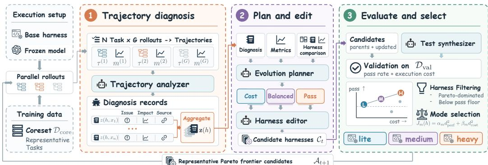
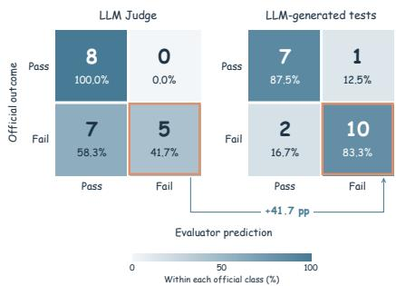
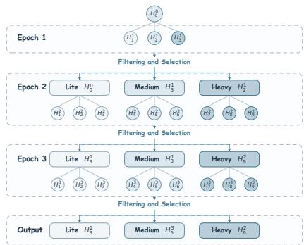
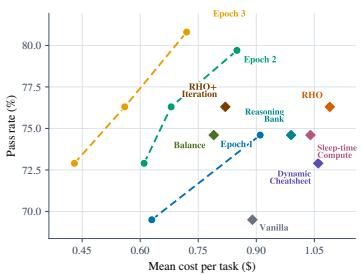
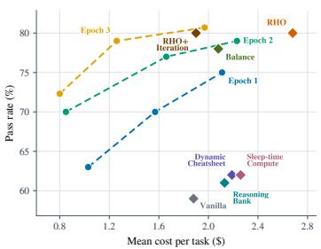
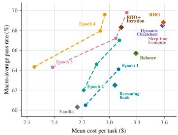

# HARNESSPRO: RECURSIVE HARNESS SELF-IMPROVEMENT WITH PARETO OPTIMIZATION FOR PERFORMANCE-COST TRADE-OFFS

Zhuoshi Pan<sup>1</sup>, ZhiYuan Feng<sup>1</sup>, Yukuo Cen<sup>2</sup>, Honglin Lin<sup>3</sup>,

Junru Lu<sup>4</sup>, Zhongxia Chen<sup>5</sup>, Shuo Yang<sup>5</sup>, H. Vicky Zhao<sup>1</sup>, Jie Tang<sup>1</sup>

<sup>1</sup>Tsinghua University <sup>2</sup>Z.AI Co., Ltd. <sup>3</sup>Shanghai Jiao Tong University

<sup>4</sup>University of Warwick <sup>5</sup>Kuaishou–Kuaishou Technology

## ABSTRACT

Harness development plays a crucial role in building capable AI agents. Recent approaches improve harnesses through recursive self-improvement (RSI), but their performance gains often come with higher execution costs. We introduce HARNESSPRO, a label-free method for evolving harnesses to improve task performance while reducing execution cost. In this setting, candidate harnesses are evaluated using LLM-generated tests without access to ground-truth solutions or official tests. Specialized agents diagnose execution trajectories, plan updates with different performance-cost priorities, and implement them as candidate harnesses. Rather than returning a single harness, HARNESSPRO uses normalized weighted squared-distance selection to provide cost-focused (lite), balanced (medium), and performance-focused (heavy) harnesses for different deployment budgets. Selected harnesses enter the next iteration, where execution feedback guides further updates. Our experiments cover Terminal-Bench 2, SWE-Bench Pro, and ProgramBench, using GPT-5.5 with Codex and GLM-5.2 with Claude Code. Across these benchmarks using GPT-5.5 with Codex, the heavy mode of HARNESSPRO achieves an average pass-rate gain of 2.0 percentage points and an average pertask cost reduction of 26.1% relative to RHO. This advantage also holds when using GLM-5.2 with Claude Code. Code is available at this link.

## 1 INTRODUCTION

An agent harness is the software infrastructure that manages interactions between a large language model (LLM) and its environment (Grace et al., 2026). Recent work on recursive self-improvement (RSI) (Zhang et al., 2026) uses past execution trajectories to diagnose problems and guide harness updates that improve performance on future tasks (Suzgun et al., 2026; Lin et al., 2026; Pan et al., 2026a). However, these methods often pursue performance gains through more extensive exploration and stronger verification (Lin et al., 2026; Pan et al., 2026a). These efforts improve performance, but often at the cost of higher token consumption and increased latency. This trade-off is less appealing in practical deployment, where the execution cost and latency also matter. We therefore ask: Can recursive harness self-improvement deliver better performance at lower execution cost?

Toward this goal, we introduce HARNESSPRO, a label-free method for recursive harness selfimprovement that uses both performance and cost metrics to guide harness updates and candidate selection. It orchestrates several specialized agents to turn execution feedback into successive har ness updates. A trajectory analyzer examines repeated rollouts to identify failures and avoidable overhead. Guided by different performance-cost priorities, a planner turns these diagnoses into harness improvement plans, which an editor implements as executable harness candidates. A testsynthesis agent provides fixed tests for evaluating the candidates without access to ground-truth solutions or official tests. Candidates that underperform the initial harness or are Pareto-dominated are discarded. To accommodate different budgets, we then use normalized weighted squared-distance selection (Marler & Arora, 2004) to retain representative harnesses for cost-focused (lite), balanced (medium), and performance-focused (heavy) modes. The selected harnesses then enter the next epoch, where further updates pursue different performance-cost priorities.

We evaluate HARNESSPRO on Terminal-Bench 2 (The Terminal-Bench Team, 2025), SWE-Bench Pro (Deng et al., 2026), and ProgramBench (Yang et al., 2026a), using GPT-5.5 with Codex and GLM-5.2 with Claude Code. With both backbone models, HARNESSPRO improves task performance while reducing execution cost. For example, on Terminal-Bench 2 with GPT-5.5 and Codex, the heavy mode of HARNESSPRO outperforms RHO (Pan et al., 2026a) in pass rate by 4.5 percentage points while reducing mean cost per task by 33.9%. For more cost-sensitive deployments, the medium mode delivers performance comparable to RHO at substantially lower execution cost.

An analysis of the evolved harnesses shows that HARNESSPRO does not improve agents simply by compressing context or increasing reasoning effort. The evolved harnesses dynamically allocate reasoning effort and tool budgets based on task descriptions, while runtime hooks steer execution from exploration toward convergence based on the assigned budgets. They also adopt tool-output compression like RTK (Szymkowiak, 2026) and streamline instructions to reduce redundant prompt content, while retaining necessary context and final verification. Together, these mechanisms curb avoidable overhead while preserving the reasoning and verification needed for task success, thereby advancing the performance-cost Pareto frontier.

Our contributions are threefold:

• We introduce HARNESSPRO, a multi-agent framework that simultaneously optimizes performance and cost by analyzing execution trajectories and recursively improving harnesses.

• We assess candidate artifacts with fixed LLM-generated tests rather than direct LLM judgments, improving failure detection without access to official tests.

• Across three benchmarks, HARNESSPRO improves performance while reducing cost and latency, yielding a series of harnesses with different performance-cost trade-offs.

## 2 RELATED WORK

Agent and harness optimization. Agent optimization has expanded from prompts and predefined workflows to the executable harness surrounding a model. AFlow searches graphs of modelinvoking operators using execution feedback (Zhang et al., 2025). More recent systems directly modify harness components: agentic harness engineering makes edits traceable (Lin et al., 2026), HarnessFix diagnoses failures before applying repairs (Chen et al., 2026a), and HarnessX composes harnesses from typed primitives using trajectory evidence (Chen et al., 2026b). RHO uses LLMs to evaluate and compare execution trajectories without ground-truth labels, guiding harness evolution toward higher task success (Pan et al., 2026a). In contrast, our method, HARNESSPRO, optimizes both task success rate and monetary cost. Rather than returning a single harness, it produces a set of harnesses with different performance-cost trade-offs, organized into lite, medium, and heavy tiers.

Component optimization and inference-time budget allocation. Some methods focus on specific components, such as skills or memory (Pan et al., 2026b). SkillOpt optimizes skill documents (Yang et al., 2026b), while SkillMOO and FRAMES incorporate cost or regression constraints into skill evolution (Gong et al., 2026a; Wang et al., 2026). Dynamic Cheatsheet and Reasoning-Bank retain reusable strategies from past experience (Suzgun et al., 2026; Ouyang et al., 2026), while Sleep-time Compute builds reusable memory by reasoning over context before a query arrives (Lin et al., 2025). MemoryCPT jointly optimizes memory construction, retrieval, and summarization (Lei et al., 2026). Other work addresses budget allocation at inference time: BATS learns a budget-aware policy for allocating model tokens and external tool calls (Liu et al., 2025), while COMPAS jointly selects models, prompts, and decoding settings according to task difficulty (Gong et al., 2026b). HARNESSPRO instead uses past trajectories to evolve the entire harness, including instructions, skills, tools, hooks, and verification rules. Table 1 summarizes how HARNESSPRO differs from prior work.

## 3 PROBLEM SETTING

A harness $h \in { \mathcal { H } }$ is the software runtime layer that manages a foundation model’s interactions and execution. It includes prompts, tools and skills, context and memory mechanisms, hooks, and verification policies (Yehudai et al., 2026; OpenAI, 2026). Given a task x, the harness determines what information the agent receives, which actions it can take, and how those actions are executed, directly influencing both task success and resource consumption. An agent equipped with harness h solves task $x ,$ producing a trajectory $\tau _ { h } ( x ) = \mathrm { S o l v e } ( h , \bar { x } )$ that records tool calls, environment feedback, and the final artifact. Recursive self-improvement uses trajectories from previous tasks to guide harness evolution and improve performance on future tasks. Below, we define the three evaluation metrics: pass rate, execution cost, and runtime latency.

Table 1: Comparison of different harness self-improvement methods.
<table><tr><td>Method</td><td>Goal</td><td>Scope</td><td>Feedback</td><td>Iteration</td><td>Output</td></tr><tr><td>AFlow (Zhang et al., 2025)</td><td>Pass</td><td>Workflow</td><td>Ground truth</td><td>Recursive</td><td>Single</td></tr><tr><td>SkillMOO (Gong et al., 2026a) Pass + Cost</td><td></td><td>Skills</td><td>Ground truth</td><td>Recursive</td><td>Pareto set</td></tr><tr><td>RHO (Pan et al., 2026a)</td><td>Pass</td><td>Skills + tools</td><td>Label-free</td><td>Single round</td><td>Single</td></tr><tr><td>AHE (Lin et al., 2026)</td><td>Pass</td><td>Harness</td><td>Ground truth</td><td>Recursive</td><td>Single</td></tr><tr><td>HARNESSPRO</td><td>Pass + Cost</td><td>Harness</td><td>Label-free</td><td>Recursive</td><td>Pareto set</td></tr></table>

Pass rate. To prevent test-set leakage, we partition tasks into training, validation, and test sets, denoted by $\mathcal { D } _ { \mathrm { t r a i n } } , \mathcal { D } _ { \mathrm { v a l } }$ , and $\mathcal { D } _ { \mathrm { t e s t } }$ . Outcomes on the training set are used to update harnesses, while the validation set is used to evaluate and select candidate harnesses. The test set is used only for final evaluation after evolution. For a task $x \in \mathcal { D } _ { \mathrm { t e s t } }$ , the official tests evaluate the final artifact produced by $\tau _ { h } ( x )$ . We set $\operatorname* { P a s s } ( \tau _ { h } ( x ) ) = 1$ if all official tests pass and $\mathrm { P a s s } ( \tau _ { h } ( x ) ) = 0$ otherwise. The pass rate is the fraction of test tasks that pass all official tests, $\begin{array} { r } { \mathrm { P R } ( h ) = \frac { 1 } { | \mathcal { D } _ { \mathrm { t e s t } } | } \sum _ { x \in \mathcal { D } _ { \mathrm { t e s t } } } \mathrm { P a s s } ( \tau _ { h } ( x ) ) } \end{array}$

Cost. We compute execution cost from token usage, distinguishing uncached input, cached input, and output tokens because they are billed at different prices. For each task x, we aggregate these token counts over all model calls in $\tau _ { h } ( x )$ and compute its cost $c _ { h } ( x )$ using the prices in Table 4 (Appendix A). We report the average cost per test task as $\begin{array} { r } { C ( h ) = \frac { 1 } { | \mathcal { D } _ { \mathrm { t e s t } } | } et { } { ' } \sum _ { x \in \mathcal { D } _ { \mathrm { t e s t } } } \bar { c } _ { h } ( x ) } \end{array}$

Latency. We define task latency as the wall-clock time from the start of agent execution to its completion: $\ell _ { h } ( x ) = T _ { \mathrm { e n d } } ( \tau _ { h } ( x ) ) - T _ { \mathrm { s t a r t } } ( \tau _ { h } ( x ) )$ . The time spent grading the final output is not included in task latency. We average task latencies over the test set to obtain the mean latency, $\begin{array} { r } { L ( h ) = \frac { 1 } { | \mathcal { D } _ { \mathrm { t e s t } } | } \sum _ { x \in \mathcal { D } _ { \mathrm { t e s t } } } \mathcal { l } _ { h } ( x ) } \end{array}$ . Because model response times fluctuate with server load and network conditions, we treat latency as an auxiliary metric rather than an optimization objective.

Optimization objective. We aim to evolve harnesses that improve performance while reducing cost. We formulate the optimization problem as

$$
\operatorname* { m i n } _ { h \in \mathcal { H } } \left( - \mathrm { P R } ( h ) , C ( h ) \right) \quad \mathrm { s . t . } \quad \mathrm { P R } ( h ) \geq \mathrm { P R } ( h _ { 0 } ) .\tag{1}
$$

Here, $h _ { 0 }$ is the initial harness. We seek the Pareto frontier and select three representative operating points: cost-focused (lite), balanced (medium), and performance-focused (heavy). However, finding these trade-offs poses two challenges. (1) A vast harness search space. A harness comprises components such as instructions, tools, skills, hooks, and rules, all of which can be modified during evolution. Their possible combinations create a vast, discrete search space that cannot be optimized using gradients. (2) Balancing performance and cost. Additional reasoning, exploration, or verification can improve performance but also consumes more tokens, increasing cost. Conversely, indiscriminately reducing these activities may hurt performance. Advancing the Pareto frontier thus requires analyzing execution trajectories alongside task outcomes and token usage to distinguish necessary computation from avoidable overhead and find the “sweet spot” that reduces cost without compromising performance.

## 4 HARNESSPRO

To address these challenges, we introduce HARNESSPRO, a multi-agent framework that analyzes execution trajectories and iteratively modifies harnesses to advance the performance-cost Pareto frontier. We first outline the evolution process, then describe trajectory-based diagnosis and candidate generation, followed by test-based evaluation and selection.

  
Figure 1: Overview of HARNESSPRO. In each epoch, it analyzes rollout trajectories, generates candidate harnesses, and selects representatives based on performance and cost.

## 4.1 OVERVIEW

To keep trajectory collection and analysis manageable, we begin by selecting a training coreset $\mathcal { D } _ { \mathrm { t r a i n } }$ . Following RHO (Pan et al., 2026a), we use the Determinantal Point Process (DPP) kernel (Kulesza & Taskar, 2012) to balance task difficulty and diversity (Appendix A.1). Starting from an executable harness $h _ { 0 }$ , we maintain a candidate set $\boldsymbol { A } _ { t }$ of harnesses at epoch $t ,$ initialized as $\mathcal { A } _ { 0 } = \{ h _ { 0 } \}$ . In each epoch, HARNESSPRO employs a multi-agent framework to analyze trajectories of these candidate harnesses on the coreset $\mathcal { D } _ { \mathrm { t r a i n } }$ to identify task failures, unproductive exploration, and redundant computation. The framework then plans and implements harness modifications to ad dress these issues, producing new executable candidate harnesses as described in Section 4.2.

We evolve harnesses in a label-free setting, without access to ground-truth solutions, official test cases, or graders. Instead of using an LLM to assess and compare trajectories directly, as in RHO (Pan et al., 2026a), we use it to generate tests from task descriptions and trajectories produced by the initial harness. In each epoch, we evaluate candidate harnesses on the validation set using the generated tests, measuring pass rate and execution cost. After discarding candidates that fall below the performance floor or are Pareto-dominated, we use normalized weighted squared-distance selection to retain representatives for cost-focused (lite), balanced (medium), and performance-focused (heavy) modes. The selected harnesses form the candidate set for the next epoch. This process repeats until the epoch limit is reached, after which we fix the harnesses and evaluate them on the test set. Algorithm 1 summarizes the full procedure.

## 4.2 TRAJECTORY ANALYSIS AND HARNESS EVOLUTION

At epoch t, we run each harness in the current candidate set $\mathcal { A } _ { t } = \{ h _ { i } ^ { t } \} _ { i = 1 } ^ { | \mathcal { A } _ { t } | }$ independently G times on every training task $x \in \mathcal { D } _ { \mathrm { t r a i n } } .$ . For candidate harness $h \in { \mathcal { A } } _ { t }$ , this rollout process yields a trajectory $\tau _ { h } ^ { t , g } ( x )$ and a metric vector $m _ { h } ^ { t , g } ( x ) \ = \ \bigl ( \mathrm { P a s s } _ { h } ^ { t , g } ( x ) , \ : c _ { h } ^ { t , g } ( x ) , \ : \ell _ { h } ^ { t , g } ( x ) \bigr )$ . Here, $\mathrm { P a s s } _ { h } ^ { t , g } ( x )$ is 1 if the artifact produced in $\tau _ { h } ^ { t , g } ( x )$ passes all generated tests in $s ( x )$ , while $c _ { h } ^ { t , g } ( x )$ and $\ell _ { h } ^ { t , g } ( x )$ record its execution cost and latency. We also retain token usage and tool-call details for later diagnosis. These trajectories and artifacts guide harness self-improvement through a multi-agent framework comprising a trajectory analyzer, an evolutionplanner, a harness editor, and a test synthesizer. We describe each agent below.

Trajectory Analyzer. Execution trajectories can reveal harness weaknesses, but the relevant evidence is often dispersed across long sequences of model responses and tool outputs, making these weaknesses difficult to locate and interpret. We therefore implement a trajectory-analysis agent to diagnose these problems for each candidate h and task x at epoch t. To reduce the impact of randomness, the agent jointly examines the trajectories $\{ \tau _ { h } ^ { t , g } ( x ) \} _ { g = 1 } ^ { \bar { G } }$ from $G$ independent rollouts and their metrics $\{ m _ { h } ^ { t , g } ( x ) \} _ { g = 1 } ^ { G }$ , rather than relying on a single attempt:

$$
z ( h , x ) = \mathrm { A n a l y z e r } \left( x , \left\{ \left( \tau _ { h } ^ { t , g } ( x ) , m _ { h } ^ { t , g } ( x ) \right) \right\} _ { g = 1 } ^ { G } \right) .\tag{2}
$$

```tcl
Algorithm 1 Cost-aware recursive harness self-improvement with HARNESSPRO.
Input: Seed harness h ; data $\overline { { \mathcal { D } _ { \mathrm { t r a i n } } , \mathcal { D } _ { \mathrm { v a l } } } } ;$ prompts $\overline { { I _ { 1 } { - } I _ { 3 } ; } }$ rollouts $\overline { { G ; } }$ epoch limit T
Output: Harnesses for the lite $h _ { \mathrm { l i t e } } ^ { T } ,$ medium $h _ { \mathrm { m e d i u m } } ^ { T ^ { \star } } ,$ and heavy $h _ { \mathrm { h e a v y } } ^ { T }$ modes.
1: Collect $\tau _ { h _ { 0 } } ( x )$ for each $x \in \mathcal { D } _ { \mathrm { t r a i n } } \cup \mathcal { D } _ { \mathrm { v a l } }$
$\mathbf { \Sigma } 2 \colon \mathcal { S } ( x ) \gets \mathrm { T e s t S y n t h } ( x , \tau _ { h _ { 0 } } ( x ) )$ for each x ▷ Generate once
3: Evaluate h<sub>0</sub> on $\dot { \mathcal { D } } _ { \mathrm { v a l } }$ using S; fix its initial pass rate $\mathrm { P R } _ { \mathrm { v a l } } ( h _ { 0 } )$ as the performance floor
4: $\mathcal { A } _ { 0 }  \{ h _ { 0 } \} ; t  0 ; h _ { m } ^ { 0 }  h _ { 0 }$ for $m \in$ {lite, medium, heavy}
5: while $t < \dot { T }$ do
Stage 1 Trajectory diagnosis
6: for each $h \in { \mathcal { A } } _ { t }$ do
7: Collect G independent rollouts per $x \in \mathcal { D } _ { \mathrm { t r a i n } } ,$ recording $\tau _ { h } ^ { t , g } ( x )$ and $m _ { h } ^ { t , g } ( x )$ using $s ( x )$
8: $z ( h , x ) \gets \mathbf { A }$ nalyzer $( x , \{ ( \tau _ { h } ^ { t , g } ( x ) , m _ { h } ^ { t , g } ( x ) ) \} _ { g = 1 } ^ { G } )$ for each $x \in \mathcal { D } _ { \mathrm { t r a i n } }$
9: $\begin{array} { r } { \mathbf { z } ( h ) \gets \bigcup _ { x \in \mathcal { D } _ { \mathrm { t r a i n } } } z ( h , x ) ; \mathbf { m } ( h ) \gets \bigcup _ { x \in \mathcal { D } _ { \mathrm { t r a i n } } } \{ m _ { h } ^ { t , g } ( x ) \} _ { g = 1 } ^ { G } } \end{array}$
10: end for
Stage 2 Candidate generation
11: for each $h _ { i } ^ { t } \in \mathcal { A } _ { t }$ and $j \in \{ 1 , 2 , 3 \}$ in parallel do
12: Generate a plan from $I _ { j } ,$ diagnoses, metrics, and cross-candidate evidence:
13: $\mathbf { p } _ { j } ( h _ { i } ^ { t } ) \gets \dot { \mathbf { P } } \mathbf { l a n } ( I _ { j } , h _ { i } ^ { \dagger } , \mathbf { z } ( h _ { i } ^ { \top } ) , \mathbf { m } ( h _ { i } ^ { t } ) , \{ ( \mathrm { D i f f } ( h _ { i } ^ { t } , h _ { k } ^ { t } ) , \mathbf { z } ( h _ { k } ^ { t } ) , \mathbf { m } ( h _ { k } ^ { t } ) ) \} _ { k \neq i } )$
14: $\widetilde { h } _ { i , j } ^ { t } \gets \mathbf { E d i t } ( h _ { i } ^ { t } , \mathbf { z } ( h _ { i } ^ { t } ) , \mathbf { p } _ { j } ( h _ { i } ^ { t } ) ) ;$ commit $\widetilde { h } _ { i , j } ^ { t }$ to Git ▷ Separate workspace
15: end for
16: $\mathcal { L } _ { t }  \{ \widetilde { h } _ { i , j } ^ { t } \} _ { i , j } ; \widetilde { \mathcal { C } } _ { t }  A _ { t } \cup \mathcal { C } _ { t }$
$\mathbf { l s t a g e 3 } ^ { \prime }$ Evaluation and selection
17: Evaluate each $h \in \widetilde { \mathcal { C } } _ { t }$ once per $x \in \mathcal { D } _ { \mathrm { v a l } }$ using the fixed $s ( x ) ;$ aggregate m $. { \mathrm { v a l } } ( h )$
18: Filter candidates: $\widetilde { A } _ { t + 1 } \longleftarrow \{ h \in \widetilde { \mathcal { C } } _ { t } \mid \operatorname { P R } _ { \mathrm { v a l } } ( h ) \geq \operatorname { P R } _ { \mathrm { v a l } } ( h _ { 0 } ) \land \triangledown h ^ { \prime } \in \widetilde { \mathcal { C } } _ { t } : h ^ { \prime } \prec h \}$
19: Select representatives: $\begin{array} { r } { \begin{array} { r } { h _ { m } ^ { t + 1 ^ { \setminus } }  \operatorname * { a r g m i n } _ { h \in \tilde { \mathcal { A } } _ { t + 1 } } \overline { { J } } _ { m } ( h ) } \end{array} } \end{array}$ for m $\in \{ \mathrm { l i t e } ,$ medium, heavy} ▷ Eq. 9
20: Update candidates: $\mathcal { A } _ { t + 1 } \gets \{ h _ { \mathrm { l i t e } } ^ { t + 1 } , h _ { \mathrm { m e d i u m } } ^ { t + 1 } , h _ { \mathrm { h e a v y } } ^ { t + 1 } \} ; t \gets t + 1$
21: end while
22: return $\overline { { ( h _ { \mathrm { l i t e } } ^ { T } , } } h _ { \mathrm { m e d i u m } } ^ { T } , h _ { \mathrm { h e a v y } } ^ { T } )$ ▷ Fixed before held-out test evaluation
```

The analyzer’s output $z ( h , x )$ reports (1) identified problems, (2) their impact on performance and cost, and (3) their sources and supporting evidence. The evidence includes a concise trajectory summary or relevant excerpts, together with the path of the trajectory file and the relevant event range. Two examples are provided in Appendix C.1. We combine diagnoses across different tasks as $\begin{array} { r } { \bar { \mathbf { z } } ( h ) = \bigcup _ { x \in \mathcal { D } _ { \operatorname { t r a i n } } } z ( h , \bar { x } ) } \end{array}$ . If ${ \bf z } ( h )$ exceeds 64K tokens, the analyzer summarizes it. We similarly collect the metric vectors across training tasks as $\begin{array} { r } { \mathbf { \delta n } ( h ) \stackrel { } { = } \bigcup _ { x \in \mathcal { D } _ { \mathrm { t r a i n } } } \{ m _ { h } ^ { t , g } ( x ) \} _ { g = 1 } ^ { G } } \end{array}$ . The planner uses these diagnoses and metrics to guide its proposals.

Evolution Planner. Building on these diagnoses, the planner proposes three improvement plans for each candidate. Each plan is guided by a distinct instruction: $I _ { 1 }$ emphasizes cost reduction, $I _ { 2 }$ balances performance and cost, and $I _ { 3 }$ prioritizes performance, as detailed in Appendix B. The planner starts with the full implementation of $h _ { i } ^ { t } .$ , using its diagnoses and metrics to identify where modifications are needed. It also compares harness $h _ { i } ^ { \top }$ and the other candidates $h _ { k } ^ { t }$ by examining their code differences $\mathrm { D i f f } ( h _ { i } ^ { t } , h _ { k } ^ { t } )$ :

$$
\mathbf { p } _ { j } ( h _ { i } ^ { t } ) = \mathrm { P l a n } ( I _ { j } , h _ { i } ^ { t } , \mathbf { z } ( h _ { i } ^ { t } ) , \mathbf { m } ( h _ { i } ^ { t } ) , \{ ( \mathrm { D i f f } ( h _ { i } ^ { t } , h _ { k } ^ { t } ) , \mathbf { z } ( h _ { k } ^ { t } ) , \mathbf { m } ( h _ { k } ^ { t } ) ) \} _ { k \neq i } ) .\tag{3}
$$

By comparing candidates, the planner can identify effective mechanisms and remaining bottlenecks. Each plan explains which components to modify, how to modify them, and the expected effects on performance and cost, as exemplified in Appendix C.2. Full trajectories are not provided to the planner by default. When needed, it can inspect them using the file paths recorded in the diagnoses. The planner is instructed to propose generalizable, rather than task-specific, harness updates. Throughout evolution, the validation and test sets remain hidden from the planner to avoid benchmark leakage.

Harness Editor. We then design a harness editor to modify candidate $h _ { i } ^ { t } .$ , producing a new, executable candidate harness using the proposed plan $\mathbf { p } _ { j } ( h _ { i } ^ { t } )$ and the diagnoses $\bar { \mathbf { z } } ( h _ { i } ^ { t } )$ :

$$
\widetilde { h } _ { i , j } ^ { t } = \mathrm { E d i t } \big ( h _ { i } ^ { t } , \mathbf { z } ( h _ { i } ^ { t } ) , \mathbf { p } _ { j } ( h _ { i } ^ { t } ) \big ) , \qquad j = 1 , 2 , 3 .\tag{4}
$$

Each of the three plans is implemented in a separate workspace, and the resulting harness is committed to Git so that changes can be traced and reverted. Newly generated harnesses form $\mathcal { C } _ { t } ,$ and

we combine them with the parent harnesses in $\boldsymbol { A } _ { t }$ for evaluation:

$$
\mathcal { C } _ { t } = \bigcup _ { i = 1 } ^ { | \mathcal { A } _ { t } | } \left\{ \widetilde { h } _ { i , 1 } ^ { t } , \widetilde { h } _ { i , 2 } ^ { t } , \widetilde { h } _ { i , 3 } ^ { t } \right\} , \qquad \widetilde { \mathcal { C } } _ { t } = \mathcal { A } _ { t } \cup \mathcal { C } _ { t } .\tag{5}
$$

All harnesses in $\widetilde { \mathcal { C } } _ { t }$ then undergo the same evaluation and selection process, as described below.

## 4.3 EVALUATION AND CANDIDATE SELECTION

Test Synthesizer. During harness evolution, we follow RHO (Pan et al., 2026a), adopting a label-free setting without access to ground-truth solutions, official tests, or grader feedback. RHO relies on LLM self-preference to select harnesses. However, we find that LLM judges tend to be overly optimistic when assessing the execution trajectories, often treating flawed implementations as successful. We therefore introduce a dedicated test-synthesis agent to generate test cases for evaluation; its instruction, skill, and validation tool are outlined in Appendix C.3. For each task $x \in \mathcal { D } _ { \mathrm { t r a i n } } \cup \mathcal { D } _ { \mathrm { v a l } }$ , the agent generates tests from its description x and the initial trajectory $\tau _ { h _ { 0 } } ( x )$

$$
\begin{array} { r } { S ( x ) = \mathrm { T e s t S y n t h } ( x , \tau _ { h _ { 0 } } ( x ) ) . } \end{array}
$$

  
Figure 2: Confusion matrices pooled across training tasks from Terminal-Bench 2 and SWE-Bench Pro.

(6)

These generated tests remain fixed throughout the selfimprovement process, ensuring a fair comparison among candidate harnesses. A preliminary experiment demonstrates the effectiveness of this approach, with failure recall increasing from 41.7% to 83.3% compared with direct LLM judgments (Figure 2). After each epoch, we run each candidate $h \in \widetilde { \mathcal { C } } _ { t }$ once per validation task x and check its output against $s ( x )$ . Task-level pass indicators, costs, and latencies are averaged to obtain the validation metrics $\mathbf { m } _ { \mathrm { v a l } } ( h ) = ( \mathrm { P R } _ { \mathrm { v a l } } ( h ) , C _ { \mathrm { v a l } } ( h ) , L _ { \mathrm { v a l } } ( h ) )$

Candidate filtering and selection. To prevent the candidate set from growing indefinitely, we retain at most three harnesses for the next epoch. We first discard candidates below the initial passrate floor $\mathrm { P R } _ { \mathrm { v a l } } ( h _ { 0 } )$ or Pareto-dominated by another candidate:

$$
\begin{array} { r } { \widetilde { \mathcal { A } } _ { t + 1 } = \left\{ h \in \widetilde { \mathcal { C } } _ { t } \Big | \operatorname { P R } _ { \mathrm { v a l } } ( h ) \geq \operatorname { P R } _ { \mathrm { v a l } } ( h _ { 0 } ) \wedge \triangledown h ^ { \prime } \in \widetilde { \mathcal { C } } _ { t } : h ^ { \prime } \prec h \right\} . } \end{array}\tag{7}
$$

Here, $h ^ { \prime } \prec h$ denotes Pareto dominance: $h ^ { \prime }$ is no worse than h on both metrics and strictly better on at least one. We select representatives using a normalized weighted squared-distance criterion (Marler & Arora, 2004) that accounts for actual differences in performance and cost. We first measure each candidate’s normalized deviations from the highest pass rate and lowest cost:

$$
\begin{array} { r l } & { d _ { \mathrm { p e r f } } ( h ) = ( P _ { \mathrm { m a x } } - \mathrm { P R } _ { \mathrm { v a l } } ( h ) ) / ( P _ { \mathrm { m a x } } - P _ { \mathrm { m i n } } ) , } \\ & { d _ { \mathrm { c o s t } } ( h ) = ( C _ { \mathrm { v a l } } ( h ) - C _ { \mathrm { m i n } } ) / ( C _ { \mathrm { m a x } } - C _ { \mathrm { m i n } } ) . } \end{array}\tag{8}
$$



Here, $P _ { \operatorname* { m i n } } , P _ { \operatorname* { m a x } }$ and $C _ { \mathrm { m i n } } , C _ { \mathrm { m a x } }$ are the extrema of validation pass rate and mean cost over the current filtered set $\bar { \tilde { A } } _ { t + 1 }$ . The selection objective for mode m is $J _ { m } ( h ) = \alpha _ { m } \bar { d } _ { \mathrm { p e r f } } ( h ) ^ { 2 } + \beta _ { m } d _ { \mathrm { c o s t } } ( \bar { h } ) ^ { 2 }$ , where $\alpha _ { m }$ and $\beta _ { m }$ weight performance and cost, respectively. Each mode

Figure 3: Schematic of recursive harness update, filtering, and selection.<sup>2</sup>

m ∈ {lite, medium, heavy} independently selects the candidate with the smallest weighted squared distance:

$$
\begin{array} { r } { h _ { m } ^ { t + 1 } = \arg \operatorname* { m i n } _ { h \in \widetilde { \mathcal { A } } _ { t + 1 } } J _ { m } ( h ) . } \end{array}\tag{9}
$$

The selected harnesses form $\boldsymbol { \mathcal { A } } _ { t + 1 }$ for the next round, as illustrated in Figure 3. Filtering and selection use only validation metrics, with no access to test-set results. The final harnesses are evaluated on the held-out test set $\mathcal { D } _ { \mathrm { t e s t } }$ only after all rounds of recursive self-improvement are complete.

## 5 EXPERIMENTS

## 5.1 EXPERIMENTAL SETUP

Data and implementation. We evaluate HARNESSPRO on Terminal-Bench 2 (The Terminal-Bench Team, 2025), SWE-Bench Pro (Deng et al., 2026), and ProgramBench (Yang et al., 2026a), covering terminal tasks, repository-level issue resolution, and program reconstruction. Following the dataset splitting protocol of RHO (Pan et al., 2026a), we hold out 59, 100, and 100 tasks, respectively, for testing. From the remaining tasks in each benchmark, we select a 10-task training set $\mathcal { D } _ { \mathrm { t r a i n } }$ using the DPP-based coreset selection method (Kulesza & Taskar, 2012) described in Section 4.1. The remaining tasks form the validation set. We pair GPT-5.5 with Codex 0.147.0 and GLM-5.2 with Claude Code 2.1.231. Each candidate harness produces $G = 3$ rollouts per training task in each epoch. Evolution runs for three epochs on Terminal-Bench 2 and SWE-Bench Pro, and four on ProgramBench, retaining up to three harnesses after each epoch. All methods use the same data splits and grading settings. Further implementation details are in Appendix A.

Baselines. We compare HARNESSPRO against several strong harness optimization methods. The original Codex or Claude Code harness is Vanilla, the starting point for optimization. Dynamic Cheatsheet (Suzgun et al., 2026) maintains reusable strategies and code snippets, Reasoning-Bank (Ouyang et al., 2026) retrieves strategies distilled from past trajectories, and Sleep-time Compute (Lin et al., 2025) prepares reusable memory before new tasks. RHO (Pan et al., 2026a) revises harness components through trajectory analysis and selects candidates using LLM self-preference. To separate the effects of cost-aware and recursive optimization, we include two RHO variants. Balance changes only RHO’s optimization instruction, asking for better task performance at lower cost. RHO+Iteration runs Balance for the same number of epochs as HARNESSPRO. Each subsequent epoch starts from the harness selected in the preceding epoch by the best-of-N procedure of RHO.

Evaluation metrics. On Terminal-Bench 2 and SWE-Bench Pro, a task passes only if all its official tests pass. For ProgramBench, we follow its official evaluation protocol (Yang et al., 2026a) and report pass rate as the macro-average of the fraction of test cases passed for each task. We also report mean cost C(h) and latency L(h). For HARNESSPRO, all metrics are given as mean ± sample standard deviation over three runs on Terminal-Bench 2 and SWE-Bench Pro, and two on ProgramBench. The token prices used to calculate cost are listed in Table 4 in the appendix.

## 5.2 MAIN RESULTS

Table 2 compares HARNESSPRO with several baseline methods across three benchmarks. With GPT-5.5 and Codex, RHO improves performance over Vanilla on all three benchmarks, but also increases execution cost. On SWE-Bench Pro, for example, its mean cost per task rises by 42.6%, from \$1.88 to \$2.68. In contrast, the heavy mode of HARNESSPRO achieves the highest pass rate across all three benchmarks at lower cost than RHO. On Terminal-Bench 2, the heavy mode of HARNESSPRO reaches a mean pass rate of 80.8% across three runs, 4.5 percentage points above RHO, with 33.9% lower mean cost. The advantage extends to ProgramBench, where its 69.6% pass rate exceeds RHO’s 68.8% at 17.8% lower mean cost (\$2.95 vs. \$3.59). These results show that better task performance need not come at a higher execution cost. For the medium mode, we retain strong task performance while reducing cost further. On SWE-Bench Pro, it achieves a 79.0% pass rate compared with RHO’s 80.0%, while reducing the average cost per task by 53.0%, from \$2.68 to \$1.26. The lite mode lowers cost further, outperforming Vanilla on all three benchmarks while spending 17.7–57.4% less, making it an economical choice for deployment under strict budget constraints. Even with comparable iteration budgets, HARNESSPRO achieves a better performance– cost trade-off than RHO+Iteration. Our medium mode matches the performance of RHO+Iteration on Terminal-Bench 2 at 31.7% lower cost. Moreover, on ProgramBench, our heavy mode raises pass rate by 1.3 percentage points while lowering mean cost by 5.8%.

The results with GLM-5.2 and Claude Code follow a similar pattern: the heavy mode of HAR-NESSPRO surpasses RHO on all three benchmarks at lower cost, while the medium and lite modes outperform Vanilla in pass rate, often at substantially lower cost. Moreover, although latency is not an objective, cost optimization yields faster task completion in most cases. For example, on SWE-Bench Pro, our heavy mode reduces mean latency from RHO’s 520 to 412 seconds.

Table 2: Performance and efficiency across three benchmarks. P denotes pass rate (%), while C and T denote mean cost (\$) and execution time (s). We report mean and standard deviation for HARNESSPRO. On ProgramBench, P is the macro-average of the fraction of tests passed per task.
<table><tr><td rowspan="2">Method</td><td colspan="3">Terminal-Bench 2</td><td colspan="3">SWE-Bench Pro</td><td colspan="3">ProgramBench</td></tr><tr><td>P(%) ↑</td><td>C($) ↓</td><td>T(s) ↓</td><td>P(%) ↑</td><td>C($) ↓</td><td>T(s) ↓</td><td>P(%) ↑</td><td>C($) ↓</td><td>T(s) ↓</td></tr><tr><td colspan="10">GPT-5.5 × Codex</td></tr><tr><td>Vanilla</td><td>69.5</td><td>0.89</td><td>260</td><td>59.0</td><td>1.88</td><td>337</td><td>60.3</td><td>2.65</td><td>669</td></tr><tr><td>Dynamic Cheatsheet</td><td>72.9</td><td>1.06</td><td>421</td><td>62.0</td><td>2.19</td><td>335</td><td>68.5</td><td>3.58</td><td>742</td></tr><tr><td>ReasoningBank</td><td>74.6</td><td>0.99</td><td>369</td><td>61.0</td><td>2.13</td><td>341</td><td>62.5</td><td>3.06</td><td>661</td></tr><tr><td>Sleep-time Compute</td><td>74.6</td><td>1.04</td><td>331</td><td>62.0</td><td>2.26</td><td>337</td><td>67.7</td><td>3.38</td><td>637</td></tr><tr><td>RHO</td><td>76.3</td><td>1.09</td><td>354</td><td>80.0</td><td>2.68</td><td>437</td><td>68.8</td><td>3.59</td><td>928</td></tr><tr><td>Balance</td><td>74.6</td><td>0.79</td><td>355</td><td>78.0</td><td>2.08</td><td>399</td><td>65.7</td><td>3.29</td><td>865</td></tr><tr><td>RHO+Iteration</td><td>76.3</td><td>0.82</td><td>328</td><td>80.0</td><td>1.90</td><td>375</td><td>68.3</td><td>3.13</td><td>789</td></tr><tr><td>HarnessPro-Lite</td><td>72.9±1.7</td><td>0.43± 0.01</td><td>230±32</td><td>72.3±0.6</td><td>0.80± 0.02</td><td>203±19</td><td>64.3±0.04</td><td>2.18±0.06</td><td>985±70</td></tr><tr><td>HarnessPro-Medium</td><td>76.3±1.7</td><td>0.56±0.04</td><td>253±35</td><td>79.0±1.0</td><td>1.26±0.03</td><td>326±25</td><td>67.9±0.47</td><td> $2 . 9 0 \pm 0 . 1 3$ </td><td>745±61</td></tr><tr><td>HarnessPro-Heavy</td><td>80.8±1.0</td><td>0.72±0.05</td><td>310±31</td><td>80.7± 0.6 1.97± 0.02</td><td></td><td>333±10</td><td>69.6±1.03</td><td>2.95±0.13</td><td>888±32</td></tr><tr><td colspan="10">GLM-5.2 × Claude Code</td></tr><tr><td>Vanilla</td><td>74.6</td><td>0.92</td><td>963</td><td>56.0</td><td>1.17</td><td>402</td><td>59.7</td><td>11.34</td><td>3847</td></tr><tr><td>RHO</td><td>78.0</td><td>1.00</td><td>1318</td><td>75.0</td><td>2.17</td><td>520</td><td>63.3</td><td>17.00</td><td>6434</td></tr><tr><td>HarnessPro-Lite</td><td>75.1±1.0</td><td>0.43± 0.03</td><td>665±8</td><td></td><td>70.7± 0.6 0.70± 0.02</td><td>289±3</td><td>60.1± 0.6</td><td>11.10± 0.28</td><td>3907±32</td></tr><tr><td>HarnessPro-Medium</td><td></td><td>76.3± 0.00.50± 0.01</td><td>968±17</td><td>75.0± 1.0 0.87± 0.01</td><td></td><td>332± 10</td><td>63.0± 0.4</td><td>13.74±0.16</td><td>5893±132</td></tr><tr><td>HarnessPro-Heavy</td><td></td><td>81.4±1.7 0.62±0.02</td><td>1080±15</td><td></td><td>77.3± 0.6 1.01± 0.03</td><td>412±11</td><td>64.4± 0.8</td><td>14.95±0.08</td><td>5925±110</td></tr></table>

## 5.3 ANALYSIS OF EVOLVED HARNESSES

To understand how HARNESSPRO improves the performance-cost trade-off, we inspect its evolved harnesses. On Terminal-Bench 2 and SWE-Bench Pro, they select an execution profile from each task description. Each profile specifies a reasoning effort level and a tool-call budget. The lite, medium, and heavy modes use different rubrics for profile selection. Runtime hooks enforce the selected budget. For example, on Terminal-Bench 2, when HARNESSPRO-Medium selects the standard profile, the hooks remind the agent to produce parallel tool calls and avoid redundant checks after 14 tool calls, focus on completing and verifying the task after 26, and block further calls after 44. The reminders are appended to tool results, preserving the prompt prefix for cache reuse. Alongside these dynamic mechanisms, the evolved harnesses also reduce static context redundancy. On Terminal-Bench 2, for instance, tool-output compression like RTK (Szymkowiak, 2026) folds repeated logs and condenses long outputs, while streamlined developer instructions reduce redundant input. This combination curbs recurring prompt overhead and limits the context growth caused by verbose tool feedback, thereby reducing execution cost and latency. Implementation details of these harnesses are in Appendix D.1.

## 5.4 EVOLUTION DYNAMICS

Figure 4 tracks test-set performance and cost across epochs. Across all three benchmarks, HARNESSPRO advances the performance-cost Pareto frontier through recursive harness selfimprovement. On Terminal-Bench 2, each round of evolution improves the retained Paretofrontier, yielding higher pass rates at lower costs. For example, the pass rate of the heavy mode rises from 74.6% in epoch 1 to a mean of 80.8% in epoch 3, while mean cost per task falls from \$0.91 to \$0.72. The lite and medium modes also maintain their pass rates from epoch 2 to 3, while their mean costs fall from \$0.61 to \$0.43 and from \$0.68 to \$0.56, respectively. The benefits of additional evolution epochs are particularly clear on SWE-Bench Pro, where a single run may raise pass rate at the expense of higher cost. In the medium mode, pass rate rises from 70.0% in epoch 1 to 77.0% in epoch 2, but mean cost also rises from \$1.57 to \$1.66. Only in epoch 3 does it improve both metrics, with pass rate rising to 79.0% and mean cost falling to \$1.26 per task. On ProgramBench, the fourth epoch likewise lowers costs across all three modes while maintaining similar pass rates. These patterns highlight an advantage of recursive self-improvement over single-round evolution.

## 5.5 ABLATION STUDY

  
(a) Terminal-Bench 2

  
(b) SWE-Bench Pro

  
(c) ProgramBench  
Figure 4: Evolution dynamics of HARNESSPRO with GPT-5.5 and Codex. Dashed lines connect the harnesses retained in each epoch, and diamonds denote baselines. Intermediate-epoch test-set metrics are reported for visualization only and were not used for filtering or selection. Final-epoch points show means across repeated test runs.

Table 3 examines the contributions of main components of HAR-NESSPRO. We also report Cost-of-Pass (CoP) (Erol et al., 2026), the total execution cost divided by the number of successful tasks. Removing the planner reduces performance and increases cost in most experiments. For example, on SWE-Bench Pro, the pass rate of the medium mode drops from 79.0% to 73.0%, while mean cost rises from \$1.26 to \$1.42 per task. Removing the test synthesizer has a larger impact, with pass rates dropping by 3.4–10.0 percentage points across both benchmarks and all three modes. These performance drops highlight

Table 3: Ablations with GPT-5.5 and Codex. In the RHO variants, + dynamic routing selects reasoning effort from task descriptions, + budget hooks append budget reminders to tool results and + low reasoning effort fixes effort at low.
<table><tr><td rowspan="2">Method</td><td colspan="3">Terminal-Bench 2</td><td colspan="3">SWE-Bench Pro</td></tr><tr><td></td><td></td><td>P(%) ↑ C($) ↓ CoP($) ↓P(%) ↑</td><td></td><td></td><td>C($) ↓ CoP($) ↓</td></tr><tr><td>RHO</td><td>76.3</td><td>1.09</td><td>1.43</td><td>80.0</td><td>2.68</td><td>3.35</td></tr><tr><td>RHO + dynamic routing</td><td>76.3</td><td>0.92</td><td>1.21</td><td>76.0</td><td>2.13</td><td>2.80</td></tr><tr><td>RHO + budget hooks</td><td>76.3</td><td>0.92</td><td>1.21</td><td>75.0</td><td>1.75</td><td>2.33</td></tr><tr><td>RHO + low reasoning effort</td><td>62.7</td><td>0.45</td><td>0.72</td><td>59.0</td><td>1.08</td><td>1.83</td></tr><tr><td>HarnessPro-Lite</td><td>72.9</td><td>0.43</td><td>0.59</td><td>72.3</td><td>0.80</td><td>1.11</td></tr><tr><td>w/o planner</td><td>72.9</td><td>0.41</td><td>0.56</td><td>70.0</td><td>0.98</td><td>1.40</td></tr><tr><td>w/o test synthesizer</td><td>67.8</td><td>0.67</td><td>0.99</td><td>64.0</td><td>0.78</td><td>1.22</td></tr><tr><td>HarnessPro-Medium</td><td>76.3</td><td>0.56</td><td>0.73</td><td>79.0</td><td>1.26</td><td>1.59</td></tr><tr><td>w/o planner</td><td>74.6</td><td>0.61</td><td>0.82</td><td>73.0</td><td>1.42</td><td>1.95</td></tr><tr><td>w/o test synthesizer</td><td>72.9</td><td>0.82</td><td>1.12</td><td>69.0</td><td>1.37</td><td>1.99</td></tr><tr><td>HarnessPro-Heavy</td><td>80.8</td><td>0.72</td><td>0.89</td><td>80.7</td><td>1.97</td><td>2.44</td></tr><tr><td>w/o planner</td><td>79.7</td><td>1.04</td><td>1.30</td><td>79.0</td><td>2.12</td><td>2.68</td></tr><tr><td>w/o test synthesizer</td><td>74.6</td><td>0.88</td><td>1.18</td><td>72.0</td><td>1.62</td><td>2.25</td></tr></table>

the value of our multi-agent framework. Beyond these component ablations, we also examine whether RHO can achieve similar gains by simply adopting individual strategies from our evolved harnesses. As shown in Table 3, adding either dynamic routing or budget hooks to RHO reduces cost, but can also degrade task performance. On SWE-Bench Pro, both variants reduce cost but achieve lower pass rates than RHO’s 80.0%. Uniformly using low reasoning effort yields larger cost savings but also substantially degrades performance. Overall, all three RHO variants are Pareto-dominated by harnesses evolved by HARNESSPRO, which achieve higher pass rates at lower cost.

## 6 CONCLUSION

We introduced HARNESSPRO, a label-free approach to recursive harness self-improvement that improves task performance while reducing execution cost. To this end, it coordinates trajectory diagnosis and harness modification through a multi-agent framework, with a dedicated planner proposing update plans and LLM-generated tests guiding candidate evaluation. Rather than producing a single harness, HARNESSPRO offers cost-focused (lite), balanced (medium), and performance-focused (heavy) alternatives to meet different deployment budgets. Experiments across three benchmarks show that HARNESSPRO can improve task performance while reducing execution cost, with additional benefits in latency. Further analysis attributes these gains to the synergy of multiple evolved mechanisms and shows sustained progress through recursive self-improvement. These findings show that performance and efficiency can improve together, making cost-aware evolution a promising direction for practical recursive self-improvement in harness optimization.

## AI USE STATEMENT

Generative AI tools were used to assist with software implementation and the drafting and editing of this manuscript. Separately, LLMs are integral to the method studied in this work: they analyze execution trajectories, propose and implement harness updates, and synthesize tests during harness evolution. All AI-assisted code and text were manually reviewed, and all reported results were checked by the authors.

## REPRODUCIBILITY STATEMENT

The full evolution procedure and optimization objective are described in Sections 3 and 4, with pseudocode in Algorithm 1. Section 5.1 specifies the benchmarks, model and agent versions, rollout counts, evolution epochs, selection hyperparameters, and evaluation metrics. The appendix provides the evolution instructions, token-pricing assumptions, and representative artifacts from the frozen evolved harnesses.

## REFERENCES

Mengzhuo Chen, Junjie Wang, Zhe Liu, Yawen Wang, Haiming Zheng, and Qing Wang. From failed trajectories to reliable LLM agents: Diagnosing and repairing harness flaws. arXiv preprint arXiv:2606.06324, 2026a. URL https://arxiv.org/abs/2606.06324.

Tingyang Chen, Shuo Lu, Kang Zhao, Weicheng Meng, Hanlin Teng, Tianhao Li, Chao Li, Xule Liu, Jian Liang, Zhizhong Zhang, Yuan Xie, Heng Qu, Kun Shao, and Jian Luan. HarnessX: A composable, adaptive, and evolvable agent harness foundry. arXiv preprint arXiv:2606.14249, 2026b. URL https://arxiv.org/abs/2606.14249.

Xiang Deng, Jeff Da, Edwin Pan, Yannis Yiming He, Charles Ide, Kanak Garg, Niklas Lauffer, Andrew Park, Chetan Rane, Karmini Sampath, Maya Krishnan, Srivatsa Kundurthy, Sean Hendryx, Zifan Wang, Chen Bo Calvin Zhang, Noah Jacobson, Bing Liu, and Brad Kenstler. SWE-Bench Pro: Can AI agents solve long-horizon software engineering tasks? In International Conference on Machine Learning, 2026. URL https://icml.cc/virtual/2026/poster/61047.

Mehmet Hamza Erol, Batu El, Mirac Suzgun, Mert Yuksekgonul, and James Zou. Cost-of-pass: An economic framework for evaluating language models. In The Fourteenth International Conference on Learning Representations, 2026. URL https://openreview.net/forum?id= vC9S20zsgN.

Jingzhi Gong, Ruizhen Gu, Zhiwei Fei, Yazhuo Cao, Lukas Twist, Alina Geiger, Shuo Han, Dominik Sobania, Federica Sarro, and Jie M. Zhang. SkillMOO: Multi-objective optimization of agent skills for software engineering. arXiv preprint arXiv:2604.09297, 2026a. URL https://arxiv.org/abs/2604.09297.

Jingzhi Gong, Jie M. Zhang, Gunel Jahangirova, Dong Huang, Mohammad Reza Mousavi, and Mark Harman. COMPAS: Difficulty-aware joint search for optimizing code generation. arXiv preprint arXiv:2608.04336, 2026b. URL https://arxiv.org/abs/2608.04336.

Mikaela Grace, Jeremy Hadfield, Rodrigo Olivares, and Jiri De Jonghe. Demystifying evals for AI agents. Anthropic Engineering, January 2026. URL https://www.anthropic.com/ engineering/demystifying-evals-for-ai-agents. Published January 9, 2026.

Alex Kulesza and Ben Taskar. Determinantal point processes for machine learning. Foundations and Trends in Machine Learning, 5(2–3):123–286, 2012.

Songxin Lei, Kun Ouyang, Weilin Ruan, Yuqian Wu, Zhijiang Guo, Yushi Sun, and Fugee Tsung. MemoryCPT: An end-to-end agent memory framework for cost-performance trade-off. arXiv preprint arXiv:2608.04843, 2026. URL https://arxiv.org/abs/2608.04843.

Jiahang Lin, Shichun Liu, Chengjun Pan, Lizhi Lin, Shihan Dou, Zhiheng Xi, Xuanjing Huang, Hang Yan, Zhenhua Han, Tao Gui, and Yu-Gang Jiang. Agentic harness engineering: Observability-driven automatic evolution of coding-agent harnesses. arXiv preprint arXiv:2604.25850, 2026. URL https://arxiv.org/abs/2604.25850.

Kevin Lin, Charlie Snell, Yu Wang, Charles Packer, Sarah Wooders, Ion Stoica, and Joseph E. Gonzalez. Sleep-time compute: Beyond inference scaling at test-time. arXiv preprint arXiv:2504.13171, 2025. URL https://arxiv.org/abs/2504.13171.

Tengxiao Liu, Zifeng Wang, Jin Miao, I-Hung Hsu, Jun Yan, Jiefeng Chen, Rujun Han, Fangyuan Xu, Yanfei Chen, Ke Jiang, Samira Daruki, Yi Liang, William Yang Wang, Tomas Pfister, and Chen-Yu Lee. Budget-aware tool use enables effective agent scaling. arXiv preprint arXiv:2511.17006, 2025. URL https://arxiv.org/abs/2511.17006.

R. T. Marler and J. S. Arora. Survey of multi-objective optimization methods for engineering. Structural and Multidisciplinary Optimization, 26(6):369–395, 2004. doi: 10.1007/ s00158-003-0368-6.

OpenAI. Agents API architecture. https://developers.openai.com/api/docs/ guides/agents-api/architecture/, 2026. Accessed: 2026-09-12.

Siru Ouyang, Jun Yan, I-Hung Hsu, Yanfei Chen, Ke Jiang, Zifeng Wang, Rujun Han, Long Le, Samira Daruki, Xiangru Tang, Vishy Tirumalashetty, George Lee, Mahsan Rofouei, Hangfei Lin, Jiawei Han, Chen-Yu Lee, and Tomas Pfister. ReasoningBank: Scaling agent self-evolving with reasoning memory. In The Fourteenth International Conference on Learning Representations, 2026. URL https://openreview.net/forum?id=jL7fwchScm.

Wenbo Pan, Shujie Liu, Chin-Yew Lin, Jingying Zeng, Xianfeng Tang, Xiangyang Zhou, Yan Lu, and Xiaohua Jia. Evolving agents in the dark: Retrospective harness optimization via selfpreference. arXiv preprint arXiv:2606.05922, 2026a. URL https://arxiv.org/abs/ 2606.05922.

Zhuoshi Pan, Qizhi Pei, Junru Lu, Honglin Lin, H. Vicky Zhao, Di Yin, and Xing Sun. ContextPilot: Teaching agents for proactive context management via fine-grained RL. In Proceedings of the 2026 Conference on Empirical Methods in Natural Language Processing, Budapest, Hungary, November 2026b. Association for Computational Linguistics.

Mirac Suzgun, Mert Yuksekgonul, Federico Bianchi, Dan Jurafsky, and James Zou. Dynamic cheatsheet: Test-time learning with adaptive memory. In Proceedings of the 19th Conference of the European Chapter of the Association for Computational Linguistics (Volume 1: Long Papers), pp. 7080–7106. Association for Computational Linguistics, 2026. doi: 10.18653/v1/2026.eacl-long. 333. URL https://aclanthology.org/2026.eacl-long.333/.

Patrick Szymkowiak. RTK: Rust Token Killer. GitHub repository, 2026. URL https:// github.com/rtk-ai/rtk. Accessed September 20, 2026.

The Terminal-Bench Team. Terminal-Bench: A benchmark for AI agents in terminal environments, April 2025. URL https://github.com/laude-institute/terminal-bench.

Xuhui Wang, Ruoqi Shu, Chen Dan, Tianhua Xu, Mengxi Luo, Yanming Mai, and Bo Wan. FRAMES: Guarded and dual-objective skill evolution for agents in policy-governed enterprise workflows. arXiv preprint arXiv:2608.01772, 2026. URL https://arxiv.org/abs/ 2608.01772.

John Yang, Kilian Lieret, Jeffrey Ma, Parth Thakkar, Dmitrii Pedchenko, Sten Sootla, Emily McMilin, Pengcheng Yin, Rui Hou, Gabriel Synnaeve, Diyi Yang, and Ofir Press. Program-Bench: Can language models rebuild programs from scratch? arXiv preprint arXiv:2605.03546, 2026a. URL https://arxiv.org/abs/2605.03546.

Yifan Yang, Ziyang Gong, Weiquan Huang, Qihao Yang, Ziwei Zhou, Zisu Huang, Yan Li, Xuemei Gao, Qi Dai, Bei Liu, Kai Qiu, Yuqing Yang, Dongdong Chen, Xue Yang, and Chong Luo. SkillOpt: Executive strategy for self-evolving agent skills. arXiv preprint arXiv:2605.23904, 2026b. URL https://arxiv.org/abs/2605.23904.

Asaf Yehudai, Lilach Eden, Alan Li, Guy Uziel, Yilun Zhao, Roy Bar-Haim, Arman Cohan, and Michal Shmueli-Scheuer. A survey on evaluation of LLM-based agents. In Findings ofthe Association for Computational Linguistics: ACL 2026, pp. 26690–26714, 2026. doi: 10.18653/v1/ 2026.findings-acl.1330. URL https://aclanthology.org/2026.findings-acl. 1330/.

Jenny Zhang, Shengran Hu, Cong Lu, Robert Lange, and Jeff Clune. Darwin Godel machine: Open-ended evolution of self-improving agents. In International Conference on Learning Representations, 2026. URL https://openreview.net/forum?id=43n76kz3F5.

Jiayi Zhang, Jinyu Xiang, Zhaoyang Yu, Fengwei Teng, Xionghui Chen, Jiaqi Chen, Mingchen Zhuge, Xin Cheng, Sirui Hong, Jinlin Wang, Bingnan Zheng, Bang Liu, Yuyu Luo, and Chenglin Wu. AFlow: Automating agentic workflow generation. In International Conference on Learning Representations, 2025. URL https://arxiv.org/abs/2410.10762.

## A IMPLEMENTATION DETAILS

## A.1 DPP-BASED CORESET SELECTION

We select the training coreset once, before harness evolution. Following RHO (Pan et al., 2026a), let $\mathcal { U } = \{ 1 , \dots , M \}$ index the candidate tasks. For each task $x _ { i } ,$ , we collect a trajectory under the initial harness. A language-model judge reads the task description and trajectory, then assigns a difficulty score $r _ { i } \in [ 0 , 1 0 ]$ and an abstract failure-mode fingerprint $\phi _ { i }$ . The fingerprint omits task-specific names so that similarity reflects shared challenges rather than superficial project details.

Let $u _ { i }$ be the unit-normalized embedding of $\phi _ { i }$ . We compute cosine similarity and construct a difficulty-weighted DPP kernel:

$$
\begin{array} { r l } & { S _ { i j } = u _ { i } ^ { \top } u _ { j } , \qquad q _ { i } = \operatorname* { m a x } ( r _ { i } / 1 0 , \varepsilon ) , } \\ & { \quad \boldsymbol { w } _ { i } = \left( q _ { i } / \operatorname* { m a x } q _ { j } \right) ^ { \alpha } , \qquad \alpha = \displaystyle \frac { \theta } { 2 ( 1 - \theta ) } , } \\ & { \quad \boldsymbol { K } = \mathrm { d i a g } ( w ) \ : \boldsymbol { S } ~ \mathrm { d i a g } ( w ) . } \end{array}\tag{10}
$$

We use $\varepsilon = 0 . 1$ and $\theta \ : = \ : 0 . 7 .$ , as in RHO. The difficulty weights favor challenging tasks, while the determinant of a subset’s kernel penalizes redundant fingerprints. For a fixed coreset size k, the corresponding k-DPP assigns each k-element subset $Y \subseteq { \bar { \mathcal { U } } }$ probability (Kulesza & Taskar, 2012)

$$
\operatorname* { P r } _ { k } ( Y ) = { \frac { \operatorname* { d e t } ( K _ { Y } ) } { \sum _ { Z \subseteq \mathcal { U } , \vert Z \vert = k } \operatorname* { d e t } ( K _ { Z } ) } } ,\tag{11}
$$

where $K _ { Y }$ is the principal submatrix indexed by Y. We do not sample from this distribution. Instead, we approximate its most probable subset by greedily adding the task that maximizes the resulting determinant:

$$
\begin{array} { r } { i _ { s } = \arg \underset { i \in \mathcal { U } \backslash Y _ { s } } { \operatorname* { m a x } } \operatorname* { d e t } ( K _ { Y _ { s } \cup \{ i \} } ) , } \\ { Y _ { s + 1 } = Y _ { s } \cup \{ i _ { s } \} , \quad \quad Y _ { 0 } = \emptyset . } \end{array}\tag{12}
$$

We stop after $k = 1 0$ tasks and keep this coreset fixed across all evolution epochs. Neither official test results nor validation outcomes enter coreset selection.

## A.2 ADDITIONAL IMPLEMENTATION DETAILS

Reasoning effort and mode weights. The default reasoning effort for GPT-5.5 is high on all three benchmarks. For GLM-5.2, the default is max on Terminal-Bench 2 and SWE-Bench Pro, but high on ProgramBench, where max tends to induce extensive reasoning and tool use, substantially lengthening execution. For the selection rule in Equation 9, the performance-cost weights $\left( \alpha _ { m } , \beta _ { m } \right)$ are (1, 2) for lite, (1, 1) for medium, and (2, 1) for heavy. These weights remain fixed across epochs.

Generation settings. Our Codex configurations use the Responses API without explicitly setting temperature, top p, or max output tokens. When used through Codex, GPT-5.5 therefore uses its default sampling settings. The model supports up to 128,000 output tokens per response.<sup>3</sup> For GLM-5.2, Terminal-Bench 2 and SWE-Bench Pro use temperature 1.0, top-p 0.95, and a per-request max tokens of 131,072. On ProgramBench, GLM-5.2 runtime uses temperature 1.0, top-p 1.0, and max tokens of 32,000, with a 2,000-turn limit.

Solver and grading budgets. On Terminal-Bench 2, GPT-5.5 uses each task’s native solver limit (600–3,600 seconds on the test set). On SWE-Bench Pro, the solver time limit is 1200 seconds for GPT-5.5 and 7,200 for GLM-5.2, and the grader limit is 3,600 seconds for both models. On ProgramBench, the solver budget is 7,200 seconds, separate from the 14,400 second outer limit for each grading branch. These wall-clock limits are distinct from harness-level tool-call budgets.

Table 4: Token prices used to compute execution costs.
<table><tr><td>Model</td><td>Uncached input</td><td>Cached input</td><td>Output</td></tr><tr><td>GPT-5.5 (&lt; 272K context)</td><td>5.00 $/M</td><td>0.50 $/M</td><td>30.00 $/M</td></tr><tr><td>GLM-5.2</td><td>1.40 $/M</td><td>0.26 $/M</td><td>4.40 $/M</td></tr></table>

Task environments. Terminal-Bench 2 and ProgramBench allocate 8 CPUs and 32 GiB of memory per solver. SWE-Bench Pro runs solvers in host workspaces without an explicit per-task CPU or memory limit. Candidate evaluation uses one rollout per validation task, and final testing is performed only after evolution. Infrastructure failures are excluded and retried to avoid inaccurate results.

Token pricing. Table 4 reports the public API prices used to convert token usage into execution cost. We use the short-context price tier for GPT-5.5 because all requests remain below 272K context tokens. Prices follow the official OpenAI<sup>4</sup> and Z.ai<sup>5</sup> pricing pages.

## B EVOLUTION INSTRUCTIONS

## Listing 1 Cost-focused evolution instruction (I<sub>1</sub>)

Prioritize reducing average execution cost while preserving task correctness and reliable completion. Seek genuine efficiency gains, not lower bills obtained by skipping required work, abandoning difficult tasks, or weakening validation.

Use the diagnostics, trajectories, and candidate implementations to distinguish necessary work from avoidable expense. Look for recurring sources of redundant exploration, repeated context, or low−value verification. Consider the total cost of execution, including unsuccessful attempts and any overhead introduced by the proposed change; fewer steps or shorter outputs alone do not establish an improvement.

Possible directions include adapting reasoning effort to individual public tasks, managing context and tool feedback economically, and improving convergence or recovery. Preserve the information and checks needed for dependable results. These are optional search directions, not a checklist: derive any mechanism from the available evidence, without assuming a routing rubric, fixed thresholds, profile taxonomy, or per−task rules.

Propose a focused, generalizable plan rather than accumulating optimizations. Explain which observed expense each change addresses, why correctness should be preserved, and what regression risks remain. Distinguish expected savings from measured results; the fixed external evaluator, not the plan’s claims, determines whether quality is maintained and cost is reduced.

## Listing 2 Balanced evolution instruction (I<sub>2</sub>)

Seek a balanced improvement in task reliability and average execution cost. Treat correctness and efficiency as joint objectives: do not pursue savings by neglecting required behavior, or assume that additional computation necessarily improves quality. A balanced plan should improve the trade−off, not simply average the other directions.

Use the diagnostics, trajectories, and candidate implementations to identify where effort contributes to successful completion and where it is redundant. Compare peer candidates to understand their strengths, weaknesses, and interactions, rather than copying their mechanisms wholesale. Prefer changes that remove low−value work while preserving or strengthening the reasoning and validation that matter.

Possible directions include task−adaptive reasoning effort, concise but recoverable context, effective use of tool feedback, and verification or recovery guided by observed uncertainty. These are optional hypotheses, not prescribed designs. Infer an appropriate approach from the evidence; no routing rubric, fixed thresholds, profile names, or per−task rules are supplied. Account for the overhead and complexity of combining changes.

Propose a coherent, generalizable plan and explain its expected quality and cost effects together. Make uncertain trade−offs and regression risks explicit, including why any added work is worthwhile. Keep predicted benefits separate from established findings and let the fixed external evaluator determine whether the joint improvement is real.

## Listing 3 Performance-focused evolution instruction (I<sub>3</sub>)

Prioritize improving task success while continuing to eliminate avoidable expense. Focus on reliable completion and correct behavior, not more elaborate execution for its own sake. Performance−focused evolution should invest effort where it can address meaningful failures, rather than increase computation uniformly across tasks.

Use the diagnostics, trajectories, and candidate implementations to identify consequential failure patterns and the limitations behind them. Examine both successful and unsuccessful executions to distinguish useful reasoning or validation from activity that merely adds cost. Draw on peer candidates when their behavior provides relevant evidence, but do not assume that a more complex harness is a more capable one.

Possible directions include adapting reasoning effort to the public task, selective deeper investigation or independent verification, and stronger context or recovery management. These are optional hypotheses, not an implementation recipe. Derive the actual design from evidence; no routing rubric, fixed thresholds, mandatory review schedule, or per−task rules are supplied. Preserve efficient behavior where additional work has no demonstrated purpose.

Propose a focused, generalizable plan that explains which failures it aims to prevent and why the changes should help. If additional work is necessary, state the expected quality benefit, cost implications, and remaining risks without presenting predictions as measured gains. The fixed external evaluator determines whether the improvement justifies the resulting quality−cost trade−off.

## C REPRESENTATIVE MULTI-AGENT ARTIFACTS

## C.1 TRAJECTORY DIAGNOSES

These lightly edited analyzer outputs retain issue-level findings from three rollouts of each Terminal-Bench 2 training task. Outcomes use fixed LLM-generated tests.

Caffe–CIFAR-10. All three runs failed before training. The analyzer separates a shared build bottleneck from run-specific stalls and a potential downstream risk.

Case 1 Cafe–CIFAR-10: incomplete training   
Task: Build CPU−only Caffe and train CIFAR−10 for 500 iterations.   
Outcome: No run completed conversion or training, saved a model or log,   
or verified accuracy.   
Issue 1: All three workflows ended before training.   
Problem: Run 0 was fixing a protobuf build issue; run 1 had built   
Caffe but was downloading CIFAR−10; run 2 was still rebuilding after   
an out−of−memory (OOM) failure.   
Cost impact: Long installs, builds, and downloads produced no final   
training artifacts.   
Evidence: run−0−trace−0.jsonl:89−97; run−1−trace−0.jsonl:96−111;   
run−2−trace−0.jsonl:74−80.   
Issue 2: High build parallelism caused OOM failures in every run.   
Problem: Runs 0 and 1 used make all −j\$(nproc), and run 2 used   
cmake −−build build −−parallel 7. OOM−killed compiler processes   
prompted lower−parallelism retries.   
Quality impact: Runs 0 and 2 still lacked a successful build at the   
trace end, delaying data preparation and training.   
Cost impact: Failed compile passes and rebuilds wasted time.   
Evidence: run−0−trace−0.jsonl:71−89; run−1−trace−0.jsonl:90−96;   
run−2−trace−0.jsonl:61−80.   
Issue 3: The most advanced run stalled on the CIFAR−10 download.   
Problem: Run 1 interrupted a slow single−stream download, installed   
aria2, and ended while its replacement parallel download was ongoing.   
Quality impact: Conversion, mean generation, training, and model   
verification were not reached despite a completed Caffe build.   
Cost impact: The interrupted download, package install, and retry   
added post−build time without completing data preparation.   
Evidence: run−1−trace−0.jsonl:96−111.   
Issue 4: A likely downstream data−preparation blocker (not observed).   
Problem: Run 0 configured Caffe without OpenCV, although the stock   
CIFAR pipeline calls compute image mean, which requires USE OPENCV.   
Quality impact: Had run 0 reached this step, mean generation would   
likely have failed; the trace does not show such a failure.   
Cost impact: An OpenCV−enabled rebuild or alternative preparation path   
would likely have been needed after the existing build work.   
Evidence: run−0−trace−0.jsonl:60−69; run−1−trace−0.jsonl:69;   
run−2−trace−0.jsonl:36−37.   
Issue 5: Run 0 recovered from an incorrect source tag.   
It tried the nonexistent 1.0.0 branch, inspected tags, then used 1.0;   
this added commands before the build but no lasting quality loss.   
Evidence: run−0−trace−0.jsonl:27−42.

Mailman. In contrast, all three Postfix/Mailman 3 configurations passed the generated tests. The diagnosis separates useful end-to-end verification from broad exploration, redundant checks, and two run-specific detours that increased cost without changing the final outcome.

## Case 2 Mailman: successful but costly execution costly executior

Task: Configure a mailing list with join, leave, and post delivery.   
Outcome: All three rollouts passed the generated tests.   
Issue 1: Exploration went well beyond the relevant configuration.   
Problem: All runs dumped large Mailman/Postfix configs and package   
source/tests after the task and eval narrowed the relevant surface   
to mailman.cfg, Postfix local delivery, and Mailman LMTP maps.   
Quality impact: Some inspection helped, but the broader search added   
little evidence for final correctness.   
Cost impact: Trace totals reached 1,058,946, 1,763,487, and   
2,517,861 input tokens in runs 0, 1, and 2, respectively; broad   
dumps and repeated exploration were major contributors.   
Evidence: run−0−trace−0.jsonl:36−69,86−93,180;   
run−1−trace−0.jsonl:22−27,175; run−2−trace−0.jsonl:18−19,180.   
Issue 2: Final evaluations repeated already covered behavior.   
Problem: Manual join/post/leave smoke tests usefully checked delivery   
and leave confirmation, but /app/eval.py was rerun after these and   
earlier evaluations had passed.   
Quality impact: Extra evals added little end−to−end coverage.   
Cost impact: Each eval created Unix users, exercised mail queues,   
and included retry sleeps.   
Evidence: run−0−trace−0.jsonl:149−153;   
run−1−trace−0.jsonl:158−173;   
run−2−trace−0.jsonl:102−122,167−170.   
Issue 3: Run 2’s smoke test temporarily broke mail delivery.   
Problem: Opening /var/mail/<user> with mailbox.mbox() before Postfix   
created it produced a root−owned mailbox, so confirmation mail bounced.   
Quality impact: The agent diagnosed this test−induced failure and   
reran the smoke test successfully; the final outcome was unaffected.   
Cost impact: Log/queue inspection, qfile decoding, reconnects, and   
another full smoke test followed.   
Evidence: run−2−trace−0.jsonl:123−152.   
Issue 4: A service−control pipeline hung in run 1.   
Problem: A daemonized Mailman start inherited a pipe to sed, leaving   
the wrapper running after the services started.   
Quality impact: Services ran, so the final result was unaffected.   
Cost impact: The agent polled, inspected logs and processes, then   
terminated the wrapper before evaluation.   
Evidence: run−1−trace−0.jsonl:104−126.   
Issue 5: A broad recipient−validation workaround carried a risk.   
Problem: Run 1 disabled SMTP−time local recipient validation after   
lookup failures; run 2 also ended with local recipient maps empty.   
Quality impact: Delivery passed for valid Unix users. Invalid local   
recipients might be accepted at SMTP time and fail later, a risk   
not observed in the tests.   
Cost impact: Two failed evals and map debugging preceded the fallback.   
Evidence: run−1−trace−0.jsonl:130−159;   
run−2−trace−0.jsonl:99−100,172−173.

## C.2 EVOLUTION PLANS

The following Terminal-Bench 2 plans illustrate three performance-cost priorities. The medium and heavy plans start from the same initial harness and trajectory diagnoses. A later lite proposal for an edited descendant responds to a router that often chose high or xhigh. The listings retain the Planner’s wording and structured fields, with line breaks added for readability. Some passages are omitted to save space.

Case 3 Medium plan: introduce task-adaptive routing (excerpt)   
objective: Improve the empty baseline harness by adding general solver   
guidance and lightweight execution support that preserves task−relevant   
verification while cutting repeated broad exploration, noisy command   
output, and overconfident local−success conclusions.   
changes:   
README.md: Add concise solver guidance: start from the public task   
contract and required artifacts;   
... (content is excerpted to save space) ...   
runtime.json: Add a small runtime configuration referencing   
router prompt.txt and setting tool output token limit to a moderate   
value such as 12000, without adding a review session or replacing   
the model instructions.   
router prompt.txt: Add a general cost−aware routing prompt that   
chooses the lowest reasoning effort likely to complete the public   
task: low for bounded recovery or simple one−artifact tasks, medium   
for routine code/configuration with clear tests, high for multi−file   
implementations, builds, interpreters, protocol/integration work,   
numerical algorithms, or weak local oracles, and xhigh only for   
unusually open−ended tasks where failure would likely come from   
deep reasoning rather than environment setup. Require JSON with   
reasoning effort and a short rationale.   
tools/guarded−run: Add an executable POSIX shell helper for long or   
noisy commands. It should run a command under a timeout, save full   
stdout/stderr to a log file, and print only exit status, elapsed   
time, log path, and bounded head/tail excerpts.   
(content is excerpted to save space)   
tools/quick-probe: Add an executable POSIX shell helper that prints a   
compact one−time environment snapshot: cwd, top−level files, whether   
the directory is a git repo. and availability of common tools.   
(content is excerpted to save space)   
quality impact: Established findings show failures and regressions came   
less from insufficient raw deliberation and more from shallow or   
misread validation, unfinished long−running workflows, environment   
assumptions, and task−integrity problems.   
(content is excerpted to save space)   
cost impact:   
(content is excerpted to save space)   
The router adds a small high−effort classification call, but should   
repay that overhead on simpler tasks by avoiding default high−effort   
solving while preserving higher effort for tasks where it is likely   
useful.   
(content is excerpted to save space)   
risks: The router may under−allocate effort for deceptively simple tasks,   
and the routing call can be net−negative on very small tasks. Output   
caps and guarded summaries can hide important diagnostics unless the   
solver follows the log−path recovery guidance.   
(content is excerpted to save space)

## Case 4 Heavy plan: verify task artifacts (excerpt)

<table><tr><td rowspan="2">changes:</td><td rowspan="2">(content is excerpted to save space) ...</td><td rowspan="2">objective: Add a small, general harness that steers solvers toward public-contract verification, bounded exploration, and cheaper command output while preserving flexibility for varied tasks.</td><td rowspan="2"></td></tr><tr><td></td></tr><tr><td rowspan="4"></td><td>README.md: Create concise solver guidance: derive an acceptance checklist from the public task first; use only public task files and</td><td></td><td></td></tr><tr><td>legitimate upstream documentation, never benchmark answers/graders/solutions; inspect files in narrow slices; check tool availability once; prefer Python fallback inspection in minimal</td><td></td><td></td></tr><tr><td>containers; avoid dumping large logs, matrices, generated files, or whole source files; complete all running commands before final;</td><td></td><td></td></tr><tr><td>verify required artifacts with semantic/end-to-end checks rather than only syntax, existence, or nonblank outputs. runtime.json: Create with a conservative tool_output_token_limit, for</td><td></td><td></td></tr><tr><td></td><td>example 16000, to cap accidental giant outputs from package managers, build logs, tracebacks, git usage text, and file dumps while still leaving room for meaningful compiler or test failures. tools/run_logged.py: Add an executable Python helper with a shebang</td><td></td><td></td></tr><tr><td></td><td>that runs a command with an optional timeout, writes the full stdout/stderr stream to a log file, and prints only command, exit code, elapsed time, and the final bounded tail. README should</td><td></td><td></td></tr><tr><td></td><td>recommend it for apt/build/train/long-test commands so expensive workflows can preserve diagnostics without flooding context. tools/probe.py: Add an executable Python helper with a shebang for</td><td></td><td></td></tr><tr><td></td><td>common low-dependency inspections: command-exists checks, limited</td><td></td><td></td></tr><tr><td></td><td></td><td></td><td></td></tr><tr><td></td><td></td><td>head/tail display, hex/ascii byte previews, JSON validation, CSV column/row summaries, file size/hash, and simple BMP/PNG metadata</td><td></td></tr><tr><td></td><td>where possible. This replaces repeated assumptions about unavailable utilities such as file, sqlite3, xxd, strings, and git.</td><td></td><td></td></tr><tr><td></td><td>quality_impact: Expected to improve reliability by making solvers</td><td></td><td></td></tr><tr><td></td><td>explicitly map public requirements to final artifacts, require</td><td></td><td></td></tr><tr><td></td><td></td><td></td><td></td></tr><tr><td></td><td>semantic verification before success claims, and avoid continuing</td><td></td><td></td></tr><tr><td></td><td>from misleading checks such as command-not-found text hidden inside</td><td></td><td></td></tr><tr><td>successful pipelines.</td><td></td><td></td><td></td></tr><tr><td></td><td></td><td></td><td></td></tr><tr><td></td><td>(content is excerpted to save space) ...</td><td></td><td></td></tr><tr><td></td><td>cost_impact: Expected to reduce avoidable token and latency costs from</td><td></td><td></td></tr><tr><td></td><td>repeated broad file reads, package/build log dumps, missing-tool</td><td></td><td></td></tr><tr><td></td><td></td><td></td><td></td></tr><tr><td></td><td>probes, noisy git failures, and redundant post-success inspection.</td><td></td><td></td></tr><tr><td></td><td>(content is excerpted to save space) ...</td><td></td><td></td></tr><tr><td>There is no added second solver session or uniform extra reasoning pass.</td><td></td><td></td><td></td></tr><tr><td></td><td></td><td></td><td></td></tr><tr><td>risks: Guidance-only changes depend on solver compliance, and an output</td><td></td><td></td><td></td></tr><tr><td></td><td></td><td></td><td></td></tr><tr><td>cap can hide useful detail if commands are not logged through the</td><td></td><td></td><td></td></tr><tr><td></td><td></td><td></td><td></td></tr><tr><td>helper. The helper scripts must remain dependency-free and generic.</td><td></td><td></td><td></td></tr><tr><td>More rigorous semantic verification can add some task-local execution cost, so the README should emphasize checks tied to public</td><td></td><td></td><td></td></tr></table>

## Case 5 Lite plan: make routing more cost-sensitive (excerpt)

<table><tr><td>objective: Reduce solver and exploratory cost by correcting a router that was observed to choose high or xhigh for most sampled tasks, while retaining task-specific reasoning-effort selection and public-contract correctness. changes: runtime.json: Keep router-prompt connected so each task still receives a dynamically selected reasoning-effort.</td></tr><tr><td>(content is excerpted to save space) Reduce tool_output_token_limit from 12000 to about 8000 to limit recurring transcript growth without removing useful diagnostics. router-prompt.txt: Rewrite the rubric to counter the observed high/xhigh bias: make medium the preferred starting point for bounded tasks with a plausible implementation path and practical checks, even when they mention several files, a build, data processing, or</td></tr><tr><td>an unfamiliar domain. Choose low more readily when the requested change is concrete and its result can be checked directly. Escalate to high only for substantial unresolved reasoning or weak verification, and to xhigh only for exceptional cases where deeper</td></tr><tr><td>reasoning is likely to change the solution. (content is excerpted to save space) README.md: Revise guidance to reference helpers by absolute harness path, such as $HARNESSPRO_HARNESS/tools/guarded-run and $HARNESSPRO_HARNESS/tools/quick-probe, because relative tools/ paths</td></tr><tr><td>failed from task working directories. (content is excerpted to save space) stop extra stress testing once public-contract coverage plus one meaningful semantic check has passed. tools/guarded-run: Tighten defaults and output shaping: reduce the</td></tr><tr><td>default excerpt size, add a per-line character cap while preserving the full log path, and keep timeout/status/elapsed reporting. (content is excerpted to save space) ... tools/quick-probe: Extend the probe output to include HARNESSPRO_HARNESS, the absolute helper paths, and a compact availability table only.</td></tr><tr><td>(content is excerpted to save space) ... quality-impact: Dynamic routing remains available for tasks that genuinely need high or xhigh reasoning, while the solver guidance strengthens public-contract and semantic validation. Favoring medium and, for directly checkable work, low should not sacrifice quality solely to save tokens; the router must still escalate when the</td></tr></table>

## C.3 TEST SYNTHESIZER CONFIGURATION

Our test-synthesis agent uses an instruction and skill together with an MCP-based validation tool. The first two listings present selected passages from the deployed text, with output-schema fields condensed; the third summarizes the tool interface. Together, they show how the agent designs tests from public evidence, checks them against a frozen artifact, and reviews the suite without access to official tests or labels.

## Listing 4 Test-synthesis instruction (excerpt)

Use \$empty−test−authoring. In this one Codex invocation, write ten distinct executable cases, validate them on the frozen Empty product, inspect the results, and self−review the final suite. No separate reviewer is part of this run.

## ## Evidence boundary

Read /work/public−task.json, relevant /public inputs, and the read−only /empty product. The task description and public files define the contract; Empty is only an implementation and execution−diagnostic context, never an answer key. Public sample programs and evaluation helpers may be used.

Do not seek or use the target’s hidden official tests, grader, solution, grades, or earlier target suites, locally or online. Do not modify Empty.

## ## Test design

Inventory the public requirements and the actual input and output interfaces before testing Empty. Cover distinct documented behaviors, valid alternatives, boundaries, and justified combinations; do not invent extra obligations to fill the fixed count.

For each central requirement, invoke the real delivered product and assert a meaningful relation between its output and independent public evidence. A file existing, successful process, shape, nonempty value, or plausible range alone does not establish the required behavior.

Choose the strongest justified oracle available: compatible public reference, known answer, necessary content property, or discriminating metamorphic relation. Never derive expected constants, hashes, tolerated values, or execution paths from Empty.

## ## Execute and self−review

Write the complete suite, then call validate generated tests on it. A tool result with status=ok, passed=false is a valid execution with possible product failures; making Empty pass is not the objective. infra error is inconclusive: inspect the traceback and public evidence to distinguish test/setup defects from product exceptions under valid invocation. Repair only demonstrated test defects, preserving the public requirement and legitimate Empty failures. Do not skip cases, catch all exceptions, or tune expectations toward Empty. After every executable edit, rerun the tool; the final executable files must match a completed execution without infrastructure error. Run tests serially. Self−review every case, expected value, and shared helper after the final run.

## ## Output contract

Write UTF−8 files under /work/output, at most 1 MiB per file and 4 MiB total:

− case manifest.json: expected count: 10; each case has a meaningful description and kind behavioral, format, or unavailable oracle.

− coverage.json: public evidence, requirements mapped to case IDs, checks performed, what was not checked, and limitations.

− repair−log.json: demonstrated defects, public evidence, edits, and rerun

Listing 4 Test-synthesis instruction (excerpt) (continued)   
outcomes; use [] if no repair was needed.   
− self−review.json: per−case assessment, reason, public evidence, suggested   
repair, and any essential or supplemental coverage gaps.

## Listing 5 Empty-test-authoring skill (excerpt)

Read /work/public−task.json and relevant /public inputs first. Inspect /empty product only to understand the frozen candidate’s interfaces or to diagnose execution. Its files correspond to original paths such as /app, but the snapshot is not an oracle. The available public dependencies and fixture mounts are listed in validation environment in the task JSON. Disjoint examples are read−only under /examples.

Write the suite in /work/output. Invoke the frozen empty MCP tool validate generated tests after writing executable tests and after each edit; the tool executes the current suite in a fresh Empty container and returns only synthetic diagnostics. If MCP discovery fails, send a JSON−RPC tools/call request to python3 /opt/harnesspro/empty−tools/tools/mcp server.py on stdin. Keep tests and validation calls serial. The model has no Docker socket or official grader.

Interpret status=ok, passed=false as a completed execution, not a request to make Empty pass. Treat infra error as unresolved until its cause is identified. Repair only test defects supported by public evidence, record the change in repair−log.json, and rerun the changed suite. Preserve valid product failures and report any unresolved oracle or setup problem. Review the final test design in the same invocation; do not launch another reviewer.

Public reference tools, if needed, are available in the authoring image; version manifests are under /opt/harnesspro/reference−tools. Check that a reference is compatible with the public runtime before using exact outputs. The main instruction defines the ten−case output and review schema.

## Listing 6 Validation tool interface and response (summary)

Tool: frozen empty.validate generated tests   
MCP discovery: tools/list advertises validate generated tests   
Arguments: {} (no task−specific parameters; extra properties rejected)   
Input: the current test suite in /work/output   
Request: a validate generated tests operation sent through /empty−tool−rpc   
Execution: a fresh container with the frozen Empty product   
Response: JSON diagnostics from the suite execution, not official tests,   
grader feedback, or labels   
Completed execution: status == ok, whether passed is true or false   
Infrastructure failure: status == infra error; MCP isError is true   
Timeout: 7,200 seconds; an absent response raises an error rather than   
inventing a validation result

## D EVOLVED HARNESS ARTIFACTS

This appendix presents the medium configurations of the evolved harnesses for Terminal-Bench 2, SWE-Bench Pro, and ProgramBench. For Terminal-Bench 2, we also show how the lite and heavy modes differ from the medium configuration. Long lines wrap, JSON whitespace is normalized, and closing Markdown inline-code backticks are typeset as apostrophes where needed. The bundled files contain the evaluated settings. The directory listings show the evolved harness files.

## D.1 TERMINAL-BENCH 2

Listing 7 shows the runtime files of the medium-mode harness. A separate GPT-5.5 call uses the rubric to select an execution profile from the public task description. The evaluator reads the policy settings and generates a Codex configuration that loads the instruction file and registers the hook.

Listing 7 Terminal-Bench 2 medium-mode harness runtime files   
runtime/   
model instructions.md   
profile rubric.md   
policy.json   
hook.py

## D.1.1 MEDIUM MODE

The medium mode uses GPT-5.5 throughout, with five execution profiles spanning low, medium, and high reasoning effort. The listings below present its instructions, routing rubric, runtime hooks, and policy settings.

## Listing 8 Medium: runtime/model instructions.md

You are Codex, a non−interactive software agent. Work autonomously until the user’s task is complete. Follow the task’s integrity, safety, path, and output requirements exactly. Use the available tools to inspect, edit, execute, and verify; batch independent checks and avoid repeating unchanged reads. Preserve unrelated files and avoid destructive operations outside the requested scope. Do not replace a requested implementation or service with a mock, proxy, or look−alike unless the task explicitly permits that substitution. Do not spawn other agents or ask the user to perform routine steps. Keep progress messages brief. Before finishing, leave every requested artifact at its exact path and run the strongest allowed task−shaped verification. Report the outcome concisely, including any genuine remaining uncertainty.

## Listing 9 Medium: policy.json: session context

Harness guidance is already loaded; do not inventory harness/. Extract exact artifacts, paths, behavior, integrity restrictions, public interfaces, and final state from task/prompt.md. Use its host−to−container pattern. For black−box work use only public interfaces and implement general behavior. When the task names an API, wrapper, package, revision, runtime, or service, exercise that named interface first and do not silently replace it with a lower−level dependency, mock, proxy, or look−alike behavior; inspect the public signature or implementation after an interface error. A source−only or single−artifact deliverable should not acquire undeclared runtime helpers. Start with the smallest discriminating probe and batch independent checks. Bound downloads, external interaction, and potentially blocking commands well below the task watchdog; reserve time for final repair and verification. Validate requested behavior, not only superficial readiness signals. Run mutating workflow checks on disposable fixtures when possible; if the user is meant to perform the same workflow later, do not leave test data or state that collides with its documented preconditions. Preserve the real requested implementation and durable service state while removing only temporary verification artifacts. For quantitative work, identify units, variables, invariants, and the comparison objective before optimizing; exercise every publicly stated correctness dimension using a direct reference or invariant when one can be constructed. Keep temporary verification artifacts separate from final deliverables. Before finishing, compare exact contents and state with every explicit requirement. Avoid narration and unchanged rereads; do not skip necessary validation.

## Listing 10 Medium: runtime/profile rubric.md

Choose exactly one profile from observable task characteristics. Optimize expected success per dollar. Never use historical outcomes remembered from prior runs or evaluations.

## Profiles:

− ‘compact’: low reasoning; converge near 4 tool calls and stop near 8.

− ‘lean’: low reasoning; converge near 10 calls and stop near 16.

− ‘standard’: medium reasoning; converge near 26 calls and stop near 38.

− ‘deep’: high reasoning; converge near 30 calls and stop near 48.

− ‘research’: high reasoning with about 40 calls for source reconstruction.

## Evidence rules

− Use only validation, interaction, dependencies, artifacts, and constraints explicitly described in the task text. Never assume hidden−test behavior, previous attempts, tool output, runtime results, or historical scores.

− An undescribed validator has unknown quality, not weak quality. Unknown decisive evidence defaults to ‘standard’; missing information alone cannot justify another profile.

− A strong oracle must be explicitly local and repeatable and provide localized failure, quantitative error, candidate ranking, deterministic simulation, or a directly inspectable target. Compilation, launch, an open port, one end−to−end request, or whole−task pass/fail is weak only when the text explicitly limits feedback to that undifferentiated signal.

− Count distinct evidence−resolvable hypotheses, not files, prose, commands, or retries. Extra iterations are valuable only when described probes can distinguish hypotheses and change the plan.

− Include the stated watchdog and expected probe cost in the value of iteration. A precise oracle is not useful enough for ‘deep’ when only a few full evaluations can fit and high reasoning does not create more evidence.

Apply the following gates in order and stop at the first match.

## Gate 1: ‘compact’

Choose ‘compact’ only when low marginal value is explicit and no faithful decomposable oracle is described or structurally possible:

1. Long serial graphical, remote, virtualized, or manual interaction whose correctness depends on visual or hidden state.

2. Unavailable accounts, devices, services, credentials, or changing external state without a faithful local substitute.

3. Broad hidden or effectively unbounded behavior plus exact preservation of unrelated details, with explicitly end−to−end accept/reject feedback.

4. One unchanged artifact must satisfy independent grammars, parsers, runtimes, or environments, while checks expose only a joint accept/reject objective.

5. Bulk media or visual interpretation with no described numerical comparator and correctness resting on visual judgment.

Difficulty, visualization, specialization, or virtualization alone is not enough. A small fixed visual artifact, scripted headless setup with direct checks, or local scorer that distinguishes candidates should continue to later gates. File−existence or format checks do not make long visual/media search a strong oracle when the decisive event must still be found by inspecting many frames.

Gate 2: ‘research’

Choose ‘research’ only when the primary deliverable is factual reconstruction

## Listing 10 Medium: runtime/profile rubric.md (continued)

requiring multiple accessible sources, version/date alignment, provenance, or a historical snapshot. A multi−record date/version ranking qualifies; one lookup or research used only to build an artifact does not. If decisive sources are explicitly inaccessible, choose ‘compact’.

Gate 3: ‘deep’

Choose ‘deep’ only when a strong local oracle is explicitly described or can be constructed from an exact deterministic reference, transformation, simulator, or runtime supplied by the task, and at least one shape applies:

1. Latent structure or parameter recovery plus exact compatibility or a quantitative objective.

2. Correctness spans several interacting components, stages, or states and can be checked through exact invariants, reference behavior, or round trips.

3. Damaged structured−state recovery requiring competing format, ordering, or transformation hypotheses.

4. Constrained synthesis, compression, size reduction, or candidate search with coupled hard constraints and an executable scorer.

5. Nontrivial recovery, inference, or attack derived from many observations with exact candidate validation.

6. An inverse problem with a deterministic simulator or quantitative objective.

7. Candidate construction against a deterministic transformation or runtime, with multiple materially different mechanisms that can be executed and observed.

8. A severely constrained reimplementation of deterministic reference behavior, where exact candidate outputs can be compared locally despite language, size, compatibility, or dependency restrictions.

9. One source artifact must implement behavior while remaining valid under two or more independent grammars, compilers, or runtimes, each of which can be exercised separately for localized feedback.

Do not choose ‘deep’ for terminology, long specifications, ordinary security or reverse engineering, or hidden tests alone. Ordinary performance tuning and ordinary state propagation through services, hooks, or deployments are ‘standard’. A binary validator alone is insufficient, but a deterministic local transformation plus executable behavior can support meaningful candidate iteration even when the final verdict is binary. Prefer ‘standard’ when each candidate evaluation is described as expensive enough to consume a material part of the watchdog and the work is mainly bounded tuning against one supplied evaluator. Modifying an existing artifact against one supplied evaluator remains ‘standard’ merely because it combines a quantitative objective with preservation constraints; ‘deep’ additionally requires latent recovery, combinatorial search, or several materially different candidate mechanisms. ‘deep’ requires room for several evidence−changing iterations.

Gate 4: ‘lean’

Choose ‘lean’ only when all are explicit:

1. Bounded, mostly deterministic work.

2. At most two meaningful uncertainties.

3. A credible plan before broad exploration.

4. A direct local check covering nearly all decisive behavior.

5. About eight or fewer evidence−producing calls for inspection, implementation, and final validation.

Typical cases are a localized transformation; enumerable mechanical cleanup with a deterministic final scan; a simple build or single−service setup with one main uncertainty and a direct test; or bounded numerical work with direct value, shape,

Listing 10 Medium: runtime/profile rubric.md (continued)   
or residual validation.   
Do not choose ‘lean’ when several coupled uncertainties require iterative   
candidate comparison, or when recovering latent state requires materially   
different hypotheses. Apply the ‘deep’ gate first when a constructible exact or   
quantitative reference makes those iterations useful. Also do not choose ‘lean’   
for broad cleanup where unaffected content must be preserved exactly and the   
set of true matches is not explicitly bounded; false−positive scope is a   
separate uncertainty even when a final scan is deterministic.   
Use ‘standard’ when coordinating several schemas, formats, subsystems,   
integration boundaries, correctness/performance constraints, or hidden edge−case   
families. Also use it for multi−service state propagation, broad security   
properties, builds combining source provenance with feature exclusion and   
multiple runtime modes, corpus−wide cleanup with exact preservation of unaffected   
content, or unstructured recovery with several evidence paths but only final   
candidate checks.   
Gate 5: ‘standard’   
Choose ‘standard’ for everything else, including unknown oracle quality. It is   
the default for ordinary implementation, debugging, data processing, service   
setup, bounded numerical work, and analysis with several actionable   
uncertainties, and should normally be the plurality.

Listing 11 reproduces the budget-denial branch of pre tool use and the complete functions that produce stage reminders and compact text outputs. Dispatch, storage, audit logging, and other helper routines are omitted from the listing but retained in the accompanying full files.

Listing 11 Medium: runtime/hook.py (excerpts)   
# Excerpt from pre tool use: counter, budget, and denial branch   
tool name = str(payload.get("tool name") or "")   
state = increment tool count(control state)   
count = int(state["tool count"])   
finalize = int(selection.get("finalize after tools") or 0)   
if finalize and count > finalize:   
audit(   
"pre tool use",   
cwd=str(cwd),   
tool name=tool name,   
tool count=count,   
decision="deny",   
)   
print(   
json.dumps(   
{   
"hookSpecificOutput": {   
"hookEventName": "PreToolUse",   
"permissionDecision": "deny",   
"permissionDecisionReason": (   
"The task tool budget is exhausted. Preserve the current   
files, "   
"stop calling tools, and give the best final answer from   
existing evidence."   
),   
}   
}

Listing 11 Medium: runtime/hook.py (excerpts) (continued)   
)   
)   
return 0   
def stage context(count: int, selection: dict[str, Any]) −> str:   
economy = int(selection.get("economy after tools") or 0)   
strict = int(selection.get("strict after tools") or 0)   
reminder = int(selection.get("strict reminder every") or 8)   
if count == economy:   
return (   
"Economy phase starts now. Batch independent ls/rg/read/test checks,   
suppress "   
"process narration, and do not repeat unchanged checks. Do not trade away   
the "   
"behavioral validation or exact final−state checks required by the task."   
)   
if count >= strict and (count == strict or (count − strict) % reminder == 0):   
return (   
"Convergence phase: stop broad exploration. Only inspect evidence directly   
tied to the "   
"current failure or deliverable. If a concrete failure, unexplained   
instability, or "   
"mutated deliverable remains, repair it rather than finalizing because the   
phase changed. "   
"Avoid irreversible cleanup or broad state changes not required by the task,   
and keep "   
"temporary verification artifacts separate from final deliverables. "   
"Then recheck exact paths, interfaces, behavior, and final state once and   
finish."   
)   
return ""   
def compact text(text: str, ∗, head chars: int, tail chars: int) −> str:   
lines = text.splitlines()   
deduped: list[str] = []   
index = 0   
while index < len(lines):   
next index = index + 1   
while next index < len(lines) and lines[next index] == lines[index]:   
next index += 1   
repeats = next index − index   
deduped.append(lines[index])   
if repeats > 2:   
deduped.append(f"[previous line repeated {repeats − 1} more times]")   
elif repeats == 2:   
deduped.append(lines[index])   
index = next index   
compact = "\n".join(deduped)   
if len(compact) <= head chars + tail chars:   
return compact   
omitted = len(compact) − head chars − tail chars   
return (   
compact[:head chars]   
+ f"\n... [{omitted} characters omitted; use the raw path for a targeted range]   
...\n"   
+ compact[−tail chars:]   
)

The policy below specifies the execution profiles, routing rules, and output-retention settings. history token limit is a per-output history limit, not the model context-window size. The rubric guides profile selection. The runtime hook enforces the tool-call limits specified by the policy’s finalize after tools values. Tool thresholds count attempted calls.

Listing 12 Medium: policy.json (selected fields)   
{   
"default profile": "standard",   
"tool output": {   
"history token limit": 900,   
"max chars": 4000,   
"head chars": 2400,   
"tail chars": 900,   
"rtk enabled": true   
},   
"profiles": {   
"compact": {   
"reasoning effort": "low",   
"economy after tools": 2,   
"strict after tools": 4,   
"finalize after tools": 14,   
"strict reminder every": 2   
},   
"lean": {   
"reasoning effort": "low",   
"economy after tools": 6,   
"strict after tools": 10,   
"finalize after tools": 22,   
"strict reminder every": 4   
},   
"standard": {   
"reasoning effort": "medium",   
"economy after tools": 14,   
"strict after tools": 26,   
"finalize after tools": 44,   
"strict reminder every": 8   
},   
"deep": {   
"reasoning effort": "high",   
"economy after tools": 16,   
"strict after tools": 30,   
"finalize after tools": 54,   
"strict reminder every": 8   
},   
"research": {   
"reasoning effort": "high",   
"economy after tools": 8,   
"strict after tools": 20,   
"finalize after tools": 46,   
"strict reminder every": 6   
}   
},   
"classifier": {   
"type": "model",   
"model": "gpt−5.5",   
"reasoning effort": "medium",   
"transport": "responses",   
"fallback profile": "standard",   
"rubric file": "profile rubric.md",

```json
Listing 12 Medium: policy.json (selected fields) (continued)
"timeout s": 120,
"max attempts": 3,
"max output tokens": 2048,
"samples": 1,
"max task chars": 24000
},
"confidence overrides": [],
"rules": []
}
```

## D.1.2 LITE MODE

The lite mode retains the shared rubric but adjusts the tool budgets and reasoning settings through policy.json. The deep and research profiles use medium reasoning effort. The executable settings below therefore take precedence over the effort descriptions inherited in the rubric. Listing 13 gives the complete policy diff from the medium configuration; all other fields are unchanged.

```diff
Listing 13 Lite: runtime/policy.json (dif vs. medium)
−−− medium/runtime/policy.json
+++ lite/runtime/policy.json
@@ −40,5 +40,5 @@
"economy after tools": 2,
"strict after tools": 4,
"finalize after tools": 14,
+ "finalize after tools": 8,
"strict reminder every": 2
},
@@ −47,5 +47,5 @@
"economy after tools": 6,
"strict after tools": 10,
"finalize after tools": 22,
+ "finalize after tools": 16,
"strict reminder every": 4
},
@@ −54,19 +54,19 @@
"economy after tools": 14,
"strict after tools": 26,
"finalize after tools": 44,
+ "finalize after tools": 38,
"strict reminder every": 8
},
"deep": {
"reasoning effort": "high",
+ "reasoning effort": "medium",
"economy after tools": 16,
"strict after tools": 30,
"finalize after tools": 54,
+ "finalize after tools": 48,
"strict reminder every": 8
},
"research": {
"reasoning effort": "high",
+ "reasoning effort": "medium",
"economy after tools": 8,
"strict after tools": 20,
"finalize after tools": 46,
+ "finalize after tools": 40,
```

Listing 13 Lite: runtime/policy.json (dif vs. medium) (continued)   
"strict reminder every": 6   
}

## D.1.3 HEAVY MODE

The heavy mode uses GPT-5.5 with low, medium, or high reasoning effort, depending on the selected profile, and allows larger tool budgets than medium. It has the same instruction and hook files as medium. Only the routing rubric and the policy’s profiles and session context fields differ. The rubric diff below is relative to Listing 10; the changed policy fields follow.

## Listing 14 Heavy: profile rubric.md (dif vs. medium)

```diff
−−− medium/runtime/profile rubric.md
+++ heavy/runtime/profile rubric.md
@@ −7,5 +7,5 @@
‘compact’: low reasoning; converge near 4 tool calls and stop near 8.
−− ‘lean’: low reasoning; converge near 10 calls and stop near 16.
−− ‘standard’: medium reasoning; converge near 26 calls and stop near 38.
−− ‘deep’: high reasoning; converge near 30 calls and stop near 48.
−− ‘research’: high reasoning with about 40 calls for source reconstruction.
+− ‘compact’: low reasoning; converge near 8 tool calls and stop near 14.
+− ‘lean’: medium reasoning; converge near 22 calls and stop near 36.
+− ‘standard’: high reasoning; converge near 38 calls and stop near 60.
+− ‘deep’: high reasoning; converge near 42 calls and stop near 68.
+− ‘research’: high reasoning with up to about 60 calls for source reconstruction.
@@ −113 +113 @@
−5. About eight or fewer evidence−producing calls for inspection, implementation,
+5. About twelve or fewer evidence−producing calls for inspection, implementation,
```

## Listing 15 Heavy: policy.json: session context

Harness guidance is already loaded; do not inventory harness/. Extract exact artifacts, paths, behavior, integrity restrictions, public interfaces, and final state from task/prompt.md. Use its host−to−container pattern. For black−box work use only public interfaces and implement general behavior. When the task names an API, wrapper, package, revision, runtime, or service, exercise that named interface first and do not silently replace it with a lower−level dependency, mock, proxy, or look−alike behavior; inspect the public signature or implementation after an interface error. A source−only or single−artifact deliverable should not acquire undeclared runtime helpers. Start with the smallest discriminating probe and batch independent checks. Bound downloads, external interaction, and potentially blocking commands well below the task watchdog; reserve time for final repair and verification. Validate requested behavior, not only superficial readiness signals. For multi−stage services and persistent state, test from a fresh external entry point and check repeated−operation behavior, defaults, permissions, and final ownership instead of trusting internal readiness. For numerical, transformation, or recovery work, validate against an independent reference, invariant, round trip, or residual rather than only reusing the implementation’s own assumptions. Run mutating workflow checks on disposable fixtures when possible; if the user is meant to perform the same workflow later, do not leave test data or state that collides with its documented preconditions. Preserve the real requested implementation and durable service state while removing only temporary verification artifacts. Keep temporary verification artifacts separate from final deliverables. Before finishing, reread the public task once, inspect the actual final artifact or durable state, and compare every explicit requirement against independent evidence. Avoid narration and unchanged rereads; do not skip necessary validation.

Listing 16 Heavy: policy.json: profiles   
{   
"profiles": {   
"compact": {   
"reasoning effort": "low",   
"economy after tools": 4,   
"strict after tools": 8,   
"finalize after tools": 14,   
"strict reminder every": 3   
},   
"lean": {   
"reasoning effort": "medium",   
"economy after tools": 10,   
"strict after tools": 22,   
"finalize after tools": 36,   
"strict reminder every": 4   
},   
"standard": {   
"reasoning effort": "high",   
"economy after tools": 18,   
"strict after tools": 38,   
"finalize after tools": 60,   
"strict reminder every": 8   
},   
"deep": {   
"reasoning effort": "high",   
"economy after tools": 20,   
"strict after tools": 42,   
"finalize after tools": 68,   
"strict reminder every": 8   
},   
"research": {   
"reasoning effort": "high",   
"economy after tools": 16,   
"strict after tools": 36,   
"finalize after tools": 60,   
"strict reminder every": 8   
}   
}   
}

## D.2 SWE-BENCH PRO

The medium mode harness uses GPT-5.5 and Codex. A separate GPT-5.5 call uses the rubric to select one of five reasoning and tool-budget profiles from the public task description. The repository-repair workflow first extracts the contract, then checks the implementation and available references, makes a focused patch, and verifies task-shaped behavior. Listing 17 shows the stored harness files. The evaluator configures Codex to load the instructions and register the hook. The repair-verify script provides basic code checks, while a checklist guides task-specific verification.

Listing 17 SWE-Bench Pro medium-mode harness files   
README.md   
runtime/   
model instructions.md   
profile rubric.md   
policy.json   
hook.py

## Listing 17 SWE-Bench Pro medium-mode harness files (continued)

bin/ repair−verify   
checklists/ contract−verification.md

## Listing 18 SWE-Bench Pro medium: model instructions.md

You are Codex, a non−interactive software agent. Work autonomously until the user’s task is complete. Follow the task’s integrity, safety, path, and output requirements exactly. Use the available tools to inspect, edit, execute, and verify; batch independent checks and avoid repeating unchanged reads. Preserve unrelated files and avoid destructive operations outside the requested scope. Do not replace a requested implementation or service with a mock, proxy, or look−alike unless the task explicitly permits that substitution. Do not spawn other agents or ask the user to perform routine steps. Keep progress messages brief. Before finishing, leave every requested artifact at its exact path and run the strongest allowed task−shaped verification. Report the outcome concisely, including any genuine remaining uncertainty.

## Listing 19 SWE-Bench Pro medium: policy.json: session context

The repair workflow is already loaded; do not spend tool calls inventorying harness/. First establish the repository root under task/ and keep later commands rooted there. Read task/prompt.md as a contract and keep a concise ledger of exact public names, files, payloads, defaults, error behavior, compatibility requirements, and stated edge cases. Inspect the local implementation and nearby tests first. Look for an existing reference when the task sounds like a known fix: local Git history, tags, upstream commits, tests, fixtures, or nearby implementation patterns. Prefer adapting proven behavior over guessing. Trace the real execution and data path before editing, then make the smallest production−source change that satisfies the contract. Start with narrow discriminating probes, batch independent reads and searches, and avoid unchanged rereads. Reserve enough budget for a post−change task−shaped test, investigation of any concrete failure, and one final diff/contract review; compilation alone is insufficient. Use harness/bin/repair−verify only when its general checks are useful. Keep generated files, caches, and temporary tests out of the final patch. Before finishing, inspect the diff and re−check every ledger item. Preserve unrelated behavior and do not replace requested behavior with a mock, proxy, or look−alike implementation.

Relative to the Terminal-Bench 2 medium rubric in Listing 10, the SWE-Bench Pro rubric changes the profile budgets and the lean selection gate. The diff below shows these changes.

```diff
Listing 20 SWE-Bench Pro medium: profile rubric.md (dif vs. Terminal-Bench 2)
−−− tb2/medium/runtime/profile rubric.md
+++ swebench pro/medium/runtime/profile rubric.md
@@ −7,6 +7,6 @@
− ‘compact’: low reasoning; converge near 4 tool calls and stop near 8.
−− ‘lean’: low reasoning; converge near 10 calls and stop near 16.
‘standard’: medium reasoning; converge near 26 calls and stop near 38.
−− ‘deep’: high reasoning; converge near 30 calls and stop near 48.
−− ‘research’: high reasoning with about 40 calls for source reconstruction.
+− ‘lean’: low reasoning; converge near 16 calls and stop near 24.
+− ‘standard’: medium reasoning; converge near 42 calls and stop near 64.
+− ‘deep’: high reasoning; converge near 48 calls and stop near 72.
+− ‘research’: high reasoning with up to about 64 calls for source reconstruction.
@@ −112,4 +112,4 @@
4. A direct local check covering nearly all decisive behavior.
−5. About eight or fewer evidence−producing calls for inspection, implementation,
and final validation.
+5. About twelve or fewer evidence−producing calls for inspection,
+ implementation, failure diagnosis, and final validation.
@@ −119,2 +119,8 @@
or residual validation.
+
+For an existing−code repair, use ‘lean’ only when the described behavior is
+confined to one narrow implementation surface and one focused local check can
+cover both the requested success path and its stated edge cases. A short prompt
+or a small−looking diff is not enough when compatibility, lifecycle, persistence,
+concurrency, or cross−layer behavior remains coupled.
```

The selected policy fields below specify routing, profile effort and tool stages, confidence handling, and output retention. Tool thresholds count attempted calls, while history token limit limits each retained tool output, not the model context window.

Listing 21 SWE-Bench Pro medium: policy.json (selected fields)   
{   
"default profile": "standard",   
"tool output": {   
"history token limit": 1400,   
"max chars": 6000,   
"head chars": 3600,   
"tail chars": 1400,   
"rtk enabled": true   
},   
"profiles": {   
"compact": {   
"reasoning effort": "low",   
"economy after tools": 2,   
"strict after tools": 4,   
"finalize after tools": 8,   
"strict reminder every": 2   
},   
"lean": {   
"reasoning effort": "low",   
"economy after tools": 8,

Listing 21 SWE-Bench Pro medium: policy.json (selected fields) (continued)   
"strict after tools": 16,   
"finalize after tools": 24,   
"strict reminder every": 4   
},   
"standard": {   
"reasoning effort": "medium",   
"economy after tools": 20,   
"strict after tools": 42,   
"finalize after tools": 64,   
"strict reminder every": 8   
},   
"deep": {   
"reasoning effort": "high",   
"economy after tools": 24,   
"strict after tools": 48,   
"finalize after tools": 72,   
"strict reminder every": 8   
},   
"research": {   
"reasoning effort": "high",   
"economy after tools": 16,   
"strict after tools": 40,   
"finalize after tools": 64,   
"strict reminder every": 8   
}   
},   
"classifier": {   
"type": "model",   
"model": "gpt−5.5",   
"reasoning effort": "medium",   
"fallback profile": "standard",   
"rubric file": "profile rubric.md",   
"timeout s": 120,   
"max attempts": 3,   
"max task chars": 24000   
},   
"confidence overrides": [   
{   
"name": "uncertain lean to standard",   
"source profile": "lean",   
"below": 0.9,   
"reasoning effort": "medium",   
"economy after tools": 20,   
"strict after tools": 42,   
"finalize after tools": 64,   
"strict reminder every": 8   
}   
],   
"rules": []   
}

The hook excerpts reproduce the complete budget gate, stage-reminder, and text-compaction functions. Dispatch, audit, storage, and the remaining helper routines are retained in the accompanying complete hook.py.

Listing 22 SWE-Bench Pro medium: hook.py (excerpts)   
def pre tool use(   
payload: dict[str, Any],   
cwd: Path,   
control state: Path,   
selection: dict[str, Any],   
) −> int:   
tool name = str(payload.get("tool name") or "")   
state = increment tool count(control state)   
count = int(state["tool count"])   
finalize = int(selection.get("finalize after tools") or 0)   
if finalize and count > finalize:   
audit(   
"pre tool use",   
cwd=str(cwd),   
tool name=tool name,   
tool count=count,   
decision="deny",   
)   
print(   
json.dumps(   
{   
"hookSpecificOutput": {   
"hookEventName": "PreToolUse",   
"permissionDecision": "deny",   
"permissionDecisionReason": (   
"The task tool budget is exhausted. Preserve the current   
files, "   
"stop calling tools, and give the best final answer from   
existing evidence."   
),   
}   
}   
)   
)   
return 0   
context = stage context(count, selection)   
updated input = rtk rewrite(payload, selection) if tool name == "Bash" else None   
audit(   
"pre tool use",   
cwd=str(cwd),   
tool name=tool name,   
tool count=count.   
stage= stage name(count, selection),   
input rewritten=updated input is not None,   
)   
if context or updated input is not None:   
specific: dict[str, Any] = {"hookEventName": "PreToolUse"}   
if context:   
specific["additionalContext"] = context   
if updated input is not None:   
specific["permissionDecision"] = "allow"   
specific["updatedInput"] = updated input   
print(json.dumps({"hookSpecificOutput": specific}))   
return 0   
def stage context(count: int, selection: dict[str, Any]) −> str:   
economy = int(selection.get("economy after tools") or 0)   
strict = int(selection.get("strict after tools") or 0)

Listing 22 SWE-Bench Pro medium: hook.py (excerpts) (continued)   
reminder = int(selection.get("strict reminder every") or 8)   
if count == economy:   
return (   
"Economy phase starts now. Batch independent ls/rg/read/test checks,   
suppress "   
"process narration, and do not repeat unchanged checks. Do not trade away   
the "   
"behavioral validation or exact final−state checks required by the task."   
)   
if count >= strict and (count == strict or (count − strict) % reminder == 0):   
return (   
"Convergence phase: stop broad exploration. Only inspect evidence directly   
tied to the "   
"current failure or deliverable. If a concrete failure, unexplained   
instability, or "   
"mutated deliverable remains, repair it rather than finalizing because the   
phase changed. "   
"Avoid irreversible cleanup or broad state changes not required by the task,   
and keep "   
"temporary verification artifacts separate from final deliverables. "   
"Then recheck exact paths, interfaces, behavior, and final state once and   
finish."   
)   
return ""   
def compact text(text: str, ∗, head chars: int, tail chars: int) −> str:   
lines = text.splitlines()   
deduped: list[str] = []   
index = 0   
while index < len(lines):   
next index = index + 1   
while next index < len(lines) and lines[next index] == lines[index]:   
next index += 1   
repeats = next index − index   
deduped.append(lines[index])   
if repeats > 2:   
deduped.append(f"[previous line repeated {repeats − 1} more times]")   
elif repeats == 2:   
deduped.append(lines[index])   
index = next index   
compact = "\n".join(deduped)   
if len(compact) <= head chars + tail chars:   
return compact   
omitted = len(compact) − head chars − tail chars   
return (   
compact[:head chars]   
+ f"\n... [{omitted} characters omitted; use the raw path for a targeted range]   
...\n"   
+ compact[−tail chars:]   
)

## D.3 PROGRAMBENCH

The ProgramBench medium-mode harness uses a fixed GPT-5.5 high-effort profile instead of task adaptive routing. The workflow builds an independent program from bundled documentation and permitted black-box probes, validates it against the public reference, and reserves time for a clean offline rebuild. Listing 23 shows the stored harness files. This fixed-profile harness has no routing rubric. The evaluator configures Codex to load the instruction file and execute the budget hook.

## Listing 23 ProgramBench medium-mode harness files

```batch
README.md
runtime/
model instructions.md
policy.json
hook.py
```

## Listing 24 ProgramBench medium: model instructions.md

## # ProgramBench Reconstruction Harness

Use this harness as a task−agnostic control loop for rebuilding a program from documentation and black−box observations. It supplements the benchmark rules; it never permits source retrieval, internet access, decompilation, tracing, or reuse of the reference executable.

## ## Evidence−first workflow

1. Read all bundled documentation and turn it into a compact behavior ledger: commands, flags, inputs, outputs, exit status, file effects, defaults, error behavior, formatting, and explicitly documented edge cases.

2. Establish a runnable skeleton early. Create ‘compile.sh’, build a minimal independent executable, and confirm the complete build/run cycle before investing in secondary behavior.

3. Probe the reference through its normal public interface. Use small, discriminating experiments that separate plausible behaviors; record the observed input, output, status, and state change instead of relying on assumptions based on the program name.

4. Prioritize breadth before polish. Implement the documented happy paths and common input classes, then error handling, boundary cases, formatting, and low−frequency options. Keep a list of remaining unsupported behavior.

5. Compare your implementation and the reference on the same locally generated cases. When they differ, reduce the case and fix the underlying general rule rather than adding a one−off special case.

6. Rebuild from a clean state periodically. A solution that works only because of cached artifacts, undeclared tools, or files outside the submission is not complete.

7. Before finalizing, verify that ‘compile.sh’ is executable, produces ‘./executable’ without network access, and that representative success and failure probes agree with the reference.

## ## Efficiency rules

− Batch independent documentation reads and related probes when practical.

− Prefer high−information probes over broad random exploration.

− Keep outputs bounded and summarize findings in the behavior ledger.

− Stop repeating probes once a stable rule has been established.

− Reserve the final portion of the budget for a clean rebuild and end−to−end validation rather than continued exploration.

## ## Reference lifecycle

Keep the black−box reference available until differential validation is finished Develop a separately built candidate at another path, with the same executable basename where relevant. Do not overwrite the reference during implementation. If a permitted move is necessary, retain the execute−only reference on the same filesystem without reading/copying its bytes or changing its permissions. The reference is only a development oracle: never include it in the submission or invoke it from the submitted implementation. Self−authored expected outputs

Listing 24 ProgramBench medium: model instructions.md (continued)   
do not replace an actual reference−versus−candidate comparison. Build the final   
deliverable from the validated independent source after the last comparison.

The policy’s history token limit is a per-output history-retention limit, not the model context size. The hook applies staged tool budgets; its hard-stop threshold is the finalization threshold plus the larger of eight and the reminder interval.

Listing 25 ProgramBench medium: policy.json   
{   
"version": 1,   
"default profile": "heavy",   
"session context": "Follow the reconstruction workflow: read bundled documentation,   
preserve the reference for permitted black−box comparisons, build an independent   
implementation, and reserve time for an offline rebuild and end−to−end validation.",   
"codex": {   
"model instructions file": "model instructions.md",   
"model verbosity": "low",   
"disabled features": [   
"apps",   
"auth elicitation",   
"browser use",   
"browser use external",   
"browser use full cdp access",   
"computer use",   
"fast mode",   
"goals",   
"image generation",   
"in app browser",   
"multi agent",   
"personality",   
"plugins",   
"remote plugin",   
"shell snapshot",   
"skill mcp dependency install",   
"tool call mcp elicitation",   
"tool suggest",   
"workspace dependencies"   
]   
},   
"tool output": {   
"history token limit": 3000,   
"max chars": 4500,   
"head chars": 2700,   
"tail chars": 1100,   
"rtk enabled": false   
},   
"profiles": {   
"heavy": {   
"reasoning effort": "high",   
"economy after tools": 36,   
"strict after tools": 60,   
"finalize after tools": 76,   
"strict reminder every": 8   
}   
},   
"rules": []

```python
Listing 26 ProgramBench medium: hook.py
#!/usr/bin/env python3
"""Task−agnostic staged budget hook for ProgramBench Codex runs."""
from future import annotations
import fcntl
import json
import os
from pathlib import Path
import sys
def selection() −> dict:
path = os.environ.get("RHO RUNTIME SELECTION PATH", "").strip()
if not path:
return {}
try:
value = json.loads(Path(path).read text(encoding="utf−8"))
except (OSError, json.JSONDecodeError):
return {}
return value if isinstance(value, dict) else {}
def next count(cwd: Path) −> int:
configured = os.environ.get("RHO RUNTIME STATE ROOT", "").strip()
state dir = Path(configured).resolve() if configured else cwd / ".rho runtime"
state dir.mkdir(parents=True, exist ok=True)
path = state dir / "tool−count.json"
lock path = state dir / "tool−count.lock"
with lock path.open("a+") as lock:
fcntl.flock(lock, fcntl.LOCK EX)
try:
value = json.loads(path.read text(encoding="utf−8"))
count = int(value.get("tool count") or 0) + 1
except (OSError, ValueError, TypeError, json.JSONDecodeError):
count = 1
temp = path.with suffix(".tmp")
temp.write text(json.dumps({"tool count": count}) + "\n", encoding="utf−8")
temp.replace(path)
return count
def context(event: str, text: str) −> None:
print(json.dumps({"hookSpecificOutput": {"hookEventName": event,
"additionalContext": text}}))
def main() −> int:
payload = json.load(sys.stdin)
event = str(payload.get("hook event name") or "")
selection = selection()
if event == "SessionStart":
context = str(selection.get("session context") or "").strip()
if context:
context("SessionStart", context)
return 0
if event != "PreToolUse":
return 0
cwd = Path(str(payload.get("cwd") or os.getcwd())).resolve()
```

Listing 26 ProgramBench medium: hook.py (continued)   
count = next count(cwd)   
economy = int(selection.get("economy after tools") or 0)   
strict = int(selection.get("strict after tools") or 0)   
finalize = int(selection.get("finalize after tools") or 0)   
reminder = int(selection.get("strict reminder every") or 1)   
hard stop = finalize + max(8, reminder) if finalize else 0   
if hard stop and count > hard stop:   
print(   
json.dumps(   
{   
"hookSpecificOutput": {   
"hookEventName": "PreToolUse",   
"permissionDecision": "deny",   
"permissionDecisionReason": (   
"The exploration budget is exhausted. Preserve the current   
files, "   
"finish from existing evidence, and do not call more tools."   
),   
}   
}   
)   
)   
return 0   
if finalize and count >= finalize and (   
count == finalize or (count − finalize) % max(4, reminder) == 0   
):   
context(   
"PreToolUse",   
"Finalization stage: stop adding semantic scope. Use the remaining small   
grace "   
"window only for implementation completion, a clean build, a focused check, "   
"artifact cleanup, or submission. Then finish.",   
)   
elif strict and count >= strict and (count == strict or (count − strict) % reminder   
== 0):   
context(   
"PreToolUse",   
"Convergence stage: stop broad exploration. Revisit the public behavior   
ledger, "   
"use only probes that distinguish a live hypothesis or repair a concrete   
mismatch, "   
"and preserve enough budget for an offline rebuild and final contract   
check.",   
)   
elif economy and count == economy:   
context(   
"PreToolUse",   
"Economy stage: consolidate the behavior ledger, batch related checks, and   
cover "   
"remaining documented semantic families before low−frequency polish.",   
)   
return 0   
if name == " main ":   
raise SystemExit(main())