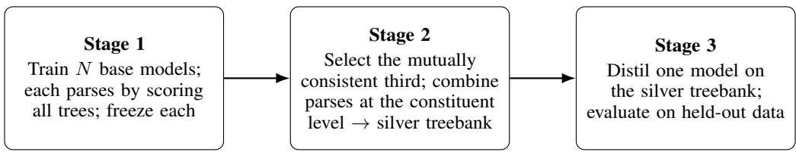
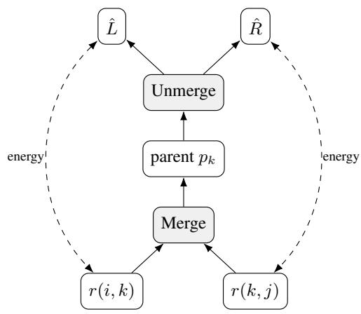
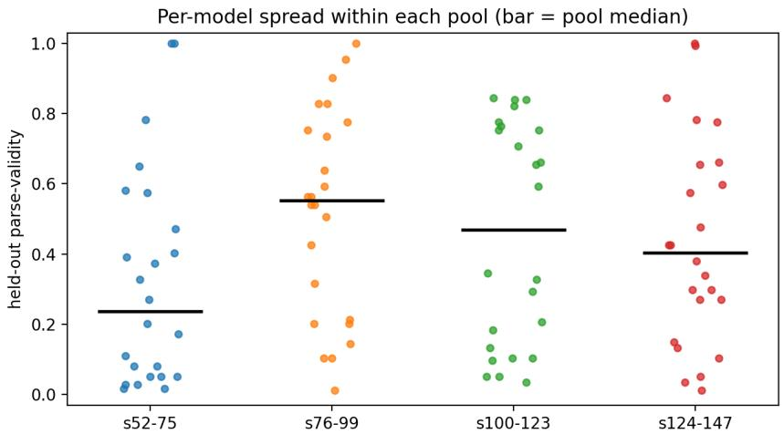
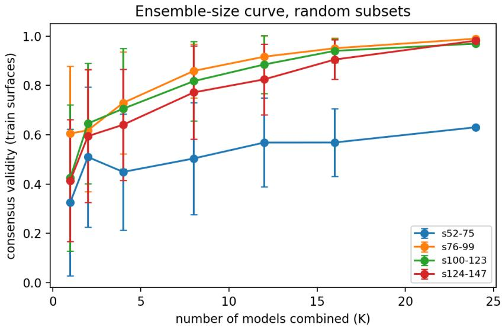
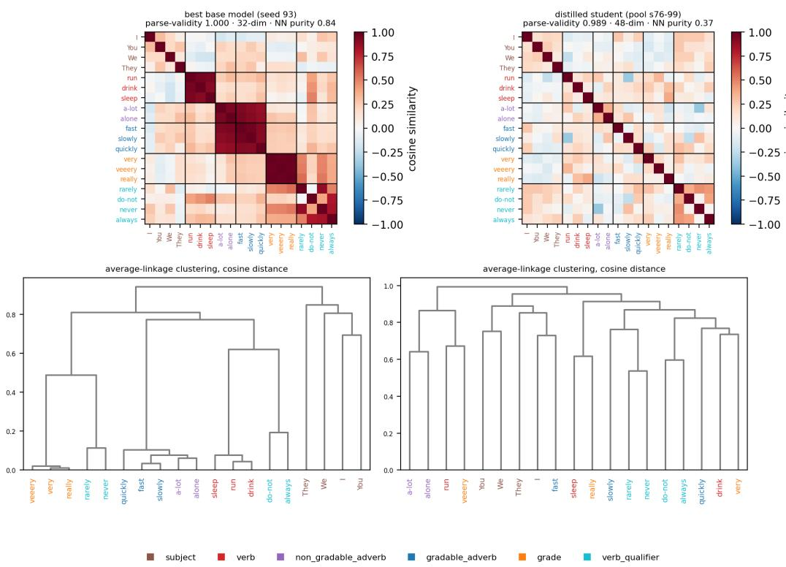
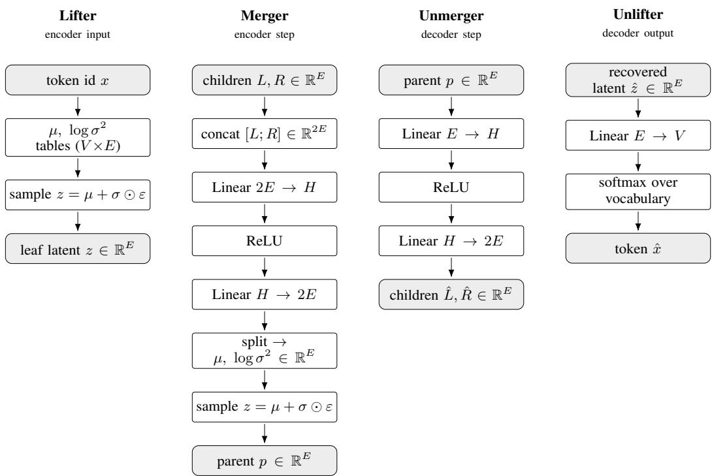

# HIERARCHICAL TOKEN MERGING WITH RECURSIVE AUTOENCODERS FOR UNSUPERVISED GRAMMAR INDUCTION

Murat Guney Kemal   
Department of Computer Science   
Durham University   
murat.guney.kemal@outlook.com   
Robert Lieck   
Department of Computer Science   
Durham University   
robert.lieck@durham.ac.uk

## ABSTRACT

Hierarchical abstraction is a fundamental principle across many data modalities, enabling complex sequences to be represented compositionally at multiple levels. Learning such hierarchies directly from data, without explicit structural supervision, remains a central challenge in representation learning. We investigate whether meaningful hierarchical structure can emerge from compression alone. While autoencoders learn compressed representations through reconstruction, this objective does not necessarily favour meaningful compositional structure. We study this challenge through unsupervised grammar induction, where the underlying hierarchy can be evaluated explicitly. We introduce a hierarchical token-merging autoencoder that recursively combines adjacent tokens into increasingly abstract representations, compressing entire sequences through a variational information bottleneck. The model jointly learns representations and hierarchical structure by marginalising over possible binary trees using dynamic programming. To address training instability, we combine independently trained models through unsupervised consensus and distillation. Experiments on a synthetic, ambiguous grammar demonstrate the emergence of meaningful hierarchical structure without structural supervision. The resulting model achieves 93% grammatical parse-validity and 93% exact reconstruction on held-out sequences, compared with 42% parse-validity for the strongest trivial baseline. These findings establish a proof of concept for hierarchical token merging as a mechanism for unsupervised structure discovery and abstraction learning.

## 1 INTRODUCTION

Language is compositional, and so are many other kinds of sequence. Small units combine into larger ones hierarchically, and those into larger ones again. Recovering that structure without annotation would be useful, because the treebanks that supervised parsers rely on are expensive to build and specific to one language and domain, and because whether grammatical structure can emerge with no supervision at all is a question of independent scientific interest. The question we study is whether a model can find constituent structure in raw token sequences, with no labelled trees to learn from, with an information bottleneck as the only pressure towards structure.

This is hard for two reasons. First, a plain reconstruction objective is grammar-agnostic. An autoencoder that only has to reproduce its input is rewarded for whatever structure is easiest to reconstruct, which may not be the grammatical one. Second, the structure is a discrete object from a large space, since a sentence of n tokens has exponentially many binary trees; learning the representations and searching that space at the same time is unstable. Models that induce latent trees often do well on their task without recovering structure that matches human annotations (Williams et al., 2018), so reconstructing or predicting well is not the same as parsing well.

We avoid choosing a tree at all. Instead of deciding which pair to merge, the model scores every binary tree at once with an inside chart, a dynamic program that sums over all trees in cubic time, and reads a single parse off the chart only at test time. The merge stays a hard decision, made differentiable with a straight-through estimator. The pressure towards structure comes from the variational bottleneck. We hypothesise that when a whole sentence has to pass through one small vector, merging it along its grammatical constituents has the lowest reconstruction and compression cost, so the model comes to prefer grammatical structure because it compresses well, not because we supervise it. It is never shown a single tree, so it becomes a parser implicitly, as a by-product of learning to compress.

This leads to our research question. Can a token-merging autoencoder induce grammatical structure from raw tokens with no supervision, by scoring all possible trees at once, and ifthat induction works but is unstable, can the instability be removed without reintroducing supervision?

We make the following contributions.

• We show that a token-merging autoencoder can induce grammatical structure from raw tokens with no supervision, and from a deliberately minimal self-supervision (compression through a variational bottleneck alone, with no outside pass and no reconstruction of words from their context), by marginalising over trees rather than choosing a merge. In the best runs it recovers the grammar with held-out parse-validity of 1.00.

• We show that a single model is unreliable. Its induction is what we call a seed lottery. With identical data and configuration, held-out parse-validity ranges from 0.01 to 1.00 depending only on the random seed, and even the best-parsing models reconstruct poorly, because the tight bottleneck that drives them to find structure also costs them the ability to reproduce their input.

• We find that combining many models at the level of individual constituents (span-based minimum Bayes risk, span-MBR) beats combining whole trees, which matters on ambiguous data where good models disagree over equally valid parses. Shayegh et al. (2024) use the same combination for ensembles of unsupervised parsers; we show it remains effective when the members are runs of one model whose quality ranges from 0.01 to 1.00.

• To make the method robust despite that lottery, we build a pipeline that trains many models, selects the mutually consistent ones, combines them and distils the result into a single model that reaches a mean held-out parse-validity of 0.93 and also reconstructs its input, which no single stage does alone.

• We report a seven-pool robustness study, varying both the random seed and the data split, showing that unsupervised selection mainly raises the weakest pools rather than improving every pool.

• We find that, under the training schedules we tested, a single model does not reach both grammar and reconstruction, because the two objectives compete for its capacity, so in our setting the two-stage separation of induction from reconstruction is necessary rather than merely convenient.

• We find that the two stages learn the grammar differently. The chart-trained base model, under the compression bottleneck, organises its vocabulary by syntactic category as it discovers constituents, whereas the distilled student reaches the same parse accuracy without clustering its word embeddings by category, so category structure is a by-product of how structure is induced, not a prerequisite for parsing.

Two caveats bound these claims, and Section 4.8 takes up both in full. The reported results are a distribution over independently seeded pools rather than a single number, and one hyperparameter, the number of models retained, was chosen with knowledge of gold-scored results. Gold trees, by contrast, are used only to evaluate the final model, never in training, model selection, or the combination of the models’ parses (the consensus).

Section 2 places the method among grammar induction, chart-based marginalisation and neural latent-tree models. Section 3 describes the autoencoder, the chart, and the pipeline that turns many models into one. Section 4 presents the experiments, the aggregation choice, the seed lottery, the combiner, the seven-pool result and what the latent space encodes, and closes with the limitations and future work. Section 5 answers the research question.

## 2 RELATED WORK

We survey six literatures that bear on the method. They are unsupervised grammar induction, chart-based marginalisation over trees, neural latent-tree induction, the structured-autoencoder and discrete-latent machinery the model is built from, the separate token-merging line in the efficiency literature that shares our name, and the consensus-decoding and distillation methods our pipeline uses to combine models. We took two papers as anchors, the DIORA inside-outside autoencoder and the Recursive Bayesian Network framework, and followed citations forward and backward from each, supplementing with keyword searches for the individual components (variational bottleneck, straight-through estimation, minimum Bayes risk decoding, knowledge distillation).

## 2.1 GRAMMARS, CONSTITUENCY AND STRUCTURE INDUCTION

Grammars describe how sequences decompose into nested constituents. A context-free grammar rewrites symbols into strings of symbols, and a probabilistic context-free grammar (PCFG) attaches a probability to each rule, so a sentence has a distribution over parse trees rather than one. The main difficulty for evaluation is ambiguity. A single surface (token sequence) can have several valid parses, so a model may be right and still not match the one tree a corpus happens to record. This shapes how we evaluate, and we come back to it in Section 4.1. Unsupervised induction of such grammars has a long history. The inside-outside algorithm estimates a PCFG by expectation-maximisation (Baker, 1979); the constituent-context model induces bracketings from the distributions of spans and their contexts (Klein & Manning, 2004); and neural and compound PCFGs parameterise the rule probabilities with neural networks, which induces better grammars than classical PCFG estimation (Kim et al., 2019; Yang et al., 2021). All of these learn an explicit symbolic grammar. Our model learns no rules. Structure is a by-product of compressing the sequence, and there is no grammar to read off, only a tree per sentence.

## 2.2 MARGINALISING OVER TREES WITH CKY, THE INSIDE ALGORITHM AND RECURSIVE BAYESIAN NETWORKS

To score structure without choosing it we use a chart. The Cocke-Younger-Kasami recogniser fills a table over spans and, for each span, combines the analyses of its sub-spans (Younger, 1967); the inside algorithm makes this probabilistic, summing over all derivations of a span in cubic time (Baker, 1979). That sum is a differentiable function of the local scores, so a chart can be embedded in a neural model and be trained by gradient descent. Recursive Bayesian Networks (RBNs) generalise the idea (Lieck & Rohrmeier, 2021). They unify PCFGs, which have discrete symbols and tree structure, with dynamic Bayesian networks, which have continuous latents and chain structure, and they extend inside and outside probabilities to continuous latent variables. Our chart is an RBN inside pass whose latent at each span is a neural embedding. The framework also suggests an explanation for the seed instability we report in Section 4.3. Marginalising over exponentially many structures turns the objective into a mixture with one component per structure, which is non-convex, so gradient descent is not guaranteed to reach the global optimum, and optimising the representations and the structure in turn (as expectation-maximisation does) is not the same as optimising them together, as our model does. We interpret the seed dependence in Section 4.3 as a consequence of this non-convexity.

## 2.3 NEURAL LATENT-TREE INDUCTION

The closest prior work is DIORA, an unsupervised inside-outside recursive autoencoder (Drozdov et al., 2019). DIORA composes span representations with a soft, compatibility-weighted average on the inside pass, runs an outside pass that reconstructs each word from its context, and reads a tree off the chart at test time. On the full Wall Street Journal corpus it reaches an unlabelled constituency F1 of 55.7 on average against a right-branching baseline of 16.5, and it varies little across seeds (about ±0.5 F1). Our chart differs from it in four ways. It is inside-only, so we drop the outside pass. It aggregates a span with a hard straight-through choice instead of a soft blend, so a span is one analysis and not a mixture of all of them. It reconstructs the whole sentence from a single root vector through a variational bottleneck, instead of predicting each word from its local context, so it has an explicit information bottleneck where DIORA has none. And its objective, which must reconstruct the whole sentence from a single bottlenecked vector, is not seed-stable where DIORA is; the ensemble and distillation stages of our method are designed to compensate for that instability (Section 4.3). Other neural models induce a latent tree jointly with a downstream objective (Yogatama et al., 2017; Choi et al., 2018; Havrylov et al., 2019), and syntax-aware sequence models bias recurrent networks toward hierarchy without an explicit chart (Shen et al., 2018; 2019). Williams et al. (2018) show that latent-tree learners can do well on their end task while the trees they induce do not match meaningful structure. Accordingly, our evaluation reports grammatical validity rather than claiming linguistic correctness.

## 2.4 STRUCTURED AUTOENCODERS AND DISCRETE LATENT VARIABLES

Our model combines several standard components. Recursive autoencoders learn representations of tree nodes by encoding and decoding their children (Socher et al., 2011b), and the recursive neural network that first built trees for scenes and language did so by greedily merging the adjacent pair with the best composition score (Socher et al., 2011a). We keep the recursive merge of adjacent pairs but replace the greedy score with marginalisation over all trees. The bottleneck is a variational autoencoder (Kingma & Welling, 2014); its β-weighted form sets the weight of the penalty on the latent’s divergence from its prior, and hence how much information the latent retains (Higgins et al., 2017); we rely on this penalty to favour structured encodings. To keep the merge a hard decision while still training by gradient descent we use continuous relaxations of discrete variables, the Gumbel-softmax or Concrete distribution (Jang et al., 2017; Maddison et al., 2017), with the straight-through estimator that passes a hard sample forward and a soft gradient backward (Bengio et al., 2013). We reuse these components unchanged. What is new is not any one of them but their combination, a chart-based merge autoencoder in which a compression bottleneck, rather than any label, is what drives the structure.

## 2.5 TOKEN MERGING IN THE EFFICIENCY LITERATURE

The name token merging also appears in a different literature, where tokens are merged to reduce the computational cost of transformers, not to recover structure. Spectrum-preserving merging (Tran et al., 2024) and agglomerative token clustering (Haurum et al., 2024) are recent examples, and one method, dynamic hierarchical token merging for vision transformers (Haroun et al., 2025), shares the name of our method.1 Closer to our method, a line of work learns where to split a sequence end-to-end, as in dynamic chunking for hierarchical sequence modelling (Hwang et al., 2025); like our model, it learns the hierarchy end-to-end, but its objective is language modelling rather than structure recovery.

## 2.6 CONSENSUS DECODING AND DISTILLATION

The ensemble stage of our method builds on two ideas. Minimum Bayes risk decoding returns not the single highest-scoring structure but the one that minimises expected loss under a distribution over structures; for trees that means maximising the expected number of correct constituents (Goodman, 1996), which is why combining candidate parses span by span behaves differently from voting over whole trees. A span-level combination can return a tree that no single model proposed, whereas a whole-tree vote cannot. Ensembling independent models reduces variance, and knowledge distillation compresses an ensemble into one model (Hinton et al., 2015). We use both, with one difference. Our ensemble is a set of independently seeded parsers combined once, offline, into a single set of silver trees (machine-produced trees used as training targets in place of gold annotations), not an ensemble queried at test time.

The closest prior work on this side of the method is Shayegh et al. (2024), who combine an ensemble of different unsupervised parsers by searching, for each sentence, for the binary tree that shares the most constituents with the members’ trees, and then distil the result into a single student. Our consensus is the same construction. What differs is the ensemble. Ours consists of repeated runs of one model whose quality ranges from failing to perfect, and we choose which members to keep without supervision.

  
Figure 1: The three-stage pipeline. The same architecture is used as the base model in Stage 1 and as the distilled model in Stage 3; only Stage 1 uses the chart, while Stage 3 trains on the fixed silver trees.

## 2.7 SUMMARY AND GAP

In our work we build a token-merging autoencoder that induces structure from a compression bottleneck alone, together with a CKY inside pass that lets it score every tree instead of choosing one. This induction succeeds in some runs but varies strongly across seeds, so a single model is a seed lottery. To turn that into one reliable parser we combine many models and distil the result into one, an approach also taken by Shayegh et al. (2024). The rest of the paper describes the method and reports both what it does and where it is fragile.

## 3 METHOD

## 3.1 OVERVIEW

The task is to recover the constituent structure of a sentence without being shown any structure during training. We work with sentences of between two and eight tokens drawn from a small probabilistic grammar in which many sentences have more than one valid parse. Bounding the length keeps the number of possible binary trees small enough to enumerate exhaustively at evaluation time. Section 4.1 describes the data in full.

The pipeline uses a single architecture for two different jobs. That architecture, which we call the base model, is a variational autoencoder built from four networks, a lifter, a merger, an unmerger and an unlifter. Figure 1 shows how the three stages fit together.

In the first stage we train N independently initialised base models and freeze each one when training ends. Its learning rate decays to near zero by step 2,500, after which its weights are fixed (Section 3.3.4). Every base model learns to compress a sentence into a single vector by repeatedly merging adjacent pairs, choosing the merge order for itself. Trained with a tight bottleneck (a Kullback–Leibler (KL) weight of $\beta = 0 . 0 4$ , Table 2), these models become good parsers but poor reconstructors. They recover the grammar while losing the ability to reproduce the input tokens. Their quality also varies sharply between runs, even though every model sees identical data and differs only in its random initialisation and the order in which it receives the training examples. That variability is why we train many models rather than one (Section 4.3).

In the second stage every frozen model parses the training sentences. We keep the third whose parses are most often identical to those of the other models (peer agreement, Section 3.4), on the assumption that models which have found the grammar tend to agree with one another while failed models disagree in idiosyncratic ways. The retained models then vote on individual constituents rather than on whole trees, and a dynamic program assembles the best-supported constituents into one tree per sentence. The result is a single silver treebank.

In the third stage we train one fresh base model on the silver treebank. The structure is now fixed, so the model no longer has to discover how to bracket a sentence and can instead devote its capacity to the merge and unmerge operations. This distilled model uses a weaker bottleneck than the others $( \beta = 0 . 0 0 2$ and a larger latent) and is the one we evaluate on held-out sentences.

## 3.2 THE TOKEN-MERGING AUTOENCODER

We designed the base model as a recursive β-VAE whose decoder is guided by the tree along which the encoder has merged. The model has four neural networks, a lifter, a merger, an unmerger and an unlifter. The lifter maps tokens into the embedding space. We then apply a single merger recursively, first to the leaf tokens and then to the intermediate constituent representations it produces, and this is the encoder. Similarly we apply a single unmerger recursively to the root latent, and this is the decoder. The unlifter maps the recovered latents to a distribution over the vocabulary, from which the output tokens are predicted.

While training the base models we score all trees with the chart (Section 3.3) rather than committing to a single one, so every split of every span receives a gradient, rather than only the splits of one chosen tree. We kept the base model deliberately simple, so that we could test whether the architecture induces grammar at all rather than to maximise capacity; a small model also makes ablations easier to interpret.

## 3.2.1 THE FOUR NETWORKS

The lifter maps each token to a latent and is stochastic, with two embedding tables giving a mean and a log-variance and the latent sampled by the reparameterisation trick, so a word is a distribution rather than a point. The merger is the encoder step, a small multilayer perceptron that takes a left and a right latent and outputs the mean and log-variance of their parent, a latent with the same dimension and prior as a leaf latent, so one merger runs at any depth of the tree. The unmerger is the decoder step, a deterministic network trained to approximately invert the merger, mapping a parent back to a predicted left and right child. The squared error between its predictions and the actual children measures how invertible a merge is, and this same quantity scores the candidate splits in the chart (Section 3.3). The unlifter is a single linear layer from a latent to scores over the vocabulary, kept deliberately weak so the model cannot use a powerful decoder to compensate for a poorly chosen structure. The full architecture is shown in Appendix A.

## 3.2.2 BOTTLENECK AND TRAINING ON A FIXED TREE

The forward pass on a given tree has two parts. We first map every token to a latent with the lifter, then apply the merger bottom-up along the tree until a single root latent remains. Decoding works back down the same tree through the unmerger, and finally the unlifter turns each recovered leaf latent into a distribution over the vocabulary.

The decoder starts from the root latent alone and is given none of the encoder’s intermediate latents. This forces the model to compress, and our assumption is that the lowest-cost way to encode a sentence in one vector is to merge it along its grammatical constituents. If we carried the encoder’s intermediate latents across, the model could reconstruct without compressing and there would be no pressure to find structure.

We regularise both leaf latents and merged latents toward the same $N ( 0 , I )$ prior. We chose a shared prior so that the KL is measured on the same scale at every level of the tree, and so that a single merger can operate at any level; in the objective below this KL is weighted by $\beta .$

On a given tree we minimise three terms:

$$
{ \mathcal { L } } _ { \mathrm { t r e e } } = \gamma \operatorname { C E } ( { \hat { x } } , x ) + \eta { \frac { 1 } { | M | } } \sum _ { m \in M } \left( \| { \hat { L } } _ { m } - L _ { m } \| ^ { 2 } + \| { \hat { R } } _ { m } - R _ { m } \| ^ { 2 } \right) + \beta \operatorname { K L } .\tag{1}
$$

Here x is the input sentence and xˆ its reconstruction; M is the set of merge nodes; $L _ { m }$ and $R _ { m }$ are the child latents at node $m$ and $\hat { L } _ { m } , \hat { R } _ { m }$ the unmerger’s predictions; and KL is the KL divergence from $N ( 0 , I )$ averaged over the leaf posteriors plus the same quantity averaged over the merge posteriors. The reconstruction cross-entropy, weighted by $\gamma _ { : }$ , is the main training signal for the encoder. The one-step term, weighted by $\eta$ and averaged over merge nodes, asks each parent to be invertible into its own children; it is computed on the upward pass as each parent is formed. The KL, weighted by $\beta ,$ is a price per unit of information kept in a latent, so that only what is necessary is retained.

When we compute the one-step term we detach the gradients of the parent and of both target children, so that the only network left in the gradient path is the unmerger. This term trains the unmerger and never reaches the merger or the lifter. We chose this to stop the encoder from preferring merges that are easy to reverse one step at a time rather than merges that compress well; otherwise the encoder could lower the loss with merges that are locally invertible but do not follow constituent structure, bypassing the bottleneck. So the encoder is shaped only by the root reconstruction and the KL.

This objective needs a tree to be given, which the base models do not have. Section 3.3 removes that requirement by scoring every tree instead of choosing one. We return to Equation 1 only for the distilled student, once the consensus supplies the trees (Section 3.5).

## 3.3 INDUCING STRUCTURE BY MARGINALISING OVER TREES WITH THE CKY INSIDE CHART

We remove the need for a given tree with an inside chart. Instead of deciding which pair to merge, we score every binary tree at once. Scoring each tree separately would take exponentially many passes, but trees share sub-analyses, so a chart computes each span once and covers all trees in $O ( \bar { n } ^ { 3 } )$ time. Training raises the score of trees whose merges can be inverted with low error. Figure 2 shows one chart cell.

## 3.3.1 THE INSIDE RECURSION

The unit of the chart is a span, a contiguous stretch of the sentence, and each span carries a score and a representation. At a single token the representation is the lifter’s latent and the score is zero. For a longer span, every split point is one way the span could have been built, and each split produces its own candidate parent. We score a split much as we compute the one-step term, except that only the parent is detached, so this score also trains the representations of the two child spans. We merge the two child spans, unmerge the result, measure the squared error against the two children, and negate it. A split’s total score adds the two child-span scores to this local score,

$$
s ( i , j ) = \log _ { i < k < j } \exp \Big [ s ( i , k ) + s ( k , j ) - \big ( \| \hat { L } - r ( i , k ) \| ^ { 2 } + \| \hat { R } - r ( k , j ) \| ^ { 2 } \big ) \Big ] ,\tag{2}
$$

where $r ( i , j )$ is the representation of span $( i , j )$ and ${ \hat { L } } , { \hat { R } }$ are $\operatorname { U n m e r g e } ( \operatorname { M e r g e } ( r ( i , k ) , r ( k , j ) ) )$ with base case $s ( i , i + \mathbf { \bar { 1 } } ) = 0$ . The span’s score is the log-sum-exp of its splits, which sums over all trees rooted at that span, so the root score $s ( 0 , n )$ aggregates, over all trees rather than one we picked, how accurately each merge can be inverted. Maximising it therefore trains the model on every tree at once, each tree contributing to the gradient in proportion to its exponentiated score.

## 3.3.2 STRAIGHT-THROUGH AGGREGATION

Two different quantities are involved here, and only one of them is soft. The span score is a soft sum, the log-sum-exp over splits of Equation 2, which is what keeps the objective differentiable. The representation passed up from a span, however, must be a single vector, so for it we select one split with a hard Gumbel sample on the forward pass while letting the gradient flow through the soft weights. This is the straight-through estimator. The score is therefore soft while the chosen merge stays a genuine discrete decision. The Gumbel temperature is annealed from 2.0 to 0.5 over 10,000 steps; since the base models train for only 2,500 steps, the temperature only falls from 2.0 to about 1.63 during their training, the high, exploratory part of that schedule. We accumulate only the selected split’s KL, since the same hard weights choose both the representation and its KL. Two alternatives are available, a plain argmax and a soft blend over the candidate splits. We compare all three and justify this choice in Experiment 1.

## 3.3.3 EXTRACTING A PARSE

While filling each cell the chart also records which split scored highest. To read off the model’s parse we follow these back-pointers down from the root, so one mechanism gives both the training signal (a sum over trees) and a single parse at test time (an argmax over trees); at test time we replace the Gumbel sample with a plain argmax, which makes parsing deterministic. Throughout, the chart uses the latent means, so it is deterministic, and $\beta$ pulls the means towards zero and the variances toward one without adding sampling noise to the chart.

  
Figure 2: One chart cell for span $( i , j )$ at split k. The two child spans are merged into a candidate parent, which the unmerger tries to invert; the negative squared error $( ^ { 6 6 } \mathrm { e n e r g y } ^ { , 3 } )$ is the local score. The span score is the log-sum-exp over splits, and the highest-scoring split is stored as a back-pointer for parsing.

## 3.3.4 TRAINING OBJECTIVE FOR THE BASE MODELS

The base models have no given tree, so we train them with a different objective that scores every tree with the chart:

$$
{ \mathcal { L } } _ { \mathrm { c h a r t } } ~ = ~ - \lambda \mathbb { E } _ { x } { \big [ } s ( 0 , n ) { \big ] } ~ + ~ \gamma \operatorname { C E } ( { \hat { x } } , x ) ~ + ~ \beta \operatorname { K L } .\tag{3}
$$

It has three self-supervised terms. It maximises the root inside score (weight λ), reconstructs the leaves after decoding the highest-scoring (argmax) tree from the root representation (weight γ), and applies the KL (weight β). Unlike Equation 1, the one-step reconstruction is not a separate term here; it lives inside the chart recursion as the local score of Equation 2. Equations 1 and 3 are two different objectives used at two stages. Equation 3 trains the base models, which have no tree, and Equation 1 trains the student, once the trees are given.

A base model’s held-out parse-validity often peaks early in training and can decline as training continues. Rather than prevent this decline, we end training early. The learning rate is held constant for the first 1,500 steps and then decayed along a cosine to near zero by step 2,500, so the parameters stop changing at whatever solution has been reached. This is a practical measure, not an explanation of the decline, and Section 4.3 reports the instability that motivates it.

## 3.4 FROM MANY PARSERS TO ONE TREEBANK

We train many base models as parsers, because even with the same training set their quality varies. Because we want to keep the method unsupervised, we cannot score them all against gold trees and keep the best; instead we select the best ones without supervision and then combine their parses. To select, we rank the models by their mean agreement with every other model, where the agreement of two models is the fraction of training sentences on which their parse trees are identical (peer agreement), and keep the third with the highest peer agreement. We use this because we assume that bad models fail in mutually disagreeing ways while good models converge on similar, correct parses, so agreement is a usable proxy for quality. To combine, each selected model votes for the constituents in its parse of each sentence, and we build the silver tree from the bracketing with the most total span support, where the support of a span is the number of selected models whose tree contains it, which is minimum Bayes risk decoding at the level of constituents (Goodman, 1996). We work at the level of constituents rather than whole trees because, on ambiguous data, two good models may produce different but equally valid trees; a whole-tree vote would split their support and could discard a good model, whereas a constituent-level vote lets partially agreeing models reinforce the spans they share (Section 4.4). Finally, we use agreement only to select the models and then let them vote uniformly, since agreement already decides which models are retained, and weighting by it as well would further favour the models closest to the majority, whether or not the majority is correct.

## 3.5 DISTILLATION INTO A SINGLE MODEL

The consensus gives us a silver treebank, one tree for every training sentence. We train a fresh student model on it with our fixed-tree objective (Equation 1), teacher-forced on the silver trees, that is, trained with each silver tree given as the merge order. We distil a student because the base models are good parsers but poor reconstructors, a consequence of the tight bottleneck that forces them to find structure. Fixing the structure first lets the student devote its capacity to reconstruction rather than on discovering how to bracket a sentence. The two stages therefore act as a curriculum. A tight bottleneck in the first stage induces the grammar at the cost of reconstruction, and a looser bottleneck in the second stage learns to reconstruct on the now-fixed trees. Grammar discovery and reconstruction are separated in time rather than traded off inside one model, using the same architecture under different objectives at the two stages. Whether one model could instead do both on its own, by training longer or loosening its bottleneck rather than separating the stages, is tested directly in Experiment 6. The student is given a larger latent (embedding dimension 48), a smaller KL weight $( \beta = 0 . 0 0 2 )$ and a longer schedule (12,000 steps) than the base models. The reconstruction this recovers is reported in Experiment 4, and the sweep of the student’s KL weight that places this value on the reconstruction-favouring end of the trade-off in Experiment 5.

## 4 EXPERIMENTS

We report six experiments. The first fixes the way the chart aggregates a span. The second measures how a single base model behaves and exposes the seed lottery. The third studies how the base models should be combined. The fourth is the main result across seven independent pools. The fifth asks what the latent space represents. The sixth asks whether a single model trained longer under different learning-rate and KL schedules could replace the two-stage design. A shared setup precedes them, and a section on limitations and future work follows.

## 4.1 SETUP

Our grammar is a small ambiguous probabilistic grammar in the style of English, with 19 terminal words in six categories (subjects, verbs, gradable adverbs, non-gradable adverbs, grade modifiers and verb qualifiers) and 7 non-terminals. Its ambiguity comes from recursive rules. A grade may modify a grade, and a verb may take qualifiers and adverbs, so many surfaces have several distinct valid parses. 63.1% of surfaces admit more than one, and the average surface admits 4.34. Ambiguity grows sharply with length. Sentences of length two and three are unambiguous, while at length eight 94.8% of surfaces are ambiguous and the average admits 10.8 parses. Sentences are of length 2 to 8, sampled by derivation, so each comes with the gold tree that generated it. A single surface can occur as several sentences, one for each distinct derivation the grammar assigns it, so the number of sentences exceeds the number of distinct surfaces. We split by surface, holding out 10% of the distinct surfaces at each length; this gives 1370 distinct surfaces in total, which yield 1510 training and 174 held-out sentences.

We evaluate the distilled model with three metrics. Parse-validity is the fraction of held-out sentences whose predicted tree is a valid parse under the grammar (the baselines in Table 1 are averaged over surfaces instead). Recon-exact is the fraction whose tokens, decoded from the single root vector along the tree with the lowest $\mathcal { L } _ { \mathrm { t r e e } }$ , are recovered exactly. Gold-match is the fraction whose predicted tree equals the sentence’s gold tree. Parse-validity is our primary metric, because our aim is to recover any valid analysis rather than one particular tree; gold-match is deliberately stricter, since under ambiguity the model can pick a different but valid parse, and it tells us how often it recovers the exact sampled tree. Gold trees are used only in evaluation, never in training, selection, or the consensus.

We also report the standard unlabelled bracketing F1 in Section 4.5, but treat it as secondary. Under an ambiguous grammar F1 against a single gold tree is a lower bound rather than a measure of correctness, since a model that returns a different but equally valid parse is penalised for the sampler’s arbitrary choice. Parse-validity and gold-match instead give upper and lower bounds on correctness (validity credits any valid analysis, gold-match demands the exact sampled one), and because the grammar is small enough to enumerate, both are computed exactly rather than estimated. We take recovering a valid constituent structure as the target, which is what parse-validity measures.

Table 1: Baselines on the held-out set (137 surfaces). “Random” is the exact expected validity of a uniformly random binary tree, obtained by enumeration rather than sampling. Overall figures are averaged over surfaces.
<table><tr><td></td><td>Overall</td><td>L=3</td><td>L=4</td><td>L=5</td><td>L=6</td><td>L=7</td><td>L=8</td></tr><tr><td>Random binary tree</td><td>0.150</td><td>0.500</td><td>0.256</td><td>0.137</td><td>0.094</td><td>0.046</td><td>0.027</td></tr><tr><td>Left-branching</td><td>0.007</td><td>0.000</td><td>0.000</td><td>0.000</td><td>0.000</td><td>0.000</td><td>0.000</td></tr><tr><td>Right-branching</td><td>0.416</td><td>1.000</td><td>0.800</td><td>0.360</td><td>0.320</td><td>0.240</td><td>0.080</td></tr></table>

Table 2: Hyperparameters for the base models and the distilled student. Each pool trains 24 base models, of which the 8 with the highest peer agreement are selected; results are reported over seven independent pools. The KL weight is warmed up, so the base models, which stop at step 2500, end at β ≈ 0.032.
<table><tr><td>Hyperparameter</td><td>Base model</td><td>Student</td></tr><tr><td>Embedding dimension</td><td>32</td><td>48</td></tr><tr><td>Hidden dimension</td><td>128</td><td>128</td></tr><tr><td>Learning rate</td><td>2 × 10 -3</td><td>2 × 10−3</td></tr><tr><td>Training steps</td><td>2500</td><td>12000</td></tr><tr><td>Batch size</td><td>32</td><td>32</td></tr><tr><td>KL weightβ</td><td>0.04</td><td>0.002</td></tr><tr><td>KL warm-up</td><td></td><td>0.2β to step 1000, then linear to β by step 3000</td></tr><tr><td>Root-score weight λ</td><td>0.2</td><td></td></tr><tr><td>Reconstruction weight γ</td><td>5.0</td><td>5.0</td></tr><tr><td>One-step weight η</td><td></td><td>1.0</td></tr><tr><td>Gumbel temperature</td><td>2.0 → 0.5 over 10000</td><td></td></tr><tr><td>LR schedule</td><td>hold then decay</td><td>constant</td></tr></table>

A validity score is only meaningful against a baseline, so we measure three. Because sentences are short enough to enumerate every binary tree exhaustively, the random-tree baseline can be computed exactly rather than sampled; for each surface it is the number of valid parses divided by the number of binary trees over its tokens. Table 1 gives all three on the held-out set. Right-branching is the strongest (0.416, against 0.150 for a random tree), which is expected because the top-level rule splits off a one-word subject and the qualifier and grade rules recurse to the right, and it is the reference baseline for the rest of the paper. The per-length breakdown matters more than the aggregate. Right-branching is perfect at length three and falls to 0.080 by length eight, while a random tree falls from 0.500 to 0.027. Everything we report later should be read against those columns, because the difficulty grows sharply with length.

We implement the whole pipeline in PyTorch and run it on the department’s GPU cluster. A pool is one run of the full pipeline, consisting of 24 base models trained from different random seeds and the student distilled from them. The hyperparameters are given in Table 2.

Three implementation constraints shaped the experiments. The chart is cubic in sentence length and is built in Python for every training step, which is the dominant cost and the reason sentences are capped at length eight; sentences are grouped by length within a batch so that each group can be charted as a single tensor operation. Evaluation is more expensive than training, because scoring reconstruction requires enumerating every binary tree of a sentence and running the model over each one, which is tractable only under the same length cap. Finally, the chart runs on the latent means rather than on samples (Section 3.3); only the student, which trains on fixed trees, samples its latents.

Table 3: Aggregation ablation. Twenty-four base models per mode on matched seeds and one data split, so initial weights and batch order are identical within each row and only the aggregation rule differs. Base-model figures are medians over the twenty-four models; consensus and student figures are for the pipeline built from them.
<table><tr><td>Aggregation</td><td>Base validity</td><td>Base recon.</td><td>Consensus</td><td>Student validity</td><td>Student recon.</td></tr><tr><td>Straight-through</td><td>0.552</td><td>0.147</td><td>0.985</td><td>0.989</td><td>0.943</td></tr><tr><td>Hard (argmax)</td><td>0.328</td><td>0.233</td><td>0.981</td><td>0.994</td><td>0.925</td></tr><tr><td>Soft (blend)</td><td>0.443</td><td>0.118</td><td>0.931</td><td>0.948</td><td>0.920</td></tr></table>

## 4.2 EXPERIMENT 1, CHOOSING THE AGGREGATION MODE

Setup. The chart can pass a representation up from a span in one of three ways, the straight-through hard sample we use, a plain argmax, or a soft blend that averages the candidate splits under a softmax over their scores. We ran the full pipeline once per mode on the same twenty-four seeds and the same data split, so that only the aggregation rule varied. As a control, the straight-through run reproduces the base models of pool 76–99 exactly, confirming that the three runs were otherwise identical.2

Results. At the level of the individual base model, straight-through gives the highest median parsevalidity, 0.552 against 0.443 for the blend and 0.328 for the plain argmax. The blend is the worst reconstructor at 0.118. At the level of the finished pipeline the three modes largely converge, and the distilled students differ by less than one held-out sentence between straight-through and argmax.

Discussion. We keep straight-through for two reasons. It gives the best base models and the best final reconstruction, and it is the only one of the three in which the merge is a hard decision and still receives a gradient, since a plain argmax passes no gradient through the representation it selects, and a soft blend makes no hard decision. Although averaging incompatible splits cannot represent any single tree, the pipeline built on the soft blend still reaches a student validity of 0.948. That the finished pipeline is robust to all three choices is useful in practice, because the method does not depend on a delicate setting of the aggregation rule.

## 4.3 EXPERIMENT 2, A SINGLE MODEL AND THE SEED LOTTERY

Setup. We trained the four seed-varying pools of Experiment 4, 24 base models each on a single data split, with the same configuration throughout and only the random seed changing.

Results. The base models’ held-out parse-validity ranges from 0.01 to 1.00, and pool medians sit between 0.24 and 0.55, so the method can discover the grammar completely in its best runs while a single model is not reliable. Figure 3 shows the per-model spread across the four pools.

Discussion. Sweeps of the KL weight, embedding dimension, batch size and learning-rate schedule during development did not remove this volatility, which is why we combine 24 base models by selection, consensus and distillation. The spread is consistent with the Recursive Bayesian Network view (Section 2.2), where marginalising over structures gives a non-convex objective with one component per tree, so different seeds converge to different local optima and gradient descent is not guaranteed to find the best one. By contrast, DIORA reports low seed variance; we hypothesise that our single-vector bottleneck is the source of the instability, but we have not tested this.

## 4.4 EXPERIMENT 3, COMBINING MODELS

## 4.4.1 CONSTITUENT-LEVEL CONSENSUS VERSUS WHOLE-TREE VOTING

Setup. On each of the seven pools we combined the eight selected models both ways, span-based minimum Bayes risk, which the pipeline uses, and a whole-tree majority vote, and scored the resulting silver treebank against the grammar on the training surfaces. We also distilled a student on each silver treebank in turn, with training otherwise identical, to test whether the choice affects the distilled student.

  
Figure 3: The seed lottery. Held-out parse-validity of the 24 base models in each of the four seedvarying pools (labelled by their seeds, so s52-75 is pool 52–75). The spread within a pool is wide even though the models differ only in random seed.

Results. Span-MBR matches or beats the vote in all seven pools, raising the mean consensus from 0.867 to 0.933, with a worst case of an exact tie rather than a regression. The gain concentrates where the whole-tree vote is weakest. In pool 52–75 the vote returns only 0.616 even though the pool contains a model with parse-validity 1.000 on the training surfaces, and combining at the constituent level lifts that pool to 0.887. The whole-tree vote never beats its own best member in any of the seven pools. The advantage carries over to the distilled student, as the span-MBR student matches or beats the whole-tree-vote student on held-out validity in all seven pools, by 0.068 on average and by 0.287 in pool 52–75.

Discussion. In pool 52–75 a whole-tree vote discards the trees of the best model, because the strong models agree on the constituents but disagree over which equally valid whole tree to report, so their support is split across different trees. A vote can only return a tree that some model already proposed, whereas span-MBR assembles the best-supported constituents into a bracketing that need not equal any single input tree. On ambiguous data, where good models often return different but equally valid trees, the combiner must therefore work on constituents; otherwise the student inherits the lower-quality treebank. This is consistent with Shayegh et al. (2024), who combine ensembles of different parsers in the same way.

## 4.4.2 HOW MANY MODELS, AND WHICH ONES

Setup. Two questions remain, how much of the benefit comes from combining many models and how much from combining the right ones. We separate them with two sweeps. The first, over the four seed-varying pools, adds models drawn at random, averaging sixty random subsets of each size (Figure 4). The second, over all seven pools, adds them in the order the selection rule picks, ranked by peer agreement (Table 4).

Results. Combining more models helps when they are drawn at random. Every pool improves with size, apart from one dip in pool 52–75 between two and four models, and the spread narrows sharply; in pool 76–99 the mean rises from 0.605 with a single model to 0.989 with all twenty-four, while the standard deviation across draws falls from 0.273 to zero. Combining the models the selection rule actually picks behaves differently. The curve is not monotone, and its shape differs between pools; pool 52–75 falls from 0.999 to 0.630 as models are added, while pool 100–123 rises from 0.863 to 0.969. Peer agreement, the signal the selection rule ranks by, tracks gold-scored parse-validity closely. Across the ninety-six models in the first four pools their rank correlation is 0.863 (Spearman), and it never falls below 0.838 in any single pool.

Discussion. The random-draw sweep shows the variance reduction expected of an ensemble. The two sweeps diverge because they do different things. Adding a random model adds diversity, whereas adding a peer-ranked model adds a model the ranking has already judged worse than everything above it, so once the highest-ranked models are included, each further model tends to lower the consensus. That peer agreement predicts gold-scored validity so well means an unsupervised quantity we can compute is a reliable stand-in for the supervised one we cannot. We therefore retain eight models. Eight is not the value with the best average, since retaining two is marginally better on the mean, but it is the value with the best worst case, and we prioritise the worst pool over the mean because the purpose of the pipeline is a reliable result from any pool. Retaining two gives up 0.048 in the worst pool to gain 0.018 on average. The choice is also insensitive; across the range from six to twelve models the average moves by only 0.012, so eight sits on a plateau rather than at a spike, which matters because the value was chosen with knowledge of these gold-scored results rather than on a separate development set (Section 4.8).3

Table 4: Consensus validity against the number of models retained, ranked by peer agreement, over all seven pools. Unlike Figure 4, which draws models at random, this adds them in decreasing order of peer agreement. K=8 is the value the pipeline uses.
<table><tr><td>Models retained</td><td>2</td><td>4</td><td>6</td><td>8</td><td>10</td><td>12</td><td>16</td><td>20</td><td>24</td></tr><tr><td>Mean over pools</td><td>0.951</td><td>0.903</td><td>0.928</td><td>0.933</td><td>0.931</td><td>0.920</td><td>0.884</td><td>0.899</td><td>0.887</td></tr><tr><td>Worst pool</td><td>0.796</td><td>0.796</td><td>0.819</td><td>0.844</td><td>0.797</td><td>0.716</td><td>0.663</td><td>0.682</td><td>0.630</td></tr></table>

  
Figure 4: Consensus validity against ensemble size when models are drawn at random, averaged over sixty draws per point, for the four seed-varying pools. Every pool improves with size, apart from one dip in pool 52–75, and the spread narrows. Compare Table 4, where models are added in order of decreasing peer agreement and the consensus does not rise with size.

## 4.5 EXPERIMENT 4, THE MAIN RESULT ACROSS SEVEN INDEPENDENT POOLS

Setup. We ran seven independent pools of 24 base models each (Table 5). Four vary only the random seed on a single data split and so measure initialisation and optimisation variance. The other three vary the data split as well. Our sampler is reseeded for each, so these are fresh draws of sentences from the same grammar rather than re-partitions of the same corpus, and the four distinct splits give held-out sets of 174, 171, 165 and 172 sentences. Together they separate the two sources of variability the result might have been sensitive to.

Results. Student results are similar under both sources of variation. Distilled students reach 0.839 to 0.989 across seeds and 0.855 to 0.994 across splits, and the two groups have almost the same mean. The pipeline reduces the 0.01 to 1.00 spread of single base models to 0.839 to 0.994, and redrawing the data does not widen it.

The students also reconstruct far better than the base models they are distilled from. Across the four seed-varying pools the median base model recovers its input exactly on only 0.147 to 0.198 of held-out sentences, and the worst on 0.023, whereas the students reach 0.925 to 0.971. This roughly fivefold gain comes from fixing the structure before learning to reconstruct, which is the point of training a second model with a looser bottleneck (Experiment 6 tests a single-model alternative).

Selection does not improve every pool; its benefit is concentrated in the weakest pools. Three pools are already strong without it, and on those it lowers the result, by up to 0.10 (pool 100–123 falls from 0.969 to 0.867). It raises the weakest pools instead. The worst pool, 52–75, improves from 0.630 to 0.887 and split 1 from 0.805 to 1.000, and across all seven the mean rises from 0.886 to 0.933 while the minimum rises from 0.630 to 0.844. Peer-agreement selection therefore raises the worst case rather than improving every pool, at a cost on pools that are already strong.

One limitation bounds what the ensemble can claim. The consensus never beats the best individual model in its pool, unlike the ensembles of different parsers in Shayegh et al. (2024). Pools 52–75 and 124–147 each contained a model with parse-validity 1.000 on the training surfaces, and the consensus matched neither. What the consensus does is reliably approach the validity of a good model without knowing which model that is, and that is the appropriate comparison. Against the best model identifiable without gold trees (the one our own selection rule ranks first), consensus wins over the four seed-varying pools on training surfaces, 0.92 against 0.80 on average and by much more in the worst case, 0.867 against 0.555. The consensus therefore acts as a variance-reduction step rather than a source of gains beyond the best member. Because parse quality cannot be measured without gold trees, the best model in a pool cannot be identified at training time; the ensemble recovers near-best performance reliably from a pool whose individual outcomes are, by the seed lottery, unpredictable.

A final check tests whether the distilled model has learned the grammar or merely memorised the silver trees it was trained on. The split is by surface, so no held-out sentence appears in training, but the student could in principle still overfit the training brackets. The evidence is against memorisation. On the two pools examined this way, 52–75 and 76–99, parse-validity on training surfaces (0.900 and 0.980) matches held-out validity (0.868 and 0.989) to within sampling noise, so there is no generalisation gap. The student reproduces the silver trees it was given on 0.905 and 0.995 of training surfaces, so it is a faithful distillation whose grammar transfers to unseen surfaces rather than a memorisation of the training trees.

Discussion. Across all seven pools, gold-match averages 0.494 while validity averages 0.927. This gap is expected under ambiguity rather than a shortfall in the grammar the model has learned. 63.1% of surfaces admit more than one valid parse, and at length eight the average surface has about eleven of them, so a model that has learned the grammar will frequently return a valid tree other than the one our sampler happened to draw. Moreover, an ambiguous surface appears once per sampled derivation, each with its own gold tree, so a single predicted tree can match at most one of them. The same gap appears in unlabelled bracketing F1, the standard parsing metric, computed across all seven pools. F1 against the sampled gold tree averages 0.78 (range 0.74 to 0.81), but against the best-matching valid parse it averages 0.98 (range 0.95 to 1.00). The model recovers almost every constituent of some valid analysis, and the shortfall against gold is a choice among valid parses, not an error (these figures are for our enumerable grammar and are not comparable to F1 on natural corpora). Table 6 breaks the students down by length and shows where the remaining errors sit. In two of the three pools validity is at least 0.92 at every length and 1.000 up to length five, and all three degrade at seven and eight, exactly where the number of competing analyses grows fastest, from 3.5 per surface at length six to 5.8 at seven and 10.8 at eight.

Table 5: Seven independent 24-model pools. The first four vary only the random seed on one data split; the last three redraw the data as well. The two consensus columns are the parse agreed over all 24 models and over the eight retained by peer agreement; both are measured on training surfaces. Student columns are held-out. Gold parses are used only to compute these numbers, never in training or selection.
<table><tr><td colspan="2">Pool</td><td>Consensus (all 24)</td><td>Consensus (top 8)</td><td>Student validity</td><td>Student recon.</td><td>Student gold-match</td></tr><tr><td rowspan="5">seed</td><td>52-75</td><td>0.630</td><td>0.887</td><td>0.868</td><td>0.971</td><td>0.483</td></tr><tr><td>76-99</td><td>0.990</td><td>0.985</td><td>0.989</td><td>0.943</td><td>0.517</td></tr><tr><td>100-123</td><td>0.969</td><td>0.867</td><td>0.839</td><td>0.925</td><td>0.443</td></tr><tr><td>124-147</td><td>0.981</td><td>0.953</td><td>0.960</td><td>0.937</td><td>0.512</td></tr><tr><td>mean</td><td>0.893</td><td>0.923</td><td>0.914</td><td>0.944</td><td>0.489</td></tr><tr><td rowspan="4">split</td><td>split 1</td><td>0.805</td><td>1.000</td><td>0.988</td><td>0.889</td><td>0.532</td></tr><tr><td>split 2</td><td>0.964</td><td>0.994</td><td>0.994</td><td>0.891</td><td>0.521</td></tr><tr><td>split 3</td><td>0.866</td><td>0.843</td><td>0.855</td><td>0.936</td><td>0.448</td></tr><tr><td>mean</td><td>0.878</td><td>0.946</td><td>0.946</td><td>0.905</td><td>0.500</td></tr><tr><td rowspan="2"></td><td>all seven</td><td>0.886</td><td>0.933</td><td>0.927</td><td>0.927</td><td>0.494</td></tr><tr><td>worst pool</td><td>0.630</td><td>0.844</td><td>0.839</td><td>0.889</td><td>0.443</td></tr></table>

Table 6: Distilled students by sentence length, held-out, for the three seed-varying pools that were measured this way. Both metrics degrade at lengths seven and eight. The right-branching baseline over the same lengths is given for comparison.
<table><tr><td></td><td> $L { = } 3$   $L { = } 4$ </td><td> $L { = } 5$ </td><td> $L { = } 6$ </td><td> $L { = } 7$ </td><td> $L { = } 8$ </td></tr><tr><td>Validity, pool 76–99</td><td>1.000 1.000</td><td>1.000</td><td>1.000</td><td>0.960</td><td>0.960</td></tr><tr><td>Validity, pool 124–147</td><td>1.000 1.000</td><td>1.000</td><td>0.929</td><td>0.920</td><td>0.920</td></tr><tr><td>Validity, pool 100–123</td><td>1.000 0.936</td><td>0.846</td><td>0.833</td><td>0.720</td><td>0.760</td></tr><tr><td>Reconstruction, pool 76–99</td><td>1.000 1.000</td><td>1.000</td><td>1.000</td><td>0.880</td><td>0.720</td></tr><tr><td>Right-branching baseline</td><td>1.000 0.800</td><td>0.360</td><td>0.320</td><td>0.240</td><td>0.080</td></tr></table>

## 4.6 EXPERIMENT 5, WHAT THE LATENT SPACE REPRESENTS

Setup. The best base model and the distilled student learn the grammar equally well, their held-out parse-validity being 1.000 and 0.989 respectively, but they represent the vocabulary differently. We compare them through the cosine similarity between the nineteen word embeddings of each, ordered by category (Figure 5).

Results. The best base model groups words tightly by syntactic type. Sixteen of the nineteen words have a same-category nearest neighbour, and verbs, grade modifiers and gradable adverbs each form a distinct block. The student shows little such grouping. Only seven of its nineteen words have a same-category nearest neighbour, and for verbs, grade modifiers and gradable adverbs, none of the three words in each category has a same-category nearest neighbour; its word vectors have pairwise cosine similarities close to zero.

Discussion. That a model can parse as well as the base model with little grouping of words by category tells us the student’s grammar is not carried by where its word vectors sit. The structure is in which vectors are merged, not in their arrangement in the space. The natural explanation for the difference would be the bottleneck, since the base models compress far harder than the student, but a controlled sweep argues against it. Holding the latent size fixed and raising the student’s KL weight from 0.002 to 0.05, past the base models’ 0.04, reconstruction degrades as expected, from 0.95 to 0.86, while category cohesion (the fraction of words whose nearest neighbour is in the same category) does not increase, and at every setting the student groups words far less than the base model does. The base models’ word-category structure is therefore a property of how they are trained (they must induce the grammar by scoring every tree, where the student receives its trees from the consensus) rather than of compression pressure, though we do not isolate the cause further. The network that performs the induction, with no category labels and no gold trees, organises the vocabulary by syntactic type, which is consistent with chart-marginalised training recovering the grammar’s categories and not only its brackets. Whatever its cause, word-category geometry is a by-product of structure induction, not a prerequisite for parsing, and the student parses without it.

  
Figure 5: Cosine similarity between the nineteen word embeddings, ordered by category, for the best base model (held-out parse-validity 1.000) and the distilled student (0.989). The base model groups words by category; the student does not, yet both parse well. A sweep of the student’s KL weight (holding latent size fixed) does not reproduce the clustering, so it is a by-product of how the base models induce structure, not of the bottleneck and not a prerequisite for parsing.

## 4.7 EXPERIMENT 6, A SINGLE MODEL TRAINED LONGER DOES NOT REPLACE THE TWOSTAGES

Setup. The pipeline separates structure induction from reconstruction across two models, a tight base model and a looser student trained on fixed trees. A natural question is whether one model could do both if it were trained for longer, removing the need for a second stage. We tested this on four seeds that individually induce the grammar, whose base models reach held-out parse-validity between 0.90 and 1.00 and whose reconstruction is low as the tight bottleneck requires, near 0.13. For each seed we ran three 15,000-step strategies, all of which share the base model’s tight first 2500 steps and then differ in how training continues. The first restarts the learning rate at its maximum and keeps the bottleneck tight. The second uses the same restart but drops the KL weight to the student’s 0.002. The third uses no restart at all, a single smooth learning-rate decay with the bottleneck held tight, which is equivalent to training the base model for longer. The frozen base model is the reference. The three questions are whether more training recovers reconstruction, whether the restart is needed, and whether loosening the bottleneck helps.

Results. More training recovers reconstruction in every strategy (Table 7), from about 0.13 at the base model to between 0.61 and 0.85, but it plateaus there by around 12,000 steps and never reaches the distilled student’s 0.93. Loosening the bottleneck does not help. The loose arm is no better than the tight one on either metric, a median change of −0.011 in validity and −0.060 in reconstruction. The restart is not needed and can be harmful. The no-restart arm matches the restart on grammar across the four seeds, a median difference of 0.000 in validity, and it rescues seed 93, whose validity the learning-rate restart reduced from 1.000 to 0.328; without the restart its validity is 0.799, at a reconstruction cost of 0.13 (0.718 against 0.851). Seed 93 also shows the trade-off inside a single model most clearly. When its grammar collapses under the restart, to validity 0.328, reconstruction rises to the run’s highest value, 0.851, whereas the no-restart run that keeps the grammar at 0.799 reconstructs less, at 0.718.

Table 7: Four seeds that induce the grammar, each trained for 15,000 steps under three strategies that share the tight first 2500 steps and then differ in how training continues. Restart resets the learning rate to its maximum, continuous uses one smooth decay with no restart, and the loose arm drops the KL weight to 0.002. Base is the frozen base model. Reconstruction recovers with training but plateaus below the student’s 0.93, and no strategy keeps the grammar while reaching 0.93 reconstruction. Validity and reconstruction are held-out.
<table><tr><td rowspan="2">Seed</td><td colspan="2">Base</td><td colspan="2">Restart, tight</td><td colspan="2">Restart, loose</td><td colspan="2">Continuous</td></tr><tr><td>Val.</td><td>Rec.</td><td>Val.</td><td>Rec.</td><td>Val.</td><td>Rec.</td><td>Val.</td><td>Rec.</td></tr><tr><td>54</td><td>0.897</td><td>0.092</td><td>0.862</td><td>0.649</td><td>0.851</td><td>0.649</td><td>0.868</td><td>0.724</td></tr><tr><td>74</td><td>0.994</td><td>0.172</td><td>0.966</td><td>0.644</td><td>0.805</td><td>0.621</td><td>0.948</td><td>0.615</td></tr><tr><td>93</td><td>1.000</td><td>0.057</td><td>0.328</td><td>0.851</td><td>0.328</td><td>0.713</td><td>0.799</td><td>0.718</td></tr><tr><td>134</td><td>1.000</td><td>0.167</td><td>1.000</td><td>0.713</td><td>0.989</td><td>0.615</td><td>0.994</td><td>0.638</td></tr></table>

Discussion. A single model reconstructs worse than the student not because its bottleneck is too tight, since loosening it did not help, but because it must still induce structure while it reconstructs, and the two objectives share its capacity. Seed 93 makes this visible, with reconstruction highest exactly where validity has fallen. The student avoids the trade-off because it is trained on fixed trees and devotes all of its capacity to reconstruction, which is why it reaches 0.93. Training one model for longer removes neither the reconstruction plateau (0.61 to 0.85) nor the seed lottery, since these runs begin from seeds that already induce the grammar and still spread, seed 93 ending between 0.33 and 0.80 depending only on the learning-rate schedule. The pipeline provides the two properties the single model lacks, reliability from combining many seeded models and reconstruction quality from a student trained on fixed trees. This is the two-stage separation of structure induction from reconstruction, a frozen parser supplying the trees and a fresh model learning to reconstruct on them, and the experiment shows that it is the separation, not a schedule inside one model, that lets the final model reach both. We tested four seeds that induce the grammar and three schedules, so the claim is about this ceiling and this lottery rather than a proof that no single-model schedule could ever do better.

## 4.8 LIMITATIONS AND FUTURE WORK

Several factors limit what these results support; we quantify two of them.

The first concerns variance across pools. Our results are a distribution over pools rather than a point estimate, and our original four pools shared a single data split, so they measured only initialisation variance. The three additional pools in Table 5 redraw the data, and the distilled students span 0.855 to 0.994 across splits against 0.839 to 0.989 across seeds. Data variance is therefore no larger than seed variance. Seven pools remains a small sample, and all seven come from one grammar.

The second is selection. The pipeline is unsupervised in the sense that no gold tree influences any model it produces, but the rule for how many models to retain was chosen while we could see gold-scored results, which is a form of tuning on the test set. We tried to remove that dependence by calibrating the rule on a separate, unambiguous development grammar and transferring it unchanged, and it did not transfer. Over the four seed-varying pools, the transferred rule averages 0.876 against 0.923 for the rule we use, and 0.796 against 0.867 in the worst case, because on an unambiguous grammar validity means recovering the single correct tree, one of 429 at length eight, whereas on our ambiguous grammar it means recovering any of roughly eleven, so the two grammars do not ask the same question. We therefore quantify the dependence rather than leave it implicit. The selection rule is chosen with knowledge of these pools, and closing that gap by fixing the rule without gold-scored feedback would cost approximately 0.05 on average and 0.07 in the worst case. Every model the pipeline produces is still unsupervised; the residual dependence is confined to this one scalar.

The remaining limitations are not quantified. Our metrics are not produced by identical procedures, since base models are scored using the chart’s own parse whereas the student’s parse comes from enumerating every tree and taking the one with the lowest $\mathcal { L } _ { \mathrm { t r e e } }$ (Equation 1). The scale is small (19 words, sentences of length 2 to 8, a held-out set of 174 sentences), and exhaustive enumeration is tractable only under that bound, which is also what makes the evaluation possible in the form we use. Validity is not correctness (Williams et al., 2018). A tree can be grammatical without being the analysis a linguist would choose, and the gold-match figure of 0.494 should be read alongside the validity figure of 0.927. Because the student is distilled from the consensus, it can be no better than the silver trees that supervise it, so any consistent but wrong bracketing the consensus settles on is inherited by the student, and parse-validity, which accepts any valid tree, cannot detect it.

Finally, and most importantly, every result here is on a synthetic grammar, and we make no claim about natural text. A grammar of nineteen words with six categories and a bounded sentence length is a controlled setting chosen so that exhaustive enumeration, exact ambiguity counts and exact random-tree baselines are all available. Those same properties are what natural corpora lack, which is precisely why we begin here. The scope of the present contribution is that setting. We establish that compression alone induces grammar, that the induction is a seed lottery, and that ensembling and distillation convert the lottery into a single reliable parser. Extending this to natural text is the next step, and Section 5 sets out the concrete obstacles (the loss of exhaustive enumeration and exact baselines chief among them) that such an extension must address.

## 5 CONCLUSION

We asked whether a token-merging autoencoder can induce grammatical structure from raw tokens with no supervision, by scoring all trees rather than choosing a merge, and whether that induction, if unstable, can be stabilised without supervision. The answer to the first question is positive. The architecture recovers the grammar, in the best runs with held-out parse-validity of 1.00, from a compression objective alone. The answer to the second is positive in aggregate. A single mode is a seed lottery, so we train many, keep the ones whose parses agree most often with the others’, combine their parses span by span, and distil the result into one model. That model reaches a mean of 0.93 parse-validity and 0.93 reconstruction on held-out sentences, against a parse-validity of 0.42 for the strongest trivial baseline (right-branching), and it holds up across seven pools that vary both the random seed and the data itself, with no gold trees used anywhere but evaluation.

Three further findings follow. First, unsupervised selection by peer agreement raises the worst case rather than improving every pool. It raised our worst pool, from 0.63 to 0.89, and cost a strong one 0.10, raising the across-pool mean and the worst case together. Second, the gain comes from which models are selected rather than from how many are combined. Agreement among models predicts their gold-scored accuracy well, so adding models the selector has already ranked low makes the consensus worse, even though adding models at random makes it better. Third, the consensus never exceeds the best model in its pool; its benefit is a higher worst case, not gains beyond the best member. It approaches the validity of a good model without knowing which model that is, and against the best model we can identify without gold trees it wins in the worst case by 0.31 (0.867 against 0.555).

These results come from a small synthetic grammar and rest on a configuration chosen partly with knowledge of results. Section 4.8 sets out these limitations in full, including our unsuccessful attempt to remove the dependence of the retention rule on gold-scored results.

Several directions follow. The selection rule still needs a way of being fixed without reference to the evaluation data. Our attempt to calibrate it on a development grammar failed because validity means something different on an unambiguous grammar than on an ambiguous one, so a transferable criterion would have to be defined on a quantity that does not change meaning with the grammar. The next step is natural text, which we have not attempted here and which will need an approximate chart, since exhaustive enumeration is tractable only at short lengths; the same bound is what makes our evaluation exact, so moving to natural text sacrifices exact evaluation. A more direct approach is a syntax-aligned objective (a context or cloze term in the manner of the inside-outside autoencoder, or a neural grammar parameterisation), which would address the seed variance of single models directly. Our ensemble exists because single models are unreliable, and the results above suggest the ensemble can only ever be as good as the best model it contains. Making that model reliable would be worth more than any improvement to how they are combined.

## REFERENCES

James K. Baker. Trainable grammars for speech recognition. The Journal ofthe Acoustical Society ofAmerica, 65(S1):S132, 1979.

Yoshua Bengio, Nicholas Léonard, and Aaron Courville. Estimating or propagating gradients through stochastic neurons for conditional computation. arXiv preprint arXiv:1308.3432, 2013.

Jihun Choi, Kang Min Yoo, and Sang-goo Lee. Learning to compose task-specific tree structures. In Proceedings of the AAAI Conference on Artificial Intelligence, pp. 5094–5101, 2018.

Andrew Drozdov, Patrick Verga, Mohit Yadav, Mohit Iyyer, and Andrew McCallum. Unsupervised latent tree induction with deep inside-outside recursive auto-encoders. In Proceedings ofNAACL-HLT, pp. 1129–1141, 2019.

Joshua Goodman. Parsing algorithms and metrics. In Proceedings of the 34th Annual Meeting of the Associationfor Computational Linguistics (ACL), pp. 177–183, 1996.

Karim Haroun, Thibault Allenet, Karim Ben Chehida, and Jean Martinet. Dynamic hierarchical token merging for vision transformers. In Proceedings of the 20th International Joint Conference on Computer Vision, Imaging and Computer Graphics Theory and Applications (VISIGRAPP): Volume 3, VISAPP, 2025.

Joakim Bruslund Haurum, Sergio Escalera, Graham W. Taylor, and Thomas B. Moeslund. Agglomerative token clustering. In European Conference on Computer Vision (ECCV), pp. 200–218, 2024.

Serhii Havrylov, Germán Kruszewski, and Armand Joulin. Cooperative learning of disjoint syntax and semantics. In Proceedings ofNAACL-HLT, pp. 1118–1128, 2019.

Irina Higgins, Loic Matthey, Arka Pal, Christopher Burgess, Xavier Glorot, Matthew Botvinick, Shakir Mohamed, and Alexander Lerchner. β-VAE: Learning basic visual concepts with a constrained variational framework. In International Conference on Learning Representations (ICLR), 2017.

Geoffrey Hinton, Oriol Vinyals, and Jeff Dean. Distilling the knowledge in a neural network. arXiv preprint arXiv:1503.02531, 2015.

Sukjun Hwang, Brandon Wang, and Albert Gu. Dynamic chunking for end-to-end hierarchical sequence modeling. arXiv preprint arXiv:2507.07955, 2025.

Eric Jang, Shixiang Gu, and Ben Poole. Categorical reparameterization with Gumbel-Softmax. In International Conference on Learning Representations (ICLR), 2017.

Yoon Kim, Chris Dyer, and Alexander M. Rush. Compound probabilistic context-free grammars for grammar induction. In Proceedings ofthe 57th Annual Meeting ofthe Associationfor Computational Linguistics (ACL), pp. 2369–2385, 2019.

Diederik P. Kingma and Max Welling. Auto-encoding variational Bayes. In International Conference on Learning Representations (ICLR), 2014.

Dan Klein and Christopher D. Manning. Corpus-based induction of syntactic structure: Models of dependency and constituency. In Proceedings ofthe 42nd Annual Meeting ofthe Associationfor Computational Linguistics (ACL), pp. 478–485, 2004.

Robert Lieck and Martin Rohrmeier. Recursive Bayesian networks: Generalising and unifying probabilistic context-free grammars and dynamic Bayesian networks. In Advances in Neural Information Processing Systems (NeurIPS), volume 34, 2021.

Chris J. Maddison, Andriy Mnih, and Yee Whye Teh. The Concrete distribution: A continuous relaxation of discrete random variables. In International Conference on Learning Representations (ICLR), 2017.

Behzad Shayegh, Yanshuai Cao, Xiaodan Zhu, Jackie C. K. Cheung, and Lili Mou. Ensemble distillation for unsupervised constituency parsing. In International Conference on Learning Representations (ICLR), 2024.

Yikang Shen, Zhouhan Lin, Chin-Wei Huang, and Aaron Courville. Neural language modeling by jointly learning syntax and lexicon. In International Conference on Learning Representations (ICLR), 2018.

Yikang Shen, Shawn Tan, Alessandro Sordoni, and Aaron Courville. Ordered neurons: Integrating tree structures into recurrent neural networks. In International Conference on Learning Representations (ICLR), 2019.

Richard Socher, Cliff C. Lin, Andrew Y. Ng, and Christopher D. Manning. Parsing natural scenes and natural language with recursive neural networks. In Proceedings of the 28th International Conference on Machine Learning (ICML), pp. 129–136, 2011a.

Richard Socher, Jeffrey Pennington, Eric H. Huang, Andrew Y. Ng, and Christopher D. Manning. Semi-supervised recursive autoencoders for predicting sentiment distributions. In Proceedings of the Conference on Empirical Methods in Natural Language Processing (EMNLP), pp. 151–161, 2011b.

Hoai-Chau Tran, Duy M. H. Nguyen, Duy M. Nguyen, Trung-Tin Nguyen, Ngan Le, Pengtao Xie, Daniel Sonntag, James Y. Zou, Binh T. Nguyen, and Mathias Niepert. Accelerating transformers with spectrum-preserving token merging. In Advances in Neural Information Processing Systems (NeurIPS), 2024.

Adina Williams, Andrew Drozdov, and Samuel R. Bowman. Do latent tree learning models identify meaningful structure in sentences? Transactions ofthe Associationfor Computational Linguistics (TACL), 6:253–267, 2018.

Songlin Yang, Yanpeng Zhao, and Kewei Tu. PCFGs can do better: Inducing probabilistic context-free grammars with many symbols. In Proceedings ofNAACL-HLT, pp. 1487–1498, 2021.

Dani Yogatama, Phil Blunsom, Chris Dyer, Edward Grefenstette, and Wang Ling. Learning to compose words into sentences with reinforcement learning. In International Conference on Learning Representations (ICLR), 2017.

Daniel H. Younger. Recognition and parsing of context-free languages in time n3. Information and Control, 10(2):189–208, 1967.

## A MODEL ARCHITECTURE

Figure 6 details the four networks of the base model layer by layer. Throughout, E is the embedding dimension (32 for the base models, 48 for the student), H the hidden dimension (128), and V the vocabulary size.

  
Figure 6: The four networks of the base model, with layers and dimensions. The lifter maps each token id to a leaf latent through two embedding tables (a mean and a log-variance) and the reparameterisation trick. The merger is the encoder step, a two-layer perceptron with a ReLU that combines two child latents into a parent; it is applied bottom-up at every internal node of the tree. The unmerger is the decoder step and an approximate inverse of the merger, predicting the two children from a parent, applied top-down; its squared error against the true children is the one-step energy that also scores splits in the chart. The unlifter is a single linear layer that reads a recovered leaf latent back to a distribution over the vocabulary. A single merger and a single unmerger are shared across all tree depths.