# HOLOCOSM: BEYOND SINGLE-METRIC BENCHMARKCOMPRESSION ACROSS MULTIPLE METRICS

Yupei Lin1∗, Zhongzhan Huang1∗, Junxin Li1, Guoming Ling1, Shanshan Zhong1 Hefeng Wu1, Yukai Shi2, Liang Lin1†

1Sun Yat-sen University 2Guangdong University of Technology

## ABSTRACT

Benchmark compression reduces evaluation cost by selecting a small set of samples. Existing methods typically guide selection using a single metric, although benchmarks often assess models along multiple dimensions. We find that model rankings are often weakly correlated across metrics, indicating that different metrics capture distinct aspects of model performance. Samples selected for one metric do not reliably preserve scores and rankings on others when used for compressed evaluation. At 80% compression, each of the five single-metric baselines yields higher reconstruction error than equal-size random sampling in over 70% of cross-metric comparisons. To address this challenge, we present HoloCosm, which jointly minimizes normalized score-reconstruction error across source models and metrics while constraining ranking distortion. We evaluate HoloCosm across multiple compression rates on 15 language, multimodal, VLA, and agent benchmark configurations with 85 component metrics. With 80% compression, HoloCosm outperforms Random, the strongest baseline overall: average NMAE drops by 35.3% to 0.236, worst-component NMAE drops by 39.5% to 0.330, and average Spearman correlation rises from 0.884 to 0.915. In addition, HoloCosm remains competitive with existing baselines in single-metric evaluation. We will release our code and experimental results.

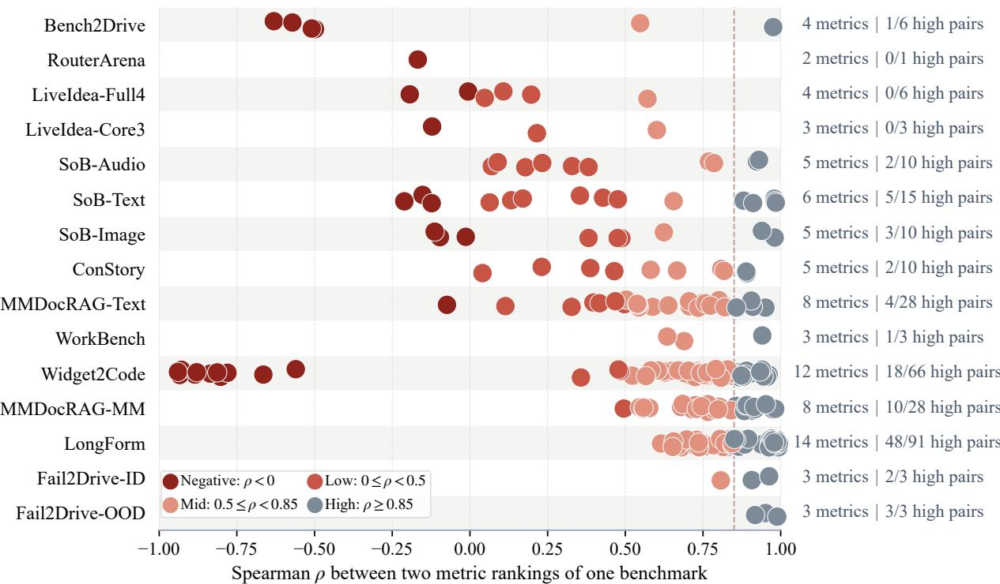  
Figure 1: Model-ranking consistency across metrics. Each point shows Spearman $\rho$ between rankings induced by two official metrics, all direction-aligned so higher is better. Colors show correlation ranges, the dashed line marks $\rho \ge 0 . 8 5$ , and right-side annotations give metric counts and high-correlation pairs. Weak and negative correlations are common.

## 1 INTRODUCTION

As the number of models and the scale of evaluation continue to grow, repeatedly evaluating models on full benchmarks incurs increasing computational and time costs. Benchmark compression reduces this burden by selecting a small set of representative samples to approximate full-benchmark model scores and rankings. Existing benchmark compression methods (BCMs), such as Anchor-Points, tinyBenchmarks, mRMR-based compression, SubLIME, and ZipBench, aim to substantially reduce benchmark size while maintaining high evaluation fidelity through representative sample se lection for downstream model comparison (Vivek et al., 2024; Maia Polo et al., 2024; Bowyer et al., 2026; Saranathan et al., 2025; Huang et al., 2026). However, these methods typically guide sample selection using a single evaluation metric, whereas modern benchmarks often assess models along multiple dimensions. This exposes a key issue: samples considered representative under one metric may not be equally representative for other metrics.

We therefore examine the consistency of model rankings across evaluation metrics. Across 85 official metrics from 15 benchmark configurations spanning language, multimodal, VLA, and agent tasks, we compute Spearman correlations between metric-induced model rankings within each benchmark. As shown in Fig. 1, many metric pairs exhibit weak ranking agreement, with negative correlations appearing across several benchmarks. Using $\rho \ge 0 . 8 5$ as the threshold for high correlation (Granato, 2014), we find that highly correlated pairs are only a small fraction in many benchmarks: Bench2Drive has only one out of six such pairs, while LiveIdea-Full4 (Ruan et al., 2026) has none. These results show that different metrics capture distinct, sometimes conflicting, model-comparison information, raising a concern for compression guided by a single metric.

These cross-metric differences raise a question for single-metric compression: can samples selected to represent one metric also preserve the evaluation information captured by others? To examine this question, we select items using one metric and evaluate them on the remaining metrics of the same benchmark, comparing against equal-size Random sampling at 80% compression. As shown in the left panel of Fig. 2, existing single-metric BCMs perform worse than Random in 70.5%–97.7% of cross-metric score-reconstruction comparisons across five baselines. The right panel further shows that even when the selected samples achieve lower NMAE than Random on the selection metric, this advantage often fails to carry over to other metrics, where reconstruction errors instead exceed those of Random. These results show that a subset representative of one metric does not necessarily preserve the information needed to evaluate others.

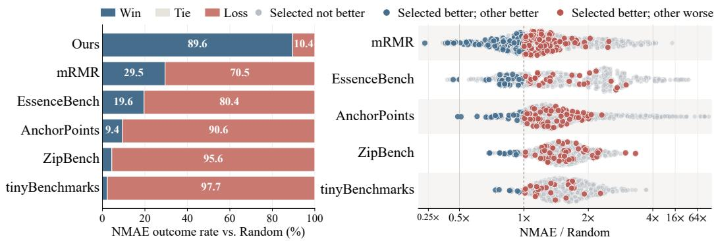  
Figure 2: Single-metric selection fails across metrics. Left: Cross-metric NMAE win, tie, and loss rates against Random across 15 benchmarks at 80% compression. HoloCosm wins in 89.6% of comparisons. Right: NMAE relative to Random on metrics other than the selection metric, with compressed axis tails. Red points show cross-metric failure despite selected-metric gains.

To address this systematic cross-metric failure, we present HoloCosm, which directly optimizes evaluation fidelity across multiple metrics rather than assuming that items selected for one metric will transfer to others. Using full-benchmark evaluation results from source models, Holo-Cosm minimizes normalized score-reconstruction error across models and metrics while constraining ranking distortion. Size-matched reference selections calibrate the ranking-distortion constraint, a feasibility-first exchange search refines the selected items, and a source-assisted correction estimates full-benchmark scores while preserving within-metric rankings. At 80% compression (20% retention), HoloCosm achieves the best aggregate performance across 15 benchmark configurations and 85 evaluation metrics. Despite being designed for multi-metric evaluation, HoloCosm remains competitive with existing single-metric BCMs in single-metric settings. Our contributions are:

• Multi-metric inconsistency. Across 85 official metrics from 15 benchmark configurations, we find widespread weak and negative correlations between metric-induced model rankings, showing that different evaluation dimensions often capture substantially different information across different types of benchmarks.

• Systematic cross-metric failure. At 80% compression, existing single-metric BCMs perform worse than Random in 70.5%–97.7% of cross-metric score-reconstruction comparisons, revealing a systematic failure of single-metric-guided compression. To our knowledge, we are the first to systematically study this multi-metric compression problem.

• Multi-metric benchmark compression. We introduce HoloCosm to preserve score and ranking fidelity across metrics. It achieves the best overall fidelity across 15 benchmark configurations and 85 metrics at 80% compression while remaining competitive in singlemetric evaluation under the same compression setting.

## 2 RELATED WORK

Benchmark compression. Benchmark compression reduces evaluation cost by estimating fullbenchmark performance from fewer items. AnchorPoints, mRMR, and ZipBench select representative items using response correlation, mutual-information-based feature selection, and synthesized response representations, respectively (Vivek et al., 2024; Bowyer et al., 2026; Huang et al., 2026). tinyBenchmarks and bias-bounded item selection focus on accurate score estimation through IRTbased selection and bias-bounded submodular selection (Maia Polo et al., 2024; Zhuang et al., 2025). More specialized benchmark compression includes MiniLongBench, which learns sample representations and clusters them to prune redundant long-context samples while preserving model rankings (Huang et al., 2025). SubLIME uses predicted rank correlation to guide subset selection, while EssenceBench combines redundancy-aware filtering with fitness-based subset search (Saranathan et al., 2025; Wang et al., 2026). Despite these differences, existing benchmark-compression meth ods primarily select items for one evaluation metric at a time. Tab. 1 summarizes this distinction. Our work instead uses multiple evaluation metrics for item selection within the same benchmark while preserving both scores and model rankings.

Table 1: Benchmark-compression methods by selection basis, objective, and metric setting.
<table><tr><td>Method</td><td>Selection basis</td><td>Objective</td><td>Metric setting</td></tr><tr><td>AnchorPoints</td><td>Response correlation</td><td>Coverage</td><td>Single</td></tr><tr><td>mRMR</td><td>Mutual information</td><td>Score reconstruction</td><td>Single</td></tr><tr><td>tinyBenchmarks</td><td>IRT embeddings</td><td>Score estimation</td><td>Single</td></tr><tr><td>SubLIME</td><td>Predicted rank correlation</td><td>Ranking preservation</td><td>Single</td></tr><tr><td>EssenceBench</td><td>Redundancy + subset fitness</td><td>Score &amp; rank fidelity</td><td>Single</td></tr><tr><td>MiniLongBench</td><td>Learned sample representations</td><td>Ranking preservation</td><td>Single</td></tr><tr><td>ZipBench</td><td>Synthesized-response representations</td><td>Score &amp; rank fidelity</td><td>Single</td></tr><tr><td>HoloCosm</td><td>Cross-metric fidelity</td><td>Score &amp; rank fidelity</td><td>Single / Multi</td></tr></table>

Efficient performance estimation. Related work considers multiple benchmarks or exploits cross-metric structure for more efficient performance estimation (Kipnis et al., 2025; Liao et al., 2025). These settings do not directly study multi-metric item selection across multiple evaluation metrics within the same benchmark, which is the focus of our work.

Evaluation reliability. Prior work studies the reliability of reduced evaluations and resulting benchmark rankings (Perlitz et al., 2024; Yauney et al., 2026; Neuhof & Benjamini, 2026). These studies mainly consider reliability under a fixed evaluation criterion. Our work instead asks whether items selected to represent one metric remain reliable for other metrics, evaluating both score recon struction and ranking preservation consistently across evaluation metrics.

## 3 METHODOLOGY

HoloCosm formulates multi-metric benchmark compression as fidelity-constrained reconstruction. Each candidate set is characterized by reconstruction accuracy and pairwise-margin distortion across source models and metrics. Size-matched reference sets calibrate a ranking-risk threshold. A feasibility-first exchange search seeks B items with low multi-metric reconstruction error under this constraint, after which source-assisted estimation estimates full-benchmark target scores.

Preliminaries. Let $\mathcal M = [ M ]$ denote the source-model index set, with source models $\{ f _ { m } \} _ { m \in \mathcal { M } }$ and let $\mathcal { D } = \{ x _ { 1 } , . . . , x _ { N } \}$ denote the benchmark items. Item-level scores for all source models and items under K evaluation metrics form a tensor $X ~ \in ~ \mathbb { R } ^ { M \times N \times K }$ , where $X _ { m n k }$ is the score of model $f _ { m }$ on item $x _ { n }$ under metric k. For metrics obtained by averaging item-level scores, the full-benchmark score and its uncorrected subset estimate are

$$
\mu _ { m k } = \frac { 1 } { N } \sum _ { n = 1 } ^ { N } X _ { m n k } , \qquad \widehat { \mu } _ { m k } ( S ) = \frac { 1 } { | S | } \sum _ { n \in S } X _ { m n k } ,\tag{1}
$$

where $n \in [ N ]$ indexes benchmark items and $S \subseteq \left\lceil N \right\rceil$ indexes the selected items. Collecting these scores gives the full evaluation matrix $\pmb { \mu } \in \mathbb { R } ^ { M \times K }$ and its subset estimate ${ \widehat { \pmb { \mu } } } ( S )$ . Given a selection size $B \ < \ N$ , our goal is to choose a single subset S with $| S | = B$ such that $\widehat { \mu } _ { m k } ( S ) \approx \mu _ { m k }$ across source models and metrics. The same selected items are used to estimate every metric. Item selection uses only source-model responses; held-out target models are evaluated after S is fixed.

## 3.1 MULTI-METRIC FIDELITY PROFILE

For every size-B candidate selection S, HoloCosm characterizes its fidelity by reconstruction risk $R _ { \mathrm { m e a n } } ( S )$ and ranking risk $R _ { \mathrm { r a n k } } ( S )$ . The primary term $R _ { \mathrm { m e a n } }$ averages normalized reconstruction errors across source models and metrics. Normalization by the dispersion of full-benchmark source scores makes errors across metric scales comparable, while retaining every metric in each candidate assessment. Concretely, for a source pool A of q models, let $s _ { k } ( \mathcal { A } )$ be the standard deviation of the full-benchmark scores for metric k (set to one when numerically zero). We define

$$
a _ { k } ( S ; \mathcal { A } ) = \frac { 1 } { q s _ { k } ( \mathcal { A } ) } \sum _ { m \in \mathcal { A } } \vert \widehat { \mu } _ { m k } ( S ) - \mu _ { m k } \vert , \qquad r _ { \mathrm { m e a n } } ( S ; \mathcal { A } ) = \frac { 1 } { K } \sum _ { k = 1 } ^ { K } a _ { k } ( S ; \mathcal { A } ) .\tag{2}
$$

Reconstruction accuracy cannot guarantee faithful model comparisons. For each metric, $R _ { \mathrm { r a n k } }$ measures reductions in signed pairwise margins. Let $d _ { a b k } = \mu _ { a k } - \mu _ { b k } , \widehat { d } _ { a b k } ( S ) = \widehat { \mu } _ { a k } ( S ) - \widehat { \mu } _ { b k } ( S )$ and let $p _ { k } ( \mathcal { A } )$ be the median nonzero absolute margin for metric k. Let $\mathcal { Q } ( \mathcal { A } )$ denote the pooled set of valid metric-indexed model pairs, given by $\{ ( k , \bar { a } , b ) : k \in [ K ] , ( a , b ) \in \mathcal { P } _ { k } ( A ) \}$ . We define the aggregate ranking risk as the mean normalized margin shortfall over this set:

$$
r _ { \mathrm { r a n k } } ( S ; A ) = | \mathcal { Q } ( A ) | ^ { - 1 } \sum _ { ( k , a , b ) \in \mathcal { Q } ( A ) } p _ { k } ( A ) ^ { - 1 } \left[ | d _ { a b k } | - \mathrm { s i g n } ( d _ { a b k } ) \widehat { d } _ { a b k } ( S ) \right] _ { + } .\tag{3}
$$

This loss penalizes both weakened separation and reversed orderings. The final risks average these quantities over leave-one-source-out pools, $\begin{array} { l } { { R _ { j } ( S ) ~ = ~ M ^ { - 1 } \sum _ { m = 1 } ^ { M } r _ { j } ( S ; \mathcal { M } \mathrm { ~  ~ \backslash ~ } \{ m \} ) } } \end{array}$ for $j \in \{ \mathrm { m e a n } , \mathrm { r a n k } \}$ , with normalization recomputed in each pool. Appendix A.2 gives the zeroscale conventions, valid-pair construction, source-pool averaging, and full definitions.

## 3.2 REFERENCE-CALIBRATED CONSTRAINED SELECTION

HoloCosm minimizes multi-metric reconstruction error subject to a calibrated constraint on aggregate pairwise-ranking risk. Using an ϵ-constraint formulation (Mesquita-Cunha et al., 2023), it solves the following constrained subset-selection problem:

$$
\operatorname* { m i n } _ { S \subseteq [ N ] } R _ { \mathrm { m e a n } } ( S ) \quad \mathrm { s u b j e c t t o } \quad | S | = B , \quad R _ { \mathrm { r a n k } } ( S ) \leq \epsilon _ { \mathrm { r a n k } } .\tag{4}
$$

Here, reconstruction is the primary objective, while ranking risk is a feasibility constraint. We draw 128 uniform size-B subsets R and set $\epsilon _ { \mathrm { r a n k } } = Q _ { 0 . 2 5 } ( \{ R _ { \mathrm { r a n k } } ( S ) : S \in \mathcal { R } \} )$ ), the 25th percentile of their ranking risks. Thus, lower reconstruction error cannot compensate for risk above this threshold.

## 3.3 FEASIBILITY-FIRST EXCHANGE SEARCH

All candidate selections are ordered by one lexicographic rule. Among infeasible candidates, smaller normalized constraint violation takes priority. Every feasible candidate is preferred to every infeasible candidate; within the feasible region, lower $R _ { \mathrm { m e a n } }$ determines the ordering.

Starting from the best calibrated candidate, HoloCosm repeatedly evaluates one-for-one exchanges of a selected and an unselected item. An exchange is accepted only when it improves the lexicographic criterion. Every update preserves $| S | = B$ . The initial subset is feasible; accepted exchanges preserve feasibility and reduce reconstruction error.

## 3.4 SOURCE-ASSISTED SCORE ESTIMATION

For each target model, we correct its selected-item mean using source-average scores as auxiliary predictions, following prediction-powered mean estimation (Angelopoulos et al., 2023). The resulting full-benchmark score estimate is

$$
\tilde { \mu } _ { g k } ( S ) = \widehat { \mu } _ { g k } ( S ) + N ^ { - 1 } \sum _ { n = 1 } ^ { N } z _ { n k } - B ^ { - 1 } \sum _ { n \in S } z _ { n k } , \quad z _ { n k } = \frac { 1 } { M } \sum _ { m = 1 } ^ { M } X _ { m n k } .\tag{5}
$$

Here, $\begin{array} { r } { \widehat { \mu } _ { g k } ( S ) = B ^ { - 1 } \sum _ { n \in S } Y _ { g n k } } \end{array}$ is the observed subset mean of target model g, where $Y _ { g n k }$ is its score on item n under metric k. The two sums over $z _ { n k }$ are the full-benchmark and selected-item means of the source-average scores, respectively. Their difference is shared by all target models for a given metric, so the correction preserves pairwise score differences and within-metric rankings. Ranking fidelity is determined by item selection, while the correction improves full-score estimation without requiring target responses outside S. Algorithm 1 summarizes the procedure.

Algorithm 1 HoloCosm multi-metric subset selection and score estimation   
Require: Source scores X, target models T, subset size B   
Ensure: Selected subset S and corrected target score estimates   
1: Calibration: Draw a bank R of 128 uniform size-B subsets.   
2: Evaluate $R _ { \mathrm { m e a n } }$ and $R _ { \mathrm { r a n k } }$ for each $S \in { \mathcal { R } }$   
3: $\epsilon _ { \mathrm { r a n k } }  Q _ { 0 . 2 5 } ( \{ R _ { \mathrm { r a n k } } ( S ) : S \in \mathcal { R } \} ) .$   
4: Selection: Initialize S with the best reference subset under the feasibility-first rule.   
5: for at most 80 refinement rounds do   
6: Sample up to 64 selected–unselected item swaps and evaluate both risks for each proposal.   
7: Let ${ \hat { S } } ^ { \prime }$ be the best proposal under the feasibility-first rule; break if it does not improve S.   
8: Accept the improving proposal and update the current subset: $S \gets S ^ { \prime }$   
9: Estimation: Evaluate each target model on S.   
10: Apply the source-assisted correction in Eq. 5.

## 4 EXPERIMENTS

Benchmarks and splits. We evaluate on 15 benchmark configurations with 85 official component metrics, as summarized in Tab. 2. They span six LLM, five multimodal-LLM, three VLA, and one agent configuration, with 12–59 models, 78–8,400 items, and 2–14 metrics each. Most benchmark matrices are reconstructed from public item-level records; the remainder use official evaluation pipelines. For each configuration, we first compute each model’s full-benchmark mean on every metric. We orient the metrics so that higher values indicate better performance, min–max normalize each metric across the candidate models, and take their equally weighted mean as each model’s score. After ranking models by this score, we select six evenly spaced sources from lowest to highest, using the rest as targets. All methods use the same fixed source–target split.

Baselines. We compare HoloCosm with Random, tinyBenchmarks (Maia Polo et al., 2024), Zip-Bench (Huang et al., 2026), mRMR with Ridge reconstruction (Bowyer et al., 2026), AnchorPoints (Vivek et al., 2024), and EssenceBench (Wang et al., 2026). Random performs uniform random sampling without replacement. We adapt the baselines to the common six-source-model protocol; implementation details are provided in Appendix B.1.

Table 2: Benchmark configurations used in the cross-metric transfer analysis. The 15 configurations contain 85 component metrics across LLM, multimodal, VLA, and agent evaluations.
<table><tr><td>Type</td><td>Benchmark</td><td>Task</td><td>Models</td><td>Items</td><td>Metrics</td></tr><tr><td rowspan="6">LLM</td><td>ConStory (Li et al., 2026)</td><td>Story evaluation</td><td>33</td><td>1,179</td><td>5</td></tr><tr><td>LiveIdea-Ċore3 (Ruan et al., 2026)</td><td>Ideation</td><td>41</td><td>869</td><td>3</td></tr><tr><td>LiveIdea-Full4 (Ruan et al., 2026)</td><td>Ideation</td><td>41</td><td>235</td><td>4</td></tr><tr><td>LongForm (Paech, 2025)</td><td>Writing</td><td>59</td><td>108</td><td>14</td></tr><tr><td>MMDocRAG-Text (Dong et al., 2025)</td><td>Retrieval</td><td>51</td><td>1,955</td><td>8</td></tr><tr><td>RouterArena (Lu et al., 2026)</td><td>Routing</td><td>12</td><td>8,400</td><td>2</td></tr><tr><td rowspan="5">MLLM</td><td>MMDocRAG-Multimodal (Dong et al., 2025)</td><td>Retrieval</td><td>31</td><td>1,974</td><td>8</td></tr><tr><td>SoB-Text (Singh et al., 2026)</td><td>Structured output</td><td>35</td><td>5,000</td><td>6</td></tr><tr><td>SoB-Image (Singh et al., 2026)</td><td>Structured output</td><td>35</td><td>209</td><td>5</td></tr><tr><td>SoB-Audio (Singh et al., 2026)</td><td>Structured output</td><td>34</td><td>115</td><td>5</td></tr><tr><td>Widget2Code (Žhang et al., 2026)</td><td>Code generation</td><td>13</td><td>288</td><td>12</td></tr><tr><td rowspan="4">VLA</td><td>Bench2Drive (Jia et al., 2024)</td><td>Driving</td><td>32</td><td>220</td><td>4</td></tr><tr><td>Fail2Drive-ID (Gerstenecker et al., 2026)</td><td>Driving</td><td>33</td><td>82</td><td>3</td></tr><tr><td>Fail2Drive-OOD (Gerstenecker et al., 2026)</td><td>Driving</td><td>33</td><td>78</td><td>3</td></tr><tr><td>WorkBench (Styles &amp; Miller, 2026)</td><td>Tool use</td><td>24</td><td>690</td><td>3</td></tr></table>

Ours Random tinyBenchmarks ZipBench mRMR AnchorPoints EssenceBench

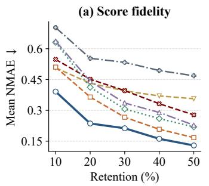

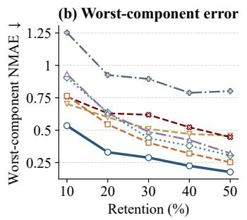

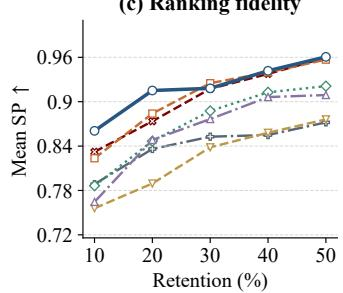  
Figure 3: Multi-metric fidelity across retention ratios. Mean NMAE, worst-component NMAE, and mean SP are computed across evaluation metrics within each benchmark, averaged over runs, then equally across 15 benchmarks. For each single-target baseline, the target with lowest runaveraged mean NMAE is selected at each benchmark and retention level and used for all panels.

Comparison protocol. We test retention ratios of 10%, 20%, 30%, 40%, and 50%, with 20% as the main setting. For N items at retention ratio $\rho ,$ we set the selection size to the nearest integer to $\rho N ,$ , with at least one item. At each ratio, every method selects the same number of unique items. Each single-target baseline selects items using each component metric in turn and evaluates the resulting selection on all components. HoloCosm selects items across all components, whereas Random uniformly samples items and evaluates all components on those items.

Evaluation metrics. We measure score reconstruction using normalized mean absolute error (NMAE) and ranking preservation using Spearman rank correlation (SP) across target models. NMAE normalizes reconstruction error by target-score dispersion, making errors comparable across metrics with different scales. For component k of benchmark b, we define NMAE as

$$
\mathrm { N M A E } _ { b , k } = \frac { \vert { \mathcal T } _ { b } \vert ^ { - 1 } \sum _ { t \in { \mathcal T } _ { b } } \vert \widehat y _ { t , k } - y _ { t , k } \vert } { \sigma _ { b , k } } , \qquad \sigma _ { b , k } = \mathrm { S t d } _ { t \in { \mathcal T } _ { b } } ( y _ { t , k } ) .\tag{6}
$$

Here, $\mathcal { T } _ { b }$ denotes the target models, and $y _ { t , k }$ and $\widehat { y } _ { t , k }$ denote the full-benchmark and estimated scores, respectively. $\sigma _ { b , k }$ is the population standard deviation across target models. SP measures agreement between rankings induced by the full and estimated scores. For each run, we report mean and worst-component values, using maximum NMAE or minimum SP. Results are averaged ove runs and macro-averaged across benchmarks. Lower NMAE and higher SP indicate better fidelity.

Table 3: Multi-metric score and ranking fidelity at 20% retention. Entries average over K metrics and runs with benchmarks weighted equally; each baseline’s best-NMAE target supplies the measures. W/T/L denotes wins, ties, and losses against Random. Bold indicates best results.
<table><tr><td></td><td></td><td colspan="4">All-metric / random selection</td><td colspan="10">Single-metric selection (best across metrics)</td></tr><tr><td></td><td></td><td colspan="2">Ours</td><td colspan="2">Random</td><td colspan="2">tinyBenchmarks</td><td colspan="2">ZipBench</td><td colspan="2">mRMR</td><td colspan="2">AnchorPoints</td><td colspan="2">EssenceBench</td></tr><tr><td>Benchmark</td><td></td><td>KNMAE↓</td><td>SP↑</td><td>NMAE↓ SP↑</td><td></td><td>NMAE↓</td><td>SP↑</td><td>NMAE↓</td><td>SP↑</td><td>NMAE↓</td><td>SP↑</td><td>NMAE↓</td><td>SP↑</td><td>NMAE↓ SP↑</td><td></td></tr><tr><td>ConStory</td><td>5</td><td>0.30</td><td>0.88</td><td>0.29</td><td>0.88</td><td>0.43</td><td>0.84</td><td>0.45</td><td>0.81</td><td>0.67</td><td>0.69</td><td>1.24</td><td>0.52</td><td>0.44</td><td>0.88</td></tr><tr><td>Bench2Drive</td><td>4</td><td>0.27</td><td>0.84</td><td>0.39</td><td>0.84</td><td>0.46</td><td>0.78</td><td>0.53</td><td>0.76</td><td>0.37</td><td>0.83</td><td>0.59</td><td>0.79</td><td>0.34</td><td>0.85</td></tr><tr><td>Fail2Drive-ID</td><td>3</td><td>0.28</td><td>0.80</td><td>0.58</td><td>0.59</td><td>0.74</td><td>0.79</td><td>0.51</td><td>0.57</td><td>0.37</td><td>0.49</td><td>0.28</td><td>0.71</td><td>1.00</td><td>0.51</td></tr><tr><td>Fail2Drive-OOD</td><td>3</td><td>0.39</td><td>0.86</td><td>0.79</td><td>0.79</td><td>0.68</td><td>0.69</td><td>0.73</td><td>0.65</td><td>0.50</td><td>0.51</td><td>0.61</td><td>0.80</td><td>0.58</td><td>0.76</td></tr><tr><td>LiveIdea-Core3</td><td>3</td><td>0.10</td><td>0.98</td><td>0.11</td><td>0.98</td><td>0.16</td><td>0.96</td><td>0.16</td><td>0.96</td><td>0.33</td><td>0.97</td><td>0.12</td><td>0.98</td><td>0.10</td><td>0.98</td></tr><tr><td>LiveIdea-Full4</td><td>4</td><td>0.22</td><td>0.95</td><td>0.29</td><td>0.94</td><td>0.39</td><td>0.87</td><td>0.40</td><td>0.88</td><td>0.42</td><td>0.89</td><td>0.27</td><td>0.94</td><td>0.25</td><td>0.94</td></tr><tr><td>RouterArena</td><td>2</td><td>0.09</td><td>0.97</td><td>0.15</td><td>0.99</td><td>0.28</td><td>0.91</td><td>0.25</td><td>0.96</td><td>1.02</td><td>0.86</td><td>0.28</td><td>0.97</td><td>0.42</td><td>0.93</td></tr><tr><td>LongForm</td><td>14</td><td>0.12</td><td>0.98</td><td>0.14</td><td>0.98</td><td>0.17</td><td>0.97</td><td>0.17</td><td>0.97</td><td>0.13</td><td>0.98</td><td>0.15</td><td>0.98</td><td>0.32</td><td>0.96</td></tr><tr><td>SoB-Audio</td><td>5</td><td>0.58</td><td>0.83</td><td>0.70</td><td>0.78</td><td>0.99</td><td>0.65</td><td>0.78</td><td>0.75</td><td>0.56</td><td>0.75</td><td>0.72</td><td>0.80</td><td>0.58</td><td>0.74</td></tr><tr><td>SoB-Image</td><td>5</td><td>0.51</td><td>0.77</td><td>1.17</td><td>0.65</td><td>1.03</td><td>0.62</td><td>0.92</td><td>0.71</td><td>0.56</td><td>0.66</td><td>0.87</td><td>0.71</td><td>1.41</td><td>0.70</td></tr><tr><td>SoB-Text</td><td>6</td><td>0.16</td><td>0.96</td><td>0.21</td><td>0.96</td><td>0.39</td><td>0.86</td><td>0.39</td><td>0.87</td><td>0.51</td><td>0.88</td><td>1.80</td><td>0.67</td><td>0.46</td><td>0.96</td></tr><tr><td>MMDocRAG-MM</td><td>8</td><td>0.06</td><td>0.99</td><td>0.07</td><td>0.99</td><td>0.14</td><td>0.98</td><td>0.11</td><td>0.98</td><td>0.10</td><td>0.99</td><td>0.09</td><td>0.99</td><td>0.08</td><td>0.99</td></tr><tr><td>MMDocRAG-Text</td><td>8</td><td>0.10</td><td>0.98</td><td>0.11</td><td>0.98</td><td>0.14</td><td>0.97</td><td>0.17</td><td>0.96</td><td>0.23</td><td>0.97</td><td>0.13</td><td>0.97</td><td>0.11</td><td>0.98</td></tr><tr><td>Widget2Code</td><td>12</td><td>0.22</td><td>0.94</td><td>0.30</td><td>0.93</td><td>0.42</td><td>0.88</td><td>0.38</td><td>0.90</td><td>0.24</td><td>0.92</td><td>0.33</td><td>0.86</td><td>0.30</td><td>0.94</td></tr><tr><td>WorkBench</td><td>3</td><td>0.14</td><td>0.98</td><td>0.17</td><td>0.97</td><td>0.22</td><td>0.95</td><td>0.22</td><td>0.97</td><td>0.48</td><td>0.46</td><td>0.83</td><td>0.84</td><td>0.38</td><td>0.96</td></tr><tr><td>Macro-average</td><td>1</td><td>0.24</td><td>0.92</td><td>0.37</td><td>0.88</td><td>0.44</td><td>0.85</td><td>0.41</td><td>0.85</td><td>0.43</td><td>0.79</td><td>0.55</td><td>0.84</td><td>0.45</td><td>0.87</td></tr><tr><td>W/T/L vs. Random</td><td></td><td>14/0/1</td><td>11/0/4</td><td></td><td></td><td>2/0/13</td><td>1/0/14</td><td>3/0/12</td><td>1/0/14</td><td>7/0/8</td><td>1/0/14</td><td>4/0/11</td><td>5/0/10</td><td>5/0/10</td><td>8/0/7</td></tr></table>

Table 4: Cross-metric fidelity on Bench2Drive at 20% retention. Underlining marks selectionmetric results; Mean averages NMAE, and blue-gray marks each baseline's lowest-mean target.
<table><tr><td>Method</td><td>Selection metric</td><td colspan="5">NMAE↓</td><td colspan="4">SP↑</td></tr><tr><td></td><td></td><td>Efficiency</td><td>Score</td><td>Smoothness</td><td>Success</td><td>Mean</td><td>Efficiency</td><td>Score</td><td>Smoothness</td><td>Success</td></tr><tr><td>Ours</td><td>All metrics</td><td>0.053</td><td>0.435</td><td>0.159</td><td>0.448</td><td>0.274</td><td>0.782</td><td>0.845</td><td>0.911</td><td>0.835</td></tr><tr><td rowspan="4">ZipBench</td><td>Efficiency</td><td>0.111</td><td>0.872</td><td>0.343</td><td>0.818</td><td>0.536</td><td>0.758</td><td>0.748</td><td>0.862</td><td>0.787</td></tr><tr><td>Score</td><td>0.100</td><td>0.831</td><td>0.338</td><td>0.860</td><td>0.532</td><td>0.668</td><td>0.750</td><td>0.869</td><td>0.747</td></tr><tr><td>Smoothness</td><td>0.174</td><td>0.944</td><td>0.299</td><td>0.973</td><td>0.598</td><td>0.847</td><td>0.783</td><td>0.845</td><td>0.825</td></tr><tr><td>Success</td><td>0.229</td><td>0.807</td><td>0.315</td><td>0.821</td><td>0.543</td><td>0.689</td><td>0.815</td><td>0.872</td><td>0.726</td></tr></table>

## 4.1 MAIN RESULTS

For each single-metric baseline, we report the selection target with the lowest mean NMAE for each benchmark and retention level, and use the same target for all measures.

Results at 20% retention. Tab. 3 reports the main results at 20% retention. HoloCosm achieves the best aggregate fidelity, while Random is the strongest baseline overall. Compared with Random, HoloCosm reduces mean and worst-component NMAE by 35.3% and 39.5%, respectively, while also improving ranking fidelity. In contrast, all single-metric baselines underperform Random in macro-average NMAE and SP, with NMAE ranging from 0.41 to 0.55 and SP from 0.79 to 0.87. This advantage is also broadly consistent across benchmarks: HoloCosm outperforms Random in mean NMAE on 14 of 15 benchmarks and in mean SP on 11 of 15.

Across retention levels. To assess performance beyond the 20% setting, Fig. 3 compares Holo-Cosm with all baselines from 10% to 50% retention. HoloCosm achieves the lowest mean and worst-component NMAE at every level, while maintaining consistently competitive ranking fidelity throughout the full tested retention range. Both error measures decrease steadily and mean SP rises as more items are retained. The margin is clearest under aggressive compression and persists at higher retention, showing that the gains are not tied to a single operating point.

Cross-metric transfer. Tab. 3 reports each single-metric baseline’s results using the selection metric with the lowest mean NMAE. Tab. 4 details ZipBench on Bench2Drive. ZipBench achieves its lowest mean NMAE with Score as the compression target. Switching to Smoothness lowers Smoothnes error but increases Efficiency error. HoloCosm jointly lowers all four component errors, avoiding this target-dependent trade-off. Complete results are provided in Appendix D.3.

## 4.2 ABLATION STUDY

Table 5: Selection ablation at 20% retention. All variants use the same source-assisted estimator. Results are three-seed means with benchmarks weighted equally.
<table><tr><td>Variant</td><td>Selection rule</td><td>Mean NMAE↓</td><td>Worst NMAE↓</td><td>Mean SP ↑</td></tr><tr><td>Random + correction</td><td>Uniform sampling</td><td>0.2812</td><td>0.3828</td><td>0.8840</td></tr><tr><td>Multi-metric reconstruction Minimize Rmean</td><td></td><td>0.2404</td><td>0.3390</td><td>0.9077</td></tr><tr><td>HoloCosm</td><td>Minimize  $R _ { \mathrm { m e a n } }$  s.t.  $R _ { \mathrm { r a n k } } \le \epsilon _ { \mathrm { r a n k } }$ </td><td>0.2362</td><td>0.3299</td><td>0.9151</td></tr></table>

As shown in Tab. 5, we isolate the contribution of each selection component at 20% retention across 15 benchmarks, while keeping the source-assisted estimator unchanged. We compare uniform random sampling with source-assisted correction, multi-metric reconstruction without explicit ranking protection, and the full HoloCosm selection with ranking-aware constraints.

Multi-metric reconstruction improves score and ranking fidelity over random sampling with cor rection, reducing mean NMAE from 0.2812 to 0.2404 and raising mean SP from 0.884 to 0.9077. Adding ranking protection yields gains, reaching 0.2362 mean NMAE, 0.3299 worst-component NMAE, and 0.9151 mean SP. This shows that ranking-aware selection improves not only ordering but also reconstruction fidelity, including the hardest-to-preserve components. Since source-assisted correction preserves model ordering, the SP gains reflect the selection.

## 4.3 ADDITIONAL ANALYSES

(1) Can Simple Multi-Metric Strategies Preserve Benchmark Scores and Rankings?  
Table 6: Simple multi-metric compression strategies at 20% retention. Results are averaged equally over 15 configurations; mean and worst-metric errors are computed per configuration.
<table><tr><td>Method</td><td>Strategy</td><td>Mean NMAE↓</td><td>Worst NMAE↓</td><td>Mean SP ↑</td></tr><tr><td>Random</td><td>一</td><td>0.3650</td><td>0.5450</td><td>0.8840</td></tr><tr><td rowspan="3">AnchorPoints</td><td>Single metric</td><td>0.5533</td><td>0.9256</td><td>0.8361</td></tr><tr><td>AverageMetric</td><td>0.6106</td><td>1.1302</td><td>0.8497</td></tr><tr><td>Vote</td><td>0.6288</td><td>0.9719</td><td>0.9038</td></tr><tr><td>K-means</td><td>Multi-metric responses</td><td>0.3242</td><td>0.4288</td><td>0.8842</td></tr><tr><td rowspan="2">Ours</td><td>AverageMetric</td><td>0.2822</td><td>0.3896</td><td>0.8946</td></tr><tr><td>All metrics</td><td>0.2362</td><td>0.3299</td><td>0.9151</td></tr></table>

To test whether simple multi-metric strategies can preserve benchmark scores and rankings, we compare three strategies on the original metrics at 20% retention.

AverageMetric: We direction-align all metrics, normalize each using source-derived min–max statistics, and average them equally into a scalar selection target. For AnchorPoints and Ours, this scalar serves as the sole selection target, while their original score estimators remain unchanged.

Vote: We run AnchorPoints for each metric to select B items, giving candidates one vote per metric.   
We select by vote count; boundary ties favor the least-covered metrics, followed by tie-breaking.   
This yields B distinct items, whose unweighted means estimate target metrics.

K-means: We concatenate each item’s source responses after scaling metrics by the standard deviation of source full-benchmark means. Lloyd K-means forms B clusters and retains the item nearest each center. Target scores are cluster-size-weighted averages of the representatives.

Tab. 6 shows uneven gains. Vote improves ranking correlation but increases score error, and random selection remains a competitive baseline. Ours achieves lower error and higher ranking agreement. Compared with K-means, all-metric selection reduces mean and worst NMAE by 27.1% and 23.1%, respectively, while increasing mean SP from 0.8842 to 0.9151. Thus, directly optimizing metricspecific response structure is more effective than generic response-space clustering.

(2) Can HoloCosm Match Strong Baselines on Single-Metric Benchmarks?  
Table 7: Single-metric evaluation at 20% retention. MAE measures score reconstruction and SP measures ranking preservation. Results are averaged over runs; Macro-average weights the three benchmarks equally. Bold marks the best result in each column.
<table><tr><td rowspan="2">Method</td><td colspan="2">MMStar</td><td colspan="2">SimpleQA</td><td colspan="2">SimpleVQA</td><td colspan="2">Macro-average</td></tr><tr><td>MAE↓</td><td>SP↑</td><td>MAE↓</td><td>SP↑</td><td>MAE↓</td><td>SP↑</td><td>MAE↓</td><td>SP↑</td></tr><tr><td>Ours</td><td>0.017</td><td>0.964</td><td>0.009</td><td>1.000</td><td>0.013</td><td>1.000</td><td>0.013</td><td>0.988</td></tr><tr><td>Random</td><td>0.014</td><td>0.988</td><td>0.009</td><td>1.000</td><td>0.022</td><td>0.992</td><td>0.015</td><td>0.993</td></tr><tr><td>tinyBenchmarks</td><td>0.032</td><td>0.952</td><td>0.022</td><td>0.988</td><td>0.018</td><td>0.984</td><td>0.024</td><td>0.975</td></tr><tr><td>ZipBench</td><td>0.018</td><td>0.964</td><td>0.018</td><td>0.988</td><td>0.031</td><td>0.937</td><td>0.023</td><td>0.963</td></tr><tr><td>mRMR</td><td>0.067</td><td>0.893</td><td>0.030</td><td>1.000</td><td>0.022</td><td>0.976</td><td>0.040</td><td>0.956</td></tr><tr><td>AnchorPoints</td><td>0.125</td><td>0.810</td><td>0.119</td><td>0.881</td><td>0.156</td><td>0.262</td><td>0.134</td><td>0.651</td></tr></table>

We further examine whether joint multi-metric optimization compromises performance when only one metric is evaluated on three single-metric benchmarks: MMStar, SimpleQA, and SimpleVQA (Chen et al., 2024; Wei et al., 2024; Cheng et al., 2025), spanning diverse evaluation settings.

As shown in Tab. 7, at 20% retention HoloCosm achieves the lowest macro-average MAE of 0.013 and a macro-average SP of 0.988, close to Random’s 0.993, while outperforming all existing compression baselines. These results show that HoloCosm’s effectiveness is not limited to multi-metric evaluation and remains competitive when only a single metric is available.

## (3) Can Weaker Source Models Guide Benchmark Compression for Stronger Models?

To evaluate transfer beyond the source pool’s capability, we construct a weak-to-strong setting. We rank models by the four-metric average on LiveIdea-Full4, SSIM on Widget2Code, and Correct on WorkBench. Six weaker models guide selection for disjoint stronger models. Fig. 4 shows that ranking fidelity improves with retention. HoloCosm’s advantage over Random is most pronounced at low retention on LiveIdea-Full4 and Widget2Code, while the two methods perform similarly on WorkBench. The curves converge as retention increases. These results suggest that weaker source models can guide selection for stronger targets, with gains varying across benchmarks.

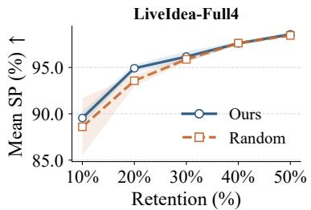

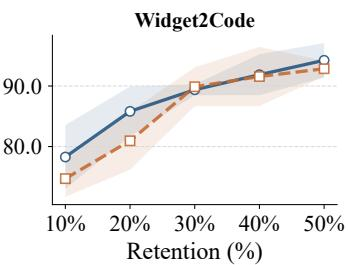

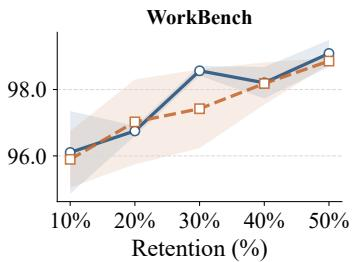  
Figure 4: Weak-to-strong generalization. Six weaker models guide selection for disjoint stronger models. Curves show mean SP ± standard deviation over three seeds.

## 5 CONCLUSION

We uncover a systematic cross-metric failure in benchmark compression: subsets selected for one metric often perform worse than equal-size random sampling on others. To address this, HoloCosm minimizes multi-metric reconstruction error under a ranking-risk constraint. Across 15 benchmark configurations, HoloCosm improves score and ranking fidelity over Random. It remains competitive on single-metric benchmarks and transfers from weaker source models to stronger targets. Benchmark compression for multi-metric evaluation should preserve fidelity across metrics.

## REFERENCES

Anastasios N Angelopoulos, Stephen Bates, Clara Fannjiang, Michael I Jordan, and Tijana Zrnic. Prediction-powered inference. Science, 382(6671):669–674, 2023.

Sam Bowyer, Acyr Locatelli, and Kris Cao. Efficient benchmarking is just feature selection and multiple regression. arXiv preprint arXiv:2605.25773, 2026.

Lin Chen, Jinsong Li, Xiaoyi Dong, Pan Zhang, Yuhang Zang, Zehui Chen, Haodong Duan, Jiaqi Wang, Yu Qiao, Dahua Lin, et al. Are we on the right way for evaluating large vision-language models? Advances in Neural Information Processing Systems, 37:27056–27087, 2024.

Xianfu Cheng, Wei Zhang, Shiwei Zhang, Jian Yang, Xiangyuan Guan, Xianjie Wu, Xiang Li, Ge Zhang, Jiaheng Liu, Yuying Mai, et al. Simplevqa: Multimodal factuality evaluation for multimodal large language models. In 2025 IEEE/CVF International Conference on Computer Vision (ICCV), pp. 4637–4646. IEEE, 2025.

Kuicai Dong, CHANG YUJING, Shijie Huang, Yasheng Wang, Ruiming Tang, and Yong Liu. Benchmarking retrieval-augmented multimomal generation for document question answering. In D. Belgrave, C. Zhang, H. Lin, R. Pascanu, P. Koniusz, M. Ghassemi, and N. Chen (eds.), Advances in Neural Information Processing Systems, volume 38, Main Conference. Curran Associates, Inc., 2025. doi: 10.52202/085713-0619. URL https://proceedings.neurips.cc/paper\_files/paper/2025/file/ 1a93178950e92fd2e7b7448f7d68fd7d-Paper-Datasets\_and\_Benchmarks\_ Track.pdf.

Mingxuan Du, Benfeng Xu, Chiwei Zhu, Licheng Zhang, Xiaorui Wang, and Zhendong Mao. Deepresearch bench: A comprehensive benchmark for deep research agents. In International Conference on Learning Representations, volume 2026, pp. 42414–42448, 2026.

Simon Gerstenecker, Andreas Geiger, and Katrin Renz. Fail2drive: Benchmarking closed-loop driving generalization. arXiv preprint arXiv:2604.08535, 2026.

Gregory E Granato. Statistics for stochastic modeling of volume reduction, hydrograph extension, and water-quality treatment by structural stormwater runoff best management practices (bmps). Technical report, US Geological Survey, 2014.

Zhongzhan Huang, Guoming Ling, Shanshan Zhong, Hefeng Wu, and Liang Lin. Minilongbench: the low-cost long context understanding benchmark for large language models. In Proceedings of the 63rd Annual Meeting of the Association for Computational Linguistics (Volume 1: Long Papers), pp. 11442–11460, 2025.

Zhongzhan Huang, Junxin Li, Guoming Ling, Yupei Lin, Shanshan Zhong, and Hefeng Wu. Zipbench: Low-cost framework for compressing comprehensive benchmarks of large language models, 2026.

Xiaosong Jia, Zhenjie Yang, Qifeng Li, Zhiyuan Zhang, and Junchi Yan. Bench2drive: Towards multi-ability benchmarking of closed-loop end-to-end autonomous driving. Advances in Neural Information Processing Systems, 37:819–844, 2024.

M. G. Kendall. The treatment of ties in ranking problems. Biometrika, 33(3):239–251, 1945. doi: 10.1093/biomet/33.3.239.

Alex Kipnis, Konstantinos Voudouris, Luca Schulze Buschoff, and Eric Schulz. metabench-a sparse benchmark of reasoning and knowledge in large language models. In International Conference on Learning Representations, volume 2025, pp. 31734–31770, 2025.

Junjie Li, Xinrui Guo, Yuhao Wu, Roy Ka-Wei Lee, Hongzhi Li, and Yutao Xie. Lost in stories: Consistency bugs in long story generation by llms. In Findings of the Association for Computational Linguistics: ACL 2026, pp. 8400–8428, 2026.

Lele Liao, Qile Zhang, Ruofan Wu, and Guanhua Fang. Toward a unified framework for dataefficient evaluation of large language models. arXiv preprint arXiv:2510.04051, 2025.

Yifan Louie Lu, Rixin Liu, Jiayi Yuan, Xingqi Cui, Shenrun Zhang, Hongyi Liu, and Jiarong Xing. Routerarena: An open platform for comprehensive comparison of llm routers. In International Conference on Learning Representations, volume 2026, pp. 44385–44406, 2026.

Felipe Maia Polo, Lucas Weber, Leshem Choshen, Yuekai Sun, Gongjun Xu, and Mikhail Yurochkin. tinybenchmarks: evaluating llms with fewer examples. arXiv preprint arXiv:2402.14992, 2024.

Mariana Mesquita-Cunha, Jose Rui Figueira, and Ana Paula Barbosa-P´ ovoa. New´ ϵ-constraint methods for multi-objective integer linear programming: A pareto front representation approach. European Journal ofOperational Research, 306(1):286–307, 2023.

Bitya Neuhof and Yuval Benjamini. Quantifying ranking uncertainty in llm benchmarks. arXiv preprint arXiv:2607.16259, 2026.

S.J. Paech. Longform creative writing benchmark, 2025. URL https://github.com/ EQ-bench/longform-writing-bench. GitHub repository.

Yotam Perlitz, Elron Bandel, Ariel Gera, Ofir Arviv, Liat Ein Dor, Eyal Shnarch, Noam Slonim, Michal Shmueli-Scheuer, and Leshem Choshen. Efficient benchmarking (of language models). In Proceedings of the 2024 Conference of the North American Chapter of the Association for Computational Linguistics: Human Language Technologies (Volume 1: Long Papers), pp. 2519– 2536, 2024.

Kai Ruan, Xuan Wang, Jixiang Hong, Peng Wang, Yang Liu, and Hao Sun. Evaluating llms’ divergent thinking capabilities for scientific idea generation with minimal context. Nature communi cations, 17(1):3625, 2026.

Gayathri Saranathan, Cong Xu, Mahammad Parwez Alam, Tarun Kumar, Martin Foltin, Soon Yee Wong, and Suparna Bhattacharya. Sublime: Subset selection via rank correlation prediction for data-efficient llm evaluation. In Proceedings of the 63rd Annual Meeting of the Association for Computational Linguistics (Volume 1: Long Papers), pp. 30572–30593, 2025.

Abhinav Kumar Singh, Harsha Vardhan Khurdula, Yoeven D Khemlani, and Vineet Agarwal. The structured output benchmark: A multi-source benchmark for evaluating structured output quality in large language models. arXiv preprint arXiv:2604.25359, 2026.

Olly Styles and Sam Miller. WorkBench Revisited: Workplace agents two years on. arXiv preprint arXiv:2606.13715, 2026.

Rajan Vivek, Kawin Ethayarajh, Diyi Yang, and Douwe Kiela. Anchor points: Benchmarking models with much fewer examples. In Proceedings of the 18th Conference of the European Chapter of the Association for Computational Linguistics (Volume 1: Long Papers), pp. 1576– 1601, 2024.

Shaobo Wang, Cong Wang, Wenjie Fu, Yue Min, Mingquan Feng, Isabel Guan, Xuming Hu, Conghui He, Cunxiang Wang, Kexin Yang, Xingzhang Ren, Fei Huang, Dayiheng Liu, and Linfeng Zhang. Rethinking llm evaluation: Can we evaluate llms with 200×less data? In C. Vondrick, B. Hariharan, C. Raffel, L. Pinto, D. Yang, and A. Faust (eds.), International Conference on Learning Representations, volume 2026, pp. 109852–109870, 2026.

Jason Wei, Nguyen Karina, Hyung Won Chung, Yunxin Joy Jiao, Spencer Papay, Amelia Glaese, John Schulman, and William Fedus. Measuring short-form factuality in large language models. arXiv preprint arXiv:2411.04368, 2024.

Gregory Yauney, Shahzaib Warraich, and Swabha Swayamdipta. How reliable is language model micro-benchmarking? In International Conference on Learning Representations, volume 2026, pp. 27389–27412, 2026.

Houston H Zhang, Tao Zhang, Baoze Lin, Yuanqi Xue, Yincheng Zhu, Huan Liu, Li Gu, Linfeng Ye, Ziqiang Wang, Xinxin Zuo, et al. Widget2Code: From visual widgets to UI code via multimodal LLMs. In Proceedings of the IEEE/CVF Conference on Computer Vision and Pattern Recognition, pp. 20293–20302, 2026.

Yan Zhuang, Junhao Yu, Qi Liu, Yuxuan Sun, Jiatong Li, Zhenya Huang, and Enhong Chen. Efficient benchmarking via bias-bounded subset selection. IEEE Transactions on Pattern Analysis and Machine Intelligence, 2025.

## APPENDIX CONTENTS

A Methodological Details 14   
A.1 Problem Formulation and Notation 14   
A.2 Multi-Metric Selection Risks 14   
A.3 Constraint Calibration and Exchange Search 15   
A.4 Source-Assisted Estimation 16   
A.5 Source-to-Target Error Analysis 17   
B Experimental Setup 18   
B.1 Baseline Implementations 18   
B.2 Simple Multi-Metric Strategies 18   
C Analysis and Discussion 19   
C.1 Why Random Sampling Is a Strong Baseline 19   
C.2 When Is One Metric Sufficient? 19   
C.3 Alternative Multi-Metric Strategies 21   
C.4 Source-Model Selection 21   
C.5 Selection and Estimation Ablations 22   
C.6 Evaluation Cost 24   
D Detailed Results 25   
D.1 Aggregate Results 25   
D.2 Per-Benchmark Strategy Comparisons 26   
D.3 Cross-Metric Results 27

## A METHODOLOGICAL DETAILS

## A.1 PROBLEM FORMULATION AND NOTATION

Let $X _ { m n k }$ denote the score of source model m on item n under metric $k ,$ and let $Y _ { g n k }$ denote the corresponding score of target model $g .$ The benchmark contains $N \geq 2$ items and $\check { K }$ metrics. We select $\mathbf { \bar { \Sigma } } _ { S } \subseteq [ \mathbf { \bar { N } } ]$ with $| S | \overset { \mathbf { \sigma } } { = } B$ , where $1 \le B < N$ . For any model, its full-benchmark score and subset estimate are the corresponding arithmetic means over all items and over $S ,$ respectively.

For a target model, define

$$
\mu _ { g k } = \frac { 1 } { N } \sum _ { n = 1 } ^ { N } Y _ { g n k } , \qquad \widehat { \mu } _ { g k } ( { \cal S } ) = \frac { 1 } { B } \sum _ { n \in { \cal S } } Y _ { g n k } ,
$$

and its signed estimation error as $\delta _ { g k } ( S ) = \widehat { \mu } _ { g k } ( S ) - \mu _ { g k }$ . The same definitions apply to source models by replacing $Y$ with X. Recall that $\mathcal { M } = [ M ]$ is the source-model index set.

Multi-metric compression jointly uses all K metrics to select a subset S of B items. The following sections define the source-based reconstruction objective and ranking-risk constraint used to select this subset.

## A.2 MULTI-METRIC SELECTION RISKS

This section defines the multi-metric reconstruction objective and the pairwise ranking risk used by the selector. All quantities are computed from source scores. Let $A \subseteq { \mathcal { M } }$ be a source-model pool containing q models.

## A.2.1 NORMALIZED MEAN ERROR

For each metric, normalize errors by the population standard deviation of full-benchmark scores across models in A:

$$
\sigma _ { k } ( \mathcal { A } ) = \sqrt { \frac { 1 } { q } \sum _ { m \in \mathcal { A } } \left( \mu _ { m k } - \overline { { \mu } } _ { \mathcal { A } , k } \right) ^ { 2 } } , \qquad \overline { { \mu } } _ { \mathcal { A } , k } = \frac { 1 } { q } \sum _ { m \in \mathcal { A } } \mu _ { m k } .
$$

Use $s _ { k } ( \mathcal { A } ) = \sigma _ { k } ( \mathcal { A } )$ when $\sigma _ { k } ( \mathcal { A } ) > \eta$ , and $s _ { k } ( \mathcal { A } ) = 1$ otherwise, where η is machine precision. Define the normalized model error and the reconstruction error of each metric as

$$
e _ { m k } ( S ; A ) = \frac { | \widehat { \mu } _ { m k } ( S ) - \mu _ { m k } | } { s _ { k } ( A ) } , \qquad a _ { k } ( S ; A ) = \frac { 1 } { q } \sum _ { m \in A } e _ { m k } ( S ; A ) .
$$

The multi-metric mean risk is

$$
r _ { \mathrm { m e a n } } ( S ; \mathcal { A } ) = \frac { 1 } { K } \sum _ { k = 1 } ^ { K } a _ { k } ( S ; \mathcal { A } ) = \frac { 1 } { q K } \sum _ { m \in \mathcal { A } } \sum _ { k = 1 } ^ { K } e _ { m k } ( S ; \mathcal { A } ) .
$$

Normalization makes the metric errors comparable, and the outer average gives each metric equal weight. Crucially, all metric terms are evaluated together for each candidate S: a proposed exchange is assessed through its combined effect across metrics. A single-metric reconstruction criterion contains only one component $a _ { k }$ , while the multi-metric criterion includes all K components. Source-pool averaging below preserves this decomposition.

## A.2.2 PAIRWISE MARGIN RISK

For each model pair and metric, define $d _ { a b k } = \mu _ { a k } - \mu _ { b k }$ and $\widehat { d } _ { a b k } ( S ) = \widehat { \mu } _ { a k } ( S ) - \widehat { \mu } _ { b k } ( S )$ . Let

$$
\mathcal { P } _ { k } ( \mathcal { A } ) = \{ ( a , b ) : a , b \in \mathcal { A } , a < b , | d _ { a b k } | > \eta \} .
$$

For nonempty $\mathcal { P } _ { k } ( \mathcal { A } )$ , use the scale $p _ { k } ( { \cal A } ) = \mathrm { m e d i a n } _ { ( a , b ) \in { \mathcal P } _ { k } ( { \cal A } ) } | d _ { a b k } | ;$ set $p _ { k } ( \mathcal { A } ) = 1$ when the pair set is empty. The ranking risk is

$$
\begin{array} { r } { r _ { \mathrm { r a n k } } ( S ; A ) = \frac { \displaystyle \sum _ { k = 1 } ^ { K } \sum _ { ( a , b ) \in \mathcal { P } _ { k } ( A ) } \frac { \left[ | d _ { a b k } | - \mathrm { s i g n } ( d _ { a b k } ) \widehat { d } _ { a b k } ( S ) \right] _ { + } } { p _ { k } ( \mathcal { A } ) } } { \displaystyle \sum _ { k = 1 } ^ { K } | \mathcal { P } _ { k } ( A ) | } , } \end{array}
$$

where $[ u ] _ { + } = \operatorname* { m a x } ( u , 0 )$ . If there are no valid pairs, the risk is zero.

The loss penalizes a reduction in the correctly oriented score gap and increases further when the ordering reverses. Valid pair–metric entries are pooled into one average.

## A.2.3 SOURCE-POOL RISK AVERAGING

HoloCosm evaluates each candidate selection across overlapping source-model pools. With M source models, define $\mathcal { A } _ { - m } = \mathcal { M } \backslash \{ m \}$ and

$$
R _ { j } ( S ) = { \frac { 1 } { M } } \sum _ { m = 1 } ^ { M } r _ { j } ( S ; { \mathcal { A } } _ { - m } ) , \qquad j \in \{ { \mathrm { m e a n } } , { \mathrm { r a n k } } \} .\tag{7}
$$

The same candidate S is evaluated in every pool. Normalization scales and pairwise losses are recomputed using the models in that pool. With six source models, this produces six five-model risk evaluations.

This averaging incorporates several source-pool compositions into each candidate assessment. In the implementation, it is enabled when at least four source models are available; with three models, risks are evaluated directly on the full source pool.

## A.3 CONSTRAINT CALIBRATION AND EXCHANGE SEARCH

Constrained selection. The ϵ-constraint approach optimizes a primary objective while constraining another criterion (Mesquita-Cunha et al., 2023). We apply it to multi-metric reconstruction error and pairwise-ranking distortion:

$$
\operatorname* { m i n } _ { S : | S | = B } R _ { \mathrm { m e a n } } ( S ) \quad \mathrm { s u b j e c t t o } \quad R _ { \mathrm { r a n k } } ( S ) \leq \epsilon _ { \mathrm { r a n k } } .
$$

The mean objective combines score reconstruction across metrics, and the ranking constraint controls pairwise margin distortion.

## A.3.1 CONSTRAINT CALIBRATION

We draw $L = 1 2 8$ uniform size-B candidate selections, sampling without replacement within each selection. The ranking threshold is

$$
\epsilon _ { \mathrm { r a n k } } = Q _ { 0 . 2 5 } \mathopen { } \mathclose \bgroup \mathopen { } \mathclose \bgroup \mathopen { } \mathclose \bgroup \mathopen { } \mathclose \bgroup \mathopen { } \mathclose \bgroup \mathopen { } \mathclose \bgroup \mathopen { } \mathclose \bgroup \mathopen { } \mathclose \bgroup \mathopen { } \mathclose \bgroup \left( R _ { \mathrm { r a n k } } ( S _ { \ell } ) \aftergroup \egroup \aftergroup \egroup \aftergroup \egroup \aftergroup \egroup \aftergroup \egroup \aftergroup \egroup \aftergroup \egroup \aftergroup \egroup \aftergroup \egroup \aftergroup \egroup \aftergroup \egroup \aftergroup \egroup \aftergroup \egroup \right) ,\tag{8}
$$

where $Q _ { 0 . 2 5 }$ uses linear interpolation between ordered observations.

This threshold expresses the desired ranking quality relative to selections of the same size. It remains fixed throughout refinement. The candidate pool also supplies the initial selection.

## A.3.2 EXCHANGE SEARCH AND ITS PROPERTIES

Define the relative excess

$$
E ( v , b ) = \left\{ \begin{array} { l l } { \operatorname* { m a x } ( 0 , v / b - 1 ) , } & { b > \eta , } \\ { 0 , } & { b \le \eta \mathrm { ~ a n d ~ } v \le \eta , } \\ { v / \eta , } & { b \le \eta \mathrm { ~ a n d ~ } v > \eta . } \end{array} \right.
$$

The ranking-constraint violation is $V ( S ) = E ( R _ { \mathrm { r a n k } } ( S ) , \epsilon _ { \mathrm { r a n k } } )$ . Candidates are compared lexicographically using

$$
\Psi ( S ) = \left\{ \begin{array} { l l } { ( 0 , 0 , R _ { \mathrm { m e a n } } ( S ) ) , } & { V ( S ) = 0 , } \\ { ( 1 , V ( S ) , R _ { \mathrm { m e a n } } ( S ) ) , } & { V ( S ) > 0 . } \end{array} \right.\tag{9}
$$

A candidate is numerically feasible when $V ( S ) = 0$ , using tolerance η when $\epsilon _ { \mathrm { r a n k } } \leq \eta .$ Feasible candidates are preferred; among feasible candidates, lower mean error is preferred. For infeasible candidates, lower constraint violation takes priority, followed by mean error.

One-for-one refinement. Initialize S with the candidate having the smallest comparison key. At each round, sample up to 64 distinct exchange pairs $( i , j ) \in \tilde { S } \times ( [ N ] \setminus S )$ and evaluate $\dot { S } ^ { \prime } =$ $( S \setminus \{ i \} ) \cup \{ j \}$ . Choose the proposal with the smallest key and accept it if $\operatorname { \bar { \Psi } } ( \ b { \dot { S } } ^ { \prime } ) < _ { \mathrm { l e x } } \ b { \Psi } ( \ b { S } )$ . Stop when no sampled proposal improves the key or after 80 accepted exchanges. The algorithm returns the best selection encountered under the feasibility-first comparison rule. The ranking constraint was satisfied in all 45 runs of the 20% retention experiment across 15 benchmarks and three seeds.

Properties of refinement. The reference-bank quantile guarantees at least one feasible reference subset, so feasibility-first initialization starts from a feasible subset. Each accepted exchange preserves $| S | = B$ and feasibility while strictly decreasing $R _ { \mathrm { m e a n } } ( S )$ . Strict decrease over the finite collection of size-B subsets prevents revisits and guarantees finite termination.

## A.4 SOURCE-ASSISTED ESTIMATION

Algorithm 1 evaluates selection risks using uncorrected source means and applies source-assisted correction after the subset is fixed.

Residual Estimation Identity After fixing S, we combine the full-benchmark mean of auxiliary predictions with the mean observed target residual on S. This uses the correction principle of prediction-powered mean estimation (Angelopoulos et al., 2023), with source-average scores serving as the auxiliary predictions. Let

$$
z _ { n k } = \frac { 1 } { M } \sum _ { m = 1 } ^ { M } X _ { m n k } , \qquad \xi _ { g n k } = Y _ { g n k } - z _ { n k } .
$$

Bars denote full-item means, and a subscript S denotes subset means. Then

$$
\begin{array} { c } { { \mu _ { g k } = \overline { { { z } } } _ { k } + \overline { { { \xi } } } _ { g k } , } } \\ { { \widetilde { \mu } _ { g k } ( S ) = \widehat { \mu } _ { g k } ( S ) + \overline { { { z } } } _ { k } - \overline { { { z } } } _ { S , k } = \overline { { { z } } } _ { k } + \overline { { { \xi } } } _ { g S , k } . } } \end{array}
$$

Subtracting the full target mean gives the exact identity

$$
\boxed { \widetilde { \mu } _ { g k } ( S ) - \mu _ { g k } = \overline { { { \xi } } } _ { g S , k } - \overline { { { \xi } } } _ { g k } = \delta _ { g k } ( S ) - \frac { 1 } { M } \sum _ { m = 1 } ^ { M } \delta _ { m k } ( S ) } .\tag{10}
$$

The adjustment replaces the auxiliary component’s subset mean with its known full-benchmark mean. The remaining error is the subset error of the target residual.

Exact Preservation of Model Ordering Proposition 1. Source-assisted difference correction preserves every target-model pairwise score difference within each metric.

Proof. For metric $k ,$ the correction $c _ { k } = \overline { { z } } _ { k } - \overline { { z } } _ { S , k }$ is shared by all target models. Hence, for any $a , b ,$

$$
\widetilde { \mu } _ { a k } - \widetilde { \mu } _ { b k } = \left( \widehat { \mu } _ { a k } + c _ { k } \right) - \left( \widehat { \mu } _ { b k } + c _ { k } \right) = \widehat { \mu } _ { a k } - \widehat { \mu } _ { b k } .
$$

The correction preserves all within-metric orders and ties. Ranking fidelity is determined by item selection.

## A.5 SOURCE-TO-TARGET ERROR ANALYSIS

## A.5.1 FROM SOURCE ERRORS TO TARGET ERRORS

Source-guided selection is useful when source and target models share item-level performance patterns. The following decomposition makes this relationship explicit.

For metric $k ,$ write the target score vector as

$$
{ \bf y } _ { g k } = a _ { g k } \mathbf { 1 } + \sum _ { m = 1 } ^ { M } \alpha _ { g m k } \mathbf { x } _ { m k } + { \bf e } _ { g k } ,
$$

where $\mathbf { x } _ { m k } , \mathbf { y } _ { g k } \in \mathbb { R } ^ { N }$ , and ${ \bf e } _ { g k }$ captures the remaining item-level variation. We use this representation to analyze transfer.

Define $\mathbf { d } _ { S } = \mathbf { 1 } _ { S } / B - \mathbf { 1 } / N$ . Then $\mathbf { i } _ { S } ^ { \top } \mathbf { 1 } = 0$ , and the target error satisfies

$$
\delta _ { g k } ( { \cal S } ) = \sum _ { m = 1 } ^ { M } \alpha _ { g m k } \delta _ { m k } ( { \cal S } ) + { \bf d } _ { { \cal S } } ^ { \top } { \bf e } _ { g k } .
$$

Consequently,

$$
\boxed { | \delta _ { g k } ( S ) | \leq \sum _ { m = 1 } ^ { M } | \alpha _ { g m k } | | \delta _ { m k } ( S ) | + \sqrt { \frac { 1 } { B } - \frac { 1 } { N } } \| \mathbf { e } _ { g k } \| _ { 2 } } .\tag{11}
$$

Proof. Multiply the score decomposition by $\mathbf { d } _ { S } ^ { \top }$ . The constant term vanishes because $\mathbf { d } _ { S } ^ { \top } \mathbf { 1 } = 0$ Apply the triangle inequality and Cauchy–Schwarz inequality, together with

$$
| | \mathbf { d } _ { S } | | _ { 2 } ^ { 2 } = B \left( { \frac { 1 } { B } } - { \frac { 1 } { N } } \right) ^ { 2 } + ( N - B ) { \frac { 1 } { N ^ { 2 } } } = { \frac { 1 } { B } } - { \frac { 1 } { N } } .
$$

The bound separates target error into a source-error contribution and a residual contribution. When source scores capture the target’s item-level variation with moderate coefficients and a small residual, controlling errors across source models directly controls the first contribution. The relation applies separately to each metric, motivating simultaneous control of source reconstruction errors across the full evaluation matrix.

## A.5.2 SCORE ERRORS AND RANKING PRESERVATION

Ranking preservation depends on estimation errors relative to the original score gaps. Consider two models a and b under metric k, with full-benchmark gap $d _ { a b k } = \mu _ { a k } - \mu _ { b k } > 0$ . Their subset gap is

$$
\widehat { d } _ { a b k } ( S ) = d _ { a b k } + \delta _ { a k } ( S ) - \delta _ { b k } ( S ) .
$$

Hence,

$$
| \delta _ { a k } ( S ) | + | \delta _ { b k } ( S ) | < d _ { a b k } \quad \Longrightarrow \quad \widehat { d } _ { a b k } ( S ) > 0 .
$$

Derivation.

$$
\widehat { d } _ { a b k } ( S ) \geq d _ { a b k } - | \delta _ { a k } ( S ) | - | \delta _ { b k } ( S ) | > 0 .
$$

The sufficient condition depends on the errors of a particular model pair relative to its score gap. A small error averaged over all models and metrics does not ensure this pair-specific condition, especially for closely spaced models. This distinguishes overall score reconstruction from preservation of model comparisons and motivates evaluating signed pairwise margins directly. The ranking risk defined in Appendix A.2.2 penalizes margin shrinkage as well as reversed orderings.

## B EXPERIMENTAL SETUP

Tab. 2 summarizes the tasks and model, item, and component counts for the 15 benchmark configurations, which together provide 85 component metrics. Component scores retain their benchmarkspecific definitions, and evaluation NMAE uses the held-out target-model scale in Eq. 6.

## B.1 BASELINE IMPLEMENTATIONS

Common protocol. All external baselines use the same six source models as HoloCosm. Preprocessing statistics, hyperparameter choices, item selection, and estimator fitting are determined using only source-model information and method-specific item features. Target-model responses are never used during selection or tuning; target models are evaluated only after the selected subset and estimation procedure have been fixed.

tinyBenchmarks. For continuous components, we min–max normalize source scores and choose a binarization threshold to match the binary response mean to the original source-score mean. We fit a five-dimensional 2PL model with hierarchical priors and represent each item by its fitted discrim ination and difficulty parameters. Weighted K-means forms B clusters, and linear-sum assignment selects one distinct item per center. Cluster frequencies provide aggregation weights.

ZipBench. ZipBench uses the same preprocessing and IRT configuration as tinyBenchmarks. We augment the six observed source profiles with six synthetic profiles constructed by majority voting over source-model combinations across performance levels. We cluster the fitted item representations into B groups, select each center’s nearest item, and weight selected items by cluster frequency.

mRMR. mRMR greedily selects items using the mutual-information quotient, with the fullbenchmark source-model mean as the relevance target. We use appropriate mutual-information estimators for binary and continuous components. A separate RidgeCV estimator is fitted for each evaluation component to reconstruct target scores from the selected items.

AnchorPoints. AnchorPoints computes Pearson correlations between item response patterns across source models and applies fasterpam to the distance 1 − correlation. The medoids are selected, and each item is assigned to its most-correlated medoid. Cluster sizes provide aggregation weights.

EssenceBench. We use BGE-M3 embeddings and size-constrained filtering, with GA/EBM search when the filtered pool exceeds the required subset size. Selection uses leave-one-source-model-out validation and GAM-based fitness. Target scores are estimated by averaging selected scores.

## B.2 SIMPLE MULTI-METRIC STRATEGIES

All strategies use identical source–target splits and 20% retention. Evaluation uses the original metrics. We compute mean and worst-component fidelity per run, average runs within each configuration, and weight the 15 configurations equally. For the Single-metric oracle reference, we report the selection metric with the lowest target-set mean NMAE.

AverageMetric. We align metric directions, apply source-derived min–max normalization, and average metrics equally. Methods use it for selection and retain existing score-estimation procedures.

Vote. We combine the size-B subsets selected by AnchorPoints for individual metrics. Each selected item receives one vote per metric, and the B highest-voted distinct items are retained, with balanced metric coverage used for tie-breaking. Their unweighted means estimate all target metrics.

K-means. Let $s _ { k }$ be the standard deviation, across source models, of their full-benchmark means on metric $k ;$ numerically zero scales are set to one. For each item, we concatenate source responses normalized by $s _ { k } \mathrm { . }$

$$
v _ { n } = \mathrm { v e c } ( [ X _ { m n k } / s _ { k } ] _ { m , k } ) , \qquad { \widehat { \mu } } _ { g k } = \sum _ { j = 1 } ^ { B } \frac { | C _ { j } | } { N } Y _ { g , s _ { j } , k } .
$$

We use Lloyd K-means with B clusters and select the actual item nearest each cluster center, enforcing distinct representatives when needed. Cluster proportions provide the weights above, and target models evaluate only the B representatives. Detailed comparisons are reported in Appendix D.2.

## C ANALYSIS AND DISCUSSION

## C.1 WHY RANDOM SAMPLING IS A STRONG BASELINE

Uniform sampling estimates full-benchmark means without requiring source-model information. Its competitiveness is also highlighted by Yauney et al. (2026), who examine the reliability of microbenchmarks in preserving pairwise model comparisons.

For a subset S sampled uniformly without replacement from all size-B subsets, the uncorrected subset mean satisfies

$$
\mathbb { E } _ { S } [ \widehat { \mu } _ { g k } ( S ) ] = \mu _ { g k } , \qquad \mathrm { V a r } _ { S } [ \widehat { \mu } _ { g k } ( S ) ] = \frac { 1 - B / N } { B } v _ { g k } ,
$$

where $\begin{array} { r } { v _ { g k } = ( N - 1 ) ^ { - 1 } \sum _ { n = 1 } ^ { N } ( Y _ { g n k } - \mu _ { g k } ) ^ { 2 } } \end{array}$ is the finite-population variance of the target model’s item scores.

The estimator is unbiased, so its mean squared error equals this variance and decreases as B increases. These properties help explain why Random is a strong baseline for score reconstruction. In benchmark compression, however, one subset is fixed and reused across model evaluations, making the quality of that particular subset consequential.

Empirical variability across random seeds. We evaluate Bench2Drive, LongForm, and SoB-Image at retention ratios of 10%, 20%, 30%, 40%, and 50%. For each benchmark–retention setting, we fix the source–target split and repeat item selection with 10 random seeds. Performance is first averaged across component metrics within each run, and the reported means and standard deviations are computed across the 10 seeds.

Fig. 5 shows how evaluation fidelity varies across random seeds at each retention level. Thus, strong average performance can coexist with substantial variation in the quality of individual random selections. Source-guided selection addresses this practical need by using observed model responses to identify items that preserve evaluation fidelity across metrics.

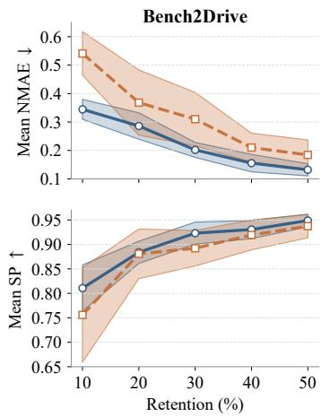

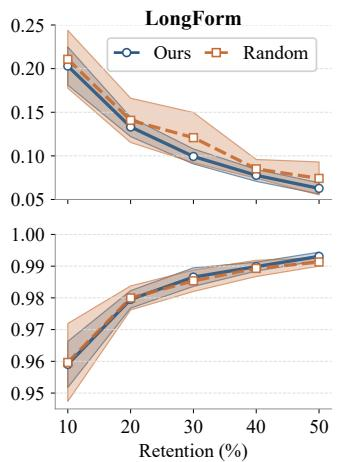

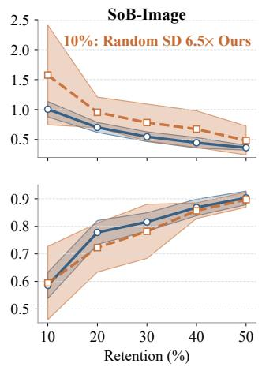  
Figure 5: Random-selection variability across 10 seeds. Results cover Bench2Drive, LongForm, and SoB-Image at 10%, 20%, 30%, 40%, and 50% retention under fixed model splits. Curves show ten-seed means; shaded bands indicate one standard deviation. Lower NMAE and higher SP indicate better fidelity.

## C.2 WHEN IS ONE METRIC SUFFICIENT?

DeepResearch Bench (Du et al., 2026) provides a high-correlation counterpart to Fig. 1. All ten metric pairs have model-ranking Spearman correlations of 0.92–0.99 (median 0.95), while Overall Score correlates with every component at 0.96–0.99. We further test whether this alignment makes single-metric selection transferable. At 20% retention, each component is used in turn as the sole selection metric for mRMR and AnchorPoints, and the selected items are evaluated on all five metrics. We additionally evaluate HoloCosm and Random at the same retention level.

Table 8: Cross-metric fidelity on DeepResearch at 20% retention. Each mRMR and Anchor-Points row uses one component for selection and evaluates the selected items on all five metrics. HoloCosm uses all metrics, while Random uses no guiding metric. Entries report NMAE ↓ / SP ↑, averaged over three seeds.
<table><tr><td>Method</td><td>Selection metric</td><td>Comp.</td><td>Insight</td><td>Inst. Follow.</td><td>Read.</td><td>Overall</td><td>Avg.</td></tr><tr><td rowspan="2">HoloCosm Random</td><td>All metrics</td><td>0.12 / 0.99</td><td>0.10 / 0.99</td><td>0.21 / 0.98</td><td>0.10 / 0.98</td><td>0.10 / 0.98</td><td>0.13 / 0.98</td></tr><tr><td></td><td>0.10 / 0.99</td><td>0.09 / 0.99</td><td>0.27 / 0.97</td><td>0.15 / 0.99</td><td>0.09 / 0.99</td><td>0.14 / 0.99</td></tr><tr><td rowspan="5">mRMR</td><td>Comprehensiveness</td><td>0.13 / 0.98</td><td>0.08 / 0.99</td><td>0.26 / 0.98</td><td>0.22 / 0.98</td><td>0.11 / 0.99</td><td>0.16 / 0.98</td></tr><tr><td>Insight</td><td>0.10 / 0.98</td><td>0.08 / 0.99</td><td>0.32 / 0.94</td><td>0.11 / 0.98</td><td>0.09 / 0.98</td><td>0.14 / 0.98</td></tr><tr><td>Instruction Following</td><td>0.15 / 0.99</td><td>0.09 / 0.99</td><td>0.30 / 0.94</td><td>0.18 / 0.98</td><td>0.10 / 1.00</td><td>0.16 / 0.98</td></tr><tr><td>Readability</td><td>0.11 / 0.98</td><td>0.08 / 0.99</td><td>0.27 / 0.96</td><td>0.13 / 0.96</td><td>0.10 / 0.99</td><td>0.14 / 0.98</td></tr><tr><td>Overall Score</td><td>0.11 / 0.97</td><td>0.09 / 0.99</td><td>0.22 / 0.96</td><td>0.17 / 0.96</td><td>0.11 / 0.98</td><td>0.14 / 0.97</td></tr><tr><td rowspan="5">AnchorPoints</td><td>Comprehensiveness</td><td>0.14 / 0.98</td><td>0.18 / 0.99</td><td>0.36 / 0.96</td><td>0.19 / 0.98</td><td>0.18 / 0.99</td><td>0.21 / 0.98</td></tr><tr><td>Insight</td><td>0.13 / 0.99</td><td>0.09 / 0.99</td><td>0.23 / 0.96</td><td>0.12 / 0.99</td><td>0.11 / 0.99</td><td>0.13 / 0.98</td></tr><tr><td>Instruction Following</td><td>0.15 / 0.99</td><td>0.11 / 0.99</td><td>0.22 / 0.96</td><td>0.14 / 0.99</td><td>0.13 / 0.99</td><td>0.15 / 0.98</td></tr><tr><td>Readability</td><td>0.12 / 0.99</td><td>0.17 / 0.98</td><td>0.31 / 0.95</td><td>0.11 / 0.99</td><td>0.13 / 0.98</td><td>0.17 / 0.98</td></tr><tr><td>Overall Score</td><td>0.12 / 0.98</td><td>0.12 / 0.99</td><td>0.28 / 0.96</td><td>0.12 / 0.99</td><td>0.11 / 0.98</td><td>0.15 / 0.98</td></tr></table>

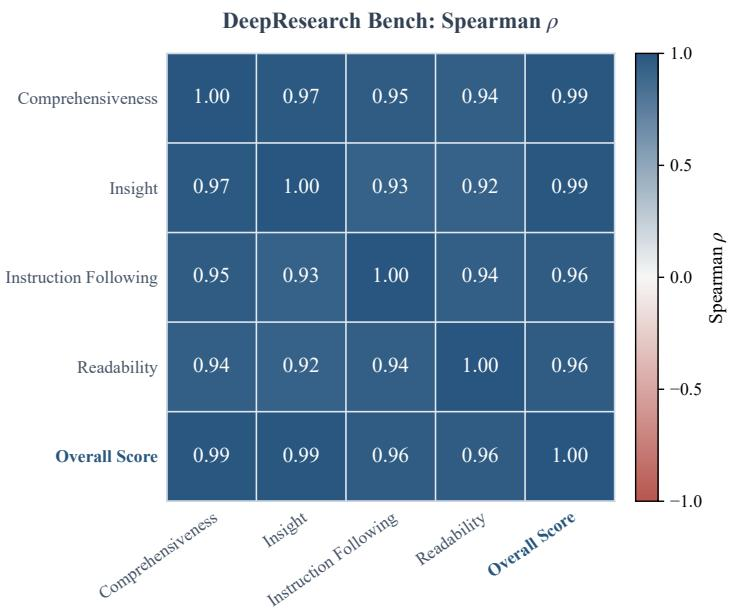  
Figure 6: A high-correlation control on DeepResearch Bench. Pairwise model-ranking Spearman correlations among four component dimensions and Overall Score. Overall Score is highlighted.

Regardless of the component used for selection, mRMR achieves an average SP of 0.9714–0.9829 and AnchorPoints achieves 0.9786–0.9842 across all evaluation metrics. Their average NMAE ranges are 0.1400–0.1645 and 0.1348–0.2087, respectively. HoloCosm’s multi-metric selection reaches 0.1254/0.9817 in average NMAE/SP. These results show that when component rankings are highly aligned, items selected using any single metric already transfer well to the remaining metrics.

Table 9: Aggregate-guided compression at 20% retention on five existing configurations. Official Overall includes the restricted LiveIdea-Core3 average described in the text.
<table><tr><td>Method</td><td>Strategy</td><td>Mean NMAE</td><td>Worst NMAE</td><td>Mean SP</td><td>Worst SP</td></tr><tr><td>AnchorPoints</td><td>AverageMetric</td><td>0.2955</td><td>0.4285</td><td>0.9137</td><td>0.8613</td></tr><tr><td>AnchorPoints</td><td>Official Overall</td><td>0.3781</td><td>0.6402</td><td>0.9142</td><td>0.8707</td></tr><tr><td>Ours</td><td>All metrics</td><td>0.1573</td><td>0.2420</td><td>0.9561</td><td>0.9006</td></tr><tr><td>Ours</td><td>AverageMetric</td><td>0.1809</td><td>0.3055</td><td>0.9530</td><td>0.8942</td></tr><tr><td>Ours</td><td>Official Overall</td><td>0.1729</td><td>0.2679</td><td>0.9534</td><td>0.9009</td></tr><tr><td>Random</td><td>Unguided</td><td>0.1747</td><td>0.2813</td><td>0.9549</td><td>0.9199</td></tr><tr><td>ZipBench</td><td>AverageMetric</td><td>0.2802</td><td>0.4487</td><td>0.9271</td><td>0.8735</td></tr><tr><td>ZipBench</td><td>Official Overall</td><td>0.2667</td><td>0.4074</td><td>0.9152</td><td>0.8478</td></tr><tr><td>mRMR</td><td>AverageMetric</td><td>0.3859</td><td>0.4718</td><td>0.8519</td><td>0.7727</td></tr><tr><td>mRMR</td><td>Official Overall</td><td>0.3772</td><td>0.4801</td><td>0.8191</td><td>0.7134</td></tr><tr><td>tinyBenchmarks</td><td>AverageMetric</td><td>0.2656</td><td>0.4009</td><td>0.9224</td><td>0.8544</td></tr><tr><td>tinyBenchmarks</td><td>Official Overall</td><td>0.2788</td><td>0.4380</td><td>0.9220</td><td>0.8717</td></tr></table>

Table 10: Aggregate-guided compression at 20% retention on eight configurations with common coverage. Official Overall includes the restricted LiveIdea-Core3 average described in the text.
<table><tr><td>Method</td><td>Strategy</td><td>Mean NMAE</td><td>Worst NMAE</td><td>Mean SP</td><td>Worst SP</td></tr><tr><td>AnchorPoints</td><td>AverageMetric</td><td>0.3951</td><td>0.5538</td><td>0.8756</td><td>0.8200</td></tr><tr><td>AnchorPoints</td><td>Official Overall</td><td>0.5118</td><td>0.7924</td><td>0.8454</td><td>0.7867</td></tr><tr><td>Ours</td><td>All metrics</td><td>0.2156</td><td>0.3050</td><td>0.9105</td><td>0.8582</td></tr><tr><td>Ours</td><td>AverageMetric</td><td>0.2711</td><td>0.3878</td><td>0.8845</td><td>0.8282</td></tr><tr><td>Random</td><td>Unguided</td><td>0.3295</td><td>0.4558</td><td>0.8748</td><td>0.8215</td></tr><tr><td>ZipBench</td><td>AverageMetric</td><td>0.4429</td><td>0.6315</td><td>0.8030</td><td>0.7382</td></tr><tr><td>ZipBench</td><td>Official Overall</td><td>0.4082</td><td>0.5670</td><td>0.8167</td><td>0.7392</td></tr><tr><td>mRMR</td><td>AverageMetric</td><td>0.4052</td><td>0.4886</td><td>0.7616</td><td>0.6692</td></tr><tr><td>mRMR</td><td>Official Overall</td><td>0.4519</td><td>0.6511</td><td>0.7345</td><td>0.5891</td></tr><tr><td>tinyBenchmarks</td><td>AverageMetric</td><td>0.4244</td><td>0.5924</td><td>0.8360</td><td>0.7539</td></tr><tr><td>tinyBenchmarks</td><td>Official Overall</td><td>0.4245</td><td>0.5850</td><td>0.8179</td><td>0.7416</td></tr></table>

## C.3 ALTERNATIVE MULTI-METRIC STRATEGIES

We compare AverageMetric, Vote, and K-means at 20% retention. Tab. 6 summarizes the comparison; Appendix D.2 reports the per-benchmark results.

## C.3.1 BENCHMARK-DEFINED OVERALL SCORES

We examine whether benchmark-level aggregate scores provide effective guidance for preserving component metrics, using AverageMetric as the reference. All selected subsets are evaluated on the original component metrics at 20% retention.

Tab. 9 compares aggregation strategies on ConStory, LiveIdea-Core3/Full4, and MMDocRAG Text/Multimodal. LiveIdea-Core3 uses the average of its three included metrics, and ConStory uses CED responses with full-data normalization. Tab. 10 extends the baseline comparison to Bench2Drive and Fail2Drive-ID/OOD, using driving score and HM, respectively. Results are averaged over the configurations included in each comparison.

Benchmark-level aggregate guidance does not consistently improve component fidelity. HoloCosm achieves the lowest mean NMAE in both comparisons.

## C.4 SOURCE-MODEL SELECTION

## C.4.1 NUMBER OF SOURCE MODELS

We vary the number of source models from 3 to 15 on LiveIdea-Full4 at 20% retention, using the same ten target models throughout. The remaining 31 models form the source candidate pool. We rank these candidates by their average metric-wise min–max-normalized full-benchmark scores and select 15 evenly spaced representatives. For each source count m, we choose m evenly spaced representatives, including both endpoints, and use the same selection across seeds. Results are averaged over three random seeds.

Table 11: Random-6 versus diverse source models on SoB-Audio at 20% retention. Results are averaged over three seeds.
<table><tr><td></td><td colspan="2">NMAE↓</td><td colspan="2">SP↑</td></tr><tr><td>Metric</td><td>Random-6</td><td>HoloCosm</td><td>Random-6</td><td>HoloCosm</td></tr><tr><td>Hierarchical path recall</td><td>0.6434</td><td>0.5412</td><td>0.7500</td><td>0.8389</td></tr><tr><td>Leaf-value EM</td><td>0.9410</td><td>0.6525</td><td>0.5333</td><td>0.7944</td></tr><tr><td>Path-set F1</td><td>0.7366</td><td>0.5841</td><td>0.6389</td><td>0.8444</td></tr><tr><td>Schema compliance</td><td>0.7012</td><td>0.5230</td><td>0.7608</td><td>0.8507</td></tr><tr><td>Value-token F1</td><td>0.5520</td><td>0.4463</td><td>0.7667</td><td>0.9333</td></tr><tr><td>Mean</td><td>0.7148</td><td>0.5494</td><td>0.6899</td><td>0.8524</td></tr></table>

Fig. 7 shows that six source models achieve the highest SP among the tested source counts. With six sources, NMAE is 0.2065 and SP is 0.9535, compared with 0.2115 and 0.9475 with fifteen sources. These results indicate that a compact source cohort can support accurate multi-metric compression in this setting.

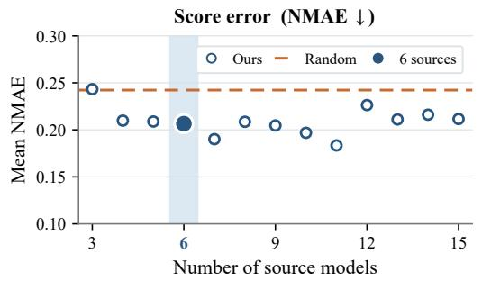

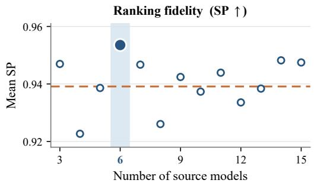  
Figure 7: Source-model count sensitivity on LiveIdea-Full4. Results at 20% retention are averaged over three random seeds. All configurations use the same target models. Lower NMAE and higher SP indicate better fidelity.

## C.4.2 SOURCE SELECTION STRATEGY

We compare two strategies for selecting six source models on SoB-Audio at 20% retention. Our strategy selects models at evenly spaced positions in the source candidate pool’s performance ranking. Random-6 samples six models uniformly without replacement from the same pool. Both strategies are evaluated on the same nine target models, with results averaged over three seeds.

Tab. 11 shows that selecting source models across the performance ranking improves both NMAE and SP on all five component metrics. Mean NMAE decreases from 0.7148 to 0.5494, a reduction of 23.1%, while mean SP increases from 0.6899 to 0.8524.

## C.5 SELECTION AND ESTIMATION ABLATIONS

We compare two additional variants at 20% retention across all 15 configurations, using the same source–target splits, seeds, and source-assisted estimator as in Tab. 5.

Effect of swap refinement. Without swap refinement uses the same 128 reference subsets and ranking threshold as HoloCosm, selects the feasible reference subset with the lowest reconstruction error, and stops without exchanging items. This isolates the contribution of refinement from reference-bank selection. As shown in Tab. 12, refinement further reduces Mean NMAE by 5.53%, with a smaller increase in Mean SP.

Table 12: Swap refinement and reconstruction-objective ablations at 20% retention. All variants use matched seeds and the same source-assisted estimator. Results are averaged equally over 15 configurations.
<table><tr><td>Variant</td><td>Mean NMAE ↓</td><td>Worst NMAE↓</td><td>Mean SP ↑</td></tr><tr><td>Without swap refinement</td><td>0.2500</td><td>0.3544</td><td>0.9130</td></tr><tr><td>Corrected-residual objective</td><td>0.2817</td><td>0.3802</td><td>0.8983</td></tr><tr><td>HoloCosm</td><td>0.2362</td><td>0.3299</td><td>0.9151</td></tr></table>

Reconstruction objective. Corrected-residual objective replaces only the mean reconstruction loss, retaining the source-pool folds, metric scales, ranking constraint, and search budget. Within each fold, each source model is treated as a pseudo-target and corrected using the other models in that fold. For a fold F of size L, let $\delta _ { m k } ( S )$ be model m’s uncorrected subset error. The corrected error is

$$
e _ { m k } ^ { ( - m ) } ( { \cal S } ) = \delta _ { m k } ( { \cal S } ) - { \frac { 1 } { L - 1 } } \sum _ { j \in F \backslash \{ m \} } \delta _ { j k } ( { \cal S } ) = { \frac { L } { L - 1 } } \left( \delta _ { m k } ( { \cal S } ) - \overline { { { \delta } } } _ { F , k } ( { \cal S } ) \right) .
$$

We average its normalized absolute value across models, metrics, and the existing folds. This alternative increases mean NMAE by 19.29% and lowers mean SP relative to HoloCosm.

Tab. 13 isolates multi-metric selection and pairwise-ranking protection on Fail2Drive-ID. Singlemetric selection uses HM, DR, and SR in turn to guide selection and averages the results over guiding metrics. Without ranking constraint removes only the pairwise-ranking constraint. Both ablations degrade all three metrics: multi-metric selection reduces average NMAE by 35.1% over single-metric selection, while removing the constraint changes NMAE/SP from 0.2762/0.7964 to 0.3573/0.6594.

Table 13: Ablation on Fail2Drive-ID at 20% retention. Three-seed NMAE ↓ / SP ↑ means; Avg. averages evaluation metrics. Single-metric results also average guiding metrics.
<table><tr><td>Variant</td><td>HM</td><td>DR</td><td>SR</td><td>Avg.</td></tr><tr><td>Ours</td><td>0.2940 / 0.7845</td><td>0.2246 / 0.8345</td><td>0.3101 / 0.7703</td><td>0.2762 / 0.7964</td></tr><tr><td>Single-metric selection</td><td>0.4507 / 0.6663</td><td>0.3309 / 0.6968</td><td>0.4960 / 0.6636</td><td>0.4259 / 0.6756</td></tr><tr><td>Without ranking constraint</td><td>0.3710 / 0.6429</td><td>0.3099 / 0.6714</td><td>0.3911 / 0.6640</td><td>0.3573 / 0.6594</td></tr></table>

Tabs. 14 and 15 resolve this comparison at the component level on two three-metric benchmarks. On WorkBench, Ours reduces NMAE on all three metrics, with the largest reduction on Exact Match (16.5%). On LiveIdea-Core3, the reduction is concentrated on Feasibility (16.7%), while Clarity and Originality change by less than 3%.

Table 14: Per-metric constrained-selection ablation on WorkBench. Results at 20% retention are three-run means. Reconstruction and Ours use the same source-assisted correction. NMAE reduction is (Recon − Ours)/Recon; SP gain is Ours − Recon. Positive values favor Ours.
<table><tr><td></td><td colspan="3">NMAE↓</td><td colspan="3">SP↑</td></tr><tr><td>Metric</td><td>Recon</td><td>Ours</td><td>Reduction</td><td>Recon</td><td>Ours</td><td>Gain</td></tr><tr><td>Correct</td><td>0.1384</td><td>0.1288</td><td>6.9%</td><td>0.9790</td><td></td><td>0.9855 +0.0065</td></tr><tr><td>Exact Match 0.1561 0.1304</td><td></td><td></td><td>16.5%</td><td></td><td></td><td>0.9814 0.9837 +0.0022</td></tr><tr><td>Safety</td><td></td><td>0.16960.1578</td><td></td><td></td><td></td><td>6.9% 0.9592 0.9614 +0.0022</td></tr></table>

Table 15: Per-metric constrained-selection ablation on LiveIdea-Core3. Results at 20% retention are three-run means. Reconstruction and Ours use the same source-assisted correction. NMAE reduction is (Recon − Ours)/Recon; SP gain is Ours − Recon. Positive values favor Ours.
<table><tr><td></td><td colspan="3">NMAE↓</td><td colspan="3">SP↑</td></tr><tr><td>Metric</td><td>Recon</td><td></td><td>Ours Reduction</td><td>Recon</td><td>Ours</td><td>Gain</td></tr><tr><td>Clarity</td><td></td><td>0.10540.1074</td><td>-1.9%</td><td>0.9725</td><td></td><td>0.9738+0.0012</td></tr><tr><td>Feasibility</td><td>0.15640.1303</td><td></td><td>16.7%</td><td></td><td></td><td>0.9641 0.9771 +0.0130</td></tr><tr><td>Originality 0.0690 0.0707</td><td></td><td></td><td>-2.6%0.9947 0.9947</td><td></td><td></td><td>0.0000</td></tr></table>

## C.5.1 COMPARISON UNDER A COMMON ESTIMATOR

We compare HoloCosm with AverageMetric-guided ZipBench under the same uniform sourceassisted estimator at 20% retention across all 15 configurations. We also report ZipBench’s original weighted estimator. The ZipBench variants use the same selected items, and all estimates are evaluated on the original component metrics.

Table 16: Common-estimator comparison with AverageMetric-guided ZipBench at 20% retention. Results average three runs per method and weight the 15 benchmarks equally. All ZipBench variants use the same selected items.
<table><tr><td>Estimator / method</td><td>Mean NMAE↓</td><td>Worst NMAE↓</td><td>Mean SP ↑</td></tr><tr><td>ZipBench: original weighted</td><td>0.4920</td><td>0.7376</td><td>0.8145</td></tr><tr><td>ZipBench: uniform + correction</td><td>0.3423</td><td>0.4720</td><td>0.8705</td></tr><tr><td>HoloCosm</td><td>0.2362</td><td>0.3299</td><td>0.9151</td></tr></table>

Tab. 16 shows that, under the same uniform source-corrected estimator, HoloCosm-selected subsets achieve 31.0% lower mean NMAE and 30.1% lower worst-component NMAE than AverageMetricguided ZipBench subsets. Mean NMAE is lower on 13 of the 15 configurations.

## C.5.2 SENSITIVITY TO THE RANKING-CONSTRAINT QUANTILE

We evaluate ranking-constraint calibration quantiles $q \in \{ 0 . 1 0 , 0 . 2 5 , 0 . 5 0 \}$ on Fail2Drive-ID, SoB-Audio, and LiveIdea-Core3 at 20% retention. Tab. 17 reports results averaged over three seeds.

Table 17: Sensitivity to the ranking-constraint quantile at 20% retention. Each entry reports mean/worst-component NMAE / mean SP.
<table><tr><td>Setting</td><td>Fail2Drive-ID</td><td>SoB-Audio</td><td>LiveIdea-Core3</td></tr><tr><td> $q = 0 . 1 0$ </td><td></td><td>0.3996 / 0.4671 / 0.57820.6236 / 0.7902 / 0.79600.1028 / 0.1336 / 0.9819</td><td></td></tr><tr><td></td><td></td><td></td><td>q = 0.25 (default) 0.2762 / 0.3219 / 0.79640.5798 / 0.7520 / 0.82930.1028 / 0.1336 / 0.9819</td></tr><tr><td> $q = 0 . 5 0$ </td><td></td><td></td><td>0.3573 / 0.3922 / 0.65940.5798 / 0.7520 / 0.82930.1102 / 0.1564 / 0.9771</td></tr></table>

The default $q = 0 . 2 5$ achieves the best overall fidelity across the three benchmarks.

## C.6 EVALUATION COST

## C.6.1 EVALUATION SIZE

For metric-wise selection, the nominal per-metric selection size need not equal the final evaluation cost. Let $S _ { k } ( B )$ denote the selection for component k. The union $S _ { \mathrm { u n i o n } } ( B ) = \cup _ { k = 1 } ^ { K } S _ { k } ( B )$ contains between B and min(N, KB) unique items. For each benchmark, method, retention level, and seed, the evaluation cost is the number of distinct items in this union, with items shared by several component selections counted only once.

We report the inflation factor $I _ { \mathrm { u n i o n } } = | S _ { \mathrm { u n i o n } } ( B ) | / B$ . Tab. 18 gives representative tinyBenchmarks selection sizes and absolute union sizes. For example, on LongForm a per-component selection size of 22 items produces a union of 101 items, or 4.591 times the nominal selection size.

Table 18: Representative actual union sizes for tinyBenchmarks. At 20% nominal retention, independent component-wise selections can require substantially more than B unique evaluations.
<table><tr><td>Benchmark</td><td>B</td><td> $\vert S _ { \mathrm { u n i o n } } \vert$ </td><td> $I _ { \mathrm { u n i o n } }$ </td></tr><tr><td>LongForm</td><td>22</td><td>101</td><td>4.591</td></tr><tr><td>Widget2Code</td><td>58</td><td>263</td><td>4.534</td></tr><tr><td>MMDocRAG-MM</td><td>395</td><td>1,624</td><td>4.111</td></tr><tr><td>SoB-Text</td><td>1,000</td><td>3,320</td><td>3.320</td></tr><tr><td>RouterArena</td><td>1,680</td><td>3,020</td><td>1.798</td></tr></table>

## C.6.2 OFFLINE ITEM-SELECTION TIME

At 20% retention, item selection averages 0.77 seconds across all 45 benchmark–seed runs. Tab. 19 gives results for three larger benchmarks; the longest individual run is 3.71 seconds on RouterArena.

Table 19: Offline item-selection time at 20% retention. Times are means and one standard deviation over three seeds.
<table><tr><td>Benchmark</td><td>Items</td><td>Metrics</td><td>Selection size</td><td>Time (s)</td></tr><tr><td>RouterArena</td><td>8,400</td><td>2</td><td>1,680</td><td> $2 . 5 3 \pm 1 . 1 2$ </td></tr><tr><td>SoB-Text</td><td>5,000</td><td>6</td><td>1,000</td><td> $2 . 3 8 \pm 0 . 2 8$ </td></tr><tr><td>MMDocRAG-Multimodal</td><td>1,974</td><td>8</td><td>395</td><td> $1 . 3 2 \pm 0 . 1 7$ </td></tr></table>

## D DETAILED RESULTS

## D.1 AGGREGATE RESULTS

Tab. 20 reports the aggregate fidelity measures. We additionally report Kendall’s $\tau _ { b } ,$ which accounts for tied ranks (Kendall, 1945). For each single-target method and benchmark, every official component is used as a selection target, and the selected items are evaluated on all components. Component means and extrema are computed for each selection before averaging over repetitions. Each base line retains the target with the lowest mean NMAE and reports all fidelity measures for that target. The final summary weights the 15 benchmarks equally. HoloCosm and Random each perform one selection per run rather than metric-specific selection.

Table 20: Aggregate fidelity across 15 benchmarks at 20% retention. Mean and worstcomponent fidelity are aggregated within benchmarks before averaging benchmarks equally. Each scalar method uses its best selection target by mean NMAE, with the same target used for all fidelity measures. Bold and underline indicate the best and second-best values in each column.
<table><tr><td rowspan="2">Method</td><td colspan="2">NMAE↓</td><td colspan="2">SP↑</td><td rowspan="2">Kendall&#x27;s τb ↑ Mean</td></tr><tr><td>Mean</td><td>Worst</td><td>Mean</td><td>Worst</td></tr><tr><td>HoloCosm</td><td>0.2362</td><td>0.3299</td><td>0.9151</td><td>0.8624</td><td>0.8173</td></tr><tr><td>Random</td><td>0.3650</td><td>0.5450</td><td>0.8840</td><td>0.8302</td><td>0.7859</td></tr><tr><td>tinyBenchmarks</td><td>0.4421</td><td>0.6297</td><td>0.8483</td><td>0.7545</td><td>0.7252</td></tr><tr><td>ZipBench</td><td>0.4123</td><td>0.6364</td><td>0.8467</td><td>0.7646</td><td>0.7288</td></tr><tr><td>mRMR</td><td>0.4321</td><td>0.5997</td><td>0.7894</td><td>0.5952</td><td>0.6734</td></tr><tr><td>AnchorPoints</td><td>0.5533</td><td>0.9256</td><td>0.8361</td><td>0.7508</td><td>0.7196</td></tr><tr><td>EssenceBench</td><td>0.4515</td><td>0.6302</td><td>0.8736</td><td>0.7898</td><td>0.7643</td></tr></table>

## D.2 PER-BENCHMARK STRATEGY COMPARISONS

Tabs. 21 and 22 expand Tab. 6. All values are averages over available runs within each configuration;   
Average weights configurations equally.

Table 21: Per-configuration simple-strategy results at 20% retention: Random and AnchorPoints. NMAE and SP are means over metrics.
<table><tr><td rowspan="2">Configuration</td><td colspan="2">Random</td><td colspan="2">AnchorPoints: Single</td><td colspan="2">AnchorPoints: AverageMetric</td><td colspan="2">AnchorPoints: Vote</td></tr><tr><td>NMAE↓</td><td>SP↑</td><td>NMAE↓</td><td>SP↑</td><td>NMAE ↓</td><td>SP↑</td><td>NMAE↓</td><td>SP↑</td></tr><tr><td>Widget2Code</td><td>0.2979</td><td>0.9335</td><td>0.3280</td><td>0.8628</td><td>0.3148</td><td>0.9167</td><td>0.4707</td><td>0.8911</td></tr><tr><td>ConStory</td><td>0.2938</td><td>0.8813</td><td>1.2431</td><td>0.5209</td><td>0.8375</td><td>0.7038</td><td>0.3320</td><td>0.8606</td></tr><tr><td>Bench2Drive</td><td>0.3881</td><td>0.8418</td><td>0.5910</td><td>0.7899</td><td>0.5200</td><td>0.8120</td><td>0.9476</td><td>0.8800</td></tr><tr><td>Fail2Drive-ID</td><td>0.5805</td><td>0.5918</td><td>0.2839</td><td>0.7051</td><td>0.4309</td><td>0.7524</td><td>0.8388</td><td>0.8696</td></tr><tr><td>Fail2Drive-OOD</td><td>0.7939</td><td>0.7903</td><td>0.6111</td><td>0.7968</td><td>0.7323</td><td>0.8720</td><td>0.7760</td><td>0.7794</td></tr><tr><td>LiveIdea-Core3</td><td>0.1075</td><td>0.9834</td><td>0.1207</td><td>0.9811</td><td>0.1182</td><td>0.9733</td><td>0.1107</td><td>0.9827</td></tr><tr><td>LiveIdea-Full4</td><td>0.2888</td><td>0.9359</td><td>0.2693</td><td>0.9410</td><td>0.3016</td><td>0.9225</td><td>0.2539</td><td>0.9490</td></tr><tr><td>LongForm</td><td>0.1400</td><td>0.9814</td><td>0.1459</td><td>0.9801</td><td>0.1483</td><td>0.9780</td><td>0.1546</td><td>0.9738</td></tr><tr><td>MMDocRAG-Multimodal</td><td>0.0729</td><td>0.9915</td><td>0.0864</td><td>0.9882</td><td>0.0886</td><td>0.9908</td><td>0.1494</td><td>0.9883</td></tr><tr><td>MMDocRAG-Text</td><td>0.1106</td><td>0.9824</td><td>0.1259</td><td>0.9740</td><td>0.1318</td><td>0.9780</td><td>0.3201</td><td>0.9583</td></tr><tr><td>RouterArena</td><td>0.1464</td><td>0.9905</td><td>0.2783</td><td>0.9714</td><td>0.5413</td><td>0.9048</td><td>0.8428</td><td>0.9857</td></tr><tr><td>SoB-Audio</td><td>0.7048</td><td>0.7791</td><td>0.7179</td><td>0.8040</td><td>1.3456</td><td>0.6978</td><td>1.3263</td><td>0.7372</td></tr><tr><td>SoB-Image</td><td>1.1731</td><td>0.6484</td><td>0.8664</td><td>0.7090</td><td>1.0741</td><td>0.7303</td><td>1.8610</td><td>0.7579</td></tr><tr><td>SoB-Text</td><td>0.2104</td><td>0.9598</td><td>1.8020</td><td>0.6720</td><td>1.8754</td><td>0.7646</td><td>0.8672</td><td>0.9657</td></tr><tr><td>WorkBench</td><td>0.1664</td><td>0.9683</td><td>0.8299</td><td>0.8448</td><td>0.6982</td><td>0.7484</td><td>0.1812</td><td>0.9775</td></tr><tr><td>Average</td><td>0.3650</td><td>0.8840</td><td>0.5533</td><td>0.8361</td><td>0.6106</td><td>0.8497</td><td>0.6288</td><td>0.9038</td></tr></table>

Table 22: Per-configuration simple-strategy results at 20% retention: K-means and Ours. NMAE and SP are means over metrics.
<table><tr><td>Configuration</td><td colspan="2">K-means</td><td colspan="2">Ours: AverageMetric</td><td colspan="2">Ours: All metrics</td></tr><tr><td></td><td>NMAE↓</td><td>SP↑</td><td>NMAE↓</td><td>SP↑</td><td>NMAE↓</td><td>SP↑</td></tr><tr><td>Widget2Code</td><td>0.2231</td><td>0.9196</td><td>0.2086</td><td>0.9276</td><td>0.2178</td><td>0.9444</td></tr><tr><td>ConStory</td><td>0.5427</td><td>0.7896</td><td>0.4015</td><td>0.8618</td><td>0.2972</td><td>0.8754</td></tr><tr><td>Bench2Drive</td><td>0.2938</td><td>0.8346</td><td>0.3234</td><td>0.8677</td><td>0.2736</td><td>0.8432</td></tr><tr><td>Fail2Drive-ID</td><td>0.2370</td><td>0.7865</td><td>0.3761</td><td>0.7031</td><td>0.2762</td><td>0.7964</td></tr><tr><td>Fail2Drive-OOD</td><td>0.4327</td><td>0.7447</td><td>0.5646</td><td>0.7401</td><td>0.3889</td><td>0.8642</td></tr><tr><td>LiveIdea-Core3</td><td>0.1425</td><td>0.9738</td><td>0.1056</td><td>0.9811</td><td>0.1028</td><td>0.9819</td></tr><tr><td>LiveIdea-Full4</td><td>0.3216</td><td>0.9335</td><td>0.2414</td><td>0.9471</td><td>0.2247</td><td>0.9481</td></tr><tr><td>LongForm</td><td>0.1474</td><td>0.9744</td><td>0.1355</td><td>0.9763</td><td>0.1172</td><td>0.9839</td></tr><tr><td>MMDocRAG-Multimodal</td><td>0.0756</td><td>0.9903</td><td>0.0658</td><td>0.9917</td><td>0.0645</td><td>0.9929</td></tr><tr><td>MMDocRAG-Text</td><td>0.1411</td><td>0.9702</td><td>0.0902</td><td>0.9832</td><td>0.0972</td><td>0.9821</td></tr><tr><td>RouterArena</td><td>0.2161</td><td>0.9524</td><td>0.1207</td><td>0.9810</td><td>0.0928</td><td>0.9714</td></tr><tr><td>SoB-Audio</td><td>0.6312</td><td>0.8668</td><td>0.5812</td><td>0.7927</td><td>0.5798</td><td>0.8293</td></tr><tr><td>SoB-Image</td><td>0.7921</td><td>0.6235</td><td>0.7079</td><td>0.7217</td><td>0.5145</td><td>0.7723</td></tr><tr><td>SoB-Text</td><td>0.3489</td><td>0.9415</td><td>0.1649</td><td>0.9692</td><td>0.1560</td><td>0.9642</td></tr><tr><td>WorkBench</td><td>0.3171</td><td>0.9620</td><td>0.1463</td><td>0.9753</td><td>0.1390</td><td>0.9769</td></tr><tr><td>Average</td><td>0.3242</td><td>0.8842</td><td>0.2822</td><td>0.8946</td><td>0.2362</td><td>0.9151</td></tr></table>

Tab. 23 reports additional baseline results using AverageMetric for item selection at 20% retention.

Table 23: Additional AverageMetric-guided results at 20% retention. Ours: All metrics uses the full metric set. NMAE and SP are metric means; Average weights 15 configurations equally.
<table><tr><td rowspan="2">Configuration</td><td colspan="2">tinyBenchmarks</td><td colspan="2">ZipBench</td><td colspan="2">mRMR</td><td colspan="2">AnchorPoints</td><td colspan="2">Ours: AverageMetric</td><td colspan="2">Ours: All metrics</td></tr><tr><td>NMAE↓</td><td>SP↑</td><td>NMAE↓</td><td>SP↑</td><td>NMAE↓</td><td>SP↑</td><td>NMAE↓</td><td>SP↑</td><td>NMAE↓</td><td>SP↑</td><td>NMAE↓</td><td>SP↑</td></tr><tr><td>Widget2Code</td><td>0.4120</td><td>0.8958</td><td>0.3892</td><td>0.8562</td><td>0.2476</td><td>0.9167</td><td>0.3148</td><td>0.9167</td><td>0.2086</td><td>0.9276</td><td>0.2178</td><td>0.9444</td></tr><tr><td>ConStory</td><td>0.4377</td><td>0.8259</td><td>0.5151</td><td>0.8100</td><td>0.7738</td><td>0.4386</td><td>0.8375</td><td>0.7038</td><td>0.4015</td><td>0.8618</td><td>0.2972</td><td>0.8754</td></tr><tr><td>Bench2Drive</td><td>0.7194</td><td>0.7078</td><td>0.6091</td><td>0.7980</td><td>0.5039</td><td>0.7149</td><td>0.5200</td><td>0.8120</td><td>0.3234</td><td>0.8677</td><td>0.2736</td><td>0.8432</td></tr><tr><td>Fail2Drive-ID</td><td>0.6051</td><td>0.7966</td><td>0.6112</td><td>0.5426</td><td>0.3388</td><td>0.5753</td><td>0.4309</td><td>0.7524</td><td>0.3761</td><td>0.7031</td><td>0.2762</td><td>0.7964</td></tr><tr><td>Fail2Drive-OOD</td><td>0.7430</td><td>0.5717</td><td>0.9218</td><td>0.4478</td><td>0.4691</td><td>0.5431</td><td>0.7323</td><td>0.8720</td><td>0.5646</td><td>0.7401</td><td>0.3889</td><td>0.8642</td></tr><tr><td>LiveIdea-Core3</td><td>0.2125</td><td>0.9534</td><td>0.2012</td><td>0.9672</td><td>0.3742</td><td>0.9657</td><td>0.1182</td><td>0.9733</td><td>0.1056</td><td>0.9811</td><td>0.1028</td><td>0.9819</td></tr><tr><td>LiveIdea-Full4</td><td>0.3656</td><td>0.8915</td><td>0.4070</td><td>0.9139</td><td>0.4173</td><td>0.8896</td><td>0.3016</td><td>0.9225</td><td>0.2414</td><td>0.9471</td><td>0.2247</td><td>0.9481</td></tr><tr><td>LongForm</td><td>0.1878</td><td>0.9641</td><td>0.2170</td><td>0.9623</td><td>0.1727</td><td>0.9735</td><td>0.1483</td><td>0.9780</td><td>0.1355</td><td>0.9763</td><td>0.1172</td><td>0.9839</td></tr><tr><td>MMDocRAG-Multimodal</td><td>0.1340</td><td>0.9798</td><td>0.1110</td><td>0.9813</td><td>0.1147</td><td>0.9917</td><td>0.0886</td><td>0.9908</td><td>0.0658</td><td>0.9917</td><td>0.0645</td><td>0.9929</td></tr><tr><td>MMDocRAG-Text</td><td>0.1781</td><td>0.9612</td><td>0.1665</td><td>0.9631</td><td>0.2495</td><td>0.9736</td><td>0.1318</td><td>0.9780</td><td>0.0902</td><td>0.9832</td><td>0.0972</td><td>0.9821</td></tr><tr><td>RouterArena</td><td>0.3973</td><td>0.9714</td><td>0.3411</td><td>0.9048</td><td>1.0962</td><td>0.8857</td><td>0.5413</td><td>0.9048</td><td>0.1207</td><td>0.9810</td><td>0.0928</td><td>0.9714</td></tr><tr><td>SoB-Audio</td><td>1.0299</td><td>0.6290</td><td>1.1876</td><td>0.6782</td><td>0.5518</td><td>0.7420</td><td>1.3456</td><td>0.6978</td><td>0.5812</td><td>0.7927</td><td>0.5798</td><td>0.8293</td></tr><tr><td>SoB-Image SoB-Text</td><td>1.1644 0.4390</td><td>0.6768 0.8792</td><td>1.0201 0.4560</td><td>0.5886</td><td>0.7144 0.5707</td><td>0.2875</td><td>1.0741 1.8754</td><td>0.7303</td><td>0.7079</td><td>0.7217 0.9692</td><td>0.5145</td><td>0.7723 0.9642</td></tr><tr><td>WorkBench</td><td>0.2717</td><td>0.9527</td><td>0.2256</td><td>0.8417 0.9612</td><td>0.3894</td><td>0.8218 0.8390</td><td>0.6982</td><td>0.7646 0.7484</td><td>0.1649 0.1463</td><td>0.9753</td><td>0.1560</td><td></td></tr><tr><td></td><td></td><td></td><td></td><td></td><td></td><td></td><td></td><td></td><td></td><td></td><td>0.1390</td><td>0.9769</td></tr><tr><td>Average</td><td>0.4865</td><td>0.8438</td><td>0.4920</td><td>0.8145</td><td>0.4656</td><td>0.7706</td><td>0.6106</td><td>0.8497</td><td>0.2822</td><td>0.8946</td><td>0.2362</td><td>0.9151</td></tr></table>

## D.3 CROSS-METRIC RESULTS

Tabs. 24, 25, and 26 report cross-metric fidelity at 20% retention. Baselines select using the indicated metric; underlining marks diagonal entries.

Fail2Drive-OOD  
Table 24: Cross-metric fidelity on Fail2Drive-ID and Fail2Drive-OOD at 20% retention. Ours and Random do not use metric-specific selection. The Mean column averages NMAE across metrics; pale blue-gray marks each single-metric baseline's lowest-mean selection target.
<table><tr><td colspan="9">Fail2Drive-ID</td></tr><tr><td rowspan="2">Method</td><td rowspan="2">Selection metric</td><td colspan="4">NMAE↓</td><td colspan="3">SP↑</td></tr><tr><td>HM</td><td>DR</td><td>SR</td><td>Mean</td><td>HM</td><td>DR</td><td>SR</td></tr><tr><td>Ours</td><td>All metrics</td><td>0.294</td><td>0.225</td><td>0.310</td><td>0.276</td><td>0.785</td><td>0.835</td><td>0.770</td></tr><tr><td>Random</td><td>None</td><td>0.611</td><td>0.488</td><td>0.643</td><td>0.580</td><td>0.571</td><td>0.646</td><td>0.558</td></tr><tr><td rowspan="3">tinyBenchmarks</td><td>HM</td><td>0.804</td><td>0.702</td><td>0.820</td><td>0.775</td><td>0.482</td><td>0.608</td><td>0.296</td></tr><tr><td>DR</td><td>0.766</td><td>0.681</td><td>0.814</td><td>0.754</td><td>0.477</td><td>0.583</td><td>0.506</td></tr><tr><td>SR</td><td>0.785</td><td>0.602</td><td>0.837</td><td>0.741</td><td>0.848</td><td>0.883</td><td>0.653</td></tr><tr><td rowspan="3">ZipBench</td><td>HM</td><td>0.544</td><td>0.396</td><td>0.592</td><td>0.510</td><td>0.544</td><td>0.596</td><td>0.565</td></tr><tr><td>DR</td><td>0.800</td><td>0.583</td><td>0.842</td><td>0.742</td><td>0.630</td><td>0.687</td><td>0.580</td></tr><tr><td>SR</td><td>0.766</td><td>0.668</td><td>0.809</td><td>0.748</td><td>0.717</td><td>0.776</td><td>0.671</td></tr><tr><td rowspan="3">mRMR</td><td>HM</td><td>0.439</td><td>0.383</td><td>0.440</td><td>0.420</td><td>0.593</td><td>0.550</td><td>0.357</td></tr><tr><td>DR</td><td>0.403</td><td>0.296</td><td>0.405</td><td>0.368</td><td>0.507</td><td>0.614</td><td>0.345</td></tr><tr><td>SR</td><td>0.424</td><td>0.453</td><td>0.457</td><td>0.445</td><td>0.561</td><td>0.496</td><td>0.591</td></tr><tr><td rowspan="3">AnchorPoints</td><td>HM</td><td>0.290</td><td>0.235</td><td>0.327</td><td>0.284</td><td>0.705</td><td>0.684</td><td>0.726</td></tr><tr><td>DR</td><td>0.698</td><td>0.696</td><td>0.704</td><td>0.699</td><td>0.551</td><td>0.604</td><td>0.602</td></tr><tr><td>SR</td><td>0.914</td><td>0.874</td><td>0.969</td><td>0.919</td><td>0.699</td><td>0.712</td><td>0.728</td></tr><tr><td rowspan="3">EssenceBench</td><td>HM</td><td>1.113</td><td>0.997</td><td>1.105</td><td>1.072</td><td>0.518</td><td>0.496</td><td>0.615</td></tr><tr><td>DR</td><td>1.031</td><td>0.930</td><td>1.027</td><td>0.996</td><td>0.432</td><td>0.550</td><td>0.551</td></tr><tr><td>SR</td><td>1.294</td><td>1.056</td><td>1.312</td><td>1.220</td><td>0.543</td><td>0.596</td><td>0.648</td></tr></table>

<table><tr><td rowspan="2">Method</td><td rowspan="2">Selection metric</td><td colspan="4">NMAE</td><td colspan="3">SP↑</td></tr><tr><td>HM</td><td>DR</td><td>SR</td><td>Mean</td><td>HM</td><td>DR</td><td>SR</td></tr><tr><td>Ours</td><td>All metrics</td><td>0.421</td><td>0.295</td><td>0.451</td><td>0.389</td><td>0.865</td><td>0.869</td><td>0.858</td></tr><tr><td>Random</td><td>None</td><td>0.922</td><td>0.501</td><td>0.958</td><td>0.794</td><td>0.777</td><td>0.865</td><td>0.728</td></tr><tr><td rowspan="3">tinyBenchmarks</td><td>HM</td><td>0.687</td><td>0.637</td><td>0.707</td><td>0.677</td><td>0.702</td><td>0.693</td><td>0.664</td></tr><tr><td>DR</td><td>0.979</td><td>0.528</td><td>1.107</td><td>0.872</td><td>0.358</td><td>0.675</td><td>0.152</td></tr><tr><td>SR</td><td>0.889</td><td>0.660</td><td>0.968</td><td>0.839</td><td>0.544</td><td>0.544</td><td>0.544</td></tr><tr><td rowspan="3">ZipBench</td><td>HM</td><td>0.930</td><td>0.766</td><td>0.973</td><td>0.889</td><td>0.635</td><td>0.683</td><td>0.573</td></tr><tr><td>DR</td><td>0.830</td><td>0.532</td><td>0.874</td><td>0.745</td><td>0.492</td><td>0.651</td><td>0.539</td></tr><tr><td>SR</td><td>0.784</td><td>0.612</td><td>0.808</td><td>0.735</td><td>0.635</td><td>0.731</td><td>0.586</td></tr><tr><td rowspan="3">mRMR</td><td>HM</td><td>1.853</td><td>0.389</td><td>0.590</td><td>0.944</td><td>0.129</td><td>0.539</td><td>0.675</td></tr><tr><td>DR</td><td>0.710</td><td>0.352</td><td>0.440</td><td>0.501</td><td>0.632</td><td>0.482</td><td>0.424</td></tr><tr><td>SR</td><td>0.657</td><td>0.611</td><td>0.709</td><td>0.659</td><td>0.407</td><td>0.396</td><td>0.369</td></tr><tr><td rowspan="3">AnchorPoints</td><td>HM</td><td>0.710</td><td>0.465</td><td>0.716</td><td>0.630</td><td>0.816</td><td>0.799</td><td>0.753</td></tr><tr><td>DR</td><td>0.633</td><td>0.496</td><td>0.704</td><td>0.611</td><td>0.795</td><td>0.743</td><td>0.852</td></tr><tr><td>SR</td><td>0.916</td><td>0.633</td><td>0.987</td><td>0.845</td><td>0.710</td><td>0.711</td><td>0.706</td></tr><tr><td rowspan="3">EssenceBench</td><td>HM</td><td>0.723</td><td>0.539</td><td>0.758</td><td>0.673</td><td>0.704</td><td>0.768</td><td>0.784</td></tr><tr><td>DR</td><td>0.723</td><td>0.539</td><td>0.758</td><td>0.673</td><td>0.704</td><td>0.768</td><td>0.784</td></tr><tr><td>SR</td><td>0.614</td><td>0.476</td><td>0.652</td><td>0.581</td><td>0.725</td><td>0.746</td><td>0.796</td></tr></table>

The following tables report the remaining benchmark-level cross-metric results at 20% retention. Entries are NMAE / SP, averaged over three seeds.

WorkBench  
Table 25: Cross-metric fidelity on LiveIdea-Core3 and WorkBench at 20% retention. Ours and Random do not use metric-specific selection. The Mean column averages NMAE across metrics; pale blue-gray marks each single-metric baseline's lowest-mean selection target.
<table><tr><td colspan="9">LiveIdea-Core3</td></tr><tr><td rowspan="3">Method</td><td rowspan="3">Selection metric</td><td colspan="4">NMAE↓</td><td colspan="3">SP↑</td></tr><tr><td>Originality Feasibility</td><td></td><td>Clarity</td><td></td><td></td><td>Mean Originality Feasibility</td><td>Clarity</td></tr><tr><td></td><td>0.130</td><td>0.107</td><td>0.103</td><td>0.995</td><td>0.977</td><td>0.974</td></tr><tr><td>Ours Random</td><td>All metrics None</td><td>0.071 0.071</td><td>0.149</td><td>0.103</td><td>0.108</td><td>0.995</td><td>0.976</td><td>0.979</td></tr><tr><td rowspan="3">tinyBenchmarks Feasibility</td><td>Originality</td><td>0.103</td><td>0.382</td><td>0.208</td><td>0.231</td><td>0.990</td><td>0.963</td><td>0.956</td></tr><tr><td></td><td>0.117</td><td>0.187</td><td>0.184</td><td>0.162</td><td>0.985</td><td>0.952</td><td>0.946</td></tr><tr><td>Clarity</td><td>0.122</td><td>0.274</td><td>0.179</td><td>0.191</td><td>0.987</td><td>0.965</td><td>0.941</td></tr><tr><td rowspan="3">ZipBench</td><td>Originality</td><td>0.114</td><td>0.228</td><td>0.171</td><td>0.171</td><td>0.988</td><td>0.949</td><td>0.954</td></tr><tr><td>Feasibility</td><td>0.138</td><td>0.334</td><td>0.154</td><td>0.208</td><td>0.986</td><td>0.942</td><td>0.949</td></tr><tr><td>Clarity</td><td>0.111</td><td>0.228</td><td>0.155</td><td>0.165</td><td>0.988</td><td>0.948</td><td>0.956</td></tr><tr><td rowspan="3">mRMR</td><td>Originality</td><td>0.136</td><td>0.442</td><td>0.499</td><td>0.359</td><td>0.994</td><td>0.946</td><td>0.950</td></tr><tr><td>Feasibility</td><td>0.096</td><td>0.486</td><td>0.514</td><td>0.365</td><td>0.996</td><td>0.960</td><td>0.929</td></tr><tr><td>Clarity</td><td>0.117</td><td>0.414</td><td>0.474</td><td>0.335</td><td>0.994</td><td>0.958</td><td>0.954</td></tr><tr><td rowspan="3">AnchorPoints</td><td>Originality</td><td>0.091</td><td>0.151</td><td>0.120</td><td>0.121</td><td>0.994</td><td>0.976</td><td>0.974</td></tr><tr><td>Feasibility</td><td>0.097</td><td>0.177</td><td>0.142</td><td>0.139</td><td>0.995</td><td>0.969</td><td>0.968</td></tr><tr><td>Clarity</td><td>0.088</td><td>0.212</td><td>0.145</td><td>0.149</td><td>0.992</td><td>0.976</td><td>0.968</td></tr><tr><td rowspan="3">EssenceBench</td><td>Originality</td><td>0.075</td><td>0.152</td><td>0.086</td><td>0.104</td><td>0.996</td><td>0.986</td><td>0.983</td></tr><tr><td>Feasibility</td><td>0.059</td><td>0.161</td><td>0.085</td><td>0.102</td><td>0.997</td><td>0.983</td><td>0.976</td></tr><tr><td>Clarity</td><td>0.073</td><td>0.113</td><td>0.107</td><td>0.098</td><td>0.996</td><td>0.988</td><td>0.967</td></tr></table>

<table><tr><td rowspan="2">Method</td><td rowspan="2">Selection metric</td><td colspan="4">NMAE↓</td><td colspan="3">SP↑</td></tr><tr><td>Correct</td><td>Safety</td><td>Exact match Mean</td><td></td><td>Correct</td><td>Safety</td><td>Exact match</td></tr><tr><td>Ours</td><td>All metrics</td><td>0.129</td><td>0.158</td><td>0.130</td><td>0.139</td><td>0.986</td><td>0.961</td><td>0.984</td></tr><tr><td>Random</td><td>None</td><td>0.138</td><td>0.179</td><td>0.183</td><td>0.166</td><td>0.983</td><td>0.940</td><td>0.981</td></tr><tr><td rowspan="3">tinyBenchmarksSafety</td><td>Correct</td><td>0.179</td><td>0.273</td><td>0.227</td><td>0.226</td><td>0.977</td><td>0.939</td><td>0.973</td></tr><tr><td></td><td>0.189</td><td>0.239</td><td>0.218</td><td>0.215</td><td>0.971</td><td>0.904</td><td>0.971</td></tr><tr><td>Exact match</td><td>0.221</td><td>0.310</td><td>0.217</td><td>0.249</td><td>0.982</td><td>0.942</td><td>0.974</td></tr><tr><td rowspan="3">ZipBench</td><td>Correct</td><td>0.183</td><td>0.268</td><td>0.217</td><td>0.223</td><td>0.986</td><td>0.954</td><td>0.963</td></tr><tr><td>Safety</td><td>0.263</td><td>0.302</td><td>0.270</td><td>0.278</td><td>0.966</td><td>0.942</td><td>0.961</td></tr><tr><td>Exact match</td><td>0.211</td><td>0.258</td><td>0.224</td><td>0.231</td><td>0.972</td><td>0.961</td><td>0.962</td></tr><tr><td rowspan="3">mRMR</td><td>Correct</td><td>0.323</td><td>0.765</td><td>0.351</td><td>0.480</td><td>0.913</td><td>-0.421</td><td>0.874</td></tr><tr><td>Safety</td><td>0.323</td><td>0.765</td><td>0.351</td><td>0.480</td><td>0.913</td><td>-0.421</td><td>0.874</td></tr><tr><td>Exact match</td><td>0.323</td><td>0.765</td><td>0.351</td><td>0.480</td><td>0.913</td><td>-0.421</td><td>0.874</td></tr><tr><td rowspan="3">AnchorPoints</td><td>Correct</td><td>0.749</td><td>0.940</td><td>0.801</td><td>0.830</td><td>0.881</td><td>0.847</td><td>0.807</td></tr><tr><td>Safety</td><td>1.559</td><td>2.399</td><td>1.521</td><td>1.826</td><td>0.810</td><td>0.729</td><td>0.680</td></tr><tr><td>Exact match</td><td>0.726</td><td>0.933</td><td>0.861</td><td>0.840</td><td>0.891</td><td>0.825</td><td>0.843</td></tr><tr><td rowspan="3">EssenceBench</td><td>Correct</td><td>0.875</td><td>1.012</td><td>0.796</td><td>0.894</td><td>0.977</td><td>0.975</td><td>0.951</td></tr><tr><td>Safety</td><td>1.607</td><td>2.388</td><td>1.086</td><td>1.694</td><td>0.989</td><td>0.954</td><td>0.925</td></tr><tr><td>Exact match</td><td>0.464</td><td>0.321</td><td>0.344</td><td>0.376</td><td>0.976</td><td>0.965</td><td>0.951</td></tr></table>

Table 26: Cross-metric fidelity on benchmarks with 4 metrics at 20% retention. Each baseline selects using the indicated metric and is evaluated on every component. Underlining marks diagonal entries. Ours and Random do not use metric-specific selection. The Mean column averages NMAE across metrics; pale blue-gray marks each single-metric baseline's lowest-mean selection target.
<table><tr><td colspan="10">Bench2Drive</td></tr><tr><td>Method</td><td>Selection metric</td><td colspan="5">NMAE↓</td><td colspan="4">SP↑</td></tr><tr><td></td><td></td><td>Efficiency</td><td>Score</td><td>Smoothness</td><td>Success</td><td>Mean</td><td>Efficiency</td><td>Score</td><td>Smoothness</td><td>Success</td></tr><tr><td>Ours</td><td>All metrics</td><td>0.053</td><td>0.435</td><td>0.159</td><td>0.448</td><td>0.274</td><td>0.782</td><td>0.845</td><td>0.911</td><td>0.835</td></tr><tr><td>Random</td><td>None</td><td>0.139</td><td>0.631</td><td>0.253</td><td>0.529</td><td>0.388</td><td>0.733</td><td>0.857</td><td>0.933</td><td>0.844</td></tr><tr><td rowspan="4">tinyBenchmarks</td><td>Efficiency</td><td>0.077</td><td>0.714</td><td>0.339</td><td>0.706</td><td>0.459</td><td>0.766</td><td>0.770</td><td>0.824</td><td>0.741</td></tr><tr><td>Score</td><td>0.143</td><td>0.782</td><td>0.346</td><td>0.929</td><td>0.550</td><td>0.845</td><td>0.755</td><td>0.824</td><td>0.714</td></tr><tr><td>Smoothness</td><td>0.123</td><td>1.176</td><td>0.255</td><td>1.174</td><td>0.682</td><td>0.658</td><td>0.806</td><td>0.836</td><td>0.656</td></tr><tr><td>Success</td><td>0.121</td><td>0.905</td><td>0.256</td><td>0.912</td><td>0.549</td><td>0.725</td><td>0.610</td><td>0.866</td><td>0.521</td></tr><tr><td rowspan="4">ZipBench</td><td>Efficiency</td><td>0.111</td><td>0.872</td><td>0.343</td><td>0.818</td><td>0.536</td><td>0.758</td><td>0.748</td><td>0.862</td><td>0.787</td></tr><tr><td>Score</td><td>0.100</td><td>0.831</td><td>0.338</td><td>0.860</td><td>0.532</td><td>0.668</td><td>0.750</td><td>0.869</td><td>0.747</td></tr><tr><td>Smoothness</td><td>0.174</td><td>0.944</td><td>0.299</td><td>0.973</td><td>0.598</td><td>0.847</td><td>0.783</td><td>0.845</td><td>0.825</td></tr><tr><td>Success</td><td>0.229</td><td>0.807</td><td>0.315</td><td>0.821</td><td>0.543</td><td>0.689</td><td>0.815</td><td>0.872</td><td>0.726</td></tr><tr><td rowspan="4">mRMR</td><td>Efficiency</td><td>0.243</td><td>0.685</td><td>0.503</td><td>0.558</td><td>0.497</td><td>0.581</td><td>0.611</td><td>0.910</td><td>0.542</td></tr><tr><td>Score</td><td>0.205</td><td>0.378</td><td>0.516</td><td>0.361</td><td>0.365</td><td>0.660</td><td>0.871</td><td>0.939</td><td>0.863</td></tr><tr><td>Smoothness</td><td>0.171</td><td>0.444</td><td>0.516</td><td>0.427</td><td>0.390</td><td>0.617</td><td>0.721</td><td>0.896</td><td>0.840</td></tr><tr><td>Success</td><td>0.271</td><td>0.501</td><td>0.632</td><td>0.440</td><td>0.461</td><td>0.553</td><td>0.786</td><td>0.863</td><td>0.763</td></tr><tr><td rowspan="4">AnchorPoints</td><td>Efficiency</td><td>0.075</td><td>0.816</td><td>0.523</td><td>0.951</td><td>0.591</td><td>0.647</td><td>0.899</td><td>0.788</td><td>0.826</td></tr><tr><td>Score</td><td>0.446</td><td>1.913</td><td>0.734</td><td>2.066</td><td>1.290</td><td>0.672</td><td>0.631</td><td>0.849</td><td>0.641</td></tr><tr><td>Smoothness</td><td>0.202</td><td>1.150</td><td>0.343</td><td>1.027</td><td>0.680</td><td>0.775</td><td>0.731</td><td>0.741</td><td>0.809</td></tr><tr><td>Success</td><td>0.509</td><td>2.046</td><td>0.954</td><td>2.477</td><td>1.496</td><td>0.591</td><td>0.644</td><td>0.801</td><td>0.660</td></tr><tr><td rowspan="4">EssenceBench</td><td>Efficiency</td><td>0.068</td><td>0.610</td><td>0.110</td><td>0.559</td><td>0.337</td><td>0.685</td><td>0.918</td><td>0.921</td><td>0.892</td></tr><tr><td>Score</td><td>0.107</td><td>1.190</td><td>0.403</td><td>1.478</td><td>0.795</td><td>0.810</td><td>0.921</td><td>0.957</td><td>0.910</td></tr><tr><td>Smoothness</td><td>0.070</td><td>0.674</td><td>0.157</td><td>0.674</td><td>0.394</td><td>0.617</td><td>0.846</td><td>0.817</td><td>0.918</td></tr><tr><td>Success</td><td>0.134</td><td>0.863</td><td>0.160</td><td>1.195</td><td>0.588</td><td>0.821</td><td>0.907</td><td>0.975</td><td>0.920</td></tr></table>

LiveIdea-Full4
<table><tr><td rowspan="2">Method</td><td rowspan="2">Selection metric</td><td colspan="5">NMAE↓</td><td colspan="4">SP↑</td></tr><tr><td>Originality</td><td>Feasibility</td><td>Clarity</td><td>Fluency</td><td>Mean</td><td>Originality</td><td>Feasibility</td><td>Clarity</td><td>Fluency</td></tr><tr><td>Ours</td><td>All metrics</td><td>0.142</td><td>0.234</td><td>0.178</td><td>0.345</td><td>0.225</td><td>0.990</td><td>0.952</td><td>0.944</td><td>0.906</td></tr><tr><td>Random</td><td>None</td><td>0.135</td><td>0.241</td><td>0.227</td><td>0.552</td><td>0.289</td><td>0.988</td><td>0.949</td><td>0.923</td><td>0.883</td></tr><tr><td rowspan="4">tinyBenchmarks</td><td>Originality</td><td>0.222</td><td>0.440</td><td>0.348</td><td>0.670</td><td>0.420</td><td>0.965</td><td>0.869</td><td>0.870</td><td>0.741</td></tr><tr><td>Feasibility</td><td>0.190</td><td>0.371</td><td>0.354</td><td>0.631</td><td>0.387</td><td>0.969</td><td>0.861</td><td>0.899</td><td>0.770</td></tr><tr><td>Clarity</td><td>0.192</td><td>0.494</td><td>0.319</td><td>0.585</td><td>0.398</td><td>0.972</td><td>0.859</td><td>0.896</td><td>0.799</td></tr><tr><td>Fluency</td><td>0.226</td><td>0.461</td><td>0.386</td><td>0.548</td><td>0.405</td><td>0.966</td><td>0.880</td><td>0.876</td><td>0.770</td></tr><tr><td rowspan="4">ZipBench</td><td>Originality</td><td>0.164</td><td>0.429</td><td>0.356</td><td>0.687</td><td>0.409</td><td>0.975</td><td>0.888</td><td>0.894</td><td>0.827</td></tr><tr><td>Feasibility</td><td>0.229</td><td>0.369</td><td>0.323</td><td>0.669</td><td>0.398</td><td>0.967</td><td>0.890</td><td>0.901</td><td>0.776</td></tr><tr><td>Clarity</td><td>0.231</td><td>0.470</td><td>0.330</td><td>0.576</td><td>0.402</td><td>0.966</td><td>0.896</td><td>0.895</td><td>0.817</td></tr><tr><td>Fluency</td><td>0.240</td><td>0.415</td><td>0.334</td><td>0.609</td><td>0.400</td><td>0.970</td><td>0.891</td><td>0.878</td><td>0.801</td></tr><tr><td rowspan="4">mRMR</td><td>Originality</td><td>0.181</td><td>0.418</td><td>0.539</td><td>0.527</td><td>0.416</td><td>0.981</td><td>0.911</td><td>0.865</td><td>0.793</td></tr><tr><td>Feasibility</td><td>0.163</td><td>0.489</td><td>0.591</td><td>0.434</td><td>0.419</td><td>0.987</td><td>0.848</td><td>0.705</td><td>0.873</td></tr><tr><td>Clarity</td><td>0.189</td><td>0.495</td><td>0.573</td><td>0.514</td><td>0.443</td><td>0.987</td><td>0.846</td><td>0.787</td><td>0.887</td></tr><tr><td>Fluency</td><td>0.168</td><td>0.449</td><td>0.576</td><td>0.577</td><td>0.442</td><td>0.979</td><td>0.918</td><td>0.830</td><td>0.773</td></tr><tr><td rowspan="4">AnchorPoints</td><td>Originality</td><td>0.169</td><td>0.306</td><td>0.248</td><td>0.476</td><td>0.300</td><td>0.974</td><td>0.923</td><td>0.947</td><td>0.888</td></tr><tr><td>Feasibility</td><td>0.193</td><td>0.318</td><td>0.275</td><td>0.377</td><td>0.290</td><td>0.985</td><td>0.942</td><td>0.947</td><td>0.916</td></tr><tr><td>Clarity</td><td>0.129</td><td>0.261</td><td>0.229</td><td>0.459</td><td>0.269</td><td>0.989</td><td>0.947</td><td>0.938</td><td>0.889</td></tr><tr><td>Fluency</td><td>0.141</td><td>0.343</td><td>0.257</td><td>0.544</td><td>0.321</td><td>0.982</td><td>0.928</td><td>0.932</td><td>0.847</td></tr><tr><td rowspan="4">EssenceBench</td><td>Originality</td><td>0.173</td><td>0.284</td><td>0.213</td><td>0.386</td><td>0.264</td><td>0.993</td><td>0.920</td><td>0.934</td><td>0.922</td></tr><tr><td>Feasibility</td><td>0.146</td><td>0.230</td><td>0.211</td><td>0.426</td><td>0.253</td><td>0.988</td><td>0.945</td><td>0.947</td><td>0.896</td></tr><tr><td>Clarity</td><td>0.159</td><td>0.227</td><td>0.204</td><td>0.426</td><td>0.254</td><td>0.985</td><td>0.951</td><td>0.955</td><td>0.867</td></tr><tr><td>Fluency</td><td>0.133</td><td>0.477</td><td>0.220</td><td>0.447</td><td>0.319</td><td>0.987</td><td>0.933</td><td>0.952</td><td>0.909</td></tr></table>

Table 27: Cross-metric fidelity on RouterArena at 20% retention. Each cell reports NMAE / SP. Underlining marks the selection metric. The Mean column averages NMAE across metrics; pale blue-gray marks each single-metric baseline’s lowest-mean selection target.
<table><tr><td>Method</td><td>Selection metric</td><td>Acc.</td><td>Cost</td><td>Mean</td></tr><tr><td>Ours</td><td>All metrics</td><td>0.11/0.96</td><td>0.07/0.98</td><td>0.09</td></tr><tr><td>Random</td><td>None</td><td>0.19/1.00</td><td>0.10/0.98</td><td>0.15</td></tr><tr><td rowspan="2">tinyBenchmarks</td><td>Acc.</td><td>0.43/0.89</td><td>0.14/0.94</td><td>0.28</td></tr><tr><td>Cost</td><td>0.55/0.90</td><td>0.16/0.98</td><td>0.35</td></tr><tr><td rowspan="2">ZipBench</td><td>Acc.</td><td>0.37/0.96</td><td>0.12/0.96</td><td>0.25</td></tr><tr><td>Cost</td><td>0.43/0.92</td><td>0.11/0.98</td><td>0.27</td></tr><tr><td rowspan="2">mRMR</td><td>Acc.</td><td>0.68/0.83</td><td>1.36/0.89</td><td>1.02</td></tr><tr><td>Cost</td><td>0.62/0.77</td><td>1.48/0.77</td><td>1.05</td></tr><tr><td rowspan="2">AnchorPoints</td><td>Acc.</td><td>9.44/0.46</td><td>1.13/0.81</td><td>5.29</td></tr><tr><td>Cost</td><td>0.43/0.95</td><td>0.13/0.99</td><td>0.28</td></tr><tr><td rowspan="2">EssenceBench</td><td>Acc.</td><td>6.39/1.00</td><td>0.48/0.94</td><td>3.43</td></tr><tr><td>Cost</td><td>0.45/0.92</td><td>0.38/0.94</td><td>0.42</td></tr></table>

Table 28: Cross-metric fidelity on ConStory at 20% retention. Each cell reports NMAE / SP. Underlining marks the selection metric. The Mean column averages NMAE across metrics; pale blue-gray marks each single-metric baseline’s lowest-mean selection target.
<table><tr><td>Method</td><td>Selection metric</td><td>Char.</td><td>Fact.</td><td>Narr.</td><td>Time.</td><td>World</td><td>Mean</td></tr><tr><td>Ours</td><td>All metrics</td><td>0.51/0.74</td><td>0.20/0.97</td><td>0.27/0.79</td><td>0.23/0.96</td><td>0.28/0.92</td><td>0.30</td></tr><tr><td>Random</td><td>None</td><td>0.46/0.79</td><td>0.23/0.96</td><td>0.24/0.79</td><td>0.19/0.97</td><td>0.36/0.90</td><td>0.29</td></tr><tr><td rowspan="5">tinyBenchmarks</td><td>Char.</td><td>0.75/0.67</td><td>0.31/0.93</td><td>0.50/0.71</td><td>0.27/0.93</td><td>0.55/0.71</td><td>0.48</td></tr><tr><td>Fact.</td><td>0.89/0.72</td><td>0.44/0.87</td><td>0.60/0.77</td><td>0.31/0.92</td><td>0.71/0.74</td><td>0.59</td></tr><tr><td>Narr.</td><td>0.71/0.74</td><td>0.33/0.87</td><td>0.38/0.77</td><td>0.25/0.960.50/0.85</td><td></td><td>0.43</td></tr><tr><td>Time.</td><td>1.04/0.64</td><td>0.38/0.88</td><td>0.43/0.78</td><td>0.34/0.91</td><td>0.62/0.79</td><td>0.56</td></tr><tr><td>World</td><td>0.56/0.79</td><td>0.38/0.91</td><td>0.43/0.76</td><td>0.29/0.90</td><td>0.62/0.80</td><td>0.45</td></tr><tr><td rowspan="5">ZipBench</td><td>Char.</td><td>0.92/0.70</td><td>0.28/0.91</td><td>0.40/0.73</td><td>0.26/0.93</td><td>0.63/0.79</td><td>0.50</td></tr><tr><td>Fact.</td><td>0.89/0.58</td><td>0.38/0.88</td><td>0.44/0.56</td><td>0.45/0.89</td><td>0.82/0.75</td><td>0.59</td></tr><tr><td>Narr.</td><td>0.77/0.73</td><td>0.27/0.90</td><td>0.37/0.63</td><td>0.28/0.91</td><td>0.59/0.86</td><td>0.45</td></tr><tr><td>Time.</td><td>0.73/0.63</td><td>0.29/0.94</td><td>0.46/0.70</td><td>0.30/0.92</td><td>0.54/0.81</td><td>0.47</td></tr><tr><td>World</td><td>0.74/0.67</td><td>0.31/0.92</td><td>0.43/0.62</td><td>0.33/0.93</td><td>0.58/0.81</td><td>0.48</td></tr><tr><td rowspan="5">mRMR</td><td>Char.</td><td>0.79/0.03</td><td>0.69/0.87</td><td>0.65/0.15</td><td>0.72/0.90</td><td>0.75/0.50</td><td>0.72</td></tr><tr><td>Fact.</td><td>0.79/0.17</td><td>0.78/0.72</td><td>0.59/0.53</td><td>0.66/0.94</td><td>0.59/0.83</td><td>0.68</td></tr><tr><td>Narr.</td><td>0.85/0.03 0.68/0.90</td><td></td><td>0.59/0.82</td><td>0.62/0.92</td><td>0.61/0.75</td><td>0.67</td></tr><tr><td>Time.</td><td>0.85/0.26</td><td>0.66/0.89</td><td>0.65/-0.16</td><td>0.85/0.31</td><td>0.79/0.38</td><td>0.76</td></tr><tr><td>World</td><td>0.80/0.25</td><td>0.74/0.81</td><td>0.58/0.33</td><td>0.56/0.92</td><td>0.83/0.63</td><td>0.70</td></tr><tr><td rowspan="5">AnchorPoints</td><td>Char.</td><td>4.61/0.36</td><td>2.44/0.38</td><td>2.52/0.34</td><td>1.99/0.36</td><td>3.77/0.14</td><td>3.07</td></tr><tr><td>Fact.</td><td>1.61/0.39</td><td>1.22/0.60</td><td>1.18/0.50</td><td>0.95/0.63</td><td>1.25/0.49</td><td>1.24</td></tr><tr><td>Narr.</td><td>4.68/0.40</td><td>2.39/0.33</td><td>1.31/-0.05</td><td>2.64/0.48</td><td>1.33/0.11</td><td>2.47</td></tr><tr><td>Time.</td><td>3.74/0.52</td><td>1.32/0.50</td><td>0.77/0.53</td><td>1.25/0.68</td><td>1.89/0.54</td><td>1.80</td></tr><tr><td>World</td><td>1.52/0.46</td><td>1.78/0.37</td><td>0.76/0.38</td><td>1.83/0.61</td><td>1.48/0.35</td><td>1.47</td></tr><tr><td rowspan="5">EssenceBench</td><td>Char.</td><td>0.54/0.91</td><td>0.21/0.96</td><td>0.42/0.65</td><td>0.25/0.97</td><td>0.81/0.93</td><td>0.45</td></tr><tr><td>Fact.</td><td>0.73/0.91</td><td>0.28/0.96</td><td>0.22/0.81</td><td>0.30/0.96</td><td>0.79/0.95</td><td>0.47</td></tr><tr><td>Narr.</td><td>0.58/0.900.21/0.96</td><td></td><td>0.40/0.66</td><td>0.24/0.97</td><td>0.79/0.93</td><td>0.44</td></tr><tr><td>Time.</td><td>0.67/0.800.23/0.96</td><td></td><td>0.27/0.78</td><td>0.39/0.97</td><td>0.72/0.95</td><td>0.45</td></tr><tr><td>World</td><td>0.60/0.900.22/0.96</td><td></td><td>0.37/0.71</td><td>0.28/0.97</td><td>0.85/0.93</td><td>0.46</td></tr></table>

Table 29: Cross-metric fidelity on SoB-Audio at 20% retention. Each cell reports NMAE / SP. Underlining marks the selection metric. The Mean column averages NMAE across metrics; pale blue-gray marks each single-metric baseline’s lowest-mean selection target.
<table><tr><td>Method</td><td>Selection metric</td><td>Schema</td><td>LeafEM</td><td>ValueF1</td><td>PathRec</td><td>PathF1</td><td>Mean</td></tr><tr><td>Ours</td><td>All metrics</td><td>0.55/0.77</td><td>0.73/0.83</td><td>0.54/0.92</td><td>0.49/0.84</td><td>0.58/0.79</td><td>0.58</td></tr><tr><td>Random</td><td>None</td><td>0.56/0.73</td><td>1.14/0.75</td><td>0.76/0.86</td><td>0.50/0.82</td><td>0.57/0.73</td><td>0.70</td></tr><tr><td rowspan="5"></td><td>tinyBenchmarks Schema</td><td>0.82/0.70</td><td>2.02/0.65</td><td>1.45/0.75</td><td>0.90/0.73</td><td>0.96/0.63</td><td>1.23</td></tr><tr><td>LeafEM</td><td></td><td>0.89/0.64 1.18/0.59</td><td>0.93/0.730.98/0.690.97/0.58</td><td></td><td></td><td>0.99</td></tr><tr><td>ValueF1</td><td>0.88/0.66</td><td>1.53/0.57</td><td>0.97/0.79</td><td>0.76/0.67</td><td>0.94/0.55</td><td>1.02</td></tr><tr><td>PathRec</td><td>0.71/0.74</td><td>2.37/0.73</td><td>1.68/0.78</td><td>0.75/0.73</td><td>0.89/0.70</td><td>1.28</td></tr><tr><td>PathF1</td><td>0.89/0.58</td><td>1.60/0.50</td><td>0.91/0.62</td><td>0.84/0.51</td><td>0.95/0.49</td><td>1.04</td></tr><tr><td rowspan="5">ZipBench</td><td>Schema</td><td></td><td></td><td>0.61/0.791.45/0.580.62/0.790.55/0.820.64/0.75</td><td></td><td></td><td>0.78</td></tr><tr><td>LeafEM</td><td>0.78/0.68</td><td>1.44/0.70</td><td>0.94/0.81</td><td>0.80/0.69</td><td>0.87/0.66</td><td>0.96</td></tr><tr><td>ValueF1</td><td>0.71/0.76</td><td>2.15/0.47</td><td>1.06/0.72</td><td>0.71/0.80</td><td>0.84/0.70</td><td>1.10</td></tr><tr><td>PathRec</td><td>0.65/0.73</td><td>1.50/0.51</td><td>1.10/0.72</td><td>0.66/0.82</td><td>0.70/0.66</td><td>0.92</td></tr><tr><td>PathF1</td><td>0.75/0.76</td><td>1.98/0.58</td><td>1.15/0.77</td><td>0.69/0.80</td><td>0.81/0.75</td><td>1.07</td></tr><tr><td rowspan="5">mRMR</td><td>Schema</td><td>0.51/0.83</td><td>0.78/0.43</td><td>0.75/0.60</td><td>0.49/0.82</td><td>0.56/0.79</td><td>0.62</td></tr><tr><td>LeafEM</td><td>0.72/0.66</td><td>0.66/0.79</td><td>0.56/0.82</td><td>0.84/0.50</td><td>0.99/0.16</td><td>0.75</td></tr><tr><td>ValueF1</td><td>0.53/0.65</td><td>0.78/0.76</td><td>0.46/0.87</td><td>0.43/0.80</td><td>0.58/0.64</td><td>0.56</td></tr><tr><td>PathRec</td><td></td><td></td><td>0.53/0.74 0.84/0.67 0.46/0.89</td><td>0.43/0.78</td><td>0.53/0.66</td><td>0.56</td></tr><tr><td>PathF1</td><td>0.89/0.62</td><td>0.84/0.60</td><td>0.61/0.68</td><td>0.69/0.71</td><td>0.96/0.48</td><td>0.80</td></tr><tr><td rowspan="5">AnchorPoints</td><td>Schema</td><td>2.28/0.76</td><td>3.55/0.32</td><td>3.23/0.46</td><td>2.53/0.64</td><td>2.67/0.60</td><td>2.85</td></tr><tr><td>LeafEM</td><td>0.56/0.81</td><td>1.40/0.68</td><td>0.60/0.89 </td><td></td><td>0.49/0.86 0.55/0.78</td><td>0.72</td></tr><tr><td>ValueF1</td><td>1.03/0.76</td><td>1.17/0.66</td><td>0.83/0.72</td><td>0.89/0.75</td><td>1.00/0.62</td><td>0.98</td></tr><tr><td>PathRec</td><td>1.30/0.67</td><td>2.21/0.46</td><td>2.15/0.50</td><td>1.35/0.76</td><td>1.50/0.62</td><td>1.70</td></tr><tr><td>PathF1</td><td>1.72/0.64</td><td>2.65/0.48</td><td>1.76/0.41</td><td>1.52/0.70</td><td>1.82/0.66</td><td>1.89</td></tr><tr><td rowspan="5">EssenceBench</td><td>Schema</td><td>1.83/0.94</td><td>2.24/0.47</td><td>2.39/0.75</td><td>1.82/0.82</td><td>2.01/0.88</td><td>2.06</td></tr><tr><td>LeafEM</td><td>0.47/0.85</td><td>0.83/0.49</td><td></td><td></td><td>0.61/0.760.44/0.860.54/0.77</td><td>0.58</td></tr><tr><td>ValueF1</td><td>0.59/0.82</td><td>1.55/0.74</td><td>0.88/0.80</td><td>0.52/0.82</td><td>0.61/0.76</td><td>0.83</td></tr><tr><td>PathRec</td><td>0.73/0.91</td><td>1.58/0.37</td><td>1.10/0.71</td><td>0.94/0.88</td><td>0.84/0.83</td><td>1.04</td></tr><tr><td>PathF1</td><td>0.48/0.89</td><td>0.78/0.74</td><td>0.61/0.87</td><td>0.56/0.88</td><td>0.55/0.83</td><td>0.60</td></tr></table>

Table 30: Cross-metric fidelity on SoB-Image at 20% retention. Each cell reports NMAE / SP. Underlining marks the selection metric. The Mean column averages NMAE across metrics; pale blue-gray marks each single-metric baseline’s lowest-mean selection target.
<table><tr><td>Method</td><td>Selection metric</td><td>PathRec</td><td>LeafEM</td><td>PathF1</td><td>Schema</td><td>ValueF1</td><td>Mean</td></tr><tr><td>Ours</td><td>All metrics</td><td>0.51/0.77</td><td>0.38/0.88</td><td>0.56/0.74</td><td>0.54/0.80</td><td>0.58/0.67</td><td>0.51</td></tr><tr><td>Random</td><td>None</td><td>1.01/0.68</td><td>1.20/0.77</td><td>1.10/0.57</td><td>1.00/0.62</td><td>1.57/0.62</td><td>1.17</td></tr><tr><td rowspan="5"></td><td>tinyBenchmarks PathRec</td><td>0.95/0.60</td><td>1.37/0.69</td><td>1.11/0.54</td><td>0.95/0.63</td><td>1.90/0.52</td><td>1.25</td></tr><tr><td>LeafEM</td><td>0.87/0.64</td><td>1.19/0.71</td><td></td><td></td><td>0.94/0.51 0.93/0.59 1.20/0.64</td><td>1.03</td></tr><tr><td>PathF1</td><td>1.16/0.62</td><td>1.65/0.70</td><td>1.30/0.52</td><td>1.10/0.62</td><td>1.98/0.59</td><td>1.44</td></tr><tr><td>Schema</td><td>1.06/0.60</td><td>1.15/0.69</td><td>1.21/0.48</td><td>1.02/0.55</td><td>1.37/0.32</td><td>1.16</td></tr><tr><td>ValueF1</td><td>1.14/0.64</td><td>1.22/0.65</td><td>1.28/0.52</td><td>1.14/0.61</td><td>1.50/0.55</td><td>1.26</td></tr><tr><td rowspan="5">ZipBench</td><td>PathRec</td><td>1.11/0.64</td><td>1.65/0.71</td><td>1.25/0.57</td><td>1.18/0.58</td><td>1.62/0.54</td><td>1.36</td></tr><tr><td>LeafEM</td><td>1.76/0.62</td><td>1.31/0.45</td><td>2.05/0.52</td><td>1.80/0.57</td><td>1.76/0.43</td><td>1.73</td></tr><tr><td>PathF1</td><td></td><td>0.82/0.74 0.83/0.77</td><td>0.87/0.67</td><td>0.86/0.75</td><td>1.21/0.62</td><td>0.92</td></tr><tr><td>Schema</td><td>1.04/0.72</td><td>1.38/0.80</td><td>1.22/0.65</td><td>1.00/0.69</td><td>1.66/0.68</td><td>1.26</td></tr><tr><td>ValueF1</td><td>1.30/0.61</td><td>1.50/0.77</td><td>1.45/0.55</td><td>1.36/0.56</td><td>1.47/0.41</td><td>1.42</td></tr><tr><td rowspan="5">mRMR</td><td>PathRec</td><td>0.72/0.56</td><td>0.71/0.64</td><td>0.99/0.54</td><td>0.83/0.74</td><td>0.79/0.56</td><td>0.81</td></tr><tr><td>LeafEM</td><td>0.81/0.35</td><td>0.45/0.87</td><td>0.68/0.26</td><td>0.68/0.56</td><td>0.84/0.44</td><td>0.69</td></tr><tr><td>PathF1</td><td>0.74/0.35</td><td>0.50/0.85</td><td>0.73/0.25</td><td>0.74/0.29</td><td>0.60/0.69</td><td>0.66</td></tr><tr><td>Schema</td><td>0.73/0.51</td><td>0.66/0.58</td><td>0.88/0.39</td><td>0.88/0.42</td><td>0.70/0.58</td><td>0.77</td></tr><tr><td>ValueF1</td><td></td><td>0.80/0.27 0.46/0.87</td><td>0.48/0.68</td><td>0.54/0.72</td><td>0.54/0.76</td><td>0.56</td></tr><tr><td rowspan="5">AnchorPoints</td><td>PathRec</td><td>2.58/0.65</td><td>2.86/0.61</td><td>2.82/0.61</td><td>2.62/0.66</td><td>3.52/0.38</td><td>2.88</td></tr><tr><td>LeafEM</td><td>0.67/0.78</td><td>1.03/0.73</td><td></td><td></td><td>0.77/0.650.70/0.701.15/0.68</td><td>0.87</td></tr><tr><td>PathF1</td><td>2.11/0.70</td><td>3.23/0.46</td><td>2.25/0.66</td><td>2.11/0.71</td><td>3.72/0.52</td><td>2.69</td></tr><tr><td>Schema</td><td>6.89/0.43</td><td>5.90/0.31</td><td>7.45/0.46</td><td>6.70/0.50</td><td>8.73/0.31</td><td>7.13</td></tr><tr><td>ValueF1</td><td>1.39/0.81</td><td>1.24/0.47</td><td>1.64/0.77</td><td>1.34/0.80</td><td>1.54/0.63</td><td>1.43</td></tr><tr><td rowspan="5">EssenceBench</td><td>PathRec</td><td>2.72/0.89</td><td>5.52/0.85</td><td>2.85/0.82</td><td>1.99/0.87</td><td>6.84/0.61</td><td>3.98</td></tr><tr><td>LeafEM</td><td>1.21/0.70</td><td>1.80/0.80</td><td>1.28/0.73</td><td>1.24/0.78</td><td>1.53/0.47</td><td>1.41</td></tr><tr><td>PathF1</td><td>2.58/0.89</td><td>6.13/0.64</td><td>3.16/0.83</td><td>2.06/0.89</td><td>7.31/0.71</td><td>4.25</td></tr><tr><td>Schema</td><td>7.94/0.65</td><td>5.63/0.15</td><td>8.91/0.71</td><td>7.97/0.73</td><td>9.16/0.26</td><td>7.92</td></tr><tr><td>ValueF1</td><td>0.76/0.81</td><td>2.54/0.82</td><td>0.86/0.74</td><td>0.75/0.83</td><td>2.26/0.61</td><td>1.43</td></tr></table>

Table 31: Cross-metric fidelity on SoB-Text at 20% retention. Each cell reports NMAE / SP. Underlining marks the selection metric. The Mean column averages NMAE across metrics; pale blue-gray marks each single-metric baseline’s lowest-mean selection target.
<table><tr><td>Method</td><td>Selection metric</td><td>Schema</td><td>LeafEM</td><td>ValueF1</td><td>PathRec</td><td>PathF1</td><td>JSONEM</td><td>Mean</td></tr><tr><td>Ours</td><td>All metrics</td><td>0.14/0.97</td><td>0.16/0.95</td><td>0.18/0.96</td><td>0.14/0.97</td><td>0.14/0.97</td><td>0.17/0.97</td><td>0.16</td></tr><tr><td>Random</td><td>None</td><td>0.19/0.95</td><td>0.21/0.97</td><td>0.19/0.96</td><td>0.18/0.96</td><td>0.18/0.95</td><td>0.32/0.96</td><td>0.21</td></tr><tr><td rowspan="6"></td><td>tinyBenchmarks Schema</td><td>0.36/0.91</td><td>0.45/0.83</td><td>0.44/0.83</td><td>0.36/0.87</td><td>0.39/0.89</td><td>0.65/0.90</td><td>0.44</td></tr><tr><td>LeafEM</td><td>0.37/0.91</td><td>0.34/0.90</td><td>0.35/0.88</td><td>0.36/0.89</td><td>0.35/0.89</td><td>0.70/0.91</td><td>0.41</td></tr><tr><td>ValueF1</td><td>0.31/0.92</td><td>0.45/0.79</td><td>0.46/0.79</td><td>0.31/0.93</td><td>0.31/0.90</td><td>0.50/0.87</td><td>0.39</td></tr><tr><td>PathRec</td><td>0.35/0.84</td><td>0.53/0.86</td><td>0.50/0.83</td><td>0.38/0.81</td><td>0.37/0.78</td><td>0.56/0.88</td><td>0.45</td></tr><tr><td>PathF1</td><td>0.39/0.81</td><td>0.71/0.85</td><td>0.71/0.87</td><td>0.38/0.81</td><td>0.43/0.81</td><td>0.51/0.86</td><td>0.52</td></tr><tr><td>JSONEM</td><td>0.37/0.93</td><td>0.38/0.90</td><td>0.42/0.88</td><td>0.38/0.93</td><td>0.40/0.91</td><td>0.49/0.86</td><td>0.41</td></tr><tr><td rowspan="6">ZipBench</td><td>Schema</td><td>0.33/0.85</td><td>0.45/0.86</td><td>0.57/0.86</td><td>0.38/0.87</td><td>0.37/0.83</td><td>0.35/0.89</td><td>0.41</td></tr><tr><td>LeafEM</td><td>0.37/0.89</td><td>0.41/0.87</td><td>0.44/0.88</td><td>0.37/0.86</td><td>0.38/0.88</td><td>0.44/0.89</td><td>0.40</td></tr><tr><td>ValueF1</td><td>0.45/0.86</td><td>0.51/0.89</td><td>0.52/0.87</td><td>0.45/0.86</td><td>0.47/0.85</td><td>0.52/0.93</td><td>0.49</td></tr><tr><td>PathRec</td><td>0.39/0.88</td><td>0.53/0.87</td><td>0.51/0.87</td><td>0.39/0.89</td><td>0.45/0.88</td><td>0.42/0.90</td><td>0.45</td></tr><tr><td>PathF1</td><td>0.38/0.85</td><td>0.34/0.89</td><td>0.43/0.90</td><td>0.38/0.85</td><td>0.38/0.84</td><td>0.45/0.90</td><td>0.39</td></tr><tr><td>JSONEM</td><td>0.34/0.94</td><td>0.46/0.91</td><td>0.47/0.91</td><td>0.38/0.92</td><td>0.36/0.92</td><td>0.43/0.89</td><td>0.41</td></tr><tr><td rowspan="6">mRMR</td><td>Schema</td><td>0.51/0.88</td><td>0.49/0.84</td><td>0.54/0.88</td><td>0.52/0.88</td><td>0.52/0.86</td><td>0.46/0.94</td><td>0.51</td></tr><tr><td>LeafEM</td><td>0.53/0.93</td><td>0.55/0.77</td><td>0.59/0.75</td><td>0.52/0.91</td><td>0.52/0.91</td><td>0.46/0.96</td><td>0.53</td></tr><tr><td>ValueF1</td><td>0.62/0.83</td><td>0.55/0.76</td><td>0.60/0.73</td><td>0.63/0.68</td><td>0.63/0.69</td><td>0.48/0.92</td><td>0.58</td></tr><tr><td>PathRec</td><td>0.58/0.97</td><td>0.52/0.94</td><td>0.54/0.94</td><td>0.56/0.95</td><td>0.56/0.95</td><td>0.50/0.93</td><td>0.54</td></tr><tr><td>PathF1 JSONEM</td><td>0.56/0.95</td><td>0.52/0.89</td><td>0.54/0.90</td><td>0.56/0.95</td><td>0.55/0.93</td><td>0.51/0.93</td><td>0.54</td></tr><tr><td></td><td>0.51/0.88</td><td>0.49/0.84</td><td>0.54/0.88</td><td>0.52/0.88</td><td>0.52/0.86</td><td>0.46/0.94</td><td>0.51</td></tr><tr><td rowspan="6">AnchorPoints</td><td>Schema</td><td>16.19/0.72</td><td>16.74/0.14</td><td>18.93/0.23</td><td>16.78/0.66</td><td>17.39/0.59</td><td>10.12/0.25</td><td>16.02</td></tr><tr><td>LeafEM</td><td>0.77/0.86</td><td>2.38/0.46</td><td>1.80/0.57</td><td>0.86/0.80</td><td>0.88/0.79</td><td>4.11/0.56</td><td>1.80</td></tr><tr><td>ValueF1</td><td>0.98/0.84</td><td>2.99/0.58</td><td>2.02/0.64</td><td>1.10/0.80</td><td>1.21/0.80</td><td>5.14/0.74</td><td>2.24</td></tr><tr><td>PathRec</td><td>6.18/0.82</td><td>21.45/0.33</td><td>24.03/0.40</td><td>10.12/0.59</td><td>9.42/0.56</td><td>9.87/0.48</td><td>13.51</td></tr><tr><td>PathF1 JSONEM</td><td>2.47/0.84</td><td>15.47/0.42</td><td>17.68/0.41</td><td>3.72/0.63</td><td>4.39/0.42</td><td>8.42/0.57</td><td>8.69</td></tr><tr><td></td><td>1.32/0.68</td><td>3.82/0.35</td><td>4.35/0.41</td><td>1.52/0.61</td><td>1.76/0.54</td><td>5.67/0.42</td><td>3.07</td></tr><tr><td rowspan="6">EssenceBench</td><td>Schema LeafEM</td><td>3.16/0.92</td><td>3.65/0.81</td><td>4.00/0.93</td><td>3.36/0.92</td><td>3.58/0.91</td><td>1.61/0.95</td><td>3.23</td></tr><tr><td></td><td>0.37/0.97</td><td>2.81/0.95</td><td>1.53/0.97</td><td>0.39/0.99</td><td>0.39/0.96</td><td>5.31/0.95</td><td>1.80</td></tr><tr><td>ValueF1</td><td>1.01/0.97</td><td>5.45/0.93</td><td>4.40/0.93</td><td>1.22/0.98</td><td>1.29/0.96</td><td>7.26/0.93</td><td>3.44</td></tr><tr><td>PathRec</td><td>3.22/0.94</td><td>5.38/0.78</td><td>6.03/0.90</td><td>3.95/0.94</td><td>4.01/0.92</td><td>2.37/0.92</td><td>4.16</td></tr><tr><td>PathF1</td><td>2.99/0.94</td><td>6.13/0.80</td><td>6.94/0.93</td><td>3.56/0.94</td><td>4.01/0.92</td><td>2.63/0.94</td><td>4.38</td></tr><tr><td>JSONEM</td><td>0.16/0.97</td><td>0.96/0.96</td><td>0.84/0.98</td><td>0.17/0.97</td><td>0.17/0.96</td><td>0.49/0.94</td><td>0.46</td></tr></table>

Table 32: Cross-metric fidelity on MMDocRAG-MM at 20% retention. Each cell reports NMAE / SP. Underlining marks the selection metric. The Mean column averages NMAE across metrics; pale blue-gray marks each single-metric baseline’s lowest-mean selection target.
<table><tr><td colspan="8"></td><td>Logic</td><td>Fact.</td><td></td></tr><tr><td>Method</td><td>Selection metric</td><td>QuoteP 0.09/0.99</td><td>QuoteR 0.05/0.99</td><td>QuoteF1</td><td>Fluency 0.06/1.00</td><td>CitQual 0.06/0.99</td><td>TxtImg 0.06/0.99</td><td>0.07/1.00</td><td></td><td>Mean</td></tr><tr><td>Ours</td><td>All metrics</td><td></td><td></td><td>0.07/0.99</td><td></td><td></td><td></td><td></td><td>0.06/0.99</td><td>0.06</td></tr><tr><td>Random tinyBenchmarks</td><td>None</td><td>0.11/0.99</td><td>0.06/1.00</td><td>0.07/0.99</td><td>0.07/0.99</td><td>0.06/0.99</td><td>0.05/0.99</td><td>0.08/0.99</td><td>0.09/0.99</td><td>0.07</td></tr><tr><td rowspan="8"></td><td>QuoteP QuoteR</td><td>0.19/0.97 0.21/0.95</td><td>0.12/0.99 0.13/0.98</td><td>0.15/0.98 0.16/0.98</td><td>0.12/0.97 0.14/0.98</td><td>0.12/0.98 0.15/0.97</td><td>0.11/0.98 0.15/0.98</td><td>0.15/0.97 0.13/0.98</td><td>0.13/0.98</td><td>0.14</td></tr><tr><td>QuoteF1</td><td>0.15/0.98</td><td>0.10/0.99</td><td>0.11/0.98</td><td>0.13/0.98</td><td>0.14/0.98</td><td>0.12/0.98</td><td>0.18/0.97</td><td>0.14/0.97</td><td>0.15</td></tr><tr><td>Fluency</td><td>0.27/0.93</td><td>0.15/0.98</td><td>0.18/0.97</td><td>0.16/0.96</td><td>0.17/0.97</td><td>0.14/0.98</td><td>0.20/0.98</td><td>0.19/0.98</td><td>0.14 0.18</td></tr><tr><td>CitQual</td><td>0.23/0.96</td><td>0.13/0.99</td><td>0.17/0.98</td><td>0.12/0.98</td><td>0.12/0.98</td><td>0.11/0.98</td><td>0.15/0.98</td><td>0.16/0.98</td><td></td></tr><tr><td></td><td>0.20/0.97</td><td>0.12/0.99</td><td>0.15/0.97</td><td>0.13/0.98</td><td>0.13/0.98</td><td>0.12/0.98</td><td>0.17/0.98</td><td>0.16/0.98</td><td>0.15</td></tr><tr><td>TxtImg</td><td>0.19/0.98</td><td>0.11/0.98</td><td>0.13/0.98</td><td>0.13/0.97</td><td>0.15/0.97</td><td>0.11/0.98</td><td>0.16/0.98</td><td>0.17/0.97</td><td>0.15</td></tr><tr><td>Logic</td><td>0.15/0.97</td><td>0.17/0.98</td><td>0.14/0.98</td><td>0.12/0.98</td><td>0.13/0.97</td><td>0.11/0.99</td><td>0.15/0.99</td><td>0.14/0.98</td><td>0.14</td></tr><tr><td>Fact.</td><td></td><td></td><td></td><td></td><td></td><td></td><td></td><td>0.13/0.98</td><td>0.14</td></tr><tr><td rowspan="8">ZipBench mRMR</td><td>QuoteP QuoteR</td><td>0.15/0.96 0.15/0.98</td><td>0.11/0.99 0.09/0.99</td><td>0.12/0.98</td><td>0.10/0.98</td><td>0.10/0.98 0.12/0.98</td><td>0.09/0.99 0.11/0.98</td><td>0.11/0.99 0.15/0.98</td><td>0.14/0.98</td><td>0.11</td></tr><tr><td>QuoteF1</td><td>0.13/0.98</td><td></td><td>0.11/0.99</td><td>0.09/0.99</td><td>0.14/0.97</td><td>0.11/0.98</td><td></td><td>0.12/0.98</td><td>0.12</td></tr><tr><td>Fluency</td><td>0.17/0.98</td><td>0.09/0.99 0.11/0.99</td><td>0.10/0.99</td><td>0.11/0.98 0.15/0.96</td><td>0.15/0.98</td><td>0.13/0.98</td><td>0.13/0.99 0.18/0.98</td><td>0.11/0.98</td><td>0.12</td></tr><tr><td>CitQual</td><td>0.17/0.98</td><td>0.11/0.99</td><td>0.14/0.98 0.12/0.97</td><td>0.11/0.97</td><td>0.12/0.98</td><td>0.10/0.98</td><td>0.12/0.98</td><td>0.18/0.98</td><td>0.15</td></tr><tr><td>TxtImg</td><td>0.15/0.97</td><td>0.08/0.99</td><td>0.11/0.99</td><td>0.12/0.97</td><td>0.11/0.99</td><td>0.09/0.98</td><td>0.13/0.99</td><td>0.11/0.99 0.12/0.98</td><td>0.12</td></tr><tr><td>Logic</td><td>0.17/0.97</td><td>0.15/0.99</td><td>0.16/0.98</td><td>0.10/0.98</td><td>0.14/0.98</td><td>0.09/0.99</td><td>0.11/0.99</td><td></td><td>0.11 0.13</td></tr><tr><td>Fact.</td><td>0.16/0.97</td><td>0.09/0.99</td><td>0.12/0.98</td><td>0.11/0.98</td><td>0.11/0.98</td><td>0.08/0.99</td><td>0.11/0.99</td><td>0.11/0.98</td><td>0.11</td></tr><tr><td></td><td>0.20/0.94</td><td></td><td></td><td></td><td>0.15/0.99</td><td></td><td></td><td>0.11/0.98</td><td></td></tr><tr><td rowspan="8"></td><td>QuoteP QuoteR</td><td>0.26/0.91</td><td>0.20/0.99 0.30/0.98</td><td>0.20/0.99</td><td>0.12/0.98</td><td>0.16/0.99</td><td>0.12/0.99 0.14/0.99</td><td>0.14/0.98 0.12/0.99</td><td>0.12/0.99</td><td>0.16</td></tr><tr><td></td><td>0.20/0.94</td><td></td><td>0.28/0.97</td><td>0.15/0.97</td><td></td><td></td><td></td><td>0.11/0.98</td><td>0.19</td></tr><tr><td>QuoteF1</td><td>0.25/0.96</td><td>0.21/0.99</td><td>0.21/0.98</td><td>0.10/0.96</td><td>0.13/0.99 0.15/0.99</td><td>0.13/0.99</td><td>0.12/0.99</td><td>0.12/0.99</td><td>0.15</td></tr><tr><td>Fluency</td><td>0.19/0.99</td><td>0.17/0.99 0.10/1.00</td><td>0.18/0.99</td><td>0.12/0.98</td><td>0.31/0.99</td><td>0.12/0.99</td><td>0.14/0.99</td><td>0.12/0.99</td><td>0.16</td></tr><tr><td>CitQual</td><td>0.21/0.99</td><td>0.07/1.00</td><td>0.12/0.99</td><td>0.07/0.99</td><td>0.19/0.99</td><td>0.17/0.99 0.18/0.99</td><td>0.11/0.99</td><td>0.13/0.98</td><td>0.15</td></tr><tr><td>TxtImg</td><td>0.14/0.98</td><td>0.07/0.99</td><td>0.12/1.00</td><td>0.07/1.00 0.13/0.99</td><td>0.22/0.99</td><td></td><td>0.17/0.99 0.21/0.99</td><td>0.10/0.98</td><td>0.14</td></tr><tr><td>Logic Fact.</td><td>0.11/0.98</td><td>0.10/1.00</td><td>0.09/0.99 0.09/0.99</td><td>0.08/0.98</td><td>0.12/0.99</td><td>0.16/0.99 0.08/0.99</td><td>0.11/0.99</td><td>0.13/0.99</td><td>0.14</td></tr><tr><td></td><td></td><td></td><td></td><td></td><td></td><td></td><td></td><td>0.15/0.97</td><td>0.10</td></tr><tr><td rowspan="8">AnchorPoints</td><td>QuoteP QuoteR</td><td>0.21/0.94 0.40/0.85</td><td>0.13/0.98</td><td>0.15/0.96</td><td>0.14/0.97</td><td>0.17/0.97</td><td>0.14/0.98</td><td>0.19/0.97</td><td>0.22/0.97</td><td>0.17</td></tr><tr><td>QuoteF1</td><td>0.17/0.96</td><td>0.33/0.96</td><td>0.33/0.93</td><td>0.24/0.93</td><td>0.30/0.95</td><td>0.24/0.93</td><td>0.31/0.95</td><td>0.32/0.95</td><td>0.31</td></tr><tr><td>Fluency</td><td>0.26/0.95</td><td>0.14/0.99 0.15/0.98</td><td>0.14/0.97 0.19/0.96</td><td>0.13/0.97 0.17/0.97</td><td>0.14/0.97 0.20/0.95</td><td>0.13/0.98 0.15/0.97</td><td>0.18/0.97 0.20/0.97</td><td>0.19/0.98 0.19/0.97</td><td>0.15</td></tr><tr><td>CitQual</td><td>0.12/0.98</td><td>0.08/0.99</td><td>0.09/0.99</td><td>0.08/0.99</td><td>0.08/0.99</td><td>0.07/0.99</td><td>0.09/0.99</td><td>0.09/0.99</td><td>0.19</td></tr><tr><td>TxtImg</td><td>0.11/0.99</td><td>0.09/0.99</td><td>0.10/0.99</td><td>0.07/0.99</td><td>0.10/0.99</td><td>0.09/0.99</td><td>0.12/0.99</td><td>0.15/0.99</td><td>0.09 0.10</td></tr><tr><td>Logic</td><td>0.12/0.98</td><td>0.08/0.99</td><td>0.09/0.99</td><td>0.09/0.99</td><td>0.09/0.99</td><td>0.08/0.99</td><td>0.10/0.99</td><td>0.10/0.99</td><td>0.10</td></tr><tr><td>Fact.</td><td>0.11/0.99</td><td>0.06/0.99</td><td>0.08/0.99</td><td>0.08/0.99</td><td>0.10/0.98</td><td>0.08/0.99</td><td>0.09/0.99</td><td>0.09/0.99</td><td>0.09</td></tr><tr><td></td><td></td><td></td><td></td><td></td><td></td><td></td><td></td><td></td><td></td></tr><tr><td rowspan="8">EssenceBench</td><td>QuoteP</td><td>0.14/0.98</td><td>0.09/0.99</td><td>0.11/0.98</td><td>0.07/0.99</td><td>0.09/0.99</td><td>0.06/0.99</td><td>0.08/0.99</td><td>0.09/0.99</td><td>0.09</td></tr><tr><td>QuoteR</td><td>0.14/0.98</td><td>0.11/0.99</td><td>0.12/0.99</td><td>0.06/0.99</td><td>0.08/0.98</td><td>0.06/0.99</td><td>0.06/0.99</td><td>0.08/0.99</td><td>0.09</td></tr><tr><td>QuoteF1</td><td>0.22/0.99</td><td>0.07/0.99</td><td>0.12/0.99</td><td>0.08/0.99</td><td>0.13/1.00</td><td>0.14/0.99</td><td>0.17/0.99</td><td>0.25/0.99</td><td>0.15</td></tr><tr><td>Fluency CitQual</td><td>0.15/0.99 0.11/0.98</td><td>0.06/1.00 0.06/0.99</td><td>0.10/0.99 0.08/0.99</td><td>0.20/0.98 0.05/0.99</td><td>0.21/0.99 0.10/0.99</td><td>0.19/0.99 0.10/0.99</td><td>0.36/0.98 0.14/0.99</td><td>0.41/0.98 0.19/0.99</td><td>0.21 0.10</td></tr></table>

Table 33: Cross-metric fidelity on MMDocRAG-Text at 20% retention. Each cell reports NMAE / SP. Underlining marks the selection metric. The Mean column averages NMAE across metrics; pale blue-gray marks each single-metric baseline’s lowest-mean selection target.
<table><tr><td colspan="10"></td></tr><tr><td>Method</td><td>Selection metric</td><td>QuoteP</td><td>QuoteR</td><td>QuoteF1</td><td>Fluency</td><td>CitQual</td><td>TxtImg</td><td>Logic</td><td>Fact.</td><td>Mean</td></tr><tr><td>Ours</td><td>All metrics</td><td>0.09/0.99</td><td>0.08/0.99</td><td>0.10/0.98</td><td>0.08/0.98</td><td>0.10/0.98</td><td>0.10/0.98</td><td>0.11/0.98</td><td>0.12/0.97</td><td>0.10</td></tr><tr><td>Random tinyBenchmarks</td><td>None</td><td>0.12/0.99</td><td>0.09/0.99</td><td>0.13/0.98</td><td>0.09/0.98</td><td>0.11/0.98</td><td>0.11/0.97</td><td>0.12/0.98</td><td>0.12/0.98</td><td>0.11</td></tr><tr><td rowspan="8"></td><td>QuoteP QuoteR</td><td>0.13/0.98 0.16/0.97</td><td>0.13/0.98</td><td>0.15/0.95</td><td>0.13/0.97</td><td>0.16/0.96 0.19/0.96</td><td>0.15/0.96 0.17/0.96</td><td>0.14/0.97 0.21/0.95</td><td>0.17/0.95</td><td>0.14</td></tr><tr><td></td><td>0.13/0.98</td><td>0.15/0.98</td><td>0.19/0.95</td><td>0.16/0.97</td><td></td><td></td><td></td><td>0.29/0.94</td><td>0.19</td></tr><tr><td>QuoteF1</td><td>0.19/0.98</td><td>0.12/0.98</td><td>0.14/0.97</td><td>0.12/0.97 0.15/0.96</td><td>0.14/0.97 0.17/0.97</td><td>0.14/0.96 0.19/0.96</td><td>0.14/0.98 0.23/0.94</td><td>0.20/0.95</td><td>0.14</td></tr><tr><td>Fluency</td><td>0.15/0.97</td><td>0.16/0.98 0.16/0.97</td><td>0.24/0.96</td><td>0.15/0.96</td><td>0.16/0.95</td><td>0.16/0.95</td><td>0.17/0.97</td><td>0.30/0.92</td><td>0.20</td></tr><tr><td>CitQual</td><td>0.18/0.98</td><td></td><td>0.21/0.96</td><td></td><td>0.19/0.95</td><td>0.19/0.95</td><td>0.20/0.96</td><td>0.23/0.94</td><td>0.17</td></tr><tr><td>TxtImg</td><td>0.18/0.97</td><td>0.13/0.98</td><td>0.19/0.95</td><td>0.15/0.96</td><td></td><td></td><td></td><td>0.23/0.95</td><td>0.18</td></tr><tr><td>Logic</td><td>0.16/0.97</td><td>0.16/0.98</td><td>0.22/0.96</td><td>0.14/0.96</td><td>0.17/0.96 0.16/0.96</td><td>0.15/0.95 0.14/0.96</td><td>0.17/0.96 0.15/0.97</td><td>0.19/0.96</td><td>0.17</td></tr><tr><td>Fact.</td><td></td><td>0.17/0.98</td><td>0.21/0.97</td><td>0.13/0.96</td><td></td><td></td><td></td><td>0.16/0.96</td><td>0.16</td></tr><tr><td rowspan="8">ZipBench mRMR</td><td>QuoteP</td><td>0.14/0.96</td><td>0.17/0.97</td><td>0.19/0.95</td><td>0.15/0.97</td><td>0.19/0.95</td><td>0.16/0.94</td><td>0.20/0.95</td><td>0.25/0.95</td><td>0.18</td></tr><tr><td>QuoteR</td><td>0.13/0.97</td><td>0.13/0.98</td><td>0.16/0.97</td><td>0.16/0.97</td><td>0.20/0.95</td><td>0.17/0.96</td><td>0.21/0.96</td><td>0.27/0.94</td><td>0.18</td></tr><tr><td>QuoteF1</td><td>0.16/0.96</td><td>0.17/0.98</td><td>0.20/0.95</td><td>0.12/0.97</td><td>0.17/0.95</td><td>0.15/0.95</td><td>0.18/0.97</td><td>0.20/0.95</td><td>0.17</td></tr><tr><td>Fluency</td><td>0.27/0.98 0.19/0.98</td><td>0.18/0.98</td><td>0.29/0.95</td><td>0.14/0.95</td><td>0.17/0.96</td><td>0.19/0.93</td><td>0.19/0.95</td><td>0.23/0.94</td><td>0.21</td></tr><tr><td>CitQual</td><td>0.19/0.97</td><td>0.16/0.98</td><td>0.23/0.96</td><td>0.16/0.97</td><td>0.19/0.96 0.18/0.96</td><td>0.21/0.95 0.19/0.94</td><td>0.19/0.96 0.22/0.94</td><td>0.22/0.95</td><td>0.19</td></tr><tr><td>TxtImg Logic</td><td>0.20/0.97</td><td>0.14/0.98 0.13/0.98</td><td>0.19/0.96 0.21/0.97</td><td>0.14/0.96 0.16/0.96</td><td>0.18/0.94</td><td>0.18/0.93</td><td>0.19/0.95</td><td>0.23/0.92</td><td>0.18</td></tr><tr><td>Fact.</td><td>0.20/0.97</td><td>0.14/0.98</td><td>0.20/0.94</td><td>0.14/0.98</td><td>0.18/0.96</td><td>0.16/0.95</td><td>0.17/0.96</td><td>0.21/0.94</td><td>0.18</td></tr><tr><td></td><td>0.25/0.98</td><td></td><td></td><td></td><td>0.24/0.97</td><td></td><td></td><td>0.24/0.93</td><td>0.18</td></tr><tr><td rowspan="7"></td><td>QuoteP QuoteR</td><td>0.28/0.97</td><td>0.33/0.98 0.43/0.98</td><td>0.28/0.97 0.37/0.93</td><td>0.16/0.98 0.17/0.97</td><td>0.23/0.97</td><td>0.21/0.97 0.20/0.97</td><td>0.23/0.97 0.21/0.95</td><td>0.22/0.95 0.23/0.95</td><td>0.24 0.26</td></tr><tr><td>QuoteF1</td><td>0.23/0.99</td><td>0.32/0.99</td><td>0.29/0.97</td><td>0.17/0.98</td><td>0.24/0.97</td><td>0.20/0.97</td><td>0.17/0.98</td><td>0.23/0.95</td><td>0.23</td></tr><tr><td>Fluency</td><td>0.28/0.98</td><td>0.38/0.98</td><td>0.30/0.96</td><td>0.24/0.97</td><td>0.28/0.96</td><td>0.25/0.97</td><td>0.24/0.97</td><td>0.26/0.95</td><td>0.28</td></tr><tr><td>CitQual</td><td>0.28/0.97</td><td>0.33/0.98</td><td>0.28/0.97</td><td>0.19/0.98</td><td>0.30/0.98</td><td>0.21/0.97</td><td>0.24/0.97</td><td>0.23/0.95</td><td>0.26</td></tr><tr><td>TxtImg</td><td>0.28/0.97</td><td>0.36/0.98</td><td>0.32/0.96</td><td>0.19/0.99</td><td>0.29/0.97</td><td>0.28/0.98</td><td>0.23/0.98</td><td>0.24/0.97</td><td>0.27</td></tr><tr><td>Logic</td><td>0.28/0.97</td><td>0.36/0.99</td><td>0.28/0.97</td><td>0.19/0.98</td><td>0.26/0.98</td><td>0.24/0.98</td><td>0.25/0.96</td><td>0.23/0.95</td><td>0.26</td></tr><tr><td>Fact.</td><td>0.24/0.97</td><td>0.31/0.98</td><td>0.29/0.97</td><td>0.19/0.97</td><td>0.24/0.96</td><td>0.22/0.97</td><td>0.23/0.95</td><td>0.29/0.93</td><td>0.25</td></tr><tr><td rowspan="8">AnchorPoints</td><td>QuoteP</td><td>0.12/0.98</td><td>0.11/0.99</td><td>0.14/0.97</td><td>0.11/0.98</td><td>0.13/0.98</td><td>0.14/0.97</td><td>0.15/0.98</td><td>0.19/0.97</td><td>0.14</td></tr><tr><td>QuoteR</td><td>0.48/0.87</td><td>0.61/0.92</td><td>0.66/0.76</td><td>0.38/0.88</td><td>0.44/0.82</td><td>0.45/0.81</td><td>0.48/0.81</td><td>0.60/0.78</td><td>0.51</td></tr><tr><td>QuoteF1</td><td>0.10/0.99</td><td>0.14/0.98</td><td>0.16/0.97</td><td>0.10/0.98</td><td>0.14/0.96</td><td>0.12/0.98</td><td>0.14/0.97</td><td>0.19/0.96</td><td>0.14</td></tr><tr><td>Fluency</td><td>0.26/0.94</td><td>0.24/0.97</td><td>0.32/0.94</td><td>0.20/0.94</td><td>0.27/0.92</td><td>0.27/0.93</td><td>0.38/0.92</td><td>0.48/0.89</td><td>0.30</td></tr><tr><td>CitQual</td><td>0.11/0.98</td><td>0.11/0.98</td><td>0.13/0.97</td><td>0.11/0.98</td><td>0.14/0.98</td><td>0.15/0.96</td><td>0.21/0.96</td><td>0.25/0.96</td><td>0.15</td></tr><tr><td>TxtImg</td><td>0.13/0.98</td><td>0.11/0.99</td><td>0.14/0.98</td><td>0.11/0.97</td><td>0.13/0.96</td><td>0.11/0.97</td><td>0.13/0.97</td><td>0.14/0.97</td><td>0.13</td></tr><tr><td>Logic</td><td>0.13/0.99</td><td>0.13/0.99</td><td>0.15/0.97</td><td>0.11/0.98</td><td>0.13/0.97</td><td>0.12/0.97</td><td>0.14/0.97</td><td>0.16/0.97</td><td>0.13</td></tr><tr><td>Fact.</td><td>0.19/0.98</td><td>0.14/0.98</td><td>0.22/0.96</td><td>0.13/0.97</td><td>0.15/0.97</td><td>0.15/0.97</td><td>0.15/0.97</td><td>0.15/0.96</td><td>0.16</td></tr><tr><td rowspan="8">EssenceBench</td><td>QuoteP</td><td>0.11/0.98</td><td>0.19/0.99</td><td>0.14/0.96</td><td>0.11/0.98</td><td>0.14/0.98</td><td>0.15/0.97</td><td>0.22/0.97</td><td>0.25/0.96</td><td>0.16</td></tr><tr><td>QuoteR</td><td>0.50/0.97</td><td>0.78/0.98</td><td>0.90/0.94</td><td>0.28/0.96</td><td>0.46/0.92</td><td>0.48/0.92</td><td>0.66/0.90</td><td>0.92/0.79</td><td>0.62</td></tr><tr><td>QuoteF1</td><td>0.15/0.97</td><td>0.15/0.99</td><td>0.19/0.98</td><td>0.20/0.97</td><td>0.27/0.96</td><td>0.25/0.98</td><td>0.44/0.94</td><td>0.55/0.88</td><td>0.28</td></tr><tr><td>Fluency</td><td>0.19/0.98</td><td>0.15/0.99</td><td>0.24/0.97</td><td>0.28/0.97</td><td>0.36/0.95</td><td>0.38/0.95</td><td>0.61/0.92</td><td>0.86/0.82</td><td>0.38</td></tr><tr><td>CitQual</td><td>0.08/0.99</td><td>0.08/0.99 0.11/0.98</td><td>0.10/0.98 0.14/0.97</td><td>0.08/0.99 0.13/0.99</td><td>0.12/0.99 0.16/0.97</td><td>0.08/0.98 0.16/0.98</td><td>0.16/0.98 0.32/0.96</td><td>0.21/0.97 0.38/0.92</td><td>0.11</td></tr><tr><td>TxtImg Logic</td><td>0.09/0.99</td></table>

Table 34: Cross-metric NMAE on Widget2Code at 20% retention. Underlining marks the selection metric. The Mean column averages NMAE across metrics; pale blue-gray marks each singlemetric baseline’s lowest-mean selection target.
<table><tr><td rowspan=1 colspan=15>Method      Selection metric                                                            SMarginContentAreaTextJacContrastLocalPaletteVibrancyPolaritySSIMGeom.Mean</td></tr><tr><td rowspan=1 colspan=7>Ours         All metrics    0.27 0.100.100.10 0.51</td><td rowspan=1 colspan=4>0.240.32 0.30 0.33</td><td rowspan=1 colspan=4>0.19 0.100.040.22</td></tr><tr><td rowspan=1 colspan=3>Random      None         0.35</td><td rowspan=1 colspan=4>0.230.130.12 0.56</td><td rowspan=1 colspan=4>0.320.82 0.37 0.29</td><td rowspan=1 colspan=4>0.210.130.050.30</td></tr><tr><td rowspan=1 colspan=1>tinyBenchmarks</td><td rowspan=1 colspan=2>Margin       0.49</td><td rowspan=1 colspan=2>0.240.23</td><td rowspan=1 colspan=2>0.18 0.86</td><td rowspan=1 colspan=2>0.471.08</td><td rowspan=1 colspan=2>0.68 1.07</td><td rowspan=1 colspan=3>0.50 0.210.07</td><td rowspan=1 colspan=1>0.51</td></tr><tr><td rowspan=1 colspan=1></td><td rowspan=1 colspan=2>Content       0.49</td><td rowspan=1 colspan=2>0.200.29</td><td rowspan=1 colspan=2>0.19 0.95</td><td rowspan=1 colspan=1>0.32</td><td rowspan=1 colspan=1>1.14</td><td rowspan=1 colspan=2>0.40 0.47</td><td rowspan=1 colspan=3>0.360.200.08</td><td rowspan=1 colspan=1>0.42</td></tr><tr><td rowspan=1 colspan=1></td><td rowspan=1 colspan=2>Area         0.53</td><td rowspan=1 colspan=2>0.310.27</td><td rowspan=1 colspan=2>0.18 0.92</td><td rowspan=1 colspan=1>0.47</td><td rowspan=1 colspan=3>1.07 0.48 0.57</td><td rowspan=1 colspan=3>0.38 0.240.08</td><td rowspan=1 colspan=1>0.46</td></tr><tr><td rowspan=1 colspan=1></td><td rowspan=1 colspan=2>TextJac       0.51</td><td rowspan=1 colspan=2>0.280.21</td><td rowspan=1 colspan=2>0.14 1.05</td><td rowspan=1 colspan=1>0.40</td><td rowspan=1 colspan=3>0.90 0.88 0.71</td><td rowspan=1 colspan=3>0.260.250.09</td><td rowspan=1 colspan=1>0.47</td></tr><tr><td rowspan=1 colspan=1></td><td rowspan=1 colspan=2>Contrast      0.47</td><td rowspan=1 colspan=2>0.250.40</td><td rowspan=1 colspan=2>0.24 0.79</td><td rowspan=1 colspan=1>0.56</td><td rowspan=1 colspan=3>0.89 1.00 0.61</td><td rowspan=1 colspan=3>0.360.290.11</td><td rowspan=1 colspan=1>0.50</td></tr><tr><td rowspan=1 colspan=1></td><td rowspan=1 colspan=2>Local         0.39</td><td rowspan=1 colspan=2>0.250.23</td><td rowspan=1 colspan=2>0.15 1.18</td><td rowspan=1 colspan=4>0.390.80 0.79 0.83</td><td rowspan=1 colspan=3>0.400.300.06</td><td rowspan=1 colspan=1>0.48</td></tr><tr><td rowspan=1 colspan=1></td><td rowspan=1 colspan=2>Palette        0.55</td><td rowspan=1 colspan=2>0.350.28</td><td rowspan=1 colspan=2>0.24 1.34</td><td rowspan=1 colspan=4>0.510.84 0.97 0.54</td><td rowspan=1 colspan=3>0.38 0.220.10</td><td rowspan=1 colspan=1>0.53</td></tr><tr><td rowspan=1 colspan=1></td><td rowspan=1 colspan=2>Vibrancy      0.65</td><td rowspan=1 colspan=2>0.490.22</td><td rowspan=1 colspan=2>0.22 1.04</td><td rowspan=1 colspan=4>0.400.98 0.51 0.69</td><td rowspan=1 colspan=3>0.470.260.09</td><td rowspan=1 colspan=1>0.50</td></tr><tr><td rowspan=1 colspan=1></td><td rowspan=1 colspan=2>Polarity       0.54</td><td rowspan=1 colspan=2>0.300.31</td><td rowspan=1 colspan=2>0.20 1.34</td><td rowspan=1 colspan=1>0.38</td><td rowspan=1 colspan=1>0.97</td><td rowspan=1 colspan=2>0.85 0.49</td><td rowspan=1 colspan=3>0.300.250.14</td><td rowspan=1 colspan=1>0.51</td></tr><tr><td rowspan=1 colspan=1></td><td rowspan=1 colspan=2>SSIM        0.59</td><td rowspan=1 colspan=1>0.39</td><td rowspan=1 colspan=1>0.29</td><td rowspan=1 colspan=1>0.16</td><td rowspan=1 colspan=1>1.16</td><td rowspan=1 colspan=1>0.39</td><td rowspan=1 colspan=1>1.19</td><td rowspan=1 colspan=2>1.11 0.66</td><td rowspan=1 colspan=1>0.44</td><td rowspan=1 colspan=1>0.31</td><td rowspan=1 colspan=1>0.08</td><td rowspan=1 colspan=1>0.56</td></tr><tr><td rowspan=1 colspan=1></td><td rowspan=1 colspan=2>LP           0.51</td><td rowspan=1 colspan=1>0.30</td><td rowspan=1 colspan=1>0.25</td><td rowspan=1 colspan=1>0.21</td><td rowspan=1 colspan=1>1.03</td><td rowspan=1 colspan=1>0.56</td><td rowspan=1 colspan=1>1.11</td><td rowspan=1 colspan=2>0.54 0.58</td><td rowspan=1 colspan=1>0.35</td><td rowspan=1 colspan=1>0.17</td><td rowspan=1 colspan=1>0.12</td><td rowspan=1 colspan=1>0.48</td></tr><tr><td rowspan=1 colspan=1></td><td rowspan=1 colspan=2>Geom.        0.44</td><td rowspan=1 colspan=1>0.25</td><td rowspan=1 colspan=1>0.25</td><td rowspan=1 colspan=1>0.21</td><td rowspan=1 colspan=1>1.69</td><td rowspan=1 colspan=1>0.50</td><td rowspan=1 colspan=1>0.89</td><td rowspan=1 colspan=2>0.79 0.48</td><td rowspan=1 colspan=1>0.29</td><td rowspan=1 colspan=1>0.17</td><td rowspan=1 colspan=1>0.07</td><td rowspan=1 colspan=1>0.50</td></tr><tr><td rowspan=1 colspan=1>ZipBench</td><td rowspan=1 colspan=2>Margin       0.44</td><td rowspan=1 colspan=1>0.25</td><td rowspan=1 colspan=1>0.25</td><td rowspan=1 colspan=1>0.29</td><td rowspan=1 colspan=1>0.96</td><td rowspan=1 colspan=1>0.39</td><td rowspan=1 colspan=1>0.98</td><td rowspan=1 colspan=2>0.56 0.49</td><td rowspan=1 colspan=3>0.230.320.07</td><td rowspan=1 colspan=1>0.43</td></tr><tr><td rowspan=1 colspan=1></td><td rowspan=1 colspan=2>Content       0.32</td><td rowspan=1 colspan=1>0.21</td><td rowspan=1 colspan=1>0.20</td><td rowspan=1 colspan=1>0.24</td><td rowspan=1 colspan=1>1.67</td><td rowspan=1 colspan=1>0.41</td><td rowspan=1 colspan=1>0.77</td><td rowspan=1 colspan=2>0.48 0.56</td><td rowspan=1 colspan=3>0.410.160.09</td><td rowspan=1 colspan=1>0.46</td></tr><tr><td rowspan=1 colspan=1></td><td rowspan=1 colspan=2>Area         0.36</td><td rowspan=1 colspan=1>0.22</td><td rowspan=1 colspan=1>0.23</td><td rowspan=1 colspan=1>0.18</td><td rowspan=1 colspan=1>0.90</td><td rowspan=1 colspan=1>0.40</td><td rowspan=1 colspan=1>0.81</td><td rowspan=1 colspan=1>0.56</td><td rowspan=1 colspan=1>0.81</td><td rowspan=1 colspan=3>0.580.340.07</td><td rowspan=1 colspan=1>0.46</td></tr><tr><td rowspan=1 colspan=1></td><td rowspan=1 colspan=2>TextJac       0.47</td><td rowspan=1 colspan=1>0.30</td><td rowspan=1 colspan=1>0.21</td><td rowspan=1 colspan=1>0.14</td><td rowspan=1 colspan=1>0.97</td><td rowspan=1 colspan=1>0.29</td><td rowspan=1 colspan=1>0.77</td><td rowspan=1 colspan=1>0.73</td><td rowspan=1 colspan=1>0.31</td><td rowspan=1 colspan=2>0.420.42</td><td rowspan=1 colspan=1>0.10</td><td rowspan=1 colspan=1>0.43</td></tr><tr><td rowspan=1 colspan=1></td><td rowspan=1 colspan=2>Contrast      0.48</td><td rowspan=1 colspan=1>0.30</td><td rowspan=1 colspan=1>0.31</td><td rowspan=1 colspan=1>0.31</td><td rowspan=1 colspan=1>1.01</td><td rowspan=1 colspan=1>0.34</td><td rowspan=1 colspan=1>1.06</td><td rowspan=1 colspan=1>0.63</td><td rowspan=1 colspan=1>0.64</td><td rowspan=1 colspan=1>0.44</td><td rowspan=1 colspan=1>0.27</td><td rowspan=1 colspan=1>0.06</td><td rowspan=1 colspan=1>0.49</td></tr><tr><td rowspan=1 colspan=1></td><td rowspan=1 colspan=2>Local        0.57</td><td rowspan=1 colspan=1>0.33</td><td rowspan=1 colspan=1>0.18</td><td rowspan=1 colspan=1>0.18</td><td rowspan=1 colspan=1>1.23</td><td rowspan=1 colspan=1>0.40</td><td rowspan=1 colspan=1>0.87</td><td rowspan=1 colspan=1>0.72</td><td rowspan=1 colspan=1>0.43</td><td rowspan=1 colspan=1>0.47</td><td rowspan=1 colspan=1>0.22</td><td rowspan=1 colspan=1>0.07</td><td rowspan=1 colspan=1>0.47</td></tr><tr><td rowspan=1 colspan=1></td><td rowspan=1 colspan=2>Palette        0.44</td><td rowspan=1 colspan=1>0.30</td><td rowspan=1 colspan=1>0.26</td><td rowspan=1 colspan=1>0.20</td><td rowspan=1 colspan=1>0.84</td><td rowspan=1 colspan=1>0.47</td><td rowspan=1 colspan=1>0.58</td><td rowspan=1 colspan=1>0.54</td><td rowspan=1 colspan=1>0.65</td><td rowspan=1 colspan=1>0.33</td><td rowspan=1 colspan=1>0.20</td><td rowspan=1 colspan=1>0.10</td><td rowspan=1 colspan=1>0.41</td></tr><tr><td rowspan=1 colspan=1></td><td rowspan=1 colspan=2>Vibrancy      0.63</td><td rowspan=1 colspan=1>0.46</td><td rowspan=1 colspan=1>0.26</td><td rowspan=1 colspan=1>0.18</td><td rowspan=1 colspan=1>1.50</td><td rowspan=1 colspan=1>0.43</td><td rowspan=1 colspan=1>0.70</td><td rowspan=1 colspan=1>0.62</td><td rowspan=1 colspan=1>0.61</td><td rowspan=1 colspan=1>0.31</td><td rowspan=1 colspan=1>0.26</td><td rowspan=1 colspan=1>0.11</td><td rowspan=1 colspan=1>0.51</td></tr><tr><td rowspan=1 colspan=1></td><td rowspan=1 colspan=2>Polarity       0.24</td><td rowspan=1 colspan=1>0.28</td><td rowspan=1 colspan=1>0.20</td><td rowspan=1 colspan=1>0.26</td><td rowspan=1 colspan=1>1.86</td><td rowspan=1 colspan=1>0.25</td><td rowspan=1 colspan=1>0.93</td><td rowspan=1 colspan=1>0.83</td><td rowspan=1 colspan=1>0.29</td><td rowspan=1 colspan=3>0.36 0.280.07</td><td rowspan=1 colspan=1>0.49</td></tr><tr><td rowspan=1 colspan=1></td><td rowspan=1 colspan=2>SSIM        0.47</td><td rowspan=1 colspan=1>0.38</td><td rowspan=1 colspan=1>0.22</td><td rowspan=1 colspan=1>0.17</td><td rowspan=1 colspan=1>0.85</td><td rowspan=1 colspan=1>0.32</td><td rowspan=1 colspan=1>0.74</td><td rowspan=1 colspan=1>0.45</td><td rowspan=1 colspan=1>0.52</td><td rowspan=1 colspan=1>0.20</td><td rowspan=1 colspan=2>0.09</td><td rowspan=1 colspan=1>0.38</td></tr><tr><td rowspan=1 colspan=1></td><td rowspan=1 colspan=2>LP           0.37</td><td rowspan=1 colspan=1>0.22</td><td rowspan=1 colspan=1>0.19</td><td rowspan=1 colspan=1>0.22</td><td rowspan=1 colspan=1>1.22</td><td rowspan=1 colspan=1>0.31</td><td rowspan=1 colspan=1>0.60</td><td rowspan=1 colspan=1>0.55</td><td rowspan=1 colspan=1>0.51</td><td rowspan=1 colspan=1>0.36</td><td rowspan=1 colspan=1>0.24</td><td rowspan=1 colspan=1>0.07</td><td rowspan=1 colspan=1>0.41</td></tr><tr><td rowspan=1 colspan=1></td><td rowspan=1 colspan=2>Geom.        0.32</td><td rowspan=1 colspan=1>0.29</td><td rowspan=1 colspan=1>0.27</td><td rowspan=1 colspan=1>0.13</td><td rowspan=1 colspan=1>1.09</td><td rowspan=1 colspan=1>0.40</td><td rowspan=1 colspan=1>0.91</td><td rowspan=1 colspan=1>0.56</td><td rowspan=1 colspan=1>0.37</td><td rowspan=1 colspan=1>0.38</td><td rowspan=1 colspan=1>0.30</td><td rowspan=1 colspan=1>0.06</td><td rowspan=1 colspan=1>0.42</td></tr><tr><td rowspan=1 colspan=1>mRMR</td><td rowspan=1 colspan=2>Margin       0.27</td><td rowspan=1 colspan=1>0.31</td><td rowspan=1 colspan=1>0.24</td><td rowspan=1 colspan=1>0.09</td><td rowspan=1 colspan=1>0.58</td><td rowspan=1 colspan=1>0.25</td><td rowspan=1 colspan=1>0.65</td><td rowspan=1 colspan=1>0.34</td><td rowspan=1 colspan=1>0.27</td><td rowspan=1 colspan=1>0.29</td><td rowspan=1 colspan=1>0.12</td><td rowspan=1 colspan=1>0.06</td><td rowspan=1 colspan=1>0.29</td></tr><tr><td rowspan=1 colspan=1></td><td rowspan=1 colspan=1>Content</td><td rowspan=1 colspan=1>0.33</td><td rowspan=1 colspan=1>0.25</td><td rowspan=1 colspan=1>0.26</td><td rowspan=1 colspan=1>0.16</td><td rowspan=1 colspan=1>0.50</td><td rowspan=1 colspan=1>0.20</td><td rowspan=1 colspan=1>0.66</td><td rowspan=1 colspan=1>0.38</td><td rowspan=1 colspan=1>0.39</td><td rowspan=1 colspan=1>0.12</td><td rowspan=1 colspan=1>0.16</td><td rowspan=1 colspan=1>0.08</td><td rowspan=1 colspan=1>0.29</td></tr><tr><td rowspan=1 colspan=1></td><td rowspan=1 colspan=1>Area</td><td rowspan=1 colspan=1>0.31</td><td rowspan=1 colspan=1>0.32</td><td rowspan=1 colspan=1>0.30</td><td rowspan=1 colspan=1>0.14</td><td rowspan=1 colspan=1>0.39</td><td rowspan=1 colspan=1>0.16</td><td rowspan=1 colspan=1>0.72</td><td rowspan=1 colspan=1>0.28</td><td rowspan=1 colspan=1>0.37</td><td rowspan=1 colspan=1>0.28</td><td rowspan=1 colspan=1>0.18</td><td rowspan=1 colspan=1>0.07</td><td rowspan=1 colspan=1>0.29</td></tr><tr><td rowspan=1 colspan=1></td><td rowspan=1 colspan=1>TextJac</td><td rowspan=1 colspan=1>0.36</td><td rowspan=1 colspan=1>0.30</td><td rowspan=1 colspan=1>0.29</td><td rowspan=1 colspan=1>0.15</td><td rowspan=1 colspan=1>0.45</td><td rowspan=1 colspan=1>0.30</td><td rowspan=1 colspan=1>0.49</td><td rowspan=1 colspan=1>0.31</td><td rowspan=1 colspan=1>0.40</td><td rowspan=1 colspan=1>0.22</td><td rowspan=1 colspan=1>0.19</td><td rowspan=1 colspan=1>0.06</td><td rowspan=1 colspan=1>0.29</td></tr><tr><td rowspan=1 colspan=1></td><td rowspan=1 colspan=1>Contrast</td><td rowspan=1 colspan=1>0.40</td><td rowspan=1 colspan=1>0.19</td><td rowspan=1 colspan=1>0.17</td><td rowspan=1 colspan=1>0.19</td><td rowspan=1 colspan=1>0.55</td><td rowspan=1 colspan=1>0.24</td><td rowspan=1 colspan=1>0.43</td><td rowspan=1 colspan=1>0.20</td><td rowspan=1 colspan=1>0.18</td><td rowspan=1 colspan=1>0.24</td><td rowspan=1 colspan=1>0.13</td><td rowspan=1 colspan=1>0.08</td><td rowspan=1 colspan=1>0.25</td></tr><tr><td rowspan=1 colspan=1></td><td rowspan=1 colspan=1>Local</td><td rowspan=1 colspan=1>0.45</td><td rowspan=1 colspan=1>0.30</td><td rowspan=1 colspan=1>0.17</td><td rowspan=1 colspan=1>0.10</td><td rowspan=1 colspan=1>0.53</td><td rowspan=1 colspan=1>0.32</td><td rowspan=1 colspan=1>0.19</td><td rowspan=1 colspan=1>0.21</td><td rowspan=1 colspan=1>0.19</td><td rowspan=1 colspan=1>0.17</td><td rowspan=1 colspan=1>0.14</td><td rowspan=1 colspan=1>0.07</td><td rowspan=1 colspan=1>0.24</td></tr><tr><td rowspan=1 colspan=1></td><td rowspan=1 colspan=1>Palette</td><td rowspan=1 colspan=1>0.39</td><td rowspan=1 colspan=1>0.19</td><td rowspan=1 colspan=1>0.31</td><td rowspan=1 colspan=1>0.15</td><td rowspan=1 colspan=1>0.60</td><td rowspan=1 colspan=1>0.25</td><td rowspan=1 colspan=1>0.43</td><td rowspan=1 colspan=1>0.36</td><td rowspan=1 colspan=1>0.27</td><td rowspan=1 colspan=1>0.23</td><td rowspan=1 colspan=1>0.15</td><td rowspan=1 colspan=1>0.05</td><td rowspan=1 colspan=1>0.28</td></tr><tr><td rowspan=1 colspan=1></td><td rowspan=1 colspan=1>Vibrancy</td><td rowspan=1 colspan=1>0.42</td><td rowspan=1 colspan=1>0.23</td><td rowspan=1 colspan=1>0.13</td><td rowspan=1 colspan=1>0.14</td><td rowspan=1 colspan=1>0.40</td><td rowspan=1 colspan=1>0.12</td><td rowspan=1 colspan=1>0.74</td><td rowspan=1 colspan=1>0.29</td><td rowspan=1 colspan=1>0.32</td><td rowspan=1 colspan=1>0.25</td><td rowspan=1 colspan=1>0.17</td><td rowspan=1 colspan=1>0.03</td><td rowspan=1 colspan=1>0.27</td></tr><tr><td rowspan=1 colspan=1></td><td rowspan=1 colspan=1>Polarity</td><td rowspan=1 colspan=1>0.35</td><td rowspan=1 colspan=1>0.22</td><td rowspan=1 colspan=1>0.19</td><td rowspan=1 colspan=1>0.11</td><td rowspan=1 colspan=1>0.63</td><td rowspan=1 colspan=1>0.25</td><td rowspan=1 colspan=1>0.46</td><td rowspan=1 colspan=1>0.29</td><td rowspan=1 colspan=1>0.42</td><td rowspan=1 colspan=1>0.34</td><td rowspan=1 colspan=1>0.16</td><td rowspan=1 colspan=1>0.06</td><td rowspan=1 colspan=1>0.29</td></tr><tr><td rowspan=1 colspan=1></td><td rowspan=1 colspan=1>SSIM</td><td rowspan=1 colspan=1>0.33</td><td rowspan=1 colspan=1>0.14</td><td rowspan=1 colspan=1>0.17</td><td rowspan=1 colspan=1>0.13</td><td rowspan=1 colspan=1>0.67</td><td rowspan=1 colspan=1>0.24</td><td rowspan=1 colspan=1>0.47</td><td rowspan=1 colspan=1>0.35</td><td rowspan=1 colspan=1>0.30</td><td rowspan=1 colspan=1>0.16</td><td rowspan=1 colspan=1>0.12</td><td rowspan=1 colspan=1>0.05</td><td rowspan=1 colspan=1>0.26</td></tr><tr><td rowspan=1 colspan=1></td><td rowspan=1 colspan=1>LP</td><td rowspan=1 colspan=1>0.48</td><td rowspan=1 colspan=1>0.15</td><td rowspan=1 colspan=1>0.26</td><td rowspan=1 colspan=1>0.17</td><td rowspan=1 colspan=1>0.71</td><td rowspan=1 colspan=1>0.18</td><td rowspan=1 colspan=1>0.28</td><td rowspan=1 colspan=1>0.41</td><td rowspan=1 colspan=1>0.31</td><td rowspan=1 colspan=1>0.18</td><td rowspan=1 colspan=1>0.16</td><td rowspan=1 colspan=1>0.04</td><td rowspan=1 colspan=1>0.28</td></tr><tr><td rowspan=1 colspan=1></td><td rowspan=1 colspan=2>Geom.        0.38</td><td rowspan=1 colspan=1>0.25</td><td rowspan=1 colspan=1>0.23</td><td rowspan=1 colspan=1>0.15</td><td rowspan=1 colspan=1>0.47</td><td rowspan=1 colspan=1>0.21</td><td rowspan=1 colspan=1>0.37</td><td rowspan=1 colspan=1>0.36</td><td rowspan=1 colspan=1>0.36</td><td rowspan=1 colspan=1>0.18</td><td rowspan=1 colspan=1>0.19</td><td rowspan=1 colspan=1>0.12</td><td rowspan=1 colspan=1>0.27</td></tr><tr><td rowspan=1 colspan=1>AnchorPoints</td><td rowspan=1 colspan=2>Margin       0.33</td><td rowspan=1 colspan=1>0.18</td><td rowspan=1 colspan=1>0.25</td><td rowspan=1 colspan=1>0.21</td><td rowspan=1 colspan=1>1.29</td><td rowspan=1 colspan=1>0.32</td><td rowspan=1 colspan=1>0.81</td><td rowspan=1 colspan=1>0.44</td><td rowspan=1 colspan=1>0.29</td><td rowspan=1 colspan=1>0.41</td><td rowspan=1 colspan=1>0.17</td><td rowspan=1 colspan=1>0.05</td><td rowspan=1 colspan=1>0.40</td></tr><tr><td rowspan=1 colspan=1></td><td rowspan=1 colspan=2>Content       0.30</td><td rowspan=1 colspan=1>0.18</td><td rowspan=1 colspan=1>0.24</td><td rowspan=1 colspan=1>0.21</td><td rowspan=1 colspan=1>1.11</td><td rowspan=1 colspan=1>0.35</td><td rowspan=1 colspan=1>0.50</td><td rowspan=1 colspan=1>0.41</td><td rowspan=1 colspan=1>0.40</td><td rowspan=1 colspan=1>0.20</td><td rowspan=1 colspan=1>0.16</td><td rowspan=1 colspan=1>0.09</td><td rowspan=1 colspan=1>0.35</td></tr><tr><td rowspan=1 colspan=1></td><td rowspan=1 colspan=2>Area         0.41</td><td rowspan=1 colspan=1>0.28</td><td rowspan=1 colspan=1>0.21</td><td rowspan=1 colspan=1>0.15</td><td rowspan=1 colspan=1>1.21</td><td rowspan=1 colspan=1>0.44</td><td rowspan=1 colspan=1>0.86</td><td rowspan=1 colspan=1>1.03</td><td rowspan=1 colspan=1>0.33</td><td rowspan=1 colspan=1>0.50</td><td rowspan=1 colspan=1>0.19</td><td rowspan=1 colspan=1>0.07</td><td rowspan=1 colspan=1>0.48</td></tr><tr><td rowspan=1 colspan=1></td><td rowspan=1 colspan=2>TextJac      0.41</td><td rowspan=1 colspan=1>0.16</td><td rowspan=1 colspan=1>0.23</td><td rowspan=1 colspan=1>0.25</td><td rowspan=1 colspan=1>1.11</td><td rowspan=1 colspan=1>0.60</td><td rowspan=1 colspan=1>0.72</td><td rowspan=1 colspan=1>0.88</td><td rowspan=1 colspan=1>0.51</td><td rowspan=1 colspan=1>0.46</td><td rowspan=1 colspan=1>0.28</td><td rowspan=1 colspan=1>0.06</td><td rowspan=1 colspan=1>0.47</td></tr><tr><td rowspan=1 colspan=1></td><td rowspan=1 colspan=1>Contrast</td><td rowspan=1 colspan=1>0.46</td><td rowspan=1 colspan=1>0.28</td><td rowspan=1 colspan=1>0.28</td><td rowspan=1 colspan=1>0.18</td><td rowspan=1 colspan=1>0.80</td><td rowspan=1 colspan=1>0.43</td><td rowspan=1 colspan=1>0.93</td><td rowspan=1 colspan=1>0.92</td><td rowspan=1 colspan=1>0.63</td><td rowspan=1 colspan=1>0.26</td><td rowspan=1 colspan=1>0.24</td><td rowspan=1 colspan=1>0.09</td><td rowspan=1 colspan=1>0.46</td></tr><tr><td rowspan=1 colspan=1></td><td rowspan=1 colspan=1>Local</td><td rowspan=1 colspan=1>0.50</td><td rowspan=1 colspan=1>0.31</td><td rowspan=1 colspan=1>0.26</td><td rowspan=1 colspan=1>0.20</td><td rowspan=1 colspan=1>0.93</td><td rowspan=1 colspan=1>0.38</td><td rowspan=1 colspan=1>0.65</td><td rowspan=1 colspan=1>0.38</td><td rowspan=1 colspan=1>0.42</td><td rowspan=1 colspan=1>0.23</td><td rowspan=1 colspan=1>0.20</td><td rowspan=1 colspan=1>0.08</td><td rowspan=1 colspan=1>0.38</td></tr><tr><td rowspan=1 colspan=1></td><td rowspan=1 colspan=2>Palette        0.54</td><td rowspan=1 colspan=1>0.28</td><td rowspan=1 colspan=1>0.19</td><td rowspan=1 colspan=1>0.15</td><td rowspan=1 colspan=1>0.85</td><td rowspan=1 colspan=1>0.38</td><td rowspan=1 colspan=1>0.43</td><td rowspan=1 colspan=1>0.46</td><td rowspan=1 colspan=1>0.32</td><td rowspan=1 colspan=1>0.16</td><td rowspan=1 colspan=1>0.18</td><td rowspan=1 colspan=1>0.08</td><td rowspan=1 colspan=1>0.33</td></tr><tr><td rowspan=1 colspan=1></td><td rowspan=1 colspan=2>Vibrancy      0.44</td><td rowspan=1 colspan=1>0.23</td><td rowspan=1 colspan=1>0.16</td><td rowspan=1 colspan=1>0.10</td><td rowspan=1 colspan=1>0.84</td><td rowspan=1 colspan=1>0.31</td><td rowspan=1 colspan=1>0.64</td><td rowspan=1 colspan=1>0.33</td><td rowspan=1 colspan=1>0.37</td><td rowspan=1 colspan=1>0.24</td><td rowspan=1 colspan=1>0.20</td><td rowspan=1 colspan=1>0.07</td><td rowspan=1 colspan=1>0.33</td></tr><tr><td rowspan=1 colspan=1></td><td rowspan=1 colspan=2>Polarity       0.61</td><td rowspan=1 colspan=1>0.28</td><td rowspan=1 colspan=1>0.23</td><td rowspan=1 colspan=1>0.18</td><td rowspan=1 colspan=1>1.90</td><td rowspan=1 colspan=1>0.43</td><td rowspan=1 colspan=1>0.92</td><td rowspan=1 colspan=1>0.48</td><td rowspan=1 colspan=1>0.52</td><td rowspan=1 colspan=1>0.49</td><td rowspan=1 colspan=1>0.22</td><td rowspan=1 colspan=1>0.07</td><td rowspan=1 colspan=1>0.53</td></tr><tr><td rowspan=1 colspan=1></td><td rowspan=1 colspan=2>SSIM        0.50</td><td rowspan=1 colspan=1>0.33</td><td rowspan=1 colspan=1>0.32</td><td rowspan=1 colspan=1>0.20</td><td rowspan=1 colspan=1>1.62</td><td rowspan=1 colspan=1>0.36</td><td rowspan=1 colspan=1>0.87</td><td rowspan=1 colspan=1>0.65</td><td rowspan=1 colspan=1>0.55</td><td rowspan=1 colspan=1>0.29</td><td rowspan=1 colspan=1>0.25</td><td rowspan=1 colspan=1>0.09</td><td rowspan=1 colspan=1>0.50</td></tr><tr><td rowspan=1 colspan=1></td><td rowspan=1 colspan=2>LP           0.32</td><td rowspan=1 colspan=1>0.30</td><td rowspan=1 colspan=1>0.21</td><td rowspan=1 colspan=1>0.22</td><td rowspan=1 colspan=1>1.43</td><td rowspan=1 colspan=1>0.27</td><td rowspan=1 colspan=1>0.62</td><td rowspan=1 colspan=1>0.67</td><td rowspan=1 colspan=1>0.38</td><td rowspan=1 colspan=1>0.35</td><td rowspan=1 colspan=1>0.34</td><td rowspan=1 colspan=1>0.07</td><td rowspan=1 colspan=1>0.43</td></tr><tr><td rowspan=1 colspan=1></td><td rowspan=1 colspan=2>Geom.       0.54</td><td rowspan=1 colspan=1>0.38</td><td rowspan=1 colspan=1>0.25</td><td rowspan=1 colspan=1>0.22</td><td rowspan=1 colspan=1>0.89</td><td rowspan=1 colspan=1>0.50</td><td rowspan=1 colspan=1>1.08</td><td rowspan=1 colspan=1>0.56</td><td rowspan=1 colspan=1>0.48</td><td rowspan=1 colspan=1>0.36</td><td rowspan=1 colspan=1>0.22</td><td rowspan=1 colspan=1>0.04</td><td rowspan=1 colspan=1>0.46</td></tr><tr><td rowspan=1 colspan=1>EssenceBench</td><td rowspan=1 colspan=2>Margin       0.73</td><td rowspan=1 colspan=1>0.39</td><td rowspan=1 colspan=1>0.29</td><td rowspan=1 colspan=1>0.17</td><td rowspan=1 colspan=1>2.44</td><td rowspan=1 colspan=1>0.50</td><td rowspan=1 colspan=1>0.91</td><td rowspan=1 colspan=2>0.49 0.29</td><td rowspan=1 colspan=1>0.82</td><td rowspan=1 colspan=1>0.22</td><td rowspan=1 colspan=1>0.09</td><td rowspan=1 colspan=1>0.61</td></tr><tr><td rowspan=1 colspan=1></td><td rowspan=1 colspan=2>Content       0.62</td><td rowspan=1 colspan=1>0.33</td><td rowspan=1 colspan=1>0.14</td><td rowspan=1 colspan=1>0.08</td><td rowspan=1 colspan=1>2.06</td><td rowspan=1 colspan=1>0.27</td><td rowspan=1 colspan=1>0.47</td><td rowspan=1 colspan=2>0.37 0.35</td><td rowspan=1 colspan=1>0.54</td><td rowspan=1 colspan=1>0.21</td><td rowspan=1 colspan=1>0.04</td><td rowspan=1 colspan=1>0.46</td></tr><tr><td rowspan=1 colspan=1></td><td rowspan=1 colspan=2>Area         0.47</td><td rowspan=1 colspan=1>0.20</td><td rowspan=1 colspan=1>0.21</td><td rowspan=1 colspan=1>0.16</td><td rowspan=1 colspan=1>1.55</td><td rowspan=1 colspan=1>0.22</td><td rowspan=1 colspan=1>0.41</td><td rowspan=1 colspan=1>0.22</td><td rowspan=1 colspan=1>0.39</td><td rowspan=1 colspan=2>0.340.16</td><td rowspan=1 colspan=1>0.05</td><td rowspan=1 colspan=1>0.36</td></tr><tr><td rowspan=1 colspan=1></td><td rowspan=1 colspan=2>TextJac       0.29</td><td rowspan=1 colspan=1>0.22</td><td rowspan=1 colspan=1>0.20</td><td rowspan=1 colspan=1>0.24</td><td rowspan=1 colspan=1>0.59</td><td rowspan=1 colspan=1>0.27</td><td rowspan=1 colspan=1>0.50</td><td rowspan=1 colspan=1>0.27</td><td rowspan=1 colspan=1>0.16</td><td rowspan=1 colspan=2>0.280.53</td><td rowspan=1 colspan=1>0.05</td><td rowspan=1 colspan=1>0.30</td></tr><tr><td rowspan=1 colspan=1></td><td rowspan=1 colspan=2>Contrast      0.29</td><td rowspan=1 colspan=1>0.27</td><td rowspan=1 colspan=1>0.11</td><td rowspan=1 colspan=1>0.10</td><td rowspan=1 colspan=1>0.50</td><td rowspan=1 colspan=1>0.33</td><td rowspan=1 colspan=1>0.71</td><td rowspan=1 colspan=1>0.63</td><td rowspan=1 colspan=1>0.38</td><td rowspan=1 colspan=1>0.17</td><td rowspan=1 colspan=1>0.23</td><td rowspan=1 colspan=1>0.04</td><td rowspan=1 colspan=1>0.31</td></tr><tr><td rowspan=1 colspan=1></td><td rowspan=1 colspan=2>Local        0.57</td><td rowspan=1 colspan=1>0.25</td><td rowspan=1 colspan=1>0.15</td><td rowspan=1 colspan=1>0.09</td><td rowspan=1 colspan=1>1.68</td><td rowspan=1 colspan=1>0.30</td><td rowspan=1 colspan=1>0.65</td><td rowspan=1 colspan=1>0.95</td><td rowspan=1 colspan=1>0.52</td><td rowspan=1 colspan=1>0.58</td><td rowspan=1 colspan=1>0.34</td><td rowspan=1 colspan=1>0.06</td><td rowspan=1 colspan=1>0.51</td></tr><tr><td rowspan=1 colspan=1></td><td rowspan=1 colspan=2>Palette        0.20</td><td rowspan=1 colspan=1>0.34</td><td rowspan=1 colspan=1>0.15</td><td rowspan=1 colspan=1>0.12</td><td rowspan=1 colspan=1>0.44</td><td rowspan=1 colspan=1>0.21</td><td rowspan=1 colspan=1>1.23</td><td rowspan=1 colspan=1>1.31</td><td rowspan=1 colspan=1>0.38</td><td rowspan=1 colspan=1>0.20</td><td rowspan=1 colspan=1>0.22</td><td rowspan=1 colspan=1>0.06</td><td rowspan=1 colspan=1>0.41</td></tr><tr><td rowspan=1 colspan=1></td><td rowspan=1 colspan=2>Vibrancy      0.24</td><td rowspan=1 colspan=1>0.15</td><td rowspan=1 colspan=1>0.25</td><td rowspan=1 colspan=1>0.14</td><td rowspan=1 colspan=1>0.51</td><td rowspan=1 colspan=1>0.26</td><td rowspan=1 colspan=1>0.46</td><td rowspan=1 colspan=1>1.06</td><td rowspan=1 colspan=1>0.48</td><td rowspan=1 colspan=1>0.34</td><td rowspan=1 colspan=1>0.29</td><td rowspan=1 colspan=1>0.06</td><td rowspan=1 colspan=1>0.35</td></tr><tr><td rowspan=1 colspan=1></td><td rowspan=1 colspan=2>Polarity       0.30</td><td rowspan=1 colspan=1>0.24</td><td rowspan=1 colspan=1>0.12</td><td rowspan=1 colspan=2>0.11 1.07</td><td rowspan=1 colspan=1>0.34</td><td rowspan=1 colspan=1>0.53</td><td rowspan=1 colspan=1>0.25</td><td rowspan=1 colspan=1>0.54</td><td rowspan=1 colspan=1>0.32</td><td rowspan=1 colspan=2>0.160.04</td><td rowspan=1 colspan=1>0.34</td></tr><tr><td rowspan=1 colspan=1></td><td rowspan=1 colspan=3>SSIM        0.890.44</td><td rowspan=1 colspan=1>0.18</td><td rowspan=1 colspan=2>0.09 4.13</td><td rowspan=1 colspan=1>0.96</td><td rowspan=1 colspan=2>0.74 0.57</td><td rowspan=1 colspan=1>0.49</td><td rowspan=1 colspan=1>1.75</td><td rowspan=1 colspan=2>0.430.04</td><td rowspan=1 colspan=1>0.89</td></tr><tr><td rowspan=1 colspan=1></td><td rowspan=1 colspan=3>LP          0.330.20</td><td rowspan=1 colspan=1>0.16</td><td rowspan=1 colspan=2>0.13 0.73</td><td rowspan=1 colspan=1>0.19</td><td rowspan=1 colspan=2>0.33 0.73</td><td rowspan=1 colspan=1>0.21</td><td rowspan=1 colspan=3>0.450.430.04</td><td rowspan=1 colspan=1>0.33</td></tr><tr><td rowspan=1 colspan=1></td><td rowspan=1 colspan=3>Geom.        0.47 0.37</td><td rowspan=1 colspan=1>0.23</td><td rowspan=1 colspan=2>0.19 1.02</td><td rowspan=1 colspan=1>0.14</td><td rowspan=1 colspan=3>0.31 0.29 0.30</td><td rowspan=1 colspan=3>0.280.200.19</td><td rowspan=1 colspan=1>0.33</td></tr></table>

Table 35: Cross-metric SP on Widget2Code at 20% retention. Underlining marks the selection metric; pale blue-gray marks each single-metric baseline’s selection target with the lowest mean NMAE.
<table><tr><td rowspan=1 colspan=14>Method      Selection metric                                                            LMarginContentAreaTextJacContrastLocalPaletteVibrancyPolaritySSIMGeom.</td></tr><tr><td rowspan=1 colspan=4>Ours         All metrics    0.90 0.98</td><td rowspan=1 colspan=1>0.99</td><td rowspan=1 colspan=9>0.95 0.860.940.92 0.93 0.990.94 0.960.98</td></tr><tr><td rowspan=1 colspan=4>Random      None         0.92 0.99</td><td rowspan=1 colspan=1>0.95</td><td rowspan=1 colspan=2>0.93 0.87</td><td rowspan=1 colspan=1>0.98</td><td rowspan=1 colspan=3>0.83 0.88 0.99</td><td rowspan=1 colspan=1>0.980</td><td rowspan=1 colspan=2>.930.96</td></tr><tr><td rowspan=1 colspan=4>tinyBenchmarksMargin       0.71 0.96</td><td rowspan=1 colspan=1>0.99</td><td rowspan=1 colspan=2>0.86 0.79</td><td rowspan=1 colspan=1>0.89</td><td rowspan=1 colspan=3>0.89 0.93 0.87</td><td rowspan=1 colspan=1>0.920</td><td rowspan=1 colspan=1>.95</td><td rowspan=1 colspan=1>0.88</td></tr><tr><td rowspan=1 colspan=4>Content       0.88 0.93</td><td rowspan=1 colspan=1>0.95</td><td rowspan=1 colspan=2>0.85 0.75</td><td rowspan=1 colspan=1>0.94</td><td rowspan=1 colspan=3>0.61 0.89 0.93</td><td rowspan=1 colspan=1>0.96</td><td rowspan=1 colspan=1>0.95</td><td rowspan=1 colspan=1>0.94</td></tr><tr><td rowspan=1 colspan=1></td><td rowspan=1 colspan=3>Area         0.860.82</td><td rowspan=1 colspan=1>0.89</td><td rowspan=1 colspan=3>0.89 0.730.88</td><td rowspan=1 colspan=4>0.80 0.87 0.900.92</td><td rowspan=1 colspan=1>0.95</td><td rowspan=1 colspan=1>0.87</td></tr><tr><td rowspan=1 colspan=1></td><td rowspan=1 colspan=3>TextJac       0.88 0.85</td><td rowspan=1 colspan=1>0.93</td><td rowspan=1 colspan=3>0.92 0.860.85</td><td rowspan=1 colspan=5>0.73 0.76 0.900.940.96</td><td rowspan=1 colspan=1>0.90</td></tr><tr><td rowspan=1 colspan=1></td><td rowspan=1 colspan=3>Contrast      0.80 0.92</td><td rowspan=1 colspan=1>0.86</td><td rowspan=1 colspan=3>0.92 0.700.89</td><td rowspan=1 colspan=3>0.90 0.88 0.87</td><td rowspan=1 colspan=2>0.860.94</td><td rowspan=1 colspan=1>0.88</td></tr><tr><td rowspan=1 colspan=1>L</td><td rowspan=1 colspan=3>ocal        0.86 0.89</td><td rowspan=1 colspan=1>0.96</td><td rowspan=1 colspan=3>0.90 0.620.92</td><td rowspan=1 colspan=3>0.80 0.86 0.80</td><td rowspan=1 colspan=2>0.96 0.88</td><td rowspan=1 colspan=1>0.86</td></tr><tr><td rowspan=1 colspan=1>P</td><td rowspan=1 colspan=3>alette        0.93 0.95</td><td rowspan=1 colspan=1>0.87</td><td rowspan=1 colspan=3>0.89 0.640.89</td><td rowspan=1 colspan=3>0.81 0.81 0.89</td><td rowspan=1 colspan=2>0.880.99</td><td rowspan=1 colspan=1>0.79</td></tr><tr><td rowspan=1 colspan=4>Vibrancy      0.82 0.96</td><td rowspan=1 colspan=1>0.98</td><td rowspan=1 colspan=3>0.90 0.510.94</td><td rowspan=1 colspan=3>0.74 0.95 0.73</td><td rowspan=1 colspan=2>0.820.89</td><td rowspan=1 colspan=1>0.89</td></tr><tr><td rowspan=1 colspan=1></td><td rowspan=1 colspan=3>Polarity       0.92 0.90</td><td rowspan=1 colspan=1>0.98</td><td rowspan=1 colspan=2>0.85 0.80</td><td rowspan=1 colspan=1>0.89</td><td rowspan=1 colspan=3>0.57 0.95 0.85</td><td rowspan=1 colspan=1>0.99</td><td rowspan=1 colspan=1>0.88</td><td rowspan=1 colspan=1>0.90</td></tr><tr><td rowspan=1 colspan=1></td><td rowspan=1 colspan=3>SSIM        0.67 0.85</td><td rowspan=1 colspan=1>0.89</td><td rowspan=1 colspan=2>0.86 0.88</td><td rowspan=1 colspan=1>0.94</td><td rowspan=1 colspan=3>0.65 0.76 0.73</td><td rowspan=1 colspan=1>0.900</td><td rowspan=1 colspan=1>.90</td><td rowspan=1 colspan=1>0.89</td></tr><tr><td rowspan=1 colspan=1></td><td rowspan=1 colspan=2>LP           0.86</td><td rowspan=1 colspan=1>0.89</td><td rowspan=1 colspan=1>0.93</td><td rowspan=1 colspan=2>0.90 0.79</td><td rowspan=1 colspan=1>0.99</td><td rowspan=1 colspan=3>0.63 0.83 0.86</td><td rowspan=1 colspan=1>0.92</td><td rowspan=1 colspan=1>0.92</td><td rowspan=1 colspan=1>0.82</td></tr><tr><td rowspan=1 colspan=1></td><td rowspan=1 colspan=2>Geom.        0.86</td><td rowspan=1 colspan=1>0.93</td><td rowspan=1 colspan=1>0.96</td><td rowspan=1 colspan=1>0.87</td><td rowspan=1 colspan=1>0.83</td><td rowspan=1 colspan=1>0.98</td><td rowspan=1 colspan=3>0.85 0.93 0.93</td><td rowspan=1 colspan=1>0.95</td><td rowspan=1 colspan=1>0.96</td><td rowspan=1 colspan=1>0.88</td></tr><tr><td rowspan=1 colspan=1>ZipBench</td><td rowspan=1 colspan=2>Margin       0.94</td><td rowspan=1 colspan=1>0.92</td><td rowspan=1 colspan=1>0.88</td><td rowspan=1 colspan=1>0.79</td><td rowspan=1 colspan=1>0.68</td><td rowspan=1 colspan=1>0.94</td><td rowspan=1 colspan=3>0.89 0.92 0.95</td><td rowspan=1 colspan=1>0.93</td><td rowspan=1 colspan=1>0.99</td><td rowspan=1 colspan=1>0.90</td></tr><tr><td rowspan=1 colspan=1></td><td rowspan=1 colspan=2>Content       0.94</td><td rowspan=1 colspan=1>0.86</td><td rowspan=1 colspan=1>0.98</td><td rowspan=1 colspan=1>0.95</td><td rowspan=1 colspan=1>0.62</td><td rowspan=1 colspan=1>0.92</td><td rowspan=1 colspan=3>0.89 0.92 0.87</td><td rowspan=1 colspan=1>0.920</td><td rowspan=1 colspan=1>.95</td><td rowspan=1 colspan=1>0.94</td></tr><tr><td rowspan=1 colspan=1></td><td rowspan=1 colspan=2>Area         0.74</td><td rowspan=1 colspan=1>0.81</td><td rowspan=1 colspan=1>0.96</td><td rowspan=1 colspan=1>0.89</td><td rowspan=1 colspan=1>0.85</td><td rowspan=1 colspan=1>0.93</td><td rowspan=1 colspan=1>0.60</td><td rowspan=1 colspan=1>0.93</td><td rowspan=1 colspan=1>0.77</td><td rowspan=1 colspan=1>0.900</td><td rowspan=1 colspan=1>.89</td><td rowspan=1 colspan=1>0.95</td></tr><tr><td rowspan=1 colspan=1></td><td rowspan=1 colspan=2>TextJac       0.82</td><td rowspan=1 colspan=1>0.94</td><td rowspan=1 colspan=1>0.98</td><td rowspan=1 colspan=1>0.96</td><td rowspan=1 colspan=1>0.86</td><td rowspan=1 colspan=1>0.95</td><td rowspan=1 colspan=1>0.76</td><td rowspan=1 colspan=1>0.93</td><td rowspan=1 colspan=1>0.89</td><td rowspan=1 colspan=1>0.980</td><td rowspan=1 colspan=1>.90</td><td rowspan=1 colspan=1>0.94</td></tr><tr><td rowspan=1 colspan=1></td><td rowspan=1 colspan=2>Contrast      0.92</td><td rowspan=1 colspan=1>0.87</td><td rowspan=1 colspan=1>0.85</td><td rowspan=1 colspan=1>0.94</td><td rowspan=1 colspan=1>0.62</td><td rowspan=1 colspan=1>0.94</td><td rowspan=1 colspan=1>0.80</td><td rowspan=1 colspan=1>0.80</td><td rowspan=1 colspan=1>0.83</td><td rowspan=1 colspan=1>0.90</td><td rowspan=1 colspan=1>0.93</td><td rowspan=1 colspan=1>0.92</td></tr><tr><td rowspan=1 colspan=1></td><td rowspan=1 colspan=2>Local        0.81</td><td rowspan=1 colspan=1>0.80</td><td rowspan=1 colspan=1>0.98</td><td rowspan=1 colspan=1>0.89</td><td rowspan=1 colspan=1>0.68</td><td rowspan=1 colspan=1>0.88</td><td rowspan=1 colspan=1>0.73</td><td rowspan=1 colspan=1>0.92</td><td rowspan=1 colspan=1>0.87</td><td rowspan=1 colspan=1>0.98</td><td rowspan=1 colspan=1>0.90</td><td rowspan=1 colspan=1>0.87</td></tr><tr><td rowspan=1 colspan=1></td><td rowspan=1 colspan=2>Palette        0.87</td><td rowspan=1 colspan=1>0.95</td><td rowspan=1 colspan=1>0.85</td><td rowspan=1 colspan=1>0.82</td><td rowspan=1 colspan=1>0.74</td><td rowspan=1 colspan=1>0.95</td><td rowspan=1 colspan=1>0.80</td><td rowspan=1 colspan=1>0.87</td><td rowspan=1 colspan=1>0.90</td><td rowspan=1 colspan=1>0.94</td><td rowspan=1 colspan=1>0.93</td><td rowspan=1 colspan=1>0.87</td></tr><tr><td rowspan=1 colspan=1></td><td rowspan=1 colspan=2>Vibrancy      0.87</td><td rowspan=1 colspan=1>0.76</td><td rowspan=1 colspan=1>0.89</td><td rowspan=1 colspan=1>0.96</td><td rowspan=1 colspan=1>0.69</td><td rowspan=1 colspan=1>0.89</td><td rowspan=1 colspan=1>0.79</td><td rowspan=1 colspan=1>0.93</td><td rowspan=1 colspan=1>0.88</td><td rowspan=1 colspan=1>0.90</td><td rowspan=1 colspan=1>0.96</td><td rowspan=1 colspan=1>0.86</td></tr><tr><td rowspan=1 colspan=1></td><td rowspan=1 colspan=2>Polarity       0.92</td><td rowspan=1 colspan=1>0.92</td><td rowspan=1 colspan=1>0.99</td><td rowspan=1 colspan=1>0.88</td><td rowspan=1 colspan=1>0.73</td><td rowspan=1 colspan=1>0.92</td><td rowspan=1 colspan=1>0.81</td><td rowspan=1 colspan=1>0.79</td><td rowspan=1 colspan=1>0.88</td><td rowspan=1 colspan=1>0.940</td><td rowspan=1 colspan=1>.94</td><td rowspan=1 colspan=1>0.76</td></tr><tr><td rowspan=1 colspan=1></td><td rowspan=1 colspan=2>SSIM        0.83</td><td rowspan=1 colspan=1>0.93</td><td rowspan=1 colspan=1>0.88</td><td rowspan=1 colspan=1>0.94</td><td rowspan=1 colspan=1>0.80</td><td rowspan=1 colspan=1>0.94</td><td rowspan=1 colspan=1>0.81</td><td rowspan=1 colspan=2>0.90 0.95</td><td rowspan=1 colspan=1>0.96</td><td rowspan=1 colspan=1>0.96</td><td rowspan=1 colspan=1>0.92</td></tr><tr><td rowspan=1 colspan=1></td><td rowspan=1 colspan=2>LP          0.95</td><td rowspan=1 colspan=1>0.82</td><td rowspan=1 colspan=1>0.99</td><td rowspan=1 colspan=1>0.83</td><td rowspan=1 colspan=1>0.92</td><td rowspan=1 colspan=1>0.98</td><td rowspan=1 colspan=1>0.81</td><td rowspan=1 colspan=1>0.92</td><td rowspan=1 colspan=1>0.95</td><td rowspan=1 colspan=1>0.95</td><td rowspan=1 colspan=1>0.94</td><td rowspan=1 colspan=1>0.87</td></tr><tr><td rowspan=1 colspan=1></td><td rowspan=1 colspan=2>Geom.        0.80</td><td rowspan=1 colspan=1>0.85</td><td rowspan=1 colspan=1>0.95</td><td rowspan=1 colspan=1>0.94</td><td rowspan=1 colspan=1>0.70</td><td rowspan=1 colspan=1>0.87</td><td rowspan=1 colspan=1>0.80</td><td rowspan=1 colspan=1>0.81</td><td rowspan=1 colspan=1>0.94</td><td rowspan=1 colspan=1>0.95</td><td rowspan=1 colspan=1>0.90</td><td rowspan=1 colspan=1>0.87</td></tr><tr><td rowspan=1 colspan=1>mRMR</td><td rowspan=1 colspan=2>Margin       0.89</td><td rowspan=1 colspan=1>0.82</td><td rowspan=1 colspan=1>1.00</td><td rowspan=1 colspan=1>0.96</td><td rowspan=1 colspan=1>0.61</td><td rowspan=1 colspan=1>1.00</td><td rowspan=1 colspan=1>0.86</td><td rowspan=1 colspan=1>0.89</td><td rowspan=1 colspan=1>0.96</td><td rowspan=1 colspan=1>0.93</td><td rowspan=1 colspan=1>1.00</td><td rowspan=1 colspan=1>0.96</td></tr><tr><td rowspan=1 colspan=1></td><td rowspan=1 colspan=2>Content       0.93</td><td rowspan=1 colspan=1>0.96</td><td rowspan=1 colspan=1>0.96</td><td rowspan=1 colspan=1>0.89</td><td rowspan=1 colspan=1>0.71</td><td rowspan=1 colspan=1>0.96</td><td rowspan=1 colspan=1>0.93</td><td rowspan=1 colspan=1>0.86</td><td rowspan=1 colspan=1>0.86</td><td rowspan=1 colspan=1>0.960</td><td rowspan=1 colspan=1>.96</td><td rowspan=1 colspan=1>0.93</td></tr><tr><td rowspan=1 colspan=1></td><td rowspan=1 colspan=2>Area         0.89</td><td rowspan=1 colspan=1>0.96</td><td rowspan=1 colspan=1>0.96</td><td rowspan=1 colspan=1>0.86</td><td rowspan=1 colspan=1>0.86</td><td rowspan=1 colspan=1>1.00</td><td rowspan=1 colspan=1>0.89</td><td rowspan=1 colspan=1>0.96</td><td rowspan=1 colspan=1>0.89</td><td rowspan=1 colspan=1>0.93</td><td rowspan=1 colspan=1>1.00</td><td rowspan=1 colspan=1>0.96</td></tr><tr><td rowspan=1 colspan=1></td><td rowspan=1 colspan=1>TextJac</td><td rowspan=1 colspan=1>0.75</td><td rowspan=1 colspan=1>0.96</td><td rowspan=1 colspan=1>1.00</td><td rowspan=1 colspan=1>1.00</td><td rowspan=1 colspan=1>0.82</td><td rowspan=1 colspan=1>1.00</td><td rowspan=1 colspan=1>0.93</td><td rowspan=1 colspan=1>0.79</td><td rowspan=1 colspan=1>0.89</td><td rowspan=1 colspan=1>0.93</td><td rowspan=1 colspan=1>0.96</td><td rowspan=1 colspan=1>0.93</td></tr><tr><td rowspan=1 colspan=1></td><td rowspan=1 colspan=1>Contrast</td><td rowspan=1 colspan=1>0.86</td><td rowspan=1 colspan=1>0.96</td><td rowspan=1 colspan=1>0.96</td><td rowspan=1 colspan=1>0.61</td><td rowspan=1 colspan=1>0.93</td><td rowspan=1 colspan=1>0.96</td><td rowspan=1 colspan=1>0.86</td><td rowspan=1 colspan=1>0.93</td><td rowspan=1 colspan=1>1.00</td><td rowspan=1 colspan=1>0.96</td><td rowspan=1 colspan=1>0.96</td><td rowspan=1 colspan=1>0.71</td></tr><tr><td rowspan=1 colspan=1></td><td rowspan=1 colspan=1>Local</td><td rowspan=1 colspan=1>0.68</td><td rowspan=1 colspan=1>1.00</td><td rowspan=1 colspan=1>0.96</td><td rowspan=1 colspan=1>0.86</td><td rowspan=1 colspan=1>0.82</td><td rowspan=1 colspan=1>1.00</td><td rowspan=1 colspan=1>0.93</td><td rowspan=1 colspan=1>0.96</td><td rowspan=1 colspan=1>0.93</td><td rowspan=1 colspan=1>0.960</td><td rowspan=1 colspan=1>.96</td><td rowspan=1 colspan=1>0.96</td></tr><tr><td rowspan=1 colspan=1></td><td rowspan=1 colspan=1>Palette</td><td rowspan=1 colspan=1>0.89</td><td rowspan=1 colspan=1>0.89</td><td rowspan=1 colspan=1>0.93</td><td rowspan=1 colspan=1>0.96</td><td rowspan=1 colspan=1>0.54</td><td rowspan=1 colspan=1>0.96</td><td rowspan=1 colspan=1>0.86</td><td rowspan=1 colspan=1>0.96</td><td rowspan=1 colspan=1>1.00</td><td rowspan=1 colspan=1>0.96</td><td rowspan=1 colspan=1>0.96</td><td rowspan=1 colspan=1>0.96</td></tr><tr><td rowspan=1 colspan=1></td><td rowspan=1 colspan=1>Vibrancy</td><td rowspan=1 colspan=1>0.89</td><td rowspan=1 colspan=1>0.96</td><td rowspan=1 colspan=1>1.00</td><td rowspan=1 colspan=1>0.89</td><td rowspan=1 colspan=1>0.86</td><td rowspan=1 colspan=1>1.00</td><td rowspan=1 colspan=1>0.68</td><td rowspan=1 colspan=1>0.96</td><td rowspan=1 colspan=1>0.86</td><td rowspan=1 colspan=1>0.93</td><td rowspan=1 colspan=1>1.00</td><td rowspan=1 colspan=1>0.96</td></tr><tr><td rowspan=1 colspan=1></td><td rowspan=1 colspan=1>Polarity</td><td rowspan=1 colspan=1>0.93</td><td rowspan=1 colspan=1>0.93</td><td rowspan=1 colspan=1>0.96</td><td rowspan=1 colspan=1>0.96</td><td rowspan=1 colspan=1>0.57</td><td rowspan=1 colspan=1>0.96</td><td rowspan=1 colspan=1>0.86</td><td rowspan=1 colspan=1>1.00</td><td rowspan=1 colspan=1>0.89</td><td rowspan=1 colspan=1>0.860</td><td rowspan=1 colspan=1>.96</td><td rowspan=1 colspan=1>0.96</td></tr><tr><td rowspan=1 colspan=1></td><td rowspan=1 colspan=1>SSIM</td><td rowspan=1 colspan=1>0.93</td><td rowspan=1 colspan=1>0.96</td><td rowspan=1 colspan=1>1.00</td><td rowspan=1 colspan=1>0.96</td><td rowspan=1 colspan=1>0.43</td><td rowspan=1 colspan=1>1.00</td><td rowspan=1 colspan=1>0.93</td><td rowspan=1 colspan=2>0.79 0.93</td><td rowspan=1 colspan=1>0.86</td><td rowspan=1 colspan=1>0.96</td><td rowspan=1 colspan=1>0.93</td></tr><tr><td rowspan=1 colspan=1></td><td rowspan=1 colspan=1>LP</td><td rowspan=1 colspan=1>0.96</td><td rowspan=1 colspan=1>1.00</td><td rowspan=1 colspan=1>0.96</td><td rowspan=1 colspan=1>0.96</td><td rowspan=1 colspan=1>0.54</td><td rowspan=1 colspan=1>0.89</td><td rowspan=1 colspan=1>0.86</td><td rowspan=1 colspan=1>0.86</td><td rowspan=1 colspan=1>0.89</td><td rowspan=1 colspan=1>0.96</td><td rowspan=1 colspan=1>1.00</td><td rowspan=1 colspan=1>0.96</td></tr><tr><td rowspan=1 colspan=1></td><td rowspan=1 colspan=2>Geom.        0.79</td><td rowspan=1 colspan=1>0.96</td><td rowspan=1 colspan=1>0.96</td><td rowspan=1 colspan=1>0.96</td><td rowspan=1 colspan=1>0.61</td><td rowspan=1 colspan=1>0.96</td><td rowspan=1 colspan=1>0.93</td><td rowspan=1 colspan=1>0.93</td><td rowspan=1 colspan=1>0.96</td><td rowspan=1 colspan=1>0.960</td><td rowspan=1 colspan=1>.93</td><td rowspan=1 colspan=1>0.96</td></tr><tr><td rowspan=1 colspan=1>AnchorPoints</td><td rowspan=1 colspan=2>Margin       0.84</td><td rowspan=1 colspan=1>0.96</td><td rowspan=1 colspan=1>0.96</td><td rowspan=1 colspan=1>0.94</td><td rowspan=1 colspan=1>0.84</td><td rowspan=1 colspan=1>0.99</td><td rowspan=1 colspan=1>0.97</td><td rowspan=1 colspan=1>0.62</td><td rowspan=1 colspan=1>0.85</td><td rowspan=1 colspan=1>0.89</td><td rowspan=1 colspan=1>1.00</td><td rowspan=1 colspan=1>0.88</td></tr><tr><td rowspan=1 colspan=1></td><td rowspan=1 colspan=2>Content       0.98</td><td rowspan=1 colspan=1>0.94</td><td rowspan=1 colspan=1>0.93</td><td rowspan=1 colspan=1>0.95</td><td rowspan=1 colspan=1>0.70</td><td rowspan=1 colspan=1>0.97</td><td rowspan=1 colspan=1>0.94</td><td rowspan=1 colspan=1>0.97</td><td rowspan=1 colspan=1>0.89</td><td rowspan=1 colspan=1>0.99</td><td rowspan=1 colspan=1>0.96</td><td rowspan=1 colspan=1>0.71</td></tr><tr><td rowspan=1 colspan=1></td><td rowspan=1 colspan=2>Area         0.97</td><td rowspan=1 colspan=1>0.96</td><td rowspan=1 colspan=1>0.97</td><td rowspan=1 colspan=1>0.93</td><td rowspan=1 colspan=1>0.75</td><td rowspan=1 colspan=1>0.96</td><td rowspan=1 colspan=1>0.90</td><td rowspan=1 colspan=1>0.93</td><td rowspan=1 colspan=1>0.86</td><td rowspan=1 colspan=1>0.99</td><td rowspan=1 colspan=1>1.00</td><td rowspan=1 colspan=1>0.97</td></tr><tr><td rowspan=1 colspan=1></td><td rowspan=1 colspan=2>TextJac       0.90</td><td rowspan=1 colspan=1>0.95</td><td rowspan=1 colspan=1>0.96</td><td rowspan=1 colspan=1>0.83</td><td rowspan=1 colspan=1>0.83</td><td rowspan=1 colspan=1>0.93</td><td rowspan=1 colspan=1>0.86</td><td rowspan=1 colspan=1>0.76</td><td rowspan=1 colspan=1>0.82</td><td rowspan=1 colspan=1>0.80</td><td rowspan=1 colspan=1>0.96</td><td rowspan=1 colspan=1>0.88</td></tr><tr><td rowspan=1 colspan=1></td><td rowspan=1 colspan=1>Contrast</td><td rowspan=1 colspan=1>0.78</td><td rowspan=1 colspan=1>0.75</td><td rowspan=1 colspan=1>0.89</td><td rowspan=1 colspan=1>0.87</td><td rowspan=1 colspan=1>0.81</td><td rowspan=1 colspan=1>0.92</td><td rowspan=1 colspan=1>0.90</td><td rowspan=1 colspan=1>0.88</td><td rowspan=1 colspan=1>0.85</td><td rowspan=1 colspan=1>0.96</td><td rowspan=1 colspan=1>0.95</td><td rowspan=1 colspan=1>0.80</td></tr><tr><td rowspan=1 colspan=1></td><td rowspan=1 colspan=1>Local</td><td rowspan=1 colspan=1>0.84</td><td rowspan=1 colspan=1>0.91</td><td rowspan=1 colspan=1>0.95</td><td rowspan=1 colspan=1>0.80</td><td rowspan=1 colspan=1>0.61</td><td rowspan=1 colspan=1>0.90</td><td rowspan=1 colspan=1>0.85</td><td rowspan=1 colspan=1>0.76</td><td rowspan=1 colspan=1>0.85</td><td rowspan=1 colspan=1>0.97</td><td rowspan=1 colspan=1>0.98</td><td rowspan=1 colspan=1>0.92</td></tr><tr><td rowspan=1 colspan=1></td><td rowspan=1 colspan=1>Palette</td><td rowspan=1 colspan=1>0.88</td><td rowspan=1 colspan=1>0.81</td><td rowspan=1 colspan=1>0.99</td><td rowspan=1 colspan=1>0.97</td><td rowspan=1 colspan=1>0.89</td><td rowspan=1 colspan=1>0.99</td><td rowspan=1 colspan=1>0.90</td><td rowspan=1 colspan=2>0.95 0.95</td><td rowspan=1 colspan=1>0.99</td><td rowspan=1 colspan=1>0.86</td><td rowspan=1 colspan=1>0.92</td></tr><tr><td rowspan=1 colspan=1></td><td rowspan=1 colspan=2>Vibrancy      0.89</td><td rowspan=1 colspan=1>0.83</td><td rowspan=1 colspan=1>0.98</td><td rowspan=1 colspan=1>0.91</td><td rowspan=1 colspan=1>0.77</td><td rowspan=1 colspan=1>0.87</td><td rowspan=1 colspan=1>0.79</td><td rowspan=1 colspan=2>0.84 0.86</td><td rowspan=1 colspan=1>0.850</td><td rowspan=1 colspan=1>.91</td><td rowspan=1 colspan=1>0.85</td></tr><tr><td rowspan=1 colspan=1></td><td rowspan=1 colspan=2>Polarity       0.81</td><td rowspan=1 colspan=1>0.91</td><td rowspan=1 colspan=1>0.91</td><td rowspan=1 colspan=1>0.94</td><td rowspan=1 colspan=1>0.85</td><td rowspan=1 colspan=1>0.91</td><td rowspan=1 colspan=1>0.72</td><td rowspan=1 colspan=2>0.85 0.98</td><td rowspan=1 colspan=1>0.960</td><td rowspan=1 colspan=1>.95</td><td rowspan=1 colspan=1>0.89</td></tr><tr><td rowspan=1 colspan=1></td><td rowspan=1 colspan=2>SSIM        0.71</td><td rowspan=1 colspan=1>0.85</td><td rowspan=1 colspan=1>0.89</td><td rowspan=1 colspan=1>0.93</td><td rowspan=1 colspan=1>0.93</td><td rowspan=1 colspan=1>0.95</td><td rowspan=1 colspan=1>0.82</td><td rowspan=1 colspan=2>0.86 0.80</td><td rowspan=1 colspan=1>0.93</td><td rowspan=1 colspan=1>0.98</td><td rowspan=1 colspan=1>0.92</td></tr><tr><td rowspan=1 colspan=1></td><td rowspan=1 colspan=2>LP          0.81</td><td rowspan=1 colspan=1>0.95</td><td rowspan=1 colspan=1>0.97</td><td rowspan=1 colspan=1>0.95</td><td rowspan=1 colspan=1>0.76</td><td rowspan=1 colspan=1>0.96</td><td rowspan=1 colspan=1>0.81</td><td rowspan=1 colspan=2>0.77 0.89</td><td rowspan=1 colspan=1>0.96</td><td rowspan=1 colspan=1>0.97</td><td rowspan=1 colspan=1>0.93</td></tr><tr><td rowspan=1 colspan=1></td><td rowspan=1 colspan=3>Geom.        0.840.86</td><td rowspan=1 colspan=1>0.82</td><td rowspan=1 colspan=1>0.86</td><td rowspan=1 colspan=1>0.62</td><td rowspan=1 colspan=1>0.96</td><td rowspan=1 colspan=1>0.75</td><td rowspan=1 colspan=2>0.85 0.92</td><td rowspan=1 colspan=1>0.93</td><td rowspan=1 colspan=1>0.97</td><td rowspan=1 colspan=1>0.99</td></tr><tr><td rowspan=1 colspan=1>EssenceBench</td><td rowspan=1 colspan=3>Margin       0.68 0.61</td><td rowspan=1 colspan=1>0.93</td><td rowspan=1 colspan=2>0.89 0.82</td><td rowspan=1 colspan=1>1.00</td><td rowspan=1 colspan=1>0.89</td><td rowspan=1 colspan=2>0.93 0.96</td><td rowspan=1 colspan=1>0.860</td><td rowspan=1 colspan=1>.89</td><td rowspan=1 colspan=1>0.96</td></tr><tr><td rowspan=1 colspan=1></td><td rowspan=1 colspan=3>Content       0.75 0.79</td><td rowspan=1 colspan=1>0.94</td><td rowspan=1 colspan=2>0.96 0.82</td><td rowspan=1 colspan=1>1.00</td><td rowspan=1 colspan=1>0.88</td><td rowspan=1 colspan=2>0.86 0.94</td><td rowspan=1 colspan=1>0.95</td><td rowspan=1 colspan=1>0.89</td><td rowspan=1 colspan=1>0.94</td></tr><tr><td rowspan=1 colspan=1></td><td rowspan=1 colspan=3>Area         0.93 0.89</td><td rowspan=1 colspan=1>0.93</td><td rowspan=1 colspan=2>0.96 0.79</td><td rowspan=1 colspan=1>0.96</td><td rowspan=1 colspan=1>0.79</td><td rowspan=1 colspan=2>0.86 0.93</td><td rowspan=1 colspan=1>0.960</td><td rowspan=1 colspan=1>.93</td><td rowspan=1 colspan=1>1.00</td></tr><tr><td rowspan=1 colspan=1></td><td rowspan=1 colspan=3>TextJac       0.96 0.86</td><td rowspan=1 colspan=1>0.93</td><td rowspan=1 colspan=2>1.00 0.93</td><td rowspan=1 colspan=1>0.96</td><td rowspan=1 colspan=3>0.93 0.82 0.96</td><td rowspan=1 colspan=1>1.00</td><td rowspan=1 colspan=1>1.00</td><td rowspan=1 colspan=1>0.93</td></tr><tr><td rowspan=1 colspan=1></td><td rowspan=1 colspan=3>Contrast      0.93 0.96</td><td rowspan=1 colspan=1>0.96</td><td rowspan=1 colspan=1>0.96</td><td rowspan=1 colspan=1>0.89</td><td rowspan=1 colspan=1>0.96</td><td rowspan=1 colspan=3>0.93 0.89 1.00</td><td rowspan=1 colspan=1>0.960</td><td rowspan=1 colspan=1>.93</td><td rowspan=1 colspan=1>0.96</td></tr><tr><td rowspan=1 colspan=1></td><td rowspan=1 colspan=3>Local        0.93 0.96</td><td rowspan=1 colspan=1>0.96</td><td rowspan=1 colspan=1>0.96</td><td rowspan=1 colspan=1>0.64</td><td rowspan=1 colspan=1>0.93</td><td rowspan=1 colspan=3>0.75 0.82 0.93</td><td rowspan=1 colspan=1>0.86</td><td rowspan=1 colspan=1>0.96</td><td rowspan=1 colspan=1>0.96</td></tr><tr><td rowspan=1 colspan=1></td><td rowspan=1 colspan=3>Palette        0.93 1.00</td><td rowspan=1 colspan=1>1.00</td><td rowspan=1 colspan=1>0.96</td><td rowspan=1 colspan=1>0.93</td><td rowspan=1 colspan=1>0.93</td><td rowspan=1 colspan=3>0.75 0.64 0.96</td><td rowspan=1 colspan=1>0.961</td><td rowspan=1 colspan=1>.00</td><td rowspan=1 colspan=1>0.96</td></tr><tr><td rowspan=1 colspan=1></td><td rowspan=1 colspan=3>Vibrancy      0.96 0.96</td><td rowspan=1 colspan=3>0.960.86 0.75</td><td rowspan=1 colspan=1>0.93</td><td rowspan=1 colspan=3>0.77 0.86 0.85</td><td rowspan=1 colspan=1>0.930</td><td rowspan=1 colspan=1>.89</td><td rowspan=1 colspan=1>0.73</td></tr><tr><td rowspan=1 colspan=1></td><td rowspan=1 colspan=3>Polarity       0.96 1.00</td><td rowspan=1 colspan=4>1.000.93 0.890.96</td><td rowspan=1 colspan=3>0.93 1.00 0.93</td><td rowspan=1 colspan=1>0.89</td><td rowspan=1 colspan=1>0.93</td><td rowspan=1 colspan=1>1.00</td></tr><tr><td rowspan=1 colspan=1></td><td rowspan=1 colspan=3>SSIM        0.540.61</td><td rowspan=1 colspan=4>0.961.00 0.961.00</td><td rowspan=1 colspan=3>0.75 0.75 0.96</td><td rowspan=1 colspan=1>0.93</td><td rowspan=1 colspan=1>0.96</td><td rowspan=1 colspan=1>0.93</td></tr><tr><td rowspan=1 colspan=1></td><td rowspan=1 colspan=3>LP          0.860.89</td><td rowspan=1 colspan=4>0.930.96 0.931.00</td><td rowspan=1 colspan=3>0.93 0.86 0.96</td><td rowspan=1 colspan=1>1.00</td><td rowspan=1 colspan=1>0.96</td><td rowspan=1 colspan=1>1.00</td></tr><tr><td rowspan=1 colspan=1></td><td rowspan=1 colspan=3>Geom.        0.930.82</td><td rowspan=1 colspan=4>0.930.96 0.930.93</td><td rowspan=1 colspan=3>0.96 0.93 0.93</td><td rowspan=1 colspan=3>0.930.960.96</td></tr></table>

Table 36: Cross-metric NMAE on LongForm at 20% retention. Underlining marks the selection metric. The Mean column averages NMAE across metrics; pale blue-gray marks each single-metric baseline’s lowest-mean selection target.
<table><tr><td rowspan=1 colspan=1></td><td rowspan=1 colspan=1>All metrics0.11</td><td rowspan=1 colspan=4>0.11 0.12 0.11 0.10</td><td rowspan=1 colspan=1>0.12</td><td rowspan=1 colspan=9></td></tr><tr><td rowspan=1 colspan=1>Random</td><td rowspan=1 colspan=1>None0.12</td><td rowspan=1 colspan=1>0.13</td><td rowspan=1 colspan=1>0.14</td><td rowspan=1 colspan=1>0.13</td><td rowspan=1 colspan=1>0.13</td><td rowspan=1 colspan=1>0.14</td><td rowspan=1 colspan=1>0.15</td><td rowspan=1 colspan=1>0.20</td><td rowspan=1 colspan=1>0.13</td><td rowspan=1 colspan=1>0.18</td><td rowspan=1 colspan=1>0.12</td><td rowspan=1 colspan=1>0.13</td><td rowspan=1 colspan=1>0.13</td><td rowspan=1 colspan=2>0.13 0.14</td></tr><tr><td rowspan=1 colspan=1>tinyBenchmarks</td><td rowspan=1 colspan=1>Amat.0.17</td><td rowspan=1 colspan=1>0.18</td><td rowspan=1 colspan=1>0.22</td><td rowspan=1 colspan=1>0.22</td><td rowspan=1 colspan=1>0.16</td><td rowspan=1 colspan=1>0.23</td><td rowspan=1 colspan=1>0.20</td><td rowspan=1 colspan=1>0.27</td><td rowspan=1 colspan=1>0.16</td><td rowspan=1 colspan=1>0.24</td><td rowspan=1 colspan=1>0.17</td><td rowspan=1 colspan=1>0.22</td><td rowspan=1 colspan=1>0.17</td><td rowspan=1 colspan=2>0.18 0.20</td></tr><tr><td rowspan=1 colspan=1></td><td rowspan=1 colspan=1>Profile0.17</td><td rowspan=1 colspan=1>0.19</td><td rowspan=1 colspan=1>0.19</td><td rowspan=1 colspan=1>0.20</td><td rowspan=1 colspan=1>0.18</td><td rowspan=1 colspan=1>0.19</td><td rowspan=1 colspan=1>0.21</td><td rowspan=1 colspan=1>0.26</td><td rowspan=1 colspan=1>0.17</td><td rowspan=1 colspan=1>0.24</td><td rowspan=1 colspan=1>0.18</td><td rowspan=1 colspan=1>0.17</td><td rowspan=1 colspan=1>0.18</td><td rowspan=1 colspan=2>0.20 0.19</td></tr><tr><td rowspan=1 colspan=1></td><td rowspan=1 colspan=1>Coher.0.19</td><td rowspan=1 colspan=1>0.17</td><td rowspan=1 colspan=1>0.23</td><td rowspan=1 colspan=1>0.20</td><td rowspan=1 colspan=1>0.18</td><td rowspan=1 colspan=1>0.20</td><td rowspan=1 colspan=1>0.22</td><td rowspan=1 colspan=1>0.33</td><td rowspan=1 colspan=1>0.18</td><td rowspan=1 colspan=1>0.35</td><td rowspan=1 colspan=1>0.18</td><td rowspan=1 colspan=1>0.22</td><td rowspan=1 colspan=1>0.19</td><td rowspan=1 colspan=2>0.19 0.22</td></tr><tr><td rowspan=1 colspan=1></td><td rowspan=1 colspan=1>Plot0.18</td><td rowspan=1 colspan=1>0.16</td><td rowspan=1 colspan=1>0.17</td><td rowspan=1 colspan=1>0.17</td><td rowspan=1 colspan=1>0.16</td><td rowspan=1 colspan=1>0.18</td><td rowspan=1 colspan=1>0.18</td><td rowspan=1 colspan=1>0.21</td><td rowspan=1 colspan=1>0.16</td><td rowspan=1 colspan=1>0.22</td><td rowspan=1 colspan=1>0.17</td><td rowspan=1 colspan=1>0.18</td><td rowspan=1 colspan=1>0.17</td><td rowspan=1 colspan=2>0.17 0.18</td></tr><tr><td rowspan=1 colspan=1></td><td rowspan=1 colspan=1>Engage0.14</td><td rowspan=1 colspan=1>0.18</td><td rowspan=1 colspan=1>0.17</td><td rowspan=1 colspan=1>0.18</td><td rowspan=1 colspan=1>0.16</td><td rowspan=1 colspan=1>0.20</td><td rowspan=1 colspan=1>0.19</td><td rowspan=1 colspan=1>0.21</td><td rowspan=1 colspan=1>0.16</td><td rowspan=1 colspan=1>0.20</td><td rowspan=1 colspan=1>0.16</td><td rowspan=1 colspan=1>0.16</td><td rowspan=1 colspan=1>0.17</td><td rowspan=1 colspan=2>0.16 0.17</td></tr><tr><td rowspan=1 colspan=1></td><td rowspan=1 colspan=1>Prompt0.24</td><td rowspan=1 colspan=1>0.21</td><td rowspan=1 colspan=1>0.26</td><td rowspan=1 colspan=1>0.23</td><td rowspan=1 colspan=1>0.21</td><td rowspan=1 colspan=1>0.27</td><td rowspan=1 colspan=1>0.24</td><td rowspan=1 colspan=1>0.32</td><td rowspan=1 colspan=1>0.21</td><td rowspan=1 colspan=1>0.29</td><td rowspan=1 colspan=1>0.22</td><td rowspan=1 colspan=1>0.27</td><td rowspan=1 colspan=1>0.24</td><td rowspan=1 colspan=2>0.25 0.25</td></tr><tr><td rowspan=1 colspan=1></td><td rowspan=1 colspan=1>Plan0.22</td><td rowspan=1 colspan=1>0.22</td><td rowspan=1 colspan=1>0.24</td><td rowspan=1 colspan=1>0.22</td><td rowspan=1 colspan=1>0.21</td><td rowspan=1 colspan=1>0.25</td><td rowspan=1 colspan=1>0.24</td><td rowspan=1 colspan=1>0.27</td><td rowspan=1 colspan=1>0.21</td><td rowspan=1 colspan=1>0.25</td><td rowspan=1 colspan=1>0.23</td><td rowspan=1 colspan=1>0.23</td><td rowspan=1 colspan=1>0.23</td><td rowspan=1 colspan=2>0.23 0.23</td></tr><tr><td rowspan=1 colspan=1></td><td rowspan=1 colspan=1>Poetry0.17</td><td rowspan=1 colspan=1>0.16</td><td rowspan=1 colspan=1>0.19</td><td rowspan=1 colspan=1>0.18</td><td rowspan=1 colspan=1>0.15</td><td rowspan=1 colspan=1>0.19</td><td rowspan=1 colspan=1>0.15</td><td rowspan=1 colspan=1>0.29</td><td rowspan=1 colspan=1>0.15</td><td rowspan=1 colspan=1>0.26</td><td rowspan=1 colspan=1>0.16</td><td rowspan=1 colspan=1>0.19</td><td rowspan=1 colspan=1>0.17</td><td rowspan=1 colspan=2>0.160.18</td></tr><tr><td rowspan=1 colspan=1></td><td rowspan=1 colspan=1>Nuance      0.16</td><td rowspan=1 colspan=1>0.17</td><td rowspan=1 colspan=1>0.18</td><td rowspan=1 colspan=1>0.17</td><td rowspan=1 colspan=1>0.17</td><td rowspan=1 colspan=1>0.20</td><td rowspan=1 colspan=1>0.17</td><td rowspan=1 colspan=1>0.21</td><td rowspan=1 colspan=1>0.15</td><td rowspan=1 colspan=1>0.21</td><td rowspan=1 colspan=1>0.17</td><td rowspan=1 colspan=1>0.19</td><td rowspan=1 colspan=1>0.19</td><td rowspan=1 colspan=2>0.180.18</td></tr><tr><td rowspan=1 colspan=1></td><td rowspan=1 colspan=1>Purple      0.20</td><td rowspan=1 colspan=1>0.19</td><td rowspan=1 colspan=1>0.24</td><td rowspan=1 colspan=1>0.20</td><td rowspan=1 colspan=1>0.19</td><td rowspan=1 colspan=1>0.25</td><td rowspan=1 colspan=1>0.24</td><td rowspan=1 colspan=1>0.29</td><td rowspan=1 colspan=1>0.20</td><td rowspan=1 colspan=1>0.29</td><td rowspan=1 colspan=1>0.19</td><td rowspan=1 colspan=1>0.24</td><td rowspan=1 colspan=1>0.20</td><td rowspan=1 colspan=2>0.220.22</td></tr><tr><td rowspan=1 colspan=1></td><td rowspan=1 colspan=1>Tell        0.22</td><td rowspan=1 colspan=1>0.22</td><td rowspan=1 colspan=1>0.24</td><td rowspan=1 colspan=1>0.23</td><td rowspan=1 colspan=1>0.20</td><td rowspan=1 colspan=1>0.24</td><td rowspan=1 colspan=1>0.25</td><td rowspan=1 colspan=1>0.28</td><td rowspan=1 colspan=1>0.21</td><td rowspan=1 colspan=1>0.28</td><td rowspan=1 colspan=1>0.22</td><td rowspan=1 colspan=1>0.24</td><td rowspan=1 colspan=1>0.21</td><td rowspan=1 colspan=1>0.20</td><td rowspan=1 colspan=1>0.23</td></tr><tr><td rowspan=1 colspan=1></td><td rowspan=1 colspan=1>Uncreat.     0.14</td><td rowspan=1 colspan=1>0.16</td><td rowspan=1 colspan=1>0.16</td><td rowspan=1 colspan=1>0.16</td><td rowspan=1 colspan=1>0.14</td><td rowspan=1 colspan=1>0.19</td><td rowspan=1 colspan=1>0.19</td><td rowspan=1 colspan=1>0.22</td><td rowspan=1 colspan=1>0.13</td><td rowspan=1 colspan=1>0.18</td><td rowspan=1 colspan=1>0.15</td><td rowspan=1 colspan=1>0.18</td><td rowspan=1 colspan=1>0.14</td><td rowspan=1 colspan=1>0.16</td><td rowspan=1 colspan=1>0.17</td></tr><tr><td rowspan=1 colspan=1></td><td rowspan=1 colspan=1>Dialogue     0.16</td><td rowspan=1 colspan=1>0.18</td><td rowspan=1 colspan=1>0.21</td><td rowspan=1 colspan=1>0.18</td><td rowspan=1 colspan=1>0.16</td><td rowspan=1 colspan=1>0.22</td><td rowspan=1 colspan=1>0.20</td><td rowspan=1 colspan=1>0.23</td><td rowspan=1 colspan=1>0.17</td><td rowspan=1 colspan=1>0.22</td><td rowspan=1 colspan=1>0.15</td><td rowspan=1 colspan=1>0.18</td><td rowspan=1 colspan=1>0.18</td><td rowspan=1 colspan=1>0.18</td><td rowspan=1 colspan=1>0.19</td></tr><tr><td rowspan=1 colspan=1></td><td rowspan=1 colspan=1>Tone        0.16</td><td rowspan=1 colspan=1>0.15</td><td rowspan=1 colspan=1>0.18</td><td rowspan=1 colspan=1>0.19</td><td rowspan=1 colspan=1>0.16</td><td rowspan=1 colspan=1>0.19</td><td rowspan=1 colspan=1>0.17</td><td rowspan=1 colspan=1>0.27</td><td rowspan=1 colspan=1>0.16</td><td rowspan=1 colspan=1>0.23</td><td rowspan=1 colspan=1>0.16</td><td rowspan=1 colspan=1>0.20</td><td rowspan=1 colspan=1>0.18</td><td rowspan=1 colspan=2>0.180.18</td></tr><tr><td rowspan=1 colspan=1>ZipBench</td><td rowspan=1 colspan=1>Amat.       0.22</td><td rowspan=1 colspan=1>0.21</td><td rowspan=1 colspan=1>0.24</td><td rowspan=1 colspan=1>0.25</td><td rowspan=1 colspan=1>0.18</td><td rowspan=1 colspan=1>0.27</td><td rowspan=1 colspan=1>0.24</td><td rowspan=1 colspan=1>0.35</td><td rowspan=1 colspan=1>0.19</td><td rowspan=1 colspan=1>0.35</td><td rowspan=1 colspan=1>0.21</td><td rowspan=1 colspan=1>0.25</td><td rowspan=1 colspan=1>0.21</td><td rowspan=1 colspan=2>0.210.24</td></tr><tr><td rowspan=1 colspan=1></td><td rowspan=1 colspan=1>Profile      0.22</td><td rowspan=1 colspan=1>0.19</td><td rowspan=1 colspan=1>0.22</td><td rowspan=1 colspan=1>0.19</td><td rowspan=1 colspan=1>0.18</td><td rowspan=1 colspan=1>0.19</td><td rowspan=1 colspan=1>0.21</td><td rowspan=1 colspan=1>0.32</td><td rowspan=1 colspan=1>0.21</td><td rowspan=1 colspan=1>0.32</td><td rowspan=1 colspan=1>0.21</td><td rowspan=1 colspan=1>0.25</td><td rowspan=1 colspan=1>0.23</td><td rowspan=1 colspan=1>0.20</td><td rowspan=1 colspan=1>0.23</td></tr><tr><td rowspan=1 colspan=1></td><td rowspan=1 colspan=1>Coher.       0.19</td><td rowspan=1 colspan=1>0.19</td><td rowspan=1 colspan=1>0.22</td><td rowspan=1 colspan=1>0.20</td><td rowspan=1 colspan=1>0.18</td><td rowspan=1 colspan=1>0.22</td><td rowspan=1 colspan=1>0.21</td><td rowspan=1 colspan=1>0.26</td><td rowspan=1 colspan=1>0.19</td><td rowspan=1 colspan=1>0.25</td><td rowspan=1 colspan=1>0.17</td><td rowspan=1 colspan=1>0.21</td><td rowspan=1 colspan=1>0.18</td><td rowspan=1 colspan=1>0.19</td><td rowspan=1 colspan=1>0.20</td></tr><tr><td rowspan=1 colspan=1></td><td rowspan=1 colspan=1>Plot        0.24</td><td rowspan=1 colspan=1>0.22</td><td rowspan=1 colspan=1>0.22</td><td rowspan=1 colspan=1>0.25</td><td rowspan=1 colspan=1>0.21</td><td rowspan=1 colspan=1>0.24</td><td rowspan=1 colspan=1>0.26</td><td rowspan=1 colspan=1>0.33</td><td rowspan=1 colspan=1>0.22</td><td rowspan=1 colspan=1>0.31</td><td rowspan=1 colspan=1>0.25</td><td rowspan=1 colspan=1>0.26</td><td rowspan=1 colspan=1>0.24</td><td rowspan=1 colspan=1>0.25</td><td rowspan=1 colspan=1>0.25</td></tr><tr><td rowspan=1 colspan=1></td><td rowspan=1 colspan=1>Engage      0.15</td><td rowspan=1 colspan=1>0.18</td><td rowspan=1 colspan=1>0.20</td><td rowspan=1 colspan=1>0.19</td><td rowspan=1 colspan=1>0.16</td><td rowspan=1 colspan=1>0.22</td><td rowspan=1 colspan=1>0.19</td><td rowspan=1 colspan=1>0.24</td><td rowspan=1 colspan=1>0.16</td><td rowspan=1 colspan=1>0.21</td><td rowspan=1 colspan=1>0.17</td><td rowspan=1 colspan=1>0.18</td><td rowspan=1 colspan=1>0.17</td><td rowspan=1 colspan=1>0.17</td><td rowspan=1 colspan=1>0.19</td></tr><tr><td rowspan=1 colspan=1></td><td rowspan=1 colspan=1>Prompt      0.18</td><td rowspan=1 colspan=1>0.19</td><td rowspan=1 colspan=1>0.22</td><td rowspan=1 colspan=1>0.18</td><td rowspan=1 colspan=1>0.16</td><td rowspan=1 colspan=1>0.20</td><td rowspan=1 colspan=1>0.21</td><td rowspan=1 colspan=1>0.26</td><td rowspan=1 colspan=1>0.19</td><td rowspan=1 colspan=1>0.24</td><td rowspan=1 colspan=1>0.18</td><td rowspan=1 colspan=1>0.20</td><td rowspan=1 colspan=1>0.20</td><td rowspan=1 colspan=1>0.19</td><td rowspan=1 colspan=1>0.20</td></tr><tr><td rowspan=1 colspan=1></td><td rowspan=1 colspan=1>Plan        0.19</td><td rowspan=1 colspan=1>0.20</td><td rowspan=1 colspan=1>0.21</td><td rowspan=1 colspan=1>0.20</td><td rowspan=1 colspan=1>0.19</td><td rowspan=1 colspan=1>0.20</td><td rowspan=1 colspan=1>0.23</td><td rowspan=1 colspan=1>0.22</td><td rowspan=1 colspan=1>0.19</td><td rowspan=1 colspan=1>0.21</td><td rowspan=1 colspan=1>0.18</td><td rowspan=1 colspan=1>0.20</td><td rowspan=1 colspan=1>0.19</td><td rowspan=1 colspan=1>0.21</td><td rowspan=1 colspan=1>0.20</td></tr><tr><td rowspan=1 colspan=1></td><td rowspan=1 colspan=1>Poetry      0.24</td><td rowspan=1 colspan=1>0.22</td><td rowspan=1 colspan=1>0.25</td><td rowspan=1 colspan=1>0.25</td><td rowspan=1 colspan=1>0.20</td><td rowspan=1 colspan=1>0.28</td><td rowspan=1 colspan=1>0.25</td><td rowspan=1 colspan=1>0.35</td><td rowspan=1 colspan=1>0.21</td><td rowspan=1 colspan=1>0.30</td><td rowspan=1 colspan=1>0.23</td><td rowspan=1 colspan=1>0.26</td><td rowspan=1 colspan=1>0.23</td><td rowspan=1 colspan=1>0.22</td><td rowspan=1 colspan=1>0.25</td></tr><tr><td rowspan=1 colspan=1></td><td rowspan=1 colspan=1>Nuance     0.19</td><td rowspan=1 colspan=1>0.16</td><td rowspan=1 colspan=1>0.19</td><td rowspan=1 colspan=1>0.18</td><td rowspan=1 colspan=1>0.18</td><td rowspan=1 colspan=1>0.22</td><td rowspan=1 colspan=1>0.18</td><td rowspan=1 colspan=1>0.26</td><td rowspan=1 colspan=1>0.16</td><td rowspan=1 colspan=1>0.22</td><td rowspan=1 colspan=1>0.20</td><td rowspan=1 colspan=1>0.20</td><td rowspan=1 colspan=1>0.17</td><td rowspan=1 colspan=1>0.19</td><td rowspan=1 colspan=1>0.19</td></tr><tr><td rowspan=1 colspan=1></td><td rowspan=1 colspan=1>Purple      0.17</td><td rowspan=1 colspan=1>0.17</td><td rowspan=1 colspan=1>0.19</td><td rowspan=1 colspan=1>0.19</td><td rowspan=1 colspan=1>0.17</td><td rowspan=1 colspan=1>0.22</td><td rowspan=1 colspan=1>0.22</td><td rowspan=1 colspan=1>0.28</td><td rowspan=1 colspan=1>0.15</td><td rowspan=1 colspan=1>0.27</td><td rowspan=1 colspan=1>0.16</td><td rowspan=1 colspan=1>0.20</td><td rowspan=1 colspan=1>0.17</td><td rowspan=1 colspan=1>0.18</td><td rowspan=1 colspan=1>0.20</td></tr><tr><td rowspan=1 colspan=1></td><td rowspan=1 colspan=1>Tell        0.14</td><td rowspan=1 colspan=1>0.15</td><td rowspan=1 colspan=1>0.19</td><td rowspan=1 colspan=1>0.16</td><td rowspan=1 colspan=1>0.17</td><td rowspan=1 colspan=1>0.19</td><td rowspan=1 colspan=1>0.17</td><td rowspan=1 colspan=1>0.25</td><td rowspan=1 colspan=1>0.15</td><td rowspan=1 colspan=1>0.22</td><td rowspan=1 colspan=1>0.15</td><td rowspan=1 colspan=1>0.18</td><td rowspan=1 colspan=1>0.16</td><td rowspan=1 colspan=1>0.16</td><td rowspan=1 colspan=1>0.17</td></tr><tr><td rowspan=1 colspan=1></td><td rowspan=1 colspan=1>Uncreat.     0.21</td><td rowspan=1 colspan=1>0.20</td><td rowspan=1 colspan=1>0.26</td><td rowspan=1 colspan=1>0.25</td><td rowspan=1 colspan=1>0.23</td><td rowspan=1 colspan=1>0.31</td><td rowspan=1 colspan=1>0.21</td><td rowspan=1 colspan=1>0.29</td><td rowspan=1 colspan=1>0.21</td><td rowspan=1 colspan=1>0.28</td><td rowspan=1 colspan=1>0.20</td><td rowspan=1 colspan=1>0.22</td><td rowspan=1 colspan=1>0.20</td><td rowspan=1 colspan=1>0.25</td><td rowspan=1 colspan=1>0.24</td></tr><tr><td rowspan=1 colspan=1></td><td rowspan=1 colspan=1>Dialogue     0.18</td><td rowspan=1 colspan=1>0.17</td><td rowspan=1 colspan=1>0.19</td><td rowspan=1 colspan=1>0.19</td><td rowspan=1 colspan=1>0.18</td><td rowspan=1 colspan=1>0.23</td><td rowspan=1 colspan=1>0.18</td><td rowspan=1 colspan=1>0.27</td><td rowspan=1 colspan=1>0.17</td><td rowspan=1 colspan=1>0.23</td><td rowspan=1 colspan=1>0.19</td><td rowspan=1 colspan=1>0.21</td><td rowspan=1 colspan=1>0.19</td><td rowspan=1 colspan=1>0.19</td><td rowspan=1 colspan=1>0.20</td></tr><tr><td rowspan=1 colspan=1></td><td rowspan=1 colspan=1>Tone        0.17</td><td rowspan=1 colspan=1>0.17</td><td rowspan=1 colspan=1>0.21</td><td rowspan=1 colspan=1>0.19</td><td rowspan=1 colspan=1>0.15</td><td rowspan=1 colspan=1>0.20</td><td rowspan=1 colspan=1>0.18</td><td rowspan=1 colspan=1>0.27</td><td rowspan=1 colspan=1>0.16</td><td rowspan=1 colspan=1>0.24</td><td rowspan=1 colspan=1>0.16</td><td rowspan=1 colspan=1>0.19</td><td rowspan=1 colspan=1>0.17</td><td rowspan=1 colspan=1>0.17</td><td rowspan=1 colspan=1>0.19</td></tr><tr><td rowspan=1 colspan=1>mRMR</td><td rowspan=1 colspan=1>Amat.       0.16</td><td rowspan=1 colspan=1>0.16</td><td rowspan=1 colspan=1>0.15</td><td rowspan=1 colspan=1>0.11</td><td rowspan=1 colspan=1>0.13</td><td rowspan=1 colspan=1>0.16</td><td rowspan=1 colspan=1>0.13</td><td rowspan=1 colspan=1>0.20</td><td rowspan=1 colspan=1>0.13</td><td rowspan=1 colspan=1>0.16</td><td rowspan=1 colspan=1>0.16</td><td rowspan=1 colspan=1>0.19</td><td rowspan=1 colspan=1>0.14</td><td rowspan=1 colspan=1>0.17</td><td rowspan=1 colspan=1>0.15</td></tr><tr><td rowspan=1 colspan=1></td><td rowspan=1 colspan=1>Profile      0.15</td><td rowspan=1 colspan=1>0.13</td><td rowspan=1 colspan=1>0.19</td><td rowspan=1 colspan=1>0.18</td><td rowspan=1 colspan=1>0.14</td><td rowspan=1 colspan=1>0.16</td><td rowspan=1 colspan=1>0.16</td><td rowspan=1 colspan=1>0.22</td><td rowspan=1 colspan=1>0.14</td><td rowspan=1 colspan=1>0.24</td><td rowspan=1 colspan=1>0.11</td><td rowspan=1 colspan=1>0.15</td><td rowspan=1 colspan=1>0.13</td><td rowspan=1 colspan=1>0.15</td><td rowspan=1 colspan=1>0.16</td></tr><tr><td rowspan=1 colspan=1></td><td rowspan=1 colspan=1>Coher.       0.12</td><td rowspan=1 colspan=1>0.12</td><td rowspan=1 colspan=1>0.12</td><td rowspan=1 colspan=1>0.11</td><td rowspan=1 colspan=1>0.11</td><td rowspan=1 colspan=1>0.16</td><td rowspan=1 colspan=1>0.16</td><td rowspan=1 colspan=1>0.31</td><td rowspan=1 colspan=1>0.11</td><td rowspan=1 colspan=1>0.27</td><td rowspan=1 colspan=1>0.12</td><td rowspan=1 colspan=1>0.12</td><td rowspan=1 colspan=1>0.14</td><td rowspan=1 colspan=1>0.12</td><td rowspan=1 colspan=1>0.15</td></tr><tr><td rowspan=1 colspan=1></td><td rowspan=1 colspan=1>Plot        0.15</td><td rowspan=1 colspan=1>0.15</td><td rowspan=1 colspan=1>0.18</td><td rowspan=1 colspan=1>0.16</td><td rowspan=1 colspan=1>0.13</td><td rowspan=1 colspan=1>0.17</td><td rowspan=1 colspan=1>0.18</td><td rowspan=1 colspan=1>0.29</td><td rowspan=1 colspan=1>0.11</td><td rowspan=1 colspan=1>0.23</td><td rowspan=1 colspan=1>0.13</td><td rowspan=1 colspan=1>0.15</td><td rowspan=1 colspan=1>0.14</td><td rowspan=1 colspan=1>0.14</td><td rowspan=1 colspan=1>0.16</td></tr><tr><td rowspan=1 colspan=1></td><td rowspan=1 colspan=1>Engage      0.14</td><td rowspan=1 colspan=1>0.15</td><td rowspan=1 colspan=1>0.17</td><td rowspan=1 colspan=1>0.13</td><td rowspan=1 colspan=1>0.15</td><td rowspan=1 colspan=1>0.17</td><td rowspan=1 colspan=1>0.20</td><td rowspan=1 colspan=1>0.26</td><td rowspan=1 colspan=1>0.13</td><td rowspan=1 colspan=1>0.20</td><td rowspan=1 colspan=1>0.12</td><td rowspan=1 colspan=1>0.17</td><td rowspan=1 colspan=1>0.16</td><td rowspan=1 colspan=1>0.17</td><td rowspan=1 colspan=1>0.17</td></tr><tr><td rowspan=1 colspan=1></td><td rowspan=1 colspan=1>Prompt      0.14</td><td rowspan=1 colspan=1>0.13</td><td rowspan=1 colspan=1>0.15</td><td rowspan=1 colspan=1>0.12</td><td rowspan=1 colspan=1>0.10</td><td rowspan=1 colspan=1>0.13</td><td rowspan=1 colspan=1>0.18</td><td rowspan=1 colspan=1>0.26</td><td rowspan=1 colspan=1>0.11</td><td rowspan=1 colspan=1>0.22</td><td rowspan=1 colspan=1>0.11</td><td rowspan=1 colspan=1>0.15</td><td rowspan=1 colspan=1>0.14</td><td rowspan=1 colspan=1>0.12</td><td rowspan=1 colspan=1>0.15</td></tr><tr><td rowspan=1 colspan=1></td><td rowspan=1 colspan=1>Plan        0.15</td><td rowspan=1 colspan=1>0.15</td><td rowspan=1 colspan=1>0.19</td><td rowspan=1 colspan=1>0.18</td><td rowspan=1 colspan=1>0.17</td><td rowspan=1 colspan=1>0.17</td><td rowspan=1 colspan=1>0.15</td><td rowspan=1 colspan=1>0.24</td><td rowspan=1 colspan=1>0.17</td><td rowspan=1 colspan=1>0.22</td><td rowspan=1 colspan=1>0.14</td><td rowspan=1 colspan=1>0.18</td><td rowspan=1 colspan=1>0.15</td><td rowspan=1 colspan=1>0.19</td><td rowspan=1 colspan=1>0.17</td></tr><tr><td rowspan=1 colspan=1></td><td rowspan=1 colspan=1>Poetry       0.14</td><td rowspan=1 colspan=1>0.13</td><td rowspan=1 colspan=1>0.17</td><td rowspan=1 colspan=1>0.12</td><td rowspan=1 colspan=1>0.09</td><td rowspan=1 colspan=1>0.13</td><td rowspan=1 colspan=1>0.15</td><td rowspan=1 colspan=1>0.19</td><td rowspan=1 colspan=1>0.09</td><td rowspan=1 colspan=1>0.20</td><td rowspan=1 colspan=1>0.12</td><td rowspan=1 colspan=1>0.13</td><td rowspan=1 colspan=1>0.19</td><td rowspan=1 colspan=1>0.12</td><td rowspan=1 colspan=1>0.14</td></tr><tr><td rowspan=1 colspan=1></td><td rowspan=1 colspan=1>Nuance      0.13</td><td rowspan=1 colspan=1>0.16</td><td rowspan=1 colspan=1>0.16</td><td rowspan=1 colspan=1>0.13</td><td rowspan=1 colspan=1>0.10</td><td rowspan=1 colspan=1>0.14</td><td rowspan=1 colspan=1>0.17</td><td rowspan=1 colspan=1>0.25</td><td rowspan=1 colspan=1>0.11</td><td rowspan=1 colspan=1>0.24</td><td rowspan=1 colspan=1>0.12</td><td rowspan=1 colspan=1>0.15</td><td rowspan=1 colspan=1>0.12</td><td rowspan=1 colspan=1>0.13</td><td rowspan=1 colspan=1>0.15</td></tr><tr><td rowspan=1 colspan=1></td><td rowspan=1 colspan=1>Purple      0.16</td><td rowspan=1 colspan=1>0.11</td><td rowspan=1 colspan=1>0.20</td><td rowspan=1 colspan=1>0.16</td><td rowspan=1 colspan=1>0.18</td><td rowspan=1 colspan=1>0.16</td><td rowspan=1 colspan=1>0.15</td><td rowspan=1 colspan=1>0.23</td><td rowspan=1 colspan=1>0.15</td><td rowspan=1 colspan=1>0.26</td><td rowspan=1 colspan=1>0.14</td><td rowspan=1 colspan=1>0.14</td><td rowspan=1 colspan=1>0.16</td><td rowspan=1 colspan=1>0.17</td><td rowspan=1 colspan=1>0.17</td></tr><tr><td rowspan=1 colspan=1></td><td rowspan=1 colspan=1>Tell        0.12</td><td rowspan=1 colspan=1>0.17</td><td rowspan=1 colspan=1>0.20</td><td rowspan=1 colspan=1>0.20</td><td rowspan=1 colspan=1>0.19</td><td rowspan=1 colspan=1>0.24</td><td rowspan=1 colspan=1>0.18</td><td rowspan=1 colspan=1>0.25</td><td rowspan=1 colspan=1>0.14</td><td rowspan=1 colspan=1>0.23</td><td rowspan=1 colspan=1>0.13</td><td rowspan=1 colspan=1>0.12</td><td rowspan=1 colspan=1>0.12</td><td rowspan=1 colspan=1>0.18</td><td rowspan=1 colspan=1>0.18</td></tr><tr><td rowspan=1 colspan=1></td><td rowspan=1 colspan=1>Uncreat.     0.11</td><td rowspan=1 colspan=1>0.13</td><td rowspan=1 colspan=1>0.10</td><td rowspan=1 colspan=1>0.14</td><td rowspan=1 colspan=1>0.11</td><td rowspan=1 colspan=1>0.17</td><td rowspan=1 colspan=1>0.18</td><td rowspan=1 colspan=1>0.21</td><td rowspan=1 colspan=1>0.11</td><td rowspan=1 colspan=1>0.17</td><td rowspan=1 colspan=1>0.11</td><td rowspan=1 colspan=1>0.15</td><td rowspan=1 colspan=1>0.10</td><td rowspan=1 colspan=1>0.13</td><td rowspan=1 colspan=1>0.14</td></tr><tr><td rowspan=1 colspan=1></td><td rowspan=1 colspan=1>Dialogue     0.10</td><td rowspan=1 colspan=1>0.11</td><td rowspan=1 colspan=1>0.11</td><td rowspan=1 colspan=1>0.12</td><td rowspan=1 colspan=1>0.10</td><td rowspan=1 colspan=1>0.15</td><td rowspan=1 colspan=1>0.14</td><td rowspan=1 colspan=1>0.21</td><td rowspan=1 colspan=1>0.09</td><td rowspan=1 colspan=1>0.18</td><td rowspan=1 colspan=1>0.11</td><td rowspan=1 colspan=1>0.14</td><td rowspan=1 colspan=1>0.13</td><td rowspan=1 colspan=1>0.12</td><td rowspan=1 colspan=1>0.13</td></tr><tr><td rowspan=1 colspan=1></td><td rowspan=1 colspan=1>Tone       0.16</td><td rowspan=1 colspan=1>0.14</td><td rowspan=1 colspan=1>0.25</td><td rowspan=1 colspan=1>0.15</td><td rowspan=1 colspan=1>0.11</td><td rowspan=1 colspan=1>0.18</td><td rowspan=1 colspan=1>0.16</td><td rowspan=1 colspan=1>0.19</td><td rowspan=1 colspan=1>0.13</td><td rowspan=1 colspan=1>0.22</td><td rowspan=1 colspan=1>0.17</td><td rowspan=1 colspan=1>0.23</td><td rowspan=1 colspan=1>0.18</td><td rowspan=1 colspan=1>0.12</td><td rowspan=1 colspan=1>0.17</td></tr><tr><td rowspan=1 colspan=1>AnchorPoints</td><td rowspan=1 colspan=1>Amat.       0.16</td><td rowspan=1 colspan=1>0.17</td><td rowspan=1 colspan=1>0.20</td><td rowspan=1 colspan=1>0.19</td><td rowspan=1 colspan=1>0.17</td><td rowspan=1 colspan=1>0.20</td><td rowspan=1 colspan=1>0.20</td><td rowspan=1 colspan=1>0.23</td><td rowspan=1 colspan=1>0.16</td><td rowspan=1 colspan=1>0.22</td><td rowspan=1 colspan=1>0.15</td><td rowspan=1 colspan=1>0.20</td><td rowspan=1 colspan=1>0.19</td><td rowspan=1 colspan=1>0.20</td><td rowspan=1 colspan=1>0.19</td></tr><tr><td rowspan=1 colspan=1></td><td rowspan=1 colspan=1>Profile      0.18</td><td rowspan=1 colspan=1>0.17</td><td rowspan=1 colspan=1>0.21</td><td rowspan=1 colspan=1>0.22</td><td rowspan=1 colspan=1>0.18</td><td rowspan=1 colspan=1>0.20</td><td rowspan=1 colspan=1>0.21</td><td rowspan=1 colspan=1>0.22</td><td rowspan=1 colspan=1>0.18</td><td rowspan=1 colspan=1>0.22</td><td rowspan=1 colspan=1>0.19</td><td rowspan=1 colspan=1>0.19</td><td rowspan=1 colspan=1>0.20</td><td rowspan=1 colspan=1>0.20</td><td rowspan=1 colspan=1>0.20</td></tr><tr><td rowspan=1 colspan=1></td><td rowspan=1 colspan=1>Coher.       0.13</td><td rowspan=1 colspan=1>0.13</td><td rowspan=1 colspan=1>0.14</td><td rowspan=1 colspan=1>0.13</td><td rowspan=1 colspan=1>0.10</td><td rowspan=1 colspan=1>0.14</td><td rowspan=1 colspan=1>0.18</td><td rowspan=1 colspan=1>0.24</td><td rowspan=1 colspan=1>0.13</td><td rowspan=1 colspan=1>0.25</td><td rowspan=1 colspan=1>0.14</td><td rowspan=1 colspan=1>0.16</td><td rowspan=1 colspan=1>0.15</td><td rowspan=1 colspan=1>0.12</td><td rowspan=1 colspan=1>0.15</td></tr><tr><td rowspan=1 colspan=1></td><td rowspan=1 colspan=1>Plot        0.14</td><td rowspan=1 colspan=1>0.13</td><td rowspan=1 colspan=1>0.15</td><td rowspan=1 colspan=1>0.15</td><td rowspan=1 colspan=1>0.13</td><td rowspan=1 colspan=1>0.16</td><td rowspan=1 colspan=1>0.14</td><td rowspan=1 colspan=1>0.20</td><td rowspan=1 colspan=1>0.12</td><td rowspan=1 colspan=1>0.19</td><td rowspan=1 colspan=1>0.13</td><td rowspan=1 colspan=1>0.16</td><td rowspan=1 colspan=1>0.13</td><td rowspan=1 colspan=1>0.12</td><td rowspan=1 colspan=1>0.15</td></tr><tr><td rowspan=1 colspan=1></td><td rowspan=1 colspan=1>Engage      0.17</td><td rowspan=1 colspan=1>0.15</td><td rowspan=1 colspan=1>0.17</td><td rowspan=1 colspan=1>0.17</td><td rowspan=1 colspan=1>0.16</td><td rowspan=1 colspan=1>0.21</td><td rowspan=1 colspan=1>0.19</td><td rowspan=1 colspan=1>0.24</td><td rowspan=1 colspan=1>0.14</td><td rowspan=1 colspan=1>0.23</td><td rowspan=1 colspan=1>0.17</td><td rowspan=1 colspan=1>0.20</td><td rowspan=1 colspan=1>0.16</td><td rowspan=1 colspan=1>0.18</td><td rowspan=1 colspan=1>0.18</td></tr><tr><td rowspan=1 colspan=1></td><td rowspan=1 colspan=1>Prompt      0.13</td><td rowspan=1 colspan=1>0.13</td><td rowspan=1 colspan=1>0.15</td><td rowspan=1 colspan=1>0.14</td><td rowspan=1 colspan=1>0.12</td><td rowspan=1 colspan=1>0.16</td><td rowspan=1 colspan=1>0.15</td><td rowspan=1 colspan=1>0.23</td><td rowspan=1 colspan=1>0.11</td><td rowspan=1 colspan=1>0.23</td><td rowspan=1 colspan=1>0.12</td><td rowspan=1 colspan=1>0.15</td><td rowspan=1 colspan=1>0.13</td><td rowspan=1 colspan=1>0.14</td><td rowspan=1 colspan=1>0.15</td></tr><tr><td rowspan=1 colspan=1></td><td rowspan=1 colspan=1>Plan        0.13</td><td rowspan=1 colspan=1>0.15</td><td rowspan=1 colspan=1>0.18</td><td rowspan=1 colspan=1>0.17</td><td rowspan=1 colspan=1>0.15</td><td rowspan=1 colspan=1>0.18</td><td rowspan=1 colspan=1>0.17</td><td rowspan=1 colspan=1>0.23</td><td rowspan=1 colspan=1>0.14</td><td rowspan=1 colspan=1>0.22</td><td rowspan=1 colspan=1>0.12</td><td rowspan=1 colspan=1>0.14</td><td rowspan=1 colspan=1>0.12</td><td rowspan=1 colspan=1>0.15</td><td rowspan=1 colspan=1>0.16</td></tr><tr><td rowspan=1 colspan=1></td><td rowspan=1 colspan=1>Poetry       0.18</td><td rowspan=1 colspan=1>0.17</td><td rowspan=1 colspan=1>0.19</td><td rowspan=1 colspan=1>0.16</td><td rowspan=1 colspan=1>0.16</td><td rowspan=1 colspan=1>0.19</td><td rowspan=1 colspan=1>0.21</td><td rowspan=1 colspan=1>0.21</td><td rowspan=1 colspan=1>0.18</td><td rowspan=1 colspan=1>0.21</td><td rowspan=1 colspan=1>0.18</td><td rowspan=1 colspan=1>0.21</td><td rowspan=1 colspan=1>0.18</td><td rowspan=1 colspan=1>0.19</td><td rowspan=1 colspan=1>0.19</td></tr><tr><td rowspan=1 colspan=1></td><td rowspan=1 colspan=1>Nuance      0.19</td><td rowspan=1 colspan=1>0.17</td><td rowspan=1 colspan=1>0.18</td><td rowspan=1 colspan=1>0.20</td><td rowspan=1 colspan=1>0.16</td><td rowspan=1 colspan=1>0.21</td><td rowspan=1 colspan=1>0.20</td><td rowspan=1 colspan=1>0.24</td><td rowspan=1 colspan=1>0.15</td><td rowspan=1 colspan=1>0.23</td><td rowspan=1 colspan=1>0.20</td><td rowspan=1 colspan=1>0.23</td><td rowspan=1 colspan=1>0.18</td><td rowspan=1 colspan=1>0.20</td><td rowspan=1 colspan=1>0.20</td></tr><tr><td rowspan=1 colspan=1></td><td rowspan=1 colspan=1>Purple      0.17</td><td rowspan=1 colspan=1>0.17</td><td rowspan=1 colspan=1>0.19</td><td rowspan=1 colspan=1>0.18</td><td rowspan=1 colspan=1>0.14</td><td rowspan=1 colspan=1>0.20</td><td rowspan=1 colspan=1>0.18</td><td rowspan=1 colspan=1>0.22</td><td rowspan=1 colspan=1>0.14</td><td rowspan=1 colspan=1>0.20</td><td rowspan=1 colspan=1>0.16</td><td rowspan=1 colspan=1>0.18</td><td rowspan=1 colspan=1>0.17</td><td rowspan=1 colspan=1>0.18</td><td rowspan=1 colspan=1>0.18</td></tr><tr><td rowspan=1 colspan=1></td><td rowspan=1 colspan=1>Tell        0.17</td><td rowspan=1 colspan=1>0.16</td><td rowspan=1 colspan=1>0.20</td><td rowspan=1 colspan=1>0.18</td><td rowspan=1 colspan=1>0.15</td><td rowspan=1 colspan=1>0.18</td><td rowspan=1 colspan=1>0.21</td><td rowspan=1 colspan=1>0.25</td><td rowspan=1 colspan=1>0.16</td><td rowspan=1 colspan=1>0.25</td><td rowspan=1 colspan=1>0.17</td><td rowspan=1 colspan=1>0.19</td><td rowspan=1 colspan=1>0.17</td><td rowspan=1 colspan=1>0.18</td><td rowspan=1 colspan=1>0.19</td></tr><tr><td rowspan=1 colspan=1></td><td rowspan=1 colspan=1>Uncreat.     0.15</td><td rowspan=1 colspan=1>0.16</td><td rowspan=1 colspan=1>0.15</td><td rowspan=1 colspan=1>0.14</td><td rowspan=1 colspan=1>0.13</td><td rowspan=1 colspan=1>0.15</td><td rowspan=1 colspan=1>0.17</td><td rowspan=1 colspan=1>0.21</td><td rowspan=1 colspan=1>0.16</td><td rowspan=1 colspan=1>0.18</td><td rowspan=1 colspan=1>0.17</td><td rowspan=1 colspan=1>0.15</td><td rowspan=1 colspan=1>0.19</td><td rowspan=1 colspan=1>0.13</td><td rowspan=1 colspan=1>0.16</td></tr><tr><td rowspan=1 colspan=1></td><td rowspan=1 colspan=1>Dialogue     0.17</td><td rowspan=1 colspan=1>0.17</td><td rowspan=1 colspan=1>0.20</td><td rowspan=1 colspan=1>0.18</td><td rowspan=1 colspan=1>0.14</td><td rowspan=1 colspan=1>0.19</td><td rowspan=1 colspan=1>0.21</td><td rowspan=1 colspan=1>0.24</td><td rowspan=1 colspan=1>0.15</td><td rowspan=1 colspan=1>0.22</td><td rowspan=1 colspan=1>0.16</td><td rowspan=1 colspan=1>0.19</td><td rowspan=1 colspan=1>0.17</td><td rowspan=1 colspan=1>0.17</td><td rowspan=1 colspan=1>0.18</td></tr><tr><td rowspan=1 colspan=1></td><td rowspan=1 colspan=1>Tone       0.15</td><td rowspan=1 colspan=1>0.15</td><td rowspan=1 colspan=1>0.14</td><td rowspan=1 colspan=1>0.14</td><td rowspan=1 colspan=1>0.13</td><td rowspan=1 colspan=1>0.15</td><td rowspan=1 colspan=1>0.14</td><td rowspan=1 colspan=1>0.18</td><td rowspan=1 colspan=1>0.14</td><td rowspan=1 colspan=1>0.18</td><td rowspan=1 colspan=1>0.16</td><td rowspan=1 colspan=1>0.17</td><td rowspan=1 colspan=1>0.14</td><td rowspan=1 colspan=1>0.13</td><td rowspan=1 colspan=1>0.15</td></tr><tr><td rowspan=1 colspan=1>EssenceBench</td><td rowspan=1 colspan=1>Amat.       0.36</td><td rowspan=1 colspan=1>0.30</td><td rowspan=1 colspan=1>0.39</td><td rowspan=1 colspan=1>0.31</td><td rowspan=1 colspan=1>0.28</td><td rowspan=1 colspan=1>0.28</td><td rowspan=1 colspan=1>0.37</td><td rowspan=1 colspan=1>0.25</td><td rowspan=1 colspan=1>0.30</td><td rowspan=1 colspan=1>0.27</td><td rowspan=1 colspan=1>0.35</td><td rowspan=1 colspan=1>0.32</td><td rowspan=1 colspan=1>0.34</td><td rowspan=1 colspan=1>0.31</td><td rowspan=1 colspan=1>0.32</td></tr><tr><td></td><td></td><td rowspan=1 colspan=1>0.30</td><td rowspan=1 colspan=1>0.39</td><td rowspan=1 colspan=1>0.31</td><td rowspan=1 colspan=1>0.28</td><td rowspan=1 colspan=1>0.28</td><td rowspan=1 colspan=1>0.37</td><td rowspan=1 colspan=1>0.25</td><td rowspan=1 colspan=1>0.30</td><td rowspan=1 colspan=1>0.27</td><td rowspan=1 colspan=1>0.35</td><td rowspan=1 colspan=1>0.32</td><td rowspan=1 colspan=1>0.34</td><td rowspan=1 colspan=1>0.31</td><td rowspan=1 colspan=1>0.32</td></tr><tr><td rowspan=1 colspan=1></td><td rowspan=1 colspan=1>Coher.       0.36</td><td rowspan=1 colspan=1>0.30</td><td rowspan=1 colspan=1>0.39</td><td rowspan=1 colspan=1>0.31</td><td rowspan=1 colspan=1>0.28</td><td rowspan=1 colspan=1>0.28</td><td rowspan=1 colspan=1>0.37</td><td rowspan=1 colspan=1>0.25</td><td rowspan=1 colspan=1>0.30</td><td rowspan=1 colspan=1>0.27</td><td rowspan=1 colspan=1>0.35</td><td rowspan=1 colspan=1>0.32</td><td rowspan=1 colspan=1>0.34</td><td rowspan=1 colspan=1>0.31</td><td rowspan=1 colspan=1>0.32</td></tr><tr><td rowspan=1 colspan=1></td><td rowspan=1 colspan=1>Plot        0.36</td><td rowspan=1 colspan=1>0.30</td><td rowspan=1 colspan=1>0.39</td><td rowspan=1 colspan=1>0.31</td><td rowspan=1 colspan=1>0.28</td><td rowspan=1 colspan=1>0.28</td><td rowspan=1 colspan=1>0.37</td><td rowspan=1 colspan=1>0.25</td><td rowspan=1 colspan=1>0.30</td><td rowspan=1 colspan=1>0.27</td><td rowspan=1 colspan=1>0.35</td><td rowspan=1 colspan=1>0.32</td><td rowspan=1 colspan=1>0.34</td><td rowspan=1 colspan=2>0.310.32</td></tr><tr><td rowspan=1 colspan=1></td><td rowspan=1 colspan=1>Engage      0.36</td><td rowspan=1 colspan=1>0.30</td><td rowspan=1 colspan=1>0.39</td><td rowspan=1 colspan=1>0.31</td><td rowspan=1 colspan=1>0.28</td><td rowspan=1 colspan=1>0.28</td><td rowspan=1 colspan=1>0.37</td><td rowspan=1 colspan=1>0.25</td><td rowspan=1 colspan=1>0.30</td><td rowspan=1 colspan=1>0.27</td><td rowspan=1 colspan=1>0.35</td><td rowspan=1 colspan=1>0.32</td><td rowspan=1 colspan=1>0.34</td><td rowspan=1 colspan=2>0.310.32</td></tr><tr><td rowspan=1 colspan=1></td><td rowspan=1 colspan=1>Prompt      0.36</td><td rowspan=1 colspan=1>0.30</td><td rowspan=1 colspan=1>0.39</td><td rowspan=1 colspan=1>0.31</td><td rowspan=1 colspan=1>0.28</td><td rowspan=1 colspan=1>0.28</td><td rowspan=1 colspan=1>0.37</td><td rowspan=1 colspan=1>0.25</td><td rowspan=1 colspan=1>0.30</td><td rowspan=1 colspan=1>0.27</td><td rowspan=1 colspan=1>0.35</td><td rowspan=1 colspan=1>0.32</td><td rowspan=1 colspan=1>0.34</td><td rowspan=1 colspan=2>0.310.32</td></tr><tr><td rowspan=1 colspan=1></td><td rowspan=1 colspan=1>Plan        0.36</td><td rowspan=1 colspan=1>0.30</td><td rowspan=1 colspan=1>0.39</td><td rowspan=1 colspan=1>0.31</td><td rowspan=1 colspan=1>0.28</td><td rowspan=1 colspan=1>0.28</td><td rowspan=1 colspan=1>0.37</td><td rowspan=1 colspan=1>0.25</td><td rowspan=1 colspan=1>0.30</td><td rowspan=1 colspan=1>0.27</td><td rowspan=1 colspan=1>0.35</td><td rowspan=1 colspan=1>0.32</td><td rowspan=1 colspan=1>0.34</td><td rowspan=1 colspan=2>0.310.32</td></tr><tr><td rowspan=1 colspan=1></td><td rowspan=1 colspan=1>Poetry       0.36</td><td rowspan=1 colspan=1>0.30</td><td rowspan=1 colspan=1>0.39</td><td rowspan=1 colspan=1>0.31</td><td rowspan=1 colspan=1>0.28</td><td rowspan=1 colspan=1>0.28</td><td rowspan=1 colspan=1>0.37</td><td rowspan=1 colspan=1>0.25</td><td rowspan=1 colspan=1>0.30</td><td rowspan=1 colspan=1>0.27</td><td rowspan=1 colspan=1>0.35</td><td rowspan=1 colspan=1>0.32</td><td rowspan=1 colspan=1>0.34</td><td rowspan=1 colspan=2>0.310.32</td></tr><tr><td rowspan=1 colspan=1></td><td rowspan=1 colspan=1>Nuance      0.36</td><td rowspan=1 colspan=1>0.30</td><td rowspan=1 colspan=1>0.39</td><td rowspan=1 colspan=1>0.31</td><td rowspan=1 colspan=1>0.28</td><td rowspan=1 colspan=1>0.28</td><td rowspan=1 colspan=1>0.37</td><td rowspan=1 colspan=1>0.25</td><td rowspan=1 colspan=1>0.30</td><td rowspan=1 colspan=1>0.27</td><td rowspan=1 colspan=1>0.35</td><td rowspan=1 colspan=1>0.32</td><td rowspan=1 colspan=1>0.34</td><td rowspan=1 colspan=2>0.310.32</td></tr><tr><td rowspan=1 colspan=1></td><td rowspan=1 colspan=1>Purple      0.36</td><td rowspan=1 colspan=1>0.30</td><td rowspan=1 colspan=1>0.39</td><td rowspan=1 colspan=1>0.31</td><td rowspan=1 colspan=1>0.28</td><td rowspan=1 colspan=1>0.28</td><td rowspan=1 colspan=1>0.37</td><td rowspan=1 colspan=1>0.25</td><td rowspan=1 colspan=1>0.30</td><td rowspan=1 colspan=1>0.27</td><td rowspan=1 colspan=1>0.35</td><td rowspan=1 colspan=1>0.32</td><td rowspan=1 colspan=1>0.34</td><td rowspan=1 colspan=2>0.310.32</td></tr><tr><td rowspan=1 colspan=1></td><td rowspan=1 colspan=1>Tell        0.36</td><td rowspan=1 colspan=2>0.300.39</td><td rowspan=1 colspan=1>0.31</td><td rowspan=1 colspan=1>0.28</td><td rowspan=1 colspan=1>0.28</td><td rowspan=1 colspan=1>0.37</td><td rowspan=1 colspan=1>0.25</td><td rowspan=1 colspan=1>0.30</td><td rowspan=1 colspan=1>0.27</td><td rowspan=1 colspan=1>0.35</td><td rowspan=1 colspan=1>0.32</td><td rowspan=1 colspan=1>0.34</td><td rowspan=1 colspan=2>0.310.32</td></tr><tr><td rowspan=1 colspan=1></td><td rowspan=1 colspan=1>Uncreat.     0.36</td><td rowspan=1 colspan=2>0.300.39</td><td rowspan=1 colspan=1>0.31</td><td rowspan=1 colspan=1>0.28</td><td rowspan=1 colspan=1>0.28</td><td rowspan=1 colspan=1>0.37</td><td rowspan=1 colspan=1>0.25</td><td rowspan=1 colspan=1>0.30</td><td rowspan=1 colspan=1>0.27</td><td rowspan=1 colspan=1>0.35</td><td rowspan=1 colspan=1>0.32</td><td rowspan=1 colspan=1>0.34</td><td rowspan=1 colspan=2>0.310.32</td></tr><tr><td rowspan=1 colspan=1></td><td rowspan=1 colspan=1>Dialogue     0.36</td><td rowspan=1 colspan=2>0.300.39</td><td rowspan=1 colspan=1>0.31</td><td rowspan=1 colspan=1>0.28</td><td rowspan=1 colspan=1>0.28</td><td rowspan=1 colspan=1>0.37</td><td rowspan=1 colspan=1>0.25</td><td rowspan=1 colspan=1>0.30</td><td rowspan=1 colspan=1>0.27</td><td rowspan=1 colspan=1>0.35</td><td rowspan=1 colspan=1>0.32</td><td rowspan=1 colspan=1>0.34</td><td rowspan=1 colspan=2>0.310.32</td></tr><tr><td rowspan=1 colspan=1></td><td rowspan=1 colspan=1>Tone       0.36</td><td rowspan=1 colspan=2>0.300.39</td><td rowspan=1 colspan=2>0.310.28</td><td rowspan=1 colspan=1>0.28</td><td rowspan=1 colspan=1>0.37</td><td rowspan=1 colspan=2>0.250.30</td><td rowspan=1 colspan=1>0.27</td><td rowspan=1 colspan=1>0.35</td><td rowspan=1 colspan=1>0.32</td><td rowspan=1 colspan=1>0.34</td><td rowspan=1 colspan=2>0.310.32</td></tr></table>

Table 37: Cross-metric SP on LongForm at 20% retention. Underlining marks the selection metric; pale blue-gray marks each single-metric baseline’s selection target with the lowest mean NMAE.
<table><tr><td rowspan=1 colspan=15>Met</td></tr><tr><td rowspan=1 colspan=11></td><td rowspan=1 colspan=4>0.99 0.99 0.99 0.99</td></tr><tr><td rowspan=1 colspan=1>Random</td><td rowspan=1 colspan=1>None0.99</td><td rowspan=1 colspan=1>0.98</td><td rowspan=1 colspan=2>0.97 0.97</td><td rowspan=1 colspan=1>0.98</td><td rowspan=1 colspan=1>0.98</td><td rowspan=1 colspan=4>0.98 0.97 0.98 0.98</td><td rowspan=1 colspan=4>0.99 0.98 0.98 0.98</td></tr><tr><td rowspan=1 colspan=1>tinyBenchmarks</td><td rowspan=1 colspan=1>Amat.0.98</td><td rowspan=1 colspan=1>0.97</td><td rowspan=1 colspan=1>0.94</td><td rowspan=1 colspan=1>0.96</td><td rowspan=1 colspan=1>0.97</td><td rowspan=1 colspan=1>0.97</td><td rowspan=1 colspan=1>0.97</td><td rowspan=1 colspan=1>0.93</td><td rowspan=1 colspan=1>0.97</td><td rowspan=1 colspan=1>0.96</td><td rowspan=1 colspan=2>0.98 0.97</td><td rowspan=1 colspan=2>0.97 0.97</td></tr><tr><td rowspan=1 colspan=1></td><td rowspan=1 colspan=1>Profile0.98</td><td rowspan=1 colspan=1>0.96</td><td rowspan=1 colspan=1>0.95</td><td rowspan=1 colspan=1>0.97</td><td rowspan=1 colspan=1>0.97</td><td rowspan=1 colspan=1>0.97</td><td rowspan=1 colspan=1>0.97</td><td rowspan=1 colspan=1>0.91</td><td rowspan=1 colspan=1>0.98</td><td rowspan=1 colspan=1>0.95</td><td rowspan=1 colspan=2>0.98 0.97</td><td rowspan=1 colspan=2>0.97 0.97</td></tr><tr><td rowspan=1 colspan=1></td><td rowspan=1 colspan=1>Coher.0.95</td><td rowspan=1 colspan=1>0.97</td><td rowspan=1 colspan=1>0.93</td><td rowspan=1 colspan=1>0.95</td><td rowspan=1 colspan=1>0.97</td><td rowspan=1 colspan=1>0.95</td><td rowspan=1 colspan=1>0.97</td><td rowspan=1 colspan=1>0.95</td><td rowspan=1 colspan=1>0.97</td><td rowspan=1 colspan=1>0.95</td><td rowspan=1 colspan=2>0.97 0.96</td><td rowspan=1 colspan=2>0.96 0.97</td></tr><tr><td rowspan=1 colspan=1></td><td rowspan=1 colspan=1>Plot</td><td rowspan=1 colspan=1>0.97</td><td rowspan=1 colspan=1>0.97</td><td rowspan=1 colspan=1>0.96</td><td rowspan=1 colspan=1>0.98</td><td rowspan=1 colspan=1>0.97</td><td rowspan=1 colspan=1>0.97</td><td rowspan=1 colspan=1>0.95</td><td rowspan=1 colspan=1>0.98</td><td rowspan=1 colspan=1>0.96</td><td rowspan=1 colspan=2>0.970.98</td><td rowspan=1 colspan=2>0.970.97</td></tr><tr><td rowspan=1 colspan=1></td><td rowspan=1 colspan=1>Engage     0.97</td><td rowspan=1 colspan=1>0.96</td><td rowspan=1 colspan=2>0.960.96</td><td rowspan=1 colspan=1>0.98</td><td rowspan=1 colspan=1>0.97</td><td rowspan=1 colspan=2>0.980.94</td><td rowspan=1 colspan=1>0.97</td><td rowspan=1 colspan=1>0.95</td><td rowspan=1 colspan=2>0.970.98</td><td rowspan=1 colspan=2>0.970.97</td></tr><tr><td rowspan=1 colspan=1></td><td rowspan=1 colspan=1>Prompt      0.94</td><td rowspan=1 colspan=1>0.97</td><td rowspan=1 colspan=2>0.930.94</td><td rowspan=1 colspan=1>0.97</td><td rowspan=1 colspan=1>0.95</td><td rowspan=1 colspan=1>0.96</td><td rowspan=1 colspan=1>0.90</td><td rowspan=1 colspan=1>0.97</td><td rowspan=1 colspan=1>0.93</td><td rowspan=1 colspan=2>0.960.94</td><td rowspan=1 colspan=1>0.94</td><td rowspan=1 colspan=1>0.96</td></tr><tr><td rowspan=1 colspan=1></td><td rowspan=1 colspan=1>Plan        0.95</td><td rowspan=1 colspan=1>0.97</td><td rowspan=1 colspan=1>0.96</td><td rowspan=1 colspan=1>0.96</td><td rowspan=1 colspan=1>0.97</td><td rowspan=1 colspan=1>0.97</td><td rowspan=1 colspan=1>0.96</td><td rowspan=1 colspan=1>0.95</td><td rowspan=1 colspan=1>0.96</td><td rowspan=1 colspan=1>0.95</td><td rowspan=1 colspan=1>0.97</td><td rowspan=1 colspan=1>0.95</td><td rowspan=1 colspan=1>0.96</td><td rowspan=1 colspan=1>0.96</td></tr><tr><td rowspan=1 colspan=1></td><td rowspan=1 colspan=1>Poetry      0.97</td><td rowspan=1 colspan=1>0.98</td><td rowspan=1 colspan=1>0.96</td><td rowspan=1 colspan=2>0.970.99</td><td rowspan=1 colspan=1>0.98</td><td rowspan=1 colspan=1>0.98</td><td rowspan=1 colspan=1>0.92</td><td rowspan=1 colspan=1>0.98</td><td rowspan=1 colspan=1>0.94</td><td rowspan=1 colspan=1>0.97</td><td rowspan=1 colspan=1>0.97</td><td rowspan=1 colspan=1>0.96</td><td rowspan=1 colspan=1>0.98</td></tr><tr><td rowspan=1 colspan=1></td><td rowspan=1 colspan=1>Nuance      0.97</td><td rowspan=1 colspan=1>0.98</td><td rowspan=1 colspan=1>0.95</td><td rowspan=1 colspan=2>0.970.98</td><td rowspan=1 colspan=1>0.97</td><td rowspan=1 colspan=1>0.98</td><td rowspan=1 colspan=1>0.96</td><td rowspan=1 colspan=1>0.97</td><td rowspan=1 colspan=1>0.97</td><td rowspan=1 colspan=1>0.97</td><td rowspan=1 colspan=1>0.98</td><td rowspan=1 colspan=1>0.96</td><td rowspan=1 colspan=1>0.97</td></tr><tr><td rowspan=1 colspan=1></td><td rowspan=1 colspan=1>Purple      0.97</td><td rowspan=1 colspan=1>0.96</td><td rowspan=1 colspan=1>0.94</td><td rowspan=1 colspan=1>0.96</td><td rowspan=1 colspan=1>0.97</td><td rowspan=1 colspan=1>0.95</td><td rowspan=1 colspan=1>0.95</td><td rowspan=1 colspan=1>0.93</td><td rowspan=1 colspan=1>0.96</td><td rowspan=1 colspan=1>0.96</td><td rowspan=1 colspan=1>0.96</td><td rowspan=1 colspan=1>0.96</td><td rowspan=1 colspan=1>0.97</td><td rowspan=1 colspan=1>0.96</td></tr><tr><td rowspan=1 colspan=1></td><td rowspan=1 colspan=1>Tell        0.97</td><td rowspan=1 colspan=1>0.98</td><td rowspan=1 colspan=1>0.96</td><td rowspan=1 colspan=1>0.96</td><td rowspan=1 colspan=1>0.97</td><td rowspan=1 colspan=1>0.97</td><td rowspan=1 colspan=1>0.96</td><td rowspan=1 colspan=1>0.95</td><td rowspan=1 colspan=1>0.98</td><td rowspan=1 colspan=1>0.96</td><td rowspan=1 colspan=1>0.97</td><td rowspan=1 colspan=1>0.97</td><td rowspan=1 colspan=1>0.96</td><td rowspan=1 colspan=1>0.98</td></tr><tr><td rowspan=1 colspan=1></td><td rowspan=1 colspan=1>Uncreat.     0.97</td><td rowspan=1 colspan=1>0.97</td><td rowspan=1 colspan=1>0.97</td><td rowspan=1 colspan=1>0.97</td><td rowspan=1 colspan=1>0.97</td><td rowspan=1 colspan=1>0.97</td><td rowspan=1 colspan=1>0.97</td><td rowspan=1 colspan=1>0.96</td><td rowspan=1 colspan=1>0.98</td><td rowspan=1 colspan=1>0.96</td><td rowspan=1 colspan=1>0.98</td><td rowspan=1 colspan=1>0.97</td><td rowspan=1 colspan=1>0.97</td><td rowspan=1 colspan=1>0.96</td></tr><tr><td rowspan=1 colspan=1></td><td rowspan=1 colspan=1>Dialogue     0.97</td><td rowspan=1 colspan=1>0.97</td><td rowspan=1 colspan=1>0.96</td><td rowspan=1 colspan=1>0.95</td><td rowspan=1 colspan=1>0.97</td><td rowspan=1 colspan=1>0.96</td><td rowspan=1 colspan=1>0.97</td><td rowspan=1 colspan=1>0.94</td><td rowspan=1 colspan=1>0.97</td><td rowspan=1 colspan=1>0.96</td><td rowspan=1 colspan=1>0.98</td><td rowspan=1 colspan=1>0.98</td><td rowspan=1 colspan=1>0.97</td><td rowspan=1 colspan=1>0.97</td></tr><tr><td rowspan=1 colspan=1></td><td rowspan=1 colspan=1>Tone       0.97</td><td rowspan=1 colspan=1>0.98</td><td rowspan=1 colspan=1>0.95</td><td rowspan=1 colspan=1>0.97</td><td rowspan=1 colspan=1>0.97</td><td rowspan=1 colspan=1>0.97</td><td rowspan=1 colspan=1>0.99</td><td rowspan=1 colspan=1>0.94</td><td rowspan=1 colspan=1>0.97</td><td rowspan=1 colspan=1>0.96</td><td rowspan=1 colspan=1>0.98</td><td rowspan=1 colspan=1>0.96</td><td rowspan=1 colspan=1>0.97</td><td rowspan=1 colspan=1>0.97</td></tr><tr><td rowspan=1 colspan=1>ZipBench</td><td rowspan=1 colspan=1>Amat.       0.96</td><td rowspan=1 colspan=1>0.96</td><td rowspan=1 colspan=1>0.97</td><td rowspan=1 colspan=1>0.96</td><td rowspan=1 colspan=1>0.97</td><td rowspan=1 colspan=1>0.97</td><td rowspan=1 colspan=1>0.96</td><td rowspan=1 colspan=1>0.91</td><td rowspan=1 colspan=1>0.97</td><td rowspan=1 colspan=1>0.95</td><td rowspan=1 colspan=1>0.96</td><td rowspan=1 colspan=1>0.96</td><td rowspan=1 colspan=1>0.95</td><td rowspan=1 colspan=1>0.96</td></tr><tr><td rowspan=1 colspan=1></td><td rowspan=1 colspan=1>Profile      0.96</td><td rowspan=1 colspan=1>0.97</td><td rowspan=1 colspan=1>0.95</td><td rowspan=1 colspan=1>0.96</td><td rowspan=1 colspan=1>0.98</td><td rowspan=1 colspan=1>0.96</td><td rowspan=1 colspan=1>0.97</td><td rowspan=1 colspan=1>0.90</td><td rowspan=1 colspan=1>0.97</td><td rowspan=1 colspan=1>0.92</td><td rowspan=1 colspan=1>0.96</td><td rowspan=1 colspan=1>0.95</td><td rowspan=1 colspan=1>0.95</td><td rowspan=1 colspan=1>0.98</td></tr><tr><td rowspan=1 colspan=1></td><td rowspan=1 colspan=1>Coher.      0.98</td><td rowspan=1 colspan=1>0.97</td><td rowspan=1 colspan=1>0.97</td><td rowspan=1 colspan=1>0.97</td><td rowspan=1 colspan=1>0.97</td><td rowspan=1 colspan=1>0.97</td><td rowspan=1 colspan=1>0.97</td><td rowspan=1 colspan=1>0.94</td><td rowspan=1 colspan=1>0.97</td><td rowspan=1 colspan=1>0.96</td><td rowspan=1 colspan=1>0.98</td><td rowspan=1 colspan=1>0.97</td><td rowspan=1 colspan=1>0.98</td><td rowspan=1 colspan=1>0.97</td></tr><tr><td rowspan=1 colspan=1></td><td rowspan=1 colspan=1>Plot        0.95</td><td rowspan=1 colspan=1>0.97</td><td rowspan=1 colspan=1>0.93</td><td rowspan=1 colspan=1>0.94</td><td rowspan=1 colspan=1>0.97</td><td rowspan=1 colspan=1>0.96</td><td rowspan=1 colspan=1>0.95</td><td rowspan=1 colspan=1>0.90</td><td rowspan=1 colspan=1>0.96</td><td rowspan=1 colspan=1>0.91</td><td rowspan=1 colspan=1>0.96</td><td rowspan=1 colspan=1>0.95</td><td rowspan=1 colspan=1>0.95</td><td rowspan=1 colspan=1>0.97</td></tr><tr><td rowspan=1 colspan=1></td><td rowspan=1 colspan=1>Engage      0.98</td><td rowspan=1 colspan=1>0.97</td><td rowspan=1 colspan=1>0.96</td><td rowspan=1 colspan=1>0.97</td><td rowspan=1 colspan=1>0.98</td><td rowspan=1 colspan=1>0.96</td><td rowspan=1 colspan=1>0.98</td><td rowspan=1 colspan=1>0.95</td><td rowspan=1 colspan=1>0.97</td><td rowspan=1 colspan=1>0.97</td><td rowspan=1 colspan=1>0.97</td><td rowspan=1 colspan=1>0.97</td><td rowspan=1 colspan=1>0.97</td><td rowspan=1 colspan=1>0.97</td></tr><tr><td rowspan=1 colspan=1></td><td rowspan=1 colspan=1>Prompt      0.95</td><td rowspan=1 colspan=1>0.96</td><td rowspan=1 colspan=1>0.94</td><td rowspan=1 colspan=1>0.96</td><td rowspan=1 colspan=1>0.97</td><td rowspan=1 colspan=1>0.96</td><td rowspan=1 colspan=1>0.97</td><td rowspan=1 colspan=1>0.94</td><td rowspan=1 colspan=1>0.96</td><td rowspan=1 colspan=1>0.95</td><td rowspan=1 colspan=1>0.97</td><td rowspan=1 colspan=1>0.95</td><td rowspan=1 colspan=1>0.95</td><td rowspan=1 colspan=1>0.95</td></tr><tr><td rowspan=1 colspan=1></td><td rowspan=1 colspan=1>Plan        0.98</td><td rowspan=1 colspan=1>0.96</td><td rowspan=1 colspan=1>0.97</td><td rowspan=1 colspan=1>0.96</td><td rowspan=1 colspan=1>0.98</td><td rowspan=1 colspan=1>0.97</td><td rowspan=1 colspan=1>0.97</td><td rowspan=1 colspan=1>0.95</td><td rowspan=1 colspan=1>0.97</td><td rowspan=1 colspan=1>0.97</td><td rowspan=1 colspan=1>0.98</td><td rowspan=1 colspan=1>0.98</td><td rowspan=1 colspan=1>0.96</td><td rowspan=1 colspan=1>0.96</td></tr><tr><td rowspan=1 colspan=1></td><td rowspan=1 colspan=1>Poetry      0.97</td><td rowspan=1 colspan=1>0.97</td><td rowspan=1 colspan=1>0.96</td><td rowspan=1 colspan=1>0.96</td><td rowspan=1 colspan=1>0.98</td><td rowspan=1 colspan=1>0.98</td><td rowspan=1 colspan=1>0.96</td><td rowspan=1 colspan=1>0.93</td><td rowspan=1 colspan=1>0.97</td><td rowspan=1 colspan=1>0.95</td><td rowspan=1 colspan=1>0.97</td><td rowspan=1 colspan=1>0.97</td><td rowspan=1 colspan=1>0.96</td><td rowspan=1 colspan=1>0.98</td></tr><tr><td rowspan=1 colspan=1></td><td rowspan=1 colspan=1>Nuance     0.97</td><td rowspan=1 colspan=1>0.97</td><td rowspan=1 colspan=1>0.96</td><td rowspan=1 colspan=1>0.96</td><td rowspan=1 colspan=1>0.98</td><td rowspan=1 colspan=1>0.97</td><td rowspan=1 colspan=1>0.97</td><td rowspan=1 colspan=1>0.93</td><td rowspan=1 colspan=1>0.98</td><td rowspan=1 colspan=1>0.97</td><td rowspan=1 colspan=1>0.97</td><td rowspan=1 colspan=1>0.97</td><td rowspan=1 colspan=1>0.97</td><td rowspan=1 colspan=1>0.97</td></tr><tr><td rowspan=1 colspan=1></td><td rowspan=1 colspan=1>Purple      0.97</td><td rowspan=1 colspan=1>0.97</td><td rowspan=1 colspan=1>0.96</td><td rowspan=1 colspan=1>0.97</td><td rowspan=1 colspan=1>0.97</td><td rowspan=1 colspan=1>0.96</td><td rowspan=1 colspan=1>0.95</td><td rowspan=1 colspan=1>0.93</td><td rowspan=1 colspan=1>0.98</td><td rowspan=1 colspan=1>0.94</td><td rowspan=1 colspan=1>0.98</td><td rowspan=1 colspan=1>0.97</td><td rowspan=1 colspan=1>0.96</td><td rowspan=1 colspan=1>0.97</td></tr><tr><td rowspan=1 colspan=1></td><td rowspan=1 colspan=1>Tell        0.97</td><td rowspan=1 colspan=1>0.98</td><td rowspan=1 colspan=1>0.96</td><td rowspan=1 colspan=1>0.97</td><td rowspan=1 colspan=1>0.99</td><td rowspan=1 colspan=1>0.97</td><td rowspan=1 colspan=1>0.97</td><td rowspan=1 colspan=1>0.94</td><td rowspan=1 colspan=1>0.98</td><td rowspan=1 colspan=1>0.96</td><td rowspan=1 colspan=1>0.97</td><td rowspan=1 colspan=1>0.97</td><td rowspan=1 colspan=1>0.97</td><td rowspan=1 colspan=1>0.98</td></tr><tr><td rowspan=1 colspan=1></td><td rowspan=1 colspan=1>Uncreat.     0.94</td><td rowspan=1 colspan=1>0.97</td><td rowspan=1 colspan=1>0.93</td><td rowspan=1 colspan=1>0.95</td><td rowspan=1 colspan=1>0.97</td><td rowspan=1 colspan=1>0.95</td><td rowspan=1 colspan=1>0.97</td><td rowspan=1 colspan=1>0.93</td><td rowspan=1 colspan=1>0.96</td><td rowspan=1 colspan=1>0.94</td><td rowspan=1 colspan=1>0.97</td><td rowspan=1 colspan=1>0.96</td><td rowspan=1 colspan=1>0.95</td><td rowspan=1 colspan=1>0.95</td></tr><tr><td rowspan=1 colspan=1></td><td rowspan=1 colspan=1>Dialogue    0.94</td><td rowspan=1 colspan=1>0.96</td><td rowspan=1 colspan=1>0.94</td><td rowspan=1 colspan=1>0.95</td><td rowspan=1 colspan=1>0.97</td><td rowspan=1 colspan=1>0.96</td><td rowspan=1 colspan=1>0.97</td><td rowspan=1 colspan=1>0.90</td><td rowspan=1 colspan=1>0.96</td><td rowspan=1 colspan=1>0.95</td><td rowspan=1 colspan=1>0.97</td><td rowspan=1 colspan=1>0.94</td><td rowspan=1 colspan=1>0.95</td><td rowspan=1 colspan=1>0.95</td></tr><tr><td rowspan=1 colspan=1></td><td rowspan=1 colspan=1>Tone        0.97</td><td rowspan=1 colspan=1>0.96</td><td rowspan=1 colspan=1>0.95</td><td rowspan=1 colspan=1>0.98</td><td rowspan=1 colspan=1>0.98</td><td rowspan=1 colspan=1>0.97</td><td rowspan=1 colspan=1>0.97</td><td rowspan=1 colspan=1>0.92</td><td rowspan=1 colspan=1>0.97</td><td rowspan=1 colspan=1>0.95</td><td rowspan=1 colspan=1>0.98</td><td rowspan=1 colspan=1>0.97</td><td rowspan=1 colspan=1>0.97</td><td rowspan=1 colspan=1>0.97</td></tr><tr><td rowspan=1 colspan=1>mRMR</td><td rowspan=1 colspan=1>Amat.       0.99</td><td rowspan=1 colspan=1>0.98</td><td rowspan=1 colspan=1>0.98</td><td rowspan=1 colspan=1>0.99</td><td rowspan=1 colspan=1>0.99</td><td rowspan=1 colspan=1>0.96</td><td rowspan=1 colspan=1>0.98</td><td rowspan=1 colspan=1>0.95</td><td rowspan=1 colspan=1>0.99</td><td rowspan=1 colspan=1>0.99</td><td rowspan=1 colspan=1>0.98</td><td rowspan=1 colspan=1>0.98</td><td rowspan=1 colspan=1>0.98</td><td rowspan=1 colspan=1>0.98</td></tr><tr><td rowspan=1 colspan=1></td><td rowspan=1 colspan=1>Profile      0.99</td><td rowspan=1 colspan=1>0.97</td><td rowspan=1 colspan=1>0.95</td><td rowspan=1 colspan=1>0.98</td><td rowspan=1 colspan=1>0.99</td><td rowspan=1 colspan=1>0.98</td><td rowspan=1 colspan=1>0.98</td><td rowspan=1 colspan=1>0.95</td><td rowspan=1 colspan=1>0.98</td><td rowspan=1 colspan=1>0.97</td><td rowspan=1 colspan=1>0.98</td><td rowspan=1 colspan=1>0.99</td><td rowspan=1 colspan=1>0.97</td><td rowspan=1 colspan=1>0.97</td></tr><tr><td rowspan=1 colspan=1></td><td rowspan=1 colspan=1>Coher.      0.99</td><td rowspan=1 colspan=1>0.98</td><td rowspan=1 colspan=1>0.97</td><td rowspan=1 colspan=1>0.98</td><td rowspan=1 colspan=1>0.98</td><td rowspan=1 colspan=1>0.97</td><td rowspan=1 colspan=1>0.98</td><td rowspan=1 colspan=1>0.96</td><td rowspan=1 colspan=1>0.98</td><td rowspan=1 colspan=1>0.98</td><td rowspan=1 colspan=1>0.98</td><td rowspan=1 colspan=1>0.98</td><td rowspan=1 colspan=1>0.97</td><td rowspan=1 colspan=1>0.98</td></tr><tr><td rowspan=1 colspan=1></td><td rowspan=1 colspan=1>Plot        0.99</td><td rowspan=1 colspan=1>0.98</td><td rowspan=1 colspan=1>0.97</td><td rowspan=1 colspan=1>0.97</td><td rowspan=1 colspan=1>0.98</td><td rowspan=1 colspan=1>0.97</td><td rowspan=1 colspan=1>0.98</td><td rowspan=1 colspan=1>0.97</td><td rowspan=1 colspan=1>0.99</td><td rowspan=1 colspan=1>0.98</td><td rowspan=1 colspan=1>0.99</td><td rowspan=1 colspan=1>0.99</td><td rowspan=1 colspan=1>0.99</td><td rowspan=1 colspan=1>0.99</td></tr><tr><td rowspan=1 colspan=1></td><td rowspan=1 colspan=1>Engage      0.97</td><td rowspan=1 colspan=1>0.98</td><td rowspan=1 colspan=1>0.94</td><td rowspan=1 colspan=1>0.97</td><td rowspan=1 colspan=1>0.98</td><td rowspan=1 colspan=1>0.97</td><td rowspan=1 colspan=1>0.98</td><td rowspan=1 colspan=1>0.93</td><td rowspan=1 colspan=1>0.97</td><td rowspan=1 colspan=1>0.98</td><td rowspan=1 colspan=1>0.98</td><td rowspan=1 colspan=1>0.98</td><td rowspan=1 colspan=1>0.97</td><td rowspan=1 colspan=1>0.98</td></tr><tr><td rowspan=1 colspan=1></td><td rowspan=1 colspan=1>Prompt      0.97</td><td rowspan=1 colspan=1>0.98</td><td rowspan=1 colspan=1>0.96</td><td rowspan=1 colspan=1>0.98</td><td rowspan=1 colspan=1>0.99</td><td rowspan=1 colspan=1>0.98</td><td rowspan=1 colspan=1>0.98</td><td rowspan=1 colspan=1>0.93</td><td rowspan=1 colspan=1>0.99</td><td rowspan=1 colspan=1>0.97</td><td rowspan=1 colspan=1>0.99</td><td rowspan=1 colspan=1>0.97</td><td rowspan=1 colspan=1>0.97</td><td rowspan=1 colspan=1>0.98</td></tr><tr><td rowspan=1 colspan=1></td><td rowspan=1 colspan=1>Plan        0.98</td><td rowspan=1 colspan=1>0.98</td><td rowspan=1 colspan=1>0.93</td><td rowspan=1 colspan=1>0.97</td><td rowspan=1 colspan=1>0.98</td><td rowspan=1 colspan=1>0.99</td><td rowspan=1 colspan=1>0.99</td><td rowspan=1 colspan=1>0.93</td><td rowspan=1 colspan=1>0.96</td><td rowspan=1 colspan=1>0.97</td><td rowspan=1 colspan=1>0.98</td><td rowspan=1 colspan=1>0.98</td><td rowspan=1 colspan=1>0.97</td><td rowspan=1 colspan=1>0.98</td></tr><tr><td rowspan=1 colspan=1></td><td rowspan=1 colspan=1>Poetry      0.98</td><td rowspan=1 colspan=1>0.99</td><td rowspan=1 colspan=1>0.97</td><td rowspan=1 colspan=1>0.98</td><td rowspan=1 colspan=1>0.99</td><td rowspan=1 colspan=1>0.99</td><td rowspan=1 colspan=1>0.98</td><td rowspan=1 colspan=1>0.96</td><td rowspan=1 colspan=1>0.98</td><td rowspan=1 colspan=1>0.97</td><td rowspan=1 colspan=1>0.99</td><td rowspan=1 colspan=1>0.99</td><td rowspan=1 colspan=1>0.98</td><td rowspan=1 colspan=1>0.99</td></tr><tr><td rowspan=1 colspan=1></td><td rowspan=1 colspan=1>Nuance     0.98</td><td rowspan=1 colspan=1>0.98</td><td rowspan=1 colspan=1>0.95</td><td rowspan=1 colspan=1>0.97</td><td rowspan=1 colspan=1>0.99</td><td rowspan=1 colspan=1>0.98</td><td rowspan=1 colspan=1>0.98</td><td rowspan=1 colspan=1>0.93</td><td rowspan=1 colspan=1>0.98</td><td rowspan=1 colspan=1>0.96</td><td rowspan=1 colspan=1>0.99</td><td rowspan=1 colspan=1>0.98</td><td rowspan=1 colspan=1>0.98</td><td rowspan=1 colspan=1>0.99</td></tr><tr><td rowspan=1 colspan=1></td><td rowspan=1 colspan=1>Purple      0.98</td><td rowspan=1 colspan=1>0.98</td><td rowspan=1 colspan=1>0.96</td><td rowspan=1 colspan=1>0.99</td><td rowspan=1 colspan=1>0.98</td><td rowspan=1 colspan=1>0.98</td><td rowspan=1 colspan=1>0.98</td><td rowspan=1 colspan=1>0.93</td><td rowspan=1 colspan=1>0.98</td><td rowspan=1 colspan=1>0.96</td><td rowspan=1 colspan=1>0.98</td><td rowspan=1 colspan=1>0.98</td><td rowspan=1 colspan=1>0.97</td><td rowspan=1 colspan=1>0.98</td></tr><tr><td rowspan=1 colspan=1></td><td rowspan=1 colspan=1>Tell        0.98</td><td rowspan=1 colspan=1>0.97</td><td rowspan=1 colspan=1>0.94</td><td rowspan=1 colspan=1>0.96</td><td rowspan=1 colspan=1>0.95</td><td rowspan=1 colspan=1>0.95</td><td rowspan=1 colspan=1>0.96</td><td rowspan=1 colspan=1>0.92</td><td rowspan=1 colspan=1>0.97</td><td rowspan=1 colspan=1>0.96</td><td rowspan=1 colspan=1>0.98</td><td rowspan=1 colspan=1>0.98</td><td rowspan=1 colspan=1>0.98</td><td rowspan=1 colspan=1>0.95</td></tr><tr><td rowspan=1 colspan=1></td><td rowspan=1 colspan=1>Uncreat.     0.98</td><td rowspan=1 colspan=1>0.97</td><td rowspan=1 colspan=1>0.97</td><td rowspan=1 colspan=1>0.98</td><td rowspan=1 colspan=1>0.99</td><td rowspan=1 colspan=1>0.98</td><td rowspan=1 colspan=1>0.98</td><td rowspan=1 colspan=1>0.94</td><td rowspan=1 colspan=1>0.97</td><td rowspan=1 colspan=1>0.99</td><td rowspan=1 colspan=1>0.99</td><td rowspan=1 colspan=1>0.97</td><td rowspan=1 colspan=1>0.99</td><td rowspan=1 colspan=1>0.98</td></tr><tr><td rowspan=1 colspan=1></td><td rowspan=1 colspan=1>Dialogue     0.99</td><td rowspan=1 colspan=1>0.98</td><td rowspan=1 colspan=1>0.98</td><td rowspan=1 colspan=1>0.99</td><td rowspan=1 colspan=1>0.99</td><td rowspan=1 colspan=1>0.97</td><td rowspan=1 colspan=1>0.97</td><td rowspan=1 colspan=1>0.94</td><td rowspan=1 colspan=1>0.99</td><td rowspan=1 colspan=1>0.97</td><td rowspan=1 colspan=1>0.99</td><td rowspan=1 colspan=1>0.99</td><td rowspan=1 colspan=1>0.97</td><td rowspan=1 colspan=1>0.99</td></tr><tr><td rowspan=1 colspan=1></td><td rowspan=1 colspan=1>Tone       0.99</td><td rowspan=1 colspan=1>0.98</td><td rowspan=1 colspan=1>0.97</td><td rowspan=1 colspan=1>0.97</td><td rowspan=1 colspan=1>0.98</td><td rowspan=1 colspan=1>0.97</td><td rowspan=1 colspan=1>0.98</td><td rowspan=1 colspan=1>0.98</td><td rowspan=1 colspan=1>0.98</td><td rowspan=1 colspan=1>0.97</td><td rowspan=1 colspan=1>0.98</td><td rowspan=1 colspan=1>0.99</td><td rowspan=1 colspan=1>0.98</td><td rowspan=1 colspan=1>0.99</td></tr><tr><td rowspan=1 colspan=1>AnchorPoints</td><td rowspan=1 colspan=1>Amat.       0.98</td><td rowspan=1 colspan=1>0.98</td><td rowspan=1 colspan=1>0.97</td><td rowspan=1 colspan=1>0.96</td><td rowspan=1 colspan=1>0.98</td><td rowspan=1 colspan=1>0.98</td><td rowspan=1 colspan=1>0.97</td><td rowspan=1 colspan=1>0.97</td><td rowspan=1 colspan=1>0.98</td><td rowspan=1 colspan=1>0.97</td><td rowspan=1 colspan=1>0.98</td><td rowspan=1 colspan=1>0.97</td><td rowspan=1 colspan=1>0.98</td><td rowspan=1 colspan=1>0.98</td></tr><tr><td rowspan=1 colspan=1></td><td rowspan=1 colspan=1>Profile      0.96</td><td rowspan=1 colspan=1>0.98</td><td rowspan=1 colspan=1>0.93</td><td rowspan=1 colspan=1>0.93</td><td rowspan=1 colspan=1>0.98</td><td rowspan=1 colspan=1>0.95</td><td rowspan=1 colspan=1>0.97</td><td rowspan=1 colspan=1>0.94</td><td rowspan=1 colspan=1>0.97</td><td rowspan=1 colspan=1>0.95</td><td rowspan=1 colspan=1>0.97</td><td rowspan=1 colspan=1>0.96</td><td rowspan=1 colspan=1>0.96</td><td rowspan=1 colspan=1>0.97</td></tr><tr><td rowspan=1 colspan=1></td><td rowspan=1 colspan=1>Coher.       0.98</td><td rowspan=1 colspan=1>0.99</td><td rowspan=1 colspan=1>0.95</td><td rowspan=1 colspan=1>0.98</td><td rowspan=1 colspan=1>0.99</td><td rowspan=1 colspan=1>0.99</td><td rowspan=1 colspan=1>0.96</td><td rowspan=1 colspan=1>0.95</td><td rowspan=1 colspan=1>0.97</td><td rowspan=1 colspan=1>0.97</td><td rowspan=1 colspan=1>0.98</td><td rowspan=1 colspan=1>0.98</td><td rowspan=1 colspan=1>0.96</td><td rowspan=1 colspan=1>0.98</td></tr><tr><td rowspan=1 colspan=1></td><td rowspan=1 colspan=1>Plot        0.98</td><td rowspan=1 colspan=1>0.98</td><td rowspan=1 colspan=1>0.98</td><td rowspan=1 colspan=1>0.98</td><td rowspan=1 colspan=1>0.98</td><td rowspan=1 colspan=1>0.98</td><td rowspan=1 colspan=1>0.99</td><td rowspan=1 colspan=1>0.97</td><td rowspan=1 colspan=1>0.99</td><td rowspan=1 colspan=1>0.97</td><td rowspan=1 colspan=1>0.99</td><td rowspan=1 colspan=1>0.99</td><td rowspan=1 colspan=1>0.98</td><td rowspan=1 colspan=1>0.98</td></tr><tr><td rowspan=1 colspan=1></td><td rowspan=1 colspan=1>Engage      0.98</td><td rowspan=1 colspan=1>0.97</td><td rowspan=1 colspan=1>0.96</td><td rowspan=1 colspan=1>0.96</td><td rowspan=1 colspan=1>0.99</td><td rowspan=1 colspan=1>0.97</td><td rowspan=1 colspan=1>0.97</td><td rowspan=1 colspan=1>0.95</td><td></td><td></td><td></td><td></td><td></td><td></td></tr><tr><td rowspan=1 colspan=1></td><td rowspan=1 colspan=1>Prompt      0.98</td><td rowspan=1 colspan=1>0.98</td><td rowspan=1 colspan=1>0.99</td><td rowspan=1 colspan=1>0.99</td><td rowspan=1 colspan=1>0.99</td><td rowspan=1 colspan=1>0.98</td><td rowspan=1 colspan=1>0.99</td><td rowspan=1 colspan=1>0.97</td><td rowspan=1 colspan=1>0.98</td><td rowspan=1 colspan=1>0.96</td><td rowspan=1 colspan=1>0.98</td><td rowspan=1 colspan=1>0.98</td><td rowspan=1 colspan=1>0.98</td><td rowspan=1 colspan=1>0.98</td></tr><tr><td rowspan=1 colspan=1></td><td rowspan=1 colspan=1>Plan        0.98</td><td rowspan=1 colspan=1>0.98</td><td rowspan=1 colspan=1>0.96</td><td rowspan=1 colspan=1>0.97</td><td rowspan=1 colspan=1>0.98</td><td rowspan=1 colspan=1>0.97</td><td rowspan=1 colspan=1>0.98</td><td rowspan=1 colspan=1>0.96</td><td rowspan=1 colspan=1>0.98</td><td rowspan=1 colspan=1>0.97</td><td rowspan=1 colspan=1>0.99</td><td rowspan=1 colspan=1>0.98</td><td rowspan=1 colspan=1>0.98</td><td rowspan=1 colspan=1>0.98</td></tr><tr><td rowspan=1 colspan=1></td><td rowspan=1 colspan=1>Nuance     0.97</td><td rowspan=1 colspan=1>0.97</td><td rowspan=1 colspan=1>0.97</td><td rowspan=1 colspan=1>0.97</td><td rowspan=1 colspan=1>0.98</td><td rowspan=1 colspan=1>0.98</td><td rowspan=1 colspan=1>0.98</td><td rowspan=1 colspan=1>0.97</td><td rowspan=1 colspan=1>0.97</td><td rowspan=1 colspan=1>0.97</td><td rowspan=1 colspan=1>0.97</td><td rowspan=1 colspan=1>0.98</td><td rowspan=1 colspan=1>0.97</td><td rowspan=1 colspan=1>0.97</td></tr><tr><td rowspan=1 colspan=1></td><td rowspan=1 colspan=1>Purple      0.96</td><td rowspan=1 colspan=1>0.97</td><td rowspan=1 colspan=1>0.95</td><td rowspan=1 colspan=1>0.98</td><td rowspan=1 colspan=1>0.98</td><td rowspan=1 colspan=1>0.97</td><td rowspan=1 colspan=1>0.99</td><td rowspan=1 colspan=1>0.95</td><td rowspan=1 colspan=1>0.98</td><td rowspan=1 colspan=1>0.97</td><td rowspan=1 colspan=1>0.97</td><td rowspan=1 colspan=1>0.97</td><td rowspan=1 colspan=1>0.96</td><td rowspan=1 colspan=1>0.97</td></tr><tr><td rowspan=1 colspan=1></td><td rowspan=1 colspan=1>Tell        0.96</td><td rowspan=1 colspan=1>0.98</td><td rowspan=1 colspan=1>0.97</td><td rowspan=1 colspan=1>0.96</td><td rowspan=1 colspan=1>0.98</td><td rowspan=1 colspan=1>0.97</td><td rowspan=1 colspan=1>0.97</td><td rowspan=1 colspan=1>0.95</td><td rowspan=1 colspan=1>0.98</td><td rowspan=1 colspan=1>0.94</td><td rowspan=1 colspan=1>0.97</td><td rowspan=1 colspan=1>0.96</td><td rowspan=1 colspan=1>0.95</td><td rowspan=1 colspan=1>0.97</td></tr><tr><td rowspan=1 colspan=1></td><td rowspan=1 colspan=1>Uncreat.     0.97</td><td rowspan=1 colspan=1>0.97</td><td rowspan=1 colspan=1>0.97</td><td rowspan=1 colspan=1>0.98</td><td rowspan=1 colspan=1>0.98</td><td rowspan=1 colspan=1>0.97</td><td rowspan=1 colspan=1>0.98</td><td rowspan=1 colspan=1>0.95</td><td rowspan=1 colspan=1>0.97</td><td rowspan=1 colspan=1>0.97</td><td rowspan=1 colspan=1>0.96</td><td rowspan=1 colspan=1>0.96</td><td rowspan=1 colspan=1>0.96</td><td rowspan=1 colspan=1>0.98</td></tr><tr><td rowspan=1 colspan=1></td><td rowspan=1 colspan=1>Dialogue    0.97</td><td rowspan=1 colspan=1>0.98</td><td rowspan=1 colspan=1>0.96</td><td rowspan=1 colspan=1>0.97</td><td rowspan=1 colspan=1>0.98</td><td rowspan=1 colspan=1>0.98</td><td rowspan=1 colspan=1>0.98</td><td rowspan=1 colspan=1>0.96</td><td rowspan=1 colspan=1>0.98</td><td rowspan=1 colspan=1>0.97</td><td rowspan=1 colspan=1>0.97</td><td rowspan=1 colspan=1>0.97</td><td rowspan=1 colspan=1>0.96</td><td rowspan=1 colspan=1>0.98</td></tr><tr><td rowspan=1 colspan=1></td><td rowspan=1 colspan=1>Tone       0.97</td><td rowspan=1 colspan=1>0.97</td><td rowspan=1 colspan=1>0.97</td><td rowspan=1 colspan=1>0.99</td><td rowspan=1 colspan=1>0.98</td><td rowspan=1 colspan=1>0.98</td><td rowspan=1 colspan=1>0.98</td><td rowspan=1 colspan=1>0.97</td><td rowspan=1 colspan=1>0.97</td><td rowspan=1 colspan=1>0.97</td><td rowspan=1 colspan=1>0.98</td><td rowspan=1 colspan=1>0.97</td><td rowspan=1 colspan=1>0.97</td><td rowspan=1 colspan=1>0.98</td></tr><tr><td rowspan=1 colspan=1>EssenceBench</td><td rowspan=1 colspan=1>Amat.       0.95</td><td rowspan=1 colspan=1>0.97</td><td rowspan=1 colspan=1>0.96</td><td rowspan=1 colspan=1>0.95</td><td rowspan=1 colspan=1>0.98</td><td rowspan=1 colspan=1>0.97</td><td rowspan=1 colspan=1>0.96</td><td rowspan=1 colspan=1>0.93</td><td rowspan=1 colspan=1>0.97</td><td rowspan=1 colspan=1>0.94</td><td rowspan=1 colspan=1>0.95</td><td rowspan=1 colspan=1>0.95</td><td rowspan=1 colspan=1>0.95</td><td rowspan=1 colspan=1>0.97</td></tr><tr><td rowspan=1 colspan=1></td><td rowspan=1 colspan=1>Profile      0.95</td><td rowspan=1 colspan=1>0.97</td><td rowspan=1 colspan=1>0.96</td><td rowspan=1 colspan=1>0.95</td><td rowspan=1 colspan=1>0.98</td><td rowspan=1 colspan=1>0.97</td><td rowspan=1 colspan=1>0.96</td><td rowspan=1 colspan=1>0.93</td><td rowspan=1 colspan=1>0.97</td><td rowspan=1 colspan=1>0.94</td><td rowspan=1 colspan=1>0.95</td><td rowspan=1 colspan=1>0.95</td><td rowspan=1 colspan=1>0.95</td><td rowspan=1 colspan=1>0.97</td></tr><tr><td rowspan=1 colspan=1></td><td rowspan=1 colspan=1>Coher.      0.95</td><td rowspan=1 colspan=1>0.97</td><td rowspan=1 colspan=1>0.96</td><td rowspan=1 colspan=1>0.95</td><td rowspan=1 colspan=1>0.98</td><td rowspan=1 colspan=1>0.97</td><td rowspan=1 colspan=1>0.96</td><td rowspan=1 colspan=1>0.93</td><td rowspan=1 colspan=1>0.97</td><td rowspan=1 colspan=1>0.94</td><td rowspan=1 colspan=1>0.95</td><td rowspan=1 colspan=1>0.95</td><td rowspan=1 colspan=1>0.95</td><td rowspan=1 colspan=1>0.97</td></tr><tr><td rowspan=1 colspan=1></td><td rowspan=1 colspan=1>Plot        0.95</td><td rowspan=1 colspan=1>0.97</td><td rowspan=1 colspan=1>0.96</td><td rowspan=1 colspan=1>0.95</td><td rowspan=1 colspan=1>0.98</td><td rowspan=1 colspan=1>0.97</td><td rowspan=1 colspan=1>0.96</td><td rowspan=1 colspan=1>0.93</td><td rowspan=1 colspan=1>0.97</td><td rowspan=1 colspan=1>0.94</td><td rowspan=1 colspan=1>0.95</td><td rowspan=1 colspan=1>0.95</td><td rowspan=1 colspan=1>0.95</td><td rowspan=1 colspan=1>0.97</td></tr><tr><td rowspan=1 colspan=1></td><td rowspan=1 colspan=1>Engage      0.95</td><td rowspan=1 colspan=1>0.97</td><td rowspan=1 colspan=1>0.96</td><td rowspan=1 colspan=1>0.95</td><td rowspan=1 colspan=1>0.98</td><td rowspan=1 colspan=1>0.97</td><td rowspan=1 colspan=1>0.96</td><td rowspan=1 colspan=1>0.93</td><td rowspan=1 colspan=1>0.97</td><td rowspan=1 colspan=1>0.94</td><td rowspan=1 colspan=1>0.95</td><td rowspan=1 colspan=1>0.95</td><td rowspan=1 colspan=1>0.95</td><td rowspan=1 colspan=1>0.97</td></tr><tr><td rowspan=1 colspan=1></td><td rowspan=1 colspan=1>Prompt      0.95</td><td rowspan=1 colspan=1>0.97</td><td rowspan=1 colspan=1>0.96</td><td rowspan=1 colspan=1>0.95</td><td rowspan=1 colspan=1>0.98</td><td rowspan=1 colspan=1>0.97</td><td rowspan=1 colspan=1>0.96</td><td rowspan=1 colspan=1>0.93</td><td rowspan=1 colspan=1>0.97</td><td rowspan=1 colspan=1>0.94</td><td rowspan=1 colspan=1>0.95</td><td rowspan=1 colspan=1>0.95</td><td rowspan=1 colspan=1>0.95</td><td rowspan=1 colspan=1>0.97</td></tr><tr><td rowspan=1 colspan=1></td><td rowspan=1 colspan=1>Plan        0.95</td><td rowspan=1 colspan=1>0.97</td><td rowspan=1 colspan=1>0.96</td><td rowspan=1 colspan=1>0.95</td><td rowspan=1 colspan=1>0.98</td><td rowspan=1 colspan=1>0.97</td><td rowspan=1 colspan=1>0.96</td><td rowspan=1 colspan=1>0.93</td><td rowspan=1 colspan=1>0.97</td><td rowspan=1 colspan=1>0.94</td><td rowspan=1 colspan=1>0.95</td><td rowspan=1 colspan=1>0.95</td><td rowspan=1 colspan=1>0.95</td><td rowspan=1 colspan=1>0.97</td></tr><tr><td rowspan=1 colspan=1></td><td rowspan=1 colspan=1>Poetry       0.95</td><td rowspan=1 colspan=1>0.97</td><td rowspan=1 colspan=1>0.96</td><td rowspan=1 colspan=1>0.95</td><td rowspan=1 colspan=1>0.98</td><td rowspan=1 colspan=1>0.97</td><td rowspan=1 colspan=1>0.96</td><td rowspan=1 colspan=1>0.93</td><td rowspan=1 colspan=1>0.97</td><td rowspan=1 colspan=1>0.94</td><td rowspan=1 colspan=1>0.95</td><td rowspan=1 colspan=1>0.95</td><td rowspan=1 colspan=1>0.95</td><td rowspan=1 colspan=1>0.97</td></tr><tr><td rowspan=1 colspan=1></td><td rowspan=1 colspan=1>Nuance     0.95</td><td rowspan=1 colspan=2>0.970.96</td><td rowspan=1 colspan=1>0.95</td><td rowspan=1 colspan=1>0.98</td><td rowspan=1 colspan=1>0.97</td><td rowspan=1 colspan=1>0.96</td><td rowspan=1 colspan=1>0.93</td><td rowspan=1 colspan=1>0.97</td><td rowspan=1 colspan=1>0.94</td><td rowspan=1 colspan=1>0.95</td><td rowspan=1 colspan=1>0.95</td><td rowspan=1 colspan=1>0.95</td><td rowspan=1 colspan=1>0.97</td></tr><tr><td rowspan=1 colspan=1></td><td rowspan=1 colspan=1>Purple      0.95</td><td rowspan=1 colspan=2>0.970.96</td><td rowspan=1 colspan=1>0.95</td><td rowspan=1 colspan=1>0.98</td><td rowspan=1 colspan=1>0.97</td><td rowspan=1 colspan=1>0.96</td><td rowspan=1 colspan=1>0.93</td><td rowspan=1 colspan=1>0.97</td><td rowspan=1 colspan=1>0.94</td><td rowspan=1 colspan=1>0.95</td><td rowspan=1 colspan=1>0.95</td><td rowspan=1 colspan=1>0.95</td><td rowspan=1 colspan=1>0.97</td></tr><tr><td rowspan=1 colspan=1></td><td rowspan=1 colspan=1>Tell        0.95</td><td rowspan=1 colspan=2>0.970.96</td><td rowspan=1 colspan=1>0.95</td><td rowspan=1 colspan=1>0.98</td><td rowspan=1 colspan=1>0.97</td><td rowspan=1 colspan=1>0.96</td><td rowspan=1 colspan=1>0.93</td><td rowspan=1 colspan=1>0.97</td><td rowspan=1 colspan=1>0.94</td><td rowspan=1 colspan=1>0.95</td><td rowspan=1 colspan=1>0.95</td><td rowspan=1 colspan=1>0.95</td><td rowspan=1 colspan=1>0.97</td></tr><tr><td rowspan=1 colspan=1></td><td rowspan=1 colspan=1>Dialogue    0.95</td><td rowspan=1 colspan=2>0.970.96</td><td rowspan=1 colspan=1>0.95</td><td rowspan=1 colspan=1>0.98</td><td rowspan=1 colspan=1>0.97</td><td rowspan=1 colspan=1>0.96</td><td rowspan=1 colspan=1>0.93</td><td rowspan=1 colspan=1>0.97</td><td rowspan=1 colspan=1>0.94</td><td rowspan=1 colspan=1>0.95</td><td rowspan=1 colspan=1>0.95</td><td rowspan=1 colspan=1>0.95</td><td rowspan=1 colspan=1>0.97</td></tr><tr><td rowspan=1 colspan=1></td><td rowspan=1 colspan=1>Tone       0.95</td><td rowspan=1 colspan=2>0.970.96</td><td rowspan=1 colspan=1>0.95</td><td rowspan=1 colspan=1>0.98</td><td rowspan=1 colspan=1>0.97</td><td rowspan=1 colspan=1>0.96</td><td rowspan=1 colspan=1>0.93</td><td rowspan=1 colspan=1>0.97</td><td rowspan=1 colspan=1>0.94</td><td rowspan=1 colspan=1>0.95</td><td rowspan=1 colspan=1>0.95</td><td rowspan=1 colspan=1>0.95</td><td rowspan=1 colspan=1>0.97</td></tr></table>