# HarnessRL: Co-Evolving Policies with a Just-in-Time Training Harness for Open-Ended RL

Xiaoqiang Wang∗, Ting-En Lin, Yuchuan Wu, Pinyi Zhang, Caixin Kang, Ling Li, Bingxue Qiu, Jieping Ye, Yongbin Li†, Bang Liu†

Alibaba Token Hub, Alibaba Group Université de Montréal Mila - Quebec AI Institute

## Abstract

Rubric-based reinforcement learning (RL) trains policies for open-ended generation with natural-language criteria as rewards, but these rewards can become ineffective as training progresses. We identify two failure modes. Under nondiscriminative rewards, scores collapse to uniformly low or high values due to insufficient exploration or a mismatch between task difficulty and policy capability. Under spurious rewards, higher scores do not correspond to better responses. Both reflect a training configuration whose task sampling, exploration, and evaluation stay fixed as the policy evolves. We introduce HarnessRL, a training-time harness that co-evolves with the policy through three interfaces for task sampling, rollout guidance, and rubric criteria. HarnessRL maintains a training-time memory from which a harness evolver retrieves within-task history and cross-task evidence. Using this evidence, the evolver attributes each reward failure to the interface whose update can address it. It then runs a proposer and just-in-time critic loop in which the critic accepts a candidate update only after measuring its effect on the current frozen policy, returning rejected candidates for revision. We also curate Rubric-Mix-10k, a five-domain training and evaluation suite for open-ended RL across medical, science, writing, role-play, and instruction-following tasks. On Rubric-Mix-10k, HarnessRL outperforms the strongest baselines by 2.8 to 3.1 points across both 4B and 9B model scales and nearly halves the training steps to its best checkpoint.1

## 1 Introduction

Reinforcement learning with verifiable rewards (RLVR) (Lightman et al., 2024; Lambert et al., 2025; Guo et al., 2025) has become a standard recipe for LLM post-training (Ouyang et al., 2022; Bai et al., 2022; Grattafiori et al., 2024; Yang et al., 2025; DeepSeek-AI, 2026), improving mathematical reasoning (Shao et al., 2024; OpenAI et al., 2024; Wang et al., 2026d), code generation (Pan et al., 2025; Jain et al., 2025; Deng et al., 2026), and agentic tasks (Wang & Liu, 2025; Jin et al., 2025; Liu et al., 2025b; Yang et al., 2026; Falck et al., 2026). However, open-ended role-playing (Wang et al., 2024a; 2025b; Kang et al., 2026), long-form writing (Wu et al., 2025; Bai et al., 2025), and social reasoning (Zhou et al., 2024; Kang et al., 2025; Gong et al., 2026b) lack rule-based verifiers because no answer is uniquely correct and quality is multidimensional (Wang et al., 2024b; Shan & Shao, 2026) and often subjective. Rubrics as rewards (Gunjal et al., 2026; Huang et al., 2025; Viswanathan et al., 2025; Liu et al., 2026) supply a reward for these tasks by decomposing quality into LLM-judged natural-language criteria (Li et al., 2026b; Chen et al., 2026b).

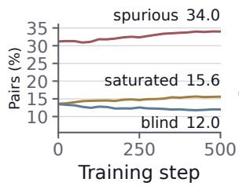

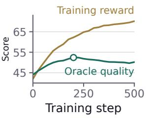

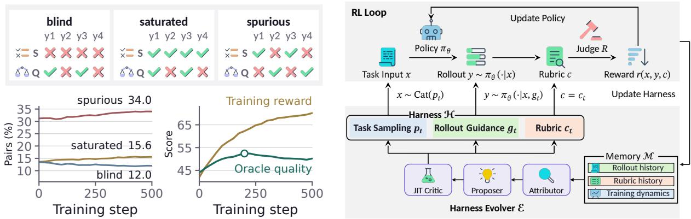  
Figure 1: Rubric-reward failures under GRPO on Rubric-Mix-10k at Qwen3.5-4B, and harness-controlled RL training in HarnessRL: failure classes for one criterion (top left), class proportions and GRPO’s training reward against oracle quality on held-out tasks (bottom left), and harness (pt, gt, ct)-controlled RL training (right). S denotes the judge’s binary criterion scores and Q the oracle ranking of the rollouts.

However, rubric rewards can become unreliable as training progresses. Policies may exploit superficial cues, including opening praise and a closing claim that every requirement is satisfied (Huang et al., 2025; Wang et al., 2026e), raising rubric scores while quality stalls. Fixed rubrics may not distinguish useful behaviors, while on-policy rollouts may miss rewarded ones. Recent methods evolve rubrics (Guan et al., 2026; Wu et al., 2026a; Wang et al., 2026a) or use privileged rollout guidance (Zhou et al., 2025; Xia et al., 2026; Agrawal et al., 2026) for exploration. Each adapts the rubric or the rollout guidance without diagnosing the reward failure, yet adapting either one alone can shift the failure to another part of training. Guidance that helps the policy meet a fixed rubric can saturate its criteria, and a saturated group carries no advantage (Yu et al., 2026b). Conversely, a rubric tightened without guidance can place criteria beyond the policy’s reach, where they give no learning signal (Sundaram et al., 2026).

Rubric-reward failures fall into two modes. Non-discriminative rewards collapse to uniformly low or high scores, i.e. blind or saturated, leaving little relative learning signal within a rollout group. Discriminative but spurious rewards, i.e. spurious, continue to separate responses, but their induced preferences do not align with response quality. We measure quality by the oracle ranking of the oracle judge, a stronger LLM judge that compares responses pairwise within each group under one quality guideline per domain (Section 3). These failures account for 61.6% of response pairs in a rubric-based GRPO (Shao et al., 2024) run (Figure 1). Of all pairs, 27.6% provide no usable contrast, while 34.0% provide contrast that does not reliably track quality, including 19.8% that the reward ranks in the wrong direction. Directly optimizing the observed rubric reward can thus provide an ineffective or even misleading learning signal.

The three failure classes call for updates to different parts of training, rollout guidance for a blind criterion, task sampling for a saturated task, and the rubric for a spurious criterion. We therefore introduce HarnessRL, which treats task sampling, rollout guidance, and rubric criteria as three interfaces of a training-time harness H that co-evolves with the policy. HarnessRL reallocates sampling toward tasks with useful learning signal, injects rollout guidance when exploration is insufficient and withdraws it as training progresses, and evolves rubric criteria to correct coarse, saturated, or spurious rewards.

H uses a training-time memory M that records rollouts, the sampling, rollout and rubric updates, and their outcomes. The harness evolver E retrieves within-task history from this memory to detect recurring failures and track the effects of earlier updates, and cross-task evidence to transfer examples between tasks. Using this evidence, it attributes each reward failure to the interface whose update can address it, then runs a proposer and just-in-time (JIT) critic loop. The critic accepts a candidate update only after measuring its effect on the current frozen policy, and accepts a rollout or rubric update only when that effect lies within the corresponding calibrated acceptance band. Rejected updates return with their measurements to the proposer, which proposes noop when no update is supported.

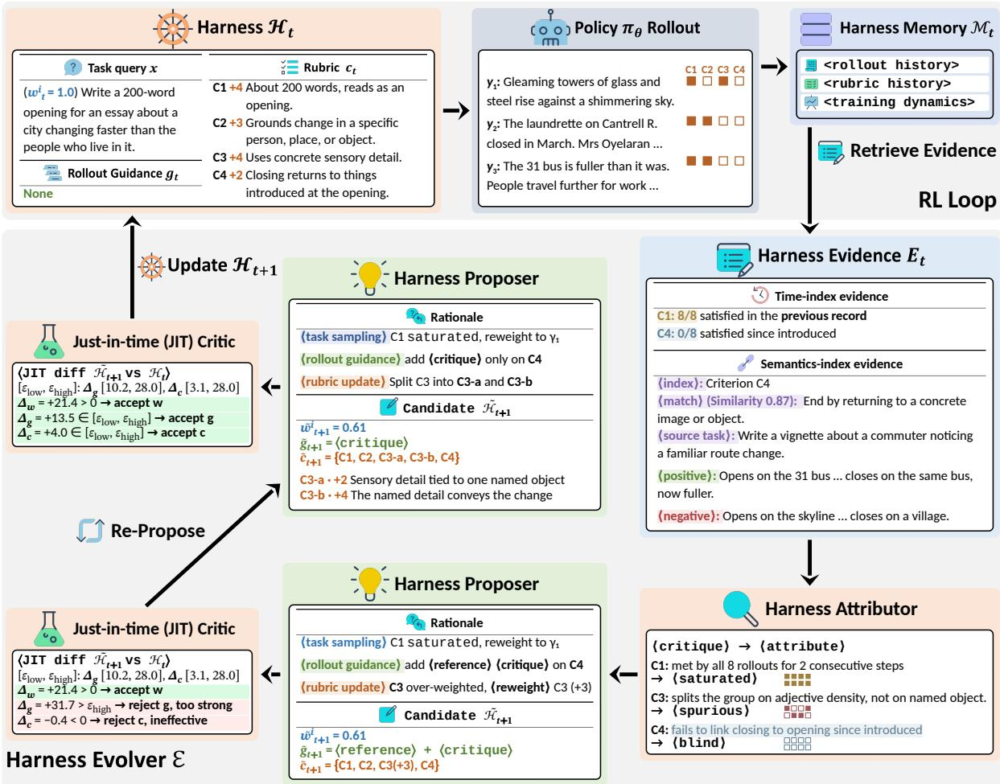  
Figure 2: HarnessRL runs an RL loop conditioned on a training-time harness $\mathcal { H } _ { t } = ( p _ { t } , g _ { t } , c _ { t } )$ , which controls task sampling, rollout guidance and the rubric, respectively. The harness co-evolves with the policy: it retrieves evidence from the training-time memory $\mathcal { M } _ { t } ,$ attributes failures, and is iteratively refined by a proposer and JIT critic loop.

We also curate Rubric-Mix-10k for training and held-out in-domain and out-of-distribution (OOD) evaluation across medical, science, writing, role-play, and instruction-following tasks. On Rubric-Mix-10k, HarnessRL-trained Qwen3.5-4B (Qwen Team, 2026) scores 64.5 in domain and 49.8 OOD, exceeding the strongest baseline by 3.0 and 2.8 points. With Qwen3.5-9B, the margins are 2.9 points in domain and 3.1 points OOD. At the end of training, reward-oracle agreement is 48.9% under HarnessRL against 38.4% under GRPO. HarnessRL also reaches its best OOD checkpoint before every adaptive-training baseline.

## 2 HarnessRL

HarnessRL augments a standard RL loop with an adaptive training-time harness $\mathcal { H } _ { t } = ( p _ { t } , g _ { t } , c _ { t } )$ that controls three interfaces (Figure 2). The sampling interface $p _ { t }$ distributes probability over a fixed task bank D toward tasks with useful learning signal. The rollout interface $g _ { t }$ injects privileged guidance when the policy cannot reach rewarded responses and withdraws it as the policy improves. The rubric interface ct specifies the criteria under which a fixed judge scores each response.

As the policy learns, HarnessRL adapts H in two steps. Failure attribution assigns each reward failure a class and routes it to the interface whose update can address it. Measured intervention accepts a candidate update only after measuring its effect on the current frozen policy. The harness memory M supplies evidence for both steps. In the harness evolver E, the attributor assigns labels, the proposer constructs candidate updates, and the JIT critic measures and accepts or rejects them. The accepted updates form

$\mathcal { H } _ { t + 1 } .$

## 2.1 Harness-Controlled RL Training

At step t, the harness $\mathcal { H } _ { t } = ( p _ { t } , g _ { t } , c _ { t } )$ conditions the inner RL loop through task sampling, rollout guidance, and rubric criteria. Let $\mathcal { D } = \{ x _ { i } \} _ { i = 1 } ^ { N }$ be the training task bank and $\pi _ { \theta _ { t } }$ the current policy. Each step draws 512 tasks from $p _ { t }$ . Because the harness evolver analyzes each draw independently, we trace index i and write $x _ { t } = x _ { i }$ . The policy samples $\boldsymbol { Y _ { t } } = \{ y _ { t } ^ { ( j ) } \} _ { j = 1 } ^ { J }$ , and the fixed judge R scores each rollout against the current rubric’s $K _ { t }$ criteria $q _ { t , m }$

$$
x _ { t } \sim \mathrm { C a t } ( p _ { t } ) , \qquad y _ { t } ^ { ( j ) } \sim \pi _ { \theta _ { t } } ( \cdot \mid x _ { t } , g _ { t } ) , \qquad s _ { t , m } ^ { ( j ) } = R \big ( x _ { t } , y _ { t } ^ { ( j ) } , q _ { t , m } \big ) , \quad j = 1 , \dots , J .\tag{1}
$$

Sampling interface. Tasks the policy has saturated provide little learning signal, so the sampling interface reallocates probability toward tasks that remain useful (Chen et al., 2026d; Zeng et al., 2026). We parameterize $p _ { t }$ by non-negative task weights, $\begin{array} { r } { p _ { t } ^ { i } = w _ { t } ^ { i } / \sum _ { \ell = 1 } ^ { N } w _ { t } ^ { \ell } , } \end{array}$ so $\operatorname { C a t } ( p _ { t } )$ selects $x _ { i }$ with probability $p _ { t } ^ { i } .$ . The harness evolver sets $\boldsymbol { w } _ { t } ^ { i }$ from that task’s training dynamics. Because reallocation alone would change the objective, each draw carries $u _ { t } = 1 / ( N p _ { t } ^ { i } )$ , the importance-sampling correction of prioritized experience replay (Schaul et al., 2016). This preserves each task’s expected contribution under the original uniform distribution, so reweighting changes only its sampling frequency.

Rollout interface. Positive reward is rare while the policy cannot reach rewarded responses. Building on scaffolded RL exploration (Yu et al., 2026b; Zhou et al., 2025), the rollout interface steers exploration with privileged guidance. For each task, $g _ { t } \subseteq \{ f _ { 1 } , f _ { 2 } , f _ { 3 } \} = \{$ {<criterion>, <reference>, <critique>} contains the guidance fields mounted after $x _ { t }$ in index order. The <criterion> field states a constraint paraphrased from the target criterion $\mathbf { o r } ,$ when available, taken from earlier behavior that satisfied it. The <reference> field holds positive and negative responses from the task history or a donor task with a matching criterion. The <critique> field records the previous group’s shortfall. The seed harness $\mathcal { H } _ { 0 }$ mounts no fields. The evolver selects each task’s fields and withdraws them as the policy internalizes the demonstrated behavior. A schedule removes remaining fields by training’s end, so $g _ { t } = \emptyset$ at evaluation.

Rubric interface. A fixed rubric can reward superficial cues unrelated to response quality, producing spurious criteria. The rubric interface ${ \boldsymbol { c } } _ { t } ~ = ~ \{ ( q _ { t , m } , \lambda _ { t , m } ) \} _ { m = 1 } ^ { K _ { t } }$ is a weighted set of natural-language criteria, where $q _ { t , m }$ is the m-th criterion and $\lambda _ { t , m } \neq 0$ its signed weight. The judge R evaluates each criterion independently, producing binary scores $s _ { t , m } ^ { ( j ) }$ in the $K _ { t } \times J$ matrix $S _ { t }$ read by the harness attributor. The weights give reward $\begin{array} { r } { r _ { t } ^ { ( j ) } = \sum _ { m } \lambda _ { t , m } s _ { t , m } ^ { ( j ) } / \sum _ { m } \operatorname* { m a x } ( \lambda _ { t , m } , 0 ) } \end{array}$ . Negative weights penalize undesirable behavior, while normalization by total positive weight preserves a common scale across rubric sizes. For an attributor-labeled spurious criterion, the harness evolver uses the rubric operations in Section 2.3 to rewrite $q _ { t , m . }$ , reweight $\lambda _ { t , m . }$ , or create, delete, split, and merge criteria.

RL objective. We extend GRPO (Shao et al., 2024) to draw tasks from ${ \bf \mathit { p } } _ { t } ,$ generate rollouts under $g _ { t . }$ compute rewards under $c _ { t } ,$ , and weight each task loss by $u _ { t . }$

$$
\begin{array} { r } { \mathcal { I } ( \theta _ { t } ) = \mathbb { E } _ { x _ { t } \sim \mathrm { C a t } ( p _ { t } ) , \ Y _ { t } \sim \pi _ { \theta _ { \mathrm { o l d } } } ( \cdot | x _ { t } , g _ { t } ) } \left[ u _ { t } \mathcal { L } \big ( \theta _ { t } ; x _ { t } , Y _ { t } , c _ { t } \big ) \right] - \beta \mathbb { D } _ { \mathrm { K L } } \big ( \pi _ { \theta _ { t } } \mid | \pi _ { \mathrm { r e f } } \big ) , } \end{array}
$$

$$
\mathcal { L } \big ( \theta _ { t } ; x _ { t } , Y _ { t } , c _ { t } \big ) = \frac { 1 } { J } \sum _ { j = 1 } ^ { J } \frac { 1 } { | y _ { t } ^ { ( j ) } | } \sum _ { k = 1 } ^ { | y _ { t } ^ { ( j ) } | } \operatorname* { m i n } \big ( \rho _ { j , k } \hat { A } _ { t } ^ { ( j ) } , \mathrm { c l i p } ( \rho _ { j , k } , 1 - \epsilon , 1 + \epsilon ) \hat { A } _ { t } ^ { ( j ) } \big ) ,\tag{2}
$$

where $\theta _ { t }$ denotes the current policy parameters, k indexes the $| y _ { t } ^ { ( j ) } |$ tokens of rollout $j ,$ and $\hat { A } _ { t } ^ { ( j ) } =$ $( r _ { t } ^ { ( j ) } - \mu ( r _ { t } ) ) / ( \sigma ( r _ { t } ) + \epsilon _ { A } )$ is the group-relative advantage. Here, $\mu ( r _ { t } )$ and $\sigma ( \boldsymbol { r } _ { t } )$ are the group’s reward mean and standard deviation, and $\epsilon _ { A }$ is a small constant. The token-level importance ratio is $\rho _ { j , k } =$ $\pi _ { \boldsymbol { \theta } _ { t } } ( \boldsymbol { y } _ { t , k } ^ { ( j ) } \mid \boldsymbol { x } _ { t } , \boldsymbol { g } _ { t } , \boldsymbol { y } _ { t , < k } ^ { ( j ) } ) / \pi _ { \boldsymbol { \theta } _ { \mathrm { o l d } } } ( \cdot )$ against $\pi _ { \boldsymbol { \theta } _ { \mathrm { o l d } } } ,$ , the policy that sampled the rollout. Finally, ϵ is the clip range, $\beta$ the KL coefficient, and $\mathbb { D } _ { \mathrm { K L } }$ the KL divergence from the reference policy $\pi _ { \mathrm { r e f } }$

## 2.2 Harness Memory

One step’s score matrix shows the current pattern, but not whether a failure persists across steps or how earlier updates affected it. Harness memory $\mathcal { M } _ { t } = \{ m _ { \tau } \} _ { \tau \le t }$ therefore keeps one record per task draw over the full run, organized as $m _ { t } = < r \circ \mathrm { 1 1 }$ out history> <rubric history> <training dynamics>. The <rollout history> field holds the task $x _ { t }$ with its rollout group $Y _ { t }$ and score matrix $S _ { t } ~ \in ~ \{ 0 , 1 \} ^ { K _ { t } \times J }$ <rubric history> the harness $\mathcal { H } _ { t }$ with its proposed actions, and <training dynamics> the task’s reward trajectory and update history. Because accumulated history soon exceeds the evolver’s context, the evolver retrieves evidence $E _ { t } = ( E _ { t } ^ { \mathrm { t i m e } } , E _ { t } ^ { \mathrm { s e m } } )$ through two indexes keyed by the task and criterion text,

$$
E _ { t } ^ { \mathrm { t i m e } } = \big \{ m _ { \tau } \in \mathcal { M } _ { t - 1 } : x _ { \tau } = x _ { t } \big \} , \qquad E _ { t } ^ { \mathrm { s e m } } = \mathrm { t o p } { - } k \big \{ ( q ^ { \prime } , x ^ { \prime } ) : \cos \big ( \phi ( q _ { t , m } ) , \phi ( q ^ { \prime } ) \big ) \geq \eta \big \} .\tag{3}
$$

The time index returns earlier task records, letting the attributor distinguish a persistent blind or saturated failure from single-step noise and the proposer avoid repeating an already reversed update. The semantics index returns related cross-task criteria with positive and negative responses, supplying the <reference> field when the task history has no such pair.

## 2.3 Harness Evolver

The harness evolver $\mathcal { E }$ converts one step’s evidence into the next harness $\mathcal { H } _ { t + 1 }$ . Its three roles, the attributor, proposer, and JIT critic, separate attribution, proposal, and acceptance so no model call both proposes and accepts an update,

$$
\begin{array} { r l } & { d _ { t } = \mathrm { A T T R I B U T E } \big ( x _ { t } , Y _ { t } , S _ { t } , \mathcal { H } _ { t } , E _ { t } \big ) \in \mathcal { V } ^ { K _ { t } } , \qquad a ^ { ( r ) } = \mathrm { P R O P O S E } \big ( d _ { t } , E _ { t } , \mathcal { H } _ { t } , F ^ { ( r - 1 ) } \big ) \in \mathcal { A } , } \\ & { \qquad \big ( \Delta ^ { ( r ) } , F ^ { ( r ) } \big ) = \mathrm { C R I T I Q U E } \big ( \mathcal { H } _ { t } , a ^ { ( r ) } ( \mathcal { H } _ { t } ) , \pi _ { \theta _ { t } } , x _ { t } , Y _ { t } \big ) , } \end{array}\tag{4}
$$

where $a ( { \mathcal { H } } )$ is the harness after action a and $\boldsymbol { F } ^ { ( r ) }$ records each update rejected at round r with the measurement that rejected it, starting from $F ^ { ( 0 ) } = \varnothing$ . The proposer and critic iterate until every candidate update is accepted or the round budget $B = 3$ is exhausted. An unresolved interface keeps its current setting, and every label, action, and measurement is written to $m _ { t }$

Harness attributor. Scores establish whether a criterion separates the current group, but explaining its failure requires the task history in $E _ { t } ^ { \mathrm { t i m e } }$ and related criteria in $E _ { t } ^ { \mathrm { s e m } }$ . Using both, the attributor asks three questions to assign each criterion a label in $\mathcal { V } = \{ \mathtt { b l i n d } ,$ saturated, spurious, agree} and route each failure label to one interface. (i) Reach asks whether the policy can produce the target property. A criterion unmet in the current group and earlier task records is labeled blind and routed to the rollout interface, whereas one unmet now but met earlier is treated as noise and labeled agree. (ii) Training stage asks whether the policy has mastered the task. A criterion met by every rollout across recent steps is labeled saturated. When such criteria lower the task’s discriminative mass, the proportion of criteria separating the group, the task is diagnosed as saturated and routed to the sampling interface. The attributor also flags a criterion met by every rollout through generic content, such as a disclaimer or polite closing, so the proposer can tighten it with a secondary rubric operation. (iii) Reward hacking asks whether meeting a separating criterion reflects quality. The attributor compares rollouts that meet and fail the criterion with positive responses of related criteria retrieved by the semantics index. If only satisfying rollouts share superficial compliance, length gaming, partial coverage, or stance gaming through sycophancy or over-refusal, the criterion is labeled spurious and routed to the rubric interface, and otherwise labeled agree. The attributor supports each label with quoted rollouts and raises its confidence as the label persists. A separate rubric-wording check identifies the exact phrase permitting a surface form or generic pass, which the attributor gives the proposer as the basis for a criterion rewrite.

Harness proposer. The label selects the interface, while the proposer selects its update. The action $\boldsymbol { a } = \left( a _ { p } , a _ { g } , a _ { c } \right)$ contains one candidate update or noop per interface, and the critic evaluates each update’s typed operations together. Besides a label’s primary update, the proposer may add secondary rubric operations on a saturated or blind criterion to the rubric candidate or propose as a rollout update a drop of a field whose target has left blind. The sampling operation reweight $( i , \gamma _ { \ell } )$ lowers task weight one level from $w _ { 0 } ^ { i } = 1$ through $\gamma _ { 1 } \geq \gamma _ { 2 } \geq \gamma _ { 3 }$ . The memory cold start (Section 3) sets $\gamma _ { 1 } , \gamma _ { 2 } ,$ and $\gamma _ { 3 }$ to task-tertile median discriminative masses. The guidance operations add(f) and drop(f) mount or remove a field $f \in$ {<criterion>, <reference>, <critique>} under a per-task cap that falls by one each training quarter. The rubric operations create, rewrite, delete, reweight, merge, and split act on individual criteria (Wu et al., 2026a). Anchor criteria are seed criteria whose text the memory cold start fixes, so the proposer may only reweight them. Each rubric operation rescales positive weights to total Λ while holding anchors at a fixed share to prevent influence drift.

JIT critic. Earlier evidence may support an update that is ineffective or excessive for the current policy, so the critic measures each primary candidate update just in time on that policy with parameters frozen before accepting it. Because a reward increase cannot validate a rubric update (Chen et al., 2026c), a rubric update for a spurious criterion must instead lower the recorded group’s score. Holding the other two interfaces fixed, the critic regrades the recorded group for a rubric update, re-samples a group from the policy with parameters $\theta _ { t }$ frozen under candidate guidance for a rollout update, and makes no policy query for a sampling update. With $\begin{array} { r } { \bar { r } ( Y , c ) = \frac { 1 } { J } \sum _ { i = 1 } ^ { J } r ( x _ { t } , y ^ { ( j ) } , c ) } \end{array}$ denoting the group-average reward and $\bar { r } _ { t } = \bar { r } ( Y _ { t } , c _ { t } )$ its current value, the measurements are

$$
\Delta _ { c } = \bar { r } _ { t } - \bar { r } ( Y _ { t } , \widetilde { c } _ { t + 1 } ) , \quad \Delta _ { g } = \bar { r } ( \widetilde { Y } _ { t } , c _ { t } ) - \bar { r } _ { t } , \quad \Delta _ { w } = \big ( w _ { t } ^ { i } - \widetilde { w } _ { t + 1 } ^ { i } \big ) \bar { r } _ { t } ,\tag{5}
$$

where $\widetilde { Y } _ { t } \sim \pi _ { \theta _ { t } } ( \cdot \ | \ x _ { t } , \widetilde { g } _ { t + 1 } )$ is the re-sampled group, $\Delta _ { w }$ is the task-weight reduction reallocated by sampling to other tasks, scaled by current group-average reward, and $u _ { t }$ keeps the task’s expected contribution to the objective unchanged. The critic accepts a candidate update when (i) a sampling update for a saturated task has $\Delta _ { w } > 0$ , a rollout update for a blind criterion has $\Delta _ { g } > 0 .$ , and a rubric update for a spurious criterion has $\Delta _ { c } > 0 ,$ (ii) the $\Delta _ { g }$ or $\Delta _ { c }$ in (i) lies within the corresponding acceptance band $\big [ \varepsilon _ { \mathrm { l o w } } , \varepsilon _ { \mathrm { h i g h } } \big ] .$ , a per-interface hyperparameter set by the memory cold start, (iii) a rubric update for a spurious criterion leaves every criterion whose text it creates or rewrites varying within the group, because a constant criterion contributes nothing to the policy update (Guan et al., 2026; Wang et al., 2026b), and (iv) a sampling update, which has no acceptance band, has a saturated diagnosis in the task’s previous time-index record. A joint rubric candidate containing secondary operations at a step with a spurious label must pass conditions (ii) and (iii). Otherwise, it is accepted with the step’s primary update, and its $\Delta _ { c }$ is recorded in $m _ { t }$ . The critic measures a drop as a rollout update on a group re-sampled without the field and accepts it when $\Delta _ { g } \geq - \varepsilon _ { \mathrm { l o w } } ^ { g } .$ . The accepted updates yield $\mathcal { H } _ { t + 1 } ,$ , and rejected ones return with their measurements to the proposer for revision or replacement with noop.

## 3 Experiments

Dataset. To evaluate HarnessRL’s effectiveness and efficiency, we propose Rubric-Mix-10k, curated from five public rubric-annotated sources across five open-ended domains (Table 1). Medical tasks come from HealthBench (Arora et al., 2025) and the medical slices of RaR (Gunjal et al., 2026) and RubricHub (Li et al., 2026b), science tasks from ResearchQA (Yifei et al., 2026) and the science slices of RaR and RubricHub, writing tasks from LongWriter-Zero (Wu et al., 2026b), and role-play and instruction-following tasks from the chat and instruction slices of RubricHub. For each source, we drop ineligible tasks and overlong prompts before drawing a fixed quota. This curation yields 8,600 training tasks with seed rubrics of weighted criteria, 250 held-out tasks per domain disjoint from training, and one OOD benchmark per domain. The training tasks contain 110,606 criteria, averaging 12.9 criteria per task with a median of 10. Prompts average 118 Qwen tokens with a median of 54, while criteria average 35.2 Qwen tokens. Negative-weight criteria constitute 10.7% of all criteria and appear in 48.6% of tasks. Released reference responses accompany 3,008 training tasks (35.0%). These responses comprise physician-written ideal completions for HealthBench, reference answers for RaR, and the highest-scoring of six samples for RubricHub. They average 420 tokens, with domain means from 322 in medical to 1,205 in role-play. ResearchQA and LongWriter-Zero provide none. Writing prompts specify a target length range. We use the released references only to describe the corpus, never in training or the reward.

Table 1: Domain composition of Rubric-Mix-10k. Each domain has 250 held-out tasks. Token counts are means under the Qwen tokenizer. The Tasks (%) column under Reference response reports the percentage of training tasks with a released reference response.
<table><tr><td></td><td></td><td></td><td>Prompt</td><td colspan="3">Seed rubric</td><td colspan="2">Reference response</td></tr><tr><td>Domain</td><td>Train tasks</td><td>OOD benchmark</td><td>Tokens</td><td>Criteria</td><td>Tokens/crit.</td><td>Negative (%)</td><td>Tokens</td><td>Tasks (%)</td></tr><tr><td>Medical HealthBench, RaR, RubricHub</td><td>3,000</td><td>MedQA 250 items</td><td>121</td><td>12.4</td><td>43.4</td><td>21.0</td><td>322</td><td>67.7</td></tr><tr><td>Science ResearchQA, RaR, RubricHub</td><td>2,000</td><td>GPQA-Diamond 198 items</td><td>50</td><td>12.3</td><td>31.8</td><td>2.0</td><td>362</td><td>31.1</td></tr><tr><td>Writing LongWriter-Zero</td><td>1,200</td><td>WritingBench 250 items</td><td>161</td><td>10.5</td><td>21.6</td><td>28.1</td><td>一</td><td>0.0</td></tr><tr><td>Role-play RubricHub (chat)</td><td>1,200</td><td>RoleBench 250 items</td><td>85</td><td>26.5</td><td>31.5</td><td>0.0</td><td>1,205</td><td>24.2</td></tr><tr><td>Instruction following RubricHub (IF)</td><td>1,200</td><td>IFBench 250 items</td><td>211</td><td>3.6</td><td>52.0</td><td>0.0</td><td>528</td><td>5.6</td></tr><tr><td>All</td><td>8,600</td><td></td><td>118</td><td>12.9</td><td>35.2</td><td>10.7</td><td>420</td><td>35.0</td></tr></table>

Evaluation. The frozen training judge scores in-domain held-out tasks under their seed rubrics, unchanged by harness updates. The official OOD protocols use multiple-choice accuracy for MedQA (Jin et al., 2021) and GPQA-Diamond (Rein et al., 2024), ROUGE-L for RoleBench (Wang et al., 2024a), programmatic constraint checks for IFBench (Pyatkin et al., 2025), and WritingBench’s own rubric (Wu et al., 2025). Scores are comparable only within a benchmark. Because only WritingBench uses the training judge, the other four benchmarks test whether gains persist beyond the harness-updated reward. We decode greedily without guidance and evaluate OOD every 25 steps and in domain every 100. Every results table reports the seed mean at the best checkpoint of the seed-mean curve for each method and evaluation set. Each Avg. column is the unweighted mean of the five domain columns.

Baselines. We compare static-rubric GRPO (Shao et al., 2024), guidance-side RuscaRL (Zhou et al., 2025) and SkillRL (Xia et al., 2026) for scaffolded rollouts over a frozen rubric, and rubric-side EvoRubric (Guan et al., 2026) and AMARIS (Wu et al., 2026a) for rubric rewriting without guidance. AMARIS++, the baseline closest to HarnessRL, extends AMARIS to all three interfaces but lacks cross-task memory and a JIT critic. All arms share the policy, judge, seed rubrics, decoding, and 500-step budget and differ only in whether and how they adapt the harness interfaces.

Training configuration. We train Qwen3.5-4B and Qwen3.5-9B (Qwen Team, 2026) with GRPO for 500 steps, drawing 512 tasks per step and sampling J = 8 rollouts per task at temperature 1.0 and top-p 0.9. We use AdamW at learning rate $1 \times 1 0 ^ { - 6 } ,$ , and the objective uses KL coefficient $\beta = 0 . 0 0 1$ , clip range $\epsilon = 0 . 2$ , and advantage constant $\epsilon _ { A } = 1 0 ^ { - 6 }$ . Every arm trains with three seeds. Before training, one memory cold start runs the Qwen3.5-4B seed policy over the entire training set pooled across the five domains, and the Qwen3.5-9B runs reuse its values. Setting Λ = 100 makes Λr¯ the group’s mean score in reward points, the unit of every ∆ and acceptance band. The cold start sets the sampling levels $\gamma _ { 1 } = 0 . 6 1$ $\gamma _ { 2 } = 0 . 3 8 ,$ and $\gamma _ { 3 } = 0 . 1 7 ,$ , and the rollout and rubric acceptance bands on group-average reward changes to [10.2, 28.0] and [3.1, 28.0] points. The rollout and rubric lower bounds are the 95th percentiles of null variation across independent groups of one task and repeated gradings of one group, respectively. Both upper bounds are the median within-group reward range.

Implementation. Frozen gemma-4-31B-it (Gemma Team, 2026) serves as the judge at temperature 0.6 and as the backbone of all three evolver roles. ChromaDB stores the time index, keyed by task, and the semantics index, which embeds criterion text with bge-base-en-v1.5 as $\phi$ and returns the top-k = 4 criteria whose cosine similarity is at least the floor $\eta = 0 . 8 2$ . The critic rejects a candidate update when its call returns no measurement. Costs are in cluster hours, the wall-clock hours of one 16-node cluster with eight NVIDIA H100 80GB GPUs per node.

Table 2: Quantitative results of HarnessRL on the five-domain Rubric-Mix-10k with Qwen3.5-4B and Qwen3.5-9B. Bold, underline, and green mark the best result, the second-best result, and HarnessRL’s margin over the best baseline, respectively.
<table><tr><td></td><td colspan="6">In-domain held-out</td><td colspan="6">Out of distribution</td></tr><tr><td>Method</td><td>Med.</td><td>Sci.</td><td>Writ.</td><td>Role</td><td>IF</td><td>Avg.</td><td>Med.</td><td>Sci.</td><td>Writ.</td><td>Role</td><td>IF</td><td>Avg.</td></tr><tr><td>Qwen3.5-4B</td><td></td><td></td><td></td><td></td><td></td><td></td><td></td><td></td><td></td><td></td><td></td><td></td></tr><tr><td>GRPO</td><td>52.4</td><td>57.2</td><td>60.7</td><td>50.8</td><td>68.1</td><td>57.8</td><td>40.5</td><td>29.3</td><td>66.5</td><td>50.7</td><td>32.7</td><td>43.9</td></tr><tr><td>RuscaRL</td><td>56.3</td><td>61.4</td><td>63.1</td><td>53.6</td><td>69.5</td><td>60.8</td><td>41.3</td><td>29.8</td><td>67.1</td><td>51.1</td><td>32.2</td><td>44.3</td></tr><tr><td>SkillRL</td><td>55.6</td><td>60.9</td><td>62.4</td><td>53.1</td><td>69.8</td><td>60.4</td><td>41.0</td><td>30.1</td><td>67.6</td><td>51.4</td><td>32.9</td><td>44.6</td></tr><tr><td>EvoRubric</td><td>55.0</td><td>60.5</td><td>64.8</td><td>54.2</td><td>69.1</td><td>60.7</td><td>43.4</td><td>31.2</td><td>69.1</td><td>53.1</td><td>34.3</td><td>46.2</td></tr><tr><td>AMARIS</td><td>54.7</td><td>60.2</td><td>65.3</td><td>55.2</td><td>69.2</td><td>60.9</td><td>43.9</td><td>31.6</td><td>69.8</td><td>53.5</td><td>33.9</td><td>46.5</td></tr><tr><td>AMARIS++</td><td>56.1</td><td>61.7</td><td>65.5</td><td>55.0</td><td>69.4</td><td>61.5</td><td>44.1</td><td>32.3</td><td>70.6</td><td>54.0</td><td>34.1</td><td>47.0</td></tr><tr><td>HarnessRL</td><td>59.3(+3.0)</td><td>64.6(+2.9)</td><td>69.2(+3.7)</td><td>58.9(+3.7)</td><td>70.7(+0.9)</td><td>64.5(+3.0)</td><td>46.5(+2.4)</td><td>35.4(+3.1)</td><td>73.0(+2.4)</td><td>56.6(+2.6)</td><td>37.5(+3.2)</td><td>49.8(+2.8)</td></tr><tr><td>Qwen3.5-9B</td><td></td><td></td><td></td><td></td><td></td><td></td><td></td><td></td><td></td><td></td><td></td><td></td></tr><tr><td>GRPO</td><td>58.9</td><td>63.4</td><td>65.8</td><td>56.2</td><td>73.5</td><td>63.6</td><td>52.6</td><td>35.5</td><td>71.8</td><td>58.4</td><td>38.9</td><td>51.4</td></tr><tr><td>RuscaRL</td><td>61.9</td><td>66.8</td><td>67.4</td><td>58.4</td><td>74.6</td><td>65.8</td><td>53.3</td><td>35.9</td><td>72.1</td><td>58.7</td><td>38.6</td><td>51.7</td></tr><tr><td>SkillRL</td><td>61.2</td><td>66.1</td><td>67.0</td><td>58.0</td><td>74.9</td><td>65.4</td><td>53.0</td><td>36.2</td><td>72.5</td><td>58.9</td><td>39.2</td><td>52.0</td></tr><tr><td>EvoRubric</td><td>60.8</td><td>65.9</td><td>69.3</td><td>59.4</td><td>74.2</td><td>65.9</td><td>55.1</td><td>37.4</td><td>74.0</td><td>60.3</td><td>40.6</td><td>53.5</td></tr><tr><td>AMARIS</td><td>60.5</td><td>65.6</td><td>69.8</td><td>59.9</td><td>74.3</td><td>66.0</td><td>55.6</td><td>37.8</td><td>74.6</td><td>60.8</td><td>40.2</td><td>53.8</td></tr><tr><td>AMARIS++</td><td>61.7</td><td>67.0</td><td>70.4</td><td>59.6</td><td>74.4</td><td>66.6</td><td>56.0</td><td>38.4</td><td>75.2</td><td>61.2</td><td>40.1</td><td>54.2</td></tr><tr><td>HarnessRL</td><td>64.6(+2.7)</td><td>69.9(+2.9)</td><td>73.8(+3.4)</td><td>63.5(+3.6)</td><td>75.9(+1.0)</td><td>69.5(+2.9)</td><td>58.9(+2.9)</td><td>41.6(+3.2)</td><td>78.3(+3.1)</td><td>63.9(+2.7)</td><td>43.6(+3.0)</td><td>57.3(+3.1)</td></tr></table>

Oracle judge. For analysis only, Claude Sonnet 5 is the oracle judge. It is stronger than the training judge, reads no rubric, and compares response pairs under one quality guideline per domain, judging clinical correctness and safety in medicine, scientific correctness and reasoning in science, fit to purpose and genre in writing, persona consistency in role-play, and constraint satisfaction in instruction following. For each group of J = 8 rollouts, the oracle scores all 28 pairs in both orders and averages each pair’s scores (win 1, tie 0.5). Rollout win counts define the within-group oracle ranking, with equal counts tied, against which we compare each pair’s reward order. A tied-reward pair is blind when the shared reward is below 50 points and saturated otherwise, and a reward-separated pair is agree when its reward order matches the oracle order and spurious otherwise. Oracle quality is 100 times a response’s normalized win rate against eight fixed gemma-4-31B-it comparison responses per task. On 240 sampled groups, two annotators agree at Kendall’s τ = 0.84, and the oracle ranking agrees with each annotator at 0.80 and 0.79 and with their consensus at 0.82. No harness role sees oracle output.

## 3.1 Main Results

HarnessRL leads every benchmark at both policy scales. At Qwen3.5-4B, HarnessRL reaches 64.5 in domain and 49.8 OOD (Table 2), +6.7 and +5.9 pp above GRPO and +3.0 and +2.8 pp above AMARIS++, the strongest baseline. At Qwen3.5-9B, it reaches 69.5 and 57.3, +2.9 and +3.1 pp above AMARIS++, which it exceeds on every seed at both scales. Paired bootstrap 95% intervals for the AMARIS++ margins (10,000 item-and-seed resamples) are [2.4, 3.6] in domain and [2.0, 3.5] OOD at Qwen3.5-4B, and [2.2, 3.6] in domain and [2.3, 3.9] OOD at Qwen3.5-9B. Paired permutation tests give p < 0.001 against AMARIS++ and GRPO. Seed standard deviations are below one point for all arms and smallest for HarnessRL (0.3 and 0.4 at Qwen3.5-4B, 0.2 and 0.3 at Qwen3.5-9B). We attribute this stability to the critic rejecting rollout and rubric updates whose measured effects leave the acceptance bands.

HarnessRL’s in-domain margin over the best baseline is widest on writing and role-play and narrowest on instruction following. At Qwen3.5-4B, it reaches +3.7 pp on writing and role-play but falls to +0.9 pp on instruction following. We attribute the wide margin to many defensible responses saturating a frozen rubric and leaving further gains to rubric updates measured on the recorded group, and the narrow one to near-verifiable criteria on which GRPO already reaches 68.1.

Guidance-side and rubric-side adaptation differ in OOD transfer. At Qwen3.5-4B, guidance-side

Table 3: Ablations of HarnessRL on its components and control interfaces at Qwen3.5-4B. Bold and underline mark the best and second-best results, respectively.
<table><tr><td></td><td colspan="6">In-domain held-out</td><td colspan="6">Out of distribution</td></tr><tr><td>Method</td><td>Med.</td><td>Sci.</td><td>Writ.</td><td>Role</td><td>IF</td><td>Avg.</td><td>Med.</td><td>Sci.</td><td>Writ.</td><td>Role</td><td>IF</td><td>Avg.</td></tr><tr><td>HarnessRL</td><td>59.3</td><td>64.6</td><td>69.2</td><td>58.9</td><td>70.7</td><td>64.5</td><td>46.5</td><td>35.4</td><td>73.0</td><td>56.6</td><td>37.5</td><td>49.8</td></tr><tr><td>Component ablation</td><td></td><td></td><td></td><td></td><td></td><td></td><td></td><td></td><td></td><td></td><td></td><td></td></tr><tr><td>w/o critic</td><td>54.9</td><td>60.0</td><td>62.1</td><td>52.0</td><td>68.3</td><td>59.5</td><td>42.9</td><td>31.6</td><td>68.5</td><td>52.7</td><td>33.8</td><td>45.9</td></tr><tr><td>w/o critic &amp; memory</td><td>53.6</td><td>58.6</td><td>60.8</td><td>50.7</td><td>67.0</td><td>58.1</td><td>41.3</td><td>29.2</td><td>66.9</td><td>51.0</td><td>32.2</td><td>44.1</td></tr><tr><td>Interface ablation</td><td></td><td></td><td></td><td></td><td></td><td></td><td></td><td></td><td></td><td></td><td></td><td></td></tr><tr><td>HarnessRLg</td><td>56.1</td><td>61.1</td><td>63.2</td><td>53.1</td><td>69.5</td><td>60.6</td><td>43.4</td><td>31.7</td><td>69.0</td><td>53.0</td><td>34.3</td><td>46.3</td></tr><tr><td>HarnessRLc</td><td>56.7</td><td>61.7</td><td>63.8</td><td>53.7</td><td>70.1</td><td>61.2</td><td>44.3</td><td>32.6</td><td>69.9</td><td>54.0</td><td>35.2</td><td>47.2</td></tr><tr><td> $p _ { t }  { \sf S E C }$ </td><td>58.6</td><td>63.9</td><td>68.5</td><td>58.1</td><td>70.3</td><td>63.9</td><td>45.9</td><td>34.8</td><td>72.3</td><td>56.0</td><td>36.9</td><td>49.2</td></tr><tr><td> $\dot { g } _ { t } \gets \mathrm { R u s c a R L }$ </td><td>58.4</td><td>63.7</td><td>67.9</td><td>57.6</td><td>70.2</td><td>63.6</td><td>44.9</td><td>33.6</td><td>71.2</td><td>54.9</td><td>36.1</td><td>48.1</td></tr><tr><td> $\bar { c } _ { t } \gets \mathrm { E v o R u b r i c }$ </td><td>58.0</td><td>63.2</td><td>68.0</td><td>57.5</td><td>69.9</td><td>63.3</td><td>45.1</td><td>33.9</td><td>71.6</td><td>55.2</td><td>36.3</td><td>48.4</td></tr></table>

RuscaRL and SkillRL gain 3.0 and 2.6 pp over GRPO in domain (60.8 and 60.4 against 57.8) but barely transfer OOD (44.3 and 44.6 against 43.9). Rubric-side EvoRubric and AMARIS match this in-domain gain (60.7 and 60.9) and transfer further OOD (46.2 and 46.5). We attribute limited guidance-side OOD transfer to scaffolds fitting the policy to the frozen training rubric, and stronger rubric-side transfer to a rewritten criterion changing what the reward measures. Three-interface AMARIS++ is the strongest baseline at both scales. Harness memory and the critic lift HarnessRL from 44.1 to 49.8 OOD (Table 3).

## 3.2 In-Depth Analysis

RQ1: What does each interface and component contribute? Table 3 reports best-checkpoint seed means in domain and OOD at Qwen3.5-4B. The component ablation removes the critic (w/o critic) and then memory retrieval (w/o critic & memory). Interface ablations include single-interface harnesses adapting only the rollout or rubric interface (HarnessRL , HarnessRLc) and switching arms using a published rule for one interface. Each switching arm retains harness memory and the harness evolver for two interfaces, while the third uses SEC’s difficulty bandit $( p _ { t }  \mathrm { S E C }$ (Chen et al., 2026d)), RuscaRL’s scheduled checklist scaffold (gt ← RuscaRL (Zhou et al., 2025)), or EvoRubric’s criterion pruning and regeneration $( c _ { t } \gets$ EvoRubric (Guan et al., 2026)), with no attributor, proposer, or critic.

Single-interface harnesses trail HarnessRL, whose gain over GRPO comes mostly from the critic with memory. HarnessRLg and HarnessRLc reach 60.6 and 61.2 in domain and 46.3 and 47.2 OOD, against 64.5 and 49.8 for HarnessRL. Removing the critic leaves 59.5 in domain and 45.9 OOD, below AMARIS++ (47.0). Removing memory too leaves 58.1 in domain and 44.1 OOD, within 0.2 pp of GRPO. We attribute this to memory reducing the reversal rate (RQ2) and the critic measuring effects before acceptance.

A published rule on one interface keeps most of the gain over GRPO but never all of it. The sampling, rubric, and rollout switching arms reach 63.9, 63.3, and 63.6 in domain and 49.2, 48.4, and 48.1 OOD, above both single-interface harnesses and AMARIS++ (47.0 OOD, 61.5 in domain). Relative to HarnessRL, the rollout switching arm’s OOD shortfall is largest at 1.7 pp and is 0.9 pp in domain, while the rubric and sampling switching arms trail by 1.4 and 0.6 pp OOD. We attribute the sampling shortfall to reallocation leaving every rollout’s reward unchanged, the rubric shortfall to rubric updates the critic never measures, and the rollout shortfall to scheduled scaffolds teaching the policy the training rubric, as RuscaRL’s in-domain gain barely transfers OOD in Table 2.

RQ2: Why must the three interfaces adapt jointly, and what stabilizes the accepted updates? At Qwen3.5-4B, we compare the arms at step 500. Figure 3 plots blind, saturated, and spurious proportions for GRPO, RuscaRL, AMARIS, and HarnessRL, and we report the agree proportion as reward-oracle agreement. Two arms used only here apply w/o critic & memory to HarnessR $^ - g$ and HarnessRLc. Spearman correlations relate the step-500 proportions, negated except for agree, to best-checkpoint scores across twelve arms, those in Table 2 and Table 3 except SkillRL and the switching arms, plus these two. From memory records, we report the mounted guidance fields per task, the proportion of tasks at each sampling level, the donors for <reference> fields mounted by accepted rollout updates, and the critic’s acceptance rate with and without retrieved evidence above the floor η. We report the reversal rate in Figure 4, defined as the proportion of accepted rubric updates in each 100-step window that undo an earlier same-criterion update within the task’s previous two draws. Three annotators, blind to step and rationale, judged 200 attributor labels (50 per class) and 200 accepted rubric updates sampled uniformly from HarnessRL, with mean pairwise Cohen’s κ of 0.71 and 0.68. We aggregate judgments by majority vote.

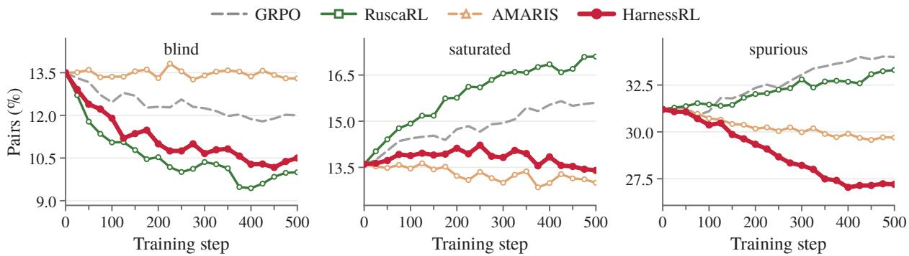  
Figure 3: Proportion of pairs by failure class at Qwen3.5-4B during training.

Guidance-side and rubric-side arms trade one failure class for another, whereas three-interface arms with memory lower all three, HarnessRL the most. GRPO ends at 12.0/15.6/34.0 for blind, saturated, and spurious. RuscaRL lowers blind to 10.0 but raises saturated to 17.1, while HarnessRL raises saturated to 16.1, or 16.5 without critic and memory. AMARIS lowers saturated and spurious to 13.0 and 29.7 but raises blind to 13.3, while HarnessRLc raises blind to 13.2, or 13.7 without critic and memory. HarnessRL without the critic reaches 11.1/15.2/31.6, and removing memory too raises saturated to 16.1. AMARIS++, whose memory is a per-task revision log, reaches 11.4/14.6/30.8, and HarnessRL reaches 10.5/13.4/27.2, with reward-oracle agreement at 48.9 against GRPO’s 38.4. We attribute the saturated rise to guidance saturating a fixed rubric (Yu et al., 2026b), and the blind rise to rubric tightening without guidance placing criteria beyond the policy’s reach (Sundaram et al., 2026).

The agree, spurious, and saturated proportions rank the arms, but the blind proportion does not. In domain/OOD, correlations are 0.91/0.92 for agree, 0.78/0.82 for spurious, 0.59/0.74 for saturated, and 0.15/−0.01 for blind. We attribute the weak blind correlation to this trade, as rubric-side arms have the highest blind proportions yet score higher OOD than GRPO and the guidance-side baselines (Table 2).

Guidance is withdrawn ahead of schedule, rubric updates concentrate early, and sampling downweights half the tasks. Mounted guidance fields average 1.6 per task at their step-75 peak, whereas without the critic the count stays near the cap until each reduction. By step 350, before the last reduction at step 375, 86% of tasks carry no guidance fields. Accepted rubric updates fall from 1,240 in the first window to 140 in the last, with create concentrated early. By step 500, 52% of tasks are below full weight, 8% at the lowest level. We attribute the early withdrawal to the critic accepting a drop once its target leaves blind, and the decline of create to the time index showing the proposer existing criteria to revise.

The critic with memory keeps reversed rubric updates rare. The reversal rate ends at 1.6% for HarnessRL and 18.2% for AMARIS++, compared with 22.3% without critic and memory. Without the critic, the reversal rate stays below that level but rises from 6.8% in the first window to 14.1% in the last. We attribute this rise to the missing critic, because memory shows the proposer earlier reversals but only the critic rejects a repeated update. Harness memory also supplies cross-task donors for 58% of the <reference> fields mounted by accepted rollout updates. The critic accepts 71% of candidate updates grounded in retrieved evidence, compared with 44% when retrieval returns nothing above the floor.

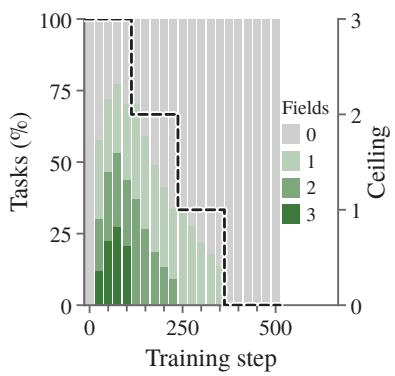

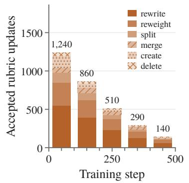

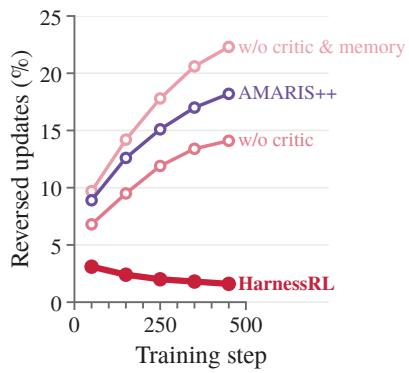  
Figure 4: Training dynamics of HarnessRL: proportion of tasks by guidance fields, accepted rubric updates per 100 steps, and reversed rubric updates, the last also for its ablations and AMARIS++.

Annotators confirm attributor labels and accepted rubric updates. Majority vote upheld the blind, saturated, spurious, and agree labels in 97.0%, 98.0%, 86.0%, and 90.0% of cases, respectively, and judged 82.5% of accepted rubric updates to address the diagnosed failure.

RQ3: Does the harness recover its training overhead? For every arm of Table 2, we measure Qwen3.5-4B training cost in cluster hours per 100 steps and identify its best OOD step at both scales. We decompose cost into RL rollout, RL judge, attributor and proposer, critic, and memory, and separately report the one-off memory cold start of 0.75 cluster hours (Figure 5, left). We pair each arm’s best OOD score with the cluster hours required to reach it, including the memory cold start (Figure 5, right). OOD scores peak before step 500 for every arm, whereas in-domain scores rise through step 500 for GRPO and every rubric-evolving method. The tables therefore select the best checkpoint for each evaluation set. To account for selection on the evaluation sets, we also report each arm’s step-500 checkpoint. For matched compute, we report each arm’s best OOD score among checkpoints evaluated every 25 steps within the cluster hours, including the memory cold start, that HarnessRL needs to reach its best OOD checkpoint.

At 1.6× GRPO’s per-step cost, HarnessRL reaches its best OOD checkpoint in fewer cluster hours than any baseline. GRPO costs 4.3 cluster hours per 100 steps versus 6.7 for HarnessRL. The 2.4 difference comprises 1.2 for the critic, 0.7 for attributor and proposer calls, 0.4 for memory, and 0.1 for longer guided rollouts (3.3 versus 3.2). HarnessRL peaks at step 250 after 17.5 cluster hours. AMARIS, next in cluster hours, peaks at step 325 after 17.9, AMARIS++ at step 300 after 18.3, and GRPO at step 475 after 20.4 (Figure 5, right). EvoRubric, SkillRL, and RuscaRL peak at steps 350, 400, and 425, respectively. At Qwen3.5-9B, the peak-step order is unchanged, with HarnessRL at step 250, AMARIS++ at 325, and GRPO at 475. We attribute the earlier peak to the harness correcting the reward signal as it degrades and to the critic. GRPO makes no such correction, and the rubric-evolving baselines lack the critic. By mid-training, the critic has accepted the withdrawal of most guidance, and accepted rubric updates have declined from 1,240 to 510 per 100 steps.

HarnessRL remains strongest without best-checkpoint selection and leads AMARIS++ under matched compute. At step 500, in-domain/OOD scores are GRPO 57.8/43.8, RuscaRL 60.5/44.2, SkillRL 60.1/44.5, EvoRubric 60.7/45.7, AMARIS 60.9/46.0, AMARIS++ 61.5/46.4, and HarnessRL 64.5/49.4. Without best-checkpoint selection, HarnessRL exceeds AMARIS++ by +3.0 pp on both evaluation sets. Within 17.5 cluster hours, GRPO reaches 43.8 OOD at step 400, AMARIS++ reaches 46.9 at step 225, and HarnessRL reaches 49.8 at step 250. The per-step overhead therefore does not reduce the OOD lead over AMARIS++, which is +2.9 pp under matched compute versus +2.8 pp at best checkpoints.

RQ4: How does the harness act on one task over training? Figure 6 traces a randomly sampled training task on cellulose filter paper, recording group reward under the current rubric and oracle quality whenever the harness acts. Because its seed criteria are not anchor criteria, the proposer may apply delete or merge to them.

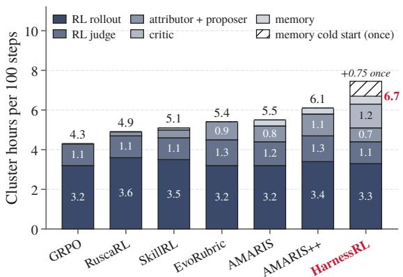

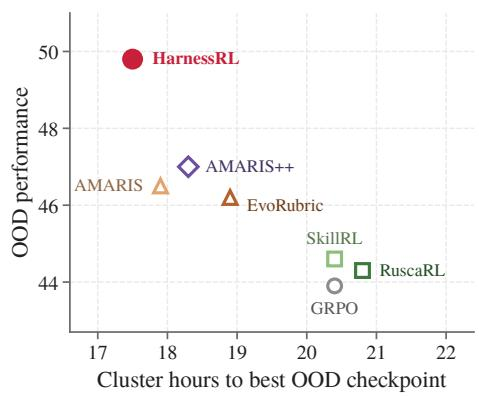  
Figure 5: Training efficiency of HarnessRL measured by cluster hours per 100 steps, decomposed into RL loop and harness evolver overhead (left), and cluster hours to the best OOD checkpoint (right).

Each accepted primary update addresses the failure labeled at its step, and group reward diverges from oracle quality. At step 30, a rubric update for a spurious label replaces a seed criterion with hydroxylcount and coupling-chemistry criteria. At 55, no rollout names the coupling reaction, so a rollout update for the resulting blind label mounts <criterion> and <reference> fields. A rollout update drops them at 130 once their target criterion is met. At 130, a sampling update for a saturated label lowers the task weight to $\gamma _ { 1 } .$ , while secondary rubric operations merge the wicking and adsorption criteria and delete the reaction-name criterion. At 260, a rollout update for a blind label mounts a <critique> field, while a rubric update for a spurious label deletes the sensitivity criterion and restores both coupling-chemistry criteria. At 280, a rubric update for a spurious label on the reaction-name criterion lowers both coupling-chemistry criteria to +1 and creates a filter-grade criterion at +2. At 440, the attributor labels the hydroxyl-count criterion saturated and all others agree. A sampling update lowers the task weight to γ2, and a secondary rubric operation creates an intrinsic-versus-engineered criterion. From 130 to 260, group reward falls from 100.0 to 32.8 while oracle quality rises from 58.1 to 61.0. We attribute the fall to the changed rubric. Because the rubric and policy both affect group reward across steps, the critic compares the current and candidate rubrics on one recorded group at fixed θ.

## 4 Related work

Evolving rubric-based RL. Rubric-based RL rewards open-ended generation with natural-language criteria (Gunjal et al., 2026; Huang et al., 2025; Viswanathan et al., 2025; Liu et al., 2026; Li et al., 2026b; Chen et al., 2026b), and reward hacking against fixed rubrics (Mahmoud et al., 2026; Wang et al., 2026e) motivates criteria and task distributions that evolve with the policy. One line rewrites the rubric from the policy’s responses (Guan et al., 2026; Wu et al., 2026a; Wang et al., 2026a;b; Chen et al., 2026c). EvoRubric (Guan et al., 2026) prunes and regenerates criteria for open-ended generation, and AMARIS (Wu et al., 2026a) revises the rubric through a memory-augmented loop. Another line co-evolves a rubric generator with the judge or the policy, adapts the rubric to each comparison, or orders rubrics as a curriculum (Xu et al., 2026; Li et al., 2026a; Jia et al., 2026; Krishnan et al., 2026). Rubric-ARM (Xu et al., 2026) alternates RL between a rubric generator and the judge that scores under its rubrics, and OpenRS (Jia et al., 2026) builds a rubric for each response pair. A third line adapts the task distribution using priority, difficulty, or expected learning gain (Schaul et al., 2016; Gao et al., 2026; Sundaram et al., 2026; Yu et al., 2026c; Zeng et al., 2026), and SEC (Chen et al., 2026d) evolves the curriculum with the policy. HarnessRL instead adapts task sampling, rollout guidance, and rubric criteria in one training-time harness. It routes each attributed failure class to the interface whose update addresses it.

Scaffolded and privileged rollouts. Scaffolded rollouts change the composition of the sampled group so that it contains rewarded responses (Yu et al., 2026b; Cui et al., 2025; Zhou et al., 2025; Qu et al., 2026), whereas rubric evolution changes the criteria that define the reward. One line shapes the rollout group without changing the input (Yu et al., 2026b; Cui et al., 2025). DAPO (Yu et al., 2026b) resamples groups whose rewards carry no advantage, and entropy control (Cui et al., 2025) keeps policy entropy from collapsing. Another line places privileged context in the policy’s input (Zhou et al., 2025; Xia et al., 2026; Agrawal et al., 2026; Nath et al., 2025; Hou et al., 2026; Qu et al., 2026; Yu et al., 2026a). RuscaRL (Zhou et al., 2025) scaffolds exploration with the rubric and fades the scaffold on a schedule, and SkillRL (Xia et al., 2026) augments rollouts with recursively accumulated skills. More recently, self-distillation ties guided exploration to the unguided policy (Zhao et al., 2026; Dilkes et al., 2026). OPSD (Zhao et al., 2026) applies on-policy self-distillation to guided reasoning, and ICE (Dilkes et al., 2026) distills instructionconditioned exploration into the unconditioned policy. HarnessRL mounts a guidance field only after the critic measures a reward increase on a re-sampled group. It withdraws the field earlier than its own schedule requires, once the target criterion leaves blind and reward stays within tolerance without it.

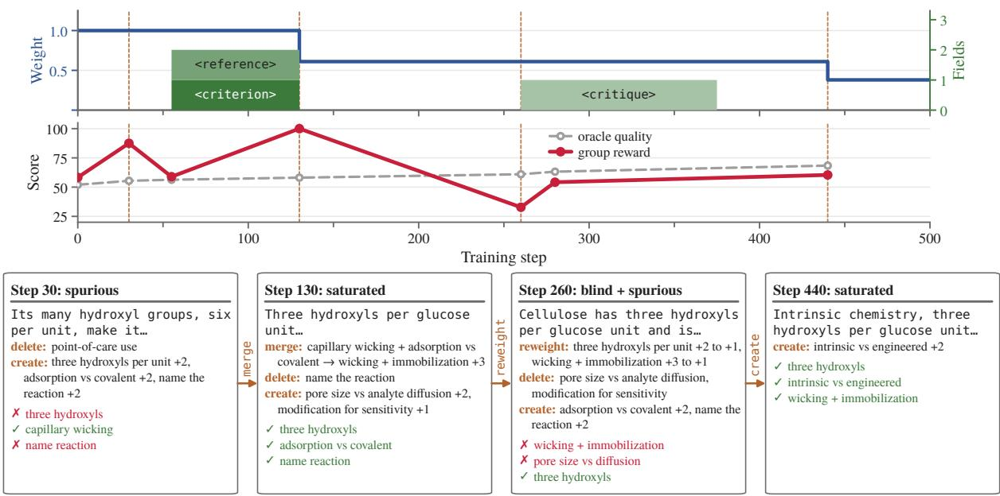  
Figure 6: Case analysis of a randomly sampled training task “Which properties of cellulose filter paper suit it to analytical and clinical $u s e ? ?$ : task sampling and mounted guidance (top), rollout groups scored with the dynamically evolving rubric and oracle quality (middle), and steps at which the harness acted, with labels, rollout excerpts, rubric operations, and criteria met or missed (bottom). Dashed lines mark them.

Training-time harness. Agent harnesses usually denote the inference-time infrastructure that connects a model to its environment, such as interfaces, scaffolds, and memory (Wang et al., 2025a; 2026c; Gong et al., 2026a), and harness research (Zhou et al., 2026; Liu et al., 2025a) treats them as one configuration to design and learn. Beyond inference, recent work brings the harness into training. One line designs inference-time harnesses for frozen models (Yang et al., 2024; Suzgun & Kalai, 2024; Wang & Liu, 2025). SWE-agent (Yang et al., 2024) gives the model an agent-computer interface for software engineering, and Meta-Prompting (Suzgun & Kalai, 2024) scaffolds the model with task-agnostic prompts. Another line evolves harnesses from agent trajectories (Ning et al., 2026; Luo et al., 2026b; Shi et al., 2026; Wang & Liu, 2026). EvoHarness-RL (Ning et al., 2026) learns a self-evolving runtime harness for long-horizon agents, and HarnessBank (Luo et al., 2026b) searches a gene bank of harness variants under gated verification. More recently, harnesses adapt during policy training (Jiang et al., 2026; Luo et al., 2026a; Chen et al., 2026a; Yu et al., 2026d). EvoTrainer (Chen et al., 2026a) co-evolves the policy with a training harness that diagnoses and intervenes on recorded runs, and harness-and-model co-evolution (Yu et al., 2026d) corrects on-policy rollouts as the harness changes. HarnessRL is such a training-time harness, and its harness memory supplies the run’s rollout and update history as evidence. It differs in that the JIT critic measures each primary candidate update on the current frozen policy before accepting it into $\mathcal { H } _ { t + 1 }$

## 5 Conclusion

We introduce HarnessRL, a training-time harness that co-evolves with the policy through task sampling, rollout guidance, and rubric criteria. The harness memory provides within-task history and cross-task evidence, which the harness evolver uses to attribute each reward failure to the interface whose update can address it. The JIT critic then accepts a candidate update only after measuring its effect on the current frozen policy. We also curate Rubric-Mix-10k, a training and evaluation suite of training tasks with seed rubrics across the medical, science, writing, role-play, and instruction-following domains, together with held-out tasks and an OOD benchmark for each domain. Extensive results show that HarnessRL outperforms the strongest baseline on both in-domain and OOD evaluations at both model scales. Its training dynamics show lower failure-class proportions and higher reward-oracle agreement than GRPO, with reversed rubric updates remaining rare, and its efficiency allows it to reach its best OOD checkpoint in fewer cluster hours than any baseline and in about half the steps GRPO needs.

## Acknowledgement

This work was supported by Alibaba Research Intern Program.

## References

Priyank Agrawal, Ankur Samanta, Shervin Ghasemlou, Boris Vidolov, Jalaj Bhandari, Kavosh Asadi, Daniel Jiang, and Aditya Modi. Off-context GRPO: Learning to reason on hard problems using privileged information. arXiv preprint arXiv:2607.19313, 2026.

Rahul K. Arora, Jason Wei, Rebecca Soskin Hicks, Preston Bowman, Joaquin Quiñonero-Candela, Foivos Tsimpourlas, Michael Sharman, Meghan Shah, Andrea Vallone, Alex Beutel, Johannes Heidecke, and Karan Singhal. HealthBench: Evaluating large language models towards improved human health. arXiv preprint arXiv:2505.08775, 2025.

Yuntao Bai, Andy Jones, Kamal Ndousse, Amanda Askell, Anna Chen, Nova DasSarma, Dawn Drain, Stanislav Fort, Deep Ganguli, Tom Henighan, Nicholas Joseph, Saurav Kadavath, Jackson Kernion, Tom Conerly, Sheer El-Showk, Nelson Elhage, Zac Hatfield-Dodds, Danny Hernandez, Tristan Hume, Scott Johnston, Shauna Kravec, Liane Lovitt, Neel Nanda, Catherine Olsson, Dario Amodei, Tom Brown, Jack Clark, Sam McCandlish, Chris Olah, Ben Mann, and Jared Kaplan. Training a helpful and harmless assistant with reinforcement learning from human feedback. arXiv preprint arXiv:2204.05862, 2022.

Yushi Bai, Jiajie Zhang, Xin Lv, Linzhi Zheng, Siqi Zhu, Lei Hou, Yuxiao Dong, Jie Tang, and Juanzi Li. LongWriter: Unleashing 10,000+ word generation from long context LLMs. In International Conference on Learning Representations (ICLR), 2025.

Guhong Chen, Yingcheng Shi, Yongbin Li, Binhua Li, Xander Xu, Hu Wei, Shiwen Ni, Min Yang, and Jieping Ye. EvoTrainer: Co-evolving LLM policies and training harnesses for autonomous agentic reinforcement learning. arXiv preprint arXiv:2606.03108, 2026a.

Hao Chen, Ziyu Han, Yukun Yan, Qingfu Zhu, Maosong Sun, and Wanxiang Che. From holistic evaluation to structured criteria: Rubrics across the evolving LLM landscape. arXiv preprint arXiv:2606.08625, 2026b.

Jiangwang Chen, Zixin Song, Junlin Liu, Shuaiyu Zhou, Haiyan Wu, Haihan Shi, Chenxi Zhou, Hanqing Li, Xiao Yang, Da Zhu, Guanjun Jiang, Hai Wan, and Xibin Zhao. DecoEvo: Score-decoupled coevolution of solver and rubric-generator skills in text space. arXiv preprint arXiv:2607.25675, 2026c.

Xiaoyin Chen, Jiarui Lu, Minsu Kim, Dinghuai Zhang, Jian Tang, Alexandre Piché, Nicolas Gontier, Yoshua Bengio, and Ehsan Kamalloo. Self-evolving curriculum for LLM reasoning. In Conference on Language Modeling (COLM), 2026d. arXiv:2505.14970.

Ganqu Cui, Yuchen Zhang, Jiacheng Chen, Lifan Yuan, Zhi Wang, Yuxin Zuo, Haozhan Li, Yuchen Fan, Huayu Chen, Weize Chen, Zhiyuan Liu, Hao Peng, Lei Bai, Wanli Ouyang, Yu Cheng, Bowen Zhou, and Ning Ding. The entropy mechanism of reinforcement learning for reasoning language models. arXiv preprint arXiv:2505.22617, 2025.

DeepSeek-AI. DeepSeek-V4: Towards highly efficient million-token context intelligence. arXiv preprint arXiv:2606.19348, 2026.

Xiang Deng, Jeff Da, Edwin Pan, Yannis Yiming He, Charles Ide, Kanak Garg, Niklas Lauffer, Andrew Park, Chetan Rane, Karmini Sampath, Maya Krishnan, Srivatsa Kundurthy, Sean Hendryx, Zifan Wang, Chen Bo Calvin Zhang, Noah Jacobson, Bing Liu, and Brad Kenstler. SWE-Bench Pro: Can AI agents solve long-horizon software engineering tasks? In Proceedings of the 43rd International Conference on Machine Learning, 2026.

Jim Dilkes, Vahid Yazdanpanah, and Sebastian Stein. Instruction-conditioned exploration for reinforcement learning with self-distillation to an unconditioned policy. arXiv preprint arXiv:2608.02087, 2026.

Damon Falck, Samer Sabri, Anja Surina, Thom Foster, Anya Sims, Sam Devlin, Dylan Rogers, Tantum Collins, Kaloyan Aleksiev, Louis Kirsch, et al. Training AI scientists to replicate research. arXiv preprint arXiv:2608.13331, 2026.

Zhaolin Gao, Joongwon Kim, Wen Sun, Thorsten Joachims, Sid Wang, Richard Yuanzhe Pang, and Liang Tan. Prompt curriculum learning for efficient LLM post-training. In International Conference on Learning Representations (ICLR), 2026.

Gemma Team. Gemma 4 technical report. arXiv preprint arXiv:2607.02770, 2026.

Sitong Gong, Caixin Kang, Tianyu Yan, Guo Chen, Bo Zheng, Kaipeng Zhang, Yunzhi Zhuge, Xiang Ruan, Huchuan Lu, and Yifei Huang. GROVE: Growing and reasoning over temporally stratified memory from streaming video experience. arXiv preprint arXiv:2608.02392, 2026a.

Sitong Gong, Tianyu Yan, Caixin Kang, Bo Zheng, Xiang Ruan, Huchuan Lu, Kaipeng Zhang, Yoichi Sato, and Yifei Huang. Vinci2: Providing proactive assistance in continuous egocentric videos. In European Conference on Computer Vision, 2026b. URL https://arxiv.org/abs/2607.11523.

Aaron Grattafiori, Abhimanyu Dubey, Abhinav Jauhri, Abhinav Pandey, Abhishek Kadian, Ahmad Al-Dahle, Aiesha Letman, Akhil Mathur, Alan Schelten, Alex Vaughan, et al. The Llama 3 herd of models. arXiv preprint arXiv:2407.21783, 2024.

Xin Guan, Xiaomeng Hu, Shen Huang, Zhenyi Wang, Bo Zhang, Zijian Li, Pengjun Xie, Bo Liu, and Jiuxin Cao. EvoRubric: Self-evolving rubric-driven RL for open-ended generation. arXiv preprint arXiv:2605.29847, 2026.

Anisha Gunjal, Anthony Wang, Elaine Lau, Vaskar Nath, Yunzhong He, Bing Liu, and Sean Hendryx. Rubrics as rewards: Reinforcement learning beyond verifiable domains. In International Conference on Learning Representations (ICLR), 2026.

Daya Guo, Dejian Yang, Haowei Zhang, Junxiao Song, Peiyi Wang, Qihao Zhu, Runxin Xu, Ruoyu Zhang, Shirong Ma, Xiao Bi, Xiaokang Zhang, Xingkai Yu, Yu Wu, Z. F. Wu, Zhibin Gou, Zhihong Shao, Zhuoshu Li, Ziyi Gao, Aixin Liu, Bing Xue, Bingxuan Wang, Bochao Wu, Bei Feng, Chengda Lu, Chenggang Zhao, Chengqi Deng, Chong Ruan, Damai Dai, Deli Chen, Dongjie Ji, Erhang Li, Fangyun

Lin, Fucong Dai, Fuli Luo, Guangbo Hao, Guanting Chen, Guowei Li, H. Zhang, Hanwei Xu, Honghui Ding, Huazuo Gao, Hui Qu, Hui Li, Jianzhong Guo, Jiashi Li, Jingchang Chen, Jingyang Yuan, Jinhao Tu, Junjie Qiu, Junlong Li, J. L. Cai, Jiaqi Ni, Jian Liang, Jin Chen, Kai Dong, Kai Hu, Kaichao You, Kaige Gao, Kang Guan, Kexin Huang, Kuai Yu, Lean Wang, Lecong Zhang, Liang Zhao, Litong Wang, Liyue Zhang, Lei Xu, Leyi Xia, Mingchuan Zhang, Minghua Zhang, Minghui Tang, Mingxu Zhou, Meng Li, Miaojun Wang, Mingming Li, Ning Tian, Panpan Huang, Peng Zhang, Qiancheng Wang, Qinyu Chen, Qiushi Du, Ruiqi Ge, Ruisong Zhang, Ruizhe Pan, Runji Wang, R. J. Chen, R. L. Jin, Ruyi Chen, Shanghao Lu, Shangyan Zhou, Shanhuang Chen, Shengfeng Ye, Shiyu Wang, Shuiping Yu, Shunfeng Zhou, Shuting Pan, S. S. Li, Shuang Zhou, Shaoqing Wu, Tao Yun, Tian Pei, Tianyu Sun, T. Wang, Wangding Zeng, Wen Liu, Wenfeng Liang, Wenjun Gao, Wenqin Yu, Wentao Zhang, W. L. Xiao, Wei An, Xiaodong Liu, Xiaohan Wang, Xiaokang Chen, Xiaotao Nie, Xin Cheng, Xin Liu, Xin Xie, Xingchao Liu, Xinyu Yang, Xinyuan Li, Xuecheng Su, Xuheng Lin, X. Q. Li, Xiangyue Jin, Xiaojin Shen, Xiaosha Chen, Xiaowen Sun, Xiaoxiang Wang, Xinnan Song, Xinyi Zhou, Xianzu Wang, Xinxia Shan, Y. K. Li, Y. Q. Wang, Y. X. Wei, Yang Zhang, Yanhong Xu, Yao Li, Yao Zhao, Yaofeng Sun, Yaohui Wang, Yi Yu, Yichao Zhang, Yifan Shi, Yiliang Xiong, Ying He, Yishi Piao, Yisong Wang, Yixuan Tan, Yiyang Ma, Yiyuan Liu, Yongqiang Guo, Yuan Ou, Yuduan Wang, Yue Gong, Yuheng Zou, Yujia He, Yunfan Xiong, Yuxiang Luo, Yuxiang You, Yuxuan Liu, Yuyang Zhou, Y. X. Zhu, Yanping Huang, Yaohui Li, Yi Zheng, Yuchen Zhu, Yunxian Ma, Ying Tang, Yukun Zha, Yuting Yan, Z. Z. Ren, Zehui Ren, Zhangli Sha, Zhe Fu, Zhean Xu, Zhenda Xie, Zhengyan Zhang, Zhewen Hao, Zhicheng Ma, Zhigang Yan, Zhiyu Wu, Zihui Gu, Zijia Zhu, Zijun Liu, Zilin Li, Ziwei Xie, Ziyang Song, Zizheng Pan, Zhen Huang, Zhipeng Xu, Zhongyu Zhang, and Zhen Zhang. DeepSeek-R1 incentivizes reasoning in LLMs through reinforcement learning. Nature, 645(8081):633–638, 2025. doi: 10.1038/s41586-025-09422-z.

Jinkun Hou, Zhuo Liu, Huimin Ren, Hongsheng Xin, Pan Zhou, and Kun Zhan. RISE-RL: Rubricinformed selective exploration for open-ended reinforcement learning. arXiv preprint arXiv:2608.09123, 2026.

Zenan Huang, Yihong Zhuang, Guoshan Lu, Zeyu Qin, Haokai Xu, Tianyu Zhao, Ru Peng, Jiaqi Hu, Zhanming Shen, Xiaomeng Hu, Xijun Gu, Peiyi Tu, Jiaxin Liu, Wenyu Chen, Yuzhuo Fu, Zhiting Fan, Yanmei Gu, Yuanyuan Wang, Zhengkai Yang, Jianguo Li, and Junbo Zhao. Reinforcement learning with rubric anchors. arXiv preprint arXiv:2508.12790, 2025.

Naman Jain, King Han, Alex Gu, Wen-Ding Li, Fanjia Yan, Tianjun Zhang, Sida Wang, Armando Solar-Lezama, Koushik Sen, and Ion Stoica. LiveCodeBench: Holistic and contamination free evaluation of large language models for code. In The Thirteenth International Conference on Learning Representations, 2025.

Ruipeng Jia, Yunyi Yang, Wen Wang, Yuxin Wu, Yongbo Gai, Siyuan Tao, Mengyu Zhou, Jianhe Lin, Xiaoxi Jiang, and Guanjun Jiang. Open rubric system: Scaling reinforcement learning with pairwise adaptive rubric. arXiv preprint arXiv:2602.14069, 2026.

Pengcheng Jiang, Zhiyi Shi, Kelly Hong, Xueqiang Xu, Jiashuo Sun, Jimeng Sun, Hammad Bashir, and Jiawei Han. Harness-1: Reinforcement learning for search agents with state-externalizing harnesses. arXiv preprint arXiv:2606.02373, 2026.

Bowen Jin, Hansi Zeng, Zhenrui Yue, Jinsung Yoon, Sercan Arik, Dong Wang, Hamed Zamani, and Jiawei Han. Search-R1: Training LLMs to reason and leverage search engines with reinforcement learning. arXiv preprint arXiv:2503.09516, 2025.

Di Jin, Eileen Pan, Nassim Oufattole, Wei-Hung Weng, Hanyi Fang, and Peter Szolovits. What disease does this patient have? a large-scale open domain question answering dataset from medical exams. Applied Sciences, 11(14):6421, 2021.

Caixin Kang, Yifei Huang, Liangyang Ouyang, Mingfang Zhang, Ruicong Liu, and Yoichi Sato. Can MLLMs read the room? a multimodal benchmark for assessing deception in multi-party social interactions. arXiv preprint arXiv:2511.16221, 2025. URL https://arxiv.org/abs/2511.16221.

Caixin Kang, Tianyu Yan, Sitong Gong, Mingfang Zhang, Liangyang Ouyang, Ruicong Liu, Bo Zheng, Huchuan Lu, Kaipeng Zhang, Yoichi Sato, and Yifei Huang. Perception or prejudice: Can MLLMs go beyond first impressions of personality? arXiv preprint arXiv:2605.22109, 2026. URL https://arxiv. org/abs/2605.22109.

Tejas Krishnan, Sumeet Ramesh Motwani, Charles London, Suhaas M. Bhat, Huitian Jiao, Philip Torr, Riashat Islam, Christopher Summerfield, Christian Schroeder de Witt, Qilong Gu, and Shital Shah. Rubric curriculum RL: Exploiting the generation-verification gap in non-verifiable domains. In International Conference on Machine Learning (ICML), 2026.

Nathan Lambert, Jacob Morrison, Valentina Pyatkin, Shengyi Huang, Hamish Ivison, Faeze Brahman, Lester James V. Miranda, Alisa Liu, Nouha Dziri, Shane Lyu, Yuling Gu, Saumya Malik, Victoria Graf, Jena D. Hwang, Jiangjiang Yang, Ronan Le Bras, Oyvind Tafjord, Chris Wilhelm, Luca Soldaini, Noah A. Smith, Yizhong Wang, Pradeep Dasigi, and Hannaneh Hajishirzi. Tülu 3: Pushing frontiers in open language model post-training. In Conference on Language Modeling (COLM), 2025.

Shuyue Stella Li, Rui Xin, Teng Xiao, Yike Wang, Rulin Shao, Zoey Hao, Melanie Sclar, Sewoong Oh, Faeze Brahman, Pang Wei Koh, and Yulia Tsvetkov. EvoLM: Self-evolving language models through co-evolved discriminative rubrics. arXiv preprint arXiv:2605.03871, 2026a.

Sunzhu Li, Jiale Zhao, Huimin Ren, Zhenlin Wei, Yang Zhou, Jingwen Yang, Shunyu Liu, Kaike Zhang, and Chen Wei. RubricHub: A comprehensive and highly discriminative rubric dataset via automated coarse-to-fine generation. In Proceedings of the 64th Annual Meeting of the Associationfor Computational Linguistics (Volume 1: Long Papers), pp. 31320–31344, 2026b.

Hunter Lightman, Vineet Kosaraju, Yura Burda, Harri Edwards, Bowen Baker, Teddy Lee, Jan Leike, John Schulman, Ilya Sutskever, and Karl Cobbe. Let’s verify step by step. In International Conference on Learning Representations (ICLR), 2024.

Bang Liu, Xinfeng Li, Jiayi Zhang, Jinlin Wang, Tanjin He, Sirui Hong, Hongzhang Liu, Shaokun Zhang, Kaitao Song, Kunlun Zhu, et al. Advances and challenges in foundation agents: From brain-inspired intelligence to evolutionary, collaborative, and safe systems. arXiv preprint arXiv:2504.01990, 2025a.

Tianci Liu, Ran Xu, Tony Yu, Ilgee Hong, Carl Yang, Tuo Zhao, and Haoyu Wang. OpenRubrics: Towards scalable synthetic rubric generation for reward modeling and LLM alignment. In Proceedings of the 64th Annual Meeting of the Association for Computational Linguistics (Volume 1: Long Papers), pp. 17417–17437, 2026. doi: 10.18653/v1/2026.acl-long.791.

Zexi Liu, Jingyi Chai, Xinyu Zhu, Shuo Tang, Rui Ye, Bo Zhang, Lei Bai, and Siheng Chen. ML-Agent: Reinforcing LLM agents for autonomous machine learning engineering. arXiv preprint arXiv:2505.23723, 2025b.

Haochen Luo, Yi Huang, Sichun Luo, Fengyuan Liu, Lei Li, Zefa Hu, Junlan Feng, and Qi Liu. Harness-aware self-evolving: Co-evolving model weights, harness, and task solutions. arXiv preprint arXiv:2607.03935, 2026a.

Xiaotian Luo, Dizhan Xue, Fengxingyu Wang, Chuanrui Hu, and Yafeng Deng. Harnessbank: Semantic gene-bank search with gated verification for agent-harness self-evolution. arXiv preprint arXiv:2607.13683, 2026b.

Anas Mahmoud, MohammadHossein Rezaei, Zihao Wang, Anisha Gunjal, Bing Liu, and Yunzhong He. Reward hacking in rubric-based reinforcement learning. arXiv preprint arXiv:2605.12474, 2026.

Vaskar Nath, Elaine Lau, Anisha Gunjal, Manasi Sharma, Nikhil Baharte, and Sean Hendryx. Adaptive guidance accelerates reinforcement learning of reasoning models. arXiv preprint arXiv:2506.13923, 2025.

Xuying Ning, Dongqi Fu, Tianxin Wei, Hanqing Zeng, Yuanchen Bei, Bingxuan Li, Zihao Li, Qifan Wang, Xiang Shen, Yifan Wu, Jiayi Liu, Hong Li, Yinglong Xia, Xiangjun Fan, Hanghang Tong, and Jingrui He. EvoHarness-RL: Learning self-evolving runtime harness for long-horizon LLM agents. arXiv preprint arXiv:2608.05446, 2026.

OpenAI, Aaron Jaech, Adam Kalai, Adam Lerer, Adam Richardson, Ahmed El-Kishky, Aiden Low, Alec Helyar, Aleksander Madry, Alex Beutel, Alex Carney, et al. OpenAI o1 system card. arXiv preprint arXiv:2412.16720, 2024.

Long Ouyang, Jeffrey Wu, Xu Jiang, Diogo Almeida, Carroll Wainwright, Pamela Mishkin, Chong Zhang, Sandhini Agarwal, Katarina Slama, Alex Ray, John Schulman, Jacob Hilton, Fraser Kelton, Luke Miller, Maddie Simens, Amanda Askell, Peter Welinder, Paul F. Christiano, Jan Leike, and Ryan Lowe. Training language models to follow instructions with human feedback. In Advances in Neural Information Processing Systems, volume 35, pp. 27730–27744, 2022.

Jiayi Pan, Xingyao Wang, Graham Neubig, Navdeep Jaitly, Heng Ji, Alane Suhr, and Yizhe Zhang. Training software engineering agents and verifiers with SWE-Gym. In International Conference on Machine Learning (ICML), pp. 47717–47737, 2025.

Valentina Pyatkin, Saumya Malik, Victoria Graf, Hamish Ivison, Shengyi Huang, Pradeep Dasigi, Nathan Lambert, and Hannaneh Hajishirzi. Generalizing verifiable instruction following. In Advances in Neural Information Processing Systems (NeurIPS), Datasets and Benchmarks Track, 2025. arXiv:2507.02833.

Yuxiao Qu, Amrith Setlur, Virginia Smith, Ruslan Salakhutdinov, and Aviral Kumar. POPE: Learning to reason on hard problems via privileged on-policy exploration. arXiv preprint arXiv:2601.18779, 2026.

Qwen Team. Qwen3.5: Towards native multimodal agents, February 2026. URL https://qwen.ai/blog? id=qwen3.5.

David Rein, Betty Li Hou, Asa Cooper Stickland, Jackson Petty, Richard Yuanzhe Pang, Julien Dirani, Julian Michael, and Samuel R. Bowman. GPQA: A graduate-level Google-proof Q&A benchmark. In First Conference on Language Modeling, 2024.

Tom Schaul, John Quan, Ioannis Antonoglou, and David Silver. Prioritized experience replay. In International Conference on Learning Representations (ICLR), 2016. arXiv:1511.05952.

Zifei Shan and Fangning Shao. A survey on rubric-guided reinforcement learning for language models. arXiv preprint arXiv:2608.27505, 2026.

Zhihong Shao, Peiyi Wang, Qihao Zhu, Runxin Xu, Junxiao Song, Xiao Bi, Haowei Zhang, Mingchuan Zhang, Y. K. Li, Y. Wu, and Daya Guo. DeepSeekMath: Pushing the limits of mathematical reasoning in open language models. arXiv preprint arXiv:2402.03300, 2024.

Haochen Shi, Xingdi Yuan, and Bang Liu. Evolving programmatic skill networks. arXiv preprint arXiv:2601.03509, 2026.

Shobhita Sundaram, John Quan, Ariel Kwiatkowski, Kartik Ahuja, Yann Ollivier, and Julia Kempe. Teaching models to teach themselves: Reasoning at the edge of learnability. In International Conference on Machine Learning (ICML), 2026.

Mirac Suzgun and Adam Tauman Kalai. Meta-prompting: Enhancing language models with task-agnostic scaffolding. arXiv preprint arXiv:2401.12954, 2024.

Vijay Viswanathan, Yanchao Sun, Shuang Ma, Xiang Kong, Meng Cao, Graham Neubig, and Tongshuang Wu. Checklists are better than reward models for aligning language models. In Advances in Neural Information Processing Systems (NeurIPS), volume 38, 2025.

Beining Wang, Weihang Su, Hongtao Tian, Hao Kong, Tao Yang, Ting Yao, Qingyi Pan, Yueyue Wu, Qingyao Ai, Min Zhang, and Yiqun Liu. Co-evolving LLM evaluators and policies via DynamicRubric. arXiv preprint arXiv:2607.20083, 2026a.

Jianze Wang, Kunwang Zheng, Ying Liu, Yu Cao, Qilong Zhang, Jinlong Chen, Hua Yang, and Qianglong Chen. SERPO: Self-evolving rubric policy optimization for open-ended test-time reinforcement learning. arXiv preprint arXiv:2607.26873, 2026b.

Noah Wang, Z.y. Peng, Haoran Que, Jiaheng Liu, Wangchunshu Zhou, Yuhan Wu, Hongcheng Guo, Ruitong Gan, Zehao Ni, Jian Yang, Man Zhang, Zhaoxiang Zhang, Wanli Ouyang, Ke Xu, Wenhao Huang, Jie Fu, and Junran Peng. RoleLLM: Benchmarking, eliciting, and enhancing role-playing abilities of large language models. In Lun-Wei Ku, Andre Martins, and Vivek Srikumar (eds.), Findings of the Association for Computational Linguistics: ACL 2024, pp. 14743–14777, Bangkok, Thailand, August 2024a. Association for Computational Linguistics. doi: 10.18653/v1/2024.findings-acl.878. URL https://aclanthology.org/2024.findings-acl.878/.

Xiaoqiang Wang and Bang Liu. Oscar: Operating system control via state-aware reasoning and replanning. In International Conference on Learning Representations, volume 2025, pp. 71417–71439, 2025.

Xiaoqiang Wang and Bang Liu. MemCodex: Self-programming hierarchical memory for language agents. arXiv preprint arXiv:2609.39765, 2026.

Xiaoqiang Wang, Lingfei Wu, Tengfei Ma, and Bang Liu. FAC2E: Better understanding large language model capabilities by dissociating language and cognition. In Yaser Al-Onaizan, Mohit Bansal, and Yun-Nung Chen (eds.), Proceedings of the 2024 Conference on Empirical Methods in Natural Language Processing, pp. 13228–13243, Miami, Florida, USA, November 2024b. Association for Computational Linguistics. doi: 10.18653/v1/2024.emnlp-main.734. URL https://aclanthology.org/2024.emnlp-main.734/.

Xiaoqiang Wang, Suyuchen Wang, Yun Zhu, and Bang Liu. R3Mem: Bridging memory retention and retrieval via reversible compression. In Wanxiang Che, Joyce Nabende, Ekaterina Shutova, and Mohammad Taher Pilehvar (eds.), Findings of the Association for Computational Linguistics: ACL 2025, pp. 4541–4557, Vienna, Austria, July 2025a. Association for Computational Linguistics. ISBN 979-8-89176- 256-5. doi: 10.18653/v1/2025.findings-acl.235. URL https://aclanthology.org/2025.findings-acl. 235/.

Xiaoqiang Wang, Suyuchen Wang, and Bang Liu. LatentHarness: Learning latent actions for memory and reasoning via counterfactual policy distillation. arXiv preprint arXiv:2609.39740, 2026c.

Xiaoqiang Wang, Suyuchen Wang, Yun Zhu, and Bang Liu. System-1.5 reasoning: Traversal in language and latent spaces with dynamic shortcuts. Advances in Neural Information Processing Systems, 38: 65328–65351, 2026d.

Xintao Wang, Heng Wang, Yifei Zhang, Xinfeng Yuan, Rui Xu, Jen-Tse Huang, Siyu Yuan, Haoran Guo, Jiangjie Chen, Shuchang Zhou, Wei Wang, and Yanghua Xiao. CoSER: Coordinating LLM-based persona simulation of established roles. In International Conference on Machine Learning (ICML), pp. 64822–64858, 2025b.

Xuekang Wang, Zhuoyuan Hao, Shuo Hou, Hao Peng, Juanzi Li, and Xiaozhi Wang. Reproducing, analyzing, and detecting reward hacking in rubric-based reinforcement learning. arXiv preprint arXiv:2606.04923, 2026e.

Peilin Wu, Xinlu Zhang, Kun Wan, Wentian Zhao, Gang Wu, Xinya Du, and Zhiyu Chen. AMARIS: A memory-augmented rubric improvement system for rubric-based reinforcement learning. arXiv preprint arXiv:2605.18592, 2026a.

Yuhao Wu, Yushi Bai, Zhiqiang Hu, Roy Ka-Wei Lee, and Juanzi Li. LongWriter-Zero: Mastering ultralong text generation via reinforcement learning. In International Conference on Learning Representations (ICLR), 2026b. arXiv:2506.18841.

Yuning Wu, Jiahao Mei, Ming Yan, Chenliang Li, Shaopeng Lai, Yuran Ren, Zijia Wang, Ji Zhang, Mengyue Wu, Qin Jin, and Fei Huang. WritingBench: A comprehensive benchmark for generative writing. In Advances in Neural Information Processing Systems (NeurIPS), Datasets and Benchmarks Track, 2025.

Peng Xia, Jianwen Chen, Hanyang Wang, Jiaqi Liu, Kaide Zeng, Yu Wang, Siwei Han, Yiyang Zhou, Xujiang Zhao, Haifeng Chen, Zeyu Zheng, Cihang Xie, and Huaxiu Yao. SkillRL: Evolving agents via recursive skill-augmented reinforcement learning. arXiv preprint arXiv:2602.08234, 2026.

Ran Xu, Tianci Liu, Zihan Dong, Tony Yu, Ilgee Hong, Carl Yang, Linjun Zhang, Tuo Zhao, and Haoyu Wang. Alternating reinforcement learning for rubric-based reward modeling in non-verifiable LLM post-training. In International Conference on Machine Learning (ICML), 2026.

An Yang, Anfeng Li, Baosong Yang, Beichen Zhang, Binyuan Hui, Bo Zheng, Bowen Yu, Chang Gao, Chengen Huang, Chenxu Lv, Chujie Zheng, Dayiheng Liu, Fan Zhou, Fei Huang, Feng Hu, Hao Ge, Haoran Wei, Huan Lin, Jialong Tang, Jian Yang, Jianhong Tu, Jianwei Zhang, Jianxin Yang, Jiaxi Yang, Jing Zhou, Jingren Zhou, Junyang Lin, Kai Dang, Keqin Bao, Kexin Yang, Le Yu, Lianghao Deng, Mei Li, Mingfeng Xue, Mingze Li, Pei Zhang, Peng Wang, Qin Zhu, Rui Men, Ruize Gao, Shixuan Liu, Shuang Luo, Tianhao Li, Tianyi Tang, Wenbiao Yin, Xingzhang Ren, Xinyu Wang, Xinyu Zhang, Xuancheng Ren, Yang Fan, Yang Su, Yichang Zhang, Yinger Zhang, Yu Wan, Yuqiong Liu, Zekun Wang, Zeyu Cui, Zhenru Zhang, Zhipeng Zhou, and Zihan Qiu. Qwen3 technical report. arXiv preprint arXiv:2505.09388, 2025.

John Yang, Carlos E. Jimenez, Alexander Wettig, Kilian Lieret, Shunyu Yao, Karthik Narasimhan, and Ofir Press. SWE-agent: Agent-computer interfaces enable automated software engineering. In Advances in Neural Information Processing Systems (NeurIPS), volume 37, pp. 50528–50652, 2024.

Junlin Yang, Che Jiang, Yu Fu, Tianwei Luo, Can Ren, Weizhi Wang, Kaikai Zhao, Hongyi Liu, Yuxin Zuo, Yuru Wang, et al. Frontis-MA1: Training an AI4AI model towards recursive self-improvement in machine learning engineering. arXiv preprint arXiv:2607.28568, 2026.

Li S. Yifei, Allen Chang, Chaitanya Malaviya, and Mark Yatskar. ResearchQA: Evaluating scholarly question answering at scale across 75 fields with survey-mined questions and rubrics. Transactions of the Association for Computational Linguistics, 14:1365–1389, 2026. doi: 10.1162/tacl.a.732.

Linhao Yu, Tianmeng Yang, Siyu Ding, Renren Jin, Naibin Gu, Xiangzhao Hao, Shuaiyi Nie, Deyi Xiong, Weichong Yin, Yu Sun, and Hua Wu. KnowRL: Boosting LLM reasoning via reinforcement learning with minimal-sufficient knowledge guidance. arXiv preprint arXiv:2604.12627, 2026a.

Qiying Yu, Zheng Zhang, Ruofei Zhu, Yufeng Yuan, Xiaochen Zuo, Yu Yue, Weinan Dai, Tiantian Fan, Gaohong Liu, Lingjun Liu, et al. DAPO: An open-source LLM reinforcement learning system at scale. Advances in Neural Information Processing Systems, 38:113222–113244, 2026b.

Yuanqiang Yu, Yanzhao Zheng, Zhentao Zhang, Tianze Xu, Chao Ma, Jihuai Zhu, Jiashun Liu, Xinle Deng, Baohua Dong, Hangcheng Zhu, and Ruohui Huang. PAC: Progress-augmented advantage curriculum for multi-task reinforcement learning of LLMs. In Proceedings of the 2026 Conference on Empirical Methods in Natural Language Processing (EMNLP), 2026c.

Zhou Yu, Bin Bi, Shiva Kumar Pentyala, Shubham Mehrotra, Sougata Chaudhuri, Shilpa Bhagavath, Zeyuan Chen, Ran Xu, Phil Mui, James Zhu, and Sitaram Asur. Co-evolving harnesses and models: Onpolicy correction helps weaker models catch up where imitation fails. arXiv preprint arXiv:2609.09134, 2026d.

Yongcheng Zeng, Zexu Sun, Bokai Ji, Erxue Min, Hengyi Cai, Shuaiqiang Wang, Dawei Yin, Haifeng Zhang, Xu Chen, and Jun Wang. CurES: From gradient analysis to efficient curriculum learning for reasoning LLMs. In International Conference on Learning Representations (ICLR), 2026. arXiv:2510.01037.

Siyan Zhao, Zhihui Xie, Mengchen Liu, Jing Huang, Guan Pang, Feiyu Chen, and Aditya Grover. Selfdistilled reasoner: On-policy self-distillation for large language models. In International Conference on Machine Learning (ICML), 2026.

Chenyu Zhou, Huacan Chai, Wenteng Chen, Zihan Guo, Rong Shan, Yuanyi Song, Tianyi Xu, Yingxuan Yang, Aofan Yu, Weiming Zhang, Congming Zheng, Jiachen Zhu, Zeyu Zheng, Zhuosheng Zhang, Xingyu Lou, Changwang Zhang, Zhihui Fu, Jun Wang, Weiwen Liu, Jianghao Lin, and Weinan Zhang. Externalization in LLM agents: A unified review of memory, skills, protocols and harness engineering. arXiv preprint arXiv:2604.08224, 2026.

Xuhui Zhou, Hao Zhu, Leena Mathur, Ruohong Zhang, Haofei Yu, Zhengyang Qi, Louis-Philippe Morency, Yonatan Bisk, Daniel Fried, Graham Neubig, and Maarten Sap. SOTOPIA: Interactive evaluation for social intelligence in language agents. In International Conference on Learning Representations (ICLR), 2024.

Yang Zhou, Sunzhu Li, Shunyu Liu, Wenkai Fang, Kongcheng Zhang, Jiale Zhao, Jingwen Yang, Yihe Zhou, Jianwei Lv, Tongya Zheng, Hengtong Lu, Wei Chen, Yan Xie, and Mingli Song. Breaking the exploration bottleneck: Rubric-scaffolded reinforcement learning for general LLM reasoning. arXiv preprint arXiv:2508.16949, 2025.