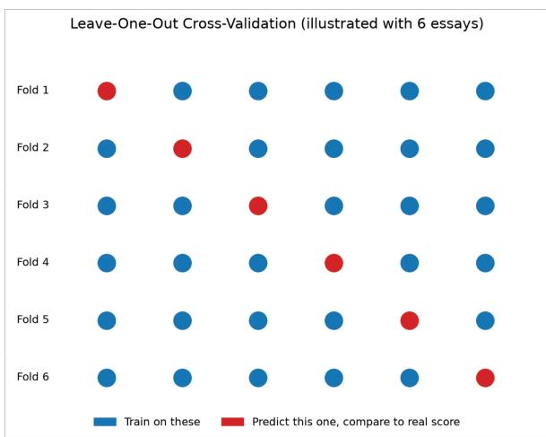
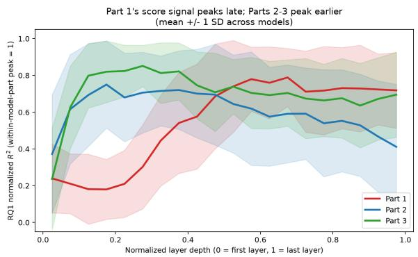
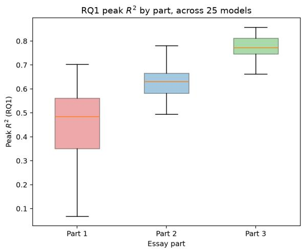
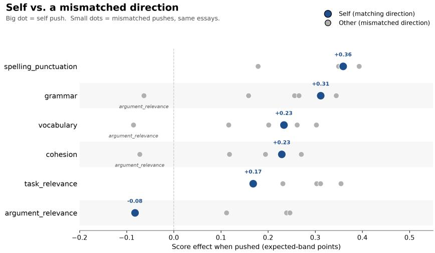
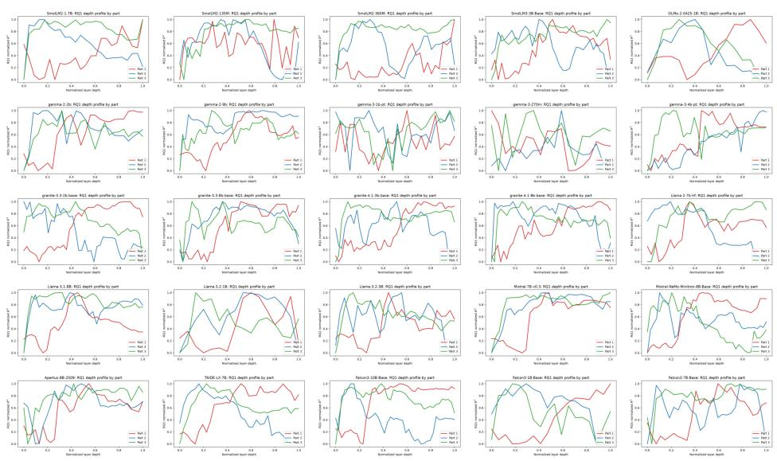

# Inside the Scorer: Mechanistic Evidence on Rubric Control in LLM-Based Automated Essay Scoring from 25 Base Models

Chungche Huang 黃崇哲 Graduate Institute of Linguistics National Taiwan University

Po-Ya Angela Wang 王伯雅 Co-intelligence Humanities AI (CHAI) Future Lab National Taiwan University

Shu-Kai Hsieh 謝舒凱 Graduate Institute of Linguistics National Taiwan University

{chungchehuang, poyaw, shukaihsieh}@ntu.edu.tw Accepted at PACLIC 40, Taipei, Taiwan, December 10–12, 2026

## Abstract

Automated essay scoring (AES) using large language models (LLMs) ofers promising use cases for language assessment, yet high stakes testing requires scores that are both controllable and verifiable, which current LLM based scorers lack. Given that, we investigate whether LLM-based scorers form distinct internal representations for individual scoring rubrics and whether these representations can be independently controlled. Probing and steering 25 open-weight base LLMs (0.13B– 10.31B parameters; 14 families) on humanscored BESTEP English writing tasks, we find that holistic scores are decodable from model activations for the longer tasks (Parts 2 and 3) and only weakly for the shortest (Part 1). Furthermore, scoring rubrics have partly separable directions in representation space for the longer tasks, though not for short responses (Part 1). However, causal steering reveals a critical lim itation: applying a matching intervention (e.g., steering “grammar” on a grammar-degraded response) yields only a negligible advantage (about 2% of the efect) over a mismatched intervention (e.g., steering “vocabulary”), and none that is detectable in any of the 10 testable comparisons across reliably measured rubrics. Rather than controlling distinct evaluative di mensions, the rubric directions share a domi nant lever whose rubric-specific parts are not selective, which may mirror the halo struc ture of human ratings. Our contributions are two-fold. First, we show that analytic scoring rubrics designed for human raters do not be have as independent controls in base LLMs, even among the seven models whose scores agree best with human raters (r ≥ 0.6). Sec ond, we establish a methodology that shows that score agreement and decodability do not imply rubric-level control in LLM-based assessment.

Keywords: Automated Essay Scoring, Large Language Models, Rubric-Based Assessment, Interpretability, Rubric Representations

## 1 Introduction

Automated essay scoring (AES) has recently started implementing neural network models, e.g., large language models (LLMs), in the grading process (Johnsi and Kumar, 2026). Agreement with human raters rose along the way, but the models remain opaque to inspection. Transparency and interpretability remain open priorities in AES investigations (Johnsi and Kumar, 2026). Control and verifiability are hard to explain in LLM-based AES systems, which is one of the biggest challenges when implementing LLM technologies in high-stakes language assessments. Test providers respond in diferent ways. Some rely on mixed models where human raters have the final score. Some develop feature-based machine learning models in which humans define what is measured. Others, such as the Duolingo English Test (DET), decompose the writing construct into subconstructs and constrain any LLM-derived feature score to a single subconstruct, so that the model cannot influence the holistic score except through that one slot. As stated in the report, scoring directly with deep learning “cedes both control and verifiability” (Madnani et al., 2026).

Although AES designs such as the DET minimize the black box impact on the score, the core question remains unsolved: what exactly an LLM scorer does on the inside. As LLMs become more and more ubiquitous in language assessment, we need to know whether a model’s internal representations contain the scoring rubrics at all, and whether each scoring rubric is controllable and verifiable separately. Current score agreement benchmark tests cannot answer this. Prior interpretability work on AES examines what a scorer has learned or which features it weights (Fiacco et al., 2023; Wang et al., 2026). We approach the topic with two AES principles in mind, control and verifiability, by adding causal intervention on the representations themselves, mirroring how these systems operate in real-world assessments.

In this study, we mechanistically audit LLMbased AES by probing and steering 25 open-weight base LLMs (0.13B to 10.31B parameters, 14 fam ilies) as they score BESTEP writing responses across three task types and six analytic scoring rubrics (see section Setup). We carry out the investigation guided by three questions. RQ1: Is the human holistic score decodable from a model’s internal activations, and where does that signal live? Which layers have the clearest scoring signals? RQ2: Do the six scoring rubrics occupy distinguishable directions in representation space? RQ3: Does steering a rubric’s direction move the model’s score specifically for that scoring rubric, or does any rubric-adjacent push move it about equally? In this paper, we choose base models as a baseline, so that fine-tuned variants (instructiontuned, chat) can be compared against them in future studies. Our contributions are two-fold. First, we establish a white-box audit protocol for LLM-based automated essay scoring (AES) that disentangles a rubric’s decodability, separability, and causal control. Moreover, we show that analytic scoring rubrics designed for human raters do not behave as independent controls in base LLMs: for the rubrics that steer the score and are reliably measured, steering one rubric’s direction moves the score about as much as steering a diferent one, even among the models whose scores agree best with human raters. The code and the database behind every number are public for verification at https://github.com/lopentu/ inside-the-scorer-paclic2026.

## 2 Related Work

AES and LLM-based scoring. As surveyed in Johnsi and Kumar (2026), AES first moved from feature-engineered machine learning methods to BERT-based deep learning, e.g., through domainadaptive training, multi-scale essay representations, and hierarchical transfer learning (Ramesh and Sanampudi, 2022; Wang et al., 2022; Cao et al., 2020; Xue et al., 2021; Settles et al., 2020). Additionally, a second wave of AES investigations focuses on LLMs as scorers, resulting in mixed findings. Some studies report LLM ratings holding up under real psychometric scrutiny (generalizabilitytheory and many-facet Rasch analyses) across thousands of essays and multiple genres (Song et al., 2025; Wang et al., 2025a), and case studies where an LLM produces both a score and trait-level comments across several analytic scoring rubrics at once (Wang et al., 2025b; Cho et al., 2024). Others find the opposite: robustness failures under adversarial stress-testing and demographic bias in ratings (Kabra et al., 2022; Yamashita, 2025), systematic disagreement between LLM and human grading behavior (Mathew et al., 2026), and validity that shifts by language, genre, and proficiency level rather than holding uniformly (Mizumoto and Eguchi, 2023; Pack et al., 2024; Mansour et al., 2024; Gaggioli et al., 2025; Barbosa et al., 2025; Yavuz et al., 2025; Yancey et al., 2023). A related strand looks past scoring accuracy to classroom use, from ChatGPT’s promise and pitfalls as a writing tutor to its measurable efect on students’ own writing when used for feedback (Barrot, 2023; Ding et al., 2025).

Control and verifiability in operational scoring. High-stakes providers mostly manage the opacity of LLM-based AES systems through design. The Duolingo English Test decomposes a subconstruct into features and uses various LLMs and machine learning models across subconstructs and grader versions. Thus, an LLM-derived feature rating contributes to the score only through its own subconstruct, and the contribution of each subconstruct can be measured and explained (Madnani et al., 2026). The same report notes that it remains substantially harder to determine why an end-to-end system assigned a particular score than it is for feature-based systems.

Prior analyses of neural network AES scorers are observational. Wang et al. (2026) analyze how LLM scorers weight textual features, and Fiacco et al. (2023) align components of a transformer scorer’s activations with human-understandable feature groups. In our study, we approach this topic with high-stakes language assessment’s grading principles, i.e., control and verifiability, and intervene causally on the rubric representations.

A separate line augments scores with rubriclevel explanations or rationales (Bueno et al., 2026;

Chu et al., 2025; Jiao et al., 2025; Kucia et al., 2026). These works evaluate rubric outputs, whereas we evaluate internal rubric representations in LLM-based AES.

Mechanistic interpretability and faithfulness. Our probing and steering methodology draws on activation patching (Zhang and Nanda, 2023), causal concept-based explanations (Wu et al., 2023), and prior work examining whether modelgenerated explanations faithfully reflect internal computations (Atanasova et al., 2023; Jacovi and Goldberg, 2021; Chuang et al., 2026; Ferrando et al., 2023; Demircan et al., 2024). This concern applies to AES, because a plausible-sounding rationale does not guarantee that the model actually exercises rubric-specific control.

Our two evaluation checks are grounded in probing research. First, Elazar et al. (2021) demonstrate that a property’s being decodable from a representation does not mean the model actually uses it. Second, Hewitt and Liang (2019) show that probe accuracy is uninterpretable without a selectivity check against a memorization-based control task. In our work, RQ1 (decodability) and RQ3 (steering selectivity) directly adapt these two principles, applying them to scoring rubrics rather than standard linguistic properties.

## 3 Setup

Models. We evaluate 25 open-weight, base LLMs (non-instruction-tuned) ranging from 0.13B to 10.31B parameters with 16 to 42 layers across 14 model families, including Llama, Gemma, Falcon3, SmolLM2/3, Granite, Mistral, OLMo, TAIDE, Apertus, and others (see Appendix C, Table 6 for the full catalog). All 25 models are base models by design. Although operational LLMbased scorers, such as those in the Duolingo English Test, are typically fine-tuned models (Madnani et al., 2026), we intentionally use base models to prevent instruction or format tuning from confounding the rubric representations and score output. This design establishes a clean baseline, enabling direct comparisons with fine-tuned variants in future work.

The model parameter range also reflects a key deployment constraint highlighted in the languagetesting literature. Local institutions evaluating AIassisted assessment require practical model sizes for on-premises hosting so that private response data remain local, rather than being sent to massive cloud-hosted systems (Chuang and Yan, 2025).

BESTEP and its Scoring Rubrics. This study uses the oficial BESTEP writing rubrics, which human raters apply when scoring the test’s writing responses. BESTEP, which stands for “the BEST test of English Proficiency,” was developed and is operated by the Language Training & Testing Center (LTTC) in support of Taiwan’s national “Program on Bilingual Education for Students in College (BEST).” The test assesses the academic English proficiency of college students across four skills: reading, listening, writing and speaking. We adopt the writing scoring rubrics from the oficial test guidelines and have verified with LTTC stakeholders that human raters apply these same public rubrics. The only diference is that human raters complete training workshops with authentic test responses before live scoring.

The writing section comprises three task parts, designed to evaluate three distinct subconstructs. Part 1 (Answering Questions) is a short factualresponse task. Part 2 (Expressing Opinions) asks test-takers to write emails expressing their opinions on campus events to stakeholders. Part 3 (Integrated Writing) is the longest and most demanding task, requiring test-takers to write a full essay.

Writing responses are scored with six analytic scoring rubrics, though not every rubric applies to every part (see Table 1). Grammar and vocabulary apply across all three parts, spelling and punctuation are scored exclusively in the short-answer task (Part 1), and argument relevance is evaluated solely in the integrated essay (Part 3).

<table><tr><td>Scoring rubric</td><td>Part 1</td><td>Part 2</td><td>Part 3</td></tr><tr><td>Grammar</td><td>V</td><td>V</td><td>V</td></tr><tr><td>Vocabulary</td><td>V</td><td>V</td><td>V</td></tr><tr><td>Cohesion</td><td></td><td>V</td><td>V</td></tr><tr><td>Spelling/Punct.</td><td>V</td><td></td><td></td></tr><tr><td>Task Relevance</td><td>V</td><td>V</td><td></td></tr><tr><td>Argument Relevance</td><td></td><td></td><td>V</td></tr></table>

Table 1: Which scoring rubrics are scored in which task part.

Dataset. All 25 models are probed and scored on the same fixed set of 75 human-rated BESTEP writing responses (the gold-75), spanning two test forms and three task parts (see Table 2).

Activation extraction. For every model, we extract residual-stream activations at every layer for each of the gold-75 responses, taken at the final token of the grading prompt, where the model would write its score. These activations are the shared input to the probing (RQ1), contrastive-direction (RQ2), and steering (RQ3) procedures. These procedures are described in the next three sections.

<table><tr><td>Form</td><td>Part 1</td><td>Part 2</td><td>Part 3</td><td>Total</td></tr><tr><td>Form 1</td><td>11</td><td>12</td><td>15</td><td>38</td></tr><tr><td>Form 2</td><td>10</td><td>12</td><td>15</td><td>37</td></tr><tr><td>Total</td><td>21</td><td>24</td><td>30</td><td>75</td></tr></table>

Table 2: Gold-75 essay coverage by test form and task part.

Code and Data Availability. Code, the analysis scripts, and the result dataset behind every reported number are available at https://github.com/lopentu/ inside-the-scorer-paclic2026. They are released for noncommercial research use under the PolyForm Noncommercial License 1.0.0. However, the original and degraded essay pairs (Appendix A) containing real exam responses are not yet public due to copyright constraints. They are available for research purposes upon request.

## 4 Experiments

## 4.1 Score-Information Representation

RQ1. Is the human-graded holistic score decodable from a model’s internal activations, and where does that signal live? Which layers contain the highest-quality human scoring signals?

  
Figure 1: Leave-one-out cross-validation (LOOCV).

Method. For each combination of [model, layer, part], hereafter referred to as a cell, we train a

Ridge regression probe on final-token residualstream activations to predict the human-rated holistic band score. Each cell probe is evaluated using leave-one-out cross-validation (LOOCV; Figure 1): in each fold, one response is held out, and the cell probe is trained on the remaining N-1 responses (features centered and the ridge penalty selected within each training round). All held-out predictions are pooled to compute a single $R ^ { 2 }$ per cell $( R ^ { 2 }$ is negative when predictions are worse than guessing the mean). We report the peak- $R ^ { 2 }$ layer, the peak $R ^ { 2 }$ itself, and the peak-to-final-layer drop, treating the pooled-form scope (both test forms combined) as our primary result. To verify that peak $R ^ { 2 }$ scores exceed chance-level baselines from the probing procedure, each cell undergoes a label-shufling permutation test (1,000 score permutations). Because the peak layer is selected as the maximum across 16 to 42 candidate layers, we report the peak layer’s p-value both raw and Bonferroni-corrected over that model’s total layers.

  
Figure 2: Line chart of mean decodability $( R ^ { 2 } )$ by normalized layer depth, one line per essay part, showing Part 1 peaking latest.

Results. Human-rated score information is decodable in most models, but not equally for every part, and not in a simple “easy parts early, hard parts late” order. Against the permutation null, the peak layer beats chance in all 25 models for Part 3 and in 22 of 25 for Part 2 after the layer correction, but in only 9 of 25 for Part 1 (24 of 25 uncorrected). We call a peak significant at $p < 0 . 0 5$ . Raw p-values sit at the permutation floor $( p = 0 . 0 0 1 )$ for 25 of 25 models in Part 3, 21 in Part 2 and 9 in Part 1, so the Bonferroni-corrected p-values (medians 0.032, 0.034 and 0.096) are limited by the 1,000 shufles, not by the data. The one consistent timing pattern: Part 1 (the shortest, short-answer task) peaks latest or second-latest among the three parts in 23 of 25 models (Figure 2). This holds in 8 of the 9 models whose Part 1 peak passes the corrected test, but where it does not pass, the peak location is poorly estimated. Across the 75 modelpart cells, the signal usually fades toward the final layer. The last layer keeps about two-thirds of the peak $R ^ { 2 }$ (median drop 34%), and in 14 out of the 75 cells it is worse than guessing the average score $( R ^ { 2 }$ below zero).

<table><tr><td>Part</td><td>Mean peak  $R ^ { 2 }$ </td><td>Median peak  $R ^ { 2 }$ </td><td> $\mathrm { P e a k } { - } R ^ { 2 }$  variance</td><td>Min</td><td>Max</td></tr><tr><td>Part 1</td><td>0.432</td><td>0.485</td><td>0.0338</td><td>0.007</td><td>0.702</td></tr><tr><td>Part 2</td><td>0.633</td><td>0.631</td><td>0.0095</td><td>0.413</td><td>0.877</td></tr><tr><td>Part 3</td><td>0.773</td><td>0.773</td><td>0.0038</td><td>0.605</td><td>0.858</td></tr></table>

Table 3: Peak $R ^ { 2 }$ statistics by task part, across 25 models.

Peak timing and decodability strength diverge across models. Part 1 produces the lowest peak ${ \dot { R } } ^ { 2 }$ in 24 of 25 models and is never the highest among the three parts. Mean peak $R ^ { 2 }$ across models scales with task length: 0.432 for Part 1, 0.633 for Part 2, and 0.773 for Part 3 (Table 3, Figure 3). Part 1 is also the least stable across models (peak- $R ^ { 2 }$ variance of 0.0338, versus 0.0095 for Part 2 and 0.0038 for Part 3). This lower and more volatile human-score decodability stems from Part 1 having the fewest gold responses (n=21), the shortest response lengths (about 47 words, vs. about 117 for Part 2 and about 214 for Part 3), and a coarser rating scale, yielding less textual evidence and fewer data points for probe estimation.

  
Figure 3: Boxplot of peak $R ^ { 2 }$ across 25 models, grouped by essay part, showing Part 3 highest and most consistent.

For the other two longer tasks, models carry information about essay quality that a label-shufle null cannot explain. For BESTEP’s shortest task type the signal peaks later, is weaker and less stable, and is above the corrected null in only 9 of 25 models. We cannot explain this pattern mechanistically here, but RQ2 returns to it. The Bonferroni correction is conservative because adjacent layers are correlated, and 1,000 shufles bound how small a p-value can get (Limitations).

## 4.2 Rubric Representation

RQ2. Do the six scoring rubrics occupy distinguishable directions in representation space? If so, how separated are they from each other?

Method. To evaluate rubric separability, RQ2 uses rubric-targeted clean-versus-degraded essay mutations of the gold-standard responses (n=26). This is because holistic scores blend individual rubrics and cannot isolate rubric-geometry dynamics on their own. The mutations were generated by prompting Llama 3.3 (70B, via Ollama) with one of 12 rubric-quoting specifications corresponding to each valid [part, scoring rubric] combination (Table 1).

The source essays are the 26 gold responses rated at the top band of Part 1’s 1 to 5 scale (n=5) and at a high band on the 1 to 6 scales of Part 2 (n=9) and Part 3 (n=12). Each is degraded once for every rubric scored in its part. Each specification quotes the oficial BESTEP band descriptors for a target rubric and instructs the model to degrade the response to a low band along that single dimension while holding all other dimensions, overall meaning, and response length (within 10%) constant. Each mutated response was verified by two trained BESTEP human raters independently against its target dimension prior to analysis (see Appendix A for full procedures and worked examples).

For each [model, layer, part, rubric] cell, we estimate a contrastive direction: the mean activation of the clean essays minus the mean activation of their degraded versions, taken at the same position as in RQ1 and scaled to unit length. Each direction rests on 5, 9, or 12 essay pairs (Parts 1 to 3). To measure how stable a direction is, we split its pairs at random into two halves, estimate a direction from each half, and take the cosine similarity between the two; the average over 20 random splits is the split-half reliability. Two directions are compared by their cosine similarity at the same layer, and a comparison is kept only if both directions have a split-half reliability of at least 0.6. For each direction, the geometry gap is its mean similarity to the same rubric in the other parts (same rubric) minus its mean similarity to the other rubrics in the same part (diferent rubric). Diferent rubrics are compared only within a part, so that a diference between two rubrics is not confused with a diference between tasks or essays. A positive gap means that a rubric’s direction is more similar to itself than to its neighbors, that is, that it has a direction of its own.

Results. Rubric directions are separate in the two longer tasks (Parts 2 and 3) but not in Part 1. A positive geometry gap means that a rubric’s direction is more similar to itself than to the other rubrics in the same part. Across 1,470 reliabilitygated layer-part cells, the mean gap is 0.334, and 74.5% of cells are positive. This average covers only rubrics scored in more than one part; spelling/punctuation and argument relevance are scored in a single part, have no same-rubric comparison across parts, and are not included. The gap difers sharply by part. In Part 2 (mean gap 0.372, 89.7% of cells positive) and Part 3 (0.609, 99.2%), the rubrics have directions of their own. In Part 1 the mean gap is negative (−0.220, 6.2% of cells positive), especially for grammar and vocabulary. This suggests that diferent rubrics are more alike than a single rubric is across parts.

Pair by pair, Table 4 gives the similarity between each two rubrics’ directions: 1 means the same direction, 0 means unrelated, and a negative value means partly opposite directions. Because each direction rests on only 5 to 12 essay pairs (made from high-band gold essays) and carries noise, we correct the similarities for it (disattenuated cosine similarity). Among the 15 possible rubric pairs, 12 can be compared. The other three (argument relevance with spelling/punctuation, argument relevance with task relevance, and cohesion with spelling/punctuation) are never simultaneously used to score in the same part. The 12 comparable pairs range from −0.102 to 1.0. The most separate pair is argument\_relevance with grammar (−0.102, anti-correlated beyond measurement noise), and argument\_relevance, a Part-3-only rubric, appears in three of the five least similar pairs. The most alike are grammar with spelling\_punctuation (1.0, statistically indistinguishable from the same rubric) and spelling\_punctuation with vocabulary (0.984). Both are Part-1-only comparisons, in line with Part 1’s negative gap.

In short, rubric separation is clear in Parts 2 and 3, most visibly pair by pair for argument\_relevance, and absent in Part 1.

<table><tr><td>Rubric pair</td><td>n</td><td>Sim.</td><td>95% CI</td></tr><tr><td>Arg. Rel. x Gram.</td><td>564</td><td>-0.10</td><td>[-0.13, -0.08]</td></tr><tr><td>Spell. x Task Rel.</td><td>6</td><td>0.01</td><td>[-0.36, 0.37]</td></tr><tr><td>Arg. Rel. x Cohes.</td><td>586</td><td>0.08</td><td>[0.06, 0.11]</td></tr><tr><td>Gram. x Task Rel.</td><td>416</td><td>0.28</td><td>[0.25, 0.32]</td></tr><tr><td>Arg. Rel. x Vocab.</td><td>419</td><td>0.31</td><td>[0.29, 0.34]</td></tr><tr><td>Cohes. x Gram.</td><td>800</td><td>0.39</td><td>[0.35, 0.42]</td></tr><tr><td>Gram. x Vocab.</td><td>823</td><td>0.49</td><td>[0.46, 0.52]</td></tr><tr><td>Task Rel. x Vocab.</td><td>336</td><td>0.51</td><td>[0.48, 0.55]</td></tr><tr><td>Cohes. x Task Rel.</td><td>334</td><td>0.52</td><td>[0.48, 0.55]</td></tr><tr><td>Cohes. x Vocab.</td><td>691</td><td>0.61</td><td>[0.58, 0.65]</td></tr><tr><td>Spell. x Vocab.</td><td>192</td><td>0.98</td><td>[0.96, 1.00]</td></tr><tr><td>Gram. x Spell.</td><td>328</td><td>1.00</td><td>[1.00, 1.00]</td></tr></table>

Table 4: Disattenuated rubric-pair similarity (1.0 = same rubric, 0 = unrelated), sorted low to high. Gram. = grammar, Vocab. = vocabulary, Cohes. = cohesion, Spell. = spelling/punctuation, Task Rel. = task relevance, Arg. Rel. = argument relevance.

## 4.3 Causal Specificity

RQ3. Does steering a rubric’s direction move the model’s score specifically for that scoring rubric, or does any rubric-adjacent push move it about equally?

Method. RQ3 tests the rubric directions from RQ2 causally, not only representationally. We add a direction to the residual stream at one layer, at every token position of the grading prompt. The direction has unit length and is scaled by alpha times the mean L2 norm of that layer’s residual stream, measured at the answer position of the clean and degraded essay prompts (alpha = 0.05, 0.1, 0.25, 0.5), so the strength is comparable across layers and models. The outcome is the change in the model’s own expected band score. At the answer position of the grading prompt, where the model would write its score, we take the model’s logits for the digit tokens 0 to the maximum band (5 for Part 1, 6 for Parts 2 and 3), convert them to probabilities with a softmax over those digits only, and compute the probability-weighted mean of the digit values. This takes one forward pass and uses neither a separate scoring prompt nor a learned readout. The outcome is this expected band with the direction injected minus the same quantity without it (the unsteered baseline). For degraded essays with a known target rubric, we inject four kinds of direction:

• the matching rubric direction (self);

• a mismatched rubric direction (other);

• an orthogonal control, a rubric direction with the axis shared by all rubrics in the part removed, which tests whether overlap between directions hides specificity;

• a generic holistic direction, the direction the RQ1 probe uses to predict the human band score, which tests whether any score-raising push works.

Self and other efects are paired at the finest valid unit, [model, layer, part, form, degradation, alpha], which gives 74,304 paired cells across the 25 models. We test whether the matching direction beats a mismatched one by a practically meaningful margin, which we define as more than 0.05 score points or more than 10% of the self efect.

Results. Steering moves the score for five of the six rubrics, but not selectively: the direction that matches the essay’s degraded rubric works barely better than a mismatched one.

Steering works. Grammar, vocabulary, cohesion, spelling/punctuation, and task relevance each have a clearly positive efect when their own direction is injected (self efect, 0.168 to 0.359 score points). Only argument\_relevance has no detectable self efect (−0.083, 95% CI [−0.195, 0.024]): its direction neither raises nor lowers the score.

Steering is not selective. Pooled across all paired cells, the matching direction beats a mismatched one by only 0.0074 score points (95% CI [0.0036, 0.0117]), which is 1.74% of the absolute self effect (95% CI [0.85%, 2.74%]). Both confidence intervals lie well inside our margin, so the advantage is statistically detectable but practically negligible. This holds under every robustness check we ran: at the cell level (0.0085, 95% CI [0.0051, 0.0119]); when any one model or any one model family is left out (never above 0.0083); and in a cluster bootstrap that resamples whole model families to account for shared training lineage, such as the three Llama-3.x checkpoints (0.0073, 95% CI [0.0035, 0.0108]).

Pair by pair. The pooled number combines two patterns (Figure 4). First, among the four rubrics that both steer the score and are reliably measured (grammar, vocabulary, cohesion, and spelling/punctuation), the matching direction shows no detectable advantage over a mismatched one in any of the 10 testable head-to-head comparisons. The other two ordered pairs, cohesion with spelling/punctuation, cannot be tested because the two are never degraded in the same part. In one of the ten, vocabulary detectably loses to spelling/punctuation, not because vocabulary is weak, but because spelling/punctuation is the strongest general-purpose lever of the six. Second, argument\_relevance loses all three of its comparisons, because its own direction never moves the score.

Within each task part. We also compared every pair of rubrics scored in the same part (18 pairs in all). For each pair, we added the two directions gaps, one on each rubric’s own essays. This cancels a rubric’s general strength as a lever and leaves only the advantage of matching. The matching advantage ranges from −0.015 to 0.030 score points. It is detectable in 9 of the 18 pairs and reversed in one, but it is small: in the detectable pairs it is 2% to 14% of the pair’s own efects (median 6%), and the largest values involve the weak Part 1 taskrelevance direction.

Controls. Two controls calibrate these efects (Table 5), where Delta is the mean change in the expected band score in score points and Slope is how much that change grows per unit of alpha, both averaged over models. The orthogonal control is not a flat baseline: it lowers the score slightly (Delta −0.097) and more so at larger alpha (Slope −0.288). So the model is not indiferent to an injected direction, only to which rubric it targets, and the scoreraising efect lies mostly in the axis that the rubric directions share (Check 2 below). The generic holistic direction raises the score (Delta 0.130) but less than the self or other direction at every alpha tested, which argues against a pure “generic tampering” account of the specificity gap above. Its alpha slope (0.550) is close to those of self (0.589) and other (0.562), so it behaves like a weaker member of the same family of levers. At the strongest alpha (0.5), the average self efect is 0.361 score points, about 6% of the 6-point band scale, a moderate intervention.

  
Figure 4: Scatter/dot plot per scoring rubric comparing the self (matching-direction) steering efect against the distribution of mismatched-direction efects, showing that the self efects of grammar, vocabulary, cohesion, and spelling/punctuation overlap the mismatched efects, while task relevance is lower and argument relevance is negative.

<table><tr><td>Metric</td><td>Orthogonal</td><td>Band probe</td></tr><tr><td>Delta</td><td>-0.097</td><td>0.130</td></tr><tr><td>Delta 95% CI</td><td>[-0.192, -0.020]</td><td>[0.024, 0.225]</td></tr><tr><td>Slope</td><td>-0.288</td><td>0.550</td></tr><tr><td>Slope 95% CI</td><td>[-0.519, -0.063]</td><td>[0.251, 0.846]</td></tr></table>

Table 5: Pooled delta and alpha-sensitivity for the orthogonal-control and generic holistic-direction conditions, same 25-model cohort and pairing as the self/other results.

Link to RQ2. A pair’s separation in RQ2 (Table 4) predicts how large the causal diference for that pair is under steering (r=0.717 across the 24 ordered pairs, that is, the 12 pairs in both directions), but it does not predict which direction wins. The evidence for separation and for nonselective steering also comes partly from diferent rubrics: argument\_relevance is among the most separate rubrics in RQ2 but has no steering efect, whereas the four rubrics that steer and are reliably measured have moderately to highly similar directions (Table 4), so the two results should be read together (Discussion).

Could noise or overlap hide a larger specificity? RQ2’s directions are reliability-gated, but RQ3 injects the raw, non-disattenuated directions regardless of noise, and diferent rubrics’ directions are already substantially correlated (Table 4). Noise and this overlap could mask a larger true specificity, so we ran three checks.

Check 1: more reliable directions. The specificity ratio is 1.8% across all cells (a cell-level figure, which is why it difers slightly from the modellevel 1.74% above), 5.4% for cells that meet the RQ2 reliability gate (at least 0.6), 3.1% at a reliability of at least 0.7, and 8.3% in the top reliability quartile (about 0.85 or higher; self 0.670 vs. other 0.605, gap 95% CI [0.057, 0.072]). The rise is not monotone, but the most reliable directions show the highest ratio, so less reliable directions may understate true specificity. Even the bestmeasured quarter shows self only modestly outperforming other.

Check 2: remove the shared axis. We remove the axis shared by all rubrics in a part from each direction (the orthogonal-control condition) and repeat the self-versus-other comparison on these overlap-corrected directions, using data already collected. If overlap were hiding real independent control, this would reveal it, and it does not. Both the self and other efects are slightly negative (−0.093 and −0.100), and their gap (0.0064, 95% CI [0.0003, 0.0125]) is about 5% of the mean absolute size of the corrected self efect (0.133 across models, larger than the −0.093 average because the sign difers across models), close to the 5.4% in Check 1. Once the shared component is removed, the rubric-specific residual is not a strong positive lever for either rubric, so most of the raw efect was the shared component, not overlap hiding independent control.

Check 3: overlap with one specific rival. For each pair of rubrics, we strip from each direction its projection onto the other, so that the matching and mismatched directions lose exactly their mutual overlap (pairs too collinear to leave a residual are skipped). We inject the two residuals next to a norm-matched random direction as a noise floor. Across all 25 models (884 pair cells), both residuals raise the score above the noise floor, by 0.194 (matching) and 0.181 (mismatched) points, so rubric-specific residual structure exists and moves the score. This does not conflict with Check 2. The random-direction noise floor is itself negative (−0.101), so the corrected directions in Check 2 (−0.093) sit at the noise level, while the residuals here (+0.093 and +0.080) sit well above it, probably because removing only one rival’s overlap leaves part of the lever that all rubrics share. The matching residual still does not win: the gap is 0.013 points (95% CI [−0.015, 0.042]), about 4.5% of the average absolute matching efect (about 0.30, since the 0.194 above is measured from a noise floor that is itself negative), and the interval includes zero. Pairs with a cosine below and at or above 0.6 give the same picture (gaps of 0.012 and 0.014). Removing the overlap pair by pair leaves the levers interchangeable.

Models that agree best with human raters. These base models agree only modestly with the human band (Limitations), so shared control could reflect weak scorers. Among the seven models whose own scores correlate with the human band at r ≥ 0.6 (an exploratory cut-of set after seeing the agreement values), the matching direction beats a mismatched one by 0.011 score points (95% CI [0.007, 0.015]), which is 1.9% of the absolute self efect, against 1.74% in the full set. Models with better agreement therefore show the same shared control.

## 5 Discussion

Taken together, the three research questions give one account of what a rubric-based LLM scorer does inside. The human score can be read out of the models’ activations (RQ1). This is clear for the two longer tasks, where the peak layer beats a label-shufle null after correction in 25 of 25 models (Part 3) and 22 of 25 (Part 2), and only tentative for the shortest task, where 9 of 25 models do. The models also represent at least some scoring rubrics as partly separable directions, rather than as one undiferentiated quality signal (RQ2). But separable representations do not give independent control (RQ3). Steering a rubric’s direction reliably moves the score, yet for the rubrics that are both efective and reliably measured, pushing the matching direction is essentially interchangeable with pushing a diferent one. The model appears to exercise one shared control with five working handles of diferent strength, not six independent, rubric-specific ones.

This matters for how neural AES isjustified. Operational providers that need control and verifiability get them by design. In a decomposed system, each subconstruct has its own slot, and a neural feature can influence the score only through that slot (Madnani et al., 2026). An end-to-end LLM scorer has no such slot, so our audit asks whether it contains something equivalent on its own. In these base models it does not. Rubric information is present and partly separable, but it is not exposed as separate controls. High agreement with human raters, or the mere decodability of rubrics, is therefore not evidence that a model uses those rubrics as separately controllable levers. Controllability is a diagnostic that score agreement cannot supply, and the models that agree best with human raters, discussed below, show this directly.

These results also bear on the rubrics themselves. Analytic rubrics are written for human raters, who are trained to treat each criterion as a separate judgment. In these base models, the criteria are partly represented, with separable directions for the two longer tasks, but they do not work as separate levers. None of the 10 testable comparisons among the four reliably measured rubrics shows a detectable advantage for the matching direction, and a within-part test finds only small advantages in some pairs (typically 6% of the pair’s own efects, at most 14%; RQ3). In that sense, rubrics designed for human raters do not behave as independent controls in base LLMs.

Why the control is shared is an open question, because there are two readings. In one, the model collapses rubrics that the test keeps apart. In the other, the model faithfully reproduces the structure of human analytic ratings, in which dimensions are known to move together. Halo, the carry-over of a rater’s overall impression into separate trait scores, is a documented rater efect in the scoring of written composition (Engelhard Jr, 1994; Myford and Wolfe, 2004), and its relation to rating accuracy is itself contested (Fisicaro, 1988). Our gold set carries only holistic band scores, so we cannot separate the two readings here. Either way, a provider cannot assume that rubric labels from a neural scorer are separately controllable without checking.

One might worry that shared control simply reflects weak scorers, since these base models agree only modestly with human raters (Limitations). The data do not suggest that. Among the seven models whose own scores correlate with human scores at r of 0.6 or higher, the matching direction still beats a mismatched one by only 0.011 score points (95% CI [0.007, 0.015]; 1.9% of the absolute self efect), about the same as in the full set (RQ3). Higher agreement with human raters did not bring independent control.

The evidence for separation and for nonselective steering also comes from partly diferent rubrics, so the two should be read together. argument\_relevance appears in three of the five least similar pairs in RQ2, but its steering efect is undetectable. The four rubrics that steer and are reliably measured, in contrast, have moderately to highly similar directions (Table 4). Nonselective steering among overlapping directions is what overlap alone would predict, which is why the pairwise check in RQ3 matters. With each pair’s overlap removed, both residuals still move the score and still do so about equally.

A related result concerns what the score responds to. The generic holistic direction, learned from the human band scores, raises the model’s score less than the rubric directions do at every strength we tested (Table 5), and the strongest lever of all is spelling/punctuation, a surface feature. This suggests, but does not show, that the model’s own score leans more on surface language features than on the quality signal that RQ1 can read out of its activations. The decodable signal also usually fades toward the final layer, with a median drop of 34% from the peak and worse than guessing the average score in 14 of 75 model-part cells. Information that is decodable is not necessarily information that the model uses.

Finally, the pattern is not uniform across the assessment. Part 1, BESTEP’s shortest task, shows the weakest and least stable score signal (RQ1; only 9 of 25 models pass the corrected permutation test, so its later peak is tentative) and no meaningful rubric separation (RQ2). The two longer, more integrated parts support a stronger signal and real, if not independently controllable, rubric structure.

Validity claims should be checked at that grain, not assumed to generalize across task format.

## 6 Limitations

All 25 models are base (non-instruction-tuned) models. We chose them as a baseline, but this means we cannot say how instruction-tuned, chat, or task-fine-tuned variants, which resemble deployed scorers more closely, would behave. The gold set is 75 essays from one assessment (BESTEP), which limits essay-level diversity, and model coverage tops out at 10.31B parameters, so the results may not hold for substantially larger models. All models also see the same grading prompt, and we steer by adding one direction at one layer, so other prompts or other kinds of intervention could give diferent results. argument\_relevance’s own steering direction never reaches significance; whether that reflects a representational gap or a rubric that needs more than surface language features to steer is open. More models, other writing assessments, and non-English rubric-based assessments could test whether the findings travel.

This paper tests how scoring rubrics are represented and controlled inside the models, not whether the models score like human raters. The human band score is a fixed reference only: it is the target of the RQ1 probe and the source of the generic holistic direction in RQ3. The models own scores agree only modestly with it (pooled Pearson r across the 75 essays: median 0.41, 7 of 25 models at r ≥ 0.6, none at 0.8), so the findings describe imperfect zero-shot base scorers, not validated scoring systems. Our check on the seven best-agreeing models is also exploratory. It is small, and we chose the cut-of of 0.6 after seeing the agreement values.

Two limits concern the degraded essays that define every rubric direction. The first is their number: all 104 come from only 26 gold responses at band 5, so each direction rests on 5 to 12 essay pairs. The second is how they were made. One LLM generated them, and two trained BESTEP graders then checked every one of the 104. Each grader, separately, saw an original and its degraded version, was told the essay had been degraded on one scoring rubric, and had to name which, and both confirmed the intended rubric every time (Appendix A). That shows the target rubric is recognizable, not that nothing else changed. The grammar/spelling\_punctuation similarity ceiling in Table 4, and the near-ceiling spelling/vocabulary pair, can arise because errors in one dimension leave traces in another even in “pure” stimuli (Appendix A gives an example), so we do not read those pairs as evidence about the model alone. Cleaner singledimension manipulations are future work.

Because the gold set carries no rubric-level human ratings, we cannot test whether shared control reflects the models or the halo structure of human analytic ratings (Discussion). A disattenuated human inter-rubric correlation matrix would let a future study separate the two.

Several statistical limits apply. The RQ1 correction for layer selection is Bonferroni, which is conservative because adjacent layers are correlated, and 1,000 label shufles set a floor on each p-value; a max-over-layers permutation test would be exact. The paired-cell analysis is not a simple random sample, because layers, alpha values, and models sharing a training lineage are correlated. The primary inference averages within model before pooling, and the family-clustered bootstrap gives an essentially unchanged estimate, but a full hierarchical model across family, essay, rubric, and layer would be a stronger test. The pairwise check removes overlap between two directions at a time, and pairs too collinear to leave a residual are skipped, so the most entangled pairs are the ones it cannot speak to. How best to isolate one direction’s rubric-specific component from a correlated one is itself an active methodological question (Elazar et al., 2021). Finally, “no detectable advantage” is not proof of equivalence for a single pair, because the intervals for single pairs are wide (for example, [−0.018, 0.112] score points for grammar against vocabulary); only the pooled estimate is tight. We also did not correct for multiple comparisons across the 10 head-to-head and 18 within-part comparisons, and the correlation of 0.717 in RQ3 counts each of the 12 pairs twice, so its efective sample is about 12 pairs.

## 7 Conclusion

LLM-based essay scoring is attractive but opaque, and high-stakes testing asks for control and verifiability. We examined base LLMs prompted as scorers from the inside, asking whether their scoring rubrics are represented and whether they can be controlled independently. Across 25 open-weight base models, holistic scores are decodable (clearly for the two longer task types, weakly for the shortest) and scoring rubrics are partly separable, but neither property implies independent causal control. Steering a rubric’s direction moves the score as a general lever for all four rubrics that this design can measure reliably (and for five of the six overall), and removing each pair’s overlap does not change that. The same holds among the models whose scores agree best with human raters. This may reflect the models, the halo structure of human ratings, or both, and rubric-level human ratings would be needed to tell them apart. Any rubric-based LLM scorer should therefore be examined for independent controllability before its rubric labels are treated as separately meaningful, and on this evidence, base LLMs do not yet ofer it. Instructiontuned and fine-tuned scorers are the natural next comparison.

## Appendix A Degradation Examples

RQ2’s contrastive directions are estimated from clean-versus-degraded essay pairs (§RQ2 Method). Each degradation is produced by prompting llama3.3:70b with a spec that quotes the oficial BESTEP low-band descriptor for one scoring rubric and instructs the model to hold every other dimension constant. The first example below degrades one source essay on two adjacent scoring rubrics, and the second shows a cohesion degradation, to make the intended separation (and its limits) concrete.

Part 1, grammar (target: verb form, agreement, word order only).

• Original: “Three tours will be given. What should I prepare for the training? The place in my school that I visit most often is the classroom, which is the place I learn knowledges about my major.”

• Grammar-degraded: “Three tour will be give. What I should prepare for the training? The place in my school that I visiting most often are the classroom, which the place I learn knowledges about my major.”

• Spelling/punctuation-degraded (same source sentence): “Three tuors will be given. What shoud I prepair for the trainning. the place in my school that i visit most often is the clasroom which is the place i lern knowleges about my major.”

The grammar mutant changes verb forms, subject-verb agreement, and word order while leaving spelling intact; the spelling/punctuation mutant misspells content words and drops punctuation while leaving grammar intact, but it also drops sentence-initial capitalization (“the place”, “i visit”), a surface feature a grammar-sensitive signal could partly pick up on. This is a concrete illustration of the limitation discussed below: even a mutation that targets one dimension by instruction can leave a residual trace in an adjacent one.

  
Figure 5: Grid of 25 small-multiple depth-profile plots, one per model, for per-model inspection of the pooled RQ1 pattern.

Part 2, cohesion (target: connectives and sentence-joining only).

• Original: “I wrote this email in regards to the new food court on campus. First of all, I want to say it is a good change for the school because the food court can help save the time, the students won’t need to leave the campus to get food. […] In this way, the variety of the options and the opening hours might be appealing to more students.”

• Cohesion-degraded: “I wrote this email about the new food court on campus. It is a good change for the school. The food court can help save the time. The students won’t need to leave the campus to get food. […] The variety of the options might be appealing to more students. The opening hours might be appealing to more students.”

Here the degradation removes connectives (“First of all”, “In this way”) and splits joined sentences into flat, simple ones, with no change to individual sentences’ grammar or vocabulary, a cleaner separation than the grammar/spelling pair above, consistent with cohesion’s lower samerubric entanglement in Table 4.

Verification. Every degraded essay was checked by two trained BESTEP essay graders before use. Working separately, each grader was shown an original essay together with its degraded version, was told that the degraded version had been downgraded on one scoring rubric, and had to identify which. All 104 degraded essays (20 for Part 1, 36 for Part 2, and 48 for Part 3, that is 5, 9, or 12 for each part and scoring rubric, made from 26 band-5 gold responses) were checked this way. Both graders confirmed the intended scoring rubric for every one, a consensus of 100%, and the check was run as a random double sample and as a cross-comparison between the graders. This establishes that the intended scoring rubric is recognizable in each degraded essay. It does not establish that no other dimension changed, and the grammar/spelling example above shows that adjacent dimensions can carry a trace. The degraded essay pairs contain exam responses and are not yet public; they are available from the authors for research purposes on request.

## Appendix B Per-Model Depth Profiles

Figure 5 shows the RQ1 depth-profile curve (Figure 2’s pooled version, disaggregated) for each of the 25 models individually, for readers who want to check whether the pooled pattern in Figure 2 holds for a specific model rather than only in aggregate.

<table><tr><td>Model</td><td>Org</td><td>Params (B)</td><td>Layers</td><td>Published</td></tr><tr><td>SmolLM2-135M</td><td>Hugging Face</td><td>0.13</td><td>30</td><td>2024-10</td></tr><tr><td>gemma-3-270m</td><td>Google</td><td>0.27</td><td>18</td><td>2025-08</td></tr><tr><td>SmolLM2-360M</td><td>Hugging Face</td><td>0.36</td><td>32</td><td>2024-10</td></tr><tr><td>gemma-3-1b-pt</td><td>Google</td><td>1.00</td><td>26</td><td>2025-03</td></tr><tr><td>Llama-3.2-1B</td><td>Meta</td><td>1.24</td><td>16</td><td>2024-09</td></tr><tr><td>OLMo-2-0425-1B</td><td>AI2</td><td>1.48</td><td>16</td><td>2025-04</td></tr><tr><td>Falcon3-1B-Base</td><td>TII</td><td>1.67</td><td>18</td><td>2024-12</td></tr><tr><td>SmolLM2-1.7B</td><td>Hugging Face</td><td>1.71</td><td>24</td><td>2024-10</td></tr><tr><td>granite-3.3-2b-base</td><td>IBM</td><td>2.53</td><td>40</td><td>2025-04</td></tr><tr><td>gemma-2-2b</td><td>Google</td><td>2.61</td><td>26</td><td>2024-07</td></tr><tr><td>SmolLM3-3B-Base</td><td>Hugging Face</td><td>3.08</td><td>36</td><td>2025-07</td></tr><tr><td>Llama-3.2-3B</td><td>Meta</td><td>3.21</td><td>28</td><td>2024-09</td></tr><tr><td>granite-4.1-3b-base</td><td>IBM</td><td>3.40</td><td>40</td><td>2026-04</td></tr><tr><td>gemma-3-4b-pt</td><td>Google</td><td>4.30</td><td>34</td><td>2025-03</td></tr><tr><td>Llama-2-7b-hf</td><td>Meta</td><td>6.74</td><td>32</td><td>2023-07</td></tr><tr><td>TAIDE-LX-7B</td><td>TAIDE (NARLabs/NCHC)</td><td>6.94</td><td>32</td><td>2024-05</td></tr><tr><td>Mistral-7B-v0.3</td><td>Mistral AI</td><td>7.25</td><td>32</td><td>2024-05</td></tr><tr><td>Falcon3-7B-Base</td><td>TII</td><td>7.46</td><td>28</td><td>2024-12</td></tr><tr><td>Apertus-8B-2509</td><td>Swiss AI Initiative</td><td>8.00</td><td>32</td><td>2025-09</td></tr><tr><td>Llama-3.1-8B</td><td>Meta</td><td>8.03</td><td>32</td><td>2024-07</td></tr><tr><td>granite-3.3-8b-base</td><td>IBM</td><td>8.17</td><td>40</td><td>2025-04</td></tr><tr><td>granite-4.1-8b-base</td><td>IBM</td><td>8.38</td><td>40</td><td>2026-04</td></tr><tr><td>Mistral-NeMo-Minitron-8B-Base</td><td>NVIDIA</td><td>8.41</td><td>40</td><td>2024-08</td></tr><tr><td>gemma-2-9b</td><td>Google</td><td>9.24</td><td>42</td><td>2024-06</td></tr><tr><td>Falcon3-10B-Base</td><td>TII</td><td>10.31</td><td>40</td><td>2024-12</td></tr></table>

Table 6: The 25-model catalog (0.13B-10.31B parameters, 14 families).

## Appendix C Model Catalog

Table 6 lists the 25 open-weight base models probed and steered in this study, sorted by parameter count.

## References

Pepa Atanasova, Oana-Maria Camburu, Christina Lioma, Thomas Lukasiewicz, Jakob Grue Simonsen, and Isabelle Augenstein. 2023. Faithfulness Tests for Natural Language Explanations. In Proc. 61st Annu. Meet. Assoc. Comput. Linguist. Vol. 2 Short Pap., pages 283– 294, Toronto, Canada. Association for Computational Linguistics.

André Barbosa, Igor Cataneo Silveira, and Denis Deratani Mauá. 2025. An Empirical Analysis of Large Language Models for Automated Cross-Prompt Essay Trait Scoring in Brazilian

Portuguese. J. Braz. Comput. Soc., 31(1):857– 870.

Jessie S. Barrot. 2023. Using ChatGPT for second language writing: Pitfalls and potentials. Assess. Writ., 57:100745.

Ivo Bueno, Babette Bühler, Philipp Stark, Tim Fütterer, Ulrich Trautwein, Dorottya Demszky, Heather Hill, and Enkelejda Kasneci. 2026. From Scoring to Explanations: Evaluating SHAP and LLM Rationales for Rubric-based Teaching Quality Assessment. In Find. Assoc. Comput. Linguist. ACL 2026, pages 7590– 7606, San Diego, California, United States. Association for Computational Linguistics.

Yue Cao, Hanqi Jin, Xiaojun Wan, and Zhiwei Yu. 2020. Domain-Adaptive Neural Automated Essay Scoring. In Proc. 43rd Int. ACM SIGIR Conf. Res. Dev. Inf. Retr., pages 1011–1020, New York, NY, USA. Association for Comput-

ing Machinery.

Minsoo Cho, Jin-Xia Huang, and Oh-Woog Kwon. 2024. Dual-scale BERT using multi-trait representations for holistic and trait-specific essay grading. ETRI J., 46(1):82–95.

SeongYeub Chu, Jong Woo Kim, Bryan Wong, and Mun Yong Yi. 2025. Rationale Behind Essay Scores: Enhancing S-LLM’s Multi-Trait Essay Scoring with Rationale Generated by LLMs. In Find. Assoc. Comput. Linguist. NAACL 2025, pages 5811–5829, Albuquerque, New Mexico. Association for Computational Linguistics.

Ping-Lin Chuang and Xun Yan. 2025. Language assessment in the era of generative artificial intelligence: Opportunities, challenges, and future directions. System, 134:103846.

Yu-Neng Chuang, Guanchu Wang, Chia-Yuan Chang, Ruixiang Tang, Shaochen Zhong, Fan Yang, Andrew Wen, Mengnan Du, Xuanting Cai, Vladimir Braverman, and Xia Hu. 2026. FaithLM: Towards Faithful Explanations for Large Language Models. In Proc. 19th Conf. Eur. Chapter Assoc. Comput. Linguist. Vol. 1 Long Pap., pages 3802–3824, Rabat, Morocco. Association for Computational Linguistics.

Can Demircan, Tankred Saanum, Akshay K. Jagadish, Marcel Binz, and Eric Schulz. 2024. Sparse Autoencoders Reveal Temporal Diference Learning in Large Language Models.

Linqian Ding, Di Zou, and Lucas Kohnke. 2025. ChatGPT as an automated writing evaluation tool: How students perceive it and how it afects their writing. Educ. Inf. Technol., 30(18):26777–26799.

Yanai Elazar, Shauli Ravfogel, Alon Jacovi, and Yoav Goldberg. 2021. Amnesic Probing: Behavioral Explanation with Amnesic Counterfactuals. Trans. Assoc. Comput. Linguist., 9:160–175.

George Engelhard Jr. 1994. Examining Rater Errors in the Assessment of Written Composition With a Many-Faceted Rasch Model. J. Educ. Meas., 31(2):93–112.

Javier Ferrando, Gerard I. Gállego, Ioannis Tsiamas, and Marta R. Costa-jussà. 2023. Explaining How Transformers Use Context to Build Predictions. In Proc. 61st Annu. Meet. Assoc. Comput. Linguist. Vol. 1 Long Pap., pages 5486–5513, Toronto, Canada. Association for Computational Linguistics.

James Fiacco, David Adamson, and Carolyn Rose. 2023. Towards Extracting and Understanding the Implicit Rubrics of Transformer Based Automatic Essay Scoring Models. In Proc. 18th Workshop Innov. Use NLP Build. Educ. Appl. BEA 2023, pages 232–241, Toronto, Canada. Association for Computational Linguistics.

Sebastiano A. Fisicaro. 1988. A reexamination of the relation between halo error and accuracy. J. Appl. Psychol., 73(2):239–244.

Andrea Gaggioli, Giuseppe Casaburi, Leonardo Ercolani, Francesco Collova’, Pietro Torre, and Fabrizio Davide. 2025. Assessing the Reliability and Validity of Large Language Models for Automated Assessment of Student Essays in Higher Education.

John Hewitt and Percy Liang. 2019. Designing and Interpreting Probes with Control Tasks. In Proc. 2019 Conf. Empir. Methods Nat. Lang. Process. 9th Int. Jt. Conf. Nat. Lang. Process. EMNLP-IJCNLP, pages 2733–2743, Hong Kong, China. Association for Computational Linguistics.

Alon Jacovi and Yoav Goldberg. 2021. Aligning Faithful Interpretations with their Social Attribution. Trans. Assoc. Comput. Linguist., 9:294–310.

Hong Jiao, Hanna Choi, and Haowei Hua. 2025. Exploring the Utilities of the Rationales from Large Language Models to Enhance Automated Essay Scoring.

R. Johnsi and G. Bharadwaja Kumar. 2026. A Comprehensive Survey on Methodologies for Automatic Essay Scoring. In Nonlinear Complex Syst. Comput. Intell. Their Appl., pages 677–725, Singapore. Springer Nature.

Anubha Kabra, Mehar Bhatia, Yaman Kumar

Singla, Junyi Jessy Li, and Rajiv Ratn Shah. 2022. Evaluation Toolkit For Robustness Testing Of Automatic Essay Scoring Systems. In Proc. 5th Jt. Int. Conf. Data Sci. Manag. Data 9th ACM IKDD CODS 27th COMAD, pages 90–99, New York, NY, USA. Association for Computing Machinery.

Filip J. Kucia, Anirban Chakraborty, and Anna Wróblewska. 2026. LLM Essay Scoring Under Holistic and Analytic Rubrics: Prompt Efects and Bias. In Comput. Sci. – ICCS 2026 Workshop, pages 531–546, Cham. Springer Nature Switzerland.

Nitin Madnani, Phoebe Mulcaire, and Danwei Cai. 2026. Scoring Writing & Speaking on the Duolingo English Test.

Watheq Ahmad Mansour, Salam Albatarni, Sohaila Eltanbouly, and Tamer Elsayed. 2024. Can Large Language Models Automatically Score Proficiency of Written Essays? In Proc. 2024 Jt. Int. Conf. Comput. Linguist. Lang. Resour. Eval. LREC-COLING 2024, pages 2777–2786, Torino, Italia. ELRA and ICCL.

Jerin George Mathew, Sumayya Taher, Anindita Kundu, and Denilson Barbosa. 2026. LLMs Do Not Grade Essays Like Humans.

Atsushi Mizumoto and Masaki Eguchi. 2023. Exploring the potential of using an AI language model for automated essay scoring. Res. Methods Appl. Linguist., 2(2):100050.

Carol M. Myford and Edward W. Wolfe. 2004. Detecting and Measuring Rater Efects Using Many-Facet Rasch Measurement: Part II. J. Appl. Meas., 5(2):189–227.

Austin Pack, Alex Barrett, and Juan Escalante. 2024. Large language models and automated essay scoring of English language learner writing: Insights into validity and reliability. Comput. Educ. Artif. Intell., 6:100234.

Dadi Ramesh and Suresh Kumar Sanampudi. 2022. An automated essay scoring systems: A systematic literature review. Artif. Intell. Rev., 55(3):2495–2527.

Burr Settles, Geofrey T. LaFlair, and Masato Hagiwara. 2020. Machine Learning–Driven Language Assessment. Trans. Assoc. Comput. Linguist., 8:247–263.

Dan Song, Won-Chan Lee, and Hong Jiao. 2025. Exploring LLM Autoscoring Reliability in Large-Scale Writing Assessments Using Generalizability Theory.

Manru Wang, Yihan Chen, Xiaoting Huang, and Yuxuan Lai. 2026. Opening the blackbox of LLM-based automated essay scoring: Insights into feature weighting patterns and score validity. Comput. Educ. Artif. Intell., 10:100568.

Yongjie Wang, Chuang Wang, Ruobing Li, and Hui Lin. 2022. On the Use of Bert for Automated Essay Scoring: Joint Learning of Multi-Scale Essay Representation. In Proc. 2022 Conf. North Am. Chapter Assoc. Comput. Linguist. Hum. Lang. Technol., pages 3416–3425, Seattle, United States. Association for Computational Linguistics.

Yuehan Wang, Jinyan Huang, Lun Du, Yuxin Guo, Ying Liu, and Rong Wang. 2025a. Evaluating large language models as raters in largescale writing assessments: A psychometric framework for reliability and validity. Comput. Educ. Artif. Intell., 9:100481.

Zhengxiang Wang, Veronika Makarova, Zhi Li, Jordan Kodner, and Owen Rambow. 2025b. LLMs can Perform Multi-Dimensional Analytic Writing Assessments: A Case Study of L2 Graduate-Level Academic English Writing. In Proc. 63rd Annu. Meet. Assoc. Comput. Linguist. Vol. 1 Long Pap., pages 8637–8663, Vienna, Austria. Association for Computational Linguistics.

Zhengxuan Wu, Karel D’Oosterlinck, Atticus Geiger, Amir Zur, and Christopher Potts. 2023. Causal Proxy Models for Concept-based Model Explanations. In Proc. 40th Int. Conf. Mach. Learn., pages 37313–37334. PMLR.

Jin Xue, Xiaoyi Tang, and Liyan Zheng. 2021. A Hierarchical BERT-Based Transfer Learning Approach for Multi-Dimensional Essay Scoring. IEEE Access, 9:125403–125415.

Taichi Yamashita. 2025. Exploring potential biases in GPT-4o’s ratings of English language learners’ essays. Lang. Test., 42(3):344–358.

Kevin P. Yancey, Geofrey Laflair, Anthony Verardi, and Jill Burstein. 2023. Rating Short L2 Essays on the CEFR Scale with GPT-4. In Proc. 18th Workshop Innov. Use NLP Build. Educ. Appl. BEA 2023, pages 576– 584, Toronto, Canada. Association for Computational Linguistics.

Fatih Yavuz, Özgür Çelik, and Gamze Yavaş Çelik. 2025. Utilizing large language models for EFL essay grading: An examination of reliability and validity in rubric-based assessments. Br. J. Educ. Technol., 56(1):150–166.

Fred Zhang and Neel Nanda. 2023. Towards Best Practices of Activation Patching in Language Models: Metrics and Methods.