# Intra-Rubric Reward Divergence: Mitigating Rubric Hacking through Latent Dimension Recovery and Balancing

Jianqiang Xia1,2,3,\*, Han Xu2,\*†, Dianxi Shi1,3,

1Shanghai Jiao Tong University, 2Baidu, Inc., 3Intelligent Game and Decision Lab,

## Abstract

Rubric hacking limits both performance and training robustness in rubric-based reinforcement learning. By decomposing rubrics into sub-dimensions, we reveal the Intra-Rubric Reward Divergence: as the total rubric score increases, certain sub-dimension scores systematically decrease, suggesting the model sacrifices specific quality aspects to optimize the aggregated objective. From the sub-dimension perspective, we observe two phenomena: (1) dimension imbalance, causing the policy to favor heavily covered dimensions; (2) dimension absence, leading to a systematic gap between rewards and true quality. To mitigate these issues, we propose Fair-Race Dimension Aggregation (FRDA), which has generations compete within each dimension separately to mitigate rubric imbalance, and Residual Semantic Dimension Completion (RSDC), which mines evaluation dimensions implicitly encoded in a holistic preference signal to complete rubric coverage. Experiments in chat, science, and medical domains indicate that FRDA mitigates rubric hacking with more stable improvements, while RSDC outperforms both single-reward training and naive multi-reward aggregation, yielding generally higher-quality responses.

## 1 Introduction

Rubric Dimension Decomposition. Rubric-based reinforcement learning (Gunjal et al., 2026; Huang et al., 2025; Viswanathan et al., 2025; Tyagi et al. 2026) extends the verifiable reward reinforcement learning (RLVR) paradigm (Guo et al., 2025; Yu et al., 2025; Hu et al., 2025; Aggarwal and Welleck, 2025; Qian et al., 2025; Liu et al., 2025, 2026a) to open-ended tasks with fine-grained, interpretable signals, but rubric hacking remains a key bottleneck limiting its performance and stability. As shown in Figure 1, rubric hacking (Mahmoud et al. 2026; Wang et al., 2026) typically manifests as a continuous increase in overall rubric reward during training, while generation quality declines after an initial improvement. Existing work (Yang et al., 2026) mitigates this by reducing overfitting to the judge model's biased criteria, without analyzing how the internal composition of the overall rubric reward changes. To investigate this, we track how reward shifts within the rubric during training. Since prompts vary in criteria count and criteria are overly specific and semantically fragmented, criterion-level analysis is difficult. We therefore decompose rubrics into semantic dimensions per task domain, each abstract, relatively independent, and covering a major aspect of generation quality.

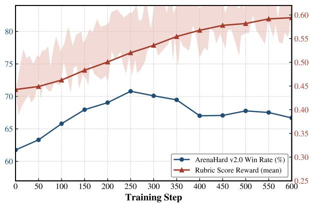  
Figure 1: Rubric Hacking. Taking the chat rubric training task as an example: as the overall rubric score keeps rising, the ArenaHard v2.0 win rate declines.

Intra-Rubric Reward Divergence. Taking the chat task as an example, we divide rubric criteria into five explicit semantic dimensions: instruction following, factual reliability, reasoning helpfulness, communication style, and safety boundary. As shown in Figure 2(a), the overall rubric reward keeps rising while the communication style dimension stagnates. To rule out semantic overlap inevitably introduced by manual partitioning, we apply Cholesky residual whitening (Kessy et al. 2018) to decorrelate the explicit semantic dimensions, yielding whitened latent dimensions that each retain only the reward information unique to that dimension. As shown in Figure 2(b), the latent dimensions of factual reliability and communication style exhibit a clear downward trend. Guided by the communication style latent dimension, we trace back training samples and find that its decline corresponds to the model ignoring finer-grained requirements such as readability and conciseness instead inflating rubric hit rates by enumerating irrelevant or redundant content——a behavior that runs counter to true generation quality. We further explicitly extract conciseness-related criteria: as shown in Figure 2(c), their scores also decline steadily, and as shown in Figure 2(d), they account for 33.37% of the communication style dimension's weight, closely matching the latent dimension's trend. This cross-validation shows that the pattern is not random fluctuation; rather, as the overall rubric reward rises, the model systematically sacrifices certain sub-dimensions, a phenomenon we term Intra-Rubric Reward Divergence.

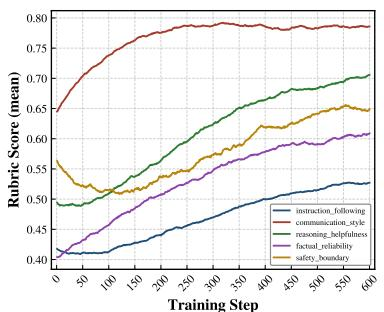  
(a)

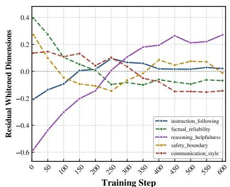  
(b)

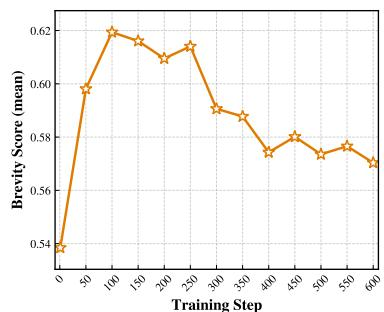  
(c)

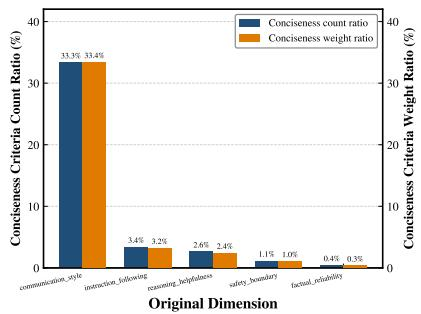  
(d)

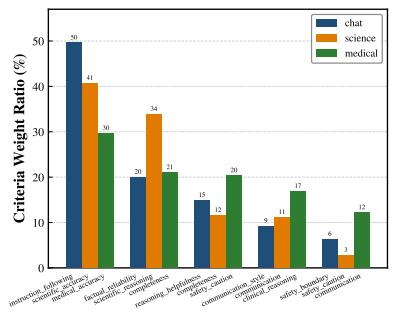  
(e)

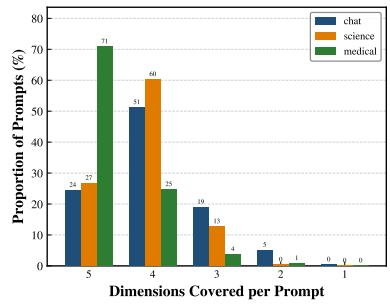  
(f)  
Figure 2: (a) Rubric reward of each semantic dimension, with communication style stagnating. (b) The Choleskywhitened communication style dimension shows a clear downward trend. (c) Rubric reward of explicitly extracted conciseness criteria declines steadily. (d) Count and weight ratios of conciseness criteria across the five original dimensions. (e) Per-dimension criteria weight ratios across the chat, science, and medical domains, where the medical domain is the most balanced. (f) Distribution of semantic dimensions covered per prompt.

Rubric Dimension Imbalance. Motivated by this finding, we analyze the distribution of rubric criteria across semantic dimensions in three training domains and observe a clear imbalance, as shown in Figure 2(e). In the chat task, in both the original and whitened semantic spaces, upwardtrending dimensions carry much larger weights than stagnant or declining ones, indicating that densely covered dimensions dominate reward aggregation and cause the model to sacrifice sparsely covered ones. To mitigate this, inspired by the multi-reward RL algorithm GDPO (Liu et al., 2026a), we propose Fair-Race Dimension Aggregation (FRDA): first compute rubric sub-dimension group advantages, then aggregate them with equal weights, letting generations compete separately within each dimension. This forces the model to perform well on more dimensions to achieve high reward, weakening the dominance of dense dimensions and reducing sacrifice of sparse dimensions.

Rubric Dimension Absence. As shown in Figure 2(f), a single prompt covers only 2–5 semantic dimensions, since annotators cannot cover all evaluation criteria—a fundamental difference from RLVR. A holistic preference signal implicitly encodes a relatively complete human evaluation system. To this end, we propose Residual Semantic Dimension Completion (RSDC): leveraging the decorrelation property of Cholesky whitening residuals, it mines from the holistic preference signal semantic dimensions not yet annotated in the rubric, filling the potential coverage gap in rubric criteria. Our main contributions are:

• We identify intra-rubric reward divergence, a previously underexplored form of rubric hacking in which the aggregate rubric reward increases while specific semantic dimensions systematically decline.

• We propose Fair-Race Dimension Aggregation (FRDA), which has generations compete within each dimension separately to mitigate rubric imbalance.

• We propose Residual Semantic Dimension Completion (RSDC), the first to implicitly mine complementary quality dimensions from global preferences without explicitly adding rubric criteria.

• Extensive experiments on chat, science, and medical tasks show that FRDA effectively mitigates rubric hacking, and RSDC significantly outperforms both single-reward training and naive multi-reward aggregation, offering a new perspective on jointly leveraging interpretable rubric rewards and holistic preference rewards.

## 2 Related Work

Rubric Reinforcement Learning. RaR (Gunjal et al., 2026) and Rubric Anchors (Huang et al., 2025) established rubric scores as finegrained reward signals for reinforcement learning on open-ended tasks, while Checklist Feedback (Viswanathan et al., 2025) uses instructionspecific checklists to provide training rewards. OpenRubric (Liu et al., 2026b) and RubricHub scale rubric construction through LLM-based generation. These works directly use the overall rubric score as the training reward. POW3R (Tyagi et al., 2026) reweights criteria according to the variance of judgments within a sampled group, concentrating optimization on criteria with greater discriminative power.

Rubric Hacking. Mahmoud et al. (Mahmoud et al. 2026) document rubric reward hacking as divergence between the training verifier and a stronger judge, attributing it to verifier failure and rubric limitations; CHERRL (Wang et al., 2026) reproduces this by injecting judge biases and detecting their exploitation. Both are diagnostic, revealing rubric hacking but offering no solutions. The closest work, Rubric Dropout (Yang et al., 2026), inspired by neural dropout, randomly drops rubric parts so the model cannot rely on any particular criterion to game the rubric. However, existing methods ignore internal dynamics within the rising overall rubric reward. Revealing Intra-Rubric Reward Divergence via rubric dimension-wise decomposition is our core insight; we thus propose Fair-Race Dimension Aggregation (FRDA) to mitigate rubric hacking, unlike existing methods. This offers a new perspective; our method is orthogonal to Dropout, and their combination is future work.

## 3 Method

In this section, we first introduce the rubric reward and the semantic-dimension decomposition (Section 3.1). We then present Fair-Race Dimension Aggregation (FRDA) (Section 3.2) and Residual Semantic Dimension Completion (RSDC) (Section 3.3).

## 3.1 Preliminaries

Rubric Reward. Let $\pi _ { \theta }$ be the policy and x a prompt from the training set. Each prompt is paired with a rubric $\mathcal { C } ( \boldsymbol { x } ) = \{ ( c _ { k } , w _ { k } ) \} _ { k = 1 } ^ { K _ { x } ^ { - } }$ , where $c _ { k }$ is a natural-language criterion and $w _ { k } > 0$ is its importance weight. Given a response y, an LLM judge J decides whether each criterion is satisfied, yielding a binary verdict $h _ { k } ( x , y ) = J ( x , y , c _ { k } ) \in \{ 0 , 1 \}$ in practice, all criteria of a prompt are judged in a single call. The overall rubric reward (Gunjal et al., 2026; Li et al., 2026) is the weight-normalized hit rate:

$$
r ( x , y ) = \frac { \sum _ { k = 1 } ^ { K _ { x } } w _ { k } h _ { k } ( x , y ) } { \sum _ { k = 1 } ^ { K _ { x } } w _ { k } } \in [ 0 , 1 ] .\tag{1}
$$

Semantic Dimension Decomposition. Rubric criteria are numerous, overly specific, and semantically fragmented, which hinders criterion-level analysis. We therefore group them into $D$ semantic dimensions per domain under three principles: (i) abstraction, each dimension summarizes a family of related criteria; (ii) relative independence, each dimension captures a relatively independent aspect of generation quality; and (iii) completeness, the dimensions jointly cover the rubric so that every criterion belongs to exactly one dimension. We use GPT-5.4 (OpenAI, 2026) to classify each criterion, yielding a mapping $\phi$ with $\phi ( c _ { k } ) \in \{ 1 , \dots , D \}$ Taking chat as an example, the $D = 5$ dimensions are instruction following, factual reliability, reasoning helpfulness, communication style, and safety boundary. Hereafter, we refer to dimensions by index, i.e., dimension $1 , \ldots , D$

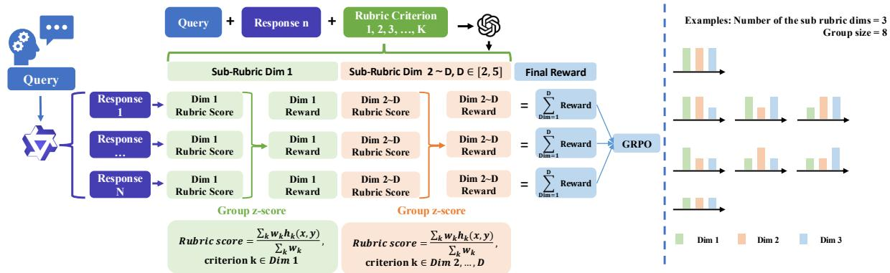  
Figure 3: Overview of Fair-Race Dimension Aggregation (FRDA). Each covered dimension is first z-scored within the sampled group, then aggregated with equal weights, letting generations compete fairly within each dimension regardless of its criterion count or weight.

## 3.2 Fair-Race Dimension Aggregation (FRDA)

Imbalance in Rubric Aggregation. Let $\mathinner { \mathcal { K } _ { d } \mathopen { \left( x \right) } } =$ $\{ k : \phi ( c _ { k } ) = d \}$ be the indices of criteria assigned to dimension d, $\boldsymbol { \mathcal { S } } ( \boldsymbol { x } ) = \{ \boldsymbol { d } : \boldsymbol { \mathcal { K } } _ { d } ( \boldsymbol { x } )$ ≠ ∅} the dimensions covered by x, and $W _ { d } ( x ) =$ $\textstyle \sum _ { k \in { \mathcal { K } } _ { d } ( x ) } w _ { k }$ . Reusing the judge verdicts, the dimension-level reward is

$$
r _ { d } ( x , y ) = \frac { \sum _ { k \in K _ { d } ( x ) } w _ { k } h _ { k } ( x , y ) } { W _ { d } ( x ) } , \quad d \in \mathcal { S } ( x ) ,\tag{2}
$$

and Eq. (1) is exactly their weighted mean:

$$
r ( x , y ) = \sum _ { d \in S ( x ) } \frac { W _ { d } ( x ) } { \sum _ { d ^ { \prime } \in S ( x ) } W _ { d ^ { \prime } } ( x ) } r _ { d } ( x , y ) .\tag{3}
$$

Standard Group Relative Policy Optimization (GRPO) normalizes $r ( x , y _ { i } )$ within a group of G responses $\{ y _ { i } \} _ { i = 1 } ^ { G }$ sampled from $\pi _ { \theta _ { \mathrm { o l d } } }$ to obtain the advantage. By Eq. (3), dimensions with dense, heavily weighted criteria dominate this signal, so the policy can raise r while sacrificing sparsely covered dimensions. Inspired by GDPO, we instead normalize each dimension within the group before aggregation.

Dimension-Wise Normalization and Aggregation. With $r _ { i , d } = r _ { d } ( x , y _ { i } )$ , each covered dimension is normalized within the group:

$$
\hat { A } _ { i , d } = \frac { r _ { i , d } - \mu _ { d } } { \sigma _ { d } + \epsilon } ,\tag{4}
$$

where $\mu _ { d }$ and $\sigma _ { d }$ are the mean and standard deviation of $\{ r _ { j , d } \} _ { j = 1 } ^ { G }$ and ε is a small constant. The normalized advantages are then averaged with equal

weights:

$$
R _ { i } = \frac { 1 } { | \mathcal { S } ( x ) | } \sum _ { d \in \mathcal { S } ( x ) } \hat { A } _ { i , d } .\tag{5}
$$

Unlike GDPO, whose reward set is shared by all prompts, the covered dimensions vary across prompts (Figure 2(f)), so we average only over $s ( x )$ . Finally, $R _ { i }$ is normalized again within the group to keep the advantage scale consistent across prompts:

$$
A _ { i } = \frac { R _ { i } - \mathrm { m e a n } \left( \{ R _ { j } \} _ { j = 1 } ^ { G } \right) } { \mathrm { s t d } \left( \{ R _ { j } \} _ { j = 1 } ^ { G } \right) + \epsilon } ,\tag{6}
$$

which replaces the standard GRPO advantage in the clipped surrogate objective.

Why It Balances. After Eq. (4), every covered dimension has zero mean and unit variance within the group regardless of its criterion count or weights, so it contributes equally to Eq. (5) rather than in proportion to $W _ { d } ( x )$ as in Eq. (3). A response thus needs to outperform its peers on more covered dimensions to obtain a high advantage.

## 3.3 Residual Semantic Dimension Completion(RSDC)

Balanced aggregation cannot recover dimensions that a rubric misses (Figure 2(f)). A global preference reward model implicitly encodes a more complete evaluation system, but its signal may largely overlap with the rubric dimensions, and adding it directly would reward covered aspects twice. We use Cholesky whitening to extract only its complementary component.

Cholesky Whitening as Residual Whitening. For a zero-mean vector v = $( v _ { 1 } , \ldots , v _ { n } ) ^ { \top }$ with positive definite covariance $\Sigma = L L ^ { \top }$ , where L is lower-triangular, $\mathbf { u } = L ^ { - 1 } \mathbf { v }$ has identity covariance. Since $L ^ { - 1 }$ is also lower-triangular, each $u _ { p }$ is the standardized residual of linearly regressing $v _ { p }$ on its predecessors $\mathbf { v } _ { < p } .$

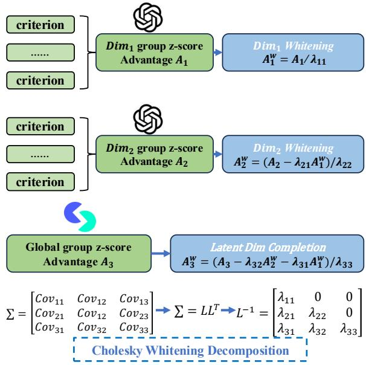  
Figure 4: Illustration of Residual Semantic Dimension Completion (RSDC).

$$
u _ { p } = \frac { v _ { p } - \beta _ { p } ^ { \top } { \bf v } _ { < p } } { \tau _ { p } } ,\tag{7}
$$

where $\beta _ { p } ~ = ~ \Sigma _ { < p , < p } ^ { - 1 } \Sigma _ { < p , p }$ and $\begin{array} { r } { \tau _ { p } ^ { 2 }               = \ \Sigma _ { p p } - } \end{array}$ $\Sigma _ { p , < p } \beta _ { p } .$ Unlike principal component analysis (PCA) or zero-phase component analysis (ZCA) whitening, which mix all coordinates, Cholesky whitening keeps in each later coordinate only the information that earlier ones cannot explain. This property suits our setting well. Placing the global preference last strips its linear overlap with the rubric dimensions, so its whitened coordinate forms a latent dimension complementary to the rubric, while the whitened rubric dimensions are unaffected by the preference reward.

Latent Dimension Completion. Let $r _ { \mathrm { p r e f } } ( x , y )$ be the score of a Bradley-Terry reward model (Skywork-Reward-V2-Llama-3.1-8B in our experiments). We treat it as dimension D+1, covered by every prompt, set $\tilde { S } ( x ) = S ( x ) \cup \{ D + 1 \}$ and $r _ { i , D + 1 } = r _ { \mathrm { p r e f } } ( x , y _ { i } )$ , and group-normalize it by Eq. (4) like the rubric dimensions. For response $y _ { i } .$ let $\hat { \mathbf { a } } _ { i } = ( \hat { A } _ { i , d } ) _ { d \in \tilde { \mathcal { S } } ( x ) }$ with the covered rubric dimensions first and dimension $D { + 1 }$ last, and let $\Sigma _ { \tilde { S } ( x ) }$ be the corresponding principal submatrix of the covariance Σ of all D+1 dimension advantages.

Whitening is performed in the covered subspace:

$$
\begin{array} { r } { \Sigma _ { \tilde { \mathcal { S } } ( x ) } = L _ { x } L _ { x } ^ { \top } , \quad \quad \tilde { \mathbf { a } } _ { i } = L _ { x } ^ { - 1 } \hat { \mathbf { a } } _ { i } , } \end{array}\tag{8}
$$

where $\tilde { \mathbf { a } } _ { i } ~ = ~ ( \tilde { A } _ { i , d } ) _ { d \in \tilde { \mathcal { S } } ( x ) }$ . By Eq. (7), the latent dimension $\tilde { A } _ { i , D + 1 }$ is the standardized residual of $\hat { A } _ { i , D + 1 }$ after removing the part linearly explained by the covered rubric dimensions. Components related to uncovered dimensions are retained, which fills the coverage gap of each prompt. The whitened advantages are aggregated with equal weights, replacing Eq. (5),

$$
R _ { i } = \frac { 1 } { | \tilde { S } ( x ) | } \sum _ { d \in \tilde { S } ( x ) } \tilde { A } _ { i , d } ,\tag{9}
$$

and converted to the final advantage by Eq. (6).

## 4 Experiments

We validate the effectiveness of FRDA across the Chat, Science, and Medical domains, and validate RSDC on the Chat domain, where the holistic preference reward signal is readily available.

## 4.1 Setup

Models and Training Data. We use Qwen3- 4B (Qwen Team, 2025) as the policy model and GPT-4.1 mini (OpenAI, 2025) as the rubric judge during training. We sample $6 { , } 4 0 0$ training prompts from each of the Chat, Science, and Medical subsets of RubricHub (Li et al., 2026). For RSDC on Chat, we additionally use Skywork-Reward-V2- Llama-3.1-8B (Liu et al., 2026c) to provide the holistic preference reward $r _ { \mathrm { p r e f } } .$

Evaluation. We evaluate on Arena-Hard v2.0 (Li et al., 2024) for Chat, ResearchQA (Yifei et al., 2026) and GPQA Diamond (Rein et al., 2023) for Science, and HealthBench (Arora et al., 2025) for Medical. We check for overlap between RubricHub Science subsets and ResearchQA and remove overlapping samples before evaluation. We evaluate on 500 prompts randomly sampled ResearchQA prompts and 1,000 uniformly sampled Health-Bench prompts. For each benchmark, we follow its recommended evaluation settings.

Training and Baselines. We train for 600 steps with a learning rate of $1 0 ^ { - 6 }$ , a batch size of 32, and 8 rollouts per prompt. Our main baselines are raw rubric reward, which applies GRPO to the aggregate rubric score, and Rubric Dropout (Yang et al., 2026), which randomly removes a fraction of rubric criteria when computing the reward. We directly adopt the best-practice dropout rates of 30% and 50% from the Rubric Dropout (Yang et al., 2026). Further ablations compare different dimension aggregation and rubric-preference fusion strategies. Metrics. To capture both peak performance and late-training degradation, we report Peak, the best test score over checkpoints from steps 50–600, and w-mean, the mean test score over checkpoints from steps 400–600. Similar to Rubric Dropout, we use steps 400–600 to probe degradation, as rubric hacking typically emerges in the last third of training. $\Delta$ denotes the w-mean gain over the raw rubric reward baseline on the same benchmark.

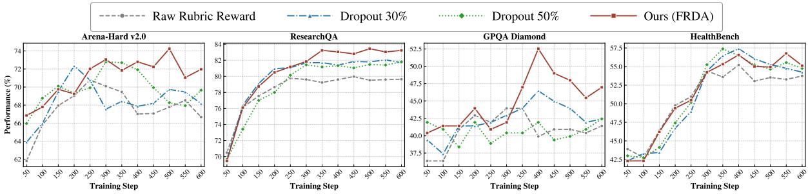

Figure 5: Qwen3-4B performance across training steps 50–600 on four benchmarks. FRDA outperforms raw rubric reward across domains, with larger gains over Dropout on Chat and Science.
<table><tr><td rowspan="2">Method</td><td colspan="3">Arena-Hard v2.0</td><td colspan="3">ResearchQA</td><td colspan="3">GPQA Diamond</td><td colspan="3">HealthBench</td></tr><tr><td>Peak</td><td>W-mean</td><td> $\Delta$ </td><td>Peak</td><td>W-mean</td><td> $\Delta$ </td><td>Peak</td><td>w-mean</td><td> $\Delta$ </td><td>Peak</td><td>W-mean</td><td> $\Delta$ </td></tr><tr><td>Qwen3-4B</td><td>61.75</td><td>61.75</td><td></td><td>60.65</td><td>60.65</td><td></td><td>36.36</td><td>36.36</td><td></td><td>34.59</td><td>34.59</td><td>一</td></tr><tr><td>Raw Rubric Reward</td><td>70.79</td><td>67.41</td><td></td><td>79.97</td><td>79.56</td><td></td><td>43.94</td><td>40.71</td><td></td><td>55.21</td><td>53.76</td><td></td></tr><tr><td>Dropout 30%</td><td>72.35</td><td>68.68</td><td>+1.27</td><td>82.05</td><td>81.76</td><td>+2.21</td><td>46.46</td><td>43.94</td><td>+3.23</td><td>57.40</td><td>55.54</td><td>+1.78</td></tr><tr><td>Dropout 50%</td><td>72.70</td><td>69.54</td><td>+2.13</td><td>81.80</td><td>81.41</td><td>+1.86</td><td>47.47</td><td>44.95</td><td>+4.24</td><td>57.38</td><td>55.33</td><td>+1.57</td></tr><tr><td>FRDA (Ours)</td><td>74.25</td><td>72.46</td><td>+5.05</td><td>83.47</td><td>83.16</td><td>+3.60</td><td>55.56</td><td>49.70</td><td>+8.99</td><td>56.77</td><td>55.68</td><td>+1.92</td></tr></table>

Table 1: Qwen3-4B results on four benchmarks. Peak is the best score across evaluated checkpoints from steps 50–600; w-mean averages evaluated checkpoints from steps 400–600. ∆ is the w-mean gain over raw rubric reward, in points. Bold indicates the best result in each column.

## 4.2 Effectiveness of Fair-Race Dimension Aggregation

As shown in Table 1, on Chat and Science, FRDA improves over raw rubric reward in w-mean by $\Delta \ : = \ : + 5 . 0 5$ on Arena-Hard v2.0, +3.60 on ResearchQA, and +8.99 on GPQA Diamond, exceeding the better Dropout variant on each by +2.92, +1.40, and +4.75 points. On Medical (Health-Bench), FRDA still improves over raw rubric reward $( \Delta \ = \ + 1 . 9 2 )$ and performs on par with Dropout. As Figure 2(e) shows, the Chat and Science training sets have a more imbalanced perdimension criteria weight distribution than Medical. This is consistent with the results above: where training-time dimension weights are more skewed, computing advantages within each dimension and then aggregating them with equal weights can effectively mitigate dimension imbalance, in line with FRDA's larger margin over Dropout's generic overfitting regularization; on the comparatively balanced Medical set, there is less imbalance for FRDA's structural adjustment to act on, in line with its performance being close to Dropout while still improving over raw rubric reward. These results suggest FRDA and Dropout address rubric hacking from two different, orthogonal angles, one structural and one regularization-based: Dropout provides consistently stable optimization, whereas FRDA is more effective when the training set has imbalanced dimension coverage. Combining the two could be worth exploring in future work.

## 4.3 FRDA Analysis and Ablation

FRDA Mitigates Rubric Hacking Rather Than Merely Slowing Training. One might attribute FRDA's gains (Figure 5, Table 1) to slower training, such that the policy has not yet reached the stage of sacrificing sparsely covered dimensions. Figure 6 rules this out: in all three domains, FRDA's aggregate rubric reward closely tracks that of raw rubric reward at nearly every step, with no delay. Yet FRDA reaches a higher test peak and stays above raw rubric reward over steps 400–600. The gain thus stems not from how fast the reward grows, but from where it is spent: per-dimension competition spreads improvement across dimensions instead of concentrating it in densely covered ones.

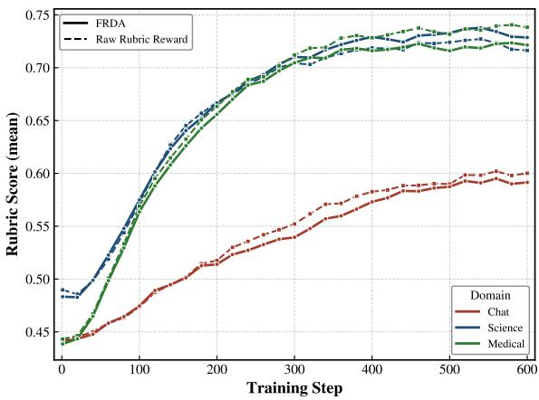  
Figure 6: Aggregate rubric reward during Qwen3-4B training on Chat, Science, and Medical. FRDA and raw rubric reward achieve similar aggregate rewards.

Reduced Intra-Rubric Reward Divergence. The reward-growth argument above only speaks to the aggregated signal; we next check whether FRDA also changes the dimension-level dynamics that Figure 2(b) identifies as the source of rubric hacking. Figures 7(a) and 7(b) plot each Chat dimension's Cholesky-whitened residual (Section 3.3) for FRDA (solid) vs. raw rubric reward (dashed). For dimensions trending downward under raw rubric reward, FRDA's decline is visibly shallower, and for those trending upward, the rise is similarly damped; both curves diverge increasingly from step 400 onward, with FRDA staying closer to its step-400 level. This flattening coincides exactly with the window used for w-mean and ∆ in Table 1, consistent with a single mechanism: by preventing any one dimension's residual from running away, FRDA keeps the policy from over-fitting a subset of criteria at the expense of others, rather than a general slowdown.

Better Preservation of Conciseness. The dimension-level findings also appear in explicit conciseness criteria. Figure 7(c) shows that FRDA maintains higher brevity scores during later training. Table 2 shows the corresponding difference in response length: FRDA produces shorter responses at every evaluated checkpoint from steps 400–600. At step 600, the average length is 4,496 under FRDA, compared with 5,180 under raw rubric reward. The higher conciseness scores and stronger downstream results show that FRDA limits excessive response growth while preserving quality.

<table><tr><td>Step</td><td>Raw Rubric Reward FRDA</td></tr><tr><td>400</td><td>3744 3279</td></tr><tr><td>450</td><td>4640 3254</td></tr><tr><td>500</td><td>4364 3639</td></tr><tr><td>550 4671</td><td>4113</td></tr><tr><td>600 5180</td><td>4496</td></tr></table>

Table 2: Average response length on Arena-Hard v2.0 for Qwen3-4B. FRDA produces shorter responses throughout the comparison window.
<table><tr><td>Method</td><td>Peak</td><td>w-mean</td><td>∆</td></tr><tr><td>Raw Rubric Reward</td><td>70.79</td><td>67.41</td><td></td></tr><tr><td>ADM</td><td>70.82</td><td>64.76</td><td>-2.65</td></tr><tr><td>FRDA (Ours)</td><td>74.25</td><td>72.46</td><td>+5.05</td></tr></table>

Table 3: Aggregation ablation on Arena-Hard v2.0 with Qwen3-4B. ADM equally averages raw dimension rewards; FRDA normalizes each dimension before aggregation. Metrics follow Table 1.

Ablation: Average Dimension Mean vs. FRDA. A seemingly simpler fix for dimension imbalance is to average the unnormalized dimension-level rewards $r _ { d } ( x , y )$ with equal weights, replacing the weighted mean in Eq. (3) with a plain average over covered dimensions; we call this ablation Average Dimension Mean (ADM) and train it on Chat under the same setup as FRDA. Table 3 shows ADM falls below even the raw-rubric-reward baseline $( \Delta = - 2 . 6 5 )$ : equal-weight averaging ignores how differently separated each dimension's raw score distribution is, so a sparsely covered or noisy dimension with a wide score range dominates the aggregate, merely trading the original imbalance for a new one favoring high-variance dimensions. FRDA avoids this by normalizing each dimension's advantage to zero mean and unit variance within the sampling group (Eq. (4)) before averaging, so balancing acts on the group-relative advantage rather than the raw reward. Mitigating rubric hacking thus requires balancing at the right statistical level; naive re-weighting can introduce a bias as harmful as the one it removes.

## 4.4 Effectiveness of Residual Semantic Dimension Completion

We evaluate RSDC on Chat using Skywork-Reward-V2-Llama-3.1-8B as the holistic preference reward model. This setting provides a direct comparison between rubric rewards, preference rewards, and their combination.

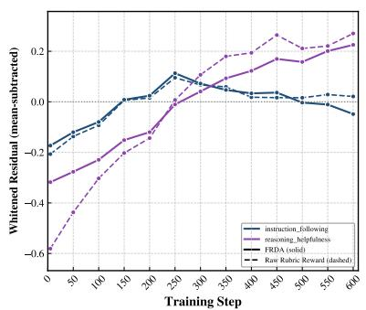  
(a)

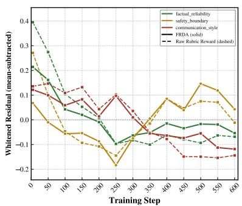  
(b)

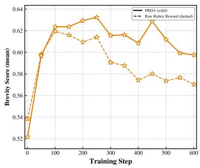  
(c)

Figure 7: Dimension-level training dynamics on Chat with Qwen3-4B. (a) Whitened residuals for instruction following and reasoning helpfulness. (b) Whitened residuals for factual reliability, safety boundary, and communication style. (c) Scores on conciseness-related rubric criteria. Solid lines denote FRDA; dashed lines denote raw rubric reward.
<table><tr><td>Method</td><td>Peak</td><td>w-mean</td><td>∆</td></tr><tr><td>Raw Rubric Reward</td><td>70.79</td><td>67.41</td><td>一</td></tr><tr><td>OP</td><td>78.03</td><td>77.08</td><td>1</td></tr><tr><td>MR</td><td>79.00</td><td>78.12</td><td>+1.04</td></tr><tr><td>FRDA+OP</td><td>79.03</td><td>78.13</td><td>+1.05</td></tr><tr><td>RSDC (Ours)</td><td>81.20</td><td>79.58</td><td>+2.50</td></tr></table>

Table 4: Rubric-preference reward comparisons on Arena-Hard v2.0 with Qwen3-4B. OP uses preference reward alone; MR sums rubric and preference rewards; FRDA+OP aggregates their dimension-wise normalized advantages; RSDC additionally applies Cholesky whitening. Peak and w-mean follow Table 1, while ∆ is the w-mean difference relative to OP, the stronger single-reward baseline.

We compare five training variants: raw rubric reward; OP, which uses only the preference reward $r _ { \mathrm { p r e f } } ;$ MR, which sums the aggregate rubric and preference rewards; FRDA+OP, which adds the preference reward as another dimension in FRDA without whitening; and RSDC, which applies Cholesky whitening to the joint advantage vector before aggregation, with the preference dimension placed last. All variants use Qwen3-4B (Qwen Team, 2025) as policy model and are evaluated on Arena-Hard v2.0 (Li et al., 2024).

Holistic Preferences Provide a Strong Additional Signal. Table 4 shows that OP alone achieves a w-mean of 77.08, exceeding raw rubric reward by 9.67 points. Combining the two signals with MR or FRDA+OP raises w-mean to 78.12 and 78.13, respectively. Both combinations outperform either reward source alone, but their gains over OP are limited to approximately one point.

RSDC Improves Rubric-Preference Integration.

RSDC achieves the highest peak and w-mean, at 81.20 and 79.58. Its w-mean exceeds OP by 2.50 points, MR by 1.46 points, and FRDA+OP by 1.45 points. By placing the preference dimension last, RSDC removes the component linearly explained by the covered rubric dimensions from its contribution to the aggregate advantage. The improvement over FRDA+OP demonstrates the benefit of whitening when combining these reward signals and supports RSDC as an effective way to integrate rubric and holistic preference feedback.

## 5 Conclusion

By decomposing rubric rewards into semantic dimensions, we identify Intra-Rubric Reward Divergence, a form of rubric hacking in which aggregate rubric reward keeps rising while specific subdimensions decline, and trace it to two causes: dimension imbalance and dimension absence. To address them, we propose Fair-Race Dimension Aggregation (FRDA), which normalizes and aggregates rubric sub-dimensions with equal weights so generations compete separately within each dimension, mitigating the dominance of densely covered dimensions over the reward signal, and Residual Semantic Dimension Completion (RSDC), which uses Cholesky whitening to extract from a holistic preference signal the latent dimensions not covered by the rubric. Experiments on chat, science, and medical domains show that FRDA effectively mitigates rubric hacking when the rubric training set has imbalanced dimension coverage and performs comparably to Dropout when it is balanced, while RSDC outperforms both single-reward training and naive multi-reward aggregation.

## Limitations

Our analysis relies on a manual, coarse-grained partition of rubric criteria into semantic dimensions per domain, which requires domain-knowledgeable annotators and may vary across annotators; we do not pursue a fine-grained or universally agreedupon decomposition.

Because specialized preference reward models for science and medicine are not readily available off the shelf, we validate RSDC only on chat, where a general-purpose conversational reward model exists; extending it to professional domains is left to future work.

## References

Pranjal Aggarwal and Sean Welleck. 2025. L1: Controlling how long a reasoning model thinks with reinforcement learning. In Second Conference on Language Modeling.

Rie Kubota Ando and Tong Zhang. 2005. A framework for learning predictive structures from multiple tasks and unlabeled data. Journal of Machine Learning Research, 6:1817–1853.

Galen Andrew and Jianfeng Gao. 2007. Scalable training of L1-regularized log-linear models. In Proceedings of the 24th International Conference on Machine Learning, pages 33–40.

Rahul K Arora, Jason Wei, Rebecca Soskin Hicks, Preston Bowman, Joaquin Quiñonero-Candela, Foivos Tsimpourlas, Michael Sharman, Meghan Shah, Andrea Vallone, Alex Beutel, et al. 2025. Healthbench: Evaluating large language models towards improved human health. arXiv preprint arXiv:2505.08775.

Anisha Gunjal, Anthony Wang, Elaine Lau, Vaskar Nath, Yunzhong He, Bing Liu, and Sean M. Hendryx. 2026. Rubrics as rewards: Reinforcement learning beyond verifiable domains. In The Fourteenth International Conference on Learning Representations.

Daya Guo, Dejian Yang, Haowei Zhang, Junxiao Song, Peiyi Wang, Qihao Zhu, Runxin Xu, Ruoyu Zhang, Shirong Ma, Xiao Bi, Xiaokang Zhang, Xingkai Yu, Yu Wu, Z. F. Wu, Zhibin Gou, Zhihong Shao, Zhuoshu Li, Ziyi Gao, Aixin Liu, and 175 others. 2025. DeepSeek-R1 incentivizes reasoning in LLMs through reinforcement learning. Nature, 645(8081):633–638.

Jian Hu, Jason Klein Liu, Haotian Xu, and Wei Shen. 2025. REINFORCE++: Stabilizing critic-free policy optimization with global advantage normalization. Preprint, arXiv:2501.03262.

Zenan Huang, Yihong Zhuang, Guoshan Lu, Zeyu Qin, Haokai Xu, Tianyu Zhao, Ru Peng, Jiaqi Hu, Zhanming Shen, Xiaomeng Hu, Xijun Gu, Peiyi Tu, Jiaxin

Liu, Wenyu Chen, Yuzhuo Fu, Zhiting Fan, Yanmei Gu, Yuanyuan Wang, Zhengkai Yang, and 2 others. 2025. Reinforcement learning with rubric anchors. Preprint, arXiv:2508.12790.

Agnan Kessy, Alex Lewin, and Korbinian Strimmer. 2018. Optimal whitening and decorrelation. The American Statistician, 72(4):309–314.

Sunzhu Li, Jiale Zhao, Huimin Ren, Zhenlin Wei, Yang Zhou, Jingwen Yang, Shunyu Liu, Kaike Zhang, and Chen Wei. 2026. Rubrichub: A comprehensive and highly discriminative rubric dataset via automated coarse-to-fine generation. In Proceedings of the 64th Annual Meeting of the Association for Computational Linguistics (Volume 1: Long Papers), pages 31320– 31344.

Tianle Li, Wei-Lin Chiang, Evan Frick, Lisa Dunlap, Tianhao Wu, Banghua Zhu, Joseph E Gonzalez, and Ion Stoica. 2024. From crowdsourced data to highquality benchmarks: Arena-hard and benchbuilder pipeline. arXiv preprint arXiv:2406.11939.

Shih-Yang Liu, Xin Dong, Ximing Lu, Shizhe Diao, Peter Belcak, Mingjie Liu, Min-Hung Chen, Hongxu Yin, Yu-Chiang Frank Wang, Kwang-Ting Cheng, Yejin Choi, Jan Kautz, and Pavlo Molchanov. 2026a. GDPO: Group reward-decoupled normalization policy optimization for multi-reward RL optimization. In Forty-third International Conference on Machine Learning.

Tianci Liu, Ran Xu, Tony Yu, Ilgee Hong, Carl Yang, Tuo Zhao, and Haoyu Wang. 2026b. Openrubrics: Towards scalable synthetic rubric generation for reward modeling and LLM alignment. In Proceedings of the 64th Annual Meeting of the Association for Computational Linguistics (Volume 1: Long Papers), pages 17417–17437, San Diego, California, United States. Association for Computational Linguistics.

Wei Liu, Ruochen Zhou, Yiyun Deng, Yuzhen Huang, Junteng Liu, Yuntian Deng, Yizhe Zhang, and Junxian He. 2025. Learn to reason efficiently with adaptive length-based reward shaping. Preprint, arXiv:2505.15612.

Yuhao Liu, Liang Zeng, Yuzhen Xiao, Jujie He, Jiacai Liu, Chaojie Wang, Rui Yan, Wei Shen, Fuxiang Zhang, Jiacheng Xu, et al. 2026c. Skywork-rewardv2: Scaling preference data curation via human-ai synergy. In International Conference on Learning Representations, volume 2026, pages 133805– 133838.

Anas Mahmoud, MohammadHossein Rezaei, Zihao Wang, Anisha Gunjal, Bing Liu, and Yunzhong He. 2026. Reward hacking in rubric-based reinforcement learning. Preprint, arXiv:2605.12474.

OpenAI. 2025. Gpt-4.1 mini. OpenAI API model, snapshot: gpt-4.1-mini-2025-04-14. Model snapshot released on 2025-04-14.

OpenAI. 2026. Introducing GPT-5.4. OpenAI blog post. Accessed: 2026-10-17.

Cheng Qian, Emre Can Acikgoz, Qi He, Hongru Wang, Xiusi Chen, Dilek Hakkani-Tür, Gokhan Tur, and Heng Ji. 2025. ToolRL: Reward is all tool learning needs. Preprint, arXiv:2504.13958.

Qwen Team. 2025. Qwen3 technical report. Preprint, arXiv:2505.09388.

Mohammad Sadegh Rasooli and Joel R. Tetreault. 2015. Yara parser: A fast and accurate dependency parser. Computing Research Repository, arXiv:1503.06733. Version 2.

David Rein, Betty Li Hou, Asa Cooper Stickland, Jackson Petty, Richard Yuanzhe Pang, Julien Dirani, Julian Michael, and Samuel R Bowman. 2023. Gpqa: A graduate-level google-proof q&a benchmark. arXiv preprint arXiv:2311.12022.

Utkarsh Tyagi, Xingang Guo, MohammadHossein Rezaei, Daniel George, Anas Mahmoud, Jackson Lee, Bing Liu, and Yunzhong He. 2026. Not every rubric teaches equally: Policy-aware rubric rewards for rlvr. Preprint, arXiv:2605.20164.

Vijay Viswanathan, Yanchao Sun, Shuang Ma, Xiang Kong, Meng Cao, Graham Neubig, and Tongshuang Wu. 2025. Checklists are better than reward models for aligning language models. Preprint, arXiv:2507.18624.

Xuekang Wang, Zhuoyuan Hao, Shuo Hou, Hao Peng, Juanzi Li, and Xiaozhi Wang. 2026. Reproducing, analyzing, and detecting reward hacking in rubric-based reinforcement learning. Preprint, arXiv:2606.04923.

Minglai Yang, Xinyu Guo, Utkarsh Tyagi, Mian Zhang, Razvan Dumitru, Sunjie Hou, Yunzhong He, Daniel Yue Zhang, and Ying Liu. 2026. Rubric dropout: A simple way to mitigate reward hacking in rubric-as-reward rl. Preprint, arXiv:2608.11669.

Li S Yifei, Allen Chang, Chaitanya Malaviya, and Mark Yatskar. 2026. Researchqa: Evaluating scholarly question answering at scale across 75 fields with survey-mined questions and rubrics. Transactions of the Association for Computational Linguistics, 14:1344–1368.

Qiying Yu, Zheng Zhang, Ruofei Zhu, Yufeng Yuan, Xiaochen Zuo, Yu Yue, Weinan Dai, Tiantian Fan, Gaohong Liu, Lingjun Liu, Xin Liu, Haibin Lin, Zhiqi Lin, Bole Ma, Guangming Sheng, Yuxuan Tong, Chi Zhang, Mofan Zhang, Wang Zhang, and 16 others. 2025. DAPO: An open-source LLM reinforcement learning system at scale. Preprint, arXiv:2503.14476.