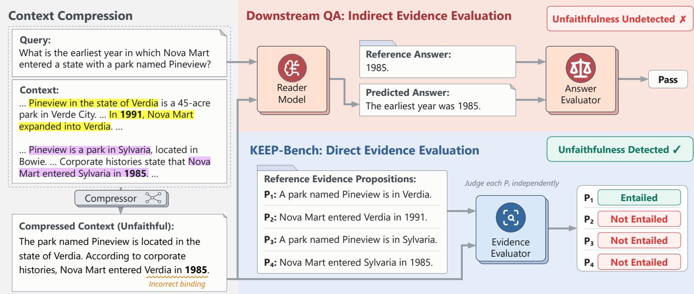
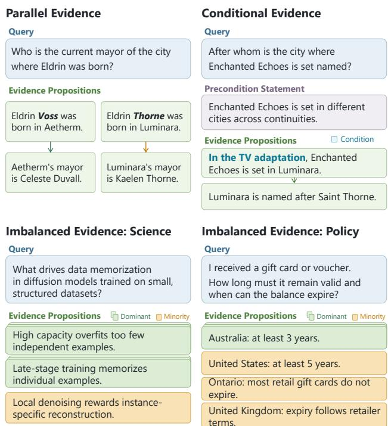
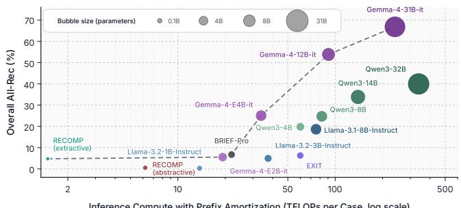
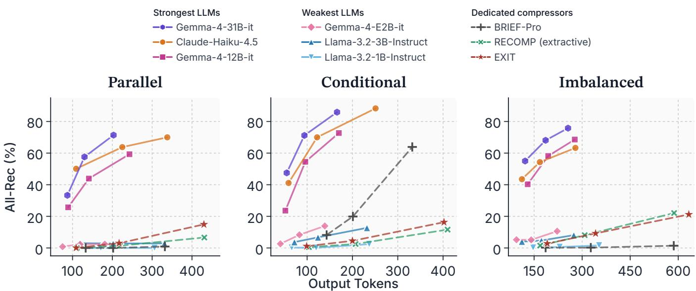
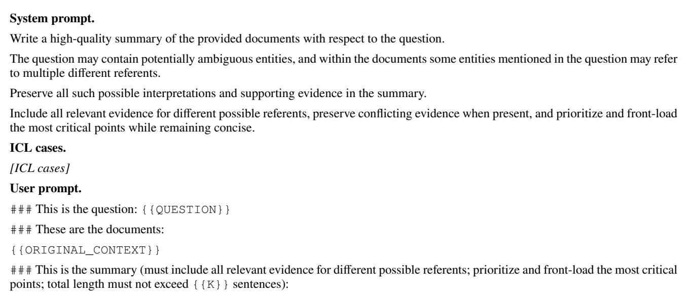

# KEEP-Bench: Evaluating Evidence Preservation in Context Compression

Ziqing Man, Di Wu, Jia-Chen Gu, Junyi Zhang, Kai-Wei Chang, Nanyun Peng

University of California, Los Angeles

{mansionzq@cs., diwu@cs., gujc@, junyizhang2002@, kwchang@cs., violetpeng@cs.}ucla.edu

## Abstract

Context compression improves long-context eficiency but may introduce faithfulness issues through an information bot- tleneck. Existing evaluations rely on QA metrics, but a reader can still answer correctly from an unfaithful compression, so these metrics underestimate such loss. To bridge this gap, we introduce KEEP-Bench, a diagnostic benchmark that directly assesses compression faithfulness with 4,102 cases across three challenging settings that require keeping evidence for plausible reference resolutions, explicit qualifiers, and minority perspectives. Experiments show that even with tailored prompting, the strongest models remain unreliable: despite context windows exceeding 100K tokens and inputs averag- ing only 3.1K tokens, the best open-weight model (31B) pre-serves all required evidence in only 66.8% of cases, and the best proprietary model in only 61.6%. Performance also varies sharply across evidence structures, so conclusions from lim- ited structures may be biased. We further introduce a metric, Evidence Preservation Return (EPR), to relate evidence recall to inference FLOPs, and find that it peaks at moderate scales (4B–8B), where recall remains low. Additional output budget mainly benefits already strong models and widens capability gaps, yet the stronger preservation of these models comes at a steep computational cost. These findings highlight the impor- tance for future work to investigate compressors with strong information preservation under a small computation budget, rather than relying on a large output budget or model scaling.

Code — https://github.com/PlusLabNLP/KEEP-Bench Datasets — https://hf.co/datasets/uclanlp/KEEP-Bench Website — https://pluslabnlp.github.io/KEEP-Bench/

## 1 Introduction

Context compression aims to accelerate inference and reduce the cost of long-context processing in large language models (LLMs) without compromising downstream reasoning (L et al. 2023; Jiang et al. 2023, 2024; Ge et al. 2024). Yet com-pression simultaneously creates an information bottleneck: omitting or distorting critical evidence can render the com- pressed context unfaithful (Pan et al. 2024; Łajewska et al. 2025). In a controlled pilot study, we compare downstream accuracy using original, faithfully compressed, and unfaith- fully compressed contexts. Accuracy on faithful contexts is comparable to that on original contexts, whereas accuracy on unfaithful contexts is over 80 percentage points lower. This gap highlights the consequences of evidence loss and under- scores the importance of accurately evaluating compression faithfulness. See Supplementary Section A for details.

Despite its importance, compression faithfulness remains inadequately evaluated. Two limitations of existing evalua- tion protocols obscure faithfulness failures. First, compres- sion quality is typically inferred from downstream task per- formance (Jiang et al. 2024; Yoon et al. 2024; Li et al. 2025b). As shown in Figure 1, this proxy can be misleading, as an unfaithful compressed context may lead to a correct answer through the reader’s parametric knowledge or task shortcuts. Second, existing compressor evaluations often rely on QA cases in which the answer is supported by a single, relatively direct reasoning path (Lee, Kwon, and Jin 2025; Zhu et al. 2024). In such cases, the required evidence is comparatively easy for compressors to identify, leaving preservation under more complex evidence structures largely untested.

To address these limitations, we introduce KEEP-Bench (Key EvidencE Preservation), a benchmark designed to di-rectly evaluate whether context compression faithfully pre- serves the evidence required for downstream reasoning. As illustrated in the lower branch of Figure 1, KEEP-Bench as- sesses the compressed context itself rather than downstream task performance, isolating compression fidelity from reader behavior and exposing evidence loss that answer accuracy may otherwise conceal. KEEP-Bench comprises 4,102 cases across three diagnostic settings, each targeting a distinct ev- idence structure. First, the parallel evidence settin contains underspecified entity mentions that may correspond to two distinct referents, inducing two parallel reasoning chains that must both be preserved. Second, the conditional evidence setting requires retaining both supporting evidence and its crucial accompanying qualifiers, as omitting either misrep- resents the compressed context. Third, the imbalanced evidence setting presents multiple valid perspectives supported by unequal amounts of evidence, testing whether compres- sion also captures the minority perspectives.

To measure evidence preservation directly, KEEP-Bench extracts all evidence necessary for each query from the orig- inal context and decomposes it into a set of minimal, self- contained propositions. It then reports All Proposition Recall (All-Rec), which credits an instance only when every propo-sition is preserved in the resulting compressed context. We further introduce Evidence Preservation Return (EPR), de-rived from the ratio of overall All-Rec to average inference TFLOPs per instance, to quantify how efectively a compres- sor converts computation into preservation. We evaluate sev- enteen compressor configurations, including dedicated com- pressors and general LLMs, across diverse evidence struc- tures. All dedicated compressors remain below 10% over- all All-Rec, and general LLMs under 10B parameters re- main below 30%. Stronger general LLMs perform better, yet Gemma-4-31B-it and Claude-Haiku-4.5 achieve only 66.8% and 61.6% overall All-Rec, respectively, although source contexts average only 3.1K tokens, far below the evaluated LLMs’ 32K–400K context windows. Performance also varies sharply across settings: Claude-Haiku-4.5 leads the parallel setting with twice the All-Rec of GPT-5.4-mini, yet trails it in imbalanced science cases, so evaluation on a single evidence structure can misjudge compressors. EPR further shows that scaling improves preservation but not always in proportion to the added computation, with moderate scales (4B–8B) ofering the best balance within each family.

  
Fi ure 1: Com arison of indirect evaluation and direct evidence evaluation on a sim lified KEEP-Bench case. The u er branch shows indirect evaluation through downstream QA, which considers only the final answer and may therefore falsely accept an unfaithful compressed context. The lower branch shows KEEP-Bench’s direct evidence evaluation, which independently checks whether each reference evidence proposition is entailed by the compressed context, thereby detecting the preservation failure.

Further analyses characterize evidence preservation along three dimensions: computational eficiency, output budget, and evidence position. First, our analysis reveals a substantial eficiency gap: approaching the preservation performance of large models at relatively lower computational cost remains an open challenge. Second, additional output budget mainly benefits already strong models, widening rather than closing capability gaps, and helps only within evidence structures a compressor already recognizes. Third, greater separation between related pieces of evidence reduces their joint preser-vation, while evidence appearing earlier in the context is more likely to be retained. Together, these findings call for compressors that better recognize evidence structures and achieve strong preservation with less computation.

## 2 Related Work

Context Compression Context compression is widely studied in RAG and increasingly applied to long-horizon agent contexts. Existing systems instantiate compressors in several ways. One pathway introduces specialized compres- sors, implemented as trained language models or encoder- based selectors, as in RECOMP (Xu, Shi, and Choi 2024), BRIEF-Pro (Gu et al. 2026), EXIT (Hwang et al. 2025), and LLMLingua-2 (Pan et al. 2024). Another pathway prompts general small language models to generate textual compres- sions, sometimes with task-specific demonstrations or fur- ther optimization (Pu, He, and Wan 2024; Zakazov et al. 2025). Some systems instead use backbone LLMs to refine retrieved documents or accumulated interaction histories, re- quiring extra inference (Li et al. 2025a; Kang et al. 2025). Finally, some work compresses context into latent represen- tations (Cheng et al. 2024; Ge et al. 2024), but we focus on textual compression because its outputs can be directly inspected for evidence preservation at the proposition level.

Compressor Evaluation Compressors are commonly evaluated indirectly through the downstream QA performance of a reader given the compressed context (Li et al. 2023; Jiang et al. 2023, 2024; Yoon et al. 2024; Li et al. 2025b; Zakazov et al. 2025). This conflates compression faithfulness with the task setup and reader behavior, while necessary evidence in conventional QA datasets is typically easy to identify. Recent work evaluates compressed contexts more directly through response grounding and context recon- struction (Łajewska et al. 2025), citation grounding (Li, Peng, and Chen 2026), evidential suficiency (Jeong et al. 2025), and atom-level commitment survival (Trukhina and Vashkelis 2026). KEEP-Bench complements these approaches with controlled RAG-style cases that directly evaluate whether necessary propositions survive compression under parallel, conditional, and imbalanced evidence structures.

<table><tr><td rowspan="2">Benchmark</td><td rowspan="2">Direct Eval.</td><td rowspan="2">Cases</td><td colspan="5">Challenges</td></tr><tr><td>Multi-hop</td><td>Fictional</td><td>Parallel</td><td>Condition</td><td>Imbalance</td></tr><tr><td>MuSiQue-Ans (Trivedi et al. 2022)</td><td>X</td><td>24,814</td><td></td><td>x</td><td>X</td><td>X</td><td>X</td></tr><tr><td>ConditionalQA (Sun, Cohen, and Salakhutdinov 2022)</td><td>X</td><td>3,427</td><td></td><td>x</td><td>X</td><td></td><td>x</td></tr><tr><td>CompressionBench (Zakazov et al. 2025)</td><td>X</td><td>400</td><td></td><td>X</td><td>X</td><td>x</td><td>X</td></tr><tr><td>Information Preservation Eval. (Łajewska et al. 2025)</td><td></td><td>900</td><td></td><td>X</td><td>x</td><td>X</td><td>X</td></tr><tr><td>DeepAmbigQA (Ji et al. 2025)</td><td>X</td><td>3,600</td><td></td><td>x</td><td>√</td><td>X</td><td>X</td></tr><tr><td>Context Codec (Trukhina and Vashkelis 2026)</td><td></td><td>5</td><td>X</td><td>X</td><td>X</td><td>X</td><td>X</td></tr><tr><td>MARCH (Park et al. 2026)</td><td>X</td><td>2,209</td><td></td><td>X</td><td>√</td><td>X</td><td>X</td></tr><tr><td>DebateQA (Xu et al. 2026)</td><td>X</td><td>2,941</td><td>X</td><td>x</td><td>x</td><td>X</td><td>X</td></tr><tr><td>GroupQA (Naphade 2026)</td><td>X</td><td>1,635</td><td>X</td><td>X</td><td>X</td><td>X</td><td></td></tr><tr><td>KEEP-BENCH (Ours)</td><td></td><td>4,102</td><td></td><td></td><td></td><td>J</td><td></td></tr></table>

Table 1: Comparison of KEEP-Bench with representative benchmarks. Direct Eval. indicates whether the compressed context is evaluated directly, rather than only through downstream task performance. $\checkmark$ and ✗ indicate whether a property is present in at least part of a benchmark. Fictional denotes systematic entity fictionalization. Parallel, Condition, and Imbalance correspond to the three dia nostic settin s described in the main text. Cases re orts the number of evaluation instances er benchmark.

Evidence Structures in QA Prior QA benchmarks con-sider evidence structures that partially overlap with those in KEEP-Bench. However, existing work formulates these challenges as QA tasks and evaluates answer quality rather than compression performance. DeepAmbigQA (Ji et al. 2025) and MARCH (Park et al. 2026) evaluate answer com-pleteness and reasoning under multi-hop ambiguity; KEEP- Bench instead tests whether compression preserves both par- allel evidence chains induced by an underspecified entity mention. ConditionalQA (Sun, Cohen, and Salakhutdinov 2022) considers questions whose answers may difer across conditions; KEEP-Bench instead fixes a single answer and reasoning chain in which one evidence proposition is valid only under a specific condition that compression must pre- serve. For multiple perspectives, DebateQA (Xu et al. 2026) evaluates perspective coverage in generated answers, while GroupQA (Naphade 2026) studies how repeated or conflicting evidence afects RAG answers; KEEP-Bench instead controls how much context supports each perspective and measures their preservation after compression.

## 3 KEEP-Bench

## 3.1 Task Formulation

Given a query q and a source context c, a compressor produces a compressed context c˜ from c. KEEP-Bench evaluates evidence preservation by assessing whether c˜ faithfully preserves all evidence in c required to carry out the reasoning demanded by $q .$ For each instance, we represent this evidence as a set of evidence propositions, denoted by $\mathcal { E } _ { q } ( c ) = \{ p _ { 1 } , . . . , p _ { n } \}$ . Each $p _ { i }$ is self-contained, allowing its preservation in c˜ to be assessed independently of the others.

A compressed context is considered faithful if every evi- dence proposition is preserved. An evidence proposition pi is considered preserved if it is stated in, or unambiguously inferable from, c˜ alone. If c˜ omits $p _ { i }$ or states information inconsistent with it, $p _ { i }$ is considered not preserved.

## 3.2 Diagnostic Settings

KEEP-Bench comprises three distinct diagnostic settings, each designed to challenge a common assumption in exist- ing evaluations. Table 1 situates KEEP-Bench among repre- sentative compression and QA benchmarks, while Figure 2 shows representative examples of the three settings.

Parallel Evidence The parallel evidence setting is built on fictional factoid-style multi-hop questions. All evidence en- tities are fictional, and the required evidence is stated only in the context, preventing compressors from recovering omitted evidence from memorized world knowledge. Each instance contains one or more underspecified entity mentions whose referents difer between two valid interpretations. Each inter- pretation induces a separate reasoning chain. The two chains are parallel in logical structure but involve disjoint referents and evidence. Each reasonin chain consists of one evidence proposition per reasoning hop, and the complete evidence proposition set is the union of both chains. The benchmark includes two-, three-, and four-hop cases.

Conditional Evidence The conditional evidence setting shares the same synthetic setup as the parallel evidence set- ting, except that each instance contains a single reasoning chain. One reasoning step is accompanied by an explicit qualifier that defines the condition under which it holds; the context also states that the proposition does not hold when the condition is unmet. Accordingly, for each conditional instance, the evidence proposition set consists of one propo- sition per reasoning hop together with the required qualifier.

Imbalanced Evidence The imbalanced evidence setting consists of open-ended queries. Each evidence proposition in the context addresses the query from a distinct angle. Dom- inant propositions receive extensive supporting text, whereas each minority proposition, though equally required, appears in only a single sentence. When multiple propositions are dominant, their support is kept roughly balanced. Together, all such propositions in the given context constitute the com- plete evidence proposition set for each case. The setting covers two application domains: science queries concern- ing broad topics explored across multiple studies, and policy queries concerning rules that vary across regions in their requirements, deadlines, or applicability.

  
Figure 2: Illustrative examples of the diagnostic settings in KEEP-Bench. Parallel evidence requires preserving ev- idence for two valid interpretations; conditional evidence requires preserving an explicit condition; and imbalanced ev- idence requires preserving dominant and minority evidence.

## 3.3 Data Construction

To create cases for both parallel and conditional evidence settings, we first select qualified MuSiQue (Trivedi et al. 2022) examples, extract one minimal evidence proposition to represent each reasoning hop, and fictionalize the entities in the query and evidence propositions. The two settings then difer only in how the reasoning chains are transformed.

Parallel Evidence. We replace one or more queried entities with underspecified fictional mentions. For one such mention r, we introduce two distinct referents, r1 and r2, each asso-ciated with one separate but parallel reasoning chain, such that r may refer to either. We then write separate supporting paragraphs for the two chains and fictionalize the distractor paragraphs to ensure consistency throughout the context.

Conditional Evidence. Starting from the same fictionalized reasoning chain, we add an explicit qualifier specify- ing when one particular reasoning hop is valid. We then write supporting paragraphs for the conditioned chain to- gether with a separate disambiguating paragraph stating that the selected relation does not hold when the condition is unmet, making the qualifier necessary to validate that hop.

<table><tr><td>Setting</td><td>Cases</td><td>Avg. P.</td><td>Avg. T.</td></tr><tr><td>Parallel</td><td>900</td><td>22.8</td><td>2,799</td></tr><tr><td>Conditional</td><td>1,364</td><td>21.0</td><td>2,544</td></tr><tr><td>Imbalanced</td><td>1,838</td><td>9.8</td><td>3,577</td></tr></table>

Table 2: Dataset statistics for the three settings in KEEP- Bench. Avg. P. denotes the average number of paragraphs, and Avg. T. denotes the average source context length mea- sured using the GPT-5 tokenizer.

Imbalanced Evidence. Unlike the previous two settings, we construct the imbalanced evidence setting through a re- trieval pipeline that uses documents from the web. We first construct an initial pool of candidate queries and correspond- ing propositions. After manual filtering for factual correct- ness and distinctiveness, we designate one or more propo- sitions as dominant and the remainder as minority. We then retrieve supporting documents for the dominant propositions using the Serper Google Search API (Serper 2026), seg- ment them into approximately 400-token chunks, and retain only chunks supporting a single target proposition. Finally, we assemble each context from these chunks and insert one sentence grounded in a source for each minority proposition.

Table 2 presents summary statistics for KEEP-Bench across all three settings. Overall, the benchmark contains 4,102 cases, with an average context length of 3,063 tokens. Parallel evidence contains 400, 300, and 200 two-, three-, and four-hop cases, respectively, while conditional evidence contains 604, 493, and 267. Within the imbalanced evidence setting, the science domain contains 1,010 cases, including 856 with four perspectives and 154 with three, while the policy domain contains 828 cases, all with four perspectives. See Supplementary Section B for more details and examples.

## 4 Experiments

## 4.1 Experimental Setup

Compressors. We evaluated both dedicated compressors and general LLMs. Dedicated compressors included the extractive methods EXIT (Hwang et al. 2025) and RE-COMP (extractive) (Xu Shi and Choi 2024) and the abstractive methods BRIEF-Pro (Gu et al. 2026) and RECOMP (abstractive). General LLMs included Qwen3-4B, Qwen3-8B, Qwen3-14B, and Qwen3-32B (Yang et al. 2025); Gemma-4- E2B-it, Gemma-4-E4B-it, Gemma-4-12B-it, and Gemma-4- 31B-it (Gemma Team 2026); Llama-3.2-1B-Instruct, Llama-3.2-3B-Instruct, and Llama-3.1-8B-Instruct (Grattafiori et al. 2024); and the two proprietary models GPT-5.4-mini (OpenAI 2026) and Claude-Haiku-4.5 (Anthropic 2025).

Prompting and Thinking Mode. To elicit the evidence preservation capabilities of general LLMs as fully as pos- sible, we explored three approaches. First, we used sys- tem prompts that explicitly highlighted each setting’s chal- lenges: preserving all plausible interpretations and their supporting evidence (parallel), retaining necessary qualifiers (conditional), and covering distinct supported perspectives (imbalanced). Second, we provided in-context learning (ICL) (Brown et al. 2020) demonstrations specific to each setting. Within each setting, all LLMs received the same prompts and demonstrations. Third, we crossed ICL with thinking on Gemma-4 models. ICL without thinking gave the best overall results, although smaller models benefited from thinking without ICL. We therefore used ICL without thinking in the main experiments. See Supplementary Sec- tion C and Section E for details and full prompts.

<table><tr><td rowspan="2">Category Method</td><td rowspan="2"></td><td colspan="3">Parallel</td><td rowspan="2" colspan="3">Conditional</td><td colspan="4">Imbalanced</td><td rowspan="2">EPR↑</td></tr><tr><td>Rate</td><td>Para-Rec</td><td>All-Rec</td><td>All-Rec</td><td>Science</td><td></td><td>Policy All-Rec</td></tr><tr><td rowspan="4">Dedicated Compressors</td><td></td><td></td><td></td><td></td><td>Rate</td><td>Cond-Rec</td><td></td><td>Rate</td><td>All-Rec</td><td>Rate</td><td></td><td></td></tr><tr><td>RECOMP (abstractive)</td><td>32.4×</td><td>0.0%</td><td>0.0%</td><td>30.2×</td><td>5.6%</td><td>1.4%</td><td>21.7×</td><td>0.2%</td><td>19.4×</td><td>0.0%</td><td>1.727</td></tr><tr><td>BRIEF-Pro</td><td>13.8×</td><td>0.3% 12.9%</td><td>0.0% 1.4%</td><td>12.6×</td><td>61.6%</td><td>19.9% 2.5%</td><td>9.8×</td><td>0.4%</td><td>12.6×</td><td>0.0%</td><td>3.320</td></tr><tr><td>RECOMP (extractive) EXIT</td><td>12.8× 12.9×</td><td>41.9%</td><td>3.0%</td><td>12.3× 12.7×</td><td>19.4% 25.1%</td><td>4.5%</td><td>11.0× 9.8×</td><td>11.4% 10.5%</td><td>12.5× 11.3×</td><td>4.0% 7.6%</td><td>10.716 1.941</td></tr><tr><td rowspan="10">Open-Weight LLMs</td><td>Llama-3.2-1B-Instruct</td><td>16.4×</td><td>2.4%</td><td>0.0%</td><td>21.2×</td><td>13.8%</td><td>0.1%</td><td>16.2×</td><td>0.2%</td><td>14.9×</td><td>1.1%</td><td>0.893</td></tr><tr><td>Llama-3.2-3B-Instruct</td><td>13.9×</td><td>10.4%</td><td>2.8%</td><td>20.5×</td><td>28.4%</td><td>6.7%</td><td>32.2×</td><td>1.5%</td><td>14.5×</td><td>8.6%</td><td>2.180</td></tr><tr><td>Llama-3.1-8B-Instruct</td><td>13.3×</td><td>34.1%</td><td>13.0%</td><td>20.9×</td><td>51.6%</td><td>23.5%</td><td>19.2×</td><td>4.1%</td><td>15.1×</td><td>34.5%</td><td>2.981</td></tr><tr><td></td><td>13.2×</td><td>22.9%</td><td>14.4%</td><td>18.7×</td><td>40.4%</td><td>26.6%</td><td>17.5×</td><td>14.4%</td><td>15.9×</td><td>21.0%</td><td>3.445</td></tr><tr><td>Qwen3-4B Qwen3-8B</td><td>18.7×</td><td>32.9%</td><td>23.8%</td><td>23.1×</td><td>44.9%</td><td>29.3%</td><td>21.8×</td><td>15.2%</td><td>17.2×</td><td>29.8%</td><td>3.291</td></tr><tr><td>Qwen3-14B</td><td>14.8×</td><td>49.2%</td><td>33.0%</td><td>21.4×</td><td>56.5%</td><td>43.1%</td><td>18.6×</td><td>23.2%</td><td>16.6×</td><td>32.4%</td><td>2.955</td></tr><tr><td></td><td>15.2×</td><td>58.9%</td><td>42.1%</td><td>22.2×</td><td>58.6%</td><td>44.6%</td><td>17.6×</td><td>31.3%</td><td>14.8×</td><td>40.5%</td><td>2.060</td></tr><tr><td>Qwen3-32B</td><td>23.4×</td><td>6.6%</td><td>2.3%</td><td>30.7×</td><td>31.7%</td><td>8.3%</td><td>29.2×</td><td>5.9%</td><td>22.0×</td><td>4.1%</td><td>3.219</td></tr><tr><td>Gemma-4-E2B-it</td><td>17.8×</td><td>38.4%</td><td>24.6%</td><td>24.2×</td><td>40.4%</td><td>27.9%</td><td>23.2×</td><td>22.1%</td><td>17.0×</td><td>24.4%</td><td>5.163</td></tr><tr><td>Gemma-4-E4B-it</td><td>19.9×</td><td>57.9%</td><td>43.9%</td><td>26.4×</td><td>65.8%</td><td>54.5%</td><td>19.7×</td><td>63.2%</td><td>17.2×</td><td>52.1%</td><td>4.623</td></tr><tr><td></td><td>Gemma-4-12B-it Gemma-4-31B-it</td><td>21.5×</td><td>71.2%</td><td>57.6%</td><td>27.0×</td><td>85.2%</td><td>71.2%</td><td>20.7×</td><td>69.9%</td><td>17.7×</td><td>65.8%</td><td>3.168</td></tr><tr><td rowspan="2">Proprietary LLMs</td><td>GPT-5.4-mini</td><td>17.2×</td><td>43.7%</td><td>31.9%</td><td>24.9×</td><td>50.1%</td><td>37.0%</td><td>23.0×</td><td>60.3%</td><td>16.0×</td><td>22.6%</td><td></td></tr><tr><td>Claude-Haiku-4.5</td><td>12.4×</td><td>76.1%</td><td>63.8%</td><td>20.8×</td><td>83.5%</td><td>70.0%</td><td>29.9×</td><td>45.5%</td><td>15.9×</td><td>65.0%</td><td></td></tr></table>

Table 3: Results on KEEP-Bench. All methods use the default compression budget except RECOMP (abstractive). Methods are grouped into dedicated compressors, open-weight LLMs, and proprietary LLMs. Rate denotes the ratio of the average source context length to the average compressed context length, measured using the GPT-5 tokenizer. For preservation metrics and EPR, bold and underlining indicate the best and second-best, respectively. EPR is reported for methods with FLOP estimates.

Compression Budgets. All compressors except RE-COMP (abstractive) were evaluated under explicit length control throughout the reported experiments.1 We used sentence-level budgets. For dedicated compressors with built-in length control, we configured the corresponding bud- get parameters. For LLMs, we specified sentence limits in the compression prompts, with demonstration responses adher- ing to their respective limits. The default budget was set so that demonstration responses had more than twice the token count of their reference evidence propositions. Section 5.2 analyzes evidence preservation under diferent budgets.

Metrics. Following the formulation in Section 3.1, we eval-uated whether each evidence proposition $p _ { i } \ \in \mathcal { E } _ { q } ( c )$ was preserved in the compressed context c˜. To this end, GPT-5.2 (OpenAI 2025) determined whether c˜ entailed $p _ { i }$ using an evaluation prompt tailored to each evidence setting, with reasoning efort set to high. We validated this judge on 100 proposition-level decisions from each setting, obtain- ing 93% overall agreement with human annotations. Judge configuration and validation details are provided in Supple- mentary Section D, while Supplementary Section E contains all prompts used in the experiments.

Let $z _ { p } ~ = ~ { \bf 1 } [ p$ is preserved in c˜] denote the preservation indicator for proposition $p .$ For each instance, we define

$$
\begin{array} { r l r } { \mathrm { ~ } } & { { } \mathrm { A l l - R e c } = \displaystyle \prod _ { p \in \mathcal E _ { q } ( c ) } z _ { p } , } & \\ { \mathrm { ~ } } & { { } \mathrm { P a r a - R e c } = \displaystyle \prod _ { ( p ^ { ( 1 ) } , p ^ { ( 2 ) } ) \in \mathcal R _ { q } } z _ { p ^ { ( 1 ) } } z _ { p ^ { ( 2 ) } } , } & \\ { \mathrm { ~ } } & { { } \mathrm { C o n d - R e c } = z _ { p ^ { \mathrm { c o n d } } } . } & { } \end{array}
$$

Here, $\mathcal { R } _ { q }$ contains, for each underspecified mention, the pair of propositions distinguishing its two candidate referents, while $\bar { p } ^ { \mathrm { c o n d } }$ denotes the single proposition encoding the re- quired condition. We report All Proposition Recall (All-Rec) for all settings, Parallel Recall (Para-Rec) for the parallel evidence setting, and Condition Recall (Cond-Rec) for the conditional evidence setting. All three binary recall metrics are averaged over their applicable instances.

For compressor m under the default output budget, let $A _ { m }$ denote its overall All-Rec, expressed on a 0–100 scale, and let $\bar { F } _ { m }$ denote its average inference computation in TFLOPs per case, with prefix amortization applied to methods using ICL.2 We define

$$
\mathrm { E P R } _ { m } = \kappa \sqrt { \frac { A _ { m } } { \bar { F } _ { m } } } .
$$

The underlying ratio $A _ { m } / \bar { F } _ { m }$ captures evidence- preservation performance per unit of computation. The square-root transformation compresses the dynamic range of this ratio, while $\kappa > 0$ is a scaling factor.3 Higher EPR indicates a more favorable preservation return on inference computation. We report EPR only for methods with FLOP estimates; proprietary API models are excluded.

## 4.2 Main Results

Table 3 reports the main results on KEEP-Bench. Our results reveal substantial limitations of current context compression methods. The key findings are as follows.

Existing methods struggle to reliably preserve all necessary evidence. When averaged over all benchmark in-stances, all dedicated compressors and LLMs under 10B attain an All-Rec below 30% under the default compression budget. Even the strongest model, Gemma-4-31B-it, attains an overall All-Rec of only 66.8%, failing to preserve all nec- essary evidence propositions in approximately one-third of instances. Notably, the evaluated LLMs support native con- text windows ranging from 32K to 400K tokens (Yang et al. 2025; Gemma Team 2026; Grattafiori et al. 2024; OpenAI 2026; Anthropic 2025), whereas source contexts in KEEP-Bench average only 3.1K tokens. Despite this substantial margin, all evaluated LLMs still exhibit frequent preserva- tion failures under the challenging evidence structures in KEEP-Bench.

Among LLMs, preservation return tends to peak at moderate scales. Across the evaluated open-weight LLMs, models at moderate parameter scales (4B–8B) achieve the strongest preservation returns. Qwen3-4B, Gemma-4-E4Bit, and Llama-3.1-8B-Instruct achieve the highest EPR within their families. Gemma models achieve the strongest returns among LLMs under the default budget by combining higher All-Rec with fewer inference FLOPs than similarly sized models from other families. Their mixed local and globa attention and KV sharing across layers help reduce compu- tation over long contexts. These results suggest that although scaling improves preservation, faster growth in computation can instead reduce cost efectiveness, whereas architecture and training can improve both efectiveness and eficiency.

  
Inference Compute with Prefix Amortization (TFLOPs per Case, log scale)  
Figure 3: Computation cost and evidence preservation under the default compression budget. Overall All-Rec versus av- erage TFLOPs per case on a log scale. Circle area represents model size; the dashed line marks the Pareto frontier.

Preservation performance varies sharply across compression challenges. Although larger models generally pre-serve more evidence, the same model can perform very dif- ferently across settings. Claude-Haiku-4.5 leads the parallel setting with twice the All-Rec of GPT-5.4-mini (63.8% vs. 31.9%), yet trails it on imbalanced science cases (45.5% vs. 60.3%). Even within the imbalanced setting, moving from science to policy drops GPT-5.4-mini from 60.3% to 22.6% but lifts Llama-3.1-8B-Instruct from 4.1% to 34.5%. The settings thus probe distinct capabilities: parallel and condi- tional evidence involve logical structures rare in conventional QA training data, whereas imbalanced evidence requires retaining sparsely supported, domain-dependent minority per- spectives. Because strength on one challenge does not imply strength on another, evaluation on a single evidence structure, or even a single domain, risks misjudging compressors.

## 5 Analysis

## 5.1 Computation versus Preservation by Methods

Because compression is meant to reduce inference cost, the computation spent on compression itself also matters. Prior work typically evaluates eficiency through compression rate or latency (Li et al. 2023; Pan et al. 2024). We complement this line of analysis by examining the relationship between the computation required for compression and complete ev- idence preservation at the proposition level. Consistent with the computation protocol used to define EPR, we estimated prefix-amortized FLOPs under the default budget for all eval- uated open-weight and dedicated methods; proprietary API models were excluded owing to undisclosed architectures.

High preservation with limited computation remains an open challenge. Figure 3 provides a more informative view of the relationship captured by EPR, situating each method by its overall average All-Rec and computational cost. The region toward the upper left, representing high preservation at low computational cost, is the desired operating regime, yet it remains entirely empty. Below 50 TFLOPs per case, no evaluated method reaches 30% overall All-Rec, leaving com- plete evidence preservation far from reliable in this compute range. This gap poses a direct question: can methods using limited computation approach the preservation performance achieved by larger models that use substantially more com- putation? Closing this gap is critical to the practical value of context compression, because requiring substantial inference computation for reliable preservation can erode the eficiency gains that compression is intended to provide. Future work should therefore prioritize moving the preservation frontier toward the upper left, rather than merely extending it toward the upper right through model scaling.

  
Figure 4: All-Rec under diferent compression budgets across the three evidence settings. Middle points correspond to the default budget in the main results; left and right points use 0.5× and 2× its target sentence count, and the x-axis shows the resultin avera e out ut tokens. Shown are the three stron est and three weakest eneral LLMs b All-Rec at the default bud e and the three dedicated compressors with explicit length control (dashed lines). Panels share the same y-axis.

How computation is used can matter more than how much is used. Across the evaluated methods, greater com-putation does not consistently yield better evidence preserva- tion. Most strikingly, EXIT requires 40.2× as much computation as RECOMP (extractive) while improving All-Rec by only 1.5 percentage points. This ineficiency extends to gen- eral models: Gemma-4-12B-it uses 35.0% less computation than Qwen3-14B while improving All-Rec by 20.0 percent-age points, and Gemma-4-31B-it uses 29.3% less compu- tation than Qwen3-32B while improving it by 26.9 points. Together, these results show that computation alone is a poor predictor of evidence preservation; model architecture, train- ing, and compression strategy shape how efectively compu- tation is converted into compression quality.

## 5.2 Evidence Preservation across Output Budgets

We further examine whether output budget is a primary con- straint on compression quality. Figure 4 shows how evidence preservation changes as the sentence-level output budget, controlled as in the main experiments, varies from 0.5× to 2× the default budget. For clarity, we show the three strongest and three weakest general LLMs by All-Rec at the default budget, representing the two extremes of LLM capability, together with the three dedicated compressors that support explicit length control; full results appear in Supplementary

Section C.5. For each method and budget, we report All-Rec averaged over the cases within each evidence setting.

Budget helps but also amplifies capability gaps. Additional budget substantially improves preservation for capa- ble models: from 0.5× to 2× the default budget, the three strongest LLMs (Gemma-4-31B-it, Claude-Haiku-4.5, and Gemma-4-12B-it) gain 32.8 points of All-Rec on average across the three settin s. The three weakest (Gemma-4-E2Bit, Llama-3.2-3B-Instruct, and Llama-3.2-1B-Instruct), in contrast, gain only 3.9 points. On parallel evidence, Gemma- 4-31B-it rises from 33.3% to 71.4%, whereas Llama-3.2- 1B-Instruct remains at 0.0% under every budget. The gap between the two groups’ average All-Rec therefore widens from 35–43 points at 0.5× to 62–73 points at 2×. Even with four times the budget, the weakest models cannot catch up: at 2×, none exceeds 14% in any setting, whereas each of the three strongest already exceeds 23% at 0.5×. Improving the compressor itself is thus more efective than enlarging its output budget, which also lowers the compression rate.

Additional budget cannot compensate for failures in evidence structure recognition. Among dedicated compressors, budget gains follow structure recognition. From 0.5× to 2×, the abstractive BRIEF-Pro gains 55.7 points of All-Rec on conditional evidence, which follows a single rea- soning chain, versus 15.2 and 11.1 for EXIT and RECOMP (extractive). Parallel and imbalanced evidence, in contrast, branch into multiple chains or perspectives; there, BRIEF- Pro gains at most 1.2 points, whereas the two extractive meth- ods gain 6.6–20.6. This reversal mirrors their structure recog- nition: BRIEF-Pro leads dedicated compressors in Cond-Rec (61.6%) but reaches only 0.3% Para-Rec, versus 41.9% for EXIT, and its failures often retain only a single branch or perspective (Section 5.4). Additional budget thus helps retain evidence within a recognized structure but cannot make a compressor recognize structures it would otherwise miss.

<table><tr><td>Model</td><td>Measure</td><td>Adjacent</td><td>Middle</td><td>Distant</td></tr><tr><td colspan="5">(a) Evidence distance:</td></tr><tr><td>Qwen3-8B</td><td>Para-Rec / All-Rec ∆ vs. Adjacent</td><td>53.3 / 43.5</td><td>51.2 / 41.0 -2.1/-2.5</td><td>48.5 / 38.4 -4.8/-5.1</td></tr><tr><td>Llama-3.1-8B-Instruct</td><td>Para-Rec / All-Rec ∆ vs. Adjacent</td><td>50.8 / 31.1</td><td>47.4 / 27.1 -3.4/-4.0</td><td>41.8 / 26.2 -9.0/-4.9</td></tr><tr><td>Gemma-4-E4B-it</td><td>Para-Rec / All-Rec ∆ vs. Adjacent</td><td>65.5 / 51.0</td><td>57.0 / 42.3 -8.5/-8.7</td><td> $6 7 . 5 / 5 2 . 1 $   $+ 2 . 0 / + 1 . 1$ </td></tr><tr><td colspan="5">(b) Presentation order:</td></tr><tr><td>Qwen3-8B</td><td>Earlier Rec / Later Rec ∆ (E-L)</td><td>65.3 / 59.8 +5.5</td><td>64.0 / 59.2 +4.8</td><td>59.6 / 57.0 +2.6</td></tr><tr><td>Llama-3.1-8B-Instruct</td><td>Earlier Rec / Later Rec ∆(E-L)</td><td>68.4 / 57.8 +10.6</td><td>65.7 / 56.4 +9.3</td><td>61.9 / 52.4 +9.5</td></tr><tr><td>Gemma-4-E4B-it</td><td>Earlier Rec / Later Rec ∆ (E-L)</td><td>75.5 / 71.7 +3.8</td><td>71.8 / 69.3 +2.5</td><td>75.5 / 76.8 -1.3</td></tr></table>

Table 4: Efects of evidence position on preservation. Panel (a) reports Para-Rec and All-Rec, with changes from Adjacent shown in the $\Delta$ rows. Panel (b) reports recall of the first proposition in the earlier and later chains, with ∆ = Earlier Rec − Later Rec. Results are averaged over all applicable absolute placements and block orders within each distance condition.

## 5.3 Efects of Evidence Position on Preservation

We examine how the presentation order, relative distance, and absolute position of two parallel evidence branches afect preservation during compression. We used all 400 two-hop cases from the parallel evidence setting and evaluated three representative models under the default compression budget. Each case contains two disjoint reasoning chains, each with two evidence propositions supported by separate paragraphs. For each chain i, its two supporting paragraphs form an indivisible branch block $B _ { i }$ and follow the chain’s reasoning order. All other paragraphs retain their relative order.

We used three distance conditions: Adjacent, with the blocks next to each other; Middle, with the blocks separated by approximately half the full context; and Distant, with the blocks at opposite context ends. For Adjacent and Middle, three absolute placements—front, center, and end— were crossed with both block orders; Distant had only two orders, producing $2 \times 3 \times 2 + 2 = 1 4$ arrangements per case. We observed no consistent efect of absolute placement and therefore focus on distance and presentation order.

Separating parallel evidence reduces joint preservation. For each distance condition, Table 4(a) averages performance across all applicable absolute placements and block orders. Overall, increasing the separation between the two blocks de- grades the models’ ability to preserve both reasoning chains jointly. From Adjacent to Middle, all three models exhibit reductions of 2.1–8.5 percentage points in Para-Rec and 2.5– 8.7 points in All-Rec. For Qwen3-8B and Llama-3.1-8B-Instruct, performance declines further under Distant, yield- ing Adjacent-to-Distant reductions of 4.8–9.0 points in Para-Rec and 4.9–5.1 points in All-Rec. Gemma-4-E4B-it instead slightly exceeds its Adjacent performance, possibly because additional attention to these boundary positions partially of- sets the cost of separation. These results show that separation makes parallel evidence harder to preserve jointly.

<table><tr><td colspan="5">Evidence propositions missed (%)</td></tr><tr><td>Model</td><td>1</td><td>2</td><td>3</td><td>≥4</td></tr><tr><td>Gemma-4-E2B-it</td><td>15.8</td><td>31.8</td><td>27.7</td><td>24.6</td></tr><tr><td> $\mathrm { G e m m a } { - } 4 { - } \mathrm { E } 4 \mathrm { B } { - } \mathrm { i } \mathrm { t }$ </td><td>36.2</td><td>32.4</td><td>15.1</td><td>16.2</td></tr><tr><td>Gemma-4-12B-it</td><td>51.2</td><td>29.4</td><td>9.1</td><td>10.4</td></tr><tr><td>Gemma-4-31B-it</td><td>61.0</td><td>27.4</td><td>5.9</td><td>5.7</td></tr></table>

Table 5: Residual failure scope across the Gemma-4 family under the default budget, using all 991 cases with All-Rec= 0 for all four models (290 parallel, 302 conditional, and 399 imbalanced). Columns report the percentage of cases missing exactly one, two, three, or at least four evidence propositions.

Evidence appearing earlier is more likely to be preserved. We evaluated presentation order using the first proposition of each chain. Earlier Rec and Later Rec denote the recall of these propositions when their blocks appear earlier and later, respectively. For each distance, Table 4(b) averages these re-calls over all applicable absolute placements and both block orders, so each chain appears in both the earlier and later po- sitions. Across all distance conditions, Earlier Rec exceeds Later Rec by 2.5–10.6 percentage points except for Gemma- 4-E4B-it under Distant, where the slight reversal may reflect additional attention at the context boundary. Overall, these results reveal a primacy bias: when evidence from two par- allel reasoning chains serves the same role, the evidence presented earlier is more likely to be preserved.

C.; Hesse, C.; Chen, M.; Sigler, E.; Litwin, M.; Gray, S.; Chess, B.; Clark, J.; Berner, C.; McCandlish, S.; Radford, A.; Sutskever, I.; and Amodei, D. 2020. Language Models are Few-Shot Learners. In Advances in Neural Information Processing Systems, volume 33, 1877–1901.

## 5.4 Error Analysis

Under the default budget, we aggregated annotations of proposition preservation to examine two patterns across settings. For the scaling analysis, we examined all 991 cases with All-Rec= 0 for all four Gemma-4 models, comprising 290 parallel, 302 conditional, and 399 imbalanced cases. For the dedicated compressor analysis, we analyzed shared failures in the parallel and imbalanced settings, covering all 2,540 cases with All-Rec= 0 for both EXIT and BRIEF-Pro.

Scaling localizes residual evidence loss. Table 5 com-pares failure behavior within the Gemma-4 family on these shared cases. As model capacity increases, the proportion missing exactly one evidence proposition rises from 15.8% to 61.0%, while the proportion missing at least four propo- sitions falls from 24.6% to 5.7%. Thus, even on cases where all four models fail, scaling shifts the scope of failure from broad evidence loss toward more localized omissions.

Dedicated compressors exhibit distinct failure signatures. The extractive EXIT retains evidence from multiple groups (branches or perspectives) without complete preservation in 1,782 of these shared failures (70.2%). By contrast, BRIEF-Pro retains evidence from only one group in 1,581 of them (62.2%). Extractive methods therefore often preserve breadth without completeness, whereas abstractive methods frequently omit entire alternative branches or perspectives.

## 6 Conclusion

We introduce KEEP-Bench, a 4,102-case diagnostic bench- mark that directly evaluates evidence preservation across par- allel, conditional, and imbalanced structures rather than in- ferring compression quality from downstream performance. Existing methods remain unreliable: all dedicated compres- sors and general LLMs under 10B parameters remain below 30% overall All-Rec, while the strongest model, Gemma-4- 31B-it, reaches only 66.8% despite source contexts averaging 3.1K tokens. Performance also varies sharply across evidence structures and domains, so single-structure evaluation risks misjudging compressors. EPR tends to peak at moderate model scales within each family, strong preservation at low computational cost remains unattained, and additional out- put budget widens rather than closes capability gaps. These findings motivate compressors that preserve complete, struc- turally faithful evidence with substantially less computation.

## References

Anthropic. 2025. Introducing Claude Haiku 4.5. https:// www.anthropic.com/news/claude-haiku-4-5. Published Oc- tober 15, 2025.

Brown, T. B.; Mann, B.; Ryder, N.; Subbiah, M.; Kaplan, J.; Dhariwal, P.; Neelakantan, A.; Shyam, P.; Sastry, G.; Askell,

Cheng, X.; Wang, X.; Zhang, X.; Ge, T.; Chen, S.-Q.; Wei, F.; Zhang, H.; and Zhao, D. 2024. xRAG: Extreme Con- text Compression for Retrieval-Augmented Generation with One Token. In Advances in Neural Information Processing Systems, volume 37, 109487–109516.

Ge, T.; Hu, J.; Wang, L.; Wang, X.; Chen, S.-Q.; and Wei, F. 2024. In-Context Autoencoder for Context Compression in a Large Language Model. In The Twelfth International Conference on Learning Representations. OpenReview.net.

Gemma Team. 2026. Gemma 4 Technical Report. arXiv:2607.02770.

Grattafiori, A.; Dubey, A.; Jauhri, A.; et al. 2024. The Llama 3 Herd of Models. arXiv:2407.21783.

Gu, J.-C.; Zhang, J.; Wu, D.; Li, Y.; Chang, K.-W.; and Peng, N. 2026. BRIEF-Pro: Universal Context Compression with Short-to-Long Synthesis for Fast and Accurate Multi-Hop Reasoning. In Findings of the Association for Computational Linguistics:ACL 2026, 14221–14241. San Diego, California, United States: Association for Computational Linguistics.

Hwang, T.; Cho, S.; Jeong, S.; Song, H.; Han, S.; and Park, J. C. 2025. EXIT: Context-Aware Extractive Compression for Enhancing Retrieval-Augmented Generation. In Findings ofthe Associationfor Computational Linguistics: ACL 2025, 4895–4924. Association for Computational Linguistics.

Jeong, Y.; Kim, J.; Lee, D.; and Hwang, S.-w. 2025. EC- oRAG: Evidentiality-guided Compression for Long Context RAG. In Che, W.; Nabende, J.; Shutova, E.; and Pilehvar, M. T., eds., Findings of the Association for Computational Linguistics: ACL 2025, 26607–26628. Vienna, Austria: As-sociation for Computational Linguistics. ISBN 979-8-89176- 256-5.

Ji, J.; Li, M.; Kumar, P.; Chang, S.; and Potdar, S. 2025. DEEPAMBIGQA: Ambiguous Multi-hop Questions for Benchmarking LLM Answer Completeness. arXiv:2511.01323.

Jiang, H.; Wu, Q.; Lin, C.-Y.; Yang, Y.; and Qiu, L. 2023. LLMLingua: Compressing Prompts for Accelerated Infer- ence of Large Language Models. In Bouamor, H.; Pino, J.; and Bali, K., eds., Proceedings of the 2023 Conference on Empirical Methods in Natural Language Processing, 13358– 13376. Singapore: Association for Computational Linguis- tics.

Jiang, H.; Wu, Q.; Luo, X.; Li, D.; Lin, C.-Y.; Yang, Y.; and Qiu, L. 2024. LongLLMLingua: Accelerating and Enhancing LLMs in Long Context Scenarios via Prompt Compression. In Ku, L.-W.; Martins, A.; and Srikumar, V., eds., Proceedings of the 62nd Annual Meeting of the Association for Computational Linguistics (Volume 1: Long Papers), 1658–1677. Bangkok, Thailand: Association for Computational Linguis- tics.

Kang, M.; Chen, W.-N.; Han, D.; Inan, H. A.; Wutschitz, L.; Chen, Y.; Sim, R.; and Rajmohan, S. 2025. ACON: Optimizing Context Compression for Long-horizon LLM Agents. arXiv:2510.00615.

Łajewska, W.; Hardalov, M.; Aina, L.; Anna John, N.; Su, H.; and Marquez, L. 2025. Understanding and Improving Information Preservation in Prompt Compression for LLMs.

In Christodoulopoulos, C.; Chakraborty, T.; Rose, C.; and Peng, V., eds., Findings ofthe Associationfor Computational Linguistics: EMNLP 2025, 17520–17541. Suzhou, China: Association for Computational Linguistics. ISBN 979-8- 89176-335-7.

Lee, J.; Kwon, D.; and Jin, K. 2025. GRADE: Generat- ing Multi-hop QA and Fine-gRAined Dificulty Matrix for RAG Evaluation. In Findings of the Association for Computational Linguistics: EMNLP 2025, 4405–4424. Suzhou, China: Association for Computational Linguistics.

Li, A.; Peng, Q.; and Chen, B. 2026. Eficiency vs. Verifiability in Evidence-Aware RAG: Does Prompt Compression Preserve Citation Grounding? In Proceedings ofthe Second Workshop on Customizable NLP: Progress and Challenges in Customizing NLP for a Domain, Application, Group, or Individual (CustomNLP4U), 202–215. San Diego, Califor-nia, USA: Association for Computational Linguistics.

Li, X.; Dong, G.; Jin, J.; Zhang, Y.; Zhou, Y.; Zhu, Y.; Zhang, P.; and Dou, Z. 2025a. Search-o1: Agentic Search-Enhanced Large Reasoning Models. In Proceedings of the 2025 Conference on Empirical Methods in Natural Language Processing, 5420–5438. Suzhou, China: Association for Computational Linguistics.

Li, Y.; Dong, B.; Guerin, F.; and Lin, C. 2023. Compressing Context to Enhance Inference Eficiency of Large Language Models. In Proceedings of the 2023 Conference on Empirical Methods in Natural Language Processing, 6342–6353. Singapore: Association for Computational Linguistics.

Li, Y.; Gu, J.-C.; Wu, D.; Chang, K.-W.; and Peng, N. 2025b. BRIEF: Bridging Retrieval and Inference for Multi-hop Rea- soning via Compression. In Chiruzzo, L.; Ritter, A.; and Wang, L., eds., Findings of the Association for Computational Linguistics: NAACL 2025, 5464–5485. Albuquerque, New Mexico: Association for Computational Linguistics. ISBN 979-8-89176-195-7.

Naphade, A. 2026. Rational Synthesizers or Heuris- tic Followers? Analyzing LLMs in RAG-based Question-Answering. In Findings oftheAssociationfor Computational Linguistics:ACL 2026, 40293–40311. San Diego, California, United States: Association for Computational Linguistics.

OpenAI. 2025. Introducing GPT-5.2. https://openai.com/ index/introducing-gpt-5-2/. Accessed: 2026-05-19.

OpenAI. 2026. Introducing GPT-5.4 mini and nano. https://openai.com/index/introducing-gpt-5-4-mini- and-nano/. Accessed: 2026-05-19.

Pan, Z.; Wu, Q.; Jiang, H.; Xia, M.; Luo, X.; Zhang, J.; Lin, Q.; Rühle, V.; Yang, Y.; Lin, C.-Y.; Zhao, H. V.; Qiu, L.; and Zhang, D. 2024. LLMLingua-2: Data Distillation for Eficient and Faithful Task-Agnostic Prompt Compression. In Findings of the Association for Computational Linguistics: ACL 2024, 963–981. Bangkok, Thailand: Association for Computational Linguistics.

Park, J.; Baek, I.; Yoon, S.; Jang, H.; Garimella, A.; Jain, A.; Lipka, N.; and Lee, H. 2026. MARCH: Evaluating the Intersection of Ambiguity Interpretation and Multi-Hop In- ference. In Findings of the Association for Computational

Linguistics:ACL 2026, 27089–27115. San Diego, California, United States: Association for Computational Linguistics.

Pu, X.; He, T.; and Wan, X. 2024. Style-Compress: An LLM- Based Prompt Compression Framework Considering Task- Specific Styles. In Al-Onaizan, Y.; Bansal, M.; and Chen, Y.-N., eds., Findings of the Association for Computational Linguistics: EMNLP 2024, 14533–14549. Miami, Florida, USA: Association for Computational Linguistics.

Rafel, C.; Shazeer, N.; Roberts, A.; Lee, K.; Narang, S.; Matena, M.; Zhou, Y.; Li, W.; and Liu, P. J. 2020. Explor- ing the Limits of Transfer Learning with a Unified Text-to- Text Transformer. Journal of Machine Learning Research, 21(140): 1–67.

Serper. 2026. The World’s Fastest and Cheapest Google Search API. https://serper.dev/. Accessed: 2026-05-18.

Sun, H.; Cohen, W.; and Salakhutdinov, R. 2022. Condi- tionalQA: A Complex Reading Comprehension Dataset with Conditional Answers. In Proceedings of the 60th Annual Meeting of the Association for Computational Linguistics (Volume 1: Long Papers), 3627–3637. Dublin, Ireland: As-sociation for Computational Linguistics.

Trivedi, H.; Balasubramanian, N.; Khot, T.; and Sabharwal, A. 2022. MuSiQue: Multihop Questions via Single-hop Question Composition. Transactions of the Association for Computational Linguistics, 10: 539–554.

Trukhina, N.; and Vashkelis, V. 2026. Compress the Context, Keep the Commitments: A Formal Framework for Verifiable LLM Context Compression. arXiv:2605.17304.

Xu, F.; Shi, W.; and Choi, E. 2024. RECOMP: Improving Retrieval-Augmented LMs with Compression and Selective Augmentation. In The Twelfth International Conference on Learning Representations.

Xu, R.; Qi, X.; Qi, Z.; Xu, W.; and Guo, Z. 2026. DebateQA: Evaluating Question Answering on Debatable Knowledge. In Findings of the Association for Computational Linguistics: EACL 2026, 854–885. Rabat, Morocco: Association for Computational Linguistics.

Yang, A.; et al. 2025. Qwen3 Technical Report. arXiv:2505.09388.

Yoon, C.; Lee, T.; Hwang, H.; Jeong, M.; and Kang, J. 2024. CompAct: Compressing Retrieved Documents Actively for Question Answering. In Proceedings of the 2024 Conference on Empirical Methods in Natural Language Processing, 21424–21439. Miami, Florida, USA: Association for Computational Linguistics.

Zakazov, I.; Argin, B.; Gabouj, O.; Charaf, K.; Sharipov, A.; Semiz, A.; Drudi, L.; Baldwin, N.; and West, R. 2025. Cmprsr: Abstractive Token-Level Question-Agnostic Prompt Compressor. arXiv:2511.12281.

Zhu, M.; Weng, Y.; He, S.; Liu, K.; Liu, H.; Jun, Y. j.; and Zhao, J. 2024. Towards Graph-hop Retrieval and Reasoning in Complex Question Answering over Textual Database. In Proceedings of the 2024 Joint International Conference on Computational Linguistics, Language Resources and Evaluation (LREC-COLING 2024), 16539–16549. Torino, Italia: ELRA and ICCL.

## A A Pilot Study of How Compression Performance Propagates to Downstream Tasks

Objective. We conducted a controlled pilot study to examine whether the evidence preservation failures identified by KEEP-Bench are reflected in downstream question answering performance. We focused on the parallel setting, where each query has two valid answers corres ondin to two distinct inter retations. A downstream rediction is considered correct onl when it includes both answers.

Pilot subset and context conditions. We considered the two- and three-hop subsets of the parallel setting, where faithful compressed contexts occur suficiently often to construct the comparison. We first retained queries for which at least one of the seventeen evaluated compressor configurations produced an output with All-Rec = 1 under the default compression budget. From this eligible pool, we randomly sampled 200 distinct queries.

For each query, we constructed three context conditions: Original used the complete original context; Faithful randomly selected one of the case-level compressor outputs with All-Rec = 1; and Unfaithful randomly selected one of the outputs with All-Rec = 0. Both compressed context variants were therefore sampled within the same case from outputs produced under the default budget. The selection of contexts depended only on their evidence preservation labels and did not use downstream answers. The same 200 queries were evaluated under all three conditions, yielding 600 question-context pairs.

Downstream reader. We used GPT-5.2 with reasoning efort set to high as the downstream reader. Each question– context pair was submitted as an independent request, using one model response without repeated sampling or majority voting. Parameters not explicitly specified used the API defaults. The reader was instructed to return all distinct answers supported under the possible interpretations of the query. The complete reader prompt is provided in Section E.4.

Answer evaluation. We evaluated the reader’s normalized prediction using a separate GPT-5.2 call with reasoning efort set to high. The redictions returned in the answers field were re resented as a semicolon-delimited strin for evaluation. The evaluator received the query, the two gold answers, and the prediction. It judged semantic equivalence rather than exact string overlap and separately recorded whether each gold answer was matched. Overall accuracy requires both gold answers to be present. A response that omits or contradicts either answer is incorrect, whereas harmless additional explanation is ignored. All evaluator responses were valid JSON. The complete semantic answer evaluation prompt is provided in Section E.4.

<table><tr><td>Context</td><td>Answer 1</td><td>Answer 2</td><td>Both</td></tr><tr><td>Original</td><td>196/200 (98.0%)</td><td>191/200 (95.5%)</td><td>188/200 (94.0%)</td></tr><tr><td>Faithful compressed</td><td>195/200 (97.5%)</td><td>193/200 (96.5%)</td><td>192/200 (96.0%)</td></tr><tr><td>Unfaithful compressed</td><td>80/200 (40.0%)</td><td>54/200 (27.0%)</td><td>23/200 (11.5%)</td></tr></table>

Table 6: Downstream performance on the 200-query filtered parallel pilot subset. “Answer 1” and “Answer 2” report semantic matches to the respective gold answers. “Both” is the primary accuracy measure and requires matching both answers.

Results. As shown in Table 6, downstream accuracy is comparable with the original and faithful compressed contexts, reaching 94.0% and 96.0%, respectively. In contrast, accuracy falls to 11.5% with unfaithful compressed contexts, corresponding to decreases of 82.5 percentage points relative to the original contexts and 84.5 percentage points relative to the faithful compressed contexts. The individual answer match rates also decrease substantially, to 40.0% for Answer 1 and 27.0% for Answer 2. Thus, the performance gap is not solely an artifact of requiring both answers jointly.

Because the subset is conditioned on the availability of a faithful compression and the two compressed variants may originate from diferent compressors, this pilot is intended only to validate the downstream relevance of evidence preservation. The results show that com ression itself need not im air downstream erformance when all re uired evidence is retained, whereas contexts identified as unfaithful by KEEP-Bench are associated with a substantial loss in downstream answer accuracy.

## B Dataset Construction Details

## B.1 Setting-Specific Construction

This section expands the construction procedure summarized in Section 3.3. The parallel and conditional settings share a MuSiQue-based synthetic pipeline, whereas the imbalanced setting is constructed from retrieved scientific and policy documents. Model-assisted transformations were used to generate candidates and rewrite passages; the validation and filtering applied to these candidates are described in Section B.2.

Shared preprocessing for parallel and conditional evidence. We be in with ualified two-, three-, and four-ho exam les from MuSiQue (Trivedi et al. 2022). For each exam le, we recover its reasonin chain and ex ress ever ho as one minimal, self-contained evidence proposition. Thus, an h-hop example initiall ields an ordered chain $\langle p _ { 1 } , \ldots , p _ { h } \rangle$ , in which each proposition represents one atomic fact needed to reach the answer.

We then fictionalize the example to prevent omitted evidence from being recovered through parametric knowledge. Proper nouns and other identifying entities in the query and evidence propositions are replaced consistently wherever they appear in the query, answer, evidence propositions, supporting paragraphs, and distractor paragraphs. The resulting fictionalized chain serves as the common starting point for the two settings below.

Parallel evidence. To construct a parallel instance, we replace one or more key entities in the query with underspecified fictional mentions. For an underspecified mention r, we introduce two explicit referents $r _ { 1 }$ and $r _ { 2 }$ . Each referent participates in a separate reasoning chain with the same number of hops and the same functional relation to the query, but the two chains use disjoint referents, intermediate entities, and supporting evidence. They also terminate in distinct valid answers.

We rewrite separate supporting paragraphs for the two chains. The final context contains both evidence paths, while the query retains only the underspecified mention r and can therefore be resolved under either interpretation. If the two chains are

$$
\begin{array} { r } { \mathcal { P } ^ { ( 1 ) } = \langle p _ { 1 } ^ { ( 1 ) } , \ldots , p _ { h } ^ { ( 1 ) } \rangle \quad \mathrm { a n d } \quad \mathcal { P } ^ { ( 2 ) } = \langle p _ { 1 } ^ { ( 2 ) } , \ldots , p _ { h } ^ { ( 2 ) } \rangle , } \end{array}
$$

the required evidence set is their union,

$$
\mathcal { E } _ { q } ( c ) = \mathcal { P } ^ { ( 1 ) } \cup \mathcal { P } ^ { ( 2 ) } .
$$

The two terminal answers are both retained as gold answers. Consequently, preserving one complete chain but omitting any proposition from the other is insuficient for case-level All-Rec.

Conditional evidence. We retain a single fictionalized reasoning chain and make one selected hop valid only under a specific condition. The condition is stored as a key, and the afected proposition is rewritten so that its scope is explicitly restricted by this key. The other propositions retain their roles in the original multi-hop chain.

We additionally construct a disambiguation proposition (the precondition statement in Figure 2) describing the broader set of possibilities across diferent conditions, versions, periods, surveys, or other relevant scopes. This proposition is used to generate a separate disambiguating paragraph showing that the selected hop is not generally valid without the condition. It is construction and evaluation metadata rather than an additional target evidence proposition.

The supporting paragraph for the selected hop is then rewritten so that the condition clearly governs the proposition, rather than merely appearing nearby. Together, the supporting paragraphs establish one condition-restricted reasoning path, while the disambiguating paragraph makes the qualifier necessary. The required evidence set contains one proposition per reasoning hop together with the qualifier itself. Each conditional instance has one conditioned chain and one gold answer.

The abridged instruction for this condition-construction step is provided in Section E.1. Schema-validation and formatting instructions are omitted.

Initial construction of imbalanced evidence. The imbalanced setting starts from a pool of open-ended queries paired with three or four distinct answer propositions. Science propositions represent diferent mechanisms, theoretical frameworks, or explanations for the same phenomenon. Policy propositions represent concrete rules from diferent jurisdictions, including any applicable thresholds, deadlines, exceptions, or eligibility conditions. Each candidate proposition is associated with a reference source and is screened for factual correctness and semantic distinctiveness before context construction.

For each retained query, we designate one or more propositions as dominant and the remaining propositions as minority. When several propositions are dominant, their contextual support is allocated approximately evenly so that no dominant proposition overwhelms the others. The labels control only the amount of supporting text: every dominant and minority proposition remains an equally required component of the gold evidence set.

Retrieval for dominant propositions. We conduct retrieval separately for each dominant proposition. A support-oriented search query is first generated from the benchmark question and the target proposition. In the science domain, the query is phrased for scholarl retrieval and centers the scientific mechanism to ether with terms such as evidence, observations, constraints, or review. In the policy domain, it preserves the target jurisdiction and concrete rule while adding source-oriented terms such as oficial, regulation, or guidance. The query is deliberately centered on one proposition rather than requesting a balanced comparison of all possible answers. The abridged retrieval-quer instruction is provided in Section E.1.

We retrieve documents through the Serper Google Search API (Serper 2026). In the science domain, we retain scholarly webpages and papers, extracting text from webpages or PDFs when available. In the policy domain, we retain text from oficial, regulatory, legal, and other authoritative pages when possible. We remove extraction artifacts such as navigation text, reference lists, and malformed metadata, and segment the remaining documents into sentence-aligned chunks of approximately 400 tokens.

Candidate chunks are reranked with BAAI/bge-reranker-large.4 For a chunk d and target proposition $p _ { i } .$ , we use an exclusivity-oriented score

$$
s ( d , p _ { i } ) = F ( [ q ; p _ { i } ] , d ) - \operatorname* { m a x } _ { j \neq i } F ( [ q ; p _ { j } ] , d ) ,
$$

where $F$ is the reranker score. This favors chunks that support the target proposition while being less aligned with competing propositions. High-ranked chunks are then classified for relevance, target support, and exclusivity. Only chunks that substantively support the target proposition without also establishing another answer proposition are eligible for inclusion.

Constructing minority support. After assembling the dominant-support chunks, we realize every minority proposition as exactly one source-grounded sentence. A compatible host paragraph is selected from the assembled context, and the sentence is inserted with only minimal local edits for coherence. The inserted sentence must itself entail the complete minority proposition. In the policy subset, this requires retaining the jurisdiction and every answer-critical rule, value, deadline, condition, or exception. The abridged insertion instruction is provided in Section E.1.

Domain-specific finalization. Science cases contain three or four distinct explanatory perspectives supported by scholarly material. When retrieval provides suficient exclusive support for several perspectives, diferent dominant–minority configura tions can be instantiated from the same underlying question. Policy cases contain four jurisdiction-specific rules. Their queries are rendered as natural user-facing requests while preserving the policy scenario, answer space, and compatibility with all four jurisdictions.

## B.2 Quality Control and Filtering

Quality control was integrated throughout data construction. Although LLMs assisted with candidate generation and rewriting, all retained instances were manually reviewed and edited when necessary. No proposition, entity mapping, or supporting passage was accepted as a gold annotation without verification.

General validation criteria. Every target proposition had to be self-contained, supported by an identifiable part of the context, and necessary for the intended reasoning structure. The complete proposition set also had to be suficient to obtain the gold answer or answer aspects. We removed propositions that were overly broad, redundant, unsupported, or dependent on external knowledge, and excluded instances with incomplete reasoning chains, inconsistent annotations, or unintended shortcuts.

Parallel and conditional evidence. For both MuSiQue settings, we verified that the replaced entities were renamed consistently across the query and context. In parallel instances, the underspecified mention had to admit two explicit referents, each leading through a complete and disjoint reasoning chain to a distinct valid answer. We excluded cases with unnatural or resolvable ambi uit incom lete chains indistin uishable answers or evidence shared across the two chains. In conditional instances the qualifier had to be explicitly expressed and clearly linked to the conditioned claim. The disambiguating paragraph also had to establish that the relevant relation could difer without the specified condition. Cases with redundant or ambiguous conditions, or with answers that remained supported after removing the qualifier, were excluded.

Imbalanced evidence. For the science and policy subsets, we manually checked each query and proposition for factual correctness, relevance, distinctiveness, and source support. Each proposition had to represent a separate valid answer perspective. Dominant chunks were retained only when they provided substantive support for one target proposition; merely topical or mixed chunks were discarded unless a minimal repair grounded in the source could remove competing material without adding evidence. Support across multiple dominant propositions was kept approximately balanced. For each minority proposition, we verified that the inserted sentence faithfully reflected its source and was the only sentence supporting that perspective. Cases without clear source support or with unintended additional support were removed.

Finally, we checked consistency across the query, gold answer or answer aspects, evidence propositions, context, and setting metadata. The reported statistics describe the benchmark after this filtering.

## B.3 Representative Examples

We present one representative example for each setting–domain combination. In each example, the Context field reproduces the selected source excerpts in their original order. The symbol “. . .” marks omitted intervening text or the boundary between two excerpts. In the imbalanced examples, the single sentence supporting each minority proposition is shown in italics.

## Parallel Evidence Demo

## Query.

How many seats does The Grand Harmony Party have in the body that a Prime Minister of Virelia is responsible to?

## Context.

. . . Members of the Virelian Assembly were elected during the 2014 Virelian general election. . . . The results of the election were declared on 16 May 2014. The Grand Harmony Party won 175 of the 543 elected seats . . .

The union cabinet headed by the prime minister of the Republic of Virelia is appointed by the President of the Republic of Virelia to assist the latter in the administration of the afairs of the executive. Union cabinet is collectively responsible to the Virelian Assembly

. . . Members of the Virelian Congress were chosen in the 2014 national election. . . . Oficial results were announced on 16 May 2014.   
The Grand Harmony Party won 210 of the 543 elected seats in the chamber . . .

In the Federal State of Virelia, the president appoints the union cabinet headed by the prime minister to run the executive branch. That cabinet is collectively responsible to the Virelian Congress under the constitution . . .

## Evidence propositions.

## Logical chain 1:

1. The Prime Minister of the Republic of Virelia is responsible to the Virelian Assembly.

2. The Grand Harmony Party has 175 seats in the Virelian Assembly.

## Logical chain 2:

1. The Prime Minister of the Federal State of Virelia is responsible to the Virelian Congress.

2. The Grand Harmony Party has 210 seats in the Virelian Congress.

Gold answers.

175; 210.

## Conditional Evidence Demo

## Query.

How many species of wildlife inhabit the place where thornvine is found?

Condition key.

According to Investigator Sel Varo’s survey last century.

## Context.

. . . Origanum vulgare, Prunella vulgaris, Solanum nigrum and thornvine (Zarnok variety) are some of the more useful medicinal species found in the Virellian Highlands. . . .

The Virellian Highlands support a wide range of wildlife . . . Investigator Sel Varo’s survey last century catalogued the region’s fauna . . . In that account, the Virellian Highlands were described as a habitat for 45,000 species of wildlife.

## Disambiguation proposition.

Diferent time periods and surveys report diferent numbers of wildlife species in the Virellian Highlands.

## Evidence propositions.

1. Thornvine (Zarnok variety) is found in the Virellian Highlands.

2. According to Investigator Sel Varo’s survey last century, the Virellian Highlands were a habitat for 45,000 species of wildlife.

## Gold answer.

According to Investigator Sel Varo’s survey last century, 45,000 species of wildlife.

## Query.

Which theoretical frameworks account for the existence of non-zero neutrino masses?

## Context.

A pictorial summary of the three basic seesaw models is given in figure 1. For each model, a Feynman diagram of the newly introduced interaction is shown, along with a diagram with the new fields integrated out, corresponding to the Weinberg operator, which after electroweak symmetry breaking would generate a Majorana neutrino mass. Although these are the basic categories of seesaw neutrino mass models, there are a large number of possibilities that build on these basic ideas. . . .

An enormous amount of literature exists re ardin models of neutrino mass eneration, articularl seesaw realizations and radiative scenarios. In the context of this term paper, we will describe these mechanisms that could generate neutrino masses. These include the seesaw mechanism and radiative corrections. In radiative scenarios, neutrino masses are generated through loop diagrams involving new particles beyond the Standard Model, so the loop suppression helps keep them tiny. . . .

This is the only natural explanation of the relative smallness of the neutrino mass we currently have. It requires that the neutrino be a Majorana particle, and that there exists an extremely heavy partner to the neutrino with a mass too large for us to be able to create it. This may seem a bit of a stretch, but we know that such particles would have been created very early in the universe. They no longer exist as stable articles, as the have deca ed to li hter states as the universe cooled, but due to the uncertaint rinci le, could exist for the short time necessary to generate mass. . . .

We discuss neutrino mass and mixing in the framework of the classic seesaw mechanism, involving right-handed neutrinos with large Majorana masses, which provides an appealing way to understand the smallness of neutrino masses. However, with many input parameters, the seesaw mechanism is in general not predictive. We focus on natural implementations of the seesaw mechanism, in which large cancellations do not occur, where one of the right-handed neutrinos is dominantly responsible for the atmospheric neutrino mass, while a second right-handed neutrino accounts for the solar neutrino mass, leading to an efective two right-handed neutrino model. . . .

Within the seesaw framework, the operator (5), absent in the SM Lagrangian, does not preserve the total lepton number, changing it by two units. After spontaneous symmetry breaking, this operator generates a neutrino mass term. Diagonalization of the resulting symmetric mass matrix shows that massive neutrinos are Majorana particles, coinciding with their antiparticles. Their masses are significantly smaller than the masses of charged leptons because of the suppressing factor v/Λ associated with heavy new physics. To explain these small masses of active neutrinos, a seesaw mechanism was proposed, caused by the interaction of flavor neutrinos with heavy right-handed Majorana neutrinos.

. . . The phenomenology of the type-III seesaw is similar to that in the type-I framework but richer due to the triplet nature. The neutral components of the triplets mix with the light neutrinos, akin to the RH neutrinos in the type-I seesaw scenario, through which they gain couplings to the SM particles. . . .

This calls for the introduction of massive right-handed neutrino states to the matter content of the theory. Then, similarly to the quark sector where right-handed quark fields are present, right-handed neutrino fields lead to the Dirac mass term in the mass Lagrangian, where the relevant matrix is complex. Ifneutrinos are purely Diracfermions, their small masses can be attributed to extremely small Yukawa couplings to the Higgs field. In the seesaw setting, the mass Lagrangian contains this Dirac term together with a heavy right-handed Majorana contribution, so that the resulting Dirac-Majorana structure underlies a seesaw mechanism of neutrino mass generation. This tries to explain the small masses of known neutrinos by assuming large masses of sterile neutrinos. . . .

. . . The matrix has several important limits. When the Dirac term dominates while the Majorana entries are tiny, the neutrinosform pseudo-Dirac pairs whose small mass splittings are generated by tiny lepton-number-violating terms. . . .

Evidence propositions and gold answer aspects.

• Dominant: Majorana masses generated through a seesaw mechanism.

• Minority: Dirac masses from extremely small Yukawa couplings.

• Minority: Pseudo-Dirac masses with tiny lepton-number violation.

• Minority: Radiative masses generated through loop-level new physics.

## Query.

I need to return an item I bought online. What return or cancellation time limits should I pay attention to?

## Context.

. . . Directive (EU) 2023/2673 of the Euro ean Parliament and of the Council was ado ted on November 22 2023. It amends Directive 2011/83/EU – the one that currently gives your customers the right to return products within 14 days without giving a reason. . . .

. . . China has started soliciting public opinion on a draft amendment that gives e-commerce sites leeway on the 7-day unconditional return policy, originally designed to better improve consumer rights protection. A notice posted on the State Administration for Industry and Commerce (SAIC) said the return policy may not apply to cell phone, computer, and other digital products that have been activated or tired out by consumers and accordingly sufer significant loss from devaluation. China started to enforce the amended Law of the People’s Republic of China on the Protection of Consumer Rights and Interests in 2014, establishing the unconditional return of goods for a refund within seven days of online transactions. . . .

. . . The most commonly used provisions are those on cooling-of periods. For example, in the case of door-to door sales, telemarketing sales or specified continuous service ofers, a consumer may withdraw his/her application for a sales contract or rescind such a sales contract within 8 days from the date on which he/she received a document containing the details of the sales, which is mentioned in 2.2.2. However, there are some goods for which cooling-of periods cannot be applied. In the case of multilevel marketing transactions and business opportunity related sales transactions, the cooling-of period is longer, 20 days. There is no provision for cooling-of in the case of mail order sales.

In Japan, ordinary online shopping is treated as mail-order sales rather than a transaction with a general cooling-of right. The Act on Specified Commercial Transactions instead gives a narrower statutory return route: when a seller has not clearly indicated special rovisions about withdrawal, cancellation, or returns in its mail-order advertisement, the urchaser ma withdraw the ofer or cancel the sales contract durin the eriod u to ei ht da s after the oods are delivered. If the seller did clearl dis la return or no-return terms in advance, those terms control. When the statutory mail-order cancellation route is used, the consumer bears the cost of taking back or returning the delivered goods.

. . . The EU Consumer Rights Directive (2011/83/EU), Articles 9 through 16, gives every online shopper a 14-day cooling-of period. Every EU member state has written this into national law. . . . The idea is straightforward. When someone buys online, they can’t touch the product first. They can’t try it on or check the color in person. So the law gives them 14 days to change their mind after delivery. Australia, by contrast, does not give consumers an automatic statutory right to return ordinary online purchases simply because they changed their mind; statutory remedies arise instead when the product has a problem andfails the consumer guarantees. . . .

. . . Consumers have 14 days to withdraw from a contract, starting from the day they, or a designated third party, receive the goods, or, in the case of services and digital content not provided on a tangible medium, from the day the contract is concluded. . . .

. . . In China, consumers are normall iven seven da s to return an item urchased online, however this has not been the case with items purchased in a physical store. This situation is changing now. . . .

. . . All e-commerce sites operating in China must soon ofer hassle-free seven-day product returns to their customers. This new regulation from China’s State Administration for Industry and Commerce (SAIC) comes into force on March 15. After that date, all e-stores – including those with third-party merchants – must ofer returns on all items except perishable or virtual products like food, software, and digital downloads, notes state news agency Xinhua. . . .

Evidence propositions and gold answer aspects.

• Dominant: In the European Union, online or distance purchases normally have a 14-day withdrawal period from delivery, with exceptions.

• Dominant: In China, eligible online purchases can use a 7-day no-reason return rule, with listed exceptions.

• Dominant: In Japan, mail-order or ordinary online sales are not covered by cooling-of; if no return terms are shown, an 8-day return route may apply with consumer-paid postage.

• Minority: In Australia, ordinary change-of-mind returns are not an automatic statutory right; consumer-guarantee remedies apply when the product has a problem.

## C Implementation Details and Results of Compressors

## C.1 Efect of ICL and Thinking

<table><tr><td rowspan="2">Model</td><td rowspan="2"></td><td rowspan="2">ICL Thinking</td><td colspan="3">Parallel</td><td colspan="3">Conditional</td><td colspan="4">Imbalanced</td></tr><tr><td></td><td></td><td></td><td></td><td></td><td></td><td colspan="2">Science</td><td colspan="2">Policy</td></tr><tr><td colspan="2"></td><td></td><td>Rate</td><td>Para-Rec</td><td>All-Rec</td><td>Rate</td><td>Cond-Rec</td><td>All-Rec</td><td>Rate</td><td>All-Rec</td><td>Rate</td><td>All-Rec</td></tr><tr><td rowspan="4">Gemma-4-E2B-it</td><td>√</td><td>√</td><td>22.4×</td><td>8.2%</td><td>2.8%</td><td>30.2×</td><td>32.6%</td><td>7.9%</td><td>29.6×</td><td>5.0%</td><td>20.6×</td><td>6.8%</td></tr><tr><td>√</td><td>x</td><td>23.4×</td><td>6.6%</td><td>2.3%</td><td>30.7×</td><td>31.7%</td><td>8.3%</td><td>29.2×</td><td>5.9%</td><td>22.0×</td><td>4.1%</td></tr><tr><td>x</td><td>√</td><td>18.7×</td><td>27.9%</td><td>14.8%</td><td>22.2×</td><td>35.9%</td><td>22.9%</td><td>17.2×</td><td>28.9%</td><td>17.6×</td><td>7.6%</td></tr><tr><td>x</td><td>x</td><td>23.4×</td><td>12.6%</td><td>3.6%</td><td>26.1×</td><td>25.4%</td><td>11.5%</td><td>21.4×</td><td>15.8%</td><td>23.9×</td><td>7.0%</td></tr><tr><td rowspan="4">Gemma-4-E4B-it</td><td>√</td><td>√</td><td>18.4×</td><td>43.2%</td><td>26.4%</td><td>29.4×</td><td>34.2%</td><td>23.9%</td><td>23.2×</td><td>21.8%</td><td>18.4×</td><td>32.6%</td></tr><tr><td>√</td><td>x</td><td>17.8×</td><td>38.4%</td><td>24.6%</td><td>24.2×</td><td>40.4%</td><td>27.9%</td><td>23.2×</td><td>22.1%</td><td>17.0×</td><td>24.4%</td></tr><tr><td>x</td><td>√</td><td>18.9×</td><td>46.3%</td><td>28.0%</td><td>29.2×</td><td>35.0%</td><td>25.4%</td><td>16.4×</td><td>42.0%</td><td>18.2×</td><td>33.7%</td></tr><tr><td>x</td><td>x</td><td>19.5×</td><td>38.1%</td><td>20.7%</td><td>26.7×</td><td>37.7%</td><td>23.7%</td><td>18.2×</td><td>26.6%</td><td>19.5×</td><td>22.1%</td></tr><tr><td rowspan="4">Gemma-4-12B-it</td><td>√</td><td>√</td><td>25.3×</td><td>56.6%</td><td>41.1%</td><td>33.6×</td><td>53.3%</td><td>41.1%</td><td>21.7×</td><td>72.6%</td><td>18.3×</td><td>58.5%</td></tr><tr><td>√</td><td>x</td><td>19.9×</td><td>57.9%</td><td>43.9%</td><td>26.4×</td><td>65.8%</td><td>54.5%</td><td>19.7×</td><td>63.2%</td><td>17.2×</td><td>52.1%</td></tr><tr><td>x</td><td>√</td><td>23.3×</td><td>49.1%</td><td>34.7%</td><td>31.0×</td><td>51.3%</td><td>38.0%</td><td>18.5×</td><td>75.1%</td><td>18.4×</td><td>55.3%</td></tr><tr><td>x</td><td>x</td><td>21.4×</td><td>46.2%</td><td>30.9%</td><td>31.2×</td><td>47.9%</td><td>36.5%</td><td>16.7×</td><td>63.6%</td><td>15.7×</td><td>54.5%</td></tr><tr><td rowspan="4">Gemma-4-31B-it</td><td>√</td><td>√</td><td>25.9×</td><td>60.3%</td><td>46.7%</td><td>30.0×</td><td>80.8%</td><td>64.7%</td><td>22.5×</td><td>74.5%</td><td>18.4×</td><td>69.0%</td></tr><tr><td>√</td><td>x</td><td>21.5×</td><td>71.2%</td><td>57.6%</td><td>27.0×</td><td>85.2%</td><td>71.2%</td><td>20.7×</td><td>69.9%</td><td>17.7×</td><td>65.8%</td></tr><tr><td>x</td><td>√</td><td>24.8×</td><td>52.8%</td><td>36.1%</td><td>31.1×</td><td>63.0%</td><td>47.4%</td><td>17.2×</td><td>74.1%</td><td>17.6×</td><td>62.8%</td></tr><tr><td>x</td><td>x</td><td>22.8×</td><td>55.6%</td><td>40.8%</td><td>34.2×</td><td>61.5%</td><td>45.4%</td><td>17.4×</td><td>67.4%</td><td>17.7×</td><td>62.6%</td></tr></table>

Table 7: Results of Gemma-4 models with and without ICL and thinking under the default compression budget. For each model, bold marks the best configuration on each preservation metric. The configuration with ICL and without thinking is the one used in the main experiments (Table 3).

We ran a 2×2 ablation on the four Gemma-4 models, crossing ICL demonstrations with thinking under identical prompts, compression budgets, and decoding parameters (Table 7). ICL without thinking, the configuration used in the main experiments, erformed best on the arallel and conditional settin s for Gemma-4-12B-it and Gemma-4-31B-it and ielded the hi hest overal All-Rec among all configurations (66.8% for Gemma-4-31B-it). For these two models, thinking improved the imbalanced setting with or without ICL but lowered parallel and conditional performance when combined with ICL. The two smaller models behaved diferently: without ICL, thinking improved all four All-Rec metrics, and this configuration outperformed the main one on all four for Gemma-4-E2B-it and on three of four for Gemma-4-E4B-it. Because no sin le confi uration was best for ever mode and setting, we used ICL without thinking, which gave the strongest models their best results, for all general LLMs.

## C.2 Compressor Configuration

All compressors except RECOMP (abstractive) received a sentence budget K. Under the default budget, K = 2h for paralle and conditional cases with h hops and $K = 2 n + 1$ for imbalanced cases with n perspectives, where the extra sentence leaves room to state that the question is open-ended. The 0.5× and 2× budgets in Section 5.2 halved or doubled the hop or perspective term. RECOMP (abstractive) has no length control and was run once with its default settings.

General LLMs received a system instruction, ICL demonstrations, and a final user message containing the question, the original context, and K. The demonstrations were built with the same pipeline as the benchmark and excluded from evaluation. Each demonstration followed the budget of its own case, so one prompt could contain several values of K, while the final message stated the budget of the test case. Thinking was disabled in the main experiments. Open-weight models ran on vLLM in bfloat16 with temperature 0 and at most 65,536 generated tokens; the proprietary models used temperature 0, at most 1,024 output tokens, and no thinking or reasoning. The complete prompts are provided in Section E.2.

The dedicated compressors used their released checkpoints. RECOMP (extractive) and EXIT kept the K highest scoring sentences, with EXIT scoring each sentence within its own document, and BRIEF-Pro received K through its standard prompt. RECOMP (abstractive), trained on inputs of 512 tokens, received up to 8,192 input tokens so that ever complete context fit.

## C.3 Compression Case Study

We present an illustrative two-hop parallel case that contrasts complete preservation with common failure patterns. Under the default budget, this case allows four sentences, enough to state each target proposition in its own sentence. RECOMP (abstractive) which has no len th control is omitted. We chose this case because onl one of the remainin sixteen com ressors preserves all four target propositions, while several others retain both answers but no longer distinguish the two series.

For readability, the input box below shows only the four supporting paragraphs and one related distractor paragraph; ellipses mark omitted text. Table 8 reports the judgements for all sixteen compressors, and we show the outputs of seven that illustrate complete preservation and distinct failure patterns, reproduced verbatim apart from line wrapping and the typesetting of quotation marks and Markdown emphasis.

<table><tr><td>Parallel Case Input</td></tr><tr><td>Record ID.</td></tr><tr><td>parallel_2hop_0241</td></tr><tr><td>Question.</td></tr><tr><td>In what county is the community of Lirion found, in the state where the series Midnight Spotlight is set?</td></tr><tr><td>Original context excerpt. Document [6] (Title: The Midnight Spotlight).</td></tr><tr><td>The drama series Midnight Spotlight, set in the fictional town of Derby, Virelia (“The Hat Capital of the World&quot;), featured a local talk show aptly titled “The Midnight Spotlight&quot;, which was created by housewife and talk television fan Jennifer Bass, which aired on</td></tr><tr><td>cable access. . . Document [4] (Title: Lirion (community), Virelia).</td></tr><tr><td>Lirion is an unincorporated community located in the town of Lirion, in Luminara County, Virelia. Lirion is located on Virelia Highway 36 west-southwest of Burlington. . . </td></tr><tr><td>Document [17] (Title: The Midnight Spotlight).</td></tr><tr><td>The documentary series Midnight Spotlight is set in Derby, Nocturnia, a fictional town nicknamed “The Hat Capital of the World&quot;, and centers on a cable-access talk show of the same name created by Jennifer Bass, a housewife devoted to television. . .</td></tr><tr><td>Document [10] (Title: Lirion (community), Nocturnia).</td></tr><tr><td>Lirion is an unincorporated community in the town of Lirion, Ecliptica County, Nocturnia, United States. It sits along Highway 36 in a rural area west-southwest of Burlington. . . .</td></tr><tr><td>Distractor: Document [21] (Title: Lirion, New Jersey).</td></tr><tr><td>Lirion is an unincorporated community located within Bernards Township, in Somerset County, New Jersey, United States. . . </td></tr><tr><td>Target evidence propositions.</td></tr><tr><td>Branch 1: Midnight Spotlight (drama series)</td></tr><tr><td>p1 The drama series Midnight Spotlight is set in Virelia.</td></tr><tr><td>p2 Lirion (community) is located in Luminara County, Virelia.</td></tr><tr><td>Branch 2: Midnight Spotlight (documentary series)</td></tr><tr><td>p3 The documentary series Midnight Spotlight is set in Nocturnia.</td></tr><tr><td>p4 Lirion (community) is located in Ecliptica County, Nocturnia.</td></tr><tr><td>The two interpretations therefore yield the answers Luminara County and Ecliptica County, respectively. Complete preservation requires retaining both propositions in both branches.</td></tr></table>

## Claude-Haiku-4.5 Output

The Midnight Spotlight series appears in the material as two records linking a fictional town setting, a state, and a community named Lirion with its county. One Midnight Spotlight paragraph says the drama series is set in the fictional town of Derby, Virelia, and the Lirion (community), Virelia paragraph identifies Lirion as an unincorporated community located in Luminara County, Virelia. Another Midnight Spotlight paragraph says the documentary series is set in the fictional town of Derby, Nocturnia, and the Lirion (community), Nocturnia paragraph identifies Lirion as an unincorporated community in Ecliptica County, Nocturnia. Read together, those setting and county records yield Luminara County on the Virelia side and Ecliptica County on the Nocturnia side.

<table><tr><td>Method</td><td>P1</td><td>P2</td><td>p3</td><td> $\bf p _ { 4 }$ </td><td>Retained</td><td>Para-Rec</td><td>All-Rec</td></tr><tr><td>BRIEF-Pro</td><td>yes</td><td>no</td><td>no</td><td>yes</td><td>2/4</td><td>no</td><td>no</td></tr><tr><td>RECOMP (extractive)</td><td>no</td><td>yes</td><td>no</td><td>yes</td><td>2/4</td><td>no</td><td>no</td></tr><tr><td>EXIT</td><td>no</td><td>no</td><td>yes</td><td>yes</td><td>2/4</td><td>no</td><td>no</td></tr><tr><td>Llama-3.2-1B-Instruct</td><td>no</td><td>no</td><td>no</td><td>no</td><td>0/4</td><td>no</td><td>no</td></tr><tr><td>Llama-3.2-3B-Instruct</td><td>no</td><td>yes</td><td>no</td><td>yes</td><td>2/4</td><td>no</td><td>no</td></tr><tr><td>Llama-3.1-8B-Instruct</td><td>no</td><td>yes</td><td>no</td><td>no</td><td>1/4</td><td>no</td><td>no</td></tr><tr><td>Qwen3-4B</td><td>no</td><td>yes</td><td>no</td><td>yes</td><td>2/4</td><td>no</td><td>no</td></tr><tr><td>Qwen3-8B</td><td>no</td><td>yes</td><td>no</td><td>yes</td><td>2/4</td><td>no</td><td>no</td></tr><tr><td>Qwen3-14B</td><td>no</td><td>yes</td><td>no</td><td>yes</td><td>2/4</td><td>no</td><td>no</td></tr><tr><td>Qwen3-32B</td><td>no</td><td>yes</td><td>no</td><td>yes</td><td>2/4</td><td>no</td><td>no</td></tr><tr><td>Gemma-4-E2B-it</td><td>yes</td><td>yes</td><td>no</td><td>yes</td><td>3/4</td><td>no</td><td>no</td></tr><tr><td>Gemma-4-E4B-it</td><td>no</td><td>yes</td><td>no</td><td>yes</td><td>2/4</td><td>no</td><td>no</td></tr><tr><td>Gemma-4-12B-it</td><td>no</td><td>yes</td><td>no</td><td>yes</td><td>2/4</td><td>no</td><td>no</td></tr><tr><td>Gemma-4-31B-it</td><td>no</td><td>yes</td><td>no</td><td>yes</td><td>2/4</td><td>no</td><td>no</td></tr><tr><td>GPT-5.4-mini</td><td>no</td><td>yes</td><td>no</td><td>yes</td><td>2/4</td><td>no</td><td>no</td></tr><tr><td>Claude-Haiku-4.5</td><td>yes</td><td>yes</td><td>yes</td><td>yes</td><td>4/4</td><td>yes</td><td>yes</td></tr></table>

Table 8: Proposition-leveljudgements for the parallel case study under the default budget. A yes indicates that the corresponding proposition is preserved. Para-Rec is positive when both $p _ { 1 }$ and $p _ { 3 } .$ , which distinguish the two candidate referents, are preserved; All-Rec is positive only when all four propositions are preserved.

## Gemma-4-31B-it Output

Midni ht S otli ht is described as bein set in the state of Virelia in one record and in the state of Nocturnia in another. In Virelia, the community of Lirion is located in Luminara County. In Nocturnia, the community of Lirion is located in Ecliptica County.

## Qwen3-14B Output

The community of Lirion is mentioned in multiple locations: one in Luminara County, Virelia; another in Ecliptica County, Nocturnia; and a third in Somerset County, New Jersey. The series Midnight Spotlight is set in the fictional town of Derby, Virelia, which is in the same state as the Lirion in Luminara Count . Therefore, the Lirion in Luminara Count , Virelia, is the most relevant to the question. The county is Luminara County.

## Gemma-4-E2B-it Output

The series Midnight Spotlight is set in the fictional town of Derby, Virelia, which is the setting for the drama. The community of Lirion is an unincor orated communit located in the town of Lirion, in Luminara Count , Virelia. The Ca e Lirion document lace Cape Lirion in the Northwest Territories, Canada. The Lirion (community), Nocturnia document places Lirion in Ecliptica County, Nocturnia, United States.

## Llama-3.2-3B-Instruct Output

The community of Lirion is found in the state of Virelia, which is set in the fictional town of Derby, Nocturnia, in the series Midnight Spotlight. The Lirion in the series is an unincorporated community in the town of Lirion, Ecliptica County, Nocturnia, United States, with a post ofice using ZIP code 53148. Another Lirion is an unincorporated community in the town of Lirion, Luminara County, Virelia, United States, with a post ofice using ZIP code 53148. Read together, those Lirion records identify the Lirion in the series as the one in Nocturnia and the Lirion in Virelia as the one in Luminara County.

## EXIT Output

Lirion (community), Nocturnia

Lirion is an unincorporated community in the town of Lirion, Ecliptica County, Nocturnia, United States. Lirion, Oregon Lirion is a city in Linn County, Oregon, United States. The Midnight Spotlight

The documentary series Midnight Spotlight is set in Derby, Nocturnia, a fictional town nicknamed “The Hat Capital of the World”, and centers on a cable-access talk show of the same name created by Jennifer Bass, a housewife devoted to television. Lirion, New Jersey

Lirion is an unincorporated community located within Bernards Township, in Somerset County, New Jersey, United States.

## RECOMP (extractive) Output

Lirion (community), Virelia Lirion is an unincorporated community located in the town of Lirion, in Luminara County, Virelia. Lirion (community), Nocturnia Lirion is an unincorporated community in the town of Lirion, Ecliptica County, Nocturnia, United States. Lirion, Oregon Lirion is a city in Linn County, Oregon, United States. Lirion, New Jersey Lirion is an unincorporated community located within Bernards Township, in Somerset County, New Jersey, United States.

Observation. Claude-Haiku-4.5 is the only compressor that preserves all four propositions and the only one that achieves Para-Rec. It does so by keeping the genre labels that distinguish the two series, tying the drama series to Virelia and the documentar series to Nocturnia, each paired with its own Lirion. The other compressors lose mainl $p _ { 1 }$ and $p _ { 3 }$ , which onl three and two compressors preserve, respectively, whereas $p _ { 2 }$ and $p _ { 4 }$ are each preserved by at least thirteen. Gemma-4-31B-it shows the most consequential failure: it keeps both states and both counties, so both gold answers remain recoverable, but by dro in the enre labels it describes a sin le series with two conflictin settin s rather than two distinct series. Gemma-4-12B- it Qwen3-32B and GPT-5.4-mini roduce the same mer ed account. Qwen3-14B lists both counties but resolves the uestion to the Virelia reading alone. Gemma-4-E2B-it attaches the drama label to the Virelia setting, but it omits the documentary setting and spends a sentence on the unrelated Cape Lirion. Llama-3.2-3B-Instruct cross-binds the two branches, placing Lirion in Virelia yet describing Virelia as set in Derby, Nocturnia. The extractive methods favor sentences that mention Lirion: EXIT keeps the Nocturnia branch but nothing from the Virelia branch and spends two of its four sentences on the Lirion communities in Oregon and New Jersey, while RECOMP (extractive) fills all four sentences with Lirion county statements, including the same two distractors, and omits both series. Most compressors thus retain the answers but not the distinction that makes the question ambiguous, a loss that answer accuracy alone would not reveal in this case.

## C.4 Inference FLOPs Estimation

We estimated major matrix multiplication FLOPs from each method’s public architecture using its actual sequence lengths. Each multiply-add counts as two FLOPs. We included attention and feed-forward projections, attention matrix multiplications, cross-attention where applicable, and vocabulary projections. We assumed KV caching and excluded non-matrix operations, batching, padding, preprocessing, and judge computation. These estimates represent architectural computation rather than latency or energy consumption. Proprietary API models were excluded.

Decoder-only compressors. Let P and G denote the complete prompt length and compressed output length under the corresponding family tokenizer. With KV caching, the Transformer processes

$$
T = P + G - 1\tag{1}
$$

positions, while the vocabulary projection is evaluated at $Z = G$ positions. For full attention and sliding-window attention with window w, we define

$$
\mathcal { A } _ { \infty } ( T ) = \frac { T ( T + 1 ) } { 2 } ,\tag{2}
$$

$$
\begin{array} { r } { A _ { w } ( T ) = \left\{ \begin{array} { l l } { A _ { \infty } ( T ) , } & { T \leq w , } \\ { w T - \displaystyle \frac { w ( w - 1 ) } { 2 } , } & { T > w . } \end{array} \right. } \end{array}\tag{3}
$$

Qwen3, Llama, and BRIEF-Pro follow $F _ { m } ( T , Z ) = a _ { m } T + b _ { m } A _ { \infty } ( T ) + c _ { m } Z ,$ while Gemma-4 separates local and global

attention. One representative substitution from each model family is

$$
\begin{array} { r l } & { F _ { \mathrm { Q w e n 3 4 B } } = 7 , 2 6 6 , 6 3 1 , 6 8 0 T + 5 8 9 , 8 2 4 A _ { \infty } ( T ) } \\ & { \qquad + 7 7 7 , 9 1 2 , 3 2 0 Z , } \end{array}\tag{4}
$$

$$
\begin{array} { r } { F _ { \mathrm { L l a m a - 3 . 1 - 8 B } } = 1 3 , 9 5 8 , 6 4 3 , 7 1 2 T + 5 2 4 , 2 8 8 \mathcal { A } _ { \infty } ( T ) } \\ { + 1 , 0 5 0 , 6 7 3 , 1 5 2 Z , } \end{array}\tag{5}
$$

$$
F _ { \mathrm { G e m m a 4 - E 4 B } } = 7 , 9 4 5 , 5 8 4 , 6 4 0 T + 2 8 6 , 7 2 0 A _ { 5 1 2 } ( T )
$$

$$
+ 1 1 4 , 6 8 8 { \cal A } _ { \infty } ( T ) + 1 , 3 4 2 , 1 7 7 , 2 8 0 Z .\tag{6}
$$

All other evaluated sizes used their own architecture coeficients in our calculation scripts rather than estimates scaled from these examples. For BRIEF-Pro, we used the coeficients of its released Llama-3.2-3B-Instruct backbone.

Prefix caching. For each open-weight LLM, we constructed one prefix cache for each of the parallel, conditional, imbalanced science, and imbalanced policy subsets. Let $p _ { m , s }$ be the length of the longest common token prefix shared by the $n _ { s }$ serialized prompts in subset s. For case i, the prefix-amortized computation is

$$
\begin{array} { r l } & { \widetilde { F } _ { m , i } = F _ { m } ( T _ { m , i } , G _ { m , i } ) - F _ { m } ( p _ { m , s } , 0 ) } \\ & { \quad \quad + \frac { F _ { m } ( p _ { m , s } , 0 ) } { n _ { s } } . } \end{array}\tag{7}
$$

The second term removes the cached prefix computation from each request, while the final term distributes its one-time prefill cost across all cases in that subset.

Dedicated compressors. Let M denote the number of candidate sentences, $\ell _ { 0 }$ the question length, $\ell _ { j }$ each candidate length, n and r the RECOMP abstractive encoder and decoder lengths, and $p _ { j }$ each EXIT classification-prompt length. Using the released execution paths,

$$
F _ { \mathrm { R E C O M P - e x t } } = \sum _ { j = 0 } ^ { M } { \left( 1 6 9 , 8 6 9 , 3 1 2 \ell _ { j } + 3 6 , 8 6 4 \ell _ { j } ^ { 2 } \right) }\tag{8}
$$

$$
\begin{array} { r l } & { F _ { \mathrm { R E C O M P - a b s } } = 7 0 4 , 6 4 3 , 0 7 2 n + 9 8 , 3 0 4 n ^ { 2 } + 7 7 0 , 4 4 1 , 2 1 6 r } \\ & { ~ + ~ 9 8 , 3 0 4 \left( \mathcal { A } _ { \infty } ( r ) + n r \right) , } \end{array}\tag{9}
$$

$$
F _ { \mathrm { E X I T } } = \sum _ { j = 1 } ^ { M } \left[ 5 , 1 6 9 , 0 8 6 , 4 6 4 p _ { j } + 1 4 7 , 4 5 6 \mathcal { A } _ { \infty } ( p _ { j } ) \right] .\tag{10}
$$

The RECOMP abstractive expression uses its default beam width of one. The EXIT expression includes its unmerged rank-64 LoRA adapter and full-sequence vocabulary projection. Dedicated compressors did not use ICL and therefore received no prefix cache amortization.

Aggregation. For methods without prefix caching, we set $\widetilde { F } _ { m , i } = F _ { m , i }$ i. We then averaged over all $N = 4 { , } 1 0 2$ cases and expressed the result in TFLOPs:

$$
\overline { { F } } _ { m } = \frac { 1 } { 1 0 ^ { 1 2 } N } \sum _ { i = 1 } ^ { N } \widetilde { F } _ { m , i } .\tag{11}
$$

We calculated FLOPs for each case before averaging because attention cost is nonlinear in sequence length. Table 9 reports $\overline { { F } } _ { m }$ for each method, together with the overall All-Rec $A _ { m }$ used in EPR.

## C.5 Results across Output Budgets

Table 10 reports the full results of the budget analysis in Section 5.2 for all methods with explicit length control. The three budgets correspond to 0.5×, 1×, and $2 \times$ the default sentence budget described in Section C.2. RECOMP (abstractive) was excluded because it did not reliably follow length constraints. For each method and budget, we report All-Rec and, in parentheses, the average output length in tokens, averaged over the cases of each setting.

<table><tr><td>Method  $A _ { m } \ ( \% )$ </td><td> $\overline { { F } } _ { m }$  (TFLOPs)</td></tr><tr><td>Dedicated compressors</td><td></td></tr><tr><td>RECOMP (abstractive)</td><td>0.5 6.21</td></tr><tr><td>BRIEF-Pro</td><td>6.7 21.94</td></tr><tr><td>RECOMP (extractive)</td><td>4.8 1.49</td></tr><tr><td>EXIT</td><td>6.3 59.96</td></tr><tr><td>Open-weight LLMs</td><td></td></tr><tr><td>Llama-3.2-1B-Instruct</td><td>0.3 13.74</td></tr><tr><td>Llama-3.2-3B-Instruct</td><td>4.9 37.47</td></tr><tr><td>Llama-3.1-8B-Instruct</td><td>18.6 75.53</td></tr><tr><td>Qwen3-4B</td><td>19.8 60.04</td></tr><tr><td>Qwen3-8B</td><td>24.7 82.17</td></tr><tr><td></td><td>33.8</td></tr><tr><td>Qwen3-14B</td><td>139.49</td></tr><tr><td>Qwen3-32B</td><td>39.9 338.80</td></tr><tr><td>Gemma-4-E2B-it</td><td>5.5 19.27</td></tr><tr><td>Gemma-4-E4B-it</td><td>25.0 33.82</td></tr><tr><td>Gemma-4-12B-it</td><td>53.8 90.66</td></tr><tr><td>Gemma-4-31B-it</td><td>66.8 239.60</td></tr></table>

Table 9: Overall All-Rec $A _ { m }$ and average inference computation $\overline { { F } } _ { m }$ per case under the default compression budget (RECOMP (abstractive) without length control), with prefix amortization for methods using ICL. These two quantities give the EPR value in Table 3. Proprietary API models are excluded.

<table><tr><td rowspan="2">Method</td><td colspan="3">Parallel</td><td colspan="3">Conditional</td><td colspan="3">Imbalanced</td></tr><tr><td>0.5×</td><td>1×</td><td>2×</td><td>0.5×</td><td>1×</td><td>2×</td><td>0.5×</td><td>1×</td><td>2×</td></tr><tr><td>BRIEF-Pro</td><td>0.0 (133)</td><td>0.0 (202)</td><td>0.9 (332)</td><td>8.2 (143)</td><td>19.9 (201)</td><td>63.9 (332)</td><td>0.2 (186)</td><td>0.2 (327)</td><td>1.4 (586)</td></tr><tr><td>RECOMP (extractive)</td><td>0.0 (111)</td><td>1.4 (219)</td><td>6.6 (431)</td><td>0.5 (104)</td><td>2.5 (207)</td><td>11.6 (410)</td><td>1.5 (169)</td><td>8.1 (308)</td><td>22.1 (587)</td></tr><tr><td>EXIT</td><td>0.1 (109)</td><td>3.0 (217)</td><td>14.9 (430)</td><td>1.1 (99)</td><td>4.5 (200)</td><td>16.3 (402)</td><td>2.8 (191)</td><td>9.2 (342)</td><td>21.2 (633)</td></tr><tr><td>Llama-3.2-1B-Instruct</td><td>0.0 (106)</td><td>0.0 (171)</td><td>0.0 (306)</td><td>0.2 (66)</td><td>0.1 (120)</td><td>2.4 (237)</td><td>0.2 (147)</td><td>0.6 (230)</td><td>1.6 (353)</td></tr><tr><td>Llama-3.2-3B-Instruct</td><td>3.0 (119)</td><td>2.8 (202)</td><td>2.9 (331)</td><td>3.7 (72)</td><td>6.7 (124)</td><td>12.7 (232)</td><td>4.0 (112)</td><td>4.7 (173)</td><td>8.1 (274)</td></tr><tr><td>Llama-3.1-8B-Instruct</td><td>11.4 (102)</td><td>13.0 (211)</td><td>24.7 (388)</td><td>8.9 (62)</td><td>23.5 (122)</td><td>38.8 (237)</td><td>14.7 (125)</td><td>17.8 (210)</td><td>24.0 (364)</td></tr><tr><td>Qwen3-4B</td><td>14.2 (117)</td><td>14.4 (211)</td><td>18.8 (305)</td><td>13.3 (63)</td><td>26.6 (136)</td><td>44.9 (242)</td><td>12.1 (126)</td><td>17.4 (214)</td><td>22.0 (332)</td></tr><tr><td>Qwen3-8B</td><td>13.8 (87)</td><td>23.8 (150)</td><td>26.8 (247)</td><td>14.0 (57)</td><td>29.3 (110)</td><td>47.4 (186)</td><td>18.7 (114)</td><td>21.8 (184)</td><td>31.0 (290)</td></tr><tr><td>Qwen3-14B</td><td>21.6 (107)</td><td>33.0 (189)</td><td>37.3 (272)</td><td>21.8 (61)</td><td>43.1 (119)</td><td>61.0 (194)</td><td>19.5 (115)</td><td>27.3 (203)</td><td>38.0 (329)</td></tr><tr><td>Qwen3-32B</td><td>24.2 (99)</td><td>42.1 (184)</td><td>50.0 (277)</td><td>20.5 (55)</td><td>44.6 (115)</td><td>64.1 (192)</td><td>22.1 (121)</td><td>35.4 (220)</td><td>47.1 (334)</td></tr><tr><td>Gemma-4-E2B-it</td><td>0.8 (75)</td><td>2.3 (119)</td><td>2.4 (181)</td><td>2.6 (41)</td><td>8.3 (83)</td><td>13.9 (139)</td><td>5.2 (95)</td><td>5.1 (141)</td><td>10.6 (222)</td></tr><tr><td>Gemma-4-E4B-it</td><td>13.9 (97)</td><td>24.6 (157)</td><td>29.3 (256)</td><td>13.1 (58)</td><td>27.9 (105)</td><td>48.6 (179)</td><td>14.2 (124)</td><td>23.1 (180)</td><td>32.9 (283)</td></tr><tr><td>Gemma-4-12B-it</td><td>25.7 (89)</td><td>43.9 (141)</td><td>59.3 (243)</td><td>23.6 (52)</td><td>54.5 (96)</td><td>72.7 (170)</td><td>40.3 (130)</td><td>58.2 (194)</td><td>68.6 (277)</td></tr><tr><td>Gemma-4-31B-it</td><td>33.3 (87)</td><td>57.6 (130)</td><td>71.4 (203)</td><td>47.5 (55)</td><td>71.2 (94)</td><td>85.9 (166)</td><td>55.0 (122)</td><td>68.1 (186)</td><td>75.8 (256)</td></tr><tr><td>GPT-5.4-mini</td><td>19.3 (110)</td><td>31.9 (163)</td><td>39.4 (242)</td><td>23.8 (56)</td><td>37.0 (102)</td><td>52.1 (173)</td><td>34.7 (131)</td><td>43.3 (187)</td><td>52.0 (267)</td></tr><tr><td>Claude-Haiku-4.5</td><td>50.1 (109)</td><td>63.8 (225)</td><td>70.0 (338)</td><td>41.1 (59)</td><td>70.0 (122)</td><td>88.3 (251)</td><td>43.5 (112)</td><td>54.3 (168)</td><td>63.3 (279)</td></tr></table>

Table 10: All-Rec in percent, with the average output length in tokens in parentheses, at 0.5×, 1×, and 2× the default sentence budget. The 1× columns correspond to Table 3; imbalanced results pool the science and policy cases.

# D Configuration and Validation of LLM-as-Judge

## D.1 Judge Configuration

We used GPT-5.2 as the automatic judge, with reasoning efort set to high. Each compressor output was evaluated independently against the corresponding target evidence propositions. We used one model response per judgement, without repeated sampling or majority voting. Parameters not explicitly specified in our implementation used the API defaults.

## D.2 Decision Procedure

For the parallel setting, the judge received the compressed context and one target proposition. When a proposition involved an ambiguous entity, we additionally provided metadata identifying the competing unambiguous entities. The judge then accepted the proposition only if the statement supporting it was tied to the correct entity through that entity’s distinguishing qualifier or an unambiguous equivalent. The exact label was not required, and the context could also keep the alternatives apart, each with its own qualifier, provided that the facts of one were not attributed to the other. Evidence about another listed entity, or evidence retaining only the bare ambiguous name, could therefore not support the proposition.

The conditional setting used two evaluation procedures. Ordinary propositions were evaluated with the general proposition-level entailment prompt. For propositions governed by an explicit condition, the judge jointly returned condition\_judgement and overall\_judgement. We used condition\_judgement as the preservation label for the condition-bearin ro osition and overall\_judgement as the label for the associated eneral ro osition. The latte was evaluated under the scope imposed by the condition and had to be no when the condition itself was not established by the compressed context. The accompanying disambiguation proposition describes the broader ambiguity resolved by the condition and helps the judge interpret its scope; it is not itself an evaluated proposition.

For the science and policy subsets of the imbalanced setting, the judge received the benchmark question, the compressed context, and one target perspective. It determined whether the compressed context preserved that perspective as an answer to the question. For policy perspectives, the compressed context also had to identify the jurisdiction to which the answer applies.

All model responses were requested in JSON format. The standard procedures returned {"judgement":"yes"} or {"judgement":"no"}, whereas the condition-aware procedure returned both condition\_judgement and overall\_judgement. Failed or unparseable requests were retried; empty outputs and, in the imbalanced setting, the placeholder output “This passage doesn’t contain relevant information to the question.” were labeled no without a judge call. These labels were aggregated into the metrics of Section 4.1; the complete prompts are given in Section E.3.

## D.3 Automatic Judge Validation

<table><tr><td>Setting</td><td>Decisions</td><td>Exact Matches</td><td>Agreement</td></tr><tr><td>Parallel</td><td>100</td><td>95</td><td>95.0%</td></tr><tr><td>Conditional</td><td>100</td><td>91</td><td>91.0%</td></tr><tr><td>Imbalanced</td><td>100</td><td>93</td><td>93.0%</td></tr><tr><td>Overall</td><td>300</td><td>279</td><td>93.0%</td></tr></table>

Table 11: Decision-level exact agreement between the automatic judge and manual validation judgements.

To assess the reliability of the automatic judge, we manually validated 100 sampled proposition-level decisions from each evidence setting, for a total of 300 decisions. Each decision corresponds to one judge call for one target proposition; conditionaware calls in the conditional setting also assess the accompanying condition and return both condition\_judgement and overall\_judgement. The samples were stratified by the judge’s output to cover both positive and negative decisions.

For the parallel setting, we sampled 50 decisions judged as yes and 50 judged as no. For the imbalanced setting, the sample contained 50 science and 50 policy decisions, while also comprising 50 yes and 50 no judgements. For the conditional setting, we sampled 20 decisions from each of the following five output categories: general judgement=yes; general judgement=no; condition\_judgement=no with overall\_judgement=no; condition\_judgement=yes with overall\_judgement=yes; and condition\_judgement=yes with overall\_judgement=no.

We measured decision-level exact agreement between the automatic and manual judgements. For outputs containing a single judgement field, the decision was counted as an agreement only when that field matched the manual judgement. For condition-aware outputs, both condition\_judgement and overall\_judgement had to match their respective manual jud ements; a mismatch in either field caused the entire decision to be counted as a disa reement.

As shown in Table 11, the automatic judge achieves at least 91.0% exact agreement in every setting and 93.0% overall.

System prompt.   
You are a careful JSON rewriter. Return only valid JSON with the required fields.   
User prompt.   
You are given a fictionalized multi-hop question, its logical chain, and its answer.   
Transform the example into a condition-dependent instance.

## E Prompts

We collect all prompts used for compression, evaluation, and the downstream pilot study, together with abridged versions of three key data-construction prompts. Values enclosed by double braces are inserted at runtime. The construction prompts are abridged to omit schema validation and formatting details. For compression, we reproduce the system and final user prompt templates and indicate where the ICL cases are inserted. All evaluation prompts are reproduced in full.

## E.1 Data Construction Prompts

## Conditioned-Chain Construction Prompt (Abridged)

## Requirements:

• Introduce one specific condition, stored as key, that restricts exactly one proposition in the logical chain.

• Rewrite the afected proposition so that it is valid under the condition and cannot be interpreted as an unrestricted claim.

• Keep the remaining reasoning hops coherent with the conditioned proposition and preserve the original number of hops.

• Write a disambiguation\_proposition establishing that the relevant relation can difer across conditions and therefore requires the key for disambiguation.

• The condition must be both logically compatible with the question and necessary for identifying the intended answer.

• Return exactly question, key, disambiguation\_proposition, logical\_chain, and answer.

#### Input   
{{INPUT\_JSON}}   
#### Output

## Dominant-Proposition Retrieval Query Prompt (Abridged)

## System prompt.

You are a precise JSON editor. Output only JSON that conforms to the schema.

## User prompt.

You are given a benchmark question and one target evidence proposition. Write one compact search query for retrieving documents that substantively support that proposition.

For a scientific proposition, preserve the scientific topic, center the target mechanism or explanation, and add a small number of support-oriented retrieval terms.

For a policy proposition, preserve the jurisdiction, policy topic, and any concrete rule, deadline, threshold, duty, right, or exception. Prefer wording likely to retrieve oficial or authoritative sources.

Do not write a full-sentence question, introduce competing propositions, or request a general comparison.

## Output exactly:

{"rag\_input":"..."}   
#### Input   
{{INPUT\_JSON}}   
#### Output

## Minority-Proposition Insertion Prompt (Abridged)

## System prompt.

You are a precise JSON editor. Output only JSON that conforms to the schema.

## User prompt.

You are given a question, a list of designated minority propositions, and the paragraphs already selected for the dominant propositions.

For each minority proposition:

1. Choose one topically compatible host paragraph.

2. Insert exactly one natural sentence.

3. Ensure that the inserted sentence itself entails the entire minority proposition.

4. Preserve all answer-critical mechanisms, jurisdictions, values, deadlines, conditions, and exceptions.

5. Keep the original paragraph as intact as possible and make only minimal local edits needed for coherence.

6. Do not mention dataset labels, evidence roles, sources, or the insertion process.

Return one insertion record per minority proposition, including its index, the host paragraph identifier, the inserted sentence, and the complete revised paragraph.

\#### Input

{{INPUT\_JSON}}

\#### Output

## E.2 Compression Prompts

[ICL cases] marks where the ICL messages were inserted; the prompting setup is described in Section C.2.

## Compression: Parallel Evidence

## Compression: Conditional Evidence

## System prompt.

Prioritize and front-load the most critical evidence needed to answer the question, and do not omit the condition if the answer depends on it.

## Compression: Imbalanced Evidence—Science

System prompt.   
Write a concise, document-grounded summary of the provided documents with respect to the question.   
The summary should stay focused on the question, preserve the answer categories supported by the documents, and maximize coverage of distinct perspectives when the documents support multiple answers.   
Do not add facts that are not supported by the documents.   
Prefer short, direct sentences that front-load the most important evidence.   
ICL cases.   
[ICL cases]   
User prompt.   
### This is the question: {{QUESTION}}   
### These are the documents:   
{{ORIGINAL\_CONTEXT}}   
### This is the summary (must stay focused on the question; must remain grounded in the documents; must maximize coverage of distinct supported perspectives; total length must not exceed {{K}} sentences):

## Compression: Imbalanced Evidence—Policy

System prompt.   
Write a concise, document-grounded summary of the provided documents with respect to the question.   
The summary should stay focused on the question, preserve the answer categories supported by the documents, and maximize coverage of distinct perspectives when the documents support multiple answers.   
For policy questions, each answer category must clearly identify the applicable country, region, legal system, or jurisdiction. Do not add facts that are not supported by the documents.   
Prefer short, direct sentences that front-load the most important evidence.   
ICL cases.   
[ICL cases]   
User prompt.   
### This is the question: {{QUESTION}}   
### These are the documents:   
{{ORIGINAL\_CONTEXT}}   
### This is the summary (must stay focused on the question; must remain grounded in the documents; must maximize coverage of distinct supported perspectives; must identify the applicable jurisdiction for each policy answer; total length must not exceed {{K}} sentences):

<table><tr><td>Evaluation: Parallel Evidence</td></tr><tr><td>System prompt.</td></tr><tr><td>You are a precise JSON editor. Output only JSON that conforms to the schema.</td></tr><tr><td>User prompt.</td></tr><tr><td>You are given a JSON input with two keys: &quot;context &quot; and &quot;proposition&quot;.</td></tr><tr><td>Your task is to determine whether the proposition is entailed by the context.</td></tr><tr><td>Entailment means that the proposition can be logically inferred from at least one coherent part of the context.</td></tr><tr><td>Important clarifications:</td></tr><tr><td>• The context may contain irrelevant, noisy, or even contradictory information. This does NOT invalidate entailment. As long as there exists at least one subset of the context from which the proposition can be reasonably inferred, the proposition should be considered entailed.</td></tr><tr><td>• The proposition does not need to match the wording used in the context. As long as the proposition holds under a reasonable interpretation of some part of the context, it should be considered entailed.</td></tr><tr><td>If the context entails the proposition, output exactly:</td></tr><tr><td>{&quot;judgement&quot;:&quot;yes&quot;}</td></tr><tr><td>Otherwise, output exactly:</td></tr><tr><td>{&quot;judgement&quot;:&quot;no&quot;}</td></tr><tr><td>Do not include any explanation or extra text. Output JSON only.</td></tr><tr><td>Additional Disambiguation Constraints (all must be applied):</td></tr><tr><td>{{CONSTRAINTS_JSON}}</td></tr><tr><td>Rules for judgement (apply to every constraint listed above):</td></tr><tr><td>• Each listed &quot;unambiguous entity &quot; consists of the ambiguous name plus a distinguishing qualifier (for example a country, a county, a date, a type, or an associated person or work). The constraint is about identifying the correct entity. It does not require the label&#x27;s exact wording or its parenthetical form, and it does not require every part of the qualifier to be reproduced, as long as what appears is enough to single out that entity rather than the other listed alternatives.</td></tr><tr><td>• If the proposition mentions one of the listed &quot;unambiguous entities&quot;, then context can be judged as entailment only if the proposition-relevant statement in context is tied to that same entity, because that entity&#x27;s distinguishing qualifier, or an unambiguous equivalent of it, appears in or is attached to that statement.</td></tr><tr><td>• If the proposition-relevant statement carries only the bare ambiguous name, with no distinguishing qualifier attached to it, the judgement must be &quot;no&quot;, even if that qualifier appears elsewhere in the context in connection with something else.</td></tr><tr><td>• If the proposition-relevant statement is tied to a different listed entity than the one the proposition mentions, the judgement must be &quot;no&quot; even if other content appears compatible.</td></tr><tr><td>• The context may instead keep the alternatives apart, attaching each one to its own distinguishing qualifier (for example “X is a town in County A, and X is also a place in County B&quot;). This satisfies the constraint for whichever alternative the proposition mentions, provided that alternative&#x27;s facts are not attributed to the other.</td></tr><tr><td>• If several constraints are listed, the judgement must be &quot;no&quot; unless every constraint whose entities the proposition mentions is satisfied.</td></tr><tr><td>• These are necessary conditions only; all original entailment requirements must still be satisfied.</td></tr><tr><td>#### Input</td></tr><tr><td>{{INPUT_JSON}}</td></tr><tr><td>#### Output</td></tr></table>

## E.3 Evaluation Prompts

Field names keep the spelling judgement used in our implementation. In the parallel prompt, {{CONSTRAINTS\_JSON}} lists each ambiguous entit with its unambiguous alternatives; ordinar conditional propositions use this prompt without the disambiguation constraints and rules. The policy prompt adds the three rules tagged [Policy only] to the science prompt.

## Evaluation: Conditional Evidence—Condition-Aware

## System prompt.

You are a precise JSON editor. Output only JSON that conforms to the schema.

## User prompt.

You are given a JSON input with four keys: "context", "key", "disambiguation\_proposition", and "proposition".

Your task is to make two entailment judgements.

The relationship among "disambiguation\_proposition", "key", and "proposition" is important:

• "disambiguation\_proposition" describes the broader ambiguous set in which the condition from "key" selects a subset or imposes a constraint.

• Use "disambiguation\_proposition" to understand what kind of ambiguity the key is resolving and what collection of possible cases the key is restricting.

• This helps you judge whether the context entails the specific condition in "key".

• "key" is a specific condition or scope restriction.

• "proposition" is a claim that must be interpreted under that specific condition.

• In other words, the proposition is not free-standing. Its later content must be understood as being restricted by the condition in "key".

1. First, determine whether the condition in "key" is entailed by the context. Write this as "condition\_judgement". To judge this, check whether the context contains or establishes the specific conditioned scope expressed by the key. For example:

• If the key is “For the Lyra surnamed Voss”, then the context should contain or establish that specific Lyra surnamed Voss.

• If the key is “For the original mechanism”, then the context should contain or establish that specific original mechanism.

If the context does not establish the condition itself, then "condition\_judgement" should be "no".

2. Then determine whether the proposition is entailed by the context, but this second judgement must respect the condition:

• If the context does not entail the condition in "key", then "overall\_judgement" must be "no".

• If the context does entail the condition in "key", then judge whether the full proposition is entailed by the context under that condition.

• The proposition should count as entailed only if the context supports the later information in the proposition as being about the scope restricted by the key.

• In other words, the context must not merely support a similar statement somewhere else; it must support that statement specifically under the condition introduced by the key.

Entailment means that the statement can be logically inferred from at least one coherent part of the context.

## Important clarifications:

• The context may contain irrelevant, noisy, or even contradictory information. This does NOT invalidate entailment. As long as there exists at least one subset of the context from which the target statement can be reasonably inferred, it should be considered entailed.

• The key and proposition do not need to match the wording used in the context. As long as the context expresses the same meaning, they should be considered entailed.

Output exactly one JSON object in the following format:

{"condition\_judgement":"yes" or "no","overall\_judgement":"yes" or "no"}

Do not include any explanation or extra text. Output JSON only.

\#### Input

{{INPUT\_JSON}}

\#### Output

## Evaluation: Imbalanced Evidence

## System prompt.

You are a precise JSON judge. Output only JSON that conforms to the schema.

## User prompt.

You are given a JSON input with three keys: "question", "compressed\_context", and "perspective".

Your task is to determine whether the compressed\_context entails the perspective as an answer to the question.

Judge entailment by meaning, not by exact wording. The compressed\_context does NOT need to restate every word or every minor detail of the perspective. However, it must clearly express the same answer in substance.

## Important clarifications:

• The compressed\_context may contain multiple diferent perspectives or answer candidates. This is allowed.

• If any coherent part of the compressed\_context points to the same underlying answer to the question as the perspective, judge "yes".

• The judgement is about whether the perspective itself is entailed, not whether a broader topic related to it is mentioned.

• [Policy only] The jurisdiction matters. The compressed\_context must clearly indicate the country, region, legal system, or jurisdiction to which the entailed answer applies.

• [Policy only] If the compressed\_context states the substantive rule but does not identify the applicable jurisdiction, judge "no".

• [Policy only] The jurisdiction does not need to be named with the exact same wording as the perspective. An unambiguous equivalent name, abbreviation, governing body, agency, or legal framework can count.

• A more general category does NOT count unless it clearly conveys the same answer as the perspective.

• Missing minor wording details can be acceptable, but some coherent part of the compressed\_context must still point to the same underlying answer to the question.

• If the compressed\_context merely mentions a broader family that could include the perspective, but does not itself point to the same underlying answer, judge "no".

• If some coherent part of the compressed\_context clearly conveys the same answer as the perspective, even with paraphrasing, judge "yes".

If the compressed\_context entails the perspective, output exactly:

{"judgement":"yes"}

Otherwise, output exactly:

{"judgement":"no"}

Do not include any explanation or extra text. Output JSON only.

\#### Input

{{INPUT\_JSON}}

\#### Output

## E.4 Downstream Pilot Prompts

System prompt.   
You are a precise JSON-only question-answering reader.   
User prompt.   
You are a careful question-answering reader.   
You will be given a JSON object with two fields: "query", the question to answer, and "context", the only context you may use.   
Answer the query using only the context.   
Important rules:   
• The query may be ambiguous because an entity mentioned in it can refer to multiple diferent referents.   
• If the context supports multiple valid answers under diferent interpretations, include all distinct answers.   
• If the context supports only one answer, include only that answer.   
• Keep answers concise; do not add explanation unless it is needed to distinguish multiple answers.   
• If the context does not contain enough evidence to answer, use "insufficient\_information".   
Output exactly one JSON object in this schema:   
{"answers":["..."]}   
Do not output markdown or extra text   
#### Input   
{{INPUT\_JSON}}   
#### Output

## Semantic Answer Evaluation Prompt

System prompt.   
You are a precise JSON-only semantic answer evaluator.   
User prompt.   
You are evaluating an answer to an ambiguous question.   
The gold answer contains two valid answers, answer\_1 and answer\_2. A prediction is correct only if it semantically includes   
BOTH gold answers. Exact wording is not required.   
Rules:   
• Treat minor wording diferences, punctuation, capitalization, and ordering as irrelevant.   
• Treat equivalent units, names, and paraphrases as correct when the meaning is the same.   
• If the prediction only contains one of the two gold answers, it is incorrect.   
• If the prediction gives an answer that contradicts either gold answer or omits one gold answer, it is incorrect.   
• Ignore extra explanation if both gold answers are clearly present.   
Output exactly one JSON object:   
{"correct":true/false,   
"matched\_answer\_1":true/false,   
"matched\_answer\_2":true/false}   
#### Input   
{{INPUT\_JSON}}   
#### Output