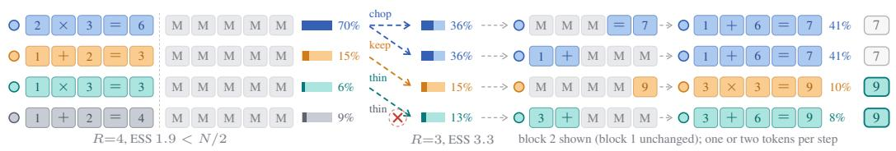
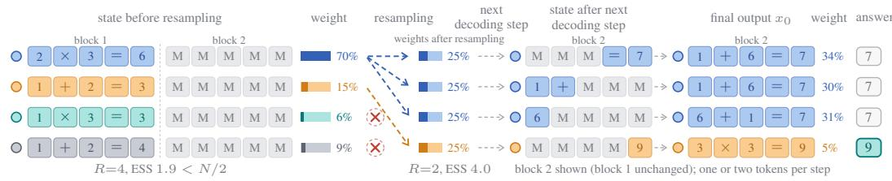
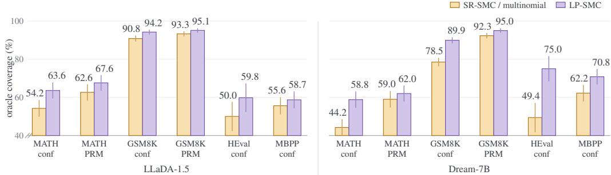
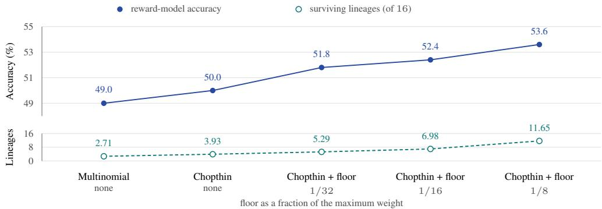

# KEEP THE LINEAGES ALIVE: DIVERSITY-PRESERVING SMC FOR DIFFUSION LLM DECODING

Minoo Ahmadi Seyedarmin Azizi Mehdi Kamal Massoud Pedram

University of Southern California, Los Angeles, USA

{minooahm, seyedarm, mehdi.kamal, pedram}@usc.edu

## ABSTRACT

Inference-time sequential Monte Carlo (SMC) decoding can improve the reasoning accuracy of masked diffusion language models (diffusion LLMs) without posttraining by resampling a population of partial generations according to a reward. Its effectiveness therefore depends on the resampling step, which must concentrate computation on promising candidates while retaining enough diversity to explore alternative reasoning paths. The reward can be internal, the decoder’s own confidence on the committed prefix, or external, a process reward model scoring that prefix. Under either reward, multinomial resampling can disrupt this balance by duplicating high-weight particles and discarding lineages that may still reach a correct solution. The effective sample size (ESS) does not register this loss: multinomial resampling resets it to its maximum even as distinct lineages disappear. To retain such lineages, we introduce lineage-preserving SMC (LP-SMC), which combines Chopthin resampling with an input weight floor. Instead of equalizing weights, Chopthin bounds the ratio between the largest and smallest weights it returns and carries the unequal weights forward. The floor limits how far below the maximum a weight may fall before resampling, so that lineages with low early weight keep a chance to recover. Across mathematical-reasoning and codegeneration benchmarks on two base models, LP-SMC raises oracle coverage, the fraction of problems with at least one correct particle, in every setting, by 1.8 to 25.6 points, and raises end-to-end accuracy under a common reward-model selector in eleven of twelve settings, by up to 7.9 points on LLaDA-1.5 and 18.3 on Dream-7B. The coverage gain persists under the external reward model, which suggests that diversity-preserving resampling and the guidance signal contribute separately to inference-time search.

## 1 INTRODUCTION

Inference-time scaling can improve language-model reasoning by allocating more computation during decoding (Brown et al., 2024; Snell et al., 2024), and sequential Monte Carlo (SMC) provides a probabilistic framework for it (Doucet et al., 2001), applied to autoregressive language models with learned twist functions or process rewards (Zhao et al., 2024; Puri et al., 2025) and to text diffusion models (Singhal et al., 2025). In particular, self-rewarding SMC (SR-SMC; Luo et al., 2026) weights each particle by the confidence accumulated along its own trajectory and improves diffusion LLMs on mathematical reasoning and code generation without further training.

Information can be lost during resampling itself. Recent SMC decoding methods introduce new proposal or weighting mechanisms while retaining standard resampling schemes; SR-SMC uses multinomial resampling, which converts continuous weights into a discrete number of descendants (Douc et al., 2005), replicating high-weight particles and discarding low-weight ones. In reasoning tasks a lineage that carries low intermediate weight may still develop into a correct completion, so resampling removes trajectories whose weight is currently low, not necessarily those that will ultimately be incorrect. Figure 1 illustrates this for a four-particle population, where the highestweight lineage (the particles descending from one initial particle) is incorrect while a lower-weight correct lineage is removed. Declining to resample avoids the loss but forfeits the concentration of computation that motivates SMC; the question is how to resample without discarding what the population has already reached.

  
(a) Multinomial resampling (SR-SMC)  
(b) Chopthin resampling, the first component of LP-SMC  
Figure 1: Multinomial resampling can remove a useful lineage before its completion is known. Illustrative example, N = 4, problem (1+2)×3, answer 9; one token per box, two blocks, resampling after block 1 $( \mathrm { E S S } = 1 . 9 < N / 2 )$ . Colors are founding lineages, bars are normalized weights; the blue lineage has the largest weight but ends wrong, orange and teal end right. (a) Multinomial resampling: three blue copies and one orange, two lineages left, ESS reset to 4. (b) Chopthin: blue, orange and teal survive with unequal weights, three lineages, ESS = 3.3. Resampling copies states and assigns weights; the token differences arise in later decoding.

A better reward does not resolve this: improving the reward changes the weights, not the rule that converts them into descendants: a stronger process reward model still leaves multinomial resampling to discards the low-weight particles. Nor does the standard diagnostic, the effective sample size (ESS), measure this loss. Repeated resampling is known to reduce path diversity (Kitagawa, 1996; Doucet et al., 2001), yet the ESS measures weight imbalance, not how many lineages remain, and multinomial resampling resets it to its maximum while lineages disappear. We formalize this mismatch and show that multinomial resampling of equally weighted particles from distinct lineages eliminates roughly one third of them in expectation.

Preserving lineage diversity requires addressing two failure modes. First, a moderately weighted lineage may disappear solely through the stochasticity of resampling. Second, a lineage’s weight may fall so far below the maximum before resampling that it is unlikely to survive even under a diversity-preserving rule, which is common in block-wise decoding because the weight is a product over many committed tokens (Section 2.2). We address the first with Chopthin resampling (Gandy & Lau, 2016), which bounds the ratio between the returned weights instead of equalizing them and carries the unequal weights forward, and the second with a weight floor that limits how far below the maximum any weight may fall before resampling. Neither requires additional model evaluations. Together they form lineage-preserving SMC (LP-SMC); Section 4 derives the resulting ESS guarantee, the gate condition on the floor and the bias it introduces.

We keep the proposal fixed and evaluate population management under two forms of guidance, the internal self-reward of SR-SMC and an external process reward model, and under several selection rules, because constructing a population that contains a correct answer and selecting it are different problems. Across twelve model–guidance–benchmark settings, LP-SMC increases oracle coverage, the fraction of problems for which at least one of the N particles is correct, in all twelve. In the internal-guidance ablations, it also increases surviving lineages and distinct outputs across both models and all reported benchmarks; on GSM8K with LLaDA-1.5, surviving lineages rise from 5.2 to 10.0 of 16 (Table 2). How much of that coverage becomes final accuracy, however, depends on the selection rule.

Contributions. (i) We formalize the mismatch between the ESS criterion and lineage diversity: multinomial resampling can eliminate distinct lineages while resetting the ESS to its maximum (Section 3). (ii) We address the two complementary sides of a resampling event: the weight floor bounds how far a lineage may collapse before the event, and Chopthin with carried weights bounds the ratio of the weights returned by it. We introduce both into block-wise masked diffusion SMC, derive the ESS lower bound implied by Chopthin’s ratio bound, tightening that of Gandy & Lau (2016) by a constant, and characterize the floor’s gate condition and bias (Section 4). (iii) We evaluate LP-SMC on four benchmarks and two base models, under internal guidance on all four benchmarks and under external process-reward guidance on the mathematics benchmarks, with a common reward-model selector for the headline comparison and a separate analysis of how coverage converts to accuracy under alternative selection rules (Section 5).

## 2 BACKGROUND: PARTICLE DECODING FOR MASKED DIFFUSION LLMS

## 2.1 MASKED DIFFUSION DECODING

Unlike autoregressive decoding, which extends a sequence from left to right, a diffusion LLM (Sahoo et al., 2024; Nie et al., 2025) starts from a fully masked sequence and replaces masked positions with tokens over a series of steps, several positions at a time (Appendix A collects the notation).

Setup. A sequence has L positions and tokens from a vocabulary V. Decoding runs backward over $T$ steps from the fully masked $x _ { T }$ to the output $x _ { 0 }$ . The positions are partitioned into consecutive blocks of fixed size; only positions of the current block can be committed, decoding moves on when the block is complete, and a particle whose block is complete waits until every particle has completed it. Resampling is considered at these boundaries.

One step. With $\mathcal { M } _ { t }$ the masked positions of the current block, a step draws $\hat { x } _ { 0 } ( j ) \sim p _ { \theta } ( \cdot \mid x _ { t } )$ at every $j \in \mathcal { M } _ { t }$ , independently, at temperature one, where $p _ { \theta } ( \cdot \ | \ x _ { t } )$ is the model’s predictive distribution given the partially masked sequence $x _ { t }$ (the prompt is implicit). It records the confidence $c _ { t } ( j ) = p _ { \theta } ( \hat { x } _ { 0 } ( j ) \mid x _ { t } )$ . It commits the set $S _ { t }$ of positions whose confidence exceeds a threshold (the most confident one if none does; ties by a fixed rule). It forms $x _ { t - 1 }$ by writing the drawn tokens at $S _ { t }$ and copying everything else. Committed tokens are never revised.

## 2.2 SEQUENTIAL MONTE CARLO DECODING

The sampler. The sampler uses the decoder as its proposal and maintains N particles; particle i is a partially decoded sequence $\boldsymbol { x } _ { t } ^ { ( i ) }$ with weight $U _ { t } ^ { ( i ) }$ and either index is omitted when unambiguous. After the last block, a selection rule returns an answer from the final population; the rule is varied in Section 5.3. We write $\tau = ( x _ { T } , \dots , x _ { 0 } )$ for a complete decoding path.

Kernel and potential. For a step from $x _ { t }$ to $x _ { t - 1 }$ , the transition kernel $K _ { t } ( x _ { t } , x _ { t - 1 } )$ is the probability that one decoding step moves $x _ { t }$ to $x _ { t - 1 }$ , including the token draws, the commit selection, and the copying of unmasked positions. The step also carries a potential $G _ { t - 1 } ( x _ { t } , x _ { t - 1 } ) > 0$ , a score of the tokens committed at that step. SR-SMC (Luo et al., 2026) takes the potential to be the product of the confidences of the committed tokens,

$$
G _ { t - 1 } ( x _ { t } , x _ { t - 1 } ) = \prod _ { j \in S _ { t } } c _ { t } ( j ) ,\tag{1}
$$

so the decoder supplies its own incremental potential. Accumulated over steps this is the trajectory’s cumulative confidence, distinct from the per-step confidence that chooses the commit set. The potential need not be the decoder’s confidence: Section 5 also uses an external process reward model, and nothing below depends on where G comes from.

Weights. Between resampling events, the weight of a particle is built from the incremental weights of its steps:

$$
U _ { t - 1 } = U _ { t } G _ { t - 1 } ( x _ { t } , x _ { t - 1 } ) , \qquad U _ { T } = 1 .\tag{2}
$$

This is the standard incremental weight of sequential Monte Carlo for the proposal $q _ { t - 1 } \ = \ K _ { t }$ (Doucet et al., 2001), and it is the weight of SR-SMC. Weight degeneracy is monitored with the normalized weights $w _ { i } = U ^ { ( i ) } / \textstyle \sum _ { k } U ^ { \overline { { ( k ) } } }$ and the effective sample size $\begin{array} { r } { \mathrm { E S S } ( w ) = 1 / \sum _ { i } w _ { i } ^ { 2 } \in } \end{array}$ $[ 1 , N ]$ , evaluated at block boundaries; the sampler resamples when $\mathrm { E S S } < N / 2$ , which we call the ESS gate.

What the weighted particles represent. Let $Q ( \tau )$ be the decoder path distribution and $C ( \tau )$ the accumulated potential, the product of the $G _ { t - 1 }$ along the path. Without resampling, particles drawn from $Q$ and weighted by C form a self-normalized importance-sampling approximation to the target with unnormalized density $Q ( \tau ) C ( \tau ) \mathrm { { } }$ ; a resampler that is unbiased in the sense of Section 2.3 preserves this weighted empirical measure in conditional expectation (Douc et al., 2005; Ahmadi et al., 2026), so changing the resampler changes the finite-particle representation of the target, not the target. The weight floor of Section 4.2, by contrast, explicitly modifies the measure, and Section 4.2 bounds the change.

## 2.3 RESAMPLING OPERATORS

Every resampler in this paper takes the same input and returns the same kind of output. It receives the normalized weights $w _ { 1 : N }$ and returns $N$ ancestors $A _ { 1 : N }$ and $N$ new weights $w _ { 1 : N } ^ { + } \dot { : }$ output particle k continues the state of input particle $A _ { k }$ and starts with weight $w _ { k } ^ { + }$ . The number of offspring of input particle i is $O _ { i } = | \{ k : \stackrel { \textstyle - } { A _ { k } } = i \} | ; O _ { i } = 0$ means it has no descendants. We consider two existing resampling operators.

Multinomial. The ancestors are drawn independently, $A _ { k } ~ \sim ~ \mathrm { C a t e g o r i c a l } ( w _ { 1 : N } )$ for $k \_ =$ $1 , \ldots , N$ , and every returned weight is $w _ { k } ^ { + } = 1 / N$ , so particle i receives ${ \mathrm { B i n o m i a l } } ( N , w _ { i } )$ offspring; this is the resampler of ${ \bf S R - S M C }$ . Stratified, residual and systematic schemes reduce the variance of the offspring counts but also return equal weights (Douc et al., 2005); Section 5.2 tests systematic resampling.

Chopthin. Chopthin (Gandy & Lau, 2016) takes a ratio bound $\eta \geq 4$ and computes a threshold $a > 0$ from the weights. The expected number of offspring of particle i is

$$
h _ { a } ^ { \eta } ( w _ { i } ) = \left\{ \begin{array} { l l } { w _ { i } / a , } & { w _ { i } < a \quad \mathrm { ( t h i n : k e p t w i t h ~ p r o b a b i l i t y ~ } w _ { i } / a , \mathrm { w e i g h t ~ s e t ~ t o ~ } a ) , } \\ { 1 , } & { a \leq w _ { i } < \eta a / 2 \quad \mathrm { ( k e e p : ~ u n c h a n g e d ) } , } \\ { 2 w _ { i } / ( \eta a ) , } & { w _ { i } \geq \eta a / 2 \quad \mathrm { ( c h o p : ~ s p l i t i n t o ~ c o p i e s ~ o f ~ e q u a l ~ w e i g h t ) } , } \end{array} \right.\tag{3}
$$

where the threshold $a$ is chosen so that the expected offspring counts sum to $N ;$ the coupled procedure returns exactly $N$ particles. Every returned weight lies in $[ a , \eta a ]$ , so the ratio of the largest to the smallest returned weight is at most $\eta ,$ and the weights need not be equalized. Details of the integer allocation and the weight correction are given in Appendix B.1.

Multinomial resampling and Chopthin are both unbiased in the sense that the expected total offspring weight attributable to particle i equals $w _ { i } ,$ , that is $\begin{array} { r } { \mathbb { E } \big [ \sum _ { k : A _ { k } = i } w _ { k } ^ { + } \big | w \big ] = w _ { i } ^ { * } } \end{array}$ (Douc et al., 2005; Gandy & Lau, 2016), and therefore both preserve the target of Section 2.2. The rest of the paper varies two quantities: the resampling operator, and the weights it is given.

## 3 MOTIVATION: WHAT A RESAMPLING EVENT DISCARDS

Under SR-SMC only 5.2 of 16 lineages survive on GSM8K with LLaDA-1.5 and 1.1 with Dream-7B, and between 9.1 and 11.7 of 16 particles lose all offspring per resampling event (Table 2, Section 5.2).

ESS and lineage diversity. To count lineages, each particle carries a root $r ( i ) \colon$ the index of the initial particle it descends from (two initial particles get different roots even if their sequences coincide). The number of surviving lineages $\dot { R }$ is the number of distinct roots in the population. The ESS is a function of w alone, and for every w and every $R \in \{ 1 , \ldots , N \}$ there is a root map with exactly R distinct roots, so a trigger that depends only on the weights cannot tell how many lineages survive. Proposition 1 quantifies what it misses for the two resamplers of Section 2.3.

Proposition 1 (ESS-blindness). Let $\mathcal { P } = ( w , r )$ have positive weights, let $\mathcal { P } ^ { + } = ( w ^ { + } , r ^ { + } )$ be the population after one resampling event applied to it, and let $R ^ { + }$ be its number of lineages. For a root ρ present in ${ \mathcal { P } } _ { : }$ , let $\begin{array} { r } { \begin{array} { r } { w _ { \rho } = \sum _ { i : r ( i ) = \rho } w _ { i } } \end{array} } \end{array}$ be the total weight ofits lineage.

(i) After multinomial resampling, $\mathrm { E S S } ( w ^ { + } ) = N$ always, while

$$
\mathbb { E } [ R ^ { + } \mid \mathcal { P } ] = \sum _ { \rho } \big ( 1 - ( 1 - w _ { \rho } ) ^ { N } \big ) ,
$$

the sum running over the R roots present in $\mathcal { P } .$ . For uniform weights and $R = N$ this is $N \big ( 1 - ( 1 - 1 / \hat { N } ) ^ { N } \big )$ : the expected surviving fraction $1 - ( 1 - 1 \check { / } N ) ^ { N }$ decreases with N to $\displaystyle { 1 - e ^ { - 1 } \approx 0 . 6 3 2 }$ , and equals 0.644 at $N = 1 6$ , that is, 10.3 of16 lineages.

(ii) If max $w _ { i } / \operatorname* { m i n } _ { i } w _ { i } \leq \eta / 2$ , then Chopthin returns $\mathcal { P }$ unchanged up to the order of the particles: every particle survives with its own weight, so $w ^ { + } = w$ and $R ^ { + } = R$ . Uniform weights always satisfy this condition.

The proof is in Appendix B.1.

Remark 1. Parts (i) and (ii) describe two populations with the same weight statistics before and after the event (both start and end at $\mathrm { E S S } = \bar { N } )$ whose genealogies differ by about a third of the lineages for any $N \geq 4 ~ ( 3 6 \%$ at $N = 1 6 )$ . The ESS does not distinguish them; a root count can. The loss in (i) is specific to multinomial resampling; on exactly uniform weights systematic or stratified resampling keeps every lineage (Douc et al., 2005), and Section 5.2 tests systematic resampling.

Requirements on the resampling operator. Flattening the weights removes degeneracy at a cost at both ends of the weight distribution: a particle holding less than a $1 / N$ share is likely to receive no offspring, deleted on the basis of a weight that scores an unfinished prefix, while a heavy particle is copied into descendants that share a prefix, so an event never increases the number of distinct prefixes and usually decreases it (Doucet et al., 2001); Figure 1 shows both at one boundary. Neither cost is necessary: a resampling step need only leave the target unchanged, return N particles and keep the weights from concentrating. Equalizing them is stronger than necessary: by Lemma 2 a bound of $\eta$ on the ratio of the largest to the smallest weight already implies $\mathrm { E } \dot { \mathrm { S } } \mathrm { S } \dot { \geq } N / 2 .$ , and Chopthin enforces exactly this bound on the weights it returns (Section 4.1). That bound constrains only the output of the step; a particle whose weight is far below the maximum when the resampler is called is removed with probability approaching one under any such rule, and the weight floor bounds this input-side gap (Section 4.2). Neither bound depends on the origin of the weights, so both apply when the potential is a reward model.

## 4 LP-SMC: CHOPTHIN RESAMPLING WITH A WEIGHT FLOOR

LP-SMC denotes the population-management step only: Chopthin resampling with the weight floor of Section 4.2. The guidance signal and the selection rule are varied separately in Section 5.

At a block boundary. (i) the running weights U have been updated by equation 2 through the block; (ii) the floor of Section 4.2 is applied, giving $\tilde { U }$ and $\tilde { w } ;$ (iii) if $\mathrm { E S S } ( \tilde { w } ) < N / 2$ , Chopthin (Section 4.1) is applied to w˜ and each particle continues from its ancestor with weight $w ^ { + }$ ; (iv) otherwise every particle continues with weight U˜ . Decoding then resumes.

## 4.1 CHOPTHIN RESAMPLING IN DIFFUSION SMC

We modify diffusion SMC only at the population-management stage. The decoder transition $K _ { t } .$ the potential $G _ { t - 1 }$ , the block schedule and the $\mathrm { E S S } < \mathrm { \bar { \it N } / 2 }$ trigger are unchanged and no model evaluations are added. The population-management step therefore applies whether the boundary weights come from accumulated decoder confidence or an external reward model. We replace the resampling step by Chopthin (Gandy & Lau, 2016) with carried weights (Ahmadi et al., 2026):

$$
\begin{array} { r } { \big ( A _ { 1 : N } , w _ { 1 : N } ^ { + } \big ) = \mathrm { C h o p t h i n } \big ( w _ { 1 : N } , \eta \big ) , \qquad x ^ { ( k ) } \gets x ^ { ( A _ { k } ) } , \qquad U ^ { ( k ) } \gets w _ { k } ^ { + } . } \end{array}\tag{4}
$$

The assignments are simultaneous: output particle k continues the full state of input particle $A _ { k }$ including its root label and cached decoder state. The returned weights are defined up to a common factor; under internal guidance they are carried into the next block instead of being reset; under external guidance the weight is rebuilt from the reward model at each boundary (Section 5, Setup). Since every returned weight lies in $[ a , \eta a ]$ , Lemma 2 gives $\mathrm { E S S } ( w ^ { + } ) \geq 4 \bar { \eta } N / ( \eta + 1 ) ^ { 2 }$ , which tightens the bound of Gandy & Lau (2016) by a constant. We use $\eta = 3 + \sqrt { 8 }$ throughout, for which the bound is exactly $N / 2 { \mathrm { : } }$ an event cannot leave the population below the threshold that triggered it. This is a guarantee on the weights, not on the number of lineages. The quantities have separate roles: the potential sets how far the weights spread, η sets the spread of the resampler’s output, the floor of Section 4.2 sets how much it tolerates on its input, and the ESS gate sets when the resampler is called at all.

## 4.2 FLOORING THE INPUT WEIGHTS

Chopthin bounds the ratio of the weights it returns, not of the weights it is $g i \nu e n .$ , and a particle whose weight is far below the maximum is removed with high probability regardless of the output bound. We therefore bound the input ratio as well. At a block boundary let $U _ { \mathrm { m a x } } = \mathbf { m a x } _ { k } U ^ { ( k ) }$ ; the floored weights are

$$
\tilde { U } ^ { ( i ) } = \mathrm { m a x } \big ( U ^ { ( i ) } , e ^ { - \kappa } U _ { \mathrm { m a x } } \big ) , \quad \tilde { w } _ { i } = \tilde { U } ^ { ( i ) } \Big / \sum _ { j } \tilde { U } ^ { ( j ) } , \quad \kappa > 0 .\tag{5}
$$

The gate tests $\mathrm { E S S } ( \tilde { w } ) < N / 2$ and the resampler receives w˜. The floor is a deterministic map that needs no model evaluation and applies to any resampler; it leaves the maximum unchanged and raises the lowest weights, the opposite end of the distribution from Chopthin’s chop step.

Under internal guidance the floored or post-resampling weights are carried forward: between boundaries $U _ { t - 1 } = \tilde { U } _ { t } G _ { t - 1 }$ , with the floor re-applied at every boundary. Under external guidance weight are rebuilt at every boundary, so neither the floor-induced increase nor the returned Chopthin weight persist; this is a boundary-wise reweighting, not the accumulated potential of equation 2, so we treat the externally guided setting as a robustness check and not as the same Feynman–Kac target (Del Moral, 2004).

After equation 5 the ratio of $\tilde { U }$ is at most $e ^ { \kappa }$ , so Lemma 2 applies to the weights that the gate and the resampler receive: ESS $\geq 4 e ^ { \kappa } N / ( e ^ { \kappa } + 1 ) ^ { 2 }$ . The ESS gate imposes a lower bound on κ; we then choose $\kappa = \ln { N }$ to keep the floor non-vacuous.

Gate compatibility. Once this lower bound exceeds the gate threshold, resampling is never triggered; the sampler resamples only when

$$
\kappa > \kappa ^ { \star } : = \ln \left( 3 + \sqrt { 8 } \right) \approx 1 . 7 6 3 .\tag{6}
$$

The corresponding ratio $e ^ { \kappa ^ { \star } } = 3 + \sqrt { 8 }$ equals the Chopthin ratio bound η of Section 4.1; both are chosen so that the worst admissible weight profile has $\dot { \mathrm { E S S } } = N / 2$

Choice of κ. Conversely, as κ grows the bound falls back to zero and the floor has no effect. We use $\kappa =$ ln N, a floor at $1 / N$ of the maximum weight, which satisfies the gate condition for $N \geq 6$ (at $N = 1 6 , \kappa = 2 . 7 7$ against $\kappa ^ { \star } = 1 . 7 6 )$ . Under this floor a particle’s normalized weight is at least $1 / ( N ( N - 1 ) + 1 )$ , so a multinomial ancestor draw keeps it with probability at least $1 - ( 1 - 1 / ( \dot { N } ( \dot { N } - 1 ) + \dot { 1 } ) ) ^ { N }$ , 0.064 at $N = 1 6 ( \mathrm { A p p e n d i x \mathrm { B } } . 3 ) ;$ ; without the floor no positive lower bound exists. Empirically, in the GSM8K lineage-risk analysis, no correctly answered problem under either floored LP-SMC configuration reaches the corresponding deletion probability of 0.936 (Table 8, Appendix D).

Raising low weights changes what the resampler is unbiased for. Resampling remains unbiased, but for the floored weights w˜ rather than the original w. The change is confined to the particles the floor actually touches: a particle already within κ nats of the maximum keeps its weight exactly, and only particles below that threshold are raised, to $e ^ { - \kappa }$ of the maximum. Under internal guidance the raised value persists until the next resampling event.

The size of the change is bounded. At a single boundary the floor can shift at most $( N - 1 ) / ( 2 N - 1 )$ of the normalized mass onto floored particles, which is 0.48 at $N = 1 6$ , and that worst case arises only when $N - 1$ of the N particles sit on the floor at once. In the measured runs the mass on floored particles is about an order of magnitude smaller (Appendix B.3). The floor is therefore an explicit and bounded change to the weights, in the same family as the weight flattening used by particle methods for reasoning (Giannone et al., 2025).

  
Figure 2: Oracle coverage, the fraction of problems with at least one correct particle $( N = 1 6 ,$ , full test sets), under the decoder’s confidence (conf) or the external PRM in the weight. LP-SMC is higher in all twelve settings. Bars: unpaired 95% binomial intervals; paired counts and bootstrap intervals: Appendix E. The axis is clipped at 40.

## 5 EXPERIMENTS

Setup. The decoders are LLaDA-1.5 (Nie et al., 2025) and Dream-7B (Ye et al., 2025). Both run with generation length $L = 2 5 6 .$ , block size 32, eight decoding steps per block, confidence-threshold commitment at 0.9, temperature 1.0 and $N = 1 { \bar { 6 } }$ particles. Resampling is gated at $\mathrm { E S S } < N / 2 ;$ Chopthin uses $\eta = 3 + \sqrt { 8 }$ and the floor $\kappa = \ln { N }$ . Under internal guidance the weight accumulates by equation $2 ;$ under external guidance it is rebuilt at every boundary from the log-odds of the mean step score of Qwen2.5-Math-PRM-7B (Yang et al., 2024) on the current prefix, as in Puri et al. (2025) (Appendix B.5 gives the exact definition). Benchmarks are MATH-500 (Hendrycks et al., 2021; Lightman et al., 2024) (4-shot), GSM8K (Cobbe et al., 2021) (5-shot), HumanEval (Chen et al., 2021) (0-shot) and MBPP (Austin et al., 2021) (3-shot), on the full test set of each; grading and shot conventions are in Appendix B.6. The population-management operations introduce no direct decoder or reward-model evaluations; Appendix B.6 reports measured end-to-end NFE and wall time.

## 5.1 MAIN COMPARISON

Table 1 is the primary controlled comparison. Within each pair the model, the guidance signal, the selection rule and the problems are held fixed and only the population step changes, multinomial resampling against LP-SMC, so a difference between the two rows cannot arise from the selection rule. LP-SMC has the higher accuracy in eleven of the twelve accuracy cells, under the decoder’s confidence on all four benchmarks for both models and under the external reward model on the mathematics benchmarks for LLaDA-1.5; the exception is Dream-7B on MATH-500 under external guidance, 49.2 against 48.2. Coverage is higher under LP-SMC in all twelve settings (Figure 2), and the coverage gains are also the better supported: of the 95% bootstrap intervals on the paired differences (Appendix E), six of the twelve accuracy intervals include zero and eleven of the twelve coverage intervals exclude it, and none favours the baseline.

## 5.2 WHERE THE GAIN COMES FROM

Table 2 reports surviving lineages beside distinct outputs and coverage, which bounds what any selection rule can reach.

Lineages increase at every step in all eight rows and coverage in seven; the exception is Dream on GSM8K, where Chopthin alone costs a little coverage before the floor more than recovers it. Under multinomial resampling Dream is close to a single surviving lineage on every benchmark, so the floor has more to recover there, and Chopthin without the floor barely moves it. Distinct outputs rise with lineages in every row, so the extra lineages carry different completions, not duplicates. Nor is the gain obtained by resampling less often: LP-SMC triggers the gate as often or more often than multinomial resampling in all eight settings while losing fewer than half as many particles per event, 4.01 against 11.66 on Dream GSM8K, and its loss per event varies little across models and benchmarks where the multinomial loss tracks how concentrated the weights happen to be.

Table 1: End-to-end accuracy under reward-model selection (Qwen2.5-Math-PRM-7B (Yang et al., 2024) on mathematics, AceCodeRM-7B (Zeng et al., 2025) on code), N=16, L=256, paired problems, full test sets. Internal guidance: the decoder’s confidence in the weight; External PRM: the reward model in the weight. n.a.: no step-level code reward model meeting our criteria is available, and AceCodeRM-7B, an outcome model, can rank finished programs but not weight a prefix (Appendix C). Paired tests: Appendix E.
<table><tr><td>Model</td><td>Guidance</td><td>Population management</td><td>MATH-500</td><td>GSM8K</td><td>HumanEval</td><td>MBPP</td></tr><tr><td rowspan="3">LLaDA-1.5</td><td>Internal</td><td>SR-SMC LP-SMC</td><td>49.0 52.4</td><td>88.2 90.5</td><td>48.2 56.1</td><td>49.8 50.6</td></tr><tr><td>External PRM</td><td>Multinomial SMC</td><td>53.8</td><td>90.4</td><td>n.a.</td><td>n.a.</td></tr><tr><td>Internal</td><td>LP-SMC SR-SMC</td><td>55.0 41.8</td><td>90.8 78.2</td><td>n.a. 48.8</td><td>n.a. 59.8</td></tr><tr><td>Dream-7B</td><td>External PRM</td><td>LP-SMC Multinomial SMC LP-SMC</td><td>46.8 49.2 48.2</td><td>86.7 90.8 91.7</td><td>67.1 n.a. n.a.</td><td>62.0 n.a. n.a.</td></tr></table>

Table 2: Adding one component at a time under the decoder’s confidence: multinomial resampling (Mult.), Chopthin without the floor (Chop.), Chopthin with the floor (Chop.+floor), which is LP-SMC. Lineages: mean number of founding particles still represented at the end, out of 16; distinct outputs: mean number of distinct $x _ { 0 }$ per problem; coverage as in Figure 2. Table 3 crosses the floor with the resampler. Benchmark sizes are as in Table 4.
<table><tr><td rowspan="2">Model</td><td rowspan="2">Benchmark</td><td colspan="3">Surviving lineages</td><td colspan="3">Distinct outputs</td><td colspan="3">Coverage (%)</td></tr><tr><td>Mult.</td><td>Chop.</td><td>Chop.+floor Mult.</td><td></td><td>Chop.</td><td>Chop.+floor Mult.</td><td></td><td>Chop.</td><td>Chop.+floor</td></tr><tr><td rowspan="4">LLaDA-1.5</td><td>MATH-500</td><td>2.71</td><td>3.93</td><td>6.98</td><td>6.90</td><td>8.71</td><td>10.53</td><td>54.2</td><td>57.2</td><td>63.6</td></tr><tr><td>GSM8K</td><td>5.21</td><td>7.52</td><td>10.04</td><td>7.80</td><td>9.65</td><td>11.28</td><td>90.8</td><td>92.9</td><td>94.2</td></tr><tr><td>HumanEval</td><td>2.96</td><td>4.58</td><td>7.79</td><td>2.45</td><td>3.56</td><td>5.96</td><td>50.0</td><td>54.9</td><td>59.8</td></tr><tr><td>MBPP</td><td>10.36</td><td>11.76</td><td>13.45</td><td>5.88</td><td>6.89</td><td>8.37</td><td>55.6</td><td>56.2</td><td>58.7</td></tr><tr><td rowspan="4">Dream-7B</td><td>MATH-500</td><td>1.55</td><td>2.18</td><td>5.37</td><td>3.47</td><td>4.17</td><td>7.70</td><td>44.2</td><td>47.4</td><td>58.8</td></tr><tr><td>GSM8K</td><td>1.06</td><td>1.10</td><td>4.36</td><td>1.23</td><td>1.33</td><td>5.43</td><td>78.5</td><td>77.3</td><td>89.9</td></tr><tr><td>HumanEval</td><td>1.33</td><td>1.58</td><td>4.65</td><td>3.11</td><td>3.83</td><td>8.11</td><td>49.4</td><td>52.4</td><td>75.0</td></tr><tr><td>MBPP</td><td>1.88</td><td>2.66</td><td>5.90</td><td>4.96</td><td>5.92</td><td>9.62</td><td>62.2</td><td>62.9</td><td>70.8</td></tr></table>

Table 2 adds the components in one order; crossing the ancestor draw with the floor on GSM8K (Table 3, Appendix B.3) tests whether either alone would suffice. Systematic resampling raises surviving lineages but leaves coverage at 90.8%, so drawing the ancestors more evenly is not a substitute for bounding the weights that enter the draw, and Chopthin is ahead of it on every column of that table, with and without the floor. The floor raises coverage on its own under both draws, so it addresses a distinct failure mode; nevertheless no single-component configuration reaches LP-SMC. Accuracy and surviving lineages both rise monotonically with the depth of the floor on MATH-500 (Figure 3, Appendix B.3); we keep $\kappa = \ln { N }$ throughout because equation 6 admits it for every $N \geq 6$ with no tuning, although $1 / \hat { 8 }$ does better on that benchmark. Among correctly answered LP-SMC runs, many correct lineages had a high hypothetical deletion probability under multinomial resampling at their recorded weights (Appendix D).

## 5.3 SELECTION RULES

Table 4 (Appendix B.4) applies four selection rules — confidence, majority, distinct-output consensus, and the best-of-N reward model of Table 1 (Brown et al., 2024; Stroebl et al., 2024) — to the same saved populations, so selector quality is not confounded with population quality; each rule is defined in full there.

Coverage improves consistently; what varies is how much of it each rule converts into accuracy. The one rule that favours the baseline is the decoder’s own confidence, which by construction undervalues the low-confidence lineages the floor exists to keep; the populations are not weaker, and coverage rises in every setting regardless. On Dream-7B the ordering is less uniform and the consensus rules split (Table 5, Appendix B.4); the two models are compared within a table, not across tables, since Dream is a base checkpoint and LLaDA-1.5 is aligned.

Table 3: Ancestor draw and floor separated: LLaDA-1.5 on GSM8K (n=1319), decoder confidence, all configurations paired. Systematic resampling is the standard variance-reduced draw. The six rows are a full factorial of ancestor draw against weight floor. Lost per event: mean number of the 16 particles left without offspring at a resampling event (lower is better).
<table><tr><td>Configuration</td><td>Surviving lineages</td><td>Distinct outputs</td><td>Lost per event</td><td>Coverage (%)</td></tr><tr><td>Multinomial</td><td>5.21</td><td>7.80</td><td>9.14</td><td>90.8</td></tr><tr><td>Multinomial + floor</td><td>6.25</td><td>8.80</td><td>8.48</td><td>92.5</td></tr><tr><td>Systematic</td><td>6.21</td><td>8.43</td><td>7.98</td><td>90.8</td></tr><tr><td>Systematic + floor</td><td>7.62</td><td>9.48</td><td>6.97</td><td>93.6</td></tr><tr><td>Chopthin</td><td>7.52</td><td>9.65</td><td>5.41</td><td>92.9</td></tr><tr><td>Chopthin + floor (LP-SMC)</td><td>10.04</td><td>11.28</td><td>3.61</td><td>94.2</td></tr></table>

## 6 RELATED WORK

Particle decoding for language models. Sequential Monte Carlo has steered autoregressive language models through probabilistic programs (Lew et al., 2023), learned twists (Zhao et al., 2024), syntactic and semantic constraints (Loula et al., 2025), and particle-based inference-time reasoning (Puri et al., 2025; Markovic-Voronov et al., 2026; Giannone et al., 2025; 2026; Tran et al., 2026; Nguyen et al., 2026). Parallel work sharpens the base-model distribution or its answer marginal rather than steering toward an external reward (Karan & Du, 2026; Azizi et al., 2026; Ji et al., 2026; Zhou et al., 2026; Arzhantsev et al., 2026; Wang et al., 2023). Feynman–Kac steering has also been applied to image and text diffusion models using intermediate rewards (Singhal et al., 2025). For diffusion LLMs, SR-SMC uses accumulated decoder confidence (Luo et al., 2026), S3 uses a composite verifier (Bilal et al., 2026), POKE-SMC uses lookahead path likelihood (Liu et al., 2026), and TRI-TSMC learns twisting functions (Wang et al., 2026). PG-DLM instead addresses one-shot weight degeneracy by refining complete trajectories with particle Gibbs (Dang et al., 2026). These methods modify the proposal, potential, target or outer refinement procedure; we hold the guidance fixed and study lineage loss at a resampling event.

Resampling, genealogy and final-answer selection. Stratified, residual and systematic resampling reduce variance relative to multinomial resampling and conventionally return equal weights (Kitagawa, 1996; Liu & Chen, 1998; Carpenter et al., 1999; Douc et al., 2005). Fearnhead & Clifford (2003) resample only the lighter particles, a thresholding principle related to Chopthin’s pass-through region (Gandy & Lau, 2016), which Ahmadi et al. (2026) applied to autoregressive power sampling; our lineage-based formulation, the input weight floor, and their integration with block-wise diffusion SMC are new here. The loss of ancestral diversity under repeated resampling is classical (Doucet et al., 2001; Del Moral, 2004); we make its mismatch with effective sample size explicit in diffusion LLM decoding. Selecting a final answer is a separate problem, addressed through voting or output clustering (Wang et al., 2023; Chen et al., 2023b; Kuhn et al., 2023; Li et al., 2022; Chen et al., 2023a) or through verifiers and reward models (Cobbe et al., 2021; Uesato et al., 2022; Lightman et al., 2024; Zhang et al., 2025; Zeng et al., 2025); Section 5.3 compares selection rules on a fixed population.

## 7 CONCLUSION

Multinomial resampling can remove useful lineages while resetting the effective sample size, so high ESS does not imply genealogical diversity. LP-SMC addresses this mismatch by combining Chopthin’s unequal-weight resampling with an input weight floor. Across two diffusion LLMs and four reasoning and code-generation benchmarks it increases oracle coverage in every setting and accuracy under a common reward-model selector in eleven of twelve, and the mechanism is visible in the populations themselves: surviving lineages rise with the decoder left unchanged. Population management can therefore widen the set of problems on which inference-time search produces a correct candidate; how much of that becomes final accuracy depends on the selection rule; Appendix F states the limitations.

## AI USE STATEMENT

Generative AI tools were used to assist with language editing, drafting and revising portions of the manuscript, and creating or editing data-processing, evaluation, and plotting scripts. Generative AI tools were also used for discussion and feedback during the research process; all research decisions, including the final formulation of the method, experimental design, mathematical claims, theoretical results, and interpretation of the results, were made and verified by the authors. The theoretical results and proofs were derived and validated by the authors. All AI-assisted text and code were reviewed and verified by the authors. Numerical results reported in the paper were recomputed from the raw per-particle records. The authors take responsibility for the final content of the paper, including AI-assisted text and code.

## REPRODUCIBILITY STATEMENT

Section 4 specifies the method: Chopthin resampling in Section 4.1 and the input weight floor in Section 4.2, with the floored weights defined in equation 5 and the admissible range of κ in equation 6. The Setup paragraph of Section 5 lists every decoding hyperparameter (generation length L, block size, decoding steps per block, commitment threshold, temperature, particle count N, the ESS gate, the Chopthin ratio η and the floor κ); notation is collected in Appendix A. Complete proofs are in Appendix B: Proposition 1 in Appendix B.1, Lemma 2 in Appendix B.2, and the floor’s survival bound in equation 7 with its mass-displacement statistics in Appendix B.3. Appendix B.5 states the external potential exactly, including prompt construction, step segmentation and score aggregation equation 8; Appendix B.6 gives the evaluation protocol, with shot counts, answer extraction and code grading; and Appendix C documents the code reward models considered. Within each controlled comparison the model, guidance signal, evaluation problems and decoding hyperparameters are fixed, with configurations differing only in the population-management step. Every particle population is written to disk, so all reported selectors are recomputed offline without regenerating samples, and the paired statistics of Appendix E are derived from those same records. Code, task definitions and per-problem scores will be released.

## ETHICS STATEMENT

This work studies inference-time decoding for open-weight language models. No human subjects were involved and no new data were collected. Experiments use publicly available benchmarks (MATH-500, GSM8K, HumanEval, and MBPP), publicly released model weights (LLaDA-1.5 and Dream-7B), and publicly available reward models. The proposed method operates at decoding time and does not train or modify the underlying model weights; consequently, generated outputs remain subject to the limitations and failure modes of the underlying models and reward signals. Evaluation on HumanEval and MBPP requires execution of model-generated code; this execution is performed only through the evaluation harness’s sandboxed execution path on compute controlled by the authors.

## REFERENCES

Minoo Ahmadi, Seyedarmin Azizi, Erfan Baghaei Potraghloo, Mehdi Kamal, and Massoud Pedram. Chopthin-Consensus power sampling: A diversity-preserving approach to LLM decoding. In COLM 2026 Workshop on Efficient Reasoning, 2026. URL https://arxiv.org/abs/ 2609.12243. arXiv:2609.12243.

Aleksei Arzhantsev, Otmane Sakhi, and Nicolas Chopin. Self-consistency via marginal sharpening. arXiv preprint arXiv:2605.28142, 2026. URL https://arxiv.org/abs/2605.28142.

Jacob Austin, Augustus Odena, Maxwell Nye, Maarten Bosma, Henryk Michalewski, David Dohan, Ellen Jiang, Carrie Cai, Michael Terry, Quoc Le, and Charles Sutton. Program synthesis with large

language models. arXiv preprint arXiv:2108.07732, 2021. URL https://arxiv.org/abs/ 2108.07732.

Seyedarmin Azizi, Erfan Baghaei Potraghloo, Minoo Ahmadi, Souvik Kundu, and Massoud Pedram. Power-SMC: Low-latency sequence-level power sampling for training-free LLM reasoning. arXiv preprint arXiv:2602.10273, 2026. URL https://arxiv.org/abs/2602.10273.

Ahsan Bilal, Muhammad Ahmed Mohsin, Muhammad Umer, Asad Aali, Muhammad Usman Khanzada, Muhammad Usman Rafique, Zihao He, Emily Fox, and Dean F. Hougen. S3: Stratified scaling search for test-time in diffusion language models. arXiv preprint arXiv:2604.06260, 2026. URL https://arxiv.org/abs/2604.06260.

Bradley Brown, Jordan Juravsky, Ryan Ehrlich, Ronald Clark, Quoc V. Le, Christopher Re, and ´ Azalia Mirhoseini. Large language monkeys: Scaling inference compute with repeated sampling. arXiv preprint arXiv:2407.21787, 2024. URL https://arxiv.org/abs/2407.21787.

James Carpenter, Peter Clifford, and Paul Fearnhead. Improved particle filter for nonlinear problems. IEE Proceedings - Radar, Sonar and Navigation, 146(1):2–7, 1999.

Bei Chen, Fengji Zhang, Anh Nguyen, Daoguang Zan, Zeqi Lin, Jian-Guang Lou, and Weizhu Chen. CodeT: Code generation with generated tests. In The Eleventh International Conference on Learning Representations (ICLR), 2023a. URL https://arxiv.org/abs/2207.10397. arXiv:2207.10397.

Mark Chen, Jerry Tworek, Heewoo Jun, Qiming Yuan, Henrique Ponde de Oliveira Pinto, Jared Kaplan, Harri Edwards, Yuri Burda, Nicholas Joseph, Greg Brockman, Alex Ray, et al. Evaluating large language models trained on code. arXiv preprint arXiv:2107.03374, 2021. URL https: //arxiv.org/abs/2107.03374.

Xinyun Chen, Renat Aksitov, Uri Alon, Jie Ren, Kefan Xiao, Pengcheng Yin, Sushant Prakash, Charles Sutton, Xuezhi Wang, and Denny Zhou. Universal self-consistency for large language model generation. arXiv preprint arXiv:2311.17311, 2023b. URL https://arxiv.org/ abs/2311.17311.

Karl Cobbe, Vineet Kosaraju, Mohammad Bavarian, Mark Chen, Heewoo Jun, Lukasz Kaiser, Matthias Plappert, Jerry Tworek, Jacob Hilton, Reiichiro Nakano, Christopher Hesse, and John Schulman. Training verifiers to solve math word problems. arXiv preprint arXiv:2110.14168, 2021. URL https://arxiv.org/abs/2110.14168.

Meihua Dang, Jiaqi Han, Minkai Xu, Kai Xu, Akash Srivastava, and Stefano Ermon. Inference-time scaling of diffusion language models via trajectory refinement. In Proceedings ofthe Third Conference on Language Modeling (COLM), 2026. URL https://arxiv.org/abs/2507. 08390. arXiv:2507.08390.

Pierre Del Moral. Feynman-Kac Formulae: Genealogical and Interacting Particle Systems with Applications. Springer, 2004.

Mahir Labib Dihan and Md Ashrafur Rahman Khan. SWE-Shepherd: Advancing PRMs for reinforcing code agents. arXiv preprint arXiv:2604.10493, 2026. URL https://arxiv.org/ abs/2604.10493.

Randal Douc, Olivier Cappe, and´ Eric Moulines. Comparison of resampling schemes for particle´ filtering. In Proceedings of the 4th International Symposium on Image and Signal Processing and Analysis (ISPA), pp. 64–69. IEEE, 2005. URL https://arxiv.org/abs/cs/0507025. arXiv:cs/0507025.

Arnaud Doucet, Nando de Freitas, and Neil Gordon (eds.). Sequential Monte Carlo Methods in Practice. Springer, 2001.

Paul Fearnhead and Peter Clifford. On-line inference for hidden Markov models via particle filters. Journal ofthe Royal Statistical Society: Series B (Statistical Methodology), 65(4):887–899, 2003.

Axel Gandy and F. Din-Houn Lau. The Chopthin algorithm for resampling. IEEE Transactions on Signal Processing, 64(16):4273–4281, 2016. URL https://arxiv.org/abs/1502. 07532. arXiv:1502.07532.

Giorgio Giannone, Guangxuan Xu, Nikhil Shivakumar Nayak, Rohan Mahesh Awhad, Shivchander Sudalairaj, Kai Xu, and Akash Srivastava. Mitigating premature exploitation in particle-based Monte Carlo for inference-time scaling. arXiv preprint arXiv:2510.05825, 2025. URL https: //arxiv.org/abs/2510.05825.

Giorgio Giannone, Mustafa Eyceoz, Shabana Baig, Shivchander Sudalairaj, Anna Clare Doris, Faez Ahmed, Akash Srivastava, and Kai Xu. Intrinsic selection and particle resampling for inferencetime scaling beyond domain verifiability. arXiv preprint arXiv:2606.08850, 2026. URL https: //arxiv.org/abs/2606.08850.

Dan Hendrycks, Collin Burns, Saurav Kadavath, Akul Arora, Steven Basart, Eric Tang, Dawn Song, and Jacob Steinhardt. Measuring mathematical problem solving with the MATH dataset. arXiv preprint arXiv:2103.03874, 2021. URL https://arxiv.org/abs/2103.03874.

Xiaotong Ji, Rasul Tutunov, Matthieu Zimmer, and Haitham Bou Ammar. Scalable power sampling: Unlocking efficient, training-free reasoning for LLMs via distribution sharpening. arXiv preprint arXiv:2601.21590, 2026. URL https://arxiv.org/abs/2601.21590.

Aayush Karan and Yilun Du. Reasoning with sampling: Your base model is smarter than you think. In The Fourteenth International Conference on Learning Representations (ICLR), 2026. URL https://arxiv.org/abs/2510.14901. arXiv:2510.14901.

Genshiro Kitagawa. Monte Carlo filter and smoother for non-Gaussian nonlinear state space models. Journal ofComputational and Graphical Statistics, 5(1):1–25, 1996.

Lorenz Kuhn, Yarin Gal, and Sebastian Farquhar. Semantic uncertainty: Linguistic invariances for uncertainty estimation in natural language generation. In The Eleventh International Conference on Learning Representations (ICLR), 2023. URL https://arxiv.org/abs/2302. 09664. arXiv:2302.09664.

Alexander K. Lew, Tan Zhi-Xuan, Gabriel Grand, and Vikash K. Mansinghka. Sequential Monte Carlo steering of large language models using probabilistic programs. arXiv preprint arXiv:2306.03081, 2023. URL https://arxiv.org/abs/2306.03081.

Qingyao Li, Xinyi Dai, Xiangyang Li, Weinan Zhang, Yasheng Wang, Ruiming Tang, and Yong Yu. CodePRM: Execution feedback-enhanced process reward model for code generation. In Findings of the Association for Computational Linguistics: ACL 2025, pp. 8169– 8182, 2025. doi: 10.18653/v1/2025.findings-acl.428. URL https://aclanthology.org/ 2025.findings-acl.428/.

Yujia Li, David Choi, Junyoung Chung, Nate Kushman, Julian Schrittwieser, Remi Leblond, Tom´ Eccles, James Keeling, Felix Gimeno, Agustin Dal Lago, Thomas Hubert, Peter Choy, Cyprien de Masson d’Autume, Igor Babuschkin, Xinyun Chen, Po-Sen Huang, Johannes Welbl, Sven Gowal, Alexey Cherepanov, James Molloy, Daniel J. Mankowitz, Esme Sutherland Robson, Pushmeet Kohli, Nando de Freitas, Koray Kavukcuoglu, and Oriol Vinyals. Competitionlevel code generation with AlphaCode. Science, 378(6624):1092–1097, 2022. URL https: //arxiv.org/abs/2203.07814. arXiv:2203.07814.

Hunter Lightman, Vineet Kosaraju, Yura Burda, Harri Edwards, Bowen Baker, Teddy Lee, Jan Leike, John Schulman, Ilya Sutskever, and Karl Cobbe. Let’s verify step by step. In The Twelfth International Conference on Learning Representations (ICLR), 2024. URL https://arxiv. org/abs/2305.20050. arXiv:2305.20050.

Jun S. Liu and Rong Chen. Sequential Monte Carlo methods for dynamic systems. Journal of the American Statistical Association, 93(443):1032–1044, 1998.

Xuejie Liu, Yap Vit Chun, Yitao Liang, and Anji Liu. Lookahead path likelihood optimization for diffusion LLMs. arXiv preprint arXiv:2602.03496, 2026. URL https://arxiv.org/abs/ 2602.03496.

Joao Loula, Benjamin LeBrun, Li Du, Ben Lipkin, Clemente Pasti, Gabriel Grand, Tianyu Liu,˜ Yahya Emara, Marjorie Freedman, Jason Eisner, Ryan Cotterell, Vikash Mansinghka, Alexander K. Lew, Tim Vieira, and Timothy J. O’Donnell. Syntactic and semantic control of large language models via sequential Monte Carlo. In The Thirteenth International Conference on Learning Representations (ICLR), 2025. URL https://arxiv.org/abs/2504.13139. arXiv:2504.13139.

Ziwei Luo, Ziqi Jin, Lei Wang, Lidong Bing, and Thomas B. Schon. Self-rewarding sequential¨ Monte Carlo for masked diffusion language models. arXiv preprint arXiv:2602.01849, 2026. URL https://arxiv.org/abs/2602.01849.

Zeyao Ma, Xiaokang Zhang, Jing Zhang, Jifan Yu, Sijia Luo, and Jie Tang. Dynamic scaling of unit tests for code reward modeling. In Proceedings of the 63rd Annual Meeting of the Association for Computational Linguistics, pp. 6917–6935, 2025. URL https://arxiv.org/abs/2501. 01054. arXiv:2501.01054.

Jelena Markovic-Voronov, Wenhui Zhu, Bo Long, Zhipeng Wang, Suyash Gupta, Kayhan Behdin, Bee-Chung Chen, and Deepak Agarwal. Sampling for quality: Training-free reward-guided LLM decoding via sequential Monte Carlo. arXiv preprint arXiv:2604.16453, 2026. URL https: //arxiv.org/abs/2604.16453.

Tu Nguyen, Matthieu Zimmer, Rasul Tutunov, Xiaotong Ji, and Haitham Bou Ammar. The model knows, the decoder finds: Future value guided particle power sampling. arXiv preprint arXiv:2605.02427, 2026. URL https://arxiv.org/abs/2605.02427.

Shen Nie, Fengqi Zhu, Zebin You, Xiaolu Zhang, Jingyang Ou, Jun Hu, Jun Zhou, Yankai Lin, Ji-Rong Wen, and Chongxuan Li. Large language diffusion models. arXiv preprint arXiv:2502.09992, 2025. URL https://arxiv.org/abs/2502.09992.

Isha Puri, Shivchander Sudalairaj, Guangxuan Xu, Abhishek Bhandwaldar, Kai Xu, and Akash Srivastava. Rollout roulette: A probabilistic inference approach to inference-time scaling of LLMs using particle-based Monte Carlo methods. In The Thirty-ninth Annual Conference on Neural Information Processing Systems (NeurIPS), 2025. URL https://arxiv.org/abs/2502. 01618. arXiv:2502.01618.

Subham Sekhar Sahoo, Marianne Arriola, Yair Schiff, Aaron Gokaslan, Edgar Marroquin, Justin T. Chiu, Alexander Rush, and Volodymyr Kuleshov. Simple and effective masked diffusion language models. In Advances in Neural Information Processing Systems 37 (NeurIPS), 2024. URL https://arxiv.org/abs/2406.07524. arXiv:2406.07524.

Raghav Singhal, Zachary Horvitz, Ryan Teehan, Mengye Ren, Zhou Yu, Kathleen McKeown, and Rajesh Ranganath. A general framework for inference-time scaling and steering of diffusion models. arXiv preprint arXiv:2501.06848, 2025. URL https://arxiv.org/abs/2501. 06848.

Charlie Snell, Jaehoon Lee, Kelvin Xu, and Aviral Kumar. Scaling LLM test-time compute optimally can be more effective than scaling model parameters. arXiv preprint arXiv:2408.03314, 2024. URL https://arxiv.org/abs/2408.03314.

Benedikt Stroebl, Sayash Kapoor, and Arvind Narayanan. The limits of inference scaling through resampling. arXiv preprint arXiv:2411.17501, 2024. URL https://arxiv.org/abs/2411. 17501.

Dao Tran, Duc Anh Le, Ngoc Luu, Quan Pham, Tung Pham, and Hung Bui. Beyond the frontier: Stochastic backtracking for efficient test-time scaling. arXiv preprint arXiv:2605.25143, 2026. URL https://arxiv.org/abs/2605.25143.

Jonathan Uesato, Nate Kushman, Ramana Kumar, Francis Song, Noah Siegel, Lisa Wang, Antonia Creswell, Geoffrey Irving, and Irina Higgins. Solving math word problems with process- and outcome-based feedback. arXiv preprint arXiv:2211.14275, 2022. URL https://arxiv. org/abs/2211.14275.

Weixin Wang, Yu Yang, Wei Deng, and Pan Xu. Inference-time alignment of diffusion models via trust-region iterative twisted sequential Monte Carlo. arXiv preprint arXiv:2605.25123, 2026. URL https://arxiv.org/abs/2605.25123.

Xuezhi Wang, Jason Wei, Dale Schuurmans, Quoc V. Le, Ed H. Chi, Sharan Narang, Aakanksha Chowdhery, and Denny Zhou. Self-consistency improves chain of thought reasoning in language models. In The Eleventh International Conference on Learning Representations (ICLR), 2023. URL https://arxiv.org/abs/2203.11171. arXiv:2203.11171.

An Yang, Beichen Zhang, Binyuan Hui, Bofei Gao, Bowen Yu, Chengpeng Li, Dayiheng Liu, Jianhong Tu, Jingren Zhou, Junyang Lin, Keming Lu, Mingfeng Xue, Runji Lin, Tianyu Liu, Xingzhang Ren, and Zhenru Zhang. Qwen2.5-Math technical report: Toward mathematical expert model via self-improvement. arXiv preprint arXiv:2409.12122, 2024. URL https: //arxiv.org/abs/2409.12122.

Jiacheng Ye, Zhihui Xie, Lin Zheng, Jiahui Gao, Zirui Wu, Xin Jiang, Zhenguo Li, and Lingpeng Kong. Dream 7B: Diffusion large language models. arXiv preprint arXiv:2508.15487, 2025. URL https://arxiv.org/abs/2508.15487.

Huaye Zeng, Dongfu Jiang, Haozhe Wang, Ping Nie, Xiaotong Chen, and Wenhu Chen. AceCoder: Acing coder RL via automated test-case synthesis. In Proceedings of the 63rd Annual Meeting of the Association for Computational Linguistics, 2025. URL https://arxiv.org/abs 2502.01718. arXiv:2502.01718.

Zhenru Zhang, Chujie Zheng, Yangzhen Wu, Beichen Zhang, Runji Lin, Bowen Yu, Dayiheng Liu, Jingren Zhou, and Junyang Lin. The lessons of developing process reward models in mathematical reasoning. In Findings ofthe Associationfor Computational Linguistics: ACL 2025, pp. 10495– 10516, 2025. URL https://arxiv.org/abs/2501.07301. arXiv:2501.07301.

Stephen Zhao, Rob Brekelmans, Alireza Makhzani, and Roger Grosse. Probabilistic inference in language models via twisted sequential Monte Carlo. In Proceedings of the 41st International Conference on Machine Learning (ICML), pp. 60704–60748, 2024. URL https://arxiv. org/abs/2404.17546. arXiv:2404.17546.

Felix Zhou, Anay Mehrotra, and Quanquan C. Liu. Reasoning with sampling: Cutting at decision points. arXiv preprint arXiv:2605.30327, 2026. URL https://arxiv.org/abs/2605. 30327.

## A NOTATION

The table below collects the symbols used in the paper, with the section or equation that introduces each.

<table><tr><td>Symbol</td><td>Meaning</td><td>Introduced</td></tr><tr><td colspan="3">Masked diffusion decoding</td></tr><tr><td> $L$ </td><td>generation length: the number of token positions in the sequence</td><td>Sec. 2.1</td></tr><tr><td> $\nu$ </td><td>token vocabulary</td><td>Sec. 2.1</td></tr><tr><td> $t , T$ </td><td>decoding step, counted backward from T to 1; T is the number of steps</td><td>Sec. 2.1</td></tr><tr><td> $x _ { t }$ </td><td>partially masked sequence at step t;  $x _ { T }$  is fully masked and  $x _ { 0 }$ </td><td>is the Sec. 2.1</td></tr><tr><td> $\mathcal { M } _ { t }$ </td><td>output masked positions of the current block that are eligible at step t</td><td>Sec. 2.1</td></tr><tr><td> $p _ { \theta }$ </td><td>the model&#x27;s predictive distribution over tokens at a position, given</td><td>Sec. 2.1</td></tr><tr><td> $\hat { x } _ { 0 } ( j ) , c _ { t } ( j )$ </td><td>token drawn at position j, and the confidence  $p _ { \theta } ( \hat { x } _ { 0 } ( j ) \mid x _ { t } )$  draw</td><td>of that Sec. 2.1</td></tr><tr><td> $S _ { t }$ </td><td>commit set: the positions whose drawn tokens are committed at step t Sec. 2.1</td><td></td></tr><tr><td colspan="3">Sequential Monte Carlo decoding</td></tr><tr><td> $N$ </td><td>number of particles</td><td>Sec. 2.2</td></tr><tr><td> $x _ { t } ^ { ( i ) } , U _ { t } ^ { ( i ) }$ </td><td>state and weight of particle ¿; the particle index is a superscript</td><td>Sec. 2.2</td></tr><tr><td> $K _ { t }$ </td><td>transition kernel: the probability that one decoding step moves  $x _ { t }$  to  $x _ { t - 1 }$ </td><td>Sec. 2.2</td></tr><tr><td> $G _ { t - 1 }$ </td><td>potential: the score assigned to the tokens committed at a step; in SR- Eq. (1) SMC, the product of the committed confidences</td><td></td></tr><tr><td> $U _ { t }$ </td><td>unnormalized weight,  $U _ { t - 1 } = U _ { t } G _ { t - 1 }$  between resampling events</td><td>Eq. (2)</td></tr><tr><td> $w _ { i }$ </td><td>normalized weight of particle  $i , U ^ { ( i ) } / \textstyle \sum _ { k } U ^ { ( k ) }$ </td><td>Sec. 2.2</td></tr><tr><td> $U _ { \mathrm { m a x } } , w _ { \mathrm { m a x } }$ </td><td>largest unnormalized and normalized weight in the population at a Eq. (5) boundary</td><td></td></tr><tr><td> $\tilde { U } ^ { ( i ) } , \tilde { w } _ { i }$ </td><td>floored weight and normalized floored weight of particle i</td><td>Eq. (5)</td></tr><tr><td> $s ( x ) , p , \beta$ </td><td>external potential: the log-odds β log  $\frac { p } { 1 - p }$  of the reward model&#x27;s mean Eq. (8) step score p on the prefix, with  $\beta = 1$  the weight is  $U = \exp s ( x )$ </td><td></td></tr><tr><td>ESS</td><td>effective sample size,  $\textstyle 1 / \sum _ { i } w _ { i } ^ { 2 } \in [ 1 , N ]$ </td><td>Sec. 2.2</td></tr><tr><td>ESS gate</td><td>the test  $\mathrm { E S S } ^ { - } < N / 2$  at a block boundary; when it is met, resampling is triggered</td><td>Sec. 2.2</td></tr><tr><td>T</td><td>a complete decoding path  $\left( x _ { T } , \dots , x _ { 0 } \right)$  , also called a trajectory</td><td>Sec. 2.2</td></tr><tr><td> $Q ( \tau ) , C ( \tau )$ </td><td>decoder path distribution and accumulated potential; the target is pro- portional to  $Q ( \tau ) C ( \tau )$ </td><td>Sec. 2.2</td></tr><tr><td colspan="3">Resampling operators</td></tr><tr><td> $A _ { k }$ </td><td>ancestor of output particle k: the input particle whose state it continues Sec. 2.3</td><td></td></tr><tr><td> $w _ { k } ^ { + }$ </td><td>weight returned for output particle k</td><td>Sec. 2.3</td></tr><tr><td> $O _ { i }$ </td><td>number of offspring of input particle ¿</td><td>Sec. 2.3</td></tr><tr><td>η</td><td>Chopthin&#x27;s bound on the ratio of returned weights;  $3 + { \sqrt { 8 } }$  throughout</td><td>Secs. 2.3, 4.1</td></tr><tr><td>a</td><td>Chopthin threshold, chosen so that the expected offspring counts sum</td><td>Sec. 2.3</td></tr><tr><td> $h _ { a } ^ { \eta } ( w _ { i } )$ </td><td>to N expected number of offspring of particle i</td><td>Eq. (3)</td></tr><tr><td colspan="3"></td></tr><tr><td>Lineages  $r ( i )$ </td><td>root of particle i: the label of the initial particle it descends from</td><td>Sec.3</td></tr><tr><td> $R$ </td><td>number of surviving lineages, the number of distinct roots</td><td>Sec.3</td></tr><tr><td> $\mathcal { P } = ( w , r ) , \mathcal { P } ^ { + }$ </td><td>the population before and after a resampling event</td><td>Sec.3</td></tr><tr><td> $\rho , w _ { \rho }$ </td><td>a root, and the total weight of its lineage</td><td>Prop. 1</td></tr><tr><td colspan="3">Weight floor</td></tr><tr><td>κ</td><td>weight floor: the largest gap, in nats, allowed between a weight and Eq. (5) the maximum weight; ln N throughout</td><td></td></tr><tr><td> $\kappa ^ { \star }$ </td><td>critical floor at which the worst-case ESS lower bound equals  $N / 2 ;$  the gate can fire only for  $\kappa > \kappa ^ { \star }$   $\ln ( 3 + { \sqrt { 8 } } )$ </td><td>Eq. (6)</td></tr></table>

## B SUPPORTING RESULTS

## B.1 CHOPTHIN’S OFFSPRING DRAW, AND THE PROOF OF PROPOSITION 1

The offspring function $h _ { a } ^ { \eta }$ of equation 3 (Section 2.3) sets the expected number of offspring of particle i, with a chosen so that the expected offspring counts sum to $N , \sum _ { i = 1 } ^ { N } h _ { a } ^ { \eta } ( w _ { i } ) = N$ Chopthin then couples the integer parts of these counts with randomized fractional remainders so that the realized population contains exactly N particles, and a weight correction proportional to those remainders preserves the total weight (Gandy & Lau, 2016; Ahmadi et al., 2026).

ProofofProposition 1. (i) After the reset every weight equals $1 / N ,$ , so $\mathrm { E S S } = N$ . Lineage $\rho$ survives if and only if at least one of the N independent ancestor draws falls in $\rho ,$ which has probability $1 - ( 1 - w _ { \rho } ) ^ { N }$ ; summing over lineages gives the expectation. For uniform weights put $w _ { i } = 1 / N ;$ the sequence $( 1 - 1 / N ) ^ { \bar { N } }$ increases to $e ^ { - 1 }$ . (ii) As a function of a the total $\textstyle \sum _ { i } h _ { a } ^ { \eta } ( w _ { i } )$ is continuous and never increases. It reaches $N$ with every term equal to one precisely when $2 w _ { i } / \eta \leq a \leq$ wi for all $i ,$ that is, when $a \in [ 2 w _ { \mathrm { m a x } } / \eta , ~ w _ { \mathrm { m i n } } ]$ , writing $w _ { \operatorname* { m a x } } = \operatorname* { m a x } _ { i } w _ { i }$ and $w _ { \mathrm { m i n } } = \operatorname* { m i n } _ { i } w _ { i }$ , an interval that is non-empty if and only if $w _ { \mathrm { m a x } } / w _ { \mathrm { m i n } } \leq \eta / 2$

Under the hypothesis $w _ { \mathrm { m a x } } / w _ { \mathrm { m i n } } \leq \eta / 2$ , these are the only solutions. For $a > w _ { \mathrm { m i n } }$ some term is below one and none is above one; for $a < 2 w _ { \mathrm { m a x } } / \eta$ some term is above one and none is below one.

For any such a every particle has expected offspring count exactly one with zero fractional part, so it receives exactly one offspring. No particle is thinned, the correction term is zero, and each particle returns with its own weight. Hence $\mathbf { \bar { \mathcal { P } } ^ { + } } = \mathcal { P }$ □

## B.2 THE ESS LOWER BOUND IMPLIED BY A WEIGHT-RATIO BOUND

Lemma 2 (ESS lower bound). Let $w _ { 1 } , \dots , w _ { N } > 0$ with ma $\mathrm { x } _ { i } w _ { i } /$ mini $w _ { i } \leq \eta$ for some $\eta \geq 1$ Then

$$
\mathrm { E S S } ( w ) = \frac { ( \sum _ { i } w _ { i } ) ^ { 2 } } { \sum _ { i } w _ { i } ^ { 2 } } \ge \frac { 4 \eta N } { ( \eta + 1 ) ^ { 2 } } .
$$

At $\eta = 3 + \sqrt { 8 }$ the right-hand side equals $N / 2 .$

Proof. The ESS does not change when all weights are multiplied by the same constant, so assume min $w _ { i } = 1 ;$ ; then $1 \leq w _ { i } \leq \eta$ for every i. Hence $( w _ { i } - 1 ) ( \eta - w _ { i } ) \ge 0$ , that is, $w _ { i } ^ { 2 } \leq ( \eta + 1 ) w _ { i } - \eta$ Summing over i and writing $\begin{array} { r } { s = \sum _ { i } w _ { i } \in [ N , \eta N ] } \end{array}$ gives $\begin{array} { r } { \sum _ { i } w _ { i } ^ { 2 } \le ( \eta + 1 ) s - \eta N } \end{array}$ , and therefore

$$
\operatorname { E S S } ( w ) \geq g ( s ) : = { \frac { s ^ { 2 } } { ( \eta + 1 ) s - \eta N } } .
$$

The denominator is positive on $[ N , \eta N ]$ . The derivative of $g$ has the sign of $( \eta + 1 ) s - 2 \eta N$ , so g is smallest at $s = 2 \eta N / ( \eta + 1 )$ , which lies in $[ N , \eta N ]$ , and there $g = 4 \eta N / ( \eta + 1 ) ^ { 2 }$ . For $\eta = 3 + { \sqrt { 8 } } ,$ $4 \eta / ( \eta + 1 ) ^ { 2 } = 1 \dot { / } 2$ □

Gandy & Lau (2016, Lemma 2) state the weaker bound $4 ( \eta N + 1 - \eta ^ { 2 } ) / ( \eta + 1 ) ^ { 2 }$ , which has the same leading term; the difference is the constant $4 ( \eta ^ { 2 } - \mathrm { i } \dot { ) } / ( \eta + 1 ) ^ { 2 } \stackrel { \cdot \cdot } { = } 4 \dot { ( } \eta - \mathrm { i } ) / ( \eta + 1 )$ , equal to $2 \sqrt { 2 }$ at $\eta = 3 + \sqrt { 8 }$ . The bound concerns the weights only; it says nothing about the number of surviving lineages.

## B.3 THE WEIGHT FLOOR: MULTINOMIAL SURVIVAL BOUND AND MASS DISPLACEMENT

Multinomial survival bound. In the ESS-minimising admissible profile, one particle at the maximum and $N - 1$ at the floor, each floored particle has normalized weight $1 / ( e ^ { \kappa } + N - 1 )$ that is $1 / ( 2 N - 1 )$ at $\kappa ~ = ~ \ln { N } ,$ , so a multinomial ancestor draw keeps it with probability $1 - ( 1 - \dot { 1 } / ( 2 N - \dot { 1 } ) ) ^ { N }$ , 0.41 at $N = 1 6$ The profile that minimises a floored weight is different: the floored weight is smallest when the other $N - 1$ particles sit at the maximum, which gives $1 / ( N ( N - 1 ) + 1 )$ , 1/241 at $N = 1 6$ . Under a multinomial ancestor draw the floor therefore gives

$$
\operatorname* { P r } [ \mathrm { s u r v i v e } ] \ge 1 - \left( 1 - { \frac { 1 } { N ( N - 1 ) + 1 } } \right) ^ { N } , \qquad 0 . 0 6 4 \mathrm { a t } N = 1 6 .\tag{7}
$$

Mass displacement. The mass moved into the tail at one boundary is at most $( N - 1 ) / ( 2 N - 1 )$ of the total, 0.48 at $N = 1 6 ,$ , attained only when N − 1 particles have weight equal to the floor. Across the 10,552 block-boundary observations of LLaDA-1.5 on GSM8K (1,319 problems × 8 blocks; the ESS gate fired at 2,963 of them), 23.8% of particle slots have weight equal to the floor. Floored slots hold 0.057 of the normalized mass per boundary on average, which upper-bounds the mass moved by the floor; the same statistic is 0.002 on the unfloored configurations (SR-SMC and Chopthin), where it only counts weights that fall near $w _ { \mathrm { m a x } } e ^ { - \kappa }$ by chance. This upper bound is about an order of magnitude below the worst case.

  
Figure 3: Floor depth on MATH-500 (LLaDA-1.5, N = 16, reward-model selector). From left to right: multinomial resampling, Chopthin without the floor, and Chopthin with the floor at $1 / 3 2 , 1 / 1 6$ $( \bar { \kappa } = \ln { N } ,$ , used throughout) and $1 / 8$ of the maximum weight. Among the Chopthin configurations, accuracy and surviving lineages rise monotonically as the floor is raised.

## B.4 SELECTION RULES BY MODEL

The four selection rules of Section 5.3 are: confidence, the argmax of the decoder’s cumulative confidence and the rule of the released SR-SMC code; majority, a vote over all N particles; distinct, a vote over distinct outputs merged by the grader’s answer equivalence (Ahmadi et al., 2026; conventions in Appendix B.6); and reward model, the argmax of Qwen2.5-Math-PRM-7B on mathematics or AceCodeRM-7B on code, applied identically to both populations. Table 4 reports all four on LLaDA-1.5; Table 5 reports the same for Dream-7B.

Two conventions differ from Table 4 and are stated here. First, 40.4% of Dream’s particles on MATH-500 finish without a \boxed expression, against 3.5% for LLaDA; empty answers are excluded from the vote in both tables, but the exclusion removes far more of the population here. Second, answer equivalence on code is exact program identity after AST canonicalisation, as in Table 4, except that the key is the sanitised program the grader executes rather than the raw generation. Dream continues into the next few-shot example after finishing, so its raw text does not parse and the raw key would measure the parser, not the selector. The code reward model, AceCodeRM-7B, is scored on the sanitised program for Dream for the same reason.

## B.5 THE EXTERNAL POTENTIAL, EXACTLY

Section 5 writes the externally guided weight as $U ^ { ( i ) } = \exp s ( x ^ { ( i ) } )$ . This section states s exactly, since the reward model’s raw output is a per-step probability, not a log-weight.

At a block boundary the committed prefix of particle i is decoded to text and split into steps on blank lines; empty steps are dropped, and a prefix with no non-empty step is assigned $p = 0 . 5$ A chat sequence is built with the system prompt “Please reason step by step, and put your final answer within $\backslash b o x e d \{ \} . ^ { , }$ , the question as the user turn, and the steps joined by the separator token <extra 0> with a trailing separator as the assistant turn. The question is the final few-shot example only: the prompt is split on the last occurrence of its family’s start marker, so the in-context examples are not scored. The sequence is truncated to its first 4096 tokens.

Table 4: Accuracy under four selection rules applied to the same final populations (LLaDA-1.5, N=16, L=256). Guidance is where the reward model acts during generation; the Reward model column is a selection rule applied afterwards to the finished population (Qwen2.5-Math-PRM-7B on mathematics, AceCodeRM-7B on code) and is available under either guidance. Bold: better within a pair.
<table><tr><td>Benchmark</td><td>Guidance</td><td>Population management Confidence</td><td>Majority</td><td></td><td>Distinct Reward model</td><td></td></tr><tr><td rowspan="3">MATH-500 n = 500</td><td>Internal</td><td>SR-SMC LP-SMC</td><td>41.8 39.2</td><td>41.4 44.4</td><td>41.2 45.0</td><td>49.0 52.4</td></tr><tr><td>External PRM</td><td>Multinomial SMC LP-SMC</td><td>48.8 43.6</td><td>52.6 52.6</td><td>51.4</td><td>53.8</td></tr><tr><td>Internal GSM8K</td><td>SR-SMC LP-SMC</td><td>82.7 83.5</td><td>84.4 86.4</td><td>50.2 84.8 86.8</td><td>55.0 88.2 90.5</td></tr><tr><td>n = 1319 HumanEval</td><td>External PRM</td><td>Multinomial SMC LP-SMC</td><td>88.0 85.6</td><td>91.4 92.3</td><td>91.1 91.2</td><td>90.4 90.8</td></tr><tr><td>n = 164</td><td>Internal</td><td>SR-SMC LP-SMC</td><td>43.3 41.5</td><td>41.5 41.5</td><td>40.9 41.5</td><td>48.2 56.1</td></tr><tr><td>MBPP n = 482</td><td>Internal</td><td>SR-SMC LP-SMC</td><td>40.5 40.9</td><td>40.9 41.3</td><td>41.3 41.3</td><td>49.8 50.6</td></tr></table>

Table 5: Dream-7B under every selection rule. As in Table 4, Guidance is where the reward model acts during generation and the Reward model column is a selection rule applied afterwards to a finished population; the two are independent. Bold: better within a pair.
<table><tr><td>Benchmark</td><td>Guidance</td><td>Population management</td><td>Confidence</td><td>Majority</td><td></td><td>Distinct Reward model</td></tr><tr><td rowspan="3">MATH-500 n = 500</td><td rowspan="2">Internal</td><td>SR-SMC</td><td>37.8</td><td>42.2</td><td>42.6</td><td>41.8</td></tr><tr><td>LP-SMC</td><td>33.4</td><td>47.0</td><td>49.6</td><td>46.8</td></tr><tr><td rowspan="2">External PRM</td><td>Multinomial SMC</td><td>44.0</td><td>54.2</td><td>53.6</td><td>49.2</td></tr><tr><td>LP-SMC</td><td>40.8</td><td></td><td>55.0</td><td>54.6</td><td>48.2</td></tr><tr><td rowspan="4">GSM8K n = 1319</td><td rowspan="2">Internal</td><td>SR-SMC</td><td>77.6</td><td>77.7</td><td>78.1</td><td>78.2</td></tr><tr><td>LP-SMC</td><td>70.6</td><td>72.9</td><td>81.3</td><td>86.7</td></tr><tr><td rowspan="2">External PRM</td><td>Multinomial SMC</td><td>87.2</td><td>89.1</td><td>89.0</td><td>90.8</td></tr><tr><td>LP-SMC</td><td>80.6</td><td>89.3</td><td>88.1</td><td>91.7</td></tr><tr><td rowspan="2">HumanEval n = 164</td><td rowspan="2">Internal</td><td>SR-SMC</td><td>46.3</td><td>45.7</td><td>47.0</td><td>48.8</td></tr><tr><td>LP-SMC</td><td>48.2</td><td>47.0</td><td>47.6</td><td>67.1</td></tr><tr><td rowspan="2">MBPP n = 482</td><td rowspan="2">Internal</td><td>SR-SMC</td><td>60.8</td><td>60.2</td><td>59.8</td><td>59.8</td></tr><tr><td>LP-SMC</td><td>58.1</td><td>55.6</td><td>56.6</td><td>62.0</td></tr></table>

Qwen2.5-Math-PRM-7B emits a two-way distribution at every <extra 0> position. Let $p _ { k }$ be the positive-class probability at step k and $p =  { \mathrm { m e a n } _ { k } } p _ { k }$ , clamped to $[ 1 0 ^ { - 3 } , 1 { \overset { \cdot } { - } } 1 0 ^ { - 3 } ]$ . The index k runs over all steps of the prefix, that is over every <extra 0> position surviving the 4096-token truncation, so the mean is unweighted over the whole committed prefix, not the score of the final step alone. Then

$$
s ( x ) = \beta \log \frac { p } { 1 - p } , \qquad \beta = 1 ,\tag{8}
$$

so s is a log-odds and $U = \exp s = ( p / ( 1 - p ) ) ^ { \beta }$ . We use the absolute form: at each boundary log w is replaced by s instead of incremented by it, which is the boundary-wise reweighting noted in Section 5.

## B.6 EVALUATION PROTOCOL

The shot counts of Section 5 are the harness defaults for each benchmark; they are identical across configurations and were not tuned. Mathematics answers are taken from the last boxed expression and compared by symbolic equivalence; code is graded by executing the candidate, truncated at the task’s stop marker and then reduced to its longest parsable prefix, against the benchmark tests. A path τ, its output $x _ { 0 }$ and the answer the grader extracts are distinct objects: several paths can give one output and several outputs one answer, and distinct-output counts are counts of $x _ { 0 }$ . For distinctoutput consensus, the N outputs of the last block are merged into their distinct outputs, which are grouped into answers by the grader’s equivalence, numeric or symbolic on mathematics and exact program identity after AST canonicalisation on code, with benchmark execution used only for final grading; the answer held by the largest number of distinct outputs is returned (Ahmadi et al., 2026). Appendix B.4 states the conventions specific to Dream-7B.

The population-management operations introduce no direct decoder or reward-model evaluations. Measured end to end on GSM8K with LLaDA-1.5, the mean number of network evaluations per problem is 701.6 for SR-SMC, 692.1 for Chopthin and 708.0 for LP-SMC, and the mean wall time is 120.8, 121.1 and 119.6 seconds on the same hardware.

## C REWARD MODELS FOR CODE GENERATION

The reward model used on MATH-500 and GSM8K, Qwen2.5-Math-PRM-7B, is trained on mathematical reasoning and is not validated for Python. This appendix records what is available instead, since the availability of a step-level code reward model determined which experiments were feasi ble. We did not audit either reward model for overlap with the evaluation sets, and neither model card documents its training corpus at a level that would settle the question. Overlap would affect the absolute selected accuracies.

No identified step-level code reward model meets all requirements. Most of the open-weight code reward models we identified are outcome models: they are trained to score completed pro grams, so they can rerank a final population but provide no prefix-level signal for the block-boundary resampling weights used here. Step-level code reward models do exist, and we identified two, but neither simultaneously satisfies the three requirements a usable one must meet here: released weights, a declared license, and step-level scoring demonstrated on function completion. Code-PRM (Li et al., 2025) ships two LoRA adapters in a source repository with no declared license, and SWE-Shepherd (Dihan & Khan, 2026) releases an adapter whose model card declares no license and which targets repository-agent actions on SWE-Bench. Our decision rests on licensing and task fit, not on training-distribution mismatch: the runs reported below use a mathematics process reward model on Python, which is further from its training distribution than a code model evaluated on other code benchmarks would be. Of the outcome models we use AceCodeRM-7B (Zeng et al., 2025) to rank finished programs (Table 1).

Execution as a reward, and why it is not applicable here. A reward can be obtained by running the candidate instead of scoring it with a model, and Markovic-Voronov et al. (2026) do exactly this for HumanEval, combining unit-test execution with an auxiliary syntax term. Execution needs a complete program, which they obtain by rolling each particle forward to completion before scoring it. That is a change of method rather than of reward: our sampler adds no model evaluations beyond decoding (Section 4.1), and lookahead rollouts would multiply that cost by the remaining sequence length. The tests would also have to be separated from the evaluator, which is the same difficulty as selecting on the visible tests below. A syntax-only reward avoids both problems and is computable on an unfinished prefix, but it scores well-formedness, not correctness, so we do not report it.

The resampler under a task-mismatched reward. The absence of a usable code reward model leaves open the question: does the resampler’s effect on the population depend on the reward being well matched to the task? We can test that directly, because a mathematics process reward model can be placed in the weight on code even though it is strongly out of distribution there. Table 7 reports both configurations on HumanEval and MBPP with Qwen2.5-Math-PRM-7B in the weight, on the same problems, so the two configurations differ only in the population step (Chopthin re sampling with the floor). Coverage rises in both benchmarks, by 4.3 points on HumanEval and 2.3 on MBPP. Accuracy under confidence selection falls in both out-of-distribution guided code experiments. These rows are reported here and not in Table 1 because the reward is not a code reward model, and describing it as external code guidance would overstate the experiment.

Table 6: Open-weight code reward models considered for function-completion experiments (September 2026). Type O: outcome model, one score per finished program; P: step-level process model, the only kind we regard as suitable inside a resampling weight. SWE-Shepherd is not listed because it scores repository-agent actions on SWE-Bench rather than function-completion steps.
<table><tr><td>Model</td><td>Repository</td><td>License</td><td>Type</td></tr><tr><td>AceCodeRM-7B/32B</td><td>TIGER-Lab/AceCodeRM-*</td><td>MIT</td><td>0</td></tr><tr><td>CodeScaler-1.7B-8B</td><td>LARK-Lab/CodeScaler-*</td><td>MIT</td><td>0</td></tr><tr><td>Themis-RM-0.6B-32B</td><td>project-themis/Themis-RM-*</td><td>Apache-2.0</td><td>0</td></tr><tr><td>CodePRM</td><td>SIMONLQY/CodePRM</td><td>not declared</td><td>P</td></tr></table>

Table 7: Both configurations on code under External PRM guidance, the mathematics PRM in the weight and so out of distribution by construction. Guidance is identical across configurations, so the comparison isolates the LP-SMC population-management intervention.
<table><tr><td>Benchmark</td><td>Population management</td><td>Confidence</td><td>Coverage</td></tr><tr><td>HumanEval (n=164)</td><td>Multinomial SMC LP-SMC</td><td>50.0 42.7</td><td>59.1 63.4</td></tr><tr><td></td><td>Multinomial SMC</td><td>42.7</td><td>58.1</td></tr><tr><td>MBPP (n=482)</td><td>LP-SMC</td><td>41.5</td><td>60.4</td></tr></table>

Why we do not select with the visible tests. Running each candidate against the tests shown in the prompt would cost less than a reward model, but in MBPP (Austin et al., 2021) the three assertions shown in the prompt are the test cases used for grading, and in HumanEval (Chen et al., 2021) the docstring examples recur among the assertions of the hidden check function, so selecting on them would reuse information from the benchmark’s own evaluator and break the separation between selection and evaluation. Rerankers that execute model-generated tests instead of the benchmark’s own tests avoid this by construction (Ma et al., 2025).

## D LINEAGE DELETION RISK

For each problem the ancestor lists recorded at every block are replayed forward to recover which founding lineage each particle slot belongs to at each resampling event. The final answers are graded, the lineages that produced a correct answer are identified, and for each resampling event the total normalized weight of such a lineage, $w _ { \rho } ,$ is used to evaluate the probability that multinomial resampling would have left it without offspring, $( 1 - w _ { \rho } ) ^ { N }$ The higher median risk under LP-SMC is expected: LP-SMC admits correct lineages whose intermediate weights are precisely those multinomial resampling would have been likely to remove. Table 8 reports, for each problem, the largest such value over the joint range of both indices: over every boundary at which the ESS gate actually fired, and over every lineage that produced a correct answer. Where several correct lineages exist they are neither pooled nor selected between, so the statistic describes the most endangered correct lineage at its most dangerous event rather than the fate of the problem’s coverage. Weights are pooled only within a lineage. Only problems with at least one correct final answer enter the statistic, so the denominator differs between configurations. Under LP-SMC the correct lineage faced better-than-even odds of deletion on 95.7% of the problems Dream answers correctly and 87.4% of those LLaDA answers correctly, with median worst-case risk 0.79 and 0.78. No correct lineage in either floored configuration faced a deletion probability above 0.9, compared with 2.7% and 9.5% of them under multinomial resampling and 6.2% and 23.4% under Chopthin without the floor: flooring a weight at 1/N of the maximum weight bounds $( 1 - w _ { \rho } ) ^ { N }$ away from one. The controlled contrast is the last pair: holding the ancestor draw fixed at Chopthin, adding the floor takes the fraction above 0.9 from $6 . 2 \%$ to zero on Dream-7B and from 23.4% to zero on LLaDA-1.5, so this is the floor’s effect and not the resampler’s. Chopthin alone raises the fraction above the multinomial baseline. These percentages are taken over different denominators (column Correct of Table 8), and each configuration is measured on its own weights, not as a paired counterfactual.

Table 8: Worst-case deletion probability $( 1 - w _ { \rho } ) ^ { N }$ faced by a lineage that produced a correct answer, GSM8K (n=1319): median, and the fraction of correctly answered problems above each threshold. Per problem the maximum is taken jointly over every fired resampling event and every correct lineage.
<table><tr><td>Model</td><td>Population management</td><td>Correct</td><td>Median</td><td>&gt; 0.5</td><td> $> 0 . 8$ </td><td> $> 0 . 9$ </td></tr><tr><td rowspan="2">LLaDA-1.5</td><td>SR-SMC</td><td>1198</td><td>0.625</td><td>64.4%</td><td>24.6%</td><td>9.5%</td></tr><tr><td>LP-SMC</td><td>1243</td><td>0.780</td><td>87.4%</td><td>31.1%</td><td>0.0%</td></tr><tr><td rowspan="2">Dream-7B</td><td>SR-SMC</td><td>1036</td><td>0.118</td><td>20.5%</td><td>6.4%</td><td>2.7%</td></tr><tr><td>LP-SMC</td><td>1186</td><td>0.792</td><td>95.7%</td><td>42.1%</td><td>0.0%</td></tr></table>

## E PAIRED STATISTICS FOR TABLE 1 AND FIGURE 2

Every comparison in Table 1 and Figure 2 is paired: the two configurations are evaluated on identical problems. This appendix reports, for each pair, the discordant counts a–b (a = problems LP-SMC solves and the baseline does not, b = the reverse; concordant problems carry no information about the difference) a 95% confidence interval on the difference from 10,000 bootstrap resamples over problems, and the two-sided exact McNemar p-value computed from the same counts. Accuracy is under the common reward-model selector; coverage is the quantity plotted in Figure 2.

Every interval that excludes zero does so in LP-SMC’s favour: eleven of the twelve coverage comparisons and six of the twelve accuracy comparisons. None of the twenty-four comparisons favours the baseline.

Table 9: Paired statistics for every cell of Table 1 and every pair of Figure 2. a–b: discordant counts. CI: percentile bootstrap on the difference, 10,000 resamples over problems. Differences are computed from the underlying counts; displayed accuracy and coverage percentages elsewhere are rounded.
<table><tr><td>Model</td><td>Guidance</td><td>Benchmark</td><td>Quantity</td><td>n</td><td>a−b</td><td>∆</td><td>95% CI</td><td>p</td></tr><tr><td>LLaDA-1.5</td><td>Internal</td><td>MATH-500</td><td>Accuracy</td><td>500</td><td>44-27</td><td>+3.4</td><td>[+0.2, +6.8]</td><td>0.057</td></tr><tr><td>LLaDA-1.5</td><td>Internal</td><td>GSM8K</td><td>Accuracy</td><td>1319</td><td>76-45</td><td>+2.4</td><td>[+0.7, +4.0]</td><td>0.006</td></tr><tr><td>LLaDA-1.5</td><td>Internal</td><td>HumanEval</td><td>Accuracy</td><td>164</td><td>13-0</td><td>+7.9</td><td>[+4.3, +12.2]</td><td>0.00024</td></tr><tr><td>LLaDA-1.5</td><td>Internal</td><td>MBPP</td><td>Accuracy</td><td>482</td><td>14-10</td><td>+0.8</td><td>[−1.0, +2.9]</td><td>0.541</td></tr><tr><td>LLaDA-1.5</td><td>External PRM</td><td>MATH-500</td><td>Accuracy</td><td>500</td><td>26-20</td><td>+1.2</td><td>[−1.4, +3.8]</td><td>0.461</td></tr><tr><td>LLaDA-1.5</td><td>External PRM</td><td>GSM8K</td><td>Accuracy</td><td>1319</td><td>44-39</td><td>+0.4</td><td>[−1.0, +1.7]</td><td>0.661</td></tr><tr><td>Dream-7B</td><td>Internal</td><td>MATH-500</td><td>Accuracy</td><td>500</td><td>52-27</td><td>+5.0</td><td>[+1.4, +8.4]</td><td>0.007</td></tr><tr><td>Dream-7B</td><td>Internal</td><td>GSM8K</td><td>Accuracy</td><td>1319</td><td>157-45</td><td>+8.5</td><td>[+6.4, +10.5]</td><td>&lt;0.0001</td></tr><tr><td>Dream-7B</td><td>Internal</td><td>HumanEval</td><td>Accuracy</td><td>164</td><td>35-5</td><td>+18.3</td><td>[+11.6, +25.6]</td><td>&lt;0.0001</td></tr><tr><td>Dream-7B</td><td>Internal</td><td>MBPP</td><td>Accuracy</td><td>482</td><td>28-17</td><td>+2.3</td><td>[−0.4, +5.0]</td><td>0.135</td></tr><tr><td>Dream-7B</td><td>External PRM</td><td>MATH-500</td><td>Accuracy</td><td>500</td><td>23-28</td><td>-1.0</td><td>[−3.8, +1.8]</td><td>0.576</td></tr><tr><td>Dream-7B</td><td>External PRM</td><td>GSM8K</td><td>Accuracy</td><td>1319</td><td>40-28</td><td>+0.9</td><td>[−0.3, +2.1]</td><td>0.182</td></tr><tr><td>LLaDA-1.5</td><td>Internal</td><td>MATH-500</td><td>Coverage</td><td>500</td><td>61-14</td><td>+9.4</td><td>[+6.2, +12.8]</td><td>&lt;0.0001</td></tr><tr><td>LLaDA-1.5</td><td>Internal</td><td>GSM8K</td><td>Coverage</td><td>1319</td><td>60-15</td><td>+3.4</td><td>[+2.1, +4.8]</td><td>&lt;0.0001</td></tr><tr><td>LLaDA-1.5</td><td>Internal</td><td>HumanEval</td><td>Coverage</td><td>164</td><td>17-1</td><td>+9.8</td><td>[+4.9, +14.6]</td><td>0.00014</td></tr><tr><td>LLaDA-1.5</td><td>Internal</td><td>MBPP</td><td>Coverage</td><td>482</td><td>23-8</td><td>+3.1</td><td>[+0.8, +5.4]</td><td>0.011</td></tr><tr><td>LLaDA-1.5</td><td>External PRM</td><td>MATH-500</td><td>Coverage</td><td>500</td><td>46-21</td><td>+5.0</td><td>[+1.8, +8.2]</td><td>0.003</td></tr><tr><td>LLaDA-1.5</td><td>External PRM</td><td>GSM8K</td><td>Coverage</td><td>1319</td><td>30-6</td><td>+1.8</td><td>[+1.0, +2.7]</td><td>&lt;0.0001</td></tr><tr><td>Dream-7B</td><td>Internal</td><td>MATH-500</td><td>Coverage</td><td>500</td><td>89-16</td><td>+14.6</td><td>[+10.8, +18.4]</td><td>&lt;0.0001</td></tr><tr><td>Dream-7B</td><td>Internal</td><td>GSM8K</td><td>Coverage</td><td>1319</td><td>178-28</td><td>+11.4</td><td>[+9.3, +13.3]</td><td>&lt;0.0001</td></tr><tr><td>Dream-7B</td><td>Internal</td><td>HumanEval</td><td>Coverage</td><td>164</td><td>43-1</td><td>+25.6</td><td>[+18.9, +32.3]</td><td>&lt;0.0001</td></tr><tr><td>Dream-7B</td><td>Internal</td><td>MBPP</td><td>Coverage</td><td>482</td><td>45-4</td><td>+8.5</td><td>[+5.8, +11.4]</td><td>&lt;0.0001</td></tr><tr><td>Dream-7B</td><td>External PRM</td><td>MATH-500</td><td>Coverage</td><td>500</td><td>38-23</td><td>+3.0</td><td>[+0.0, +6.0]</td><td>0.072</td></tr><tr><td>Dream-7B</td><td>External PRM</td><td>GSM8K</td><td>Coverage</td><td>1319</td><td>48-13</td><td>+2.7</td><td>[+1.5, +3.8]</td><td>&lt;0.0001</td></tr></table>

## F LIMITATIONS

All experiments sit at one operating point: two base models, $N = 1 6$ particles and $L = 2 5 6$ . A sweep over the particle count would mean re-decoding every benchmark under every configuration, and at the measured cost of roughly two minutes per problem per configuration (Appendix B.6) that grid was beyond the compute we could allocate to the full test sets. We therefore report the operating point we can support in full, and note that the mechanism is not specific to it: the expected fractional lineage loss under multinomial resampling is $1 - ( 1 - 1 / N ) ^ { N }$ for any $N \geq 4$ (Proposition 1) and the floor $\kappa = \ln { N }$ is defined relative to $\check { N }$ , so both components are stated for general N. Whether the measured margin holds at other N is untested.

Task-appropriate external process-reward guidance is evaluated only on mathematics, because no step-level code reward model met our criteria (Appendix C); the deliberately out-of-distribution test of Table 7 is a substitute for it, not an equivalent.

The floor explicitly changes the weighted measure, so LP-SMC is unbiased for the floored target and not for the original unfloored one, and at a boundary the floor can move at most $( N - 1 ) / ( 2 \bar { N } - 1 )$ of the normalized mass, 0.48 at $N = 1 6 ;$ the measured displacement is about an order of magnitude smaller (Appendix B.3).

Finally, coverage gains do not always become accuracy gains. The conversion depends on the selection rule and is least reliable for the consensus rules on code, where merging by answer equivalence has less to work with than on mathematics (Tables 4 and 5).