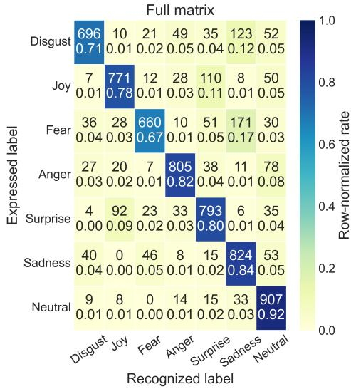
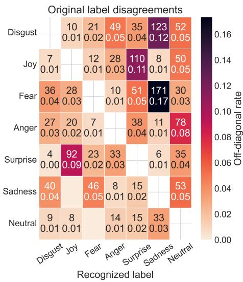
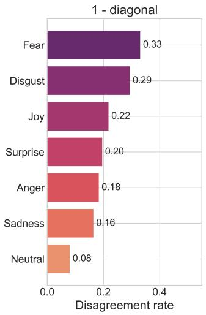
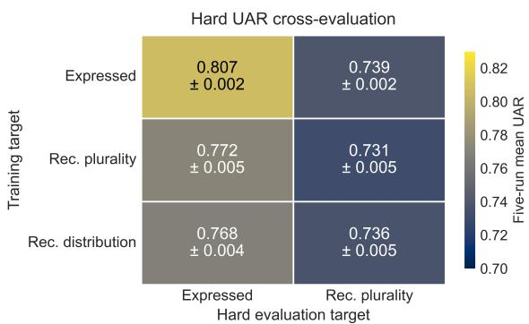
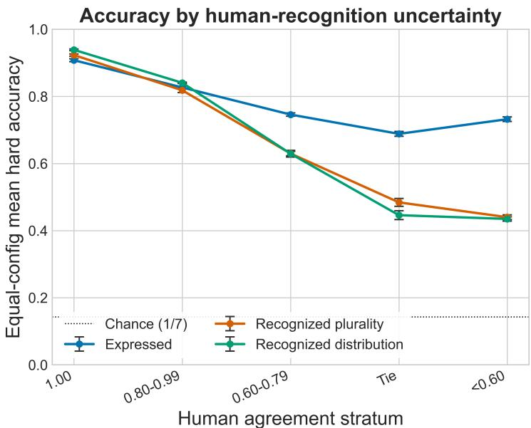
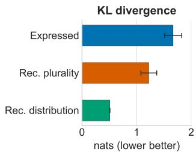
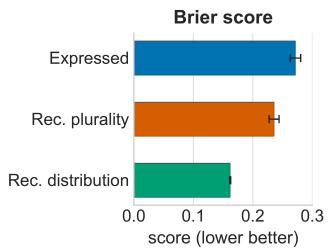
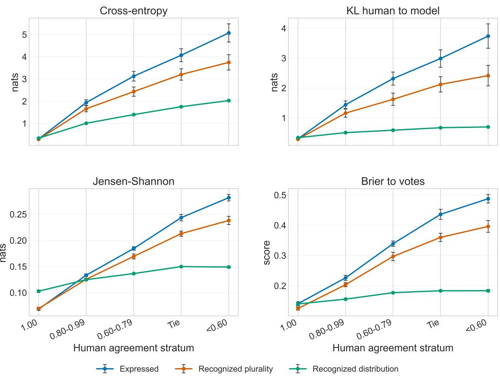
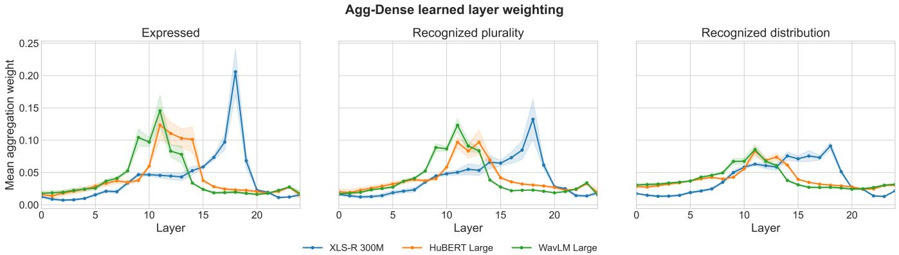

# Label Authority in Speech Emotion Recognition: Intended and Perceived Ground Truth in Emozionalmente

Marco Giordano

Student Member, IEEE

Stefano Giacomelli

Graduate Student Member, IEEE

Claudia Rinaldi

Member, IEEE

Fabio Graziosi

Member, IEEE

Abstract—Ground truth in Speech Emotion Recognition (SER) is often presented as a single categorical fact, yet an acted emotion and the emotion heard by listeners describe different aspects of the same recording. We examine this distinction in Emozionalmente, an acted Italian corpus that provides both an elicited production label and five listener judgements for every clip. Using frozen XLS-R, HuBERT, and WavLM representations with matched probes, we compare three label authorities: the expressed condition, the listeners’ hard plurality, and their complete vote distribution.

The results tell a consistent story. Recovering the expressed condition is easier than predicting a tie-broken listener plurality, but that gap compares two different questions rather than revealing a general loss of SER ability. As listener agreement weakens, the plurality becomes an increasingly brittle hard target. Training on the full vote distribution does not substantially change which class wins the model’s hard decision, but it produces probability assignments that more closely follow the alternatives selected by listeners, especially for ambiguous clips.

No authority therefore replaces the others. Expressed labels describe how speech was produced, pluralities provide an operational single-class decision, and vote distributions preserve perceptual uncertainty. For human-facing Internet of Sounds applications, evaluations should state which authority is being predicted, retain its aggregation rule and agreement information, and use distributional scores when disagreement is part of the target.

Index Terms—speech emotion recognition, label authority, annotation uncertainty, ground truth, human perception, Italian emotional speech, Emozionalmente

## I. INTRODUCTION

Speech Emotion Recognition (SER) is usually formulated as classification: an utterance enters a model and one emotion label comes out. The apparent simplicity of that formulation hides a prior decision about what the label is supposed to mean. In acted corpora, it commonly records the emotion requested during data collection. Such a label is a useful and reproducible description of the production protocol, but it is not a direct observation of what a listener heard, and still less of what a speaker privately felt. Conversely, a listener label records a perceptual judgement whose meaning depends on who listened, under which conditions, and how several judgements were aggregated. Expression–perception mismatches have been documented even in widely used emotional-speech resources [1]. Calling both sources “ground truth” without qualification therefore makes two different questions look like one.

This distinction matters whenever an affective audio model becomes part of a human-facing Internet of Sounds application. A semantic archive may index how content was deliberately performed, while a search or accessibility interface may need to retrieve how that content is likely to be perceived. An adaptive service may need a categorical decision, yet also need to know when listeners would plausibly disagree before changing its behaviour. These uses do not require the same supervisory authority. A system can correctly recover an elicited production condition while disagreeing with its users, or match a listener plurality while concealing that the plurality was decided by a tie.

We call this choice the label-authority problem. It concerns which observation is authorized to define success, rather than whether one annotation file is cleaner than another. We investigate the problem in Emozionalmente, a crowdsourced Italian corpus of simulated emotional speech that provides an elicited production label and five independent post-hoc recognition judgements for every clip [2]. The corpus makes it possible to study three operational authorities on exactly the same audio: the expressed condition, a single recognized class obtained by plurality, and the complete distribution of listener votes. None is assumed to be universally correct. Each describes a different aspect of the recording and induces a different evaluation question.

The study follows that distinction from people to models. It first asks how the expressed condition and listener responses diverge before any classifier is introduced. It then compares matched probes on frozen XLS-R, HuBERT, and WavLM representations, separating changes in the evaluation reference from changes in the training target. Finally, it asks whether distributional supervision retains perceptual alternatives that disappear when five votes are collapsed to one tie-broken class. Run-to-run variation, paired clip bootstraps, agreementstratified analyses, and configuration-matched sensitivities are used for different uncertainty questions; the many layer conditions are not treated as independent experimental replicates.

The resulting picture is more informative than a ranking of three targets. Recovering the expressed condition is easier than predicting a listener plurality, but the corresponding scores refer to different tasks. The plurality becomes increasingly brittle as agreement weakens. Soft supervision does not materially change hard plurality UAR on the full test split, yet it gives probability distributions that are substantially closer to the complete vote histograms, especially on ambiguous clips. Model confusions also concentrate on the same emotion pairs that human listeners confuse most often. Together, these observations support a task-dependent reporting rule: name the label authority, preserve its aggregation and agreement information, and use a proper distributional score when disagreement is part of the phenomenon being modelled.

The contribution is methodological rather than architectural. The evidence is restricted to one acted Italian corpus and to frozen representations with shallow probes. Within that scope, the paper contributes a human-first account of the three authorities, a matched hard and distributional evaluation, an analysis of how model errors track perceptual ambiguity, and concrete guidance for specifying and reporting label provenance in human-facing audio systems.

## II. BACKGROUND

## A. Authority Is Not Reliability

SER surveys describe a field in which corpus design, emotion representation, and evaluation protocol vary substantially [3], [4]. Acted resources remain useful because their elicitation procedures provide balanced and interpretable production conditions. Italian corpora such as EMOVO and DEMoS, for example, deliberately record performed emotions under controlled protocols [5], [6]. IEMOCAP combines elicited interaction with several forms of annotation and thereby illustrates how one recording can support multiple descriptions [7]. The methodological issue is not that an acted label is false. It is that a production label, a perception label, and a felt-emotion report are observations of different constructs.

This is why label authority must be separated from label reliability. Reliability coefficients describe how consistently annotators apply a scheme [8]. They do not decide whether a study should predict the elicited condition, a listener consensus, or an individual perception. A perfectly reliable panel could still answer a different question from the production protocol; an imperfectly reliable panel can still provide valuable evidence about perceptual ambiguity. The authority identifies the estimand. Reliability characterizes the evidence available for that authority.

Perception is also conditional on the annotation procedure. Utterance order and context alter crowdsourced emotion judgements [9], while audio-only and multimodal evaluations need not support the same SER conclusions [10]. These effects do not make listener responses unusable. They make their provenance part of the measurement. Recent work on EmoDB similarly argues that removing ambiguous samples can discard scientifically useful structure rather than merely clean a corpus [11].

## B. From Consensus Labels to Distributions

A plurality turns several judgements into the single class required by a conventional classifier. This is operationally convenient, but the conversion is lossy. Minority responses disappear, the strength of the winning class is hidden, and ties require an external rule. The resulting hard target can make a model look wrong even when it favours an alternative selected by equally many listeners. Agreement statistics and plurality accuracy therefore answer different questions: one describes the panel, while the other scores a model against the panel’s compressed outcome.

Several strands of SER research retain more of the annotation structure. Curriculum and soft-label approaches use disagreement to order or smooth training examples [12], [13]. Label distribution learning treats annotator proportions as the target itself, and Bayesian or distributional formulations explicitly represent label uncertainty [14], [15]. Work that models individual raters, rather than only their aggregate, further shows that subjective and consensus labels can contain complementary information [16]. These methods differ in architecture and statistical interpretation, but they share an important premise: disagreement may be part of the phenomenon rather than a nuisance to erase.

The present study adopts the simplest version of that premise. The five listener votes are retained as an empirical categorical distribution, without claiming that five observations reveal a latent population distribution exactly. A hard plurality and a soft distribution can then be evaluated on shared clips and against shared references. This controlled comparison is particularly important because a higher hard score and a better probabilistic fit need not coincide.

## C. Frozen Representations as a Diagnostic

Self-supervised speech models provide a common representational substrate for the comparison. XLS-R learns multilingual acoustic representations through a wav2vec 2.0-style contrastive objective [17]; HuBERT predicts cluster-derived hidden units [18]; and WavLM extends masked speech modelling to noisy and overlapping conditions [19]. Freezing these backbones and varying only shallow probes makes the experiment a diagnostic of accessible information under matched conditions. It deliberately does not answer how end-to-end fine-tuning, larger annotation panels, or a different corpus would change the result.

## III. DATA AND LABEL AUTHORITIES

## A. Corpus and Listener Votes

Emozionalmente contains 6,902 utterances from 431 speakers and approximately 7.3 hours of mono, 16-kHz speech [2]. Its seven categories are anger, disgust, fear, joy, neutrality, sadness, and surprise. The elicitation design is balanced, with 986 clips for each expressed category. After recording, 829 listeners supplied 34,510 valid recognition judgements: exactly five for every clip. Each judgement also carries an audioquality flag.

The availability of paired production and perception metadata is the reason for using one corpus rather than combining several datasets. Cross-corpus differences in speakers, acoustics, classes, and annotation would otherwise be confounded with the authority being studied. All comparisons here therefore refer to the same recordings and the same speakerindependent partitions.

## B. Three Operational Authorities

The expressed label records the emotion assigned to the speaker during elicitation. It is encoded as a one-hot target and answers whether a model can recover the controlled production condition. The recognized plurality is the most frequent of the five listener votes. Because a hard classifier requires one class, tied pluralities are resolved deterministically by the lowest configured class index. That convention makes the experiment reproducible; it does not turn the selected class into a stronger consensus.

The recognized distribution retains the empirical vote proportions. If three listeners select joy and two select surprise, the target assigns 0.6 to joy and 0.4 to surprise instead of replacing the panel with a one-hot joy label. Formally, $p _ { c } = n _ { c } / 5$ , where $n _ { c }$ is the number of votes for class c. We retain the top-vote share, tie status, entropy, and quality flags alongside these targets. Table I summarizes the questions they make measurable.

Two analysis levels must therefore remain separate. At clip level, each utterance contributes once through its plurality or vote distribution. At evaluator level, every listener judgement contributes an expressed–recognized pair before aggregation. Evaluator-level accuracy is 0.6638 over all votes, whereas clipplurality accuracy is 0.7905. The difference does not indicate a contradiction: five-vote aggregation often repairs an individual disagreement. Evaluator level exposes the variation that this repair compresses; it is not a fourth model target.

## IV. EXPERIMENTAL DESIGN

## A. Frozen Representations and Probe Families

The acoustic backbones are XLS-R 300M, HuBERT Large, and WavLM Large. Each has a convolutional front end followed by 24 Transformer layers with hidden width 1,024. All backbone parameters remain frozen. A hidden state is therefore a sequence of shape $T \times 1 0 2 4$ , where T depends on clip duration, and all temporal means exclude padded frames.

The three probe families deliberately add limited trainable capacity. The historically named linear probe mean-pools one selected hidden state, projects 1,024 features to 128 with a ReLU, and maps the result to seven logits. The dense probe first applies two frame-wise 1 × 1 convolutions with 256 channels and ReLU activations, then mean-pools and classifies. It can transform each frame non-linearly but does not model new temporal interactions. The agg\_dense probe assigns a learned scalar to every one of the 25 available states– the convolutional state numbered 0 and Transformer layers 1– 24–normalizes those scalars with a softmax, and sends the weighted sequence through the dense head. Thus, the 25 points in its layer-weight plots are all states made available to the aggregation probe; they are distinct from the ten depths sampled by the single-layer probes.

Those sampled depths correspond to 0, 20, 33, 43, 53, 63, 73, 87, 90, and 100 per cent of the backbone, mapped to indices 0, 5, 8, 10, 13, 15, 18, 21, 22, and 24. For each target there are 60 single-layer conditions and three all-layer conditions, giving 63 matched representation/probe configurations. Across all three targets and five repeated runs, the design contains 945 probe training trajectories.

## B. Splits and Training

A fixed speaker-independent split assigns 4,142 clips to training, 1,380 to validation, and 1,380 to testing. Every speaker occurs in one partition only, and the same audio assignment is used for all authorities. Hard targets use categorical cross-entropy; the recognized distribution uses soft crossentropy against the unsmoothed empirical vote vector. Probes are trained for 30 epochs with Adam at a learning rate of $1 0 ^ { - 3 }$ . The retained checkpoint maximizes validation accuracy for hard targets and minimizes validation soft cross-entropy for the distributional target. Five runs vary probe initialization and minibatch order while holding the split, features, and settings fixed.

## C. Metrics and Uncertainty

Hard decisions are assessed with unweighted average recall (UAR), the mean of the seven class recalls. Unlike plain accuracy, UAR does not let a frequent recognized class dominate the score. Agreement-stratified plots use ordinary accuracy within each stratum because the question there is the probability of matching the relevant hard label for clips with a given vote pattern.

Predicted probability vectors q are compared with the observed vote distribution p using

$$
D _ { \mathrm { K L } } ( p \| q ) = \sum _ { c } p _ { c } \log \frac { p _ { c } } { q _ { c } } , \qquad \mathrm { B r i e r } ( p , q ) = \sum _ { c } ( q _ { c } - p _ { c } ) ^ { 2 } .\tag{1}
$$

Both are proper distributional scores and lower is better. We also report the top/tie-set hit rate as an intuitive secondary diagnostic, but do not use it to choose between targets because the set becomes easier to hit as a tie expands. Nominal Krippendorff’s α describes listener reliability independently of any model.

Means and sample standard deviations are computed over five aligned runs. For headline winner contrasts, 1,000 paired clip-bootstrap replicates resample clips while carrying all five predictions for a sampled clip together. The resulting intervals quantify test-clip sampling conditional on the already trained and selected probes. They do not include training or selection uncertainty. Checkpoints are validation-selected, but the reported best layers and individual winners are chosen post hoc by five-run mean test UAR. The 63 within-grid contrasts share data and representations and are therefore not treated as 63 independent experimental units.

TABLE I  
OPERATIONAL LABEL AUTHORITIES. “REFERENCE UNIT” IDENTIFIES WHAT ONE EVALUATION ITEM REPRESENTS; IT IS NOT A CLAIM THAT ONE AUTHORITY IS UNIVERSALLY MORE TRUTHFUL THAN ANOTHER.
<table><tr><td>Authority</td><td>Construction</td><td>Reference unit</td><td>Question answered</td></tr><tr><td>Expressed condition</td><td>One-hot elicitation label</td><td>One production instruction per clip</td><td>Was the requested acted condition recover- able from speech?</td></tr><tr><td>Recognized plurality</td><td>Most frequent of five votes; deter- ministic tie-break</td><td>One aggregated listener-derived class per clip</td><td>Which single class wins under the stated aggregation rule?</td></tr><tr><td>Recognized distribution</td><td>Seven-class vector of vote propor- tions</td><td>Complete five-vote histogram per clip</td><td>How should probability be allocated across the alternatives selected by listeners?</td></tr><tr><td>Evaluator-level view</td><td>Each recognition vote retained sepa- rately</td><td>One listener judgement, paired with the clip&#x27;s expressed label</td><td>How much individual perception is hidden by clip-level aggregation?</td></tr></table>

TABLE II  
EXPERIMENTAL FACTORS HELD IN COMMON ACROSS LABEL AUTHORITIES.
<table><tr><td>Component</td><td>Setting</td></tr><tr><td>Backbones</td><td>XLS-R 300M, HuBERT Large, WavLM Large; frozen</td></tr><tr><td>Single layers</td><td>0, 5, 8, 10, 13, 15, 18, 21, 22, 24</td></tr><tr><td>Probe families</td><td>linear, dense, agg_dense</td></tr><tr><td>Split</td><td>Speaker-independent 60/20/20; 4,142/1,380/1,380 clips</td></tr><tr><td>Training</td><td>Adam,  $1 0 ^ { - 3 } \colon$  30 epochs; five runs</td></tr><tr><td>Selection</td><td>Validation checkpoint; reported layer/winner by mean test UAR</td></tr><tr><td>Grid</td><td>63 conditions per target; 945 trajectories overall</td></tr></table>

## V. RESULTS

The results are presented in the order needed to interpret the label-authority question. We begin with the listeners, before asking any model to reproduce their decisions. We then separate authority-dependent hard scores from comparisons that hold the evaluation reference fixed, and finally examine what the frozen representations contribute.

## A. Human Disagreement Before Model Scores

Figure 1 compares the expressed condition with the allvote recognized plurality. The diagonal is strong: the plurality agrees with the expressed label for 79.1% of clips. It is not uniform, however. Neutrality has a 0.92 row-normalized match rate, while fear reaches only 0.67. The off-diagonal panel shows that disagreement has recurring semantic directions rather than being spread evenly across all categories.

The aggregation level changes what “human accuracy” means. At evaluator level, every judgement is counted separately and 66.4% match the expressed condition. At clip level, five judgements are first collapsed to one plurality, raising the match rate to 79.1%. The latter is a consensus statistic, not an estimate of how often an individual listener recognizes the intended category. This distinction explains why the corpuslevel plurality appears more stable than its constituent votes.

The three leading undirected pairs–fear/sadness, joy/surprise, and disgust/sadness–also remain prominent whether each clip or each evaluator is the unit of analysis. At clip level they account for 217, 202, and 163 mismatches, respectively. Plurality compression reduces the amount of disagreement without replacing its main categorical structure.

Table III(b) supplies an important boundary condition. On the 1,792 unanimous clips, the five listeners always converge on the expressed condition. As votes disperse, agreement between authorities declines steadily; when the winning class has only two of five votes without a tie, it falls below one half. A hard recognized label is consequently most contestable on exactly the clips where an aggregation rule is doing the most work. Removing ratings flagged for lower audio quality changes α only from 0.476 to 0.501, so audio filtering does not explain away the disagreement.

## B. What the Hard-Label Gap Means

Table IV reports the target-specific winners. The best expressed probe reaches 0.825 ± 0.009 UAR, compared with $0 . 7 4 6 \pm \ : 0 . 0 0 6$ for the best hard-recognized probe. Their aligned-run difference is 0.079±0.014; a paired clip bootstrap gives a conditional 95% interval of [0.058, 0.099]. This is a real descriptive separation on the present test split, but it compares two questions: the reference changes from an elicited condition to a plurality of listener judgements, and the selected layer also changes.

Figure 2(a) holds the evaluation authority fixed and therefore answers a different question. Against expressed labels, expressed training performs best; against listener plurality, the three rows are much closer and none establishes a general advantage across both columns. The same models retain information about both authorities, but supervision aligns their decisions with different references. As secondary consistency evidence, all 63 matched recognized-minus-expressed ownreference deltas are negative (mean −0.065, range −0.095 to −0.028). These dependent conditions demonstrate directional consistency, not 63 independent replications.

Agreement strength explains where the hard recognized task becomes difficult. In Fig. 2(b), hard-plurality training falls from 0.923 ± 0.003 accuracy on 381 unanimous test clips to $0 . 4 8 4 \pm 0 . 0 1 2$ on 145 ties and $0 . 4 4 0 \pm 0 . 0 0 7$ on 82 clips with a unique winner below 0.60 vote share. The soft-trained model follows the same hard-argmax pattern. Expressed accuracy uses another reference, so its higher values in the low-agreement strata do not show that the production condition is a better description of perception. They show that plurality difficulty is coupled to the vote pattern from which the label was constructed.

Expressed vs recognized human labels (All, Clip Plurality)  

  
Fig. 1. Expressed condition versus the plurality of all five listener votes. Rows are expressed labels and columns are recognized labels. The left panel shows counts and row-normalized rates, the centre suppresses the diagonal, and the right ranks expressed categories by their off-diagonal rate.

TABLE III  
HUMAN-LABEL SUMMARIES. PANEL (A) DISTINGUISHES INDIVIDUAL JUDGEMENTS FROM CLIP PLURALITIES AND REPORTS NOMINAL KRIPPENDORFF’S α. PANEL (B) PARTITIONS ALL 6,902 CLIPS INTO MUTUALLY EXCLUSIVE AGREEMENT STRATA.
<table><tr><td>Votes</td><td>Ratings</td><td>Eval. acc.</td><td>Clip acc.</td><td>α</td></tr><tr><td>All</td><td>34,510</td><td>0.6638</td><td>0.7905</td><td>0.476</td></tr><tr><td>Good quality</td><td>33,200</td><td>0.6792</td><td>0.7937</td><td>0.501</td></tr></table>

TABLE IV  
TARGET-SPECIFIC BEST OWN-REFERENCE HARD UAR. EXPRESSED MODELS USE THE EXPRESSED REFERENCE; RECOGNIZED MODELS USE PLURALITY, WITH THE SOFT TARGET READ BY ARGMAX. VALUES ARE MEAN ± SAMPLE SD OVER FIVE RUNS.
<table><tr><td>Training target</td><td>Best configuration</td><td>Layer</td><td>UAR</td></tr><tr><td>Expressed</td><td>XLS-R Dense</td><td>13</td><td> $0 . 8 2 5 \pm 0 . 0 0 9$ </td></tr><tr><td>Recognized plurality</td><td>XLS-R Dense</td><td>15</td><td> $0 . 7 4 6 \pm 0 . 0 0 6$ </td></tr><tr><td>Recognized distribution</td><td>WavLM Dense</td><td>10</td><td> $0 . 7 4 9 \pm 0 . 0 0 4$ </td></tr></table>

TABLE V

COMMON-REFERENCE EVALUATION, MEAN ± SAMPLE SD OVER FIVE RUNS AFTER EQUALLY AVERAGING NINE TARGET-SELECTED BACKBONE/PROBE CONFIGURATIONS. HARD UAR USES RECOGNIZED PLURALITY; KL AND BRIER USE THE FIVE-VOTE HISTOGRAM.
<table><tr><td>Training target</td><td>Hard UAR</td><td>KL</td><td>Brier</td></tr><tr><td>Expressed</td><td> $0 . 7 3 9 \pm 0 . 0 0 2$ </td><td> $1 . 6 6 7 \pm 0 . 1 5 6$ </td><td> $0 . 2 7 2 \pm 0 . 0 0 9$ </td></tr><tr><td>Rec. plurality</td><td> $0 . 7 3 1 \pm 0 . 0 0 5$ </td><td> $1 . 2 2 3 \pm 0 . 1 4 5$ </td><td> $0 . 2 3 6 \pm 0 . 0 0 8$ </td></tr><tr><td>Rec. distribution</td><td> $0 . 7 3 6 \pm 0 . 0 0 5$ </td><td> $\mathbf { 0 . 5 1 0 \pm 0 . 0 0 2 }$ </td><td> $\mathbf { 0 . 1 6 2 \pm 0 . 0 0 1 }$ </td></tr></table>

(b) Agreement structure
<table><tr><td>Stratum</td><td>Clips</td><td>Plurality = expressed</td><td></td></tr><tr><td>Unanimous (share 1.00)</td><td>1,792</td><td></td><td>1.000</td></tr><tr><td>Share 0.80</td><td>1,909</td><td></td><td>0.870</td></tr><tr><td>Share 0.60</td><td>2,070</td><td></td><td>0.663</td></tr><tr><td>Tied plurality</td><td>715</td><td></td><td>0.603</td></tr><tr><td>Unique, share 0.40</td><td>416</td><td></td><td>0.481</td></tr></table>

TABLE VI

TOP-10 MODEL–HUMAN CONFUSION-PAIR OVERLAP. THE MEAN AVERAGES NINE SELECTED BACKBONE/PROBE CONFIGURATIONS WITHIN EACH RUN; THE SD IS OVER FIVE RUNS, AND THE RANGE IS ACROSS CONFIGURATION MEANS.
<table><tr><td>Training target</td><td>Mean ± SD</td><td>Config. range</td></tr><tr><td>Expressed</td><td> $0 . 6 6 0 \pm 0 . 0 1 3$ </td><td>[0.600, 0.700]</td></tr><tr><td>Recognized plurality</td><td> $0 . 7 0 7 \pm 0 . 0 1 7$ </td><td>[0.680, 0.740]</td></tr><tr><td>Recognized distribution</td><td> $\mathbf { 0 . 7 3 3 \pm 0 . 0 1 4 }$ </td><td>[0.680, 0.780]</td></tr></table>

## C. Do Model Errors Resemble Human Errors?

The most frequent model confusions are not arbitrary. Joy/surprise, fear/sadness, and disgust/sadness lead under all three targets, matching the human ranking described above. To broaden the comparison beyond those examples, Table VI compares each selected configuration’s ten most frequent undirected error pairs with the fixed evaluator-level human top ten. At least six pairs overlap for every selected configuration and run.

Listener-derived supervision is descriptively closer to the human ranking, with the soft target highest at $0 . 7 3 3 \pm 0 . 0 1 4$ This rank-based diagnostic does not measure calibrated probabilities or establish a statistically significant advantage. Its narrower message is nevertheless useful: when recognizedtarget models fail, they often fail at boundaries on which listeners themselves are divided. The lower hard score is partly inherited from the ambiguity of the reference rather than produced by an unrelated model error structure.

  
(a)

  
(b)  
Fig. 2. Authority and agreement diagnostics. (a) Hard-UAR cross-evaluation: rows are training authorities and columns are hard evaluation authorities. Cells average nine target-selected configurations within each run and report mean ± sample SD over five runs. (b) Hard accuracy by mutually exclusive listeneragreement stratum. Expressed probes use the expressed reference; recognized probes use plurality.

  
(a)

  
(b)  
Fig. 3. Alignment with the observed five-vote distribution: (a) KL divergence and (b) multiclass Brier score. Bars equally average nine target-selected configurations within each run; error bars are sample SDs over five runs. Lower is better.

## D. What Distributional Supervision Recovers

Table V evaluates all targets against the same listenerderived references. Hard and soft recognized training have close hard plurality UAR, $0 . 7 3 1 \pm 0 . 0 0 5$ and $0 . 7 3 6 \pm 0 . 0 0 5$ Against the complete vote histogram, however, soft supervision reduces KL from 1.223±0.145 to $0 . 5 1 0 { \pm } 0 . 0 0 2$ and Brier from $0 . 2 3 6 { \pm } 0 . 0 0 8$ to $0 . 1 6 2 { \scriptstyle \pm 0 . 0 0 1 }$ . The hard winner changes little while the allocation of probability among alternatives changes substantially.

Figure 3 shows that the aggregate advantage is not driven by one favourable backbone. Soft training has the lowest mean Brier score in all nine matched backbone/probe comparisons.

TABLE VII  
SHARED-REFERENCE RESULTS ON AMBIGUOUS TEST SUBSETS. VALUES ARE MEAN ± SAMPLE SD OVER FIVE RUNS AFTER EQUALLY AVERAGING NINE SELECTED CONFIGURATIONS. LOWER KL AND BRIER ARE BETTER.
<table><tr><td>Subset</td><td>Training</td><td>Hard UAR</td><td>KL</td><td>Brier</td></tr><tr><td>Tie  $( n = 1 4 5 )$ </td><td>Hard</td><td> $0 . 4 6 9 \pm 0 . 0 1 5$ </td><td> $2 . 1 2 1 \pm 0 . 2 5 6$ </td><td> $0 . 3 6 0 \pm 0 . 0 1 4$ </td></tr><tr><td></td><td>Soft</td><td> $0 . 4 3 5 \pm 0 . 0 1 2$ </td><td> $\mathbf { 0 . 6 7 1 \pm 0 . 0 0 4 }$ </td><td> $\mathbf { 0 . 1 8 4 \pm 0 . 0 0 1 }$ </td></tr><tr><td> $< 0 . 6 0 \ ( n = 8 2 )$ </td><td>Hard</td><td> $0 . 4 4 3 \pm 0 . 0 1 0$ </td><td> $2 . 4 1 5 \pm 0 . 3 4 3$ </td><td> $0 . 3 9 6 \pm 0 . 0 1 9$ </td></tr><tr><td></td><td>Soft</td><td> $0 . 4 3 9 \pm 0 . 0 0 6$ </td><td> $\mathbf { 0 . 6 9 6 \pm 0 . 0 0 8 }$ </td><td> $\mathbf { 0 . 1 8 4 \pm 0 . 0 0 4 }$ </td></tr></table>

A configuration-matched sensitivity, which anchors both recognized targets to the hard target’s representation condition, preserves the ordering: soft minus hard is −0.713 ± 0.144 for KL and $- 0 . 0 7 4 \pm 0 . 0 0 9$ for Brier, while hard UAR changes by only $+ 0 . 0 0 2 \pm 0 . 0 0 7$

Figure 4 localizes the difference. All models find diffuse vote histograms harder to match, but soft training remains closest to those histograms as agreement weakens. The apparent paradox on ties is especially revealing. A matched soft-trained probe can assign probability to both co-winning classes and improve KL and Brier, yet lose hard UAR because the metric credits only the class selected by the deterministic tie-break.

Table VII quantifies that trade-off. On ties, soft training gives up hard UAR against the arbitrary winner while sharply reducing both proper scores. Below 0.60 vote share, hard UAR is nearly unchanged and the distributional improvement remains. For best individual models, paired clip-bootstrap intervals exclude zero for soft-minus-hard KL and Brier both on ties and below 0.60. They remain conditional on trained, test-selected winners. Re-scoring against good-quality votes preserves the same ordering without retraining.

  
Fig. 4. Distributional error against the observed vote histogram by human agreement stratum. Panels show cross-entropy, KL divergence, Jensen–Shanno divergence, and Brier score. Each point averages nine selected configurations within each run; error bars are sample SDs over five runs. KL and Brier provide the primary proper-score evidence; the other panels are supporting diagnostics.

## E. What the Layer Mixtures Add

The agg\_dense probe asks whether a learned mixture of all frozen states is preferable to selecting one sampled state. Figure 5 shows all 25 coefficients–state 0 from the convolutional front end and states 1–24 from the Transformer– rather than the ten depths used by the single-layer grid. The profiles generally favour middle-to-late states, but they also change with the target. For example, the expressed condition produces a sharper XLS-R peak near layer 18 than the listenerdistribution target. The weights are fitted associations, not causal importance scores for individual layers.

Table VIII shows no uniform hard-UAR advantage for aggregation. It helps WavLM on the expressed target, is approximately level in several conditions, and trails the post-hoc best single layer elsewhere. The comparator is optimistic because it was chosen from the same test split, while aggregation uses all states and a different effective input. The appropriate conclusion is therefore modest: representation depth interacts with the chosen authority, but a learned mixture is not a universally better substitute for layer selection.

## F. Uncertainty of the Headline Contrasts

The uncertainty summaries answer complementary questions. Run SDs describe variation from fitting the probe repeatedly. The paired clip bootstrap describes which test clips happened to be sampled, conditional on the selected models. Table IX reports the four full-test contrasts that anchor the paper’s conclusions.

The hard soft-minus-hard interval crosses zero. This neither establishes a hard accuracy advantage nor proves equivalence. The proper-score intervals exclude zero in the direction favouring soft training. By contrast, the larger expressed-minusrecognized interval still compares different references and must not be interpreted as a causal penalty from changing only the training target.

## VI. DISCUSSION

## A. Ground Truth as a Task Specification

The three authorities are related, but they are not interchangeable versions of the same label. The expressed condition identifies what the speaker was asked to perform. The recognized plurality identifies the class that wins after five perceptions are compressed by an aggregation and tie rule. The recognized distribution retains the alternatives chosen by those listeners. Each can be a legitimate target, provided that the system’s claim is phrased in terms of the question that target can answer.

  
Fig. 5. Learned agg\_dense mixture weights for expressed, recognized-plurality, and recognized-distribution supervision. Lines are five-run means and bands are sample SDs. Layer 0 is the convolutional state; layers 1–24 are Transformer states.

TABLE VIII  
BEST SINGLE-LAYER DENSE PROBE VERSUS AGG\_DENSE. VALUES ARE HARD UAR MEAN ± SAMPLE SD OVER FIVE ALIGNED RUNS; ∆ ISAGGREGATION MINUS SINGLE LAYER. SOFT-TARGET MODELS ARE EVALUATED AGAINST HARD PLURALITY.
<table><tr><td>Target</td><td>Backbone</td><td></td><td>Best single layer Single-layer UAR Aggregate UAR</td><td></td><td>Paired ∆</td></tr><tr><td>Expressed</td><td>XLS-R</td><td>Dense L13</td><td> $0 . 8 2 5 \pm 0 . 0 1 0$ </td><td> $0 . 8 0 1 \pm 0 . 0 0 6$ </td><td> $- 0 . 0 2 3 \pm 0 . 0 1 3$ </td></tr><tr><td></td><td>HuBERT</td><td>Dense L13</td><td> $0 . 8 0 8 \pm 0 . 0 0 7$ </td><td> $0 . 7 9 6 \pm 0 . 0 0 8$ </td><td> $- 0 . 0 1 2 \pm 0 . 0 1 4$ </td></tr><tr><td></td><td>WavLM</td><td>Dense L18</td><td> $0 . 8 0 7 \pm 0 . 0 0 4$ </td><td> $0 . 8 2 2 \pm 0 . 0 1 0$ </td><td> $+ 0 . 0 1 5 \pm 0 . 0 1 0$ </td></tr><tr><td>Recognized plurality</td><td>XLS-R</td><td>Dense L15</td><td> $0 . 7 4 6 \pm 0 . 0 0 6$ </td><td> $0 . 7 1 9 \pm 0 . 0 1 6$ </td><td> $- 0 . 0 2 6 \pm 0 . 0 1 2$ </td></tr><tr><td></td><td>HuBERT</td><td>Dense L13</td><td> $0 . 7 2 9 \pm 0 . 0 0 7$ </td><td> $0 . 7 2 1 \pm 0 . 0 1 1$ </td><td> $- 0 . 0 0 8 \pm 0 . 0 0 9$ </td></tr><tr><td></td><td>WavLM</td><td>Dense L10</td><td> $0 . 7 3 9 \pm 0 . 0 0 7$ </td><td> $0 . 7 3 9 \pm 0 . 0 0 9$ </td><td> $\approx 0 \pm 0 . 0 1 3$ </td></tr><tr><td>Recognized distribution</td><td>XLS-R</td><td>Dense L18</td><td> $0 . 7 4 8 \pm 0 . 0 1 3$ </td><td> $0 . 7 4 3 \pm 0 . 0 2 4$ </td><td> $- 0 . 0 0 5 \pm 0 . 0 2 0$ </td></tr><tr><td></td><td>HuBERT</td><td>Dense L10</td><td> $0 . 7 3 1 \pm 0 . 0 0 9$ </td><td> $0 . 7 3 2 \pm 0 . 0 1 0$ </td><td> $+ 0 . 0 0 0 \pm 0 . 0 0 6$ </td></tr><tr><td></td><td>WavLM</td><td>Dense L10</td><td> $0 . 7 4 9 \pm 0 . 0 0 4$ </td><td> $0 . 7 3 4 \pm 0 . 0 1 4$ </td><td> $- 0 . 0 1 6 \pm 0 . 0 1 4$ </td></tr></table>

TABLE IX

BEST-INDIVIDUAL PAIRED CONTRASTS ON ALL 1,380 TEST CLIPS. THE FIRST COLUMN GIVES THE MEAN ± SAMPLE SD OF FIVE ALIGNED RUN DIFFERENCES; THE INTERVAL COMES FROM 1,000 PAIRED CLIP-BOOTSTRAP REPLICATES AND EXCLUDES TRAINING AND MODEL-SELECTION UNCERTAINTY. EACH CONTRAST IS LEFT MINUS RIGHT.
<table><tr><td>Comparison</td><td>Paired-run ∆</td><td>Conditional 95% CI</td></tr><tr><td>Expressed — hard recognized, own-reference UAR</td><td> $+ 0 . 0 7 9 \pm 0 . 0 1 4$ </td><td> $\left[ 0 . 0 5 8 , 0 . 0 9 9 \right]$ </td></tr><tr><td>Soft — hard recognized, recognized UAR</td><td> $+ 0 . 0 0 3 \pm 0 . 0 0 8$ </td><td> $[ - 0 . 0 1 3 , 0 . 0 1 \dot { 9 } ]$ </td></tr><tr><td>Soft – hard recognized, KL</td><td> $- 0 . 3 6 0 \pm 0 . 0 8 1$ </td><td> $[ - 0 . 3 9 9 , - 0 . 3 2 \dot { 5 } ]$ </td></tr><tr><td>Soft — hard recognized, Brier</td><td> $- 0 . 0 5 6 \pm 0 . 0 1 5$ </td><td> $\left[ - 0 . 0 6 6 , - 0 . 0 4 6 \right]$ </td></tr></table>

This distinction changes the meaning of error. An expressedlabel error misses the elicited condition. A plurality error misses the panel’s operational winner, which may itself depend on a tie-break. A distributional error places probability differently from the observed pattern of votes. Treating these events as one generic failure obscures the main result. The ownreference hard UAR gap does not reveal a universal reduction in SER capability; it shows that recovering the performed condition and predicting the perceptual winner are different tasks. Cross-evaluation confirms that the representations retain information about both, while the agreement analysis explains why one hard reference becomes less stable on ambiguous clips.

The distributional result supplies a constructive response to that instability. On the shared recognized reference, soft and hard training produce similar hard UAR over the complete test split. The soft model is nevertheless much closer to the full vote distribution under proper scores. These statements are compatible because an argmax asks only which class is largest, whereas KL and Brier ask how the whole probability vector is arranged. Tied clips make the distinction visible: a model can respect both co-winning emotions and be penalized for not guessing the one selected by a deterministic rule.

Human–model confusion alignment adds an interpretive layer. The models do not simply become noisy when listener labels are introduced. Their most frequent errors remain concentrated around fear/sadness, joy/surprise, and disgust/sadness, the same boundaries that organize listener disagreement. This does not make every model error a human-like perception, nor does a top-10 overlap establish calibration. It does show that much of the observed difficulty is structured by the perceptual problem itself.

## B. Implications for Internet of Sounds Systems

For a connected audio system, label authority is part of the system specification rather than a detail of dataset preparation. A production archive may legitimately index the intended affect of recorded material. A user-facing search engine may instead need to retrieve clips by likely perceived affect. An accessibility service or affect-aware interface may need to expose uncertainty when listeners would disagree, because an overconfident adaptation can be more harmful than a deferred decision. The same audio model cannot be evaluated for all three purposes by changing only the prose around one score.

This has consequences at the dataset and service boundary. Production condition, vote counts, annotator count, aggregation rule, and quality metadata should remain separate fields rather than being overwritten by one “ground-truth” class. A service can still derive a categorical label when a routing or retrieval interface requires it. Preserving provenance allows that decision to be audited, recalculated under another rule, or accompanied by an agreement threshold. It also allows a downstream component to request more annotations or abstain when the perceptual evidence is diffuse.

The present study does not evaluate networking, latency, or deployment. Its Internet of Sounds contribution is upstream: it clarifies what an affective audio component is being asked to predict and which evidence should accompany that prediction before the component is embedded in a connected application. Testing whether the proposed metadata and uncertainty signals improve a deployed interaction remains future work.

## C. A Reporting Protocol for Label Authority

Three reporting practices follow from the evidence. First, an expressed-label score should be described as recovery of an elicited production condition, not automatically as perceivedemotion accuracy. Second, when one listener-derived class is required, the aggregation rule, tie policy, panel size, and agreement strata should be reported with the hard score. Third, when perceptual ambiguity is itself the target, the vote distribution should be retained and evaluated with a proper score; any hard decision should be reported separately.

These practices also prevent unlike metrics from being used to rank unlike authorities. The best-model expressed– recognized gap changes both the reference and selected model. By contrast, the hard and soft recognized rows in Table V share the hard-plurality and vote-distribution references. Claims about the effect of a training target should hold the evaluation authority and, where possible, the representation and probe fixed. Claims about authority should instead acknowledge that the estimand itself has changed.

## VII. LIMITATIONS AND OUTLOOK

The evidence comes from one corpus, one language, simulated emotional speech, and five votes per clip. Another listener panel could change a weak plurality, and cultural or contextual differences could change the confusion structure.

The good-quality sensitivity check shows that filtering lowerquality ratings does not remove the main pattern, but it cannot separate cultural, contextual, and individual sources of disagreement. Follow-up annotation should retain evaluator identities and collect enough judgements to estimate both rater- and clip-level variation.

The observed vote histograms are finite samples rather than latent perceptual distributions. KL and Brier therefore contain sampling variation even for a well-specified model. Subtracting a shared finite-vote reference level would preserve between-target differences on the same clips, but it would not turn a raw score into pure model error or justify unqualified comparisons between agreement strata. A larger or repeated annotation panel is needed to study how stable the inferred distributions are.

The modelling scope is similarly bounded. Frozen backbones and shallow probes measure what is accessible without updating the speech representation; they do not establish what end-to-end fine-tuning can learn. Checkpoints use validation data, but the best layers and individual winners were chosen by mean test UAR. Winner-based results are consequently descriptive and optimistic. The paired bootstrap conditions on those fitted and selected models. A confirmatory study should predeclare its contrasts, select all hyperparameters on validation data, and reserve an untouched test set for interval estimation.

Cross-corpus validation is also necessary. Grossi et al. report limited transfer from Emozionalmente intended-label training to external speech subsets [20]. That result motivates replication but cannot isolate label authority because speakers, acoustics, class support, and annotation all change together. A stronger extension would collect or align production labels, pluralities, and vote distributions across languages and across acted and spontaneous speech under one protocol. Fine-tuned and frozen models could then be compared without changing the measurement question.

The layer-mixture analysis should also remain exploratory. The target-dependent profiles suggest that different authorities draw on frozen representations in different ways, but the weights are correlated fitted coefficients rather than causal attributions. Aggregation and single-layer probes also differ in their inputs and selection procedures. These observations motivate a validation-selected representation study; they do not identify one universally optimal layer or backbone.

## VIII. CONCLUSION

Within Emozionalmente, label authority changes both what an SER system is asked to predict and how its output should be evaluated. Expressed labels provide a controlled account of production. Listener pluralities provide an operational singleclass decision, but become brittle as agreement weakens. Vote distributions preserve the perceptual alternatives that a hard plurality discards, and distributional supervision represents those alternatives more faithfully even when hard UAR changes little.

No authority therefore replaces every other ground truth. The practical lesson is to make the authority visible: state what generated the label, preserve how listener evidence was aggregated, report agreement when a hard perceptual class is used, and score probability distributions when disagreement belongs to the target. Within the limits of this corpus and probing design, that discipline makes SER conclusions more transparent and more useful for human-facing Internet of Sounds applications. Code will be released by the conference.

## REFERENCES

[1] C. Busso and S. S. Narayanan, “The expression and perception of emotions: Comparing assessments of self versus others,” in Proceedings of Interspeech 2008, 2008, pp. 257–260. [Online]. Available: https: //www.isca-archive.org/interspeech 2008/busso08 interspeech.html

[2] F. Catania, J. W. Wilke, and F. Garzotto, “Emozionalmente: A crowdsourced corpus of simulated emotional speech in italian,” IEEE Transactions on Audio, Speech and Language Processing, vol. 33, pp. 1142–1155, 2025. [Online]. Available: https://ieeexplore.ieee.org/ document/10879457/

[3] S. Latif, R. Rana, S. Khalifa, R. Jurdak, J. Qadir, and B. Schuller, “Survey of deep representation learning for speech emotion recognition,” IEEE Transactions on Affective Computing, vol. 14, no. 2, pp. 1634– 1654, 2023. [Online]. Available: https://ieeexplore.ieee.org/document/ 9543566/

[4] J. de Lope and M. Grana, “An ongoing review of speech˜ emotion recognition,” Neurocomputing, vol. 528, pp. 1–11, 2023. [Online]. Available: https://www.sciencedirect.com/science/article/pii/ S0925231223000103

[5] G. Costantini, I. Iaderola, A. Paoloni, and M. Todisco, “EMOVO corpus: An italian emotional speech database,” in Proceedings of the Ninth International Conference on Language Resources and Evaluation (LREC’14). Reykjavik, Iceland: European Language Resources Association (ELRA), 2014, pp. 3501–3504.

[6] E. Parada-Cabaleiro, G. Costantini, A. Batliner, M. Schmitt, and B. W. Schuller, “DEMoS: An italian emotional speech corpus,” Language Resources and Evaluation, vol. 54, no. 2, pp. 341–383, 2020. [Online]. Available: https://doi.org/10.1007/s10579-019-09450-y

[7] C. Busso, M. Bulut, C.-C. Lee, A. Kazemzadeh, E. Mower, S. Kim, J. N. Chang, S. Lee, and S. S. Narayanan, “IEMOCAP: Interactive emotional dyadic motion capture database,” Language Resources and Evaluation, vol. 42, no. 4, pp. 335–359, 2008. [Online]. Available: https://doi.org/10.1007/s10579-008-9076-6

[8] R. Artstein, “Inter-annotator agreement,” in Handbook of Linguistic Annotation. Dordrecht: Springer Netherlands, 2017, pp. 297–313.

[9] M. Jaiswal, Z. Aldeneh, C.-P. Bara, Y. Luo, M. Burzo, R. Mihalcea, and E. M. Provost, “Muse-ing on the impact of utterance ordering on crowdsourced emotion annotations,” in ICASSP 2019 – 2019 IEEE International Conference on Acoustics, Speech and Signal Processing (ICASSP), 2019, pp. 7415–7419. [Online]. Available: https://doi.org/10.1109/ICASSP.2019.8682793

[10] H.-C. Chou, H. Wu, and C.-C. Lee, “Stimulus modality matters: Impact of perceptual evaluations from different modalities on speech emotion recognition system performance,” in ICASSP 2025 – 2025 IEEE International Conference on Acoustics, Speech and Signal Processing (ICASSP), 2025, pp. 1–5. [Online]. Available: https://doi.org/10.1109/ICASSP49660.2025.10890558

[11] F. Burkhardt, O. Schrufer, U. Reichel, H. Wierstorf, A. Derington,¨ F. Eyben, and B. W. Schuller, “EmoDB 2.0: A database of emotional speech in a world that is not black or white but grey,” in Proceedings of Interspeech 2025. ISCA, 2025, pp. 4488–4492.

[12] R. Lotfian and C. Busso, “Curriculum learning for speech emotion recognition from crowdsourced labels,” IEEE/ACM Transactions on Audio, Speech, and Language Processing, vol. 27, no. 4, pp. 815–826, 2019. [Online]. Available: https://doi.org/10.1109/TASLP.2019.2898816

[13] H. M. Fayek, M. Lech, and L. Cavedon, “Modeling subjectiveness in emotion recognition with deep neural networks: Ensembles vs soft labels,” in 2016 International Joint Conference on Neural Networks (IJCNN), 2016, pp. 566–570. [Online]. Available: https: //doi.org/10.1109/IJCNN.2016.7727250

[14] N. R. Prabhu, N. Lehmann-Willenbrock, and T. Gerkmann, “Label uncertainty modeling and prediction for speech emotion recognition using t-distributions,” in 2022 10th International Conference on Affective Computing and Intelligent Interaction (ACII), 2022, pp. 1–8. [Online]. Available: https://doi.org/10.1109/ACII55700.2022.9953816

[15] ——, “End-to-end label uncertainty modeling in speech emotion recognition using bayesian neural networks and label distribution learning,” IEEE Transactions on Affective Computing, vol. 15, no. 2, pp. 579–592, 2024. [Online]. Available: https://doi.org/10.1109/TAFFC. 2023.3283595

[16] H.-C. Chou and C.-C. Lee, “Every rating matters: Joint learning of subjective labels and individual annotators for speech emotion classification,” in Proceedings ofthe IEEE International Conference on Acoustics, Speech and Signal Processing (ICASSP). Brighton, United Kingdom: IEEE, 2019, pp. 5886–5890.

[17] A. Babu, C. Wang, A. Tjandra, K. Lakhotia, Q. Xu, N. Goyal, K. Singh, P. von Platen, Y. Saraf, J. Pino, A. Baevski, A. Conneau, and M. Auli, “XLS-R: Self-supervised cross-lingual speech representation learning at scale,” 2021, arXiv:2111.09296. [Online]. Available: http://arxiv.org/abs/2111.09296

[18] W.-N. Hsu, B. Bolte, Y.-H. H. Tsai, K. Lakhotia, R. Salakhutdinov, and A. Mohamed, “HuBERT: Self-supervised speech representation learning by masked prediction of hidden units,” IEEE/ACM Transactions on Audio, Speech, and Language Processing, vol. 29, pp. 3451–3460, 2021. [Online]. Available: https://ieeexplore.ieee.org/document/9585401/

[19] S. Chen, C. Wang, Z. Chen, Y. Wu, S. Liu, Z. Chen, J. Li, N. Kanda, T. Yoshioka, X. Xiao, J. Wu, L. Zhou, S. Ren, Y. Qian, Y. Qian, J. Wu, M. Zeng, X. Yu, and F. Wei, “WavLM: Large-scale self-supervised pre-training for full stack speech processing,” IEEE Journal of Selected Topics in Signal Processing, vol. 16, no. 6, pp. 1505–1518, 2022. [Online]. Available: https://ieeexplore.ieee.org/document/9814838/

[20] A. Grossi, A. Milella, R. Mattia, and F. Gasparini, “Are we all good actors? a study on the feasibility of generalizing speech emotion recognition models,” in Proceedings of the Third Workshop on Artificial Intelligence for Human-Machine Interaction (AIxHMI 2024), vol. 3903. CEUR-WS, 2024, pp. 83–92.