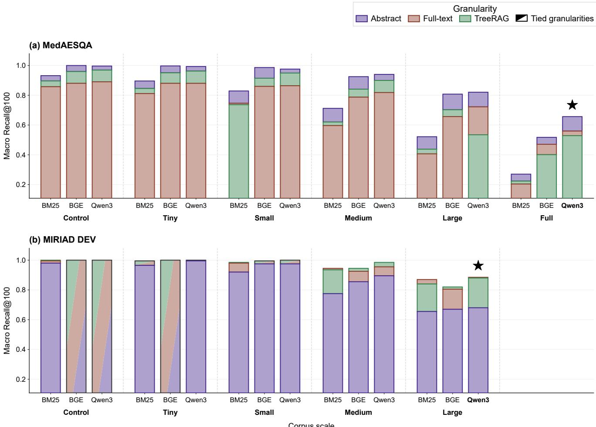
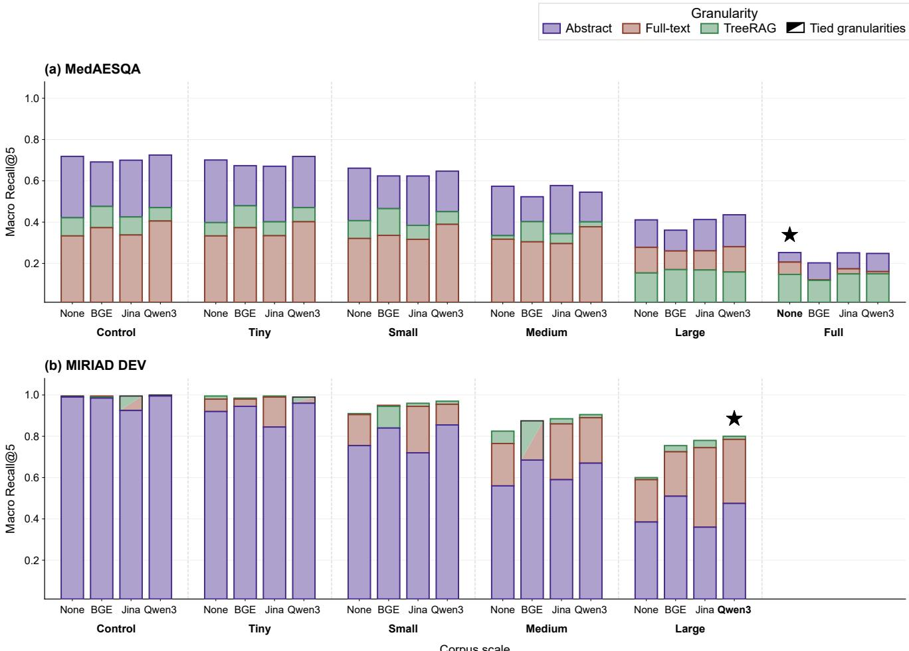
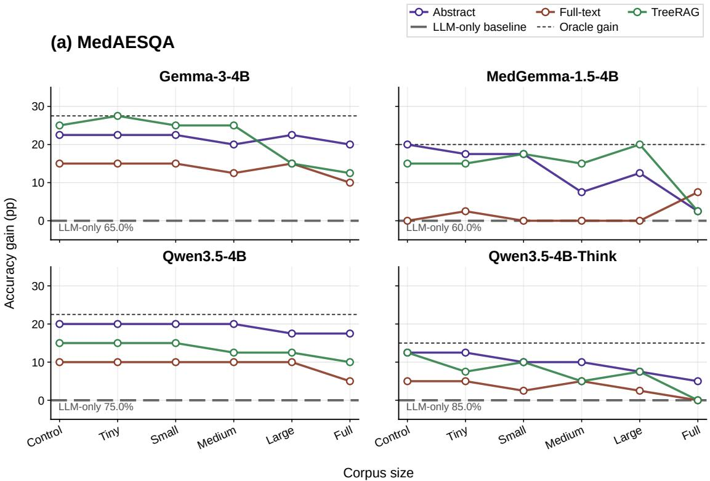
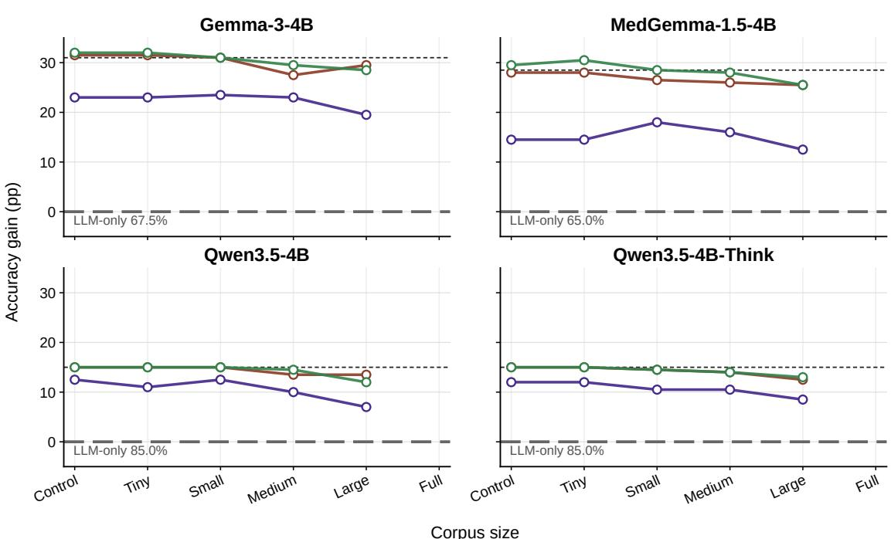
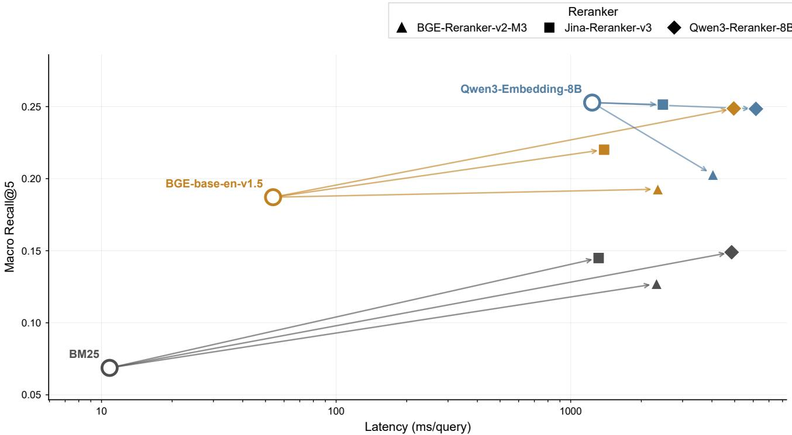
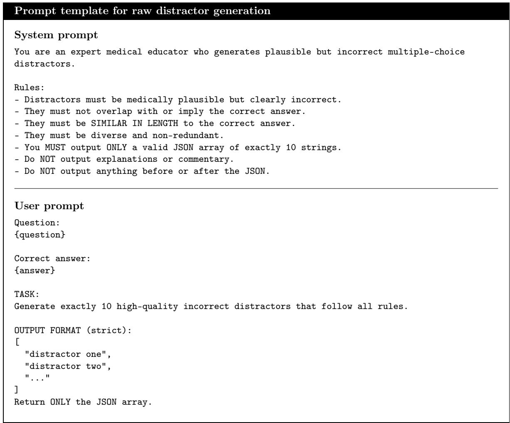
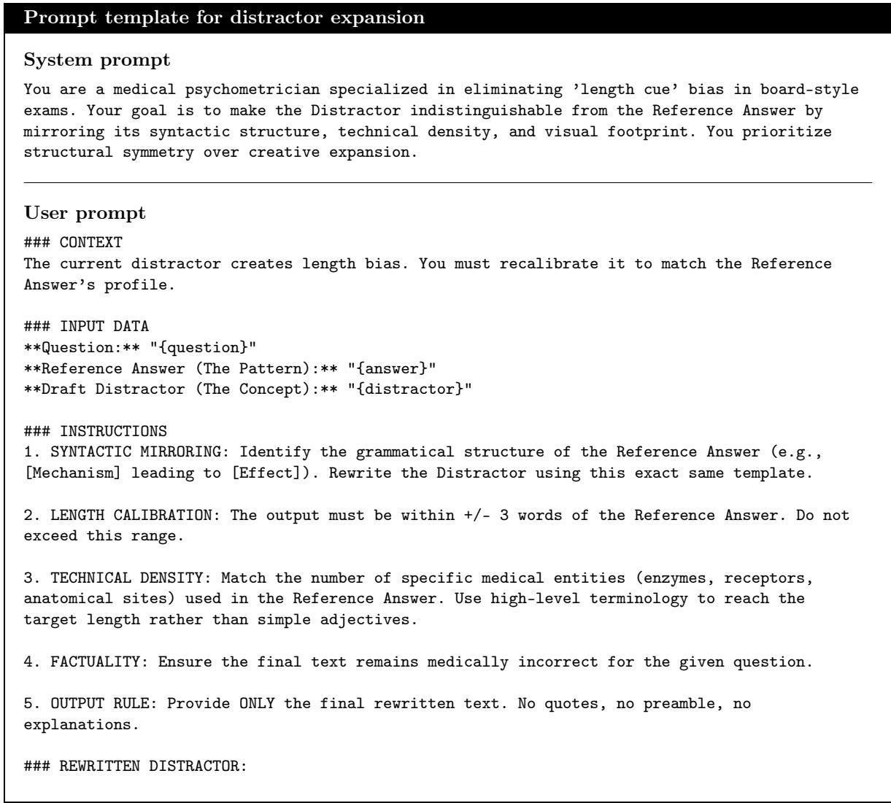
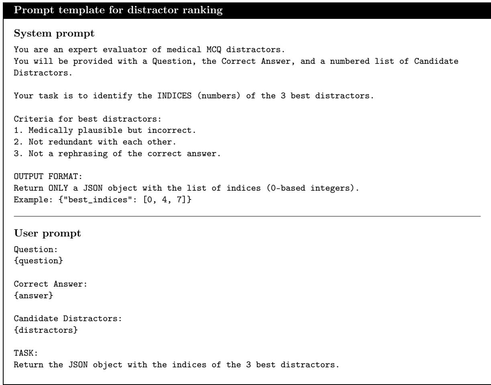
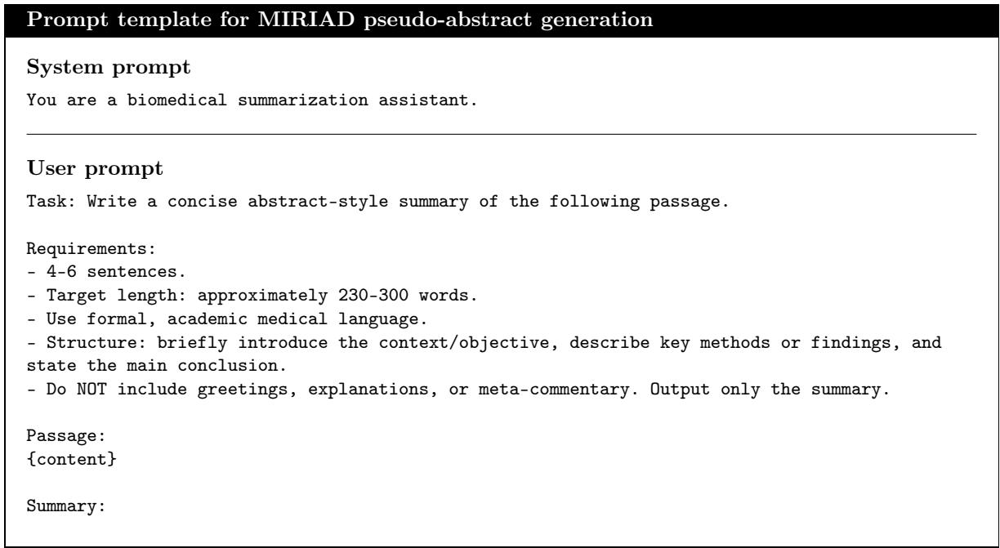
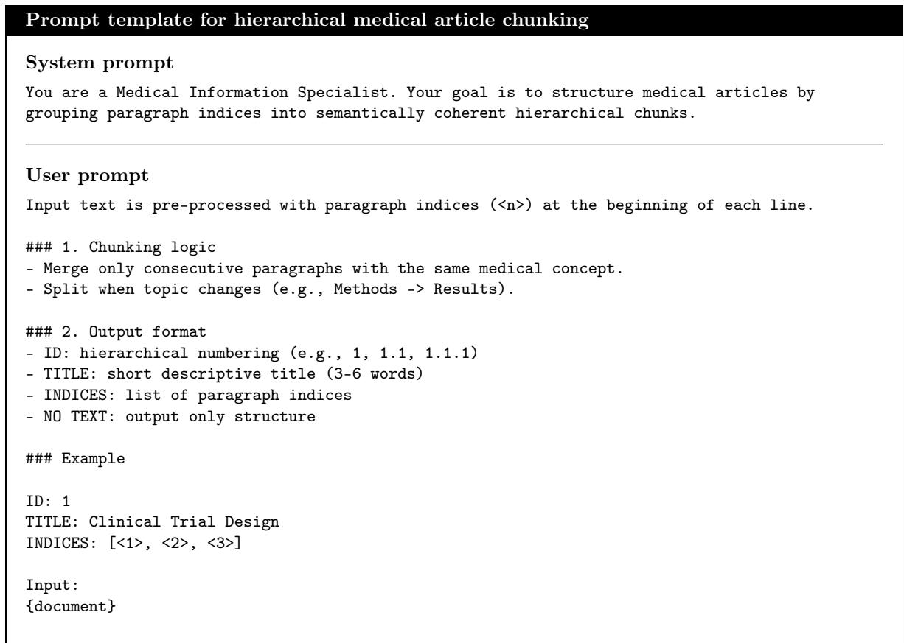

# Large-Scale Biomedical RAG: Corpus Scaling, Document Representation, and Eficiency Trade-ofs

Adrián Sánchez-Freirea,∗, Gonzalo Pérez-Gómeza, Aitziber Atutxaa and Ander Barrenaa

aHiTZ Basque Center for Language Technology, University of the Basque Country (EHU), P.º Rafael Moreno "Pitxitxi", 2, Bilbao, 48013, Biscay, Spain

## A R T I C L E I N F O

Keywords:   
Retrieval-augmented generation   
Corpus scaling   
Document representation   
Hierarchical retrieval   
Retrieval eficiency

## A BS T R AC T

We present a controlled, large-scale evaluation of how corpus scale, document representation, and reranking afect the efectiveness and eficiency of biomedical Retrieval-Augmented Generation (RAG) systems. Retrieval collections were progressively expanded while retaining the relevant source documents, enabling consistent comparisons across corpus sizes. We compared abstract, flat fulltext, and hierarchical full-text representations across first-stage retrieval, reranking, and end-to-end multiple-choice question answering. Configurations selected on development data were evaluated on five external biomedical benchmarks and a held-out test set, while retrieval latency and index storage were measured to quantify operational cost. Performance patterns observed with small or controlled collections did not consistently persist as collections grew, and the usefulness of reranking depended on the corpus and retrieval setting. RAG improved three of four model configurations across the external benchmarks, with mean gains of up to 9.6 percentage points, and improved all four configurations on the held-out test set by 10.2–30.3 points. Abstract retrieval performed best when reference evidence was abstract-aligned, whereas full-text representations were generally more efective when richer evidence was needed. Hierarchical representation matched or outperformed flat full-text retrieval in most end-to-end comparisons while requiring 67% fewer indexed units and 44–56% less storage. These findings show that corpus scale should be treated as an explicit evaluation variable in biomedical RAG, and that the most appropriate design depends on evidence format, model behavior, and operational constraints.

## 1. Introduction

Large language models (LLMs) are increasingly used for biomedical and medical question answering, but answers based only on parametric knowledge may be incomplete, outdated, or dificult to verify. Retrieval-Augmented Generation (RAG) addresses this limitation by providing external documents at inference time, allowing the generator to condition its answer on explicit evidence rather than only on information encoded in its parameters [1].

The efectiveness of biomedical RAG depends not only on the generator, but also on the retrieval corpus and on how its documents are represented. Expanding the corpus may increase the availability of relevant evidence, but it also introduces additional distractors and raises retrieval and storage costs. Document representation creates a related trade-of. Abstracts are compact and eficient, but may omit answer-relevant details. Full-text retrieval preserves richer evidence, but substantially increases the number of indexed units and may fragment information across independent chunks. Hierarchical representations provide an alternative by retaining relationships between diferent parts of a document.

These factors cannot be considered independently. As the source corpus grows, each representation produces a retrieval index of a diferent size and structure, which may afect first-stage retrieval, reranking, the evidence provided to the generator, and ultimately the quality of the generated answer. A representation that improves evidence coverage may therefore be impractical because of its storage or latency requirements, while a reranker that improves the final ranking may not necessarily improve downstream answer accuracy.

This study investigates these interactions through a controlled evaluation of biomedical RAG systems under increasing corpus scale. We distinguish the number of source documents from the representation-dependent number of retrievable units and compare three document representations: abstracts, flat full-text chunks, and TreeRAG-style hierarchical representations [2]. The experiments use PubMed as a large collection of real biomedical literature and MIRIAD [3] as a controlled setting with question-linked source passages.

We evaluate the RAG pipeline both modularly and end-toend. First-stage retrieval and reranking are assessed separately to determine how corpus growth afects evidence selection. Downstream performance is evaluated through multiplechoice question answering (MCQA), using development datasets, external biomedical benchmarks, and a held-out MIRIAD test split. We compare LLM-only and RAG configurations across compact general-purpose, biomedical, and reasoning-oriented generators, and use a dataset-specific Oracle condition to characterize generation when reference evidence is directly available. Retrieval latency and index storage are also measured to quantify the practical cost of each configuration.

To the best of our knowledge, existing biomedical RAG studies commonly evaluate relatively small or task-specific retrieval collections, while a smaller number use large indexes. However, these systems are generally assessed at a single fixed corpus scale, and corpus growth is rarely analyzed jointly with document representation, retrieval, reranking, downstream generation, and eficiency. Consequently, it remains unclear whether conclusions obtained at one collection size remain valid as biomedical knowledge resources grow. This study addresses this gap through a controlled, systemlevel empirical evaluation of biomedical RAG under corpus growth.

This work makes the following contributions:

• It introduces a controlled corpus-scaling protocol that retains gold sources while progressively adding nongold documents and separates source-document scale from representation-dependent retrieval-index scale.

• It conducts an end-to-end evaluation linking corpus growth and document representation to first-stage retrieval, reranking, downstream MCQA accuracy, latency, and storage.

• It provides empirical evidence that advantages observed at smaller corpus scales do not consistently persist as the retrieval collection grows, demonstrating the limitations of evaluating biomedical RAG at a single fixed scale.

• It derives empirically grounded guidance for selecting biomedical RAG configurations according to evidence characteristics, corpus scale, and operational constraints.

Together, these contributions characterize the robustness and operational trade-ofs of biomedical RAG configurations under controlled corpus growth rather than at an isolated collection size. The resulting evidence is intended to support researchers and developers designing scalable, literaturegrounded RAG systems for biomedical applications.

## 2. Related Work

## 2.1. Retrieval-Augmented Biomedical Question Answering

Retrieval-Augmented Generation (RAG) conditions language models on information retrieved from external sources for knowledge-intensive tasks [1]. Subsequent work has explored large retrieval memories, in-context and active retrieval, and modular retrieval–generation architectures [4– 7]. Surveys describe this broader design space and its role in grounding outputs and incorporating external knowledge [8, 9].

Biomedical question answering has evolved from taskspecific and retrieval-based systems [10–12] to domainpretrained encoders [13–15] and general-purpose or medically specialized LLMs [16–18]. Medical QA benchmarks, including those consolidated in MIRAGE [19], provide a standardized multiple-choice setting for evaluating how retrieval choices afect final answer accuracy.

## 2.2. Document Representation in RAG

Passage-level retrieval makes search over large collections tractable and allows generators to use multiple evidence units [20, 21]. However, fixed-size segmentation can split relevant evidence, remove document-level context, and create redundant units. Retrieval granularity therefore afects both retrieval and downstream generation [22, 23].

This issue is especially relevant for scientific literature. Abstracts provide compact summaries, whereas full-text articles may contain evidence absent from the abstract [24]. Hierarchical and long-document methods instead seek to preserve broader document structure [25, 26]. TreeRAG organizes documents into tree-structured retrieval units, enabling comparison between abstract-level, flat full-text, and hierarchical representations [2].

## 2.3. Corpus Scaling and Eficiency

Large RAG systems commonly use fixed retrieval collections ranging from millions of passages to much larger external memories [4, 20, 21, 27]. General-domain scaling studies show that larger collections can improve evidence coverage, but with diminishing returns [28].

Biomedical retrieval-augmented systems have been evaluated across diferent QA tasks, corpora, retrieval strategies, and evidence representations, including the studies of Otegi et al. [29], Xiong et al. [19], Alonso et al. [30], Vladika and Matthes [31], Li et al. [32], Lopez et al. [33], and Sohn et al. [34]. Stuhlmann et al. [35] additionally examine retrieval eficiency over a large PubMed-derived collection. Contextselection studies further show that additional retrieved material may introduce distractors or unfavorable retrieval– generation trade-ofs [36, 37].

Table 1 summarizes these lines of work. Existing studies investigate individual aspects of corpus scale, document representation, ranking, and eficiency, but do not jointly analyze their interaction under controlled biomedical corpus growth. To the best of our knowledge, this work is the first to unify these dimensions within a single experimental framework, enabling a systematic study of the trade-ofs among corpus scale, document representation, retrieval performance, and computational eficiency.

## 3. Methods

## 3.1. Datasets and Task Format

We formulate all tasks as multiple-choice question answering (MCQA), enabling consistent evaluation through accuracy across datasets and experimental configurations.

Development experiments use two datasets. MedAESQA is a clinically grounded QA dataset containing 40 expertcurated questions supported by biomedical evidence [38]. The complete dataset is used for development. MIRIAD is a large synthetic biomedical QA dataset containing automatically generated question–answer pairs linked to source passages [3]. We sample 1,000 instances and divide them into 200 development and 800 test examples.1

MedAESQA and MIRIAD are originally formulated as open-ended QA tasks. We convert them to MCQA while preserving the original reference answer as the correct option and generating three incorrect distractors. The conversion pipeline consists of three stages: generating medically plausible candidates, rewriting them to reduce superficial cues such as diferences in length or syntax, and filtering and ranking the candidates to select the final distractors. Correct-answer positions are balanced across option labels. Implementation details, including model configuration, decoding parameters, and filtering heuristics, are provided in Supplementary Section B.

Large-Scale Biomedical RAG: Corpus Scaling, Document Representation, and Eficiency Trade-ofs
<table><tr><td>Reference</td><td>Max. index</td><td>Biomed.</td><td>Scaling</td><td>Doc. repr.</td><td>Efficiency</td></tr><tr><td>Borgeaud et al. [4]</td><td>28B units</td><td></td><td>~</td><td></td><td>一</td></tr><tr><td>Izacard et al. [27]</td><td>387M units</td><td></td><td>一</td><td></td><td>一</td></tr><tr><td>Ning et al. [28]</td><td>264M units</td><td>一</td><td>√</td><td>一</td><td>√</td></tr><tr><td>Tao et al. [2]</td><td>n.r.</td><td>2</td><td>一</td><td>√</td><td>一</td></tr><tr><td>Otegi et al. [29]</td><td>400K units</td><td>√</td><td></td><td>√</td><td>一</td></tr><tr><td>Xiong et al. [19]</td><td>54.2M units</td><td>√</td><td></td><td>一</td><td>一</td></tr><tr><td>Alonso et al. [30]</td><td>54.2M units</td><td>√</td><td></td><td></td><td>一</td></tr><tr><td>Vladika and Matthes [31]</td><td>20.6M units</td><td>√</td><td></td><td></td><td>一</td></tr><tr><td>Stuhlmann et al. [35]</td><td>24M units</td><td>√</td><td></td><td>一</td><td>√</td></tr><tr><td>Li et al. [32]</td><td>n.r.</td><td>√</td><td>一</td><td>2</td><td>一</td></tr><tr><td>Lopez et al. [33]</td><td>20K units</td><td>√</td><td>一</td><td>√</td><td>√</td></tr><tr><td>Sohn et al. [34]</td><td>116.7M units</td><td>√</td><td>一</td><td>一</td><td>一</td></tr><tr><td>This work</td><td>117.4M units</td><td>√</td><td>√</td><td>√</td><td>√</td></tr></table>

Table 1  
Comparison with representative retrieval-augmented studies. Max. index reports the largest retrieval collection evaluated by each study in its reported indexing unit. The remaining columns indicate biomedical or medical evaluation, controlled corpus scaling, document-representation comparison, and eficiency analysis. ✓ denotes explicit coverage, ∼ partial or indirect coverage, – not addressed, and n.r. not reported.

Final evaluation additionally uses MMLU-Med [39], MedQA-US [40], MedMCQA [41], PubMedQA [42], and BioASQ yes/no [43]. We use the preprocessed versions introduced in MIRAGE [19], with minor modifications to align them with our evaluation pipeline. MedAESQA and the 200-instance MIRIAD development split are used for model selection and configuration decisions. The external benchmarks and the remaining 800 MIRIAD instances are used exclusively for testing.

## 3.2. Corpora and Scaling Protocol

Retrieval experiments use two document collections. PubMed provides the retrieval corpus for MedAESQA and the external biomedical benchmarks, whereas MIRIAD source passages are used exclusively for MIRIAD experiments.

We construct corpus scales by progressively increasing the number of non-gold documents in the retrieval pool while retaining the available gold sources. Five shared scaling factors are applied independently to PubMed and MIRIAD: control, tiny, small, medium, and large. The absolute corpus sizes difer, but the shared factors provide corresponding corpus-growth conditions across the two collections. The large scale corresponds to the complete MIRIAD corpus. Because PubMed can be expanded further, we include an additionalfull setting containing approximately 4.3 million source documents.

The scaling protocol is defined at the source-document level. However, the number of units available to the retriever depends on how each document is represented. Table 2 therefore reports both source documents and the resulting representation-dependent index sizes.

## 3.3. Document Representations

We compare three document representations:

• Abstract-level representation. Each source document is represented by a single compact retrieval unit.

• Full-text chunking. Source documents are divided into chunks of up to 1,600 characters with a 200- character overlap using a recursive character-based splitter.

• Tree-based representation. Source documents are organized into hierarchical retrieval units using TreeRAG [2].

For PubMed, all three representations are constructed from the same set of publicly available full-text articles. The abstract-level representation uses the original abstract associated with each article, whereas the full-text content is used to construct the flat chunks and TreeRAG representations.

For MIRIAD, the original source passages serve as the full-text documents. Because MIRIAD does not provide separate abstracts, we generate LLM-based pseudo-abstracts from these passages. Passages containing at most 300 tokens are kept unchanged because they already match the intended

abstract-level granularity. Full-text chunks and TreeRAG units are constructed from the original passages. Further details on pseudo-abstract generation and TreeRAG construction are provided in Supplementary Sections C and D.

## 3.4. Models

We evaluate models with diferent architectures and parameter scales at each stage of the RAG pipeline. First-stage retrieval uses BM25 [44] as a sparse baseline, BGE-base-env1.5 [45] as a lightweight dense retriever with approximately 0.1B parameters, and Qwen3-Embedding-8B [46] as a larger dense retriever with 8B parameters.

<table><tr><td colspan="4"></td><td colspan="3">Retrieval units</td></tr><tr><td>Corpus</td><td>Scale</td><td>Factor (×)</td><td>Source docs</td><td>Abstract</td><td>Full-text</td><td>TreeRAG</td></tr><tr><td>PubMed</td><td>Control</td><td>1.0</td><td>0.3K</td><td>0.3K</td><td>11.2K</td><td>2.6K</td></tr><tr><td></td><td>Tiny</td><td>6.6</td><td>1.8K</td><td>1.8K</td><td>53.4K</td><td>15.9K</td></tr><tr><td></td><td>Small</td><td>44.1</td><td>11.8K</td><td>11.8K</td><td>330.6K</td><td>105.7K</td></tr><tr><td></td><td>Medium</td><td>292.6</td><td>78.4K</td><td>78.4K</td><td>2.2M</td><td>700.2K</td></tr><tr><td></td><td>Large</td><td>1942.2</td><td>520.5K</td><td>520.5K</td><td>14.4M</td><td>5.2M</td></tr><tr><td>MIRIAD</td><td>Full</td><td>一</td><td>4.3M</td><td>4.3M</td><td>117.4M</td><td>38.3M</td></tr><tr><td></td><td>Control</td><td>1.0</td><td>1.0K</td><td>1.0K</td><td>4.2K</td><td>4.2K</td></tr><tr><td></td><td>Tiny</td><td>6.6</td><td>6.6K</td><td>6.6K</td><td>28.1K</td><td>27.4K</td></tr><tr><td></td><td>Small</td><td>44.1</td><td>44.1K</td><td>44.1K</td><td>186.9K</td><td>182.2K</td></tr><tr><td></td><td>Medium</td><td>292.6</td><td>292.6K</td><td>292.6K</td><td>1.2M</td><td>1.2M</td></tr><tr><td></td><td>Large</td><td>1942.2</td><td>1.9M</td><td>1.9M</td><td>8.2M</td><td>8.0M</td></tr></table>

Table 2  
Corpus scales and representation-dependent retrieval-index sizes. Source docs denotes the number of documents in each retrieva pool, whereas Retrieval units reports the number of indexed abstracts, full-text chunks, or TreeRAG units. Factors are defined relative to the corpus-specific control setting and applied independently to both corpora. Values are abbreviated for readability; K denotes thousands and M denotes millions. The full setting is available only for PubMed.

For reranking, we compare Jina-Reranker-v3 [47], a 0.6B listwise reranker with a decoder-only backbone; BGE-Reranker-v2-M3 [48, 49], a 0.6B cross-encoder; and Qwen3- Reranker-8B [46], an 8B LLM-based reranker. This selection covers diferent reranking architectures and provides a comparison between compact and higher-capacity models.

Generation experiments use compact 4B-parameter models, reflecting growing interest in smaller models whose computational requirements are more compatible with deployment in biomedical and healthcare systems. We evaluate three models in four configurations. Gemma-3-4B [50] serves as a general-purpose baseline, while MedGemma-1.5-4B [51] provides a biomedical counterpart from the same model family. Qwen3.5-4B [52] is evaluated with thinking mode disabled and enabled; we refer to these configurations as Qwen3.5-4B and Qwen3.5-4B-Think, respectively. Because both configurations use the same underlying model, their comparison isolates the efect of thinking mode while keeping the architecture and parameter count fixed.

## 3.5. Evaluation Protocol

## 3.5.1. Retrieval and Reranking

Retrieval quality is measured using Macro Recall@�, which computes recall for each query and then averages across queries. This gives equal weight to each question regardless of the number of associated gold documents. Gold evidence is matched at the source-document level so that retrieval units derived from the same document are treated consistently across representations.

For MedAESQA, gold sources correspond to the PubMed articles supporting each question, although the original evidence is provided at the abstract level. For MIRIAD, gold sources correspond to the original full-text passages linked to each question.

We report Recall@100 for first-stage retrieval. Each reranker is applied to the top 100 retrieved candidates, and reranking quality is evaluated using Recall@5.

## 3.5.2. End-to-End Evaluation

End-to-end performance is measured using MCQA accuracy. We compare three configurations: LLM-only, in which the generator receives only the question and answer options; RAG, in which it additionally receives the top five evidence units produced by the retrieval pipeline; and Oracle, in which retrieval is bypassed and gold evidence is supplied directly.

The retrieval configuration used for end-to-end evaluation is selected using the development results and fixed before evaluation on the test sets.

The Oracle configuration is evaluated for MedAESQA and MIRIAD, for which question-linked gold evidence is available. It uses the gold abstracts for MedAESQA and the gold full-text passages for MIRIAD. This configuration measures generation performance when reference evidence is available and helps distinguish retrieval failures from generation limitations. Because the supplied evidence follows the annotation format of each dataset, Oracle results are interpreted as dataset-specific reference points rather than absolute upper bounds.

## 3.5.3. Retrieval Eficiency

Retrieval eficiency is evaluated using query-time latency and index storage. Latency is measured per question for the same first-stage retrieval and reranking configurations used in the retrieval-quality evaluation. We report first-stage retrieval latency separately from retrieval-plus-reranking latency to quantify the additional cost of reranking the top 100 candidates.

Index storage is measured after indexing as the total Elasticsearch index footprint. This captures the deployment cost introduced by representation-dependent growth in the number of retrieval units. Because absolute latency depends on hardware, software, and implementation details, we interpret latency comparatively across configurations measured under the same experimental conditions. The computational environment and software versions are described in Supplementary Section A.

## 4. Results

The experimental results are organized into sequential phases corresponding to the main components of the RAG pipeline. Throughout the study, corpus scale and document representation are treated as factors of analysis: Abstract, Full-text, and TreeRAG are evaluated across the experimental phases rather than reduced to a single selected representation. Development results are used to select the first-stage retriever and the reranking strategy applied in the subsequent end-toend experiments.

## 4.1. Phase I: Retriever Evaluation

Phase I compares the retrievers on the MedAESQA and MIRIAD development sets using Macro Recall@100. Retriever selection is based on performance at the largest available corpus scale for each dataset: full PubMed for MedAESQA and large MIRIAD for the MIRIAD DEV split.

Figure 1 reports retrieval performance across corpus scales and document representations.

On MedAESQA, diferences between retrievers become clearer as the PubMed corpus grows. The Abstract representation performs best across most configurations, consistent with the abstract-level evidence annotations in MedAESQA. At thefull PubMed scale, Qwen3-Embedding-8B achieves the highest Macro Recall@100, reaching 65.66%. BGE-baseen-v1.5 remains competitive across most scales but decreases more noticeably in the full setting, while BM25 shows the strongest degradation as additional distractor documents are added.

On MIRIAD DEV, retrieval is close to saturation at the smallest scales, with all retrievers obtaining high Macro Recall@100. Diferences between models and representations become more visible as the retrieval pool grows. The Abstract representation is less efective than on MedAESQA. Unlike the original MIRIAD passages used by the Full-text and TreeRAG representations, these abstracts are synthetically generated pseudo-abstracts and may omit information relevant to retrieval. At the large MIRIAD scale, Qwen3- Embedding-8B achieves the highest Macro Recall@100, reaching 88.50%, while BM25 remains close at 87.00%.

Qwen3-Embedding-8B obtains the highest Macro Recall@100 at the largest available scale in both development datasets and is therefore selected as the first-stage retriever for the subsequent phases.

## 4.2. Phase II: Reranker Evaluation

Phase II fixes Qwen3-Embedding-8B as the first-stage retriever and compares No-Reranker, BGE-Reranker-v2- M3, Jina-Reranker-v3, and Qwen3-Reranker-8B. In the No-Reranker condition, the top five evidence units are taken directly from the first-stage ranking. Configurations are evaluated using Macro Recall@5, with reranker selection based onfull PubMed for MedAESQA and large MIRIAD for MIRIAD DEV.

Figure 2 reports the results across corpus scales and document representations.

On MedAESQA, reranking does not provide a consistent improvement over the first-stage ranking. No-Reranker remains comparable to the reranked configurations across scales and obtains the highest Macro Recall@5 at the full PubMed scale, reaching 25.28% with the Abstract representation. Performance generally decreases as the PubMed corpus grows, while Abstract remains the strongest representation across all configurations.

On MIRIAD DEV, the efect of reranking becomes clearer at larger corpus scales. At the control and tiny scales, Macro Recall@5 is close to saturation for most configurations. As the retrieval pool grows, the reranked configurations more consistently outperform No-Reranker, particularly with the Full-text and TreeRAG representations. At the large MIRIAD scale, Qwen3-Reranker-8B achieves the highest Macro Recall@5, reaching 80.00% with TreeRAG.

Reranker selection therefore difers by corpus. For subsequent PubMed-based experiments, we retain the original Qwen3-Embedding-8B ranking without reranking. For MIRIAD-based experiments, we apply Qwen3-Reranker-8B to the first-stage results.

## 4.3. Phase III: End-to-End Evaluation

Phase III evaluates whether the retrieval configurations selected in the previous phases improve downstream MCQA accuracy. All corpus scales and document representations remain under evaluation. PubMed-based experiments use Qwen3-Embedding-8B without reranking, whereas MIRIAD experiments use Qwen3-Embedding-8B followed by Qwen3- Reranker-8B. We compare the generators described in Section 3.4 under the LLM-only, RAG, and Oracle conditions.

These experiments use MedAESQA and MIRIAD DEV, which were also used to select the retrieval components. The results therefore characterize development-stage behavior rather than generalization to unseen test sets. Complete accuracy values are reported in Supplementary Section E.

Figure 3 reports RAG accuracy gains, in percentage points, relative to the corresponding LLM-only baseline for each generator.

RAG produces non-negative accuracy gains across the development configurations shown in Figure 3, although their magnitude varies substantially across generators, corpus scales, and document representations. Some MIRIAD configurations approach the dataset-specific Oracle gain, and a small number exceed it. This is possible because the Oracle condition uses the evidence supplied by the dataset and is treated as a reference point rather than as an absolute upper bound.

On MedAESQA, the efect of RAG varies with both the generator and the document representation. Gemma-3-4B obtains the largest gains overall, including an improvement of 27.50 percentage points in its strongest configuration.

  
Figure 1: Retriever evaluation on DEV using Macro Recall@100. Panel (a) shows MedAESQA across PubMed corpus scales, and panel (b) shows MIRIAD DEV across MIRIAD corpus scales. Colors denote the document representation: Abstract, Full-text, or TreeRAG. Diagonal split fills indicate ties between representations. Retriever labels correspond to BM25, BGE-base-en-v1.5 (BGE), and Qwen3-Embedding-8B (Qwen3). The bold label and black star indicate the highest-scoring retriever at the largest available scale for each dataset.

Qwen3.5-4B also benefits consistently, whereas MedGemma-1.5-4B shows greater variation across scales and representations. Qwen3.5-4B-Think obtains smaller gains overall, alongside its higher LLM-only accuracy of 85.0%.

The Abstract representation is generally the strongest and most stable MedAESQA setting, consistent with the dataset’s abstract-level evidence annotations. TreeRAG is often competitive with or stronger than flat Full-text chunking. At thefull PubMed scale, most configurations still improve over their corresponding LLM-only baselines, although the gains are generally smaller than at lower corpus scales, particularly for TreeRAG. This pattern is consistent with the decline in retrieval quality observed as additional PubMed documents are introduced.

On MIRIAD DEV, RAG yields large gains for Gemma-3- 4B and MedGemma-1.5-4B, whose strongest configurations improve accuracy by 32.00 and 30.50 percentage points, respectively. The two Qwen3.5 configurations also benefit from retrieval, although their higher LLM-only accuracies leave less room for improvement.

Full-text and TreeRAG generally outperform the Abstract representation on MIRIAD DEV. Unlike the original passages used to construct Full-text and TreeRAG units, the Abstract representation consists of synthetically generated pseudoabstracts and may omit retrieval-relevant content. TreeRAG remains competitive with flat Full-text chunking across corpus scales, with only small diferences between them in many configurations. Both representations retain substantial gains at the large MIRIAD scale.

Overall, the development results show that RAG matches or improves upon the corresponding LLM-only baseline across the evaluated configurations, although the magnitude of the gains depends on the generator, corpus scale, and document representation. The next phase evaluates whether these patterns transfer to test datasets that were not used for pipeline selection.

## 4.4. Generalization to Unseen Benchmarks

This section evaluates whether the retrieval-augmented pipeline selected during development transfers beyond the datasets used for pipeline selection. We consider two test settings. First, five external biomedical MCQA benchmarks (MMLU-Med, MedQA-US, MedMCQA, PubMedQA, and BioASQ-Y/N) are evaluated using the full PubMed corpus as the retrieval source. Second, the held-out MIRIAD TEST split is evaluated using the large MIRIAD corpus. Although MIRIAD TEST was not used for pipeline selection, it shares the same construction process and corpus family as MIRIAD DEV and is therefore interpreted as an in-domain held-out evaluation rather than as a fully external benchmark.

  
Figure 2: Reranker evaluation on DEV using Macro Recall@5. Panel (a) shows MedAESQA across PubMed corpus scales, and panel (b) shows MIRIAD DEV across MIRIAD corpus scales. All configurations use Qwen3-Embedding-8B as the first-stage retriever. Colors denote the document representation: Abstract, Full-text, or TreeRAG. Diagonal split fills indicate ties between representations. Labels correspond to No-Reranker, BGE-Reranker-v2-M3 (BGE), Jina-Reranker-v3 (Jina), and Qwen3-Reranker-8B (Qwen3). The bold label and black star indicate the highest-scoring reranking configuration at the largest available scale for each dataset.

On the five external benchmarks, Gemma-3 and MedGemma-1.5 improve over their LLM-only baselines across every dataset and evaluated representation. Their largest average gains are obtained with TreeRAG, reaching +7.7 and +9.6 percentage points, respectively. Qwen3.5 also benefits from RAG, although its average gains are smaller: Full-text performs best at +2.5 points, followed by TreeRAG at +2.0 points. For Qwen3.5-Think, RAG produces negative average gains across all three representations, although TreeRAG performs best, with an average change of −0.5 points, compared with −1.2 for Full-text and −2.0 for

Abstract. TreeRAG improves performance on MedMCQA and BioASQ-Y/N, but these gains do not fully ofset the decreases observed on MMLU-Med, MedQA-US, and PubMedQA.

The representation trends difer from those observed on MedAESQA DEV. Abstract retrieval was generally strongest during development, where the reference evidence is abstract-based, whereas Full-text and TreeRAG obtain the strongest external results for most generators and benchmarks. TreeRAG achieves the best average gain for Gemma-3 and MedGemma-1.5 and remains competitive with Full-text for Qwen3.5, despite using fewer indexed retrieval units than flat full-text chunking. BioASQ-Y/N is a notable exception to the broader pattern: Abstract remains competitive, while TreeRAG matches or exceeds it for some generators. Overall, these results indicate that representation performance depends on both the benchmark and the generator rather than on a single representation being consistently optimal.

The held-out MIRIAD TEST results preserve the main patterns observed on MIRIAD DEV. RAG improves all four generators, with gains ranging from +10.2 to +30.3 percentage points. Abstract produces the smallest gain for every generator, whereas Full-text and TreeRAG are consistently stronger. TreeRAG obtains the largest gain for three of the four generators and remains within 0.5 points of Full-text for Gemma-3. This pattern is consistent with the construction of the MIRIAD representations: the Abstract condition uses synthetically generated pseudo-abstracts, whereas Full-text and TreeRAG preserve the original passage content more directly.

(b) MIRIAD DEV  
  
Figure 3: End-to-end MCQA accuracy gains over each generator’s LLM-only baseline for (a) MedAESQA and (b) MIRIAD DEV, reported in percentage points across corpus scales and document representations. Horizontal reference lines indicate the LLM-only baseline at zero and the dataset-specific Oracle gain. MedAESQA uses Qwen3-Embedding-8B without reranking, whereas MIRIAD DEV uses Qwen3-Embedding-8B followed by Qwen3-Reranker-8B.

<table><tr><td rowspan="2"></td><td rowspan="2">Corpus</td><td rowspan="2"></td><td rowspan="2"></td><td colspan="3">RAG Δ</td></tr><tr><td>Abstract</td><td>Full-text</td><td>TreeRAG</td></tr><tr><td rowspan="9">Gemma-3</td><td rowspan="9">PubMed</td><td>MMLU-Med</td><td>57.4</td><td>+7.2</td><td>+7.8</td><td>+8.5</td></tr><tr><td>MedQA-US</td><td>46.1</td><td>+11.0</td><td>+13.4</td><td>+10.8</td></tr><tr><td>MedMCQA</td><td>44.9</td><td>+1.8</td><td>+5.0</td><td>+7.4</td></tr><tr><td>PubMedQA</td><td>51.4</td><td>+0.6</td><td>+5.4</td><td>+3.4</td></tr><tr><td>BioASQ-Y/N</td><td>70.2</td><td>+8.3</td><td>+4.7</td><td>+8.3</td></tr><tr><td>Average</td><td>54.0</td><td>+5.8</td><td>+7.3</td><td>+7.7</td></tr><tr><td>MIRIAD MIRIAD TEST</td><td>65.8</td><td>+21.7</td><td>+30.3</td><td>+29.8</td></tr><tr><td>PubMed MMLU-Med</td><td>53.3</td><td>+6.9</td><td>+7.8</td><td>+6.7</td></tr><tr><td>MedQA-US</td><td>48.3</td><td>+5.2</td><td>+6.0</td><td>+4.6</td></tr><tr><td rowspan="6"></td><td>MedMCQA</td><td>40.5</td><td>+1.7</td><td>+4.4</td><td>+6.8</td></tr><tr><td>PubMedQA</td><td>41.2</td><td>+9.8</td><td>+10.0</td><td>+15.0</td></tr><tr><td>BioASQ-Y/N</td><td>57.6</td><td>+13.0</td><td>+9.6</td><td>+15.1</td></tr><tr><td>Average</td><td>48.2</td><td>+7.3</td><td>+7.6</td><td>+9.6</td></tr><tr><td>MIRIAD</td><td>MIRIAD TEST 64.0</td><td>+15.9</td><td>+24.8</td><td>+27.4</td></tr><tr><td>PubMed</td><td></td><td>+0.1</td><td>+2.2</td><td></td></tr><tr><td rowspan="9"></td><td rowspan="9"></td><td>MMLU-Med MedQA-US</td><td>79.7 70.5</td><td>+1.4</td><td>+4.0</td><td>+1.8 +1.3</td></tr><tr><td>MedMCQA</td><td>59.4</td><td>-0.9</td><td>+3.0</td><td>+3.0</td></tr><tr><td>PubMedQA</td><td>56.0</td><td>-0.4</td><td>+1.6</td><td>+2.0</td></tr><tr><td>BioASQ-Y/N</td><td>82.5</td><td>+2.1</td><td>+1.8</td><td>+2.0</td></tr><tr><td>Average</td><td>69.6</td><td>+0.5</td><td>+2.5</td><td>+2.0</td></tr><tr><td>MIRIAD MIRIAD TEST</td><td>83.0</td><td>+10.2</td><td>+14.6</td><td>+15.2</td></tr><tr><td>PubMed MMLU-Med</td><td>89.8</td><td>-1.7</td><td>-1.6</td><td>-1.3</td></tr><tr><td>MedQA-US</td><td>90.2</td><td>-4.0</td><td>-2.9</td><td>-3.6</td></tr><tr><td>MedMCQA</td><td>69.7</td><td>-1.1</td><td>+0.1</td><td>+0.6</td></tr><tr><td>PubMedQA</td><td>56.0</td><td>-3.0</td><td>-0.2</td><td>-0.4</td></tr><tr><td rowspan="3"></td><td></td><td>BioASQ-Y/N</td><td>84.3</td><td>+0.0</td><td>-1.3</td><td>+2.1</td></tr><tr><td>Average</td><td></td><td>78.0</td><td>-2.0</td><td>-1.2</td><td>-0.5</td></tr><tr><td>MIRIAD</td><td>MIRIAD TEST</td><td>84.1</td><td>+10.5</td><td>+14.4</td><td>+15.0</td></tr></table>

End-to-end MCQA performance on external benchmarks and MIRIAD TEST. LLM-only reports absolute accuracy (%), while RAG Δ reports the percentage-point change relative to the corresponding baseline for each document representation. PubMed denotes retrieval over the full PubMed corpus, whereas MIRIAD denotes retrieval over the large MIRIAD corpus. Shaded cells show the average across the five external benchmarks. Bold marks the largest improvement in each row, or the LLM-only baseline when no RAG configuration improves upon it; ties are retained. Negative deltas are shown in red.

Overall, the selected RAG pipeline transfers successfully to the external benchmarks for Gemma-3, MedGemma-1.5, and Qwen3.5, although the magnitude of the gains and the strongest representation vary across generators and datasets. TreeRAG is particularly notable, achieving the strongest average external gains for Gemma-3 and MedGemma-1.5 and the largest MIRIAD TEST gain for three of the four generators, while remaining competitive with Full-text elsewhere. The development-stage behavior also transfers clearly to the indomain MIRIAD TEST split, where all generators improve and the full-text-derived representations remain substantially stronger than the pseudo-abstract representation.

## 4.5. Retrieval Eficiency and Trade-ofs

Beyond retrieval quality and downstream accuracy, largescale biomedical RAG systems are constrained by querytime latency and index storage. We analyze these trade-ofs on MedAESQA using the full PubMed corpus, the largest biomedical retrieval setting evaluated in this study.

Latency is evaluated on MedAESQA using the full PubMed Abstract index, the strongest representation in the MedAESQA development retrieval experiments.

Figure 4 reports Macro Recall@5 against mean per-query latency for the first-stage and reranked configurations.

The first-stage retrievers exhibit a clear latency– efectiveness trade-of. BM25 has the lowest mean latency at 10.8 ms per query but obtains substantially lower Recall@5 than the dense retrievers. BGE-base-en-v1.5 increases latency to 53.9 ms while providing a marked improvement in retrieval efectiveness. Qwen3-Embedding-8B achieves the highest first-stage Macro Recall@5, reaching 25.28%, but requires 1234.7 ms per query. Thus, BGE-base-en-v1.5 is approximately 23 times faster than Qwen3-Embedding-8B, although it does not reach the same retrieval efectiveness.

  
Figure 4: Eficiency–efectiveness trade-of on MedAESQA using the full PubMed Abstract index. The x-axis reports mean per-query latency on a logarithmic scale, and the y-axis reports Macro Recall@5. Open circles denote first-stage retrievers, while filled markers denote the corresponding configurations after reranking the top 100 candidates. Colors identify the first-stage retriever, marker shapes identify the reranker, and arrows connect each retriever to its reranked variants.

Reranking introduces a substantial latency overhead for every first-stage retriever. For BM25, reranking improves Recall@5 but moves the resulting pipelines into the latency range of substantially more efective dense retrieval configurations. Reranking BGE-base-en-v1.5 can further improve its Recall@5, but only at a query-time cost that exceeds that of Qwen3-Embedding-8B without reranking. For Qwen3- Embedding-8B, none of the rerankers improves upon the firststage Recall@5, and some reduce it while increasing latency. Consequently, the three first-stage retrievers define the observed latency–efectiveness frontier: Qwen3-Embedding-8B provides maximum efectiveness, BGE-base-en-v1.5 ofers a substantially lower-latency alternative, and BM25 minimizes latency at the cost of lower recall.

Storage requirements also vary substantially across representations and retrievers. At thefull PubMed scale, Abstract contains 4.3M indexed retrieval units and requires 5.9, 18.8, and 73.3 GB for BM25, BGE-base-en-v1.5, and Qwen3- Embedding-8B, respectively. Full-text chunking expands the collection to 117.4M units, increasing the corresponding index sizes to 199.5, 481.0, and 1985.1 GB. TreeRAG indexes 38.3M units and requires 111.9, 228.1, and 872.0 GB. Relative to flat Full-text chunking, TreeRAG uses approximately 67% fewer retrieval units and reduces storage by 44–56%, depending on the retriever.

Overall, maximum retrieval efectiveness is obtained with Qwen3-Embedding-8B without reranking, whereas BGE-base-en-v1.5 provides a substantially lower-latency alternative. TreeRAG ofers a complementary storage tradeof: it requires considerably fewer indexed retrieval units than Full-text while remaining competitive with, and often outperforming, flat Full-text chunking in the downstream evaluations.

## 5. Discussion

Our results show that biomedical RAG design choices should be evaluated in relation to corpus scale. Larger retrieval pools broaden the available evidence but also introduce additional distractors, making evidence selection more dificult. The degradation observed for several retrieval configurations at the largest corpus scales shows that conclusions obtained from small or controlled collections do not necessarily transfer to large-scale biomedical retrieval. Corpus scale should therefore be treated as an explicit evaluation variable and considered jointly with document representation, retrieval quality, generator behavior, and deployment cost.

Document representation strongly shapes this interaction. Abstract retrieval performs particularly well on MedAESQA, whose reference evidence is provided at the abstract level. In contrast, Full-text and TreeRAG generally produce stronger gains on the external benchmarks evaluated using the full PubMed corpus. MIRIAD shows an even clearer preference for representations that preserve the original passage content:

its synthetically generated pseudo-abstracts are consistently weaker than Full-text and TreeRAG. These contrasting patterns indicate that no document representation is universally optimal. Its efectiveness depends on the evidence requirements of the benchmark and on how the retrieved units interact with the generator.

TreeRAG provides a particularly relevant efectiveness– eficiency trade-of. It achieves the strongest average external gains for Gemma-3 and MedGemma-1.5, remains competitive with Full-text for Qwen3.5, and obtains the largest MIRIAD TEST gain for three of the four generators. At the same time, TreeRAG indexes 38.3M retrieval units, compared with 117.4M for flat Full-text chunking, reducing storage requirements by 44–56% depending on the retriever. These findings show that competitive retrieval over full-text content does not necessarily require indexing the complete set of fixed-length chunks. However, the relative advantage of TreeRAG still varies across generators, benchmarks, and corpus scales, and the present experiments do not isolate hierarchical organization as the sole cause of its performance.

For Qwen3.5-Think, TreeRAG produces the strongest external average among the three representations, although its mean change remains slightly negative at −0.5 percentage points. Its gains on MedMCQA and BioASQ-Y/N are ofset by decreases on MMLU-Med, MedQA-US, and PubMedQA. This mixed behavior further indicates that the efectiveness of TreeRAG depends on the interaction between the generator and the benchmark.

The results also challenge the assumption that reranking is an inherently beneficial stage. On MedAESQA, Qwen3- Embedding-8B obtains the strongest Recall@5 without reranking, and the evaluated rerankers either preserve or reduce efectiveness while increasing latency. On MIRIAD, reranking becomes more useful as the retrieval pool grows, and Qwen3-Reranker-8B improves the final evidence ranking at the largest scale. The utility of reranking therefore depends on the quality of the first-stage ranking, the corpus, and the evidence units being ranked. Its value should be established empirically rather than assumed from improvements observed in smaller or diferent retrieval settings.

Downstream performance further depends on the generator. Gemma-3 and MedGemma-1.5 obtain the largest RAG gains, whereas Qwen3.5 shows smaller but mostly positive improvements on the external benchmarks. Qwen3.5- Think benefits strongly from RAG on MIRIAD TEST but shows smaller, mixed, or negative changes on the external benchmarks evaluated with PubMed retrieval. A strong LLMonly baseline reduces the available margin for improvement, but baseline performance alone does not explain whether retrieval will help: the same generator can respond diferently across benchmarks and document representations. Retrieval and generation should therefore be evaluated jointly rather than treating retrieval metrics as suficient predictors of endto-end performance.

Finally, the eficiency analysis illustrates that the most effective configuration is not necessarily the most practical one.

Qwen3-Embedding-8B provides the highest first-stage retrieval efectiveness but has substantially higher latency than BGE-base-en-v1.5, while reranking introduces additional cost without consistently improving Recall@5. Similarly, Full-text supports strong downstream results but produces the largest indexes, whereas TreeRAG retains competitive performance with a considerably smaller storage footprint. The preferred biomedical RAG configuration therefore depends on the intended deployment setting: maximum-efectiveness systems may justify larger models and indexes, whereas latency- or storage-constrained applications may favor lighter retrievers or more compact full-text representations.

## 5.1. Limitations

This study has some limitations related to dataset scope and evaluation design. MedAESQA contains relatively few questions, whereas MIRIAD provides a larger but synthetically constructed setting. Moreover, MIRIAD TEST shares the same construction process and corpus family as MIRIAD DEV and should therefore be interpreted as an in-domain held-out evaluation. We complement these controlled datasets with five independently constructed biomedical benchmarks to assess transfer beyond the development settings.

The evaluation is restricted to multiple-choice question answering, enabling standardized comparisons across corpus scales, retrieval configurations, and generators. It does not directly assess open-ended generation, explanation quality, evidence citation, or clinical validity. In addition, retrieval is evaluated through source-document matching because the gold evidence formats difer across datasets and do not align exactly with all retrieval units. Recall should therefore be interpreted as source-level evidence coverage rather than exact evidence-unit matching.

Finally, the reported latency and storage values depend on the hardware, software, and indexing configuration used in this study. They support controlled relative comparisons between configurations but should not be interpreted as universal deployment costs.

## 6. Conclusion

This work addresses an important limitation of existing biomedical RAG evaluation: systems are commonly assessed at a single fixed corpus scale, even when the retrieval index itself is large. Such evaluations cannot establish whether an observed advantage remains robust as the collection grows. Under controlled scaling across PubMed and MIRIAD, from the smallest conditions to the full PubMed corpus and the complete MIRIAD collection, advantages observed for retrievers, rerankers, and document representations at the control or tiny scales did not consistently persist at larger scales, despite retaining the available gold sources. Corpus scale should therefore be treated as an explicit evaluation variable rather than assuming that results obtained at one collection size will generalize to another.

No document representation was consistently optimal. Abstract retrieval was efective when the reference evidence was abstract-aligned, whereas Full-text and TreeRAG were generally stronger on the external benchmarks and MIRIAD. TreeRAG provided a favorable efectiveness–eficiency tradeof, remaining competitive with, and frequently outperforming, flat Full-text chunking while using approximately 67% fewer indexed retrieval units and 44–56% less storage. Reranking was likewise dataset-dependent, improving evidence selection at the largest MIRIAD scale but providing no efectiveness advantage for MedAESQA retrieval over the full PubMed corpus.

Overall, this study provides a controlled, large-scale empirical characterization of biomedical RAG under corpus growth and operational constraints. By jointly evaluating retrieval, reranking, generation, latency, and storage, the results provide evidence for selecting RAG configurations according to efectiveness and computational cost.

## CRediT Authorship Contribution Statement

Adrián Sánchez-Freire: Conceptualization, Methodology, Software, Investigation, Formal analysis, Validation, Visualization, Writing – original draft, Writing – review and editing. Gonzalo Pérez-Gómez: Conceptualization, Methodology, Software, Investigation, Writing – review and editing. Aitziber Atutxa: Conceptualization, Methodology, Supervision, Writing – review and editing. Ander Barrena: Conceptualization, Methodology, Supervision, Writing – review and editing.

## Ethics statement

This study used biomedical literature and previously released benchmark datasets. It did not involve the recruitment of human participants, access to identifiable personal data, or animal experimentation. Therefore, ethics committee approval and informed consent were not required.

## Data Availability

The source code, experimental scripts, configurations, and resources supporting this study are publicly available in two GitHub repositories. The main experimental repository is available at https://github.com/hitz-zentroa/ biomedical-rag-scaling. The pipeline used to convert open-ended question-answering datasets into multiplechoice question answering format is available at https: //github.com/hitz-zentroa/qa-to-mcqa.

## Acknowledgements

This work is supported by MCIN/AEI/10.13039/5011000 11033 and FEDER/UE via EDHER-MED–EDHIA (PID2022- 136522OB-C22), TRUST-MED (PID2025-174880OB-I00), and DeepKnowledge (PID2021-127777OB-C21). Secondary support is provided by the HiTZ Center and the Basque Government (IT1570-22), and EFA 104/01-LINGUATEC IA (ERDF/INTERREG POCTEFA 2021–2027). Adrián Sánchez-Freire is supported by a predoctoral research contract from the University of the Basque Country (EHU), reference PIF25/58. The majority of the inference experiments were carried out on the Leonardo supercomputer at CINECA through resources provided by the EuroHPC Joint Undertaking, project EHPC-AIF2026SC01-156.

The funders had no role in the study design; data collection, analysis, or interpretation; preparation of the manuscript; or the decision to submit the article for publication.

## Declaration of Generative AI and AI-Assisted Technologies in the Manuscript Preparation Process

During the preparation of this work, the authors used ChatGPT (OpenAI) for language editing. After using this tool, the authors reviewed and edited the content as needed and take full responsibility for the content of the published article.

## References

[1] P. Lewis, E. Perez, A. Piktus, F. Petroni, V. Karpukhin, N. Goyal, H. Küttler, M. Lewis, W.-t. Yih, T. Rocktäschel, S. Riedel, D. Kiela, Retrieval-augmented generation for knowledge-intensive nlp tasks, in: H. Larochelle, M. Ranzato, R. Hadsell, M. Balcan, H. Lin (Eds.), Advances in Neural Information Processing Systems, Vol. 33, Curran Associates, Inc., 2020, pp. 9459–9474. URL https://proceedings.neurips.cc/paper\_files/paper/2020/file/ 6b493230205f780e1bc26945df7481e5-Paper.pdf

[2] W. Tao, X. Xing, Y. Chen, L. Huang, X. Xu, TreeRAG: Unleashing the power of hierarchical storage for enhanced knowledge retrieval in long documents, in: W. Che, J. Nabende, E. Shutova, M. T. Pilehvar (Eds.), Findings of the Association for Computational Linguistics: ACL 2025, Association for Computational Linguistics, Vienna, Austria, 2025, pp. 356–371. doi:10.18653/v1/2025.findings-acl.20. URL https://aclanthology.org/2025.findings-acl.20/

[3] Q. Zheng, S. Abdullah, S. Rawal, C. Zakka, S. Ostmeier, M. Purk, E. Reis, E. J. Topol, J. Leskovec, M. Moor, Miriad: Augmenting llms with millions of medical query-response pairs (2025). arXiv: 2506.06091. URL https://arxiv.org/abs/2506.06091

[4] S. Borgeaud, A. Mensch, J. Hofmann, T. Cai, E. Rutherford, K. Millican, G. B. Van Den Driessche, J.-B. Lespiau, B. Damoc, A. Clark, D. De Las Casas, A. Guy, J. Menick, R. Ring, T. Hennigan, S. Huang, L. Maggiore, C. Jones, A. Cassirer, A. Brock, M. Paganini, G. Irving, O. Vinyals, S. Osindero, K. Simonyan, J. Rae, E. Elsen, L. Sifre, Improving language models by retrieving from trillions of tokens, in: K. Chaudhuri, S. Jegelka, L. Song, C. Szepesvari, G. Niu, S. Sabato (Eds.), Proceedings of the 39th International Conference on Machine Learning, Vol. 162 of Proceedings of Machine Learning Research, PMLR, 2022, pp. 2206–2240.

[5] O. Ram, Y. Levine, I. Dalmedigos, D. Muhlgay, A. Shashua, K. Leyton-Brown, Y. Shoham, In-context retrieval-augmented language models, Transactions of the Association for Computational Linguistics 11 (2023) 1316–1331. doi:10.1162/tacl\_a\_00605. URL https://aclanthology.org/2023.tacl-1.75/

[6] Z. Jiang, F. Xu, L. Gao, Z. Sun, Q. Liu, J. Dwivedi-Yu, Y. Yang, J. Callan, G. Neubig, Active retrieval augmented generation, in: H. Bouamor, J. Pino, K. Bali (Eds.), Proceedings of the 2023 Conference on Empirical Methods in Natural Language Processing, Association for Computational Linguistics, Singapore, 2023, pp. 7969– 7992. doi:10.18653/v1/2023.emnlp-main.495. URL https://aclanthology.org/2023.emnlp-main.495/

[7] G. Mialon, R. Dessi, M. Lomeli, C. Nalmpantis, R. Pasunuru, R. Raileanu, B. Roziere, T. Schick, J. Dwivedi-Yu, A. Celikyilmaz,

E. Grave, Y. LeCun, T. Scialom, Augmented language models: a survey, Transactions on Machine Learning ResearchSurvey Certification (2023).

URL https://openreview.net/forum?id=jh7wH2AzKK

[8] Y. Gao, Y. Xiong, X. Gao, K. Jia, J. Pan, Y. Bi, Y. Dai, J. Sun, M. Wang, H. Wang, Retrieval-augmented generation for large language models: A survey (2024). arXiv:2312.10997. URL https://arxiv.org/abs/2312.10997

[9] P. Zhao, H. Zhang, Q. Yu, Z. Wang, Y. Geng, F. Fu, L. Yang, W. Zhang, J. Jiang, B. Cui, Retrieval-augmented generation for ai-generated content: A survey, Data Science and Engineering 11 (1) (2026) 1–29. doi:10.1007/s41019-025-00335-5. URL https://doi.org/10.1007/s41019-025-00335-5

[10] P. Jacquemart, P. Zweigenbaum, Towards a medical questionanswering system: a feasibility study, Stud. Health Technol. Inform. 95 (2003) 463–468.

[11] S. J. Athenikos, H. Han, Biomedical question answering: A survey, Computer Methods and Programs in Biomedicine 99 (1) (2010) 1–24. doi:https://doi.org/10.1016/j.cmpb.2009.10.003. URL https://www.sciencedirect.com/science/article/pii/ S0169260709002879

[12] Q. Jin, Z. Yuan, G. Xiong, Q. Yu, H. Ying, C. Tan, M. Chen, S. Huang, X. Liu, S. Yu, Biomedical question answering: A survey of approaches and challenges, ACM Computing Surveys 55 (2) (2022) 1–36. doi: 10.1145/3490238. URL http://dx.doi.org/10.1145/3490238

[13] J. Lee, W. Yoon, S. Kim, D. Kim, S. Kim, C. H. So, J. Kang, Biobert: a pre-trained biomedical language representation model for biomedical text mining, Bioinformatics 36 (4) (2019) 1234–1240. doi:10.1093/bioinformatics/btz682. URL http://dx.doi.org/10.1093/bioinformatics/btz682

[14] Y. Gu, R. Tinn, H. Cheng, M. Lucas, N. Usuyama, X. Liu, T. Naumann, J. Gao, H. Poon, Domain-specific language model pretraining for biomedical natural language processing, ACM Transactions on Computing for Healthcare 3 (1) (2021) 1–23. doi:10.1145/3458754. URL http://dx.doi.org/10.1145/3458754

[15] M. Yasunaga, J. Leskovec, P. Liang, LinkBERT: Pretraining language models with document links, in: S. Muresan, P. Nakov, A. Villavicencio (Eds.), Proceedings of the 60th Annual Meeting of the Association for Computational Linguistics (Volume 1: Long Papers), Association for Computational Linguistics, Dublin, Ireland, 2022, pp. 8003–8016. doi:10.18653/v1/2022.acl-long.551.

[16] K. Singhal, S. Azizi, T. Tu, S. S. Mahdavi, J. Wei, H. W. Chung, N. Scales, A. Tanwani, H. Cole-Lewis, S. Pfohl, P. Payne, M. Seneviratne, P. Gamble, C. Kelly, A. Babiker, N. Schärli, A. Chowdhery, P. Mansfield, D. Demner-Fushman, B. Agüera y Arcas, D. Webster, G. S. Corrado, Y. Matias, K. Chou, J. Gottweis, N. Tomasev, Y. Liu, A. Rajkomar, J. Barral, C. Semturs, A. Karthikesalingam, V. Natarajan, Large language models encode clinical knowledge, Nature 620 (7972) (2023) 172–180. doi:10.1038/s41586-023-06291-2. URL https://doi.org/10.1038/s41586-023-06291-2

[17] K. Singhal, T. Tu, J. Gottweis, R. Sayres, E. Wulczyn, M. Amin, L. Hou, K. Clark, S. R. Pfohl, H. Cole-Lewis, D. Neal, Q. M. Rashid, M. Schaekermann, A. Wang, D. Dash, J. H. Chen, N. H. Shah, S. Lachgar, P. A. Mansfield, S. Prakash, B. Green, E. Dominowska, B. Agüera y Arcas, N. Tomašev, Y. Liu, R. Wong, C. Semturs, S. S. Mahdavi, J. K. Barral, D. R. Webster, G. S. Corrado, Y. Matias, S. Azizi, A. Karthikesalingam, V. Natarajan, Toward expert-level medical question answering with large language models, Nature Medicine 31 (3) (2025) 943–950. doi:10.1038/s41591-024-03423-7. URL https://doi.org/10.1038/s41591-024-03423-7

[18] H. Nori, N. King, S. M. McKinney, D. Carignan, E. Horvitz, Capabilities of gpt-4 on medical challenge problems (2023). arXiv:2303.13375. URL https://arxiv.org/abs/2303.13375

[19] G. Xiong, Q. Jin, Z. Lu, A. Zhang, Benchmarking retrieval-augmented generation for medicine, in: L.-W. Ku, A. Martins, V. Srikumar (Eds.), Findings of the Association for Computational Linguistics: ACL 2024,

Association for Computational Linguistics, Bangkok, Thailand, 2024, pp. 6233–6251. doi:10.18653/v1/2024.findings-acl.372. URL https://aclanthology.org/2024.findings-acl.372/

[20] V. Karpukhin, B. Oguz, S. Min, P. Lewis, L. Wu, S. Edunov, D. Chen, W.-t. Yih, Dense passage retrieval for open-domain question answering, in: B. Webber, T. Cohn, Y. He, Y. Liu (Eds.), Proceedings of the 2020 Conference on Empirical Methods in Natural Language Processing (EMNLP), Association for Computational Linguistics, Online, 2020, pp. 6769–6781. doi:10.18653/v1/2020.emnlp-main.550. URL https://aclanthology.org/2020.emnlp-main.550/

[21] G. Izacard, E. Grave, Leveraging passage retrieval with generative models for open domain question answering, in: P. Merlo, J. Tiedemann, R. Tsarfaty (Eds.), Proceedings of the 16th Conference of the European Chapter of the Association for Computational Linguistics: Main Volume, Association for Computational Linguistics, Online, 2021, pp. 874–880. doi:10.18653/v1/2021.eacl-main.74. URL https://aclanthology.org/2021.eacl-main.74/

[22] Y. Liu, K. Hashimoto, Y. Zhou, S. Yavuz, C. Xiong, P. Yu, Dense hierarchical retrieval for open-domain question answering, in: M.-F. Moens, X. Huang, L. Specia, S. W.-t. Yih (Eds.), Findings of the Association for Computational Linguistics: EMNLP 2021, Association for Computational Linguistics, Punta Cana, Dominican Republic, 2021, pp. 188–200. doi:10.18653/v1/2021.findings-emnlp.19. URL https://aclanthology.org/2021.findings-emnlp.19/

[23] S. R. Bhat, M. Rudat, J. Spiekermann, N. Flores-Herr, Rethinking chunk size for long-document retrieval: A multi-dataset analysis (2025). arXiv:2505.21700. URL https://arxiv.org/abs/2505.21700

[24] P. Dasigi, K. Lo, I. Beltagy, A. Cohan, N. A. Smith, M. Gardner, A dataset of information-seeking questions and answers anchored in research papers, in: K. Toutanova, A. Rumshisky, L. Zettlemoyer, D. Hakkani-Tur, I. Beltagy, S. Bethard, R. Cotterell, T. Chakraborty, Y. Zhou (Eds.), Proceedings of the 2021 Conference of the North American Chapter of the Association for Computational Linguistics: Human Language Technologies, Association for Computational Linguistics, Online, 2021, pp. 4599–4610. doi:10.18653/v1/2021.naacl-main.365. URL https://aclanthology.org/2021.naacl-main.365/

[25] P. Sarthi, S. Abdullah, A. Tuli, S. Khanna, A. Goldie, C. D. Manning, RAPTOR: Recursive abstractive processing for tree-organized retrieval, in: The Twelfth International Conference on Learning Representations, 2024. URL https://openreview.net/forum?id=GN921JHCRw

[26] Z. Jiang, X. Ma, W. Chen, Longrag: Enhancing retrieval-augmented generation with long-context llms (2024). arXiv:2406.15319. URL https://arxiv.org/abs/2406.15319

[27] G. Izacard, P. Lewis, M. Lomeli, L. Hosseini, F. Petroni, T. Schick, J. Dwivedi-Yu, A. Joulin, S. Riedel, E. Grave, Atlas: Few-shot learning with retrieval augmented language models, Journal of Machine Learning Research 24 (251) (2023) 1–43. URL http://jmlr.org/papers/v24/23-0037.html

[28] J. Ning, Y. Kong, Y. Long, J. Callan, Less llm, more documents: Searching for improved rag, in: R. Campos, A. Jatowt, Y. Lan, M. Aliannejadi, C. Bauer, S. MacAvaney, A. Anand, Z. Ren, S. Verberne, N. Bai, M. Mansoury (Eds.), Advances in Information Retrieval, Springer Nature Switzerland, Cham, 2026, pp. 598–613.

[29] A. Otegi, I. San Vicente, X. Saralegi, A. Peñas, B. Lozano, E. Agirre, Information retrieval and question answering: A case study on covid-19 scientific literature, Knowledge-Based Systems 240 (2022) 108072. doi:https://doi.org/10.1016/j.knosys.2021.108072. URL https://www.sciencedirect.com/science/article/pii/ S0950705121011485

[30] I. Alonso, M. Oronoz, R. Agerri, Medexpqa: Multilingual benchmarking of large language models for medical question answering, Artificial Intelligence in Medicine 155 (2024) 102938. doi:https://doi.org/10.1016/j.artmed.2024.102938. URL https://www.sciencedirect.com/science/article/pii/ S0933365724001805

[31] J. Vladika, F. Matthes, Improving health question answering with reliable and time-aware evidence retrieval, in: Findings of the Association for Computational Linguistics: NAACL 2024, Association for Computational Linguistics, Mexico City, Mexico, 2024, pp. 4752– 4763. doi:10.18653/v1/2024.findings-naacl.295. URL https://aclanthology.org/2024.findings-naacl.295/

[32] M. Li, H. Kilicoglu, H. Xu, R. Zhang, Biomedrag: A retrieval augmented large language model for biomedicine, Journal of Biomedical Informatics 162 (2025) 104769. doi:https://doi.org/10.1016/j.jbi.2024.104769. URL https://www.sciencedirect.com/science/article/pii/ S1532046424001874

[33] I. Lopez, A. Swaminathan, K. Vedula, S. Narayanan, F. Nateghi Haredasht, S. P. Ma, A. S. Liang, S. Tate, M. Maddali, R. J. Gallo, N. H. Shah, J. H. Chen, Clinical entity augmented retrieval for clinical information extraction, npj Digital Medicine 8 (1) (2025) 45. doi:10.1038/s41746-024-01377-1. URL https://doi.org/10.1038/s41746-024-01377-1

[34] J. Sohn, Y. Park, C. Yoon, S. Park, H. Hwang, M. Sung, H. Kim, J. Kang, Rationale-guided retrieval augmented generation for medical question answering, in: L. Chiruzzo, A. Ritter, L. Wang (Eds.), Proceedings of the 2025 Conference of the Nations of the Americas Chapter of the Association for Computational Linguistics: Human Language Technologies (Volume 1: Long Papers), Association for Computational Linguistics, Albuquerque, New Mexico, 2025, pp. 12739–12753. doi:10.18653/v1/2025.naacl-long.635. URL https://aclanthology.org/2025.naacl-long.635/

[35] L. Stuhlmann, M. A. Saxer, J. Fürst, Eficient and reproducible biomedical question answering using retrieval augmented generation, in: 2025 IEEE Swiss Conference on Data Science (SDS), IEEE, 2025, p. 154–157. doi:10.1109/sds66131.2025.00029. URL http://dx.doi.org/10.1109/SDS66131.2025.00029

[36] A. Leto, C. Aguerrebere, I. Bhati, T. Willke, M. Tepper, V. A. Vo, Toward optimal search and retrieval for rag (2024). arXiv:2411.07396. URL https://arxiv.org/abs/2411.07396

[37] M. Iratni, M. Boughanem, T. Dkaki, Dynamic context selection for retrieval-augmented generation: Mitigating distractors and positional bias (2025). arXiv:2512.14313. URL https://arxiv.org/abs/2512.14313

[38] D. Gupta, D. Bartels, D. Demner-Fushman, A dataset of medical questions paired with automatically generated answers and evidencesupported references, Scientific Data 12 (1) (Jun. 2025). doi:10.1038/ s41597-025-05233-z.

[39] D. Hendrycks, C. Burns, S. Basart, A. Zou, M. Mazeika, D. Song, J. Steinhardt, Measuring massive multitask language understanding, in: International Conference on Learning Representations, 2021. URL https://openreview.net/forum?id=d7KBjmI3GmQ

[40] D. Jin, E. Pan, N. Oufattole, W.-H. Weng, H. Fang, P. Szolovits, What disease does this patient have? a large-scale open domain question answering dataset from medical exams, Applied Sciences 11 (14) (2021). doi:10.3390/app11146421. URL https://www.mdpi.com/2076-3417/11/14/6421

[41] A. Pal, L. K. Umapathi, M. Sankarasubbu, Medmcqa: A largescale multi-subject multi-choice dataset for medical domain question answering, in: G. Flores, G. H. Chen, T. Pollard, J. C. Ho, T. Naumann (Eds.), Proceedings of the Conference on Health, Inference, and Learning, Vol. 174 of Proceedings of Machine Learning Research, PMLR, 2022, pp. 248–260.

[42] Q. Jin, B. Dhingra, Z. Liu, W. Cohen, X. Lu, Pubmedqa: A dataset for biomedical research question answering, in: Proceedings of the 2019 Conference on Empirical Methods in Natural Language Processing and the 9th International Joint Conference on Natural Language Processing (EMNLP-IJCNLP), 2019, pp. 2567–2577.

[43] G. Tsatsaronis, G. Balikas, P. Malakasiotis, I. Partalas, M. Zschunke, M. Alvers, D. Weißenborn, A. Krithara, S. Petridis, D. Polychronopoulos, Y. Almirantis, J. Pavlopoulos, N. Baskiotis, P. Gallinari, T. Artieres,

A.-C. Ngonga Ngomo, N. Heino, E. Gaussier, L. Barrio-Alvers, G. Paliouras, An overview of the bioasq large-scale biomedical semantic indexing and question answering competition, BMC Bioinformatics 16 (2015) 138. doi:10.1186/s12859-015-0564-6.

[44] S. Robertson, H. Zaragoza, The probabilistic relevance framework: Bm25 and beyond, Foundations and Trends in Information Retrieval 3 (2009) 333–389. doi:10.1561/1500000019.

[45] S. Xiao, Z. Liu, P. Zhang, N. Muennighof, D. Lian, J.-Y. Nie, C-pack: Packed resources for general chinese embeddings, in: Proceedings of the 47th International ACM SIGIR Conference on Research and Development in Information Retrieval, SIGIR ’24, Association for Computing Machinery, New York, NY, USA, 2024, p. 641–649. doi:10.1145/3626772.3657878. URL https://doi.org/10.1145/3626772.3657878

[46] Y. Zhang, M. Li, D. Long, X. Zhang, H. Lin, B. Yang, P. Xie, A. Yang, D. Liu, J. Lin, F. Huang, J. Zhou, Qwen3 embedding: Advancing text embedding and reranking through foundation models, arXiv preprint arXiv:2506.05176 (2025).

[47] F. Wang, Y. Li, H. Xiao, jina-reranker-v3: Last but not late interaction for document reranking (2025). arXiv:2509.25085. URL https://arxiv.org/abs/2509.25085

[48] C. Li, Z. Liu, S. Xiao, Y. Shao, Making large language models a better foundation for dense retrieval (2023). arXiv:2312.15503.

[49] J. Chen, S. Xiao, P. Zhang, K. Luo, D. Lian, Z. Liu, M3-embedding: Multi-linguality, multi-functionality, multi-granularity text embeddings through self-knowledge distillation, in: L.-W. Ku, A. Martins, V. Srikumar (Eds.), Findings of the Association for Computational Linguistics: ACL 2024, Association for Computational Linguistics, Bangkok, Thailand, 2024, pp. 2318–2335. doi:10.18653/v1/2024. findings-acl.137.

[50] G. Team, A. Kamath, J. Ferret, S. Pathak, N. Vieillard, R. Merhej, S. Perrin, T. Matejovicova, A. Ramé, M. Rivière, L. Rouillard, T. Mesnard, G. Cideron, J. bastien Grill, S. Ramos, E. Yvinec, M. Casbon, E. Pot, I. Penchev, G. Liu, F. Visin, K. Kenealy, L. Beyer, X. Zhai, A. Tsitsulin, R. Busa-Fekete, A. Feng, N. Sachdeva, B. Coleman, Y. Gao, B. Mustafa, I. Barr, E. Parisotto, D. Tian, M. Eyal, C. Cherry, J.-T. Peter, D. Sinopalnikov, S. Bhupatiraju, R. Agarwal, M. Kazemi, D. Malkin, R. Kumar, D. Vilar, I. Brusilovsky, J. Luo, A. Steiner, A. Friesen, A. Sharma, A. Sharma, A. M. Gilady, A. Goedeckemeyer, A. Saade, A. Feng, A. Kolesnikov, A. Bendebury, A. Abdagic, A. Vadi, A. György, A. S. Pinto, A. Das, A. Bapna, A. Miech, A. Yang, A. Paterson, A. Shenoy, A. Chakrabarti, B. Piot, B. Wu, B. Shahriari, B. Petrini, C. Chen, C. L. Lan, C. A. Choquette-Choo, C. Carey, C. Brick, D. Deutsch, D. Eisenbud, D. Cattle, D. Cheng, D. Paparas, D. S. Sreepathihalli, D. Reid, D. Tran, D. Zelle, E. Noland, E. Huizenga, E. Kharitonov, F. Liu, G. Amirkhanyan, G. Cameron, H. Hashemi, H. Klimczak-Plucińska, H. Singh, H. Mehta, H. T. Lehri, H. Hazimeh, I. Ballantyne, I. Szpektor, I. Nardini, J. Pouget-Abadie, J. Chan, J. Stanton, J. Wieting, J. Lai, J. Orbay, J. Fernandez, J. Newlan, J. yeong Ji, J. Singh, K. Black, K. Yu, K. Hui, K. Vodrahalli, K. Gref, L. Qiu, M. Valentine, M. Coelho, M. Ritter, M. Hofman, M. Watson, M. Chaturvedi, M. Moynihan, M. Ma, N. Babar, N. Noy, N. Byrd, N. Roy, N. Momchev, N. Chauhan, N. Sachdeva, O. Bunyan, P. Botarda, P. Caron, P. K. Rubenstein, P. Culliton, P. Schmid, P. G. Sessa, P. Xu, P. Stanczyk, P. Tafti, R. Shivanna, R. Wu, R. Pan, R. Rokni, R. Willoughby, R. Vallu, R. Mullins, S. Jerome, S. Smoot, S. Girgin, S. Iqbal, S. Reddy, S. Sheth, S. Põder, S. Bhatnagar, S. R. Panyam, S. Eiger, S. Zhang, T. Liu, T. Yacovone, T. Liechty, U. Kalra, U. Evci, V. Misra, V. Roseberry, V. Feinberg, V. Kolesnikov, W. Han, W. Kwon, X. Chen, Y. Chow, Y. Zhu, Z. Wei, Z. Egyed, V. Cotruta, M. Giang, P. Kirk, A. Rao, K. Black, N. Babar, J. Lo, E. Moreira, L. G. Martins, O. Sanseviero, L. Gonzalez, Z. Gleicher, T. Warkentin, V. Mirrokni, E. Senter, E. Collins, J. Barral, Z. Ghahramani, R. Hadsell, Y. Matias, D. Sculley, S. Petrov, N. Fiedel, N. Shazeer, O. Vinyals, J. Dean, D. Hassabis, K. Kavukcuoglu, C. Farabet, E. Buchatskaya, J.-B. Alayrac, R. Anil, Dmitry, Lepikhin, S. Borgeaud, O. Bachem, A. Joulin, A. Andreev, C. Hardin, R. Dadashi, L. Hussenot, Gemma 3 technical

report (2025). arXiv:2503.19786. URL https://arxiv.org/abs/2503.19786

[51] A. Sellergren, C. Gao, F. Mahvar, T. Kohlberger, F. Jamil, M. Traverse, A. Tono, B. Sadjad, L. Yang, C. Lau, et al., Medgemma 1.5 technical report, arXiv preprint arXiv:2604.05081 (2026).

[52] Qwen Team, Qwen3.5-4B, Hugging Face model card, retrieved on September 3, 2026 (2026). URL https://huggingface.co/Qwen/Qwen3.5-4B

# Supplementary Material Large-Scale Biomedical RAG: Corpus Scaling, Document Representation, and Eficiency Trade-ofs

Adrián Sánchez-Freire, Gonzalo Pérez-Gómez, Aitziber Atutxa and Ander Barrena

HiTZ Basque Center for Language Technology, University of the Basque Country (EHU), Spain

Supplementary file description. This document provides supplementary implementation and reproducibility details, complete development-set results, and the prompt templates used in the experimental pipeline. Main sections use appendix letters $( \mathrm { A } , \mathrm { B } , \mathrm { C } , \dots )$ , and tables, figures, and equations are numbered within their corresponding section (e.g., Table A.1 and Figure F.1).

## Contents

A Implementation Details and Reproducibility 2   
A.1 Computational Environment . . 2   
A.2 Software, Libraries, and Versions 2   
B MCQA Conversion Implementation Details 2   
B.1 Raw Distractor Generation 2   
B.2 Distractor Rewriting and Length Calibration 3   
B.3 Distractor Filtering, Ranking, and MCQA Construction 3   
B.4 Answer Position Balancing . 3   
C MIRIAD Pseudo-Abstract Generation Details 3   
D TreeRAG Construction Details 4   
E Phase III End-to-End Details 4   
F Prompt Templates 6

## A Implementation Details and Reproducibility

## A.1 Computational Environment

Experiments were executed on a shared SLURM-managed compute environment. The CPU model used for index construction and retrieval experiments was an AMD EPYC 7513 32-Core Processor. Indexing jobs were submitted with 6 SLURM-allocated CPU cores. GPU-accelerated stages were configured to use up to four NVIDIA A100-SXM4-80GB GPUs in parallel, with the efective number of GPUs per job varying between one and four depending on job placement, resource availability, and workload characteristics. The operating system was Linux kernel 4.18.0 with glibc 2.28.

## A.2 Software, Libraries, and Versions

Table A.1 reports the main software libraries and versions used in the experiments.

<table><tr><td>Library</td><td>Version</td><td>Library</td><td>Version</td></tr><tr><td>numpy</td><td>2.2.6</td><td>langchain-core</td><td>1.2.19</td></tr><tr><td>pandas</td><td>3.0.0</td><td>langchain-community</td><td>0.4.1</td></tr><tr><td>torch</td><td>2.10.0</td><td>langchain-text-splitters</td><td>1.1.1</td></tr><tr><td>transformers</td><td>5.8.0</td><td>pyyaml</td><td>6.0.3</td></tr><tr><td>sentence-transformers</td><td>5.4.1</td><td>orjson</td><td>3.11.7</td></tr><tr><td>vllm</td><td>0.19.1</td><td>tqdm</td><td>4.67.3</td></tr><tr><td>datasets</td><td>4.5.0</td><td>psutil</td><td>7.2.2</td></tr><tr><td>elasticsearch</td><td>8.19.3</td><td>codecarbon</td><td>3.2.3</td></tr><tr><td>pyserini</td><td>1.5.0</td><td>matplotlib</td><td>3.10.8</td></tr><tr><td>faiss-cpu</td><td>1.13.2</td><td>openpyxl</td><td>3.1.5</td></tr><tr><td>lancedb</td><td>0.29.2</td><td></td><td></td></tr></table>

Table A.1: Main software libraries and versions used in the experiments.

Model inference was performed with either vLLM or the Hugging Face transformers stack depending on the experimental stage. vLLM was used for high-throughput generation and embedding extraction during dataset conversion, pseudo-abstract generation, and index construction. The reported retriever, reranker, and end-to-end MCQA evaluations were performed with Hugging Face-based implementations.

Elasticsearch 8.19.3 was used as the backend for the sparse and dense retrieval indexes. Sparse retrieval used BM25 over the indexed text field, while dense retrieval used indexed dense\_vector fields with cosine similarity and bbq\_hnsw approximate nearest-neighbor search. Indexes were built once before evaluation and reused across the retriever and reranker experiments.

## B MCQA Conversion Implementation Details

This section specifies the implementation details of the open-ended to MCQA conversion procedure described in the main manuscript. Prompt templates are provided in Supplementary Section F.

The conversion pipeline is applied independently to each MedAESQA and MIRIAD question– answer pair. Each instance preserves the original reference answer as the gold option and produces three incorrect distractors, resulting in a four-option MCQA item with a single answer key. The pipeline consists of raw distractor generation, distractor rewriting, distractor filtering and ranking, MCQA construction, and answer-position balancing.

## B.1 Raw Distractor Generation

For each question, we first generate a pool of candidate distractors from the original question and reference answer. An instruction-tuned language model is prompted to produce exactly ten medically plausible but incorrect distractors. The prompt requires candidates to be non-overlapping

with the correct answer, diverse, non-redundant, and similar in length to the reference answer. The output is constrained to a JSON array to facilitate automatic parsing.

Generation is performed using meta-llama/Llama-3.3-70B-Instruct with sampling enabled, temperature 0.7, top-p 0.95, and a maximum generation length of 1000 new tokens. The prompt template is shown in Figure F.1.

## B.2 Distractor Rewriting and Length Calibration

Because raw distractors may introduce superficial cues, especially through diferences in length or syntactic structure, each candidate distractor is passed through a rewriting stage. The model receives the original question, the reference answer, and the draft distractor, and is instructed to preserve the distractor concept while matching the reference answer in syntactic structure, word length, technical density, and visual footprint.

The generated text is post-processed to remove surrounding quotes and common conversational prefixes. Empty outputs are discarded by falling back to the original distractor. Candidate distractors that exactly match the reference answer are skipped before rewriting.

Rewriting is performed using meta-llama/Llama-3.3-70B-Instruct with sampling enabled, temperature 0.7, top-p 0.95, and a maximum generation length of 400 new tokens. The prompt template is shown in Figure F.2.

## B.3 Distractor Filtering, Ranking, and MCQA Construction

After rewriting, candidate distractors are cleaned by removing empty or malformed outputs, exact duplicates, and candidates that are nearly identical to the correct answer. Near-identity is detected using a two-step heuristic: a candidate is removed only when its character-level similarity to the correct answer is above 0.85 and the two strings difer by at most one word. This avoids discarding candidates that share surface form with the correct answer but difer substantially in content.

If fewer than three valid rewritten distractors remain, the pipeline falls back to the original raw distractors and repeats the cleaning procedure. The remaining candidates are then ranked by an instruction-tuned model, which selects the three best distractors according to medical plausibility, non-redundancy, and lack of semantic overlap with the correct answer.

Ranking is performed using meta-llama/Llama-3.3-70B-Instruct with deterministic decoding and a maximum generation length of 200 new tokens. The model outputs the indices of the selected distractors, which are combined with the reference answer to form the final four-option MCQA instance. The prompt template is shown in Figure F.3.

## B.4 Answer Position Balancing

As a final post-processing step, we balance the position of the correct answer across labels A, B, C, and D. The converted dataset is first constructed without enforcing a uniform answer-key distribution. We then define an approximately balanced pool of target answer labels, shufle it, and assign one target label to each question. For each instance, the correct answer is moved to the assigned position, and the three distractors are randomly placed in the remaining slots.

This preserves the content of all answer options while reducing positional bias in the final MCQA dataset.

## C MIRIAD Pseudo-Abstract Generation Details

This section specifies the implementation details of the pseudo-abstract generation procedure described in the main manuscript. The prompt template is provided in Supplementary Section F.

Because MIRIAD does not provide separate abstracts, we generate pseudo-abstracts from the original MIRIAD passages to define an abstract-level representation analogous to the PubMed

abstract setting. The original passages are still used directly for the full-text chunking representation and as source documents for TreeRAG construction.

Pseudo-abstracts are generated independently for each passage using Qwen/Qwen3.5-35B-A3B with vLLM. Passages containing 300 tokens or fewer are not summarized and are retained unchanged, since they already match the target granularity of the abstract-level representation.

Generation is performed with thinking mode disabled, temperature 0.2, top-p 0.95, a maximum generation length of 450 tokens, and repetition penalty 1.1. The prompt template is shown in Figure F.4.

For the abstract-level representation, the resulting pseudo-abstract is stored in the content field. As for the other document representations, the indexed contents field is constructed by concatenating the title, when available, with the corresponding content field.

## D TreeRAG Construction Details

This section describes the implementation details of the TreeRAG-style hierarchical representation described in the main manuscript. The prompt template used for hierarchical segmentation is provided in Supplementary Section F.

For each source document, the text is first split into paragraphs, and each paragraph is assigned a stable integer identifier. The generative model is not asked to rewrite or regenerate the document text. Instead, it outputs a structured hierarchy containing node identifiers, short synthetic titles, and lists of paragraph identifiers associated with each node. This design keeps the final indexed content grounded in the original document text and reduces the risk of introducing generated content into the retrieval units.

The hierarchy is generated dynamically for each document. Therefore, the number of nodes and the depth of the tree are not fixed in advance, but depend on the thematic structure of the source document. Each node groups semantically related paragraphs and receives a short synthetic title summarizing its local content. For documents that exceed the model context window, the input is processed in smaller consecutive blocks before reconstructing the final hierarchy.

TreeRAG construction was performed using Qwen/Qwen3.5-35B-A3B with vLLM. Generation was run with thinking mode disabled, temperature 0.1, top-p 0.8, and a maximum generation length of 8000 tokens. The model output was parsed automatically to extract node identifiers, synthetic titles, and paragraph indices. Malformed nodes and invalid paragraph references were removed during post-processing.

After parsing, paragraph identifiers are replaced with the corresponding original paragraph text. Each retrieval unit is then built by concatenating the synthetic titles inherited from its ancestor nodes with the original text associated with the current node. The resulting hierarchy-enriched snippets are indexed using the same retrieval backend as the other document representations.

Because TreeRAG requires an additional generative preprocessing step, its construction cost is substantially higher than flat full-text chunking. This makes TreeRAG more expensive to build at scale, although the resulting retrieval units can still be indexed and queried using the same backend as the other representations.

## E Phase III End-to-End Details

This section provides the detailed end-to-end MCQA accuracy results for the DEV datasets used in Phase III, together with the decoding configuration used by the generator models. It complements the aggregate trends shown in the Phase III figures of the main manuscript by reporting absolute accuracy values for each generator, corpus scale, document representation, and evaluation setting.

All generator models were evaluated with deterministic decoding, using greedy generation and a repetition penalty of 1.1. The maximum number of generated tokens was set to 100 for standard MCQA generators and to 16,384 for reasoning-oriented generators. Because the decoding process is deterministic, re-running the same generator–retrieval configuration with the same prompts does not introduce sampling-induced variability. We therefore report one accuracy value per configuration rather than averages over multiple stochastic runs.

This setting is appropriate for MCQA evaluation because the goal is to measure the accuracy of each fixed generator–retrieval configuration under a controlled decoding policy, rather than to estimate variability induced by sampling. Results for MedAESQA and MIRIAD DEV are reported in Tables E.1 and E.2, respectively.

<table><tr><td rowspan="2">Generator</td><td rowspan="2">Scale</td><td rowspan="2">LLM-only</td><td colspan="3">RAG</td><td rowspan="2">Oracle</td></tr><tr><td>Abstract</td><td>Full-text</td><td>TreeRAG</td></tr><tr><td rowspan="6">Gemma-3</td><td>Control</td><td>65.0</td><td>87.5</td><td>80.0</td><td>90.0</td><td rowspan="6">92.5</td></tr><tr><td>Tiny</td><td>65.0</td><td>87.5</td><td>80.0</td><td>92.5</td></tr><tr><td>Small</td><td>65.0</td><td>87.5</td><td>80.0</td><td>90.0</td></tr><tr><td>Medium</td><td>65.0</td><td>85.0</td><td>77.5</td><td>90.0</td></tr><tr><td>Large</td><td>65.0</td><td>87.5</td><td>80.0</td><td>80.0</td></tr><tr><td>Full</td><td>65.0</td><td>85.0</td><td>75.0</td><td>77.5</td></tr><tr><td rowspan="6">MedGemma-1.5</td><td>Control</td><td>60.0</td><td>80.0</td><td>60.0</td><td>75.0</td><td rowspan="6">80.0</td></tr><tr><td>Tiny</td><td>60.0</td><td>77.5</td><td>62.5</td><td>75.0</td></tr><tr><td>Small</td><td>60.0</td><td>77.5</td><td>60.0</td><td>77.5</td></tr><tr><td>Medium</td><td>60.0</td><td>67.5</td><td>60.0</td><td>75.0</td></tr><tr><td>Large</td><td>60.0</td><td>72.5</td><td>60.0</td><td>80.0</td></tr><tr><td>Full</td><td>60.0</td><td>62.5</td><td>67.5</td><td>62.5</td></tr><tr><td rowspan="6">Qwen3.5</td><td>Control</td><td>75.0</td><td>95.0</td><td>85.0</td><td>90.0</td><td rowspan="6">97.5</td></tr><tr><td>Tiny</td><td>75.0</td><td>95.0</td><td>85.0</td><td>90.0</td></tr><tr><td>Small</td><td>75.0</td><td>95.0</td><td>85.0</td><td>90.0</td></tr><tr><td>Medium</td><td>75.0</td><td>95.0</td><td>85.0</td><td>87.5</td></tr><tr><td>Large</td><td>75.0</td><td>92.5</td><td>85.0</td><td>87.5</td></tr><tr><td>Full</td><td>75.0</td><td>92.5</td><td>80.0</td><td>85.0</td></tr><tr><td rowspan="6">Qwen3.5-Think</td><td>Control</td><td>85.0</td><td>97.5</td><td>90.0</td><td>97.5</td><td rowspan="6">100.0</td></tr><tr><td>Tiny</td><td>85.0</td><td>97.5</td><td>90.0</td><td>92.5</td></tr><tr><td>Small</td><td>85.0</td><td>95.0</td><td>87.5</td><td>95.0</td></tr><tr><td>Medium</td><td>85.0</td><td>95.0</td><td>90.0</td><td>90.0</td></tr><tr><td>Large</td><td>85.0</td><td>92.5</td><td>87.5</td><td>92.5</td></tr><tr><td>Full</td><td>85.0</td><td>90.0</td><td>85.0</td><td>85.0</td></tr><tr><td rowspan="5">Gemma-3</td><td>Control</td><td>67.5</td><td>90.5</td><td>99.0</td><td>99.5</td><td rowspan="5">98.5</td></tr><tr><td>Tiny</td><td>67.5</td><td>90.5</td><td>99.0</td><td>99.5</td></tr><tr><td>Small</td><td>67.5</td><td>91.0</td><td>98.5</td><td>98.5</td></tr><tr><td>Medium</td><td>67.5</td><td>90.5</td><td>95.0</td><td>97.0</td></tr><tr><td>Large</td><td>67.5</td><td>87.0</td><td>97.0</td><td>96.0</td></tr><tr><td rowspan="5">MedGemma-1.5</td><td>Control</td><td>65.0</td><td>79.5</td><td>93.0</td><td>94.5</td><td rowspan="5">93.5</td></tr><tr><td>Tiny</td><td>65.0</td><td>79.5</td><td>93.0</td><td>95.5</td></tr><tr><td>Small</td><td>65.0</td><td>83.0</td><td>91.5</td><td>93.5</td></tr><tr><td>Medium</td><td>65.0</td><td>81.0</td><td>91.0</td><td>93.0</td></tr><tr><td>Large</td><td>65.0</td><td>77.5</td><td>90.5</td><td>90.5</td></tr><tr><td rowspan="5">Qwen3.5</td><td>Control</td><td>85.0</td><td>97.5</td><td>100.0</td><td>100.0</td><td rowspan="5">100.0</td></tr><tr><td>Tiny</td><td>85.0</td><td>96.0</td><td>100.0</td><td>100.0</td></tr><tr><td>Small</td><td>85.0</td><td>97.5</td><td>100.0</td><td>100.0</td></tr><tr><td>Medium</td><td>85.0</td><td>95.0</td><td>98.5</td><td>99.5</td></tr><tr><td>Large</td><td>85.0</td><td>92.0</td><td>98.5</td><td>97.0</td></tr><tr><td rowspan="5">Qwen3.5-Think</td><td>Control</td><td>85.0</td><td>97.0</td><td>100.0</td><td>100.0</td><td rowspan="5">100.0</td></tr><tr><td>Tiny</td><td>85.0</td><td>97.0</td><td>100.0</td><td>100.0</td></tr><tr><td>Small</td><td>85.0</td><td>95.5</td><td>99.5</td><td>99.5</td></tr><tr><td>Medium</td><td>85.0</td><td>95.5</td><td>99.0</td><td>99.0</td></tr><tr><td>Large</td><td>85.0</td><td>93.5</td><td>97.5</td><td>98.0</td></tr></table>

Table E.1: End-to-end MCQA accuracy (%) on MedAESQA for each generator across corpus scales and RAG document representations. All generators correspond to their 4B versions. Bold values indicate the best RAG result for each generator and scale.

Table E.2: End-to-end MCQA accuracy (%) on MIRIAD DEV for each generator across corpus scales and RAG document representations. All generators correspond to their 4B versions. Bold values indicate the best RAG result for each generator and scale.

## F Prompt Templates

This section reports the complete prompt templates used throughout the experimental pipeline. Figures F.1, F.2, and F.3 correspond to the three prompts used for MCQA conversion: raw distractor generation, distractor rewriting, and final distractor selection. Figures F.4, F.5, and F.6 show the prompts used for MIRIAD pseudo-abstract generation, hierarchical segmentation during TreeRAG construction, and end-to-end MCQA answering, respectively.

In the end-to-end prompt, the allowed output letters are A, B, C, D, and E. Although the datasets evaluated in this work contain at most four options, and some contain only two or three, the broader answer format keeps the same prompt template transferable to MCQA datasets with diferent numbers of answer choices.

  
Figure F.1: Prompt template used to generate candidate distractors from each open-ended question– answer pair.

  
Figure F.2: Prompt template used to rewrite candidate distractors and reduce length-cue bias.

  
Figure F.3: Prompt template used to select the final three distractors from the candidate pool.

  
Figure F.4: Prompt template used to generate pseudo-abstracts for MIRIAD.

  
Figure F.5: Prompt template used for hierarchical chunking of medical articles. The variable is document.

Prompt template for end-to-end MCQA generation   
System prompt   
You are a multiple-choice question answering assistant.   
If context is provided, use the information from it to choose the best answer.   
If no context is provided, answer using your own knowledge.   
Answer format rules:   
- Respond with ONLY one letter: A, B, C, D, or E.   
- Do NOT include explanations or extra text.   
User prompt   
Context:   
{context}   
Question: {question}   
choices:   
{choices}   
Answer:  
Figure F.6: Prompt template used for end-to-end multiple-choice answer generation. The variables are context, question, and choices.