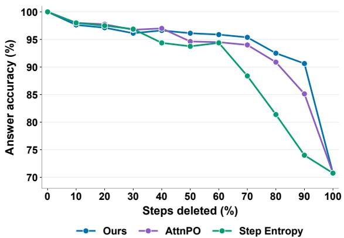
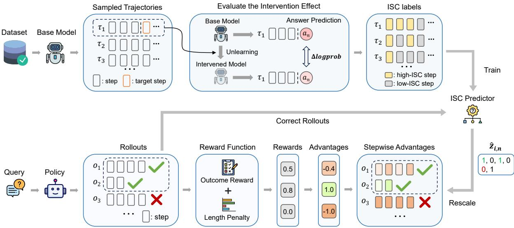
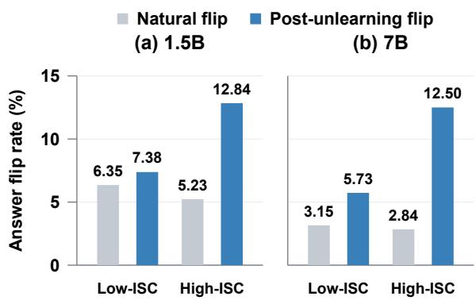
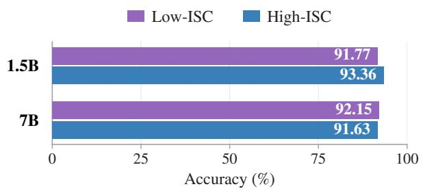
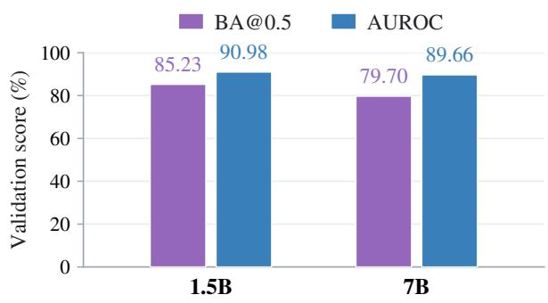
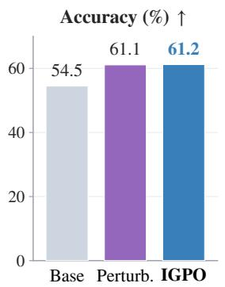
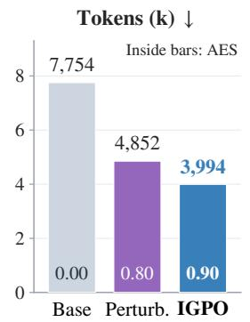
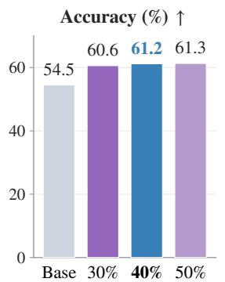
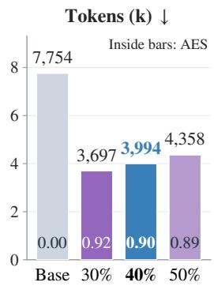
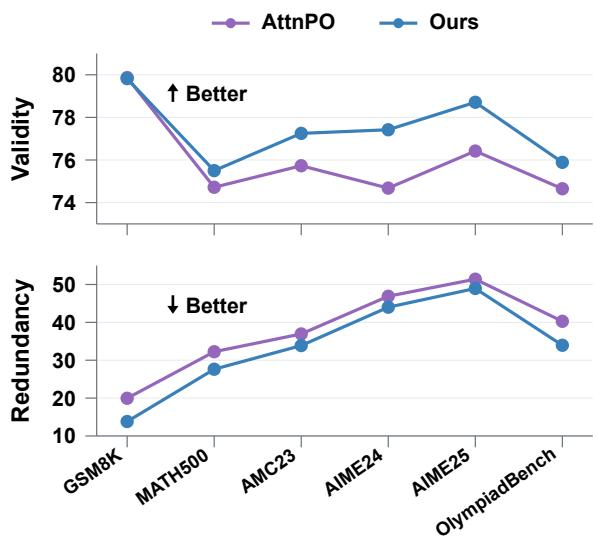

# Learning to Reason Efficiently with Interventional Step Credit

Guanda Li1 Xuefeng Bai1\* Yulong Chen2,3 Zhiyong Wang1 Kehai Chen1 Min Zhang1

1Harbin Institute of Technology, Shenzhen

2University of Aberdeen

3University of Cambridge

## Abstract

Large reasoning models often produce lengthy chain-of-thought (CoT) traces mixing useful intermediate steps with unnecessary ones. Recent methods explore step-level signals such as attention mass and step entropy to identify and suppress unnecessary steps. Despite their effectiveness, such signals reflect the model’s behavior at a step rather than that step’s contribution to the answer. To address this, we propose the interventional step credit (ISC), which takes a causal-intervention view and assesses step importance to the reasoning through targeted parameter-level interventions. Building on ISC, we further propose IGPO, which uses ISC to guide fine-grained advantage rescaling in reinforcement learning, reducing redundant steps while preserving the important ones. Experiments across two model scales and nine benchmarks show that IGPO achieves up to 62% average token reduction and better overall performance among compared methods.

## 1 Introduction

In recent years, large reasoning models have achieved strong performance on complex reasoning tasks by generating long chains of thought (CoT) that verify intermediate results, reflect on earlier steps, and explore alternative solutions (Wei et al., 2022; Guo et al., 2025). However, such traces often exhibit “overthinking”: they contain redundant computation in the form of repetitive derivations and unnecessary continuation, much of which substantially inflates inference cost while leaving the answer essentially unchanged (Chen et al., 2025b; Jiang et al., 2026).

A line of work seeks to suppress overthinking through reasoning budget control or lengthaware reinforcement learning, encouraging models to answer both correctly and concisely (Aggarwal and Welleck, 2025; Arora and Zanette,

  
Figure 1: Answer accuracy on DS-7B under post-hoc CoT pruning. Deleting low-scoring steps identified by ISC better preserves accuracy than compared methods.

2025; Luo et al., 2026; Hou et al., 2025; Liu et al., 2026). However, such trajectory-level control makes limited distinctions between necessary and redundant steps, potentially suppressing both and compromising accuracy (Nie et al., 2026). Recent work therefore introduces finer-grained supervision. Early-exit methods identify a stopping point through prefix sufficiency or the first occurrence of a correct answer (Dai et al., 2025; Tan et al., 2025; Yue et al., 2026), but leave redundancy within the retained prefix unresolved. Recent advances in step-level supervision score individual steps using attention mass (Nie et al., 2026), generation entropy (Li et al., 2026b) and mean token log-probability (Wang et al., 2026). These signals characterize the model’s behavior at a step rather than its dependence on that step for answer prediction: a low score does not reliably establish that suppressing the step will preserve the answer.

To address this, we propose interventional step credit (ISC), which takes a causal perspective on step importance through targeted parameter interventions. Simply applying text-level step perturbations can obscure this influence, as the model may compensate for them when regenerating subsequent reasoning (Tutek et al., 2025). We therefore probe this dependence through steptargeted parameter interventions, without regenerating subsequent reasoning. Specifically, we use preference-based unlearning (Zhang et al., 2024) to suppress the target step’s generation under its preceding prefix. With the prefix and the base model’s candidate answer fixed, ISC measures the magnitude of the resulting change in answer confidence. As shown in Figure 1, ISC generally achieves a more favorable accuracy–pruning frontier than attention mass (Nie et al., 2026) or step entropy (Li et al., 2026b) in post-hoc CoT pruning, particularly at high step-deletion ratios.

Building on ISC, we propose IGPO, which distills intervention-derived step-credit labels into an online step-level predictor and uses the predicted credit to guide stepwise advantage rescaling. For correct trajectories, IGPO attenuates the positive advantage of low-ISC steps and shields high-ISC steps from negative advantage. This selective rescaling discourages reinforcing redundant reasoning while protecting important steps, enabling the model to produce shorter reasoning traces while maintaining strong task performance.

We evaluate the proposed method on two representative LLMs across nine benchmarks. Experimental results show that IGPO reduces average response length by up to 62.0% while improving macro-average accuracy by up to 8.4 pp over base models. IGPO also achieves the highest macro-average accuracy and efficiency score among the compared methods at two model scales. Further analysis shows that IGPO generates more concise CoT with more reliable computations and logical deductions than compared methods.

Our main contributions are as follows:

• We introduce ISC, a causal formulation of step importance grounded in targeted parameterlevel interventions.

• We propose IGPO, which employs ISC to selectively rescale stepwise advantages, targeting redundant steps while protecting important steps.

• Experiments show that ISC improves the accuracy–length trade-off in post-hoc CoT pruning, while IGPO reduces reasoning costs and improves task performance.

## 2 Related Work

Efficient Reasoning. Existing methods are broadly categorized as training-free and trainingbased. Training-free methods reduce inference costs through budget control, early termination, or CoT pruning (Han et al., 2025; Yang et al., 2026; Choi et al., 2025; Huang et al., 2026a). Training-based methods use trajectory-level policy optimization (Arora and Zanette, 2025; Aggarwal and Welleck, 2025; Liu et al., 2026; Wu et al., 2025; Huang et al., 2026b) or finer-grained policy optimization (Dai et al., 2025; Li et al., 2026a; Nie et al., 2026; Xu et al., 2026). Our work uses intervention-derived step credit to guide advantage rescaling and selectively discourage redundant reasoning.

Step Importance Assessment. Prior work assesses reasoning-step importance through answer position, prefix-conditioned performance, or model-internal signals. Answer-position methods use the first correct answer as a stopping boundary, leaving redundancy within the retained prefix unresolved (Cheng et al., 2026; Jiang et al., 2026; Tan et al., 2025). Prefix-based methods evaluate progress toward the ground-truth answer (Kazemnejad et al., 2025; Setlur et al., 2025; Dai et al., 2025; Yue et al., 2026; Li et al., 2026a; Wu et al., 2026), but may undervalue preparatory steps whose contributions have not yet improved answer predictions. Recent advances introduce step scores based on attention, generation entropy, and token-level confidence (Nie et al., 2026; Li et al., 2026b; Wang et al., 2026). These signals characterize model behavior rather than directly measuring its dependence on a step for answer prediction. Most related to us, SWAP (Li et al., 2026a) and SPAE (Wu et al., 2026) use answer predictions to assess each step’s contribution to reasoning progress. ISC instead assesses how answer prediction depends on the target step through parameter intervention, while holding the prefix and the answer fixed. This directly captures the target step’s causal effect on the reasoning state, revealing the true value of preparatory steps.

Interventions on Reasoning Steps. Prior work primarily uses text-level interventions, either perturbing steps and regenerating the continuation (Lanham et al., 2023; Bogdan et al., 2025; Yu et al., 2025; Ruan et al., 2025), or deleting text units and measuring prediction changes conditioned on the remaining CoT, as in SCPO (He et al., 2025), AttriCoT (Wei et al., 2026), and LIMOPro (Xiao et al., 2025). However, regenerated continuations may compensate for perturbations through correction or alternative reasoning, while retained downstream steps may still carry information supplied by the deleted step. Li et al. (2026c) intervene on steps by modifying hidden states. FUR (Tutek et al., 2025) uses parameter interventions to assess the parametric faithfulness of reasoning steps through prediction changes in a no-CoT setting. However, a mathematical reasoning step’s role often depends on previously accumulated information, which no-CoT evaluation may not fully capture. We follow the key idea of FUR but evaluate answer confidence under the fixed prefix preceding the target step, without regenerating subsequent reasoning. ISC thus assesses prefix-conditioned step influence rather than no-CoT parametric faithfulness.

## 3 Interventional Step Credit

We introduce interventional step credit (ISC) to assess the influence of a reasoning step through targeted parameter interventions. We formulate each reasoning step’s causal contribution to the answer (§3.1), then estimate ISC from interventioninduced changes in answer confidence (§3.2).

## 3.1 Causal Formulation of Step Importance

Given a question $q ,$ the model generates a response $o = \left( \tau , \mathcal { F } \right)$ , where $\boldsymbol { \tau } = ( s _ { 1 } , \ldots , s _ { N } )$ denotes a reasoning trajectory of N steps and $\mathcal { F }$ denotes the final solution. For the n-th step $s _ { n } .$ we define its preceding reasoning prefix as $h _ { n } =$ $( q , s _ { 1 } , \ldots , s _ { n - 1 } )$ . We use |o| to denote the number of tokens in the complete response. Given $h _ { n } .$ we examine the causal dependence of the model’s answer prediction on the computation underlying step $s _ { n }$ . Specifically, we assume that after processing the reasoning prefix $h _ { n }$ , the model has formed a latent prediction of the next reasoning step ${ \tilde { s } } _ { n }$ and an anticipated subsequent reasoning trajectory $\boldsymbol { \tilde { s } } _ { > n } .$ . The actual step $s _ { n }$ is the verbalized realization of ${ \tilde { s } } _ { n } ,$ while the anticipated subsequent reasoning ${ \tilde { s } } _ { > n }$ supports the model’s answer prediction $\hat { a } _ { n }$ under prefix $h _ { n }$ . We use two idealized causal structures to describe how $\tilde { s } _ { n }$ influences answer prediction through subsequent reasoning.

In the first structure, ${ \tilde { s } } _ { n }$ is verbalized as $s _ { n }$ and further shapes the model’s anticipated subsequent reasoning ${ \tilde { s } } _ { > n }$ and answer prediction ${ \hat { a } } _ { n } .$

$$
\begin{array} { l c c c c c c c c c c c c c c c c c c c c c c c c } { { h _ { n } } } & { { \longrightarrow } } & { { \tilde { s } _ { n } } } & { { \longrightarrow } } & { { \tilde { s } _ { > n } } } & { { \longrightarrow } } & { { \hat { a } _ { n } } } & { { } } & { { } } & { { } } & { { } } & { { } } & { { } } & { { } } & { { } } & { { } } & { { } } & { { } } & { { } } & { { } } & { { } } & { { } } & { { } } & { { } } & { { } } & { { } } & { { } } & { { } } & { { } } & { { } } & { { } } & { { } } & { { } } & { { } } & { { } } & { { } } & { { } } & { { } } & { { } } & { { } } & { { } } & { { } } & { { } } & { { } } & { { } } & { { } } & { { } } & { { } } & { { } } & { { } } & { { } } & { { } } & { { } } & { { } } & { { } } & { { } } & { { } { } } & { { } } & { { } } & { { } { } } & { { } } & { { } } & { { } { } } & { { } } & { { } { } } & { { } } & { { } { } } & { { } } & { { } { } } & { { } } & { { } { } } & { { } } & { { } { } } & { { } } & { { } { } } & { { } } & { { } { } } & { { } } & { { } { } } & { { } } & { { } { } } & { { } } & { { } { } } & { { } } &  { } { } & { } { } & { { } } & { { } } & { { } } & { { } } & { { } } & { { } } & { { } } & { { } } & { { } } & { { } } & { { } } & { { } } & { { } } & { { } }  \end{array}\tag{1}
$$

In the second structure, ${ \tilde { s } } _ { n }$ is still verbalized as $s _ { n } .$ , while the anticipated subsequent reasoning $\tilde { s } _ { > n }$ and answer prediction $\hat { a } _ { n }$ are driven primarily by the information in $h _ { n }$ :

$$
\begin{array} { r c l l } { { h _ { n } } } & { { \longrightarrow } } & { { \tilde { s } _ { > n } } } & { { \longrightarrow } } & { { \hat { a } _ { n } } } \\ { { \downarrow } } & { { } } & { { } } & { { } } \\ { { \tilde { s } _ { n } } } & { { \longrightarrow } } & { { s _ { n } } } & { { \longrightarrow } } & { { \hat { a } _ { n } } } \end{array}\tag{2}
$$

From this causal perspective, we characterize step importance by whether the computation underlying a step mediates the model’s answer prediction. In the next subsection, we measure this influence through intervention and quantify it as Interventional Step Credit (ISC). Intervening on the computation underlying an important step should induce a substantial change in answer prediction, yielding high ISC.

## 3.2 ISC Estimation

Step-Targeted Parameter Intervention. We implement step-targeted parameter interventions by unlearning the entire step $s _ { n }$ conditioned on $h _ { n } ,$ using the NPO+KL algorithm employed in FUR (Tutek et al., 2025). The NPO term (Zhang et al., 2024) reduces the probability of generating $s _ { n }$ , thereby approximately suppressing its underlying latent computation $\tilde { s } _ { n }$ . The KL term regularizes predictions toward those of the base model on a retain set $\mathcal { D } _ { \mathrm { R T } }$ drawn from other reasoning trajectories. We minimize the joint objective:

$$
\begin{array} { r } { \mathcal { L } _ { \mathrm { U } } ^ { ( n ) } ( \theta ) = \mathcal { L } _ { \mathrm { N P O } } ^ { ( n ) } ( \theta ) + \lambda _ { \mathrm { K L } } \mathcal { L } _ { \mathrm { K L } } ( \theta ) , } \end{array}\tag{3}
$$

where $\lambda _ { \mathrm { K L } }$ controls the strength of retain regularization. Both loss terms are detailed in $\mathsf { A p - }$ pendix A.3. For each step, we independently update the base parameters $\theta _ { 0 }$ to obtain $\theta ^ { ( - n ) }$

Measuring the Intervention Effect. For a target step $s _ { n }$ , we prompt the base model $\pi _ { \theta _ { 0 } }$ to answer directly given the reasoning prefix $h _ { n } .$ yielding $a _ { n }$ . Keeping both $h _ { n }$ and $a _ { n }$ fixed, we then evaluate the confidence assigned to $a _ { n }$ by the base model $\pi _ { \theta _ { 0 } }$ and the intervened model $\pi _ { \theta ^ { ( - n ) } }$ . We avoid regenerating subsequent reasoning to isolate the intervention effect from changes in reasoning paths and contexts. Suppose that $a _ { n }$ consists of $T _ { n }$ tokens. We use its average log-probability as the model’s confidence in the answer:

  
Figure 2: The overall framework of ISC and IGPO

$$
\ell _ { \theta } ( a _ { n } | h _ { n } ) = \frac { 1 } { T _ { n } } \sum _ { t = 1 } ^ { T _ { n } } \log \pi _ { \theta } ( a _ { n , t } | h _ { n } , a _ { n , < t } ) ,\tag{4}
$$

where $a _ { n , t }$ denotes the t-th token of $a _ { n }$ . We define the ISC of $s _ { n }$ as the magnitude of the interventioninduced change in answer confidence:

$$
c _ { n } = \left| \ell _ { \theta _ { 0 } } ( a _ { n } \mid h _ { n } ) - \ell _ { \theta ^ { ( - n ) } } ( a _ { n } \mid h _ { n } ) \right| .\tag{5}
$$

## 4 IGPO: ISC-Guided Policy Optimization

IGPO turns ISC into step-level supervision for efficient reasoning. We construct binary ISC labels and distill them into a step-level predictor (§4.1). The predicted credit guides stepwise advantage rescaling during reinforcement learning (§4.2).

## 4.1 ISC Labeling and Distillation

To avoid costly online parameter interventions, we distill offline ISC labels into a step-level predictor.

ISC Labeling. For K annotation trajectories, let $N _ { i }$ be the number of steps in trajectory i and $c _ { i , n }$ the ISC of its n-th step. We pool ISC values from all steps across all trajectories into $\mathcal { C } = \{ c _ { i , n } \}$ and label the global top $\rho$ fraction as high-ISC:

$$
z _ { i , n } = \mathbb { I } \left[ c _ { i , n } \geq Q _ { 1 - \rho } ( \mathcal { C } ) \right] ,\tag{6}
$$

where $\rho \in ( 0 , 1 ) , Q _ { 1 - \rho }$ denotes the corresponding quantile, and $z _ { i , n } = 1$ indicates a high-ISC step.

ISC Prediction. A causal LM with a shared classification head predicts $p _ { i , n } = g _ { \phi } ( h _ { i , n } , s _ { i , n } )$ the probability that a completed step $s _ { i , n }$ is high-ISC given its prefix $h _ { i , n } .$ . We train the predictor with binary cross-entropy, averaging the loss over steps within each trajectory and then across trajectories (Appendix A.4). During policy optimization, we use $\widehat { z } _ { i , n } = \mathbb { I } [ p _ { i , n } \geq \eta ]$ to identify highbISC steps, where η is the prediction threshold.

## 4.2 ISC-Guided Policy Optimization

We use predicted ISC to guide length-aware reinforcement learning. We adopt a trajectory-level reward that combines answer correctness with a relative length penalty and perform stepwise advantage rescaling according to the predicted ISC.

Trajectory-Level Reward and Advantage Estimation. Given a question $q ,$ the old policy $\pi _ { \psi _ { \mathrm { o l d } } }$ samples a group of G rollouts $\{ o _ { i } \} _ { i = 1 } ^ { G }$ . Following TLMRE (Arora and Zanette, 2025), we define a trajectory-level reward that combines answer correctness with a relative length penalty:

$$
r _ { i } = \mathbb { I } [ o _ { i } { \mathrm { i s ~ c o r r e c t } } ] \left( 1 - \alpha \sigma ( f ( o _ { i } ) ) \right) ,\tag{7}
$$

$$
f ( o _ { i } ) = { \frac { | o _ { i } | - \operatorname* { m e a n } ( q ) } { \operatorname* { s t d } ( q ) } } ,\tag{8}
$$

where $\left| o _ { i } \right|$ denotes the response length, mean(q) and std(q) denote the mean and standard deviation of the lengths of correct rollouts for question q, respectively, $\sigma ( \cdot )$ is the sigmoid function, and α controls the strength of the length penalty. Based on these trajectory-level rewards, we estimate the

advantage using RLOO:

$$
A _ { i } = r _ { i } - \frac { 1 } { G - 1 } \sum _ { j \neq i } r _ { j } .\tag{9}
$$

The trajectory-level advantage $A _ { i }$ is shared across all reasoning steps. To focus length optimization on low-ISC steps while protecting high-ISC steps, we introduce stepwise advantage rescaling.

ISC-Guided Advantage Rescaling. We apply stepwise advantage rescaling only to correct rollouts, using predicted ISC labels $\widehat { z } _ { i , n }$ . Incorrect brollouts retain the original trajectory-level advantage $A _ { i }$ . For positive advantages, we attenuate the positive updates assigned to low-ISC steps to avoid reinforcing redundant reasoning. Conversely, for negative advantages, we suppress the negative updates on high-ISC steps to protect essential reasoning from excessive length penalties. We set $\widetilde { A } _ { i , n } = \gamma _ { i , n } A _ { i }$ with

$$
\gamma _ { i , n } = \left\{ \begin{array} { l l } { \delta , } & { A _ { i } > 0 , \widehat { z } _ { i , n } = 0 , } \\ { 0 , } & { A _ { i } < 0 , \widehat { z } _ { i , n } = 1 , } \\ { 1 , } & { \mathrm { o t h e r w i s e } . } \end{array} \right.\tag{10}
$$

Here, $\delta \in [ 0 , 1 ]$ scales positive advantages for low-ISC steps. Since $\gamma _ { i , n } ~ \geq ~ 0$ , rescaling does not reverse their signs. Each token in $s _ { i , n }$ receives $\tilde { A } _ { i , n }$ , yielding token-level advantages ${ \mathrm { \varLambda } } _ { i , t }$ for the clipped policy objective (Appendix A.5).

## 5 Experiments

## 5.1 Experimental Setup

Training. We train DeepSeek-R1-Distill-Qwen-1.5B (DS-1.5B) and DeepSeek-R1-Distill-Qwen-7B (DS-7B) (Guo et al., 2025) with IGPO on the DeepScaleR dataset (Luo et al., 2025) using the VERL framework (Sheng et al., 2025). We set $\alpha = 0 . 1 5$ for both models (Eq. 7), with $\delta = 0 . 7$ for DS-1.5B and $\delta = 0 . 5$ for DS-7B.

Evaluation. We evaluate on six in-domain reasoning benchmarks: GSM8K (Cobbe et al., 2021), MATH500 (Lightman et al., 2024), AMC23 (math-ai, 2025), OlympiadBench (He et al., 2024), AIME2024, and AIME2025 (Mathematical Association of America, 2024, 2025). In addition, we report performance on three OOD benchmarks: LiveCodeBench-v6 (Jain et al., 2025), GPQA-Diamond (Rein et al., 2024), and MMLU (Hendrycks et al., 2021), covering math, coding, and science tasks of varying difficulty. To obtain more reliable estimates, we evaluate each problem 128 times on AIME2024 and AIME2025 and four times on other benchmarks, and report the average performance. We report Pass@1 (Acc.), response length (Tok.), and compute the Accuracy–Efficiency Score (AES) (Luo et al., 2026) to summarize the accuracy–length trade-off.

Baselines. We compare against three categories of efficient reasoning methods: (1) adaptive reasoning methods, including AdaptThink (Zhang et al., 2025), AutoThink (Tu et al., 2025), and DEER (Yang et al., 2026), included for reference; (2) outcome-supervised RL methods, including TLMRE (Arora and Zanette, 2025), ThinkPrune (Hou et al., 2025), DIET (Chen et al., 2025a), ACPO (Cheng et al., 2025), LASER (Liu et al., 2026) (LASER-D and LASER-DE), SmartThinker (Hu et al., 2026), and Step Entropy (Li et al., 2026b); and (3) processsupervised RL methods, including LC-R1 (Cheng et al., 2026), VSRM-R++ (Yue et al., 2026), S-GRPO (Dai et al., 2025), DEPO (Tan et al., 2025), DECS (Jiang et al., 2026), SWAP (Li et al., 2026a), SPAE (Wu et al., 2026), and AttnPO (Nie et al., 2026).

ISC Annotation and Distillation. For each model, we generate 1,000 correct trajectories on DeepScaleR for ISC annotation and construct binary labels using $\rho \ = \ 0 . 4$ (Eq. 6). We train an ISC predictor based on Qwen3-4B-Instruct-2507 (Qwen Team, 2025) on 900 trajectories and reserve 100 for validation. Implementation details are provided in Appendices A and B.

## 5.2 ISC Evaluation

We evaluate ISC through post-hoc CoT pruning, answer-sensitivity analysis, and checks for nontarget intervention effects.

Post-hoc CoT pruning. We assess whether ISC identifies steps that can be removed while preserving answer accuracy. We sample 50 correct trajectories generated by DS-7B on DeepScaleR-Preview. Following Li et al. 2026b, we remove increasing fractions of the lowest-scoring steps under ISC, AttnPO, and Step Entropy, and evaluate answer accuracy conditioned on the remaining CoT. We always mask the final-answer step to prevent direct answer reuse. Figure 1 shows that ISC better preserves accuracy under aggressive pruning, supporting its usefulness for identifying removable reasoning steps.

Figure 3: Natural and post-unlearning answer flip rates for low- and high-ISC steps on the 1.5B and 7B models.  
  
Figure 4: Accuracy on unrelated questions after unlearning low- and high-ISC steps in the 1.5/7B models.

Discriminative Ability of ISC. We randomly sample 100 annotated trajectories and select one high-ISC and one low-ISC step from each. For each step, we compare four base-model and four intervened-model completions against four basemodel reference completions under the same prefix. We define the excess flip rate as the postunlearning flip rate minus the base model’s natural flip rate. As shown in Figure 3, high-ISC interventions yield much larger excess flip rates than low-ISC interventions at both model scales, demonstrating ISC’s ability to identify steps whose unlearning more strongly affects answer predictions.

Assessing Potential Confounds. To rule out potential confounding effects, we sample 25 unrelated problems answered correctly in all four sampled base-model responses. For each intervened model, we sample four responses per problem and average accuracy within each ISC group. Figure 4 shows similar accuracy between high-ISC and low-ISC interventions at both model scales. These results suggest that the larger answer changes after high-ISC interventions are not simply due to greater overall capability degradation.

  
Figure 5: Predictor performance on the validation set for labels derived from the 1.5B/7B models. BA@0.5 denotes balanced accuracy at a threshold of 0.5.

ISC Predictor Evaluation. We train the ISC predictor for 10 epochs and select the checkpoint with the highest balanced accuracy on 100 heldout validation trajectories for policy optimization. Figure 5 reports BA@0.5 and AUROC, showing discrimination between high- and low-ISC steps on labels derived from both model scales.

## 5.3 Effectiveness of IGPO

Main Results. Table 1 compares IGPO with existing efficient reasoning methods across six mathematical reasoning benchmarks. IGPO achieves the highest macro-average accuracy and AES among the compared methods at both model scales. Relative to the base models, it reduces average response length by up to 62% while improving accuracy. Compared with AttnPO and TLMRE, IGPO achieves a better overall accuracy–efficiency trade-off on DS-1.5B. Its advantage is more pronounced on DS-7B, where it improves macro-average accuracy while substantially reducing average response length, producing shorter responses than both baselines on all six benchmarks. In addition, on the challenging AIME2025 benchmark, where existing baselines struggle to balance accuracy and reasoning cost, IGPO substantially improves this trade-off on DS-7B, achieving an AES of 0.97 versus 0.60 for the best baseline. Overall, these results suggest that our approach achieves a favorable trade-off between reasoning efficiency and task performance.

OOD Generalization. Table 2 shows that IGPO’s efficiency gains extend beyond mathematical reasoning, reducing response length by 35.3– 61.2% across all three OOD benchmarks and both model scales. These savings accompany improved performance on DS-1.5B and largely preserved performance on DS-7B, with a 1.3 pp decrease on GPQA.1 All settings achieve positive AES, indicating favorable accuracy–efficiency trade-offs beyond the training domain.

<table><tr><td rowspan=1 colspan=22>GSM8K       MATH500      AMC2023      Olympiad      AIME2024      AIME2025     Macro AvgMethodsAcc.Tok.AESAcc.Tok.AESAcc.Tok.AESAcc.Tok. AESAcc.  Tok.AESAcc.  Tok.AESAcc.Tok.AES</td></tr><tr><td rowspan=1 colspan=22>1.5B Model</td></tr><tr><td rowspan=1 colspan=4>DS-1.5B       78.910180.00</td><td rowspan=1 colspan=3>81.7 46700.00</td><td rowspan=1 colspan=3>67.573560.00</td><td rowspan=1 colspan=3>48.6 90660.00</td><td rowspan=1 colspan=3>27.612327 0.00</td><td rowspan=1 colspan=6>22.9120860.0054.577540.00</td></tr><tr><td rowspan=1 colspan=4> AutoThink   83.0 5680.60</td><td rowspan=1 colspan=3>84.021950.62</td><td rowspan=1 colspan=3>67.050590.28</td><td rowspan=1 colspan=3>51.650530.63</td><td rowspan=1 colspan=3>34.6 95140.99</td><td rowspan=1 colspan=3>21.8 79440.10</td><td rowspan=1 colspan=3>57.050560.54</td></tr><tr><td rowspan=1 colspan=4> AdaptThink  83.1 4800.69</td><td rowspan=1 colspan=2>82.01782</td><td rowspan=1 colspan=1>0.63</td><td rowspan=1 colspan=3>67.035100.49</td><td rowspan=1 colspan=3>50.837080.73</td><td rowspan=1 colspan=3>31.0 66700.83</td><td rowspan=1 colspan=3>23.072550.41</td><td rowspan=1 colspan=3>56.13901 0.63</td></tr><tr><td rowspan=1 colspan=3>DEER     74.7 984</td><td rowspan=1 colspan=1>-0.23</td><td rowspan=1 colspan=2>67.82497</td><td rowspan=1 colspan=1>-0.38</td><td rowspan=1 colspan=2>60.05496</td><td rowspan=1 colspan=1>-0.30</td><td rowspan=1 colspan=2>32.05960</td><td rowspan=1 colspan=1>-1.37</td><td rowspan=1 colspan=2>23.3 9557</td><td rowspan=1 colspan=1>-0.55</td><td rowspan=1 colspan=2>10.0 9281</td><td rowspan=1 colspan=1>-2.58</td><td rowspan=1 colspan=2>44.65629</td><td rowspan=1 colspan=1>-0.90</td></tr><tr><td rowspan=1 colspan=3>ThinkPrune  83.0 609</td><td rowspan=1 colspan=1>0.56</td><td rowspan=1 colspan=2>83.21938</td><td rowspan=1 colspan=1>0.64</td><td rowspan=1 colspan=2>73.23039</td><td rowspan=1 colspan=1>0.84</td><td rowspan=1 colspan=2>51.43535</td><td rowspan=1 colspan=1>0.78</td><td rowspan=1 colspan=2>27.1 5631</td><td rowspan=1 colspan=1>0.46</td><td rowspan=1 colspan=2>22.5 5167</td><td rowspan=1 colspan=1>0.49</td><td rowspan=1 colspan=2>56.73320</td><td rowspan=1 colspan=1>0.63</td></tr><tr><td rowspan=1 colspan=3>DIET</td><td rowspan=1 colspan=1>一</td><td rowspan=1 colspan=2>83.03061</td><td rowspan=1 colspan=1>0.39</td><td rowspan=1 colspan=2>65.46425</td><td rowspan=1 colspan=1>-0.03</td><td rowspan=1 colspan=2></td><td rowspan=1 colspan=1></td><td rowspan=1 colspan=2>31.810578</td><td rowspan=1 colspan=1>0.60</td><td rowspan=1 colspan=2></td><td rowspan=1 colspan=1></td><td rowspan=1 colspan=2></td><td rowspan=1 colspan=1></td></tr><tr><td rowspan=1 colspan=3>ACPO      81.3572</td><td rowspan=1 colspan=1>0.53</td><td rowspan=1 colspan=2>81.01679</td><td rowspan=1 colspan=1>0.60</td><td rowspan=1 colspan=2></td><td rowspan=1 colspan=1></td><td rowspan=1 colspan=2></td><td rowspan=1 colspan=1></td><td rowspan=1 colspan=3>30.0 66700.72</td><td rowspan=1 colspan=2></td><td rowspan=1 colspan=1></td><td rowspan=1 colspan=2></td><td rowspan=1 colspan=1></td></tr><tr><td rowspan=1 colspan=3>Laser-D     83.4863</td><td rowspan=1 colspan=1>0.33</td><td rowspan=1 colspan=2>84.21872</td><td rowspan=1 colspan=1>0.69</td><td rowspan=1 colspan=2>75.32981</td><td rowspan=1 colspan=1>0.94</td><td rowspan=1 colspan=1>54.4</td><td rowspan=1 colspan=1>4700</td><td rowspan=1 colspan=1>0.84</td><td rowspan=1 colspan=2>34.2 5750</td><td rowspan=1 colspan=1>1.25</td><td rowspan=1 colspan=2>23.1 6928</td><td rowspan=1 colspan=1>0.45</td><td rowspan=1 colspan=2>59.13849</td><td rowspan=1 colspan=1>0.75</td></tr><tr><td rowspan=1 colspan=3>Laser-DE    80.4 820</td><td rowspan=1 colspan=1>0.25</td><td rowspan=1 colspan=1>83.5</td><td rowspan=1 colspan=1>1949</td><td rowspan=1 colspan=1>0.65</td><td rowspan=1 colspan=2>73.33080</td><td rowspan=1 colspan=1>0.84</td><td rowspan=1 colspan=1>54.4</td><td rowspan=1 colspan=1>5151</td><td rowspan=1 colspan=1>0.79</td><td rowspan=1 colspan=2>35.0 5789</td><td rowspan=1 colspan=1>1.34</td><td rowspan=1 colspan=1>24.2</td><td rowspan=1 colspan=1>7323</td><td rowspan=1 colspan=1>0.57</td><td rowspan=1 colspan=2>58.54019</td><td rowspan=1 colspan=1>0.74</td></tr><tr><td rowspan=1 colspan=3>SmartThinker 79.0 697</td><td rowspan=1 colspan=1>0.32</td><td rowspan=1 colspan=1>82.0</td><td rowspan=1 colspan=1>2516</td><td rowspan=1 colspan=1>0.47</td><td rowspan=1 colspan=2>71.34022</td><td rowspan=1 colspan=1>0.62</td><td rowspan=1 colspan=1>52.5</td><td rowspan=1 colspan=1>4982</td><td rowspan=1 colspan=1>0.69</td><td rowspan=1 colspan=2>26.7 8022</td><td rowspan=1 colspan=1>0.19</td><td rowspan=1 colspan=1>21.4</td><td rowspan=1 colspan=1>7369</td><td rowspan=1 colspan=1>0.05</td><td rowspan=1 colspan=2>55.54601</td><td rowspan=1 colspan=1>0.39</td></tr><tr><td rowspan=1 colspan=2>LC-R1      82.7</td><td rowspan=1 colspan=1>841</td><td rowspan=1 colspan=1>0.32</td><td rowspan=1 colspan=1>82.5</td><td rowspan=1 colspan=1>2233</td><td rowspan=1 colspan=1>0.55</td><td rowspan=1 colspan=1>61.7</td><td rowspan=1 colspan=1>3947</td><td rowspan=1 colspan=1>0.03</td><td rowspan=1 colspan=1>48.1</td><td rowspan=1 colspan=1>4546</td><td rowspan=1 colspan=1>0.45</td><td rowspan=1 colspan=1>23.6</td><td rowspan=1 colspan=1>7122</td><td rowspan=1 colspan=1>-0.30</td><td rowspan=1 colspan=1>21.2</td><td rowspan=1 colspan=1>6434</td><td rowspan=1 colspan=1>0.10</td><td rowspan=1 colspan=2>53.34187</td><td rowspan=1 colspan=1>0.19</td></tr><tr><td rowspan=1 colspan=2>VSRM-R++</td><td rowspan=1 colspan=1></td><td rowspan=1 colspan=1></td><td rowspan=1 colspan=1>81.7</td><td rowspan=1 colspan=1>2597</td><td rowspan=1 colspan=1>0.45</td><td rowspan=1 colspan=1>64.7</td><td rowspan=1 colspan=1>4119</td><td rowspan=1 colspan=1>0.23</td><td rowspan=1 colspan=1>54.8</td><td rowspan=1 colspan=1>4388</td><td rowspan=1 colspan=1>0.90</td><td rowspan=1 colspan=1>29.5</td><td rowspan=1 colspan=1>6958</td><td rowspan=1 colspan=1>0.64</td><td rowspan=1 colspan=1>22.9</td><td rowspan=1 colspan=1>6892</td><td rowspan=1 colspan=1>0.43</td><td rowspan=1 colspan=2></td><td rowspan=1 colspan=1></td></tr><tr><td rowspan=1 colspan=2>DEPO</td><td rowspan=1 colspan=1></td><td rowspan=1 colspan=1></td><td rowspan=1 colspan=1>87.2</td><td rowspan=1 colspan=1>2762</td><td rowspan=1 colspan=1>0.61</td><td rowspan=1 colspan=1>74.2</td><td rowspan=1 colspan=1>4388</td><td rowspan=1 colspan=1>0.70</td><td rowspan=1 colspan=1></td><td rowspan=1 colspan=1></td><td rowspan=1 colspan=1></td><td rowspan=1 colspan=1>30.8</td><td rowspan=1 colspan=1>7732</td><td rowspan=1 colspan=1>0.72</td><td rowspan=1 colspan=1>24.8</td><td rowspan=1 colspan=1>7649</td><td rowspan=1 colspan=1>0.62</td><td rowspan=1 colspan=2></td><td rowspan=1 colspan=1></td></tr><tr><td rowspan=1 colspan=2>DECS</td><td rowspan=1 colspan=1></td><td rowspan=1 colspan=1></td><td rowspan=1 colspan=1>84.4</td><td rowspan=1 colspan=1>1817</td><td rowspan=1 colspan=1>0.71</td><td rowspan=1 colspan=1>75.4</td><td rowspan=1 colspan=1>2988</td><td rowspan=1 colspan=1>0.94</td><td rowspan=1 colspan=1>56.1</td><td rowspan=1 colspan=1>3396</td><td rowspan=1 colspan=1>1.09</td><td rowspan=1 colspan=2>31.2 5550</td><td rowspan=1 colspan=1>0.94</td><td rowspan=1 colspan=2>23.8 4965</td><td rowspan=1 colspan=1>0.71</td><td rowspan=1 colspan=2></td><td rowspan=1 colspan=1></td></tr><tr><td rowspan=1 colspan=2>SWAP</td><td rowspan=1 colspan=1></td><td rowspan=1 colspan=1></td><td rowspan=1 colspan=1>86.5</td><td rowspan=1 colspan=1>1597</td><td rowspan=1 colspan=1>0.84</td><td rowspan=1 colspan=1>78.3</td><td rowspan=1 colspan=1>2645</td><td rowspan=1 colspan=1>1.12</td><td rowspan=1 colspan=1>45.1</td><td rowspan=1 colspan=1>3646</td><td rowspan=1 colspan=1>0.24</td><td rowspan=1 colspan=2>33.9 4915</td><td rowspan=1 colspan=1>1.29</td><td rowspan=1 colspan=2>23.3 4627</td><td rowspan=1 colspan=1>0.67</td><td rowspan=1 colspan=2></td><td rowspan=1 colspan=1></td></tr><tr><td rowspan=1 colspan=2>TLMRE     87.2</td><td rowspan=1 colspan=1>604</td><td rowspan=1 colspan=1>0.72</td><td rowspan=1 colspan=1>85.8</td><td rowspan=1 colspan=1>1915</td><td rowspan=1 colspan=1>0.74</td><td rowspan=1 colspan=1>79.1</td><td rowspan=1 colspan=1>3349</td><td rowspan=1 colspan=1>1.06</td><td rowspan=1 colspan=1>56.9</td><td rowspan=1 colspan=1>4270</td><td rowspan=1 colspan=1>1.04</td><td rowspan=1 colspan=1>37.3</td><td rowspan=1 colspan=1>7024</td><td rowspan=1 colspan=1>1.49</td><td rowspan=1 colspan=1>26.6</td><td rowspan=1 colspan=1>7117</td><td rowspan=1 colspan=1>0.90</td><td rowspan=1 colspan=2>62.24046</td><td rowspan=1 colspan=1>0.99</td></tr><tr><td rowspan=1 colspan=2>AttnPO     87.0</td><td rowspan=1 colspan=1>393</td><td rowspan=1 colspan=1>0.92</td><td rowspan=1 colspan=1>86.0</td><td rowspan=1 colspan=1>1318</td><td rowspan=1 colspan=1>0.88</td><td rowspan=1 colspan=1>77.8</td><td rowspan=1 colspan=1>2638</td><td rowspan=1 colspan=1>1.10</td><td rowspan=1 colspan=1>57.1</td><td rowspan=1 colspan=1>3133</td><td rowspan=1 colspan=1>1.18</td><td rowspan=1 colspan=1>37.7</td><td rowspan=1 colspan=1>5713</td><td rowspan=1 colspan=1>1.64</td><td rowspan=1 colspan=1>25.4</td><td rowspan=1 colspan=1>5488</td><td rowspan=1 colspan=1>0.87</td><td rowspan=1 colspan=2>61.83114</td><td rowspan=1 colspan=1>1.10</td></tr><tr><td rowspan=1 colspan=3> Ours       87.4 586</td><td rowspan=1 colspan=1>0.75</td><td rowspan=1 colspan=1>86.5</td><td rowspan=1 colspan=1>1662</td><td rowspan=1 colspan=1>0.82</td><td rowspan=1 colspan=1>81.5</td><td rowspan=1 colspan=1>2798</td><td rowspan=1 colspan=1>1.24</td><td rowspan=1 colspan=1>57.7</td><td rowspan=1 colspan=1>3359</td><td rowspan=1 colspan=1>1.19</td><td rowspan=1 colspan=1>37.7</td><td rowspan=1 colspan=1>6027</td><td rowspan=1 colspan=1>1.61</td><td rowspan=1 colspan=2>26.6 5481</td><td rowspan=1 colspan=1>1.03</td><td rowspan=1 colspan=2>62.93319</td><td rowspan=1 colspan=1>1.11</td></tr><tr><td rowspan=1 colspan=3></td><td rowspan=1 colspan=1></td><td rowspan=1 colspan=2></td><td rowspan=1 colspan=1></td><td rowspan=1 colspan=1></td><td rowspan=1 colspan=1></td><td rowspan=1 colspan=1>7B M</td><td rowspan=1 colspan=3>odel</td><td rowspan=1 colspan=2></td><td rowspan=1 colspan=6></td><td rowspan=1 colspan=1></td></tr><tr><td rowspan=1 colspan=2>DS-7B        87.5</td><td rowspan=1 colspan=1>676</td><td rowspan=1 colspan=1>0.00</td><td rowspan=1 colspan=2>90.83713</td><td rowspan=1 colspan=1>0.00</td><td rowspan=1 colspan=2>85.05963</td><td rowspan=1 colspan=1>0.00</td><td rowspan=1 colspan=1>64.4</td><td rowspan=1 colspan=1>7363</td><td rowspan=1 colspan=1>0.00</td><td rowspan=1 colspan=2>51.510485</td><td rowspan=1 colspan=1>0.00</td><td rowspan=1 colspan=2>37.111140</td><td rowspan=1 colspan=3>0.0069.46557</td><td rowspan=1 colspan=1>0.00</td></tr><tr><td rowspan=1 colspan=2> AutoThink   91.1</td><td rowspan=1 colspan=1>866</td><td rowspan=1 colspan=1>-0.16</td><td rowspan=1 colspan=1>91.2</td><td rowspan=1 colspan=1>2146</td><td rowspan=1 colspan=1>0.44</td><td rowspan=1 colspan=1>83.3</td><td rowspan=1 colspan=1>4645</td><td rowspan=1 colspan=1>0.12</td><td rowspan=1 colspan=1>65.5</td><td rowspan=1 colspan=1>5133</td><td rowspan=1 colspan=1>0.35</td><td rowspan=1 colspan=1>54.8</td><td rowspan=1 colspan=1>8051</td><td rowspan=1 colspan=1>0.42</td><td rowspan=1 colspan=2>36.28608</td><td rowspan=1 colspan=1>0.11</td><td rowspan=1 colspan=2>70.44908</td><td rowspan=1 colspan=1>0.21</td></tr><tr><td rowspan=1 colspan=2>AdaptThink  91.0</td><td rowspan=1 colspan=1>309</td><td rowspan=1 colspan=1>0.66</td><td rowspan=1 colspan=1>92.0</td><td rowspan=1 colspan=1>1875</td><td rowspan=1 colspan=1>0.54</td><td rowspan=1 colspan=1>87.5</td><td rowspan=1 colspan=1>3287</td><td rowspan=1 colspan=1>0.54</td><td rowspan=1 colspan=1>65.5</td><td rowspan=1 colspan=1>5574</td><td rowspan=1 colspan=1>0.29</td><td rowspan=1 colspan=1>55.6</td><td rowspan=1 colspan=1>8599</td><td rowspan=1 colspan=1>0.42</td><td rowspan=1 colspan=2>36.2 9523</td><td rowspan=1 colspan=1>0.03</td><td rowspan=1 colspan=2>71.34861</td><td rowspan=1 colspan=1>0.41</td></tr><tr><td rowspan=1 colspan=2>DEER     90.6</td><td rowspan=1 colspan=1>917</td><td rowspan=1 colspan=1>-0.25</td><td rowspan=1 colspan=1>89.8</td><td rowspan=1 colspan=1>2143</td><td rowspan=1 colspan=1>0.37</td><td rowspan=1 colspan=1>85.0</td><td rowspan=1 colspan=1>4451</td><td rowspan=1 colspan=1>0.25</td><td rowspan=1 colspan=1>52.6</td><td rowspan=1 colspan=1>5420</td><td rowspan=1 colspan=1>-0.65</td><td rowspan=1 colspan=1>49.2</td><td rowspan=1 colspan=1>9839</td><td rowspan=1 colspan=1>-0.16</td><td rowspan=1 colspan=2>36.7 7257</td><td rowspan=1 colspan=1>0.30</td><td rowspan=1 colspan=2>67.35005</td><td rowspan=1 colspan=1>-0.02</td></tr><tr><td rowspan=1 colspan=2>DIET</td><td rowspan=1 colspan=1></td><td rowspan=1 colspan=1>一</td><td rowspan=1 colspan=1>92.1</td><td rowspan=1 colspan=1>3187</td><td rowspan=1 colspan=1>0.19</td><td rowspan=1 colspan=1>82.6</td><td rowspan=1 colspan=1>6075</td><td rowspan=1 colspan=1>-0.16</td><td rowspan=1 colspan=1></td><td rowspan=1 colspan=1></td><td rowspan=1 colspan=1></td><td rowspan=1 colspan=1>57.9</td><td rowspan=1 colspan=1>10124</td><td rowspan=1 colspan=1>0.41</td><td rowspan=1 colspan=2></td><td rowspan=1 colspan=1></td><td rowspan=1 colspan=2></td><td rowspan=1 colspan=1></td></tr><tr><td rowspan=1 colspan=1>ACPO</td><td rowspan=1 colspan=1>88.3</td><td rowspan=1 colspan=1>413</td><td rowspan=1 colspan=1>0.42</td><td rowspan=1 colspan=1>91.6</td><td rowspan=1 colspan=1>1405</td><td rowspan=1 colspan=1>0.65</td><td rowspan=1 colspan=1></td><td rowspan=1 colspan=1></td><td rowspan=1 colspan=1></td><td rowspan=1 colspan=1></td><td rowspan=1 colspan=1></td><td rowspan=1 colspan=1></td><td rowspan=1 colspan=1>52.8</td><td rowspan=1 colspan=1>4520</td><td rowspan=1 colspan=1>0.64</td><td rowspan=1 colspan=1></td><td rowspan=1 colspan=1></td><td rowspan=1 colspan=1></td><td rowspan=1 colspan=1></td><td rowspan=1 colspan=1></td><td rowspan=1 colspan=1></td></tr><tr><td rowspan=1 colspan=1>Laser-D</td><td rowspan=1 colspan=1>87.3</td><td rowspan=1 colspan=1>804</td><td rowspan=1 colspan=1>-0.20</td><td rowspan=1 colspan=1>92.2</td><td rowspan=1 colspan=1>1836</td><td rowspan=1 colspan=1>0.55</td><td rowspan=1 colspan=1>90.0</td><td rowspan=1 colspan=1>2694</td><td rowspan=1 colspan=1>0.72</td><td rowspan=1 colspan=1>66.7</td><td rowspan=1 colspan=1>3914</td><td rowspan=1 colspan=1>0.58</td><td rowspan=1 colspan=1>58.3</td><td rowspan=1 colspan=1>5379</td><td rowspan=1 colspan=1>0.88</td><td rowspan=1 colspan=1>38.0</td><td rowspan=1 colspan=1>6167</td><td rowspan=1 colspan=1>0.52</td><td rowspan=1 colspan=1>72.1</td><td rowspan=1 colspan=1>3466</td><td rowspan=1 colspan=1>0.51</td></tr><tr><td rowspan=1 colspan=1>Laser-DE</td><td rowspan=1 colspan=1>82.2</td><td rowspan=1 colspan=1>789</td><td rowspan=1 colspan=1>-0.47</td><td rowspan=1 colspan=1>92.0</td><td rowspan=1 colspan=1>1658</td><td rowspan=1 colspan=1>0.59</td><td rowspan=1 colspan=1>89.1</td><td rowspan=1 colspan=1>2612</td><td rowspan=1 colspan=1>0.71</td><td rowspan=1 colspan=1>66.8</td><td rowspan=1 colspan=1>3643</td><td rowspan=1 colspan=1>0.62</td><td rowspan=1 colspan=1>55.8</td><td rowspan=1 colspan=1>4969</td><td rowspan=1 colspan=1>0.78</td><td rowspan=1 colspan=1>37.5</td><td rowspan=1 colspan=1>6077</td><td rowspan=1 colspan=1>0.49</td><td rowspan=1 colspan=1>70.6</td><td rowspan=1 colspan=1>3291</td><td rowspan=1 colspan=1>0.45</td></tr><tr><td rowspan=1 colspan=2>SmartThinker</td><td rowspan=1 colspan=1></td><td rowspan=1 colspan=1></td><td rowspan=1 colspan=1>93.0</td><td rowspan=1 colspan=1>2753</td><td rowspan=1 colspan=1>0.33</td><td rowspan=1 colspan=1>90.0</td><td rowspan=1 colspan=1>4118</td><td rowspan=1 colspan=1>0.49</td><td rowspan=1 colspan=1></td><td rowspan=1 colspan=1></td><td rowspan=1 colspan=1></td><td rowspan=1 colspan=1></td><td rowspan=1 colspan=1></td><td rowspan=1 colspan=1></td><td rowspan=1 colspan=1>40.8</td><td rowspan=1 colspan=1>9277</td><td rowspan=1 colspan=1>0.47</td><td rowspan=1 colspan=2></td><td rowspan=1 colspan=1></td></tr><tr><td rowspan=1 colspan=2>Step Entropy†79.2</td><td rowspan=1 colspan=1>168</td><td rowspan=1 colspan=1>0.28</td><td rowspan=1 colspan=1>85.0</td><td rowspan=1 colspan=1>2439</td><td rowspan=1 colspan=1>0.03</td><td rowspan=1 colspan=1></td><td rowspan=1 colspan=1></td><td rowspan=1 colspan=1></td><td rowspan=1 colspan=1></td><td rowspan=1 colspan=1></td><td rowspan=1 colspan=1></td><td rowspan=1 colspan=1>57.1</td><td rowspan=1 colspan=1>6839</td><td rowspan=1 colspan=1>0.68</td><td rowspan=1 colspan=1>33.3</td><td rowspan=1 colspan=1>10750</td><td rowspan=1 colspan=1>-0.47</td><td rowspan=1 colspan=2></td><td rowspan=1 colspan=1></td></tr><tr><td rowspan=1 colspan=2>LC-R1      88.1</td><td rowspan=1 colspan=1>450</td><td rowspan=1 colspan=1>0.36</td><td rowspan=1 colspan=1>90.4</td><td rowspan=1 colspan=1>1568</td><td rowspan=1 colspan=1>0.56</td><td rowspan=1 colspan=1>79.1</td><td rowspan=1 colspan=1>3453</td><td rowspan=1 colspan=1>0.07</td><td rowspan=1 colspan=1>64.1</td><td rowspan=1 colspan=1>4144</td><td rowspan=1 colspan=1>0.41</td><td rowspan=1 colspan=1>23.6</td><td rowspan=1 colspan=1>6904</td><td rowspan=1 colspan=1>-2.37</td><td rowspan=1 colspan=1>36.2</td><td rowspan=1 colspan=1>7150</td><td rowspan=1 colspan=1>0.24</td><td rowspan=1 colspan=2>63.63945</td><td rowspan=1 colspan=1>-0.12</td></tr><tr><td rowspan=1 colspan=2> S-GRPO     93.8</td><td rowspan=1 colspan=1>906</td><td rowspan=1 colspan=1>-0.12</td><td rowspan=1 colspan=1>92.4</td><td rowspan=1 colspan=1>2252</td><td rowspan=1 colspan=1>0.45</td><td rowspan=1 colspan=1>87.5</td><td rowspan=1 colspan=1>3494</td><td rowspan=1 colspan=1>0.50</td><td rowspan=1 colspan=1>69.7</td><td rowspan=1 colspan=1>3914</td><td rowspan=1 colspan=1>0.71</td><td rowspan=1 colspan=1>56.0</td><td rowspan=1 colspan=1>7377</td><td rowspan=1 colspan=1>0.56</td><td rowspan=1 colspan=1>36.0</td><td rowspan=1 colspan=1>7908</td><td rowspan=1 colspan=1>0.14</td><td rowspan=1 colspan=2>72.64308</td><td rowspan=1 colspan=1>0.37</td></tr><tr><td rowspan=1 colspan=2>VSRM-R++</td><td rowspan=1 colspan=1></td><td rowspan=1 colspan=1></td><td rowspan=1 colspan=1>89.8</td><td rowspan=1 colspan=1>2044</td><td rowspan=1 colspan=1>0.40</td><td rowspan=1 colspan=1>80.9</td><td rowspan=1 colspan=1>3704</td><td rowspan=1 colspan=1>0.14</td><td rowspan=1 colspan=1>66.1</td><td rowspan=1 colspan=1>5470</td><td rowspan=1 colspan=1>0.34</td><td rowspan=1 colspan=1>52.2</td><td rowspan=1 colspan=1>6773</td><td rowspan=1 colspan=1>0.39</td><td rowspan=1 colspan=2>36.4 6953</td><td rowspan=1 colspan=3>0.28</td><td rowspan=1 colspan=1></td></tr><tr><td rowspan=1 colspan=2> DEPO</td><td rowspan=1 colspan=1></td><td rowspan=1 colspan=1></td><td rowspan=1 colspan=1>94.4</td><td rowspan=1 colspan=1>2318</td><td rowspan=1 colspan=1>0.50</td><td rowspan=1 colspan=1>90.5</td><td rowspan=1 colspan=1>3215</td><td rowspan=1 colspan=1>0.65</td><td rowspan=1 colspan=1></td><td rowspan=1 colspan=1></td><td rowspan=1 colspan=1></td><td rowspan=1 colspan=1>52.7</td><td rowspan=1 colspan=1>6580</td><td rowspan=1 colspan=1>0.44</td><td rowspan=1 colspan=2>39.2 7092</td><td rowspan=1 colspan=3>0.53</td><td rowspan=1 colspan=1></td></tr><tr><td rowspan=1 colspan=2>DECS</td><td rowspan=1 colspan=1></td><td rowspan=1 colspan=1></td><td rowspan=1 colspan=1>93.0</td><td rowspan=1 colspan=1>1728</td><td rowspan=1 colspan=1>0.61</td><td rowspan=1 colspan=1>89.0</td><td rowspan=1 colspan=1>2772</td><td rowspan=1 colspan=1>0.68</td><td rowspan=1 colspan=1>70.3</td><td rowspan=1 colspan=1>3283</td><td rowspan=1 colspan=1>0.83</td><td rowspan=1 colspan=1>51.3</td><td rowspan=1 colspan=1>5277</td><td rowspan=1 colspan=1>0.48</td><td rowspan=1 colspan=2>36.4 5516</td><td rowspan=1 colspan=1>0.41</td><td rowspan=1 colspan=1></td><td rowspan=1 colspan=1></td><td rowspan=1 colspan=1></td></tr><tr><td rowspan=1 colspan=2>SWAP</td><td rowspan=1 colspan=1></td><td rowspan=1 colspan=1></td><td rowspan=1 colspan=1>93.6</td><td rowspan=1 colspan=1>1573</td><td rowspan=1 colspan=1>0.67</td><td rowspan=1 colspan=1>85.6</td><td rowspan=1 colspan=1>2685</td><td rowspan=1 colspan=1>0.57</td><td rowspan=1 colspan=1>60.3</td><td rowspan=1 colspan=1>4760</td><td rowspan=1 colspan=1>0.03</td><td rowspan=1 colspan=1>56.5</td><td rowspan=1 colspan=1>5744</td><td rowspan=1 colspan=1>0.74</td><td rowspan=1 colspan=2>38.1 5598</td><td rowspan=1 colspan=1>0.58</td><td rowspan=1 colspan=1></td><td rowspan=1 colspan=1></td><td rowspan=1 colspan=1></td></tr><tr><td rowspan=1 colspan=2> SPAE</td><td rowspan=1 colspan=1></td><td rowspan=1 colspan=1></td><td rowspan=1 colspan=1></td><td rowspan=1 colspan=1></td><td rowspan=1 colspan=1></td><td rowspan=1 colspan=1>92.5</td><td rowspan=1 colspan=1>4543</td><td rowspan=1 colspan=1>0.50</td><td rowspan=1 colspan=1>74.0</td><td rowspan=1 colspan=1>6509</td><td rowspan=1 colspan=1>0.56</td><td rowspan=1 colspan=1>59.4</td><td rowspan=1 colspan=1>9908</td><td rowspan=1 colspan=1>0.51</td><td rowspan=1 colspan=2>42.710687</td><td rowspan=1 colspan=1>0.50</td><td rowspan=1 colspan=1></td><td rowspan=1 colspan=1></td><td rowspan=1 colspan=1></td></tr><tr><td rowspan=1 colspan=2>TLMRE     91.1</td><td rowspan=1 colspan=1>515</td><td rowspan=1 colspan=1>0.36</td><td rowspan=1 colspan=1>93.8</td><td rowspan=1 colspan=1>1700</td><td rowspan=1 colspan=1>0.64</td><td rowspan=1 colspan=1>89.9</td><td rowspan=1 colspan=2>29670.68</td><td rowspan=1 colspan=1>69.6</td><td rowspan=1 colspan=2>44540.64</td><td rowspan=1 colspan=2>58.5 7462</td><td rowspan=1 colspan=1>0.70</td><td rowspan=1 colspan=2>39.2 8301</td><td rowspan=1 colspan=3>0.4373.74233</td><td rowspan=1 colspan=1>0.57</td></tr><tr><td rowspan=1 colspan=3>AttnPO     92.4 446</td><td rowspan=1 colspan=1>0.51</td><td rowspan=1 colspan=2>92.81300</td><td rowspan=1 colspan=1>0.72</td><td rowspan=1 colspan=1>89.6</td><td rowspan=1 colspan=2>23030.78</td><td rowspan=1 colspan=1>68.7</td><td rowspan=1 colspan=2>29120.80</td><td rowspan=1 colspan=2>57.2 5214</td><td rowspan=1 colspan=1>0.83</td><td rowspan=1 colspan=2>38.1 5359</td><td rowspan=1 colspan=3>0.6073.12922</td><td rowspan=1 colspan=1>0.71</td></tr><tr><td rowspan=1 colspan=22>• Ours       92.9 2640.7991.9 9480.7891.017310.9268.5 23700.8756.3 43560.8642.6 52750.9773.924910.87</td></tr></table>

Table 1: Acc., Tok. and AES across six mathematical reasoning benchmarks. Bold indicate the best results and underlined indicate the second-best results. ♡, ♠, and ♣ denote adaptive reasoning, outcome-supervised RL, and process-supervised RL methods, respectively. †Step Entropy counts thinking tokens only, so its Tok. and AES are excluded from highlighting. ‡DEER uses greedy decoding.

<table><tr><td rowspan="2">Model</td><td colspan="3">LiveCodeBench</td><td colspan="3">GPQA</td><td colspan="3">MMLU</td></tr><tr><td>Acc.</td><td>Tok.</td><td>AES</td><td>Acc.</td><td>Tok.</td><td>AES</td><td>Acc.</td><td>Tok.</td><td>AES</td></tr><tr><td colspan="10">1.5B Model</td></tr><tr><td>DS-1.5B Ours</td><td>24.0</td><td>10286</td><td>0.00</td><td>27.9</td><td>9603</td><td>0.00</td><td>52.1</td><td>2650</td><td>0.00</td></tr><tr><td></td><td>28.6</td><td>6656</td><td>0.93</td><td>33.1</td><td>4889</td><td>1.05</td><td>52.9</td><td>1357</td><td>0.53</td></tr><tr><td colspan="10">7B Model</td></tr><tr><td>DS-7B</td><td>48.1</td><td>8905</td><td>0.00</td><td>49.2</td><td>8153</td><td>0.00</td><td>71.6</td><td>2067</td><td>0.00</td></tr><tr><td>Ours</td><td>48.5</td><td>5436</td><td>0.41</td><td>47.9</td><td>4029</td><td>0.36</td><td>71.7</td><td>803</td><td>0.62</td></tr></table>

Table 2: OOD results on LiveCodeBench v6, GPQA Diamond, and MMLU. Best results are in bold.

## 5.4 CoT Quality Evaluation

To assess the quality of IGPO’s shortened CoT, we use ReasonEval-7B (Xia et al., 2025) to evaluate CoT generated by IGPO and AttnPO on DS-7B across the six mathematical reasoning benchmarks. Following its scoring protocol, we report average validity and redundancy scores. Validity assesses the computational correctness and logical soundness of CoT steps. As shown in Figure 7, IGPO achieves higher validity than AttnPO on most benchmarks, with particularly clear gains on AIME2024 and AIME2025. Redundancy measures correct steps that do not advance the solution. IGPO achieves lower redundancy than AttnPO on all datasets. These results suggest that IGPO produces shorter, less redundant CoT while maintaining or improving step validity.

  
(a) Intervention method

  
(b) Positive-label ratio

Figure 6: Ablation and sensitivity analysis on DS-1.5B. (a) Intervention-method ablation: simple perturbation (Perturb.) versus unlearning (IGPO). (b) Sensitivity to the positive-label ratio $\rho .$ Values inside token bars denote AES. Blue bars indicate IGPO with the default $\rho = 4 0 \%$  
  
Figure 7: Average validity and redundancy scores (×100) for 7B models, evaluated with ReasonEval-7B.

## 5.5 Ablation and Sensitivity Analysis

For computational efficiency, we conduct these analyses on DS-1.5B with a batch size of 64 and 8 rollouts per question, using the same configuration across variants. Unless otherwise specified, other hyperparameters match the main experiments.

Intervention Method. We replace step-targeted unlearning with simple perturbation following Zhao et al. (2026), while keeping the fraction of steps labeled important unchanged. Figure 6(a) shows that unlearning achieves similar accuracy but shorter responses, increasing AES from 0.80 to 0.90. These results suggest that unlearning-derived credit provides a more favorable accuracy–efficiency trade-off under the same training configuration.

Impact of Positive-Label Ratio. We vary the global high-ISC ratio $\rho$ over {30%, 40%, 50%} and perform RL accordingly. As shown in Figure 6(b), larger $\rho$ yields higher accuracy but longer responses, whereas smaller $\rho$ favors stronger compression. The default $\rho = 4 0 \%$ provides an intermediate operating point between two objectives.

Case Study. Appendix C compares reasoning traces from IGPO and AttnPO. IGPO avoids repeated geometric reasoning and self-verification in the first example, and computes the required product directly in the second without unnecessary detours or post-answer verification, using approximately 39–60% fewer CoT tokens while retaining the key derivations. These examples suggest that IGPO more reliably identifies redundant reasoning than AttnPO, leading to more concise responses.

## 6 Conclusion

We introduced ISC and IGPO for learning efficient reasoning from intervention-derived step credit. ISC assesses step influence through targeted parameter interventions under fixed reasoning prefixes, while IGPO distills this credit to guide stepwise advantage rescaling. Experiments across two model scales and nine benchmarks demonstrate favorable accuracy–efficiency trade-offs, with up to 62% token reduction on mathematical reasoning tasks. Further analysis suggests that IGPO generates more concise CoT traces with more reliable computations and logical deductions. Future work will explore reducing offline annotation costs and extending training to broader domains.

## Limitations

This work has the following limitations: 1) Steplevel parameter unlearning approximates interventions on internal computation, so interpreting ISC depends on the effectiveness and selectivity of unlearning; 2) Estimating ISC requires independent parameter interventions for individual steps, incurring a one-time offline annotation cost. Distillation avoids online interventions but does not eliminate this cost; 3) Our training focuses on mathematical reasoning with verifiable answers. Extending the framework to more domains and openended tasks without clear verification criteria requires further research.

## References

Pranjal Aggarwal and Sean Welleck. 2025. L1: Controlling how long a reasoning model thinks with reinforcement learning. In Second Conference on Language Modeling.

Arash Ahmadian, Chris Cremer, Matthias Galle,´ Marzieh Fadaee, Julia Kreutzer, Olivier Pietquin, Ahmet Ust¨ un, and Sara Hooker. 2024.¨ Back to basics: Revisiting REINFORCE-style optimization for learning from human feedback in LLMs. In Proceedings of the 62nd Annual Meeting of the Association for Computational Linguistics (Volume 1: Long Papers), pages 12248–12267.

Daman Arora and Andrea Zanette. 2025. Training language models to reason efficiently. In The Thirty-Ninth Annual Conference on Neural Information Processing Systems.

Paul C. Bogdan, Uzay Macar, Neel Nanda, and Arthur Conmy. 2025. Thought anchors: Which LLM reasoning steps matter? Preprint, arXiv:2506.19143.

Weize Chen, Jiarui Yuan, Tailin Jin, Ning Ding, Huimin Chen, Zhiyuan Liu, and Maosong Sun. 2025a. The overthinker’s DIET: Cutting token calories with DIfficulty-AwarE training. In Advances in Neural Information Processing Systems, volume 38.

Xingyu Chen, Jiahao Xu, Tian Liang, Zhiwei He, Jianhui Pang, Dian Yu, Linfeng Song, Qiuzhi Liu, Mengfei Zhou, Zhuosheng Zhang, Rui Wang, Zhaopeng Tu, Haitao Mi, and Dong Yu. 2025b. Do NOT think that much for 2+3=? on the overthinking of long reasoning models. In Proceedings of the 42nd International Conference on Machine Learning, volume 267, pages 9487–9499. PMLR.

Xiaoxue Cheng, Junyi Li, Zhenduo Zhang, Xinyu Tang, Wayne Xin Zhao, Xinyu Kong, and Zhiqiang Zhang. 2025. Incentivizing dual process thinking for efficient large language model reasoning. In Advances in Neural Information Processing Systems, volume 38.

Zhengxiang Cheng, Dongping Chen, Mingyang Fu, and Tianyi Zhou. 2026. Optimizing length compression in large reasoning models. In Proceedings of the 64th Annual Meeting of the Association for Computational Linguistics (Volume 1: Long Papers), pages 3232–3250. Association for Computational Linguistics.

Daewon Choi, Jimin Lee, Jihoon Tack, Woomin Song, Saket Dingliwal, Sai Muralidhar Jayanthi, Bhavana Ganesh, Jinwoo Shin, Aram Galstyan, and Sravan Babu Bodapati. 2025. Think clearly: Improving reasoning via redundant token pruning. In Findings of the Association for Computational Linguistics: EMNLP 2025, pages 21437–21451, Suzhou, China. Association for Computational Linguistics.

Karl Cobbe, Vineet Kosaraju, Mohammad Bavarian, Mark Chen, Heewoo Jun, Lukasz Kaiser, Matthias Plappert, Jerry Tworek, Jacob Hilton, Reiichiro Nakano, Christopher Hesse, and John Schulman. 2021. Training verifiers to solve math word problems. Preprint, arXiv:2110.14168.

Muzhi Dai, Chenxu Yang, and Qingyi Si. 2025. S-GRPO: Early exit via reinforcement learning in reasoning models. In Advances in Neural Information Processing Systems, volume 38.

Daya Guo, Dejian Yang, Haowei Zhang, Junxiao Song, Peiyi Wang, Qihao Zhu, Runxin Xu, Ruoyu Zhang, Shirong Ma, Xiao Bi, et al. 2025. DeepSeek-R1 incentivizes reasoning in LLMs through reinforcement learning. Nature, 645(8081):633–638.

Tingxu Han, Zhenting Wang, Chunrong Fang, Shiyu Zhao, Shiqing Ma, and Zhenyu Chen. 2025. Tokenbudget-aware LLM reasoning. In Findings of the Association for Computational Linguistics: ACL 2025, pages 24842–24855, Vienna, Austria. Association for Computational Linguistics.

Chaoqun He, Renjie Luo, Yuzhuo Bai, Shengding Hu, Zhen Thai, Junhao Shen, Jinyi Hu, Xu Han, Yujie Huang, Yuxiang Zhang, Jie Liu, Lei Qi, Zhiyuan Liu, and Maosong Sun. 2024. OlympiadBench: A challenging benchmark for promoting AGI with olympiad-level bilingual multimodal scientific problems. In Proceedings of the 62nd Annual Meeting of the Association for Computational Linguistics (Volume 1: Long Papers), pages 3828–3850, Bangkok, Thailand. Association for Computational Linguistics.

Xingyang He, Xiao Ling, and Jie Liu. 2025. Smart-Thinker: Learning to compress and preserve reasoning by step-level length control. Preprint, arXiv:2507.04348.

Dan Hendrycks, Collin Burns, Steven Basart, Andy Zou, Mantas Mazeika, Dawn Song, and Jacob Steinhardt. 2021. Measuring massive multitask language understanding. In The Ninth International Conference on Learning Representations.

Bairu Hou, Yang Zhang, Jiabao Ji, Yujian Liu, Kaizhi Qian, Jacob Andreas, and Shiyu Chang. 2025. ThinkPrune: Pruning long chain-of-thought of LLMs via reinforcement learning. Transactions on Machine Learning Research.

Chenzhi Hu, Qinzhe Hu, Yuhang Xu, Junyi Chen, Ruijie Wang, Shengzhong Liu, Jianxin Li, Fan Wu, and Guihai Chen. 2026. SmartThinker: Progressive chain-of-thought length calibration for efficient large language model reasoning. In Proceedings of the 43rd International Conference on Machine Learning, volume 306 of Proceedings of Machine Learning Research, pages 45111–45128. PMLR.

Edward J. Hu, Yelong Shen, Phillip Wallis, Zeyuan Allen-Zhu, Yuanzhi Li, Shean Wang, Lu Wang, and Weizhu Chen. 2022. LoRA: Low-rank adaptation of large language models. In The Tenth International Conference on Learning Representations.

Weiyang Huang, Xuefeng Bai, Kehai Chen, Xinyang Chen, Yibin Chen, Weili Guan, and Min Zhang. 2026a. SAT: Balancing reasoning accuracy and efficiency with stepwise adaptive thinking. In Proceedings of the 64th Annual Meeting of the Association for Computational Linguistics (Volume 1: Long Papers), pages 43384–43402. Association for Computational Linguistics.

Zixuan Huang, Xin Xia, Yuxi Ren, Jianbin Zheng, Xuanda Wang, Zhixia Zhang, Hongyan Xie, Songshi Liang, Zehao Chen, Xuefeng Xiao, Fuzhen Zhuang, Jianxin Li, Deqing Wang, and Yikun Ban. 2026b. Does your reasoning model implicitly know when to stop thinking? In Proceedings of the 43rd International Conference on Machine Learning, volume 306 of Proceedings of Machine Learning Research, pages 47983–48013. PMLR.

Naman Jain, King Han, Alex Gu, Wen-Ding Li, Fanjia Yan, Tianjun Zhang, Sida Wang, Armando Solar-Lezama, Koushik Sen, and Ion Stoica. 2025. Live-CodeBench: Holistic and contamination free evaluation of large language models for code. In The Thirteenth International Conference on Learning Representations.

Shuyang Jiang, Yusheng Liao, Ya Zhang, Yanfeng Wang, and Yu Wang. 2026. Overthinking reduction with decoupled rewards and curriculum data scheduling. In The Fourteenth International Conference on Learning Representations.

Amirhossein Kazemnejad, Milad Aghajohari, Eva Portelance, Alessandro Sordoni, Siva Reddy, Aaron Courville, and Nicolas Le Roux. 2025. VinePPO: Refining credit assignment in RL training of LLMs. In Proceedings ofthe 42nd International Conference on Machine Learning, volume 267 of Proceedings of Machine Learning Research, pages 29557–29590. PMLR.

Tamera Lanham, Anna Chen, Ansh Radhakrishnan, Benoit Steiner, Carson Denison, Danny Hernandez,

et al. 2023. Measuring faithfulness in chain-ofthought reasoning. Preprint, arXiv:2307.13702.

Xintong Li, Sha Li, Rongmei Lin, Hongye Jin, Linwei Li, Hejie Cui, Sarah Zhang, Chia-Yuan Chang, Kewei Cheng, Besnik Fetahu, Priyanka Nigam, Jingbo Shang, and Bing Yin. 2026a. Stepwise penalization for length-efficient chain-of-thought reasoning. Preprint, arXiv:2603.00296.

Zeju Li, Jianyuan Zhong, Ziyang Zheng, Xiangyu Wen, Zhijian Xu, Yingying Cheng, Fan Zhang, and Qiang Xu. 2026b. Making slow thinking faster: Compressing LLM chain-of-thought via step entropy. In The Fourteenth International Conference on Learning Representations.

Zirui Li, Xuefeng Bai, Kehai Chen, Yizhi Li, Jian Yang, Chenghua Lin, and Min Zhang. 2026c. Dynamics within latent chain-of-thought: An empirical study of causal structure. In Proceedings ofthe 43rd International Conference on Machine Learning, volume 306 of Proceedings of Machine Learning Research, pages 65859–65883. PMLR.

Hunter Lightman, Vineet Kosaraju, Yuri Burda, Harrison Edwards, Bowen Baker, Teddy Lee, Jan Leike, John Schulman, Ilya Sutskever, and Karl Cobbe. 2024. Let’s verify step by step. In The Twelfth International Conference on Learning Representations.

Wei Liu, Ruochen Zhou, Yiyun Deng, Yuzhen Huang, Junteng Liu, Yuntian Deng, Yizhe Zhang, and Junxian He. 2026. Learn to reason efficiently with adaptive length-based reward shaping. In The Fourteenth International Conference on Learning Representations.

Haotian Luo, Haiying He, Yibo Wang, Shiwei Liu, Wei Li, Xiaochun Cao, Dacheng Tao, Naiqiang Tan, and Li Shen. 2026. O1-Pruner: Length-harmonizing fine-tuning for O1-like reasoning pruning. In Findings of the Association for Computational Linguistics: ACL 2026, pages 14242–14257. Association for Computational Linguistics.

Michael Luo, Sijun Tan, Justin Wong, Xiaoxiang Shi, William Y. Tang, Manan Roongta, Colin Cai, Jeffrey Luo, Li Erran Li, Raluca Ada Popa, and Ion Stoica. 2025. DeepScaleR: Surpassing o1-preview with a 1.5B model by scaling RL. Notion blog.

math-ai. 2025. AMC23. Hugging Face dataset.

Mathematical Association of America. 2024. American invitational mathematics examination (AIME) 2024.

Mathematical Association of America. 2025. American invitational mathematics examination (AIME) 2025.

Shuaiyi Nie, Siyu Ding, Wenyuan Zhang, Linhao Yu, Tianmeng Yang, Yao Chen, Weichong Yin, Yu Sun, Hua Wu, and Tingwen Liu. 2026. ATTNPO: Attention-guided process supervision for efficient

reasoning. In Proceedings ofthe 64th Annual Meeting ofthe Associationfor Computational Linguistics (Volume 1: Long Papers), pages 39728–39748. Association for Computational Linguistics.

Qwen Team. 2025. Qwen3 technical report. Preprint, arXiv:2505.09388.

David Rein, Betty Li Hou, Asa Cooper Stickland, Jackson Petty, Richard Yuanzhe Pang, Julien Dirani, Julian Michael, and Samuel R. Bowman. 2024. GPQA: A graduate-level google-proof Q&A benchmark. In First Conference on Language Modeling.

Zhiwen Ruan, Yixia Li, He Zhu, Yun Chen, Peng Li, Yang Liu, and Guanhua Chen. 2025. Enhancing large language model reasoning via selective critical token fine-tuning. Preprint, arXiv:2510.10974.

John Schulman, Filip Wolski, Prafulla Dhariwal, Alec Radford, and Oleg Klimov. 2017. Proximal policy optimization algorithms. Preprint, arXiv:1707.06347.

Amrith Setlur, Chirag Nagpal, Adam Fisch, Xinyang Geng, Jacob Eisenstein, Rishabh Agarwal, Alekh Agarwal, Jonathan Berant, and Aviral Kumar. 2025. Rewarding progress: Scaling automated process verifiers for LLM reasoning. In The Thirteenth International Conference on Learning Representations.

Guangming Sheng, Chi Zhang, Zilingfeng Ye, Xibin Wu, Wang Zhang, Ru Zhang, Yanghua Peng, Haibin Lin, and Chuan Wu. 2025. HybridFlow: A flexible and efficient RLHF framework. In Proceedings of the Twentieth European Conference on Computer Systems, pages 1279–1297.

Zezhong Tan, Hang Gao, Xinhong Ma, Feng Zhang, and Ziqiang Dong. 2025. Towards flash thinking via decoupled advantage policy optimization. Preprint, arXiv:2510.15374.

Songjun Tu, Jiahao Lin, Qichao Zhang, Xiangyu Tian, Linjing Li, Xiangyuan Lan, and Dongbin Zhao. 2025. Learning when to think: Shaping adaptive reasoning in R1-style models via multi-stage RL. In Advances in Neural Information Processing Systems, volume 38.

Martin Tutek, Fateme Hashemi Chaleshtori, Ana Marasovic, and Yonatan Belinkov. 2025.´ Measuring chain of thought faithfulness by unlearning reasoning steps. In Proceedings of the 2025 Conference on Empirical Methods in Natural Language Processing, pages 9935–9960. Association for Computational Linguistics.

Han Wang, Xiaodong Yu, Jialian Wu, Jiang Liu, Ximeng Sun, Mohit Bansal, and Zicheng Liu. 2026. Stabilizing efficient reasoning with step-level advantage selection. In Findings of the Association for Computational Linguistics: ACL 2026, pages 26754–26765. Association for Computational Linguistics.

Dennis Wei, Yannis Belkhiter, Erik Miehling, and Radu Marinescu. 2026. Local causal attribution of chainof-thought reasoning. In ICML 2026 Workshop on Mechanistic Interpretability.

Jason Wei, Xuezhi Wang, Dale Schuurmans, Maarten Bosma, Brian Ichter, Fei Xia, Ed Chi, Quoc Le, and Denny Zhou. 2022. Chain-of-thought prompting elicits reasoning in large language models. In Advances in Neural Information Processing Systems, volume 35.

Fei Wu, Zhenrong Zhang, Qikai Chang, Jianshu Zhang, Quan Liu, and Jun Du. 2026. Step potential advantage estimation: Harnessing intermediate confidence and correctness for efficient mathematical reasoning. In Findings of the Association for Computational Linguistics: ACL 2026, pages 6361–6379.

Xingyu Wu, Yuchen Yan, Shangke Lyu, Linjuan Wu, Yiwen Qiu, Yongliang Shen, Weiming Lu, Jian Shao, Jun Xiao, and Yueting Zhuang. 2025. LAPO: Internalizing reasoning efficiency via length-adaptive policy optimization. Preprint, arXiv:2507.15758.

Shijie Xia, Xuefeng Li, Yixin Liu, Tongshuang Wu, and Pengfei Liu. 2025. Evaluating mathematical reasoning beyond accuracy. Proceedings of the AAAI Conference on Artificial Intelligence, 39(26):27723–27730.

Yang Xiao, Jiashuo Wang, Ruifeng Yuan, Chunpu Xu, Kaishuai Xu, Wenjie Li, and Pengfei Liu. 2025. LIMOPro: Reasoning refinement for efficient and effective test-time scaling. In Advances in Neural Information Processing Systems, volume 38.

Mufan Xu, Kehai Chen, Xuefeng Bai, Zhengyu Niu, Muyun Yang, Tiejun Zhao, and Min Zhang. 2026. Beyond token-level policy gradients for complex reasoning with large language models. Preprint, arXiv:2602.14386.

Chenxu Yang, Qingyi Si, Yongjie Duan, Zheliang Zhu, Chenyu Zhu, Qiaowei Li, Minghui Chen, Zheng Lin, and Weiping Wang. 2026. Dynamic early exit in reasoning models. In The Fourteenth International Conference on Learning Representations.

Xiangning Yu, Zhuohan Wang, Linyi Yang, Haoxuan Li, Anjie Liu, Xiao Xue, Jun Wang, and Mengyue Yang. 2025. Causal sufficiency and necessity improves chain-of-thought reasoning. In Advances in Neural Information Processing Systems, volume 38.

Chuhuai Yue, Chengqi Dong, Yinan Gao, Hang He, Jiajun Chai, Wei Lin, and Guojun Yin. 2026. Promoting efficient reasoning with verifiable stepwise reward. Proceedings ofthe AAAI Conference on Artificial Intelligence, 40(41):34530–34538.

Jiajie Zhang, Nianyi Lin, Lei Hou, Ling Feng, and Juanzi Li. 2025. AdaptThink: Reasoning models can learn when to think. In Proceedings ofthe 2025

Conference on Empirical Methods in Natural Language Processing, pages 3716–3730. Association for Computational Linguistics.

Ruiqi Zhang, Licong Lin, Yu Bai, and Song Mei. 2024. Negative preference optimization: From catastrophic collapse to effective unlearning. In First Conference on Language Modeling.

Jiachen Zhao, Yiyou Sun, Weiyan Shi, and Dawn Song. 2026. Can aha moments be fake? towards quantifying decorative and true thinking in chain-of-thought. Preprint, arXiv:2510.24941.

## A Supplementary Method Details

## A.1 Prompts

For rollout generation, we provide only the mathematical question. For answer prediction during ISC annotation, we append the following suffix to $h _ { n }$

$$
\begin{array} { l } { { \star \star \mathrm { F i n a l ~ } \mathrm { A n s w e r } \star \star } } \\ { { \setminus \mathrm { b o x e d } \{ } }  \end{array}
$$

We score the answer generated by the base model, averaging log-probabilities only over the content inside \boxed{...}.

## A.2 Step Segmentation

We use double-newline (\n\n) segmentation throughout annotation, predictor training, and policy optimization. Each delimiter belongs to the preceding step. The final answer-bearing step within the CoT and all text after </think> are excluded from both unlearning and advantage rescaling. These tokens retain the original trajectory-level advantage during RL.

## A.3 Unlearning Objective

The NPO term (Zhang et al., 2024) in Eq. (3) is

$$
\begin{array} { r l } & { \mathcal { L } _ { \mathrm { N P O } } ^ { ( n ) } ( \theta ) } \\ & { = - \displaystyle \frac { 2 } { \beta } \log \sigma \biggl [ \beta \log \frac { \pi _ { \theta _ { 0 } } ( s _ { n } \mid h _ { n } ) } { \pi _ { \theta } ( s _ { n } \mid h _ { n } ) } \biggr ] . } \end{array}\tag{11}
$$

The step log-likelihood sums token logprobabilities without length normalization. For retain regularization, each update samples one other correct trajectory. Let R index its response tokens, including the CoT and final answer, and let $x _ { t }$ denote the context preceding token $y _ { t } .$ We use a token-averaged $k _ { 3 }$ surrogate for KL regularization:

$$
\begin{array} { r } { d _ { t } = \log \frac { \pi _ { \theta _ { 0 } } ( y _ { t } \mid x _ { t } ) } { \pi _ { \theta } ( y _ { t } \mid x _ { t } ) } , \ ~ } \\ { \mathcal { L } _ { \mathrm { K L } } ( \theta ) = \frac { 1 } { | \mathcal { R } | } \underset { t \in \mathcal { R } } { \sum } \left( e ^ { d _ { t } } - d _ { t } - 1 \right) . } \end{array}\tag{12}
$$

The implementation clips log-ratios and penalties for numerical stability. This regularizer is evaluated on fixed retain trajectories and combined with NPO in Eq. (3), with $\lambda _ { \mathrm { K L } } = 1$

## A.4 Predictor Objective

The shared linear classification head reads the final-layer hidden state at the last token of each step. For a batch B, let $\nu _ { i }$ denote the valid annotated steps in trajectory i. The training objective is

$$
\mathcal { L } _ { \mathrm { p r e d } } ( \phi ) = \frac { 1 } { | \boldsymbol { \mathcal { B } } | } \sum _ { i \in \mathcal { B } } \frac { 1 } { | \mathcal { V } _ { i } | } \sum _ { n \in \mathcal { V } _ { i } } \mathrm { B C E } ( p _ { i , n } , z _ { i , n } ) .\tag{13}
$$

Thus, each trajectory receives equal total weight.

## A.5 Policy Objective

We optimize the RLOO advantages (Ahmadian et al., 2024) after ISC rescaling using a PPO clipped policy loss (Schulman et al., 2017). Let $w _ { i , t } ( \psi ) = \pi _ { \psi } ( o _ { i , t } \mid q , o _ { i , < t } ) / \pi _ { \psi _ { \mathrm { o l d } } } ( o _ { i , t } \mid q , o _ { i , < t } )$ denote the probability ratio between the current and rollout policies. The token-level loss before dual clipping is

$$
\begin{array} { r } { \ell _ { i , t } = - \operatorname* { m i n } \Bigl ( w _ { i , t } ( \psi ) \widetilde { A } _ { i , t } , } \\ { \mathrm { c l i p } \bigl ( w _ { i , t } ( \psi ) , 1 - \epsilon , 1 + \epsilon \bigr ) \widetilde { A } _ { i , t } \Bigr ) , } \end{array}\tag{14}
$$

where $\epsilon = 0 . 2$ . For negative advantages, dual clipping caps this loss at $- c \widetilde { A } _ { i , t }$ with $c = 3 . 0$

## B Experimental Settings

## B.1 Training Hyperparameters

Table 3 summarizes the hyperparameters for ISC annotation, predictor training, and policy optimization.

## B.2 Evaluation Settings and AES

For mathematical reasoning evaluation, we sample 128 responses per question on AIME2024 and AIME2025 and four on the other benchmarks. We use a sampling temperature of 0.6, top-p = 0.95, and a maximum generation length of 16,384 tokens.

Let A and L denote accuracy and average response length, with $A _ { b }$ and $L _ { b }$ the corresponding base-model values. We compute AES (Luo et al.,

<table><tr><td>Stage</td><td>Setting</td><td>Value</td></tr><tr><td>ISC annotation</td><td>Updated modules High-ISC proportion ρ LoRA rank Learning rate and update count</td><td>LoRA (Hu et al., 2022) in down_proj Global 0.4 32</td></tr><tr><td></td><td>Optimizer NPO β and retain weight λKL Retain input length limit Rollout temperature</td><td>5 × 10−4, 5 updates per target step AdamW β = 0.1, λKL = 1.0 8,192 tokens 0.6 (DS-1.5B), 1.0 (DS-7B)</td></tr><tr><td></td><td>Maximum rollout length</td><td>16,384 tokens</td></tr><tr><td></td><td></td><td></td></tr><tr><td></td><td></td><td></td></tr><tr><td></td><td></td><td></td></tr><tr><td>ISC predictor</td><td>Backbone</td><td></td></tr><tr><td></td><td></td><td>Qwen3-4B-Instruct-2507</td></tr><tr><td></td><td>Trainable parameters</td><td>Entire backbone and classification head</td></tr><tr><td></td><td></td><td></td></tr><tr><td></td><td>Train/validation split</td><td>900/100 trajectories per model scale</td></tr><tr><td></td><td>Training epochs</td><td>10</td></tr><tr><td></td><td>Prediction threshold η</td><td>0.5</td></tr><tr><td></td><td>Optimizer</td><td>AdamW</td></tr><tr><td></td><td>Learning rate and batch size</td><td>2 × 10−5, 32</td></tr><tr><td></td><td>Maximum sequence length</td><td>17,408 tokens</td></tr><tr><td>Policy optimization</td><td>Advantage scaling δ</td><td>0.7 (DS-1.5B), 0.5 (DS-7B)</td></tr><tr><td></td><td></td><td></td></tr><tr><td></td><td>Length weight α</td><td>0.15 for both model scales</td></tr><tr><td></td><td>Rollout group size G</td><td>16</td></tr><tr><td></td><td>PPO clipping threshold € / dual-clip c</td><td>0.2/3.0</td></tr><tr><td></td><td>KL regularization / entropy bonus</td><td>Disabled / disabled</td></tr><tr><td></td><td>Optimizer</td><td>AdamW</td></tr><tr><td></td><td>Learning rate</td><td>2 × 10−6</td></tr><tr><td></td><td>Training steps</td><td>1,200</td></tr><tr><td></td><td>Batch size</td><td>128</td></tr><tr><td></td><td>Maximum response length</td><td>16,384 tokens</td></tr><tr><td></td><td>Rollout temperature</td><td>1.0</td></tr></table>

Table 3: Training hyperparameters.

2026) as

$$
\mathrm { A E S } = 1 - \frac { L } { L _ { b } } + \left\{ \begin{array} { l l } { 3 ( A / A _ { b } - 1 ) , } & { A \ge A _ { b } , } \\ { 5 ( A / A _ { b } - 1 ) , } & { A < A _ { b } . } \end{array} \right.\tag{15}
$$

Macro averages assign equal weight to each benchmark, with AES computed separately for each benchmark before averaging.

## C Case Studies

Figures 8 and 9 compare the 7B models on MATH500 and AIME2024. Red marks redundant passages, and green highlights derived results from which the model can advance toward the answer. These highlights are manually annotated.

Question (MATH500). A steel sphere with a 3-inch radius is made by removing metal from the corners of a cube that has the shortest possible side lengths. How many cubic inches are in the volume of the cube?

## AttnPO-7B (401 CoT tokens).

Okay, so I have this problem here: A steel sphere with a 3-inch radius is made by removing metal from the corners of a cube that has the shortest possible side lengths. How many cubic inches are in the volume of the cube?

Hmm, let me try to visualize this. There’s a cube, and from each corner, metal is removed to shape a sphere inside. The sphere has a radius of 3 inches, so its diameter is 6 inches. I think the sphere is inscribed inside the cube, touching the centers of each face of the cube. If that’s the case, then the diameter of the sphere should be equal to the side length of the cube.

Wait, but the problem says the sphere is made by removing metal from the corners of the cube. So maybe the sphere is inscribed such that it touches the centers of each face? That would mean the diameter of the sphere equals the side length of the cube.

But the sphere has a radius of 3 inches, so diameter is 6 inches. Therefore, the cube must have a side length of 6 inches.   
Then the volume would be $6 ^ { 3 } = 2 1 6$ cubic inches.

But hold on, the question says “the shortest possible side lengths”. So maybe there’s a different configuration? If you remove metal from the corners of a cube to make a sphere, perhaps the sphere is circumscribed around the cube? No, that doesn’t make sense because the sphere would then have a larger diameter.

Wait, maybe I need to think differently. If the sphere is formed by removing metal from the cube’s corners, the sphere must fit perfectly inside the cube, touching the centers of each face. So the sphere’s diameter equals the cube’s edge length. So radius 3 inches means diameter 6 inches, cube edge length 6 inches, volume 216.

## Final Answer

The volume of the cube is 216 cubic inches.

## IGPO-7B (162 CoT tokens).

Okay, so I have this problem here: A steel sphere with a 3-inch radius is made by removing metal from the corners of a cube that has the shortest possible side lengths. How many cubic inches are in the volume of the cube?

Hmm, let’s see. So, the sphere is made by removing metal from the corners of a cube. That probably means the sphere is inscribed inside the cube, touching the centers of each face of the cube. So the diameter of the sphere would be equal to the side length of the cube.

Given the radius is 3 inches, so diameter is 6 inches. Therefore, the cube has side length 6 inches. So volume is $6 ^ { 3 } = 2 1 6$ cubic inches.

## Final Answer

216

Figure 8: A MATH500 case: AttnPO exhibits repeated reasoning and unnecessary self-verification, whereas IGPO avoids these redundancies.

Question (AIME2024). There exist real numbers x and $_ { y , }$ both greater than 1, such that $\log _ { x } ( y ^ { x } ) = \log _ { y } ( x ^ { 4 y } ) = 1 0 .$   
Find xy.   
AttnPO-7B (716 CoT tokens).   
Okay, so I have this problem here: There exist real numbers x and $y ,$ both greater than 1, such that log base x of $y ^ { x }$ is   
equal to 10, and log base y of $x ^ { 4 y }$ is also equal to 10. I need to find the product xy. Hmm, let me write down what I know.   
First, the equation log $( y ^ { x } ) = 1 0$ . I can rewrite this using logarithm properties. Remember that $\log _ { b } ( a ^ { c } ) = c \cdot \log _ { b } ( a )$   
so this becomes $x \cdot \log _ { x } ( y ) = 1 0$ . Similarly, the second equation $\log _ { y } ( x ^ { \hat { 4 } y } ) = 1 0$ can be rewritten as $4 y \cdot \log _ { y } ( x ) \stackrel { . } { = } 1 0 .$   
So now I have two equations: 1) $) \ . \ \log _ { x } ( y ) = 1 0 \ 2 ) \ 4 y \cdot \log _ { y } ( x ) \stackrel {  } { = } 1 0$ Hmm, maybe I can express these in terms of   
natural logarithms or something? Or perhaps relate them using change of base formula. I know that $\log _ { b } ( a ) = 1 / \log _ { a } ( b )$   
So logx $. ( y ) = 1 / \log _ { u } ( x )$ Let me denote $\log _ { y } ( x )$ as k. Then $\log _ { x } ( y )$ is $1 / k$ . So substituting into the first equation:   
$x \cdot ( 1 / k ) = 1 0 \Rightarrow x = 1 0 k$ . And the second equation: $4 y \cdot k = 1 0 \Rightarrow y \cdot k = 1 0 / 4 = 2 . 5 \Rightarrow y = 2 . 5 / k$ . So now I have   
$x = 1 0 k$ and $y = 2 . 5 / k$   
I need another equation to relate x and y. Maybe I can use the definition of logarithms or another relation. Wait, from the   
change of base formula, $\log _ { y } ( x ) = k $ , which means $x = y ^ { k }$ But I also have $x = 1 0 k$ and $y = 2 . 5 / k$ So substituting   
$x = 1 0 k \operatorname { i n t o } x = y ^ { k } ; 1 0 k = ( 2 . 5 / k ) ^ { k }$ . Hmm, this seems complicated. Maybe another approach.   
Alternatively, since x = 10k and $y = 2 . 5 / k ,$ , I can multiply x and y: $x y = ( 1 0 k ) \cdot ( 2 . 5 / k ) = 1 0 \cdot 2 . 5 = 2 5 .$   
Wait, is that possible? The k cancels out, so $x y = 2 5$ regardless of k? That seems too straightforward. But let me verify. If   
$x y = 2 5$ , then maybe I can check if this satisfies the original equations. Suppose $x y = 2 5 , \mathrm { s o } y = 2 5 / x$ . Plug into the first   
equation: log $( y ^ { x } ) = 1 0$ . Which is x log $( y ) = 1 0 .$ Since $y = 2 5 / x , \log _ { x } ( 2 5 / x ) = \log _ { x } ( 2 5 ) - \log _ { x } ( x ) = \log _ { x } ( 2 5 ) - 1 .$   
$\operatorname { S o } x \cdot ( \log _ { x } ( { \bar { 2 } } 5 ) - 1 ) = 1 0$ . Hmm, not sure if this helps. Wait, maybe my initial approach was correct. Since $x = 1 0 k$   
and $y = 2 . { \bar { 5 } } / k ,$ then $x y = 2 5$ . So maybe the answer is 25.   
Final Answer   
25   
IGPO-7B (439 CoT tokens).   
Okay, so I need to solve this problem where there are real numbers x and y, both greater than 1, such that $\log _ { x } ( y ^ { x } ) = 1 0$   
and logy $( x ^ { 4 y } ) = 1 0 .$ I need to find xy. Alright, let’s start by writing down the given equations: 1. log $\mathit { \Pi } _ { : } ( y ^ { x } ) = 1 0$   
$2 . \log _ { y } ( x ^ { 4 y } ) \ = \ 1 0 \ \mathrm { I }$ need to find xy. First, let’s simplify both equations using logarithm properties. For the first   
equation: logx $( y ^ { x } ) = 1 0$ Using the power rule: $x \cdot \log _ { x } ( y ) = 1 0 \mathrm { ~ S o } , x \cdot \log _ { x } ( y ) = 1 0 $ Equation (1) Similarly,   
the second equation: $\log _ { y } ( x ^ { 4 y } ) ^ { \smile } = 1 0 $ Again, using power rule: $4 y \cdot \log _ { y } ( x ) = 1 0  \mathrm { l }$ Equation (2) So now we have:   
$\left( 1 \right) x \cdot \log _ { x } ( y ) = 1 0 \left( 2 \right) ^ { \circ } 4 y \cdot \log _ { u } ( x ) = 1 0$ Let me recall that $\log _ { b } ( a ) \stackrel { \smile } { = } 1 / \log _ { a } ( b )$ . So $\log _ { x } ( y ) = 1 / \log _ { y } ( x )$ Let’s   
denote log (x) as k. Then log $\dot { \mathbf { \zeta } } _ { x } ( y ) = 1 / k$ So substituting into Equation $( 1 ) \colon x \cdot ( 1 / k ) = 1 0  x = 1 0 k$ Equation (2):   
$4 y \cdot k = 1 0  4 y \cdot k = 1 0  y = 1 0 / ( 4 k ) = 5 / ( 2 k )$ So now we have $x = 1 0 k$ and $y = 5 / ( 2 k )$ We need to find xy.   
$x y = x \cdot y = ( 1 0 k ) \cdot ( 5 / ( 2 k ) ) = ( 1 0 k \cdot 5 ) / ( 2 k ) = ( 5 0 k ) / ( 2 k ) = 2 5$   
Final Answer   
25  
Figure 9: An AIME2024 case: AttnPO takes an unnecessary reasoning detour and continues reflecting after deriving the answer, whereas IGPO avoids these behaviors.