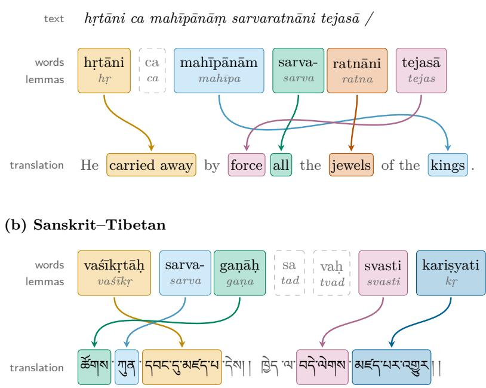

# MITRA-lexicon: Lexica of attested translations from Sanskrit into English, Tibetan and Chinese

Sebastian Nehrdich   
Center for Integrated   
Japanese Studies   
Tohoku University   
Sendai, Japan   
nehrdich@tohoku.ac.jp   
Sven Sellmer   
Institute of Oriental Studies   
Adam Mickiewicz University   
Poznań, Poland   
sven@amu.edu.pl   
Kengo Harimoto   
Center for Integrated   
Japanese Studies   
Tohoku University   
Sendai, Japan   
kengo.harimoto.e6@tohoku.ac.jp

Oliver Hellwig ISLE University of Zurich Zurich, Switzerland oliver.hellwig@uzh.ch

## Abstract

The standard Sanskrit lexica are monumental and indispensable, but they cite their attestations as abbreviated references to editions, without links to the digitized texts now widely available and without a translation of the passage, and they naturally do not reflect translations made after them. To address these gaps, we present MITRA-lexicon, a family of corpus-grounded lexica based on span annotations of translation equivalents with Sanskrit as the pivot: Sanskrit–English, derived from the Mitrasaṃgraha corpus, as well as Sanskrit–Tibetan and Sanskrit–Chinese, derived from the MITRA-parallel corpus of Buddhist literature. In total, the resource comprises 2.18 million headword entries in six directional lexica. Headwords are lemmas and compounds from silver annotations that follow the Digital Corpus of Sanskrit (DCS). Senses are ranked by frequency, and each of the 10.4 million attestations includes its sentence pair, with character ofsets of the word and its equivalent. We propose a multi-step pipeline based on grammatical annotation models, fine-tuned large language models, and a teacher-student setup to produce the alignments. We evaluate the lexica against reference dictionaries and manually corrected gold alignments. We release the lexica and the fine-tuned span annotation model, together with a web interface for looking up headwords and their attested senses.

## 1 Introduction

The standard dictionaries of Sanskrit and of its Tibetan and Chinese translations give their textual evidence, where they give it at all, as abbreviated references to editions, without the translated passage and without information on frequency (Section 2). What such dictionaries lack are attested translations: the renderings that translators actually chose for a word in specific passages, as opposed to glosses written by lexicographers, each tied to the sentence pair in which it occurs and counted over the whole corpus. Beyond serving scholars who work with Sanskrit sources and their translations, a resource of attested translation equivalents with frequencies can support machine translation, which for Buddhist Chinese has been shown to benefit from retrieval augmentation (Nehrdich et al., 2025) and could use attested equivalents as terminology constraints. It can also make AI-assisted applications in Buddhist Studies verifiable, as an interface that links each term of a machine translation to its lexicon entry lets users check every rendering against its attestations in human translations instead of taking the model’s output on trust.

We build such resources automatically from parallel corpora of Sanskrit texts and their English, Tibetan and Chinese translations. Every attestation of MITRA-lexicon is an aligned sentence pair with the span ofsets of both the Sanskrit headword and its equivalent in another language, so that users can verify each entry against its source immediately (Figure 1).

(a) Sanskrit–English  
  
Figure 1: Two sentence pairs labeled by the teacher model (Section 3.4): the Sanskrit is segmented and lemmatized with ByT5-Sanskrit, and each content word is linked to the span of the translation that renders it, while function words such as ca and pronouns such as sa and vaḥ remain unlinked.

The lexica are built from existing components: the ByT5-Sanskrit analyzer (Nehrdich et al., 2024), which resolves sandhi, splits compounds and lemmatizes, the MITRA Qwen3.5-9B-Base stage 2 language model, adapted to these languages by continued pretraining (Nehrdich and Keutzer, 2026), and a recipe of fine-tuning this model on 9,366 examples labeled by a stronger commercial teacher model. What we contribute is the resource, a documented and reproducible way of building it, and a limited evaluation of how reliable it is:

• MITRA-lexicon: corpus-grounded lexica with span annotations for three language pairs with Sanskrit as source including Sanskrit–English, Sanskrit–Tibetan and Sanskrit–Chinese, each in both directions, with 2.18M headword entries, frequency-ranked senses, and 10.4M total attestations, every one with citation and highlight ofsets. To our knowledge, this is the first resource of this kind for these language directions (Section 5).

• The related data: word alignments with quality signals for all sentence pairs, the aligner as an open-weights model, and its training data (Section 3).

• An assessment of reliability against the reference dictionaries of the field for all three pairs and on expert-corrected gold alignments for Sanskrit–English, together with an interannotator agreement study in which three Sanskritists align the same 100 sentences independently. The gold alignments and the agreement data are released as well (Section 6).

• A live web search interface for looking up either language of a pair, with every sense linked to its attestations in the Dharmamitra corpus.

We release the lexica, alignments, gold data and evaluation protocol at https://github.com/d harmamitra/dharmamitra-lexicon, the interactive interface at https://lexicon.dharmami tra.org, and the word alignment model at https://huggingface.co/buddhist-nlp/qwen3 5-mitra-lexicon-annotation.

Section 2 reviews related work, Sections 3 and 4 describe how the alignments are produced and turned into entries, Section 5 presents the lexica and Section 6 gives the evaluation.

## 2 Related Work

Böhtlingk and Roth’s Sanskrit-to-German Sanskrit-Wörterbuch (Böhtlingk and Roth, 1855), published in seven volumes 1855–1875, is the most extensively documented Sanskrit dictionary. The widely used English-language dictionaries of Monier-Williams (Monier-Williams, 1872; Monier-Williams, 1899) drew on it, and Apte (Apte, 1890) acknowledges using its quotations and references. These works are not short of textual evidence, since Böhtlingk-Roth alone carries some 800,000 source references in its Cologne digitization and Apte, in the digitization we use, some 44,000. However, these citations are given as abbreviated references to editions that are mostly outdated and hard to access, without the translation of the passage, and without the frequency of a word or its distribution over the genres of the corpus. For Sanskrit–Tibetan, Negi (1993) quotes sentence pairs but draws on a comparatively small and concentrated set of sources and gives no frequencies. For Sanskrit–Chinese, Wogihara (1979) records the Chinese renderings of a word with the abbreviated titles of the texts in which they occur but without the passages, and Hirakawa (1997) lists equivalents without naming any sources.

Among the digital lexical resources for Sanskrit, the Cologne Digital Sanskrit Dictionaries<sup>1</sup> have made a large array of classical dictionaries searchable in high quality, and the Sanskrit Heritage platform and its lexicon (Huet, 2005; Goyal et al., 2012)<sup>2</sup> tie lexical entries to a generative morphology. For Tibetan, Christian Steinert has created an interactive, searchable application for Tibetan lexical resources,<sup>3</sup> which also hosts the digital version of Negi (1993) that we use in this study. The Digital Corpus of Sanskrit (DCS<sup>4</sup>) (Hellwig, 2021) links a lemmatized corpus to dictionary entries and so ofers attestations for Sanskrit words, though not their translations on sentence-level. The Sanskrit Sembank (Hellwig and Biagetti, 2025) annotates occurrences in the DCS with word senses that are linked to the definitions of Monier-Williams. Hellwig et al. (2026) train a word sense disambiguation system on it and find that Monier-Williams’s overlapping and periphrastic definitions are hard to discriminate, most of all for secondary senses. Among the ways of obtaining further sense annotations they single out alignment with translations, which has already served to source training data for word sense disambiguation in Ancient Greek (Keersmaekers et al., 2023). MITRA-lexicon provides such alignments for Sanskrit at corpus scale, although it records translation equivalents rather than sense labels. Large language models have also been used to generate lexicographic data directly, as for the Mangalam dictionary of Buddhist Sanskrit (Lugli, 2025).

To keep our data compatible with the DCS, we process the Sanskrit side with ByT5-Sanskrit (Nehrdich et al., 2024), a byte-level sequence-to-sequence model trained jointly on segmentation, lemmatization and morphosyntactic tagging with the DCS as its supervision. It is robust to the orthographic variation of real-world e-texts and needs no external lexicon. Its output is, however, a silver annotation, and its errors propagate into the lexicon. Our headwords are therefore lemmas in the sense of the DCS and can be linked to the DCS and its corpus (Section 6.1 examines how far this holds and how well the reference dictionaries cover the same lemmas).

Extracting translation lexica from parallel text is a classical application of word alignment (Gale and Church, 1991; Melamed, 2000), and Melamed (2000) already evaluated such lexica against a published bilingual dictionary, as we do in Section 6.1. Statistical aligners such as fast\_align (Dyer et al., 2013) and eflomal (Östling and Tiedemann, 2016) estimate lexical translation probabilities over token sequences, whereas SimAlign (Jalili Sabet et al., 2020) and awesome-align (Dou and Neubig, 2021) extract alignments from the similarity of contextual embeddings. Supervised neural aligners fine-tune a multilingual encoder on gold alignments: as span prediction in the manner of extractive question answering (Nagata et al., 2020), with weakly supervised pretraining on Wikipedia entity links to reduce the need for manual labels (Wu et al., 2023), or as binary sequence labeling (Latouche et al., 2024). These supervised aligners presuppose gold alignments and a tokenized target, and a neural pretrained encoder that covers the languages.

Closest to the aligner we use is SemiAlign (Miao et al., 2025), a recent semi-supervised framework that, among other things, uses decoder-only LLMs as word aligners. Its authors fine-tune 8B-parameter LLMs with LoRA on a few hundred gold-aligned sentences and find that this alone does not reach the encoder-based state of the art, but that adding pseudo-labels produced by an encoder aligner for 30,000 to 52,000 unlabeled sentence pairs closes the gap and surpasses it on three of their four language pairs. We share their central observation that an LLM becomes a strong aligner once it is given enough automatically labeled data, but in our setting neither ingredient of their recipe exists. There are no gold alignments for Sanskrit, and no encoder aligner that could serve as pseudo-labeler for sandhied Sanskrit, unsegmented Tibetan or Buddhist Chinese. All of our supervision therefore comes from the combination of the ByT5-Sanskrit analyzer and a stronger teacher LLM prompted under a precision protocol.

Closest to our Sanskrit–English setting, Padamitra (Jagadeeshan et al., 2026) fine-tunes LLMs to generate word-level glossaries from verse–translation pairs, modeled on the word-by-word glosses of the Rāmāyaṇa and the Bhāgavata Purāṇa. The glosses of the Padamitra model are free text and are evaluated verse by verse, whereas we mark verbatim spans in the translation and aggregate them into attested, frequency-ranked dictionary entries. The authors also identify the segmentation of sandhi and compounds as the main source of error, which corresponds to the dependence of our pipeline on the analyzer noted above.

Training a small, task-specific model on labels produced by a large commercial model is now a common paradigm (Hsieh et al., 2023; Zhou et al., 2024), see Tan et al. (2024) for an overview. We use it for reasons of cost, as annotating enough word spans by hand to fine-tune a model would occupy highly trained annotators for a prohibitive amount of time.

## 3 Methodology

This section describes the parallel corpora (Section 3.1) and how the aligner is obtained: the analysis of the Sanskrit (Section 3.2), alignment as span projection (Section 3.3), labeling by a teacher model (Section 3.4) and the training of a student on its labels (Section 3.5).

## 3.1 Source Corpora

Table 1 summarizes the three parallel corpora. For Sanskrit–English we use Mitrasaṃgraha (Nehrdich et al., 2026), a sentence-aligned corpus of Sanskrit texts with published English translations. It spans Vedic, epic, classical and medieval Sanskrit across six domains (Veda, epic, purāṇa, religious scripture, poetry, and scholastic treatises) and the work of more than forty translators. The alignments are silver-quality, produced with BertAlign and manually screened at document level. For Sanskrit–Tibetan and Sanskrit–Chinese we use sentence pairs from the MITRA-parallel mining pipeline (Nehrdich and Keutzer, 2026), which extracts parallel passages between Sanskrit, Tibetan and Buddhist Chinese from the digital canons by embedding-based retrieval and sentence alignment. We use MITRA-parallel v3, in which the sentence alignment has been post-corrected by a dedicated model. From all three corpora we leave out the 18 texts whose Sanskrit is wholly or partly a modern reconstruction from the Tibetan or Chinese translation.

<table><tr><td>Pair</td><td>Corpus</td><td>Sentence pairs</td><td>Sanskrit words</td></tr><tr><td>Sanskrit-English</td><td>Mitrasagraha</td><td>395,528</td><td>5.87M</td></tr><tr><td>Sanskrit-Tibetan</td><td>MITRA-parallel v3</td><td>566,068</td><td>5.57M</td></tr><tr><td>Sanskrit-Chinese</td><td>MITRA-parallel v3</td><td>340,691</td><td>4.48M</td></tr></table>

Table 1: Parallel corpora used for word alignment in this work. Sanskrit words are counted after segmentation with ByT5-Sanskrit, compound members counted separately.

(a) Sanskrit–English   
SANSKRIT: <1>rājā</1> <2>tu</2> <3>tam</3> <4>brāhmaṇam</4> <5>dṛṣṭvā</5> <6>prahṛṣṭaḥ</6> <7>abhavat</7>   
LEMMAS: <1>rājan</1> <2>tu</2> <3>tad</3> <4>brāhmaṇa</4> <5>dṛś</5> <6>prahṛṣ</6> <7>bhū</7>   
ENGLISH: But the king, seeing that Brahmin, was filled with joy.   
OUTPUT: But the <1>king</1>, <5>seeing</5> that <4>Brahmin</4>, <6>was filled with joy</6>.   
(b) Sanskrit–Chinese   
SANSKRIT: <1>su</1> <2>jāti-</2> <3>kula-</3> <4>gotra-</4> <5>saṃpannaḥ</5> <6>ca</6> <7>bhaviṣyati</7>   
LEMMAS: <1>su</1> <2>jāti</2> <3>kula</3> <4>gotra</4> <5>sampad</5> <6>ca</6> <7>bhū</7>   
CHINESE: 生生世世生賢善家尊貴人中。   
OUTPUT: 生生世世生賢善<3>家</3>尊貴人中。  
Figure 2: Alignment as span projection. The target line, ENGLISH in (a), and CHINESE in (b), is copied verbatim and numbered tags are inserted around the span translating each Sanskrit word. In (a), tu, tam and abhavat remain untagged: “but” and “that” are function words, and the copula is absorbed into the periphrasis tagged under prahṛṣṭaḥ. In (b) the Chinese paraphrases the Sanskrit, and only the one unmistakable correspondence, kula : 家, is marked.

## 3.2 Sanskrit Analysis

In digital Sanskrit texts a sentence is usually not a sequence of words, as sandhi merges neighboring words, compounds fuse several lexical units into one orthographic word, and editions and digitizations follow diferent conventions when it comes to printing Sanskrit text. To standardize the input, we analyze the Sanskrit side of every sentence pair with ByT5-Sanskrit (Nehrdich et al., 2024), which yields for each word its unsandhied surface form, its lemma and a morphosyntactic tag. Non-final members of compounds are marked by a trailing hyphen (sarva- ratnāni in Figure 1). Since the analyzer degrades on inputs beyond about 200 characters, we analyze long sentences in chunks of at most 150 characters and cut at white space where possible. The analyzer is not error-free, and a wrong lemma produces an entry under a wrong headword. The aggregation over the corpus pushes such errors into the low-frequency tail of the lexicon, but does not remove them.

## 3.3 Alignment as Span Projection

We formulate word alignment as a tagging task over one sentence pair (Figure 2). The analyzed Sanskrit words are wrapped in numbered tags, <1>…</1>, <2>…</2>, the same numbering is repeated over the lemmas, and the model must reproduce the target sentence verbatim while inserting each number around the target span that translates the corresponding word. Numbers without a confident equivalent are omitted. The model thus finds the spans in unsegmented target text itself, since no reliable segmenters for Tibetan and Chinese that match Sanskrit word boundaries are available. The verbatim constraint makes every output mechanically checkable, since the output with tags removed must equal the input and every tagged span must occur in it literally.

<table><tr><td>Direction</td><td>Teacher calls</td><td>Verbatim</td><td>Words / sent.</td><td>Tagged</td><td>Seeds kept</td></tr><tr><td>Sanskrit-English</td><td>1,200</td><td>99.8%</td><td>13.8</td><td>52.2%</td><td>1,000</td></tr><tr><td>Sanskrit-Tibetan</td><td>3,542</td><td>99.6%</td><td>9.5</td><td>63.8%</td><td>2,000</td></tr><tr><td>Sanskrit-Chinese</td><td>2,518</td><td>96.0%</td><td>11.4</td><td>56.7%</td><td>2,000</td></tr><tr><td>Chinese-Tibetan (aux.)</td><td>2,522</td><td>99.2%</td><td>11.4</td><td>44.0%</td><td>2,000</td></tr><tr><td>English-Tibetan (aux.)</td><td>2,469</td><td>99.5%</td><td>17.8</td><td>27.1%</td><td>1,786</td></tr></table>

Table 2: Teacher labeling. “Tagged” is the mean fraction of source words that received a span. The two auxiliary directions are part of the training mixture of the student (Section 3.5) but their lexica are not the subject of this paper.

## 3.4 Teacher Labeling

Training data is produced by a commercial LLM (Gemini Flash with extended reasoning enabled)<sup>5</sup> on a random sample of each corpus. Since the labels are destined for lexicography, the prompts favor precision over completeness: the model is to tag a word only if its equivalent is unmistakable, never to tag function words and pronouns, to ignore free renderings, and to tag compound members individually only if their equivalents are separable in the translation. A labeled pair is kept only if the output reproduces the target verbatim, which the teacher does in 96–99.8% of the calls, and it tags 52–64% of the Sanskrit words (Table 2).

## 3.5 Student Model

The student is MITRA Qwen3.5-9B-Base stage 2 (Nehrdich and Keutzer, 2026), the outcome of continued pretraining of Qwen3.5 (Qwen Team, 2026) on Sanskrit, Tibetan, Buddhist Chinese and Pāli. The student receives a one-line instruction and the data block of Figure 2, and is trained to emit the tagged target, which keeps inputs short. All directions, including two auxiliary directions without Sanskrit (Table 2), are trained as one mixture (9,366 examples, with the Sanskrit–English seeds duplicated) by full-parameter fine-tuning on one 96 GB GPU. Per direction, 50 seeds are held out for validation and 20 for testing. To measure how faithfully the student reproduces the teacher, we labeled a further 1,489 sentence pairs (about 500 per direction, disjoint from the training seeds) with the teacher under the same protocol and scored the student’s spans against them. A span counts as correct if it carries the same number and the same text. The student reaches a span-level $F _ { 1 }$ of 82.3 for Sanskrit–Tibetan, 87.4 for Sanskrit– Chinese and 86.2 for Sanskrit–English, each direction scored with the checkpoint that aligned its corpus. This measures fidelity to the teacher, not correctness, and Section 6.2 sets it against the agreement of the teacher with itself.

## 4 Mining the Lexica

## 4.1 Corpus-Scale Inference

The student is run over the three corpora with vLLM (Kwon et al., 2023) using greedy decoding, and the mining of all three directions took about 36 GPU-hours on NVIDIA RTX PRO 6000 GPUs. Every output is checked on signals that require no gold standard: whether it reproduces the target verbatim once the tags are removed, whether the tag numbering is well-formed, the mean log-probability of the generated tokens, and the share of tagged spans that do not occur in the target (ungrounded spans). Table 3 shows that 96–99% of the outputs are verbatim copies, and the fraction of ungrounded spans is below 0.3% in every direction. The student has inherited the teacher’s restraint and leaves 30–50% of the Sanskrit words unaligned, most for Sanskrit– Chinese and fewest for Sanskrit–Tibetan. For Sanskrit–English, outputs that are not verbatim, have malformed numbering, a mean log-probability below 0.45 or more than 25% ungrounded spans are excluded from the lexicon, since in each of these cases the output itself is unreliable.

<table><tr><td>Direction</td><td>Sent. pairs</td><td>Verbatim</td><td>Ungrounded</td><td>Coverage</td><td>Links</td></tr><tr><td>Sanskrit-English</td><td>395,528</td><td>97.4%</td><td>0.20%</td><td>0.52</td><td>2,952,451</td></tr><tr><td>Sanskrit-Tibetan</td><td>566,068</td><td>95.9%</td><td>0.01%</td><td>0.70</td><td>3,634,841</td></tr><tr><td>Sanskrit-Chinese</td><td>340,691</td><td>98.8%</td><td>0.02%</td><td>0.50</td><td>1,942,754</td></tr><tr><td>Total</td><td>1,302,287</td><td></td><td></td><td></td><td>8,530,046</td></tr></table>

Table 3: Corpus-scale inference. Verbatim: share of outputs that reproduce the target exactly once the tags are removed. Ungrounded: mean share of the tagged spans of an output that do not occur in the target. Coverage: mean fraction of Sanskrit words per sentence that received a grounded span.

This removes 17,068 rows (4.3%). For Sanskrit–Tibetan and Sanskrit–Chinese, whose sentence pairs have been post-corrected and verified by a dedicated model in MITRA-parallel v3, all rows are used that render the target verbatim.

## 4.2 From Alignments to Lexicon Entries

For every aligned Sanskrit word we record the character ofsets of its equivalent in the target and, by fuzzy string matching between the unsandhied forms and the source string, of the word in the original sentence. Word spans are keyed on the lemma and constitute the single-word lexicon. Phrase spans are built by consecutive members of a compound that are all aligned and where their equivalents form one unit in the target, separated at most by case particles in Tibetan, or by glue words such as of and the in English, where the members may also occur in any order, the compound is emitted under its hyphenated members, with the final member reduced to its stem as a lemma would be (sarva-ratna for sarva-ratnāni), together with its sandhied surface form, so that it can be looked up exactly as it stands in the text. Only the full compound is emitted, not its parts, whose members remain available as word entries. In Figure 1a, for instance, the links yield the word entries hṛ : “carried away”, tejas : “force” and ratna : “jewels”, and the compound entry sarva-ratna : “all the jewels”. Table 4 gives the quantitative overview.

For Chinese, where the compound members are usually rendered by adjacent characters, a rule that admits no intervening material and no reordering misses many compounds that are rendered with the members in another order (pañca-bhaya-samatikrānta : 離五怖 ‘free from the five fears’), with a grammatical particle between them (nāga-rāja-paripṛcchā : 龍王所問) or with one member left untranslated (cintā-maya-prajñā : 思慧). We therefore admit for Chinese any order of the members within one contiguous stretch, a single intervening character if it is one of fourteen particles (之所而為其及與於諸能得等者中), and one unaligned member inside the compound, but no punctuation and no other intervening material. This adds 64,757 phrase spans (Table 4). Two further rules form compounds whose members the labeling protocol leaves incomplete. Abstract and delimiting sufixes (-tva, -tā, -mātra) are analyzed as members of their own and usually remain untagged, so that dharma-tā would yield no compound entry. When the other members of such a compound are aligned as one unit, we emit the full compound and extend its span over a directly following nyid or tsam in Tibetan and 性 in Chinese (dharma-tā : chos nyid, 法性). For Chinese, a compound of three or more members whose equivalents are separated only by the enumeration comma 、 is emitted as one unit (rāga-dveṣa-moha-prahāṇa : 斷除貪、瞋、癡); with two members this rule proved unreliable and is not applied. In samples checked by hand, 28 of 30 Tibetan and 23 of 25 Chinese sufix compounds and all 25 enumerations were correct. The two rules add 10,109 compounds for English, 29,737 for Tibetan and 17,172 for Chinese.

Three filters remove noise: 1) We filter senses whose gloss crosses a clause boundary marked by punctuation, or whose pointwise mutual information (Church and Hanks, 1990) with the headword is below 1.0, removing glosses that contribute little to the relative attestation of a headword. 2) We remove Tibetan glosses that consist only of function syllables and attach indiscriminately to many headwords. 3) Function words and pronouns are filtered, since the labeling protocol already excludes them (Section 3.4) and the student follows it. Headwords that reproduce typing errors of the e-texts are removed where these can be recognized: a headword is dropped when one of its members occurs no more than five times as a lemma or form in the Sanskrit collection of DharmaNexus (some 73 million words, analyzed with the same analyzer), lies one edit away from a lemma or form that occurs at least 300 times there, and is not a headword of Monier-Williams or Apte (kreśa for kleśa, śmatha for śamatha, puṇdarīka for puṇḍarīka). This removes 35,075 Sanskrit headwords (3.0%) with 51,420 attestations (0.5%), 91% of them attested once or twice.

<table><tr><td>Direction</td><td>Word spans</td><td>Phrase spans</td><td>Total</td></tr><tr><td>Sanskrit-English</td><td>2,749,903</td><td>566,022</td><td>3,315,925</td></tr><tr><td>Sanskrit-Tibetan</td><td>3,634,045</td><td>1,090,654</td><td>4,724,699</td></tr><tr><td>Sanskrit-Chinese</td><td>1,942,753</td><td>532,475</td><td>2,475,228</td></tr></table>

Table 4: Spans extracted from the alignments. Phrase spans comprise full compounds and their sandhied surface forms.  
```jsonl
{"sa": "kṛpā", "n": 604, "n_senses": 38,
"senses": [
{"en": "mercy", "count": 151,
"ex": [{"id": "train/cc-by-sa/GE07hv_conpu.tsv:1716", "license": "cc-by-sa",
"src": "kṛpayā tac ca jagrāha śaṃtanur mṛgayāṃ gataḥ /",
"target": "Going out a-hunting the king Shāntanu, out of mercy, took them up.",
"start": 46, "end": 51}, ...]},
{"en": "compassion", "count": 110, "ex": [...]},
{"en": "pity", "count": 86, "ex": [...]}, ...]}
```  
Figure 3: An entry of the Sanskrit English lexicon (abridged). n is the number of attestations of the headword, count that of a sense; start and end are character ofsets of the equivalent in target. The identifier encodes the portion of the corpus, the license group, the text and the line.

## 5 The MITRA-lexicon Resource

MITRA-lexicon consists of three lexicon pairs with Sanskrit as the source language, each released in both directions. An entry (Figure 3) consists of a headword, its total number of attestations, and a list of senses. A sense is a translation equivalent as it occurs in the corpus, with the number of times the headword was rendered in this way, and senses are ranked by this count. Each sense carries all of its attestations, one for each of these occurrences: the identifier of the sentence in its source corpus, the text of the translation, and the character ofsets of the equivalent within it, so that an interface can highlight it. Headwords are of the three kinds produced in Section 4.2. Lemma entries use DCS lemmas as keys, combining the evidence for kṛpā, kṛpayā, kṛpām and their sandhi variants in one entry. Compound entries use the hyphenated, unsandhied members of a compound as keys, with the final member reduced to its stem, and the case forms that occur are listed with the entry (in the Sanskrit–Chinese lexicon, kuśala-mūla combines 1,514 attestations of 16 forms). Surface entries index the same compounds under the sandhied string as it stands in the text, located by fuzzy string matching. In the reverse lexica (English, Tibetan or Chinese Sanskrit) the headwords are the equivalents and the senses are Sanskrit lemmas and compounds.

## 5.1 Size and Coverage

Table 5 describes the six directional lexica. In each pair there are fewer headwords on the target side than on the Sanskrit side, and correspondingly more senses per target headword. For Tibetan (2.01 against 1.69) and Chinese (2.46 against 1.89) this reflects translation vocabularies that are smaller and more standardized than the Sanskrit they render. That English shows the same pattern (2.40 against 2.27) indicates that many near-synonyms of the Sanskrit lexicon converge on the same English word in translation practice.

<table><tr><td>Pair</td><td>Direction</td><td>Headwords</td><td>Senses</td><td>Senses / headword</td><td>Attestations</td></tr><tr><td rowspan="2">Sanskrit-English</td><td>sa→en</td><td>418,927</td><td rowspan="2">950,845</td><td>2.27 2.40</td><td rowspan="2">3,293,993</td></tr><tr><td>en→sa</td><td>396,289</td><td></td></tr><tr><td rowspan="3">Sanskrit-Tibetan</td><td>sa→bo</td><td>529,599</td><td rowspan="3">895,229</td><td>1.69</td><td rowspan="3">4,665,998</td></tr><tr><td>bo→sa</td><td>445,176</td><td>2.01</td></tr><tr><td>sa→zh</td><td>223,081</td><td>1.89</td></tr><tr><td rowspan="2"></td><td>zh→sa</td><td>171,780</td><td rowspan="2"></td><td>2.46</td><td rowspan="2"></td></tr><tr><td></td><td>2,184,852 2,268,148</td><td></td></tr></table>

Table 5: The released lexica. Senses (headword–gloss pairs) and attestations are properties of a pair and identical in both of its directions. Headwords comprise lemmas as well as compound and phrase entries.
<table><tr><td>Attestations</td><td>1</td><td>2-4</td><td>5-19</td><td>20-99</td><td>100-999</td><td>≥1000</td><td>Total</td></tr><tr><td>Sanskrit-English</td><td>159,756</td><td>29,615</td><td>12,918</td><td>6,511</td><td>3,382</td><td>491</td><td>212,673</td></tr><tr><td>Sanskrit-Tibetan</td><td>124,176</td><td>60,734</td><td>17,776</td><td>6,397</td><td>3,159</td><td>614</td><td>212,856</td></tr><tr><td>Sanskrit-Chinese</td><td>42,567</td><td>29,254</td><td>10,120</td><td>4,041</td><td>2,008</td><td>350</td><td>88,340</td></tr></table>

Table 6: Single-word Sanskrit headwords by number of attestations. The remaining headwords of Table 5 are compound and surface entries.

In accordance with Zipf’s law (Zipf, 1949), the distribution of our headwords is heavily skewed (Table 6). Of the 212,673 single-word Sanskrit headwords of the English lexicon, 75% are attested once. The core of each lexicon, which we define as single-word headwords with at least five attestations, comprises 23,302 headwords for English, 27,946 for Tibetan and 16,519 for Chinese. In each pair this core accounts for more than 90% of the attestations of single-word headwords. To assess rare headwords, we reviewed 20 randomly drawn entries with a single attestation for each pair of the released lexica. Fifty-five of the 60 are compounds, phrases or sandhied surface forms, nearly all of them compositional rather than lexicalized. None was misaligned or drawn from a mismatched sentence pair. Thirty-nine were correct translation equivalents (16 for English, 10 for Tibetan, 13 for Chinese), such as vyāghra-carma-dhara : “wore a tiger’s skin”, māṇḍaleya-devatā-pariṣad : dkyil ’khor gyi lha’i ’khor or phala-upabhojaka : 受用果, and 15 were correct but imprecise (3, 7, 5): in nine of them a surface key also takes in a neighboring word that is not part of the alignment (a shortcoming of the fuzzy matching), in three the span is a word too wide or too narrow, and in three the translator leaves a member of the compound unrendered. The 6 other errors (1, 3, 2) all lie on the Sanskrit side, in the key or the lemma, while the aligned translation is correct in all of them: a particle or a finite verb fused into the key (hakarṣaṇa for ha karṣaṇāt, sarva-buddha-dadanti for sarva-buddhā dadanti), a word cut at a sandhi boundary, a typing error of the e-text carried into the key (tathatā-rupa for tathatā-rūpa), mantra syllables analyzed as a word, and a punctuation mark carried into the key.

## 5.2 Composition by Genre and Period

For Sanskrit-English, by genre (Table 7), purāṇas contribute over a third of the attestations, scholastic treatises and epic about a fifth each, religious scripture and the Veda 10% each and poetry 6%. By period, 60% of the attestations are classical, 22% epic, 10% Vedic and 8% medieval. Two texts, the seven-khaṇḍa (vulgate) Skandapurāṇa in Tagare’s translation (830,897 attestations) and the Mahābhārata (576,228), together account for 43% of the attestations of the Sanskrit–English lexicon, and their translators’ conventions are correspondingly prominent among the top-ranked English senses of common words. Table 8 breaks down the Tibetan and

<table><tr><td>Genre</td><td>Vedic</td><td>Epic</td><td>Classical</td><td>Medieval</td><td>Total</td><td>%</td></tr><tr><td>Veda</td><td>339,419</td><td></td><td></td><td></td><td>339,419</td><td>10.3</td></tr><tr><td>Epic</td><td></td><td>634,817</td><td></td><td></td><td>634,817</td><td>19.3</td></tr><tr><td>Purāņa</td><td></td><td></td><td>1,187,279</td><td></td><td>1,187,279</td><td>36.0</td></tr><tr><td>Religious scripture</td><td></td><td>58,196</td><td>231,568</td><td>61,703</td><td>351,467</td><td>10.7</td></tr><tr><td>Treatises</td><td></td><td>34,261</td><td>530,746</td><td>14,993</td><td>580,000</td><td>17.6</td></tr><tr><td>Poetry</td><td></td><td></td><td>26,013</td><td>174,998</td><td>201,011</td><td>6.1</td></tr><tr><td>Total</td><td>339,419</td><td>727,274</td><td>1,975,606</td><td>251,694</td><td>3,293,993</td><td>100</td></tr></table>

Table 7: Attestations of the Sanskrit–English lexicon, by genre and period of the Sanskrit text as reported in Nehrdich et al. (2026). Periods are Vedic before 500 BCE, Epic 500 BCE–200 CE, Classical 200–1000 CE, Medieval 1000–1800 CE.
<table><tr><td>Collection</td><td>Category</td><td>Sanskrit-Tibetan Attestations</td><td>%</td><td>Sanskrit-Chinese Attestations</td><td>%</td></tr><tr><td>Scriptures</td><td>Sūtra</td><td>602,459</td><td>12.9</td><td>541,232</td><td>22.1</td></tr><tr><td></td><td>Prajñāpāramitā</td><td>708,552</td><td>15.2</td><td>536,847</td><td>21.9</td></tr><tr><td></td><td>Tantra</td><td>431,906</td><td>9.3</td><td>208,568</td><td>8.5</td></tr><tr><td></td><td>Vinaya</td><td>338,486</td><td>7.3</td><td>163,853</td><td>6.7</td></tr><tr><td></td><td>Other</td><td>126,426</td><td>2.7</td><td>308,665</td><td>12.6</td></tr><tr><td>Treatises</td><td>Tantra</td><td>647,564</td><td>13.9</td><td>6,809</td><td>0.3</td></tr><tr><td></td><td>Yogācāra</td><td>496,394</td><td>10.6</td><td>355,544</td><td>14.5</td></tr><tr><td></td><td>Madhyamaka</td><td>388,868</td><td>8.3</td><td>86,589</td><td>3.5</td></tr><tr><td></td><td>Abhidharma</td><td>407,239</td><td>8.7</td><td>210,367</td><td>8.6</td></tr><tr><td></td><td>Pramāa</td><td>239,638</td><td>5.1</td><td>1,392</td><td>0.1</td></tr><tr><td></td><td>Other</td><td>278,466</td><td>6.0</td><td>28,032</td><td>1.1</td></tr><tr><td>Total</td><td></td><td>4,665,998</td><td>100</td><td>2,447,898</td><td>100</td></tr></table>

Table 8: Attestations of the Sanskrit–Tibetan and Sanskrit–Chinese lexica by the DharmaNexus collection and category of the Sanskrit text. Other scriptures are Ratnakūṭa, Avataṃsaka (for Chinese 219,201 attestations) and miscellaneous sūtras. Other treatises include hymns, Prajñāpāramitā and sūtra commentaries, letters, Jātaka, Vinaya commentary and nīti.

Chinese attestations by the DharmaNexus category of the Sanskrit text. For Tibetan, treatises provide 53% of the attestations, led by tantric commentaries, Yogācāra, Abhidharma, Madhyamaka and Pramāṇa. For Chinese, scriptures provide 72%, the sūtras and the Prajñāpāramitā about a fifth each, and among the treatises Yogācāra and Abhidharma dominate, while the Pramāṇa and tantric treatises that are prominent for Tibetan are nearly absent.

## 5.3 Access

We release the six lexica as line-delimited JSON, the span files from which they were built, the alignment output for every sentence pair with its quality signals, the teacher-labeled seeds, and the student model. Since every attestation reproduces its sentence pair, the Sanskrit–English lexicon inherits the licenses of the texts of Mitrasaṃgraha and is, like the corpus, released in two versions: one under CC BY-SA 4.0 that contains the attestations from texts under CC BY-SA (92.3% of all attestations), and the complete lexicon under CC BY-NC-ND 4.0, which adds those from texts under that license (4.3%) and from the validation and test splits of Mitrasaṃgraha, for which no license is stated (3.4%), and is the version described in this paper. The Sanskrit– Tibetan and Sanskrit–Chinese lexica are released under CC BY-SA 4.0.

The lexica are served through a web interface backed by a search index with one document per term and one per attestation. Lookup works from either language of a pair and is scriptagnostic: Sanskrit may be typed with or without diacritics (karuna finds karuṇā), Tibetan in Tibetan script or in Wylie. Suggestions are ranked by attestation frequency. An entry lists its senses with counts, grouped by collection and text, and each citation displays the Sanskrit sentence and its translation with the word and its equivalent highlighted on both sides.

<table><tr><td>Pair</td><td>Reference, matching</td><td>|H|</td><td>P@1</td><td>P@5</td><td>Att.-weighted prec.</td><td>Recall</td></tr><tr><td rowspan="3">Sanskrit-Tibetan</td><td>Negi, strict</td><td>24,858</td><td>58.2</td><td>71.4</td><td>76.6</td><td>46.0</td></tr><tr><td>Negi, containing</td><td></td><td>60.5</td><td>73.1</td><td>79.9</td><td>50.9</td></tr><tr><td>Negi, relaxed</td><td></td><td>68.0</td><td>78.6</td><td>85.7</td><td>60.9</td></tr><tr><td rowspan="3">Sanskrit-Chinese</td><td>Hirakawa, strict</td><td>15,783</td><td>53.0</td><td>69.4</td><td>75.2</td><td>44.1</td></tr><tr><td>Hirakawa, containing</td><td></td><td>57.2</td><td>72.1</td><td>80.4</td><td>47.8</td></tr><tr><td>Hirakawa, relaxed</td><td></td><td>68.4</td><td>80.3</td><td>88.3</td><td>63.4</td></tr><tr><td rowspan="3">Sanskrit-English</td><td>MW</td><td>33,869</td><td>34.2</td><td>49.9</td><td>63.0</td><td></td></tr><tr><td>MW ∪ Apte</td><td>35,107</td><td>36.6</td><td>52.0</td><td>67.3</td><td></td></tr><tr><td>MW ∪ Apte, no loans</td><td>32,304</td><td>40.9</td><td>56.0</td><td>69.0</td><td></td></tr></table>

Table 9: Agreement of the mined Sanskrit-source lexica with reference dictionaries (in %), over all single-word headwords that the reference can judge. Strict and containing figures are lower bounds on precision (see text).

## 6 Evaluation

We evaluate the generated entries along two vectors: whether they are correct, and whether the word alignments from which they are aggregated are correct. The first we answer for all three pairs with reference dictionaries (Section 6.1). The second requires gold alignments by experts, which we could obtain only for Sanskrit–English, where several Sanskritists could be recruited (Section 6.3). Section 6.2 compares the aligner with statistical aligners and with the teacher.

## 6.1 Agreement with Reference Dictionaries

For every headword that a reference dictionary can judge, we ask whether the mined senses are equivalents that the reference records. As references for Sanskrit–English, we use the dictionary of Monier-Williams (1872), alone and in union with Apte (1890), both in the digitization of the Cologne Digital Sanskrit Dictionaries. We do not use Böhtlingk and Roth’s Sanskrit-Wörterbuch (Böhtlingk and Roth, 1855), the most comprehensive of the three, because its definitions are in German. For Sanskrit–Tibetan, we use a digitized version of Negi (1993)<sup>6</sup>, which we invert from its Tibetan headwords into a Sanskrit Tibetan index. For Sanskrit–Chinese, we use a digitized version of Hirakawa (1997) that we produced ourselves. Reference citation forms are mapped to the stems used as mined headwords by an explicit list of rules (dharmaḥ  dharma, rājā rājan, and so on).

We evaluate single-word Sanskrit headwords and let H be the set of mined headwords that also occur as a Sanskrit item in the reference. For h H we report P@k, the proportion of headwords for which one of the k top-ranked mined senses matches a reference equivalent; the attestation-weighted precision, the share of all attestations of the headwords in H that fall on a matching sense; and, where the reference lists equivalents, the mean proportion of the reference equivalents of h found among its mined senses (recall). Matching is strict when the normalized strings are equal. For Tibetan, normalization strips trailing case particles and clitics, and for Chinese it unifies character variants. Because translators add and drop modifiers freely (snying rje chen po for snying rje), we also report a containing variant, in which the mined sense may contain a reference equivalent, and a relaxed variant with containment in either direction. The last is lenient, since a short mined sense can be contained in a longer reference term by accident, and is given for orientation only. For English the references are definitions in prose rather than lists of equivalents. A mined gloss counts as matched (content-word matching) when all its content words, after stemming, occur in the text of the entry of exactly that headword, so recall is undefined. Glosses that merely repeat the Sanskrit word (untranslated dharma, karuṇā) can be excluded (“no loans”).

<table><tr><td>Attestations of headword</td><td>1</td><td>2-4</td><td>5-19</td><td>20-99</td><td>100-999</td><td>≥1000</td></tr><tr><td>Sanskrit-Tibetan, P@1</td><td>45.4</td><td>50.6</td><td>56.9</td><td>71.9</td><td>84.3</td><td>90.0</td></tr><tr><td>Sanskrit-Tibetan, P@5</td><td>45.4</td><td>64.2</td><td>80.0</td><td>91.7</td><td>96.6</td><td>96.6</td></tr><tr><td>Sanskrit-Chinese, P@1</td><td>39.9</td><td>42.3</td><td>49.3</td><td>65.7</td><td>77.0</td><td>88.1</td></tr><tr><td>Sanskrit-Chinese, P@5</td><td>39.9</td><td>56.2</td><td>74.0</td><td>87.5</td><td>93.6</td><td>98.8</td></tr><tr><td>Sanskrit-English, P@1</td><td>20.4</td><td>24.8</td><td>38.1</td><td>54.4</td><td>75.0</td><td>90.2</td></tr><tr><td>Sanskrit-English, P@5</td><td>20.4</td><td>39.0</td><td>64.0</td><td>81.6</td><td>93.9</td><td>98.5</td></tr><tr><td>Headwords in H (Tibetan)</td><td>6,071</td><td>6,154</td><td>5,796</td><td>3,975</td><td>2,362</td><td>500</td></tr><tr><td>Headwords in H (Chinese)</td><td>2,507</td><td>3,957</td><td>4,262</td><td>2,977</td><td>1,751</td><td>329</td></tr><tr><td>Headwords in H (English)</td><td>9,532</td><td>8,511</td><td>7,965</td><td>5,488</td><td>3,130</td><td>481</td></tr></table>

Table 10: Agreement by frequency of the headword (strict matching for Tibetan and Chinese; MW  Apte for English). With a single attestation there is a single sense, so that P@1 and P@5 coincide.

The set H comprises 12% (Tibetan), 18% (Chinese) and 17% (English) of the mined singleword headwords, but 73%, 85% and 87% of their attestations: the headwords that a reference cannot judge are overwhelmingly rare forms. Table 9 gives the results over all of H and Table 10 by frequency of the headword. Under strict matching, 77% of the Sanskrit–Tibetan attestations, 75% of the Sanskrit–Chinese and, under content-word matching, 63–69% of the Sanskrit–English attestations fall on senses that the reference confirms. Agreement rises steeply with frequency. For headwords with at least 100 attestations, the top-ranked sense is confirmed in 84–90% of the cases for Tibetan, 77–88% for Chinese and 75–90% for English, and one of the five top-ranked senses in 97%, 94–99% and 94–99%. For headwords attested once, agreement drops to 45%, 40% and 20%. As a control, we re-ran the evaluation with the reference entries permuted among headwords of the same frequency band: P@1 then falls below 1% for all three pairs, so that chance agreement is negligible, including under the content-word matching used for English.

These figures are lower bounds on precision, and a reading of samples from both sides shows why. Many mined senses that a reference lacks are plain renderings it does not record (bu mo for duhitṛ, where our index of Negi has only the honorific sras mo, rin po che for ratna, 汝 for tvad) or, for English, synonyms that a prose definition happens not to contain (home for gṛha, arrogance against a definition reading “pride, haughtiness”), a consequence of the clustered, near-synonymous definitions of Monier-Williams (Hellwig et al., 2026). Target-side variation that our normalization does not unify counts as disagreement (case-marked forms such as mthus beside mthu for anubhāva, abbreviated compounds such as stong nyid for stong pa nyid), and the digitized references are imperfect: our Hirakawa is an OCR transcription of the scanned print, and the 1872 edition of Monier-Williams nests derivatives and compounds in the entry of their base, so that sub-entries had to be split of heuristically. Errors of alignment and analysis occur as well (百 for varṣa, from 百歲 ‘a hundred years’). Negi and Hirakawa excerpt the same canonical translations from which our corpus is drawn, which is reflected in the higher agreement for Tibetan and Chinese, whereas the English references were not compiled from the translations of our corpus. Conversely, the resource does not recover everything the lexicographers collected (recall of 46–61% against Negi and 44–63% against Hirakawa). The references record the learned vocabulary of lexicographical and poetic literature (kha ba’i dgra bo ‘enemy of snow’ for agni), further meanings of polysemous words (chang for maṇḍa), rare transcriptions (多他阿伽度 beside the mined 如來 for tathāgata) and explanatory renderings (五百弓 ‘five hundred bow-lengths for krośa), and some of their sources are not in our corpus. Of 20 missing Negi equivalents of frequent headwords that we examined, seven are documented only in lexical works, six are artefacts of our parse of Negi or of the matching, five come from passages that our corpus lacks or has only in another reading, two occur in our corpus but were left unaligned by the student, and none is a misalignment.

Negi’s citations also do not separate or mark evidence that has been reconstructed based on

<table><tr><td>Sense of the lexicon Co-occurring in a sentence pair Composable from entries covered</td><td>31.8 28.0 9.8 69.7</td></tr><tr><td>Chinese not in our sentence pairs</td><td>7.5</td></tr><tr><td>Chinese not in the Chinese collection Both in the corpus, never in one pair Sanskrit not in our corpus</td><td>7.0 14.1</td></tr></table>

Table 11: The 123,248 pairs of Hirakawa (Chinese of at least two characters) by the evidence of MITRA-lexicon (in %, each pair in the first row that applies).

Tibetan or other sources, as the example of the Madhyāntavibhāgaṭīkā shows. It is cited from the edition of Pandeya (1971), and 22 of its 224 citations quote passages that the previous editors restored from the Tibetan translation. As our headwords follow the DCS, participles and absolutives are lemmatized to the verbal root, so evidence a lexicographer files under kṛta is credited to kṛ for example. Both sides shrink with frequency: the share of reference equivalents without a mined counterpart falls from 57% (Negi) and 59% (Hirakawa) for headwords attested once to 18–25% for headwords with at least 100 attestations, and the share of mined senses without a counterpart in the reference from 58–77% of the senses attested once to less than 9% of those attested at least 1,000 times.

The references also rest on a much narrower textual basis than our corpus. Negi quotes about 73,000 distinct Sanskrit passages, against 565,642 sentence pairs in our Sanskrit–Tibetan lexicon, half of its text citations come from ten sources, and a seventh of his pairs are documented only in lexical works such as the Mahāvyutpatti. Half of Hirakawa’s vocabulary, located in the Chinese canon, is concentrated in 76 texts, and three quarters of Apte’s source references point to classical poetry and drama, whereas the epics and purāṇas make up more than half of our Sanskrit–English attestations. Agreement with the references can therefore only be partial.

Many of Hirakawa’s entries are phrases tied to a passage (28% of his pairs have a Chinese of four or more characters), so we tested each of his 123,248 pairs with a Chinese of at least two characters in three ways (Table 11): whether it is a sense of our lexicon, whether its Chinese and its Sanskrit co-occur in one of our sentence pairs, and whether it can be composed from our entries (加行薩埵 from prayoga : 加行 and sattva : 薩埵), with controls on neighboring sentence pairs and on other headwords succeeding for only 6% and 1%. By these criteria 70% of Hirakawa is contained in the resource or documented by its corpus. Of the rest, 14 points are Chinese that occurs in none of our sentence pairs, often headwords written discontinuously or with notes, or OCR recognition errors, and 14 points are pairs whose Chinese and Sanskrit both occur in our corpus but never together. Of 17 such pairs that we traced in detail, five are in our lexicon under a form the comparison does not recognize (paryavasthita : 現起, ours under paryavasthā). Nine occur together in only one or two of our sentence pairs, where the aligner left the word unaligned or gave it a diferent or shorter span (所生 for janya, where Hirakawa has 所生法), and three are artefacts of Hirakawa or lie in passages without a Sanskrit counterpart in our corpus.

The comparison is confined to headwords that a reference contains, and Table 12 shows how many that are. Our own headwords follow the DCS closely: of the single-word headwords with at least 100 attestations, 99% (English), 98% (Tibetan) and 97% (Chinese) are DCS lemmas, the rest being mostly sandhied surface forms of compounds and, for Chinese, inflected forms that the analyzer left unlemmatized in the formulaic prose of the Prajñāpāramitā and the Vinaya (dānapāramitāyāṃ). Whether a lemma is found in a dictionary depends in part on citation conventions. The analyzer follows the DCS (bhagavant where the dictionaries have bhagavat, causative stems such as deśay, roots with preverbs such as upalabh), and Negi’s Sanskrit evidence hardly covers any verbal roots. For Sanskrit–English, Monier-Williams and Apte contain our frequent headwords about as often as DCS lemmas of comparable frequency (89% against 86%).

<table><tr><td rowspan="2">Reference</td><td colspan="3">DCS lemmas</td><td colspan="3">MITRA-lexicon headwords,  $n \geq 2 0$ </td></tr><tr><td>≥1000</td><td>20-999</td><td>verbs</td><td>sa-en</td><td>sa-bo</td><td>sa-zh</td></tr><tr><td>Monier-Williams 1872</td><td>95.7</td><td>83.7</td><td>64.2</td><td>86.8</td><td>74.0</td><td>75.6</td></tr><tr><td>Apte 1890</td><td>93.6</td><td>63.4</td><td>54.3</td><td>71.3</td><td>61.4</td><td>63.6</td></tr><tr><td>MW ∪ Apte</td><td>96.4</td><td>86.2</td><td>65.4</td><td>89.1</td><td>76.0</td><td>77.3</td></tr><tr><td>Edgerton BHS</td><td>32.7</td><td>12.6</td><td>1.0</td><td>16.2</td><td>27.3</td><td>32.7</td></tr><tr><td>MW ∪ Apte ∪ BHS</td><td>96.9</td><td>86.8</td><td>65.5</td><td>89.7</td><td>82.7</td><td>84.6</td></tr><tr><td>Negi (inverted)</td><td>78.9</td><td>53.7</td><td>3.5</td><td>62.5</td><td>70.8</td><td>71.3</td></tr><tr><td>Hirakawa (inverted)</td><td>92.0</td><td>46.0</td><td>32.1</td><td>57.7</td><td>75.8</td><td>83.2</td></tr><tr><td>Lemmas / headwords</td><td>866</td><td>13,262</td><td>2,784</td><td>10,166</td><td>9,465</td><td>6,019</td></tr></table>

Table 12: Lemma coverage of the reference dictionaries (in %): the share of DCS lemmas, by number of occurrences in the DCS corpus, and of the single-word headwords of MITRA-lexicon with at least 20 attestations, that have an entry in the reference after normalization to DCS-style stems. Headwords are restricted to lemmas produced by the analyzer, i.e. without the sandhied surface entries of compounds.

The Buddhist pairs show a gap of their own, and about a quarter of the frequent Sanskrit headwords of our Sanskrit–Tibetan and Sanskrit–Chinese lexica are found neither in Monier-Williams nor in Apte. Edgerton’s dictionary of Buddhist Hybrid Sanskrit (Edgerton, 1953), which by design records only what departs from the classical language, covers about a quarter and a third of these gaps (632 of 2,270 and 439 of 1,367 headwords), and 17% and 15% of the frequent headwords remain without an entry in any of the three. This shows an important gap for future work on the DCS and for this lexical resource, where the annotation of non-standard language as in the case with Buddhist Hybrid Sanskrit can increase quality significantly.

## 6.2 Baselines: Statistical Aligners and the Teacher

In order to measure the technical performance of the aligner against other established word alignment techniques, we compare our trained student model with fast\_align (Dyer et al., 2013), GIZA++ (Och and Ney, 2003) (IBM Model 4, via mgiza) and eflomal (Östling and Tiedemann, 2016), running them on the same corpora with Sanskrit lemmas as source tokens and Tibetan syllables, Chinese characters and English words as target tokens, and in both directions. As is standard, the two directional alignments are combined with the grow-diag-final-and heuristic (Koehn et al., 2003), which keeps the links found in both directions and adds links found in only one of them if they neighbor a kept link or connect two words that are still unaligned. Table 13 gives link-level $F _ { 1 }$ against the held-out teacher labels of Section 3.5. This measures agreement with the teacher rather than correctness, and it penalizes the baselines for linking function words that the teacher leaves untagged by design.<sup>7</sup> The statistical aligners agree with the teacher only about half of the time $( F _ { 1 }$ of 42–63, against 86–89 for the student), in line with Jagadeeshan et al. (2026), where fast\_align reaches a key Jaccard of 0.14 in a Sanskrit–English glossary task, against 0.52–0.72 for fine-tuned models (0.62–0.72 for instruction-tuned LLMs). Students trained with the same data and recipe on other base models (middle of Table 13) show that the MITRA pretraining accounts for 4–7 points (81.1–83.6 of the shelf, against 85.9–88.0). Gemma-2-MITRA lies in between (82.5–85.0), and a MITRA-pretrained 2B model stays 8–9 points behind the 9B model, and still 5–7 points when trained for three epochs, the same wall time. Three epochs add only 1–2 points to the 9B model. Against the expert gold alignments (last column), the students fall in the same order, except that Gemma-2-MITRA and the 9B model without Buddhist pretraining are on par (79.4 and 79.9), and the 9B model trained for three epochs is no better than the one trained for one (83.9 against 84.6). All students outperform the statistical aligners by a wide margin.

<table><tr><td rowspan="2">Aligner</td><td colspan="3">Link F1 vs. teacher labels</td><td rowspan="2">Expert gold</td></tr><tr><td>sa-bo</td><td>sa-zh</td><td>sa-en</td></tr><tr><td>fast_align</td><td>51.7</td><td>54.4</td><td>42.0</td><td>48.3</td></tr><tr><td>GIZA++</td><td>62.2</td><td>59.2</td><td>41.8</td><td>49.6</td></tr><tr><td>eflomal</td><td>62.8</td><td>61.6</td><td>46.6</td><td>53.9</td></tr><tr><td colspan="5">Students fine-tuned on the same teacher labels</td></tr><tr><td>Qwen3.5-2B, MITRA pretraining</td><td>79.3</td><td>79.5</td><td>76.9</td><td>74.9</td></tr><tr><td>same, 3 epochs (compute-matched)</td><td>82.5</td><td>82.7</td><td>79.1</td><td>75.5</td></tr><tr><td>Qwen3.5-9B, no Buddhist pretraining</td><td>81.5</td><td>83.6</td><td>81.1</td><td>79.9</td></tr><tr><td>Gemma-2-MITRA 9B</td><td>83.4</td><td>85.0</td><td>82.5</td><td>79.4</td></tr><tr><td>MITRA Qwen3.5-9B-Base stage 2</td><td>88.0</td><td>87.6</td><td>85.9†</td><td>84.6†</td></tr><tr><td>same, 3 epochs</td><td>88.9†</td><td>89.2†</td><td>86.9</td><td>83.9</td></tr></table>

Table 13: Statistical aligners and students with diferent base models: link-level $F _ { 1 }$ against 1,489 held-out sentence pairs labeled by the teacher (Section 3.5). The students are trained on the same five-direction data with the same recipe (one epoch unless stated otherwise, full fine-tuning, learning rate $2 \cdot 1 0 ^ { - 5 } )$ and difer only in the base model. † marks the checkpoint that aligned the respective corpus (Section 3.5). Last column: link $F _ { 1 }$ against the expert gold alignments of Section 6.3.

<table><tr><td></td><td colspan="3">P@1, n ≥ 20</td><td colspan="3">P@1, n ≤ 4</td></tr><tr><td>Aligner</td><td>sa-bo</td><td>sa-zh</td><td>sa-en</td><td>sa-bo</td><td>sa-zh</td><td>sa-en</td></tr><tr><td>fast_align</td><td>53.0</td><td>51.4</td><td>59.5</td><td>9.1</td><td>7.5</td><td>11.4</td></tr><tr><td>GIZA++</td><td>58.0</td><td>49.0</td><td>57.2</td><td>8.7</td><td>4.8</td><td>4.8</td></tr><tr><td>eflomal</td><td>62.6</td><td>55.0</td><td>62.4</td><td>7.1</td><td>7.1</td><td>14.3</td></tr><tr><td>Student (this paper)</td><td>77.5</td><td>71.1</td><td>63.9</td><td>45.1</td><td>39.1</td><td>22.8</td></tr></table>

Table 14: Strict P@1 against Negi, Hirakawa and Monier-Williams  Apte (Section 6.1) for lexica built from each aligner’s links, pooled over headwords with at least 20 and at most 4 attestations (n).

Built into lexica by the same lemma-to-sense counting, without the phrase entries and filters of the released resource, the statistical aligners recover the dominant equivalent of frequent headwords reasonably well (Table 14), for English almost as well as the student (62.4 for eflomal against 63.9), less so for Tibetan (62.6 against 77.5) and Chinese (55.0 against 71.1). For headwords with at most four attestations, which make up most of the resource, their top-ranked sense is confirmed for only 5–14% of the headwords, against 23–45% for the student.

The lexica could also have been mined with the teacher alone. A second run of the teacher with identical settings on 155 of the held-out pairs (Table 15) shows that it does not fully agree with itself (span $F _ { 1 }$ of 88.1–97.0, link $F _ { 1 }$ of 94.5–96.6), and the student stays 3.5–7.5 points below this ceiling at span level and 3.3–7.6 at link level. Most of the disagreement does not concern the equivalent itself. Of the 2,212 Sanskrit words on which student and teacher difer in all 1,489 held-out pairs, 70% are tagged by only one of the two and 27% receive overlapping spans of diferent extent (lus kyis or lus for kāyena, 光明 or 光 for arciṣaḥ), and only 2.8% are linked to diferent parts of the translation. The two runs of the teacher difer in the same two ways (69% and 31%), so that the remaining disagreement reflects the latitude of the labeling policy rather than wrong equivalents. The teacher alone would, however, have cost about USD 45,000 for the 1.30 million sentence pairs at the list prices of October 2026 (USD 0.026–0.041 per pair, mostly for 6,700–10,600 reasoning tokens, and half of that through the batch interface), whereas the teacher–student setup called the teacher 12,251 times and ran the student for about 36 GPU-hours (Section 4.1).

<table><tr><td></td><td></td><td colspan="2">Span  $F _ { 1 }$ </td><td colspan="2">Link  $F _ { 1 }$ </td></tr><tr><td>Pair</td><td>Sent. pairs</td><td>Teacher</td><td>Student</td><td>Teacher</td><td>Student</td></tr><tr><td>Sanskrit-Tibetan</td><td>47</td><td>88.1</td><td>83.5</td><td>94.5</td><td>90.9</td></tr><tr><td>Sanskrit-Chinese</td><td>65</td><td>93.8</td><td>90.3</td><td>96.6</td><td>93.3</td></tr><tr><td>Sanskrit-English</td><td>43</td><td>97.0</td><td>89.5</td><td>96.6</td><td>89.0</td></tr></table>

Table 15: Agreement with the held-out teacher labels on a subset of 155 sentence pairs: a second run of the teacher under identical settings, and the student (the checkpoint that aligned the respective corpus), both scored on the same sentences. Span $F _ { 1 }$ as in Section 3.5, link $F _ { 1 }$ as in Table 13.

## 6.3 Gold Alignments for Sanskrit–English

We drew 100 sentences of 6–21 analyzed words from the Sanskrit–English alignment output (38 texts), excluding texts transmitted with resolved sandhi so that the analyzer is evaluated as well. Three Sanskritists who hold PhD degrees in Indology and who extensive experience in reading and annotating Sanskrit resources, correct the model’s prediction in a dedicated interface that shows the Sanskrit, the translation, the analyzed words and the entries of Monier-Williams, Apte, Edgerton and Böhtlingk–Roth. All three annotate every sentence, so that their agreement can be measured. Each analyzed word is one unit, and so is each compound as a whole. For each unit the annotator marks either the English span that renders ${ \mathrm { i t } } ,$ or states that it has none. As in the teacher prompt, the span is one contiguous stretch with only the word that carries the meaning, without articles, prepositions, auxiliaries or pronouns (go in I go for gacchāmi), except that a compound rendered as one chain is aligned as a whole (the departure of the lover for priya-prayāṇe). The three annotators (A, B and C) have annotated all 100 sentences, 1,444 units (1,246 words and 198 compounds). Since the annotators correct the model’s prediction rather than starting from scratch, both their agreement and the model’s scores below are biased toward the model.

Inter-annotator agreement. Pairs of annotators make the same decision on 77.6–84.8% of the units and agree on whether a unit has an English equivalent at all on 81.6–87.4% (κ of 0.60–0.73). Their spans match exactly on 80.1–85.6 in terms of $F _ { 1 }$ , and where both align a unit their spans overlap almost completely (mean Jaccard 0.95–0.97). Krippendorf’s α over the three annotators, with the decision as a nominal value, is 0.77. The disagreement lies mostly in whether a unit is aligned at all, not in the extent of the span (688 of the 854 difering decisions of the three pairs). The annotators difer in how much they align (A 65%, B 73% and C 59% of the units, against 57% for the model). In its pairs with A and with C, B aligns 419 units that the other leaves unaligned, against 87 the other way round, and 188 of these 506 are pronouns, particles, conjunctions or the copula (tad, ca, na, idam, eva, yad), which the guidelines exclude. Without these function words α rises to 0.81. Following (Krippendorf, 2004), values of $\alpha \ge 0 . 8 0$ are conventionally regarded as reliable, whereas values between 0.667 and 0.80 permit only tentative conclusions.

Model against the gold alignments. Table 16 compares the spans from which the lexicon was built with each annotator. Precision is high and stable across annotators (89–91 under exact match), and recall varies with how much the annotator aligns (70–88). Against A, B and C, $F _ { 1 }$ is 85.6, 78.2 and 88.4, in the range of their agreement with each other (80.1–85.6). Against the majority decision (the 1,404 units on which at least two annotators agree) it is 88.4, and on the 1,037 units on which all three agree 95.3. Annotators left 74–88% of the units unchanged. Most corrections add a missing alignment (68% over the three annotators, half for C, who also removes the most). For compounds, recall is only 52–69%, since a compound receives a span only when all of its members are aligned and their equivalents form one unit in the translation (Section 4.2). Precision stays at 92–94.

<table><tr><td>Gold</td><td>Sent.</td><td>Units</td><td>P</td><td>R</td><td> $F _ { 1 }$ </td><td>Unch.</td></tr><tr><td>Annotator A</td><td>100</td><td>1,444</td><td>91.3</td><td>80.6</td><td>85.6</td><td>84.0</td></tr><tr><td>Annotator B</td><td>100</td><td>1,444</td><td>89.0</td><td>69.7</td><td>78.2</td><td>74.4</td></tr><tr><td>Annotator C</td><td>100</td><td>1,444</td><td>89.4</td><td>87.5</td><td>88.4</td><td>87.8</td></tr><tr><td>Majority (2 of 3)</td><td>100</td><td>1,404</td><td>92.3</td><td>84.8</td><td>88.4</td><td>87.0</td></tr><tr><td>All three agree</td><td>100</td><td>1,037</td><td>95.7</td><td>94.9</td><td>95.3</td><td>93.8</td></tr><tr><td colspan="7">Majority, by unit kind</td></tr><tr><td>words</td><td>100</td><td>1,220</td><td>92.0</td><td>88.9</td><td>90.4</td><td>89.3</td></tr><tr><td>compounds</td><td>100</td><td>184</td><td>95.6</td><td>62.3</td><td>75.4</td><td>71.2</td></tr></table>

Table 16: Sanskrit–English alignments of the model against the expert gold alignments of the 100 sentences of the agreement study: precision, recall and $F _ { 1 }$ of the spans under exact match, and the share of units the annotator left unchanged. “Majority” takes the decision of at least two of the three annotators (units without one are left out), “all three agree” only the units on which the three annotations are identical.

## 7 Conclusion

We have presented MITRA-lexicon, lexica with Sanskrit as source and English, Tibetan and Chinese as targets, in which every sense is a count over a corpus and every count can be traced to its sentences: 2.18 million entries with 10.4 million attestations, to our knowledge the first resource of this kind for these language pairs. Against the reference dictionaries of Monier-Williams and Apte, Negi and Hirakawa, the top-ranked sense of headwords with at least 100 attestations is confirmed in 75–90% of the cases and one of the top five in 94–99%. Agreement is lower for rare headwords, but these figures are lower bounds, as of 60 reviewed headwords attested only once, none was misaligned, 39 had a correct and 15 a nearly correct equivalent, and all remaining errors lay in the Sanskrit key or lemma rather than in the alignment. The resource also reaches beyond the references, since about a quarter of the frequent headwords of the Sanskrit–Tibetan and Sanskrit–Chinese lexica have no entry in Monier-Williams or Apte. On expert-corrected Sanskrit–English alignments, the spans of the model reach a precision of about 90% and agree with each annotator about as closely as the annotators agree with each other. The lexica were built with existing tools, a Sanskrit morphological analyzer, a language model adapted to the languages and 9,366 examples labeled by a commercial model, and the resulting aligner agrees with these labels far more closely than statistical aligners do $( F _ { 1 }$ of 86–89 against 42–63). Everything needed to rebuild or extend the lexica is released. In future work we plan to normalize the target side so that inflectional variants of one equivalent are merged, to add Pāli and further Sanskrit–English translations as they become available, and to extend the annotations of the DCS to include non-classical and non-vedic language, which is especially important for covering the specific language of Buddhist texts.

## 8 Limitations

Gold alignments exist only for Sanskrit–English, so the evaluation is uneven. English is also the target language for which the underlying language model is strongest and the only one with explicit word boundaries, so the alignment quality measured there may not carry over to Tibetan and Chinese. For those pairs the only evidence is agreement with reference dictionaries, which evaluates entries rather than alignments and gives a lower bound (Section 6.1). The English lexicon is clearly dominated by a few large texts, as the epics and purāṇas account for about half of the Sanskrit–English sentence pairs. Because glosses are recorded as they occur, the evidence for one equivalent can be split over senses that difer only in case particles or inflection (for example snying rje, snying rje’i, snying rjes for karuṇā). Merging them requires lemmatization on the target side in case of Tibetan, which we leave to future work. Errors of the $\mathrm { B y }$ T5-Sanskrit analyzer and of the Sanskrit e-texts propagate into entries under wrong lemmas or with wrong compound boundaries. Our filter for them (Section 4.2) addresses only typing errors one edit away from a frequent word and has been inspected only cursorily, and the noise in the e-texts and in their analysis would require more dedicated attention. Finally, the training signal comes from a commercial model. The labeled seeds are released, so that the student can be reproduced from them, but reproducing the labeling stage itself requires access to that model and might therefore become impossible in this specific configuration in the future.

## Acknowledgements

We thank the Tsadra Foundation for their generous support in providing funding for the computational infrastructure that made this study possible. We also acknolwedge the use of generative AI (Claude Code) in assisting with the programming needed for the study, and with the language of the paper.

## References

[Apte1890] Vaman Shivaram Apte. 1890. The Practical Sanskrit–English Dictionary. Shiralkar, Poona. Digitized edition (AP90) of the Cologne Digital Sanskrit Dictionaries, https://www.sanskrit-lexic on.uni-koeln.de/scans/AP90Scan/2020/web/index.php, accessed August 2026.

[Böhtlingk and Roth1855] Otto Böhtlingk and Rudolph Roth. 1855. Sanskrit-Wörterbuch. Kaiserliche Akademie der Wissenschaften, St. Petersburg. 7 vols., 1855–1875.

[Church and Hanks1990] Kenneth Ward Church and Patrick Hanks. 1990. Word association norms, mutual information, and lexicography. Computational Linguistics, 16(1):22–29.

[Dou and Neubig2021] Zi-Yi Dou and Graham Neubig. 2021. Word alignment by fine-tuning embeddings on parallel corpora. In Proceedings of the 16th Conference of the European Chapter of the Association for Computational Linguistics: Main Volume, pages 2112–2128.

[Dyer et al.2013] Chris Dyer, Victor Chahuneau, and Noah A. Smith. 2013. A simple, fast, and efective reparameterization of IBM model 2. In Proceedings of the 2013 Conference of the North American Chapter of the Association for Computational Linguistics: Human Language Technologies, pages 644– 648.

[Edgerton1953] Franklin Edgerton. 1953. Buddhist Hybrid Sanskrit Grammar and Dictionary. Yale University Press, New Haven. 2 vols.

[Gale and Church1991] William A. Gale and Kenneth W. Church. 1991. Identifying word correspondences in parallel texts. In Proceedings of the Fourth DARPA Speech and Natural Language Workshop, pages 152–157, Pacific Grove, California.

[Goyal et al.2012] Pawan Goyal, Gérard Huet, Amba Kulkarni, Peter Scharf, and Ralph Bunker. 2012. A distributed platform for Sanskrit processing. In 24th International Conference on Computational Linguistics (COLING), Mumbai.

[Hellwig and Biagetti2025] Oliver Hellwig and Erica Biagetti. 2025. The Sanskrit Sembank. Language Resources and Evaluation, pages 1–24.

[Hellwig et al.2026] Oliver Hellwig, Sven Sellmer, Sebastian Nehrdich, Paul Widmer, and Rico Sennrich. 2026. Sanskrit word sense disambiguation based on lexicographic definitions. In Proceedings of the 8th International Sanskrit Computational Linguistics Symposium.

[Hellwig2021] Oliver Hellwig. 2021. DCS – the digital corpus of Sanskrit. 2010–2021, http://www.sans krit-linguistics.org/dcs/.

[Hirakawa1997] Akira Hirakawa. 1997. Buddhist Chinese–Sanskrit Dictionary. Reiyukai, Tokyo.

[Hsieh et al.2023] Cheng-Yu Hsieh, Chun-Liang Li, Chih-Kuan Yeh, Hootan Nakhost, Yasuhisa Fujii, Alexander Ratner, Ranjay Krishna, Chen-Yu Lee, and Tomas Pfister. 2023. Distilling step-by-step! outperforming larger language models with less training data and smaller model sizes. In Findings of the Association for Computational Linguistics: ACL 2023, pages 8003–8017, Toronto, Canada.

[Huet2005] Gérard Huet. 2005. A functional toolkit for morphological and phonological processing, application to a Sanskrit tagger. Journal of Functional Programming, 15(4):573–614.

[Jagadeeshan et al.2026] Manoj Balaji Jagadeeshan, Sai Pragnaan Marala, and Pawan Goyal. 2026. Padamitra: Grounded glossary generation for classical Sanskrit. In Findings of the Association for Computational Linguistics: EMNLP 2026. Association for Computational Linguistics. To appear; arXiv:2608.25038.

[Jalili Sabet et al.2020] Masoud Jalili Sabet, Philipp Dufter, François Yvon, and Hinrich Schütze. 2020. SimAlign: High quality word alignments without parallel training data using static and contextualized embeddings. In Findings of the Association for Computational Linguistics: EMNLP 2020, pages 1627–1643.

[Keersmaekers et al.2023] Alek Keersmaekers, Wouter Mercelis, and Toon Van Hal. 2023. Word sense disambiguation for Ancient Greek: Sourcing a training corpus through translation alignment. In Proceedings of the Ancient Language Processing Workshop, pages 148–159, Varna, Bulgaria.

[Koehn et al.2003] Philipp Koehn, Franz Josef Och, and Daniel Marcu. 2003. Statistical phrase-based translation. In Proceedings of the 2003 Human Language Technology Conference of the North American Chapter of the Association for Computational Linguistics, pages 127–133.

[Krippendorf2004] Klaus Krippendorf. 2004. Content Analysis: An Introduction to Its Methodology. Sage, Thousand Oaks, CA, 2 edition.

[Kwon et al.2023] Woosuk Kwon, Zhuohan Li, Siyuan Zhuang, Ying Sheng, Lianmin Zheng, Cody Hao Yu, Joseph E. Gonzalez, Hao Zhang, and Ion Stoica. 2023. Eficient memory management for large language model serving with PagedAttention. In Proceedings of the 29th Symposium on Operating Systems Principles (SOSP), pages 611–626.

[Latouche et al.2024] Gaetan Latouche, Marc-André Carbonneau, and Benjamin Swanson. 2024. BinaryAlign: Word alignment as binary sequence labeling. In Proceedings of the 62nd Annual Meeting of the Association for Computational Linguistics (Volume 1: Long Papers), pages 10277–10288, Bangkok, Thailand.

[Lugli2025] Ligeia Lugli. 2025. The Mangalam dictionary of Buddhist Sanskrit: Automating lexicographic data with generative LLMs. In Electronic Lexicography in the 21st Century (eLex 2025): Intelligent Lexicography, pages 757–773.

[Melamed2000] I. Dan Melamed. 2000. Models of translational equivalence among words. Computational Linguistics, 26(2):221–249.

[Miao et al.2025] Zhongtao Miao, Qiyu Wu, Masaaki Nagata, and Yoshimasa Tsuruoka. 2025. Improving word alignment using semi-supervised learning. In Findings of the Association for Computational Linguistics: ACL 2025, pages 19871–19888.

[Monier-Williams1872] Monier Monier-Williams. 1872. A Sanskrit–English Dictionary. Clarendon Press, Oxford. Digitized edition (MW72) of the Cologne Digital Sanskrit Dictionaries, https://www.sanskr it-lexicon.uni-koeln.de/scans/MW72Scan/2020/web/index.php, accessed August 2026.

[Monier-Williams1899] Monier Monier-Williams. 1899. A Sanskrit–English Dictionary. Clarendon Press, Oxford.

[Nagata et al.2020] Masaaki Nagata, Katsuki Chousa, and Masaaki Nishino. 2020. A supervised word alignment method based on cross-language span prediction using multilingual BERT. In Proceedings of the 2020 Conference on Empirical Methods in Natural Language Processing (EMNLP), pages 555–565.

[Negi1993] J. S. Negi. 1993. Tibetan–Sanskrit Dictionary. Central Institute of Higher Tibetan Studies, Sarnath, Varanasi. 16 vols., 1993–2005.

[Nehrdich and Keutzer2026] Sebastian Nehrdich and Kurt Keutzer. 2026. MITRA-MT: Continued pretraining, parallel corpus mining, and multi-directional machine translation for Sanskrit, Tibetan, and Buddhist Chinese. Under review.

[Nehrdich et al.2024] Sebastian Nehrdich, Oliver Hellwig, and Kurt Keutzer. 2024. One model is all you need: ByT5-Sanskrit, a unified model for Sanskrit NLP tasks. In Findings of the Association for Computational Linguistics: EMNLP 2024, Miami, Florida, USA. Association for Computational Linguistics.

[Nehrdich et al.2025] Sebastian Nehrdich, Avery Chen, Marcus Bingenheimer, Lu Huang, Rouying Tang, Xiang Wei, Leijie Zhu, and Kurt Keutzer. 2025. MITRA-zh-eval: Using a Buddhist Chinese language evaluation dataset to assess machine translation and evaluation metrics. In Proceedings of the 5th International Conference on Natural Language Processing for Digital Humanities, pages 129–137, Albuquerque, USA. Association for Computational Linguistics.

[Nehrdich et al.2026] Sebastian Nehrdich, David Allport, Sven Sellmer, Jivnesh Sandhan, Manoj Balaji Jagadeeshan, Pawan Goyal, Sujeet Kumar, and Kurt Keutzer. 2026. Mitrasaṃgraha: A comprehensive classical Sanskrit machine translation dataset. arXiv:2601.07314.

[Och and Ney2003] Franz Josef Och and Hermann Ney. 2003. A systematic comparison of various statistical alignment models. Computational Linguistics, 29(1):19–51.

[Östling and Tiedemann2016] Robert Östling and Jörg Tiedemann. 2016. Eficient word alignment with Markov Chain Monte Carlo. The Prague Bulletin of Mathematical Linguistics, 106:125–146.

[Pandeya1971] Ramchandra Pandeya, editor. 1971. Madhyānta-vibhāga-śāstra, containing the Kārikā-s of Maitreya, Bhāṣya of Vasubandhu and Ṭīkā by Sthiramati. Motilal Banarsidass, Delhi.

[Qwen Team2026] Qwen Team. 2026. Qwen3.5. https://huggingface.co/Qwen/Qwen3.5-9B.

[Tan et al.2024] Zhen Tan, Dawei Li, Song Wang, Alimohammad Beigi, Bohan Jiang, Amrita Bhattacharjee, Mansooreh Karami, Jundong Li, Lu Cheng, and Huan Liu. 2024. Large language models for data annotation and synthesis: A survey. In Proceedings of the 2024 Conference on Empirical Methods in Natural Language Processing, pages 930–957, Miami, Florida, USA.

[Wogihara1979] Unrai Wogihara. 1979. Kan’yaku taishō Bon-Wa daijiten [Sanskrit–Chinese–Japanese Dictionary]. Suzuki Research Foundation, Tokyo, revised and enlarged edition. In collaboration with Naoshirō Tsuji. First published in 16 fascicles, 1940–1974.

[Wu et al.2023] Qiyu Wu, Masaaki Nagata, and Yoshimasa Tsuruoka. 2023. WSPAlign: Word alignment pre-training via large-scale weakly supervised span prediction. In Proceedings of the 61st Annual Meeting of the Association for Computational Linguistics (Volume 1: Long Papers), pages 11084– 11099, Toronto, Canada.

[Zhou et al.2024] Wenxuan Zhou, Sheng Zhang, Yu Gu, Muhao Chen, and Hoifung Poon. 2024. UniversalNER: Targeted distillation from large language models for open named entity recognition. In The Twelfth International Conference on Learning Representations (ICLR).

[Zipf1949] George Kingsley Zipf. 1949. Human Behavior and the Principle of Least Efort. Addison-Wesley, Cambridge, MA.