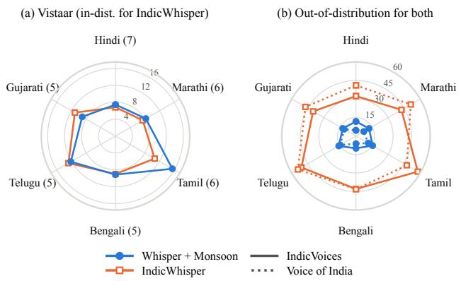
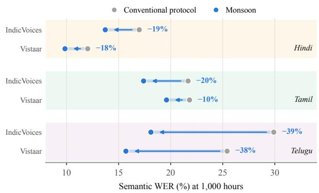
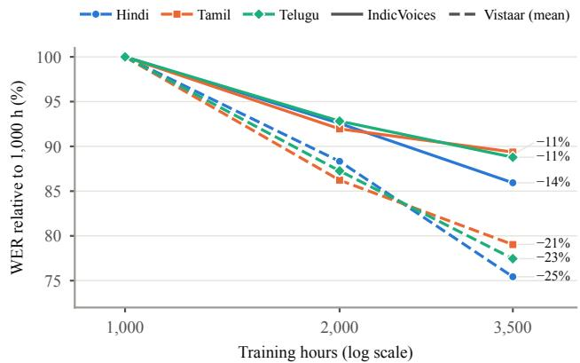

# MONSOON: SCALABLE SPONTANEOUS SPEECH COLLECTION FOR LOW-RESOURCE ASR IN 50 LANGUAGES

Shobhit Banga, Manas Dhir, Aaditya Pareek, Amritansh Walecha, Bhaskar Singh, Hanuman Sidh, Manmeet Kaur, Sagar Jain, Supriya Paul, Vanshika Chhabra, Utkarsh Singh

Voice Arena

{shobhit, manas, aaditya}@voicearena.com

## ABSTRACT

For most languages, automatic speech recognition (ASR) is limited less by model architecture than by a lack of accurately transcribed spontaneous speech. We present Monsoon, a framework for collecting such data at scale. It elicits un scripted conversations between paired contributors, screens recordings with automated classifiers, corrects transcripts over five levels of human review, and selects segments for lexical and acoustic coverage. It has collected speech in 50 languages; we analyse seven 3,500-hour corpora. At equal volume, its quality stages reduce semantic word error rate (WER) by 10– 39% relative to a conventional protocol. Compared with an architecture-matched baseline trained on public corpora, Whisper fine-tuned on Monsoon performs comparably on the baseline’s own test sets and reduces semantic WER by 20–44 points on conversational benchmarks. The gains transfer to a second architecture and grow with data volume.

Index Terms— speech recognition, data collection, lowresource languages, spontaneous speech

## 1. INTRODUCTION

For English, where transcribed speech is abundant, the best ASR systems now average below 6% word error rate (WER) across the Open ASR Leaderboard [1]. Across languages, accuracy tracks the quantity of such data; for Whisper, WER decreases log-linearly with the hours of training audio per language, halving with every sixteen-fold increase [2]. For most languages, accuracy is therefore largely limited by the amount of suitable training data rather than by model architecture. Existing corpora for these languages are small, dominated by read or prompted speech that is mismatched to spontaneous usage, or weakly verified: annotation guidelines vary within and between corpora, crowd-sourced transcripts are rarely checked, and inconsistent orthography fragments the label space [3]. Much of this noise is unsystematic, so text normalisation cannot fully correct it.

Efforts to scale speech data have mostly favoured volume over control. Crowd-sourced read speech [4], parliamentary and religious recordings [5, 6], and weakly supervised web audio [2] give broad language coverage, but the source fixes their domain, speaking style, and label quality. Models trained on large aggregations of such data do well on test sets drawn from the same collections and lose much of their accuracy on conversational speech [7, 8]. What is scarce, then, is not speech data in general but data collected and verified for the conditions a deployed model faces.

We propose Monsoon, a framework that enforces data quality at scale through automated filtering and human verification. The framework has been used to collect speech in 50 languages. Here we analyse seven of them, including Kashmiri, which has no public training corpus of comparable size, each with about 3,500 hours of transcribed spontaneous speech in single speaker segments taken from the separately recorded channels of two-party conversations. Per language, these corpora exceed publicly available corpora [9, 10] in transcribed volume and, on average, in speaker coverage. Whisper medium [2] fine-tuned on Monsoon matches the architecture-matched IndicWhisper [7] on the latter’s own test sets and outperforms it by 20 to 44 points of semantic WER on independently collected spontaneous speech. At equal volume and with the same elicitation, the framework’s quality stages reduce error by 10 to 39% relative over a conventional protocol. The gains transfer to SraVaani-1.0 [11], an independently pretrained, Indic-specialised FastConformer model; the fine-tuned Whisper model outperforms all but one of five commercial systems; and error is still falling at the full collected volume. A 10-hour sample of each of the 50 languages is available on request.

## 2. RELATED WORK

Conversational speech corpora. Transcribed spontaneous speech has long been expensive to collect. Switchboard [12] established telephone conversation as a training resource for English, and the Babel programme [13] extended it to low-resource languages at tens of hours per language. IndicVoices [9, 10] collects extempore and conversational speech across 22 languages, with 11.2K transcribed hours in total. Benchmarks of accented and in-the-wild speech continue to find that existing systems perform poorly outside read

speech [14, 8].

Scaling speech data. Large multilingual corpora draw on sources that already exist: volunteer read speech [4], parliamentary recordings [5], religious texts [6], weakly supervised web audio [2], or aggregations of earlier public corpora [7]. The source fixes their speaking style and domain, and label quality is controlled, if at all, by filtering after the fact.

Data quality in ASR training. Orthographic complexity predicts ASR error across languages [3], speaker count at fixed volume drives robustness to unseen accents [15], and nonintrusive predictors such as DNSMOS [16] measure acoustic quality at corpus scale. These factors have been studied in isolation, not combined in a collection process and tested against conventional collection at equal volume.

## 3. THE MONSOON FRAMEWORK

Contributors. Monsoon recruits speakers per language from an existing contributor network, including rural and semiurban regions, and admits only those who pass a proficiency screen in the target language. Contributors are paid, give informed consent, and grant rights for model training and distribution. A per-language cap on recorded speech keeps any speaker below 0.2% of a corpus.

Elicitation. The platform pairs two contributors, typically strangers, and records their conversation peer-to-peer on their own phones, one speaker per channel. Each session follows a topic: a one-sentence scenario with five sub-topics revealed in turn, sustaining 10 to 20 minutes of unscripted speech. Topics are generated by Gemini 3.7 Flash across 35 everyday domains, conditioned on the topics already accepted in each. Sub-topics follow one of six conversational arcs, and constraints require every stage to involve both speakers, at least one stage to elicit numbers and one a procedure, and at least two to require naming real places, shops, or products, while the prompt itself stays region-neutral and excludes role-play. Candidates are embedded with BGE-small and rejected if their cosine similarity to the nearest accepted topic exceeds 0.8, a threshold tuned by inspecting near-duplicate pairs; the rejection rate rises from 16% to over 50% as a domain saturates. Accepted topics are translated and revised by native speakers. The pool holds about 5,000 topics per language and grows with recording, so no pair receives the same topic twice.

Gating and segmentation. Classifiers fine-tuned from XLS-R 300M [17] on over 20,000 hours of labelled audio verify language and speaker gender with over 95% held-out accuracy, and PANNs [18] rejects recordings in which any recordedmedia class, such as music, exceeds probability 0.5. Each channel is segmented separately with WebRTC VAD at pauses of at least 2 s, with a soft limit of 15 s, so every segment has one speaker. Segments with DNSMOS P.808 [16] below 2.6, between “poor” and “fair” on the absolute category rating scale, are kept only if human reviewers judge them intelligible, and a per-language Whisper medium model [2], fine-tuned on

Table 1. Corpus statistics. Dur.: median segment length (s); F: female share of audio; Dist.: districts; Dev.: device models; MOS: median DNSMOS.
<table><tr><td>Lang.</td><td>Hours</td><td>Utt. Dur.</td><td>Spk.</td><td>F</td><td>Dist.</td><td></td><td>Dev. MOS</td></tr><tr><td>Bengali</td><td>3,500</td><td>1.04M</td><td>13.4</td><td>4,863</td><td>62%</td><td>127</td><td>787 3.66</td></tr><tr><td>Gujarati</td><td>3,544</td><td>1.22M 11.9</td><td>5,568</td><td>40%</td><td>106</td><td>806</td><td>3.53</td></tr><tr><td>Hindi</td><td>3,611</td><td>1.16M 12.9</td><td></td><td>13,73137%</td><td></td><td>7811,123</td><td>3.61</td></tr><tr><td>Kashmiri</td><td>3,330</td><td>1.62M</td><td>6.4</td><td>2,936 19%</td><td>31</td><td>447</td><td>3.61</td></tr><tr><td>Marathi</td><td>3,500</td><td>1.08M</td><td>13.2 5,329</td><td>57%</td><td>111</td><td>812</td><td>3.63</td></tr><tr><td>Tamil</td><td>3,488</td><td>1.14M</td><td>12.5</td><td>3,452 58%</td><td>95</td><td>777</td><td>3.56</td></tr><tr><td>Telugu</td><td>3,500</td><td>1.18M</td><td>12.3</td><td>6,068 53%</td><td></td><td>134 834</td><td>3.54</td></tr><tr><td>Total</td><td>24,472</td><td>8.43M</td><td>41,947</td><td>一</td><td>一</td><td>一</td><td>一</td></tr></table>

1,000 hours of annotated data, produces draft transcripts.

Transcription. Drafts pass five levels, each an edit by one annotator verified by another: the first corrects the draft against the audio, and later levels target ambiguous pronunciations, code-switch boundaries, named entities, and spelling variants. Numbers are written as words, and segments still disputed after the fifth level are re-transcribed. Annotators are audited automatically on batches of 100 segments and flagged for man ual review if a batch contains out-of-script characters, repeats the same insertion across many segments, or systematically raises the minimum CER against several open-source ASR outputs; the thresholds are adjusted per language as annotator behaviour is observed. After all validation steps, an in-house team audits a sample of each annotator’s segments, and that annotator’s segments enter the corpus only if at least 98% of the sampled segments are judged correct.

Selection. Unfiltered conversations contain many greetings, fillers, and backchannels, and their quality and length are uneven. About 67% of recorded audio survives gating and transcription, and each corpus is selected from a verified pool roughly ten times its final size. Segments are binned by DNS-MOS, with edges at 2.6, 3.0, and 3.4, and by duration, and ranked within each bin by the mean inverse pool frequency of their words $w _ { 1 } , \ldots , w _ { n }$

$$
\begin{array} { r } { s ( x ) = \frac { 1 } { n } \sum _ { i = 1 } ^ { n } 1 / f ( w _ { i } ) , } \end{array}\tag{1}
$$

which favours rare vocabulary independently of length and demotes filler-dominated segments. Every bin is given the same target of hours and filled in rank order, per speaker and gender, subject to the speaker cap; bins with too little data contribute all they have, and the shortfall is taken up by the remaining bins. Scarce conditions such as noisy and short audio are therefore kept as a small but present tail rather than crowded out.

Resulting corpora. Table 1 summarises the seven corpora. Hindi spans 781 districts, most of India; Kashmiri, drawn from a far smaller population, has fewer and deeper contributors, shorter segments, and the most skewed gender balance.

Experimental setup. We fine-tune Whisper medium [2] separately on each Monsoon corpus, and continually fine-tune SraVaani [11], with the same schedule: five epochs of AdamW at a learning rate of $1 0 ^ { - 5 }$ , 500 warm-up steps, and cosine decay, on eight H100 GPUs in bf16 with gradient clipping at 1.0, a per-device batch of 16 with two accumulation steps (global $2 5 6 )$ , and SpecAugment. Whisper uses time and frequency masking (probability 0.05, width 10); SraVaani uses weight decay $1 0 ^ { - 3 }$ and its default SpecAugment. We evaluate on the Vistaar test sets [7], CommonVoice [4], FLEURS [19], GramVaani, IndicTTS, Kathbath and its noisy variant [20], and MUCS [21], which are in distribution for the IndicWhisper baseline but not for Monsoon; and on IndicVoices [9] and Voice of India [8], which are out of distribution for both. We report semantic WER, in which an LLM judge (Gemini 3.6 Flash) discounts differences that preserve the spoken content [22]; Voice of India is scored with its orthography-aware variant [23]. Kashmiri is excluded from the comparisons, since none of the baseline or commercial systems supports it.

  
Fig. 1. Semantic WER (%) of Monsoon-trained Whisper and IndicWhisper. (a) Vistaar mean (sets per language in brackets); (b) IndicVoices (solid) and Voice of India (dotted, OIWER). Radial scales differ.

## 4. RESULTS

## 4.1. Does Monsoon generalise beyond its own collection?

We compare against IndicWhisper [7], a Whisper medium model trained on about 10,700 hours of public corpora drawn from the same sources as the Vistaar test sets. With the architecture held fixed, the comparison mainly reflects the training data, although the two training recipes differ. Fig. 1 reports both models per language.

On the Vistaar sets, which favour IndicWhisper because its training data shares their sources, the two polygons largely coincide (Fig. 1a). The Monsoon model is ahead in Gujarati and Telugu and within one point in Hindi, Marathi, and Bengali; only in Tamil does IndicWhisper lead by more. Monsoon therefore matches a model trained on the test sets’ own sources without having seen any of them.

  
Fig. 2. Semantic WER (%) at 1,000 hours: conventional protocol (grey) vs. Monsoon (blue), same recipe. Labels: relative reduction.

On the benchmarks out of distribution for both models, the polygons separate completely (Fig. 1b). On both IndicVoices and Voice of India, every IndicWhisper point lies above 32% and every Monsoon point below 17%, and within each language the gap is at least 20 points. IndicWhisper’s error grows several-fold once the test data leaves its training sources, while Monsoon’s stays close to its level in panel (a). The gap reflects the domain of the training data: IndicWhisper’s largely readspeech sources do not prepare it for spontaneous speech, which Monsoon is collected to capture, and the Monsoon model trans fers to independently collected spontaneous speech with little loss.

## 4.2. What does the pipeline itself contribute?

To isolate the pipeline, we compare against data from the same elicitation process, with the same topics, pairing, and devices, but processed under a conventional protocol: recordings are checked only for spoken language and receive a single level of human transcription instead of five, with no further gating, quality review, or selection. Both are Whisper medium trained on 1,000 hours with the same recipe, so they differ only in how the data was gated, transcribed, and selected. The Monsoon model is better on both benchmarks in Hindi, Tamil, and Telugu (Fig. 2), reducing error by 10 to 39% relative. The reduction appears on both IndicVoices and the Vistaar sets, so it is not confined to spontaneous speech. Because elicitation is identical on both sides, the difference cannot be attributed to topics, pairing, or recording conditions. The gain is largest in Telugu, at close to 40% on both benchmarks, indicating that at equal volume the gating, verification, and selection stages together account for much of the accuracy of the resulting models.

Table 2. Semantic WER (%) on IndicVoices. Best in bold. Commercial systems evaluated in September 2026.
<table><tr><td>System</td><td>hi</td><td>bn</td><td>gu</td><td>mr</td><td>ta</td><td>te</td><td>Avg.</td></tr><tr><td>MAI-Transcribe-2</td><td>9.5</td><td>8.3</td><td>11.6</td><td>10.5</td><td>13.2</td><td>17.7</td><td>11.8</td></tr><tr><td>Gemini 3.1 Pro</td><td>13.1</td><td>10.3</td><td>14.0</td><td>14.7</td><td>18.3</td><td>18.8</td><td>14.9</td></tr><tr><td>ElevenLabs Scribe v2</td><td>13.2</td><td>12.0</td><td>16.6</td><td>16.4</td><td>22.7</td><td>23.2</td><td>17.4</td></tr><tr><td>Muse Voice Transcribe</td><td>16.2</td><td>14.5</td><td>31.9</td><td>24.8</td><td>35.2</td><td>33.0</td><td>25.9</td></tr><tr><td>GPT Realtime Whisper</td><td>33.4</td><td>45.0</td><td>47.9</td><td>48.1</td><td>64.5</td><td>55.0</td><td>49.0</td></tr><tr><td>Whisper medium</td><td>57.3</td><td>91.5</td><td>91.4</td><td>83.5</td><td>74.9</td><td>92.7</td><td>81.9</td></tr><tr><td>+ Monsoon</td><td>11.8</td><td>10.0</td><td>12.3</td><td>12.2</td><td>15.6</td><td>16.1</td><td>13.0</td></tr></table>

## 4.3. Do the gains transfer across architectures?

To test whether the gains depend on Whisper, we continually fine-tune SraVaani-1.0 [11], which differs from Whisper in encoder architecture, decoder formulation, and pretraining data, and is already specialised to Indian languages. Continual finetuning on Monsoon reduces its semantic WER on IndicVoices by 13 to 28% relative across four representative languages, Hindi, Bengali, Gujarati, and Telugu, with the largest gain in Gujarati. On Hindi, where we evaluate the full suite, readspeech benchmarks such as FLEURS and Kathbath show only marginal increases, of at most 0.4 points, a regression that standard replay of the original training data is designed to mitigate. The gains are therefore not specific to one architecture, and they add accuracy on top of a model already trained on large in-language data.

## 4.4. How does Monsoon compare with commercial systems?

Table 2 places the fine-tuned model among commercial systems on IndicVoices. Fine-tuning on Monsoon reduces Whisper medium’s error from 57–93% to 10–16%, after which it ranks second in five of the six languages, behind only MAI-Transcribe-2, and first in Telugu, where it leads MAI-Transcribe-2 by 1.6 points, and it is ahead of Gemini 3.1 Pro, ElevenLabs Scribe v2, Muse Voice Transcribe, and GPT Realtime Whisper in every language. Averaged over the six languages, its error is 13% lower than that of Gemini 3.1 Pro, the second-best commercial system. The comparison is conservative: the training data of the commercial systems is undisclosed and may include the public IndicVoices training split, which the Monsoon model, a 769M-parameter model, has not seen.

## 4.5. Does accuracy keep improving with more data?

We fine-tune Whisper medium on random subsets of 1,000 and 2,000 hours and on the full corpus in Hindi, Tamil, and Telugu, holding the recipe fixed so that volume is the only variable. Fig. 3 expresses each curve relative to its error at 1,000 hours. Error falls monotonically on all six curves: from

  
Fig. 3. Semantic WER relative to the 1,000-hour model, on IndicVoices (solid) and the Vistaar mean (dashed). Labels: total relative reduction.

1,000 hours to the full corpus, it drops by 11 to 14% relative on IndicVoices and by 21 to 25% on the Vistaar sets, so the gain from additional data is roughly twice as large on the Vistaar sets. The effect of volume is consistent across the three languages. No curve has flattened at the full collected volume, which suggests that collecting more data through the framework would yield further improvements.

## 5. CONCLUSION

We presented Monsoon, a framework for collecting spontaneous speech for ASR training at scale, and used it to build corpora of about 3,500 hours in each of seven languages. At equal volume and with the same elicitation, its gating, verification, and selection stages reduce error by 10 to 39% relative over a conventional protocol. Models trained on Monsoon match a read-speech baseline on its own test sets and outperform it by 20 to 44 points on independently collected spontaneous speech, the gains transfer to a second, Indic-specialised architecture, and accuracy is still improving at the full collected volume. A 10-hour sample of each of the 50 languages is available on request. Future work will extend the framework to further languages.

## 6. REFERENCES

[1] Vaibhav Srivastav et al., “Open ASR leaderboard: Towards reproducible and transparent multilingual and long-form speech recognition evaluation,” arXiv preprint arXiv:2510.06961, 2025.

[2] Alec Radford, Jong Wook Kim, Tao Xu, Greg Brockman, Christine McLeavey, and Ilya Sutskever, “Robust speech recognition via large-scale weak supervision,” in Proc. ICML, 2023.

[3] Chihiro Taguchi and David Chiang, “Language complexity and speech recognition accuracy: Orthographic complexity hurts, phonological complexity doesn’t,” in Proc. ACL, 2024, pp. 15493–15503.

[4] Rosana Ardila et al., “Common Voice: A massivelymultilingual speech corpus,” in Proc. LREC, 2020, pp. 4218–4222.

[5] Changhan Wang et al., “VoxPopuli: A large-scale multilingual speech corpus for representation learning, semisupervised learning and interpretation,” in Proc. ACL-IJCNLP, 2021, pp. 993–1003.

[6] Vineel Pratap et al., “Scaling speech technology to 1,000+ languages,” Journal of Machine Learning Research, vol. 25, no. 97, pp. 1–52, 2024.

[7] Kaushal Santosh Bhogale, Sai Sundaresan, Abhigyan Raman, Tahir Javed, Mitesh M. Khapra, and Pratyush Kumar, “Vistaar: Diverse benchmarks and training sets for Indian language ASR,” in Proc. Interspeech, 2023, pp. 4384–4388.

[8] Kaushal Bhogale et al., “Voice of India: A large-scale benchmark for real-world speech recognition in India,” arXiv preprint arXiv:2604.19151, 2026.

[9] Tahir Javed et al., “IndicVoices: Towards building an inclusive multilingual speech dataset for Indian languages,” arXiv preprint arXiv:2403.01926, 2024.

[10] AI4Bharat, “IndicVoices dataset card,” Hugging Face, updated Dec. 23, 2025. Accessed: Sep. 24, 2026. [Online]. Available: https://huggingface.co/dat asets/ai4bharat/IndicVoices.

[11] Sujith Pulikodan et al., “SraVaani 1.0: Scaling inclusive speech recognition for Indic languages,” arXiv preprint arXiv:2608.08235, 2026.

[12] John J. Godfrey, Edward C. Holliman, and Jane Mc-Daniel, “SWITCHBOARD: Telephone speech corpus for research and development,” in Proc. IEEE ICASSP, 1992, pp. 517–520.

[13] Mark J. F. Gales, Kate M. Knill, Anton Ragni, and Shakti P. Rath, “Speech recognition and keyword spotting for low-resource languages: Babel project research at CUED,” in Proc. SLTU, 2014, pp. 16–23.

[14] Tahir Javed et al., “LAHAJA: A robust multi-accent benchmark for evaluating Hindi ASR systems,” in Proc. Interspeech, 2024.

[15] Zheng-Xin Yong, Vineel Pratap, Michael Auli, and Jean Maillard, “Effects of speaker count, duration, and accent diversity on zero-shot accent robustness in low-resource ASR,” in Proc. Interspeech, 2025.

[16] Chandan K. A. Reddy, Vishak Gopal, and Ross Cutler, “DNSMOS: A non-intrusive perceptual objective speech quality metric to evaluate noise suppressors,” in Proc. IEEE ICASSP, 2021, pp. 6493–6497.

[17] Arun Babu et al., “XLS-R: Self-supervised cross-lingual speech representation learning at scale,” in Proc. Interspeech, 2022, pp. 2278–2282.

[18] Qiuqiang Kong, Yin Cao, Turab Iqbal, Yuxuan Wang, Wenwu Wang, and Mark D. Plumbley, “PANNs: Largescale pretrained audio neural networks for audio pattern recognition,” IEEE/ACM Transactions on Audio, Speech, and Language Processing, vol. 28, pp. 2880–2894, 2020.

[19] Alexis Conneau et al., “FLEURS: Few-shot learning evaluation of universal representations of speech,” in Proc. IEEE SLT, 2022, pp. 798–805.

[20] Tahir Javed, Kaushal Santosh Bhogale, Abhigyan Raman, Pratyush Kumar, Anoop Kunchukuttan, and Mitesh M. Khapra, “IndicSUPERB: A speech processing universal performance benchmark for Indian languages,” in Proc. AAAI, 2023, pp. 12942–12950.

[21] Anuj Diwan et al., “MUCS 2021: Multilingual and code-switching ASR challenges for low resource Indian languages,” in Proc. Interspeech, 2021, pp. 2446–2450.

[22] Sarvam AI, “LLM-WER: Semantic evaluation for automatic speech recognition,” GitHub repository, 2026. Accessed: Sep. 1, 2026. [Online]. Available: https: //github.com/sarvamai/llm\_wer.

[23] Kaushal Santosh Bhogale et al., “Towards orthographically-informed evaluation of speech recognition systems for Indian languages,” arXiv preprint arXiv:2603.00941, 2026.