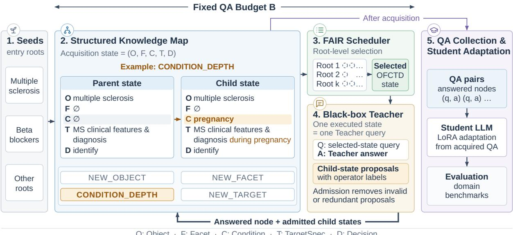
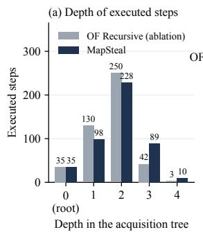
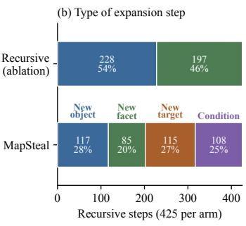
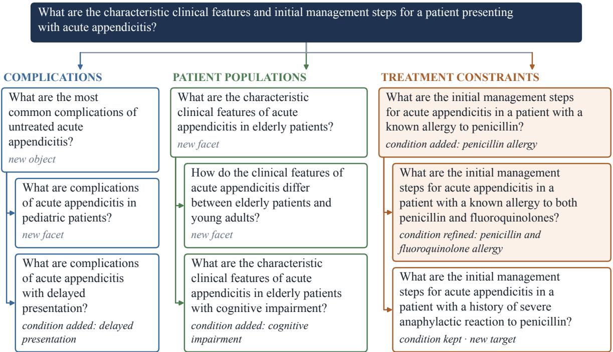
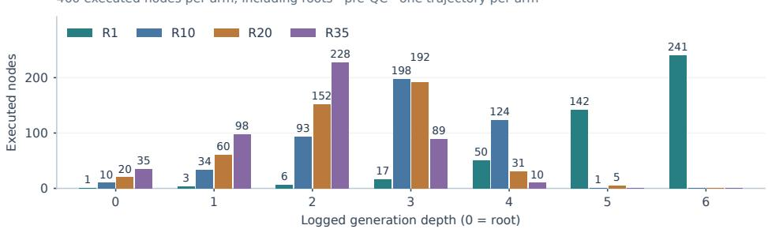
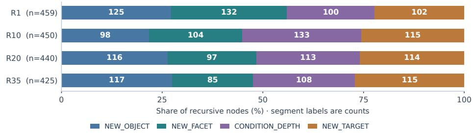
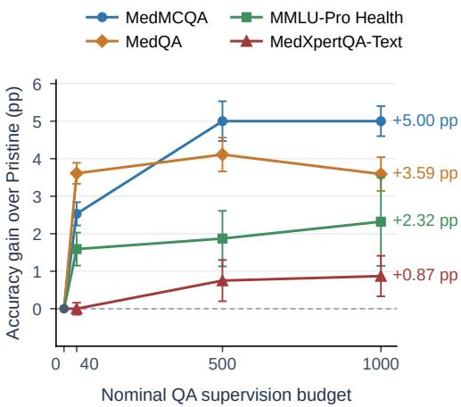
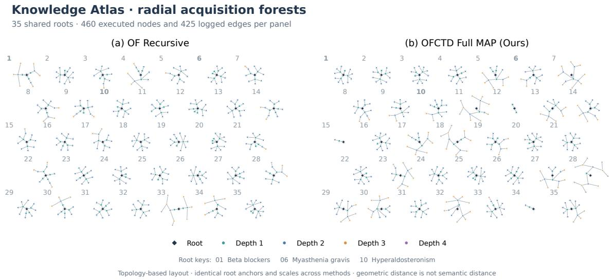
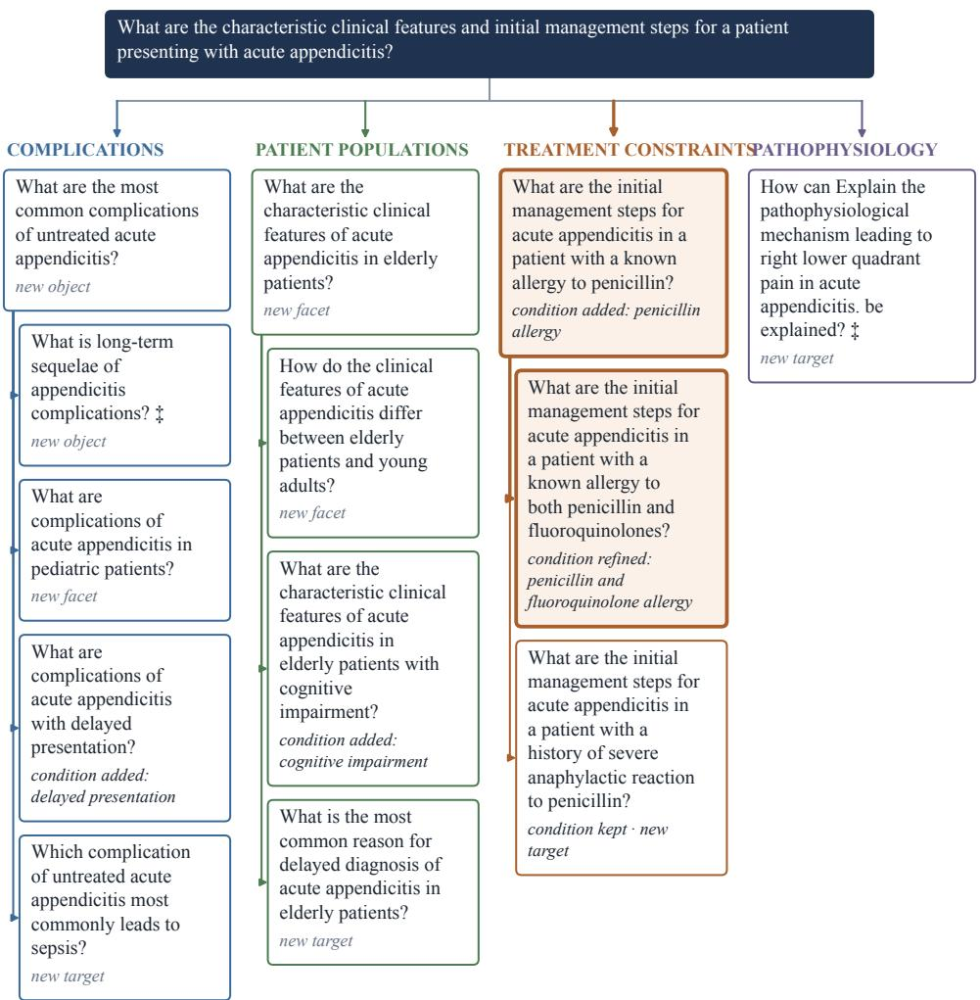
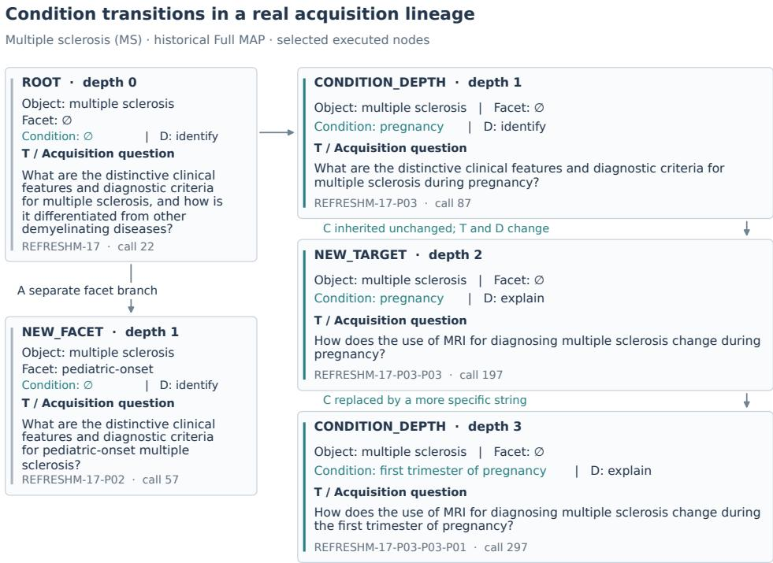

# MapSteal: Map-based Autonomous Knowledge Stealing Attack Against Large Language Models

Zhengao Li   
University of Connecticut   
Storrs, CT, USA   
zhengao.li@uconn.edu   
Chuxu Zhang   
University of Connecticut   
Storrs, CT, USA   
chuxu.zhang@uconn.edu

Yushun Dong Florida State University Tallahassee, FL, USA yushun.dong@fsu.edu

## Abstract

Knowledge acquisition from black-box large language models (LLMs) offers a practical approach to adapting smaller student models. However, many existing methods rely on predefined queries or student feedback to guide acquisition, leaving autonomous expansion of knowledge targets an important challenge. We propose MapSteal, a student-independent framework for structured recursive knowledge acquisition. Starting from a small set of ini tial roots, MapSteal represents acquisition targets using structured states and recursively expands them through teacher-proposed directions. Question realization, proposal admission, and deduplication constrain the acquisition process, while root-aware scheduling organizes exploration under a fixed QA budget. The resulting question–answer pairs are used to adapt student models without requiring student feedback during acquisition. Experiments with Qwen3.5 students at 2B, 4B, and 9B scales show competitive downstream performance across six medi cal and cybersecurity benchmarks. On the 4B medical evaluation, Full MapSteal improves average accuracy by 1.17 percentage points over a simplified recursive acquisition variant. Crossdomain evaluations show that gains depend on the domain and evaluation panel. These results demonstrate the feasibility of struc tured, student-independent recursive acquisition while highlighting the distinction between generating acquisition targets and obtaining useful training supervision. Our code is avail able at https://github.com/LabRAI/Mapsteal.

## 1 Introduction

Large language models (LLMs) provide a valuable source of supervision for adapting smaller models to specialized domains and tasks. When a strong teacher is accessible only through a black-box API, a student can collect teacher-generated responses and use them for training without accessing the teacher’s parameters or original training data. This paradigm has been extensively studied in model extraction and knowledge distillation, from functionality stealing in classifiers (Orekondy et al., 2018; Krishna et al., 2020) to capability extraction from modern language models (Birch et al., 2023; Liang et al., 2024; Ye et al., 2025; Li et al., 2026a). However, acquiring supervision from a black-box teacher can be expensive, and the space of possible queries is too large to explore exhaustively. Under a limited query budget, the central challenge is therefore to acquire knowledge that improves downstream student performance efficiently.

Prior work addresses this challenge through several complementary approaches. Query-efficient extraction methods select informative examples based on uncertainty, diversity, or disagreement (Pal et al., 2020; Peng et al., 2023; Baykal et al., 2023). Data-free approaches synthesize queries to expose student–teacher discrepancies (Kariyappa et al., 2022; Truong et al., 2021; Zhang et al., 2023). Student-aware methods further adapt generated supervision to the learner’s observed weaknesses (Liu et al., 2024), while other approaches improve how acquired responses are used for training (Liang et al., 2024; Ye et al., 2025; Chen et al., 2026). Although these methods improve query selection, generation, and student adaptation, they raise a complementary question: what knowledge should become queryable next as acquisition proceeds? Selecting informative queries is insufficient when potentially useful knowledge targets are not represented in the current candidate space.

Constructing such targets introduces additional challenges. First, an evolving acquisition process must represent not only individual questions but also their knowledge objects, contextual conditions, and relationships to previously acquired information. Without an explicit acquisition state, recursive question generation can be difficult to organize. Second, deriving acquisition targets directly from

Student failures can be unreliable. An incorrect prediction may reflect question-specific difficulty rather than a transferable knowledge deficit. In our preliminary Medicine diagnostics, 129 of 179 initially incorrect examples were answered correctly after independent reformulation (Appendix F). This observation motivates an alternative that does not require explicit Student failure attribution.

To address these challenges, we propose Map-Steal, a structured framework for recursive knowledge acquisition from black-box LLMs. MapSteal represents each acquisition target using five components: Object, Facet, Condition, TargetSpec, and Decision (O/F/C/T/D). Starting from a small set of domain roots, the framework maintains an evolving knowledge map of answered and pending acquisition states. Each executed query allows the teacher to provide both an answer and candidate child targets. Typed expansion operators modify the structured states, while admission rules filter invalid or redundant proposals. A root-level fair scheduler allocates acquisition opportunities across the growing frontier under a fixed query budget. The resulting question–answer pairs are collected to adapt the student after acquisition. Unlike studentfeedback-driven approaches, MapSteal does not require online student training or explicit diagnosis of student weaknesses during acquisition.

We evaluate MapSteal across multiple student scales and knowledge domains. The results show that structured recursive acquisition provides useful downstream supervision under limited QA budgets. Controlled ablations on Medicine show that the full structured formulation improves the threebenchmark average by 1.17 percentage points over a simplified Object–Facet variant, while removing condition-based expansion reduces performance by 1.05 points. Additional analyses examine sensitivity to initial acquisition roots and characterize the trade-off between recursive depth, semantic novelty, and local coherence.

## Our contributions are threefold:

• Explicit acquisition-state formulation. We formulate budget-constrained knowledge acquisition as the construction and execution of an evolving space of structured knowledge targets, distinguishing query-space expansion from selection within the available frontier.

• Structured recursive acquisition. We introduce MapSteal, which combines O/F/C/T/D acquisition states, teacher-guided typed expansion, proposal admission, and root-level fair scheduling to support traceable recursive knowledge acquisition without online student failure attribution.

• Empirical evaluation and analysis. We evaluate the framework across student scales and domains, investigate its structured components through controlled ablations, and characterize the effects of acquisition roots, query budgets, and recursive exploration behavior.

## 2 Methodology

Overview. MapSteal acquires domain-oriented supervision from a black-box teacher under a finite query budget. Instead of diagnosing student errors online, it maintains an explicit frontier of structured knowledge-acquisition targets. Each successful teacher interaction answers the selected target and proposes possible successors. The successors are validated, represented as new states, and scheduled for later execution. The student is adapted only after acquisition is complete. Figure 1 summarizes the procedure.

## 2.1 Problem Formulation

Let T be a teacher language model accessible through a black-box query interface, and let S be a student to be adapted to a target domain. The input is a frozen set of K acquisition roots, $\mathcal { R } ~ = ~ \{ r _ { 1 } , . . . , r _ { K } \}$ , each specifying an initial knowledge-seeking state and a question. Roots are domain entry points and need not be labeled downstream evaluation examples. Any fixed coldstart QA corpus $\mathcal { D } _ { \mathrm { s e e d } }$ is distinct from R and is not part of the recursive acquisition loop.

The procedure produces an ordered sequence of successfully executed QA records,

$$
\mathcal { D } _ { \mathrm { a c q } } = \left[ \left( q _ { i } , a _ { i } , e _ { i } \right) \right] _ { i = 1 } ^ { N } , \qquad N \leq B _ { \mathrm { a c q } } ,\tag{1}
$$

where $a _ { i }$ and $e _ { i }$ are the teacher’s answer and explanation for the executed question $q _ { i }$ . The acquisition budget $B _ { \mathrm { a c q } }$ counts successful QA executions, including root executions. API requests, invalid responses, and retries are accounted for separately. For experiments with cold-start examples, the nominal pre-QC QA budget is $B _ { \mathrm { Q A } } = | \mathcal { D } _ { \mathrm { s e e d } } | + B _ { \mathrm { a c q } } ;$ the final training set may contain fewer rows after quality control (QC). Our objective is to collect supervision that supports downstream student adaptation, not to establish complete coverage of a domain or replicate all teacher behavior. Crucially, the acquisition policy does not consult S, its predictions, or its uncertainty during execution. Downstream student performance measures the usefulness of acquired supervision after the acquisition process has ended.

  
O: Object · F: Facet · C: Condition · T: TargetSpec · D: Decision  
T = TargetSpec (abridged acquisition question shown) · ∅: empty field · Dashed circles: pending states  
Figure 1: Overview of MapSteal. Frozen domain roots initialize a structured acquisition map. Root-level FAIR scheduling selects pending states; a deterministic realizer converts non-root states into questions. A black-box teacher returns an answer, explanation, and typed child-state proposals in one successful interaction. Admitted children re-enter the frontier, while collected QA supervision is used to adapt the student only after acquisition. Map edges indicate acquisition provenance rather than verified domain relations.

## 2.2 Structured Knowledge Acquisition Map

Each acquisition target is represented by an explicit schema consisting of five components,

$$
s = ( O , F , C , T , D ) ,\tag{2}
$$

where O identifies a knowledge Object, F its Facet, C a contextual Condition, T a TargetSpec describing the information sought, and D the corresponding Decision intent. Optional fields may be empty. These fields specify an acquisition request, not verified domain facts; in particular, T is distinct from the final surface-form question.

MapSteal represents acquisition targets as structured records rather than isolated generated questions. We define the acquisition map as $\begin{array} { l } { \displaystyle M _ { t } ~ = } \end{array}$ $( V _ { t } , E _ { t } )$ , where $V _ { t }$ contains admitted acquisition states and $E _ { t }$ records directed parent–child links. Each state maintains its source root and parent provenance, allowing recursive expansion to be traced explicitly. A single ordered frontier $\mathcal { F } _ { t } \subseteq V _ { t }$ contains states awaiting execution; successfully executed states are recorded in the acquisition trajectory. Rejected proposals remain available in audit records with their rejection reasons but are not placed on the executable frontier. Neither the graph edges nor the schema assert ontological, causal, or otherwise verified relationships between domain entities. For example, a target concerning multiplesclerosis clinical features and diagnosis may produce a child concerning the same target during pregnancy. The child preserves the knowledge object while changing its condition and target specification. This transition is recorded as acquisition provenance. A syntactically valid combination of schema fields is not automatically a useful target: new states enter the frontier through teacher proposals and explicit admission checks, not exhaustive cross-products or object–object joins.

## 2.3 Teacher-Guided Recursive Expansion

Question realization and teacher interaction. For a selected root state, MapSteal uses the question supplied in the frozen root manifest. For a non-root state, a deterministic realizer converts its TargetSpec and Decision intent into a knowledgeseeking question, including condition context when needed. Realization failure causes the state to be discarded before any teacher call. The prompt for a successfully realized state includes the current structured state and root-specific direction-registry context. In one successful teacher interaction, T returns an answer, an explanation, and typed childstate proposals; the teacher proposes states, rather than directly supplying the final surface questions for those children. The direction registry records prior teacher-proposed directions for that root and informs the prompt, but not the scheduler.

Typed state transitions. Each proposed child is constructed using one of four operators. Table 1 gives their field-level effects. Every operator supplies a new TargetSpec and Decision intent; an inherited Condition is a field of the state, not a cross-root resource. CONDITIONDEPTH changes the contextual Condition while preserving the Object and Facet. The new Condition may introduce, replace, or refine constraints; the operator does not require strict semantic specialization.

Table 1: Field updates for proposed states. “Keep” means inherit the parent’s field; “New” means use the proposed value. Transitions assign new $T$ and D.
<table><tr><td>Operator</td><td>0</td><td> $F$ </td><td> $C$ </td><td>T, D</td></tr><tr><td>NEWOBJECT</td><td>New</td><td>Empty</td><td>Empty</td><td>New</td></tr><tr><td>NEWFACET</td><td>Keep</td><td>New</td><td>Keep</td><td>New</td></tr><tr><td>CONDITIONDEPTH</td><td>Keep</td><td>Keep</td><td>New</td><td>New</td></tr><tr><td>NEWTARGET</td><td>Keep</td><td>Keep</td><td>Keep</td><td>New</td></tr></table>

Validation and admission. The interaction has three distinct safeguards. First, the returned teacher response must satisfy its schema; an invalid response may be retried once with the same request. Second, proposed children undergo operator-specific validity and admission checks, including required fields, valid Decision intents, parent/ancestor TargetSpec constraints, Decision– TargetSpec compatibility, and duplicate identities. Deduplication uses normalized exact matching, including across roots, rather than embedding similarity. Third, question realization is checked only when an admitted child is later selected for execution. Proposal-level rejection does not consume a successful QA budget slot. Accepted children are appended to the frontier and linked to their executed parent; rejected proposals and reasons remain in the trajectory audit. This separation between proposing, admitting, and executing targets makes recursive acquisition explicit and traceable.

## 2.4 Budgeted Acquisition and Scheduling

Recursive proposals can accumulate faster than queries are executed. MapSteal therefore distinguishes the global ordered frontier $\mathcal { F } _ { t }$ from the smaller set of states that can be executed under the remaining budget. Let $\mathcal { R } _ { t } ^ { + }$ denote roots that have at least one pending state, and let $E _ { r }$ be the number of successfully executed non-root states associated with root r. The scheduler selects

$$
\boldsymbol { r } ^ { * } = \underset { \boldsymbol { r } \in \mathcal { R } _ { t } ^ { + } } { \mathrm { a r g m i n } } \big ( \boldsymbol { E _ { r } } , \boldsymbol { \tau _ { r } } , \mathrm { i d } ( \boldsymbol { r } ) \big ) ,\tag{3}
$$

using lexicographic order, where $\tau _ { r }$ is the globalfrontier position of the oldest pending state for $r .$ It then executes that root’s oldest pending state (FIFO). The implementation uses one global frontier, rather than physically separate queues. Because roots are initially enqueued before their descendants and root executions do not increment $E _ { r }$ the root states are executed before recursive descendants; FAIR primarily balances subsequent recursive executions across roots. Algorithm 1 gives the core acquisition loop. Invalid realization or an invalid teacher response after its permitted retry removes the selected state without adding a successful QA record. If the frontier is exhausted, acquisition aborts rather than inventing replacement states. The actual runner additionally enforces cost and validity safeguards, detailed in the implementation appendix. Neither the scheduling rule nor the root-specific direction registry estimates downstream student utility or semantic coverage.

Algorithm 1 MapSteal recursive acquisition   
Require: Frozen roots R, teacher $\tau ,$ budget $B _ { \mathrm { a c q } }$   
Ensure: Ordered acquired QA records $\mathcal { D } _ { \mathrm { a c q } }$   
1: $\mathcal { F }  \mathcal { R } ; \mathcal { D } _ { \mathrm { a c q } }  [ ]$   
2: Initialize global identities V, counts $E _ { r }  0 ,$ registries   
$G _ { r }$   
3: while $| \mathcal { D } _ { \mathrm { a c q } } | < B _ { \mathrm { a c q } }$ do   
4: if ${ \dot { \mathcal { F } } } = { \dot { \emptyset } }$ then   
5: abort   
6: end if   
7: r ← FAIR(F, E)   
8: s ← PopOldest(F, r)   
9: q ← RootQuestion(s) if root;   
otherwise Realize(s)   
10: if $\cdot q = \perp$ then   
11: continue   
12: end if   
13: y ← QueryTeacher(T , s, q, Gr)   
▷ Response schema check; at most one retry   
14: if $y = \perp$ then   
15: continue   
16: end if   
17: Append (q, y.answer, y.explanation) to $\mathcal { D } _ { \mathrm { a c q } }$   
18: C ← ExpandAndAdmit(s, y, V)   
19: Update $\hat { G } _ { r } , \nu ,$ and append C to $\mathcal { F }$   
20: if depth(s) > 0 then   
21: $\bar { E } _ { r } \gets \mathrm { ~ \ ' ~ } E _ { r } + 1$   
22: end if   
23: Record executed state and proposal provenance   
24: end while   
25: return $\mathcal { D } _ { \mathrm { a c q } }$

## 2.5 Student Adaptation

Each successfully acquired record contains a question, answer, and explanation. Offline QC removes malformed supervision and duplicate question texts. If cold-start supervision is supplied, it precedes acquired records in the QC input; consequently, a later acquired duplicate of an existing seed question is removed. Writing ∥ for ordered corpus concatenation, the final training corpus is

$$
\mathcal { D } _ { \mathrm { t r a i n } } = \mathrm { Q C } ( \mathcal { D } _ { \mathrm { s e e d } } \parallel \mathcal { D } _ { \mathrm { a c q } } ) .\tag{4}
$$

The training target uses the teacher’s answer followed by its explanation; ancillary proposal metadata, including the teacher’s reusable-knowledge field, does not enter the training text. QC does not trigger replacement queries to restore the nominal budget. The student is adapted only after the full acquisition run:

$$
S ^ { \prime } = \mathrm { F i n e T u n e } ( S , { \mathcal { D } } _ { \mathrm { t r a i n } } ) .\tag{5}
$$

Training configurations and downstream evaluation protocols are specified in the experimental setup. We evaluate the transferred utility of acquired supervision through student performance, while separately analyzing acquisition behavior (e.g., recursion depth and query similarity). An expanding frontier alone is not evidence of complete domain coverage or improved student performance.

## 3 Experiments

## 3.1 Setup

Models and Training. We use GPT-4.1 as the black-box Teacher and Qwen3.5-2B, 4B, and 9B as Students (Team, 2026). Students are adapted using LoRA (Hu et al., 2021) after knowledge acquisition. Unless otherwise noted, we report mean ± standard deviation over three seeds. Further implementation details are provided in Appendix A.

Benchmarks and Evaluation. We evaluate knowledge transfer in two domains: Medicine and Cybersecurity. For Medicine, we use MedM-CQA (Pal et al., 2022), MedQA (Jin et al., 2020), and MedXpert (Zuo et al., 2025). For MedMCQA, we evaluate on a fixed subset of 500 questions from the official validation (dev) split, as the test labels are not publicly available. For Cybersecurity, we use CyberMetric (Tihanyi et al., 2024), SecEval (Li et al., 2023), and CTI-Bench (Alam et al., 2024). We report classification or multiple-choice accuracy (%) on the corresponding evaluation splits.

For domain-level comparisons, we compute the unweighted mean across the three benchmarks within each domain. This aggregation gives equal weight to each benchmark rather than to each individual evaluation question.

Baselines. We compare MapSteal with the following methods. Pristine denotes the original Student checkpoint without task-specific adaptation. We additionally compare against EvoKD (Liu et al., 2024) and QEDKS (Li et al., 2026a), which serve as knowledge acquisition and distillation baselines. MapSteal is our structured, Teacher-guided recursive acquisition method. All adapted methods are evaluated with the same Student model family and corresponding benchmark protocols.

Acquisition Budget. We use a nominal budget of B = 500 QA supervision instances. Both predefined root questions and recursively generated questions require Teacher responses and count toward this budget. Further protocol details are provided in Appendix A. Teacher token usage and estimated acquisition costs are reported in Appendix E.2.

## 3.2 Main Results

Table 2 compares MapSteal with Pristine, EvoKD, and QEDKS under a nominal budget of 500 QA supervision instances across three Student scales and two domains. MapSteal achieves the highest mean accuracy on 12 of the 18 evaluated settings, with particularly consistent results in Medicine. For the 4B Student, MapSteal outperforms both acquisition baselines on all three medical benchmarks, reaching 62.27% on MedM-CQA, 66.69% on MedQA, and 17.63% on MedXpertQA. MapSteal also achieves competitive results at 2B and 9B, although QEDKS obtains the highest MedQA accuracy at 9B. In Cybersecurity, Map-Steal achieves the highest CyberMetric and SecEval accuracy at 4B, while QEDKS performs better on CTI-Bench. At 9B, QEDKS leads on CyberMetric and CTI-Bench, whereas MapSteal achieves the highest SecEval accuracy. These results indicate that the relative benefits of acquisition methods vary across benchmarks and Student scales.

EvoKD exhibits substantial performance degradation and high run-to-run variance in several settings, particularly with the 2B Student. All three runs are retained in the reported results. Per-run results and further analysis are provided in Appendix E.1. Overall, MapSteal achieves competitive downstream performance across the evaluated settings, with the highest mean accuracy in 12 of 18 Student–benchmark combinations. These results demonstrate that Student-independent recursive acquisition can provide useful supervision for downstream adaptation. We further examine the effect of acquisition data size under different QA budgets, with results provided in Appendix B.2.

Table 2: Main results across selected medical and cybersecurity benchmarks. Results are reported as accuracy (%).
<table><tr><td></td><td></td><td colspan="3">Medical</td><td colspan="3">Cybersecurity</td></tr><tr><td>Student</td><td>Method</td><td>MedMCQA</td><td>MedQA</td><td>MedXpert</td><td>CyberMetric</td><td>SecEval</td><td>CTI-Bench</td></tr><tr><td rowspan="4">Qwen3.5-2B</td><td>Pristine</td><td>45.80</td><td>36.06</td><td>10.78</td><td> $7 9 . 4 7$ </td><td>71.93</td><td>60.64</td></tr><tr><td>EvoKD</td><td> $4 0 . 5 3 \pm 8 . 0 9$ </td><td> $4 1 . 1 9 \pm 8 . 4 7$ </td><td> $1 2 . 3 9 \pm 1 . 5 7$ </td><td> $7 1 . 0 0 \pm 6 . 1 9$ </td><td> $6 9 . 4 9 \pm 6 . 2 5$ </td><td> $5 2 . 7 3 \pm 9 . 4 2$ </td></tr><tr><td>QEDKS</td><td> $4 3 . 2 7 \pm 0 . 1 2$ </td><td> $4 4 . 5 9 \pm 0 . 8 1$ </td><td> $\mathbf { 1 4 . 8 8 \pm 0 . 8 3 }$ </td><td> $7 9 . 4 9 \pm 0 . 2 3$ </td><td> $7 7 . 7 3 \pm 1 . 4 6$ </td><td> ${ \bf 6 5 . 4 8 \pm 0 . 1 6 }$ </td></tr><tr><td>MapSteal (Ours)</td><td> $\mathbf { 4 7 . 8 7 \pm 1 . 0 3 }$ </td><td> $\mathbf { 4 5 . 5 9 } \mathbf { \pm 0 . 1 6 }$ </td><td> $1 4 . 6 5 { \pm } 0 . 1 9$ </td><td> $\mathbf { 7 9 . 7 0 { \pm } 0 . 1 4 }$ </td><td> $\mathbf { 7 8 . 6 8 { \scriptstyle \pm 0 . 5 6 } }$ </td><td> $6 2 . 4 1 { \pm } 1 . 0 7$ </td></tr><tr><td rowspan="4">Qwen3.5-4B</td><td>Pristine</td><td>56.60</td><td>62.14</td><td>16.73</td><td>83.63</td><td>80.60</td><td>65.71</td></tr><tr><td>EvoKD</td><td> $5 8 . 4 7 \pm 1 . 1 0$ </td><td> $6 3 . 4 5 \pm 0 . 6 6$ </td><td> $1 6 . 2 2 \pm 0 . 7 0$ </td><td> $8 2 . 9 7 \pm 0 . 1 3$ </td><td> $8 0 . 2 8 \pm 0 . 7 5$ </td><td> $6 3 . 7 9 \pm 0 . 9 3$ </td></tr><tr><td>QEDKS</td><td> $6 1 . 0 0 \pm 0 . 5 3$ </td><td> $6 5 . 5 4 \pm 0 . 2 0$ </td><td> $1 6 . 9 4 \pm 0 . 4 5$ </td><td> $8 4 . 2 1 \pm 0 . 2 4$ </td><td> $8 1 . 4 6 \pm 0 . 9 6$ </td><td> ${ \bf 6 7 . 3 0 \pm 0 . 5 4 }$ </td></tr><tr><td>MapSteal (Ours)</td><td> ${ \bf 6 2 . 2 7 \pm 0 . 4 2 }$ </td><td> ${ \bf 6 6 . 6 9 \pm 0 . 4 4 }$ </td><td> $\mathbf { 1 7 . 6 3 \pm 0 . 4 6 }$ </td><td> ${ \bf 8 4 . 6 1 \pm 0 . 1 6 }$ </td><td> ${ \bf 8 3 . 1 9 \pm 0 . 3 3 }$ </td><td> $6 6 . 5 9 \pm 0 . 7 1$ </td></tr><tr><td rowspan="4">Qwen3.5-9B</td><td>Pristine</td><td> $6 2 . 6 0 $ </td><td> $^ { 6 7 . 4 0 }$ </td><td> $1 9 . 5 5$ </td><td> $8 3 . 7 5$ </td><td> $8 3 . 0 4 $ </td><td> $6 4 . 9 9 $ </td></tr><tr><td>EvoKD</td><td> $5 9 . 0 0 \pm 5 . 7 2$ </td><td> $6 7 . 6 9 \pm 5 . 6 4$ </td><td> $1 9 . 8 5 \pm 0 . 4 2$ </td><td> $8 4 . 1 0 \pm 1 . 0 0$ </td><td> $8 1 . 0 0 \pm 2 . 2 2 $ </td><td> $6 6 . 9 5 \pm 1 . 7 3$ </td></tr><tr><td>QEDKS</td><td> $6 5 . 1 3 \pm 0 . 9 0$ </td><td> ${ \bf 7 1 . 2 0 \pm 0 . 7 1 }$ </td><td> $1 9 . 8 8 \pm 0 . 5 0$ </td><td> ${ \bf 8 6 . 7 5 \pm 0 . 1 4 }$ </td><td> $8 4 . 1 8 \pm 0 . 4 0$ </td><td> ${ \bf 7 0 . 5 2 \pm 0 . 1 9 }$ </td></tr><tr><td>MapSteal (Ours)</td><td> $\mathbf { 6 5 . 6 0 { \pm 0 . 2 0 } }$ </td><td> $7 1 . 1 4 { \pm } 0 . 4 3 $ </td><td> $\mathbf { 2 0 . 1 8 { \scriptstyle \pm 0 . 0 8 } }$ </td><td> $8 6 . 6 6 { \pm } 0 . 1 2 $ </td><td> $\mathbf { 8 5 . 3 2 \pm 0 . 4 3 }$ </td><td> $6 9 . 0 4 { \scriptstyle \pm 0 . 7 7 }$ </td></tr></table>

± denotes the sample standard deviation over three seeds.

## 3.3 Ablation Study

We investigate three aspects of MapSteal: the contribution of structured acquisition, sensitivity to the number of initial acquisition roots, and the effect of increasing the acquisition budget. Unless otherwise stated, experiments use Qwen3.5-4B on Medicine with the same Student adaptation configuration.

## 3.3.1 Effect of Structured Acquisition

tify evaluation-item uncertainty conditional on the observed acquisition trajectories. Figure 2 further compares the acquisition trajectories. Full Map-Steal produces more depth-3 and depth-4 executions than Simplified OF and distributes recursive expansion across four operator types.

  
Figure 2: Acquisition depth and expansion operator distributions of Simplified OF and Full MapSteal. Both methods execute 460 acquisition questions from the same 35 roots. Operator counts exclude root executions.

We compare Full MapSteal with two variants under a fixed budget of 500 QA pairs, comprising 40 shared cold-start examples and 460 Teacher acquisition executions. Simplified OF replaces the complete OFCTD formulation with Object–Facet acquisition. The w/o CONDITION\_DEPTH variant disables condition-based recursive expansion while retaining the remaining structured formulation. In Table 3, both ablations reduce downstream performance. Replacing OFCTD with the simplified OF formulation reduces average by 1.17 percentage points. Disabling CONDITION\_DEPTH yields a similar decrease of 1.05. These findings support the complete structured acquisition formulation and the contribution of condition-based recursive expansion. However, Simplified OF changes multiple acquisition components, including state representation, question realization, and proposal constraints. The reported confidence intervals quan-

## 3.3.2 Sensitivity to Initial Root Count

We investigate how the number of initial acquisition roots affects downstream performance under a fixed QA budget. All variants share 40 coldstart QA pairs and perform 460 additional Teacher acquisitions, yielding 500 QA pairs before quality control. We vary the number of acquisition roots over {1, 10, 20, 35} using nested subsets of a fixed 35-root pool. The 35-root configuration corresponds to Full MapSteal.

As shown in Table 4, MapSteal achieves similar Medical3 scores with 1, 10, and 20 roots (48.03, 48.11, and 48.16, respectively). The full 35-root configuration achieves 48.86, outperforming these variants by 0.70–0.84 percentage points. The results show little performance variation between 1 and 20 roots in the evaluated configurations. We also observe a clear difference in acquisition depth. With the same query budget, mean trajectory depth decreases from 5.27 with one root to 2.86, 2.37, and 1.87 with 10, 20, and 35 roots, respectively. This suggests that fewer initial roots concentrate acquisition into deeper recursive trajectories, while additional roots allow exploration to begin from more starting points. Under the evaluated nested root subsets, MapSteal retains much of its downstream performance even with fewer initial roots. Root subsets are nested subsets of a fixed 35-root pool, each with one Teacher acquisition trajectory. Detailed acquisition depth and operator distributions are provided in Appendix B.1.

Table 3: Ablation study of MapSteal on medical benchmarks.
<table><tr><td>Variant</td><td>MedMCQA</td><td>MedQA</td><td>MedXpert</td><td>Avg</td><td>Δ</td></tr><tr><td>Full MapSteal</td><td> ${ \bf 6 2 . 2 7 \pm 0 . 4 2 }$ </td><td> ${ \bf 6 6 . 6 9 \pm 0 . 4 4 }$ </td><td> $\mathbf { 1 7 . 6 3 \pm 0 . 4 6 }$ </td><td> ${ \bf 4 8 . 8 6 \pm 0 . 1 7 }$ </td><td></td></tr><tr><td>w/o CONDITION_DEPTH</td><td> $6 0 . 9 3 \pm 0 . 3 1$ </td><td> $6 6 . 2 0 \pm 0 . 2 8$ </td><td> $1 6 . 3 0 \pm 0 . 1 4$ </td><td> $4 7 . 8 1 \pm 0 . 0 4$ </td><td>-1.05</td></tr><tr><td>Simplified OF</td><td> $6 0 . 8 7 \pm 0 . 3 1$ </td><td> $6 5 . 2 8 \pm 0 . 3 6$ </td><td> $1 6 . 9 4 \pm 0 . 3 2$ </td><td> $4 7 . 6 9 \pm 0 . 1 0$ </td><td>-1.17</td></tr></table>

Table 4: Effect of initial acquisition root count.
<table><tr><td>Roots</td><td>MedMCQA</td><td>MedQA</td><td> $\mathbf { M e d X p e r t }$ </td></tr><tr><td>1</td><td> $6 0 . 8 7 \pm 1 . 1 4$ </td><td> $6 6 . 2 5 \pm 0 . 6 7$ </td><td> $1 6 . 9 7 \pm 0 . 2 9$ </td></tr><tr><td>10</td><td> $6 1 . 4 7 \pm 0 . 3 1$ </td><td> $6 5 . 4 9 \pm 0 . 3 9$ </td><td> $1 7 . 3 6 \pm 0 . 3 7$ </td></tr><tr><td>20</td><td> $6 1 . 2 7 \pm 0 . 5 0$ </td><td> $6 6 . 3 5 \pm 0 . 3 7$ </td><td> $1 6 . 8 7 \pm 0 . 3 6$ </td></tr><tr><td>35</td><td> ${ \bf 6 2 . 2 7 \pm 0 . 4 2 }$ </td><td> ${ \bf 6 6 . 6 9 \pm 0 . 4 4 }$ </td><td> $\mathbf { 1 7 . 6 3 \pm 0 . 4 6 }$ </td></tr></table>

## 3.4 Analysis of Acquisition Behavior

We further analyze how structured acquisition changes recursive exploration. We analyze executed acquisition trajectories using depth, semantic novelty, and parent–child similarity.

Table 5: Descriptive acquisition statistics for Simplified OF and Full MapSteal. Semantic metrics are computed from executed acquisition questions.
<table><tr><td>Metric</td><td>OF</td><td>OFCTD</td></tr><tr><td>Mean trajectory depth</td><td>1.67</td><td>1.87</td></tr><tr><td>Distinct Object strings</td><td>231</td><td>147</td></tr><tr><td>Sequential novelty</td><td>0.262</td><td>0.178</td></tr><tr><td>Parent-child cosine</td><td>0.621</td><td>0.788</td></tr><tr><td>Near-duplicate rate (%)</td><td>8.5</td><td>30.8</td></tr></table>

## 3.4.1 Recursive Exploration Patterns

We compare the acquisition behavior of Simplified OF and Full MapSteal using trajectory depth, semantic novelty, and parent–child similarity. As shown in Table 5, Simplified OF explores more distinct Object strings and exhibits greater sequential novelty. In contrast, Full MapSteal maintains higher parent–child similarity and greater mean recursive depth. These results suggest different exploration patterns: OF favors broader changes in acquisition objects, whereas OFCTD produces trajectories with stronger local semantic similarity. Qualitative Example. Figure 3 illustrates how MapSteal recursively expands a general medical question into multiple context-specific knowledge targets. Starting from acute appendicitis, the acquisition process explores complications, different patient populations, and treatment constraints. Follow-up questions introduce additional contexts, including delayed presentation, cognitive impairment in elderly patients, and multiple drug allergies. All displayed questions were generated and executed without additional human-authored queries beyond the initial roots. This example illustrates coherent branching and contextual specialization, rather than independently validated medical knowledge. Additional acquisition visualizations, including the complete executed tree underlying Figure 3, are provided in Appendix C.

## 4 Related Work

Black-Box Model Extraction and Distillation. Model extraction trains surrogate models through black-box query access. Early studies demonstrate functionality stealing for image classifiers and NLP models using selected or synthetic queries (Orekondy et al., 2018; Krishna et al., 2020). Recent work extends this setting to black-box LLMs. Model Leeching acquires taskspecific supervision (Birch et al., 2023), while LoRD (Liang et al., 2024), GAD, and SODA develop strategies for improving Student adaptation from Teacher responses (Ye et al., 2025; Chen et al., 2026) MapSteal focuses on the preceding acquisition stage: how to autonomously construct and expand knowledge targets before Student training. Query Selection and Generation. Query-efficient model extraction commonly uses active learning to select informative samples, as in ActiveThief and subsequent text-classification methods (Pal et al., 2020; Peng et al., 2023). Data-free approaches instead synthesize queries to expose differences between the victim and surrogate (Kariyappa et al., 2022; Truong et al., 2021). More recent methods iteratively discover domain entities, refine questions using Student feedback, or maintain graph-based exploration states (Li et al., 2026a; Yang et al., 2026). In contrast, MapSteal recursively expands structured acquisition targets through Teacher-proposed directions without relying on Student uncertainty or failure signals.

  
Figure 3: Qualitative example of structured recursive knowledge acquisition. Starting from an acute appendicitis question, MapSteal expands into related directions involving complications, patient populations, and treatment constraints, followed by context-specific questions. The figure displays 10 selected nodes from a real 14-node executed acquisition tree. Questions are shown verbatim, and arrows represent recorded parent–child links. The complete tree is provided in Appendix C.2.

Adaptive Knowledge Acquisition. Iterative distillation methods adapt acquired supervision as Student capabilities evolve. EvoKD generates new examples from Student predictions (Liu et al., 2024), while INTERACT supports multi-turn acquisition of unseen concepts (Kendapadi et al., 2025). Related approaches use uncertainty, model errors, or capability-driven task generation to guide further learning (Kessler et al., 2026; Huang et al., 2026; Wei et al., 2026). State-aware informationgathering methods, including BED-LLM and Dual-Graph, also organize exploration through explicit belief or knowledge states (Choudhury et al., 2026; Shi et al., 2026; Li et al., 2026b). MapSteal instead maintains structured acquisition states and expands Teacher-proposed targets from predefined roots, separating autonomous knowledge acquisition from subsequent Student adaptation.

## 5 Conclusion

We introduced MapSteal, a student-independent framework that recursively expands structured knowledge targets under a fixed QA budget. By explicitly representing acquisition states and their relationships, MapSteal organizes teacher-guided exploration without requiring Student feedback during acquisition. Its structured operators enable acquisition to branch across knowledge objects, facets, and contextual conditions while preserving the provenance of generated questions. Across three Student scales and two domains, MapSteal achieves the highest mean accuracy in 12 of 18 settings, including three medical benchmarks at the 4B scale and the highest SecEval accuracy at every Student scale. Ablations show that replacing the full formulation with a simplified Object– Facet variant lowers the three-benchmark average by 1.17 points, and removing condition-based expansion lowers it by 1.05 points. Varying the number of initial roots changes recursive depth substantially, from a mean of 5.27 with one root to 1.87 with 35, while downstream accuracy remains close across 1 to 20 roots. Increasing the QA budget from 40 to 500 raises the Medical3 average from 47.27 to 48.86. Qualitative analyses further illustrate how recursive acquisition generates contextspecific knowledge targets from a limited set of roots. Cross-domain gains vary by domain, motivating future work on assessing and prioritizing acquisition targets to improve the effectiveness of recursive knowledge transfer.

## Limitations

Acquisition variability. GPT-4.1 responses may vary across API calls even under identical prompts and settings, so identical roots and configurations do not guarantee identical acquisition trajectories. We use one Teacher acquisition trajectory per configuration with multiple Student training seeds, so the reported standard deviations do not capture variability across independent acquisition runs.

Acquisition quality and scope. Our acquisition analysis measures structural and semantic properties of generated questions, not independently verified knowledge quality or domain coverage. The main evaluation covers medical and cybersecurity benchmarks with Qwen3.5, and cross-domain gains vary by domain and evaluation panel.

## Ethical Considerations

This work studies structured knowledge acquisition from black-box language models for model distillation and small-model adaptation. Such techniques can support reproducible research, but they also present dual-use risks: recursive acquisition could be used to imitate capabilities of proprietary models without authorization. The use and redistribution of Teacher outputs may be subject to API terms, licensing conditions, and intellectual property restrictions, and researchers applying these methods should respect applicable access permissions, service terms, and data-use requirements. Our experiments include medical and cybersecurity domains, where incorrect acquired supervision could produce unreliable downstream predictions; the resulting Student models should not be treated as clinically validated or as suitable for securitycritical deployment without further evaluation. We release implementation materials to support reproducibility and evaluation, and we encourage responsible access to and use of black-box model interfaces.

## References

Md Tanvirul Alam, Dipkamal Bhusal, Le Nguyen, and Nidhi Rastogi. 2024. Ctibench: A benchmark for evaluating llms in cyber threat intelligence. Preprint, arXiv:2406.07599.

Cenk Baykal, Khoa Trinh, Fotis Iliopoulos, Gaurav Menghani, and Erik Vee. 2023. Robust active distillation. Preprint, arXiv:2210.01213.

Lewis Birch, William Hackett, Stefan Trawicki, Neeraj Suri, and Peter Garraghan. 2023. Model leeching: An extraction attack targeting llms. Preprint, arXiv:2309.10544.

Xiwen Chen, Jingjing Wang, Wenhui Zhu, Peijie Qiu, Xuanzhao Dong, Yueyue Deng, Hejian Sang, Zhipeng Wang, Alborz Geramifard, and Feng Luo. 2026. Soda: Semi on-policy black-box distillation for large language models. Preprint, arXiv:2604.03873.

Deepro Choudhury, Sinead Williamson, Adam Golinski,´ Ning Miao, Freddie Bickford Smith, Michael Kirchhof, Yizhe Zhang, and Tom Rainforth. 2026. Bed-llm: Intelligent information gathering with llms and bayesian experimental design. Preprint, arXiv:2508.21184.

Edward J. Hu, Yelong Shen, Phillip Wallis, Zeyuan Allen-Zhu, Yuanzhi Li, Shean Wang, Lu Wang, and Weizhu Chen. 2021. Lora: Low-rank adaptation of large language models. Preprint, arXiv:2106.09685.

Chengsong Huang, Wenhao Yu, Xiaoyang Wang, Hongming Zhang, Zongxia Li, Ruosen Li, Jiaxin Huang, Haitao Mi, and Dong Yu. 2026. R-zero: Selfevolving reasoning llm from zero data. Preprint, arXiv:2508.05004.

Di Jin, Eileen Pan, Nassim Oufattole, Wei-Hung Weng, Hanyi Fang, and Peter Szolovits. 2020. What disease does this patient have? a large-scale open domain question answering dataset from medical exams. Preprint, arXiv:2009.13081.

Sanjay Kariyappa, Atul Prakash, and Moinuddin Qureshi. 2022. Maze: Data-free model stealing attack using zeroth-order gradient estimation. Preprint, arXiv:2005.03161.

Aum Kendapadi, Kerem Zaman, Rakesh R Menon, and Shashank Srivastava. 2025. INTERACT: Enabling interactive, question-driven learning in large language models. In Proceedings of the 63rd Annual Meeting of the Association for Computational Linguistics (Volume 1: Long Papers), pages 8992–9024, Vienna, Austria. Association for Computational Linguistics.

Samuel Kessler, Menglin Xia, Daniel Madrigal Diaz, Dongge Han, Helia Heshemi, Saravan Rajmohan, Victor Ruehle, and Jordan T. Ash. 2026. Towards active synthetic data generation for finetuning language models. Preprint, arXiv:2512.00884.

Kalpesh Krishna, Gaurav Singh Tomar, Ankur P. Parikh, Nicolas Papernot, and Mohit Iyyer. 2020. Thieves on sesame street! model extraction of bert-based apis. Preprint, arXiv:1910.12366.

Guancheng Li, Yifeng Li, Wang Guannan, Haoyu Yang, and Yang Yu. 2023. Seceval: A comprehensive benchmark for evaluating cybersecurity knowledge of foundation models. https://github.com/XuanwuAI/SecEval.

Zhengao Li, Xiaopeng Yuan, Bolin Shen, Kien Le, Haohan Wang, Xugui Zhou, Shangqian Gao, and Yushun Dong. 2026a. Query-efficient domain knowledge stealing against large language models. In Proceedings of the Fortieth AAAI Conference on Artificial Intelligence and Thirty-Eighth Conference on Innovative Applications ofArtificial Intelligence and Sixteenth Symposium on Educational Advances in Artificial Intelligence, AAAI’26/IAAI’26/EAAI’26. AAAI Press.

Ziming Li, Xiaoming Wu, Zehong Wang, Jiazheng Li, Yijun Tian, Jinhe Bi, Yunpu Ma, Yanfang Ye, and Chuxu Zhang. 2026b. Graph is a substrate across data modalities. Preprint, arXiv:2601.22384.

Zi Liang, Qingqing Ye, Yanyun Wang, Sen Zhang, Yaxin Xiao, Ronghua Li, Jianliang Xu, and Haibo Hu. 2024. "yes, my lord." guiding language model extraction with locality reinforced distillation. In Annual Meeting ofthe Associationfor Computational Linguistics.

Chengyuan Liu, Fubang Zhao, Kun Kuang, Yangyang Kang, Zhuoren Jiang, Changlong Sun, and Fei Wu. 2024. Evolving knowledge distillation with large language models and active learning. In Proceedings of the 2024 Joint International Conference on Computational Linguistics, Language Resources and Evaluation (LREC-COLING 2024), pages 6717–6731, Torino, Italia. ELRA and ICCL.

Tribhuvanesh Orekondy, Bernt Schiele, and Mario Fritz. 2018. Knockoff nets: Stealing functionality of blackbox models. Preprint, arXiv:1812.02766.

Ankit Pal, Logesh Kumar Umapathi, and Malaikannan Sankarasubbu. 2022. Medmcqa: A large-scale multisubject multi-choice dataset for medical domain question answering. In Proceedings of the Conference on Health, Inference, and Learning, volume 174 of Proceedings ofMachine Learning Research, pages 248–260. PMLR.

Soham Pal, Yash Gupta, Aditya Shukla, Aditya Kanade, Shirish K. Shevade, and Vinod Ganapathy. 2020. Activethief: Model extraction using active learning and unannotated public data. In AAAI Conference on Artificial Intelligence.

Hao Peng, Shixin Guo, Dandan Zhao, Yiming Wu, Jianming Han, Zhe Wang, Shouling Ji, and Ming Zhong. 2023. Query-efficient model extraction for text classification model in a hard label setting. Journal of King Saud University - Computer and Information Sciences, 35(4):10–20.

Zhuofan Shi, Ming Ma, Zekun Yao, Fangkai Yang, Jue Zhang, Dongge Han, Victor Rühle, Qingwei Lin, Saravan Rajmohan, and Dongmei Zhang. 2026. A tale of two graphs: Separating knowledge exploration from outline structure for open-ended deep research. Preprint, arXiv:2602.13830.

Qwen Team. 2026. Qwen3.5: Towards native multimodal agents.

Norbert Tihanyi, Mohamed Amine Ferrag, Ridhi Jain, Tamas Bisztray, and Merouane Debbah. 2024. Cybermetric: A benchmark dataset based on retrievalaugmented generation for evaluating llms in cybersecurity knowledge. In 2024 IEEE International Conference on Cyber Security and Resilience (CSR), pages 296–302.

Jean-Baptiste Truong, Pratyush Maini, Robert J. Walls, and Nicolas Papernot. 2021. Data-free model extraction. Preprint, arXiv:2011.14779.

Xincheng Wei, Yifan Ding, Fucheng Xiong, Yoshua Li, Dongsheng Ma, Rongxiang Weng, Xunliang Cai, Wenjian Ding, and Yao Zhang. 2026. Learning what to practice: Diagnosis-guided self-evolution for language models. Preprint, arXiv:2609.00768.

Shuhua Yang, Jiahao Zhang, Yilong Wang, Dongwon Lee, and Suhang Wang. 2026. Query-efficient agentic graph extraction attacks on graphrag systems. Preprint, arXiv:2601.14662.

Tianzhu Ye, Li Dong, Zewen Chi, Xun Wu, Shaohan Huang, and Furu Wei. 2025. Black-box on-policy distillation of large language models. arXiv preprint arXiv:2511.10643.

Jie Zhang, Chen Chen, and Lingjuan Lyu. 2023. Ideal: Query-efficient data-free learning from black-box models. Preprint, arXiv:2205.11158.

Yuxin Zuo, Shang Qu, Yifei Li, Zhangren Chen, Xuekai Zhu, Ermo Hua, Kaiyan Zhang, Ning Ding, and Bowen Zhou. 2025. Medxpertqa: Benchmarking expert-level medical reasoning and understanding. Preprint, arXiv:2501.18362.

## A Implementation and Evaluation Details

## A.1 Models and Optimization

MapSteal uses GPT-4.1 (gpt-4.1-2025-04-14) as the Teacher with temperature 0. Students are adapted using LoRA (Hu et al., 2021), with hyperparameters summarized in Table 6.

<table><tr><td>Hyperparameter</td><td>Value</td></tr><tr><td>LoRA rank</td><td>16</td></tr><tr><td>LoRA alpha</td><td>32</td></tr><tr><td>LoRA dropout</td><td>0.05</td></tr><tr><td>Target modules</td><td>gate, up, down projections</td></tr><tr><td>Learning rate</td><td> $3 \times 1 0 ^ { - 4 }$ </td></tr><tr><td>Training epochs</td><td>2</td></tr><tr><td>Training seeds</td><td>42,43, 44</td></tr></table>

Table 6: LoRA hyperparameters used for MapSteal Student adaptation.

## A.2 Implementation and Computational Resources

All Student-side experiments used single-GPU jobs on NVIDIA A100 40GB GPUs. MapSteal performs acquisition through the GPT-4.1 API without Student-side GPU computation.

Training and evaluation times are measured from run logs, while acquisition and online-training durations are recorded job wall-clock times that include Teacher API latency. The evaluation total excludes pristine-model evaluation and additional model-loading overhead. Teacher token usage and estimated API costs are reported in Appendix E.2.

## A.3 Acquisition Budget and Quality Control

We use a nominal budget of B = 500 Teacher QA examples, including predefined root questions and recursively generated questions. Root questions are prepared before acquisition but still require Teacher responses. Each successful QA execution counts toward the budget regardless of how its question was constructed. For Medicine, the supervision pool contains 40 previously acquired seed QA examples and 460 new Teacher QA executions, comprising 35 root questions and 425 recursive questions. The 40 seed examples count toward the total supervision budget, although they do not incur new Teacher calls in the current acquisition run. For Cybersecurity, all 500 QA examples are obtained during acquisition. After quality control, five Medicine questions duplicate existing seed examples, leaving 495 training records.

Table 7: Recorded GPU time for the final experiments. Acquisition and online-training durations include Teacher API waiting time. LoRA training required 15–19 minutes per seed for 2B, 20–26 minutes for 4B, and 20–25 minutes for 9B Students. Final evaluation covered all 54 adapters, requiring 7.3, 7.7, and 7.4 GPU-hours for MapSteal, QEDKS-Adapted, and EvoKD-Adapted, respectively.
<table><tr><td>Stage</td><td>Runs</td><td>Time (h)</td></tr><tr><td>MapSteal LoRA training</td><td>18</td><td>6.3</td></tr><tr><td>QEDKS LoRA training</td><td>18</td><td>6.6</td></tr><tr><td>QEDKS acquisition</td><td>18</td><td>~36.0</td></tr><tr><td>EvoKD online acquisition/training</td><td>18</td><td>~54.0</td></tr><tr><td>Final evaluation (all methods)</td><td>54</td><td>22.4</td></tr></table>

Table 8: Acquisition statistics under different initial root counts. All configurations use 460 successful Teacher acquisition queries.
<table><tr><td>Metric</td><td>R1</td><td>R10</td><td>R20</td><td>R35</td></tr><tr><td>Recursive nodes</td><td>459</td><td>450</td><td>440</td><td>425</td></tr><tr><td>Mean depth</td><td>5.27</td><td>2.86</td><td>2.37</td><td>1.87</td></tr><tr><td>Max depth</td><td>6</td><td>5</td><td>5</td><td>4</td></tr><tr><td>CONDITION_DEPTH</td><td>100</td><td>133</td><td>113</td><td>108</td></tr><tr><td>Non-empty Condition (%)</td><td>37.8</td><td>42.8</td><td>33.0</td><td>29.1</td></tr><tr><td>Training QA after QC Teacher cost ($)</td><td>500 5.98</td><td>498 5.29</td><td>496 5.02</td><td>495 4.84</td></tr></table>

## A.4 Randomness and Baseline Runs

MapSteal reports three Student training seeds on a fixed Teacher acquisition trajectory. EvoKD reports three independent acquisition and online adaptation runs. QEDKS reports three independent acquisition runs, each paired with its matching Student training seed. These repetitions capture different sources of variability and should not be treated as equivalent.

## B Additional Acquisition Analyses

## B.1 Root Count Analysis

We analyze how the number of initial acquisition roots affects the structure of recursive exploration. We consider the same four configurations used in the root count ablation: R1, R10, R20, and R35. The root subsets are nested, and the remaining acquisition budget is allocated to recursive expansion.

Recursive exploration depth. Figure 4 and Table 8 show that fewer initial roots produce deeper acquisition trajectories under the fixed query budget. Mean depth decreases from 5.27 with one root to 2.86, 2.37, and 1.87 with 10, 20, and 35 roots, respectively. Similarly, the maximum observed depth decreases from 6 to 4. This pattern reflects a dif-

Root count and observed acquisition depth

460 executed nodes per arm, including roots · pre-QC · one trajectory per arm

  
Figure 4: Acquisition depth and expansion operator distributions under different initial root counts. Each configuration contains 460 executed acquisition nodes. Depth statistics include the acquisition roots but exclude the shared cold-start QA pairs.

ference in exploration structure. With fewer starting points, more recursive queries are concentrated within a smaller number of acquisition trees. With additional roots, acquisition is distributed across more independently initialized trees.

Expansion operators and conditions. The frequency of CONDITION\_DEPTH does not follow a monotonic trend with root count. The operator is executed 100, 133, 113, and 108 times for R1, R10, R20, and R35, respectively. The proportion of executed states with non-empty conditions also varies, reaching its highest value of 42.8% in R10.

These observations indicate that changing the initial root set affects both the depth and the types of recursive expansions. However, operator frequency and condition usage are descriptive properties of acquisition trajectories, not direct measures of knowledge coverage or downstream utility.

Acquisition cost and performance. Although all configurations execute the same number of Teacher queries, their recorded costs differ. R1 costs \$5.98, compared with \$4.84 for R35, an increase of approximately 24%. The deeper R1 trajectory also requires more input tokens, indicating that equal query counts do not necessarily imply equal acquisition costs. Despite the substantial differences in acquisition structure, the downstream Medical3 scores of R1, R10, and R20 remain close, ranging from 48.03 to 48.16, compared with 48.86 for R35 (Table 4). Thus, deeper recursive exploration can maintain much of the observed downstream performance, but does not fully compensate for the difference between these root configurations.

## B.2 Additional QA Budget Analysis

We further examine the effect of QA supervision budget on MapSteal using Qwen3.5-4B. We report Medical3 accuracy averaged over MedMCQA, MedQA, and MedXpertQA-Text at five supervision budgets. All checkpoints use nested prefixes of the same acquisition trajectory and are independently adapted from the pristine Student. Results are reported as mean ± sample standard deviation over three training seeds. Medical3 accuracy increases from 47.27% at B40 to 48.86% at B500, an improvement of 1.59 percentage points. Although intermediate results are not strictly monotonic, the overall trend suggests that additional acquisition supervision can improve downstream performance.

Extended Budget Analysis. We additionally examine QA budget scaling under a separate training configuration. Figure 5 reports the corresponding results across a wider range of supervision budgets. The two experiments use different training settings and are analyzed separately.

## C Qualitative Acquisition Examples

We provide qualitative visualizations of the acquisition trajectories generated by Simplified OF and

  
Figure 5: Extended QA budget scaling of MapSteal on Qwen3.5-4B for Medicine, under the LoRA recipe (learning rate $2 \times 1 0 ^ { - 4 }$ , three epochs, all seven LoRA target modules). The y-axis shows accuracy gain over the pristine Student in percentage points. Results show mean ± sample standard deviation over three training seeds using one fixed nested acquisition trajectory. The budget counts successfully acquired QA supervision, including the 40-example seed set, rather than API requests. B0 is the pristine Student without an adapter, and the dashed horizontal line marks zero gain.

Full MapSteal. Both methods use the same 35 initial roots and execute 460 acquisition queries. We examine the global recursive structures, a complete acquisition tree illustrating context-specific question generation, and an example of structured condition transitions. All visualized nodes and edges are taken from executed acquisition trajectories.

## C.1 Global Acquisition Structure

Figure 6 visualizes the complete acquisition forests of Simplified OF and Full MapSteal under the same roots and QA budget. Each forest contains 35 roots, 460 executed nodes, and 425 recorded parent– child edges. Despite identical acquisition budgets, the methods produce different recursive structures. Node positions reflect graph topology and depth, rather than semantic distance.

## C.2 Complete Appendicitis Acquisition Tree

Figure 7 shows the complete executed acquisition tree for the acute appendicitis root used in the qualitative example in Figure 3. The tree contains 14 executed nodes, including the initial root and 13 recursively acquired questions. The main-text figure displays 10 selected nodes to highlight branching and context-specific follow-up questions.

The complete tree illustrates additional acquisition directions and preserves the original generated questions, including occasional grammatical artifacts. All parent–child relationships correspond to recorded execution links.

## C.3 Qualitative Condition Transitions

We illustrate condition-aware recursive acquisition using a real lineage rooted in multiple sclerosis, as shown in Figure 8. The CONDITION\_DEPTH operator first introduces the condition pregnancy. A subsequent NEW\_TARGET expansion preserves this condition while changing the acquisition target toward MRI-based diagnosis. A later CON-DITION\_DEPTH expansion replaces the condition with first trimester ofpregnancy. A separate NEW\_FACET branch explores pediatric-onset multiple sclerosis. These transitions illustrate how conditions are introduced, inherited, and modified along recorded acquisition lineages.

## D Additional Cross-Domain Results

We examine whether recursive knowledge acquisition improves downstream Student performance across additional domains. We distinguish the ability to expand acquisition targets from the utility of the resulting supervision, since generating more questions does not necessarily improve downstream accuracy.

## D.1 Cross-Domain Results

We measure the incremental effect of acquisition as $\Delta _ { \mathrm { a c q } }$ , defined as the accuracy difference between the expanded training corpus and its matched rootonly or seed-only baseline, in percentage points (pp).

We primarily evaluate Qwen3.5-4B and additionally examine 2B and 9B Students where available. The domains use different roots, evaluation panels, and, in some cases, adaptation configurations. Therefore, comparisons across domains are descriptive rather than controlled estimates of domain effects. Unless otherwise noted, three training seeds share one Teacher acquisition trajectory. Reported confidence intervals reflect evaluation-item uncertainty conditional on the observed runs, rather than variation across independent Teacher acquisitions.

Domain-Dependent Acquisition Gains. Table 9 shows that the effect of recursive acquisition varies across domains. Medicine achieves a +1.59 pp improvement over Seed40-only supervision, while Cybersecurity improves by +0.88 pp over its matched root-only baseline. Chemistry exhibits a smaller positive difference of +0.99 pp, although its confidence interval includes zero.

  
Figure 6: Complete acquisition forests of Simplified OF (left) and Full MapSteal (right). Both methods execute 460 acquisition questions from the same 35 roots. Nodes are colored by depth, and edges indicate recorded parent–child relationships.

Table 9: Cross-domain results with Qwen3.5-4B. $\Delta _ { \mathrm { a c q } }$ measures the accuracy difference over the matched root-only baseline, except for Medicine, which uses Seed40-only. Acquisition statistics are computed over the first 460 successful executions, including initial roots. Confidence intervals are reported in percentage points.
<table><tr><td>Domain</td><td>Roots</td><td>Admit/call</td><td>Novelty</td><td> $\pmb { \Delta } _ { \mathbf { a c q } }$ </td><td>95% CI</td><td>Seeds</td><td>Panel</td></tr><tr><td>Medicine</td><td>35</td><td>2.57</td><td>0.179</td><td>+1.59</td><td> $[ + 0 . 3 7 , + 2 . 8 2 ]$ </td><td>3</td><td>Medical3</td></tr><tr><td>CS</td><td>46</td><td>1.97</td><td>0.250</td><td>-0.57</td><td></td><td>3</td><td>MMLU-CS</td></tr><tr><td>Law</td><td>48</td><td>1.72</td><td>0.257</td><td>-2.35</td><td> $[ - 3 . 5 7 , - 1 . 1 4 ]$ </td><td>3</td><td>LawMacro</td></tr><tr><td>Biology</td><td>42</td><td>2.39</td><td>0.213</td><td>+0.35</td><td></td><td>1</td><td>MMLU-Bio</td></tr><tr><td>Business</td><td>64</td><td></td><td></td><td>-0.20</td><td> $\lceil - 2 . 3 1 , + 1 . 8 9 \rceil$ </td><td>1</td><td>MMLU-Business</td></tr><tr><td>Chemistry</td><td>48</td><td>2.18</td><td>0.257</td><td>+0.99</td><td> $[ - 0 . 5 5 , + 2 . 4 7 ]$ </td><td>3</td><td>Broad3</td></tr><tr><td>Cybersecurity</td><td>40</td><td>2.31</td><td>0.268</td><td>+0.88</td><td> $+ 0 . 2 7 , + 1 . 4 9 \ ]$ </td><td>3</td><td>CyberMacro</td></tr></table>

Medicine compares B500 against Seed40-only, whereas the other domains compare B500 against answered roots. Medical3 averages MedMCQA, MedQA, and MedXpertQA-Text. Chemistry Broad3 averages MMLU Chemistry, MMLU-Pro Chemistry, and GPQA Main Chemistry. CyberMacro averages CyberMetric and SecEval. Training configurations are not identical across all domains. Novelty is measured sequentially over executed acquisition questions. Business has no corresponding harmonized acquisition statistics. A dash indicates that an interval or statistic was not reported. Confidence intervals do not account for independent Teacher acquisition trajectories.

In contrast, CS and Business show small negative differences, and Law exhibits the largest observed decline at −2.35 pp. Biology shows a marginal positive difference in the reported 4B evaluation. These results indicate that recursive acquisition can generate additional supervision without consistently improving downstream performance.

## D.2 Results Across Student Scales

We further examine acquisition gains across 2B, 4B, and 9B Students in Chemistry and Cybersecurity. Table 10 reports the incremental improvements over matched root-only baselines.

Scale and Benchmark Dependence. Cybersecurity shows positive acquisition gains across all three Student scales, with improvements of +1.51, +0.88, and +1.13 pp for 2B, 4B, and 9B, respectively. The gains do not increase monotonically with model size.

Chemistry exhibits greater variation. On Broad3, the acquisition difference changes from −0.89 pp at 2B to +0.99 pp at 4B and +1.79 pp at 9B. Although the 9B confidence interval narrowly excludes zero, this exploratory comparison was not corrected for multiple testing.

On Independent2, the corresponding differences are −0.36, −0.36, and −0.77 pp, with all confidence intervals including zero. Thus, improvements on Broad3 do not consistently extend to other

  
Figure 7: Complete executed acquisition tree for an acute appendicitis root in Full MapSteal. All 14 executed nodes are shown with their original questions and recorded parent–child links. The selected nodes displayed in the main-text qualitative example are part of this tree.

Chemistry evaluation panels.

## D.3 Additional Domain Observations

Chemistry. The Chemistry acquisition used 48 exam-style roots drawn from OpenStax, MIT, and Harvey materials. Its B500 corpus contained 48 answered roots and 452 recursive QA pairs, with no records removed during quality control. Over the first 460 executed states, acquisition admitted 2.18 child targets per call, reached a mean depth of 1.84, and achieved sequential novelty of 0.257.

Despite continued recursive expansion, the downstream effect depends on the evaluation panel and Student scale. The positive Broad3 result at 9B does not extend to Independent2, where all three Student scales show near-zero or negative differences. These observations illustrate that successful acquisition expansion does not necessarily produce supervision that transfers across related benchmarks.

Law, Computer Science, and Biology. Law exhibits a −2.35 pp difference relative to its rootonly baseline despite continued recursive expansion. The harmonized trajectory admitted 1.72 child targets per call and reached depth eight. Without independent verification of acquired QA quality, the cause of the decline remains uncertain. In Computer Science, Root46 improved MMLU-CS by +5.57 pp over the pristine Student, whereas expanding supervision to B500 produced a −0.57 pp difference relative to Root46. This suggests that additional recursive supervision did not improve the evaluated Student beyond the root-only baseline. Biology shows similarly mixed evidence. An extended B2000 trajectory achieved only a +0.56 pp difference over Root42, with a confidence interval including zero. On a separate broader evaluation panel, the B500–Root42 difference was −2.21 pp (95% CI [−4.21, −0.33]; one training seed). Because the evaluations use different panels, these results should not be treated as repeated estimates of the same acquisition effect.

  
In every card: TargetSpec = acquisition question (verbatim text). ∅ = empty field; D = Decision Arrows are actual parent–child links. C is a single field; no cross-root transfer is shown.  
Figure 8: Condition transitions in a real acquisition lineage rooted in multiple sclerosis. CONDITION\_DEPTH introduces and later replaces the condition, while NEW\_TARGET preserves the existing condition. A separate NEW\_FACET branch explores another facet. All displayed nodes and edges are taken from the executed acquisition trajectory.

## D.4 Interpretation

The cross-domain results distinguish recursive acquisition activity from the downstream usefulness of acquired supervision. Admission rates, recursion depth, and semantic novelty do not consistently predict performance changes. For example, Medicine shows relatively low sequential novelty but a positive acquisition gain, whereas Law maintains recursive expansion without a corresponding downstream improvement. Domains differ in root construction, evaluation panels, and adaptation configurations, and most use a single Teacher acquisition trajectory. Overall, structured recursive acquisition expands domain-specific knowledge targets, and its downstream benefit depends on the acquired supervision and the evaluation setting.

## E Baseline and Resource Details

## E.1 Run-to-Run Variability of EvoKD

Table 11 reports the individual EvoKD results using the Qwen3.5-2B Student on the medical and cybersecurity benchmarks.

Unlike MapSteal, which uses three training seeds on one fixed acquisition trajectory, EvoKD uses three independent acquisition and online adaptation runs. Its reported variation therefore combines changes in acquisition and Student training.

The 2B results exhibit substantial run-to-run variation, particularly on MedMCQA, MedQA, and CTI-Bench. In Medicine, seed 42 produces lower accuracy than the other two runs on MedMCQA and MedQA. In Cybersecurity, seed 43 shows the largest decline on CyberMetric and CTI-Bench, whereas seed 44 obtains the lowest SecEval accuracy. All three recorded runs are included in the reported results, without excluding low-performing trajectories. Since acquisition and online adaptation vary jointly, these observations do not isolate the source of the variability.

## E.2 Teacher Cost Accounting

Table 12 summarizes recorded Teacher token usage and reconstructed acquisition costs for the three methods. All methods operate under a nominal budget of approximately 500 QA supervision instances, although their acquisition procedures and training corpus sizes differ.

These statistics describe the recorded API usage rather than a controlled cost-efficiency comparison.

Table 10: Incremental acquisition gains across Student scales (B500 minus root-only, pp). Primary evaluation uses Broad3 for Chemistry and CyberMacro for Cybersecurity. Independent2 is an additional Chemistry evaluation averaging ChemBench MCQ and SuperGPQA Chemistry.
<table><tr><td>Domain</td><td>Student</td><td>Primary ∆ [95% CI]</td><td>Independent2 ∆ [95% CI]</td></tr><tr><td rowspan="3">Chemistry</td><td>2B</td><td>-0.89 [-  $- 2 . 6 2 , + 0 . 8 1 ]$ </td><td>-0.36 [-  $\cdot 1 . 1 9 , + 0 . 4 7 ]$ </td></tr><tr><td>4B</td><td>+0.99  $[ - 0 . 5 5 , + 2 . 4 7 ]$ </td><td>-0.36  $[ - 1 . 2 0 , + 0 . 4 7 ]$ </td></tr><tr><td>9B</td><td>+1.79  $[ + 0 . 0 4 , + 3 . 4 9 ]$ </td><td>-0.77  $[ - 1 . 6 9 , + 0 . 1 2 ]$ </td></tr><tr><td rowspan="3">Cybersecurity</td><td>2B</td><td>+1.51  $[ + 0 . 7 8 , + 2 . 2 4 ]$ </td><td>一</td></tr><tr><td>4B</td><td>+0.88  $[ + 0 . 2 7 , + 1 . 4 9 ]$ </td><td>一</td></tr><tr><td>9B</td><td>+1.13  $+ 0 . 5 6 , + 1 . 7 0 ]$ </td><td>一</td></tr></table>

All entries compare matched training runs at the same Student scale under the corresponding adaptation configuration. Confidence intervals use paired evaluation-item bootstrap resampling. The three training seeds share one acquisition trajectory within each domain and Student scale.

Table 11: Individual EvoKD runs with Qwen3.5-2B. Results are accuracy (%); the final row reports mean ± sample SD over three independent runs.
<table><tr><td rowspan="2">Run</td><td colspan="3">Medicine</td></tr><tr><td>MedMCQA</td><td>MedQA</td><td>MedXpert</td></tr><tr><td>Seed 42</td><td>31.20</td><td>31.42</td><td>10.69</td></tr><tr><td>Seed 43</td><td>44.80</td><td>45.56</td><td>12.69</td></tr><tr><td>Seed 44</td><td>45.60</td><td>46.58</td><td>13.80</td></tr><tr><td></td><td> $4 0 . 5 3 \pm 8 . 0 9$ </td><td> $4 1 . 1 9 \pm 8 . 4 7$ </td><td> $1 2 . 3 9 \pm 1 . 5 7$ </td></tr><tr><td></td><td colspan="3">Cybersecurity</td></tr><tr><td>Run</td><td>CyberMetric</td><td>SecEval</td><td>CTI</td></tr><tr><td>Seed 42</td><td>77.83</td><td>76.59</td><td>61.68</td></tr><tr><td>Seed 43</td><td>65.75</td><td>67.06</td><td>42.91</td></tr><tr><td>Seed 44</td><td>69.43</td><td>64.83</td><td>53.59</td></tr><tr><td></td><td> $7 1 . 0 0 \pm 6 . 1 9$ </td><td> $6 9 . 4 9 \pm 6 . 2 5$ </td><td> $5 2 . 7 3 \pm 9 . 4 2$ </td></tr></table>

Table 12: Recorded Teacher token usage and estimated acquisition costs under the nominal B500 supervision budget. Token counts are reported in thousands (K). Costs are reconstructed from archived usage records rather than verified invoices. Some EvoKD records have incomplete Teacher-call accounting.

<table><tr><td>Domain</td><td>Method</td><td>QA Rows</td><td>Input (K)</td><td>Output (K)</td><td>Cost ($)</td></tr><tr><td rowspan="3">Medicine</td><td>MapSteal</td><td>495</td><td>1278.6</td><td>318.3</td><td>5.10</td></tr><tr><td>EvoKD</td><td>504</td><td> $1 3 2 . 3 \pm 2 4 . 8$ </td><td>54.8 ± 8.3</td><td> $0 . 7 0 \pm \stackrel { \sim } { 0 . 1 2 }$ </td></tr><tr><td>QEDKS</td><td>500</td><td> $\bar { 4 3 9 . 8 \pm 6 . 4 }$ </td><td>53.9 ± 1.5</td><td> $\mathrm { { 1 . 3 1 \pm 0 . 0 2 } }$ </td></tr><tr><td rowspan="3">Cybersecurity</td><td>MapSteal</td><td>500</td><td>1268.9</td><td>294.1</td><td>4.89</td></tr><tr><td>EvoKD</td><td>504</td><td> $1 1 9 . 6 \pm 2 . 4$ </td><td> $5 0 . 3 \pm 0 . 3$ </td><td> $0 . 6 4 \pm 0 . 0 1$ </td></tr><tr><td>QEDKS</td><td>500</td><td> $2 4 1 . 6 \pm 0 . 2$ </td><td> $5 5 . 1 \pm 0 . 2$ </td><td> $0 . 9 2 \pm 0 . 0 0$ </td></tr></table>

Costs are calculated using the recorded pricing of \$2 and \$8 per million input and output tokens, respectively. For Medicine, the MapSteal total includes \$0.2602 for the 40 previously acquired cold-start QA pairs and excludes root-construction costs, which accounts for the difference from the acquisition-only cost in Table 8.

MapSteal reports one acquisition trajectory, whereas QEDKS and EvoKD report means and sample standard deviations across recorded acquisition runs. Four archived EvoKD run records contain fewer logged calls than the planned schedule; their token counts and costs are therefore lower bounds. MapSteal’s per-record token usage is higher because each request carries the structured state and the direction registry. The methods differ in acquisition procedure and training schedule, so the costs are reported as recorded usage.

## F Preliminary Failure Attribution Diagnostic

Before developing MapSteal, we examined whether incorrect Student predictions consistently indicate transferable knowledge deficits. In a preliminary Medicine diagnostic with Qwen3.5-4B, we evaluated error persistence under independent question reformulation.

Table 13: Error persistence under question reformulation in a preliminary Medicine diagnostic.
<table><tr><td>Metric</td><td>Count</td><td>Rate</td></tr><tr><td>Initially incorrect</td><td>195</td><td>一</td></tr><tr><td>Excluded cases</td><td>16</td><td></td></tr><tr><td>Evaluated errors</td><td>179</td><td>100.0%</td></tr><tr><td>Errors persisted</td><td>50</td><td>27.9%</td></tr><tr><td>Correct after reformulation</td><td>129</td><td>72.1%</td></tr></table>

Of the 195 initially incorrect examples, 16 ambiguous or unsuitable cases were excluded. Among the remaining 179 examples, only 50 (27.9%) remained incorrect after reformulation, while 129 (72.1%) were answered correctly. These results suggest that individual Student errors may be sensitive to question formulation rather than reflecting stable knowledge deficits. This preliminary diagnostic motivates Student-independent acquisition but does not establish that Student-aware methods are ineffective.