# MemT-1.0: Towards Memory-Native Evolution

MemTensor Team

## Abstract

Memory-native evolution requires making memory an intrinsic capability of foundation models, enabling them to continuously accumulate and utilize information. To this end, we introduce MemT-1.0, a new architecture of memory foundation models that internalize memory as part of model computation. Building on Metis, MemT-1.0 employs Gated DeltaNet-2 with a stable token-level memory update mechanism within each turn. We further introduce Mixture-of-Storage to scale native memory capacity. Following a deliberate backbone preparation, we develop a two-stage training pipeline consisting of continued pre-training and post-training, supported by 34B tokens of training data and eficient training and inference infrastructure. We release a model family comprising MemT-1.0-Nano and MemT-1.0-Flash, and conduct a comprehensive evaluation of memory and general capabilities. The results show that they outperform the parametric memory baselines on average and remain competitive with retrieval-augmented methods, while largely preserving general capabilities. At a history length of 128K tokens, MemT-1.0-Nano achieves approximately 1.86× end-to-end inference speedup and a 66× reduction in persistent storage relative to full context KV cache. By internalizing retrieved procedural experience, MemT-1.0 improves task success on agentic tasks, providing a practical step toward memory-native evolution.

Code: https://github.com/MemTensor/MemT-1.0

Model: https://huggingface.co/collections/MemTensor/memt-1

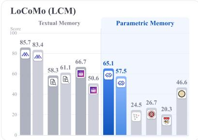  
MemOS DenseRAG Graphiti MemT-1.0-Flash MemT-1.0-Nano Doc-to-LoRA SHINE δ-mem MemoryLLM

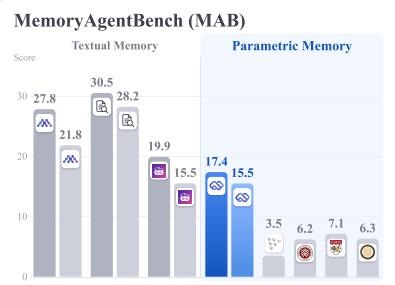

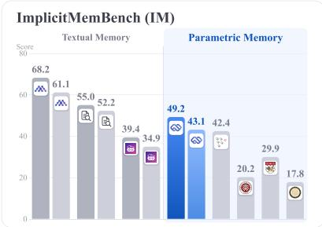

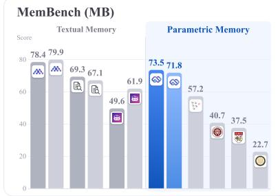

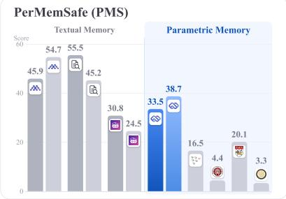  
Textual Memory pairs: left — DeepSeek-V4-Flash-0731; right — Qwen3.6-35B-A3B.

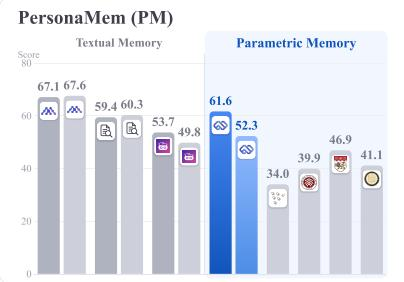  
Figure 1 Memory performance of MemT-1.0 on representative benchmarks.

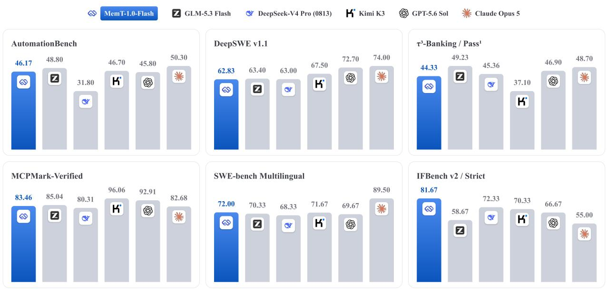  
Figure 2 Agentic performance of MemT-1.0-Flash after backbone preparation without native memory.

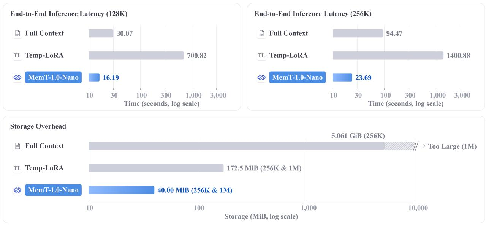  
Figure 3 Inference eficiency and storage overhead of MemT-1.0-Nano.

## Contents

Introduction 5   
Model Architecture 6   
2.1 Overview 6   
Native Memory Block .   
Scaling Native Memory Capacity 9   
2 Training . 10   
3.1 Backbone Preparation 10   
3.2 Data Construction 11   
3.3 Training Objectives 12   
3.4 Continued Pre-Training 13   
3.5 Post-Training . 13   
3.6 Training Setups 14   
System and Infrastructure 14   
4.1 Distributed Training 14   
4.2 Efficient Operators 15   
4.3 Stateful Inference and Serving 16   
5 Memory Scaling Behavior . 16   
5.1 Overview 16   
5.2 Scaling Protocol . 17   
5.3 Data and Training Scaling <sup>17</sup><sub>18</sub>   
5.4 Memory Capacity Scaling   
6 Evaluation 18   
6.1 Overall Evaluation Setup 18   
6.2 Memory Capabilities 19   
6.3 General Capabilities 20   
6.4 Ablation Studies 21   
6.5 End-to-End Inference Efficiency 22   
6.6 Storage Overhead 24   
6.7 Low-Rank Decomposition . 25   
Application in Agentic Tasks 25   
7.1 Overview 25   
7.2 Experience-Guided Agentic Framework   
7.3 Experience Construction and Model Training   
7.4 Agentic Coding Evaluation   
7.5 Case Study and Discussion 29   
Limitations and Discussion . 30   
9 Conclusion 30   
References 31   
A Author List and Acknowledgments 35   
A.1 Author List . 35   
A.2 Acknowledgments 35   
B Adaptation to Specific Backbones 35   
B.1 Projection and Fusion 35   
B.2 Gates and Initializatio 37   
B.3 Training Configuration 37   
C Stable Mechanism on GDN-2 . 38   
C.1 Problem Formulation 38   
C.2 Solution: Symmetrization Fix 40   
D Details of Evaluation Setup 40   
D.1 Details of Benchmarks 40   
D.2 Details of Baselines 42   
D.3 Details of Pipelines and Prompts in Memory Evaluation 43   
D.4 Details of Pipelines and Prompts in General Evaluation 52   
D.5 Details of Storage Overhead Evaluation 53   
E Additional Details on Agentic Tasks . 53   
E.1 Experience Bank and Training Data Construction 53   
E.2 Training Details 56   
E.3 Additional Results 59   
Memory Windowing Experiment . 60   
F.1 Experimental Setup 61   
F.2 Measurement Method 62   
F.3 Full Results . 62   
F.4 Measurement Variability 62   
G Case Studies 62   
G.1 Example 1: Factual Recall at 4K 63   
G.2 Example 2: Abstention on Missing Information at 16K . 64   
G.3 Example 3: Rule Application at 32K 64   
G.4 Example 4: Tracking an Update at 64K 65

## 1 Introduction

The rapid evolution of foundation models is expanding the boundary of what can be natively learned and performed within a single model. Many capabilities are progressively internalized from external systems into the model itself, such as reasoning [1, 2] and multimodality [3, 4]. Memory represents another fundamental capability, enabling models to accumulate experience and adapt over extended interactions [5, 6]. Our previous work, Metis [7], first introduced memory foundation models to internalize memory as a native capability of foundation models. This ofers a path beyond external context and enables models to continuously accumulate information and experience, which marks a critical step towards memory-native evolution.

To improve memory capabilities, we introduce MemT-1.0, a new architecture with substantial upgrades over Metis, while retaining the structure of dynamic local memory and trainable hyper memory. It replaces token selection with a stable token-level update mechanism based on Gated DeltaNet-2 (GDN-2) [8]. To further scale native memory capability, we introduce Mixture-of-Storage (MoS) to expand the capacity of native memory. We release a model family comprising MemT-1.0-Nano with 36B parameters (3B activated, 10M dynamic memory) and MemT-1.0-Flash with 288B parameters (17B activated, 336M dynamic memory).

Following a deliberate backbone preparation, we develop a two-stage training pipeline for MemT-1.0. The first stage performs continued pre-training (CPT) to establish language modeling capabilities with native memory [9]. The post-training stage further adapts the model to downstream memory tasks while preserving its general capabilities [10]. To support this training pipeline, we construct a large-scale dataset of 34B tokens. Across 11 memory benchmarks, our models outperform parametric memory baselines on average, showing efective utilization of historical information without accessing the original context during inference. They also largely preserve general capabilities under the noise setting. Our evaluation shows an increasing end-to-end inference latency and storage overhead advantage over full context on longer histories.

To support training and deployment, we develop a distributed infrastructure, which preserves memory isolation across independent trajectories. We organize stateful inference around separate memory storage and utilization procedures, with shared model parameters and trajectory-specific memory states. For a fixed memory configuration, the persistent state size remains constant as interactions accumulate. In addition, we explore the scaling behavior of MemT-1.0. Unlike general foundation models [11], memory foundation models introduce memory capacity as a critical scaling dimension, so we conduct scaling studies over memory capacity and training data. These findings provide valuable guidance for building stronger memory foundation models.

We further apply MemT-1.0 to experience-guided coding agents, where retrieved procedural experience is internalized into native memory to guide subsequent actions. On SWE-bench Verified [12] and SWE-bench Multilingual [13], our method improves average task success and consistency across repeated runs over agents without experience, while achieving performance comparable to explicit textual experience. These findings extend the role of native memory from information recall to procedural guidance in multi-step execution.

Our main contributions are summarized as follows:

• We introduce MemT-1.0, a memory foundation model architecture with improved memory storage and utilization mechanisms, together with MoS for scalable memory capacity.

• Following a deliberate backbone preparation, we design a two-stage training pipeline including CPT and post-training stages, with a corresponding infrastructure design. We construct a training corpus of 34B tokens, and systematically evaluate MemT-1.0 on both memory and general benchmarks. The results show that MemT-1.0 achieves superior memory performance while largely preserving general capabilities.

• We explore the scaling behavior of memory capabilities in MemT-1.0. We further deploy MemT-1.0 in practical agentic coding tasks to demonstrate its efectiveness and potential in enabling memory-native evolution. We also discuss its current limitations and promising directions for future development.

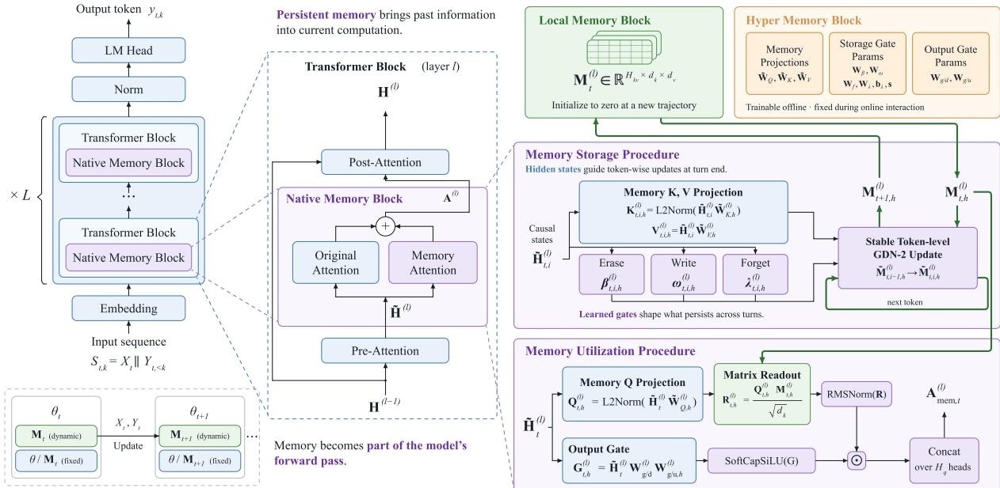  
Figure 4 Architecture of MemT-1.0. MemT-1.0 equips causal language models with native memory that evolves across interaction steps. Each selected Transformer block is augmented with a native memory block that performs parallel original and memory attention. The memory mechanism comprises dynamic local memory and trainable hyper memory, together with native memory storage and utilization procedures for updating and retrieving persistent information.

## 2 Model Architecture

## 2.1 Overview

MemT-1.0 is formulated under a multi-step scenario with discrete steps $t \in \{ 1 , 2 , \cdots , T \}$ , as presented in Figure 4. At step �, let $\theta _ { t }$ denote the current model parameters. Given the input $X _ { t }$ , the autoregressive generation process can be formulated as

$$
y _ { t , k } \sim P \left( \cdot | X _ { t } , Y _ { t , < k } ; \theta _ { t } \right) ,
$$

where $Y _ { t , < k }$ denotes the tokens generated before $y _ { t , k }$ . Meanwhile, the stateful model parameter is updated by

$$
\theta _ { t + 1 } \sim P \left( \cdot | X _ { t } , Y _ { t } ; \theta _ { t } \right) ,
$$

where $Y _ { t }$ is all generated tokens at step �. MemT-1.0 is built upon general causal language models. We denote the input sequence as $S _ { t , k } = X _ { t } | | Y _ { t , < k } = \left( x _ { t , 1 } , \cdot \cdot \cdot , y _ { t , 1 } , \cdot \cdot \cdot , y _ { t , k - 1 } \right)$ with length $L _ { t , k }$ . First, the input is mapped to the initial hidden state $\mathbf { H } _ { t , k } ^ { ( 0 ) } \in \mathbb { R } ^ { L _ { t , k } \times d }$ through the embedding layer, where � is the dimension of the hidden state. Then, it is processed sequentially by � stacked Transformer blocks [14] as follows:

$$
\mathbf { H } _ { t , k } ^ { ( l ) } = { \mathrm { T r a n s f o r m e r B l o c k } } \left( \mathbf { H } _ { t , k } ^ { ( l - 1 ) } \right) , \quad { \mathrm { f o r } } l = 1 , 2 , \cdots L .
$$

After that, the last hidden state $\mathbf { H } _ { t , k } ^ { ( L ) }$ is normalized and projected into the vocabulary space through the language modeling head ${ \mathbf W } _ { \mathrm { L M } } \in \mathbb { R } ^ { \dot { d } \times | \mathcal { V } | }$ , and a softmax function is then applied to obtain the probability distribution by

$$
P \left( \cdot | X _ { t } , Y _ { t , < k } ; \theta _ { t } \right) = \mathrm { S o f t m a x } \left( \mathrm { N o r m } \left( \mathbf { h } _ { t , k } ^ { ( L ) } \right) \mathbf { W } _ { \mathrm { L M } } \right) ,
$$

where $\vert \mathcal { V } \vert$ is the vocabulary size and $\mathbf { h } _ { t , k } ^ { ( L ) }$ is the last position of H $\mathbf { I } _ { t , k } ^ { ( L ) }$

MemT-1.0 augments each selected standard Transformer block with a native memory block, which is responsible for maintaining the memory from previous information. For the �-th Transformer block, we denote the computation of attention output as

$$
\mathbf { A } _ { \mathrm { o r i } , t , k } ^ { ( l ) } = \mathrm { A t t e n t i o n } \left( \tilde { \mathbf { H } } _ { t , k } ^ { ( l ) } \right) , \quad \tilde { \mathbf { H } } _ { t , k } ^ { ( l ) } = \mathrm { P r e - A t t e n t i o n } \left( \mathbf { H } _ { t , k } ^ { ( l - 1 ) } \right) ,
$$

where Attention (·) represents the backbone attention and $\tilde { \mathbf { H } } ^ { ( l ) }$ indicates the hidden state after pre-attention operations, such as pre-normalization. MemT-1.0 introduces a parallel memory attention mechanism to utilize the parametric memory accumulated from previous steps for targeted layers, by

$$
\mathbf { A } _ { t , k } ^ { ( l ) } = \mathbf { A } _ { \mathrm { o r i } , t , k } ^ { ( l ) } + \mathbf { A } _ { \mathrm { m e m } , t , k } ^ { ( l ) } , \quad \mathbf { A } _ { \mathrm { m e m } , t , k } ^ { ( l ) } = \mathrm { M e m o r y A t t e n t i o n } \left( \tilde { \mathbf { H } } _ { t , k } ^ { ( l ) } ; \cdot \right) ,
$$

where $\mathbf { A } _ { \mathrm { m e m } , t , k } ^ { ( l ) }$ indicates the output of memory attention. After that, the combined attention output $\mathbf { A } _ { t , k } ^ { ( l ) }$ is used in the subsequent computation as

$$
\mathbf { H } _ { t , k } ^ { ( l ) } = \mathrm { P o s t - A t t e n t i o n } \left( \mathbf { A } _ { t , k } ^ { ( l ) } , \mathbf { H } _ { t , k } ^ { ( l - 1 ) } \right) .
$$

For diferent backbones, we preserve the original Pre-Attention (·), Attention (·), and Post-Attention (·) unchanged to retain the backbone capabilities, and introduce memory through MemoryAttention (·) for diferent backbones. Specifically, we use Qwen3.6-35B-A3B [15], as released, as the backbone of MemT-1.0- Nano and a further post-trained DeepSeek-V4-Flash [16] (Section 3.1) as the backbone of MemT-1.0-Flash.

## 2.2 Native Memory Block

## 2.2.1 Native Memory State

Following our previous work Metis [7], a native memory block in MemT-1.0 comprises a local memory block and a hyper memory block. The former stores online information, while the latter is trained to equip general foundation models with memory capabilities in a data-driven manner.

Local Memory Block. In MemT-1.0, the dynamic memory state at the �-th step and �-th layer can be represented as $\mathbf { \dot { M } } _ { t } ^ { ( l ) } \in \mathbb { R } ^ { H _ { k \nu } \times d _ { k } \times d _ { \nu } }$ , where $d _ { k } , d _ { \nu }$ represent the dimensions of memory keys and values, and $H _ { k } ,$ denotes the number of memory channels. Compared with Metis, we remove the query-key normalization vector and extend the memory state to multiple channels. We initialize $\mathbf { M } _ { t } ^ { ( l ) } = \mathbf { 0 }$ at the start of new trajectories.

Hyper Memory Block. In the hyper memory block, the multi-channel projections of memory query, key, and value are denoted as $\tilde { \mathbf { W } } _ { O } ^ { ( l ) } \in \mathbb { R } ^ { \tilde { H _ { q } } \times d \times d _ { k } }$ $\tilde { \mathbf { W } } _ { K } ^ { ( \tilde { l } ) } \in \mathbb { R } ^ { \tilde { H } _ { k \nu } \times d \times d _ { k } }$ and $\tilde { \mathbf { W } } _ { V } ^ { ( l ) } \doteq \tilde { \mathbb { R } } ^ { \mathit { \prime } } H _ { k \nu } { \times } d { \times } d _ { \nu }$ for each layer �. Beyond these core memory projections, this block includes all other trainable parameters for memory processing. First, the gating projections include the erase gate $\mathbf { W } _ { \beta } ^ { ( l ) } \in \mathbb { R } ^ { d \times H _ { k \nu } \times d _ { k } }$ and the write gate $\mathbf { W } _ { \omega } ^ { ( l ) } \in \overline { { \mathbb { R } } } ^ { d \times H _ { k \nu } \times d _ { \nu } }$ , along with the forget gate components consisting of $\mathbf { \dot { W } } _ { f } ^ { ( l ) } \in \mathbb { R } ^ { d \times d _ { \mathrm { g a t e } } } , \mathbf { W } _ { \lambda } ^ { ( l ) } \in \mathbb { R } ^ { d _ { \mathrm { g a t e } } \times H _ { k \nu } \times d _ { k } }$ $\mathbf { b } _ { \lambda } ^ { ( l ) } \in \mathbb { R } ^ { H _ { k \nu } \times d _ { k } }$ , and a learnable vector $\mathbf { s } ^ { ( l ) } \in \mathbb { R } ^ { H _ { k \nu } }$ . Finally, the memory output gating is parameterized by a shared down-projection $\mathbf { W } _ { g / d } ^ { ( l ) } \in \mathbb { R } ^ { d \times d _ { g / d } }$ and a multi-channel up-projection $\mathbf { \dot { W } } _ { g / u } ^ { ( \tilde { l } ) } \in \mathbb { R } ^ { \tilde { H } _ { q } \times d _ { g / d } \times d _ { \iota } }$ <sup>�</sup> . Generally, we have $H _ { q } = H _ { k \mathfrak { r } }$ to align query channel and key-value channels. These trainable parameters are denoted as $\phi .$ , which can be optimized during the training phase and remain fixed during online interaction.

In summary, the model parameters $\theta _ { t }$ at step � include the backbone parameters $\theta _ { b }$ , the static but trainable parameters $\phi ,$ , and the dynamic memory states $\{ \mathbf { M } _ { t } ^ { ( l ) } \} _ { l = 1 } ^ { L }$ . During online inference, these dynamic memory states are responsible for storing online information and evolve over interactions.

## 2.2.2 Native Memory Procedures

MemT-1.0 consists of two parallel native procedures, including memory storage and memory utilization. The memory storage procedure updates the dynamic memory states to preserve information from the current interaction, while the memory utilization procedure retrieves information from previously accumulated memory states to support autoregressive generation.

Native Memory Storage Procedure. MemT-1.0 replaces the token selection with a stable token-level update mechanism based on GDN-2 [8] to update the dynamic memory state in each turn. As the memory storage procedure is triggered at the turn level, we denote the hidden states as $\mathbf { H } _ { t } ^ { ( l ) }$ of $S _ { t } = X _ { t } | | Y _ { t }$ . For the pre-attention input $\tilde { \mathbf { H } } _ { t } ^ { ( l ) }$ , we compute the memory key and value of the ℎ-th channel by

$$
\mathbf { K } _ { t , h } ^ { ( l ) } = \mathrm { L 2 N o r m } \left( \tilde { \mathbf { H } } _ { t } ^ { ( l ) } \tilde { \mathbf { W } } _ { K , h } ^ { ( l ) } \right) , \quad \mathbf { V } _ { t , h } ^ { ( l ) } = \tilde { \mathbf { H } } _ { t } ^ { ( l ) } \tilde { \mathbf { W } } _ { V , h } ^ { ( l ) } ,
$$

where $\tilde { \mathbf { W } } _ { K , h } ^ { ( l ) }$ and $\tilde { \mathbf { W } } _ { V , h } ^ { ( l ) }$ are the key and value projection matrices for the ℎ-th memory channel. Then, the erase gate and write gate can be obtained by

$$
\boldsymbol { \beta } _ { t } ^ { ( l ) } = \sigma \left( \tilde { \mathbf { H } } _ { t } ^ { ( l ) } \mathbf { W } _ { \beta } ^ { ( l ) } \right) , \quad \boldsymbol { \omega } _ { t } ^ { ( l ) } = \sigma \left( \tilde { \mathbf { H } } _ { t } ^ { ( l ) } \mathbf { W } _ { \boldsymbol { \omega } } ^ { ( l ) } \right) ,
$$

where $\mathbf { W } _ { \beta } ^ { ( l ) } , \mathbf { W } _ { \omega } ^ { ( l ) }$ are gating projection matrices. In addition, the forget gate is calculated by

$$
\begin{array} { r } { \boldsymbol { \lambda } _ { t , h } ^ { ( l ) } = - \exp \left( \mathbf { s } _ { h } ^ { ( l ) } \right) \odot \mathrm { S o f t p l u s } \left( \mathbf { F } _ { t } ^ { ( l ) } \mathbf { W } _ { \lambda , h } ^ { ( l ) } + \mathbf { b } _ { \lambda , h } ^ { ( l ) } \right) , \quad \mathbf { F } _ { t } ^ { ( l ) } = \tilde { \mathbf { H } } _ { t } ^ { ( l ) } \mathbf { W } _ { f } ^ { ( l ) } , } \end{array}
$$

where $\mathbf { W } _ { f } ^ { ( l ) } , \mathbf { W } _ { \lambda } ^ { ( l ) } , \mathbf { b } _ { \lambda } ^ { ( l ) } , \mathbf { s } _ { h } ^ { ( l ) }$ are forget-gate parameters. To prevent the divergence of memory states during updates, we introduce a stable mechanism for the token-level update, where it first calculates

$$
\mathbf { U } _ { t , i } ^ { ( l ) } = \sqrt { \beta _ { t , i } ^ { ( l ) } } \odot \mathbf { K } _ { t , i } ^ { ( l ) } .
$$

Then, the memory state can be updated by

$$
\begin{array} { r } { \tilde { \mathbf { M } } _ { t , i , h } ^ { ( l ) } = \left[ \mathbf { I } - \mathbf { U } _ { t , i , h } ^ { ( l ) \top } \mathbf { U } _ { t , i , h } ^ { ( l ) } \right] \cdot \mathbf { D } _ { t , i , h } ^ { ( l ) } \tilde { \mathbf { M } } _ { t , i - 1 , h } ^ { ( l ) } + \mathbf { U } _ { t , i , h } ^ { ( l ) \top } \left( \boldsymbol { \omega } _ { t , i , h } ^ { ( l ) } \odot \mathbf { V } _ { t , i , h } ^ { ( l ) } \right) , } \end{array}
$$

where the initialization is given by $\tilde { \mathbf { M } } _ { t , 0 , h } ^ { ( l ) } = \mathbf { M } _ { t , h } ^ { ( l ) }$ , and the state transition is defined as $\mathbf { M } _ { t + 1 , h } ^ { ( l ) } = \tilde { \mathbf { M } } _ { t , L _ { t } , h } ^ { ( l ) }$ , with

$$
\mathbf { D } _ { t , i , h } ^ { ( l ) } = \mathrm { D i a g } \left[ \exp \left( \lambda _ { t , i , h } ^ { ( l ) } \right) \right] .
$$

The detailed analysis of our stable mechanism on GDN-2 is presented in Appendix C.

Native Memory Utilization Procedure. In MemT-1.0, we remove the key-value normalization from Metis. Because the memory utilization operates at the token level in parallel, we omit the decoding index � for simplicity. For the step �, we read out information from the current memory state $\mathbf { M } _ { t , h } ^ { ( l ) }$ by

$$
\mathbf { R } _ { t , h } ^ { ( l ) } = \frac { \mathbf { Q } _ { t , h } ^ { ( l ) } \mathbf { M } _ { t , h } ^ { ( l ) } } { \sqrt { d _ { k } } } , \quad \mathbf { Q } _ { t , h } ^ { ( l ) } = \lfloor 2 \mathrm { N o r m } \left( \tilde { \mathbf { H } } _ { t } ^ { ( l ) } \tilde { \mathbf { W } } _ { Q , h } ^ { ( l ) } \right) ,
$$

where $\tilde { \mathbf { W } } _ { Q , h } ^ { ( l ) }$ is the memory query projection matrix. After that, we calculate the memory output gate by

$$
\mathbf { G } _ { t , h } ^ { ( l ) } = \tilde { \mathbf { H } } _ { t } ^ { ( l ) } \mathbf { W } _ { g / d } ^ { ( l ) } \mathbf { W } _ { g / u , h } ^ { ( l ) } ,
$$

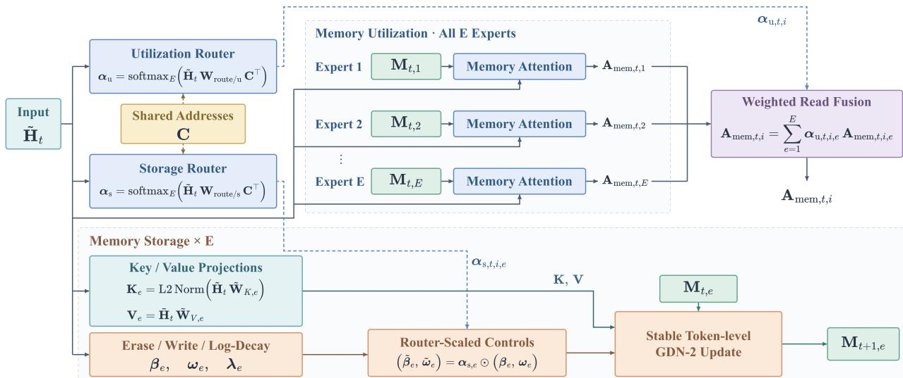  
Figure 5 Scaling native memory capacity. MoS expands each native memory block into multiple memory experts and employs separate dense storage and utilization routing over shared expert addresses.

where $\mathbf { W } _ { g / d } ^ { ( l ) } , \mathbf { W } _ { g / u , h } ^ { ( l ) }$ are parameters of the readout gate. Finally, the memory attention is calculated by

$$
\begin{array} { r l } & { \mathbf { A } _ { \mathrm { m e m } , t } ^ { ( l ) } = \mathrm { M e m o r y A t t e n t i o n } \left( \tilde { \mathbf { H } } _ { t , k } ^ { ( l ) } ; { \mathbf { M } _ { t } ^ { ( l ) } } \right) } \\ & { \qquad = \mathrm { C o n c a t } _ { h = 1 } ^ { H _ { q } } \left[ \mathrm { R M S N o r m } \left( \mathbf { R } _ { t , h } ^ { ( l ) } \right) \odot \mathrm { S o f t C a p S i L U } \left( \mathbf { G } _ { t , h } ^ { ( l ) } \right) \right] , } \end{array}
$$

where

$$
\mathrm { S o f t C a p S i L U } ( x ) = \tau \operatorname { t a n h } \left( { \frac { \mathrm { S i L U } ( x ) } { \tau } } \right) , \qquad \mathrm { S i L U } ( x ) = x \sigma ( x ) ,
$$

and $\tau > 0$ controls the soft-cap threshold, with $\tau = 2$ by default. Target layers, projection strategies, and other settings vary slightly to accommodate diferent backbones, and more details can be found in Appendix B.

## 2.3 Scaling Native Memory Capacity

To jointly scale the online memory capacity and the trainable memory parameters, we introduce Mixture-of-Storage (MoS), as presented in Figure 5, which expands a native memory block into � parallel memory experts. Unlike conventional sparse Mixture-of-Experts (MoE) [17], MoS adopts dense routing over all memory experts, so every expert participates in the memory computation and the routing probabilities determine how information is read from and written into diferent memory experts.

Memory Expert Expansion. For the �-th MoS layer, we extend the local memory state with an additional expert dimension as

$$
\mathbf { \mathcal { M } } _ { t , \mathrm { M o S } } ^ { ( l ) } = \left\{ \mathbf { M } _ { t , e } ^ { ( l ) } \right\} _ { e = 1 } ^ { E } \in \mathbb { R } ^ { E \times H _ { k \nu } \times d _ { k } \times d _ { \nu } } ,
$$

where $\mathbf { M } _ { t , e } ^ { ( l ) } \in \mathbb { R } ^ { H _ { k \nu } \times d _ { k } \times d _ { \nu } }$ is the dynamic memory state of the �-th expert, and each expert has independent hyper memory parameters. All experts and both routers receive the same pre-attention hidden states $\tilde { \mathbf { H } } _ { t } ^ { ( l ) }$

Shared-Address Routing. MoS introduces two dense routers to control memory utilization and memory storage separately, which share a trainable expert address matrix

$$
\mathbf { C } ^ { ( l ) } = \left[ \mathbf { c } _ { 1 } ^ { ( l ) } , \mathbf { c } _ { 2 } ^ { ( l ) } , \cdots , \mathbf { c } _ { E } ^ { ( l ) } \right] ^ { \top } \in \mathbb { R } ^ { E \times d _ { \mathrm { a d d } } } ,
$$

where $d _ { \mathrm { a d d r } }$ is the dimension of the address representation. Then, we use router projections $\mathbf { W } _ { \mathrm { r o u t e / u } } ^ { ( l ) } , \mathbf { W } _ { \mathrm { r o u t e / s } } ^ { ( l ) } \in$ $\mathbb { R } ^ { d \times d _ { \mathrm { a d d r } } }$ for memory utilization and storage separately. After that, routing probabilities of memory utilization are calculated by

$$
\boldsymbol { \alpha } _ { \mathrm { u } , t } ^ { ( l ) } = \mathrm { S o f t m a x } \left( \tilde { \mathbf { H } } _ { t } ^ { ( l ) } \mathbf { W } _ { \mathrm { r o u t e / u } } ^ { ( l ) } \mathbf { C } ^ { ( l ) \top } \right) \in \mathbb { R } ^ { L _ { t } \times E } .
$$

Similarly, routing probabilities of memory storage are obtained by

$$
\boldsymbol { \alpha } _ { \mathrm { s } , t } ^ { ( l ) } = \mathrm { S o f t m a x } \left( \tilde { \mathbf { H } } _ { t } ^ { ( l ) } \mathbf { W } _ { \mathrm { r o u t e / s } } ^ { ( l ) } \mathbf { C } ^ { ( l ) \top } \right) \in \mathbb { R } ^ { L _ { t } \times E } .
$$

Both softmax operations are applied along the expert dimension. Therefore, the utilization and storage routers share the same semantic expert addresses but learn diferent projections.

Mixture-of-Storage Fusion. For memory utilization, each expert independently follows the native memory utilization procedure described above. We denote the memory-attention output of the �-th memory expert by

$$
\begin{array} { r } { \mathbf { A } _ { \mathrm { m e m } , t , e } ^ { ( l ) } = \mathbf { M e m o r y A t t e n t i o n } _ { e } \left( \tilde { \mathbf { H } } _ { t } ^ { ( l ) } ; \mathbf { M } _ { t , e } ^ { ( l ) } \right) . } \end{array}
$$

The final memory attention at the �-th token in sequence $S _ { t }$ is obtained by

$$
\mathbf { A } _ { \mathrm { m e m } , t , i } ^ { ( l ) } = \sum _ { e = 1 } ^ { E } \alpha _ { \mathrm { u } , t , i , e } ^ { ( l ) } \mathbf { A } _ { \mathrm { m e m } , t , i , e } ^ { ( l ) } .
$$

For memory storage, each expert independently produces its memory key, value, erase gate, write gate, and log-decay using its expert-specific parameters. For the �-th expert, the erase gate, write gate, and log-decay are calculated by

$$
\begin{array} { r } { \tilde { \boldsymbol { \beta } } _ { t , e } ^ { ( l ) } = \alpha _ { s , t , e } ^ { ( l ) } \odot { \boldsymbol { \beta } } _ { t , e } ^ { ( l ) } , \qquad \tilde { \omega } _ { t , e } ^ { ( l ) } = \alpha _ { s , t , e } ^ { ( l ) } \odot \omega _ { t , e } ^ { ( l ) } , \qquad \tilde { \lambda } _ { t , e } ^ { ( l ) } = \lambda _ { t , e } ^ { ( l ) } . } \end{array}
$$

After that, we calculate

$$
\mathbf { U } _ { t , e } ^ { ( l ) } = \sqrt { \tilde { \beta } _ { t , e } ^ { ( l ) } } \odot \mathbf { K } _ { t , e } ^ { ( l ) } .
$$

Finally, the memory state can be updated by

$$
\begin{array} { r } { \tilde { \mathbf { M } } _ { t , i , e , h } ^ { ( l ) } = \left[ \mathbf { I } - \mathbf { U } _ { t , i , e , h } ^ { ( l ) \top } \mathbf { U } _ { t , i , e , h } ^ { ( l ) } \right] \cdot \tilde { \mathbf { D } } _ { t , i , e , h } ^ { ( l ) } \tilde { \mathbf { M } } _ { t , i - 1 , e , h } ^ { ( l ) } + \mathbf { U } _ { t , i , e , h } ^ { ( l ) \top } \left( \tilde { \omega } _ { t , i , e , h } ^ { ( l ) } \odot \mathbf { V } _ { t , i , e , h } ^ { ( l ) } \right) , } \end{array}
$$

where we have the initialization $\tilde { \mathbf { M } } _ { t , 0 , e , h } ^ { ( l ) } = \mathbf { M } _ { t , e , h } ^ { ( l ) }$ , and transformation $\mathbf { M } _ { t + 1 , e , h } ^ { ( l ) } = \tilde { \mathbf { M } } _ { t , L _ { t } , e , h } ^ { ( l ) } ;$ , with

$$
\tilde { \mathbf { D } } _ { t , i , e , h } ^ { ( l ) } = \mathrm { D i a g } \left[ \exp \left( \tilde { \lambda } _ { t , i , e , h } ^ { ( l ) } \right) \right] .
$$

## 3 Training

## 3.1 Backbone Preparation

A memory foundation model inherits from its backbone both the knowledge fixed at pre-training and the reliability with which that knowledge becomes behavior, and post-training treats the two very diferently. Training on the backbone’s own verified samples fits its distribution conditioned on verifier acceptance [18, 19]: it reweights what the backbone already produces and, by itself, leaves tasks the backbone almost never solves untouched. Our per-item analysis bears this out. Gains concentrate on tasks the backbone solves occasionally. Tasks it never solved in eight attempts end at only 1.6–4.0% accuracy across four benchmarks after the preparation described below, in line with observations for RL [20], whereas on a separate probe set of hard knowledge questions, supplying the relevant facts in context raises accuracy from 27% to 91%, which suggests that the remaining gap is largely informational. In our setting, reliability is therefore what post-training mainly improves, and new information is what native memory must supply.

Accordingly, we post-train DeepSeek-V4-Flash before attaching native memory, with data from a threestep pipeline applied within each of three tracks: general capabilities (instruction following, knowledge, mathematics, and long-context reasoning), agentic coding, and agentic working (tool use and workflow automation). First, capability profiling: each task is attempted repeatedly and classified as reliably, occasionally, or not solved, a profile that stands in for the pre-training data we cannot see. Second, attribution by intervention: a failure is re-run with the suspected missing piece, a grader convention, a procedural hint, or a fact, placed in context, and whether it disappears tells a missing convention or procedure apart from missing knowledge; failures that persist under every intervention are excluded from synthesis. Third, capability-conditioned synthesis assigns each class its own data source. Reliably solved tasks supply replay. Occasionally solved tasks supply the backbone’s own attempts that pass programmatic verifiers (constraint checkers, unit tests, or sandboxed agent runs), which keeps most of the data on the backbone’s own distribution. Failures traced to a missing convention or procedure are learned either from guided sampling, where the guidance appears in the sampling context but not in the target, or from style-matched demonstrations by stronger models. Knowledge gaps, which synthesis has so far closed only item by item, are left mainly to retrieval and, in MemT-1.0, to native memory. Transfer is checked on held-out task families.

The recipe was settled over five rounds of full-mixture training and more than fifty training runs in total. The final mixture holds 126.5K trajectories (2.4B tokens, 1.1B loss-bearing), 56.4% general, 18.0% agentic coding, and 25.3% agentic working by count; agentic trajectories account for about 90% of loss-bearing tokens, so general data anchors the backbone’s existing capabilities while the long agentic trajectories carry the multi-turn behavior that memory tasks build on. The prepared backbone improves on all six benchmarks we monitor across the three tracks, by 6.3 points on average over the public release (Figure 2), and on SWE-bench Multilingual and IFBench v2, at 284B total and 13B active parameters, it exceeds the reported scores of larger open models, including GLM-5.3 Flash (320B total, 18B active) [21] and the far larger DeepSeek-V4 Pro (1.6T total, 49B active) [16].

The backbone is then frozen to serve as both the host model and the full-context distillation teacher of Section 3.3. Backbone preparation and native memory are two routes by which experience shapes a model’s later behavior, through the weights before deployment and through memory states during interaction; closing the loop between them is left to future work.

## 3.2 Data Construction

To support the training of MemT-1.0, we construct a large-scale training corpus with 34B tokens, which is composed of continued pre-training (CPT) and post-training data. We collect 20B tokens of CPT data, which mainly consists of large-scale general-purpose language modeling corpora. It contains long-form and sequential text to expose the model to diverse linguistic patterns and extensive contextual dependencies.

For post-training, we organize 14B tokens of data into three major categories. First, we construct memorynative language modeling data. This data encourages MemT-1.0 to maintain linguistic coherence, stylistic consistency, and instruction-following capability when information is accessed through native memory. Second, we construct data for native memory storage and utilization, including tasks such as summarization, continuation, and compression. They provide explicit supervision for storing information that should be retained in native memory. They train the model to recover and utilize the stored information during subsequent generation. Third, we introduce memory task data to further strengthen the model’s long-range memory capability. They further improve the model’s ability to selectively retain critical information and resolve long-range dependencies, which improves the utilization of memory when answering downstream queries. Part of the training corpus is based on real-world interaction patterns in MemOS’s anonymized internal data.

All three categories are formulated in a unified context-query-answer format. The context is first processed and stored through the native memory mechanism, after which the model receives the corresponding query and is trained to generate the target answer conditioned on the resulting memory state. This unified formulation allows heterogeneous memory-related tasks to be incorporated into the same post-training pipeline.

## 3.3 Training Objectives

The core training objective of MemT-1.0 is to align its capability with the backbone given full context, which enables the model to retain and utilize historical information without preserving the context. To this end, we introduce an of-policy distillation framework for training native memory models, where the backbone serves as the teacher model for acquiring memory capabilities [22].

Let $\theta _ { b }$ denote the frozen backbone parameters and $\phi$ denote the trainable memory parameters, including the hyper memory blocks and extra parameters of MoS. For a training trajectory $\{ ( X _ { t } , Y _ { t } ) \} _ { t = 1 } ^ { T } ,$ , we define the preceding textual history as $C _ { < t } = S _ { 1 } \| \cdot \cdot \cdot \| S _ { t - 1 }$ , where $S _ { t } = X _ { t } \Vert Y _ { t }$ . We use the original backbone without the additional memory modules as the teacher, whose next-token distribution is

$$
\begin{array} { r } { q _ { t , k } ( \nu ) = P \left( \nu \mid C _ { < t } , X _ { t } , Y _ { t , < k } ; \theta _ { b } \right) , \qquad \nu \in \mathcal { V } . } \end{array}
$$

The MemT-1.0 student receives the current input and the same observed response prefix, with previous steps represented by the incoming local memory state $\mathbf { M } _ { t }$ , where

$$
p _ { t , k } ( \nu ) = P \left( \nu \mid X _ { t } , Y _ { t , < k } ; \theta _ { b } , \phi , \mathbf { M } _ { t } \right) .
$$

Here, ${ \mathbf { } } { \mathbf { } } { \mathbf { } } , { \mathbf { } } { \mathbf { } } { \mathbf { } } , { \mathbf { } } { \mathbf { } } \mathbf { } { \mathbf { } } \mathbf { } \mathbf { } \mathbf { \Gamma } \mathbf { } \mathbf { \backslash } \mathbf { } _ { t }$ denotes the collection of dynamic states across all memory layers and experts. The state is initialized to zero for each independent trajectory and evolves through the native storage procedure after each completed step. Both models are evaluated under teacher forcing on fixed teacher-generated trajectories rather than student-generated rollouts, making the distillation objective of-policy with respect to the student policy. To reduce the size of the teacher targets, we retain its Top-� tokens at each supervised position. Let $\mathcal { K } _ { t , k } \subseteq \mathcal { V }$ be this token set and $T _ { d } > 0$ be the distillation temperature. Given $q ^ { T _ { d } }$ and $p ^ { T _ { d } }$ for distributions obtained by dividing the respective logits by $T _ { d }$ before softmax, we define

$$
\widehat { q } _ { t , k } ( \nu ) = \frac { q _ { t , k } ^ { T _ { d } } ( \nu ) } { \sum _ { u \in \mathcal { K } _ { t , k } } q _ { t , k } ^ { T _ { d } } ( u ) } , \qquad \nu \in \mathcal { K } _ { t , k } ,
$$

and set $\hat { q } _ { t , k } ( \nu ) = 0$ outside this set. The per-token distillation loss is the forward KL divergence from this truncated teacher distribution to the student by

$$
\ell _ { t , k } ^ { \mathrm { K L } } = T _ { d } ^ { 2 } \sum _ { \nu \in \mathcal { K } _ { t , k } } \hat { q } _ { t , k } ( \nu ) \log \frac { \hat { q } _ { t , k } ( \nu ) } { p _ { t , k } ^ { T _ { d } } ( \nu ) } .
$$

The teacher is renormalized over its selected support, whereas the student remains normalized over the full vocabulary. Consequently, the loss also penalizes student probability mass assigned outside the teacher’s selected tokens. We additionally use the observed target token $y _ { t , k }$ for next-token cross-entropy supervision

$$
\ell _ { t , k } ^ { \mathrm { C E } } = - \log p _ { t , k } ( y _ { t , k } ) .
$$

For a training batch B, let $m _ { t , k } ^ { ( b ) } \in \{ 0 , 1 \}$ indicate whether a position in trajectory $^ b$ is supervised. The training loss is

$$
\mathcal { L } ( \phi ) = \frac { 1 } { N _ { \mathrm { s p t } } } \sum _ { b \in \mathcal { B } } \sum _ { t , k } m _ { t , k } ^ { ( b ) } \left[ \lambda _ { \mathrm { K D } } \ell _ { t , k } ^ { \mathrm { K L } , ( b ) } + \lambda _ { \mathrm { C E } } \ell _ { t , k } ^ { \mathrm { C E } , ( b ) } \right] ,
$$

where $\begin{array} { r } { N _ { \mathrm { s p t } } = \sum _ { b \in \mathcal { B } } \sum _ { t , k } m _ { t , k } ^ { ( b ) } } \end{array}$ is the number of supervised tokens, and $\lambda _ { \mathrm { K D } }$ and $\lambda _ { \mathrm { C E } }$ are nonnegative weights with at least one nonzero value. Cross-entropy uses the untempered student distribution. The mask selects the prediction targets appropriate to each training stage and excludes padding. History tokens may participate in memory construction without receiving direct loss. Normalization is performed over all supervised tokens in the optimization batch, including those distributed across workers and accumulation steps. Specifically, we use CE supervision during CPT and KL-based distillation during post-training. For MoS training, we add a router auxiliary loss to balance the load across memory experts. For MemT-1.0-Flash, the backbone prepared in Section 3.1 is frozen during native-memory training.

## 3.4 Continued Pre-Training

We first conduct CPT to establish the basic capability of language modeling with native memory. This stage trains MemT-1.0 to predict subsequent tokens using both the current textual context and information accumulated from preceding segments. For each training sequence, we divide the tokens into consecutive, non-overlapping segments and treat each segment as a step �. The student performs causal language modeling within the current segment, with the preceding history $C _ { < t }$ represented by the incoming memory states ${ \mathbf { } } { \mathbf { } } { \mathbf { } } , { \mathbf { } } { \mathbf { } } { \mathbf { } } , { \mathbf { } } { \mathbf { } } \mathbf { } { \mathbf { } } \mathbf { } \mathbf { } \mathbf { \Gamma } \mathbf { } \mathbf { \backslash } \mathbf { } _ { t }$ Its backbone context is restricted to the current segment, so information from earlier segments is accessed through native memory. After processing a segment, the native storage procedure applies token-level updates to obtain $\boldsymbol { \mathcal { M } } _ { t + 1 }$ for the next segment. The final segment is retained even when it is shorter than the specified segment length. Memory states are carried across segments within the same sequence and initialized to zero at the beginning of each independent sequence.

We use CE loss during CPT, with the ground-truth next tokens serving as the supervision targets. The student performs causal language modeling within the current segment while relying on native memory to access information from preceding segments. This encourages the model to establish language modeling capabilities under native memory without requiring the full historical context as textual input.

## 3.5 Post-Training

Post-training further adapts MemT-1.0 to native memory-based response generation. We initialize the memory parameters from the CPT checkpoint and train on instances containing historical context, queries, and reference responses. The historical context is processed chronologically through the native storage procedure, producing the memory states used to answer subsequent queries. The responses are rollouts from the full-context teacher, and serve to condition both models under teacher forcing rather than as direct supervision targets. At step �, the student receives the current query $X _ { t }$ and the observed response prefix $Y _ { t , < k }$ , with the preceding history $C _ { < t }$ represented by $\mathbf { \nabla } \mathcal { M } _ { t }$ . The teacher retains access to the corresponding textual history. Memory states are initialized independently for each trajectory, preserving the association between a query and its own history.

We use the KL loss in the post-training stage. The supervision mask $m _ { t , k } ^ { ( b ) }$ selects response tokens, while history, query, and padding positions receive no direct token loss. Both teacher and student are evaluated under teacher forcing with the same observed response prefix. Reference responses thus determine the prefixes on which the models are evaluated, while the teacher’s probability distributions provide the distillation targets. The loss is averaged over all supervised response tokens in the training batch. This focuses optimization on the outputs required by the task while training the student to approximate the full-context teacher through native memory. Although historical tokens receive no direct loss, gradients from response predictions propagate through memory readout and earlier storage operations. This allows the model to learn which historical information to retain and how to utilize it for the current query. The full-context teacher provides a reference for both the use of historical information and the backbone’s response behavior, encouraging MemT-1.0 to acquire task-specific memory capabilities while preserving its general capabilities.

## 3.6 Training Setups

For MemT-1.0-Nano, training consists of 1 CPT epoch followed by post-training. The global batch size is 64 packed sequences. Each pack contains at most 64K tokens, while the segment length is 2K tokens. Incomplete final global batches are dropped. For the distillation objective, we retain the teacher’s top-� tokens at each supervised position with $K = 6 4$ , and set the distillation temperature to $T _ { d } = 1 . 0$ . We optimize only the memory parameters using AdamW with $\beta _ { 1 } = 0 . 9 , \beta _ { 2 } = 0 . 9 9 9 , \epsilon = 1 0 ^ { - 8 }$ , weight decay 0.01, and a gradient clipping norm of 1.0. We use mixed-precision training. The backbone runs in BF16, while numerically sensitive components (e.g., RMSNorm, Softmax, and memory states) and optimizer states are kept in FP32. A soft cap is applied to the memory output gate, with a limit of 2.0, for training stability. We use a WSD learning rate scheduler for MemT-1.0-Nano training. During CPT, we warm up for 600 steps to a learning rate of $1 \times 1 0 ^ { - 4 }$ , and keep the peak rate constant for the remaining steps. During post-training, we warm up for 500 steps to $1 \times 1 0 ^ { - 4 }$ , keep it constant, and apply cosine decay over the final 1,000 steps to a minimum learning rate of $5 \times 1 0 ^ { - 6 }$ . For MemT-1.0-Flash, we initialize from the prepared backbone and use a global batch of 192 packs, with the same 64K maximum pack length and 2K-token storage steps. Memory training uses the online backbone teacher with Top-64 targets, temperature 1, and KL loss. The learning-rate schedule has a peak of $8 \times 1 0 ^ { - 5 }$ , a 100-step warmup, and a planned cosine decay over the final steps.

## 4 System and Infrastructure

Each interaction in MemT-1.0 depends on memory accumulated from earlier steps. Training must combine these dependencies with batched GPU computation, while inference must maintain an independent evolving state for each trajectory. Our infrastructure executes the model one decoder layer at a time, handles state recurrence within memory blocks, and manages model weights separately from trajectory-specific states. We describe the resulting training schedule, memory operators, and online state organization below.

## 4.1 Distributed Training

Training packs combine independent trajectories, each containing the steps defined in Section 3. Attention stays within each step, while memory carries information between steps of the same trajectory and resets at trajectory boundaries. Teacher forcing supplies all tokens in the pack, so the model processes the complete pack one decoder layer at a time. Within each layer, attention and memory projections are batched across tokens. The memory block alone advances state along each trajectory. This organization retains large backbone matrix multiplications while preserving the order of memory writes and reads.

We use Megatron-Core [23] and Bridge [24] for distributed training, including expert parallelism for the backbone MoE layers. Although backbone weights are frozen during memory training, gradients still pass through backbone computations and memory transitions, allowing later predictions to train earlier writes. The remaining infrastructure challenge is therefore the cost of memory computation and its training activations, which we address below.

## 4.2 Efficient Operators

Native memory introduces two related costs: ordered state updates and activations that grow with the number of memory experts. Our execution separates state updates from reads of step snapshots, then groups complete steps into windows to limit the lifetime of expert projections. This lets the memory branch control its working set while the backbone continues to process the full token pack layer by layer.

Chunked updates and snapshot reads. The stable update has a rank-one structure. Suppressing layer, step, and channel indices, let $\mathbf { k } _ { i }$ denote the normalized key, and define $\mathbf { u } _ { i } = \sqrt { \beta _ { i } } \odot \mathbf { k } _ { i } , \mathbf { z } _ { i } = \omega _ { i } \odot \mathbf { v } _ { i }$ , and $\mathbf { D } _ { i } = \operatorname { D i a g } ( \exp ( \lambda _ { i } ) )$ . The update in Section 2 can then be written as

$$
\mathbf { S } _ { i } = \mathbf { D } _ { i } \mathbf { S } _ { i - 1 } + \mathbf { u } _ { i } ^ { \top } \left( \mathbf { z } _ { i } - \mathbf { u } _ { i } \mathbf { D } _ { i } \mathbf { S } _ { i - 1 } \right) , \qquad \mathbf { S } _ { 0 } = \mathbf { M } _ { t } , \quad \mathbf { M } _ { t + 1 } = \mathbf { S } _ { L _ { t } } .
$$

Each token requires a vector–matrix multiplication and an outer product, with leading work of $O ( d _ { k } d _ { \nu } )$ per channel. We use chunked WY [25] to group these small dependent updates into triangular solves and matrix multiplications, carrying state between chunks and reconstructing intermediate quantities during backward. The adaptation to MemT-1.0 is to pair this writer with a separate snapshot reader: all queries in step � read the same incoming state $\mathbf { M } _ { t }$ , even as the writer processes several chunks to form $\mathbf { M } _ { t + 1 }$ . The reads can therefore be batched independently, followed by RMSNorm and SoftCapSiLU output gating. Gradients from later reads propagate through the writes that produced their snapshots. Writer chunks determine computation granularity, and model steps determine when updated memory becomes visible.

Complete-step windows for MoS. Dense MoS evaluates every expert, so materializing all expert projections at once requires tensors that grow with both pack length and expert count. Whole-pack execution does exactly this: it projects every token in the pack before processing the resulting memory computations. Windowed execution instead performs expert projections, state updates, and readout fusion for one group of complete steps at a time, passing a diferentiable FP32 final state to the next window. Both schedules use the same storage and utilization routers, shared expert addresses, and update kernel. Storage probabilities modulate the erase gate, write gate, and log-decay. Utilization probabilities mix the gated expert readouts.

A window budget limits how many tokens are projected together, while keeping each step intact even if it exceeds the budget. Recomputing internal intermediates during backward [26] avoids retaining all windows expert projections for the full training pass. Smaller windows reduce live intermediates but require more launches and recomputation. Outputs, routing probabilities, and boundary states still occupy memory, so the total remains dependent on pack length as well as window size.

The memory–time tradeof of window size. We measure one complete MoS memory block on a single GPU using synthetic hidden-state inputs. Table 1 fixes a 32K-token pack, BF16 parameters and projections, and 2048-token steps, comparing peak allocated memory and forward-plus-backward (F+B) time for two window sizes. Arrows denote whole-pack execution → windowed execution; all values are medians.

Table 1 Memory-time tradeof for one MoS memory block on a single GPU at a 32K-token pack length. Arrows denote whole-pack to windowed execution. The values are medians.
<table><tr><td>Window size (complete steps)</td><td>Peak memory (GiB)</td><td>Memory reduction</td><td>F+B (ms)</td><td>Time increase</td></tr><tr><td>2048 tokens (1 step)</td><td> $4 7 . 8 3  6 . 0 3$ </td><td>87.4%</td><td> $4 6 2 . 7  4 9 3 . 5$ </td><td>6.6%</td></tr><tr><td>4096 tokens (2 steps)</td><td> $4 7 . 8 3  9 . 4 9$ </td><td>80.1%</td><td> $4 6 3 . 0  4 7 0 . 6$ </td><td>1.6%</td></tr></table>

In this configuration, processing two steps at a time reduces peak memory by approximately 80%, with a 1.6% increase in median F+B time. Shrinking the window to one step saves additional memory but raises the time increase to 6.6%. The window budget thus provides a direct resource tradeof: smaller windows reduce live intermediates, while larger windows reduce execution overhead. Appendix F provides the block configuration, measurement protocol, and full results and variability from 8K to 32K.

## 4.3 Stateful Inference and Serving

During online interaction, backbone and hyper memory weights remain fixed and are shared across trajectories, while each trajectory maintains its own dynamic memory states. Within a step, generation reads the incoming memory snapshot, and attention over the current text uses that step’s KV cache. Once the interaction completes, storage incorporates the input and response into memory for the next interaction. The serving runtime manages states by trajectory so that subsequent requests continue their respective histories.

For a fixed configuration, the number of memory-state elements per trajectory is

$$
N _ { \mathrm { s t a t e } } = \sum _ { l } E _ { l } H _ { k \nu , l } d _ { k , l } d _ { \nu , l } ,
$$

where the sum covers memory layers and $E _ { l } = 1$ without MoS. Growing history updates these elements while their number remains determined by configured memory capacity. Total storage for multiple trajectories grows with trajectory count. Active requests additionally require their current-step KV caches and computational workspaces. Persistent-state storage can thus be estimated directly from the memory configuration, whereas runtime GPU memory also includes shared weights and active requests. The efect of finite capacity on retained historical detail is examined in the capability evaluations and Discussion.

This organization separates history preparation from subsequent queries. In Evaluation’s two-GPU, singlerequest BEAM experiment, MemT-1.0-Nano’s query latency after history preparation remains nearly constant as history grows. At 64K tokens of history, MemT-1.0-Nano achieves an approximately 33× reduction in logical per-trajectory state size compared with full context. The storage metric measures the logical state size after history preparation and before querying, and excludes shared weights. When subsequent queries reuse that state, the initial preparation cost is amortized over multiple interactions. The full protocol and curves appear in Section 6 and Appendix D.5.

## 5 Memory Scaling Behavior

## 5.1 Overview

Scaling has been a key driver behind the continuous improvement of foundation models, where increasing model capacity, training data, and computation often leads to predictable gains in general capabilities [11]. However, for memory foundation models, it remains unclear whether native memory capabilities exhibit similar scaling behavior. Exploring such scaling behavior is critical, as it reveals whether memory capability can continue to improve with scale and provides guidance for the design of larger memory foundation models. In particular, memory-related training and the capacity of native memory states are two important factors that may influence memory capability, motivating us to explore scaling behavior along these two aspects.

In this work, we study memory scaling along both dimensions. Data and training scaling explores how memory capability changes with continued exposure to memory-related post-training data, while memory capacity scaling studies the impact of increasing the capacity of native memory states. They allow us to characterize how native memory capability evolves with additional training and expanded memory capacity.

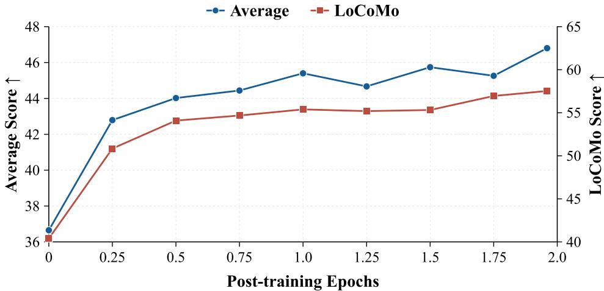  
Figure 6 Data and training scaling of MemT-1.0-Nano. Memory performance over two consecutive post-training epochs. Blue circles show the average score on the left axis, and red squares show LoCoMo accuracy on the right axis.

## 5.2 Scaling Protocol

We conduct all scaling experiments based on MemT-1.0-Nano under a controlled experimental protocol. We explore two scaling aspects, including data and training scaling and memory capacity scaling. The backbone architecture, training objectives, and evaluation protocol are kept consistent across diferent configurations unless otherwise specified. We evaluate memory capability using the same memory benchmarks to characterize performance changes across diferent scales.

Specifically, for data and training scaling, we evaluate checkpoints along a continuous post-training trajectory spanning two consecutive epochs over the same corpus. The model architecture and training corpus remain fixed, while cumulative training exposure and optimization steps increase throughout training. For memory capacity scaling, we vary the number of memory experts in MoS to expand native memory capacity, while keeping the remaining architectural components and training configurations consistent. By examining the resulting performance curves, we investigate how native memory capability evolves with additional post-training and increased memory capacity.

## 5.3 Data and Training Scaling

We explore whether additional exposure to memory-related post-training data improves memory capability at a fixed model capacity. Starting from the CPT checkpoint, we follow a single MemT-1.0-Nano training trajectory for two epochs over the same post-training corpus. Figure 6 shows that memory performance generally improves with additional post-training. Across the sampled checkpoints, the average score increases from 36.65 to 46.80, with intermediate fluctuations. Most of this gain arrives early: the average score rises steeply within the first quarter epoch and continues to climb over the remainder of the first epoch, reaching 45.40 by its end, while LoCoMo improves from 40.39 to 55.39 over the same span. This pattern is consistent with rapid adaptation of the CPT-initialized memory modules to downstream query answering, after which the increments shrink steadily but do not disappear. In the second epoch, the final sampled checkpoint reaches 46.80 on average and 57.53 on LoCoMo, an improvement over the last sampled checkpoint of the first epoch despite intermediate fluctuations. These gains indicate remaining room for optimization at fixed memory capacity, even when training revisits previously seen data. In summary, continued exposure to memory-related post-training data can improve native memory capability, with further gains achievable across epochs without increasing model capacity.

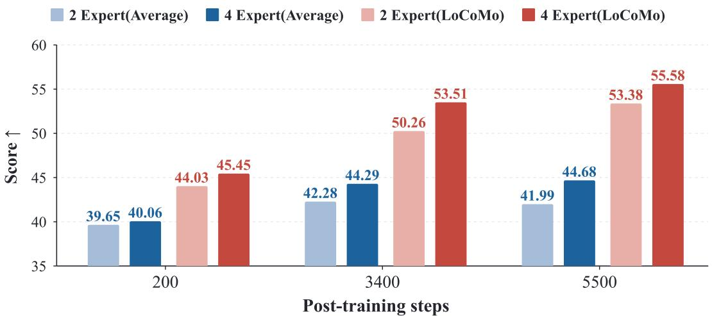  
Figure 7 Memory capacity scaling during post-training after 400 CPT steps. We compare MoS configurations with 2 and 4 memory experts at matched post-training steps, reporting the average score and the LoCoMo score.

## 5.4 Memory Capacity Scaling

Following 400 steps of CPT, we explore memory capacity scaling during post-training by comparing MoS configurations with 2 and 4 memory experts. We evaluate both of them at 200, 3,400, and 5,500 post-training steps, reporting the average score alongside the LoCoMo score. The results are presented in Figure 7. The 4-expert configuration consistently outperforms the 2-expert configuration across all three checkpoints, with relatively modest gains of 0.41 points in the average score and 1.42 points on LoCoMo at 200 post-training steps. At 3,400 and 5,500 steps, increasing the number of experts improves the average score by 2.01 and 2.69 points, respectively, and LoCoMo by 3.25 and 2.20 points. The 4-expert configuration continues to improve between these later checkpoints, with its average score increasing from 44.29 to 44.68 and its LoCoMo score rising from 53.51 to 55.58. These results suggest that expanding memory capacity through additional experts benefits downstream performance, with larger gains at the later post-training checkpoints than at 200 steps.

## 6 Evaluation

## 6.1 Overall Evaluation Setup

We evaluate MemT-1.0 from the perspectives of memory and general capabilities. The memory evaluation focuses on whether MemT-1.0 can answer questions based on its dynamic memory states, without access to prior textual context. The evaluation on general capabilities examines the impact of the additional native memory mechanism on the model’s general capabilities. These aspects provide an important foundation for self-evolving memory-native models.

Benchmarks. We evaluate memory capabilities on 11 benchmarks and divide them into four groups according to trajectory length. Specifically, the group below 16K includes MemBench [27] and ImplicitMemBench [28], and the 16K-32K group includes PersonaMem [29], PS-Bench [30], and LoCoMo [31]. For longer trajectories, the 32K-64K group includes PerMemSafe [32], Memora [33], and MemOps [34], and the group above 64K includes LongMemEval-S [35], MemoryAgentBench [36], and BEAM-1M [37]. These benchmarks focus on long-term information retention and retrieval, dynamic memory updating and management, and personalized understanding. In addition, we evaluate general capabilities on six benchmarks spanning four major dimensions. Specifically, we evaluate knowledge and scientific reasoning with MMLU-Pro [38] and GPQA Diamond [39], instruction following with IFEval [40], long-context understanding with LongBench v2 [41], and code generation with BigCodeBench-Hard [42] and LiveCodeBench v6 [43]. These benchmarks collectively assess a wide range of general capabilities, thereby reflecting the impact of the additional native memory mechanism on the underlying backbone model. More details are available in Appendix D.1.

Baselines. We compare MemT-1.0 with textual memory and parametric memory approaches. Textual memory methods perform inference based on the original backbone model with full context and partial context settings. Full context provides the complete historical text as memory in the input context, while DenseRAG retrieves a subset of relevant information as contextual evidence [44]. We also include representative memory systems for comparison, including MemOS [45], Mem0 [46], OpenViking [47], and Graphiti [48]. For parametric memory methods, no textual history is provided in the context, and the model performs inference using its own parametric memory. Our parametric memory baselines include Temp-LoRA [49], Doc-to-LoRA [50], SHINE [51], �-mem [52], LiveMem [53], MemoryLLM [54] and ICAE [55]. More details of the baselines are provided in Appendix D.2.

Evaluation Protocol. For memory capability evaluation, in each trajectory, we first reset the memory and write the historical information into memory following the chronological order. Then, the model is required to answer multiple questions related to the historical information, and the responses are compared against the ground-truth answers to compute accuracy. Specifically, memory is strictly isolated across diferent users and histories. Ground-truth answers, evidence annotations, and evaluation labels are only used for scoring and are never exposed to the evaluated models. For LLM-as-a-Judge, we utilize gpt-4.1-mini with the OmniMemEval [56] prompt. For general capability evaluation, we introduce irrelevant information before inference, which aims to examine how the native memory mechanism afects the model’s general capabilities under the noise setting. More details are available in Appendix D.4.

## 6.2 Memory Capabilities

The results for memory capabilities are presented in Table 2. MemT-1.0-Flash and MemT-1.0-Nano achieve average scores of 50.6 and 47.0, respectively, ranking first and second among the parametric memory methods, ahead of the strongest parametric baseline by 12.5 and 8.9 points. The results support native memory as a shared representation for diverse memory tasks without providing historical text in the query context. The comparison between MemT-1.0-Flash and MemT-1.0-Nano reveals distinct strengths across tasks, though the aggregate gap between them remains modest and is driven mainly by memory operations. MemT-1.0-Flash improves most clearly on memory operations, personalized understanding, conversational recall, and implicit learning. MemT-1.0-Nano remains stronger on PerMemSafe and Memora, whereas MemT-1.0-Flash scores higher on Persona-grounded PS-Bench. The advantage over parametric memory baselines also extends to long histories, where MemT-1.0 leads this group on LongMemEval-S, MemoryAgentBench, and BEAM-1M. However, the remaining errors on these benchmarks show that processing an extended trajectory does not by itself ensure reliable access to its contents. Answering later queries requires earlier information to survive successive updates and remain distinguishable from other stored associations. The results motivate further improvements in selective retention and query-dependent readout.

The strongest textual memory systems still achieve substantially higher performance, particularly on LongMemEval-S and BEAM-1M. These systems provide explicit historical evidence at query time, whereas MemT-1.0 must recover the required information from its evolving states. This gap is consistent with the dificulty of preserving detailed evidence through recurrent memory updates and highlights memory fidelity as an important target for further development.

Table 2 Memory capability evaluation across 11 benchmarks. Benchmarks are grouped according to trajectory length. DS indicates DeepSeek-V4-Flash, while QW means Qwen3.6-35B-A3B. Bold and underlined values indicate the best and second-best results within each memory category, respectively.
<table><tr><td>Method</td><td>Backbone</td><td colspan="2">&lt; 16K</td><td colspan="3">16–32K</td><td colspan="3">32-64K</td><td colspan="3">&gt; 64K</td><td>All</td></tr><tr><td></td><td></td><td>MB</td><td>IM</td><td>PM</td><td>PSB</td><td>LCM</td><td>PMS</td><td>MMR</td><td>MO</td><td>LME</td><td>MAB</td><td>BEAM</td><td>AVG</td></tr><tr><td colspan="10">Textual Memory</td><td></td><td></td><td></td><td></td></tr><tr><td rowspan="2">MemOS</td><td>DS</td><td>78.4</td><td>68.2</td><td>67.1</td><td>92.9</td><td>85.7</td><td>45.9</td><td>55.5</td><td>77.0</td><td>83.2</td><td>27.8</td><td>72.6</td><td>68.6</td></tr><tr><td>QW</td><td>79.9</td><td>61.1</td><td>67.6</td><td>97.3</td><td>83.4</td><td>54.7</td><td>52.6</td><td>82.6</td><td>80.8</td><td>21.8</td><td>71.3</td><td>68.5</td></tr><tr><td rowspan="2">Mem0</td><td>DS</td><td>75.8</td><td>45.9</td><td>67.2</td><td>89.4</td><td>79.0</td><td>66.0</td><td>47.5</td><td>75.7</td><td>72.6</td><td>30.3</td><td>71.4</td><td>65.5</td></tr><tr><td>QW</td><td>78.5</td><td>60.4</td><td>63.2</td><td>97.3</td><td>80.9</td><td>54.9</td><td>41.4</td><td>79.4</td><td>78.9</td><td>20.6</td><td>70.3</td><td>66.0</td></tr><tr><td rowspan="2">OpenViking</td><td>DS</td><td>75.7</td><td>41.4</td><td>65.4</td><td>95.4</td><td>79.1</td><td>53.2</td><td>53.4</td><td>77.3</td><td>75.0</td><td>28.2</td><td>71.9</td><td>65.1</td></tr><tr><td>QW</td><td>76.8</td><td>53.0</td><td>61.6</td><td>95.9</td><td>72.9</td><td>53.7</td><td>51.5</td><td>81.7</td><td>82.0</td><td>23.2</td><td>67.3</td><td>65.4</td></tr><tr><td rowspan="2">Graphiti</td><td>DS</td><td>49.6</td><td>39.4</td><td>53.7</td><td>89.0</td><td>66.7</td><td>30.8</td><td>26.2</td><td>51.1</td><td>57.0</td><td>19.9</td><td>60.4</td><td>49.4</td></tr><tr><td>QW</td><td>61.9</td><td>34.9</td><td>49.8</td><td>96.5</td><td>50.6</td><td>24.5</td><td>23.0</td><td>47.4</td><td>38.1</td><td>15.5</td><td>60.6</td><td>45.7</td></tr><tr><td rowspan="2">Full Context</td><td>DS</td><td>83.2</td><td>58.0</td><td>65.2</td><td>97.4</td><td>79.9</td><td>32.3</td><td>51.7</td><td>88.7</td><td>77.8</td><td>36.0</td><td>44.7</td><td>65.0</td></tr><tr><td>QW</td><td>84.3</td><td>53.6</td><td>65.2</td><td>98.7</td><td>83.8</td><td>44.8</td><td>49.8</td><td>92.4</td><td>76.8</td><td>35.9</td><td>43.7</td><td>66.3</td></tr><tr><td rowspan="2">DenseRAG</td><td>DS</td><td>69.3</td><td>55.0</td><td>59.4</td><td>89.1</td><td>58.3</td><td>55.5</td><td>31.4</td><td>68.5</td><td>69.4</td><td>30.5</td><td>43.7</td><td>57.3</td></tr><tr><td>QW</td><td>67.1</td><td>52.2</td><td>60.3</td><td>97.7</td><td>61.1</td><td>45.2</td><td>31.3</td><td>70.6</td><td>70.8</td><td>28.2</td><td>37.1</td><td>56.5</td></tr><tr><td colspan="10">Parametric Memory</td><td></td><td></td><td></td><td></td></tr><tr><td>MemT-1.0-Flash</td><td></td><td>73.5</td><td>49.2</td><td>61.6</td><td>97.5</td><td>65.1</td><td>33.5</td><td>20.5</td><td>64.1</td><td>37.2</td><td>17.4</td><td>37.0</td><td>50.6</td></tr><tr><td>MemT-1.0-Nano</td><td>一</td><td>71.8</td><td>43.1</td><td>52.3</td><td>95.7</td><td>57.5</td><td>38.7</td><td>23.9</td><td>49.9</td><td>32.6</td><td>15.5</td><td>35.8</td><td>47.0</td></tr><tr><td>Temp-LoRA</td><td></td><td>44.3</td><td>32.0</td><td>57.4</td><td>98.0</td><td>25.1</td><td>35.7</td><td>16.2</td><td>52.5</td><td>13.4</td><td>12.0</td><td>32.3</td><td>38.1</td></tr><tr><td>Doc-to-LoRA</td><td></td><td>57.2</td><td>42.4</td><td>34.0</td><td>70.2</td><td>24.5</td><td>16.5</td><td>15.3</td><td>36.0</td><td>14.6</td><td>3.54</td><td>26.0</td><td>30.9</td></tr><tr><td>SHINE</td><td></td><td>40.7</td><td>20.2</td><td>39.9</td><td>63.3</td><td>26.7</td><td>4.40</td><td>16.7</td><td>39.6</td><td>13.8</td><td>6.15</td><td>9.58</td><td>25.6</td></tr><tr><td>δ-mem</td><td></td><td>37.5</td><td>29.9</td><td>46.9</td><td>90.8</td><td>20.3</td><td>20.1</td><td>17.9</td><td>40.9</td><td>14.8</td><td>7.13</td><td>17.0</td><td>31.2</td></tr><tr><td>LiveMem-RL</td><td></td><td>35.7</td><td>23.3</td><td>46.0</td><td>82.0</td><td>24.4</td><td>10.5</td><td>16.4</td><td>39.8</td><td>14.6</td><td>7.27</td><td>27.1</td><td>29.7</td></tr><tr><td>MemoryLLM</td><td></td><td>22.7</td><td>17.8</td><td>41.1</td><td>37.4</td><td>46.6</td><td>3.33</td><td>16.3</td><td>46.8</td><td>15.6</td><td>6.26</td><td>24.0</td><td>25.3</td></tr><tr><td>ICAE</td><td></td><td>31.9</td><td>24.5</td><td>17.8</td><td>70.4</td><td>22.4</td><td>2.80</td><td>11.4</td><td>40.4</td><td>11.0</td><td>7.35</td><td>11.7</td><td>22.9</td></tr></table>

Abbreviations. MB: MemBench; IM: ImplicitMemBench; PM: PersonaMem; PSB: PS-Bench; LCM: LoCoMo; PMS: PerMemSafe; MMR: Memora; MO: MemOps; LME: LongMemEval-S; MAB: MemoryAgentBench; BEAM: BEAM-1M.

## 6.3 General Capabilities

We evaluate general capabilities under the noise setting. In this setting, we inject irrelevant information into memory before the evaluation tasks, which simulates the impact of distracting memories during real-world online interactions. We report the performance gap between MemT-1.0 and its corresponding backbone model under the noise setting. The results are presented in Table 3.

MemT-1.0-Flash performs comparably to its DeepSeek-V4-Flash backbone on average under the same noise setting. The largest gain occurs on BigCodeBench-Hard, with smaller improvements on IFEval and LongBench v2. Performance decreases modestly on MMLU-Pro, GPQA Diamond, and LiveCodeBench v6. These results suggest that MemT-1.0-Flash broadly preserves general capabilities under distracting memories.

We next examine MemT-1.0-Nano, whose average decrease is around one point. Under the noise setting, most benchmarks remain close to the backbone, with gains on IFEval and BigCodeBench-Hard. The degradation is concentrated rather than uniform. The largest decrease occurs on LiveCodeBench v6, followed by smaller decreases on LongBench v2, MMLU-Pro, and GPQA Diamond. The contrasting changes on BigCodeBench-Hard and LiveCodeBench v6 further suggest that the impact varies even across benchmarks

Table 3 General capability evaluation under the backbone and noise settings. MemT-1.0 results report score diferences relative to the corresponding backbone under the same setting.
<table><tr><td>Model</td><td>MP</td><td>GPQA</td><td>IFE</td><td>LB</td><td>BCB-H</td><td>LCB-v6</td><td>AVG</td></tr><tr><td colspan="8">Backbone</td></tr><tr><td>DeepSeek-V4-Flash</td><td>85.7</td><td>91.2</td><td>93.5</td><td>63.0</td><td>35.8</td><td>87.5</td><td>76.1</td></tr><tr><td>Qwen3.6-35B-A3B</td><td>84.6</td><td>83.9</td><td>90.6</td><td>57.3</td><td>27.0</td><td>88.0</td><td>71.9</td></tr><tr><td colspan="8">Noise Setting</td></tr><tr><td>DeepSeek-V4-Flash</td><td>83.8</td><td>89.6</td><td>93.0</td><td>64.2</td><td>32.4</td><td>89.2</td><td>75.4</td></tr><tr><td>MemT-1.0-Flash</td><td>-1.8</td><td>-0.6</td><td>+0.9</td><td>+0.2</td><td>+2.0</td><td>-0.7</td><td>0.0</td></tr><tr><td>Qwen3.6-35B-A3B</td><td>84.4</td><td>80.1</td><td>89.3</td><td>55.7</td><td>25.7</td><td>88.1</td><td>70.5</td></tr><tr><td>MemT-1.0-Nano</td><td>-1.6</td><td>-1.5</td><td>+3.3</td><td>-2.0</td><td>+2.0</td><td>-5.8</td><td>-0.9</td></tr></table>

Abbreviations. MP: MMLU-Pro; GPQA: GPQA Diamond; IFE: IFEval; LB: LongBench v2; BCB-H: BigCodeBench-Hard; LCB-v6: LiveCodeBench v6. AVG is the unweighted average across the six benchmarks. For MemT-1.0, values denote score-point diferences relative to the corresponding backbone under the noise setting. Green indicates a decrease, while red indicates an increase.

within the same capability domain.

Overall, the results support broad capability preservation alongside native memory, while highlighting that resistance to distracting memories should be evaluated at the task level.

## 6.4 Ablation Studies

In this section, we further present several ablation studies based on MemT-1.0-Nano during model development. As for the model architecture, we focus on the update rule and update granularity in the native memory procedure. We also design a bidirectional encoding mechanism to aggregate information from the current turn. In addition, we study the contribution of diferent training stages. These experiments further verify the efectiveness of our current architecture.

## 6.4.1 Architecture Ablation

For architecture ablation, we evaluate four variants. First, we remove the stable mechanism to recover the GDN-2 memory update (w/ GDN-2) by directly using

$$
\begin{array} { r } { \tilde { \mathbf { M } } _ { t , i , h } ^ { ( l ) } = \left[ \mathbf { I } - \mathbf { K } _ { t , i , h } ^ { ( l ) \top } \left( \beta _ { t , i , h } ^ { ( l ) } \odot \mathbf { K } _ { t , i , h } ^ { ( l ) } \right) \right] \cdot \mathbf { D } _ { t , i , h } ^ { ( l ) } \tilde { \mathbf { M } } _ { t , i - 1 , h } ^ { ( l ) } + \mathbf { K } _ { t , i , h } ^ { ( l ) \top } \left( \omega _ { t , i , h } ^ { ( l ) } \odot \mathbf { V } _ { t , i , h } ^ { ( l ) } \right) . } \end{array}
$$

We also change the update rule into GDN [57] as another ablation baseline (w/ GDN). Second, we change the update granularity from token-level to turn-level (w/ TL). The storage procedure can be defined as

$$
\mathbf { M } _ { t + 1 , h } ^ { ( l ) } = \left[ \mathbf { I } - \frac { 1 } { L _ { t } } \mathbf { U } _ { t , h } ^ { ( l ) \top } \mathbf { U } _ { t , h } ^ { ( l ) } \right] \cdot \mathbf { D } _ { t , h } ^ { ( l ) } \mathbf { M } _ { t , h } ^ { ( l ) } + \frac { 1 } { L _ { t } } \mathbf { U } _ { t , h } ^ { ( l ) \top } \left( \boldsymbol { \omega } _ { t , h } ^ { ( l ) } \odot \mathbf { V } _ { t , h } ^ { ( l ) } \right) ,
$$

where we have

$$
\mathbf { D } _ { t , h } ^ { ( l ) } = \operatorname { D i a g } \left[ \exp \left( \frac { 1 } { L _ { t } } \sum _ { i = 1 } ^ { L _ { t } } \pmb { \lambda } _ { t , i , h } ^ { ( l ) } \right) \right] .
$$

We also evaluate a bidirectional encoding (w/ BE) for information aggregation. Specifically, during the storage procedure in each turn, it first projects the pre-attention hidden states $\mathbf { \widetilde { H } } _ { t } ^ { ( \widetilde { l } ) }$ into a lower-dimensional space, and applies multi-head self-attention with rotary position embeddings without a causal mask. After that, it projects the result back to the backbone dimension through a residual connection. The enriched representations are used to predict the erase, write, and forget gates, while the memory keys and values are still projected from the original pre-attention hidden states.

Table 4 Architecture and training ablations of MemT-1.0-Nano. Bold and underlined values indicate the best and second-best results, respectively. Δ AVG denotes the score diference relative to MemT-1.0-Nano.
<table><tr><td>Variant</td><td colspan="2">&lt; 16K</td><td colspan="3">16-32K</td><td colspan="3">32-64K</td><td colspan="3">&gt; 64K</td><td colspan="2">All</td></tr><tr><td></td><td>MB</td><td>IM</td><td>PM</td><td>PSB</td><td>LCM</td><td>PMS</td><td>MMR</td><td>MO</td><td>LME</td><td>MAB</td><td>BEAM</td><td>AVG</td><td>ΔAVG</td></tr><tr><td>MemT-1.0-Nano</td><td>71.8</td><td>43.1</td><td>52.3</td><td>95.7</td><td>57.5</td><td>38.7</td><td>23.9</td><td>49.9</td><td>32.6</td><td>15.5</td><td>35.8</td><td>47.0</td><td>0.0</td></tr><tr><td colspan="10">Architecture Ablation</td><td colspan="3"></td><td></td></tr><tr><td>w/ GDN-2</td><td>71.6</td><td>43.7</td><td>55.7</td><td>96.2</td><td>57.3</td><td>36.9</td><td>21.7</td><td>49.2</td><td>29.4</td><td>14.4</td><td>34.6</td><td>46.4</td><td>-0.5</td></tr><tr><td>w/ GDN</td><td>72.3</td><td>41.9</td><td>54.5</td><td>98.3</td><td>57.5</td><td>40.9</td><td>20.3</td><td>50.6</td><td>30.0</td><td>13.4</td><td>34.2</td><td>46.7</td><td>-0.3</td></tr><tr><td>w/BE</td><td>73.9</td><td>44.7</td><td>54.3</td><td>94.9</td><td>55.4</td><td>40.8</td><td>16.3</td><td>45.5</td><td>25.6</td><td>14.4</td><td>34.0</td><td>45.4</td><td>-1.5</td></tr><tr><td>w/TL</td><td>69.1</td><td>39.5</td><td>52.1</td><td>97.5</td><td>52.9</td><td>36.4</td><td>17.2</td><td>38.3</td><td>25.0</td><td>5.5</td><td>17.4</td><td>41.0</td><td>-6.0</td></tr><tr><td colspan="10">Training Ablation</td><td colspan="3"></td><td></td></tr><tr><td>w/o CPT</td><td>69.8</td><td>37.4</td><td>54.7</td><td>96.8</td><td>55.5</td><td>35.3</td><td>18.7</td><td>50.2</td><td>27.0</td><td>13.4</td><td>34.7</td><td>44.9</td><td>-2.1</td></tr><tr><td>w/o PT</td><td>66.2</td><td>38.7</td><td>41.3</td><td>90.2</td><td>40.4</td><td>26.3</td><td>16.1</td><td>24.6</td><td>13.8</td><td>12.2</td><td>29.4</td><td>36.3</td><td>-10.7</td></tr></table>

As shown in Table 4, the update granularity has the largest efect among the architecture variants. Replacing token-level with turn-level aggregation reduces the average from 46.97 to 40.98, a far larger drop than any change to the update rule. This may be because successive token-level updates can better account for memory decay and revise associations established earlier within the same turn. The update-rule variants, by contrast, stay close to the full model, with removing the stable mechanism giving 46.43 and substituting GDN giving 46.72. Both fall within a narrow band around the baseline, so the aggregate capability is not determined by the precise form of the update rule. Adding bidirectional encoding reduces the average to 45.43. Its efect is benchmark-dependent rather than uniformly negative: MB, IM, PM, and PMS improve, whereas the remaining benchmarks regress. Under the evaluated training budget, bidirectional encoding does not improve aggregate memory performance, and its benchmark-specific gains do not ofset the losses elsewhere.

## 6.4.2 Training Ablation

We further conduct ablation studies on our training procedures. For the w/o CPT setting, we skip CPT and directly train the memory parameters through post-training alone. For the w/o PT setting, we evaluate the checkpoint after continued pre-training without subsequent post-training. From the results in Table 4, we find that post-training plays an important role in memory-specific tasks, where it increases the average score by approximately 10.69 points over the CPT checkpoint. These results indicate that language-modeling CPT alone does not provide the same memory-conditioned response capability as the complete pipeline. In addition, the CPT stage improves post-training as well. Therefore, post-training accounts for the larger observed gain in this comparison, while CPT provides an additional aggregate benefit as an initialization stage.

## 6.5 End-to-End Inference Efficiency

We further evaluate the end-to-end inference eficiency of MemT-1.0 against baseline methods, with a particular focus on the results as the history length increases. Specifically, we compare MemT-1.0-Nano with full context, �-mem, and Temp-LoRA on BEAM. Full context, Temp-LoRA and MemT-1.0-Nano use HF inference on two GPUs exclusively allocated to each run, with backbone layers distributed across devices, a concurrency of 1, and a batch size of 1. For �-mem, we use its publicly released model and implementation.

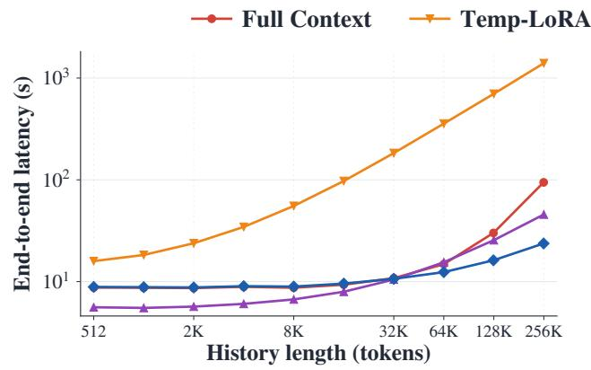

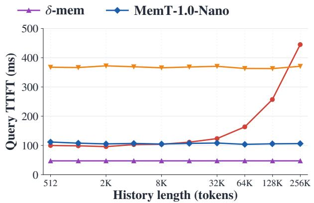  
Figure 8 Left: End-to-end latency includes history preparation and generation of a 128-token response. Right: Query TTFT measures the time from query execution to the first generated token, excluding history preparation.

We construct input sequences with varying history lengths based on BEAM. The query uses shared 512-token content, with the chat template added separately, rather than a benchmark question, and each sequence is treated independently. We evaluate a fixed generation length of 128 tokens by forcing the model to decode exactly 128 tokens while ignoring the end-of-sequence signal. For the HF evaluations, synchronized wall-clock timers exclude model loading, input tokenization, and evaluation-related scoring overhead. For each history and length, we measure preparation once, discard one query warm-up, and average five timed queries. Reported curves average the resulting values across 35 histories. For MemT-1.0-Nano, history content is processed in 2,048-token slices, with each chat-formatted chunk capped at 2,048 tokens.

The reported end-to-end latency includes history preparation and response generation, accounting for indexing, test-time adaptation, or memory writes as applicable. We additionally report query time to first token (TTFT), measured from the start of query execution to the first generated token, including query prefilling but excluding history preparation. For full context and MemT-1.0-Nano, both end-to-end latency and TTFT include state restoration. The HF full-context baseline reuses the prepared history cache. We report results over the common history-length range from 512 to 256K tokens. Figure 8 presents the results. MemT-1.0-Nano achieves an end-to-end advantage over full context at long histories. It is generally slower at short histories and approximately matches full context at 32K tokens, reaching speedups of approximately 1.20× at 64K, 1.86× at 128K, and 3.99× at 256K. Its memory storage procedure processes history incrementally; generation then accesses the resulting state without retaining historical tokens in the attention context. In comparison, the full-context baseline incurs both history prefilling and continued attention over historical KV entries during generation. The measured long-history end-to-end advantage primarily reflects lower history-preparation cost.

The query TTFT curves reveal an additional benefit after history preparation. MemT-1.0-Nano maintains broadly stable mean query TTFT of approximately 104–112 ms across the evaluated range, while full-context TTFT rises to approximately 257 ms at 128K tokens and 445 ms at 256K tokens. MemT-1.0-Nano’s behavior is consistent with a fixed-size memory readout whose state dimensions do not grow with the number of historical tokens processed. For persistent interactions, it allows accumulated history to influence responses without progressively increasing the attention context used for each new query. The benefit concerns access to the stored representation, and the memory-capability results above already show that this representation preserves useful information. At 128K and 256K tokens, MemT-1.0-Nano achieves query TTFT speedups of approximately 2.44× and 4.19×, respectively, over cached full-context inference.

Previously collected results for the parametric memory baselines highlight the importance of accounting for preparation costs. Temp-LoRA maintains stable query TTFT, but its end-to-end cost grows substantially because history-specific adaptation requires optimization. Although �-mem has the lowest query TTFT, its end-to-end latency exceeds Nano’s from 64K tokens onward as history-preparation cost grows. Absolute latency diferences across these systems also reflect their backbone, runtime, and tokenization configurations These results show the value of eficient memory construction together with predictable query TTFT. Reusing a prepared state amortizes its construction cost over multiple queries.

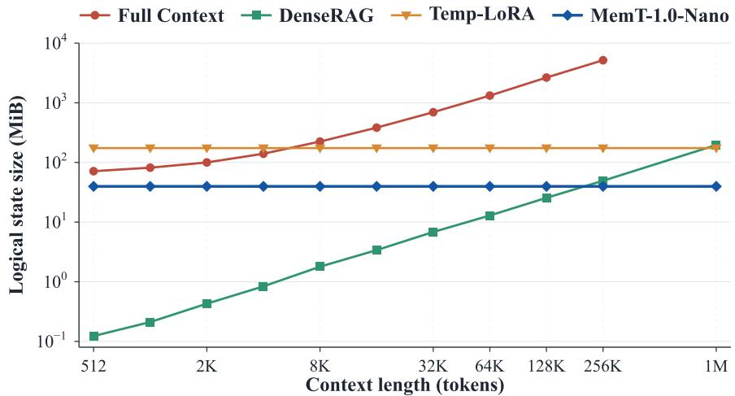  
Figure 9 Results of storage overhead. Per-trajectory persistent storage on BEAM histories of increasing length.

## 6.6 Storage Overhead

We evaluate the per-trajectory storage overhead on BEAM histories, after history preparation and before querying. The reported storage size is the logical size in bytes of the per-trajectory state. The shared backbone weights, embedders and hyper memory parameters are excluded from the measurement. More details can be found in Appendix D.5, and the results are presented in Figure 9.

Figure 9 shows a clear diference between retaining historical records and maintaining a fixed-size state. Full context incurs increasing storage as its logical state size grows with the visible history. DenseRAG has a much smaller storage overhead at short histories, but its stored texts and retrieval vectors also accumulate as more information is added. In contrast, MemT-1.0-Nano’s memory state storage remains constant throughout the trajectory, because new information updates memory states without enlarging them. At a history length of 128K tokens, MemT-1.0-Nano achieves an approximately 66× reduction in per-trajectory storage compared with the full context setting. Temp-LoRA also exhibits constant storage, since its adapter dimensions are fixed, although its storage overhead is larger than MemT-1.0-Nano’s in the evaluated configuration.

The comparison with DenseRAG illustrates how the storage advantage depends on interaction length. For short histories, storing a small collection of text chunks and embeddings is cheaper than allocating MemT-1.0-Nano’s full memory state. As histories grow, DenseRAG’s accumulated records eventually exceed that fixed allocation. MemT-1.0-Nano therefore becomes more attractive for persistent sessions with extended interaction histories, where additional turns do not increase the size of the saved state. The full context curve ends at its context-window limit, so its reported storage does not represent retaining the entire longest history. For deployment of MemT-1.0, a constant state size makes per-trajectory logical-state budgets predictable, and bounds the logical payload that must be saved or transferred when resuming an interaction. Total storage still grows with the number of independent trajectories and the configured memory capacity.

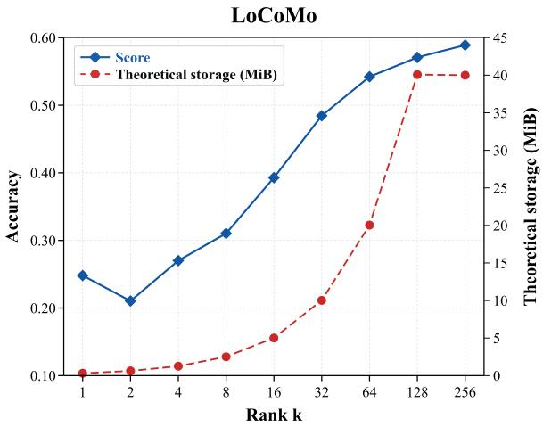

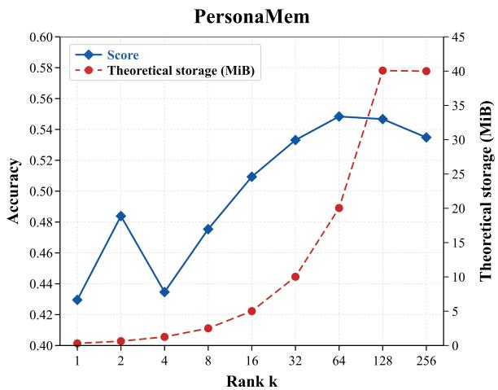  
Figure 10 Impact of online low-rank decomposition on memory performance and storage.

## 6.7 Low-Rank Decomposition

To further explore the compressibility of memory states based on MemT-1.0-Nano, we perform online low-rank projection for memory states to study their performance impacts. Specifically, we apply singular value decomposition (SVD) to the FP32 state matrix of each layer after each storage procedure, and reconstruct a dense state from the retained components for subsequent computation. For a retained rank �, the reconstructed state is computed as

$$
\begin{array} { r } { \mathbf { M } _ { t , h } ^ { ( l ) } = U _ { : , 1 : k } \Sigma _ { 1 : k , 1 : k } V _ { : , 1 : k } ^ { \top } . } \end{array}
$$

We set the rank $k \in \{ 1 , 2 , 4 , 8 , 1 6 , 3 2 , 6 4 , 1 2 8 , 2 5 6 \}$ , with the full rank � = 256 retaining the original dense state without projection. The evaluation is conducted on PersonaMem and LoCoMo. For each retention ratio, we independently initialize the memory state, write the complete history, and apply low-rank reconstruction after every memory storage when $k < 2 5 6$

Figure 10 shows diferent results across the two tasks. On LoCoMo, accuracy generally improves as more singular components are retained. The largest gains fall in the middle of the rank range, and the final doublings add progressively less, although the score still improves up to the full rank. The one exception is the smallest retained rank, which scores slightly above the next one. At this level of truncation, the small score diference alone does not establish an advantage of extreme compression. PersonaMem follows the same shape but saturates much earlier. Its accuracy rises quickly and then flattens out before reaching full rank, with the highest observed accuracy at an intermediate rank and no further improvement once additional components are retained. Overall, memory performance improves as the retained rank increases, but the returns diminish quickly, and on PersonaMem they eventually vanish. Because theoretical factor storage grows roughly linearly with the retained rank, increasing the rank yields diminishing returns in downstream accuracy.

## 7 Application in Agentic Tasks

## 7.1 Overview

In this section, we investigate the potential of MemT-1.0 for developing self-evolving agents through continual learning. We apply MemT-1.0 to long-horizon agentic tasks, where agents must use environment feedback to guide task execution. Real-world agent interactions generate a wealth of trajectories containing valuable procedural experience. Reusing this experience ofers a promising path toward improving agent performance across tasks. Current methods typically extract experience from historical trajectories and include it in the

textual context of subsequent tasks [58], increasing the burden on an already growing execution context.   
MemT-1.0 can instead store experience in native memory and use it to guide actions in long-horizon tasks.

We focus on agentic coding and train MemT-1.0-Nano to apply procedural experience extracted from historical trajectories. We evaluate it on SWE-bench Verified and SWE-bench Multilingual against Qwen3.6-35B-A3B, both without experience and with textual experience. With experience stored before execution, MemT-1.0- Nano improves the proportion of tasks solved in all three runs over the backbone without experience by 7.6 percentage points on SWE-bench Verified and 8.3 points on SWE-bench Multilingual. Results show that MemT-1.0 can improve agentic task performance beyond memory-focused evaluations and support its potential as a foundation for self-evolving agents.

## 7.2 Experience-Guided Agentic Framework

To explore this potential, we develop an agentic framework in which MemT-1.0 stores and reuses procedural experience during long-horizon task execution. We construct an experience bank by summarizing historical agent trajectories into reusable procedural guidance. As illustrated in Figure 11, the framework retrieves relevant experience from the bank and stores it in either the agent’s textual context or MemT-1.0-Nano’s native memory. The two approaches use the same experience but difer in how it is accessed during task execution.

Experience Retrieval and Storage. Given a coding task, we retrieve relevant experiences from the experience bank using BGE-M3 [59]. Each experience describes its applicable conditions, recommended procedures, and verification strategies. The task description serves as the retrieval query, and candidate experiences are ranked according to embedding similarity. The selected experience is converted into a structured textual representation before storage.

We consider two experience storage settings. In the Before Execution setting, experience is stored before the agent begins execution. In the Harness-Triggered setting, the agent first executes the task independently, and experience is stored when the execution harness detects a critical breakpoint. Such breakpoints are identified using execution feedback, including command failures, empty observations, and repeated unsuccessful operations. The detection only relies on information available during execution, without accessing reference solutions. Each trajectory receives at most one experience store operation.

Memory-Based Experience Application. In the Textual Experience setting, the retrieved experience is directly inserted into the agent’s message history and remains available through the subsequent context. In the Native Memory setting, MemT-1.0-Nano writes the same experience into its native memory state through a separate memory store operation. Specifically, the experience text is processed by a forward pass with memory writing enabled, updating the memory state � without modifying the original task context. After the memory store operation, agent actions access the stored experience through memory attention, allowing the experience to influence action generation without explicitly appearing in the message history.

Each execution trajectory maintains an independent memory state. The state is initialized to empty before the task and updated when experience is stored. After storing experience, it remains fixed and is read during subsequent execution until it is reset at the end of the trajectory. This setup evaluates whether a trained native-memory agent can efectively reuse procedural experience without retaining the experience text in the task context.

## 7.3 Experience Construction and Model Training

To enable experience-guided agentic execution through native memory, we construct training data that associate reusable procedural experience with successful execution behaviors. The overall data construction consists of two stages, extracting reusable experience from historical trajectories and generating experience-conditioned trajectories.

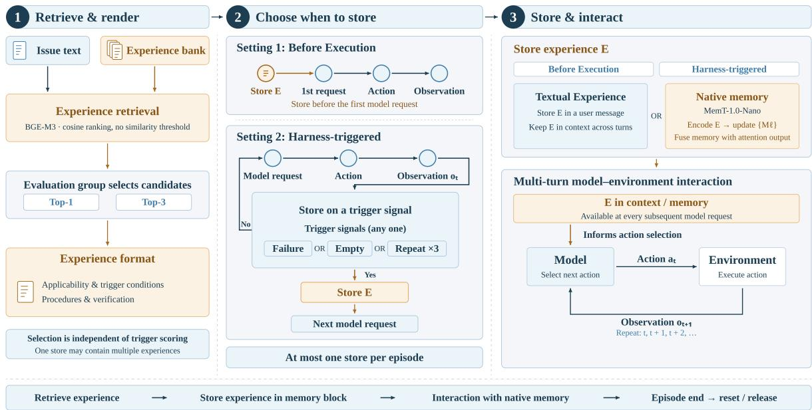  
Figure 11 Experience-guided agentic framework with MemT-1.0-Nano. Retrieved experience is stored in textual context or native memory to guide subsequent actions.

Experience Data Construction. We first construct an experience bank from 41,057 successful coding trajectories released by Scale-SWE [60]. Following the experience summarization framework of MSCE [61], the construction process consists of trajectory annotation, procedural policy induction, policy clustering, and experience generation with quality auditing. For each successful trajectory, we identify important execution decisions and their corresponding environmental conditions. Trajectories with similar conditions are grouped to induce reusable procedural policies, which are subsequently consolidated and converted into structured experiences. Each experience contains information about its triggering conditions, recommended execution steps, applicability constraints, and verification procedures. After quality filtering, we obtain an experience bank containing 1,040 reusable coding experiences.

Training Sample Construction. We further construct experience-guided training trajectories through counterfactual execution. Specifically, we generate original coding trajectories using Qwen3.6-35B-A3B with the AweAgent harness [62] in the Scale-SWE environment. For unsuccessful trajectories, we identify candidate breakpoints according to execution errors and other observable failure signals. At each selected breakpoint, we retrieve candidate experiences and resume execution with diferent experience combinations. The resulting trajectories are evaluated using executable tests, and we retain experience-conditioned continuations that pass the task tests when the corresponding original trajectory failed.

Each training sample is represented as

$$
x _ { b , j } = \left( \xi _ { \le b } , g _ { b , j } , \hat { \xi } _ { > b } ^ { + } \right) ,
$$

where � indexes the selected breakpoint and � indexes the candidate experience subset. Here, $\xi _ { \le b }$ denotes the original trajectory prefix before and including breakpoint �, $g _ { b , j }$ denotes the injected experience subset, and $\hat { \xi } _ { > b } ^ { + }$ denotes the successful continuation after experience injection.

The retained samples satisfy the condition that the original trajectory fails while the experience-conditioned continuation succeeds. These continuations provide supervision for predicting successful actions conditioned on procedural experience. We generate 18,820 original trajectories and evaluate 199,500 breakpoint-experience intervention variants. Among these interventions, 45,481 produce successful continuations. After additional quality filtering, we obtain 42,403 training samples. The resulting samples are partitioned by task to avoid leakage between training and validation trajectories. Appendix E provides details of the experience bank, data construction pipeline, and filtering procedure.

Training Strategy. We initialize the model from MemT-1.0-Nano. During application-specific post-training, all backbone parameters are frozen, and only the native hyper memory blocks are optimized. Each training sample is processed through separate experience and main-trajectory streams. First, the experience is written into native memory through a memory store operation. The original trajectory prefix is then replayed with memory reading disabled. After the designated breakpoint, memory reading is enabled, and the model is trained to predict the successful continuation conditioned on the stored experience. The experience text and trajectory prefix are excluded from the training loss, while the subsequent assistant actions provide the supervision signal.

We investigate both cross-entropy supervision and knowledge distillation. For knowledge distillation, the frozen backbone teacher receives the experience as text, while the student accesses the same experience only through native memory. Both models use teacher forcing on the same task history and reference continuation. We minimize the forward KL divergence from the teacher distribution to the student distribution over supervised assistant tokens.

We additionally investigate two supervision scopes. The First-Step setting supervises only the first assistant turn following the breakpoint, and the Full-Sufix setting supervises the complete successful continuation. We use knowledge distillation with Full-Sufix supervision for the application-specific post-training of MemT-1.0-Nano and evaluate the resulting checkpoint in the main experiments. Appendix E details the sample serialization and supervision masks.

## 7.4 Agentic Coding Evaluation

We evaluate MemT-1.0-Nano on two agentic coding benchmarks, including SWE-bench Verified [12], containing 500 tasks, and SWE-bench Multilingual [13], containing 300 tasks across nine programming languages. Both benchmarks require agents to resolve real-world software issues through repository exploration, code modifications, and executable tests. All baselines use Qwen3.6-35B-A3B as the backbone and follow the oficial SWE-bench verification protocol.

We compare Qwen3.6-35B-A3B (No Experience), Qwen3.6-35B-A3B (Textual Experience), and MemT-1.0- Nano (Native Memory). The No Experience baseline measures the benefit of experience reuse, while Textual Experience provides a reference for evaluating its efectiveness through native memory. The Harness-Triggered setting uses the same breakpoint-detection logic as training data construction. The Before Execution setting is used to assess robustness to experience injection timing. Each task is executed three times independently.

As shown in Table 5, we report the average success rate, pass@3, representing the proportion of tasks solved at least once across the three runs, and pass^3, representing the proportion of tasks solved in all three runs. MemT-1.0-Nano consistently improves the average success rate and repeated-run reliability over the backbone without experience. On SWE-bench Verified, in the Before Execution setting, MemT-1.0-Nano achieves an average success rate of 69.33%, improving upon the No Experience baseline of 66.07%. This slightly exceeds the 68.87% achieved by Textual Experience. Moreover, pass^3 increases from 54.00% to 61.60%, matching the 61.60% achieved by Textual Experience. These results indicate that native memory can preserve the efectiveness of procedural experience without requiring the corresponding experience

Table 5 Agentic coding performance on SWE-bench Verified (500 tasks) and SWE-bench Multilingual (300 tasks) under two experience injection settings. Bold and underlined values indicate the highest and second-highest distinct scores, respectively.
<table><tr><td>Benchmark</td><td>Store Timing</td><td>Method</td><td>pass^3</td><td>Avg. Success</td><td>pass@3</td></tr><tr><td rowspan="5">Verified</td><td rowspan="3">Before Execution</td><td>Qwen3.6-35B-A3B (No Experience)</td><td>54.00</td><td>66.07</td><td>77.60</td></tr><tr><td>Qwen3.6-35B-A3B (Textual Experience)</td><td>61.60</td><td>68.87</td><td>76.40</td></tr><tr><td>MemT-1.0-Nano (Native Memory)</td><td>61.60</td><td>69.33</td><td>77.40</td></tr><tr><td rowspan="2">Harness-Triggered</td><td>Qwen3.6-35B-A3B (No Experience)</td><td>54.00</td><td>66.07</td><td>77.60</td></tr><tr><td>Qwen3.6-35B-A3B (Textual Experience)</td><td>61.80</td><td>69.13</td><td>76.80</td></tr><tr><td rowspan="5">Multilingual</td><td rowspan="3">Before Execution</td><td>MemT-1.0-Nano (Native Memory)</td><td>62.80</td><td>69.73</td><td>77.80</td></tr><tr><td>Qwen3.6-35B-A3B (No Experience)</td><td>45.33</td><td>60.00</td><td>73.67</td></tr><tr><td>Qwen3.6-35B-A3B (Textual Experience) MemT-1.0-Nano (Native Memory)</td><td>56.33 53.67</td><td>64.22 62.89</td><td>72.67</td></tr><tr><td rowspan="2"></td><td></td><td></td><td></td><td>72.00</td></tr><tr><td>Qwen3.6-35B-A3B (No Experience)</td><td>45.33</td><td>60.00</td><td>73.67</td></tr><tr><td rowspan="3"></td><td rowspan="3">Harness-Triggered</td><td>Qwen3.6-35B-A3B (Textual Experience)</td><td>53.67</td><td>63.00</td><td>72.67</td></tr><tr><td>MemT-1.0-Nano (Native Memory)</td><td>55.33</td><td>63.56</td><td>73.00</td></tr><tr><td></td><td></td><td></td><td></td></tr></table>

All values are percentages, based on three independent runs per task. The pass^3 denotes the percentage of tasks solved in all three runs. The Avg. Success denotes the mean success rate across runs. The pass@3 denotes the percentage of tasks solved in at least one run. Textual Experience uses the top 3 experiences for Verified Before Execution; top 1 otherwise.

## text to remain in the task context.

In the Harness-Triggered setting, MemT-1.0-Nano further improves the average success rate to 69.73%, compared with 66.07% for No Experience and 69.13% for rank-1 textual experience. The corresponding pass^3 reaches 62.80%, representing an improvement of 8.80 percentage points over the backbone and 1.00 percentage point over fixed rank-1 textual experience. This suggests that native memory remains efective when experience is introduced dynamically during agent execution, rather than only at task initialization.

We observe consistent improvements on SWE-bench Multilingual. In the Before Execution setting, MemT-1.0-Nano improves the average success rate from 60.00% to 62.89% and pass^3 from 45.33% to 53.67%. In the Harness-Triggered setting, the average success rate reaches 63.56%, exceeding the fixed rank-1 textual experience result of 63.00%. These findings provide further evidence that experience internalization generalizes across coding tasks involving diferent repositories and programming languages.

The gains are most pronounced in repeated-run reliability, suggesting that stored experience helps agents solve tasks more consistently. Although pass^3 improves substantially, pass@3 does not consistently increase. The comparable behavior of MemT-1.0-Nano and textual experience further suggests that procedural guidance can be represented and utilized through native memory.

We also evaluate several training configurations on a 100-task development subset of SWE-bench Verified.   
Detailed comparisons and additional experimental results are provided in Appendix E.

## 7.5 Case Study and Discussion

To better understand how native memory afects agent behavior, we illustrate a representative task from SWE-bench Verified involving the two-digit year parsing logic in Django’s parse\_http\_date function.

We compare execution trajectories under the No Experience, Textual Experience, and Native Memory settings. Without experience, the agent modifies the relevant parsing logic shortly after locating the implementation, introducing targeted reproduction and verification steps later in the execution. In contrast, agents in both the

Textual Experience and Native Memory settings construct reproduction tests before applying modifications. In the MemT-1.0-Nano trajectory, the agent further revisits a boundary condition after its initial modification, corrects the implementation, and performs additional verification.

These observations show how stored procedural experience can guide task execution without appearing in textual context. Together with the benchmark improvements, they demonstrate that MemT-1.0 can reuse procedural experience to improve agentic task performance. This supports its potential for developing self-evolving agents: experience from past interactions can be stored in native memory and applied to new tasks.

Several challenges remain. The current framework relies on externally constructed experience, making its efectiveness dependent on experience quality and retrieval. Storing experience also introduces computation, so reduced textual context does not necessarily imply lower overall execution costs. Extending experience reuse into an autonomous continual learning process remains an open direction.

Future work will explore the co-evolution of the harness and MemT-1.0 through continued interaction with the environment. The harness can improve experience acquisition and selection, while MemT-1.0 learns to reuse that experience more efectively. Together, these advances could support continual learning in self-evolving agents for long-horizon tasks.

## 8 Limitations and Discussion

Despite the progress of MemT-1.0 in native memory, it still has several limitations. The fixed-size memory state imposes a capacity constraint. For the fixed memory, MemT-1.0 maintains an �(1) state with respect to the interaction history length �. Compared with methods whose stored representations grow as �(�), this bounded state has limited capacity to preserve detailed historical information. As interactions accumulate, new information must be incorporated into an existing representation, creating trade-ofs between retaining earlier details and adding recent information. The resulting loss of memory fidelity remains a challenge for tasks requiring precise recall. At the same time, a fixed-size state ofers opportunities beyond reducing storage. Each update incorporates new information into a representation, which has already been shaped by earlier interactions. This enables successive compression of accumulated history. Compared with maintaining a growing collection of historical records, this recurrent organization may provide a basis for latent reflection. It potentially allows iterative consolidation of experience within the memory state. Such a mechanism could support online self-evolution by allowing accumulated experience to influence subsequent behavior.

Finally, the relationship between local memory and hyper memory also deserves further study. Local memory represents information accumulated during interaction, while hyper memory encodes learned capabilities for storing and utilizing that information. An important question is whether experience accumulated in local memory can be consolidated into hyper-memory parameters through further training, and how knowledge encoded in hyper memory can be instantiated and adapted through local memory. Therefore, memory capability itself can be viewed as a higher-order form of learned information. Exploring this relationship may help connect adaptation within individual interactions with improvements in memory capability across tasks.

## 9 Conclusion

In this report, we presented MemT-1.0, a family of memory foundation models that integrates persistent memory into model computation. Through the token-level stable memory updates, Mixture-of-Storage, a deliberate backbone preparation, and a two-stage training pipeline, MemT-1.0 supports eficient storage and utilization of historical information. Both models outperform the evaluated parametric memory baselines on average, while largely preserving the general capabilities of their respective backbones under the noise setting. Applications to coding agents further demonstrate that native memory can internalize procedural experience to improve task success and execution consistency. Future work will focus on improving long-term memory, scaling memory capacity, and reducing the cost of memory updates. We will explore autonomous experience acquisition and continual memory consolidation across tasks, moving toward agents learning through memory-native evolution.

## References

[1] Daya Guo, Dejian Yang, Haowei Zhang, Junxiao Song, Peiyi Wang, Qihao Zhu, Runxin Xu, Ruoyu Zhang, Shirong Ma, Xiao Bi, et al. Deepseek-r1: Incentivizing reasoning capability in llms via reinforcement learning. arXiv preprint arXiv:2501.12948, 2025.

[2] Aaron Jaech, Adam Kalai, Adam Lerer, Adam Richardson, Ahmed El-Kishky, Aiden Low, Alec Helyar, Aleksander Madry, Alex Beutel, Alex Carney, et al. Openai o1 system card. arXiv preprint arXiv:2412.16720, 2024.

[3] Anyi Xu, B Li, Bangcai Lin, Bing Xue, BingCheng Xian, Bingzheng Xu, Bochao Wu, Bowei Zhang, Boyi Deng, CC Yu, et al. Deepseek-v4.1-flash: Pushing the limits of kv cache compression. arXiv preprint arXiv:2609.19969, 2026.

[4] Gemini Team, Petko Georgiev, Ving Ian Lei, Ryan Burnell, Libin Bai, Anmol Gulati, Garrett Tanzer, Damien Vincent, Zhufeng Pan, Shibo Wang, et al. Gemini 1.5: Unlocking multimodal understanding across millions of tokens of context. arXiv preprint arXiv:2403.05530, 2024.

[5] Zeyu Zhang, Quanyu Dai, Xiaohe Bo, Chen Ma, Rui Li, Xu Chen, Jieming Zhu, Zhenhua Dong, and Ji-Rong Wen. A survey on the memory mechanism of large language model-based agents. ACM Transactions on Information Systems, 43(6):1–47, 2025.

[6] Yuyang Hu, Shichun Liu, Yanwei Yue, Guibin Zhang, Boyang Liu, Fangyi Zhu, Jiahang Lin, Honglin Guo, Shihan Dou, Zhiheng Xi, et al. Memory in the age of ai agents. arXiv preprint arXiv:2512.13564, 2025.

[7] Zeyu Zhang, Ziliang Guo, Yihang Sun, Xichong Zhang, Xixuan Hao, Zehao Lin, Yang Zhang, Xiaoyan Zhao, Tong Shen, Bo Tang, et al. Metis: Memory foundation model. arXiv preprint arXiv:2607.26760, 2026.

[8] Ali Hatamizadeh, Yejin Choi, and Jan Kautz. Gated deltanet-2: Decoupling erase and write in linear attention. arXiv preprint arXiv:2605.22791, 2026.

[9] Suchin Gururangan, Ana Marasović, Swabha Swayamdipta, Kyle Lo, Iz Beltagy, Doug Downey, and Noah A Smith. Don’t stop pretraining: Adapt language models to domains and tasks. In Proceedings of the 58th annual meeting of the association for computational linguistics, pages 8342–8360, 2020.

[10] Long Ouyang, Jefrey Wu, Xu Jiang, Diogo Almeida, Carroll Wainwright, Pamela Mishkin, Chong Zhang, Sandhini Agarwal, Katarina Slama, Alex Ray, et al. Training language models to follow instructions with human feedback. Advances in neural information processing systems, 35:27730–27744, 2022.

[11] Jared Kaplan, Sam McCandlish, Tom Henighan, Tom B. Brown, Benjamin Chess, Rewon Child, Scott Gray, Alec Radford, Jefrey Wu, and Dario Amodei. Scaling laws for neural language models, 2020.

[12] Neil Chowdhury, James Aung, Jun Shern Chan, Oliver Jafe, Dane Sherburn, Giulio Starace, Evan Mays, Rachel Dias, Marwan Aljubeh, Mia Glaese, Carlos E. Jimenez, John Yang, Leyton Ho, Tejal Patwardhan, Kevin Liu, and Aleksander Madry. Introducing SWE-bench Verified. OpenAI Blog, August 2024. Updated February 24, 2025. Accessed October 7, 2026.

[13] John Yang, Kilian Adriano Lieret, Carlos E. Jimenez, Alexander Wettig, Kabir Khandpur, Yanzhe Zhang, Binyuan Hui, Ofir Press, Ludwig Schmidt, and Diyi Yang. Swe-smith: Scaling data for software engineering agents. ArXiv, abs/2504.21798, 2025.

[14] Ashish Vaswani, Noam Shazeer, Niki Parmar, Jakob Uszkoreit, Llion Jones, Aidan N Gomez, Łukasz Kaiser, and Illia Polosukhin. Attention is all you need. Advances in neural information processing systems, 30, 2017.

[15] Qwen Team. Qwen3.6-35B-A3B: Agentic coding power, now open to all, April 2026.

[16] DeepSeek-AI. DeepSeek-V4: Towards highly eficient million-token context intelligence. arXiv preprint arXiv:2606.19348, 2026.

[17] Noam Shazeer, Azalia Mirhoseini, Krzysztof Maziarz, Andy Davis, Quoc Le, Geofrey Hinton, and Jef Dean. Outrageously large neural networks: The sparsely-gated mixture-of-experts layer, 2017.

[18] Eric Zelikman, Yuhuai Wu, Jesse Mu, and Noah D. Goodman. STaR: Bootstrapping reasoning with reasoning. Advances in Neural Information Processing Systems, 35:15476–15488, 2022.

[19] Avi Singh, John D. Co-Reyes, Rishabh Agarwal, Ankesh Anand, Piyush Patil, Xavier Garcia, Peter J. Liu, James Harrison, Jaehoon Lee, Kelvin Xu, et al. Beyond human data: Scaling self-training for problem-solving with language models. Transactions on Machine Learning Research, 2024.

[20] Yang Yue, Zhiqi Chen, Rui Lu, Andrew Zhao, Zhaokai Wang, Yang Yue, Shiji Song, and Gao Huang. Does reinforcement learning really incentivize reasoning capacity in LLMs beyond the base model? Advances in Neural Information Processing Systems, 38, 2025.

[21] AutoClaw Team. GLM-5.3-Flash: More intelligence with less compute, August 2026.

[22] Geofrey Hinton, Oriol Vinyals, and Jef Dean. Distilling the knowledge in a neural network, 2015.

[23] Deepak Narayanan, Mohammad Shoeybi, Jared Casper, Patrick LeGresley, Mostofa Patwary, Vijay Anand Korthikanti, Dmitri Vainbrand, Prethvi Kashinkunti, Julie Bernauer, Bryan Catanzaro, Amar Phanishayee, and Matei Zaharia. Eficient large-scale language model training on gpu clusters using megatron-lm, 2021.

[24] NVIDIA NeMo Team. NeMo Megatron Bridge. https://github.com/NVIDIA-NeMo/Megatron-Bridge, 2026. GitHub repository.

[25] Songlin Yang, Bailin Wang, Yu Zhang, Yikang Shen, and Yoon Kim. Parallelizing linear transformers with the delta rule over sequence length. In A. Globerson, L. Mackey, D. Belgrave, A. Fan, U. Paquet, J. Tomczak, and C. Zhang, editors, Advances in Neural Information Processing Systems, volume 37, pages 115491–115522. Curran Associates, Inc., 2024.

[26] Vijay Anand Korthikanti, Jared Casper, Sangkug Lym, Lawrence McAfee, Michael Andersch, Mohammad Shoeybi, and Bryan Catanzaro. Reducing activation recomputation in large transformer models. Proceedings of Machine Learning and Systems, 5:341–353, 2023.

[27] Haoran Tan, Zeyu Zhang, Chen Ma, Xu Chen, Quanyu Dai, and Zhenhua Dong. Membench: Towards more comprehensive evaluation on the memory of llm-based agents. In Findings of the Association for Computational Linguistics: ACL 2025, pages 19336–19352, 2025.

[28] Chonghan Qin, Xiachong Feng, Weitao Ma, Xiaocheng Feng, and Lingpeng Kong. Implicitmembench: Measuring unconscious behavioral adaptation in large language models. In Proceedings of the 64th Annual Meeting of the Association for Computational Linguistics (Volume 1: Long Papers), pages 28232–28261, 2026.

[29] Bowen Jiang, Zhuoqun Hao, Young-Min Cho, Bryan Li, Yuan Yuan, Sihao Chen, Lyle Ungar, Camillo J Taylor, and Dan Roth. Know me, respond to me: Benchmarking llms for dynamic user profiling and personalized responses at scale. arXiv preprint arXiv:2504.14225, 2025.

[30] Jiahe Guo, Xiangran Guo, Yulin Hu, Zimo Long, Xingyu Sui, Xuda Zhi, Yongbo Huang, Hao He, Weixiang Zhao, Yanyan Zhao, et al. When personalization legitimizes risks: Uncovering safety vulnerabilities in personalized dialogue agents. In Proceedings of the 64th Annual Meeting of the Association for Computational Linguistics (Volume 1: Long Papers), pages 27309–27335, 2026.

[31] Adyasha Maharana, Dong-Ho Lee, Sergey Tulyakov, Mohit Bansal, Francesco Barbieri, and Yuwei Fang. Evaluating very long-term conversational memory of llm agents. In Proceedings of the 62nd Annual Meeting of the Association for Computational Linguistics (Volume 1: Long Papers), pages 13851–13870, 2024.

[32] Hengyu An, Minxi Li, Naen Xu, Chunyi Zhou, Xiaogang Xu, Tianyu Du, Jinbao Li, and Shouling Ji. Permemsafe: Benchmarking implicit personalized safety of long horizon self-evolving agents. In Findings of the Association for Computational Linguistics: ACL 2026, pages 6415–6433, 2026.

[33] Md Nayem Uddin, Kumar Shubham, Eduardo Blanco, Chitta Baral, and Gengyu Wang. From recall to forgetting: Benchmarking long-term memory for personalized agents. In Findings of the Association for Computational Linguistics: ACL 2026, pages 26814–26841, 2026.

[34] Xixuan Hao, Zeyu Zhang, Zehao Lin, Yihang Sun, Ziliang Guo, Xichong Zhang, Yuxuan Liang, Feiyu Xiong, and Zhiyu Li. Memops: Benchmarking lifecycle memory operations in long-horizon conversations. arXiv preprint arXiv:2607.12893, 2026.

[35] Di Wu, Hongwei Wang, Wenhao Yu, Yuwei Zhang, Kai-Wei Chang, and Dong Yu. Longmemeval: Benchmarking chat assistants on long-term interactive memory. arXiv preprint arXiv:2410.10813, 2024.

[36] Yuanzhe Hu, Yu Wang, and Julian McAuley. Evaluating memory in llm agents via incremental multi-turn interactions. In International Conference on Learning Representations, volume 2026, pages 156259–156291, 2026.

[37] Mohammad Tavakoli, Alireza Salemi, Carrie Ye, Mohamed Abdalla, Hamed Zamani, and J Ross Mitchell. Beyond a million tokens: Benchmarking and enhancing long-term memory in llms. arXiv preprint arXiv:2510.27246, 2025.

[38] Yubo Wang, Xueguang Ma, Ge Zhang, Yuansheng Ni, Abhranil Chandra, Shiguang Guo, Weiming Ren, Aaran Arulraj, Xuan He, Ziyan Jiang, et al. Mmlu-pro: A more robust and challenging multi-task language understanding benchmark. Advances in Neural Information Processing Systems, 37:95266–95290, 2024.

[39] David Rein, Betty Li Hou, Asa Cooper Stickland, Jackson Petty, Richard Yuanzhe Pang, Julien Dirani, Julian Michael, and Samuel R Bowman. Gpqa: A graduate-level google-proof q&a benchmark. arXiv preprint arXiv:2311.12022, 2023.

[40] Jefrey Zhou, Tianjian Lu, Swaroop Mishra, Siddhartha Brahma, Sujoy Basu, Yi Luan, Denny Zhou, and Le Hou. Instruction-following evaluation for large language models. arXiv preprint arXiv:2311.07911, 2023.

[41] Yushi Bai, Shangqing Tu, Jiajie Zhang, Hao Peng, Xiaozhi Wang, Xin Lv, Shulin Cao, Jiazheng Xu, Lei Hou, Yuxiao Dong, et al. Longbench v2: Towards deeper understanding and reasoning on realistic long-context multitasks. In Proceedings of the 63rd Annual Meeting of the Association for Computational Linguistics (Volume 1: Long Papers), pages 3639–3664, 2025.

[42] Terry Yue Zhuo, Minh Chien Vu, Jenny Chim, Han Hu, Wenhao Yu, Ratnadira Widyasari, Imam Nur Bani Yusuf, Haolan Zhan, Junda He, Indraneil Paul, et al. Bigcodebench: Benchmarking code generation with diverse function calls and complex instructions. In International Conference on Learning Representations, volume 2025, pages 66602–66656, 2025.

[43] Naman Jain, Alex Gu, Wen-Ding Li, Fanjia Yan, Tianjun Zhang, Sida Wang, Armando Solar-Lezama, Koushik Sen, and Ion Stoica. Livecodebench: Holistic and contamination free evaluation of large language models for code. In International Conference on Learning Representations, volume 2025, pages 58791–58831, 2025.

[44] Vladimir Karpukhin, Barlas Oğuz, Sewon Min, Patrick Lewis, Ledell Wu, Sergey Edunov, Danqi Chen, and Wen tau Yih. Dense passage retrieval for open-domain question answering, 2020.

[45] Zhiyu Li, Chenyang Xi, Chunyu Li, Ding Chen, Boyu Chen, Shichao Song, Simin Niu, Hanyu Wang, Jiawei Yang, Chen Tang, et al. Memos: A memory os for ai system. arXiv preprint arXiv:2507.03724, 2025.

[46] Prateek Chhikara, Dev Khant, Saket Aryan, Taranjeet Singh, and Deshraj Yadav. Mem0: Building production-ready ai agents with scalable long-term memory. arXiv preprint arXiv:2504.19413, 2025.

[47] Jiajie Fu, Junwen Chen, Mengzhao Wang, Aoxiang He, Maojia Sheng, Xiangyu Ke, Yifan Zhu, and Yunjun Gao. Vikingmem: A memory base management system for stateful llm-based applications. arXiv preprint arXiv:2605.29640, 2026.

[48] Preston Rasmussen, Pavlo Paliychuk, Travis Beauvais, Jack Ryan, and Daniel Chalef. Zep: a temporal knowledge graph architecture for agent memory. arXiv preprint arXiv:2501.13956, 2025.

[49] Yan Wang, Dongyang Ma, and Deng Cai. With greater text comes greater necessity: Inference-time training helps long text generation. arXiv preprint arXiv:2401.11504, 2024.

[50] Rujikorn Charakorn, Edoardo Cetin, Shinnosuke Uesaka, and Robert Tjarko Lange. Doc-to-lora: Learning to instantly internalize contexts. arXiv preprint arXiv:2602.15902, 2026.

[51] Yewei Liu, Xiyuan Wang, Yansheng Mao, Yoav Gelbery, Haggai Maron, and Muhan Zhang. Shine: A scalable in-context hypernetwork for mapping context to lora in a single pass. arXiv preprint arXiv:2602.06358, 2026.

[52] Jingdi Lei, Di Zhang, Junxian Li, Weida Wang, Kaixuan Fan, Xiang Liu, Qihan Liu, Xiaoteng Ma, Baian Chen, and Soujanya Poria. �-Mem: Eficient online memory for large language models. arXiv preprint arXiv:2605.12357, 2026.

[53] Zhichen Liu, Ruihan Sun, Hengjie Yang, Zipeng Wu, Zhaohan Chen, Xiaofan Zhang, and Yang Xu. Livemem: Maintaining memory state continuity in long-running llm inference. arXiv preprint arXiv:2608.02515, 2026.

[54] Yu Wang, Yifan Gao, Xiusi Chen, Haoming Jiang, Shiyang Li, Jingfeng Yang, Qingyu Yin, Zheng Li, Xian Li, Bing Yin, et al. Memoryllm: Towards self-updatable large language models. arXiv preprint arXiv:2402.04624, 2024.

[55] Tao Ge, Jing Hu, Lei Wang, Xun Wang, Si-Qing Chen, and Furu Wei. In-context autoencoder for context compression in a large language model. arXiv preprint arXiv:2307.06945, 2023.

[56] MemTensor. OmniMemEval: Evaluation framework for memory systems and memory-augmented agents. https://github.com/MemTensor/OmniMemEval, 2026. GitHub repository.

[57] Songlin Yang, Jan Kautz, and Ali Hatamizadeh. Gated delta networks: Improving mamba2 with delta rule, 2025.

[58] Andrew Zhao, Daniel Huang, Quentin Xu, Matthieu Lin, Yong-Jin Liu, and Gao Huang. Expel: Llm agents are experiential learners. In Proceedings of the AAAI Conference on Artificial Intelligence, volume 38, pages 19632–19642, 2024.

[59] Jianlyu Chen, Shitao Xiao, Peitian Zhang, Kun Luo, Defu Lian, and Zheng Liu. M3-embedding: Multi-linguality, multi-functionality, multi-granularity text embeddings through self-knowledge distillation. In Findings of the Association for Computational Linguistics: ACL 2024, 2024.

[60] Jiale Zhao, Guoxin Chen, Fanzhe Meng, Minghao Li, Jie Chen, Hui Xu, Yongshuai Sun, Wayne Xin Zhao, Ruihua Song, Yuan Zhang, Peng Wang, Cheng Chen, Jirong Wen, and Kai Jia. Immersion in the GitHub universe: Scaling coding agents to mastery. arXiv preprint arXiv:2602.09892, 2026.

[61] Bo Tang, Yang Zhang, Guomian Zhuang, Wenqiang Wei, Gaoyang Zheng, Lindong Xie, Yanchao Tan, Feiyu Xiong, Qingyu Yang, Edward Chung, and Zhiyu Li. From memory to skills: Evidence-grounded co-evolution governance for long-horizon LLM agents. arXiv preprint arXiv:2607.16621, 2026.

[62] AweAI Team. AweAgent: A unified, composable framework to build, evaluate, and train agents. https: //github.com/AweAI-Team/AweAgent, 2026. GitHub repository.

## A.1 Author List

Core Contributors: Zhiyu Li, Zeyu Zhang, Linyun Liu, Yiwei Bu, Chenyang Xi, Xichong Zhang, Yi Yu, Yu Yu, Zhichen Liu, Yuxiao Yi<sup>†</sup>, Chunyu Li, Haoran Liu, Zhenkai Ding, Le Zhou, Juncheng Zhang, Boyu Chen, Zehao Lin, Guorui Li, Renyu Fu, Ji Li, Youyang Xia, Jiajun Shen, Harvey Li<sup>†</sup>, Jingsong Zhou<sup>†</sup>, Helan Hu, Tong Shen, Tianxiao Xu, Chenye Han, Weijie Li, Zhongquan Zhou, Hongming Xu, Yuekeng Li, Erenkai Zhu, Peng Yu, Wenhao Li, Jingyi Kang, Xixuan Hao, Xuzhou Zhu, Can Chen, Jiawei Liu, Chen Jiang, Tao Jiang, Fangwei Xiang, Zepeng Yao, Kai Chen, Guang Yang, Mingfei Lu, Chunhui Li, Zhengxuan Jiang, Bo Tang.

Contributors: Shiyu Zhan, Yihang Sun, Jie Chu, Wenjun Xiong, Zhenxiang Hua, Chen Lin, Detong Su, Dongyu Deng, Qiuping Ding, Guofeng Ding, Si Chen, Guohua Wen.

Co-advisors: Xu Chen, Zhi-Qin John Xu, Ying-Cong Chen<sup>†</sup>, Ningyu Zhang, Haofen Wang, Muning Wen, Haotian Chen, Wentao Zhang, Xuanhe Zhou, Rita Zhang<sup>†</sup>, Junchi Yan, Feiyu Xiong.

## A.2 Acknowledgments

We thank NVIDIA for developing and open-sourcing Megatron-Core and Megatron Bridge, which provided a valuable foundation for our distributed training infrastructure. We further acknowledge NVIDIA’s research on Gated DeltaNet and Gated DeltaNet-2, which inspired the design of our memory architecture. We thank Shanghai Kupas Technology Co.,Ltd. and INESA (Group) Co., Ltd. for their support. We also thank Zhengren Wang, Yushen Wang, Yida Xue, Nuoxi Chen, Haoyu Liu, Chenxu Du, and Yinghan Zhao for their valuable contributions to this project.

## B Adaptation to Specific Backbones

Table 6 summarizes the memory geometry of the MemT-1.0-Nano and MemT-1.0-Flash models used in the main evaluations. Both use one memory block per selected layer (� = 1). The four-expert MoS workload in Appendix F measures the cost of capacity expansion separately. Layer indices below start at zero.

## B.1 Projection and Fusion

MemT-1.0-Nano. MemT-1.0-Nano augments each full-attention layer of Qwen3.6-35B-A3B with a native memory block, preserving the original hybrid architecture and MoE computation. The memory branch receives the same pre-normalized hidden states as the original attention and assigns an independent memory channel to each query head. Memory query, key, and value projections are dense and initialized from the corresponding backbone attention projections. The query projection copies the query component of the backbone’s joint query/output-gate projection. The two backbone KV heads are each copied into eight memory heads, giving 16 independently trainable memory heads. The copies share initial values but are separate parameters, with separate channel-wise gates and memory states. After per-head RMSNorm and output gating, the 16 readouts are concatenated into a 4096-dimension vector, added to the backbone’s already-gated attention output, and passed through its frozen 4096×2048 output projection. The backbone sigmoid gate therefore applies only to the original attention branch, while memory uses the output gate defined in Section 2.

MemT-1.0-Flash. MemT-1.0-Flash attaches a native memory block to the compressed-attention layers of DeepSeek-V4. The backbone compressed-attention has 64 query heads of dimension 512, and the memory branch keeps the same geometry, assigning one independent memory channel to each query head.

Table 6 Backbone and native-memory configuration. State size counts the persistent memory matrices for one trajectory, excluding model weights and current-step KV caches.
<table><tr><td>Configuration</td><td>MemT-1.0-Nano</td><td>MemT-1.0-Flash</td></tr><tr><td>Backbone</td><td>Qwen3.6-35B-A3B</td><td>DeepSeek-V4-Flash, after backbone preparation</td></tr><tr><td>Hidden width / decoder layers</td><td>2048 / 40</td><td>4096 /43</td></tr><tr><td>Memory layers</td><td>3, 7, . . . , 39 (10 layers)</td><td>4, 6, . . . , 42 (20 layers)</td></tr><tr><td>Memory-layer type</td><td>Full attention</td><td>Compressed sparse attention</td></tr><tr><td>Memory  $H _ { q } / H _ { k \nu }$ </td><td>16 / 16</td><td>64/64</td></tr><tr><td>Memory  $d _ { k } / d _ { \nu }$ </td><td>256 / 256</td><td>512 / 512</td></tr><tr><td>Memory experts per layer</td><td>1</td><td>1</td></tr><tr><td>Trainable memory parameters</td><td>450,931,360</td><td>3,608,608,000</td></tr><tr><td>State elements per trajectory</td><td>10,485,760</td><td>335,544,320</td></tr><tr><td>FP32 state size</td><td>40 MiB</td><td>1280 MiB</td></tr><tr><td>Readout / fusion-point width</td><td>4096 /4096</td><td>32768 / 8192</td></tr></table>

The memory query projection follows the backbone query projection, which is a two-stage bottleneck that maps the hidden state of width 4096 to a rank-1024 factor and then to 32768 features. Both stages and the normalization gain on the intermediate factor are copied from the backbone attention. This normalization depends on the input and therefore remains in the projection rather than being folded into the weights.

Keys and values instead use a grouped bottleneck. Eight latent groups of width 512 are projected from the hidden state, and each group is normalized by its own RMSNorm over the group’s 512 features. The group is then expanded to eight heads of dimension 512, so that the eight groups yield 64 memory heads in total, matching the backbone query-head count.

The eight groups are initialized from three backbone projections: the layer’s local KV projection, written �, and the previous and current halves of the compressed-attention projection, written � and �. Group � draws its key and value from the �-th entry of the following list of pairings:

$$
( L , L ) , ( P , C ) , ( P , L ) , ( C , P ) , ( C , L ) , ( L , P ) , ( L , C ) , ( C , C ) .
$$

Here � and � denote the two halves of a single backbone projection, and a pairing such as $( P , C )$ means that the key is taken from the previous half and the value from the current half. Each group also copies the normalization gain and epsilon of the backbone module that its pairing selects, so groups drawing from � inherit the local KV normalization while those drawing from � or � inherit the compressed-attention normalization. Within a group, the expansion to the eight heads is initialized as an identity mapping and the heads are trained independently.

After readout, the backbone’s frozen grouped output projection maps eight groups of 4096 features to eight groups of 1024. The resulting 8192-dimensional memory contribution is added at the input of the final backbone output projection, which contracts it to the hidden width of 4096. The original backbone residual and hyper-connection operations are preserved.

## B.2 Gates and Initialization

All gates take the pre-attention hidden state directly. MemT-1.0-Nano uses dense erase/write projections and rank-256 factorizations for the forget and output gates. MemT-1.0-Flash uses rank-512 factorizations for all four gates. There is no intervening nonlinearity or normalization between gate factors, so the erase/write factors compose into the efective matrices in Section 2. MemT-1.0-Flash’s Q/K/V bottleneck normalization, described above, is distinct from these gate projections.

New gate input weights are initialized from $N ( 0 , 0 . 0 2 ^ { 2 } )$ . For both models, the forget-gate expansion starts at zero and the output-gate expansion uses $N ( 0 , 0 . 0 0 1 ^ { 2 } )$ . MemT-1.0-Nano copies the initial erase projection into the write projection, then trains them independently. MemT-1.0-Flash initializes the erase/write expansion factors independently from $N ( 0 , 0 . 0 2 ^ { 2 } )$ and initializes the output-gate bias to 0.1. MemT-1.0-Nano has no output-gate bias. Both use a SoftCapSiLU threshold of 2.0 in the evaluated models.

Forget-gate biases encode a range of initial time scales. For each key channel, a half-life T1/2 $\tau _ { 1 / 2 }$ is sampled independently and log-uniformly from [2048, 32768] tokens for MemT-1.0-Nano and [128, 32768] tokens for MemT-1.0-Flash. We initialize

$$
b _ { \lambda } = \mathrm { S o f t p l u s } ^ { - 1 } \left( \frac { \log 2 } { \tau _ { 1 / 2 } } \right) , \qquad s _ { h } = 0 .
$$

Together with the zero forget-gate expansion, this sets the initial decay time scale through a factor $2 ^ { - 1 / \tau _ { 1 / 2 } }$ per token. Both the channel-wise bias $b _ { \lambda }$ and head-wise log-scale $s _ { h }$ remain trainable and are excluded from weight decay. Memory states start at zero for each independent trajectory.

## B.3 Training Configuration

The trainable parameter counts in Table 6 include memory Q/K/V projections, gate projections and biases, decay scales, and memory normalization gains. Backbone parameters, including the output projections used for fusion, are frozen during memory training. Model parameters and projection computation use BF16. Optimizer master parameters, gradient accumulation/reduction, and Adam moments use FP32. Memory-state accumulation and the sensitive normalization/decay calculations also use FP32.

Table 7 Execution and distillation settings for the evaluated checkpoints. TP, PP, CP, and EP denote tensor, pipeline, context, and expert parallelism. DP counts logical data-parallel replicas. EP partitions backbone experts within that topology.
<table><tr><td>Setting</td><td>MemT-1.0-Nano</td><td>MemT-1.0-Flash</td></tr><tr><td>TP / PP / CP / EP</td><td>1/1/1/8</td><td>1/4/2/8</td></tr><tr><td>Logical DP / accumulation steps</td><td>64 / 1</td><td>12 / 16</td></tr><tr><td>Global batch (packs)</td><td>64</td><td>192</td></tr><tr><td>Maximum pack / storage step</td><td>65536 / 2048 tokens</td><td>65536 / 2048 tokens</td></tr><tr><td>Post-training target</td><td>Online backbone, Top-64 KL</td><td>Online backbone, Top-64 KL</td></tr><tr><td>Temperature / KL / CE weight</td><td>1/1/0</td><td>1/1/0</td></tr><tr><td>Memory writer / reader MoE communication backend</td><td>Chunked update / step snapshot DeepEP</td><td>Chunked update / step snapshot DeepEP</td></tr></table>

The single-GPU MoS measurements in Appendix F have their own workload and software configuration.

## C Stable Mechanism on GDN-2

## C.1 Problem Formulation

We consider a general recursive update of the form

$$
S _ { t } = P _ { t } S _ { t - 1 } + B _ { t } .\tag{1}
$$

Define the propagation matrix $\Phi _ { t : i } = P _ { t } P _ { t - 1 } \cdot \cdot \cdot P _ { i }$ . Expanding the recursion yields

$$
S _ { t } = \Phi _ { t : 1 } S _ { 0 } + \sum _ { i = 1 } ^ { t } \Phi _ { t : i + 1 } B _ { i } .\tag{2}
$$

Setting $S _ { 0 } = 0$ , we obtain

$$
S _ { t } = \sum _ { i = 1 } ^ { t } \Phi _ { t : i + 1 } B _ { i } .\tag{3}
$$

Assuming $\| P _ { t } \| \leq \rho$ and $\left\| B _ { t } \right\| \leq R$ , an upper bound of $\| S _ { t } \|$ is

$$
\| S _ { t } \| \leq R \sum _ { j = 0 } ^ { t - 1 } \rho ^ { j } ,\tag{4}
$$

that is,

$$
\left\| S _ { t } \right\| \leq \left\{ t R , \begin{array} { l l } { \displaystyle 1 - \rho ^ { t } } , & { 0 \leq \rho < 1 , } \\ { \displaystyle 1 - \rho ^ { t } } & { \rho = 1 , } \\ { \displaystyle R \frac { \rho ^ { t } - 1 } { \rho - 1 } , } & { \rho > 1 . } \end{array} \right.\tag{5}
$$

Therefore, when $\rho < 1$ , we have $\begin{array} { r } {  S _ { t }  \leq \frac { R } { 1 - \rho } \mathrm { ~ a s ~ } t  \infty } \end{array}$ , and the update is bounded; we call such a recursion a stable update.

Next, we analyze the vector-form GDN-2 update:

$$
S _ { t } = \big ( I - k _ { t } ^ { \top } ( b _ { t } \odot k _ { t } ) \big ) D _ { t } S _ { t - 1 } + k _ { t } ^ { \top } ( w _ { t } \odot \nu _ { t } ) ,\tag{6}
$$

where $D _ { t } = { \mathrm { D i a g } } ( d _ { t } )$ is diagonal, $d _ { t } , b _ { t } , w _ { t } \in ( 0 , 1 )$ , and $\| k _ { t } \| _ { 2 } = 1 , \| \nu _ { t } \| _ { 2 } \leq g , g$ is a boundary of �’s norm. This update is not stable in general. Let $A _ { t } = I - k _ { t } ^ { \top } ( b _ { t } \odot k _ { t } ) , P _ { t } = A _ { t } D _ { t }$ , and $B _ { t } = k _ { t } ^ { \top } \left( w _ { t } \odot \nu _ { t } \right)$

We omit the time index and define

$$
a = b \odot k , \quad \rho = k a ^ { \top } , \quad m = \| a \| _ { 2 } ^ { 2 } .\tag{7}
$$

Then

$$
\rho = \sum _ { i } b _ { i } k _ { i } ^ { 2 } , \qquad m = \sum _ { i } b _ { i } ^ { 2 } k _ { i } ^ { 2 } ,\tag{8}
$$

and $\rho \in ( 0 , 1 ) , m \in [ \rho ^ { 2 } , \rho )$

Decompose � into the component parallel to � and the orthogonal component. Let � be a unit vector such that $e k ^ { \top } = 0$ and $\| e \| _ { 2 } = 1$ . Define $\gamma ^ { 2 } = m - \rho ^ { 2 }$ , then

$$
a = \rho k + \gamma e .\tag{9}
$$

Using the basis $\{ k , e \}$ , we have

$$
A = I - k ^ { \top } { a } = \left[ \begin{array} { c c } { 1 - \rho } & { - \gamma } \\ { 0 } & { 1 } \end{array} \right] \oplus I _ { K - 2 } .\tag{10}
$$

Hence

$$
e A ^ { \top } = e - \gamma k , \qquad \| e A ^ { \top } \| _ { 2 } ^ { 2 } = 1 + \gamma ^ { 2 } \geq 1 .\tag{11}
$$

This shows that along the $e$ direction, whenever $\gamma \neq 0$ , the update amplifies energy, and � may lead to an unstable recursion. Moreover,

$$
\gamma = 0 \iff a \parallel k .\tag{12}
$$

Thus, if we only consider �, a prerequisite for stability is that $b \odot k$ must be colinear with �.

We further analyze � by focusing on its $2 \times 2$ non-trivial block $A _ { 2 }$ and considering $A _ { 2 } ^ { \top } A _ { 2 }$ . Its trace is $T = 2 - 2 \rho + m$ and its determinant is de $( A _ { 2 } ^ { \top } A _ { 2 } ) = ( 1 - \rho ) ^ { 2 }$ . The squared spectral norm (i.e., the largest singular value squared) is

$$
\| A _ { 2 } \| _ { 2 } ^ { 2 } = \lambda _ { + } = \frac { T + \sqrt { T ^ { 2 } - 4 ( 1 - \rho ) ^ { 2 } } } { 2 } \geq 1 .\tag{13}
$$

In particular, the spectral norm squared of the full $A _ { 2 }$ block is

$$
\left\| A \right\| _ { 2 } ^ { 2 } = \operatorname* { m a x } \{ 1 , \lambda _ { + } \} = \left\| A _ { 2 } \right\| ^ { 2 } .\tag{14}
$$

Since $m < \rho ,$ , we have

$$
\lambda _ { + } < \frac { 2 - \rho + \sqrt { \rho ( 4 - 3 \rho ) } } { 2 } .\tag{15}
$$

The right-hand side achieves its maximum $\frac 4 3$ at $\textstyle \rho = { \frac { 1 } { 3 } }$ , hence

$$
1 \leq \| A \| _ { 2 } < \frac { 2 } { \sqrt { 3 } } .\tag{16}
$$

This gives an upper bound on the spectral norm of �. When both � and � are considered in the update, if $\| D \| _ { 2 } \leq { \overline { { d } } }$ , then

$$
\| P \| _ { 2 } = \| A D \| _ { 2 } \leq \frac { 2 } { \sqrt { 3 } } \overline { { d } } .\tag{17}
$$

To ensure uniform contraction bound for $P _ { t }$ less than 1, a suficient condition is $\overline { { d } } < \frac { \sqrt { 3 } } { 2 } \approx 0 . 8 6 6$ . Since $P _ { t } S _ { t - 1 }$ does not always amplify, $\overline { { d } } < 0 . 8 6 6$ is a suficient condition for stability in the worst case. This condition guaranties uniform contraction of the homogeneous recursion. If the additive inputs $B _ { t } = k _ { t } ^ { \top } \left( w _ { t } \odot \nu _ { t } \right)$ are uniformly bounded, then the resulting inhomogeneous recursion is uniformly bounded as well. Under this condition, the half-life of the forget gate $D$

$$
t _ { 1 / 2 } = { \frac { \ln 2 } { - \ln d } } = { \frac { \ln 2 } { - \ln { \sqrt { 3 } } / 2 } } \approx 4 . 8 2 ,\tag{18}
$$

is only about 5 tokens.

## C.2 Solution: Symmetrization Fix

Note that in the GDN-2 update, the � term can be written as

$$
A = I - k ^ { \top } ( b \odot k ) = I - k ^ { \top } k \operatorname { D i a g } ( b ) .\tag{19}
$$

The instability stems from the fact that � is not symmetric. We therefore move Diag(�) to both � to make � symmetric:

$$
A = I - \operatorname { D i a g } ( { \sqrt { b } } ) k ^ { \top } k \operatorname { D i a g } ( { \sqrt { b } } ) .\tag{20}
$$

Further, we can rewrite it as

$$
A = I - ( { \sqrt { b } } \odot k ) ^ { \top } ( { \sqrt { b } } \odot k ) .\tag{21}
$$

With this symmetrization fix, we obtain Stable GDN-2 (SGDN-2), whose update is

$$
S _ { t } = \big ( I - ( \sqrt { b _ { t } } \odot k _ { t } ) ^ { \top } ( \sqrt { b _ { t } } \odot k _ { t } ) \big ) D _ { t } S _ { t - 1 } + ( \sqrt { b _ { t } } \odot k _ { t } ) ^ { \top } \big ( w _ { t } \odot \nu _ { t } \big ) .\tag{22}
$$

According to the analysis above, the two vectors in SGDN-2 are naturally colinear $( \mathrm { i . e . , } \gamma = 0 )$ , which avoids the unstable update mechanism.

Geometrically, the symmetrized erase step acts separately on the component parallel to $u = \sqrt { b } \odot k$ and its orthogonal complement, with no coupling between these two orthogonal subspaces. Considering the erase step alone, with $D = I$ and no write term, the parallel component is scaled by $1 - \| u \| _ { 2 } ^ { 2 }$ , while the orthogonal component remains unchanged. Under the stated assumptions, $0 < \| u \| _ { 2 } ^ { 2 } < 1$ ; hence, the map contracts along � without expanding any orthogonal direction and is non-expansive in the Euclidean norm.

In contrast, GDN-2 computes the erase magnitude using $a = b \odot k$ but applies the correction along �. For the input $y = e$ , this gives $y ^ { \prime } = e - \gamma k$ . Since � and � are orthogonal, the correction increases the squared norm from 1 to $1 + \gamma ^ { 2 }$ whenever $\gamma \neq 0$ . Figure 12 illustrates the resulting non-expansive map and contrasts it with a GDN-2 erase step that increases the norm of the same input $y = e$

## D Details of Evaluation Setup

## D.1 Details of Benchmarks

Memory Benchmark. We evaluate memory capabilities on 11 benchmarks and divide them into four groups according to trajectory length as follows. These benchmarks focus on long-term information retention and retrieval, dynamic memory updating and management, and personalized understanding.

• MemBench [27]: MemBench reports the equal-weight mean accuracy across its factual/reflective and participation/observation quadrants on the 0–10K subset. We write each history in an independent scope and preserve its original message order. We note that when structured time is unavailable, no synthetic date is constructed.

• ImplicitMemBench [28]: ImplicitMemBench evaluates procedural learning, priming, and classical condi tioning through learning or priming, interference, and test stages. We preserve the original trajectory order, isolate priming treatment and control groups. Specifically, we use temperature 0.8 for the priming task.

• PersonaMem [29]: PersonaMem evaluates dynamic user profiling and personalized responses over evolving interactions. Each (history, history\_end) pair receives an independent scope. Questions with the same cutof share a read-only state, whereas diferent cutofs do not share memory. We utilize the 32K length subset of PersonaMem for our memory evaluation.

• PS-Bench [30]: PS-Bench measures whether personal memories induce intent legitimation and increase personalized attack success. Persona histories follow the original session, speaker, and timestamp order. We report 100(1 − ASR) on the Persona-grounded subset, with ASR micro-averaged over 1,863 queries.

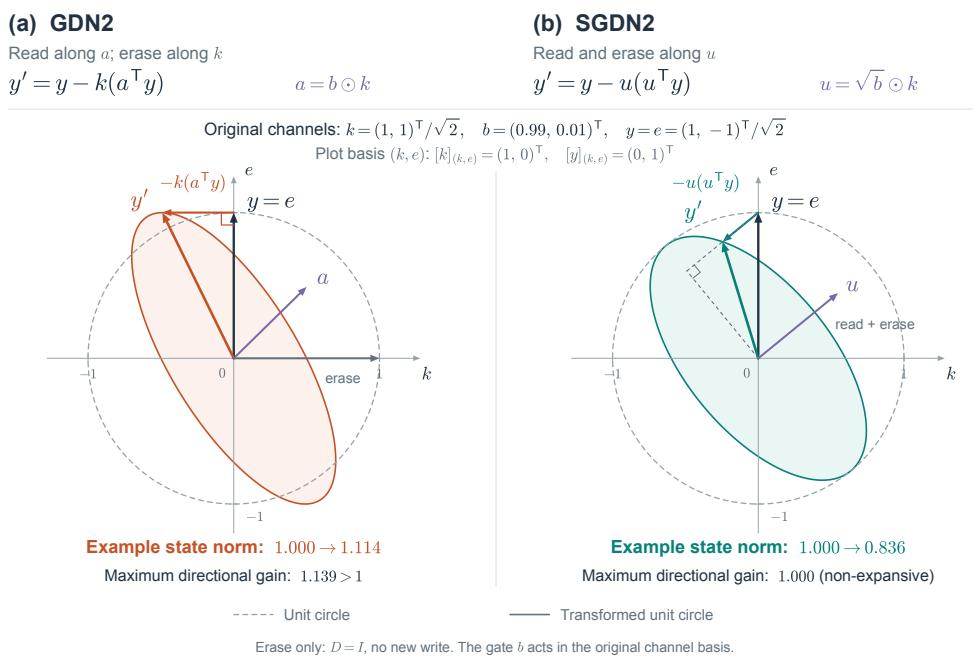  
Figure 12 An analytical single-step erase example with � = � and no write term. Both panels use the same input � = � and orthonormal {�, �} basis.

• LoCoMo [31]: LoCoMo evaluates single-hop, multi-hop, temporal, open-domain, and adversarial conversational memory. We preserve session, message, speaker, and date order. We also use speaker-specific scopes for MemOS, Mem0, and Graphiti, and use a conversation scope for OpenViking. We exclude the adversarial category from the reported score.

• PerMemSafe [32]: PerMemSafe evaluates implicit personalized safety through Safety Perception (SP) and Dynamic Evolution (DE) tracks. SP and DE histories use independent scopes, while risk descriptions, isolated answers, and scoring rubrics are excluded from memory writes. Specifically, we utilize the conv64 subset of PerMemSafe in our memory evaluation.

• Memora [33]: Memora evaluates remembering, reasoning, and recommendation under evolving weekly, monthly, and quarterly interactions. Each persona uses an independent scope with chronological session and turn writes and timestamps. Query dates are not used to filter history. We utilize the Weekly subset of Memora for memory evaluation.

• MemOps [34]: MemOps evaluates remembering, updating, forgetting, reflecting, and composed memory operations. We store 50 sessions by session index and message order in an independent scope, excluding operation labels, state annotations, and provenance tags from memory.

• LongMemEval [35]: LongMemEval evaluates information extraction, multi-session reasoning, temporal reasoning, knowledge updating, and abstention. Each haystack uses an independent scope and session-date order, and the current date appears only in the query and is not stored in memory. We utilize the LongMemEval-S subset for our memory evaluation.

• MemoryAgentBench [36]: MemoryAgentBench evaluates retrieval, test-time learning, long-range understanding, and selective forgetting. Source histories are isolated and written in complete chunk-N order without source mixing. The main set is used, excluding the short-context ablation questions.

• BEAM [37]: BEAM evaluates ten long-context memory abilities, including extraction, contradiction resolution, updating, preference following, summarization, and temporal reasoning. Each conversation uses an independent scope and complete chronological writes by session, timestamp, and message. We utilize the 1M subset of BEAM for our memory evaluation. Due to the limitation of generation, the full context retains at most the latest 256K tokens.

General Benchmark. We evaluate general capabilities on six benchmarks spanning four major dimensions: knowledge and scientific reasoning, instruction following, long-context understanding, and code generation. The detailed benchmarks are presented as follows.

• MMLU-Pro [38]: MMLU-Pro extends MMLU with harder reasoning questions and ten answer choices. We use the TIGER-Lab/MMLU-Pro@14be195 test split and evaluate these conditions with fixed demonstrations provided through ordinary context or native memory.

• GPQA Diamond [39]: GPQA Diamond contains graduate-level biology, physics, and chemistry questions designed to resist ordinary web search. We evaluate each of the 198 questions eight times, keeping its answer-option order fixed across repetitions and evaluation conditions, and report mean accuracy.

• IFEval [40]: IFEval evaluates programmatically verifiable constraints such as length, keywords, casing, and formatting. We use the 541-prompt, 834-instruction test split and provide fixed irrelevant demonstrations through ordinary context or native memory.

• LongBench v2 [41]: LongBench v2 evaluates deep reasoning across six long-context task categories and contexts up to 2M words. We use the 503-item train split and provide identical irrelevant demonstrations through ordinary context or native memory.

• BigCodeBench-Hard [42]: BigCodeBench-Hard contains 148 practical programming tasks with complex instructions and function calls. We use normalized v0.1.4 test data, execute generated programs with the oficial tests, and report Pass@1 under the evaluated configurations.

• LiveCodeBench v6 [43]: LiveCodeBench is a continuously refreshed coding benchmark based on recent LeetCode, AtCoder, and Codeforces problems. We use the 1,055-item cumulative release\_v6 split and preserve identical demonstrations, generation settings, and scoring protocols across conditions.

## D.2 Details of Baselines

We compare MemT-1.0 with textual and parametric memory baselines as follows. Methods with the same backbones share prompts, generation settings, and scoring protocols.

• Full Context: Full context prepends the available history to the query as a context-only reference. Histories exceeding the 256K-token local window are left-truncated, retaining the most recent visible tokens.

• DenseRAG: DenseRAG retrieves the 10 most relevant historical segments and prepends them to the query. In our implementation, the retrieval process is scope-isolated, and LoCoMo segments are indexed as Speaker said, “text”, and answers are not written back.

• MemOS [45]: MemOS provides structured extraction, synchronization, and hybrid memory retrieval. We use version 2.0.32 with multimodal\_struct, fine, and sync, top-20 fast search, MMR deduplication, and reranking.

• Mem0 [46]: Mem0 performs LLM-based memory extraction, updating, and semantic retrieval. We use version 2.0.20 with infer=true, dataset-specific protective chunking, top-20 user-scoped retrieval, and reranking disabled.

• OpenViking [47]: OpenViking organizes session-level memories hierarchically for retrieval. We use version 0.4.17.1 with a 32,768-token submission budget and retain the top 20 user-scoped contexts without additional reranking.

• Graphiti [48]: Graphiti represents memory as a temporal knowledge graph. We use version 0.30.1, dataset-specific Episode boundaries, and EDGE hybrid RRF to retrieve the top-20 facts within the current group.

• Temp-LoRA [49]: Temp-LoRA adapts model parameters separately for each history. We train a rank-64 temporary LoRA on non-overlapping 1,024-token chunks for two epochs per chunk. We use Qwen3.6-35B-A3B as its backbone.

• Doc-to-LoRA [50]: Doc-to-LoRA maps document chunks into lightweight parameter updates. Using public Qwen3-4B weights, we generate rank-8 down\_proj LoRAs and retain only the final three chunk adapters.

• SHINE [51]: SHINE encodes historical information as generated low-rank parameter updates. We use public Qwen3-8B weights and rank-8 LoRAs on all linear layers. We use the full history when it contains at most 2,380 tokens. Otherwise, we retain only the last 2,380 tokens before generating the LoRA.

• �-mem [52]: �-mem maintains a recurrent memory state updated during inference. We use the rank-8 Qwen3-4B TSW adapter and write each history into its online state token by token.

• LiveMem [53]: We choose LiveMem-RL, which maintains a recurrent state while releasing historical key-value caches after writing. We use its Qwen3-4B implementation and retain the latest 257K tokens on MemoryAgentBench.

• MemoryLLM [54]: MemoryLLM stores history in a fixed pool of learned memory vectors. We use MemoryLLM-8B-Chat with 12,800 vectors per layer and a 2,048-token query window, completing 1,993 MemoryAgentBench questions.

• ICAE [55]: ICAE compresses each segment into continuous latent slots. We use Mistral-7B-Instruct-v0.2, 128 slots per segment, and FIFO retention of four segments; this difers from the original SpanExtrap setting.

For the retrieval processes, Graphiti, Mem0, MemOS, and OpenViking use BGE-M3 embeddings and the corresponding DeepSeek or Qwen3.6 branch model for extraction and answering. We disable the thinking mode of Qwen3.6. When Graphiti or Mem0 extraction calls are blocked, they fall back to the local Qwen3.6-35B-A3B model.

## D.3 Details of Pipelines and Prompts in Memory Evaluation

## D.3.1 Query Prompt Construction

We do not add generic few-shot demonstrations to the memory benchmarks. For the full context, the visible history and the current query are included in the same request. When a history exceeds the local context limit of 256K tokens, we retain its most recent sufix. For parametric memory methods, the history is first written through the protocol supported by the method. At query time, the model receives only the task instruction and the current question, without a second copy of the history. For external memory systems, retrieved memories from the current scope are inserted into a fixed answer template. Within each benchmark, Graphiti, Mem0, MemOS, and OpenViking use the same answer template and difer only in the retrieved content. Gold answers, evidence identifiers, and scoring labels are never included in the answering-model input.

The principal English query templates are given below. Braced expressions denote fields instantiated from each evaluation example at runtime. Unless stated otherwise, the templates shown first are those used by the full context models.

LoCoMo. The complete history and the question are placed in a single user message:

Below is a conversation between two people. Answer the question using only this conversation.   
### {session\_id}   
Date: {timestamp}   
{speaker}: {content}

Below is the complete chronological conversation between a user and an assistant. Answer the   
multiple-choice question using only this history.

Question: {question}   
Answer briefly. Do not explain your reasoning.

LongMemEval-S. The complete history and the current date are formatted in a single user message:

I will give you several history chats between you and a user. Please answer the question based   
on the relevant chat history.   
History Chats:   
### Session {n}:   
Session Date: {timestamp}   
Session Content:   
{role}: {content}   
Current Date: {question\_date}   
Question: {question}   
Answer:

MemBench. For participation tasks, the prompt begins with:

For observation tasks, it instead begins with:

Both task types then use the same structure:

History:   
User / Assistant or Observed user: {content}   
Current time: {question\_time}   
Question: {question}   
Choices:   
A. {option}   
B. {option}   
C. {option}   
D. {option}   
Return only the correct option letter: A, B, C, or D.

PersonaMem-32K. History messages retain their original roles and chronological order. Except for the first message, system messages in the history are converted to user messages and prefixed with [System message]. The final user message is:

{question}   
Find the most appropriate model response and give your final answer (a), (b), (c), or (d) after   
the special token <final\_answer>.   
{options\_text}

PS-Bench. The history and the latest user input are placed in one user message:

Reply in a natural, spoken tone, optionally using relevant memory or user personality details   
when appropriate.   
Conversation history:   
### {session\_id}   
Date: {timestamp}   
{speaker}: {content}   
User’s latest input: {question}

PerMemSafe-conv64. The system message is fixed as follows:

You are a helpful assistant.

Historical messages retain their original roles, and the current question is appended as the final user message:

{question}

Memora Weekly. The system message is:

```csv
You are an AI assistant with memory capabilities. The conversation history below contains ALL
your previous conversations with this user - this history is PROVIDED TO YOU in this prompt.
Your task is to answer the user’s question based EXCLUSIVELY on the conversation history that is
provided below. The conversation history contains all the information you need to answer
questions about the user’s preferences, activities, goals, and past interactions.
IMPORTANT: Today’s date is {question_date}. When answering questions about time periods (e.g.,
last 3 months’, ’recent’, ’this week’), calculate them relative to today’s date ({
question_date}).
CRITICAL INSTRUCTIONS:
1. The conversation history is PROVIDED IN THIS PROMPT - you have full access to it
2. Answer the question using ONLY information from the conversation history provided below
3. Do NOT say "I don’t have access" or "I cannot access" - you DO have access because the
history is right here in this prompt
4. Extract relevant information from the conversation history and use it to answer the question
5. If you learned about user preferences, activities, content, or goals from the conversations
below, use them in your response
```

6. If information was mentioned in earlier conversations but later updated or deleted, use only   
the most recent information   
7. Be specific and reference relevant details from the conversations   
8. If the conversation history doesn’t contain enough information to answer the question, say so   
clearly (but do NOT say you don’t have access)   
9. Do not make up information that wasn’t in the conversations

The two sentences involving question\_date are included only when that field is available. The user message is:

```markdown
# Conversation History
The following contains all your previous conversations with this user, in chronological order:
## Session {session_id} - {timestamp}
User / Assistant: {content}
# Current Question
User: {question}
Based on the conversation history above, please provide your answer:
```

MemOps. The complete history is organized into context blocks in one user message:

Operation Evaluation: I will give you conversation history between you and a user. Answer based   
only on the provided conversation context. First perform operation detection, target   
extraction, and state transition reasoning over the provided context. If the context does   
not contain enough information, say that you do not know. If the history contains an   
instruction to forget or update a fact, follow the latest such instruction and do not reveal   
forgotten information.   
Forget redaction rules:   
- For a forget operation, predicted\_operations[].old\_value must not output the forgotten raw   
value. Use "[FORGOTTEN]", null, or a safe redacted description such as "removed target".   
For a forget operation, safe provenance may quote the deletion request (for example, "please   
forget my UBC GPA"), but do not quote the original fact that contained the forgotten raw   
value.   
Return only compact JSON with exactly these top-level fields:   
{   
"predicted\_operations": [   
{   
"type": "remember | forget | update | reflect",   
"target": "memory target affected",   
"old\_value": "old value if any; for forget use [FORGOTTEN], null, or a safe redacted   
description",   
"new\_value": "new/current/inferred value if any",   
"state\_after": "active | forgotten | updated | insufficient | inferred",   
"provenance": ["short quote or context block id"]   
}   
],   
"answer": "final answer to the question",

"provenance": ["short quote or context block id used for the answer"]   
}   
Conversation Context:   
### Context block {n}   
Content:   
{role}: {content}   
Question: {question}   
JSON:

For candidate-disambiguation examples, the following block is inserted immediately before the question:

Candidate options:   
{candidate\_options}   
Choose one candidate. You may answer with the letter or the full option text.

ImplicitMemBench. We add no task instruction. Historical messages retain their original roles. Except for the first message, system messages are converted to user messages and prefixed with [System feedback]. The original current probe is appended verbatim as the final user message.

MemoryAgentBench. The system message is fixed as follows:

You are a helpful assistant that can read the context and memorize it for future retrieval.

The user message concatenates a source-specific memory segment and a source-specific query segment. The value of {time\_stamp} is fixed to 1970-01-01 00:00:00. The prefixes below identify the source family and are not sent to the model. The memory segments are:

ruler: Dialogue between User and Assistant {time\_stamp}   
<User> The following context is the documents I have read:   
{context}   
<Assistant> I have learned the documents and I will answer the question you ask.

longmemeval: Dialogue between User and Assistant   
<User> The following context is the conversation between the user and the assistant:   
{context}   
<Assistant> I have memorized the conversation and I will answer the question you ask.

eventqa: Dialogue between User and Assistant {time\_stamp}   
<User> The following context is the book excerpt:   
{context}   
<Assistant> I have read the book excerpt and I will answer the question you ask.

icl: Dialogue between User and Assistant {time\_stamp}   
<User> The following context is the examples I have learned:   
{context}   
<Assistant> I have learned the examples and I will answer the question you ask.

recsys: Dialogue between User and Assistant {time\_stamp}   
<User> The following context is the dialogues between a user and recommender system:   
{context}

<Assistant> I have memorized the dialogues and I will answer the question you ask.   
infbench: Dialogue between User and Assistant {time\_stamp}   
<User> The following context is the book I have read:   
{context}   
<Assistant> I have read the book and I will answer the question you ask.   
detective: Dialogue between User and Assistant {time\_stamp}   
<User> The following context is the book I have read:   
{context}   
<Assistant> I have read the book and I will answer the question you ask.   
factconsolidation: Dialogue between User and Assistant {time\_stamp}   
<User> The following context is the facts I have learned:   
{context}   
<Assistant> I have learned the facts and I will answer the question you ask.

## The corresponding query segments are:

ruler: Answer the question based on the memorized documents. Only give me the answer and do not   
output any other words.   
Question: {question}   
Answer:   
longmemeval: The history chats are between you and a user. Based on the relevant chat history,   
answer the question as concisely as you can, using a single phrase if possible.   
{question}   
Answer:   
eventqa: Based on the context you memorized, complete the task below:   
{question}   
The event that happens next is:   
icl: Use the provided mapping from the context to numerical label to assign a numerical label to   
the context. Only output "label: {{label}}" and nothing else.   
{question}   
label:   
recsys: Pretend you are a movie recommender system. You need to recommend movies based on the   
dialogues you have memorized. Now I will give you a new conversation between a user and you   
(a recommender system). Based on the conversation, you reply me with 20 recommendations   
without extra sentences.   
For Example:   
[Conversation]

The recommendations are:   
1.movie1   
2.movie2   
Here is the conversation: {question}   
The recommendations are:   
infbench: You are given a book above and you are tasked to summarize it.   
{question}   
Now summarize the book.   
detective: Based on the context you memorized, answer the question below. You are required to   
answer the question based on the strict output format.   
{question}   
factconsolidation: Pretend you are a knowledge management system. Each fact in the knowledge   
pool is provided with a serial number at the beginning, and the newer fact has larger serial   
number. You need to solve the conflicts of facts in the knowledge pool by finding the   
newest fact with larger serial number. You need to answer a question based on this rule. You   
should give a very concise answer without saying other words for the question \*\*only\*\* from   
the knowledge pool you have memorized rather than the real facts in real world.   
For example:   
[Knowledge Pool]   
Question: Based on the provided Knowledge Pool, what is the name of the current president of   
Russia?   
Answer: Donald Trump   
Now Answer the Question: Based on the provided Knowledge Pool, {question}   
Answer:

BEAM-1M. The system message is:

You are a helpful assistant answering questions about a long-running conversation. Use only the conversation information available to you, respect later updates, and do not invent missing details.

Each historical record in the user message is formatted as:

[{session\_id} | {timestamp}]   
User / Assistant: {content}

The question segment is:

Only provide the answer without explaining your reasoning.   
Put one event on each line in chronological order.   
Question: {question}   
Answer:

The second instruction is included only for Event Ordering and is omitted for all other BEAM-1M capabilities.

Memory-query adaptation and retrieval-template construction. The full context setting retains each dataset’s original references to the history. After a memory method has written the history, however, the query message no longer contains the history body. We therefore replace only statements that would incorrectly claim that the history remains in the current prompt. The question, answer choices, output format, and all other task instructions remain unchanged. For Graphiti, Mem0, MemOS, and OpenViking, these adaptations are combined with a benchmark-frozen retrieval template. All four systems use the same template for a given benchmark; only the entries represented by [Memory N] difer. The resulting construction for each benchmark is described below.

LoCoMo. For memory-based evaluation, “Below is a conversation between two people. Answer the question using only this conversation.” is replaced by “Answer the question using only the conversation stored in your memory.” In the external-memory version, the retrieved content is introduced by “Below are retrieved memories from a conversation between two people.” Open-ended questions require a brief answer, whereas multiple-choice questions require only (a) or (b).

LongMemEval-S. The opening instruction is changed from “I will give you several history chats between you and a user. Please answer the question based on the relevant chat history.” to “Answer the question based on the relevant chat history stored in your memory.” The empty History Chats: block is removed. For external memory systems, the query contains Retrieved Memory Chats, the current date, the question, and an Answer: cue.

MemBench. For participation tasks, the opening instruction becomes “Answer the multiple-choice question using only the conversation stored in your memory.” For observation tasks, it becomes “Answer the multiplechoice question using only the observations stored in your memory.” The empty History: block is removed in both cases. The external-memory query contains a Retrieved memories section followed by the current time, the question, and answer choices A–D, and requires only the option letter.

PersonaMem-32K. The original query does not state that the history appears in the current prompt, so removing the history body requires no additional wording change. For external memory systems, the query contains the retrieved memories, the question, four candidate responses, and the original <final\_answer> constraint.

PS-Bench. No query-stem replacement is required after the history body is removed. The external-memory query combines the natural-tone instruction, the retrieved memories, and the current user input. Base questions omit the memory section because they are evaluated with an empty state.

PerMemSafe-conv64. No additional query-stem replacement is required. The system message remains “You are a helpful assistant.”, and the external-memory user message contains the retrieved memories followed by the current question.

Memora Weekly. Statements asserting that the history is supplied in the current prompt are changed consistently to state that it is stored in and accessible from memory. Specifically, “The conversation history below contains ALL your previous conversations with this user—this history is PROVIDED TO YOU in this prompt” becomes “Your memory contains ALL previous conversations with this user”; “conversation history that is provided below” becomes “conversation history stored in memory”; “The conversation history is PROVIDED IN THIS PROMPT—you have full access to it” becomes “The conversation history is stored in memory—you have access to it”; and “because the history is right here in this prompt” becomes “because the history is available in memory.” For external memory systems, the system instruction requires the answer to rely only on retrieved memories and to use the most recent value. The user message contains # Retrieved Memories followed by # Current Question.

MemOps. “I will give you conversation history between you and a user. Answer based only on the provided conversation context.” is replaced by “Answer based only on the conversation history stored in your memory.” The phrase “transition reasoning over the provided context” becomes “transition reasoning over that memory”; “If the context does not contain enough information” becomes “If your memory does not contain enough information”; and “If the history contains an instruction to forget or update a fact” becomes “If your memory contains an instruction to forget or update a fact.” The empty Conversation Context: block is removed. The external-memory query retains the operation-detection and forget-redaction instructions and contains a Retrieved Memory Context section, optional candidate choices, the question, and the JSON: output cue.

ImplicitMemBench. Removing the history body requires no additional wording change. In the externalmemory template, Retrieved memories is followed directly by the Current probe; the expected response pattern and scoring rubric are not included.

MemoryAgentBench. Removing the history body requires no additional wording change. The externalmemory query retains the fixed system message, describes the retrieved memories according to the source family, and appends the corresponding source-specific query.

BEAM-1M. Removing the history body requires no additional wording change. The external-memory template contains # CONTEXT, # INSTRUCTIONS, # QUESTION, and # ANSWER. Event Ordering additionally requires one event per line in chronological order.

## D.3.2 Decoding Configuration

All formal comparisons use the same decoding configuration for every method and condition within a given benchmark. The only exception is the Priming subtask of ImplicitMemBench, for which the temperature is set to 0.8. All other tasks use temperature 0. The Qwen3.6 branch disables Thinking for every request. The DeepSeek branch uses the oficial chat template and verifies before evaluation that Thinking is disabled. The model context window is limited to 256K tokens, and chunked prefilling uses a chunk size of 8,192 tokens. If generation reaches the benchmark-specific maximum length without producing an end-of-sequence token, we retain the sample and score the actual generated output rather than discarding it.

The maximum generation length is benchmark-specific. LoCoMo and LongMemEval-S use a maximum of 512 tokens, while MemBench uses a maximum of 16 tokens. PS-Bench uses a maximum of 512 tokens. PersonaMem-32K uses a maximum of 2,048 tokens. MemOps, PerMemSafe-conv64, and Memora Weekly also use a maximum of 2,048 tokens. ImplicitMemBench uses a maximum of 4,096 tokens.

For BEAM-1M, the maximum depends on the capability being evaluated. Abstention, Information Extraction, Knowledge Update, and Temporal Reasoning use 512 tokens. Contradiction Resolution, Instruction Following, Multi-session Reasoning, and Preference Following use 1,024 tokens. Event Ordering uses 2,048 tokens, and Summarization uses 4,096 tokens.

For MemoryAgentBench, the maximum is source- and task-specific. RULER QA uses 50 tokens, EventQA uses 40 tokens, the LongMemEval-S source uses 50 tokens, recommendation tasks use 300 tokens, and ICL tasks use 20 tokens. The maximum is 1,200 tokens for summarization, 2,000 tokens for DetectiveQA, and 10 tokens for FactConsolidation.

## D.4 Details of Pipelines and Prompts in General Evaluation

Reasoning modes, sampling, and context construction. All evaluation configurations within a benchmark use the same prompt version, parser, scorer, and corresponding implementation version. General-capability evaluations use Thinking mode for both the DeepSeek-V4-Flash and Qwen3.6-35B-A3B branches. For DeepSeek-V4-Flash, we set reasoning\_effort=high, temperature to 1.0, top\_p to 1.0, and presence penalty to 0.0. DeepSeek-V4-Flash and MemT-1.0-Flash use a maximum output budget of 131,072 tokens within a total context window of 262,144 tokens, with the output budget adjusted to the remaining context capacity. For Qwen3.6-35B-A3B, we set temperature to 1.0, top\_p to 0.95, top\_k to 20, min\_p to 0.0, presence penalty to 1.5, and repetition penalty to 1.0. The Qwen branch uses a maximum output budget of 81,920 tokens. Both output budgets include reasoning and answer tokens.

The Qwen branch uses its native 262,144-token context window for all tasks except LongBench v2. For Qwen on LongBench v2, we use the oficial YaRN configuration with an expansion factor of 4, yielding an efective context window of 1,010,000 tokens. For LongBench v2, target inputs follow the oficial middle-truncation procedure. For the backbone noise condition, the fixed demonstrations are added after this truncation and are excluded from the target-input truncation. The native-memory condition uses the same truncated target input. The generation budgets above replace the source implementations’ default output limits; LongBench v2 retains its oficial prompt construction, intermediate truncation, answer extraction, and scoring rules.

The fixed demonstrations provide the irrelevant information used in the noise setting described in Section 6.3. They consist of question–answer examples whose primary capability difers from that of the target benchmark. Specifically, we use three BigCodeBench-Hard examples for MMLU-Pro and GPQA Diamond, and ten AIME 2026 examples for IFEval, LongBench v2, BigCodeBench-Hard, and LiveCodeBench v6. Each demonstration set contains fewer than 2,048 tokens. For each benchmark, the same examples are prepended to the backbone’s input context or written into an initially empty MemT-1.0 memory state in a single commit before evaluation. Each question independently reads the resulting state, which remains fixed during evaluation. Selection is independent of model outputs and evaluation scores and excludes target questions, direct rewrites of target answers, and native few-shot examples.

MMLU-Pro. We use the oficial subject-specific five-shot chain-of-thought prompt. The model answer is parsed only when an explicit answer marker is followed by an option from A–J or when an A–J option appears on a separate line. We report micro-averaged accuracy. Unparseable answers and answers containing mutually conflicting choices are counted as incorrect.

GPQA Diamond. For each underlying question, we evaluate it eight times using a fixed answer-option order. Every evaluation condition shares exactly the same option orders. We first aggregate the eight responses within each underlying question and then compute accuracy over the 198 underlying questions.

IFEval. We retain the dataset’s original prompts and add no task-level few-shot examples. The oficial programmatic constraint checker is applied to every instruction. We report prompt-level strict accuracy, counting a prompt as correct only when all of its associated constraints are satisfied.

LongBench v2. We use the oficial zero-shot direct-answer prompt. Inputs longer than 120,000 tokens are truncated according to the oficial middle-truncation procedure using the o200k\_base tokenizer. Answers are extracted with the oficial implementation at commit c5ea10b, and we report accuracy.

BigCodeBench-Hard. We use the v0.1.4 Hard/Instruct tasks without prefilled code and generate one candidate solution per task. Each candidate is executed in the oficial BigCodeBench v0.2.4 container. We report Pass@1. Execution failures and outputs containing no valid code are counted as incorrect.

LiveCodeBench v6. We use the cumulative release\_v6 test split and the oficial code generation prompt, generating one candidate solution per problem. Candidates are executed with the oficial LiveCodeBench runner at commit 28fef95. We report Pass@1, counting execution failures and outputs without valid code as incorrect.

All conditions within a benchmark use the same task prompts, demonstration selection, parsing rules, scorer versions, and execution settings. Programmatic checks and code execution are performed with the frozen versions specified above. Empty outputs, generation failures, and unparseable answers remain in the predetermined denominator and are assigned the failure outcome defined by the corresponding benchmark.

## D.5 Details of Storage Overhead Evaluation

For the storage overhead evaluation, note that process-level max\_memory\_allocated includes model weights and memory pools, and therefore does not reflect the per-session storage overhead.

For full-context inference, we report the logical state size after history preparation and before querying. The storage grows linearly with the visible context length and is capped at 256K tokens on BEAM. DenseRAG stores FP32 retrieval vectors together with their corresponding chunk texts. Temp-LoRA stores the query-time BF16 adapter while excluding optimizer states. MemT-1.0 stores a full-rank memory state.

## E Additional Details on Agentic Tasks

## E.1 Experience Bank and Training Data Construction

## E.1.1 Experience Bank Construction

We construct the experience bank in four stages. First, we treat each trajectory as an episode and annotate it with its key decisions and a state signature comprising topic tags, the first tool used, and the error code. Second, episodes with the same state signature are pooled, and DeepSeek-V4-Pro [16] induces a policy of the form “when condition � holds, take action �, verify with �, and watch out for �” from each pool. Each policy must specify a trigger observable from the agent’s state. Source-specific entities such as repository, product, and file names are abstracted into variables. Third, policies describing the same workflow are clustered based on the lexical similarity of their titles, triggers, and procedures, with one policy retained as the representative of each cluster. Finally, DeepSeek-V4-Pro synthesizes a structured experience from the trajectories supporting each representative policy. An automated check verifies that the declared tools appear in the supporting trajectories, and a separate LLM audit filters out experiences containing severe errors.

We summarize the construction funnel and the resulting experience bank in Table 8. Each experience contains ten fields, including a retrieval description to support matching, a trigger context specifying when it applies, steps and parameters specifying what to do, preconditions defining its scope of applicability, and decision guidance documenting preferred choices and potential pitfalls.

Most experiences are specific, since 942 of the 1,040 derive from a single trajectory, while a few broad workflows draw on hundreds. The bank emphasizes procedural guidance and verification, with verification and testing-related tags among the most frequent after the python tag. Issue-level retrieval provides limited discrimination among top-ranked candidates: the median diference in similarity scores between the first- and fifth-ranked candidates is only 0.029.

Table 8 Experience bank construction and statistics. Token counts use the Qwen3.6-35B-A3B tokenizer.
<table><tr><td colspan="2">(a) Construction stages</td></tr><tr><td>Source trajectories (23,667 instances, 2,562 repositories) Induced policies (88.5% cite a single trajectory)</td><td>41,057 3,678</td></tr><tr><td>Representative policies after clustering</td><td>1,200</td></tr><tr><td>Audit: usable / usable with caveat / severe error</td><td>401 / 639 / 160</td></tr><tr><td>Experiences in the final bank</td><td>1,040</td></tr><tr><td>(b) Bank statistics</td><td></td></tr><tr><td>Fields per experience</td><td>10</td></tr><tr><td>Length as JSON / as rendered text (tokens, mean)</td><td>715 / 456</td></tr><tr><td>Rendered text, 10th / 90th percentile (tokens)</td><td>391 / 521</td></tr><tr><td>Steps per experience (range; experiences with five steps)</td><td>3–6; 573</td></tr><tr><td>Source trajectories per experience (mean; single-source experiences)</td><td>3.0; 942</td></tr><tr><td>Most frequent tags: python / verification / testing / pytest</td><td>792 / 192 / 168 / 133</td></tr><tr><td>Top-1 cosine similarity (mean; 10th–90th percentile)</td><td>0.611; 0.556–0.668</td></tr><tr><td>Median similarity gap between top-1 and top-5</td><td>0.029</td></tr></table>

## E.1.2 Experience-Conditioned Trajectory Construction

We construct experience-conditioned training trajectories in five stages, as demonstrated in Figure 13: generating original trajectories, identifying candidate breakpoints, selecting and injecting experiences, validating the intervention outcomes, and serializing the resulting training examples.

We represent an agent trajectory as

$$
\xi = \left( h _ { 0 } , a _ { 0 } , o _ { 0 } , \ldots , h _ { T } , a _ { T } , o _ { T } \right) ,
$$

where $h _ { t } , a _ { t }$ , and $o _ { t }$ denote the interaction history before step �, the action produced by the agent, and the corresponding environment observation, respectively.

Breakpoint Identification For unsuccessful trajectories, we sequentially scan the observations in each rollout. A step � is marked as a candidate breakpoint based on execution feedback, including command failures, empty observations after normalization, and repeated unsuccessful operations. This criterion relies only on feedback visible to the agent at execution time and does not access reference solutions or privileged evaluation information.

To prevent long trajectories from producing a disproportionate number of intervention variants, we retain at most eight breakpoints per rollout. If a rollout contains more than eight candidates, we sample eight of them without replacement using a fixed random seed. We additionally record the total number of candidate breakpoints and the positions of the retained breakpoints to ensure reproducibility. The Harness-Triggered evaluation setting uses the same breakpoint-detection logic, with at most one experience store operation per trajectory. Before Execution evaluates robustness to experience injection timing.

Experience Retrieval and Counterfactual Validation For each task, we first retrieve the top-10 most relevant entries from the experience bank. We then construct ten candidate experience subsets for every retained breakpoint: one subset containing the complete top-3 entries, one containing the complete top-5 entries, and eight three-entry subsets sampled from the top-10 retrieved entries. Random sampling is performed using a fixed seed associated with each task instance.

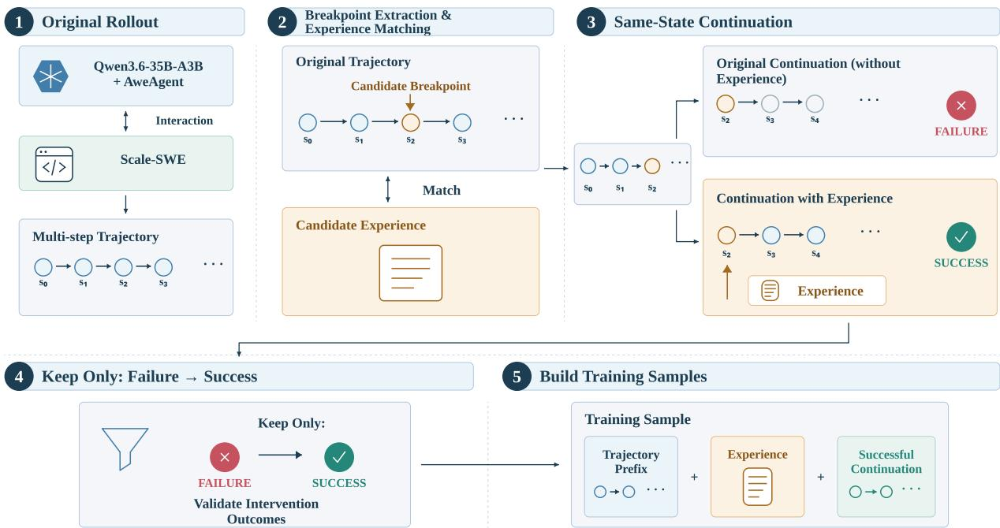  
Figure 13 Construction of experience-conditioned training trajectories. Retrieved experience is added at selected breakpoints in unsuccessful trajectories, and execution resumes from the same state. Continuations that pass the task tests are retained as training samples comprising the trajectory prefix, experience, and successful continuation.

Each breakpoint-experience-subset pair defines an independent continuation rollout. The resulting intervention trajectory is

$$
\xi _ { b , j } = \xi _ { \le b } \oplus [ g _ { b , j } ] \oplus \hat { \xi } _ { > b } ^ { ( g _ { b , j } ) } .
$$

Here, � indexes the selected breakpoint, � indexes the candidate experience subset, and ⊕ denotes concatenation of message sequences. We retain a trajectory as a training sample if and only if

$$
\left\{ \begin{array} { l l } { \operatorname { S u c c e s s } ( \xi ) = 0 , } \\ { \operatorname { S u c c e s s } ( \xi _ { b , j } ) = 1 , } \end{array} \right.
$$

which means the original trajectory must fail to solve the task, whereas the experience-conditioned continuation must pass the task tests. Variants that fail the tests, terminate abnormally, or cannot be reproduced are excluded from the training set.

Training Sample Serialization Finally, each training sample is serialized as

$$
x _ { b , j } = \left( \xi _ { \leq b } , g _ { b , j } , \hat { \xi } _ { > b } ^ { + \left( g _ { b , j } \right) } \right) ,
$$

where the three components correspond to the triggering execution state, the experience subset, and the successful continuation sufix, respectively. The superscript + indicates that the generated sufix passes the task evaluation.

## E.1.3 Dataset Statistics and Splits

We partition the constructed data into training and validation sets by task, keeping all original rollouts, breakpoints, and intervention variants associated with each task in the same split, and SWE-bench Verified serves as the test set. We report the number of tasks and repositories of each split in Table 9.

Table 9 Task and repository counts for the training and validation splits and SWE-bench Verified.
<table><tr><td>Statistic</td><td>Train</td><td>Validation</td><td>Test (Verified)</td></tr><tr><td>Number of repositories</td><td>537</td><td>176</td><td>12</td></tr><tr><td>Number of tasks</td><td>2,396</td><td>266</td><td>500</td></tr></table>

Table 10 Training data construction statistics and experience intervention outcomes.
<table><tr><td>Statistic</td><td>Value</td><td>Calculation or description</td></tr><tr><td>Original trajectories</td><td>18,820</td><td>Target rollouts generated by Qwen3.6-35B-A3B</td></tr><tr><td>Unsolved original trajectories</td><td>14,649 (77.8%)</td><td>14,649/18,820</td></tr><tr><td>Breakpoint-experience variants</td><td>199,500</td><td>7,901 usable trajectories produced 19,950 retained breakpoints</td></tr><tr><td>Successful experience</td><td>45,481 (22.8%)</td><td>45,481/199,500</td></tr></table>

Throughout data construction, we check breakpoint validity, consistency between trajectory prefixes and repository snapshots, test outcomes, message and tool-call structure, and context length. We exclude samples with environment failures, incomplete logs, test-file modifications, other invalid execution behaviors, or outcomes that cannot be reproduced. Samples that exceed the context-length limit or fail structural checks are discarded in full rather than truncated. The scale of the resulting data construction process and the outcomes of experience intervention are reported in Table 10.

## E.2 Training Details

We compare training configurations along three dimensions: the objective (CE or KD), the supervision scope (First-Step or Full-Sufix), and the number of successful training trajectories selected per task. Max-2 and Max-3 retain at most two and three successful training trajectories per task, respectively.

## E.2.1 Trainable Parameters and Memory Operations

We train Metis on hyper memory blocks at decoder layers $\ell \in \{ 3 , 7 , 1 1 , 1 5 , 1 9 , 2 3 , 2 7 , 3 1 , 3 5 , 3 9 \}$ . Each block contains 10 trainable tensors: W\_k.weight, W\_v.weight, pool\_score.weight, gated\_delta\_alpha.weight, gated\_delta\_alpha.bias, gated\_delta\_beta.weight, gated\_delta\_beta.bias, query\_proj.weight, query\_norm.weight, and mem\_norm.weight. This gives 100 tensors and 104,962,580 trainable parameters in total, roughly 0.3% of the backbone’s parameter count. The backbone runs in BF16, whereas the memory computation, state accumulation, and all trainable parameters are kept in FP32.

Each memory block maintains a fixed-size memory consisting of a $5 1 2 \times 5 1 2$ value state and a 512 × 1 key normalizer, so the memory footprint does not grow with the length of the experience. The key and value projections map the hidden states of the experience to 512-dimensional vectors, while the query projection maps the hidden states of the main trajectory to memory queries. On the write side, the token selector applies alpha top-� selection with $p = 0 . 9$ and always retains at least one token; the delta update ratio is set to 0.9. On the read side, the memory readout is normalized by mem\_norm and fused with the backbone representation using a fusion coeficient of $\gamma = 0 . 9$ . Runtime memory is not retained across tasks. The checkpoint contains only the trainable memory parameters listed above, and every new task or trajectory starts from an empty memory state.

## E.2.2 Sample Serialization and Supervision Masks

Each training sample corresponds to exactly one write event, and the memory is reset to empty at the start of every sample. Within a sample, tokens are split into two attention domains: the experience domain, which contains the experience text, and the main domain, which contains the trajectory prefix and the successful continuation. The main domain does not attend to the experience domain, so the experience can influence the main trajectory only through memory.

Replay then proceeds in three stages, which mirror the injection of experience at an execution breakpoint: (1) write: the experience is stored in memory at the end of the experience segment; (2) prefix replay: the maintrajectory prefix is processed with memory reading disabled; and (3) continuation replay: memory reading is enabled from the breakpoint onward, so that all subsequent predictions can access the experience-derived state �. Consequently, the prediction of the first supervised token is already conditioned on the stored memory. In the training configuration, the write ofset is set to zero and no query store operation is performed.

Supervision Settings Within this replay procedure, we consider two supervision settings. They difer in how much of the successful sufix is supervised and in where the sequence is truncated. Both are trained with teacher forcing on the original token sequences.

Full-Sufix. The loss covers every assistant turn in the successful sufix. For each such turn, the target comprises all tokens following the assistant role header: the reasoning text, the response body, the tool calls, the structural tokens that delimit them, and the closing <|im\_end|>\n. All other tokens serve only as conditioning information. These include the experience, the prefix, the role headers, tool responses, and user and system messages. Because training is teacher-forced, each later assistant turn is conditioned on the ground-truth tool responses recorded in the original trajectory, rather than on the results of executing the model’s own actions.

First-Step. The loss covers only the first assistant turn after the breakpoint, focusing supervision on the immediate continuation. We derive these samples from Full-Sufix trajectories whose assistant turns contain reasoning text. For each trajectory, we select the first assistant turn of the successful sufix and truncate the sequence immediately after the closing <|im\_end|>\n of this turn. The model input therefore consists of the experience (written to memory), the full prefix, and the selected turn.

Under teacher forcing, every token of the selected turn is predicted from the ground-truth tokens that precede it rather than from tokens generated by the model. The loss is computed only over this turn, using the same target definition as in Full-Sufix. Because truncation removes only trailing tokens, the breakpoint position and the original token IDs remain unchanged, and no re-tokenization is required.

## E.2.3 Training Objectives and Hyperparameters

We consider two training objectives: hard-label cross-entropy (CE), and knowledge distillation (KD). The student accesses experience only through native memory, the teacher uses the same frozen backbone with the memory modules disabled and receives the experience as text in prefix–experience–sufix order. Both models use teacher forcing on the same successful continuation, with teacher and student predictions aligned by target token rather than absolute input position.

Let $\mathcal { T }$ denote the valid supervised positions across all ranks and gradient-accumulation microbatches in one optimizer step, excluding padding, and let $N = | \mathcal { T } |$ . For each position �, let $y _ { t }$ be the target token and let $p _ { t } ^ { \mathrm { S } } = \operatorname { s o f t m a x } ( z _ { t } ^ { \mathrm { S } } )$ be the student distribution over the full vocabulary V. We use temperature $\tau = 1$ throughout.

CE. We minimize the negative log-likelihood of the recorded target tokens:

$$
\mathcal { L } _ { \mathrm { C E } } = - \frac { 1 } { N } \sum _ { t \in \mathcal { T } } \log p _ { t , y _ { t } } ^ { \mathrm { S } } .
$$

KD. At each supervised position, we retain the � = 64 tokens with the largest teacher logits, denoted by $\mathcal { K } _ { t }$ and renormalize the teacher distribution over this set:

$$
\boldsymbol { q } _ { t , \nu } ^ { \mathrm { T } } = \frac { \exp ( \boldsymbol { z } _ { t , \nu } ^ { \mathrm { T } } ) } { \sum _ { u \in \mathcal { K } _ { t } } \exp ( \boldsymbol { z } _ { t , u } ^ { \mathrm { T } } ) } , \qquad \nu \in \mathcal { K } _ { t } .
$$

The distillation objective is

$$
\mathcal { L } _ { \mathrm { K D } } = \frac { 1 } { N } \sum _ { t \in \mathcal { T } } \sum _ { \nu \in \mathcal { K } _ { t } } q _ { t , \nu } ^ { \mathrm { T } } \log \frac { q _ { t , \nu } ^ { \mathrm { T } } } { p _ { t , \nu } ^ { \mathrm { S } } } .
$$

Only the teacher distribution is truncated; the student remains normalized over the full vocabulary. This objective transfers experience-conditioned predictions from the textual-context teacher to the memoryconditioned student.

The training and validation sets are split by task, so no task appears in both.

Training uses task interleaving. Unpacked records are replayed for three epochs, and within each epoch they are arranged in a task-interleaved order determined by a fixed base seed combined with the epoch index.

For the Full-Sufix-Max3 run, we additionally use sequence packing to improve training throughput. Packs are first constructed with a fixed seed, without splitting any trajectory across packs, and are then scheduled in a deterministic order. Each pack contains at most 131,072 tokens. Trajectories in the same pack do not share memory: the memory is reset, written, and read independently for each trajectory. Because every step of the schedule is determined by fixed seeds, the data order of each run is fully reproducible.

Each microbatch on a given rank contains exactly one trajectory or one complete pack. Padding slots are assigned a supervised-token count of zero, which ensures that each valid supervised token is counted exactly once in loss normalization. We optimize with AdamW, using FP32 optimizer states sharded across ranks, a learning rate of $2 \times 1 0 ^ { - 5 }$ , and three warmup steps.

## E.2.4 Training Diagnostics

We compare CE and KD across four paired training configurations, combining First-Step or Full-Sufix supervision with the Max-2 or Max-3 data setting. Within each pair, initialization, training data, and optimization hyperparameters are matched. CE and KD optimize diferent objectives, so their training losses are not directly comparable. We therefore monitor hard-label validation negative log-likelihood (NLL) for both. Validation comparisons are made within the same supervision scope and data setting.

Optimization and Validation Behavior. Figure 14 shows decreasing validation NLL under both objectives, with most of the reduction occurring within the first 40 optimizer steps. CE achieves lower final validation NLL than KD in all four paired configurations (Table 11). For Full-Sufix-Max2, CE reduces body-token NLL from 0.2925 to 0.1866, compared with 0.2910 under KD. The same pattern holds for tool-call tokens (0.0603 to 0.0461 under CE versus 0.0545 under KD) and reasoning tokens (0.5033 to 0.4555 versus 0.4749).

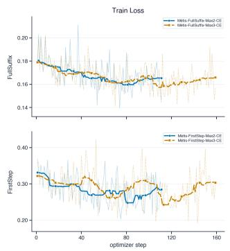  
(a) CE objective

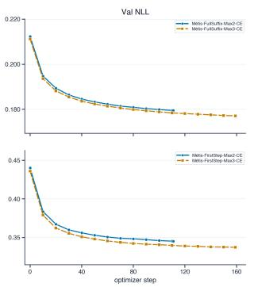

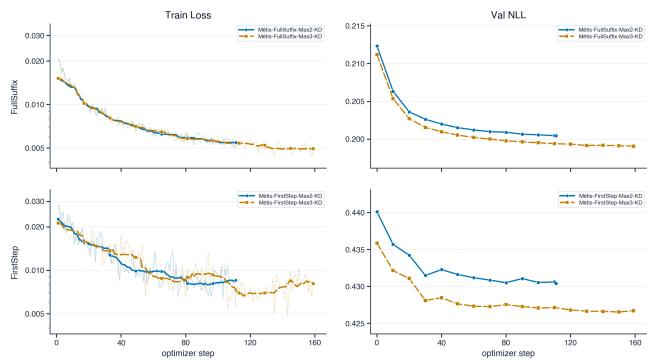  
(b) KD objective  
Figure 14 Training loss and validation NLL under CE and KD objectives. Within each panel, the left and right columns show training loss and validation NLL, respectively. Solid blue curves denote Max-2, and dashed orange curves denote Max-3.

Table 11 Validation NLL and preliminary agent performance under CE and KD. Average success rates are measured on the 100-task development subset of SWE-bench Verified with three runs per task. Validation NLL uses hard-label targets; lower is better.
<table><tr><td rowspan="2">Configuration</td><td colspan="2">Validation NLL</td><td colspan="2">Avg. Success (%)</td></tr><tr><td>CE</td><td>KD</td><td>CE</td><td>KD</td></tr><tr><td>First-Step-Max2</td><td>0.3452</td><td>0.4304</td><td>12.5</td><td>52.0</td></tr><tr><td>First-Step-Max3</td><td>0.3373</td><td>0.4267</td><td>34.1</td><td>52.0</td></tr><tr><td>Full-Suffix-Max2</td><td>0.1795</td><td>0.2005</td><td>37.5</td><td>54.3</td></tr><tr><td>Full-Suffix-Max3</td><td>0.1771</td><td>0.1996</td><td>22.7</td><td>52.7</td></tr></table>

Relation to Agent Performance. KD achieves higher average success rates than CE despite its higher validation NLL (Table 11). For example, Full-Sufix-Max2 records a preliminary success rate of 37.5% under CE, compared with 54.3% under KD, while its validation NLL is lower under CE (0.1795 versus 0.2005). The other three configurations exhibit the same qualitative pattern. These results motivate our selection of KD for all subsequent agent evaluations and ablations. We use validation NLL to monitor optimization, while selecting among KD configurations through repeated agent executions.

## E.3 Additional Results

## E.3.1 Training Configuration Comparison

Training Configurations. In Table 12, we compare four Metis KD configurations on the 100-task development subset of SWE-bench Verified under the Before Execution setting, with three runs per task. This subset is included in the full 500-task SWE-bench Verified evaluation reported in the main text. Full-Sufix-Max2 achieves the highest average success and ties for the highest pass@3 and pass^3, motivating its selection for full-benchmark Metis evaluations.

Full-Benchmark Comparison. In Figure 15, we compare Metis and MemT-1.0-Nano with the backbone and textual-experience baselines on SWE-bench Verified (500 tasks) and SWE-bench Multilingual (300 tasks). Both memory models improve average success and pass^3 over the backbone. Relative to Metis, MemT-1.0-Nano has higher pass@3 but lower pass^3 in all four settings.

Table 12 Metis KD configurations on the 100-task development subset of SWE-bench Verified under Before Execution. All values are percentages; bold values indicate the highest scores in each column.
<table><tr><td>Configuration</td><td>Avg. Success</td><td>pass@3</td><td>pass^3</td></tr><tr><td>First-Step-Max2</td><td>52.00</td><td>65.00</td><td>38.00</td></tr><tr><td>First-Step-Max3</td><td>52.00</td><td>61.00</td><td>42.00</td></tr><tr><td>Full-Suffix-Max2</td><td>54.33</td><td>66.00</td><td>42.00</td></tr><tr><td>Full-Suffix-Max3</td><td>52.67</td><td>66.00</td><td>36.00</td></tr></table>

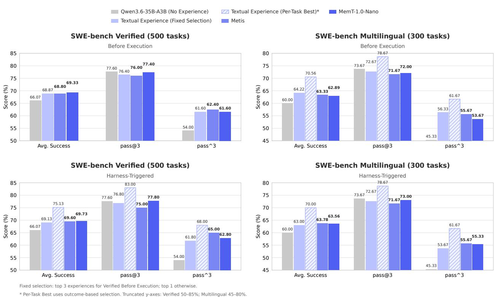  
Figure 15 Agentic coding performance on SWE-bench Verified and SWE-bench Multilingual under Before Execution (top) and Harness-Triggered (bottom). Each task is evaluated in three runs.

## E.3.2 Experience Selection

We compare Textual Experience selection strategies on SWE-bench Multilingual (Table 13). Fixed Rank-� uses the single experience at retrieval rank �. Per-Task Best selects among three candidates by the number of successful runs, breaking ties by retrieval rank. Since the same runs are used for selection and reporting, it serves as an outcome-selected reference. Rank-1 achieves the highest average success under Before Execution, whereas Rank-2 performs best under Harness-Triggered. Per-Task Best outperforms the fixed-rank strategies in both settings, suggesting that improved experience selection could further benefit task performance.

## F Memory Windowing Experiment

Table 13 Textual Experience selection on SWE-bench Multilingual (300 tasks). Fixed Rank-� uses the single experience at rank �; Per-Task Best selects among three candidates using evaluation outcomes. All values are percentages.
<table><tr><td>Method</td><td>Avg. Success</td><td>pass@3</td><td>pass^3</td></tr><tr><td>Before Execution</td><td></td><td></td><td></td></tr><tr><td>No Experience</td><td>60.00</td><td>73.67</td><td>45.33</td></tr><tr><td>Textual Experience: Fixed Rank-1</td><td>64.22</td><td>72.67</td><td>56.33</td></tr><tr><td>Textual Experience: Fixed Rank-2</td><td>61.89</td><td>72.67</td><td>51.33</td></tr><tr><td>Textual Experience: Fixed Rank-3</td><td>63.78</td><td>74.00</td><td>54.33</td></tr><tr><td>Textual Experience: Per-Task Best</td><td>70.56</td><td>78.67</td><td>61.67</td></tr><tr><td>Harness-Triggered</td><td></td><td></td><td></td></tr><tr><td>No Experience</td><td>60.00</td><td>73.67</td><td>45.33</td></tr><tr><td>Textual Experience: Fixed Rank-1</td><td>63.00</td><td>72.67</td><td>53.67</td></tr><tr><td>Textual Experience: Fixed Rank-2</td><td>64.44</td><td>72.00</td><td>56.67</td></tr><tr><td>Textual Experience: Fixed Rank-3</td><td>63.56</td><td>72.00</td><td>54.67</td></tr><tr><td>Textual Experience: Per-Task Best</td><td>70.00</td><td>78.67</td><td>61.67</td></tr></table>

## F.1 Experimental Setup

The experiment compares two execution schedules for one standalone MoS memory block. Whole-pack execution produces expert projections for all tokens at once; windowed execution groups complete steps, performs their projections, state updates, and readout in sequence, and recomputes internal intermediates during backward. Both use the same equations, weights, inputs, precision, and update kernel. Measurement covers both routers, all expert projections, memory writes and reads, RMSNorm, SoftCapSiLU, fusion, and backward through these computations.

Table 14 Configuration of the MoS memory-block experiment.
<table><tr><td>Configuration</td><td>Value</td></tr><tr><td>Hidden dimension</td><td>2048</td></tr><tr><td>Memory experts</td><td>4</td></tr><tr><td>Memory heads per expert / head dimension</td><td>16 / 256</td></tr><tr><td>Router projection rank</td><td>128</td></tr><tr><td>Decay-gate / output-gate projection rank</td><td>256 /256</td></tr><tr><td>Parameter and projection / memory-state precision</td><td>BF16 /FP32</td></tr><tr><td>Writer chunk</td><td>64 tokens</td></tr><tr><td>Step length</td><td>2048 tokens</td></tr><tr><td>Window budget</td><td>2048 / 4096 tokens, or 1 / 2 complete steps</td></tr></table>

Each pack contains two equal-length trajectories: 8K, 16K, and 32K packs comprise two 4K, 8K, and 16K trajectories, respectively. Each trajectory starts from an independent initial state. All measured steps commit state, while reads within a step use its incoming snapshot. Windows do not cross trajectory boundaries. Weights are randomly initialized and hidden-state inputs are synthetic, with fixed random seed 20261015; input hidden states have standard deviation 1.0, while initial states and backward cotangents have standard deviation 0.01. This workload measures the computation and activation costs of the memory branch.

Memory updates use a fixed chunked-WY implementation.

## F.2 Measurement Method

Each pack length and window budget define a paired experiment. Both variants receive 5 warmups and 20 measured trials; successive pairs alternate between whole-pack→windowed and windowed→whole-pack order, yielding 240 measured samples. Each window budget has an independently measured whole-pack baseline, accounting for the small baseline-time diferences between rows at the same length.

CUDA events measure forward-plus-backward (F+B) time, including block execution, inner products of the output and final state with fixed cotangents, and backward through the scalar objective. Input preparation, schedule construction, and compilation occur outside the timed region. Peak memory is PyTorch peak allocated, including block parameters, inputs and cotangents, outputs, gradients, and both prepared schedules. This metric measures live tensor allocations, distinct from memory reserved by the caching allocator. The main table reports medians; percentage changes are computed from unrounded medians.

## F.3 Full Results

Table 15 Full memory and time results for the MoS memory block. Each row is an independently measured whole-pack/window pair; values are medians.
<table><tr><td>Pack length (tokens)</td><td>Window budget (tokens)</td><td>Whole-pack memory (GiB)</td><td>Windowed memory (GiB)</td><td>Whole-pack F+B (ms)</td><td>Windowed F+B (ms)</td></tr><tr><td>8192</td><td>2048</td><td>12.37</td><td>4.85</td><td>102.1</td><td>122.9</td></tr><tr><td>8192</td><td>4096</td><td>12.37</td><td>8.36</td><td>102.1</td><td>117.4</td></tr><tr><td>16384</td><td>2048</td><td>24.19</td><td>5.23</td><td>211.6</td><td>246.1</td></tr><tr><td>16384</td><td>4096</td><td>24.19</td><td>8.77</td><td>211.6</td><td>235.1</td></tr><tr><td>32768</td><td>2048</td><td>47.83</td><td>6.03</td><td>462.7</td><td>493.5</td></tr><tr><td>32768</td><td>4096</td><td>47.83</td><td>9.49</td><td>463.0</td><td>470.6</td></tr></table>

As pack length increases from 8K to 32K, whole-pack peak memory grows from 12.37 GiB to 47.83 GiB, while 4096-token windows grow from 8.36 GiB to 9.49 GiB. Windowing bounds the lifetime of projections and intermediates, while retained outputs and boundary states still grow with length. Across the three lengths, the median time increases for 4096-token windows are 15.0%, 11.1%, and 1.6%, respectively, showing that windowing overhead depends on the workload.

## F.4 Measurement Variability

Table 16 reports medians, interquartile intervals [Q25, Q75], and sample standard deviations, all in ms.

All samples are retained, including whole-pack trials at 16K/2048 (378.03 ms) and 32K/2048 (562.40 ms), and a windowed trial at 32K/4096 (640.58 ms). The 1.6% reported in the chapter therefore describes the median time diference; individual trials exhibit variability.

## G Case Studies

We present four examples from a long English conversation. They show how MemT-1.0-Nano uses its memory as the history grows.

MemT-1.0-Nano keeps one latent memory slot for each conversation. History enters the slot through commit operations. A commit reads the incoming turns and writes their content into the slot, and the original text is

Table 16 F+B timing variability in milliseconds. Intervals are the 25th and 75th percentiles; standard deviations use all measured samples.
<table><tr><td>Pack length (tokens)</td><td>Window budget (tokens)</td><td>Whole-pack median [Q25, Q75]</td><td>Windowed median [Q25, Q75]</td><td>Standard deviation (whole / windowed)</td></tr><tr><td>8192</td><td>2048</td><td>102.10 [102.08, 102.12]</td><td>122.87 [122.86, 122.88]</td><td>0.03 / 0.02</td></tr><tr><td>8192</td><td>4096</td><td>102.11 [102.10, 102.12]</td><td>117.42 [117.41, 117.45]</td><td>0.05 / 0.03</td></tr><tr><td>16384</td><td>2048</td><td>211.55 [211.43, 212.02]</td><td>246.11 [246.02, 246.42]</td><td>37.19 / 0.26</td></tr><tr><td>16384</td><td>4096</td><td>211.61 [211.45, 211.87]</td><td>235.07 [234.98, 235.39]</td><td>0.30 / 0.27</td></tr><tr><td>32768</td><td>2048</td><td>462.71 [462.37, 463.87]</td><td>493.48 [492.91, 494.38]</td><td>22.22 / 0.94</td></tr><tr><td>32768</td><td>4096</td><td>462.96 [462.42, 463.68]</td><td>470.58 [469.84, 471.46]</td><td>0.76 / 38.01</td></tr></table>

not carried forward. What the model can answer therefore depends on the writes. The examples below show this at four points in the conversation. The text inside each box is given exactly as the model produced it.

## G.1 Example 1: Factual Recall at 4K

The question asks for three things: the city, the purpose of the trip, and who holds the sample book. The model gives all three. It also keeps the nearby details with their owners, so Ningbo, the red toolbox, and the blue badge do not move to Chen Wei. The colour of the sample book is not mentioned, which is correct because the question does not ask for it.

History: 4,340 tokens / first 25 turns of the conversation   
Turn 1 (user): I’m Lin Yao, and I coordinate exhibitions at   
Qinghe Studio. ... I think I’d rather sit than go straight   
back out.   
Turn 2 (user): ... I went to Suzhou to set up an exhibition and   
left my blue sample book with my colleague Chen Wei for   
safekeeping. That was a past work visit, separate from the   
future exhibition I’m still arranging. ...   
Turn 3 (user): ... There’s a note about Xu Cheng, another   
colleague: he lives in Ningbo, handles lighting, and has the   
red toolbox. ...   
[... 21 turns of unrelated conversation about drawing,   
cooking, and household objects ...]   
Question: Which city did I go to last week, and what was I   
doing there? Who should I ask to get back the sample book I   
handed over?   
Answer: You went to \*\*Suzhou\*\* last week. You were there to   
\*\*set up an exhibition\*\*.   
You should ask \*\*Chen Wei\*\* for the sample book.

## G.2 Example 2: Abstention on Missing Information at 16K

The question asks for the user’s birthday. The conversation never mentions a birthday. The model reports this instead of inventing a date. The answer is only six tokens long, and its brevity is the point. The question invites the model to fill the gap, and this answer does not.

History: 16,457 tokens / first 105 turns of the conversation   
Turn 1 (user): I’m Lin Yao, and I coordinate exhibitions at   
Qinghe Studio. ...   
Turn 18 (user): ... The cup beside me has cooled, and the tea   
leaves have collected along one edge because the table isn’t   
perfectly level. ...   
[... 87 further turns that stay on drawing, cooking, and   
walking outside, and never mention a birthday or an age ...]   
Turn 103 (user): I once bought a set of colored pencils and   
spent more time arranging them than using them. ...   
Turn 105 (user): I kept the stub. It was easier to hold   
sideways for broad marks ... Sometimes a broken object is   
simply broken. ...   
Question: What month and day is my birthday again? If we   
haven’t talked about it, just say you don’t know.   
Answer: I don’t know.

## G.3 Example 3: Rule Application at 32K

The fictional page of the notebook gives two chained rules. A blue badge grants eligibility to book a room. Eligibility to book, together with completed registration, grants eligibility to collect a silver toolbox. The second rule therefore depends on both conditions. If the registration condition is dropped, the rule grants an entitlement that the text never gives. The answer below applies the chain correctly to both characters. It also keeps the two fictional colleagues apart, so Xu Cheng’s incomplete registration does not move to Chen Wei.

History: 32,931 tokens / first 230 turns of the conversation   
Turn 4 (user): ... anyone with a blue badge is eligible to book   
Room 2. Anyone eligible to book Room 2 who has completed   
registration is eligible to collect a silver toolbox. There   
are no other eligibility rules. I mean eligibility only:   
being allowed to book or collect something doesn’t mean the   
person has actually done it.   
Turn 5 (user): The fictional Chen Wei has a blue badge and has   
completed registration. The fictional Xu Cheng also has a   
blue badge but hasn’t completed registration yet. ...   
[... 224 turns in which the story is never revisited and   
neither the rules nor the characters’ circumstances are

restated ...]   
Turn 229 (user): A description of the sound itself makes more   
sense to me. ...   
Turn 230 (user): The radio voice has become my favorite thing   
in this invented film. ...   
Question: Given the rules and what we discussed about each   
person, are Chen Wei and Xu Cheng each eligible to collect   
the toolbox now? Briefly explain why.   
Answer: Based on the rules provided in the text:   
\* \*\*Chen Wei:\*\* Yes, he is eligible. He has a blue badge and   
has completed registration.   
\* \*\*Xu Cheng:\*\* No, he is not eligible. Although he has a   
blue badge, he has not completed registration.

## G.4 Example 4: Tracking an Update at 64K

The exhibition is first set for Saturday at 3 p.m. in the East Hall. It is then oficially changed to Sunday at 4 p.m. The venue, the admission price, and the contact person all stay the same. A move to Monday is also proposed, but it is never decided. A correct answer must report the change and leave the proposal out. The answer below does both. It answers the second half of the question by negation instead of repeating the values. The conversation runs for 508 more turns after the change, and the model still separates a settled change from a passing suggestion.

History: 65,587 tokens / first 516 turns of the conversation   
Turn 6 (user): The small exhibition I’m planning for the future   
was originally set for Saturday at 3 p.m. in the East Hall,   
with free admission, and Chen Wei is the contact person. ...   
I’m waiting for the final timing decision before I send a   
notice, so the draft is still open.   
Turn 7 (user): ... the confirmation has just arrived too: the   
exhibition has officially changed to Sunday at 4 p.m.   
Everything else stays the same. This change is definite, so   
that’s the new arrangement. ...   
Turn 8 (user): ... Someone has just suggested moving the   
exhibition to Monday, but I haven’t decided and haven’t   
announced another change. It’s only a suggestion under   
consideration, not a confirmed arrangement. ...   
[... 508 turns in which the exhibition is not raised again; the   
closing turns discuss a lamp, a book, and a patch of wall ...]   
Turn 514 (user): ... The wall opposite has a little patch where   
the paint catches the light differently. ...   
Turn 516 (user): ... My first glance supplies a shadow, then

the second supplies the patch. ...

Question: When was the exhibition originally scheduled, and what time was it officially changed to? Did the venue, admission price or contact person change?

Answer: The exhibition was originally scheduled for \*\*Saturday at 3 p.m.\*\* It was officially changed to \*\*Sunday at 4 p.m.\*\*

No, the venue, admission price, or contact person did not change. The change was solely to a different time on a different day.