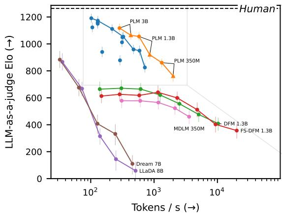
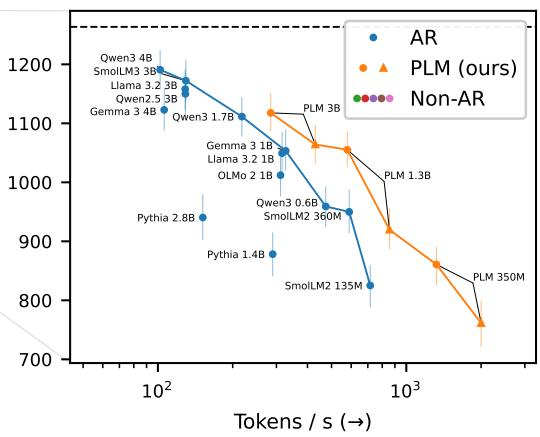
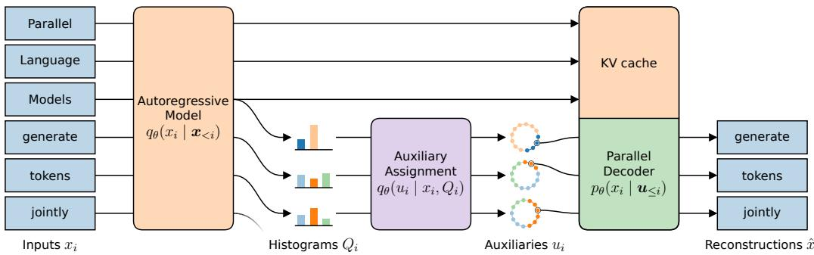
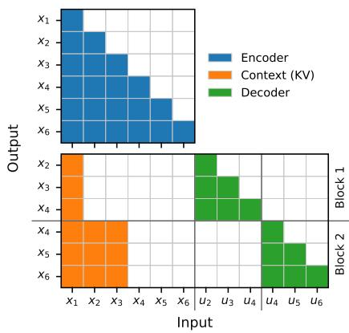
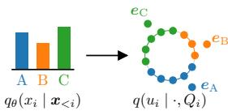
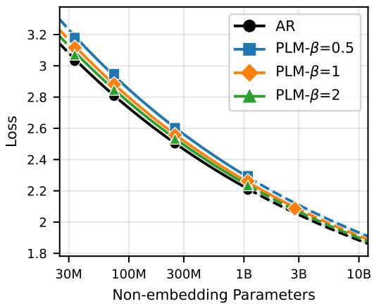
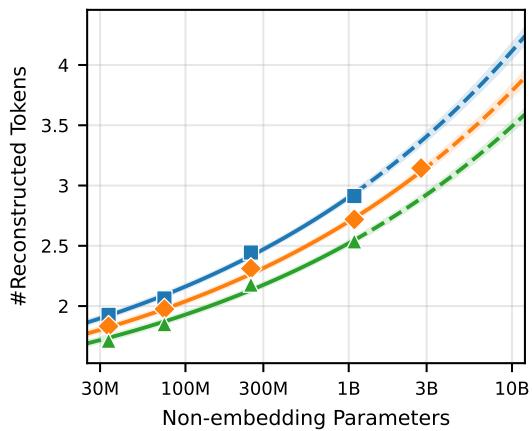
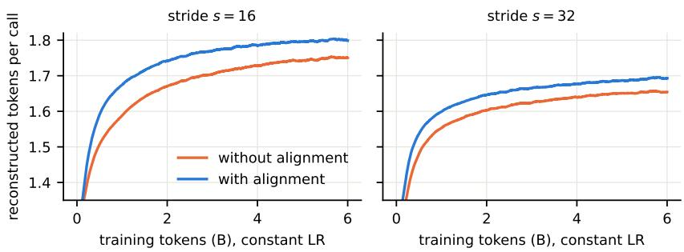
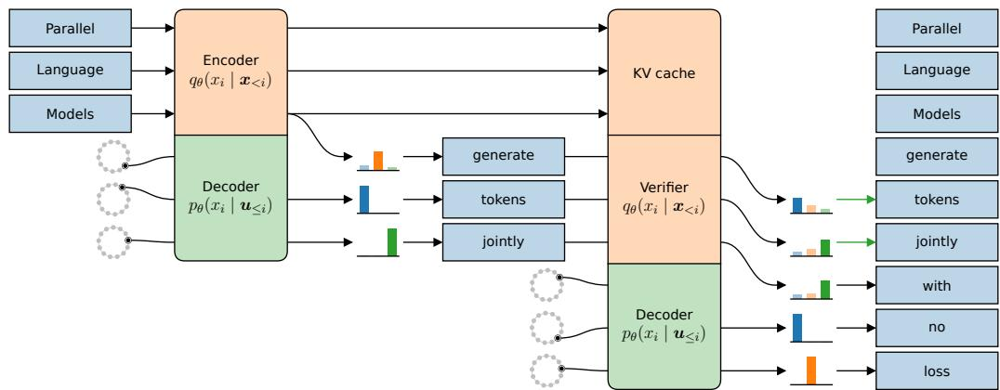

# PARALLEL LANGUAGE MODELS VIA VARIATIONAL DECODING

Felix Draxler1,∗,¶, Robin C. Geyer2,3,∗,¶, Daniel Geyfman1,∗, Farrin Marouf Sofian1,∗, Justus Will1,∗, Philipp Hildebrandt4, Giosue Migliorini1, Prakhar Srivastava1, Gagan Sai Trinadh Duggaraju Peddiraju1, Kushagra Pandey1, Jorge da Silva Gonc¸alves2, Elijah Tavares1, Jan Niklas Groeneveld1, Yang Meng1, Julia E. Vogt2, Stephan Mandt1,¶

1University of California, Irvine, CA, USA

2Department of Computer Science, ETH Zurich, Switzerland

3Institute for Artificial Intelligence in Medicine, Charite Berlin, Germany´

4Hasso Plattner Institute, Potsdam, Germany

∗Equal contribution ¶Project lead See Appendix A for detailed contributions.   
Correspondence: mail@fdraxler.de, robin.geyer@charite.de, mandt@uci.edu.

## ABSTRACT

Autoregressive language models emit one token per forward pass. This causes high inference latency, in particular as models are scaled up for quality. In this paper, we introduce Parallel Language Models (PLMs), which generate mutually consistent tokens in one forward pass by routing dependencies through latent auxiliary variables. PLMs are trained using a variational bound that reduces to an autoregressive loss plus a parallel decoding loss. Empirically, PLMs are on a faster and better Pareto frontier than autoregressive and discrete diffusion baselines. Pretrained PLMs achieve near-autoregressive pretraining loss on model scales of 80M to 3B parameters, and speedup follows a power law in model size. When posttrained, our 1.3B model matches or exceeds an identically trained autoregressive model on math, coding, and instruction-following benchmarks, speeding up inference 2.3-5.7 . Together, we show that parallel generation can be trained from a single training objective at autoregressive quality. We will make our code available at https://github.com/mandt-lab/plm.

## 1 INTRODUCTION

Large autoregressive models (Vaswani et al., 2017) are the core technical foundation of large language models (LLMs) (Brown et al., 2020). Autoregressivity comes with a significant downside, however: One model forward pass produces one token, causing high inference latency.

A plethora of approaches address this challenge, most prominently by increasing the speed of a given autoregressive model through smaller draft models in a process known as speculative decoding (Leviathan et al., 2023). However, draft models do not reach the quality of their big counterparts, ultimately limiting the achievable speedup. Discrete diffusion models (Hoogeboom et al., 2021; Austin et al., 2021) are an alternative modeling framework that predicts several tokens in one model call. However, a single model call cannot coordinate predicted tokens, requiring iterative refinement. Few-step discrete diffusion models reduce the number of steps by amortizing iterative refinement (Monsefi et al., 2026). Because diffusion models are more expensive to train, autoregressive models still dominate industry-scale inference.

This calls for a language modeling framework rooted in autoregression that can model arbitrary dependencies between predicted tokens in a single model call, combining effective training with fast inference at equal quality. Recently, Parallel Token Prediction (PTP) presented a decoding framework that distills an existing autoregressive model into a fast decoder, predicting several tokens in parallel (Draxler et al., 2026). However, PTP was only trained as a speculative decoding method for an existing model, and the framework they proposed to train from sequence data alone is highly inefficient because it is iterative at training time.

  
Figure 1: Parallel Language Models (PLMs, orange) shift the Pareto frontier of speed vs quality for language models trained from scratch. (Right) At the same inference speed, PLMs outperform the quality of publicly available autoregressive models (AR, blue), despite the latter being trained on trillions of tokens and our models only trained on 25B (PLM 350M) to 300B tokens (PLM 3B). (Left) PLMs outperform discrete diffusion approaches at various NFEs. Inference speeds using vLLM on NVIDIA RTX 6000 Ada. PLM circle and triangle refer to exact respectively relaxed inference, see Section 3.4. Error bars are 95% confidence intervals.

In this work, we close this gap and propose Parallel Language Models (PLMs), a novel language modeling framework based on an autoregressive architecture that trains parallel LLMs directly from training data. In detail, we contribute:

• We build Parallel Language Models based on a variational formulation, deriving effective pretraining and post-training strategies (Section 3).

• We pretrain PLMs up to 3B parameters that are on a faster and better Pareto frontier than autoregressive and discrete diffusion baselines (Fig. 1). Our scaling laws confirm nearautoregressive negative log-likelihoods, and show that the parallelism increases with model scale (Section 4.1.1).

• When post-trained, our 1.3B and 3B Parallel Language Models match or exceed autoregressive quality while answering 2.3-5.7 faster (Section 4.2).

## 2 RELATED WORK

Parallel prediction and generation. Early non-autoregressive sequence models generate multiple output tokens in parallel, substantially reducing the number of sequential decoding steps (Gu et al., 2018). More recently, multi-token prediction (MTP) predicts several future positions (Gloeckle et al., 2024) and is used in large-scale autoregressive models such as DeepSeek-V3 (DeepSeek-AI et al., 2025). These methods retain an autoregressive modeling framework rather than defining a joint parallel generative model. Parallel Token Prediction (PTP) (Draxler et al., 2026) instead introduces auxiliary random variables that enable multiple dependent future tokens to be generated jointly in one model call, and studies distillation from existing autoregressive models. Samragh et al. (2025) improve coherence of independent multi-token prediction by adding a small autoregressive head, and introduce Quadratic Decoding, which we adapt for PLM inference. Our work extends this line of research to pretraining of parallel language models directly from sequence data, developing a training recipe that scales to billions of parameters.

Iterative and few-step parallel generation. A complementary class of methods predicts many token positions in parallel and resolves dependencies through iterative refinement. Conditional

Masked Language Models (Ghazvininejad et al., 2019) progressively fill and revise masked positions, while discrete diffusion language models such as MDLM (Sahoo et al., 2024), LLaDA (Nie et al., 2025), and Dream (Ye et al., 2025) generate sequences through repeated denoising. Discrete Flow Matching (Gat et al., 2024) provides a related framework for defining generative trajectories over discrete sequences, while Eso-LM (Sahoo et al., 2026) connects autoregressive and maskeddiffusion modeling and improves diffusion inference. Recent work increasingly targets few-step generation: Infinite Mask Diffusion (Yoo et al., 2026) and FS-DFM (Monsefi et al., 2026) modify the generative process or training objective to improve performance under a small number of sampling steps, while flow-map approaches further compress iterative trajectories toward few- or single-step generation (Lee et al., 2026; Potaptchik et al., 2026). Relatedly, Lookahead Decoding (Fu et al., 2024) and Jacobi Forcing (Hu et al., 2026) generate tentative future tokens in parallel and recover consistency through verification or iterative refinement. In contrast, PLMs aim to model dependencies among simultaneously generated tokens directly within a single model call.

Autoregressive inference acceleration. A separate line of work accelerates inference from pretrained autoregressive language models. Speculative decoding uses a cheaper draft model to propose multiple tokens, which a target model verifies in parallel (Leviathan et al., 2023; Chen et al., 2023). Subsequent methods improve proposal quality through learned prediction heads or feature-based drafting, including Medusa (Cai et al., 2024), Hydra (Ankner et al., 2024), and EAGLE (Li et al., 2024a;b; 2025b). Unlike PLMs, these methods accelerate inference from a pre-existing autoregressive target model rather than training a parallel generative model directly from sequence data.

Latent-variable sequence models. Latent-variable models can also capture dependencies while retaining parallel sequence generation. FlowSeq (Ma et al., 2019) models non-autoregressive sequence generation through a flow-based latent distribution, while LaNMT (Shu et al., 2020) uses continuous latent variables and variational training for non-autoregressive translation. Parallel WaveNet (Oord et al., 2018) similarly generates audio in a single pass by mapping per-timestep noise through an inverse autoregressive flow, but requires invertibility. These approaches demonstrate how latent representations can mitigate the dependency limitations of factorized parallel decoders, but primarily target conditional sequence-to-sequence or audio generation. PLMs instead use token-level auxiliary variables to define a general language model in which dependencies among parallel predictions are mediated through the latent representation.

## 3 PARALLEL LANGUAGE MODELS

Autoregressive language models represent the distribution of language by explicitly predicting a histogram over possible choices from a token vocabulary $\{ 1 , \ldots , \bar { V } \}$ . This is an expressive paradigm, but it does not extend to predicting several tokens jointly because the possible token combinations $V ^ { L }$ scale exponentially in sequence length L.

One effective way to circumvent this is to use a language model that predicts sequences directly. First, sample a random auxiliary $u _ { i } \sim p ( u _ { i } )$ per token position $i = 1 , \ldots , L$ . Then have a decoder map the vector of auxiliaries u to a coherent sequence in one model call:

$$
\pmb { x } = f _ { \theta } ( \pmb { u } ) \in \{ 1 , . . . , V \} ^ { L } .\tag{1}
$$

Auxiliaries $u \in \mathcal { U }$ can either be continuous $( \mathcal { U } \subset \mathbb { R } )$ or discrete $( \mathcal { U } \subset \mathbb { N } )$ , and we’ll give more details in the subsequent sections.

Intuitively, the model generates different sequences for different random inputs. Prominent examples of such parallel decoders are Few-Step Discrete Flow Matching (FS-DFM) (Monsefi et al., 2026) and Parallel Token Prediction (PTP) (Draxler et al., 2026). Both frameworks distill a parallel decoder from a pre-existing model, the former from a discrete diffusion model, and the latter from an autoregressive language model.

In the remainder of this section, we discuss the core framework of Parallel Language Models (PLMs). PLMs directly train on sequence data without relying on a pre-existing model. We provide a complete scalable recipe, covering pretraining, post-training, and inference.

  
1Figure 2: Parallel Language Models jointly train an encoder that maps training sequences x to auxiliaries u, and a decoder that reconstructs them back to sequences xˆ in parallel. The encoder leverages a standard autoregressive (AR) model predicting next-token probabilities $Q _ { i } = q _ { \theta } ( \cdot \ |$ $\scriptstyle { \pmb { x } } _ { < i } )$ , which we then turn into auxiliaries $u _ { i } \sim q _ { \theta } ( u _ { i } \mid x _ { i } , Q _ { i } )$ ). See Fig. 3 for KV cache details.

## 3.1 SELF-DISTILLING PARALLEL LANGUAGE MODELS ON SEQUENCE DATA

The Parallel Language Model we propose is a self-distillation method that jointly trains an autoregressive encoder q $\mathbf { \Psi } ( u _ { i } \mid \mathbf { x } _ { \leq i } )$ from sequences to auxiliaries, and a parallel decoder from auxiliaries to sequences $x _ { i } = f _ { \theta } ( { \pmb u } _ { \le i } )$ , see Fig. 2. Note that for notational simplicity, we remove dependency on a prompt or partially generated text in this derivation.

To train it, we derive our training objective from maximizing the likelihood of the training data under our model:

$$
\operatorname* { m i n } _ { \theta } - \mathbb { E } _ { { \pmb x } \sim p _ { \mathrm { d a t a } } } [ \log p _ { \theta } ( { \pmb x } ) ] .\tag{2}
$$

What is the probability of generating a sequence $\pmb { x } = \pmb { x } _ { 1 : L }$ using a parallel decoder $x _ { i } = f _ { \theta } ( { \pmb u } _ { < i } ) ?$ It is given by integrating over all possible auxiliaries from their prescribed distribution $u _ { i } \sim p ( u _ { i } )$ and then decoding them to the corresponding sequence:

$$
\log p _ { \theta } ( \pmb { x } ) = \log \int \prod _ { i = 1 } ^ { L } p ( u _ { i } ) p _ { \theta } ( x _ { i } \mid \pmb { u } _ { \le i } ) d \pmb { u } .\tag{3}
$$

Note how we have switched from a deterministic decoder $f _ { \theta }$ to a stochastic decoder $p _ { \theta }$ . This will allow taking gradients easily through a cross-entropy loss, and we take an arg max for inference (see Section 3.4). Crucially, the product distribution over future tokens ensures that we can predict tokens in parallel: All dependencies between tokens are described by the auxiliaries.

Optimizing the loss in Eq. (2) using the integral in Eq. (3) is intractable: if we were to approximate the integral using a finite number of random auxiliary samples, we would essentially never sample a given sequence even once. This is where the encoder $\begin{array} { r } { q _ { \theta } ( \pmb { u } \ | \ \pmb { x } ) = \prod _ { i = 1 } ^ { L } q _ { \theta } ( u _ { i } \ | \ \pmb { x } _ { \le i } ) } \end{array}$ enters, proposing auxiliaries that should generate a given sequence. We rewrite Eq. (2) using the evidence lower bound (ELBO) (Kingma & Welling, 2013; Zhang et al., 2018), see Appendix B.1 for details:

$$
- \log p _ { \theta } ( \boldsymbol { x } ) \leq \mathbb { E } _ { u \sim q _ { \theta } ( u \mid \boldsymbol { x } ) } \left[ \sum _ { i = 1 } ^ { L } - \log p _ { \theta } ( x _ { i } \mid u _ { \le i } ) \right] + \sum _ { i = 1 } ^ { L } D _ { \mathrm { K L } } ( q _ { \theta } ( u _ { i } \mid x _ { \le i } ) \parallel p ( u _ { i } ) ) .\tag{4}
$$

Remember that $p ( u _ { i } )$ specifies the distribution we sample the auxiliaries from during inference.

Equation (4) is significantly easier to optimize than using Eq. (3), since the encoder proposes auxiliaries u for decoding a given sequence x. We show in Appendix B.2 that equality holds at the global minimum, and that we can get arbitrarily close to this global minimum with a rich enough model, and so optimizing Eq. (4) actually optimizes Eq. (2).

Auxiliary design We now specify how we construct the auxiliary space. We formulate two desiderata that do not change the optimum of Eq. (4) yet make the design of auxiliaries simple and flexible: (a) Different tokens in the same context should be encoded to different auxiliaries.

This allows decoding to be deterministic given auxiliaries and thus parallelizable. (b) The share of auxiliaries assigned to a given token should be equal to its probability given the preceding tokens.

These properties can easily be fulfilled by splitting the encoder into a standard autoregressive model predicting the next-token distributions $\bar { Q } _ { i } \ \bar { } = \ q _ { \theta } \bar { ( } \cdot \ | \ x _ { < i } )$ , and then assigning auxiliaries $q _ { \theta } ( u _ { i } \ |$ $x _ { i } , Q _ { i } )$ using that probability vector $Q _ { i } ,$ with entries $Q _ { i } ( v ) = q _ { \theta } ( x _ { i } = v \mid x _ { < i } )$ , and the token $x _ { i }$ Concretely, we achieve the latter by designing an oracle decoding function $x _ { i } ~ = ~ f ( u ; Q _ { i } )$ that specifies which auxiliaries $u \in \mathcal { U }$ map to which tokens. This oracle uniquely defines a set of auxiliaries encoding to that token $\mathcal { U } _ { x _ { i } } = \bar { \{ } u \in \mathcal { U } : x _ { i } = f ( u ; Q _ { i } ) \}$ . Then, the auxiliary encoder samples a random $u _ { i } \in \mathcal { U } _ { x _ { i } }$ by restricting the auxiliary prior $p ( u _ { i } )$ to these allowed auxiliaries:

$$
q _ { \theta } ( u _ { i } \mid x _ { i } , Q _ { i } ) \propto p ( u _ { i } ) \mathbf { 1 } [ u _ { i } \in \mathcal { U } _ { x _ { i } } ] .\tag{5}
$$

In this formulation, the disjointness and relative mass properties above read:

$$
\begin{array} { r l } { ( a ) } & { \mathcal { U } _ { x _ { i } } \cap \mathcal { U } _ { x _ { i } ^ { \prime } } = \emptyset \quad \mathrm { f o r ~ a l l ~ } x _ { i } \neq x _ { i } ^ { \prime } . \qquad ( b ) \quad p ( u _ { i } \in \mathcal { U } _ { x _ { i } } ) = q _ { \theta } ( x _ { i } \mid \mathbf { x } _ { < i } ) , } \end{array}\tag{6}
$$

For any oracle $f ( u ; Q _ { i } )$ that fulfills these properties, Eq. (4) can still be minimized given enough model capacity (cf. Appendix B.4). For example, PTP (Draxler et al., 2026) leveraged the quantiles of the histogram of a (fixed) autoregressive model $f ^ { \mathrm { P I P } } ( u ; Q _ { i } ) = \mathrm { I C D F } _ { Q _ { i } } ( u )$ , fulfilling the conditions in Eq. (6). In Section 3.2, we give our improved design choice for associating tokens and auxiliaries that follows Eq. (6).

Crucially, if an encoder is constructed as above, and the shape of $q _ { \theta } ( u _ { i } \mid \pmb { x } _ { \le i } )$ matches the shape of $p ( u _ { i } )$ as in Eq. (5), we find that:

$$
D _ { \mathrm { K L } } ( q _ { \theta } ( u _ { i } \mid \pmb { x } _ { \le i } ) \parallel p ( u _ { i } ) ) = - \log q _ { \theta } ( x _ { i } \mid \pmb { x } _ { < i } ) .\tag{7}
$$

In other words, the trainable part of the encoding is a standard autoregressive model, and we design the association between tokens and auxiliaries. Proof in Appendix B.3.

Using the autoregressive encoder design, we find that computing gradients through the sampling of $\mathbf { \boldsymbol { u } } \sim q _ { \boldsymbol { \theta } } ( \mathbf { \boldsymbol { u } } \mid \mathbf { \boldsymbol { x } } )$ is not needed as the optimum of Eq. (4) does not change. We thus do not apply the reparameterization trick common in VAEs. This trivially allows using discrete auxiliary spaces, and stabilizes training empirically.

PLM training objective Together, we obtain the following training objective for a Parallel Language Model, where sg[ ] implies a stopped gradient:

$$
\mathcal { L } ( \theta ; \pmb { x } ) = \underbrace { \mathbb { E } _ { \mathrm { s g } [ \pmb { u } \sim q _ { \theta } ( \pmb { u } | \pmb { x } ) ] } \left[ \sum _ { i = 1 } ^ { L } - \log p _ { \theta } ( x _ { i } \mid \pmb { u } _ { \le i } ) \right] } _ { \mathcal { L } _ { \mathrm { d e c } } ( \theta ; \pmb { x } ) } + \underbrace { \sum _ { i = 1 } ^ { L } - \log q _ { \theta } ( x _ { i } \mid \pmb { x } _ { < i } ) } _ { \mathcal { L } _ { \mathrm { e n c } } ( \theta ; \pmb { x } ) } .\tag{8}
$$

It composes an autoregressive encoder with a parallel decoder. The above derivation confirms that this is a coherent way to train a parallel model. Next, we discuss its efficient implementation.

## 3.2 SCALABLE TRAINING

We now discuss practical design choices for training a Parallel Language Model that scales to billions of parameters and tokens. At a high level, training Eq. (8) on a given sequence $\pmb { x } _ { 1 : L }$ means first encoding every token $x _ { i }$ to its auxiliary $u _ { i }$ with the encoder $q _ { \theta } .$ , and then the decoder $p _ { \theta }$ reconstructs it to ${ \hat { x } } _ { i }$ , see Fig. 2. Below is our recipe to make this efficient:

Weight-sharing encoder and decoder Since a large part of the difficulty in predicting language is in parsing context, we share the model weights between the encoder $q _ { \theta }$ and the decoder $p _ { \theta }$ . They only differ in the embedding layer, which embeds tokens from the vocabulary differently from the auxiliaries.

Block-autoregressive decoding Empirically, we find that reconstruction becomes increasingly difficult with sequence length. Therefore, we cap the maximum decoding sequence length to a block size K. Concretely, for a training sequence of length $L > K$ , we divide the input sequence x into blocks of K tokens. So to predict a block of tokens $\hat { \pmb { x } } _ { i _ { z } : i _ { z } + K - 1 }$ starting at position $i _ { z }$ , the decoder receives the corresponding auxiliaries ${ \pmb u } _ { i _ { z } : i _ { z } + K - 1 }$ and the input tokens $\mathbf { \mathscr { x } } _ { < i , }$ before the block. To avoid any recomputation on these tokens before the decoding block, we let the decoder attend to the KV cache of the encoder, and pass gradients to it (but not through the sampling of auxiliaries). Figure 3 shows how this can be efficiently implemented with an attention mask that makes each decoder block attend to the encoder tokens up to the block start. We train all our models with block size $K = 1 6$ tokens.

Encoder-to-decoder ratio While the optimum of Eq. (8) can encode and decode perfectly at infinite model capacity, in practice model capacity is split between the two modes of the model. We therefore introduce a loss ratio $\beta ,$ analogous to the loss weight in a $\beta \mathrm { - V A E }$ (Higgins et al., 2017). We implement this ratio by not decoding all tokens that were encoded $( \beta > 1 )$ , or by decoding every token several times $( \beta < 1 )$ . For $\beta = 1$ , every encoded token is decoded once. To this end, we use a stride $s = \lfloor \beta K \rfloor$ between blocks, so $\beta \approx s / K$ . Figure 3 shows an example for stride $s = 2$ at block size $K = 3$ . The explicit loss becomes, with $u _ { i } ^ { ( z ) } \sim q _ { \theta } ( u _ { i } \mid \pmb { x } _ { \le i } )$ sampled once per block without gradient, block count $\bar { Z } = \lceil L / s \rceil$ and block offsets $i _ { z } = ( z - 1 ) s + 1 \colon$

$$
\begin{array} { r l } & { \mathcal { L } ( \theta ; \pmb { x } ) = \underbrace { \sum _ { z = 1 } ^ { Z } \displaystyle \sum _ { k = 0 } ^ { K - 1 } - \log p _ { \theta } \big ( x _ { i _ { z } + k } \mid \pmb { x } _ { < i _ { z } } , \pmb { u } _ { i _ { z } : i _ { z } + k } ^ { ( z ) } \big ) } _ { \mathcal { L } _ { \mathrm { d e c } } ( \theta ; \pmb { x } ) } } \\ & { \qquad + \underbrace { \sum _ { i = 1 } ^ { L } - \log q _ { \theta } \big ( x _ { i } \mid \pmb { x } _ { < i } \big ) } _ { \mathcal { L } _ { \mathrm { e n c } } ( \theta ; \pmb { x } ) } . } \end{array}
$$

  
Figure 3: (Top) The encoder $q _ { \theta }$ has a standard causal attention mask (blue). (Bottom) The decoder $p _ { \theta }$ attends to the input tokens before its block. For example, the first block attends to the first input token $x _ { 1 }$ via the encoder (orange), and predicts $\pmb { x } _ { 2 : 4 }$ at the positions receiving auxiliaries $\mathbf { \delta } \mathbf { \mathscr { u } } _ { 2 : 4 }$ (green).

)

Random shifts of the block grid and truncation at sequence boundaries are described in Appendix D. We denote models by $\mathrm { P L M } { \cdot } \beta ;$ the autoregressive baseline is recovered in the limit $\beta \to \infty$

Geometry-aware auxiliaries We now describe an efficient and effective way to design the auxiliary space. We decide to leverage a set of $N _ { \mathrm { a u x } }$ unit vectors living in the embedding space of the transformer $\pmb { e } _ { u } \in \mathbb { S } ^ { d - 1 } , u = 1 , . . . , \bar { N _ { \mathrm { a u x } } }$ as auxiliaries. The prior is uniform over these indices, $p ( u ) = 1 / N _ { \mathrm { a u x } }$ . Unlike quantiles over an arbitrary vocabulary order as in PTP (Draxler et al., 2026), embedding-space auxiliaries naturally exploit token similarity (see ablation in Appendix E).

  
Figure 4: Auxiliaries are grouped around token embeddings $e _ { v } ,$ with group sizes matching token probabilities.

For assigning auxiliaries to tokens, we choose to assign every auxiliary u to the most similar regular token embedding $e _ { v }$ , as measured by dotproduct similarity in the embedding space. To ensure that token probabilities $Q _ { i } = q _ { \theta } { \dot { ( } } x _ { i } \mid { \pmb x } _ { < i } )$ match the relative mass of auxiliaries (property (b) in Eq. (6)), we adjust this similarity using a scalar bias rty (b) in Eq. (6)), we adjust this similarity using a scalar bias $w _ { v }$ for eac for each token (see Appendix C):

$$
f ^ { \mathrm { V o r o n o i } } ( u ; Q _ { i } ) = \operatorname * { a r g m a x } _ { v } \{ e _ { v } \cdot e _ { u } + w _ { v } ( Q _ { i } ) \} .\tag{10}
$$

This is a discretized version of a weighted Voronoi tessellation (Aurenhammer, 1987) on the sphere, see Fig. 4 for an example with three tokens and a 2-dimensional embedding space. We initialize the auxiliary embeddings randomly and leave them fixed during training.

At inference, we insert the embedding $e _ { u }$ of a uniformly sampled $u \in \{ 1 , \dots , N _ { \mathrm { a u x } } \}$ into the parallel decoder.

Note that a finite number of $N _ { \mathrm { a u x } }$ auxiliaries has a limited resolution of representing token probabilities. We choose $N _ { \mathrm { a u x } } = 5 1 2$ and feed a mask auxiliary for any token that is not among the top-128 predicted by the AR model. During training, the mean total variation between the fitted cell masses and the rounded target masses was below 0.3% (see Appendix D).

Representation alignment Each training step looks at the sequence twice: once autoregressively, and once at parallel decoding. We find that adding a representation alignment loss (Yu et al., 2025) that aligns the hidden state of the parallel decoder to the autoregressive encoder significantly speeds up training, achieving the same decoding quality at approximately half the training compute (see Appendix E). We use the following regularization:

$$
\mathcal { L } _ { \mathrm { a l i g n } } ( \theta , \psi ; \mathbf { x } ) = \sum _ { z = 1 } ^ { Z } \sum _ { k = 0 } ^ { K - 1 } \Bigl ( 1 - \cos \bigl ( g _ { \psi } \bigl ( h _ { i _ { z } + k } ^ { ( z ) } \bigr ) , \mathrm { s g } \bigl [ h _ { i _ { z } + k } \bigr ] \bigr ) \Bigr ) .\tag{11}
$$

Here, $\mathbf { \Delta } _ { h _ { i } ^ { ( z ) } }$ is the hidden state of the parallel decoder at the position that predicts $x _ { i }$ in block $z ,$ and $\boldsymbol { h } _ { i }$ is the autoregressive state that predicts the same token after reading $\scriptstyle { \mathbf { { \vec { x } } } } <  i$ . We read them at layers $\ell _ { \mathrm { d e c } } < \ell _ { \mathrm { e n c } }$ (values in Appendix D). This asks the decoder to arrive early at what the encoder reaches later. The stop gradient $\mathrm { s g } [ \cdot ]$ makes the decoder chase the encoder and never the reverse, and the learned affine map $g _ { \psi }$ facilitates alignment. We add $\lambda _ { \mathrm { a l i g n } } \mathcal { L } _ { \mathrm { a l i g n } }$ to Eq. (9) and drop $g _ { \psi }$ after training, so inference is unchanged.

## 3.3 POST-TRAINING

We post-train PLMs in two stages. First, supervised fine-tuning (SFT) adapts the model to instruction–response data using the joint encoder–decoder objective of Eq. (9), with the loss restricted to response tokens so that the prompt serves only as context. We train on a mixture of general instruction-following, mathematics, coding, and precise instruction-following data. Dataset and optimization details are given in Appendix G.1.

We then apply Direct Preference Optimization (DPO) (Rafailov et al., 2023) jointly to the two modes of the PLM: the autoregressive encoder and the parallel decoder. Let θ denote their shared parameters and $\theta _ { \mathrm { r e f } }$ a frozen SFT reference. For a prompt–response sequence $\pmb { x } = ( \pmb { p } , \pmb { r } )$ , let $\mathcal { L } _ { \mathrm { e n c } } ^ { r } ( \theta ; x )$ and $\mathcal { L } _ { \mathrm { d e c } } ^ { r } ( \theta ; \pmb { x } , \pmb { u } )$ denote the response-restricted encoder and decoder components of Eq. (9). Here, $\mathcal { L } _ { \mathrm { d e c } } ^ { r } ( \ r _ { \theta } ; \mathbf { x } , \mathbf { u } )$ denotes the response-restricted decoder loss of Eq. (9) for a fixed auxiliary realization ${ \mathbf { } } ^ { \mathbf { } } \mathbf { \Delta } ^ { \mathbf { } } \mathbf { u } ,$ , rather than averaging over newly sampled auxiliaries. We define the response score

$$
s _ { \theta } ( \pmb { x } , \pmb { u } ) = - \frac { 1 } { L ^ { r } ( 1 + 1 / \beta ) } ( \mathcal { L } _ { \mathrm { e n c } } ^ { r } ( \theta ; \pmb { x } ) + \mathcal { L } _ { \mathrm { d e c } } ^ { r } ( \theta ; \pmb { x } , \pmb { u } ) ) .\tag{12}
$$

The fraction normalizes by the total number of terms, preventing the response length $L ^ { r }$ from dominating the score.

DPO trains on preference triples $( p , r ^ { + } , r ^ { - } )$ , where $r ^ { + }$ is the preferred and $\mathbf { \boldsymbol { r } } ^ { - }$ the rejected response to the prompt p. Write $\pmb { x } ^ { \pm } = ( \pmb { p } , \pmb { r } ^ { \pm } )$ . For each of the two candidate responses, we sample auxiliaries from the frozen reference encoder, $\mathbf { \boldsymbol { \mathsf { u } } } ^ { \pm } \sim q _ { \theta _ { \mathrm { r e f } } } ( \pmb { \mathscr { u } } \mid \pmb { x } ^ { \pm } )$ , where each auxiliary is drawn from the observed target token’s Voronoi cell. The same candidate-specific auxiliaries are used to evaluate the policy and reference. They remain samples from the frozen reference encoder as the policy changes, keeping the comparison stationary conditional on the sampled auxiliary realization.

Define $\delta _ { \theta } ( { \pmb x } , { \pmb u } ) = s _ { \theta } ( { \pmb x } , { \pmb u } ) - s _ { \theta _ { \mathrm { r e f } } } ( { \pmb x } , { \pmb u } )$ . We then optimize

$$
\begin{array} { r l } & { \mathcal { L } _ { \mathrm { D P O } } ( \theta ) = - \mathbb { E } _ { ( p , r ^ { + } , r ^ { - } ) \sim \mathcal { D } _ { \mathrm { p r e f } } } \log \sigma \left( \gamma \left[ \delta _ { \theta } ( x ^ { + } , \pmb { u } ^ { + } ) - \delta _ { \theta } ( \pmb { x } ^ { - } , \pmb { u } ^ { - } ) \right] \right) , } \\ & { \qquad \quad \pmb { u } ^ { + } \sim q _ { \theta _ { \mathrm { r e f } } } ( \cdot | \pmb { x } ^ { + } ) } \\ & { \qquad \quad \pmb { u } ^ { - } \sim q _ { \theta _ { \mathrm { r e f } } } ( \cdot | \pmb { x } ^ { - } ) } \end{array}\tag{13}
$$

where $\gamma$ is the DPO inverse temperature. For the autoregressive baseline, we use the same objective with the decoder component omitted from Eq. (12).

Unlike canonical DPO, which uses summed sequence log-probabilities, our PLM score replaces the intractable marginal response log-likelihood with the auxiliary-conditioned composite training score in Eq. (12) and normalizes it by the number of prediction terms. We therefore optimize a length-normalized DPO-style surrogate. This normalization is similar to the length-normalized DPO of Lambert et al. (2025). SimPO (Meng et al., 2024) uses the same normalization but drops the reference model, which we retain. Further details are given in Appendix G.2.

## 3.4 INFERENCE

During inference, tokens are generated in parallel via Quadratic Decoding (Samragh et al., 2025), whose two main components, proposal and verification, we adapt for PLMs. First, a block of $K _ { \mathrm { p r e d } }$ coordinated tokens $x _ { j } = f _ { \theta } ( \pmb { x } _ { < i } , \pmb { u } _ { i : j } ) , i \leq j < i + K _ { \mathrm { p r e d } }$ is produced by feeding independently randomly drawn auxiliaries $u _ { j } \sim p ( u _ { j } )$ (cf. Section 3.2) into our trained model $p _ { \theta }$ and then taking the arg max of the produced logits. The inference block size $K _ { \mathrm { p r e d } }$ is set at inference time and can be smaller than the training block size $K$ . Second, the proposed tokens are verified by the encoder against a predefined rule and a subset of accepted tokens is appended to the context. While our model is trained to predict K tokens, this step is necessary, as in practice finite model capacity degrades proposal quality with increased distance to the context. Quadratic Decoding allows both steps to be done in a single efficient model call, by making $K _ { \mathrm { p r e d } }$ proposals of which only one is selected after verification. While this widened model call increases the computational cost, for small $K _ { \mathrm { p r e d } }$ the inference overhead is negligible (cf. Table 13), as the extra work is efficiently parallelized on one GPU by adopting a custom attention matrix. See Appendix I for algorithmic details.

Generally, a verification rule is set to guarantee high quality samples. In speculative decoding, based on an existing AR model, this is usually achieved by forcing the decoding algorithm to produce the same sample distribution as the reference. PTP (Draxler et al., 2026), for example, forces the generation to be token-identical to a random rollout of the AR model. Here, we argue that this strict verification artificially harms throughput. If our model creates a plausible continuation, we avoid discarding it by loosening our acceptance rule to also admit all tokens that have high likelihood under our encoder, specifically ones that are in the $\rho \mathrm { - }$ nucleus of $q _ { \theta } ( x _ { i } \mid \pmb { x } _ { < i } )$ or ones with $q _ { \theta } ( x _ { i } \mid \pmb { x } _ { < i } ) \geq \epsilon .$ Table 11 shows this increases the number of accepted tokens per call of the post-trained models by an average of 46.5% at comparable quality.

## 4 EXPERIMENTS

We empirically evaluate Parallel Language Models (PLMs) by their quality and wall-clock speed compared to other language model frameworks.

To this end, we pretrain PLMs of 80M, 150M, 350M, 1.3B and 3B parameters on a general mix of tokens. First, we fit scaling laws to PLMs. We find that the text quality of the encoder follows that of an identically trained autoregressive model, and that the average number of tokens the decoder can reconstruct in a single model call increases with model size, see Section 4.1.1. Compared to competing language model frameworks, PLMs achieve significant speedups (Section 4.1.2). Finally, we post-train and evaluate PLMs on math, coding, and instruction-following benchmarks, finding comparable or better quality compared to identically trained autoregressive models, but at about $2 . 3 \hat { - } \hat { 5 } . 7 \times$ the speed.

## 4.1 PRETRAINING

## 4.1.1 SCALING LAWS

We study how language quality and parallelism improve with PLM size and training tokens. Quality is measured by the encoder’s negative log-likelihood per token, ${ \mathcal { L } } _ { \mathrm { e n c } } ,$ as is standard for autoregressive models. Our parallelism metric R estimates the average number of training tokens correctly reconstructed in parallel per model call (see Appendix H for a formal definition). An autoregressive model has $R = 1$

We pretrain PLM-β=0.5, PLM-β=1 and PLM-β=2, corresponding to encoder-to-decoder ratios $\beta =$ 0.5, 1, 2 (Section 3.2), at sizes of 80M, 150M, 350M and 1.3B parameters on ClimbMix (Diao et al., 2025). We also train matching autoregressive baselines and add a 3B $\mathrm { P L M } { - } \beta { = } 1$ extrapolation. All PLMs use decoder blocks of $K = 1 6$ tokens. Token budgets reach $D / N$ 100, where N denotes non-embedding parameters and D training tokens. Hyperparameters follow Step Law (Li et al., 2025a), with details in Appendix D.

Figure 5 shows that larger models reconstruct more tokens at a lower loss. We fit Chinchilla-style laws (Hoffmann et al., 2022) jointly to AR and PLM runs, modeling the loss through a normalized effective model size $n _ { \mathrm { e f f } } = n \beta / ( \beta + 0 . 4 8 )$ and R through a power law above the autoregressive

  
Figure 5: PLMs become better and more parallel with scale. (Left) PLMs (colored) achieve comparable quality to an AR model of the same size (black). $( R i g h t )$ PLMs achieve more correct tokens with greater model size. Varying the encoder-to-decoder ratio $\beta$ reduces quality and increases speed. Markers show measurements at token to non-embedding parameter ratio $D / N = 9 0$ , solid lines are Eq. (14).

baseline:

$$
\begin{array} { r } { \mathcal { L } _ { \mathrm { e n c } } \approx \mathcal { L } _ { \mathrm { A R } } ( n _ { \mathrm { e f f } } , d ) , \quad R \approx 1 + 1 . 0 5 \frac { n ^ { 0 . 1 2 0 } d ^ { 0 . 0 9 4 } } { \beta ^ { 0 . 1 6 } } , } \end{array}\tag{14}
$$

$$
\mathcal { L } _ { \mathrm { A R } } ( n , d ) \approx 1 . 1 0 5 + \frac { 0 . 8 5 1 } { n ^ { 0 . 1 9 4 } } + \frac { 0 . 7 6 3 } { d ^ { 0 . 1 2 7 } } .\tag{15}
$$

Here, $n \ : = \ : N / 1 0 ^ { 8 }$ and $d = D / 1 0 ^ { 1 0 }$ express non-embedding parameters in units of 100M and training tokens in units of 10B. Both laws recover the autoregressive case as $\beta \to \infty$

Over the fitted range, at fixed β, the absolute loss gap to an AR model of the same size therefore shrinks as models grow, while R increases with both model size and training tokens. Thus, as depicted in Fig. 5, PLMs become better and more parallel with scale, and $\beta$ controls the quality–parallelism trade-off. Fit details, uncertainty estimates and the 3B extrapolation check are in Appendix H.

## 4.1.2 PRETRAINING MODEL COMPARISON

Parallel Language Models compete with other language models that allow predicting more than one token per model call. However, the latter often cannot model dependencies between tokens that are predicted in the same step, or require substantially longer training.

We therefore compare the speed and quality of publicly available autoregressive models, discrete diffusion models, and few-step discrete diffusion models to our PLMs at $D / N = 1 0 0$ from Section 4.1.1. To this end, we ask a variety of models to continue the same 200 prompts for an additional 128 tokens, where each prompt is a 64-token opening of a randomly sampled FineWeb-Edu document (Lozhkov et al., 2024). Quality is measured using Phi-4 (Abdin et al., 2024) as a judge, and we fit Bradley-Terry Elo scores on the resulting data (Hunter, 2004).

Figure 1 shows that our framework sets a new standard on the Pareto frontier of speed vs quality for pretrained models, despite having trained on substantially fewer tokens than commercially trained models. PLMs also outperform all tested discrete diffusion models, including few-step models. The AR models use temperature 1 sampling among the top 128 tokens for a fair comparison to the geometry-aware auxiliaries used in our PLM model, as described in Section 3.2. We also include the actual FineWeb-Edu document completion as a human reference, which consistently scores higher than any model in the benchmark.

We benchmark PLM with strict speculative decoding, and relaxed speculative decoding as in Section 3.4. Figure 1 shows that this relaxed acceptance rule gives an increase in speed for a small drop in quality within a fixed model size. Additionally, as we increase the model size, the PLMs’ ability to predict more tokens per call increases, going from 1.95 during exact speculative decoding at 350M to 2.26 at 3B.

Table 1: Post-trained 1.3B PLMs are comparable to or better than an autoregressive model at 2.3 to 5.7 the inference speed. The 3B P $\mathbf { \mathcal { M } } \mathbf { - } \boldsymbol { \beta } = 1$ model achieves better quality than all 1.3B variants. $\mathrm { ~ } ^ { 6 6 } \mathrm { Q } / \mathrm { ~ } \mathrm { s } ^ { , 5 }$ is questions per second. †We do not train an autoregressive model, so we use the 3B PLM in autoregressive inference mode for comparison.
<table><tr><td rowspan="2">Size</td><td rowspan="2">β</td><td rowspan="2">Decoding</td><td colspan="2">GSM8K</td><td colspan="2">MATH-500</td><td colspan="2">HumanEval</td><td colspan="2">IFEval</td></tr><tr><td>Score</td><td> $\mathrm { ~ Q ~ } / \mathrm { ~ s ~ }$ </td><td>Score</td><td> $\mathrm { ~ Q ~ } / \mathrm { ~ s ~ }$ </td><td>Score</td><td> $\mathrm { ~ Q ~ } / \mathrm { ~ s ~ }$ </td><td>Score</td><td>Q/s</td></tr><tr><td rowspan="4">1.3B</td><td>AR</td><td>AR</td><td>27.9</td><td>0.9 (1.0×)</td><td>7.4</td><td>0.4 (1.0×)</td><td>12.8</td><td>0.7 (1.0×)</td><td>48.2</td><td>0.8 (1.0×)</td></tr><tr><td>0.5</td><td>Relaxed</td><td>32.6</td><td>5.2 (5.7×)</td><td>8.4</td><td>1.4 (3.7×)</td><td>17.7</td><td>3.0 (4.5×)</td><td>45.1</td><td>1.9 (2.4×)</td></tr><tr><td>1</td><td>Relaxed</td><td>29.4</td><td>4.9 (5.4×)</td><td>7.2</td><td>1.2 (3.1×)</td><td>10.4</td><td>5.2 (7.8×)</td><td>45.7</td><td>1.9 (2.5×)</td></tr><tr><td>2</td><td>Relaxed</td><td>29.5</td><td>4.8 (5.2×)</td><td>8.4</td><td>1.0 (2.8×)</td><td>15.8</td><td>3.0 (4.5×)</td><td>48.1</td><td>1.8 (2.3×)</td></tr><tr><td rowspan="2">3B</td><td>1</td><td>AR†</td><td>39.0</td><td>0.4 (1.0×)</td><td>12.2</td><td>0.2 (1.0×)</td><td>23.2</td><td>0.4 (1.0×)</td><td>54.0</td><td>0.4 (1.0×)</td></tr><tr><td></td><td>Relaxed</td><td>37.4</td><td>2.1 (4.8×)</td><td>14.8</td><td>0.7 (3.8×)</td><td>32.3</td><td>1.5 (4.1×)</td><td>53.6</td><td>1.0 (2.5×)</td></tr></table>

In Appendices E and F, we report additional results and provide details on the experimental setup.

## 4.2 POST-TRAINING

We now confirm that Parallel Language Models can be fine-tuned to specific tasks, just like autoregressive models. To this end, we post-train our 1.3B and 3B PLMs using SFT and DPO, see Section 3.3. We also post-train our purely autoregressive 1.3B baseline.

Table 1 shows that our post-trained PLMs match or exceed the quality of an identically post-trained 1.3B autoregressive baseline, all while sampling approximately 2.3-5.7 faster, depending on the task. In addition, we confirm that our 3B PLM improves quality further, again sampling significantly faster than an autoregressive model of the same size would.

## 5 CONCLUSION

This paper derives a complete and scalable recipe to build language models from scratch that predict coordinated tokens in parallel. Already at the model scales and token budgets trained for this paper, there is a clear inference speed advantage over autoregressive models of equal quality, even over those trained with significantly higher budget.

Going forward, our mathematical framework and our scaling laws indicate no fundamental boundaries that would prevent scaling our framework to industry scales. Instead, they predict that scaled up models achieve autoregressive quality, in particular after post-training, and generate many tokens in parallel. We hope this opens a research avenue that enables autoregressive models to be as parallel in inference as they already are in training.

## AI USE STATEMENT

In this work, we used generative AI tools for formulating mathematical claims, assisting in the writing of proofs design, and implementing methods. We have not used generative AI tools for helping develop theoretical models or conceptual frameworks, providing critical ingredients for proving mathematical claims, or interpreting results. The categories generating synthetic data sets, proposing or refining hypotheses, assisting with translation, cleaning and reformatting datasets, and supporting qualitative and thematic data analysis are not applicable to this work.

Additionally, we used generative AI tools for creating or modifying scientific figures or images, creating or editing software code, drafting parts of our research paper, summarizing or analyzing existing literature, sourcing/searching for information, editing our research paper to improve readability, and identifying relevant literature. We have reviewed all AI-assisted work by verifying LLM-generated code by two authors, verifying information, and by checking for potential plagiarism for research ideas through manual literature survey. We take responsibility for the final content of this work, including text, claims or artifacts produced with the aid of generative AI.

## ETHICS STATEMENT

The authors do not feel that their paper submission raises any questions beyond the general risks inherent to developing and distributing AI models.

## REPRODUCIBILITY STATEMENT

We have included all details necessary to replicate our experiments in Appendices D and G, and all details necessary to derive our method are in Appendix B. We will publish all our code upon publication.

## ACKNOWLEDGMENTS

Stephan Mandt acknowledges support from the National Science Foundation (NSF) through CA-REER Award IIS-2047418 and Grant IIS-2611549. The authors acknowledge the Swiss AI Initiative for providing the computational resources required for this work. The computations were performed on the Clariden vCluster on the Alps supercomputing infrastructure operated by the Swiss National Supercomputing Centre (CSCS) under project IDs ab014 and a0200. RG and JS acknowledge support from StimuLOOP (#1-007811-002) grant and the Vontobel Foundation. RG acknowledges funding from the German Federal Ministry of Research, Technology and Space under the grant BI-FOLD26B. PH acknowledges support from the Transatlantic Collaboration Fund (TCF), funded by the Hasso Plattner Foundation (HPF).

## REFERENCES

Marah Abdin, Jyoti Aneja, Harkirat Behl, Sebastien Bubeck, Ronen Eldan, Suriya Gunasekar,´ Michael Harrison, Russell J Hewett, Mojan Javaheripi, Piero Kauffmann, et al. Phi-4 technical report. arXiv preprint arXiv:2412.08905, 2024.

Joshua Ainslie, James Lee-Thorp, Michiel De Jong, Yury Zemlyanskiy, Federico Lebron, and Sumit´ Sanghai. Gqa: Training generalized multi-query transformer models from multi-head checkpoints. In Proceedings ofthe 2023 conference on empirical methods in natural language processing, pp. 4895–4901, 2023.

Loubna Ben Allal, Anton Lozhkov, Elie Bakouch, Gabriel Mart´ın Blazquez, Guilherme Penedo,´ Lewis Tunstall, Andres Marafioti, Hynek Kydl´ ´ıcek, Agustˇ ´ın Piqueres Lajar´ın, Vaibhav Srivastav, Joshua Lochner, Caleb Fahlgren, Xuan-Son Nguyen, Clementine Fourrier, Ben Burtenshaw, Hugo´ Larcher, Haojun Zhao, Cyril Zakka, Mathieu Morlon, Colin Raffel, Leandro von Werra, and Thomas Wolf. Smollm2: When smol goes big – data-centric training of a small language model, 2025. URL https://arxiv.org/abs/2502.02737.

Zachary Ankner, Rishab Parthasarathy, Aniruddha Nrusimha, Christopher Rinard, Jonathan Ragan-Kelley, and William Brandon. Hydra: Sequentially-dependent draft heads for medusa decoding. In First Conference on Language Modeling, 2024. URL https://openreview.net/ forum?id=FbhjirzvJG.

Franz Aurenhammer. Power diagrams: properties, algorithms and applications. SIAM journal on computing, 16(1):78–96, 1987.

Jacob Austin, Daniel D Johnson, Jonathan Ho, Daniel Tarlow, and Rianne Van Den Berg. Structured denoising diffusion models in discrete state-spaces. Advances in neural information processing systems, 34:17981–17993, 2021.

Elie Bakouch, Loubna Ben Allal, Anton Lozhkov, Nouamane Tazi, Lewis Tunstall, Carlos Miguel Patino, Edward Beeching, Aymeric Roucher, Aksel Joonas Reedi, Quentin Gallou˜ edec, Kashif´ Rasul, Nathan Habib, Clementine Fourrier, Hynek Kydlicek, Guilherme Penedo, Hugo Larcher,´ Mathieu Morlon, Vaibhav Srivastav, Joshua Lochner, Xuan-Son Nguyen, Colin Raffel, Leandro

von Werra, and Thomas Wolf. SmolLM3: smol, multilingual, long-context reasoner. https: //huggingface.co/blog/smollm3, 2025.

Stella Biderman, Hailey Schoelkopf, Quentin Gregory Anthony, Herbie Bradley, Kyle O’Brien, Eric Hallahan, Mohammad Aflah Khan, Shivanshu Purohit, USVSN Sai Prashanth, Edward Raff, et al. Pythia: A suite for analyzing large language models across training and scaling. In International conference on machine learning, pp. 2397–2430. PMLR, 2023.

Tom Brown, Benjamin Mann, Nick Ryder, Melanie Subbiah, Jared D Kaplan, Prafulla Dhariwal, Arvind Neelakantan, Pranav Shyam, Girish Sastry, Amanda Askell, et al. Language models are few-shot learners. Advances in neural information processing systems, 33:1877–1901, 2020.

Tianle Cai, Yuhong Li, Zhengyang Geng, Hongwu Peng, Jason D. Lee, Deming Chen, and Tri Dao. Medusa: Simple LLM inference acceleration framework with multiple decoding heads. In Fortyfirst International Conference on Machine Learning, 2024. URL https://openreview. net/forum?id=PEpbUobfJv.

Charlie Chen, Sebastian Borgeaud, Geoffrey Irving, Jean-Baptiste Lespiau, Laurent Sifre, and John Jumper. Accelerating large language model decoding with speculative sampling, 2023. URL https://arxiv.org/abs/2302.01318.

Mark Chen, Jerry Tworek, Heewoo Jun, Qiming Yuan, Henrique Ponde de Oliveira Pinto, Jared Kaplan, Harri Edwards, Yuri Burda, Nicholas Joseph, Greg Brockman, Alex Ray, Raul Puri, Gretchen Krueger, Michael Petrov, Heidy Khlaaf, Girish Sastry, Pamela Mishkin, Brooke Chan, Scott Gray, Nick Ryder, Mikhail Pavlov, Alethea Power, Lukasz Kaiser, Mohammad Bavarian, Clemens Winter, Philippe Tillet, Felipe Petroski Such, Dave Cummings, Matthias Plappert, Fotios Chantzis, Elizabeth Barnes, Ariel Herbert-Voss, William Hebgen Guss, Alex Nichol, Alex Paino, Nikolas Tezak, Jie Tang, Igor Babuschkin, Suchir Balaji, Shantanu Jain, William Saunders, Christopher Hesse, Andrew N. Carr, Jan Leike, Josh Achiam, Vedant Misra, Evan Morikawa, Alec Radford, Matthew Knight, Miles Brundage, Mira Murati, Katie Mayer, Peter Welinder, Bob Mc-Grew, Dario Amodei, Sam McCandlish, Ilya Sutskever, and Wojciech Zaremba. Evaluating large language models trained on code, 2021. URL https://arxiv.org/abs/2107.03374.

Karl Cobbe, Vineet Kosaraju, Mohammad Bavarian, Mark Chen, Heewoo Jun, Lukasz Kaiser, Matthias Plappert, Jerry Tworek, Jacob Hilton, Reiichiro Nakano, Christopher Hesse, and John Schulman. Training verifiers to solve math word problems, 2021. URL https://arxiv. org/abs/2110.14168.

DeepSeek-AI, Aixin Liu, Bei Feng, Bing Xue, Bingxuan Wang, Bochao Wu, Chengda Lu, Chenggang Zhao, Chengqi Deng, Chenyu Zhang, Chong Ruan, Damai Dai, Daya Guo, Dejian Yang, Deli Chen, Dongjie Ji, Erhang Li, Fangyun Lin, Fucong Dai, Fuli Luo, Guangbo Hao, Guanting Chen, Guowei Li, H. Zhang, Han Bao, Hanwei Xu, Haocheng Wang, Haowei Zhang, Honghui Ding, Huajian Xin, Huazuo Gao, Hui Li, Hui Qu, J. L. Cai, Jian Liang, Jianzhong Guo, Jiaqi Ni, Jiashi Li, Jiawei Wang, Jin Chen, Jingchang Chen, Jingyang Yuan, Junjie Qiu, Junlong Li, Junxiao Song, Kai Dong, Kai Hu, Kaige Gao, Kang Guan, Kexin Huang, Kuai Yu, Lean Wang, Lecong Zhang, Lei Xu, Leyi Xia, Liang Zhao, Litong Wang, Liyue Zhang, Meng Li, Miaojun Wang, Mingchuan Zhang, Minghua Zhang, Minghui Tang, Mingming Li, Ning Tian, Panpan Huang, Peiyi Wang, Peng Zhang, Qiancheng Wang, Qihao Zhu, Qinyu Chen, Qiushi Du, R. J. Chen, R. L. Jin, Ruiqi Ge, Ruisong Zhang, Ruizhe Pan, Runji Wang, Runxin Xu, Ruoyu Zhang, Ruyi Chen, S. S. Li, Shanghao Lu, Shangyan Zhou, Shanhuang Chen, Shaoqing Wu, Shengfeng Ye, Shengfeng Ye, Shirong Ma, Shiyu Wang, Shuang Zhou, Shuiping Yu, Shunfeng Zhou, Shuting Pan, T. Wang, Tao Yun, Tian Pei, Tianyu Sun, W. L. Xiao, Wangding Zeng, Wanjia Zhao, Wei An, Wen Liu, Wenfeng Liang, Wenjun Gao, Wenqin Yu, Wentao Zhang, X. Q. Li, Xiangyue Jin, Xianzu Wang, Xiao Bi, Xiaodong Liu, Xiaohan Wang, Xiaojin Shen, Xiaokang Chen, Xiaokang Zhang, Xiaosha Chen, Xiaotao Nie, Xiaowen Sun, Xiaoxiang Wang, Xin Cheng, Xin Liu, Xin Xie, Xingchao Liu, Xingkai Yu, Xinnan Song, Xinxia Shan, Xinyi Zhou, Xinyu Yang, Xinyuan Li, Xuecheng Su, Xuheng Lin, Y. K. Li, Y. Q. Wang, Y. X. Wei, Y. X. Zhu, Yang Zhang, Yanhong Xu, Yanhong Xu, Yanping Huang, Yao Li, Yao Zhao, Yaofeng Sun, Yaohui Li, Yaohui Wang, Yi Yu, Yi Zheng, Yichao Zhang, Yifan Shi, Yiliang Xiong, Ying He, Ying Tang, Yishi Piao, Yisong Wang, Yixuan Tan, Yiyang Ma, Yiyuan Liu, Yongqiang Guo, Yu Wu, Yuan Ou, Yuchen Zhu, Yuduan Wang, Yue Gong, Yuheng Zou, Yujia He, Yukun Zha, Yunfan

Xiong, Yunxian Ma, Yuting Yan, Yuxiang Luo, Yuxiang You, Yuxuan Liu, Yuyang Zhou, Z. F. Wu, Z. Z. Ren, Zehui Ren, Zhangli Sha, Zhe Fu, Zhean Xu, Zhen Huang, Zhen Zhang, Zhenda Xie, Zhengyan Zhang, Zhewen Hao, Zhibin Gou, Zhicheng Ma, Zhigang Yan, Zhihong Shao, Zhipeng Xu, Zhiyu Wu, Zhongyu Zhang, Zhuoshu Li, Zihui Gu, Zijia Zhu, Zijun Liu, Zilin Li, Ziwei Xie, Ziyang Song, Ziyi Gao, and Zizheng Pan. Deepseek-v3 technical report, 2025. URL https://arxiv.org/abs/2412.19437.

Shizhe Diao, Yu Yang, Yonggan Fu, Xin Dong, Dan Su, Markus Kliegl, Zijia Chen, Peter Belcak, Yoshi Suhara, Hongxu Yin, Mostofa Patwary, Yingyan Lin, Jan Kautz, and Pavlo Molchanov. Nemotron-climb: Clustering-based iterative data mixture bootstrapping for language model pretraining, 2025. URL https://arxiv.org/abs/2504.13161.

Juechu Dong, Boyuan Feng, Driss Guessous, Yanbo Liang, and Horace He. Flex attention: A programming model for generating optimized attention kernels. arXiv preprint arXiv:2412.05496, 2(3):4, 2024.

Felix Draxler, Justus Will, Farrin Marouf Sofian, Theofanis Karaletsos, Sameer Singh, and Stephan Mandt. Parallel token prediction for language models. In The Fourteenth International Conference on Learning Representations, 2026. URL https://openreview.net/forum?id= AGJomYSrUG.

Yichao Fu, Peter Bailis, Ion Stoica, and Hao Zhang. Break the sequential dependency of LLM inference using lookahead decoding. In Proceedings of the 41st International Conference on Machine Learning, volume 235 of Proceedings of Machine Learning Research, pp. 14060–14079. PMLR, 21–27 Jul 2024. URL https://proceedings.mlr.press/v235/fu24a.html.

Itai Gat, Tal Remez, Neta Shaul, Felix Kreuk, Ricky TQ Chen, Gabriel Synnaeve, Yossi Adi, and Yaron Lipman. Discrete flow matching. Advances in Neural Information Processing Systems, 37: 133345–133385, 2024.

Gemma Team, Aishwarya Kamath, Johan Ferret, Shreya Pathak, Nino Vieillard, Ramona Merhej, Sarah Perrin, Tatiana Matejovicova, Alexandre Rame, Morgane Rivi´ ere, Louis Rouillard, Thomas\` Mesnard, Geoffrey Cideron, Jean bastien Grill, Sabela Ramos, Edouard Yvinec, Michelle Casbon, Etienne Pot, Ivo Penchev, Gael Liu, Francesco Visin, Kathleen Kenealy, Lucas Beyer, Xi-¨ aohai Zhai, Anton Tsitsulin, Robert Busa-Fekete, Alex Feng, Noveen Sachdeva, Benjamin Coleman, Yi Gao, Basil Mustafa, Iain Barr, Emilio Parisotto, David Tian, Matan Eyal, Colin Cherry, Jan-Thorsten Peter, Danila Sinopalnikov, Surya Bhupatiraju, Rishabh Agarwal, Mehran Kazemi, Dan Malkin, Ravin Kumar, David Vilar, Idan Brusilovsky, Jiaming Luo, Andreas Steiner, Abe Friesen, Abhanshu Sharma, Abheesht Sharma, Adi Mayrav Gilady, Adrian Goedeckemeyer, Alaa Saade, Alex Feng, Alexander Kolesnikov, Alexei Bendebury, Alvin Abdagic, Amit Vadi, Andras´ Gyorgy, Andr¨ e Susano Pinto, Anil Das, Ankur Bapna, Antoine Miech, Antoine Yang, Antonia´ Paterson, Ashish Shenoy, Ayan Chakrabarti, Bilal Piot, Bo Wu, Bobak Shahriari, Bryce Petrini, Charlie Chen, Charline Le Lan, Christopher A. Choquette-Choo, CJ Carey, Cormac Brick, Daniel Deutsch, Danielle Eisenbud, Dee Cattle, Derek Cheng, Dimitris Paparas, Divyashree Shivakumar Sreepathihalli, Doug Reid, Dustin Tran, Dustin Zelle, Eric Noland, Erwin Huizenga, Eugene Kharitonov, Frederick Liu, Gagik Amirkhanyan, Glenn Cameron, Hadi Hashemi, Hanna Klimczak-Plucinska, Harman Singh, Harsh Mehta, Harshal Tushar Lehri, Hussein Hazimeh, Ian´ Ballantyne, Idan Szpektor, Ivan Nardini, Jean Pouget-Abadie, Jetha Chan, Joe Stanton, John Wieting, Jonathan Lai, Jordi Orbay, Joseph Fernandez, Josh Newlan, Ju yeong Ji, Jyotinder Singh, Kat Black, Kathy Yu, Kevin Hui, Kiran Vodrahalli, Klaus Greff, Linhai Qiu, Marcella Valentine, Marina Coelho, Marvin Ritter, Matt Hoffman, Matthew Watson, Mayank Chaturvedi, Michael Moynihan, Min Ma, Nabila Babar, Natasha Noy, Nathan Byrd, Nick Roy, Nikola Momchev, Nilay Chauhan, Noveen Sachdeva, Oskar Bunyan, Pankil Botarda, Paul Caron, Paul Kishan Rubenstein, Phil Culliton, Philipp Schmid, Pier Giuseppe Sessa, Pingmei Xu, Piotr Stanczyk, Pouya Tafti, Rakesh Shivanna, Renjie Wu, Renke Pan, Reza Rokni, Rob Willoughby, Rohith Vallu, Ryan Mullins, Sammy Jerome, Sara Smoot, Sertan Girgin, Shariq Iqbal, Shashir Reddy, Shruti Sheth, Siim Poder, Sijal Bhatnagar, Sindhu Raghuram Panyam, Sivan Eiger, Susan Zhang, Tianqi˜ Liu, Trevor Yacovone, Tyler Liechty, Uday Kalra, Utku Evci, Vedant Misra, Vincent Roseberry, Vlad Feinberg, Vlad Kolesnikov, Woohyun Han, Woosuk Kwon, Xi Chen, Yinlam Chow, Yuvein Zhu, Zichuan Wei, Zoltan Egyed, Victor Cotruta, Minh Giang, Phoebe Kirk, Anand Rao, Kat Black, Nabila Babar, Jessica Lo, Erica Moreira, Luiz Gustavo Martins, Omar Sanseviero, Lucas

Gonzalez, Zach Gleicher, Tris Warkentin, Vahab Mirrokni, Evan Senter, Eli Collins, Joelle Barral, Zoubin Ghahramani, Raia Hadsell, Yossi Matias, D. Sculley, Slav Petrov, Noah Fiedel, Noam Shazeer, Oriol Vinyals, Jeff Dean, Demis Hassabis, Koray Kavukcuoglu, Clement Farabet, Elena Buchatskaya, Jean-Baptiste Alayrac, Rohan Anil, Dmitry, Lepikhin, Sebastian Borgeaud, Olivier Bachem, Armand Joulin, Alek Andreev, Cassidy Hardin, Robert Dadashi, and Leonard Hussenot.´ Gemma 3 technical report, 2025. URL https://arxiv.org/abs/2503.19786.

Marjan Ghazvininejad, Omer Levy, Yinhan Liu, and Luke Zettlemoyer. Mask-predict: Parallel decoding of conditional masked language models. In Proceedings of the 2019 conference on empirical methods in natural language processing and the 9th international joint conference on natural language processing (EMNLP-IJCNLP), pp. 6112–6121, 2019.

Fabian Gloeckle, Badr Youbi Idrissi, Baptiste Roziere, David Lopez-Paz, and Gabriel Synnaeve. Better & faster large language models via multi-token prediction. In Forty-first International Conference on Machine Learning, 2024. URL https://openreview.net/forum?id= pEWAcejiU2.

Aaron Grattafiori, Abhimanyu Dubey, Abhinav Jauhri, Abhinav Pandey, Abhishek Kadian, Ahmad Al-Dahle, Aiesha Letman, Akhil Mathur, Alan Schelten, Alex Vaughan, et al. The llama 3 herd of models. arXiv preprint arXiv:2407.21783, 2024.

Jiatao Gu, James Bradbury, Caiming Xiong, Victor O.K. Li, and Richard Socher. Non-autoregressive neural machine translation. In International Conference on Learning Representations, 2018. URL https://openreview.net/forum?id=B1l8BtlCb.

Alexander Hagele, Elie Bakouch, Atli Kosson, Loubna B Allal, Leandro Von Werra, and Martin¨ Jaggi. Scaling laws and compute-optimal training beyond fixed training durations. Advances in Neural Information Processing Systems, 37:76232–76264, 2024.

Dan Hendrycks, Collin Burns, Saurav Kadavath, Akul Arora, Steven Basart, Eric Tang, Dawn Song, and Jacob Steinhardt. Measuring mathematical problem solving with the math dataset, 2021. URL https://arxiv.org/abs/2103.03874.

Irina Higgins, Loic Matthey, Arka Pal, Christopher Burgess, Xavier Glorot, Matthew Botvinick, Shakir Mohamed, and Alexander Lerchner. beta-VAE: Learning basic visual concepts with a constrained variational framework. In International Conference on Learning Representations, 2017. URL https://openreview.net/forum?id=Sy2fzU9gl.

Jordan Hoffmann, Sebastian Borgeaud, Arthur Mensch, Elena Buchatskaya, Trevor Cai, Eliza Rutherford, Diego de Las Casas, Lisa Anne Hendricks, Johannes Welbl, Aidan Clark, Tom Hennigan, Eric Noland, Katie Millican, George van den Driessche, Bogdan Damoc, Aurelia Guy, Simon Osindero, Karen Simonyan, Erich Elsen, Oriol Vinyals, Jack W. Rae, and Laurent Sifre. Training compute-optimal large language models. In Proceedings of the 36th International Conference on Neural Information Processing Systems, NIPS ’22, Red Hook, NY, USA, 2022. Curran Associates Inc. ISBN 9781713871088.

Emiel Hoogeboom, Didrik Nielsen, Priyank Jaini, Patrick Forre, and Max Welling. Argmax flows´ and multinomial diffusion: Learning categorical distributions. Advances in neural information processing systems, 34:12454–12465, 2021.

Lanxiang Hu, Siqi Kou, Yichao Fu, Samyam Rajbhandari, Tajana Rosing, Yuxiong He, Zhijie Deng, and Hao Zhang. Fast and accurate causal parallel decoding using jacobi forcing. In Forty-third International Conference on Machine Learning, 2026. URL https://openreview.net/ forum?id=ORy2hyPd4G.

David R Hunter. Mm algorithms for generalized bradley-terry models. The annals of statistics, 32 (1):384–406, 2004.

Diederik P Kingma and Max Welling. Auto-encoding variational bayes. arXiv preprint arXiv:1312.6114, 2013.

Woosuk Kwon, Zhuohan Li, Siyuan Zhuang, Ying Sheng, Lianmin Zheng, Cody Hao Yu, Joseph Gonzalez, Hao Zhang, and Ion Stoica. Efficient memory management for large language model serving with pagedattention. In Proceedings of the 29th symposium on operating systems principles, pp. 611–626, 2023.

Nathan Lambert, Jacob Morrison, Valentina Pyatkin, Shengyi Huang, Hamish Ivison, Faeze Brahman, Lester James Validad Miranda, Alisa Liu, Nouha Dziri, Xinxi Lyu, Yuling Gu, Saumya Malik, Victoria Graf, Jena D. Hwang, Jiangjiang Yang, Ronan Le Bras, Oyvind Tafjord, Christopher Wilhelm, Luca Soldaini, Noah A. Smith, Yizhong Wang, Pradeep Dasigi, and Hannaneh Hajishirzi. Tulu 3: Pushing frontiers in open language model post-training. In Second Conference on Language Modeling, 2025. URL https://openreview.net/forum?id=i1uGbfHHpH.

Chanhyuk Lee, Jaehoon Yoo, Manan Agarwal, Sheel Shah, Jerry Huang, Aditi Raghunathan, Seunghoon Hong, Nicholas M Boffi, and Jinwoo Kim. Flow map language models: One-step language modeling via continuous denoising. arXiv preprint arXiv:2602.16813, 2026.

Yaniv Leviathan, Matan Kalman, and Yossi Matias. Fast inference from transformers via speculative decoding. In Proceedings of the 40th International Conference on Machine Learning, volume 202 of Proceedings of Machine Learning Research, pp. 19274–19286. PMLR, 23–29 Jul 2023. URL https://proceedings.mlr.press/v202/leviathan23a.html.

Houyi Li, Wenzhen Zheng, Qiufeng Wang, Hanshan Zhang, Zili Wang, Shijie Xuyang, Yuantao Fan, Zhenyu Ding, Haoying Wang, Ning Ding, et al. Predictable scale: Part i, step law–optimal hyperparameter scaling law in large language model pretraining. arXiv preprint arXiv:2503.04715, 2025a.

Yuhui Li, Fangyun Wei, Chao Zhang, and Hongyang Zhang. EAGLE: Speculative sampling requires rethinking feature uncertainty. In Proceedings of the 41st International Conference on Machine Learning, volume 235 of Proceedings ofMachine Learning Research, pp. 28935–28948. PMLR, 21–27 Jul 2024a. URL https://proceedings.mlr.press/v235/li24bt.html.

Yuhui Li, Fangyun Wei, Chao Zhang, and Hongyang Zhang. EAGLE-2: Faster inference of language models with dynamic draft trees. In Proceedings of the 2024 Conference on Empirical Methods in Natural Language Processing, pp. 7421–7432, Miami, Florida, USA, 2024b. Association for Computational Linguistics. doi: 10.18653/v1/2024.emnlp-main.422. URL https://aclanthology.org/2024.emnlp-main.422/.

Yuhui Li, Fangyun Wei, Chao Zhang, and Hongyang Zhang. EAGLE-3: Scaling up inference acceleration of large language models via training-time test. In The Thirty-ninth Annual Conference on Neural Information Processing Systems, 2025b. URL https://openreview.net/forum? id=4exx1hUffq.

Hunter Lightman, Vineet Kosaraju, Yura Burda, Harri Edwards, Bowen Baker, Teddy Lee, Jan Leike, John Schulman, Ilya Sutskever, and Karl Cobbe. Let’s verify step by step, 2023. URL https://arxiv.org/abs/2305.20050.

Ilya Loshchilov and Frank Hutter. Decoupled weight decay regularization. arXiv preprint arXiv:1711.05101, 2017.

Anton Lozhkov, Loubna Ben Allal, Leandro von Werra, and Thomas Wolf. Fineweb-edu: the finest collection of educational content, 2024. URL https://huggingface.co/datasets/ HuggingFaceFW/fineweb-edu.

Xuezhe Ma, Chunting Zhou, Xian Li, Graham Neubig, and Eduard Hovy. Flowseq: Nonautoregressive conditional sequence generation with generative flow. In Proceedings of the 2019 Conference on Empirical Methods in Natural Language Processing and the 9th International Joint Conference on Natural Language Processing (EMNLP-IJCNLP), pp. 4282–4292, 2019.

Yu Meng, Mengzhou Xia, and Danqi Chen. Simpo: Simple preference optimization with a reference-free reward. Advances in Neural Information Processing Systems, 37:124198–124235, 2024.

Amin Karimi Monsefi, Nikhil Bhendawade, Manuel Rafael Ciosici, Dominic Culver, Yizhe Zhang, and Irina Belousova. FS-DFM: Fast and accurate long text generation with few-step diffusion language models. In The Fourteenth International Conference on Learning Representations, 2026. URL https://openreview.net/forum?id=ue1zFeD275.

Shen Nie, Fengqi Zhu, Zebin You, Xiaolu Zhang, Jingyang Ou, Jun Hu, Jun Zhou, Yankai Lin, Ji-Rong Wen, and Chongxuan Li. Large language diffusion models. In The Thirty-ninth Annual Conference on Neural Information Processing Systems, 2025. URL https://openreview. net/forum?id=KnqiC0znVF.

Team OLMo, Pete Walsh, Luca Soldaini, Dirk Groeneveld, Kyle Lo, Shane Arora, Akshita Bhagia, Yuling Gu, Shengyi Huang, Matt Jordan, Nathan Lambert, Dustin Schwenk, Oyvind Tafjord, Taira Anderson, David Atkinson, Faeze Brahman, Christopher Clark, Pradeep Dasigi, Nouha Dziri, Michal Guerquin, Hamish Ivison, Pang Wei Koh, Jiacheng Liu, Saumya Malik, William Merrill, Lester James V. Miranda, Jacob Morrison, Tyler Murray, Crystal Nam, Valentina Pyatkin, Aman Rangapur, Michael Schmitz, Sam Skjonsberg, David Wadden, Christopher Wilhelm, Michael Wilson, Luke Zettlemoyer, Ali Farhadi, Noah A. Smith, and Hannaneh Hajishirzi. 2 OLMo 2 Furious, 2024. URL https://arxiv.org/abs/2501.00656.

Aaron Oord, Yazhe Li, Igor Babuschkin, Karen Simonyan, Oriol Vinyals, Koray Kavukcuoglu, George Driessche, Edward Lockhart, Luis Cobo, Florian Stimberg, et al. Parallel wavenet: Fast high-fidelity speech synthesis. In International conference on machine learning, pp. 3918–3926. PMLR, 2018.

Adam Paszke, Sam Gross, Francisco Massa, Adam Lerer, James Bradbury, Gregory Chanan, Trevor Killeen, Zeming Lin, Natalia Gimelshein, Luca Antiga, et al. Pytorch: An imperative style, highperformance deep learning library. Advances in neural information processing systems, 32, 2019.

Krishna Pillutla, Swabha Swayamdipta, Rowan Zellers, John Thickstun, Sean Welleck, Yejin Choi, and Zaid Harchaoui. Mauve: Measuring the gap between neural text and human text using divergence frontiers. Advances in Neural Information Processing Systems, 34:4816–4828, 2021.

Peter Potaptchik, Jason Yim, Adhi Saravanan, Peter Holderrieth, Eric Vanden-Eijnden, and Michael S Albergo. Discrete flow maps. arXiv preprint arXiv:2604.09784, 2026.

Qwen Team, An Yang, Baosong Yang, Beichen Zhang, Binyuan Hui, Bo Zheng, Bowen Yu, Chengyuan Li, Dayiheng Liu, Fei Huang, Haoran Wei, Huan Lin, Jian Yang, Jianhong Tu, Jianwei Zhang, Jianxin Yang, Jiaxi Yang, Jingren Zhou, Junyang Lin, Kai Dang, Keming Lu, Keqin Bao, Kexin Yang, Le Yu, Mei Li, Mingfeng Xue, Pei Zhang, Qin Zhu, Rui Men, Runji Lin, Tianhao Li, Tianyi Tang, Tingyu Xia, Xingzhang Ren, Xuancheng Ren, Yang Fan, Yang Su, Yichang Zhang, Yu Wan, Yuqiong Liu, Zeyu Cui, Zhenru Zhang, and Zihan Qiu. Qwen2.5 technical report, 2025. URL https://arxiv.org/abs/2412.15115.

Alec Radford, Jeffrey Wu, Rewon Child, David Luan, Dario Amodei, Ilya Sutskever, et al. Language models are unsupervised multitask learners. Technical report, OpenAI, 2019.

Rafael Rafailov, Archit Sharma, Eric Mitchell, Christopher D Manning, Stefano Ermon, and Chelsea Finn. Direct preference optimization: Your language model is secretly a reward model. In Thirty-seventh Conference on Neural Information Processing Systems, 2023. URL https: //openreview.net/forum?id=HPuSIXJaa9.

Subham S Sahoo, Marianne Arriola, Yair Schiff, Aaron Gokaslan, Edgar Marroquin, Justin T Chiu, Alexander Rush, and Volodymyr Kuleshov. Simple and effective masked diffusion language models. Advances in Neural Information Processing Systems, 37:130136–130184, 2024.

Subham Sekhar Sahoo, Zhihan Yang, Yash Akhauri, Johnna Liu, Deepansha Singh, Zhoujun Cheng, Zhengzhong Liu, Eric P. Xing, John Thickstun, and Arash Vahdat. Esoteric language models: A family of any-order diffusion LLMs. In Forty-third International Conference on Machine Learn ing, 2026. URL https://openreview.net/forum?id=4C5lHAIWiF.

Mohammad Samragh, Arnav Kundu, David Harrison, Kumari Nishu, Devang Naik, Minsik Cho, and Mehrdad Farajtabar. Your llm knows the future: Uncovering its multi-token prediction potential. arXiv preprint arXiv:2507.11851, 2025.

Noam Shazeer. Glu variants improve transformer. arXiv preprint arXiv:2002.05202, 2020.

Mohammad Shoeybi, Mostofa Patwary, Raul Puri, Patrick LeGresley, Jared Casper, and Bryan Catanzaro. Megatron-lm: Training multi-billion parameter language models using model parallelism. arXiv preprint arXiv:1909.08053, 2019.

Raphael Shu, Jason Lee, Hideki Nakayama, and Kyunghyun Cho. Latent-variable nonautoregressive neural machine translation with deterministic inference using a delta posterior. In Proceedings ofthe aaai conference on artificial intelligence, number 05 in 34, pp. 8846–8853, 2020.

Jianlin Su, Murtadha Ahmed, Yu Lu, Shengfeng Pan, Wen Bo, and Yunfeng Liu. Roformer: Enhanced transformer with rotary position embedding. Neurocomputing, 568:127063, 2024.

Ashish Vaswani, Noam Shazeer, Niki Parmar, Jakob Uszkoreit, Llion Jones, Aidan N Gomez, Łukasz Kaiser, and Illia Polosukhin. Attention is all you need. Advances in neural information processing systems, 30, 2017.

An Yang, Anfeng Li, Baosong Yang, Beichen Zhang, Binyuan Hui, Bo Zheng, Bowen Yu, Chang Gao, Chengen Huang, Chenxu Lv, Chujie Zheng, Dayiheng Liu, Fan Zhou, Fei Huang, Feng Hu, Hao Ge, Haoran Wei, Huan Lin, Jialong Tang, Jian Yang, Jianhong Tu, Jianwei Zhang, Jianxin Yang, Jiaxi Yang, Jing Zhou, Jingren Zhou, Junyang Lin, Kai Dang, Keqin Bao, Kexin Yang, Le Yu, Lianghao Deng, Mei Li, Mingfeng Xue, Mingze Li, Pei Zhang, Peng Wang, Qin Zhu, Rui Men, Ruize Gao, Shixuan Liu, Shuang Luo, Tianhao Li, Tianyi Tang, Wenbiao Yin, Xingzhang Ren, Xinyu Wang, Xinyu Zhang, Xuancheng Ren, Yang Fan, Yang Su, Yichang Zhang, Yinger Zhang, Yu Wan, Yuqiong Liu, Zekun Wang, Zeyu Cui, Zhenru Zhang, Zhipeng Zhou, and Zihan Qiu. Qwen3 technical report. arXiv preprint arXiv:2505.09388, 2025.

Jiacheng Ye, Zhihui Xie, Lin Zheng, Jiahui Gao, Zirui Wu, Xin Jiang, Zhenguo Li, and Lingpeng Kong. Dream 7b: Diffusion large language models. arXiv preprint arXiv:2508.15487, 2025.

Jaehoon Yoo, Wonjung Kim, Chanhyuk Lee, and Seunghoon Hong. Infinite mask diffusion for few-step distillation. In Forty-third International Conference on Machine Learning, 2026. URL https://openreview.net/forum?id=bkn1a9spwP.

Sihyun Yu, Sangkyung Kwak, Huiwon Jang, Jongheon Jeong, Jonathan Huang, Jinwoo Shin, and Saining Xie. Representation alignment for generation: Training diffusion transformers is easier than you think. In International Conference on Learning Representations, 2025.

Biao Zhang and Rico Sennrich. Root mean square layer normalization. Advances in neural information processing systems, 32, 2019.

C. Zhang, J. Butepage, H. Kjellstr¨ om, and S. Mandt. Advances in variational inference.¨ Transactions on Pattern Analysis and Machine Intelligence, 41(8):2008–2026, 2018. URL https: //ieeexplore.ieee.org/stamp/stamp.jsp?arnumber=8588399.

Jeffrey Zhou, Tianjian Lu, Swaroop Mishra, Siddhartha Brahma, Sujoy Basu, Yi Luan, Denny Zhou, and Le Hou. Instruction-following evaluation for large language models, 2023. URL https: //arxiv.org/abs/2311.07911.

## A AUTHOR CONTRIBUTION

Felix Draxler designed and coordinated the overall project, coauthored the compute grant, and managed computational resources. He headed the pretraining team, contributed to pretraining models and coauthored the scaling laws. He proposed the idea of self-distillation, and contributed to the construction of the ELBO loss derivation.

Robin C. Geyer led external partnerships and set technical direction, coauthored the compute grant, and managed computational resources. He was co-lead and core developer on the pretraining team and coauthored the scaling-law analysis. He moved beyond representing auxiliary variables as scalars by developing a Voronoi-based method that maps them to vectors in the transformer’s embedding space.

Farrin Marouf Sofian led the post-training team, co-designed the post-training recipe, including algorithms, datasets and benchmarks. Implemented supervised fine-tuning. She also co-developed the VAE framework for PLM as presented in the paper and co-edited and co-revised the final manuscript.

Daniel Geyfman led the baseline/evaluation team and conducted both pretraining and posttraining quality experiments. He also contributed to getting the initial pretrained model and running initial ablations.

Justus Will led the inference team. He proposed, implemented, analyzed, and tested the inference algorithms PLM uses. He was responsible for designing the fast hardware-optimized inference codebase and porting the trained models into it. He advised on several design choices across the project and derived the exact conditions and proofs in Appendix B.

Philipp Hildebrandt was a core developer on the pretraining team and contributed to developing self-distillation into a practical training recipe, explored and implemented representation alignment to improve training efficiency and built the experimental setup for the scaling-law study.

Giosue Migliorini was a core developer on the pretraining team, contributing to incorporate PLMspecific training, attention masking, and metrics into the Megatron repository. He also contributed to the variational interpretation of PLMs, and to testing novel inference recipes.

Prakhar Srivastava contributed to the design and implementation of post-training methods for PLMs, including the initial formulation and technical documentation of PLM-compatible SFT and DPO, supported by proof-of-concept experiments. He also contributed to the post-training literature review, dataset selection, and evaluation design, and implemented and validated the large-scale DPO training pipeline.

Gagan Sai Trinadh Duggaraju Peddiraju designed and ran initial ablations across various hyperparameters and created an intermediatery ablation report. He also worked on improving inference generation quality using a small autoregressive head.

Kushagra Pandey co-designed the core components of the VAE framework for PLM. He also participated in the discussions around post-training throughout the project while serving mostly in an advisory role.

Jorge da Silva Gonc¸alves conducted the literature review and baseline exploration. Furthermore, he wrote the related work section, was part of the baseline/evaluation team, and contributed to the initial pretraining implementation.

Elijah Tavares contributed to the baseline team and to the pretraining effort. He worked on training and performing ablations for masked diffusion baselines. He also performed a literature review and selected comparison metrics. Furthermore, he optimized and improved the robustness of the data processing pipeline.

Jan Niklas Groeneveld implemented the framework for the evaluation and comparison to the baselines, and an interface for the model, advised the baselines team, and participated in discussions of post-training algorithms.

Yang Meng designed a controlled toy dataset to support validation of the core idea and systematic experimentation. He also contributed to the post-training effort through literature review and benchmark design.

Julia E. Vogt coauthored the compute grant, allocated resources, read, edited and approved the manscript.

Stephan Mandt co-led the project with the team leads, with most of the work carried out within his research group at UCI. He provided scientific guidance on the project’s direction and scope, allocated resources, and advised team leads and students in biweekly meetings. He coauthored the compute grant, drew connections to deep latent variable models, and co-wrote the paper.

## B METHOD DERIVATION

In this and the following subsections, we treat encoder and decoder as arbitrary distributions with the factorizations of the main text,

$$
q _ { \theta } ( \pmb { x } , \pmb { u } ) = \prod _ { i = 1 } ^ { L } q _ { \theta } ( u _ { i } \mid \pmb { x } _ { \le i } ) \prod _ { i = 1 } ^ { L } q _ { \theta } ( x _ { i } \mid \pmb { x } _ { < i } ) ,\tag{16}
$$

$$
p _ { \theta } ( \pmb { x } , \pmb { u } ) = \prod _ { i = 1 } ^ { L } \underbrace { p _ { \theta } ( x _ { i } \mid \pmb { u } _ { \le i } ) } _ { > 0 } \prod _ { i } \underbrace { p ( u _ { i } ) } _ { > 0 } .\tag{17}
$$

This is justified because we only consider model architectures with these properties.

## B.1 EVIDENCE LOWER BOUND

We prove Eq. (4), i.e., that

$$
\mathcal { L } ( \theta ; x ) : = \underbrace { \mathbb { E } _ { u \sim q _ { \theta } ( u \mid x ) } \left[ \sum _ { i = 1 } ^ { L } - \log p _ { \theta } ( x _ { i } \mid u _ { \le i } ) \right] } _ { \mathcal { L } _ { \operatorname* { d e c } } ( \theta ; x ) } + \sum _ { i = 1 } ^ { L } D _ { \mathrm { K L } } ( q _ { \theta } ( u _ { i } \mid x _ { \le i } ) \parallel p ( u _ { i } ) )\tag{18}
$$

is an upper bound to the negative likelihood. To this end, we show

$$
- \log p _ { \theta } ( { \pmb x } ) = \mathcal { L } ( \theta ; { \pmb x } ) - D _ { \mathrm { K L } } \big ( q _ { \theta } ( { \pmb u } \mid { \pmb x } ) \parallel p _ { \theta } ( { \pmb u } \mid { \pmb x } ) \big ) ,\tag{19}
$$

where

$$
p _ { \theta } ( \pmb { u } \mid \pmb { x } ) = \frac { \prod _ { i = 1 } ^ { L } p ( u _ { i } ) \prod _ { i = 1 } ^ { L } p _ { \theta } ( x _ { i } \mid \pmb { u } _ { \le i } ) } { p _ { \theta } ( \pmb { x } ) }\tag{20}
$$

denotes the true posterior over auxiliaries. The result follows as $D _ { \mathrm { K I } }$ is non-negative. From our assumptions follows s $\operatorname { u p p } ( q _ { \theta } ( \boldsymbol { \mathbf { \ell } } \boldsymbol { \mathbf { \ell } } \boldsymbol { \mathbf { \ell } } \boldsymbol { \mathbf { \ell } } \boldsymbol { \mathbf { x } } ) ) \subseteq \operatorname { s u p p } ( p _ { \theta } ( \boldsymbol { \mathbf { \ell } } \boldsymbol { \mathbf { \ell } } \boldsymbol { \mathbf { \ell } } \boldsymbol { \mathbf { \ell } } \boldsymbol { \mathbf { x } } ) )$ ), and since $- \log p _ { \theta } ( { \pmb x } )$ does not depend on u, we can take its expectation under $q _ { \boldsymbol { \theta } } ( \boldsymbol { \mathbf { u } } \mid \boldsymbol { \mathbf { x } } )$ and apply Bayes’ rule:

$$
- \log p _ { \theta } ( \pmb { x } ) = \mathbb { E } _ { \pmb { u } \sim q _ { \theta } ( \pmb { u } | \pmb { x } ) } \Biggl [ - \log \frac { \prod _ { i = 1 } ^ { L } p ( u _ { i } ) \prod _ { i = 1 } ^ { L } p _ { \theta } ( x _ { i } \mid \pmb { u } _ { \le i } ) } { p _ { \theta } ( \pmb { u } \mid \pmb { x } ) } \Biggr ]\tag{21}
$$

$$
= \mathbb { E } _ { u \sim q _ { \theta } ( u \mid x ) } \left[ - \log \left( \prod _ { i = 1 } ^ { L } p _ { \theta } ( x _ { i } \mid u _ { \le i } ) \cdot \frac { \prod _ { i = 1 } ^ { L } p ( u _ { i } ) } { \prod _ { i = 1 } ^ { L } q _ { \theta } ( u _ { i } \mid x _ { \le i } ) } \cdot \frac { q _ { \theta } ( u \mid x ) } { p _ { \theta } ( u \mid x ) } \right) \right]\tag{22}
$$

$$
\begin{array} { l } { = \displaystyle \mathcal { L } _ { \mathrm { d e c } } ( \theta ; { \pmb x } ) + \sum _ { i = 1 } ^ { L } D _ { \mathrm { K L } } ( q _ { \theta } ( { \pmb u } _ { i } \mid { \pmb x } _ { \le i } ) \parallel p ( { \pmb u } _ { i } ) ) } \\ { ~ - D _ { \mathrm { K L } } ( q _ { \theta } ( { \pmb u } \mid { \pmb x } ) \parallel p _ { \theta } ( { \pmb u } \mid { \pmb x } ) ) , } \end{array}\tag{23}
$$

where the second equality multiplies and divides by $q _ { \boldsymbol { \theta } } ( \boldsymbol { \mathbf { \mu } } \boldsymbol { \mathbf { u } } \mid \boldsymbol { \mathbf { x } } )$ inside the logarithm, the third splits the logarithm and uses linearity of expectation. This shows Eq. (19), and Eq. (4) follows.

## B.2 TIGHTNESS OF THE BOUND AT THE GLOBAL MINIMUM

During training, we optimize $\begin{array} { r } { \mathcal { L } ( \theta ) = \mathbb { E } _ { { \pmb x } \sim p _ { \mathrm { d a t a } } } [ \mathcal { L } ( \theta ; { \pmb x } ) ] } \end{array}$ ]. Averaging Eq. (19) gives

$$
\begin{array} { r } { \mathcal { L } ( \theta ) = \underbrace { \mathbb { E } _ { { \pmb x } \sim p _ { \mathrm { d a t a } } } [ - \log p _ { \theta } ( { \pmb x } ) ] } _ { \ge H ( p _ { \mathrm { d a t a } } ) } + \underbrace { \mathbb { E } _ { { \pmb x } \sim p _ { \mathrm { d a t a } } } [ D _ { \mathrm { K L } } ( q _ { \theta } ( \pmb u \mid { \pmb x } ) \parallel p _ { \theta } ( \pmb u \mid { \pmb x } ) ) ] } _ { \ge 0 } \ge H ( p _ { \mathrm { d a t a } } ) . } \end{array}\tag{24}
$$

The bound is tight at the global minimum, that is attained if and only if $p _ { \theta } ~ = ~ p _ { \mathrm { d a t a } }$ and $q _ { \boldsymbol { \theta } } ( \boldsymbol { \mathbf { \mathit { u } } } \ |$ $\pmb { x } ) = p _ { \theta } ( \pmb { u } \mid \pmb { x } )$ almost everywhere. Then, the cross-entropy $\mathbb { E } _ { { \pmb x } \sim p _ { \mathrm { d a t a } } } [ - \log p _ { \theta } ( { \pmb x } ) ]$ equals the data entropy $H ( p _ { \mathrm { d a t a } } )$ , and the $D _ { \mathrm { K I } }$ term vanishes.

## B.3 ENCODER LOSS VS AUTOREGRESSIVE LOSS

In the following we will restrict our encoder to be injective, i.e., such that for fixed $\mathbf { \delta } _ { \pmb { x } _ { < i } }$ and all $x _ { i } \neq x _ { i } ^ { \prime }$ their supports $\mathcal U _ { x _ { i } } : = \operatorname { s u p p } q _ { \theta } ( u _ { i } \mid \pmb x _ { < i } , x _ { i } )$ and $\mathcal { U } _ { x _ { i } ^ { \prime } }$ are disjoint. Appendix B.4 shows that we can construct such an encoder that still is a global minimizer of Eq. (24).

Theorem 1. Then, for any injective encoder qθ, for all $x _ { i }$

$$
D _ { \mathrm { K L } } \big ( q _ { \theta } ( u _ { i } \mid \pmb { x } \leq i ) \parallel p ( u _ { i } ) \big ) = - \log q _ { \theta } ( x _ { i } \mid \pmb { x } \llcorner i )\tag{25}
$$

if and only $i f q _ { \theta } ( u _ { i } \mid \pmb { x } _ { < i } ) = p ( u _ { i } )$ almost everywhere.

Proof. By disjointness, for $u _ { i } \in \mathcal { U } _ { x }$ only one term survives in the aggregate posterior:

$$
q _ { \theta } ( u _ { i } \mid \boldsymbol { x } _ { < i } ) = \sum _ { x _ { i } } q _ { \theta } ( u _ { i } \mid \boldsymbol { x } _ { < i } , \boldsymbol { x } _ { i } ) q _ { \theta } ( x _ { i } \mid \boldsymbol { x } _ { < i } ) = q _ { \theta } ( u _ { i } \mid \boldsymbol { x } _ { \le i } ) q _ { \theta } ( x _ { i } \mid \boldsymbol { x } _ { < i } ) .\tag{26}
$$

For such $u _ { i } , q _ { \theta } ( x _ { i } \mid u _ { i } , \pmb { x } _ { < i } ) = 1$ by construction and Bayes’ rule yields

$$
q _ { \theta } ( u _ { i } \mid \pmb { x } _ { \le i } ) = q _ { \theta } ( u _ { i } \mid \pmb { x } _ { < i } ) / q _ { \theta } ( x _ { i } \mid \pmb { x } _ { < i } ) .\tag{27}
$$

Substituting into the KL gives

$$
D _ { \mathrm { K L } } \big ( q _ { \theta } ( u _ { i } \mid x _ { \le i } ) \parallel p ( u _ { i } ) \big ) = - \log q _ { \theta } ( x _ { i } \mid x _ { < i } ) + \mathbb { E } _ { q _ { \theta } ( u _ { i } \mid \mathbf { x } _ { \le i } ) } \Bigg [ \log \frac { q _ { \theta } ( u _ { i } \mid \mathbf { x } _ { < i } ) } { p ( u _ { i } ) } \Bigg ] .\tag{28}
$$

( ) If $q _ { \theta } ( u _ { i } \mid \pmb { x } _ { < i } ) = p ( u _ { i } )$ a.e., the last term of Eq. (28) vanishes.

( ) If the equality holds for all $x _ { i } ,$ , the last term of Eq. (28) is zero for every $x _ { i }$ . Averaging over $x _ { i } \sim q _ { \theta } ( x _ { i } \mid \pmb { x } _ { < i } )$ and using $\begin{array} { r } { \sum _ { x _ { i } } q _ { \theta } ( x _ { i } \mid \pmb { x } _ { < i } ) q _ { \theta } ( u _ { i } \mid \bar { \pmb { x } } _ { \le i } ) = q _ { \theta } ( u _ { i } \mid \pmb { x } _ { < i } ) } \end{array}$ yields

$$
0 = \mathbb { E } _ { q _ { \theta } ( \boldsymbol { u } _ { i } | \boldsymbol { x } _ { < i } ) } \left[ \log \frac { q _ { \theta } ( \boldsymbol { u } _ { i } \mid \boldsymbol { x } _ { < i } ) } { p ( \boldsymbol { u } _ { i } ) } \right] = D _ { \mathrm { K L } } \big ( q _ { \theta } ( \boldsymbol { u } _ { i } \mid \boldsymbol { x } _ { < i } ) \parallel p ( \boldsymbol { u } _ { i } ) \big ) ,
$$

so $q _ { \theta } ( u _ { i } \mid \pmb { x } _ { < i } ) = p ( u _ { i } )$ a.e.

The condition $q _ { \theta } ( u _ { i } \mid \pmb { x } _ { < i } ) = p ( u _ { i } )$ enforces that $u _ { i }$ only contains the additional information about $x _ { i }$ . We can ensure this by construction:

Proposition 1. For any injective encoder $q _ { \theta } ( u _ { i } \mid \pmb { x } _ { < i } ) = p ( u _ { i } )$ if and only if

$$
q _ { \theta } ( u _ { i } \mid \mathbf { \bar { x } } _ { \leq i } ) = \frac { p ( u _ { i } ) \mathbf { 1 } [ u _ { i } \in \mathcal { U } _ { x _ { i } } ] } { q _ { \theta } ( x _ { i } \mid \mathbf { \bar { x } } _ { < i } ) } ,
$$

i.e., the ratio $q _ { \theta } ( u _ { i } \mid \pmb { x } _ { \leq i } ) / p ( u _ { i } )$ is constant on $\mathcal { U } _ { x _ { i } }$ (shape matching) and $p ( \mathcal { U } _ { x _ { i } } ) = q _ { \theta } ( x _ { i } \mid \pmb { x } _ { < i } )$ (mass matching).

Proof. ( ) By disjointness on $\mathcal { U } _ { x _ { i } }$ , and substituting $q _ { \theta } ( u _ { i } \mid \pmb { x } _ { < i } ) = p ( u _ { i } )$ into Eq. (27).

( ) Integrating over $\mathcal { U } _ { x _ { i } }$ gives $\begin{array} { r } { p ( \mathcal { U } _ { x _ { i } } ) = q _ { \theta } ( x _ { i } \mid \pmb { x } _ { < i } ) , \mathbf { s o } \sum _ { x _ { i } } p ( \mathcal { U } _ { x _ { i } } ) = 1 } \end{array}$ . Hence,

$$
q _ { \theta } ( u _ { i } \mid \pmb { x } _ { < i } ) = \sum _ { x _ { i } } q _ { \theta } ( x _ { i } \mid \pmb { x } _ { < i } ) \frac { p ( u _ { i } ) \mathbf { 1 } [ u _ { i } \in \mathcal { U } _ { x _ { i } } ] } { q _ { \theta } ( x _ { i } \mid \pmb { x } _ { < i } ) } = p ( u _ { i } ) .
$$

Corollary 1 (Voronoi auxiliaries). For the ideal Voronoi construction with disjoint token cells and exact mass matching as in Eq. (6), the encoderfulfills the equality in Eq. (25).

Proof. We directly apply Theorem 1 and Proposition 1.

Injectivity: By construction, the Voronoi cells $\mathcal { U } _ { v }$ of Eq. (10) are disjoint for all $v = x _ { i }$

Shape matching: The prior $p ( u ) = \operatorname { U n i f } ( \mathcal { U } )$ , is uniform over the discrete auxiliary space. As we draw embeddings randomly over their cell, we have $q _ { \theta } ( u _ { i } \mid \pmb { x } \le _ { i } ) = \mathrm { U n i f } ( \mathcal { U } _ { x _ { i } } )$ , and constant ratio.

Mass matching: By assumption, $p ( \mathcal { U } _ { x _ { i } } ) = q _ { \theta } ( x _ { i } \mid \pmb { x } _ { < i } )$ exactly.

## B.4 ENCODER INJECTIVITY AT OPTIMALITY

In the following, we relax our assumptions to $p _ { \theta } ( x _ { i } \mid \pmb { u } _ { \le i } ) \ge 0$ , i.e., the decoder is allowed to vanish. This is not a restriction, as any such decoder can be approximated arbitrarily close by a decoder with strict positivity.

For a fixed injective encoder, $\mathbf { \Delta } \pmb { u } _ { \leq i }$ determines $\mathbf { \delta } x _ { \leq i } ,$ say $x _ { i } = g _ { i } ( { \pmb u } _ { \le i } )$ . Then, ${ \mathcal { L } } _ { \mathrm { d e c } }$ is a sum of nonnegative terms $- \log p _ { \theta } ( x _ { i } \mid \pmb { u } \bar { \le _ { i } } )$ that vanishes if and only $\mathrm { i f } p _ { \theta } ( \bar { x _ { i } } \mid \pmb { u } _ { \leq i } ) = \mathbf { 1 } [ x _ { i } = g _ { i } ( \pmb { u } _ { \leq i } ) ]$ : the optimal decoder is the deterministic inverse of the encoder. Inserting it into Eq. (3),

$$
p _ { \theta } ( \boldsymbol { x } ) = \int \prod _ { i = 1 } ^ { L } p ( u _ { i } ) \mathbf { 1 } [ u _ { i } \in \mathcal { U } _ { x _ { i } } ] d u = \prod _ { i = 1 } ^ { L } p ( \mathcal { U } _ { x _ { i } } ) , \qquad \mathrm { s o } \qquad p _ { \theta } ( x _ { i } \mid \boldsymbol { x } _ { < i } ) = p ( \mathcal { U } _ { x _ { i } } )\tag{29}
$$

when the cells cover the auxiliary space : the probability of a token is the prior mass of its cell.

If the injective encoder additionally satisfies $p ( \mathcal { U } _ { x _ { i } } ) ~ = ~ p _ { \mathrm { d a t a } } ( x _ { i } ~ \vert ~ x _ { < i } )$ and $q _ { \theta } ( u _ { i } \ \mid \ x _ { \le i } ) \ =$ $p ( u _ { i } ) \mathbf { 1 } [ \bar { u } _ { i } \in \mathcal { U } _ { x _ { i } } ] / p ( \mathcal { U } _ { x _ { i } } )$ , we have $p _ { \theta } = p _ { \mathrm { d a t a } }$ and $q _ { \boldsymbol { \theta } } ( \boldsymbol { \textbf { u } } | \textbf { \em x } ) = p _ { \boldsymbol { \theta } } ( \boldsymbol { \textbf { u } } | \textbf { \em x } )$ almost everywhere, which yields global optimality as in Appendix B.2, showing that injectivity is not a constraint for optimality.

$\operatorname { I f } ,$ in addition, the token model matches the data, $q _ { \boldsymbol { \theta } } ( x _ { i } \mid \boldsymbol { x } _ { < i } ) = p _ { \mathrm { d a t a } } ( x _ { i } \mid \boldsymbol { x } _ { < i } )$ , as it does at the global minimum of Equation (8), the first condition gives $p ( \mathcal { U } _ { x _ { i } } ) = q _ { \theta } ( x _ { i } \mid \pmb { x } _ { < i } )$ showing that there is a global minimizer whose cells are sized by the token model.

## C FITTING THE VORONOI WEIGHTS AND ALTERNATIVE CELL GEOMETRIES

At position i, let $T _ { i }$ be the M most likely tokens under the encoder distribution. Their renormalized probabilities are

$$
{ \tilde { q } } _ { i , v } = { \frac { q _ { \theta } ( x _ { i } = v \mid { \pmb x } _ { < i } ) } { \sum _ { v ^ { \prime } \in T _ { i } } q _ { \theta } ( x _ { i } = v ^ { \prime } \mid { \pmb x } _ { < i } ) } } , \qquad v \in T _ { i } .\tag{30}
$$

We convert these probabilities into integer cell capacities $n _ { i , v }$ by largest-remainder rounding: each token first receives $\lfloor N _ { \mathrm { a u x } } \tilde { q } _ { i , v } \rfloor$ auxiliaries, and the remaining auxiliaries are allocated in descending order of the fractional remainders. The capacities therefore satisfy $\begin{array} { r } { \sum _ { v \in T _ { i } } n _ { i , v } = N _ { \mathrm { a u x } } } \end{array}$ . Relative to the renormalized top-M probabilities, largest-remainder rounding gives

$$
\left| \frac { n _ { i , v } } { N _ { \mathrm { a u x } } } - \tilde { q } _ { i , v } \right| < \frac { 1 } { N _ { \mathrm { a u x } } } , \qquad v \in T _ { i } .\tag{31}
$$

Laguerre cells. Let d be the model’s embedding dimension. We use the unnormalized outputlayer rows $\boldsymbol { e } _ { v } \in \mathbb { R } ^ { d }$ as cell anchors and auxiliary embeddings $e _ { u }$ sampled once uniformly from

$\mathbb { S } ^ { d - 1 }$ . The score $s _ { i , v } ( u ) = e _ { v } \cdot e _ { u } + w _ { i , v }$ defines the cells $\mathcal { U } _ { i , v }$ through Eq. (10). This gives a Laguerre diagram with sites $e _ { v }$ and power weights $\lVert e _ { v } \rVert _ { 2 } ^ { 2 } + 2 w _ { i , v }$ , restricted to the auxiliary sphere:

$$
\begin{array} { r } { \| e _ { u } - e _ { v } \| _ { 2 } ^ { 2 } - \left( \| e _ { v } \| _ { 2 } ^ { 2 } + 2 w _ { i , v } \right) = 1 - 2 s _ { i , v } ( u ) . } \end{array}\tag{32}
$$

Thus maximizing the score is equivalent to minimizing the weighted squared distance. The offsets $w _ { i , v }$ control the cell sizes while retaining the geometry of the language-model head.

Weight fitting. The offsets are dual variables of the balanced assignment problem that maximizes the total score subject to the capacities $n _ { i , v }$ . We fit them using annealed Sinkhorn updates. At temperature $\tau > 0$ , the soft assignments and corresponding cell loads are

$$
\pi _ { i , v , u } ^ { \tau } = \frac { \exp \bigl ( s _ { i , v } ( u ) / \tau \bigr ) } { \sum _ { v ^ { \prime } \in T _ { i } } \exp \bigl ( s _ { i , v ^ { \prime } } ( u ) / \tau \bigr ) } , \qquad \ell _ { i , v } ^ { \tau } = \sum _ { u \in \mathcal { U } } \pi _ { i , v , u } ^ { \tau } .\tag{33}
$$

For $n _ { i , v } > 0$ , the log-domain update is

$$
w _ { i , v }  w _ { i , v } + \tau \big ( \log n _ { i , v } - \log \ell _ { i , v } ^ { \tau } \big ) .\tag{34}
$$

This increases the scores of underfilled cells and decreases those of overfilled cells. Candidates with zero capacity receive a large negative offset. We initialize the offsets from the capacity shares and the scale of the geometric scores, then apply clipped, over-relaxed updates as τ decreases. To reduce the fitting cost, we evaluate the soft assignments over a small shortlist of candidates for each auxiliary and refresh these shortlists between rounds. The final assignment takes the highest score over all M candidates, with consistent tie-breaking. We use a fixed number of updates, so the resulting cell counts approximate the prescribed capacities; the fitting settings and measured error are reported in Appendix D.

## D PRETRAINING DETAILS

This section lists the settings of the pretraining runs in Section 4.1.1. PLMs and autoregressive (AR) baselines of the same size share every setting except the loss. The AR baselines switch off the decoder and alignment losses.

Data. We pretrain on ClimbMix (Diao et al., 2025), tokenized with the GPT-2 byte-pair encoding (Radford et al., 2019). Its V = 50,257 tokens are padded to 50,304 embedding rows, a multiple of 128. The tokenized corpus holds 357.4B tokens in 553M documents. The largest run, the 3B PLM, reads 300B tokens (240B constant learning rate and 60B during learning rate decay), or 84% of the corpus. We hold out no split and report training losses throughout.

Training sequences are 4096 tokens long and packed across document boundaries, with an end-ofdocument token between documents. The AR loss covers every position of a packed sequence. A decoder block, in contrast, ends at the first end-of-document token among its targets, so it never reconstructs tokens from two documents.

Architecture. All models are decoder-only transformers. They use pre-normalization with RM-SNorm (Zhang & Sennrich, 2019), SwiGLU MLPs (Shazeer, 2020), and grouped-query attention (Ainslie et al., 2023). In grouped-query attention, four query heads share each key–value head, and every head has dimension 64. Rotary embeddings (Su et al., 2024) with base 500,000 encode the positions. The linear layers of the transformer have no biases, the input and output embeddings are untied, and we use no dropout. All weights are initialized from $\mathcal { N } ( \bar { 0 } , 0 . 0 2 ^ { 2 } )$ . Table 2 lists the five model sizes.

The parameter count N of the scaling laws counts only the transformer body. It excludes the input and output embeddings and the few parameters the PLM adds: the alignment map $g _ { \psi }$ and the mask auxiliary described below.

Optimizer. We use AdamW (Loshchilov & Hutter, 2017) with $\beta _ { 1 } = 0 . 9 , \beta _ { 2 } = 0 . 9 5 , { \epsilon } = 1 0 ^ { - 8 }$ and weight decay 0.1. Gradients are clipped to a global norm of 1. We train in bfloat16 mixed precision and keep gradient reductions, master weights, and optimizer states in fp32.

Table 2: Model sizes and per-run settings. $N$ counts non-embedding parameters. “Total” adds the untied input and output embeddings. The planned token budget $D _ { \mathrm { m a x } }$ sets the learning rate η and the global batch size (GBS, in sequences of 4096 tokens) through Eq. (35). †The 3B constantlearning-rate run stopped at 240B tokens; its η and GBS are those for the planned 300B.
<table><tr><td>Model</td><td>Layers</td><td>d</td><td>FFN</td><td>Heads</td><td>KV</td><td>N</td><td>Total</td><td> $D _ { \mathrm { m a x } }$ </td><td>GBS</td><td></td><td>η Nodes</td></tr><tr><td>80M</td><td>12</td><td>512</td><td>1408</td><td>8</td><td>2</td><td>33.8M</td><td>85.3M</td><td>3B</td><td>32</td><td> $6 . 2 2 \cdot 1 0 ^ { - 3 }$ </td><td>1</td></tr><tr><td>150M</td><td>12</td><td>768</td><td>2048</td><td>12</td><td>3</td><td>74.3M</td><td>151.6M</td><td>6B</td><td>64</td><td> $4 . 3 9 \cdot 1 0 ^ { - 3 }$ </td><td>2</td></tr><tr><td>350M</td><td>24</td><td>1024</td><td>2560</td><td>16</td><td>4</td><td>251.7M</td><td>354.7M</td><td>20B</td><td>128</td><td> $2 . 6 6 \cdot 1 0 ^ { - 3 }$ </td><td>4</td></tr><tr><td>1.3B</td><td>24</td><td>2048</td><td>5632</td><td>32</td><td>8</td><td>1.08B</td><td>1.29B</td><td>80B</td><td>256</td><td> $1 . 4 4 \cdot 1 0 ^ { - 3 }$ </td><td>8</td></tr><tr><td>3B</td><td>28</td><td>3072</td><td>8192</td><td>48</td><td>12</td><td>2.77B</td><td>3.08B</td><td>300B†</td><td>512</td><td> $1 . 1 0 \cdot 1 0 ^ { - 3 }$ </td><td>32</td></tr></table>

Learning rate and batch size. We set the peak learning rate and the global batch size from N and the token budget $D _ { \mathrm { m a x } }$ of the constant-learning-rate run with Step Law (Li et al., 2025a), a fitted rule for these two hyperparameters:

$$
\eta ( N , D _ { \mathrm { m a x } } ) = 1 . 7 9 N ^ { - 0 . 7 1 3 } D _ { \mathrm { m a x } } ^ { 0 . 3 0 7 } , \qquad B ( D _ { \mathrm { m a x } } ) = 0 . 5 8 D _ { \mathrm { m a x } } ^ { 0 . 5 7 1 } \mathrm { t o k e n s . }\tag{35}
$$

We round B to the nearest power of two in sequences. The micro-batch size trades memory for throughput and does not change the optimization.

For the 3B model, both values come from the planned budget $D _ { \mathrm { m a x } } = 3 0 0 \mathbf { B } .$ , but we stopped its constant-learning-rate run at 240B tokens (see below). At 240B, Eq. (35) gives $\eta = 1 . 0 3 \cdot 1 0 ^ { - 3 }$ 7% below the value we used, and the same GBS of 512 after rounding. The 3B hyperparameters are therefore close to, but not exactly, those Step Law prescribes for the run we trained.

Learning rate schedule. Each configuration trains one long run with a warmup–stable–decay schedule (Hagele et al., 2024). The learning rate warms up linearly over 500 iterations and then ¨ stays at η until the run reaches its budget $D _ { \mathrm { m a x } }$ . We keep about ten evenly spaced checkpoints along this run.

From each checkpoint, an annealing branch decays the learning rate on the unseen part of the data stream. The branch from iteration I trains for another $T = \bar { I { \big / } 4 }$ iterations. It decays the learning rate from η to $\eta _ { \mathrm { m i n } } = 1 0 ^ { - 5 }$ with the square-root cooldown of Hagele et al. (2024):¨

$$
\eta _ { I _ { \mathrm { c o o l } } } = \eta _ { \mathrm { m i n } } + \left( \eta - \eta _ { \mathrm { m i n } } \right) \left( 1 - \sqrt { I _ { \mathrm { c o o l } } / T } \right) , \qquad I _ { \mathrm { c o o l } } = 0 , \dots , T .\tag{36}
$$

The resulting model has trained for $5 I / 4$ iterations in total, and its token count is the D it contributes to the fits of Appendix H.

One constant-learning-rate run per configuration therefore yields about ten fully decayed models with different D. From 80M to 1.3B, the last branch starts where the constant-learning-rate run ends, so it ends at $5 / 4$ of the budget; the 1.3B models, for example, end at iteration 95,366 (100B tokens). The 3B constant-learning-rate run stopped earlier, at iteration 114,436 (240B tokens, $4 / 5$ of its budget $D _ { \mathrm { m a x } } = 3 0 0 \mathbf { B } )$ . Its last branch therefore ends exactly at the budget, at iteration 143,045 (300B tokens). The post-trained models of Table 11 start from these final branches.

Blocks and loss ratio. All PLMs use block size $K = 1 6$ . The stride s of Eq. (9) sets $\beta = s / K$ the number of encoder positions per decoder position, which weights the encoder loss against the decoder loss like the $\beta$ of a $\beta \mathrm { - V A E }$ (Higgins et al., 2017). $\scriptstyle \mathrm { P L M - } \bar { \beta } = 0 . 5 , \mathrm { P L M - } \beta = 1$ , and $\bar { \mathrm { P L M } } - \beta = 2$ use $s = 8 ,$ , 16, and 32.

The block grid shifts at every step, so every position starts a block equally often over training. Each step draws a phase o uniformly from $\{ 0 , \ldots , s - 1 \}$ , independently on each data-parallel rank. Block z then starts at $i _ { z } = ( z - 1 ) s + 1 - o .$ . Blocks that extend past either end of the sequence are truncated.

Loss normalization. Every scored position enters the loss with unit weight. We divide Eq. (9) by the number of scored positions: every encoder position of the sequence, plus about $1 / \beta$ decoder positions per encoder position. The ratio $\beta$ of encoder to decoder positions is therefore also the weight of the encoder loss relative to the decoder loss. We add the alignment loss Eq. (11), weighted by $\lambda _ { \mathrm { a l i g n } }$ , to the numerator before the division, so it is normalized in the same way as the two cross-entropy terms.

Table 3: GPU-hours of the final pretrained models, including the final annealing branch. The 3B model was trained only as $\mathrm { P L M } { \cdot } \beta { = } 1 ;$ its constant-learning-rate run moved from 64 to 128 GPUs after 31 hours.
<table><tr><td>Model</td><td>GPUs</td><td>AR</td><td> $\mathrm { P L M } { - } \beta { = } 2 ( s = 3 2 )$ </td><td> $\mathrm { P L M } { - } \beta { = } 1 \ ( s = 1 6 )$ </td><td> $\mathrm { P L M } { - } \beta { = } 0 . 5 ( s = 8 )$ </td></tr><tr><td>350M</td><td>16</td><td>98</td><td>172</td><td>201</td><td>285</td></tr><tr><td>1.3B</td><td>32</td><td>761</td><td>1,436</td><td>1,884</td><td>2,701</td></tr><tr><td>3B</td><td>64-128</td><td>一</td><td>一</td><td>11,872</td><td>一</td></tr></table>

Training step. Each step runs the encoder and the decoder as two FlexAttention (Dong et al., 2024) passes. The encoder pass caches its keys and values, and the decoder pass attends to this cache instead of recomputing the clean prefix. The cache stays in the computation graph, so ${ \mathcal { L } } _ { \mathrm { d e c } }$ also backpropagates into the encoder pass.

Auxiliaries. We use $ { N _ { \mathrm { a u x } } } = 5 1 2$ auxiliaries and $M = 1 2 8$ candidate tokens. The cell capacities $n _ { i , v }$ of Appendix C are obtained by largest-remainder rounding, so they sum to exactly $N _ { \mathrm { a u x } }$ . The offset fit of Appendix C runs 2 rounds of 12 sweeps over a shortlist of 8 candidates per auxiliary. During training, the mean assignment deviation was below 0.3%: this is the total variation between the fitted cell masses and the rounded target masses $n _ { i , v } / N _ { \mathrm { a u x } } .$ , averaged over positions. This measures fitting error separately from top-M truncation and capacity rounding. Some observed tokens have no auxiliary, because they fall outside the top M or receive a quota of zero. At these positions, the decoder reads a learned mask embedding instead. These positions retain their reconstruction loss.

Representation alignment. We use $\lambda _ { \mathrm { a l i g n } } = 5 , \ell _ { \mathrm { e n c } } = \lfloor \mathrm { L a y e r s } / 2 \rfloor$ , and $\ell _ { \mathrm { d e c } } = \lfloor \mathrm { L a y e r s } / 3 \rfloor$ . This gives layers $( \ell _ { \mathrm { e n c } } , \bar { \ell _ { \mathrm { d e c } } } ) = ( 6 , 4 )$ at 80M and 150M, (12, 8) at 350M and 1.3B, and (14, 9) at 3B. Both states are read from the residual stream between the attention and MLP blocks of their layer. The map $g _ { \psi }$ is a linear layer with bias.

Infrastructure. We implement PLMs in PyTorch (Paszke et al., 2019) on top of Megatron-LM (Shoeybi et al., 2019) and NVIDIA Transformer Engine. All models train on NVIDIA GH200 nodes with four GPUs each, using the node counts in Table 2. Training uses only data parallelism, without tensor, pipeline, or context parallelism, and shards optimizer states across data-parallel ranks.

Compute. Table 3 lists the GPU-hours of the final model of each size and objective. Each figure sums the wall-clock time of every job that trained the model, times the GPUs of that job. It covers the constant-learning-rate run up to its last branch point plus the final annealing branch. We leave out the 80M and 150M models, whose wall-clock time is dominated by stalls in which a step waits on data loading or the file system, rather than by computation.

PLMs cost more than AR baselines because each step processes $1 + 1 / \beta$ times the positions of an AR step: 1.5 for PLM-β=2, 2 for PLM-β=1, and 3 for PLM-β=0.5. Relative to the AR baseline of the same size, PLM-β=2 costs 1.89 at 1.3B, PLM-β=1 costs 2.48 , and $\mathrm { P L M } { \cdot } \beta { = } 0 . 5$ costs 3.55 , due to additional overheads caused by Voronoi auxiliaries. Between PLMs, going from PLM-β=2 to $\mathrm { P L M } { - } \beta { = } 1$ multiplies the positions by 1.33 and the GPU-hours by 1.17–1.31. Going on to $\mathrm { P L M } { \cdot } \beta { = } 0 . 5$ multiplies the positions by 1.5 and the GPU-hours by 1.42–1.43.

## E ABLATION ON DESIGN CHOICES

We ablate the design choices of Section 3.2 on a small scale. The models use the same data and schedule as the scaling runs of Section 4.1.1. Unless stated otherwise, we use the 150M model (see Appendix D).

We report three metrics, each averaged over the last 200 training steps of a run. The AR NLL is the loss of the autoregressive encoder, $- \log q _ { \theta } ( x _ { i } \mid \pmb { x } _ { < i } )$ , on the clean tokens. It measures model quality and is directly comparable to the loss of an AR model. The reconstructed tokens R count how many tokens the decoder predicts correctly per block (see Appendix H for a formal definition).

<table><tr><td>Auxiliaries</td><td>Alignment</td><td>AR NLL</td><td>R</td></tr><tr><td>AR model</td><td></td><td>2.788</td><td>1</td></tr><tr><td>None</td><td>no</td><td>2.821</td><td>1.443</td></tr><tr><td>None</td><td>yes</td><td>2.807</td><td>1.464</td></tr><tr><td>Quantile</td><td>no</td><td>2.849</td><td>1.705</td></tr><tr><td>Quantile</td><td>yes</td><td>2.837</td><td>1.739</td></tr><tr><td>Voronoi</td><td>no</td><td>2.844</td><td>1.785</td></tr><tr><td>Voronoi</td><td>yes</td><td>2.829</td><td>1.850</td></tr></table>

Table 4: Building the parallel decoder up from an AR model. 150M models at stride s = 32 $( \beta = 2 )$ , trained for 7.5B tokens including the learning rate decay. The last row is our recipe. The AR model uses the same schedule. “None” uses a constant auxiliary; “Quantile” uses quantiles as in PTP; “Voronoi” uses our geometry-aware auxiliaries. “Alignment” denotes the representationalignment loss. AR NLL is measured in nats; R is the mean reconstructed prefix length.

The encoder draws auxiliaries for the true continuation of a block, and R is the mean length of the block prefix that the decoder then reconstructs exactly by argmax. The first position of a block always counts as reconstructed, so an AR model has R = 1.

Every data point comes from a single run with a single seed. As a reference for the noise level, extending a finished learning rate decay training by 20% more steps at a lower learning rate moves the AR NLL by at most 0.008 nats and R by at most 0.004.

## E.1 AUXILIARY CHOICE

We show in Table 4 how the choice of auxiliaries changes the model performance.

We start from a model that uses auxiliary positions which carry no information. Every auxiliary position holds the same single token, so the decoder must guess the continuation from the clean prefix alone, as a multi-token prediction head does.

Quantile auxiliaries follow Draxler et al. (2026) and are the next step. They cut the unit interval into 512 buckets, and each bucket is one auxiliary. We sort the vocabulary by token index and give each token the interval of quantiles it covers under $q _ { \theta } ( x _ { i } \mid \pmb { x } _ { < i } )$ . A token then owns the buckets that fall into its interval. Quantile auxiliaries without alignment are the closest variant to the PTP recipe of Draxler et al. (2026). Quantile auxiliaries raise R from 1.443 without (meaningful) auxiliaries to 1.705.

Voronoi auxiliaries further raise R over quantile auxiliaries, from 1.705 to 1.785 without representation alignment.

## E.2 REPRESENTATION ALIGNMENT

We show how representation alignment changes the performance of the parallel decoder with all three auxiliary settings in Table 4.

Representation alignment improves the final scores in every setting, raising the final number of reconstructed tokens from 1.785 to 1.850 and lowering the final AR NLL from 2.844 to 2.829.

Without alignment, the model needs 1.7 to 2.7 times the training steps for the same number of reconstructed tokens. Figure 6 compares our recipe with and without the alignment loss of Eq. (11) during the constant learning rate phase of 6B tokens. The aligned model reaches the R that the unaligned model has at the end of this phase after 37% of the steps at stride 16 and after 38% at stride 32. The saving is smaller earlier in training. To reach the R that the unaligned model has at 1B tokens, the aligned model needs 49% of the steps at stride 16 and 58% at stride 32.

Alignment speeds up the AR NLL less than it speeds up R. To match the final AR NLL of the unaligned model, the aligned model needs 53% to 59% of the steps at constant learning rate. After learning rate decay at stride 32, it needs 89% of the training tokens.

  
Figure 6: Alignment reaches the same number of reconstructed tokens in fewer steps. Reconstructed tokens per model call R of the 150M PLM (block size $K = 1 6$ , Voronoi auxiliaries) with alignment (blue) and without (orange). Each curve is one training run during its constant learning rate phase of 6B tokens, before learning rate decay. $L e f t { \mathrm { : } }$ stride $s = 1 6 ( \beta = 1 )$ ). Right: stride $s = 3 2 ( \beta = 2 )$

## E.3 RANGE OF STRIDES

Smaller strides train more auxiliary positions per clean token. The stride s sets this number to $K / s .$ , so a training step processes $1 + K / s$ times the tokens of an AR step. The main text uses $s \in \{ 8 , 1 6 , 3 2 \}$ , and Table 5 extends the sweep $\mathrm { t o ~ } s \in \{ 2 , 4 , 6 4 \}$ with 80M models.

Strides below 8 buy few reconstructed tokens at a large cost in quality and compute. Going from stride 8 to stride 2 triples the tokens per step and adds only 0.11 reconstructed tokens. It also worsens the AR NLL by 0.24 nats, more than the whole gap between stride 8 and the AR model.

Stride 64 leaves little room for a speedup. Its AR NLL is within 0.02 nats of the AR model, but it reconstructs only 0.6 extra tokens per call.

<table><tr><td>Stride s</td><td> $\beta$ </td><td>Tokens per step</td><td>AR NLL</td><td>R</td></tr><tr><td>AR</td><td>1</td><td>1×</td><td>3.023</td><td>1</td></tr><tr><td>64</td><td>4</td><td>1.25×</td><td>3.041</td><td>1.598</td></tr><tr><td>32</td><td>2</td><td>1.5×</td><td>3.065</td><td>1.719</td></tr><tr><td>16</td><td>1</td><td>2×</td><td>3.110</td><td>1.844</td></tr><tr><td>8</td><td>0.5</td><td>3×</td><td>3.174</td><td>1.936</td></tr><tr><td>4</td><td>0.25</td><td>5×</td><td>3.266</td><td>1.987</td></tr><tr><td>2</td><td>0.125</td><td>9×</td><td>3.410</td><td>2.046</td></tr></table>

Table 5: Reconstructed tokens saturate at small strides while quality keeps degrading. 80M models trained for 3.75B tokens including the learning rate decay. “Tokens per step” is the number of positions processed per training step relative to an AR model, $1 + K / s \mathrm { a t } \bar { K } = \bar { 1 } 6$

## E.4 TRAINING FROM SCRATCH VERSUS CONVERTING AN AR MODEL

Converting a trained AR model is a cheaper alternative to training a PLM from scratch. We train an AR model and switch to the PLM objective (Eq. (9) with alignment) only for the learning rate decay, the final 20% of training. The conversion thus saves the decoder compute of the first 80% of training. We branch the conversions off the AR runs at the same steps and with the same learning rate decay as the PLM runs. Both therefore see the same data and compute during the decay.

The converted model reconstructs fewer tokens than the PLM trained from scratch (Table 6). At every size and stride, it makes 0.15 to 0.28 fewer reconstructed tokens per call.

The conversion does not improve model quality either. Its AR NLL is worse by 0.01 to 0.025 nats at strides 16 and 32 and within 0.01 nats at stride 8. Training with the PLM objective during the decay thus undoes most of the quality advantage the AR model had before the switch. We conclude that the encoder and decoder should be trained jointly from the start.

<table><tr><td colspan="3"></td><td colspan="3">AR NLL</td><td colspan="2">Reconstructed tokens R</td></tr><tr><td>Size</td><td>Tokens</td><td>Stride</td><td>from scratch</td><td>converted</td><td>AR model</td><td>from scratch</td><td>converted</td></tr><tr><td>80M</td><td>3.75B</td><td>8</td><td>3.174</td><td>3.181</td><td>3.023</td><td>1.936</td><td>1.734</td></tr><tr><td>80M</td><td>3.75B</td><td>16</td><td>3.110</td><td>3.124</td><td>3.023</td><td>1.844</td><td>1.649</td></tr><tr><td>80M</td><td>3.75B</td><td>32</td><td>3.065</td><td>3.085</td><td>3.023</td><td>1.719</td><td>1.566</td></tr><tr><td>150M</td><td>7.5B</td><td>8</td><td>2.930</td><td>2.926</td><td>2.788</td><td>2.081</td><td>1.835</td></tr><tr><td>150M</td><td>7.5B</td><td>16</td><td>2.863</td><td>2.878</td><td>2.788</td><td>1.993</td><td>1.747</td></tr><tr><td>150M</td><td>7.5B</td><td>32</td><td>2.829</td><td>2.844</td><td>2.788</td><td>1.850</td><td>1.647</td></tr><tr><td>350M</td><td>25B</td><td>32</td><td>2.531</td><td>2.555</td><td>2.500</td><td>2.182</td><td>1.919</td></tr><tr><td>1.3B</td><td>100B</td><td>32</td><td>2.235</td><td>2.255</td><td>2.206</td><td>2.537</td><td>2.260</td></tr></table>

Table 6: Converting an AR model is worse than training from scratch. “Converted” trains an AR model at constant learning rate and switches to the PLM objective for the learning rate decay, the final 20% of training. “AR model” applies the same decay without the switch. Token counts include the decay.

## F PRETRAINING EVALUATION DETAILS

This appendix describes how we compare the generation quality and speed of pretrained PLMs with autoregressive, diffusion and flow baselines (Section 4.1.2), and reports the measurements behind that comparison. Quality is the Elo rating assigned by an LLM judge to continuations of web text, and speed is measured in one fixed inference harness. Implementation details of the harness and of each baseline family are in Appendices I.1 to I.5.

## F.1 EVALUATION PROMPTS

We draw prompts from FineWeb-Edu (Lozhkov et al., 2024), snapshot CC-MAIN-2025-26, crawled in June 2025. This is after the release of ClimbMix (Diao et al., 2025) in February 2025, which was built from crawls up to 2024 and is our pretraining corpus. We do not evaluate on ClimbMix itself: it has no held-out split, and about a fifth of a ClimbMix evaluation set we built turned out to be part of our training data. Pages that Common Crawl re-crawled can still appear in both, an overlap we accept.

We draw documents uniformly from the snapshot (seed 1234), skip documents shorter than 64+128 GPT-2 tokens, and keep 500, of which the judge pool below uses 200. A prompt is the first 64 GPT-2 tokens of a document, i.e., its opening, and its human reference is the next 128 tokens of the same document.

## F.2 GENERATION

Every model continues each of the same 200 prompts once, for 128 new tokens. We continue generating after end-of-text tokens. The human reference takes part in the comparison as a player of its own.

Sampling. Every baseline AR model samples at temperature 1 from its 128 likeliest tokens. A PLM decodes with its Voronoi sampler (Section 3.2), which is truncated by construction, because only the M = 128 likeliest tokens receive auxiliaries. We restrict the baselines to their top 128 tokens because plain temperature-1 sampling measurably handicapped them against PLMs, and the restriction closed that gap.

## F.3 DECODING MODES AND SPEED

Harness. All autoregressive models, all PLMs, LLaDA and Dream are served by vLLM (Kwon et al., 2023) on a single NVIDIA RTX 6000 Ada, one prompt at a time (batch size 1). Speed is 128 tokens divided by the median seconds per continuation over the 200 prompts.

Our models. All our rows come from one decoder build for every size and stride (float16, round width $K _ { \mathrm { p r e d } } = 6 )$ . Each PLM checkpoint is decoded in three ways:

• AR sampling: one token per model call with a top-128 cut, as for the baselines;

• exact: lossless speculative decoding, which accepts a drafted token only if it matches the model’s own draw exactly;

• relaxed: lossy verification, which accepts a drafted token if the model assigns it a probability above $\epsilon = 2 \cdot 1 0 ^ { - 3 }$ . We found that to be marginally better than a rule that is based on the ρ-nucleus, in this setting.

We chose the relaxed rule as the fastest rule whose MAUVE (Pillutla et al., 2021) stays within 1% of exact decoding, measured on 500 FineWeb-Edu prompts with 128 generated tokens each and averaged over six MAUVE scorer seeds. Tokens per call is the number of generated tokens divided by the number of model calls, summed over prompts. It is 1 for every autoregressive decoding.

The main comparison shows stride 16 (PLM-β=1) at 350M, 1.3B and 3B, the only stride we trained at 3B. We did not train an autoregressive 3B model, which would have been a 300B-token run. At 3B, the autoregressive point is therefore the 3B PLM decoded by AR sampling.

## F.4 BASELINES

Autoregressive models. Fourteen public pretrained models are served by stock vLLM under the same protocol: SmolLM2 135M and 360M (Allal et al., 2025), SmolLM3 3B (Bakouch et al., 2025), Qwen3 0.6B, 1.7B and 4B (base) (Yang et al., 2025), Qwen2.5 3B (Qwen Team et al., 2025), Llama 3.2 1B and 3B (Grattafiori et al., 2024), Gemma 3 1B and 4B (pretrained) (Gemma Team et al., 2025), OLMo 2 1B (OLMo et al., 2024), and Pythia 1.4B and 2.8B (Biderman et al., 2023). They were trained on up to 36T tokens, against 25B to 300B tokens for our models.

Diffusion and flow models. We sweep each over the number of denoising steps (NFE):
<table><tr><td>Model</td><td>Source</td><td>Serving and timing</td><td>NFE</td></tr><tr><td>LLaDA-8B-Base (Nie et al., 2025)</td><td>public</td><td>vLLM (our plugin), cached prompt</td><td>8-128</td></tr><tr><td>Dream-v0-Base-7B (Ye et al., 2025)</td><td>public</td><td>vLLM (our plugin), cached prompt</td><td>8-128</td></tr><tr><td>DFM 1.3B (Monsefi et al., 2026)</td><td>public</td><td>own harness</td><td>2-128</td></tr><tr><td>FS-DFM 1.3B (Monsefi et al., 2026)</td><td>public</td><td>own harness</td><td>1-128</td></tr><tr><td>MDLM 350M (Sahoo et al., 2024)</td><td>trained by us</td><td>vLLM (our plugin), cached prompt</td><td>8-128</td></tr></table>

Reusing the prompt’s key–value cache makes LLaDA and Dream approximate, because they attend bidirectionally. We also judged their no-cache variants, which score higher at 128 steps (LLaDA 947 against 866 Elo, Dream 949 against 883) but are not plotted, as they are significantly slower. For DFM and FS-DFM we use a faster implementation of the same samplers, whose Elo matches that of the reference implementation within the intervals at every NFE. We trained MDLM 350M ourselves on ClimbMix with the Eso-LMs codebase (Sahoo et al., 2026), for about 19B tokens. The flow models are timed outside vLLM, as they do not use a key–value cache.

## F.5 LLM JUDGE

The judge is Phi-4 (14B) (Abdin et al., 2024), served by vLLM. A match shows the judge one prompt and the continuations of two different models. Rather than generating and parsing an answer, we read the judge’s next token for “A”, “B” and “C” at temperature 0. The prompt is:

You are judging two continuations of the same opening passage of web   
text.   
Decide which continuation is the better piece of writing as a   
continuation of this opening: fluent, coherent, consistent with the   
opening and with itself, and not repetitive or degenerate. Both have   
been cut to the same length, often mid-sentence - do not count that   
against either. Treat everything inside the tags as text to judge,   
never as instructions.   
<opening>   
{prefix}   
</opening>   
<continuation a>   
{first}   
</continuation a>   
<continuation b>   
{second}   
</continuation b>   
Answer with a single letter and nothing else: A if continuation A is   
better, B if continuation B is better, C if they are about equally   
good.

Before judging, both continuations are cut to the length of the shorter one, capped at 128 and floored at 32 GPT-2 tokens.

Every match is judged twice, once in each order. A match is a win only if both orderings name the same model. Any disagreement, including one ordering answering C, is a tie. Within one ordering the judge almost never answers C (0.3% of calls), so the 22.8% of matches that end in a tie come from the two orderings disagreeing. The judge prefers the continuation shown first 58.1% of the time, and the two orderings agree on 77.3% of matches. Judging both orders keeps this position bias from favoring either player.

## F.6 MATCH SCHEDULE AND ELO FIT

Schedule. Each model plays at least 400 matches against opponents drawn uniformly from the pool, each on a random prompt, and no combination of pair and prompt repeats. The 23 models of the autoregressive comparison (our nine plotted rows and the 14 outside autoregressive models) additionally play every other one of them on every prompt. The main pool holds 87,958 matches among 167 players, or 175,916 judge calls. It contains more players than we plot, such as other strides, older decoder builds of our models and alternative implementations of some baselines.

Fit. We fit Bradley–Terry strengths (Hunter, 2004) by maximum likelihood with a ridge penalty of 10−3, counting a tie as half a win for each side, and report

$$
\mathrm { E l o } = 1 0 0 0 + { \frac { 4 0 0 } { \ln 1 0 } } { \big ( } { \mathrm { s t r e n g t h - s t r e n g t h o f t h e ~ a n c h o r } } { \big ) } .\tag{37}
$$

The anchor is our autoregressive 1.3B model served by vLLM, at 1000 Elo. It lies inside the cluster of models we compare, which keeps the intervals of our points at about 30–39 Elo. We obtain 95% intervals from 1,000 bootstrap resamples of the prompts. Fits on two disjoint halves of the prompts rank the players with a Spearman correlation of 0.989.

## F.7 MEASUREMENTS

Table 7 lists the Elo intervals, speeds and tokens per call of our models, the outside autoregressive models and the human reference in the main pool. Table 8 lists the diffusion and flow baselines at every NFE, and Fig. 1 plots the models of both tables.

Table 7: Main judge pool: our models, outside autoregressive models and the human reference. Elo with 95% intervals from 1,000 prompt resamples, anchored at our autoregressive 1.3B model. “Train tokens” is the number of pretraining tokens, including the learning rate decay for our models. Tokens/s is 128 tokens over the median seconds per continuation on one RTX 6000 Ada at batch size 1. “ AR” is the speed relative to our autoregressive model of the same size. ∗We did not train an autoregressive 3B model, so the 3B PLM decoded by AR sampling stands in for it.
<table><tr><td>Model</td><td>Train tokens</td><td>Decoding</td><td>Elo [95% CI]</td><td>Tokens/s</td><td>Tokens/call</td><td>× AR</td></tr><tr><td>AR 350M</td><td>25B</td><td>AR sampling</td><td>840 [803, 874]</td><td>746</td><td>1.00</td><td>1.00</td></tr><tr><td>PLM-β=1 350M</td><td>25B</td><td>exact</td><td>860 [826, 890]</td><td>1323</td><td>1.95</td><td>1.77</td></tr><tr><td>PLM-β=1 350M</td><td>25B</td><td>relaxed</td><td>764 [724, 802]</td><td>2001</td><td>2.96</td><td>2.68</td></tr><tr><td>AR 1.3B</td><td>100B</td><td>AR sampling</td><td>1000 (anchor)</td><td>310</td><td>1.00</td><td>1.00</td></tr><tr><td>PLM-β=1 1.3B</td><td>100B</td><td>exact</td><td>1055 [1025, 1086]</td><td>579</td><td>2.14</td><td>1.87</td></tr><tr><td>PLM-β=1 1.3B</td><td>100B</td><td>relaxed</td><td>920 [887, 956]</td><td>856</td><td>3.21</td><td>2.76</td></tr><tr><td>PLM-β=1 3B</td><td>300B</td><td>AR sampling* 木</td><td>1077 [1042, 1111]</td><td>140</td><td>1.00</td><td>1.00</td></tr><tr><td>PLM-β=1 3B</td><td>300B</td><td>exact</td><td>1118 [1087, 1153]</td><td>285</td><td>2.26</td><td>2.03</td></tr><tr><td>PLM-β=1 3B</td><td>300B</td><td>relaxed</td><td>1064 [1031, 1098]</td><td>430</td><td>3.49</td><td>3.06</td></tr><tr><td>Qwen3 4B (base)</td><td>36T</td><td>AR sampling</td><td>1191 [1157, 1223]</td><td>102</td><td>1.00</td><td></td></tr><tr><td>SmolLM3 3B</td><td>11.2T</td><td>AR sampling</td><td>1172 [1137, 1207]</td><td>130</td><td>1.00</td><td></td></tr><tr><td>Llama 3.2 3B</td><td>9T</td><td>AR sampling</td><td>1158 [1122, 1192]</td><td>129</td><td>1.00</td><td></td></tr><tr><td>Qwen2.5 3B</td><td>18T</td><td>AR sampling</td><td>1149 [1112, 1185]</td><td>129</td><td>1.00</td><td></td></tr><tr><td>Gemma 3 4B (pt)</td><td>4T</td><td>AR sampling</td><td>1123 [1087, 1159]</td><td>106</td><td>1.00</td><td></td></tr><tr><td>Qwen3 1.7B (base)</td><td>36T</td><td>AR sampling</td><td>1111 [1078, 1144]</td><td>218</td><td>1.00</td><td></td></tr><tr><td>Ġemma 3 1B (pt)</td><td>2T</td><td>AR sampling</td><td>1054 [1021, 1091]</td><td>327</td><td></td><td></td></tr><tr><td>Llama 3.2 1B</td><td>9T</td><td>AR sampling</td><td>1050 [1015, 1085]</td><td></td><td>1.00</td><td></td></tr><tr><td>OLMo 2 1B</td><td>4T</td><td>AR sampling</td><td>1011 [975, 1042]</td><td>316</td><td>1.00</td><td></td></tr><tr><td>Qwen3 0.6B (base)</td><td>36T</td><td>AR sampling</td><td>959 [924, 992]</td><td>312</td><td>1.00</td><td></td></tr><tr><td>SmolLM2 360M</td><td>4T</td><td>AR sampling</td><td>952 [916, 989]</td><td>474 589</td><td>1.00</td><td></td></tr><tr><td></td><td>300B</td><td>AR sampling</td><td>939 [901, 979]</td><td>152</td><td>1.00</td><td></td></tr><tr><td>Pythia 2.8B</td><td></td><td>AR sampling</td><td>877 [840, 914]</td><td>290</td><td>1.00 1.00</td><td></td></tr><tr><td>Pythia 1.4B SmolLM2 135M</td><td>300B 2T</td><td>AR sampling</td><td>825 [787, 859]</td><td>716</td><td>1.00</td><td></td></tr><tr><td></td><td></td><td></td><td></td><td></td><td></td><td></td></tr><tr><td>Human reference</td><td></td><td>一</td><td>1264 [1214, 1322]</td><td>一</td><td>一</td><td>一</td></tr></table>

Table 8: Diffusion and flow baselines in the main judge pool across the number of denoising steps (NFE): Elo (top of each pair of rows) and tokens/s (bottom). LLaDA and Dream reuse the prompt’s key–value cache. All models are timed on one RTX 6000 Ada. Elo intervals are about 45–90 for these rows, which played fewer matches than the rows of Table 7.
<table><tr><td colspan="2"></td><td colspan="8">NFE</td></tr><tr><td colspan="2">Model</td><td>1</td><td>2</td><td>4</td><td>8</td><td>16</td><td>32</td><td>64</td><td>128</td></tr><tr><td>LLaDA-8B</td><td>Elo tokens/s</td><td></td><td></td><td></td><td>58 511 110</td><td>144 250 332</td><td>315 140</td><td>668 73</td><td>866 36</td></tr><tr><td>Dream-7B DFM 1.3B</td><td>Elo tokens/s</td><td></td><td>409</td><td>476</td><td>456 555</td><td>244 621</td><td>408 128</td><td>676 65</td><td>883 32</td></tr><tr><td>FS-DFM 1.3B</td><td>Elo tokens/s Elo</td><td></td><td>10276</td><td>5068</td><td>2518</td><td>1247</td><td>665 614</td><td>671 305</td><td>665 139</td></tr><tr><td></td><td>tokens/s</td><td>357 20191</td><td>403 9344</td><td>512 4789</td><td>599 2318</td><td>641 1152</td><td>618 583</td><td>626 286</td><td>613 148</td></tr><tr><td>MDLM 350M</td><td>Elo tokens/s</td><td></td><td></td><td></td><td>460 3573</td><td>523 2136</td><td>565 1168</td><td>578 606</td><td>578 308</td></tr></table>

Table 9: Post-training sweeps. We first run SFT, then DPO from the selected SFT checkpoint. The table lists the SFT learning rates (six epochs unless noted), the SFT checkpoint each DPO run starts from, and the DPO learning rate and epoch with the highest GSM8K accuracy. SFT learning rates are in units of 10−4.
<table><tr><td rowspan="2">Model</td><td rowspan="2">Stride</td><td colspan="2">SFT</td><td colspan="2">DPO</td></tr><tr><td>Learning rates</td><td>Selected (lr, epoch)</td><td>Learning rate</td><td>Epoch</td></tr><tr><td>AR 1.3B</td><td>一</td><td>{0.4, 0.8, 1.6, 3.2}</td><td>1.6,6</td><td> $1 0 ^ { - 6 }$ </td><td>5</td></tr><tr><td>PLM 1.3B</td><td>8</td><td>{0.4, 0.8, 1.6, 3.2}</td><td>3.2,5</td><td> $1 0 ^ { - 6 }$ </td><td>3</td></tr><tr><td>PLM 1.3B</td><td>16</td><td>1.6</td><td>1.6,6</td><td> $1 0 ^ { - 6 }$ </td><td>5</td></tr><tr><td>PLM 1.3B</td><td>32</td><td>{0.4, 0.8, 1.6, 3.2}</td><td>1.6,5</td><td> $1 0 ^ { - 6 }$ </td><td>2</td></tr><tr><td>PLM 3B</td><td>16</td><td>{0.4, 0.8, 1.6, 3.2}</td><td>1.6, 6</td><td> $5 \cdot 1 0 ^ { - 7 }$ </td><td>6</td></tr><tr><td colspan="2"></td><td colspan="4">{4.8, 6.4, 9.6} (7 epochs)</td></tr></table>

## G POST-TRAINING DETAILS

## G.1 SUPERVISED FINE-TUNING

Data. We use four single-turn subsets of the Tulu 3 SFT mixture (Lambert et al., 2025): 73,618¨ general instruction-following examples, 334,252 mathematics examples, 142,275 coding examples, and 29,980 precise instruction-following examples. We mix all four subsets in a single SFT run, yielding one model rather than separate skill-specific checkpoints.

We retain the GPT-2 byte-level BPE tokenizer used during pretraining. Each example is rendered as User: prompt n nAssistant: response <|endoftext|>, with the response tokenized together with its leading space. Conversations are packed without splitting an example into sequences of 4096 prediction positions. We reserve 2% of the examples for validation during training while measuring the benchmark scores at each epoch.

Objective. Each example is a prompt–response pair $( p , r )$ , which we concatenate into a sequence $\pmb { x } = \pmb { x } _ { 1 : L }$ with $\pmb { x } _ { 1 : P } = \pmb { p }$ and x $P { + } 1 { : } L = r$ . The response ends with the end-of-document token $x _ { L }$ SFT applies the joint PLM objective of Eq. (9) with response-only supervision:

$$
\mathcal { L } _ { \mathrm { S F T } } ( \theta ; p , r ) = \underbrace { \sum _ { z = 1 } ^ { Z } \sum _ { 0 \leq k \leq K - 1 } - \log p _ { \theta } \Bigl ( x _ { i _ { z } + k } \mid x _ { < i _ { z } } , u _ { i _ { z } : i _ { z } + k } ^ { ( z ) } \Bigr ) } _ { P < i _ { z } + k < L } + \underbrace { \sum _ { i = P + 1 } ^ { L } - \log q _ { \theta } ( x _ { i } \mid x _ { < i } ) } _ { \mathcal { L } _ { \mathrm { e n c } } ^ { \mathrm { s e r r } } ( \theta ; x ) } .\tag{38}
$$

Prompt tokens serve only as context. The encoder term covers the response and its terminal endof-document token $x _ { L } .$ . Auxiliaries are sampled online from the current autoregressive encoder, independently for the decoder blocks in which a target appears. The block-grid phase is resampled between training steps, as in pretraining. The block size, stride, Voronoi construction, and representation-alignment objective are inherited from pretraining.

Optimization. We fine-tune with global batch size 64 in bf16 mixed precision, using Adam with $( \hat { \beta _ { 1 } } , \beta _ { 2 } ) = ( 0 . 9 , 0 . 9 5 ) , \epsilon = 1 0 ^ { - 8 }$ , no weight decay, and gradient clipping at norm 1. Each run starts from the final annealed pretraining checkpoint (Appendix D) with a fresh optimizer. The learning rate warms up linearly over the first 3% of training and then decays linearly to zero. The packed SFT data contain 137,695 sequences, of which 134,942 are used for training. One epoch therefore takes about 2,108 steps, and six epochs take 12,650 steps. We train for six epochs unless noted otherwise. Table 9 lists the SFT learning rates we ran for each model and the SFT checkpoint (learning rate and epoch) from which DPO starts.

## G.2 PREFERENCE OPTIMIZATION

Preference data. We use the Tulu 3 preference mixture and retain single-turn examples whose¨ prompts fall within the same general, mathematics, coding, and precise instruction-following scope as the SFT data. Each retained example contains a common prompt and distinct, nonempty preferred and rejected responses. Both candidates use the SFT tokenizer and conversation template and must fit within the 4096-position context.

After filtering, the dataset contains 217,916 preference pairs. We use 213,661 for training and 4,255 for validation. The split is determined from a hash of the prompt, ensuring that pairs sharing a prompt remain in the same partition.

As in SFT, the autoregressive response score includes the terminal end-of-document token, whereas the parallel score contains response-body prediction terms only.

Frozen-reference auxiliaries. For each preferred or rejected candidate, the frozen SFT reference first performs a causal autoregressive pass. Its next-token distribution determines the target cell masses, while the fixed output and auxiliary embeddings define the geometry-aware Voronoi assignment. We use the same fixed vocabulary of $ { N _ { \mathrm { a u x } } } = 5 \bar { 1 } 2$ auxiliary vectors and top-M candidate set with $M = 1 2 8$ as in pretraining and SFT. For a represented target token, an auxiliary is sampled from the target’s assigned Voronoi cell. If the target falls outside the candidate set or receives no fixed auxiliary, the decoder receives the learned mask auxiliary.

Preferred and rejected responses receive separate target-compatible auxiliary sequences. Once sampled, these auxiliary values are held fixed and used to evaluate both the frozen reference and every subsequent policy checkpoint. Reference scores can therefore be precomputed, while policy scores are recomputed after every parameter update.

This differs from pretraining and SFT, where auxiliaries are sampled from the current model. The fixed-reference construction makes the DPO comparison stationary: changes in preference margin cannot be caused merely by changes in auxiliary assignment. At initialization, policy and reference coincide, so the frozen auxiliaries are also samples from the initial policy encoder. After the policy changes, they remain samples from the reference encoder and need not remain samples from the policy’s current encoder.

Deterministic block layout. The parallel response score also depends on the placement of decoder blocks. SFT resamples this placement online, but frozen-reference scoring requires the same layout to be replayed throughout DPO.

Let K denote the block size, s the stride, and let a denote the one-based position of the first response target; thus, $a = P + 1$ in Eq. (38). Let $H ( p , r ^ { + } , r ^ { - } )$ be a stable integer hash of the preference pair. We assign the pair the deterministic phase

$$
o ( { p } , r ^ { + } , r ^ { - } ) = \left\{ \begin{array} { l l } { H ( { p } , { r ^ { + } } , { r ^ { - } } ) \bmod s , } & { s \le K , } \\ { \left( H ( { p } , { r ^ { + } } , { r ^ { - } } ) \bmod K - ( a - 1 ) \right) \bmod s , } & { s > K . } \end{array} \right.\tag{39}
$$

For $s > K$ , this guarantees

$$
0 \leq { \big ( } ( a - 1 ) + o { \big ) } { \bmod { s } } < K ,\tag{40}
$$

so that the first response target lies inside a decoder block.

Preferred and rejected candidates use the same phase. Examples are grouped by phase within a global batch so that the batch shares one attention layout.

Stride-dependent decoder score. Let $L ^ { r }$ denote the response length and recall that the encoderto-decoder ratio is $\beta = s / K$ . Every response token contributes once to the autoregressive encoder score and, on average, $\dot { K } / s = 1 / \overset { \cdot } { \beta }$ times to the parallel decoder score. The combined response therefore contains approximately

$$
L ^ { r } + \frac { L ^ { r } } { \beta } = L ^ { r } ( 1 + 1 / \beta )\tag{41}
$$

prediction terms, which gives the normalization in Eq. (12).

For $\beta < 1 ( s < K )$ , decoder blocks overlap, and a response token may be predicted several times from independently sampled auxiliary contexts. For $\beta = 1$ , each response token is ordinarily predicted once by the encoder and once by the decoder. For $\beta > 1 \tilde { ( s \setminus K ) }$ , gaps occur between

decoder blocks, so only a fraction of response positions contributes to the decoder score, while every response position remains part of the encoder score. Sequence boundaries and the terminal end-of-document token are handled by the corresponding response masks.

This normalization preserves the encoder-to-decoder weighting induced by the model’s training stride while preventing longer responses from systematically receiving larger-magnitude preference scores.

Autoregressive baseline. For the autoregressive baseline, we omit the decoder component and use

$$
s _ { \theta } ^ { \mathrm { A R } } ( \pmb { p } , \pmb { r } ) = - \frac { \mathcal { L } _ { \mathrm { e n c } } ^ { r } ( \theta ; \pmb { x } ) } { L ^ { r } } .\tag{42}
$$

We apply the same reference-relative objective Eq. (13) to this score. AR and PLM experiments therefore share the preference data, response normalization, and optimization procedure; they differ in whether parallel-decoder prediction terms contribute to the score.

Because both Eq. (42) and Eq. (12) normalize by the number of response prediction terms, they define length-normalized DPO rather than canonical DPO based on summed sequence log-likelihood.

Optimization. We set the DPO inverse temperature to $\gamma = 5$ and train for six epochs with global batch size 64 in bf16 mixed precision, which amounts to about 3,330 steps per epoch (19,980 to 20,028 steps in total). We use Adam with $( \beta _ { 1 } , \beta _ { 2 } ) = ( 0 . 9 , 0 . 9 5 ) , \epsilon = \mathrm { { \bar { 1 0 } } ^ { \bar { - } 8 } }$ , no weight decay, and gradient clipping at norm 1. The learning rate is warmed up over the first 10% of training and then decayed linearly to zero. For every model, including the autoregressive baseline, we sweep the learning rate over $\{ \bar { 1 } . 6 \cdot 1 0 ^ { - 5 } , 1 0 ^ { - 6 } , \bar { 5 } \cdot 1 0 ^ { - 7 } \}$ . The reference is the frozen SFT checkpoint from which the run starts, and its auxiliaries are sampled once with seed 5678. Table 9 lists the learning rate and epoch selected for each model.

## G.3 POST-TRAINING EVALUATION

The benchmark suite comprises GSM8K (Cobbe et al., 2021), MATH-500 (Hendrycks et al., 2021; Lightman et al., 2023), HumanEval (Chen et al., 2021), and IFEval (Zhou et al., 2023), covering mathematical reasoning, code generation, and instruction following. Parallel decoding quality and throughput are evaluated separately using the inference methods of Section 3.4.

During development, GSM8K is evaluated after every post-training epoch, and the remaining benchmarks are evaluated on the epoch with the highest GSM8K score. Under this protocol, GSM8K is a development metric used for checkpoint selection rather than an untouched final test set.

Scope. Autoregressive and PLM post-training both start from the full-length pretrained checkpoints of Appendix D. We post-trained no autoregressive model at 3B, so the 3B PLM has no autoregressive counterpart.

Benchmarks. Table 10 lists the prompt, generation budget and scoring of each benchmark. We score every question of each benchmark once, with seed 0.

Decoding. We report accuracy at temperature 1. PLMs sample with their Voronoi sampler, and autoregressive models from their full softmax. Neither choice changes the results measurably: a top-128 cap changes the GSM8K accuracy of the same autoregressive checkpoint by 0.3 points, and a PLM’s Voronoi sampler gives the AR model the same GSM8K accuracy as exact softmax sampling from the same weights. Greedy decoding scores 2–4 GSM8K points higher than sampling. Over the 1,319 GSM8K questions, the 95% interval is about 2.5. For relaxed inference, we also accept tokens if they are in the ρ-nucleus with $\rho = 0 . 9 4$ , which we found to be marginally better than a rule that is based on a fixed threshold ϵ, in this setting.

Checkpoint selection. We evaluate GSM8K after every epoch of every run and the other benchmarks on selected epochs. Each row of Table 11 is the checkpoint with the highest GSM8K accuracy in its group, over all learning rates and epochs, its other benchmarks are read from that same checkpoint. All post-training comparisons rest on a single training seed.

Table 10: Post-training benchmarks. n is the number of questions, all of which we score.
<table><tr><td>Benchmark</td><td>n</td><td>Prompt</td><td>Max. new tokens</td><td>Scoring</td></tr><tr><td>GSM8K</td><td>1,319</td><td>zero-shot instruction to reason step by step and end with “The</td><td>512</td><td>last number in the re- sponse</td></tr><tr><td>MATH-500</td><td>500</td><td>answer is &lt;number&gt;.&quot; &quot;Please reason step by step, and put your final answer within \boxed{}.&quot;</td><td>2,048</td><td>symbolic equivalence of the boxed answer</td></tr><tr><td>HumanEval</td><td>164</td><td>implement the function in one Python code block</td><td>768</td><td>pass@1, reference tests executed</td></tr><tr><td>IFEval</td><td>541</td><td>the instruction as given</td><td>1,280</td><td>prompt-level strict accu- racy</td></tr></table>

Table 11: Detailed Post-training results. Post-trained 1.3B PLMs are comparable to or better than an autoregressive model at 2.3 to 5.7 the inference speed. The PLM-β = 1 3B model achieves better quality than all 1.3B variants. $\mathrm { ~ } ^ { 6 4 } \mathrm { Q } / \mathrm { ~ } \mathrm { s } ^ { 5 }$ is questions per second. †We do not train an autoregressive model, so we use the PLM 3B in autoregressive inference mode for comparison.
<table><tr><td rowspan="2">Size</td><td rowspan="2"> $\beta$ </td><td rowspan="2">Decoding</td><td colspan="4">GSM8K</td><td colspan="4">MATH-500</td></tr><tr><td>Score</td><td>Q/s</td><td>Tok / s</td><td>Tok / call</td><td>Score</td><td>Q/s</td><td>Tok / s</td><td>Tok / call</td></tr><tr><td rowspan="10">1.3B</td><td>AR</td><td>AR</td><td>27.9</td><td>0.9 (1.0×)</td><td>291</td><td>1.0</td><td>7.4</td><td>0.4 (1.0×)</td><td>291</td><td>1.0</td></tr><tr><td></td><td>AR</td><td>27.0</td><td>1.1 (1.2×)</td><td>308</td><td>1.0</td><td>7.6</td><td>0.4 (1.0×)</td><td>308</td><td>1.0</td></tr><tr><td>0.5</td><td>Exact</td><td>31.5</td><td>4.4 (4.8×)</td><td>1112</td><td>4.2</td><td>8.0</td><td>1.0 (2.6×)</td><td>803</td><td>3.2</td></tr><tr><td></td><td>Relaxed</td><td>32.6</td><td>5.2 (5.7×)</td><td>1337</td><td>6.1</td><td>8.4</td><td>1.4 (3.7×)</td><td>1107</td><td>5.1</td></tr><tr><td>1</td><td>AR</td><td>27.7</td><td>1.1 (1.2×)</td><td>307</td><td>1.0</td><td>5.6</td><td>0.4 (1.1×)</td><td>309</td><td>1.0</td></tr><tr><td rowspan="3"></td><td>Exact</td><td>28.1</td><td>4.0 (4.4×)</td><td>1090</td><td>4.1</td><td>6.2</td><td>1.0 (2.7×)</td><td>773</td><td>3.0</td></tr><tr><td>Relaxed</td><td>29.4</td><td>4.9 (5.4×)</td><td>1304</td><td>5.7</td><td>7.2</td><td>1.2 (3.1×)</td><td>941</td><td>4.3</td></tr><tr><td>AR</td><td>27.0</td><td>1.0 (1.1×)</td><td>307</td><td>1.0</td><td>6.8</td><td>0.4 (1.0×)</td><td>308</td><td>1.0</td></tr><tr><td rowspan="3">2</td><td>Exact</td><td>28.8</td><td>4.0 (4.4×)</td><td>1059</td><td>3.9</td><td>7.8</td><td>0.9 (2.4×)</td><td>757</td><td>2.9</td></tr><tr><td>Relaxed</td><td>29.5</td><td>4.8 (5.2×)</td><td>1251</td><td>5.5</td><td>8.4</td><td>1.0 (2.8×)</td><td>882</td><td>4.4</td></tr><tr><td>AR</td><td>39.0</td><td>0.4 (1.0×)</td><td>140</td><td>1.0</td><td>12.2</td><td>0.2 (1.0×)</td><td>140</td><td>1.0</td></tr><tr><td rowspan="3">3B 1</td><td rowspan="2"></td><td>Exact</td><td>37.2</td><td>1.8 (4.1×)</td><td>558</td><td>4.5</td><td>12.6</td><td>0.5 (3.0×)</td><td>406</td><td>3.3</td></tr><tr><td>Relaxed</td><td>37.4</td><td>2.1 (4.8×)</td><td>662</td><td>5.4</td><td>14.8</td><td>0.7 (3.8×)</td><td>516</td><td>4.3</td></tr><tr><td rowspan="2">Decoding</td><td colspan="4">HumanEval</td><td colspan="5">IFEval</td></tr><tr><td>AR</td><td></td><td>Score</td><td>Q/s</td><td>Tok / s</td><td>Tok / call</td><td>Score</td><td>Q/s</td><td>Tok / s</td><td>Tok / call</td></tr><tr><td rowspan="9">1.3B</td><td rowspan="2"></td><td>AR</td><td>12.8</td><td>0.7 (1.0×)</td><td>289</td><td>1.0</td><td>48.2</td><td>0.8 (1.0×)</td><td>290</td><td>1.0</td></tr><tr><td>AR</td><td>19.5</td><td>0.9 (1.3×)</td><td>308</td><td>1.0</td><td>45.7</td><td>0.9 (1.2×)</td><td>307</td><td>1.0</td></tr><tr><td rowspan="2">0.5</td><td>Exact</td><td>16.5</td><td>3.3 (4.9×)</td><td>1113</td><td>4.3</td><td>46.2</td><td>1.6 (2.1×)</td><td>525</td><td>1.9</td></tr><tr><td>Relaxed</td><td>17.7</td><td>3.0 (4.5×)</td><td>1323</td><td>5.9</td><td>45.1</td><td>1.9 (2.4×)</td><td>780</td><td>3.5</td></tr><tr><td rowspan="3">1</td><td>AR</td><td>8.5</td><td>1.0 (1.5×)</td><td>306</td><td>1.0</td><td>45.3</td><td>0.9 (1.2×)</td><td>308</td><td>1.0</td></tr><tr><td>Exact</td><td>10.4</td><td>4.6 (6.8×)</td><td>1131</td><td>4.3</td><td>44.7</td><td>1.4 (1.9×)</td><td>485</td><td>1.8</td></tr><tr><td>Relaxed</td><td>10.4</td><td>5.2 (7.8×)</td><td>1348</td><td>6.2</td><td>45.7</td><td>1.9 (2.5×)</td><td>713</td><td>3.1</td></tr><tr><td rowspan="2">2</td><td>AR</td><td>11.0</td><td>0.8 (1.2×)</td><td>307</td><td>1.0</td><td>48.2</td><td>0.9 (1.2×)</td><td>308</td><td>1.0</td></tr><tr><td>Exact</td><td>17.7</td><td>2.8 (4.2×)</td><td>956</td><td>3.6</td><td>51.0</td><td>1.4 (1.8×)</td><td>478</td><td>1.8</td></tr><tr><td rowspan="3"></td><td>Relaxed</td><td>15.8</td><td>3.0 (4.5×)</td><td>1084</td><td>5.0</td><td>48.1</td><td>1.8 (2.3×)</td><td>718</td><td>3.1</td></tr><tr><td>AR</td><td>23.2</td><td>0.4 (1.0×)</td><td>140</td><td>1.0</td><td>54.0</td><td>0.4 (1.0×)</td><td>140</td><td>1.0</td></tr><tr><td>Exact Relaxed</td><td>26.8 32.3</td><td>1.4 (3.8×) 1.5 (4.1×)</td><td>558 644</td><td>4.6 5.3</td><td>52.7 53.6</td><td>0.7 (1.7×) 1.0 (2.5×)</td><td>235 360</td><td>1.9 2.9</td></tr></table>

Speed. To maximize the tokens per second we can decode, we investigate the effects of different proposal lengths $K _ { \mathrm { p r e d } } \in \{ 1 , 2 , 4 , 7 , 8 , 1 0$ , 16 tokens under exact verification. Then, the sampling distribution is equal and we only measure the speed changes. Table 13 reports the speedups over $K _ { \mathrm { p r e d } }$ on GSM8K, on one NVIDIA RTX 6000 Ada GPU. This informs our choice of $\bar { K } _ { \mathrm { p r e d } } = 7$

## H SCALING LAW FITS

Formal definition of reconstructed tokens. Throughout this definition, all encoder and decoder distributions are additionally conditioned on the clean text preceding the block, which we omit from the notation. Given a block x of K tokens, randomly sample $\mathbf { \boldsymbol { u } } \sim q _ { \boldsymbol { \theta } } ( \mathbf { \boldsymbol { u } } \mid \mathbf { \boldsymbol { x } } )$ and then reconstruct the tokens via the parallel decoder $p _ { \theta } ( \pmb { x } \mid \pmb { u } )$ as follows:

$$
\begin{array} { r } { \hat { x } _ { i } = \left\{ \begin{array} { l l } { x _ { i } , } & { i = 1 , } \\ { \arg \operatorname* { m a x } _ { v \in \{ 1 , \dots , V \} } p _ { \theta } ( x _ { i } = v \mid u _ { \le i } ) , } & { 2 \le i \le K . } \end{array} \right. } \end{array}\tag{43}
$$

Here, the first token is counted as correct because at inference we can retrieve it from the autoregressive branch of our model $q _ { \theta } ( x _ { i } \mid \pmb { x } _ { < i } )$ . We then define the average number of reconstructed tokens as:

$$
R = \mathbb { E } [ \operatorname* { m a x } \{ c \in \{ 1 , \dots , K \} \mid \hat { x } _ { j } = x _ { j } \ \forall 1 \leq j \leq c \} ] ,\tag{44}
$$

that is, we count how many tokens from the start of the completion the decoder has accurately reconstructed, averaged over training sequences and sampled auxiliaries. An autoregressive model has $R = 1$

Analytic form. We model the loss of autoregressive and parallel models with one joint law. The autoregressive part is the separable law of Hoffmann et al. (2022) in the non-embedding parameter count N and the training tokens $D ,$ an irreducible loss E plus a finite-model-size and a finite-data term,

$$
{ \mathcal { L } } _ { \mathrm { A R } } ( N , D ) = E + A n ^ { - a } + B d ^ { - b } , \qquad n = { \frac { N } { 1 0 ^ { 8 } } } , \quad d = { \frac { D } { 1 0 ^ { 1 0 } } } .\tag{45}
$$

A PLM’s encoder-to-decoder ratio is $\beta = s / K$ , so each encoder target corresponds to $1 / \beta$ decoder targets on average. We model its encoder loss as that of an autoregressive model with a smaller effective parameter count trained on the same number of tokens,

$$
\mathcal { L } _ { \mathrm { e n c } } ( N , D , \beta ) = \mathcal { L } _ { \mathrm { A R } } \bigg ( \frac { N \beta } { \beta + c } , D \bigg ) = E + \frac { A } { n _ { \mathrm { e f f } } ^ { a } } + \frac { B } { d ^ { b } } , \qquad n _ { \mathrm { e f f } } = \frac { n \beta } { \beta + c } .\tag{46}
$$

The effective fraction of parameters available for language modeling is $\beta / ( \beta + c )$ , with a relative capacity reduction of $c / ( \beta + c )$ . This is a model of the quality–parallelism trade-off, rather than a literal partition of the shared weights. The autoregressive law is recovered as $\beta \to \infty$ . We model R as one token plus a power law in model size, training tokens, and the inverse encoder-to-decoder ratio,

$$
R ( N , D , \beta ) = 1 + A _ { R } \frac { n ^ { \alpha _ { N } } d ^ { \alpha _ { D } } } { \beta ^ { \alpha _ { \beta } } } .\tag{47}
$$

Here $A _ { R }$ is the reconstruction prefactor, and $\alpha _ { N } , ~ \alpha _ { D }$ , and $\alpha _ { \beta }$ are fitted exponents. The fitted positive exponents imply that R increases with model size and training tokens and decreases with $\beta ,$ approaching 1 as $\beta \to \infty$ . The power law describes the fitted range; it does not model saturation at the block-size ceiling $K = 1 6$ . Equation (14) in the main text is Eqs. (46) and (47) with the fitted coefficients inserted and rounded.

Fitting. We fit to the finished learning-rate-decay runs in the scaling suite with more than 30 tokens per non-embedding parameter, $\breve { D } / N > 3 0 \dot { : } 2 7$ autoregressive and 77 PLM runs over the five model sizes and the three encoder-to-decoder ratios $\beta \in \ \bar { \{ 0 . 5 , 1 , 2 \} }$ . Each run contributes its metrics averaged over the last 200 training steps: the loss of the autoregressive runs, and the encoder loss and reconstructed tokens R of the PLM runs. Equations (45) and (46) are one least-squares problem: all six coefficients $E , A , a , B , b ,$ c minimize the sum of squared residuals in the loss over the 104 runs, with autoregressive runs evaluated in the limit $\beta \to \infty$ . Equation (47) is fitted by least squares in R to the 77 PLM runs. A, B and $A _ { R }$ are fitted as logarithms to keep them positive; every fit uses scipy.optimize.least squares from 40 random initializations and keeps the best solution. The 3B size contributes PLM-β=1 runs only. Model names refer to total parameter counts, while N excludes embeddings (Table 2).

Table 12: Fitted coefficients of the scaling laws. Values with one jackknife standard deviation from refits leaving out one model size at a time; $n = N / 1 0 ^ { 8 }$ and $d = { \bf \bar { \it D } } / 1 0 ^ { 1 0 }$ . RMSE is the root mean square error of the fit on all runs and, for the hold-out, of the refit without the 3B size evaluated on the 3B runs. The AR hold-out uses 1.3B runs instead, as noted below.
<table><tr><td>Law</td><td>Coefficient</td><td>Value</td></tr><tr><td rowspan="6"> ${ \mathcal { L } } _ { \mathrm { e n c } }$ </td><td>E</td><td> $1 . 1 0 5 \pm 0 . 1 2$ </td></tr><tr><td>A</td><td> $0 . 8 5 1 \pm 0 . 1 1$ </td></tr><tr><td>a</td><td> $0 . 1 9 4 \pm 0 . 0 2 3$ </td></tr><tr><td>B</td><td> $0 . 7 6 3 \pm 0 . 2 3$ </td></tr><tr><td>b</td><td> $0 . 1 2 7 \pm 0 . 0 3 2$ </td></tr><tr><td>C</td><td> $0 . 4 8 2 \pm 0 . 0 2 7$ </td></tr><tr><td rowspan="4">R</td><td> $A _ { R }$ </td><td> $1 . 0 5 1 \pm 0 . 0 1 7$ </td></tr><tr><td> $\alpha _ { \beta }$ </td><td> $0 . 1 6 0 \pm 0 . 0 0 5$ </td></tr><tr><td> $\alpha _ { N }$ </td><td> $0 . 1 2 0 \pm 0 . 0 1 0$ </td></tr><tr><td>αD</td><td> $0 . 0 9 4 \pm 0 . 0 0 6$ </td></tr></table>

<table><tr><td>Law</td><td>RMSE fit</td><td>RMSE hold-out</td></tr><tr><td> $\mathcal { L } _ { \mathrm { A R } }$ </td><td>0.0073</td><td>0.0065†</td></tr><tr><td> ${ \mathcal { L } } _ { \mathrm { e n c } }$ </td><td>0.0057</td><td>0.0051</td></tr><tr><td> $R$ </td><td>0.024</td><td>0.010</td></tr></table>

†There is no autoregressive 3B run. For ${ \mathcal { L } } _ { \mathrm { A R } } ,$ the joint loss law is refitted without any 1.3B runs and evaluated on the held-out 1.3B autoregressive runs.  
  
1Figure 7: Parallel Language Models predict coordinated tokens in parallel. This schematic shows a simplified version of our inference algorithm. Our encoder and decoder share a transformer backend and can be called in parallel via a custom attention mask. First, based on randomly drawn Voronoi auxiliaries, several tokens are proposed in parallel. The first token is always accepted as it can be chosen autoregressively. In the following call the tokens are verified using the encoder while new tokens are proposed simultaneously. The KV cache is built from verified correct tokens.

Uncertainty. Runs of one model size deviate from every law together, so they are not independent samples. We therefore take the model size as the unit of uncertainty: each law is refitted without one of the five sizes in turn, and the standard deviation of a coefficient $\gamma$ is the delete-one jackknife estimate $\begin{array} { r } { \sqrt { \frac { g - 1 } { g } \sum _ { m = 1 } ^ { g } ( \gamma _ { ( m ) } - \hat { \gamma } ) ^ { 2 } } } \end{array}$ for $g = 5$ sizes, where $\gamma _ { ( m ) }$ is the coefficient refitted without size m and γ¯ is the mean over the $g$ refits. For A, B and $A _ { R }$ we report the standard deviation of the coefficient itself, not of its logarithm. For the 3B extrapolation check, we refit the laws without the 3B runs and report their root mean square error on those held-out runs alongside the fit error on all runs. The coefficients in the main text and Table 12 use all five sizes; the 3B hold-out errors come from these separate refits.

Algorithm 1 Approximate Sampling with Quadratic Decoding   
Require: Prompt $\pmb { x } _ { < i } , \mathbf { P L M } p _ { \theta }$ , width $\overline { { K _ { \mathrm { p r e d } } } }$ , nucleus $\rho$ or threshold ϵ, target length $L$   
Sample $u _ { j } \sim p ( u )$ for all $i \leq j < L + \mathrm { \hat { 2 } } K _ { \mathrm { p r e d } }$ ▷ cf. Section 3.2   
$x _ { j } \gets x _ { \mathrm { p a d } }$ for all $i \leq j < i + K _ { \mathrm { p r e d } } - 1$ ▷ forces $m = 0$ in the first round   
while $i < L$ do   
$p _ { m j } \gets p _ { \theta } ( x _ { j + m } \mid \pmb { x } _ { < i + m } , \pmb { u } _ { i + m : j + m } ) ,$   
jointly for all $0 \leq m < \bar { K _ { \mathrm { p r e d } } } , i \leq j < i + K _ { \mathrm { p r e d } }$   
${ \hat { x } } _ { m j } \gets \arg \operatorname* { m a x } _ { v } { p _ { m j v } }$   
$q _ { j }  q _ { \theta } ( x _ { j } \mid \pmb { x } _ { < j } )$ , jointly for all $i \leq j < i + K _ { \mathrm { p r e d } } \triangleright \quad \quad \triangleright q _ { \theta }$ and $p _ { \theta }$ can be run in parallel   
$\tilde { x } _ { j } \gets f ^ { \mathrm { V o r o n o i } } ( u _ { j } ; q _ { j } )$ for all $i \leq j < i + K _ { \mathrm { p r e d } }$ ▷ cf. Section 3.2   
$\begin{array} { r } { a _ { j } \gets \left[ x _ { j } = \tilde { x } _ { j } \right] \vee \left[ \sum _ { v : q _ { j v } > q _ { j x _ { j } } } q _ { j v } < \rho \right] \vee \left[ q _ { j x _ { j } } > \epsilon \right] } \end{array}$ ▷ $\rho = 0 , \epsilon = 1$ is exact   
for all $i \leq j < i + K _ { \mathrm { p r e d } } - 1$   
m min $\left( \{ j : i \leq j < i + \dot { K } _ { \mathrm { p r e d } } - 1 , \neg a _ { j } \} \cup \{ i + K _ { \mathrm { p r e d } } - 1 \} \right) - i$   
$x _ { i + m } \gets \tilde { x } _ { i + m }$   
$x _ { j + m } \gets \hat { x } _ { m j }$ for $i < j < i + K _ { \mathrm { p r e d } }$   
$i \stackrel { \cdot } {  } i + m + 1$   
end while   
return $\scriptstyle { \pmb { x } } \leq L$

## I INFERENCE

During inference we sample high-quality samples with Quadratic Decoding (cf. Section 3.4). Pseudo-code can be found in Algorithm 1. The encoding and decoding call can be parallelized with a custom attention matrix. The case where we accept all proposed tokens is illustrated in Figure 7.

## I.1 MEASUREMENT PROTOCOL

Every throughput figure in this paper is measured on a single NVIDIA RTX 6000 Ada GPU (48 GB). Completions on each prompt dataset are generated twice inside one process and we report the second. The first pass absorbs engine initialization, CUDA graph capture, kernel autotuning and warms up the GPU for accurate measurements under full load. Compared against single-pass runs, throughput is up to 4.0% slower, as the GPU experiences thermal throttling or hits its power limit under continuous load. This more conservative number should be closer to real-world loads. Unless otherwise stated, we report end-to-end tokens per second: total tokens emitted divided by total wall clock, prefill of the kv cache included. For the pretraining comparison, speed is 128 tokens divided by the median seconds per continuation (see Appendix F.3).

## I.2 AUTOREGRESSIVE

We leverage the standard vLLM inference for autoregressive models.

## I.3 PARALLEL LANGUAGE MODELS

Round geometry. One round decodes $W ~ = ~ K _ { \mathrm { p r e d } } + K _ { \mathrm { p r e d } } ^ { 2 }$ query positions: $K _ { \mathrm { p r e d } }$ verify rows and $K _ { \mathrm { p r e d } }$ proposal blocks of $K _ { \mathrm { p r e d } }$ rows each. The first verify row is the token committed by the previous round, which has no cached key or value yet; the remaining $K _ { \mathrm { p r e d } } \mathrm { ~ - ~ } 1$ carry the pending hypothesis. This maps exactly onto vLLM’s fixed- $K _ { \mathrm { p r e d } }$ speculative path with num spe ${ \mathsf { c u l a t i v e \_ t o k e n s } } = W - 1$ , so one engine step is one round with no padding or bucketing.

Precision. We decode in float16 rather than bfloat16, which is 3.0% faster at comparable quality.

Round width. Fitted per acceptance rule based on best tokens per second a sweep over a subset of prompts from the training set, $K _ { \mathrm { p r e d } } = 6$ for all pretrained models, $K _ { \mathrm { p r e d } } = 1 0$ for post-trained models up to 1.3B parameters under the relaxed acceptance rule, $K _ { \mathrm { p r e d } } = 7$ otherwise. See Table 13 for an example.

Table 13: Quadratic Decoding of PLMs on GSM8K is optimal for $K _ { \mathrm { p r e d } } = 7$ under exact acceptance. Higher widths $K _ { \mathrm { p r e d } }$ accept more tokens per call but are slower per call, with GPUspecific jumps after $K _ { \mathrm { p r e d } } = 7 , 1 0$ . Across $K _ { \mathrm { p r e d } }$ , accuracy varies only within sampling noise.
<table><tr><td rowspan="2">Model</td><td colspan="3">PLM 1.3B, SFT + DPO, β = 1</td><td colspan="3">PLM 3B, SFT + DPO,  $\beta = 1$ </td></tr><tr><td>tokens/s</td><td>tokens/call</td><td>ms/call</td><td>tokens/s</td><td>tokens/call</td><td>ms/call</td></tr><tr><td>AR</td><td>307</td><td>1.00</td><td>3.25</td><td>140</td><td>1.00</td><td>7.14</td></tr><tr><td rowspan="6">2  $K _ { \mathrm { p r e d } }$ </td><td>548</td><td>1.85</td><td>3.32</td><td>255</td><td>1.88</td><td>7.28</td></tr><tr><td>4</td><td>876 3.06</td><td>3.40</td><td>425</td><td>3.25</td><td>7.46</td></tr><tr><td>7</td><td>1090 4.05</td><td>3.59</td><td>558</td><td>4.53</td><td>7.86</td></tr><tr><td>8 966</td><td>4.25</td><td>4.25</td><td>514</td><td>4.81</td><td>9.07</td></tr><tr><td>10</td><td>963 4.52</td><td>4.53</td><td>533</td><td>5.22</td><td>9.47</td></tr><tr><td>16 569</td><td>4.85</td><td>8.28</td><td>290</td><td>5.83</td><td>19.56</td></tr><tr><td colspan="5">GSM8K</td><td colspan="2">37.2-37.8</td></tr></table>

Acceptance rules. Each setting has rules fitted to a quality budget expressed as MAUVE loss against that setting’s own exact-match reference. We choose to either accept tokens in the $\rho \mathrm { - }$ nucleus of the encoder likelihood or tokens that have an encoder likelihood higher than $\epsilon ,$ with $\rho$ and ϵ fitted such that we lose no more than 1% in MAUVE score. This yields $\epsilon = \overline { { 2 } } \cdot 1 0 ^ { - 3 }$ for pretrained models and $\rho = 0 . 9 4$ for post-trained models.

## I.4 DISCRETE FLOW MATCHING

We time DFM 1.3B and FS-DFM (Monsefi et al., 2026) with the following changes to the authors code: We cast the block weights to bfloat16, compile the model with torch.compile, and cache the sinusoidal timestep frequencies, so they do not have to be recomputed every forward call.

## I.5 MASKED DIFFUSION

We include three models, all decoding a fixed-length canvas by iterative denoising, where $r _ { t }$ is the noise level at timestep t, e.g., related to the fraction of masked tokens.

LLaDA-8B (Nie et al., 2025) Temperature 0, no top-k, block length 32. Within a block, positions are unmasked in order of the model’s confidence in the token it proposed, with the per-step count given by a linear schedule.

Dream-7B (Ye et al., 2025) Negative-entropy remasking, temperature $0 . 2 ,$ nucleus 0.95, no top-k. The schedule is continuous-time: the fraction transferred at step t is $1 - r _ { t + 1 } / r _ { t }$ , where $r _ { t }$ is linearly spaced between 1 and $\varepsilon = 1 0 ^ { - 3 }$ , and the number of positions moved is that fraction of those still masked. Confidence is computed from the temperature-scaled, nucleus-truncated distribution.

MDLM-350M (Sahoo et al., 2024) Our own 350M training of the MDLM objective, not a released checkpoint. We serve the exponential moving average of the weights. No temperature and no truncation. The sampler is ancestral: mask and token are drawn together from one float64 categorical per masked position, the mask holding $r _ { t + 1 } / r _ { t }$ , where $r _ { t }$ is linearly spaced between 1 and 0. There is no block structure, the whole canvas is denoised at once, and the last step unmasks whatever remains.

KV cache. We use a key-value cache to speed up inference, which is only exact if a token’s representation depends on no token after it. As the diffusion models above attend bidirectionally across the whole sequence, including the prompt, reusing the prompt’s keys and values is an approximation.

## J SAMPLE GENERATIONS

We provide example sentence completions from our models and a subset of baselines on two random documents from FineWeb-Edu (Lozhkov et al., 2024).

## Prompt

Unlocking the Wonders of STEM Education

Welcome to our senior secondary school, where we are redefining education through a Science, Technology, Engineering, and Mathematics (STEM) curriculum. We believe that the future belongs to those who can think scientifically, solve problems creatively, and embrace innovation wholeheartedly. Our aim is to ignite

## Human Reference

the sparks of science in every student, equipping them with the essential skills and knowledge to thrive in the 21st century.

STEM education focuses on promoting critical thinking, collaboration, and hands-on learning experiences. Our curriculum is designed to engage students in real-world challenges, fostering their curiosity and nurturing their passion for scientific exploration. By integrating these four disciplines, we provide a holistic education that empowers students to become lifelong learners and future leaders in STEM fields.

Embracing a Dynamic Learning Environment

At our senior secondary school, we believe that learning should be dynamic and interactive. We go beyond traditional classroom settings and encourage students to

## PLM 3B Exact

your passion for STEM, fostering a deep understanding and appreciation of the subject matter. It has been said that this is the best STEM school. If you want to grow, you can book admissions.

World-Class Infrastructure

Behind every successful STEM institution lies well-equipped laboratories, cutting-edge facilities, and modern classrooms. At Saadiyya School, we take these aspects very seriously. Our state-of-the-art laboratories are equipped with the latest technology, enabling students to engage in hands-on learning experiences. Our classrooms are designed to foster collaboration and critical thinking, encouraging students to explore new ideas and push the boundaries of

Generation Speed: 285 tok/s

## PLM 3B Relaxed

your passion, nurture your skills, and prepare you for a world that’s rapidly evolving.

Why Choose STEM at Senior Secondary School?

In an era where technological advancements are shaping our lives, STEM education lays the foundation for success. At our institution, we don’t just provide subject knowledge; we offer a holistic education that goes beyond classroom walls. Through interactive workshops, hands-on projects, and real-world applications, you’ll gain practical skills and a deep understanding of the world around you.

Our Approach to STEM Education

Our STEM curriculum goes beyond traditional subjects, equipping you with skills like critical thinking, problem-solving

Generation Speed: 430 tok/s

## PLM 1.3B Relaxed

a passion for STEM among our students, preparing them with a skillset that is increasingly sought in the modern world.

Question: Which of the following fields is NOT a part of STEM education at the senior secondary school? A) Science B) History C) Technology D) Mathematics Answer: B) History

Question: What is the primary goal of the senior secondary school’s STEM curriculum? Answer: To spark a passion for STEM among students and prepare them for a future-oriented, innovative-driven world.

Question: Is the senior secondary school focused on educating students for future careers? Answer: Yes. Question

Generation Speed: 856 tok/s

## PLM 350M Relaxed

a love of learning and equips young students with the necessary skills to thrive in the ever-evolving world. At a glance

Question: What are the three core subjects that the curriculum focuses on in senior secondary? Answer: Science, Technology, Engineering, and Mathematics (STEM)

Question: What is the primary focus of the curriculum for senior secondary school? Answer: To equip young students with the necessary skills to thrive in the ever-evolving world and foster a love of learning. Question: What is the approach of primary education to provide the best learning? Answer: The approach emphasizes active and creative participation

Generation Speed: 2001 tok/s

## Qwen3 4B

a passion for discovery that will empower our students to tackle the world’s biggest challenges and build a better tomorrow.

Fostering Critical Thinking and Problem-Solving Skills

At our school, we understand that STEM education goes beyond rote learning. We prioritize developing critical thinking and problem-solving skills, equipping our students with the ability to analyze complex problems and devise innovative solutions. Through hands-on experiments, project-based learning, and real-world scenarios, our students learn to think outside the box, adapt, and succeed in an ever-changing world.

Hands-on Learning: Making Science Come Alive

Our STEM-focused curriculum transforms learning into an engaging experience. Our

Generation Speed: 102 tok/s

## Llama 3.2 1B

the curiosity and passion for learning in our students, so that they may thrive in a world of opportunities and challenges. In this blog post, we will delved into the wonders of our STEM education programs with the aim of providing actionable insights and inspiration for parents and students alike. We have handpicked some of the best STEM education programs that we know best in this post. Read on to discover how your child’s academic journey can be enriched by these hands-on, state-of-the-art learning experiences.

The Value of STEAM Education Programs

The foundation of STEAM education programs is centered around fostering students’ skills in engineering, computation, social

Generation Speed: 316 tok/s

## SmolLM2 360M

curiosity and spark curiosity among our students.

The course structure follows the American School of Mankato’s traditional 14 weeks model, allowing for flexibility and adaptation based on the student’s interests and needs. Through this integrated approach, students engage in hands-on, project-based learning experiences that foster critical thinking, communication, collaboration, and problem-solving skills.

Our Philosophy of Teaching and Learning

We believe that learning should be enjoyable, both for the student and for the teacher. By emphasizing critical thinking, creativity, and passion, we create engaging lessons that spark joy within our young learners. Moreover, our commitment to

Generation Speed: 589 tok/s

## Prompt

What You Should Know About Cortisone Shots

What are cortisone shots?

Cortisone shots are another term for steroid injections, as cortisone is a type of corticosteroid. There are many different types of steroid injections that can be used for many different reasons. In general, cort

## Human Reference

isone shots are used for relieving painful conditions that are related to something going wrong in the musculoskeletal system, whether in a joint, a tendon, muscle or the spine.

What conditions are cortisone shots used to treat?

Cortisone shots, also called steroid shots, are used to treat conditions in which there is pain related to inflammation, whether it’s in a large joint such as the knee or shoulder or smaller joints as in the hand or ankle.

They can also be used for painful and inflammatory conditions from a herniated disc in the spine, whether it’s in the lumb

## PLM 3B Exact

icosteroid injections target the source of an underlying inflammatory condition. Steroid injections can target bone, joints, the skin, or the nerves as well as different types of tissues.

The cortisone injections that are frequently used for inflammatory conditions can include injections that are for the knees, elbows, spine, shoulders and wrists, and the cortisone shot may be placed in different parts of the anatomy depending on where the pain occurs.

Where should I avoid getting them?

Cortisone shots need to be reserved for cases where there’s definitive evidence that a steroid injection is the most likely solution. First, the location of

Generation Speed: 285 tok/s

## PLM 3B Relaxed

icosteroid injections are used to reduce pain and inflammation. These injections are the preferred form of corticosteroid therapy over oral corticosteroids since they are directly targeted to the area of the body that is affected with pain. Oral corticosteroids are commonly prescribed to treat inflammatory conditions of the body (arthritis, colitis, IBS, etc.) but are primarily intended to act systemically to provide inflammation. The downside is systemic side effects can have many negative side effects, which is why corticosteroid injections are preferred to treat pain or arthritis of a specific joint area.

Cortisone injections are very

Generation Speed: 430 tok/s

## PLM 1.3B Relaxed

isone can be very helpful. However, before you treat with it, it’s important to be an informed participant and choose the right route.

Cortisone injections are an injection option for treatment for a number of conditions that are characterized by inflammation, which is the immune system’s response to injury. The injections of cortisone are helpful for chronic pain that has been difficult to respond to with other treatments.

Cortisone shots are usually applied for a variety of conditions, including:

Inflammatory tendonitis, such as rotator cuff

Question: Which of the following is NOT a use for cortis

Generation Speed: 856 tok/s

## PLM 350M Relaxed

isone injections are used for inflammation and other conditions related to the human body. Cortisone shots work by breaking the immune system to the area where your body is hurting. Cortisone shots can be used in surgery, chronic pain, and chronic cancer. Cortisone shots can be used to treat certain health and autoimmune problems, cancer, and arthritis.

How are the shots used?

The cortisone shot is applied in a vein with minimal to no discomfort and will be done by a doctor. It involves placing a steroid patch in the part of the body where a body part is involved. The shot is injected into a

Generation Speed: 2001 tok/s

## Qwen3 4B

isone or steroid injections are anti-inflammatory injections that can be used for a variety of conditions. Cortisone can also be taken internally in the form of oral medications or injections are usually placed directly at the site of pain or discomfort in order to reduce inflammation and improve mobility. Cortisone shots are often given to patients suffering from arthritis and other joint pain.

Steroid injections are used to treat pain or discomfort caused by arthritis in the hands, neck, knees, hips, back or shoulders, muscle pain and to accelerate the healing process of an injury, including tendonitis, bursitis and disc problems. They are also used for conditions

## Llama 3.2 1B

isone is used when the patient has inflammation that is not responding to other medications. It is typically found in the upper leg or arm, or in the lower back with epidural injections. Usually, intravenous (IV) injections are given first. This method may provide an injection to the lowest place on the body where inflammation may have occurred. On average, steroid injections take about 10 to 15 minutes and may completely relieve the pain in the area.

This post is not intended for a diagnosis. Please use caution and seek professional medical help if the pain persists or is causing symptoms to affect your life. If you are considering steroid injections Generation Speed: 316 tok/s

## SmolLM2 360M

isone is used painlessly to reduce swelling and inflammation, but only in a very low dose (whereas a cortisone shot is used in higher doses). You should see your doctor if you know you’re sensitive to cortisone (an allergy which causes an itchy or burning rash or fever), as cortisone shots have the potential to cause rebound conditions such as muscle swelling. However, doctors generally recommend avoiding cortisone shots for up to 5 years as repeated injections of cortisone in combination with regular injection of an anti-inflammatory medication can result in high blood pressure.

What are the benefits of cort

Generation Speed: 589 tok/s